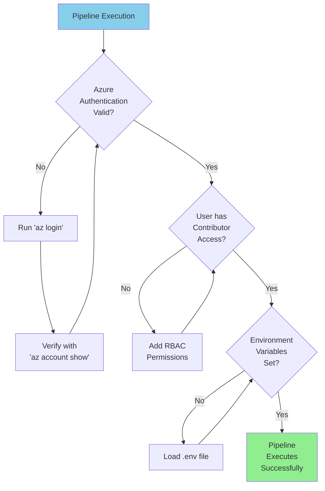
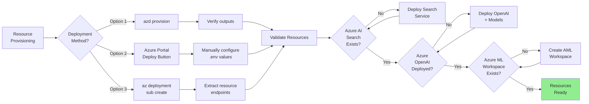
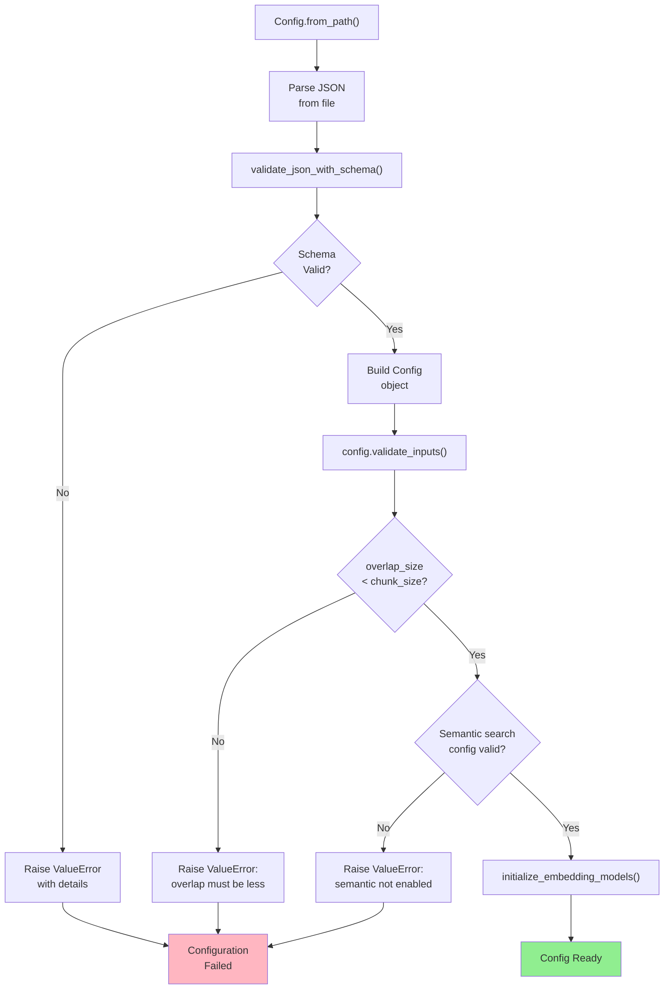
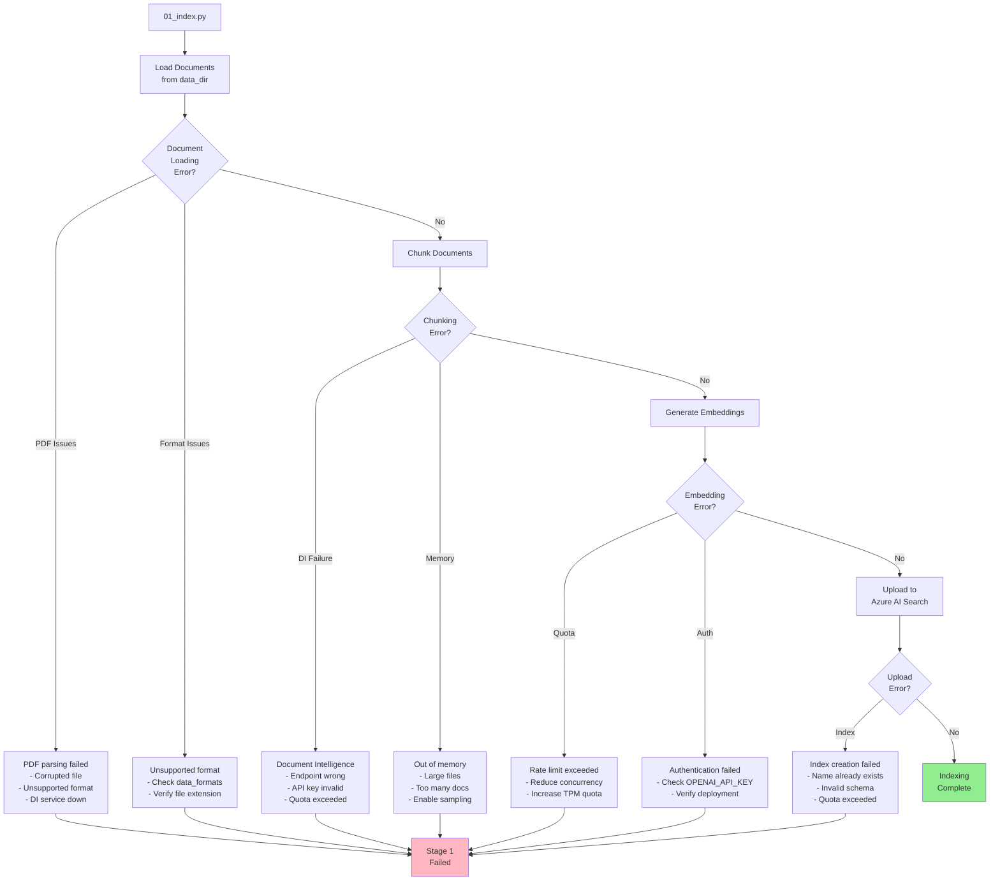
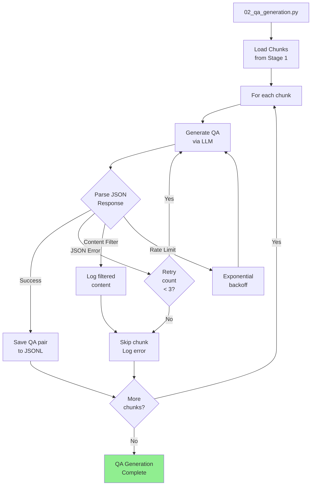
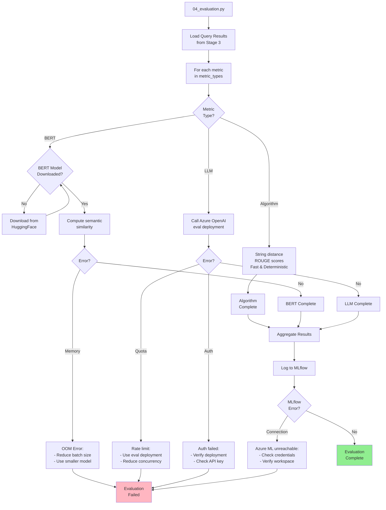
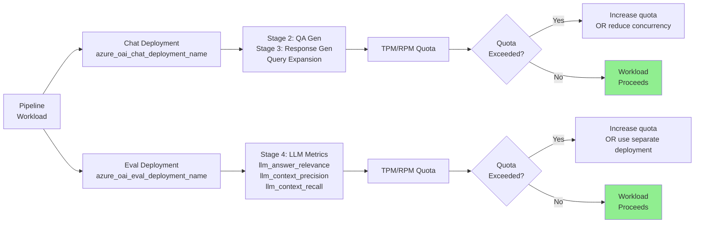
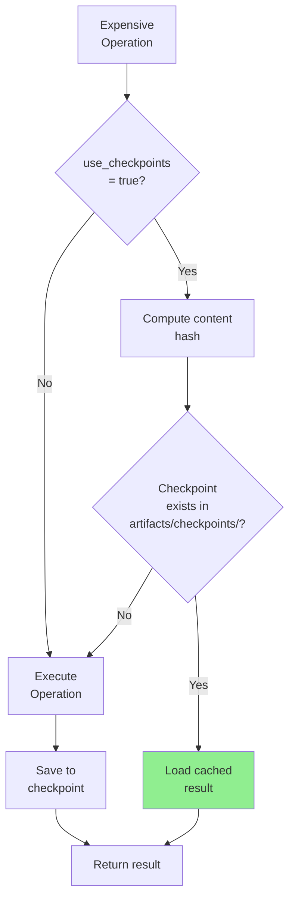

<!-- source: DeepWiki mcp.deepwiki.com · repo microsoft/rag-experiment-accelerator · page 12 Troubleshooting and FAQ · fetched 2026-10-26 -->

# Troubleshooting and FAQ

<details>
<summary>Relevant source files</summary>

The following files were used as context for generating this wiki page:

- [.env.template](.env.template)
- [.github/workflows/build_validation_workflow.yml](.github/workflows/build_validation_workflow.yml)
- [.github/workflows/rag_exp_acc_ci.yml](.github/workflows/rag_exp_acc_ci.yml)
- [Makefile](Makefile)
- [README.md](README.md)
- [config.sample.json](config.sample.json)
- [docs/environment-variables.md](docs/environment-variables.md)
- [rag_experiment_accelerator/config/config.py](rag_experiment_accelerator/config/config.py)
- [rag_experiment_accelerator/config/tests/test_config.py](rag_experiment_accelerator/config/tests/test_config.py)

</details>


## Purpose and Scope

This document provides solutions to common issues, errors, and questions encountered when working with the RAG Experiment Accelerator. It covers setup problems, configuration validation errors, pipeline execution failures, and Azure service integration issues.

For general usage instructions, see [Getting Started](#2). For configuration details, see [Configuration Guide](#2.2). For pipeline stage-specific documentation, see [Pipeline Architecture](#3).

---

## Common Setup Issues

### Azure Authentication and Authorization

**Problem:** Authentication failures when accessing Azure services, or errors storing data to Azure ML Data Assets.

**Symptoms:**
- `AuthenticationError` when running pipeline stages
- Permission denied errors when accessing Azure AI Search or Azure OpenAI
- Failures during MLflow logging in stages 3 and 4

**Solutions:**

1. **Verify Azure CLI login:**
```bash
az login
az account show
az account set --subscription="<your_subscription_guid>"
```

2. **Check user permissions:**
   - User must have **Contributor** access to:
     - Azure AI Search service
     - Azure OpenAI service
     - Azure ML Workspace
   - Verify RBAC assignments in Azure Portal

3. **Start fresh session:**
   - Close terminal and start new session
   - Re-authenticate with `az login`
   - Verify environment variables are loaded

4. **Service principal authentication (CI/CD):**
   - Ensure `AZURE_CREDENTIALS` secret contains valid service principal
   - Verify service principal has required permissions
   - Check credential expiration



**Sources:** [README.md:485-489](), [.env.template:1-49](), [.github/workflows/rag_exp_acc_ci.yml:45-48]()

---

### Environment Variable Configuration

**Problem:** Missing or incorrect environment variables causing runtime errors.

**Symptoms:**
- `KeyError` when accessing environment variables
- `None` values for required configuration
- Service endpoint connection failures

**Required Variables:**

| Variable | Purpose | Common Issues |
|----------|---------|---------------|
| `AZURE_SEARCH_SERVICE_ENDPOINT` | Azure AI Search endpoint | Incorrect format (missing https:) |
| `AZURE_SEARCH_ADMIN_KEY` | Search service authentication | Wrong key type (query key vs admin key) |
| `AZURE_SEARCH_USE_SEMANTIC_SEARCH` | Enable semantic search | Must be "True" or "False" string |
| `OPENAI_API_KEY` | OpenAI authentication | Key rotation not updated |
| `OPENAI_API_TYPE` | Must be "azure" or "open_ai" | Typo in value |
| `OPENAI_ENDPOINT` | Azure OpenAI endpoint | Missing for Azure type |
| `OPENAI_API_VERSION` | API version | Outdated version |
| `AML_SUBSCRIPTION_ID` | Azure ML subscription | Wrong subscription |
| `AML_WORKSPACE_NAME` | Azure ML workspace | Workspace doesn't exist |
| `AML_RESOURCE_GROUP_NAME` | Resource group | Typo in name |

**Verification Steps:**

1. Copy template: `cp .env.template .env`
2. Fill all required values from [docs/environment-variables.md:1-36]()
3. Verify format:
   - Endpoints must include `https://`
   - No trailing slashes on endpoints
   - Boolean values as strings: `"True"` or `"False"`
   - No quotes around most values in `.env` file

**Sources:** [.env.template:1-49](), [docs/environment-variables.md:15-31](), [rag_experiment_accelerator/config/config.py:82-85]()

---

### Resource Provisioning Issues

**Problem:** Azure resources not properly provisioned or configured.

**Deployment Options:**



**Required Deployments:**

1. **Azure OpenAI Models:**
   - `gpt-35-turbo` or `gpt-4` for chat
   - `text-embedding-ada-002` or newer embedding model
   - Separate deployment for evaluation (recommended)

2. **Azure AI Search:**
   - Basic tier or higher for semantic search
   - Sufficient quota for number of indexes

3. **Azure ML Workspace:**
   - For experiment tracking and MLflow
   - Optional for local execution

**Common Issues:**
- Model deployment names in config don't match actual deployments
- Semantic search enabled in config but not provisioned (requires Basic tier+)
- Insufficient quota for embeddings or chat completions

**Sources:** [README.md:125-179](), [docs/environment-variables.md:3-12]()

---

## Configuration Validation Errors

### Schema Validation Failures

**Problem:** `config.json` fails validation against schema.

**Error Example:**
```
ValueError: Config validation error: <validation details>
```

**Common Causes:**

1. **Invalid JSON syntax:**
   - Missing commas
   - Unclosed brackets/braces
   - Trailing commas (not allowed in JSON)

2. **Type mismatches:**
   - String where array expected (e.g., `"search_type": "text"` instead of `["text"]`)
   - Number where string expected
   - Boolean as string without quotes in wrong context

3. **Unknown properties:**
   - Typos in configuration keys
   - Deprecated parameters still in config

**Validation Flow:**



**Sources:** [rag_experiment_accelerator/config/config.py:54-92](), [rag_experiment_accelerator/config/config_validator.py]()

---

### Parameter Constraint Violations

**Problem:** Configuration parameters fail validation checks.

**Chunk Size vs Overlap Size:**

```python
# ERROR: overlap_size must be less than chunk_size
{
    "chunking": {
        "chunk_size": [512],
        "overlap_size": [1000]  # ❌ Too large
    }
}

# CORRECT:
{
    "chunking": {
        "chunk_size": [1000],
        "overlap_size": [200]   # ✓ overlap < chunk_size
    }
}
```

**Validation Location:** [rag_experiment_accelerator/config/config.py:94-98]()

**Semantic Search Requirements:**

```python
# ERROR: Semantic search not enabled in Azure
{
    "search": {
        "search_type": ["search_for_match_semantic"]  # ❌ Requires semantic
    }
}
# But AZURE_SEARCH_USE_SEMANTIC_SEARCH="False"

# CORRECT: Either enable semantic or use other search types
{
    "search": {
        "search_type": ["search_for_match_Hybrid_multi"]  # ✓ No semantic required
    }
}
```

**Validation Location:** [rag_experiment_accelerator/config/config.py:100-106]()

**Reranking Parameter Constraints:**

| Parameter | Purpose | Valid Range | Common Errors |
|-----------|---------|-------------|---------------|
| `retrieve_num_of_documents` | Initial retrieval count | 1-100 | Too low causes index errors in ranking |
| `llm_rerank_threshold` | LLM rerank cutoff | 1-10 | Too high creates oversized context |
| `cross_encoder_at_k` | Cross-encoder top-k | 1-retrieve_num | Exceeds retrieved docs |

**Example Error:**
```
IndexError: list index out of range
# Caused by: cross_encoder_at_k=10 but retrieve_num_of_documents=5
```

**Sources:** [README.md:492-500](), [rag_experiment_accelerator/config/tests/test_config.py:192-238]()

---

### Embedding Model Configuration

**Problem:** Embedding model configuration errors.

**Azure OpenAI Dimensions:**

```json
// ❌ WRONG: Missing dimension for v3 models
{
    "embedding_model": [{
        "type": "azure",
        "model_name": "text-embedding-3-large"
        // Missing "dimension" field
    }]
}

// ✓ CORRECT: Specify dimension
{
    "embedding_model": [{
        "type": "azure",
        "model_name": "text-embedding-3-large",
        "dimension": 3072
    }]
}

// ✓ CORRECT: With dimension shortening
{
    "embedding_model": [{
        "type": "azure",
        "model_name": "text-embedding-3-large",
        "dimension": 256,
        "shorten_dimensions": true
    }]
}
```

**Sentence Transformer Models:**

```json
// ✓ Known models (dimension auto-detected)
{
    "embedding_model": [{
        "type": "sentence-transformer",
        "model_name": "all-MiniLM-L6-v2"
        // No dimension needed
    }]
}

// ✓ Custom models (dimension required)
{
    "embedding_model": [{
        "type": "sentence-transformer",
        "model_name": "custom-model-name",
        "dimension": 768
    }]
}
```

**Sources:** [README.md:364-410](), [config.sample.json:24-29]()

---

## Pipeline Stage Failures

### Stage 1: Indexing Errors

**Problem:** Document loading or index creation failures.

**Common Error Patterns:**



**Document Loading Issues:**

1. **PDF Processing Failures:**
   - **Error:** Document Intelligence timeout or parsing error
   - **Solution:** 
     - Verify `AZURE_DOCUMENT_INTELLIGENCE_ENDPOINT` and key
     - Falls back to `prebuilt-read` from `prebuilt-layout` automatically
     - Check PDF isn't corrupted: `pdfinfo yourfile.pdf`
   - **Location:** [rag_experiment_accelerator/doc_loader/documentIntelligenceLoader.py]()

2. **Unsupported File Types:**
   - **Error:** No loader for file type
   - **Solution:** 
     - Check `data_formats` in config: `["*"]` for all formats
     - Verify file extension matches supported types: PDF, HTML, MD, JSON, DOCX, TXT
   - **Location:** [rag_experiment_accelerator/doc_loader/documentLoader.py]()

3. **Empty Data Directory:**
   - **Error:** No documents found
   - **Solution:**
     - Verify files in `data/` or specified `--data_dir`
     - Check file permissions
     - For CI: use `data-ci/` directory

**Index Creation Failures:**

1. **Index Name Conflicts:**
   - **Error:** Index already exists
   - **Solution:**
     - Change `index_name_prefix` in config
     - Delete existing index via Azure Portal or API
     - Use different combination of chunking parameters

2. **Quota Exceeded:**
   - **Error:** Storage or index quota exceeded
   - **Solution:**
     - Delete unused indexes
     - Upgrade Azure AI Search tier
     - Reduce number of index configurations

3. **Vector Configuration Errors:**
   - **Error:** Invalid `ef_construction` or `ef_search` values
   - **Solution:**
     - Ensure `ef_search` ≤ `ef_construction`
     - Both must be positive integers
     - Typical values: 400-800
   - **Location:** [rag_experiment_accelerator/config/index_config.py]()

**Sources:** [README.md:197-203](), [rag_experiment_accelerator/run/index.py]()

---

### Stage 2: QA Generation Errors

**Problem:** Question-answer pair generation failures.

**JSON Parsing Errors:**

**Error Symptoms:**
- `JSONDecodeError` during QA generation
- Incomplete QA pairs generated
- Content filtering warnings

**Root Causes:**

1. **Incorrect JSON Formatting from LLM:**
   - LLM output doesn't match expected schema
   - Extra text before/after JSON
   - Malformed JSON structure

2. **Content Filtering:**
   - Input contains inappropriate content
   - Generated questions flagged by Azure OpenAI filters
   - Response blocked by content policy

3. **API Limitations:**
   - Token limit exceeded for large chunks
   - Rate limiting on deployment
   - Context window overflow

**Solutions:**

```python
# 1. Check deployment configuration
# Ensure sufficient quota on chat deployment
# config.json
{
    "openai": {
        "azure_oai_chat_deployment_name": "gpt-35-turbo",  # Verify exists
        "temperature": 0  // Lower temperature = more consistent JSON
    }
}

# 2. Verify chunk sizes aren't too large
{
    "index": {
        "chunking": {
            "chunk_size": [1000],  # Reduce if QA gen fails
            "overlap_size": [200]
        }
    }
}

# 3. Enable checkpointing to resume after failures
{
    "use_checkpoints": true  # Skips successful chunks on retry
}
```

**Error Handling Flow:**



**Checkpointing:**
- QA pairs cached in `artifacts/checkpoints/`
- Resume after failure without regenerating
- Clear checkpoints: `make clear_checkpoints`

**Sources:** [README.md:505-514](), [README.md:204-210]()

---

### Stage 3: Querying Errors

**Problem:** Search execution or response generation failures.

**Search Execution Errors:**

| Error Type | Symptoms | Solution |
|------------|----------|----------|
| **Index Not Found** | 404 from Azure AI Search | Verify Stage 1 completed, check index name |
| **Search Syntax Error** | 400 Bad Request | Check query expansion generates valid queries |
| **No Results Found** | Empty context | Lower `search_relevancy_threshold`, adjust search strategy |
| **Timeout** | Request timeout | Reduce `retrieve_num_of_documents`, check network |

**LLM Response Generation:**

1. **Context Too Large:**
   - **Error:** Token limit exceeded
   - **Cause:** Too many retrieved documents + large chunks
   - **Solution:**
     ```json
     {
         "rerank": {
             "enabled": true,
             "llm_rerank_threshold": 3  // Reduce from higher value
         },
         "search": {
             "retrieve_num_of_documents": 5  // Reduce from higher value
         }
     }
     ```

2. **Quota Exhaustion:**
   - **Error:** Rate limit 429 errors
   - **Cause:** High concurrency, insufficient TPM quota
   - **Solution:**
     - Reduce `MAX_WORKER_THREADS` in `.env`
     - Use separate eval deployment: `azure_oai_eval_deployment_name`
     - Increase deployment quota in Azure Portal

3. **HyDE/Query Expansion Failures:**
   - **Error:** Query expansion generates invalid queries
   - **Cause:** LLM generates malformed output
   - **Solution:**
     - Disable temporarily: `"hyde": "disabled"`
     - Lower similarity threshold: `min_query_expansion_related_question_similarity_score`
   - **Location:** [README.md:411-445]()

**Sources:** [README.md:211-216](), [rag_experiment_accelerator/run/querying.py]()

---

### Stage 4: Evaluation Errors

**Problem:** Metric computation or MLflow logging failures.

**Metric Computation Issues:**



**Algorithm Metrics:**
- No external dependencies
- Fast and deterministic
- May not capture semantic similarity
- **Location:** [rag_experiment_accelerator/evaluation/metrics/]()

**BERT Metrics:**
- Require model download from HuggingFace
- Memory intensive for large evaluations
- **Solutions:**
  - Reduce evaluation batch size
  - Use smaller models: `bert_all_MiniLM_L6_v2` (384-dim) vs `bert_large_*` (1024-dim)
  - Increase available memory
- **Location:** [rag_experiment_accelerator/evaluation/metrics/bert_score.py]()

**LLM Metrics:**
- Non-deterministic
- Requires separate OpenAI deployment (recommended)
- **Solutions:**
  - Set `azure_oai_eval_deployment_name` != `azure_oai_chat_deployment_name`
  - Verify eval deployment exists and has quota
  - Adjust prompts in [rag_experiment_accelerator/llm/prompt/prompts.py]()
- **Location:** [README.md:515-521]()

**MLflow Connection:**
- Requires Azure ML workspace
- Must be authenticated via `az login`
- **Solutions:**
  - Verify `AML_*` environment variables
  - Check workspace exists: `az ml workspace show -n <name> -g <rg>`
  - Ensure user has Contributor role

**Sources:** [README.md:217-222](), [README.md:515-521](), [rag_experiment_accelerator/run/evaluation.py]()

---

## Performance and Resource Issues

### Rate Limiting and Quotas

**Problem:** 429 Too Many Requests errors from Azure OpenAI.

**Quota Management:**



**Solutions:**

1. **Separate Deployments:**
```json
{
    "openai": {
        "azure_oai_chat_deployment_name": "gpt-35-turbo",
        "azure_oai_eval_deployment_name": "gpt-35-turbo-eval"  // Different deployment
    }
}
```

2. **Reduce Concurrency:**
```bash
# In .env file
MAX_WORKER_THREADS=1  # Reduce from default (CPU count)
```

3. **Increase Azure OpenAI Quota:**
   - Navigate to Azure Portal → Azure OpenAI → Quotas
   - Request increase for TPM (tokens per minute)
   - Typical needs: 120K TPM for large experiments

4. **Retry Logic:**
   - Built-in exponential backoff
   - Checkpointing preserves progress
   - Resume with same config after quota refresh

**Sources:** [.env.template:35-38](), [rag_experiment_accelerator/config/config.py:82-85]()

---

### Memory and Performance

**Problem:** Out of memory errors or slow execution.

**Memory Issues:**

| Cause | Symptoms | Solution |
|-------|----------|----------|
| **Large Document Corpus** | OOM during indexing | Enable sampling: `sample_data: true` |
| **Too Many Embeddings** | OOM during embedding | Reduce batch size, use smaller model |
| **BERT Evaluation** | OOM during eval | Use `bert_all_MiniLM_L6_v2` instead of larger models |
| **High Concurrency** | Memory thrashing | Reduce `MAX_WORKER_THREADS` |

**Sampling Configuration:**

```json
{
    "index": {
        "sampling": {
            "sample_data": true,
            "percentage": 10,         // 10% of corpus
            "optimum_k": "auto",      // Auto-detect clusters
            "min_cluster": 2,
            "max_cluster": 30,
            "only_sample": false      // Set true to only generate sample
        }
    }
}
```

**Sampling Process:**
1. Clusters documents by content using K-means
2. Samples evenly across clusters
3. Outputs to `artifacts/sampling/<job_name>/`
4. Generates visualization and cluster CSVs
5. Results within ~10% of full dataset

**Running on Azure ML:**
- Use sampling locally to create subset
- Upload sampled data to `artifacts/sampling/<job_name>/`
- Run full pipeline on Azure ML compute with sampled data
- **Note:** Sampling not supported on distributed AML compute

**Sources:** [README.md:226-256](), [config.sample.json:30-37]()

---

### Checkpoint System Issues

**Problem:** Checkpoints not working or causing stale data.

**Checkpoint Behavior:**



**Cached Operations:**
- Document chunking
- Embedding generation
- QA pair generation
- Query results
- Evaluation metrics

**Common Issues:**

1. **Stale Checkpoints:**
   - **Problem:** Config changed but using old cached results
   - **Solution:** Clear checkpoints: `make clear_checkpoints`

2. **Checkpoint Corruption:**
   - **Problem:** Corrupted cache file
   - **Solution:** Delete specific checkpoint or all: `rm -rf artifacts/checkpoints/`

3. **Disk Space:**
   - **Problem:** Checkpoints consuming too much space
   - **Solution:** 
     - Disable for experiments: `"use_checkpoints": false`
     - Periodically clean: `make clear_checkpoints`

4. **Debugging:**
   - **Problem:** Want to force re-execution
   - **Solution:** Set `"use_checkpoints": false` in config

**Sources:** [README.md:27](), [Makefile:61-64](), [rag_experiment_accelerator/checkpoint/]()

---

## Frequently Asked Questions

### General Questions

**Q: What Python version is required?**

A: Python 3.11 is required and specified in [README.md:109](). The development container and CI/CD use this version.

---

**Q: Can I run this without Azure ML?**

A: Yes, for stages 1-3. Azure ML is only required for:
- Stage 3 MLflow logging (optional)
- Stage 4 evaluation and visualization
- Running on distributed compute

For local development, set appropriate `AML_*` environment variables but execution proceeds without Azure ML for stages 1-2.

**Sources:** [README.md:60-63]()

---

**Q: How do I run only specific stages?**

A: Use Makefile targets or run scripts directly:

```bash
# Individual stages
make index      # Stage 1 only
make qnagen     # Stage 2 only  
make query      # Stage 3 only
make eval       # Stage 4 only

# Combined
make query_eval # Stages 3 + 4
make all        # All stages

# Direct Python execution with custom config
python 01_index.py --data_dir ./my-data --config_path ./my-config.json
```

**Sources:** [Makefile:21-42]()

---

### Configuration Questions

**Q: How do I experiment with multiple configurations?**

A: Use arrays in `config.json`. The system flattens to all combinations:

```json
{
    "index": {
        "chunking": {
            "chunk_size": [512, 1024, 2048],
            "overlap_size": [50, 100, 200]
        }
    },
    "search": {
        "search_type": [
            "search_for_match_semantic",
            "search_for_match_Hybrid_multi"
        ]
    }
}
// Generates 3 × 3 × 2 = 18 index configurations
```

Each configuration creates a separate index with naming: `{prefix}-chunk{size}-overlap{overlap}-dim{dimension}`

**Sources:** [README.md:283-287](), [rag_experiment_accelerator/config/base_config.py]()

---

**Q: What's the difference between embedding model types?**

A: 

| Type | Models | Advantages | Disadvantages |
|------|--------|------------|---------------|
| **sentence-transformer** | HuggingFace models (all-MiniLM-L6-v2, all-mpnet-base-v2) | Free, runs locally, fast | Limited dimensions, no API updates |
| **azure** | Azure OpenAI (text-embedding-ada-002, text-embedding-3-*) | Latest models, dimension control, shortening | Costs per token, quota limits |

Configure in `config.json`:
```json
{
    "embedding_model": [
        {"type": "sentence-transformer", "model_name": "all-MiniLM-L6-v2"},
        {"type": "azure", "model_name": "text-embedding-3-large", "dimension": 3072}
    ]
}
```

**Sources:** [README.md:364-410]()

---

**Q: What search types should I use?**

A: Depends on your data and requirements:

| Search Type | Use Case | Requirements |
|-------------|----------|--------------|
| `search_for_match_text` | Keyword matching, structured data | None |
| `search_for_match_pure_vector` | Semantic search, natural language | Embeddings |
| `search_for_match_Hybrid_multi` | Balanced keyword + semantic | Embeddings |
| `search_for_match_semantic` | Azure semantic ranking | Semantic search tier |
| `search_for_manual_hybrid` | Custom hybrid weighting | Semantic search tier |

Start with `search_for_match_Hybrid_multi` for general use.

**Sources:** [README.md:337-340]()

---

### Data and Document Questions

**Q: What document formats are supported?**

A: 
- **Native:** PDF, HTML, Markdown (.md), Plain Text (.txt), JSON, DOCX
- **Via Document Intelligence:** Any format supported by Azure Document Intelligence when `chunking_strategy: "azure-document-intelligence"`

Set in config:
```json
{
    "data_formats": ["*"]  // All formats
    // or
    "data_formats": ["pdf", "docx"]  // Specific formats
}
```

**Sources:** [README.md:35]()

---

**Q: How does table extraction work?**

A: When using `azure_document_intelligence_model: "prebuilt-layout"`:

1. Tables extracted with column headers
2. Each row formatted as key-value pairs
3. Improves LLM readability
4. Chunking respects row boundaries (doesn't split mid-row)
5. Falls back to `prebuilt-read` on failure

**Sources:** [README.md:37-38]()

---

**Q: Should I use sampling?**

A: Use sampling when:
- Dataset > 1000 documents
- Want rapid experimentation
- Cost/time constraints
- Exploring hyperparameters

**Process:**
1. Run sampling locally: `"sample_data": true, "percentage": 10`
2. Review cluster visualization in `artifacts/sampling/`
3. Results ~10% margin from full dataset
4. Run full pipeline on identified optimal config

**Don't use sampling for:**
- Final production runs
- Small datasets (< 100 docs)
- Precise metric comparisons

**Sources:** [README.md:226-256]()

---

### Evaluation Questions

**Q: Which metrics should I use?**

A: Tiered approach:

**Development (Fast):**
```json
{
    "metric_types": ["fuzzy_score", "cosine_ochiai"]  // Algorithm-based
}
```

**Validation (Moderate):**
```json
{
    "metric_types": [
        "fuzzy_score",
        "bert_all_MiniLM_L6_v2",  // Semantic similarity
        "cosine_ochiai"
    ]
}
```

**Final Assessment (Comprehensive):**
```json
{
    "metric_types": [
        "fuzzy_score",
        "bert_distilbert_base_nli_stsb_mean_tokens",
        "llm_answer_relevance",    // LLM-as-judge
        "llm_context_precision",
        "llm_context_recall"
    ]
}
```

**Sources:** [README.md:48](), [README.md:515-521]()

---

**Q: Why are LLM metrics non-deterministic?**

A: LLM-based evaluation uses language models as judges, which:
- Vary slightly between runs (even with `temperature=0`)
- Depend on prompt phrasing
- May interpret nuances differently

**Solutions:**
- Run multiple times and average
- Use algorithm/BERT metrics for deterministic comparison
- Adjust prompts in [rag_experiment_accelerator/llm/prompt/prompts.py]()
- Consider LLM metrics as directional guidance

**Sources:** [README.md:518-520]()

---

**Q: What is MAP@k and how is it calculated?**

A: Mean Average Precision at k measures retrieval quality:

1. For each question, compare retrieved chunks against chunk used in QA generation
2. Chunks deemed "relevant" if similarity > 80% (configurable)
3. Compute precision at each relevant position
4. Average across all questions

**Configuration:**
- Similarity threshold in [rag_experiment_accelerator/evaluation/spacy_evaluator.py]()
- Uses SpaCy token vectors (order-insensitive)
- Separate metric from answer quality

**Sources:** [README.md:521-522]()

---

### Azure ML and MLflow Questions

**Q: How do I view experiment results?**

A: Results available in Azure ML Studio:

1. Navigate to Azure ML Workspace
2. Click "Experiments" in left menu
3. Find experiment by `experiment_name` from config
4. View runs, metrics, and artifacts
5. Compare runs using MLflow UI

Alternatively, run MLflow locally:
```bash
mlflow ui --backend-store-uri <azure_ml_tracking_uri>
```

**Sources:** [README.md:447-480]()

---

**Q: Can I run the pipeline on Azure ML compute?**

A: Yes, see [Azure ML Pipeline Guide](./docs/azureml-pipeline.md):

```bash
# After creating compute cluster
python azureml/pipeline.py --config_path ./config.json --data_dir ./data
```

**Requirements:**
- Azure ML compute cluster created
- `AML_COMPUTE_NAME` in `.env`
- Files accessible to compute (uploaded or data assets)

**Note:** Sampling not supported on distributed compute - sample locally first.

**Sources:** [README.md:224]()

---

### CI/CD and Testing Questions

**Q: What tests run in CI/CD?**

A: GitHub Actions runs:

1. **Build Validation:** Flake8, unit tests, coverage
2. **End-to-End Validation:** All 4 stages with `data-ci/` sample data
3. **Config Validation:** Schema validation against multiple configs

View workflows in [.github/workflows/]().

**Sources:** [.github/workflows/build_validation_workflow.yml:1-59](), [.github/workflows/rag_exp_acc_ci.yml:1-67]()

---

**Q: How do I run tests locally?**

A: 

```bash
# Install dev dependencies
pip install -e . -r dev-requirements.txt

# Install spacy model
python -m spacy download en_core_web_sm

# Run unit tests with coverage
pytest . --cov=. --cov-report=html --cov-config=.coveragerc

# or use Makefile
make test

# Linting
flake8 --extend-ignore=E501
# or
make flake
```

**Sources:** [Makefile:65-71](), [.github/workflows/build_validation_workflow.yml:39-52]()

---

**Q: What are the contribution guidelines?**

A: 

1. **Branch naming:** Use GitHub UI to create branches with tags:
   - `feature/123-short-description`
   - `bug/456-short-description`

2. **Commits:** Squash to max 3 commits per PR

3. **Testing:** Test locally before PR submission

4. **Naming:** Use snake_case for variables, metrics, config keys

5. **Issue tracking:** Check [project board](https://github.com/orgs/microsoft/projects/991) before creating new issues

**Sources:** [README.md:544-563]()

---

## Additional Resources

For more detailed information:

- **Setup:** [Installation and Dependencies](#2.1)
- **Configuration Reference:** [Config Object Reference](#4.1)
- **Pipeline Stages:** [Pipeline Architecture](#3)
- **Azure Integration:** [Azure Service Integration](#9)
- **Development:** [Development and CI/CD](#11)

**Sources:** [README.md:1-571]()

---

