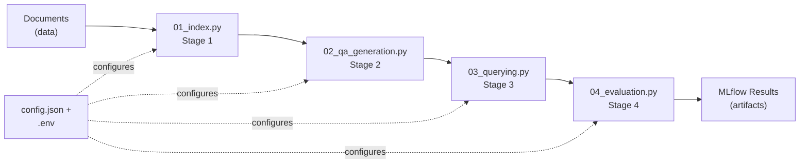
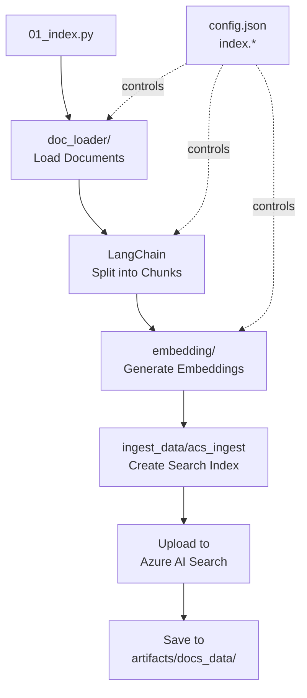
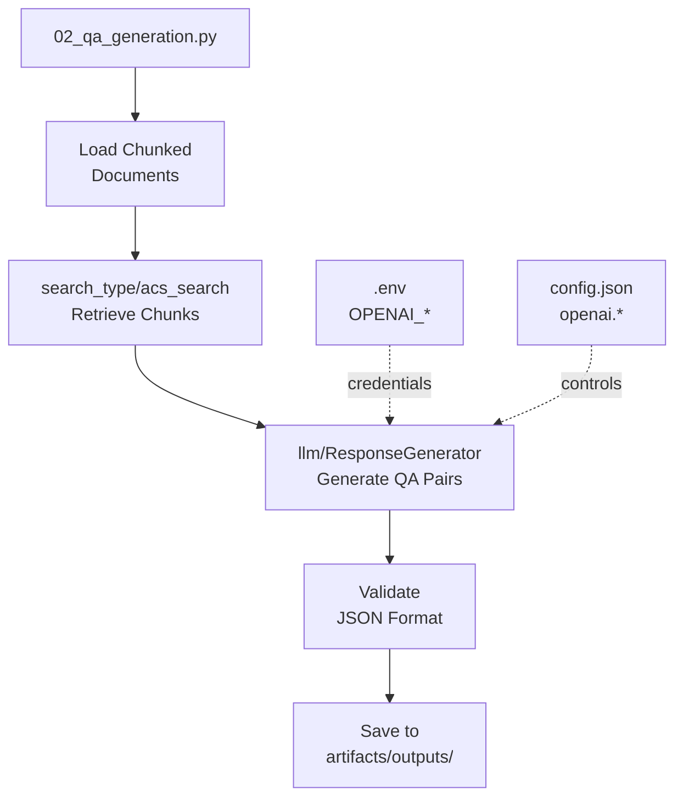
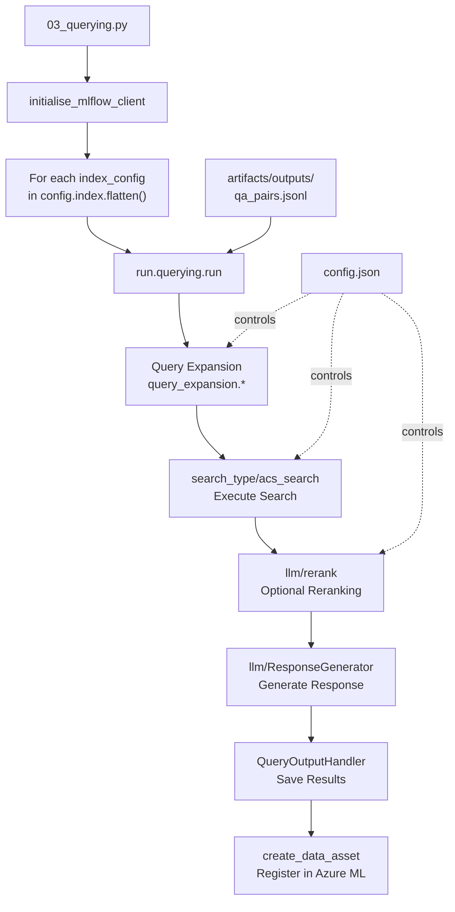
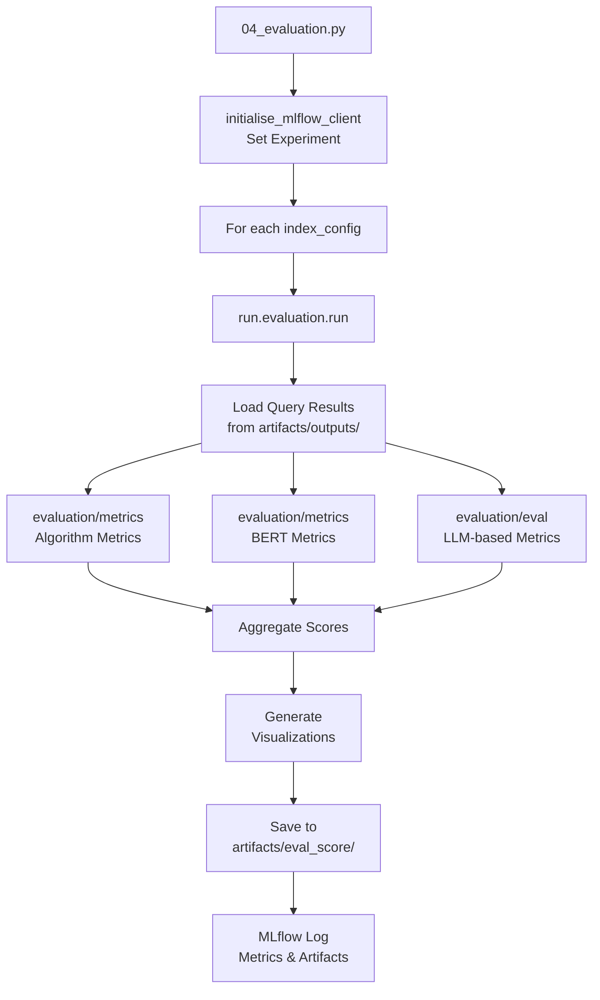
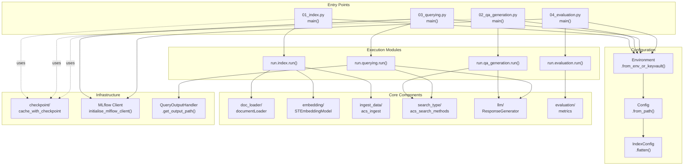
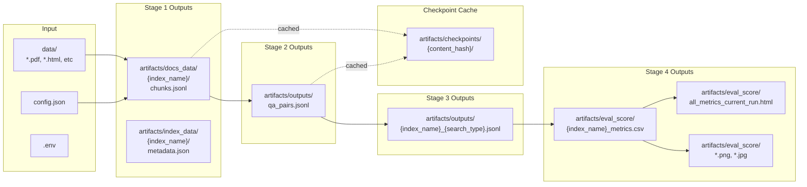

<!-- source: DeepWiki mcp.deepwiki.com · repo microsoft/rag-experiment-accelerator · page 2.3 Running Your First Experiment · fetched 2026-10-26 -->

# Running Your First Experiment

<details>
<summary>Relevant source files</summary>

The following files were used as context for generating this wiki page:

- [.env.template](.env.template)
- [.github/workflows/build_validation_workflow.yml](.github/workflows/build_validation_workflow.yml)
- [.github/workflows/rag_exp_acc_ci.yml](.github/workflows/rag_exp_acc_ci.yml)
- [02_qa_generation.py](02_qa_generation.py)
- [03_querying.py](03_querying.py)
- [04_evaluation.py](04_evaluation.py)
- [Makefile](Makefile)
- [README.md](README.md)
- [config.sample.json](config.sample.json)
- [docs/environment-variables.md](docs/environment-variables.md)

</details>


## Purpose and Scope

This page provides a step-by-step tutorial for executing your first complete RAG experiment using the RAG Experiment Accelerator. By the end of this guide, you will have indexed documents, generated question-answer pairs, executed queries, and evaluated the results using multiple metrics.

**Prerequisites**: This guide assumes you have completed [Installation and Dependencies](#2.1) and understand the basic [Configuration Guide](#2.2). For detailed information about each pipeline stage, see [Pipeline Architecture](#3).

## Quick Start Overview

A complete RAG experiment consists of four sequential stages, each executed by a dedicated Python script:



**Execution time**: A minimal experiment with 5-10 documents typically completes in 15-30 minutes, depending on document size and configuration.

Sources: [README.md:182-223](), [Diagram 1 from high-level architecture]()

## Prerequisites Checklist

Before running your first experiment, verify:

- [ ] Azure resources provisioned (AI Search, OpenAI, ML Workspace)
- [ ] `.env` file created and populated with credentials
- [ ] `config.json` file created from `config.sample.json`
- [ ] Python environment activated with dependencies installed
- [ ] Azure CLI authenticated (`az login` completed)

Sources: [README.md:125-189](), [docs/environment-variables.md:1-36]()

## Step-by-Step Guide

### Step 1: Prepare Your Environment Files

Create your environment configuration from the template:

```bash
cp .env.template .env
```

Edit `.env` and populate the required variables:

| Variable | Purpose | Example |
|----------|---------|---------|
| `AZURE_SEARCH_SERVICE_ENDPOINT` | AI Search endpoint | `https://myservice.search.windows.net` |
| `AZURE_SEARCH_ADMIN_KEY` | AI Search admin key | `abc123...` |
| `OPENAI_API_KEY` | Azure OpenAI key | `def456...` |
| `OPENAI_ENDPOINT` | Azure OpenAI endpoint | `https://myopenai.openai.azure.com/` |
| `OPENAI_API_TYPE` | Must be `azure` | `azure` |
| `OPENAI_API_VERSION` | API version | `2023-03-15-preview` |
| `AML_SUBSCRIPTION_ID` | Azure subscription ID | `00000000-0000-0000-0000-000000000000` |
| `AML_WORKSPACE_NAME` | ML workspace name | `my-ml-workspace` |
| `AML_RESOURCE_GROUP_NAME` | Resource group name | `my-resource-group` |

Sources: [.env.template:1-49](), [docs/environment-variables.md:15-36]()

### Step 2: Configure Your Experiment

Create your experiment configuration:

```bash
cp config.sample.json config.json
```

For your first experiment, modify the minimal required fields in `config.json`:

```json
{
    "experiment_name": "my-first-experiment",
    "job_name": "baseline-run",
    "job_description": "Initial baseline evaluation with default parameters",
    "data_formats": ["*"],
    "use_checkpoints": true,
    "index": {
        "index_name_prefix": "idx-baseline",
        "chunking": {
            "preprocess": false,
            "chunk_size": [1000],
            "overlap_size": [200]
        },
        "embedding_model": [
            {
                "type": "sentence-transformer",
                "model_name": "all-mpnet-base-v2"
            }
        ]
    },
    "openai": {
        "azure_oai_chat_deployment_name": "gpt-35-turbo",
        "azure_oai_eval_deployment_name": "gpt-35-turbo"
    }
}
```

**Key configuration notes**:
- `experiment_name`: Groups all related runs in Azure ML
- `job_name`: Identifies this specific run (timestamp will be appended)
- `use_checkpoints`: Enable to cache expensive operations
- `index_name_prefix`: Prefix for Azure AI Search index names

Sources: [config.sample.json:1-87](), [README.md:190-195]()

### Step 3: Prepare Your Documents

Place your documents in the `data/` directory:

```bash
mkdir -p data
# Copy your PDF, HTML, MD, TXT, JSON, or DOCX files here
cp /path/to/your/documents/*.pdf data/
```

**Supported formats**: PDF, HTML, Markdown, Plain Text, JSON, DOCX

**Recommended for first run**: Start with 5-10 small documents (< 10 pages each) to validate the pipeline quickly.

Sources: [README.md:195-196](), [README.md:289]()

### Step 4: Run Stage 1 - Document Indexing

Execute the indexing stage to process documents and create Azure AI Search indexes:

```bash
python 01_index.py --data_dir data --config_path config.json
```

**What happens in this stage**:



**Command-line arguments**:
- `--data_dir`: Directory containing input documents (default: `data`)
- `--config_path`: Path to configuration file (default: `config.json`)
- `-d`: Working directory (default: current directory)

**Output artifacts** (in `artifacts/`):
- `docs_data/<index_name>/`: Chunked documents in JSONL format
- `index_data/<index_name>/`: Index metadata and statistics
- `checkpoints/`: Cached embeddings and processing results

**Verification**: Check that the index was created in Azure AI Search portal at `{AZURE_SEARCH_SERVICE_ENDPOINT}`.

Sources: [01_index.py:1-44](), [README.md:197-203](), [Diagram 1 from high-level architecture]()

### Step 5: Run Stage 2 - QA Generation

Generate question-answer pairs from indexed documents:

```bash
python 02_qa_generation.py --data_dir data --config_path config.json
```

**What happens in this stage**:



**What it does**:
1. Retrieves document chunks from Azure AI Search
2. Uses Azure OpenAI to generate question-answer pairs for each chunk
3. Creates ground truth dataset for evaluation
4. Saves results to `artifacts/outputs/qa_pairs.jsonl`

**Output format** (`qa_pairs.jsonl`):
```json
{
  "question": "What is the purpose of...",
  "answer": "The purpose is...",
  "context": "Original document chunk text...",
  "chunk_id": "doc_001_chunk_005",
  "source": "document_name.pdf"
}
```

**Typical generation rate**: 1-2 QA pairs per chunk, ~5-10 seconds per pair

Sources: [02_qa_generation.py:1-23](), [README.md:204-210](), [Diagram 1 from high-level architecture]()

### Step 6: Run Stage 3 - Querying

Execute queries against the search index and generate responses:

```bash
python 03_querying.py --config_path config.json
```

**What happens in this stage**:



**Key processes**:
1. **Query expansion**: Optionally expands queries using HyDE or multi-question generation
2. **Search execution**: Tests multiple search types (text, vector, hybrid, semantic)
3. **Reranking**: Applies LLM or cross-encoder reranking if enabled
4. **Response generation**: Uses Azure OpenAI to generate final answers

**Configuration impact**:
- `config.search.search_type`: Determines which search strategies to test
- `config.rerank.enabled`: Enables/disables reranking
- `config.query_expansion.*`: Controls query expansion behavior

**Output artifacts**:
- `artifacts/outputs/<index_name>_<search_type>.jsonl`: Query results for each search type
- Registered as Azure ML data assets for tracking

Sources: [03_querying.py:1-52](), [README.md:211-216](), [Diagram 1 from high-level architecture]()

### Step 7: Run Stage 4 - Evaluation

Calculate metrics and generate evaluation reports:

```bash
python 04_evaluation.py --config_path config.json
```

**What happens in this stage**:



**Evaluation metrics computed** (configurable via `config.eval.metric_types`):

| Metric Type | Examples | Cost |
|-------------|----------|------|
| Algorithm-based | `levenshtein`, `jaccard`, `fuzzy_score` | Free |
| BERT-based | `bert_all_MiniLM_L6_v2`, `bert_large_nli_mean_tokens` | Low |
| LLM-based | `llm_answer_relevance`, `llm_context_precision` | High |

**Output artifacts** (in `artifacts/eval_score/`):
- `<index_name>_<search_type>_metrics.csv`: Detailed metric scores per question
- `all_metrics_current_run.html`: Interactive comparison dashboard
- `*.png`, `*.jpg`: Metric comparison charts
- `map_at_k_*.csv`: Retrieval precision metrics

**MLflow tracking**: All metrics, parameters, and visualizations are logged to Azure ML for comparison across runs.

Sources: [04_evaluation.py:1-43](), [README.md:217-222](), [Diagram 6 from high-level architecture]()

### Step 8: View Results

#### Option 1: Local Artifacts

Navigate to the `artifacts/eval_score/` directory to view:

```bash
cd artifacts/eval_score
# Open HTML report in browser
open all_metrics_current_run.html
```

#### Option 2: Azure ML Studio

1. Navigate to Azure ML Studio: `https://ml.azure.com`
2. Select your workspace
3. Go to "Experiments" and find your experiment name
4. Click on the latest run to view:
   - Metrics comparison charts
   - Hyperparameters
   - Output artifacts
   - Run history for comparison

**Key reports to examine**:
- **Metric Comparison**: Average scores across search types
- **Search Evaluation**: Performance by search strategy
- **MAP Scores**: Retrieval quality metrics

Sources: [README.md:447-480]()

## Complete Execution Flow with Code Entities

This diagram shows the complete execution flow with actual code entities:



Sources: [01_index.py:16-44](), [02_qa_generation.py:10-23](), [03_querying.py:16-52](), [04_evaluation.py:15-43](), [Diagram 5 from high-level architecture]()

## Artifact Organization

Understanding where each stage writes its outputs:



**Artifact paths**:
- `artifacts/docs_data/{index_name}/`: Chunked documents from Stage 1
- `artifacts/outputs/qa_pairs.jsonl`: QA pairs from Stage 2
- `artifacts/outputs/{index_name}_{search_type}.jsonl`: Query results from Stage 3
- `artifacts/eval_score/`: All evaluation outputs from Stage 4
- `artifacts/checkpoints/`: Cached intermediate results

Sources: [Diagram 4 from high-level architecture](), [README.md:182-223]()

## Alternative Execution Methods

### Using Makefile

The Makefile provides convenient targets for running the entire pipeline:

```bash
# Run all stages sequentially
make all

# Run individual stages
make index      # Stage 1
make qnagen     # Stage 2
make query      # Stage 3
make eval       # Stage 4

# Run only query and evaluation
make query_eval

# With custom config or data directory
make all cp=my_config.json dd=my_data_dir
```

**Makefile targets**:

| Target | Description | Equivalent Command |
|--------|-------------|-------------------|
| `make index` | Run Stage 1 | `python 01_index.py --data_dir ./data` |
| `make qnagen` | Run Stage 2 | `python 02_qa_generation.py --data_dir ./data` |
| `make query` | Run Stage 3 | `python 03_querying.py` |
| `make eval` | Run Stage 4 | `python 04_evaluation.py` |
| `make all` | Run all stages | Executes index, qnagen, query, eval |
| `make clear_artifacts` | Clean output directories | `rm -rf artifacts/{docs_data,eval_score,...}` |
| `make clear_checkpoints` | Clear checkpoint cache | `rm -rf artifacts/checkpoints` |

Sources: [Makefile:1-76]()

### Using CI/CD (GitHub Actions)

For automated testing, the repository includes a GitHub Actions workflow:

**Workflow file**: [.github/workflows/rag_exp_acc_ci.yml:1-67]()

**What it does**:
1. Sets up Azure authentication using service principal
2. Loads environment variables from GitHub secrets
3. Executes all four stages sequentially using the CI data directory

**To run manually**:
1. Go to "Actions" tab in GitHub
2. Select "RAG Experiment Accelerator CI"
3. Click "Run workflow"

Sources: [.github/workflows/rag_exp_acc_ci.yml:23-67]()

## Understanding Checkpoints

The checkpoint system caches expensive operations to avoid redundant computation:

**How it works**:
1. Content-based hashing generates unique identifiers
2. Results cached in `artifacts/checkpoints/{content_hash}/`
3. On subsequent runs, cached results are loaded instead of recomputing

**What gets cached**:
- Document embeddings (Stage 1)
- LLM-generated QA pairs (Stage 2)
- Query expansion results (Stage 3)

**Configuration**:
```json
{
    "use_checkpoints": true  // Enable/disable in config.json
}
```

**When to clear checkpoints**:
```bash
make clear_checkpoints
```

Clear checkpoints when:
- Changing embedding models
- Modifying LLM prompts
- Debugging incorrect cached results

Sources: [README.md:290](), [config.sample.json:8]()

## Troubleshooting Common Issues

### Issue: "Azure Search index not found"

**Cause**: Stage 1 (indexing) did not complete successfully.

**Solution**:
1. Verify Azure AI Search credentials in `.env`
2. Check Azure portal to confirm index creation
3. Review Stage 1 logs for errors
4. Ensure `AZURE_SEARCH_ADMIN_KEY` has write permissions

### Issue: "QA generation producing invalid JSON"

**Cause**: Azure OpenAI content filtering or incorrect prompt formatting.

**Solution**:
1. Check that `azure_oai_chat_deployment_name` matches your deployment
2. Verify API version compatibility in `.env`
3. Review content filters in Azure OpenAI portal
4. Check chunk size isn't exceeding token limits

Sources: [README.md:481-522]()

### Issue: "Out of range error during reranking"

**Cause**: Mismatch between `retrieve_num_of_documents` and reranking thresholds.

**Solution**:
```json
{
    "search": {
        "retrieve_num_of_documents": 10  // Increase this
    },
    "rerank": {
        "cross_encoder_at_k": 5,  // Ensure < retrieve_num_of_documents
        "llm_rerank_threshold": 3  // Ensure < retrieve_num_of_documents
    }
}
```

Sources: [README.md:495-500]()

### Issue: "MLflow authentication failed"

**Cause**: Azure ML credentials not configured or expired.

**Solution**:
1. Re-authenticate with Azure CLI: `az login`
2. Verify `AML_*` variables in `.env` are correct
3. Check Azure ML workspace access permissions
4. Ensure workspace exists in specified subscription

Sources: [README.md:486-490]()

## Next Steps

After successfully running your first experiment:

1. **Experiment with configurations**: See [IndexConfig and Multi-Configuration Experiments](#4.2) to run grid search experiments
2. **Optimize chunking**: Review [Chunking Strategies](#5.3) to improve retrieval quality
3. **Try different search types**: Explore [Search Types and Strategies](#7.1) for optimal search configuration
4. **Add more metrics**: See [Evaluation Metrics](#8) for comprehensive evaluation options
5. **Scale to production**: Review [Azure ML and MLflow](#9.3) for distributed execution
6. **Enable sampling**: See [Data Sampling and Clustering](#5.4) for large datasets

**Typical experimentation workflow**:
1. Run baseline with default parameters (this guide)
2. Analyze results to identify bottlenecks
3. Create config variants with `config.index.flatten()` 
4. Execute batch experiments
5. Compare results in MLflow
6. Select best configuration for production

Sources: [README.md:226-282]()

---

