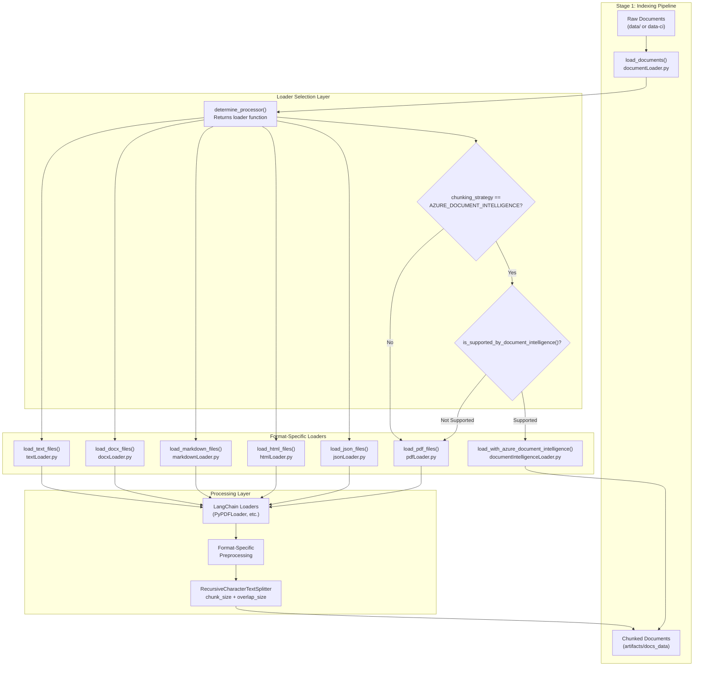
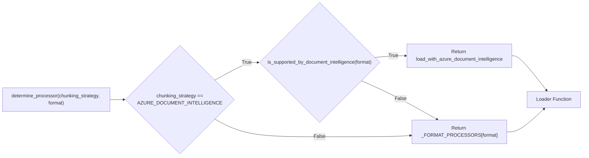
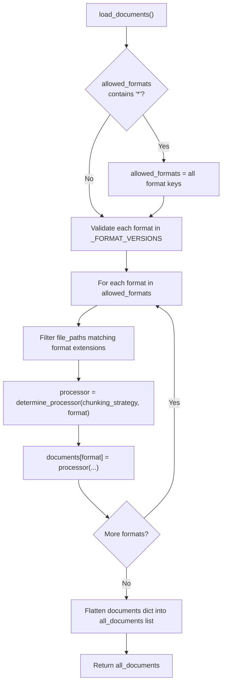
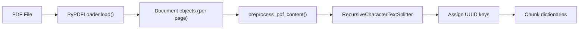
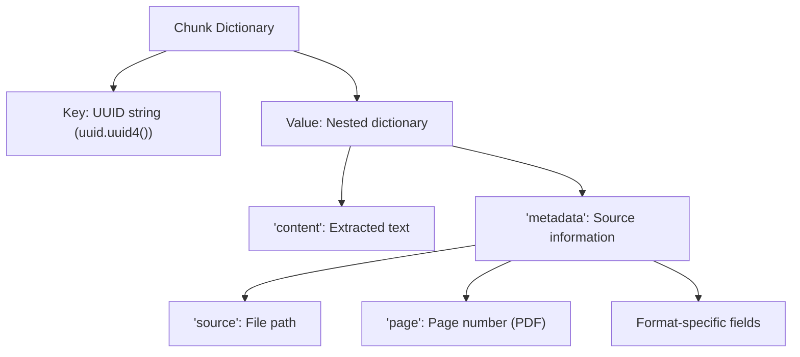
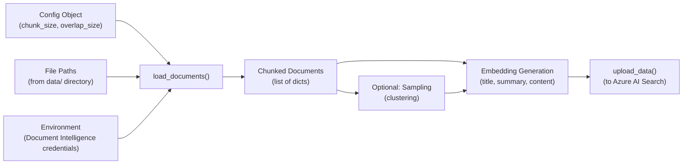

<!-- source: DeepWiki mcp.deepwiki.com · repo microsoft/rag-experiment-accelerator · page 5.1 Document Loaders · fetched 2026-10-26 -->

# Document Loaders

<details>
<summary>Relevant source files</summary>

The following files were used as context for generating this wiki page:

- [rag_experiment_accelerator/doc_loader/documentLoader.py](rag_experiment_accelerator/doc_loader/documentLoader.py)
- [rag_experiment_accelerator/doc_loader/jsonLoader.py](rag_experiment_accelerator/doc_loader/jsonLoader.py)
- [rag_experiment_accelerator/doc_loader/pdfLoader.py](rag_experiment_accelerator/doc_loader/pdfLoader.py)
- [rag_experiment_accelerator/doc_loader/structuredLoader.py](rag_experiment_accelerator/doc_loader/structuredLoader.py)
- [rag_experiment_accelerator/ingest_data/acs_ingest.py](rag_experiment_accelerator/ingest_data/acs_ingest.py)
- [rag_experiment_accelerator/ingest_data/tests/test_acs_ingest.py](rag_experiment_accelerator/ingest_data/tests/test_acs_ingest.py)

</details>


## Purpose and Scope

Document Loaders are responsible for reading raw documents from various file formats, extracting their content, and chunking them into processable segments for indexing into Azure AI Search. This module handles format detection, content extraction, preprocessing, and text splitting. Document loading occurs in Stage 1 (Indexing) of the pipeline before embeddings are generated.

For information about:
- How chunks are embedded after loading, see [Embedding Models](#6)
- Chunking strategy configuration and parameters, see [Chunking Strategies](#5.3)
- Azure Document Intelligence integration, see [Azure Document Intelligence Integration](#5.2)
- Data sampling after loading, see [Data Sampling and Clustering](#5.4)

## Architecture Overview

The document loading system uses a factory pattern to select appropriate loaders based on file format and chunking strategy. The main entry point is the `load_documents` function which coordinates format detection, loader selection, and chunking.



**Sources:** [rag_experiment_accelerator/doc_loader/documentLoader.py:1-113]()

## Supported Document Formats

The system supports six document format categories, with multiple file extensions mapped to each format. The `_FORMAT_VERSIONS` dictionary defines the mapping, and `_FORMAT_PROCESSORS` associates each format with its loader function.

| Format Category | File Extensions | Loader Function | Module |
|----------------|-----------------|-----------------|---------|
| PDF | `.pdf`, `.pdfa`, `.pdfa-1`, `.pdfl` | `load_pdf_files()` | `pdfLoader.py` |
| HTML | `.html`, `.htm`, `.xhtml`, `.html5` | `load_html_files()` | `htmlLoader.py` |
| Markdown | `.md`, `.markdown` | `load_markdown_files()` | `markdownLoader.py` |
| JSON | `.json` | `load_json_files()` | `jsonLoader.py` |
| Text | `.txt`, `.rtf` | `load_text_files()` | `textLoader.py` |
| DOCX | `.docx` | `load_docx_files()` | `docxLoader.py` |

Configuration allows filtering by format using the `allowed_formats` parameter. Setting `allowed_formats = ["*"]` enables all supported formats.

**Sources:** [rag_experiment_accelerator/doc_loader/documentLoader.py:19-34]()

## Loader Selection Mechanism

The `determine_processor` function implements the loader selection logic based on chunking strategy and document format.



This two-tier selection prioritizes Azure Document Intelligence for supported formats when that chunking strategy is configured, falling back to format-specific loaders otherwise.

**Sources:** [rag_experiment_accelerator/doc_loader/documentLoader.py:37-48]()

## Main Loading Function

The `load_documents` function is the primary interface for document loading, called from the indexing pipeline.

### Function Signature

```python
def load_documents(
    environment: Environment,
    chunking_strategy: ChunkingStrategy,
    allowed_formats: list[str],
    file_paths: list[str],
    chunk_size: int,
    overlap_size: int,
    azure_document_intelligence_model: str = None,
) -> list
```

### Processing Flow



The function aggregates documents from all format-specific loaders into a single flat list for downstream processing.

**Sources:** [rag_experiment_accelerator/doc_loader/documentLoader.py:50-113]()

## Format-Specific Loader Implementations

### PDF Loader

The PDF loader uses LangChain's `PyPDFLoader` and includes preprocessing to normalize PDF content.

**Key Functions:**

- `load_pdf_files()`: Main entry point [rag_experiment_accelerator/doc_loader/pdfLoader.py:40-91]()
- `preprocess_pdf_content()`: Content normalization [rag_experiment_accelerator/doc_loader/pdfLoader.py:13-38]()

**Preprocessing Steps:**

1. Collapse multiple consecutive newlines into single newlines
2. Remove all remaining newlines
3. Remove Unicode escape sequences (`\uXXXX`)
4. Convert content to lowercase



**Output Structure:**

Each chunk is a dictionary with a UUID key and nested content/metadata:

```python
{
    "<uuid>": {
        "content": "<preprocessed_text>",
        "metadata": {"source": "<file_path>", "page": <page_num>}
    }
}
```

**Sources:** [rag_experiment_accelerator/doc_loader/pdfLoader.py:1-91]()

### JSON Loader

The JSON loader handles structured JSON documents by extracting specific keys.

**Key Configuration:**

- Default keys extracted: `["content", "title"]` [rag_experiment_accelerator/doc_loader/jsonLoader.py:36]()
- Uses `CustomJSONLoader` under the hood
- Delegates to `load_structured_files()` for common processing

**Processing Flow:**


**Sources:** [rag_experiment_accelerator/doc_loader/jsonLoader.py:1-48]()

### Structured File Loader

The `load_structured_files` function provides a common processing pipeline for structured formats (JSON, HTML, Markdown, DOCX, Text).

**Function Signature:**

```python
def load_structured_files(
    file_format: str,
    language: str,
    loader: BaseLoader,
    file_paths: list[str],
    chunk_size: str,
    overlap_size: str,
    loader_kwargs: dict[any] = None,
) -> list[Document]
```

**Language-Aware Splitting:**

The function supports language-specific text splitting:

```python
if language is None:
    text_splitter = RecursiveCharacterTextSplitter(
        chunk_size=chunk_size,
        chunk_overlap=overlap_size,
        length_function=len,
    )
else:
    text_splitter = RecursiveCharacterTextSplitter().from_language(
        language=language,
        chunk_size=chunk_size,
        chunk_overlap=overlap_size,
    )
```

This allows format-specific loaders to request language-aware splitting for code files or language-specific documents.

**Sources:** [rag_experiment_accelerator/doc_loader/structuredLoader.py:1-75]()

## Document Structure and Metadata

### Chunk Dictionary Format

All loaders produce chunks in a consistent structure:



### Transformation to Index Documents

After loading, chunks are transformed into Azure AI Search index documents by `chunks_to_index_documents()`:

```python
def chunks_to_index_documents(chunks):
    return [
        {
            "id": str(my_hash(chunk["content"])),
            "title": chunk["title"] if "title" in chunk else "",
            "summary": chunk["summary"] if "summary" in chunk else "",
            "content": str(chunk["content"]),
            "filename": chunk["filename"],
            "sourceDisplayName": chunk["source_display_name"],
            "contentVector": chunk.get("content_vector", []),
            "summaryVector": chunk.get("summary_vector", []),
            "titleVector": chunk.get("title_vector", []),
        }
        for chunk in chunks
    ]
```

The `id` field uses MD5 hashing of content for deduplication. Vector fields are populated later during embedding generation.

**Sources:** [rag_experiment_accelerator/ingest_data/acs_ingest.py:198-231]()

## Integration with Pipeline

Document loaders are invoked early in Stage 1 (Indexing) before any LLM or embedding operations.



The loaded chunks flow through optional sampling, embedding generation, and finally upload to Azure AI Search indexes.

**Sources:** [rag_experiment_accelerator/doc_loader/documentLoader.py:50-113](), [rag_experiment_accelerator/ingest_data/acs_ingest.py:36-90]()

## Error Handling and Logging

The loader system includes comprehensive logging at multiple levels:

- **Format validation:** Logs errors for unsupported formats [rag_experiment_accelerator/doc_loader/documentLoader.py:86-88]()
- **Progress tracking:** Logs document count after loading [rag_experiment_accelerator/doc_loader/documentLoader.py:111]()
- **Per-format logging:** Each loader logs file count and chunk count

Example logging output:

```
DEBUG: Loading documents with allowed formats pdf, json
INFO: Loading PDF files
DEBUG: Loaded 45 pages from PDF files
DEBUG: Splitting PDF pages into chunks of 512 characters with an overlap of 50 characters
INFO: Split 45 PDF pages into 128 chunks
INFO: Loaded 128 chunks
```

**Sources:** [rag_experiment_accelerator/doc_loader/documentLoader.py:81-112](), [rag_experiment_accelerator/doc_loader/pdfLoader.py:61-88]()

## Usage Example

Document loading is typically invoked from the indexing pipeline with configuration parameters:

```python
from rag_experiment_accelerator.doc_loader.documentLoader import load_documents
from rag_experiment_accelerator.config.chunking_config import ChunkingStrategy

chunks = load_documents(
    environment=environment,
    chunking_strategy=ChunkingStrategy.BASIC,
    allowed_formats=["pdf", "json", "html"],
    file_paths=["/path/to/doc1.pdf", "/path/to/doc2.json"],
    chunk_size=512,
    overlap_size=50,
    azure_document_intelligence_model=None,
)
```

For Azure Document Intelligence chunking:

```python
chunks = load_documents(
    environment=environment,
    chunking_strategy=ChunkingStrategy.AZURE_DOCUMENT_INTELLIGENCE,
    allowed_formats=["*"],
    file_paths=file_paths,
    chunk_size=512,
    overlap_size=50,
    azure_document_intelligence_model="prebuilt-layout",
)
```

**Sources:** [rag_experiment_accelerator/doc_loader/documentLoader.py:50-113]()

## Testing

The loader system includes unit tests covering:

- Hash function consistency [rag_experiment_accelerator/ingest_data/tests/test_acs_ingest.py:19-58]()
- Document upload functionality [rag_experiment_accelerator/ingest_data/tests/test_acs_ingest.py:105-147]()
- Chunk-to-index transformation [rag_experiment_accelerator/ingest_data/tests/test_acs_ingest.py:105-147]()

Tests mock Azure services and LangChain loaders to enable fast, isolated testing.

**Sources:** [rag_experiment_accelerator/ingest_data/tests/test_acs_ingest.py:1-207]()

---

