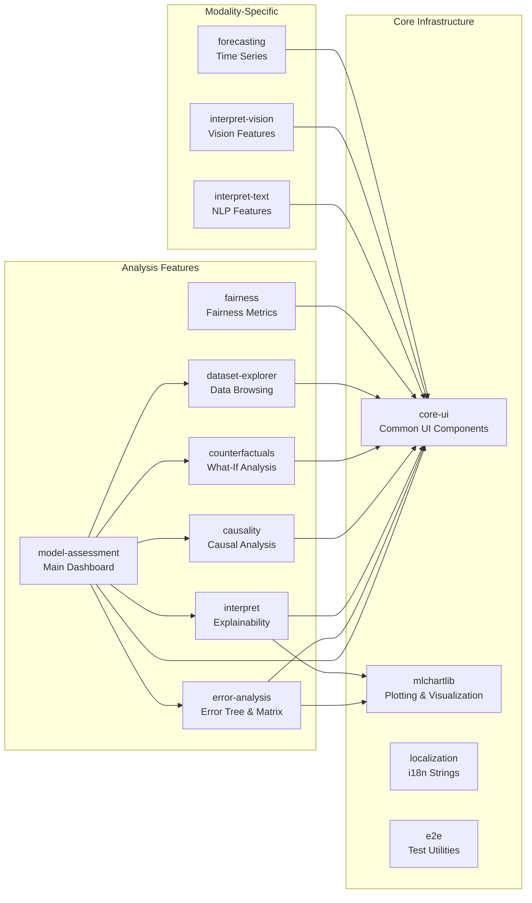
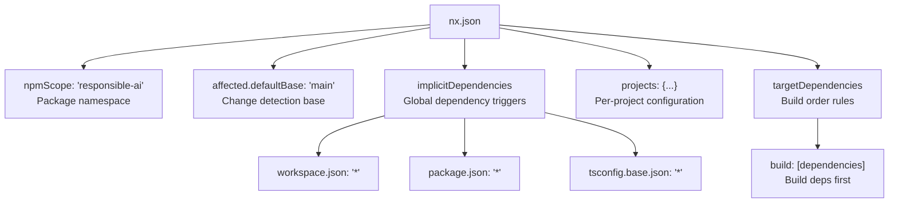
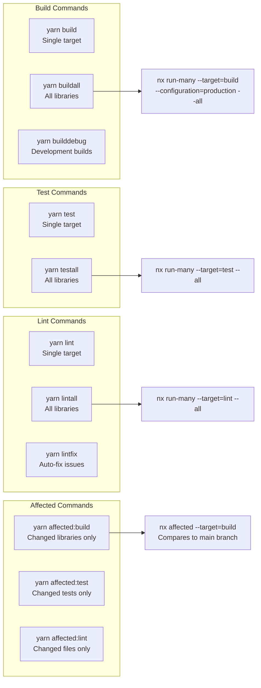
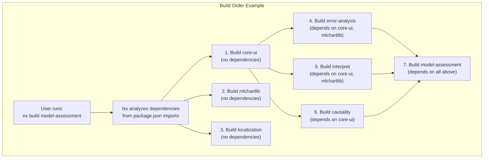
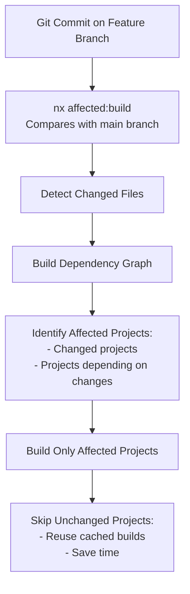

<!-- source: DeepWiki mcp.deepwiki.com · repo microsoft/responsible-ai-toolbox · page 4.5 Nx Monorepo Structure · fetched 2026-10-26 -->

# Nx Monorepo Structure

<details>
<summary>Relevant source files</summary>

The following files were used as context for generating this wiki page:

- [apps/dashboard-e2e/src/describer/interpret/individualFeatureImportance/describeSubBarChart.ts](apps/dashboard-e2e/src/describer/interpret/individualFeatureImportance/describeSubBarChart.ts)
- [libs/e2e/src/lib/describer/interpretText/validateBarChart.ts](libs/e2e/src/lib/describer/interpretText/validateBarChart.ts)
- [libs/mlchartlib/src/lib/components/AccessibleChart.tsx](libs/mlchartlib/src/lib/components/AccessibleChart.tsx)
- [nx.json](nx.json)
- [package.json](package.json)
- [tsconfig.base.json](tsconfig.base.json)
- [workspace.json](workspace.json)
- [yarn.lock](yarn.lock)

</details>


This page documents the Nx monorepo setup that manages all TypeScript/React code in the Responsible AI Toolbox. It explains the workspace structure, library organization, and build orchestration. For details on individual TypeScript libraries, see [TypeScript Libraries](#4.5.1). For build pipeline specifics, see [Build and Bundle Pipeline](#4.5.2).

## Purpose and Scope

The frontend codebase uses [Nx](https://nx.dev), a build system and monorepo management tool, to organize multiple TypeScript libraries and applications. Nx provides dependency graph analysis, incremental builds, and task orchestration across all packages. This page covers the monorepo architecture, project configuration, and how Nx coordinates builds and tests across the workspace.

## Monorepo Overview

The repository structure separates applications from reusable libraries:

```mermaid
graph TB
    Root["Repository Root"]
    
    Root --> Apps["apps/"]
    Root --> Libs["libs/"]
    Root --> Config["Configuration Files"]
    
    Apps --> Dashboard["dashboard/<br/>(Main Application)"]
    Apps --> DashboardE2E["dashboard-e2e/<br/>(Cypress Tests)"]
    Apps --> Widget["widget/<br/>(Standalone Widget)"]
    Apps --> WidgetE2E["widget-e2e/<br/>(Widget Tests)"]
    
    Libs --> CoreUI["core-ui"]
    Libs --> ModelAssessment["model-assessment"]
    Libs --> ErrorAnalysis["error-analysis"]
    Libs --> Interpret["interpret"]
    Libs --> Causality["causality"]
    Libs --> Counterfactuals["counterfactuals"]
    Libs --> DatasetExplorer["dataset-explorer"]
    Libs --> Fairness["fairness"]
    Libs --> MLChartLib["mlchartlib"]
    Libs --> Localization["localization"]
    Libs --> InterpretText["interpret-text"]
    Libs --> InterpretVision["interpret-vision"]
    Libs --> Forecasting["forecasting"]
    Libs --> E2E["e2e"]
    
    Config --> WorkspaceJson["workspace.json"]
    Config --> NxJson["nx.json"]
    Config --> TsconfigBase["tsconfig.base.json"]
    Config --> PackageJson["package.json"]
```



**Sources:** [workspace.json:1-1000](), [nx.json:1-90](), [package.json:1-159]()

## Applications (apps)

The monorepo contains two main applications and their associated end-to-end test suites:

| Application | Path | Purpose | Build Target |
|------------|------|---------|--------------|
| `dashboard` | `apps/dashboard` | Main standalone dashboard application | `nx build dashboard` |
| `dashboard-e2e` | `apps/dashboard-e2e` | Cypress end-to-end tests for dashboard | `nx e2e dashboard-e2e` |
| `widget` | `apps/widget` | Embeddable widget for Jupyter notebooks | `nx build widget` |
| `widget-e2e` | `apps/widget-e2e` | Cypress tests for widget | `nx e2e widget-e2e` |

The `dashboard` application configuration includes Webpack bundling with a 4GB memory limit and budget constraints set to warn at 20MB and error at 50MB for production builds:

**Sources:** [workspace.json:211-308](), [package.json:22-38]()

## Libraries (libs)

The workspace defines 14 TypeScript libraries organized by functionality:



Each library has a consistent structure with build, lint, and test targets defined in `workspace.json`:

**Sources:** [workspace.json:1-2000](), [nx.json:23-80](), [tsconfig.base.json:37-56]()

## Library Build Configuration

All libraries use the `@nrwl/web:package` builder with Rollup for bundling. The standard configuration pattern includes:

```typescript
{
  "builder": "@nrwl/web:package",
  "options": {
    "outputPath": "dist/libs/{library-name}",
    "tsConfig": "libs/{library-name}/tsconfig.lib.json",
    "project": "libs/{library-name}/package.json",
    "entryFile": "libs/{library-name}/src/index.ts",
    "external": [
      "@fluentui/react",
      "highcharts",
      "jmespath",
      "localized-strings",
      "lodash",
      "memoize-one",
      "moment",
      "plotly.js",
      "react-plotly.js",
      "react",
      "react-dom",
      "uuid"
    ],
    "rollupConfig": "./rollup.config.js",
    "buildableProjectDepsInPackageJsonType": "dependencies"
  }
}
```

The `external` array ensures that common dependencies like React and Fluent UI are not bundled into each library, reducing duplication and bundle size. Each library declares its internal dependencies, which Nx uses to construct the build order.

**Sources:** [workspace.json:99-130](), [workspace.json:485-516]()

## Nx Configuration Structure

The Nx workspace is configured through three main files:

### nx.json

Defines workspace-level settings and project metadata:



The `targetDependencies` configuration ensures that when building any project, its dependencies are built first:

```json
"targetDependencies": {
  "build": [
    {
      "target": "build",
      "projects": "dependencies"
    }
  ]
}
```

**Sources:** [nx.json:1-90]()

### workspace.json

Defines all projects and their build/test/lint configurations. Each project specifies:

- `root`: Project directory path
- `sourceRoot`: Source code directory
- `projectType`: "application" or "library"
- `architect`: Build targets (build, test, lint, serve, e2e)

**Sources:** [workspace.json:1-2000]()

### tsconfig.base.json

Configures TypeScript path mappings for all libraries, enabling clean imports:

| Import Path | Actual Path |
|------------|-------------|
| `@responsible-ai/core-ui` | `libs/core-ui/src/index.ts` |
| `@responsible-ai/model-assessment` | `libs/model-assessment/src/index.ts` |
| `@responsible-ai/error-analysis` | `libs/error-analysis/src/index.ts` |
| `@responsible-ai/interpret` | `libs/interpret/src/index.ts` |
| `@responsible-ai/causality` | `libs/causality/src/index.ts` |
| `@responsible-ai/counterfactuals` | `libs/counterfactuals/src/index.ts` |
| `@responsible-ai/dataset-explorer` | `libs/dataset-explorer/src/index.ts` |
| `@responsible-ai/fairness` | `libs/fairness/src/index.ts` |
| `@responsible-ai/mlchartlib` | `libs/mlchartlib/src/index.ts` |
| `@responsible-ai/localization` | `libs/localization/src/index.ts` |
| `@responsible-ai/interpret-text` | `libs/interpret-text/src/index.ts` |
| `@responsible-ai/interpret-vision` | `libs/interpret-vision/src/index.ts` |
| `@responsible-ai/forecasting` | `libs/forecasting/src/index.ts` |
| `@responsible-ai/e2e` | `libs/e2e/src/index.ts` |

This allows components to import from other libraries using clean namespace imports rather than relative paths.

**Sources:** [tsconfig.base.json:37-56]()

## Build System and Task Orchestration

Nx provides several commands for managing builds across the monorepo:

### Nx Build Commands

The `package.json` scripts leverage Nx's task orchestration:



Key scripts from `package.json`:

- `buildall`: Builds all libraries in production mode with 6GB memory allocation
- `testall`: Runs all Jest test suites across all libraries
- `lintall`: Lints all libraries plus workspace-level checks
- `affected:build`: Only builds libraries affected by recent changes
- `ci`: Runs full CI pipeline (install, test, lint, build, e2e)

**Sources:** [package.json:6-42]()

### Memory Allocation

Build and lint scripts allocate additional Node.js memory to handle the large codebase:

- Build commands: `NODE_OPTIONS=--max_old_space_size=6144` (6GB)
- Lint commands: `NODE_OPTIONS=--max_old_space_size=4096` (4GB)
- Dashboard app build: `memoryLimit: 4096` in workspace config

**Sources:** [package.json:17-18](), [package.json:30-31](), [workspace.json:227]()

## Dependency Graph and Build Order

Nx automatically determines the build order based on library dependencies. The `targetDependencies` configuration ensures transitive builds:



The build process ensures that all dependencies are built before dependent libraries. This is configured in `nx.json`:

**Sources:** [nx.json:81-88]()

## External Dependencies Management

All libraries share a common set of external dependencies that are not bundled. This is configured in each library's `workspace.json` entry under the `external` array:

**Common External Dependencies:**
- `@fluentui/react` - UI component library
- `react`, `react-dom` - Core React libraries
- `plotly.js`, `react-plotly.js` - Charting libraries
- `highcharts` - Additional charting
- `lodash` - Utility functions
- `moment` - Date/time handling
- `uuid` - Unique identifier generation
- `jmespath` - JSON querying
- `localized-strings` - Internationalization
- `memoize-one` - Performance optimization

These dependencies are installed once at the workspace root and shared across all libraries, as defined in the root `package.json`.

**Sources:** [workspace.json:106-119](), [package.json:43-77]()

## Workspace Scripts and Automation

The monorepo includes several automation scripts:

| Script | Purpose | Location |
|--------|---------|----------|
| `auto-version.js` | Synchronizes version numbers across packages | `scripts/auto-version.js` |
| `copyTest.js` | Copies test artifacts | `scripts/copyTest.js` |
| `e2e-widget.js` | Runs widget end-to-end tests | `scripts/e2e-widget.js` |

These scripts are invoked via yarn commands:

```bash
yarn auto-version    # Sync versions
yarn copytest        # Copy test files
yarn e2e-widget      # Run widget e2e tests
```

**Sources:** [package.json:15](), [package.json:20](), [package.json:24]()

## Development Workflow

The Nx setup supports efficient development workflows:

### Local Development

```bash
# Start dashboard dev server
yarn start

# Start widget dev server with backend proxy
yarn start-widget

# Run tests with file watching
yarn test

# Run e2e tests with Cypress UI
yarn e2e-watch
```

### CI Pipeline

The full CI pipeline is orchestrated through a single command:

```bash
yarn ci
# Executes:
# 1. yarn install --frozen-lock-file
# 2. yarn testall --codeCoverage
# 3. yarn lintall
# 4. yarn buildall
# 5. yarn test
# 6. yarn e2e
```

**Sources:** [package.json:19](), [package.json:34-36]()

## Affected Build Optimization

Nx's affected commands dramatically speed up CI by only processing changed code:



The `affected` configuration in `nx.json` specifies `main` as the default comparison base, meaning Nx compares the current branch against `main` to determine what has changed.

**Sources:** [nx.json:3-5](), [package.json:7-14]()

---

