# Page: Overview

# Overview

<details>
<summary>Relevant source files</summary>

The following files were used as context for generating this wiki page:

- [CHANGES.md](CHANGES.md)
- [README.md](README.md)
- [apps/widget/src/app/ModelAssessment.tsx](apps/widget/src/app/ModelAssessment.tsx)
- [erroranalysis/requirements-dev.txt](erroranalysis/requirements-dev.txt)
- [erroranalysis/requirements.txt](erroranalysis/requirements.txt)
- [libs/core-ui/src/index.ts](libs/core-ui/src/index.ts)
- [libs/core-ui/src/lib/Context/ModelAssessmentContext.tsx](libs/core-ui/src/lib/Context/ModelAssessmentContext.tsx)
- [libs/core-ui/src/lib/Interfaces/IExplanationContext.ts](libs/core-ui/src/lib/Interfaces/IExplanationContext.ts)
- [libs/core-ui/src/lib/util/StatisticsUtils.ts](libs/core-ui/src/lib/util/StatisticsUtils.ts)
- [libs/error-analysis/src/index.ts](libs/error-analysis/src/index.ts)
- [libs/error-analysis/src/lib/ErrorAnalysisDashboard/Controls/MetricSelector/MetricSelector.tsx](libs/error-analysis/src/lib/ErrorAnalysisDashboard/Controls/MetricSelector/MetricSelector.tsx)
- [libs/error-analysis/src/lib/ErrorAnalysisDashboard/Interfaces/IErrorAnalysisDashboardState.ts](libs/error-analysis/src/lib/ErrorAnalysisDashboard/Interfaces/IErrorAnalysisDashboardState.ts)
- [libs/interpret-vision/src/lib/VisionExplanationDashboard/Interfaces/IVisionExplanationDashboardProps.ts](libs/interpret-vision/src/lib/VisionExplanationDashboard/Interfaces/IVisionExplanationDashboardProps.ts)
- [libs/localization/src/lib/en.json](libs/localization/src/lib/en.json)
- [libs/model-assessment/src/lib/ModelAssessmentDashboard/Context/buildModelAssessmentContext.ts](libs/model-assessment/src/lib/ModelAssessmentDashboard/Context/buildModelAssessmentContext.ts)
- [libs/model-assessment/src/lib/ModelAssessmentDashboard/Controls/ModelOverview/ModelOverview.tsx](libs/model-assessment/src/lib/ModelAssessmentDashboard/Controls/ModelOverview/ModelOverview.tsx)
- [libs/model-assessment/src/lib/ModelAssessmentDashboard/Controls/ModelOverview/StatsTableUtils.ts](libs/model-assessment/src/lib/ModelAssessmentDashboard/Controls/ModelOverview/StatsTableUtils.ts)
- [libs/model-assessment/src/lib/ModelAssessmentDashboard/Controls/TabsView/TabsViewProps.ts](libs/model-assessment/src/lib/ModelAssessmentDashboard/Controls/TabsView/TabsViewProps.ts)
- [libs/model-assessment/src/lib/ModelAssessmentDashboard/ModelAssessmentDashboard.tsx](libs/model-assessment/src/lib/ModelAssessmentDashboard/ModelAssessmentDashboard.tsx)
- [libs/model-assessment/src/lib/ModelAssessmentDashboard/ModelAssessmentDashboardProps.ts](libs/model-assessment/src/lib/ModelAssessmentDashboard/ModelAssessmentDashboardProps.ts)
- [libs/model-assessment/src/lib/ModelAssessmentDashboard/ModelAssessmentDashboardState.ts](libs/model-assessment/src/lib/ModelAssessmentDashboard/ModelAssessmentDashboardState.ts)
- [nlp_feature_extractors/requirements.txt](nlp_feature_extractors/requirements.txt)
- [notebooks/responsibleaidashboard/text/responsibleaidashboard-openai-model-debugging.ipynb](notebooks/responsibleaidashboard/text/responsibleaidashboard-openai-model-debugging.ipynb)
- [notebooks/test_notebooks.py](notebooks/test_notebooks.py)
- [rai_core_flask/requirements.txt](rai_core_flask/requirements.txt)
- [raiwidgets/raiwidgets/responsibleai_dashboard.py](raiwidgets/raiwidgets/responsibleai_dashboard.py)
- [raiwidgets/raiwidgets/responsibleai_dashboard_input.py](raiwidgets/raiwidgets/responsibleai_dashboard_input.py)
- [raiwidgets/requirements.txt](raiwidgets/requirements.txt)
- [responsibleai/requirements-dev.txt](responsibleai/requirements-dev.txt)
- [responsibleai/requirements.txt](responsibleai/requirements.txt)
- [responsibleai_text/responsibleai_text/version.py](responsibleai_text/responsibleai_text/version.py)
- [responsibleai_vision/responsibleai_vision/version.py](responsibleai_vision/responsibleai_vision/version.py)
- [scripts/e2e-widget.js](scripts/e2e-widget.js)
- [version.cfg](version.cfg)

</details>


## Purpose and Scope

The Responsible AI Toolbox is a comprehensive framework for assessing, debugging, and understanding machine learning models across tabular, vision, and text modalities. This document provides a high-level overview of the system architecture, core packages, and integration patterns.

For detailed information on specific subsystems:
- Python backend architecture: see [Python Backend Architecture](#3)
- TypeScript dashboard: see [TypeScript Dashboard Architecture](#4)
- Vision and text packages: see [Specialized Packages](#5)
- Development and testing: see [Development Guide](#6) and [Testing and CI/CD](#7)

**Sources**: [README.md:1-153](), [libs/localization/src/lib/en.json:1-100](), [responsibleai/requirements.txt:1-22]()

---

## System Architecture

The Responsible AI Toolbox consists of three major architectural layers that work together to provide end-to-end model assessment capabilities:

### High-Level Component Architecture

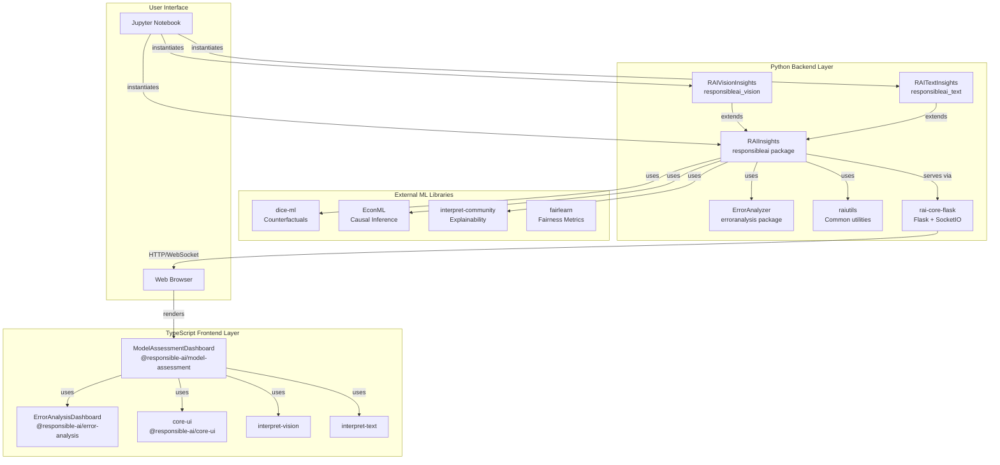

**Sources**: [README.md:24-62](), [responsibleai/requirements.txt:1-22](), [raiwidgets/requirements.txt:1-10](), [libs/core-ui/src/index.ts:1-129]()

---

## Package Ecosystem

The toolbox is distributed as multiple independently versioned Python packages and TypeScript libraries:

### Python Packages

| Package | Version | Purpose | Key Dependencies |
|---------|---------|---------|------------------|
| `responsibleai` | 0.36.0 | Core RAI library, main API entry point | erroranalysis, dice-ml, econml, interpret-community |
| `raiwidgets` | 0.36.0 | Dashboard widgets for Jupyter | rai-core-flask, erroranalysis, fairlearn |
| `erroranalysis` | 0.5.4 | Error analysis engine (trees, heatmaps) | lightgbm, scikit-learn, raiutils |
| `rai-core-flask` | 0.7.6 | Flask backend API server | Flask, Flask-Cors, flask-socketio |
| `raiutils` | 0.4.2 | Common utilities and helpers | - |
| `responsibleai_vision` | 0.3.8 | Vision-specific tasks | responsibleai, torchmetrics, Pillow |
| `responsibleai_text` | 0.2.7 | Text/NLP-specific tasks | responsibleai, spacy, transformers |

**Sources**: [version.cfg:1-2](), [responsibleai/requirements.txt:1-22](), [raiwidgets/requirements.txt:1-10](), [erroranalysis/requirements.txt:1-6](), [rai_core_flask/requirements.txt:1-8](), [responsibleai_vision/responsibleai_vision/version.py:1-9](), [responsibleai_text/responsibleai_text/version.py:1-9]()

### TypeScript Libraries (Nx Monorepo)

The frontend is organized as an Nx monorepo containing 14+ TypeScript libraries:

- `@responsible-ai/model-assessment`: Main dashboard orchestrator
- `@responsible-ai/error-analysis`: Error analysis UI components
- `@responsible-ai/core-ui`: Shared UI components and utilities
- `@responsible-ai/interpret`: Model interpretation widgets
- `@responsible-ai/interpret-vision`: Vision-specific UI
- `@responsible-ai/interpret-text`: Text-specific UI
- `@responsible-ai/mlchartlib`: Chart visualization library
- `@responsible-ai/localization`: i18n strings

**Sources**: [libs/core-ui/src/index.ts:1-129](), [libs/model-assessment/src/lib/ModelAssessmentDashboard/ModelAssessmentDashboard.tsx:1-50](), [libs/localization/src/lib/en.json:1-100]()

---

## Frontend-Backend Integration

### Request-Response Flow

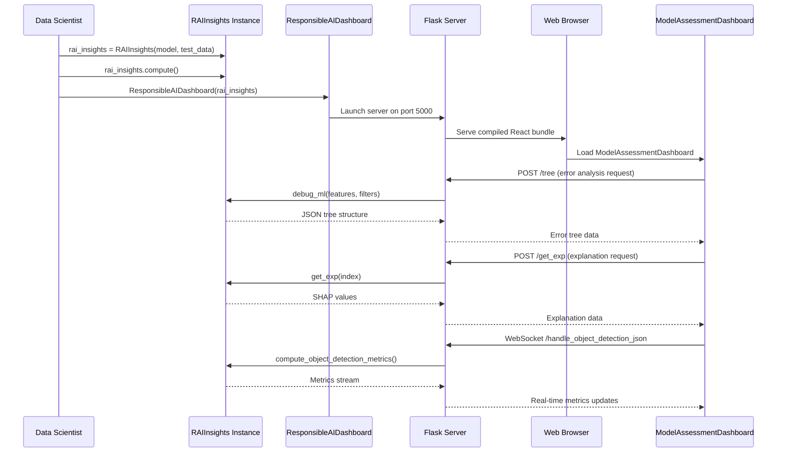

**Sources**: [raiwidgets/raiwidgets/responsibleai_dashboard.py:1-150](), [raiwidgets/raiwidgets/responsibleai_dashboard_input.py:1-100](), [apps/widget/src/app/ModelAssessment.tsx:1-100](), [libs/model-assessment/src/lib/ModelAssessmentDashboard/ModelAssessmentDashboard.tsx:56-175]()

### Key API Endpoints

The Flask server (`rai-core-flask`) exposes the following HTTP and WebSocket endpoints:

| Endpoint | Method | Purpose | Handler |
|----------|--------|---------|---------|
| `/tree` | POST | Generate error analysis tree | `ResponsibleAIDashboardInput.debug_ml()` |
| `/matrix` | POST | Generate error heatmap | `ResponsibleAIDashboardInput.matrix()` |
| `/predict` | POST | Get model predictions | `ResponsibleAIDashboardInput.on_predict()` |
| `/get_exp` | POST | Get SHAP explanations | `ResponsibleAIDashboardInput.get_exp()` |
| `/global_causal_effects` | POST | Compute causal effects | `ResponsibleAIDashboardInput.get_global_causal_effects()` |
| `/causal_whatif` | POST | Causal what-if analysis | `ResponsibleAIDashboardInput.causal_whatif()` |
| `/handle_object_detection_json` | WebSocket | Stream object detection metrics | Socket handler |
| `/handle_question_answering_json` | WebSocket | Stream QA metrics | Socket handler |

**Sources**: [raiwidgets/raiwidgets/responsibleai_dashboard.py:53-150](), [raiwidgets/raiwidgets/responsibleai_dashboard_input.py:129-398](), [apps/widget/src/app/ModelAssessment.tsx:23-200]()

---

## Core Analysis Workflow

### Manager Orchestration Pattern

The `RAIInsights` class uses a manager pattern to orchestrate different types of analyses:

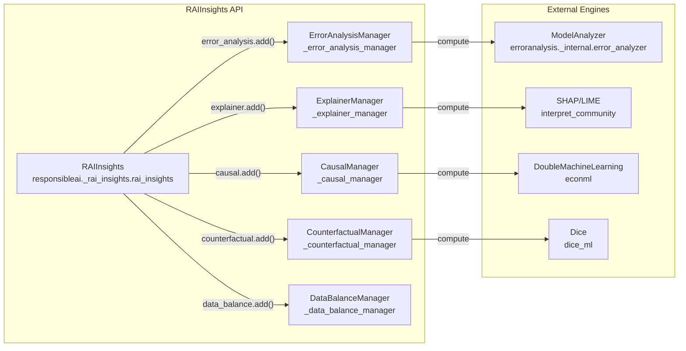

**Sources**: [libs/model-assessment/src/lib/ModelAssessmentDashboard/Context/buildModelAssessmentContext.ts:1-100](), [raiwidgets/raiwidgets/responsibleai_dashboard_input.py:24-50]()

### Three-Phase Analysis Pipeline

Users interact with the toolbox through a three-phase workflow:

1. **Initialization Phase**: Create `RAIInsights` instance with model and test data
2. **Configuration Phase**: Add desired analyses using manager APIs
3. **Computation Phase**: Execute all configured analyses with `compute()`

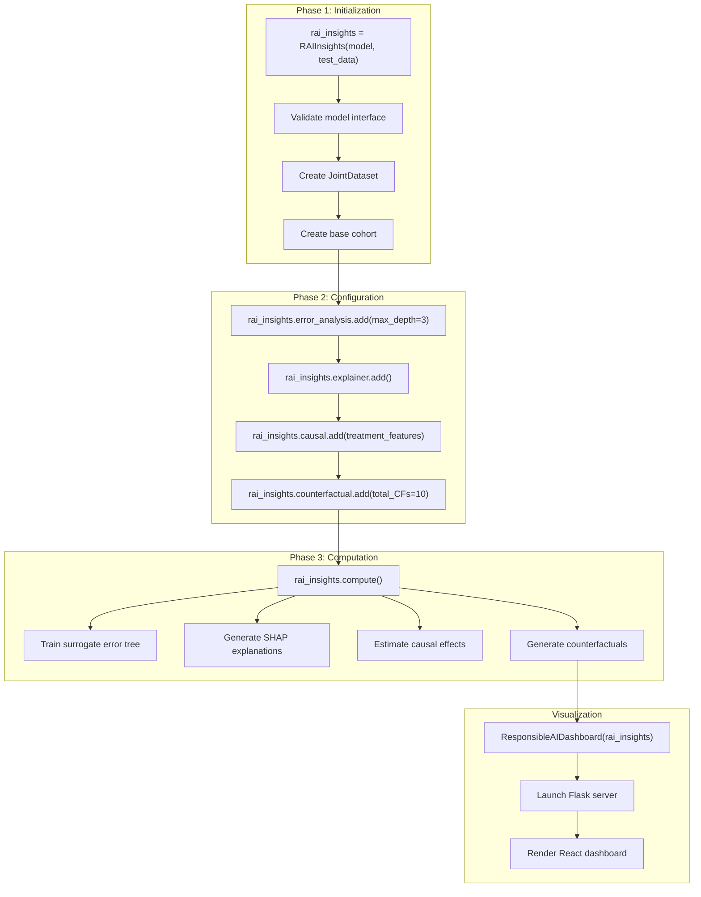

**Sources**: [libs/model-assessment/src/lib/ModelAssessmentDashboard/Context/buildModelAssessmentContext.ts:39-174](), [raiwidgets/raiwidgets/responsibleai_dashboard_input.py:25-48]()

---

## Data Modality Support

The toolbox supports three primary data modalities through specialized classes that extend the base `RAIInsights` functionality:

### Modality-Specific Classes

| Modality | Class | Package | Supported Tasks |
|----------|-------|---------|-----------------|
| Tabular | `RAIInsights` | `responsibleai` | Classification, Regression, Forecasting |
| Vision | `RAIVisionInsights` | `responsibleai_vision` | Image Classification, Multilabel Classification, Object Detection |
| Text | `RAITextInsights` | `responsibleai_text` | Text Classification, Question Answering, Generative Text |

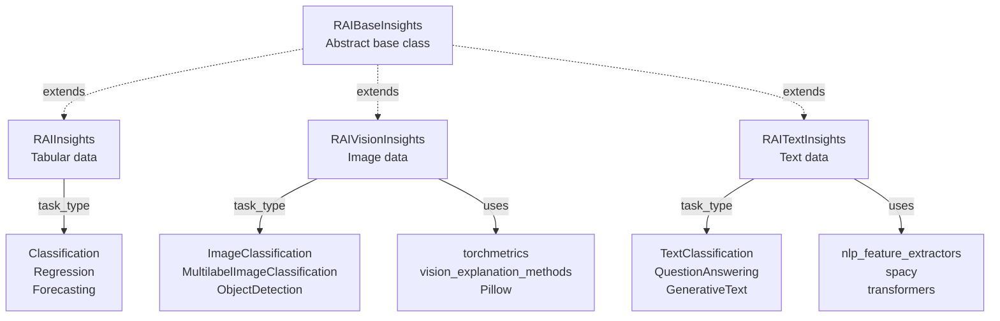

**Sources**: [responsibleai_vision/responsibleai_vision/version.py:1-9](), [responsibleai_text/responsibleai_text/version.py:1-9](), [libs/model-assessment/src/lib/ModelAssessmentDashboard/Controls/ModelOverview/ModelOverview.tsx:130-192](), [libs/core-ui/src/lib/Interfaces/IExplanationContext.ts:8-22]()

---

## Dashboard Component Hierarchy

The `ModelAssessmentDashboard` React component serves as the main UI orchestrator:

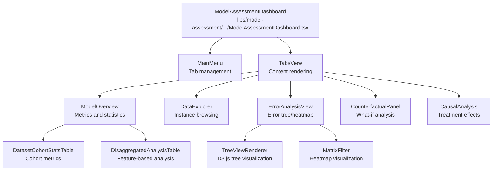

**Sources**: [libs/model-assessment/src/lib/ModelAssessmentDashboard/ModelAssessmentDashboard.tsx:1-378](), [libs/model-assessment/src/lib/ModelAssessmentDashboard/Controls/ModelOverview/ModelOverview.tsx:1-100](), [libs/model-assessment/src/lib/ModelAssessmentDashboard/Controls/TabsView/TabsViewProps.ts:1-87]()

---

## State Management and Context

The dashboard uses React Context to share state across components:

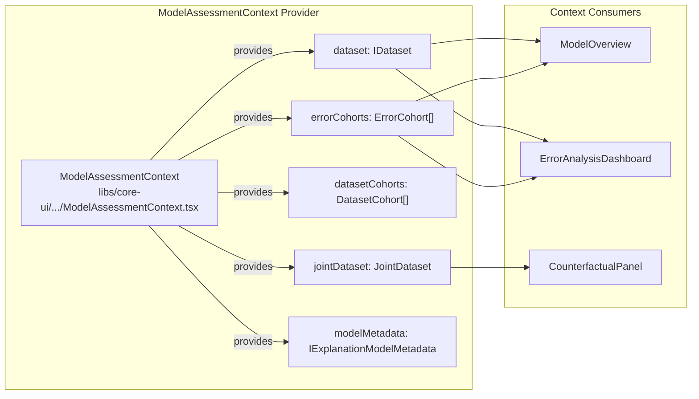

**Sources**: [libs/core-ui/src/lib/Context/ModelAssessmentContext.tsx:1-221](), [libs/model-assessment/src/lib/ModelAssessmentDashboard/ModelAssessmentDashboard.tsx:59-121](), [libs/model-assessment/src/lib/ModelAssessmentDashboard/Context/buildModelAssessmentContext.ts:39-174]()

---

## Error Analysis Deep Dive

The error analysis subsystem is a core feature that helps identify model failure patterns:

### Error Analysis Architecture

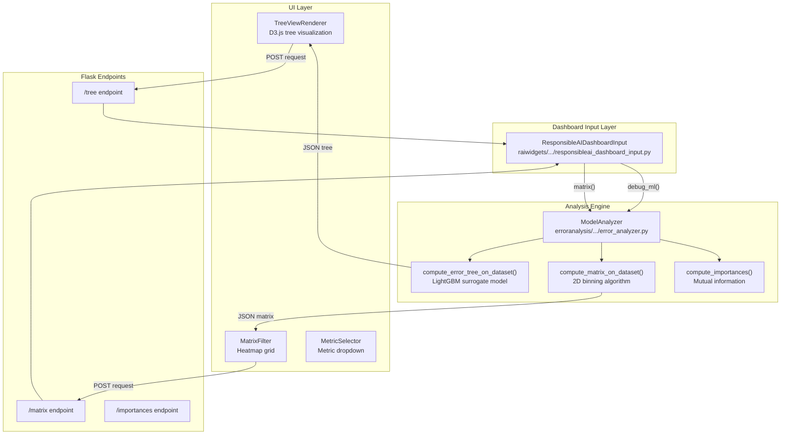

**Sources**: [raiwidgets/raiwidgets/responsibleai_dashboard_input.py:172-240](), [libs/error-analysis/src/lib/ErrorAnalysisDashboard/Controls/MetricSelector/MetricSelector.tsx:1-60](), [libs/error-analysis/src/index.ts:1-23]()

---

## Model Metrics and Statistics

The toolbox computes metrics based on task type and model characteristics:

### Supported Metrics by Task Type

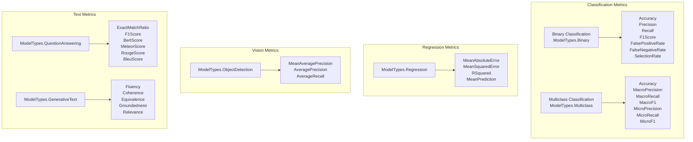

**Sources**: [libs/core-ui/src/lib/util/StatisticsUtils.ts:1-150](), [libs/model-assessment/src/lib/ModelAssessmentDashboard/Controls/ModelOverview/StatsTableUtils.ts:256-400](), [libs/core-ui/src/lib/Interfaces/IExplanationContext.ts:8-22]()

---

## CI/CD and Testing Strategy

The repository uses GitHub Actions for continuous integration and deployment:

### Testing Pipeline

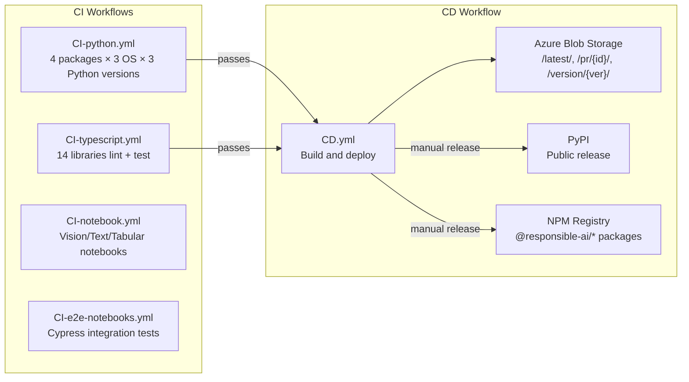

**Sources**: [CHANGES.md:1-100](), [notebooks/test_notebooks.py:1-100](), [scripts/e2e-widget.js:1-100]()

### Test Coverage

| Test Type | Framework | Location | Purpose |
|-----------|-----------|----------|---------|
| Python Unit Tests | pytest | `*/tests/` | Test individual functions/classes |
| TypeScript Unit Tests | Jest | `libs/*/src/**/*.test.ts` | Test React components |
| Notebook Tests | papermill + scrapbook | `notebooks/test_notebooks.py` | Validate example notebooks |
| E2E Widget Tests | Cypress | `apps/widget-e2e/` | Test full dashboard flows |

**Sources**: [notebooks/test_notebooks.py:1-361](), [erroranalysis/requirements-dev.txt:1-9](), [responsibleai/requirements-dev.txt:1-13]()

---

## Key Data Structures

### JointDataset

The `JointDataset` class merges features, predictions, and labels into a unified structure for analysis:

**Sources**: [libs/core-ui/src/lib/Context/ModelAssessmentContext.tsx:48-49](), [libs/model-assessment/src/lib/ModelAssessmentDashboard/Context/buildModelAssessmentContext.ts:59-69]()

### ErrorCohort and DatasetCohort

Cohorts represent filtered subsets of data for comparative analysis:

- `ErrorCohort`: Wraps a `Cohort` with error-specific metadata (error rate, coverage)
- `DatasetCohort`: Dataset-level cohort for data exploration without predictions

**Sources**: [libs/core-ui/src/lib/Context/ModelAssessmentContext.tsx:39-44](), [libs/model-assessment/src/lib/ModelAssessmentDashboard/Context/buildModelAssessmentContext.ts:85-135]()

### IModelAssessmentContext

The central context interface providing shared state and callback functions to all dashboard components:

**Sources**: [libs/core-ui/src/lib/Context/ModelAssessmentContext.tsx:28-191](), [libs/model-assessment/src/lib/ModelAssessmentDashboard/ModelAssessmentDashboardProps.ts:22-177]()

---

## Summary

The Responsible AI Toolbox is a multi-layered system that bridges Python-based ML analysis with interactive TypeScript visualizations. Key architectural patterns include:

1. **Manager Pattern**: `RAIInsights` delegates to specialized managers for different analysis types
2. **Three-Phase Workflow**: Initialize → Configure → Compute
3. **Flask Bridge**: `rai-core-flask` serves both the compiled React bundle and API endpoints
4. **Modality Specialization**: Inheritance-based extension for vision and text tasks
5. **Context-Based State**: React Context provides unified state management
6. **Independent Versioning**: Packages evolve independently while maintaining compatibility

The system supports tabular, vision, and text modalities across classification, regression, object detection, question answering, and generative text tasks, providing comprehensive model debugging and decision-making capabilities.

**Sources**: [README.md:1-153](), [libs/model-assessment/src/lib/ModelAssessmentDashboard/ModelAssessmentDashboard.tsx:1-378](), [raiwidgets/raiwidgets/responsibleai_dashboard.py:1-150]()

---

# Page: Getting Started

# Getting Started

<details>
<summary>Relevant source files</summary>

The following files were used as context for generating this wiki page:

- [CHANGES.md](CHANGES.md)
- [README.md](README.md)
- [erroranalysis/requirements-dev.txt](erroranalysis/requirements-dev.txt)
- [erroranalysis/requirements.txt](erroranalysis/requirements.txt)
- [nlp_feature_extractors/requirements.txt](nlp_feature_extractors/requirements.txt)
- [notebooks/responsibleaidashboard/text/responsibleaidashboard-openai-model-debugging.ipynb](notebooks/responsibleaidashboard/text/responsibleaidashboard-openai-model-debugging.ipynb)
- [notebooks/test_notebooks.py](notebooks/test_notebooks.py)
- [rai_core_flask/requirements.txt](rai_core_flask/requirements.txt)
- [raiwidgets/requirements.txt](raiwidgets/requirements.txt)
- [responsibleai/requirements-dev.txt](responsibleai/requirements-dev.txt)
- [responsibleai/requirements.txt](responsibleai/requirements.txt)
- [responsibleai_text/responsibleai_text/version.py](responsibleai_text/responsibleai_text/version.py)
- [responsibleai_vision/responsibleai_vision/version.py](responsibleai_vision/responsibleai_vision/version.py)
- [scripts/e2e-widget.js](scripts/e2e-widget.js)
- [version.cfg](version.cfg)

</details>


This page provides installation instructions, basic usage patterns, and example notebooks for getting started with the Responsible AI Toolbox. It covers the essential steps to install packages, create insights objects, configure analyses, and launch interactive dashboards.

For detailed information about the overall architecture and package structure, see [Overview](#1). For development setup and contribution guidelines, see [Development Guide](#6).

---

## Installation

### Python Package Installation

The Responsible AI Toolbox can be installed via pip. The primary package `raiwidgets` includes all necessary dependencies for tabular data analysis:

```bash
pip install raiwidgets
```

**Important:** If running in Jupyter notebooks, restart the Jupyter kernel after installation to ensure the package is properly loaded.

This installs the following core packages and their dependencies:

| Package | Purpose | Version |
|---------|---------|---------|
| `raiwidgets` | Dashboard widgets and visualization components | 0.36.0 |
| `responsibleai` | Core RAI analysis library for tabular data | 0.36.0 |
| `rai-core-flask` | Flask backend API server | ≥0.7.6 |
| `erroranalysis` | Error analysis engine | ≥0.5.4 |
| `raiutils` | Common utilities | ≥0.4.2 |

### Domain-Specific Package Installation

For vision or text modalities, install the specialized packages:

```bash
# For vision tasks (image classification, object detection)
pip install responsibleai-vision

# For text tasks (text classification, question answering)
pip install responsibleai-text
```

These packages extend `responsibleai` with modality-specific features:

| Package | Version | Supported Tasks |
|---------|---------|----------------|
| `responsibleai_vision` | 0.3.8 | Image classification, multilabel classification, object detection |
| `responsibleai_text` | 0.2.7 | Text classification, question answering, generative AI |

**Sources:** [README.md:72-80](), [responsibleai/requirements.txt:1-22](), [raiwidgets/requirements.txt:1-10](), [responsibleai_vision/responsibleai_vision/version.py:1-9](), [responsibleai_text/responsibleai_text/version.py:1-9]()

---

## Package Dependency Overview

The following diagram shows how the installed packages relate to each other and to external machine learning libraries:

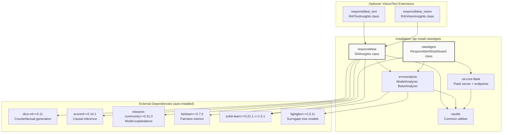

**Sources:** [README.md:24-33](), [responsibleai/requirements.txt:1-22](), [raiwidgets/requirements.txt:1-10](), [erroranalysis/requirements.txt:1-6]()

---

## Basic Usage Pattern

### The Three-Phase Workflow

All analysis workflows follow a consistent three-phase pattern regardless of data modality:

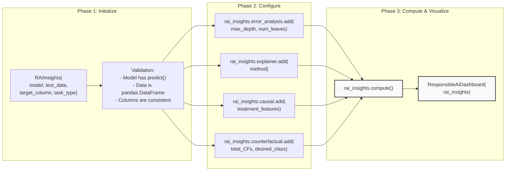

**Sources:** High-level Diagram 3 (Analysis Pipeline and Manager Orchestration), [README.md:37-70]()

### Code Template: Tabular Data

```python
from responsibleai import RAIInsights, ModelTask
from raiwidgets import ResponsibleAIDashboard
import pandas as pd

# Phase 1: Initialize
rai_insights = RAIInsights(
    model=trained_model,           # Must have predict() or predict_proba()
    test=test_data,                # pandas.DataFrame
    target_column="target",        # Name of label column
    task_type=ModelTask.CLASSIFICATION  # or REGRESSION
)

# Phase 2: Configure desired analyses
rai_insights.error_analysis.add(max_depth=3, num_leaves=20)
rai_insights.explainer.add()
rai_insights.causal.add(treatment_features=["feature1", "feature2"])
rai_insights.counterfactual.add(total_CFs=10)

# Phase 3: Compute insights
rai_insights.compute()

# Launch dashboard
ResponsibleAIDashboard(rai_insights)
```

### Code Template: Vision Data

```python
from responsibleai_vision import RAIVisionInsights, ModelTask
from raiwidgets import ResponsibleAIDashboard

# Phase 1: Initialize
rai_vision_insights = RAIVisionInsights(
    model=vision_model,
    test=test_data,               # DataFrame with image paths
    target_column="label",
    task_type=ModelTask.IMAGE_CLASSIFICATION  # or OBJECT_DETECTION
)

# Phase 2: Configure
rai_vision_insights.error_analysis.add()
rai_vision_insights.explainer.add()

# Phase 3: Compute and visualize
rai_vision_insights.compute()
ResponsibleAIDashboard(rai_vision_insights)
```

### Code Template: Text Data

```python
from responsibleai_text import RAITextInsights, ModelTask
from raiwidgets import ResponsibleAIDashboard

# Phase 1: Initialize
rai_text_insights = RAITextInsights(
    model=text_model,
    test=test_data,               # DataFrame with text columns
    target_column="label",
    task_type=ModelTask.TEXT_CLASSIFICATION  # or QUESTION_ANSWERING
)

# Phase 2: Configure
rai_text_insights.error_analysis.add()
rai_text_insights.explainer.add()

# Phase 3: Compute and visualize
rai_text_insights.compute()
ResponsibleAIDashboard(rai_text_insights)
```

**Sources:** [notebooks/responsibleaidashboard/text/responsibleaidashboard-openai-model-debugging.ipynb:276-300](), [README.md:37-70]()

---

## Available Analysis Components

The following table summarizes the analysis managers available through the `.add()` configuration pattern:

| Manager | Access Pattern | Key Parameters | Purpose |
|---------|---------------|----------------|---------|
| Error Analysis | `rai_insights.error_analysis.add()` | `max_depth`, `num_leaves`, `metric` | Identify error cohorts using surrogate decision trees |
| Explainer | `rai_insights.explainer.add()` | `method` (optional) | Generate SHAP/LIME explanations for model predictions |
| Causal | `rai_insights.causal.add()` | `treatment_features` (required) | Estimate causal effects using EconML |
| Counterfactual | `rai_insights.counterfactual.add()` | `total_CFs`, `desired_class` | Generate minimal changes for different predictions using DiCE |
| Data Balance | `rai_insights.data_balance.add()` | None | Analyze feature distributions and class balance |

Each manager validates configuration at `.add()` time and executes computation during the `.compute()` phase.

**Sources:** High-level Diagram 3 (Analysis Pipeline and Manager Orchestration), [README.md:48-62]()

---

## Manager Class Architecture

This diagram maps the user-facing manager pattern to the actual implementation classes:

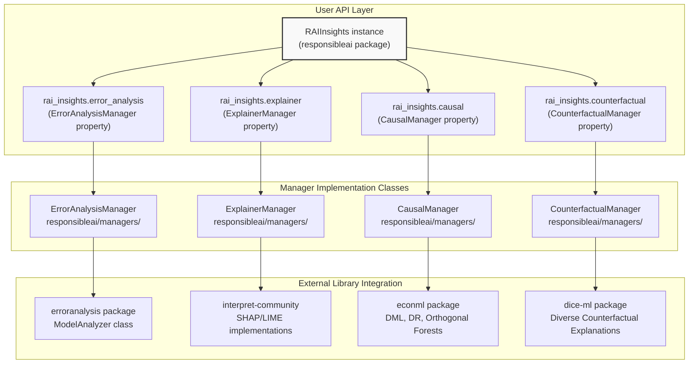

**Sources:** High-level Diagram 2 (Frontend-Backend Integration Architecture), High-level Diagram 3 (Analysis Pipeline and Manager Orchestration)

---

## Example Notebooks

The repository includes comprehensive example notebooks demonstrating end-to-end workflows for different scenarios.

### Tabular Data Examples

| Notebook | Dataset | Task Type | Analyses Demonstrated |
|----------|---------|-----------|----------------------|
| `getting-started.ipynb` | Synthetic | Classification | Basic workflow introduction |
| `responsibleaidashboard-census-classification-model-debugging.ipynb` | Census income | Classification | Error analysis, explanations, fairness |
| `responsibleaidashboard-diabetes-regression-model-debugging.ipynb` | Diabetes progression | Regression | Error analysis, feature importance |
| `responsibleaidashboard-housing-decision-making.ipynb` | Housing prices | Classification | Causal analysis, counterfactuals |
| `responsibleaidashboard-diabetes-decision-making.ipynb` | Diabetes | Classification | Causal inference for treatment decisions |
| `responsibleaidashboard-multiclass-dnn-model-debugging.ipynb` | Multiclass | Classification | Deep neural network debugging |
| `responsibleaidashboard-orange-juice-forecasting.ipynb` | Time series | Forecasting | Forecasting-specific features |

### Vision Data Examples

| Notebook | Task Type | Analyses Demonstrated |
|----------|-----------|----------------------|
| `responsibleaidashboard-fridge-image-classification-model-debugging.ipynb` | Image classification | Error analysis, vision explanations |
| `responsibleaidashboard-fridge-multilabel-image-classification-model-debugging.ipynb` | Multilabel classification | Multilabel metrics, cohort analysis |
| `responsibleaidashboard-fridge-object-detection-model-debugging.ipynb` | Object detection | Bounding box visualization, detection metrics |

### Text Data Examples

| Notebook | Task Type | Analyses Demonstrated |
|----------|-----------|----------------------|
| `responsibleaidashboard-DBPedia-text-classification-model-debugging.ipynb` | Text classification | Token-level explanations, error patterns |
| `responsibleaidashboard-blbooksgenre-binary-text-classification-model-debugging.ipynb` | Binary classification | Text feature importance |
| `responsibleaidashboard-covid-event-multilabel-text-classification-model-debugging.ipynb` | Multilabel classification | Multilabel text analysis |
| `responsibleaidashboard-question-answering-model-debugging.ipynb` | Question answering | QA metrics (F1, Exact Match), text explanations |
| `responsibleaidashboard-openai-model-debugging.ipynb` | Question answering | OpenAI endpoint integration |

**Location:** All notebooks are in the `notebooks/responsibleaidashboard/` directory, organized by modality (`tabular/`, `vision/`, `text/`).

**Sources:** [README.md:102-124](), [notebooks/test_notebooks.py:16-361](), [scripts/e2e-widget.js:14-42]()

---

## Running Your First Example

### Step 1: Locate the Getting Started Notebook

```bash
# Clone the repository (or download the notebook directly)
git clone https://github.com/microsoft/responsible-ai-toolbox.git
cd responsible-ai-toolbox/notebooks/responsibleaidashboard/tabular
```

### Step 2: Launch Jupyter

```bash
jupyter notebook getting-started.ipynb
```

### Step 3: Execute Cells

The `getting-started.ipynb` notebook demonstrates:
1. Creating a simple classification dataset
2. Training a basic model
3. Initializing `RAIInsights`
4. Adding error analysis and explainer components
5. Computing insights
6. Launching the `ResponsibleAIDashboard`

### Step 4: Interact with the Dashboard

When you execute the final cell containing `ResponsibleAIDashboard(rai_insights)`, the system will:
1. Launch a Flask server on `http://localhost:5000` (or next available port)
2. Display the dashboard URL in the notebook output
3. Optionally embed the dashboard inline in Jupyter (depending on environment)

The dashboard provides:
- **Model Overview:** Aggregate metrics and performance statistics
- **Error Analysis:** Interactive error tree and heatmap visualizations
- **Data Explorer:** Browse individual instances and create custom cohorts
- **Feature Importances:** Global and local explanation visualizations
- **Counterfactual What-If:** Generate and explore counterfactual examples

**Sources:** [README.md:102-105](), [notebooks/test_notebooks.py:306-311]()

---

## Dashboard Launch Flow

This diagram shows the process from notebook code to interactive dashboard:

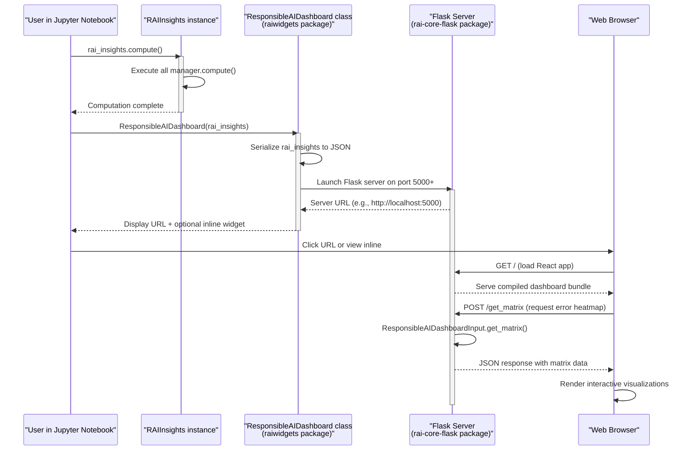

**Sources:** High-level Diagram 2 (Frontend-Backend Integration Architecture), [rai_core_flask/requirements.txt:1-8]()

---

## Verification

After installation, verify the packages are correctly installed:

```python
# Verify core packages
import raiwidgets
import responsibleai
import erroranalysis
print(f"raiwidgets version: {raiwidgets.__version__}")
print(f"responsibleai version: {responsibleai.__version__}")

# Verify optional packages (if installed)
try:
    import responsibleai_vision
    print(f"responsibleai_vision version: {responsibleai_vision.__version__}")
except ImportError:
    print("responsibleai_vision not installed")

try:
    import responsibleai_text
    print(f"responsibleai_text version: {responsibleai_text.__version__}")
except ImportError:
    print("responsibleai_text not installed")
```

Expected output (versions may vary):
```
raiwidgets version: 0.36.0
responsibleai version: 0.36.0
responsibleai_vision version: 0.3.8
responsibleai_text version: 0.2.7
```

**Sources:** [version.cfg:1-2](), [responsibleai_vision/responsibleai_vision/version.py:4-8](), [responsibleai_text/responsibleai_text/version.py:4-8]()

---

## Supported Model Types

The toolbox accepts models that implement the following interfaces:

| Interface | Required Methods | Compatible Libraries |
|-----------|-----------------|---------------------|
| Classification | `predict_proba()` or `predict()` | scikit-learn, XGBoost, LightGBM, PyTorch, TensorFlow, Keras |
| Regression | `predict()` | scikit-learn, XGBoost, LightGBM, PyTorch, TensorFlow, Keras |
| Vision | `predict()` returning class labels or bounding boxes | PyTorch, TensorFlow, torchvision, AutoML models |
| Text | `predict()` returning labels or text | Hugging Face transformers, PyTorch, TensorFlow, OpenAI API |

**Model Wrapping:** If your model doesn't conform to these interfaces, wrap it in a class with the appropriate `predict()` method. The toolbox also provides `ml-wrappers` for common scenarios.

**Sources:** [README.md:125-132](), [responsibleai/requirements.txt:15]()

---

## Data Format Requirements

### Tabular Data

- **Format:** `pandas.DataFrame`
- **Features:** Numeric or categorical columns
- **Target:** Single column with class labels (classification) or numeric values (regression)
- **Index:** Any index type, but must be consistent between train and test sets

### Vision Data

- **Format:** `pandas.DataFrame` with image references
- **Image Column:** File paths or PIL Image objects
- **Labels:** Class labels (classification), list of labels (multilabel), or bounding box dictionaries (object detection)
- **Metadata:** Optional columns for EXIF data or other image attributes

### Text Data

- **Format:** `pandas.DataFrame` with text columns
- **Text Columns:** One or more columns containing text (context, questions, etc.)
- **Labels:** Class labels (classification) or answer text (question answering)

**Sources:** [README.md:127-128]()

---

## Notebook Testing Infrastructure

All example notebooks are automatically tested in CI/CD using the following tools:

| Tool | Purpose |
|------|---------|
| `papermill` | Execute notebooks programmatically |
| `scrapbook` | Extract and validate outputs from notebooks |
| `pytest` | Run notebook tests with markers (e.g., `@pytest.mark.notebooks`) |

The test file [notebooks/test_notebooks.py:1-361]() defines test functions for each notebook, ensuring they execute without errors and produce expected outputs.

**Sources:** [notebooks/test_notebooks.py:1-102]()

---

## Next Steps

After completing a basic example:

1. **Explore Components:** See [Analysis Managers](#3.3) for detailed documentation of each analysis type
2. **Customize Dashboards:** Learn about available tabs and visualizations in [Model Assessment Dashboard](#4.2)
3. **Advanced Topics:** Review [Persistence and Serialization](#3.2.3) for saving/loading workflows
4. **Vision Tasks:** See [Vision Package](#5.1) for image-specific features
5. **Text Tasks:** See [Text Package](#5.2) for NLP-specific features
6. **Development:** Contribute to the project using the [Development Guide](#6)

**Sources:** [README.md:101-105]()

---

# Page: Python Backend Architecture

# Python Backend Architecture

<details>
<summary>Relevant source files</summary>

The following files were used as context for generating this wiki page:

- [CHANGES.md](CHANGES.md)
- [erroranalysis/requirements-dev.txt](erroranalysis/requirements-dev.txt)
- [erroranalysis/requirements.txt](erroranalysis/requirements.txt)
- [nlp_feature_extractors/requirements.txt](nlp_feature_extractors/requirements.txt)
- [rai_core_flask/requirements.txt](rai_core_flask/requirements.txt)
- [raiwidgets/requirements.txt](raiwidgets/requirements.txt)
- [responsibleai/requirements-dev.txt](responsibleai/requirements-dev.txt)
- [responsibleai/requirements.txt](responsibleai/requirements.txt)
- [responsibleai/responsibleai/_internal/constants.py](responsibleai/responsibleai/_internal/constants.py)
- [responsibleai/responsibleai/rai_insights/rai_base_insights.py](responsibleai/responsibleai/rai_insights/rai_base_insights.py)
- [responsibleai/responsibleai/rai_insights/rai_insights.py](responsibleai/responsibleai/rai_insights/rai_insights.py)
- [responsibleai/tests/common_utils.py](responsibleai/tests/common_utils.py)
- [responsibleai/tests/model_analysis/test_model_analysis.py](responsibleai/tests/model_analysis/test_model_analysis.py)
- [responsibleai/tests/model_analysis/test_model_analysis_validations.py](responsibleai/tests/model_analysis/test_model_analysis_validations.py)
- [responsibleai/tests/rai_insights/test_rai_insights.py](responsibleai/tests/rai_insights/test_rai_insights.py)
- [responsibleai/tests/rai_insights/test_rai_insights_cohort_filter.py](responsibleai/tests/rai_insights/test_rai_insights_cohort_filter.py)
- [responsibleai/tests/rai_insights/test_rai_insights_data_size_scenarios.py](responsibleai/tests/rai_insights/test_rai_insights_data_size_scenarios.py)
- [responsibleai/tests/rai_insights/test_rai_insights_get_feature_ranges.py](responsibleai/tests/rai_insights/test_rai_insights_get_feature_ranges.py)
- [responsibleai/tests/rai_insights/test_rai_insights_save_and_load_scenarios.py](responsibleai/tests/rai_insights/test_rai_insights_save_and_load_scenarios.py)
- [responsibleai/tests/rai_insights/test_rai_insights_validations.py](responsibleai/tests/rai_insights/test_rai_insights_validations.py)
- [responsibleai/tests/test_model_serializer.py](responsibleai/tests/test_model_serializer.py)
- [responsibleai_text/responsibleai_text/version.py](responsibleai_text/responsibleai_text/version.py)
- [responsibleai_vision/responsibleai_vision/version.py](responsibleai_vision/responsibleai_vision/version.py)
- [version.cfg](version.cfg)

</details>


## Purpose and Scope

This document describes the Python backend architecture of the Responsible AI Toolbox, covering the core analysis packages and their interactions. It focuses on the structure of the `responsibleai` package, the `RAIInsights` API, the manager orchestration pattern, and supporting infrastructure packages.

For information about the TypeScript dashboard that consumes this backend, see [TypeScript Dashboard Architecture](#4). For domain-specific extensions to vision and text models, see [Vision Package](#5.1) and [Text Package](#5.2).

## Package Structure and Dependencies

The Python backend is organized into multiple independently versioned packages that work together to provide responsible AI capabilities.

### Core Package Hierarchy

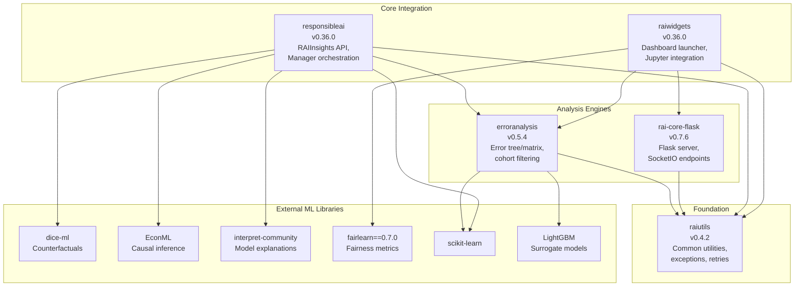

**Sources:** [responsibleai/requirements.txt:1-22](), [raiwidgets/requirements.txt:1-10](), [erroranalysis/requirements.txt:1-6](), [rai_core_flask/requirements.txt:1-8]()

### Dependency Version Constraints

| Package | Key Dependencies | Version Constraints |
|---------|-----------------|---------------------|
| `responsibleai` | dice-ml | >=0.11,<0.12 |
| | econml | >=0.14.1 |
| | erroranalysis | >=0.5.4 |
| | interpret-community | >=0.31.0 |
| | scikit-learn | >=0.22.1,!=1.1,<=1.5.1 |
| | raiutils | >=0.4.2 |
| `raiwidgets` | rai-core-flask | >=0.7.6 |
| | erroranalysis | >=0.5.4 |
| | fairlearn | ==0.7.0 (exact) |
| `erroranalysis` | lightgbm | >=2.0.11 |
| | raiutils | >=0.4.2 |

**Sources:** [responsibleai/requirements.txt:1-22](), [raiwidgets/requirements.txt:1-10]()

## RAIInsights Entry Point Architecture

The `RAIInsights` class serves as the primary user-facing API for tabular data analysis. It inherits from `RAIBaseInsights` and orchestrates all analysis components.

### Class Hierarchy and Initialization

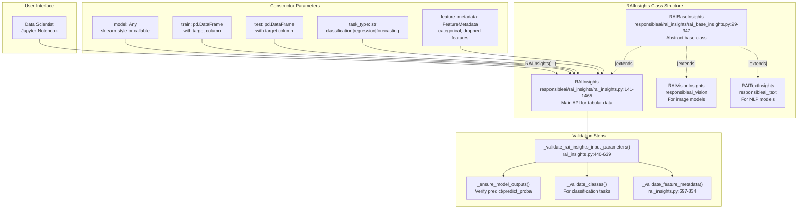

**Sources:** [responsibleai/rai_insights/rai_insights.py:141-263](), [responsibleai/rai_insights/rai_base_insights.py:29-77]()

### Model Output Caching Strategy

The `RAIInsights` class caches model predictions to avoid recomputation across different managers. This is handled through a sophisticated output caching system that supports both small and large datasets.

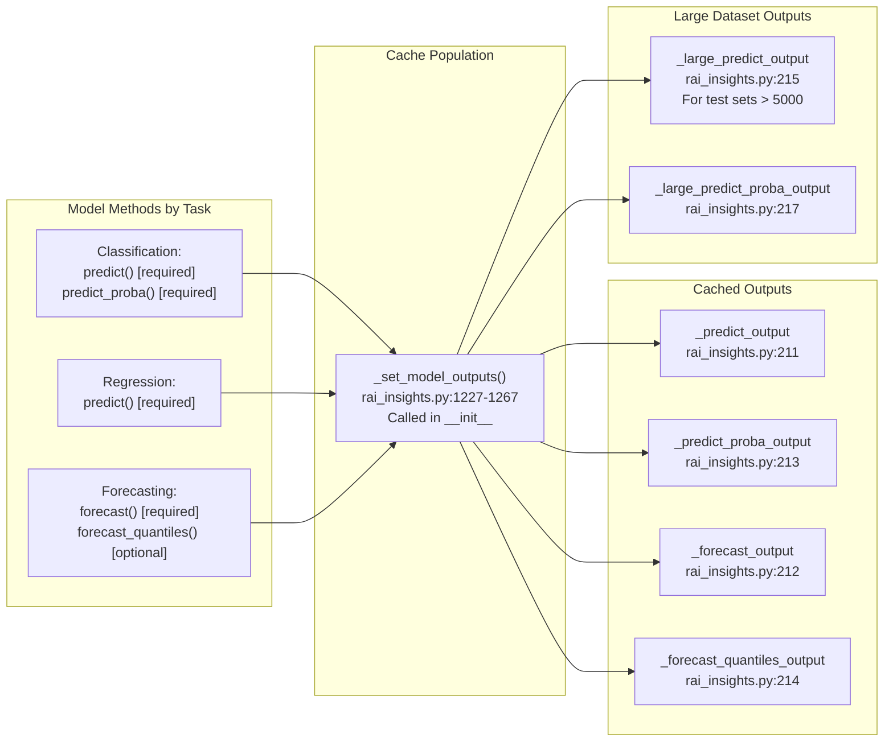

**Sources:** [responsibleai/rai_insights/rai_insights.py:211-218](), [responsibleai/rai_insights/rai_insights.py:1227-1267](), [responsibleai/rai_insights/rai_insights.py:72-139]()

### Task-Specific Model Method Validation

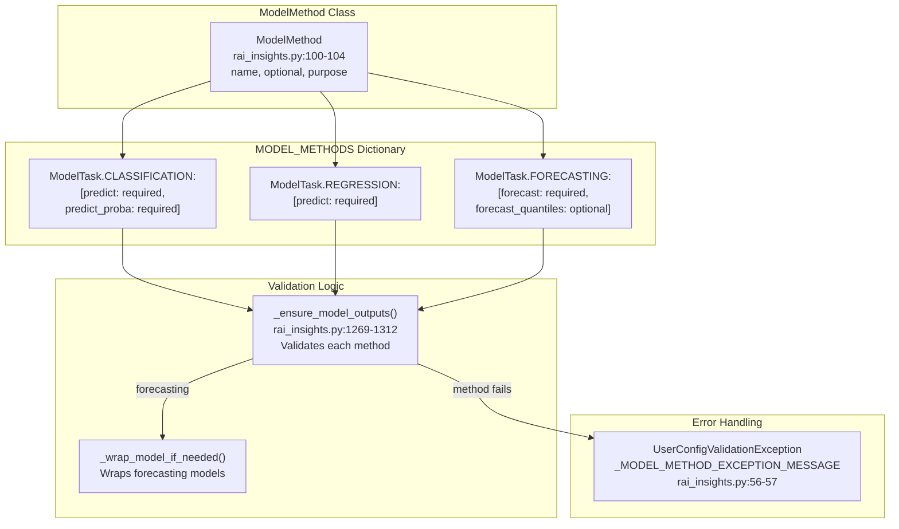

**Sources:** [responsibleai/rai_insights/rai_insights.py:100-138](), [responsibleai/rai_insights/rai_insights.py:1269-1312]()

## Manager Pattern and Orchestration

The `RAIInsights` class uses a manager pattern where each type of analysis (causal, counterfactual, error analysis, explainer, data balance) is handled by a dedicated manager. This enables modular, independent development of each capability.

### Manager Initialization Flow

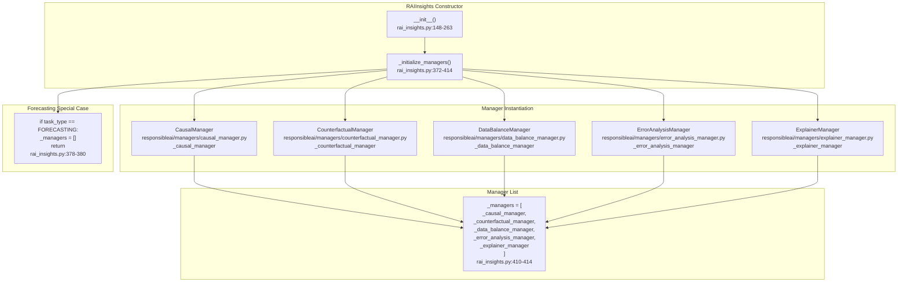

**Sources:** [responsibleai/rai_insights/rai_insights.py:372-414](), [responsibleai/rai_insights/rai_insights.py:29-34]()

### Manager Configuration and Computation Phase

Each manager follows a two-phase pattern: configuration (via `add()` methods) and computation (via `compute()` method).

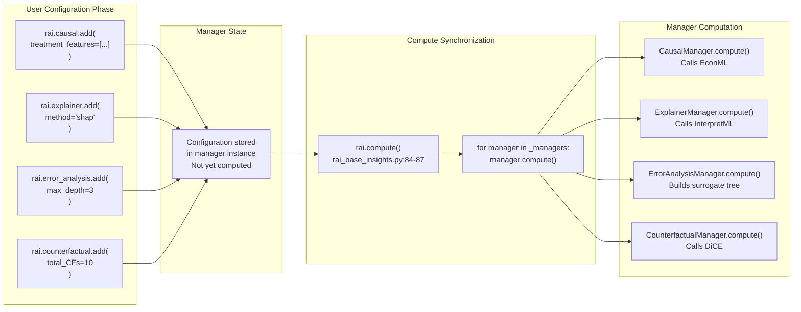

**Sources:** [responsibleai/rai_insights/rai_base_insights.py:84-87]()

### Manager Names and Constants

```mermaid
graph TB
    subgraph "ManagerNames Constants"
        Constants["class ManagerNames:<br/>responsibleai/_internal/constants.py:7-14"]
        Causal["CAUSAL = 'causal'"]
        CF["COUNTERFACTUAL = 'counterfactual'"]
        DB["DATA_BALANCE = 'data_balance'"]
        EA["ERROR_ANALYSIS = 'error_analysis'"]
        Exp["EXPLAINER = 'explainer'"]
    end
    
    subgraph "Used For"
        Serialization["Directory names<br/>in save/load"]
        AccessProps["Public properties:<br/>rai.causal<br/>rai.counterfactual<br/>rai.error_analysis<br/>rai.explainer"]
        ManagerMap["Manager class mapping<br/>in load() methods"]
    end
    
    Constants --> Causal
    Constants --> CF
    Constants --> DB
    Constants --> EA
    Constants --> Exp
    
    Causal --> Serialization
    Causal --> AccessProps
    Causal --> ManagerMap
```

**Sources:** [responsibleai/_internal/constants.py:7-14]()

## Data Handling and Feature Processing

### Feature Metadata and Dropped Features

The `FeatureMetadata` class allows users to specify which features should be dropped, which are categorical, and other metadata. The `RAIInsights` class provides accessor methods that handle dropped features transparently.

```mermaid
graph TB
    subgraph "FeatureMetadata Class"
        FM["FeatureMetadata<br/>responsibleai/feature_metadata.py"]
        CatFeats["categorical_features: List[str]"]
        DroppedFeats["dropped_features: List[str]"]
        IdentityFeat["identity_feature_name: str"]
        DatetimeFeats["datetime_features: List[str]"]
        TSIDFeats["time_series_id_features: List[str]"]
    end
    
    subgraph "RAIInsights Data Accessors"
        GetTrainData["get_train_data()<br/>rai_insights.py:273-289<br/>Returns train with dropped features removed"]
        GetTestData["get_test_data()<br/>rai_insights.py:291-312<br/>Returns test with dropped features removed"]
        GetCatAfterDrop["get_categorical_features_after_drop()<br/>rai_insights.py:265-271<br/>Removes dropped from categorical list"]
    end
    
    subgraph "Manager Usage"
        MgrUseData["Managers call:<br/>get_train_data()<br/>get_test_data()<br/>get_categorical_features_after_drop()"]
    end
    
    FM --> CatFeats
    FM --> DroppedFeats
    FM --> IdentityFeat
    FM --> DatetimeFeats
    FM --> TSIDFeats
    
    DroppedFeats --> GetTrainData
    DroppedFeats --> GetTestData
    DroppedFeats --> GetCatAfterDrop
    
    GetTrainData --> MgrUseData
    GetTestData --> MgrUseData
    GetCatAfterDrop --> MgrUseData
```

**Sources:** [responsibleai/rai_insights/rai_insights.py:265-312](), [responsibleai/rai_insights/rai_insights.py:382-408]()

### Categorical Feature Processing

```mermaid
graph LR
    subgraph "Input"
        RawData["test: pd.DataFrame<br/>categorical_features: List[str]"]
    end
    
    subgraph "Processing Pipeline"
        ProcessCat["process_categoricals()<br/>erroranalysis/_internal/process_categoricals.py<br/>Called in __init__"]
    end
    
    subgraph "Stored Artifacts"
        Categories["_categories: List<br/>Unique values per cat feature<br/>rai_insights.py:245"]
        CatIndexes["_categorical_indexes: List[int]<br/>Column indices<br/>rai_insights.py:245"]
        CatDict["_category_dictionary: Dict<br/>Feature->values mapping<br/>rai_insights.py:246"]
        StringIndData["_string_ind_data: List<br/>Indexed categorical data<br/>rai_insights.py:246"]
    end
    
    RawData --> ProcessCat
    ProcessCat --> Categories
    ProcessCat --> CatIndexes
    ProcessCat --> CatDict
    ProcessCat --> StringIndData
```

**Sources:** [responsibleai/rai_insights/rai_insights.py:245-250]()

### Feature Ranges Calculation

```mermaid
graph TB
    subgraph "Input Data"
        TestData["test DataFrame<br/>or _large_test if exists"]
        CategoricalList["categorical_features"]
        DatetimeList["datetime_features"]
    end
    
    subgraph "Calculation Method"
        GetRanges["_get_feature_ranges()<br/>rai_insights.py:835-990<br/>Static method"]
    end
    
    subgraph "Range Types"
        NumericRange["Numeric features:<br/>{'column_name': str,<br/>'range_type': 'numeric',<br/>'min_value': float,<br/>'max_value': float}"]
        CategoricalRange["Categorical features:<br/>{'column_name': str,<br/>'range_type': 'categorical',<br/>'unique_values': List}"]
        DatetimeRange["Datetime features:<br/>{'column_name': str,<br/>'range_type': 'datetime',<br/>'min_value': timestamp,<br/>'max_value': timestamp}"]
    end
    
    subgraph "Storage"
        FeatureRanges["_feature_ranges: List[Dict]<br/>rai_insights.py:240-244"]
    end
    
    TestData --> GetRanges
    CategoricalList --> GetRanges
    DatetimeList --> GetRanges
    
    GetRanges --> NumericRange
    GetRanges --> CategoricalRange
    GetRanges --> DatetimeRange
    
    NumericRange --> FeatureRanges
    CategoricalRange --> FeatureRanges
    DatetimeRange --> FeatureRanges
```

**Sources:** [responsibleai/rai_insights/rai_insights.py:240-244](), [responsibleai/rai_insights/rai_insights.py:835-990]()

## Serialization and Persistence

The `RAIInsights` class supports saving and loading its complete state, including the model, data, managers, and computed results. This uses a directory-based structure with JSON and pickle files.

### Save Architecture

```mermaid
graph TB
    subgraph "Save Entry Point"
        SaveMethod["save(path)<br/>rai_base_insights.py:219-229"]
    end
    
    subgraph "Save Components"
        SaveManagers["_save_managers(path)<br/>rai_base_insights.py:208-217<br/>Calls manager._save()"]
        SaveData["_save_data(path)<br/>rai_base_insights.py:138-167<br/>Saves train/test DataFrames"]
        SaveMetadata["_save_metadata(path)<br/>rai_insights.py:991-1055<br/>Saves meta.json"]
        SaveModel["_save_model(path)<br/>rai_base_insights.py:179-206<br/>Pickle or custom serializer"]
        SavePredictions["_save_predictions(path)<br/>rai_insights.py:1057-1119<br/>Saves cached predictions"]
    end
    
    subgraph "File Structure"
        MetaJSON["meta.json<br/>Task type, target, features, classes"]
        ModelPKL["model.pkl<br/>or custom serializer output"]
        TrainJSON["data/train.json<br/>data/traindtypes.json"]
        TestJSON["data/test.json<br/>data/testdtypes.json"]
        PredictJSON["predictions/predict.json<br/>predictions/predict_proba.json"]
        ManagerDirs["causal/<UUID>/<br/>error_analysis/<UUID>/<br/>explainer/<UUID>/"]
    end
    
    SaveMethod --> SaveManagers
    SaveMethod --> SaveData
    SaveMethod --> SaveMetadata
    SaveMethod --> SaveModel
    SaveMethod --> SavePredictions
    
    SaveMetadata --> MetaJSON
    SaveModel --> ModelPKL
    SaveData --> TrainJSON
    SaveData --> TestJSON
    SavePredictions --> PredictJSON
    SaveManagers --> ManagerDirs
```

**Sources:** [responsibleai/rai_insights/rai_base_insights.py:219-229](), [responsibleai/rai_insights/rai_insights.py:991-1119]()

### Directory Structure on Disk

```
<save_path>/
├── meta.json                          # Metadata
├── rai_version.json                   # Package version
├── model.pkl                          # Serialized model
├── data/
│   ├── train.json                     # Training data
│   ├── traindtypes.json              # Column dtypes
│   ├── test.json                      # Test data
│   └── testdtypes.json               # Column dtypes
├── predictions/
│   ├── predict.json                   # Cached predictions
│   ├── predict_proba.json            # Cached probabilities
│   ├── large_predict.json            # Large dataset predictions
│   └── large_predict_proba.json      # Large dataset probabilities
├── causal/
│   └── <uuid>/                        # Per-config directories
│       ├── data/                      # Computed results
│       └── generators/                # (not used)
├── counterfactual/
│   └── <uuid>/
│       ├── config/                    # Configuration
│       ├── data/                      # Computed results
│       └── generators/                # DiCE generators
├── error_analysis/
│   └── <uuid>/
│       ├── config/                    # Configuration
│       └── data/                      # Error reports
├── explainer/
│   └── <uuid>/
│       └── data/                      # Explanation results
└── data_balance/
    └── <uuid>/
        └── data/                      # Data balance measures
```

**Sources:** [responsibleai/_internal/constants.py:87-143](), [responsibleai/rai_insights/test_rai_insights.py:300-362]()

### Load Architecture

```mermaid
graph TB
    subgraph "Load Entry Point"
        LoadMethod["load(path)<br/>rai_insights.py:1121-1191<br/>@staticmethod"]
    end
    
    subgraph "Load Components"
        LoadData["_load_data(inst, path)<br/>rai_base_insights.py:232-258<br/>Loads DataFrames"]
        LoadMetadata["_load_metadata(inst, path)<br/>rai_insights.py:1193-1225<br/>Loads meta.json"]
        LoadModel["_load_model(inst, path)<br/>rai_base_insights.py:260-300<br/>Unpickle or custom"]
        LoadManagers["_load_managers(inst, path, manager_map)<br/>rai_base_insights.py:302-323<br/>Reconstructs managers"]
        LoadPredictions["Predictions loaded on-demand<br/>via _get_<method>_output()"]
    end
    
    subgraph "Manager Map"
        MgrMap["manager_map = {<br/>ManagerNames.CAUSAL: CausalManager,<br/>ManagerNames.COUNTERFACTUAL: CounterfactualManager,<br/>ManagerNames.ERROR_ANALYSIS: ErrorAnalysisManager,<br/>ManagerNames.EXPLAINER: ExplainerManager,<br/>ManagerNames.DATA_BALANCE: DataBalanceManager<br/>}<br/>rai_insights.py:1165-1171"]
    end
    
    subgraph "Instance Creation"
        EmptyInit["inst = object.__new__(RAIInsights)<br/>rai_insights.py:1151"]
        BaseLoad["RAIBaseInsights._load(<br/>path, inst, manager_map, load_metadata_func<br/>)<br/>rai_base_insights.py:326-346"]
    end
    
    LoadMethod --> EmptyInit
    EmptyInit --> MgrMap
    MgrMap --> BaseLoad
    
    BaseLoad --> LoadData
    BaseLoad --> LoadMetadata
    BaseLoad --> LoadModel
    BaseLoad --> LoadManagers
    
    LoadManagers --> LoadPredictions
```

**Sources:** [responsibleai/rai_insights/rai_insights.py:1121-1191](), [responsibleai/rai_insights/rai_base_insights.py:326-346]()

### Metadata JSON Schema

The `meta.json` file contains essential information for reconstruction:

```json
{
  "task_type": "classification|regression|forecasting",
  "target_column": "string",
  "classes": ["class1", "class2", ...],  // for classification
  "feature_columns": ["feature1", "feature2", ...],
  "feature_ranges": [
    {
      "column_name": "feature1",
      "range_type": "numeric|categorical|datetime",
      "min_value": 0.0,
      "max_value": 100.0
    }
  ],
  "categorical_features": ["cat1", "cat2", ...],
  "categories": [["val1", "val2"], ...],
  "category_dictionary": {"cat1": ["val1", "val2"]},
  "categorical_indexes": [0, 1, ...],
  "string_ind_data": [...],
  "number_large_test_samples": 10000,  // if large dataset
  "feature_metadata": {
    "categorical_features": [...],
    "dropped_features": [...],
    "identity_feature_name": "string",
    "datetime_features": [...],
    "time_series_id_features": [...]
  }
}
```

**Sources:** [responsibleai/rai_insights/rai_insights.py:991-1055](), [responsibleai/_internal/constants.py:17-35]()

## Model Wrapping and Validation

### Model Interface Validation

The `RAIInsights` class validates that the provided model implements the required methods for the specified task type.

```mermaid
graph TB
    subgraph "Validation Entry"
        ValidateParams["_validate_rai_insights_input_parameters()<br/>rai_insights.py:440-639"]
    end
    
    subgraph "Model Checks"
        HasModel["if model is not None"]
        WrapIfNeeded["_wrap_model_if_needed(model)<br/>rai_insights.py:621"]
        EnsureOutputs["_ensure_model_outputs(input_data)<br/>rai_insights.py:626-627<br/>Called on train and test"]
    end
    
    subgraph "Output Validation"
        TryMethod["Try calling model method<br/>with input_data"]
        CheckOutput["Verify output shape/type<br/>Ensure input unchanged"]
        RaiseError["UserConfigValidationException<br/>_MODEL_METHOD_EXCEPTION_MESSAGE"]
    end
    
    subgraph "Special Cases"
        NoModel["model is None:<br/>warn INVALID-MODEL-WARNING<br/>rai_insights.py:493-497"]
        Regression["Regression task:<br/>Verify no predict_proba<br/>rai_insights.py:629-634"]
        Forecasting["Forecasting task:<br/>Wrap model with adapter<br/>_forecasting_wrappers.py"]
    end
    
    ValidateParams --> HasModel
    HasModel -->|Yes| WrapIfNeeded
    HasModel -->|No| NoModel
    WrapIfNeeded --> EnsureOutputs
    EnsureOutputs --> TryMethod
    TryMethod -->|Success| CheckOutput
    TryMethod -->|Failure| RaiseError
    
    WrapIfNeeded --> Forecasting
    EnsureOutputs --> Regression
```

**Sources:** [responsibleai/rai_insights/rai_insights.py:440-639](), [responsibleai/rai_insights/rai_insights.py:1269-1312]()

### Forecasting Model Wrapper

For forecasting tasks, models are wrapped to provide a consistent interface:

```mermaid
graph LR
    subgraph "Original Model"
        UserModel["User's forecasting model<br/>with forecast() method"]
    end
    
    subgraph "Wrapper Function"
        WrapModel["_wrap_model(model, task_type)<br/>responsibleai/_internal/_forecasting_wrappers.py"]
    end
    
    subgraph "Wrapped Interface"
        WrappedModel["Wrapped model<br/>Compatible with RAI pipeline"]
        ForecastMethod["forecast(X) -> predictions"]
        QuantilesMethod["forecast_quantiles(X, quantiles) -> quantiles<br/>(if supported)"]
    end
    
    UserModel --> WrapModel
    WrapModel --> WrappedModel
    WrappedModel --> ForecastMethod
    WrappedModel --> QuantilesMethod
```

**Sources:** [responsibleai/rai_insights/rai_insights.py:621](), [responsibleai/_internal/_forecasting_wrappers.py:24]()

## Supporting Infrastructure

### Exception Hierarchy

The backend uses structured exceptions from `raiutils` to provide clear error messages:

```mermaid
graph TB
    subgraph "Exception Classes"
        UserConfigException["UserConfigValidationException<br/>raiutils.exceptions<br/>User input errors"]
        SystemException["SystemErrorException<br/>raiutils.exceptions<br/>Internal errors"]
    end
    
    subgraph "Usage Examples"
        BadTaskType["Unsupported task_type<br/>rai_insights.py:489-491"]
        BadTarget["Target column not in data<br/>rai_insights.py:536-539"]
        BadCategorical["Categorical feature not in data<br/>rai_insights.py:549-555"]
        ModelFail["Model method failure<br/>rai_insights.py:1298-1302"]
        FeatureConvert["Unable to convert feature range<br/>rai_insights.py:976-980"]
    end
    
    UserConfigException --> BadTaskType
    UserConfigException --> BadTarget
    UserConfigException --> BadCategorical
    UserConfigException --> ModelFail
    SystemException --> FeatureConvert
```

**Sources:** [responsibleai/rai_insights/rai_insights.py:19-20](), [responsibleai/rai_insights/rai_insights.py:489-639]()

### Constants and File Formats

```mermaid
graph TB
    subgraph "Metadata Constants"
        MetadataClass["class Metadata<br/>responsibleai/_internal/constants.py:17-35"]
        META_JSON["META_JSON = 'meta.json'"]
        TRAIN["TRAIN = 'train'"]
        TEST["TEST = 'test'"]
        TASK_TYPE["TASK_TYPE = 'task_type'"]
        TARGET_COLUMN["TARGET_COLUMN = 'target_column'"]
        CLASSES["CLASSES = 'classes'"]
        FEATURE_COLUMNS["FEATURE_COLUMNS = 'feature_columns'"]
        CATEGORICAL_FEATURES["CATEGORICAL_FEATURES = 'categorical_features'"]
    end
    
    subgraph "File Format Constants"
        FileFormats["class FileFormats<br/>constants.py:134-138"]
        JSON[".JSON = '.json'"]
        PKL[".PKL = '.pkl'"]
        TXT[".TXT = '.txt'"]
    end
    
    subgraph "Serialization Attributes"
        SerializationAttr["class SerializationAttributes<br/>constants.py:95-132"]
        RESULTS_DIR["RESULTS_DIRECTORY = 'results'"]
        PREDICTIONS_DIR["PREDICTIONS_DIRECTORY = 'predictions'"]
        DATA_DIR["DATA_DIRECTORY = 'data'"]
        MODEL_PKL["MODEL_PKL = 'model.pkl'"]
        PREDICT_JSON["PREDICT_JSON = 'predict.json'"]
        PREDICT_PROBA_JSON["PREDICT_PROBA_JSON = 'predict_proba.json'"]
    end
    
    MetadataClass --> META_JSON
    MetadataClass --> TRAIN
    MetadataClass --> TEST
    MetadataClass --> TASK_TYPE
    
    FileFormats --> JSON
    FileFormats --> PKL
    
    SerializationAttr --> RESULTS_DIR
    SerializationAttr --> PREDICTIONS_DIR
    SerializationAttr --> DATA_DIR
    SerializationAttr --> MODEL_PKL
    SerializationAttr --> PREDICT_JSON
```

**Sources:** [responsibleai/_internal/constants.py:17-143]()

### Model Serving Integration

The `RAIBaseInsights` class supports loading models from a locally served endpoint instead of a pickled file, enabling deployment scenarios:

```mermaid
graph LR
    subgraph "Environment Detection"
        EnvVar["RAI_MODEL_SERVING_PORT<br/>environment variable"]
    end
    
    subgraph "Load Logic"
        CheckEnv["_load_model(inst, path)<br/>rai_base_insights.py:260-300"]
        CheckPort["model_serving_port = os.getenv(<br/>RAI_MODEL_SERVING_PORT_ENV_VAR<br/>)"]
    end
    
    subgraph "Model Source"
        ServedModel["ServedModelWrapper(port)<br/>responsibleai/_internal/_served_model_wrapper.py<br/>Makes HTTP calls to localhost"]
        PickledModel["Unpickle from model.pkl<br/>or custom serializer"]
    end
    
    EnvVar --> CheckPort
    CheckPort -->|"port is set"| ServedModel
    CheckPort -->|"port is None"| PickledModel
    CheckEnv --> CheckPort
```

**Sources:** [responsibleai/rai_insights/rai_base_insights.py:260-300](), [responsibleai/_internal/constants.py:141-143]()

### Large Dataset Handling

When test datasets exceed the `maximum_rows_for_test` threshold (default 5000), RAIInsights stores the full dataset separately and uses a subset for interactive operations:

```mermaid
graph TB
    subgraph "Initialization Check"
        CheckSize["len(test) > maximum_rows_for_test<br/>rai_insights.py:199-206"]
    end
    
    subgraph "Data Split"
        Warning["warnings.warn(<br/>size exceeds limit<br/>)"]
        StoreLarge["_large_test = test.copy()<br/>rai_insights.py:205"]
        TruncateTest["test = test[0:maximum_rows_for_test]<br/>rai_insights.py:206"]
    end
    
    subgraph "Cached Outputs"
        SmallOutputs["_predict_output<br/>_predict_proba_output<br/>for test subset"]
        LargeOutputs["_large_predict_output<br/>_large_predict_proba_output<br/>for full test set"]
    end
    
    subgraph "Feature Ranges"
        UseFullData["Feature ranges computed<br/>on _large_test if exists<br/>rai_insights.py:241"]
    end
    
    CheckSize -->|Yes| Warning
    Warning --> StoreLarge
    StoreLarge --> TruncateTest
    
    TruncateTest --> SmallOutputs
    StoreLarge --> LargeOutputs
    StoreLarge --> UseFullData
```

**Sources:** [responsibleai/rai_insights/rai_insights.py:199-206](), [responsibleai/rai_insights/rai_insights.py:215-218](), [responsibleai/rai_insights/rai_insights.py:240-244]()

---

# Page: Package Dependencies and Versioning

# Package Dependencies and Versioning

<details>
<summary>Relevant source files</summary>

The following files were used as context for generating this wiki page:

- [CHANGES.md](CHANGES.md)
- [erroranalysis/requirements-dev.txt](erroranalysis/requirements-dev.txt)
- [erroranalysis/requirements.txt](erroranalysis/requirements.txt)
- [nlp_feature_extractors/requirements.txt](nlp_feature_extractors/requirements.txt)
- [rai_core_flask/requirements.txt](rai_core_flask/requirements.txt)
- [raiwidgets/requirements.txt](raiwidgets/requirements.txt)
- [responsibleai/requirements-dev.txt](responsibleai/requirements-dev.txt)
- [responsibleai/requirements.txt](responsibleai/requirements.txt)
- [responsibleai_text/responsibleai_text/version.py](responsibleai_text/responsibleai_text/version.py)
- [responsibleai_vision/responsibleai_vision/version.py](responsibleai_vision/responsibleai_vision/version.py)
- [version.cfg](version.cfg)

</details>


## Purpose and Scope

This document explains the package dependency structure, versioning strategy, and dependency management across the Responsible AI Toolbox Python packages. It covers how the multiple packages in the repository are versioned independently or in coordination, how dependencies are specified, and the mechanisms for ensuring version compatibility.

For details on the development workflow and release process, see [Package Versioning and Releases](#6.3). For information on the overall repository structure, see [Repository Structure](#6.1).

## Package Structure Overview

The Responsible AI Toolbox repository contains multiple Python packages that can be installed independently but work together as a cohesive system. These packages fall into three categories:

1. **Core packages**: Foundation components shared across all implementations
2. **Orchestration packages**: Main entry points for model analysis
3. **Specialized packages**: Domain-specific implementations for vision and text

```mermaid
graph TB
    subgraph CorePackages["Core Packages"]
        raiutils["raiutils<br/>v0.4.2<br/>Common utilities"]
        erroranalysis["erroranalysis<br/>v0.5.4<br/>Error analysis engine"]
        rai_core_flask["rai-core-flask<br/>v0.7.6<br/>Flask server"]
    end
    
    subgraph OrchestrationPackages["Orchestration Packages"]
        responsibleai["responsibleai<br/>v0.36.0<br/>Main analysis library"]
        raiwidgets["raiwidgets<br/>v0.36.0<br/>Dashboard widgets"]
    end
    
    subgraph SpecializedPackages["Specialized Packages"]
        rai_vision["responsibleai_vision<br/>v0.3.8<br/>Vision tasks"]
        rai_text["responsibleai_text<br/>v0.2.7<br/>Text/NLP tasks"]
        nlp_extractors["nlp_feature_extractors<br/>NLP feature extraction"]
    end
    
    subgraph ExternalDeps["External Dependencies"]
        dice["dice-ml>=0.11,<0.12"]
        econml["econml>=0.14.1"]
        interpret["interpret-community>=0.31.0"]
        fairlearn["fairlearn==0.7.0"]
        sklearn["scikit-learn>=0.22.1,<=1.5.1"]
        lightgbm["lightgbm>=2.0.11"]
    end
    
    responsibleai --> erroranalysis
    responsibleai --> raiutils
    responsibleai --> dice
    responsibleai --> econml
    responsibleai --> interpret
    responsibleai --> sklearn
    responsibleai --> lightgbm
    
    raiwidgets --> rai_core_flask
    raiwidgets --> erroranalysis
    raiwidgets --> raiutils
    raiwidgets --> fairlearn
    
    erroranalysis --> raiutils
    erroranalysis --> sklearn
    erroranalysis --> lightgbm
    
    rai_core_flask --> raiutils
    
    rai_vision --> responsibleai
    rai_text --> responsibleai
    rai_text --> nlp_extractors
    
    nlp_extractors --> raiutils
```

**Sources:** [responsibleai/requirements.txt](), [raiwidgets/requirements.txt](), [erroranalysis/requirements.txt](), [rai_core_flask/requirements.txt](), [nlp_feature_extractors/requirements.txt]()

## Package Versions and Release Coordination

### Coordinated Versioning

The main orchestration packages (`responsibleai` and `raiwidgets`) follow a **coordinated versioning scheme** where they share the same version number, managed through a central configuration file:

| Package | Version Source | Current Version |
|---------|----------------|-----------------|
| `responsibleai` | `version.cfg` | 0.36.0 |
| `raiwidgets` | `version.cfg` | 0.36.0 |

The version is read from [version.cfg:1]() which contains a single line with the version number.

### Independent Versioning

Core and specialized packages maintain **independent version numbers** defined in their respective `version.py` files:

| Package | Version File | Current Version |
|---------|--------------|-----------------|
| `raiutils` | Not shown in files | 0.4.2 |
| `erroranalysis` | Not shown in files | 0.5.4 |
| `rai-core-flask` | Not shown in files | 0.7.6 |
| `responsibleai_vision` | [responsibleai_vision/responsibleai_vision/version.py:1-8]() | 0.3.8 |
| `responsibleai_text` | [responsibleai_text/responsibleai_text/version.py:1-8]() | 0.2.7 |

The `responsibleai_vision` package defines its version as:

```python
name = 'responsibleai_vision'
_major = '0'
_minor = '3'
_patch = '8'
version = '{}.{}.{}'.format(_major, _minor, _patch)
```

This independent versioning allows specialized packages to:
- Evolve at different rates based on domain-specific needs
- Release bug fixes without coordinating with core packages
- Add modality-specific features independently

**Sources:** [version.cfg:1](), [responsibleai_vision/responsibleai_vision/version.py:1-8](), [responsibleai_text/responsibleai_text/version.py:1-8]()

## Core Package Dependencies

### Common Base Dependencies

All packages share a common foundation of scientific Python libraries with carefully managed version constraints:

```mermaid
graph LR
    subgraph CommonDeps["Common Dependencies Across Packages"]
        numpy["numpy>=1.17.2,<=1.26.2"]
        pandas["pandas>=0.25.1,<2.0.0"]
        scipy["scipy>=1.4.1"]
        sklearn["scikit-learn>=0.22.1,!=1.1,<=1.5.1"]
        lightgbm["lightgbm>=2.0.11"]
    end
    
    subgraph Packages["Consuming Packages"]
        responsibleai["responsibleai"]
        raiwidgets["raiwidgets"]
        erroranalysis["erroranalysis"]
    end
    
    responsibleai --> numpy
    responsibleai --> pandas
    responsibleai --> scipy
    responsibleai --> sklearn
    responsibleai --> lightgbm
    
    raiwidgets --> numpy
    raiwidgets --> pandas
    raiwidgets --> scipy
    raiwidgets --> sklearn
    raiwidgets --> lightgbm
    
    erroranalysis --> numpy
    erroranalysis --> pandas
    erroranalysis --> scipy
    erroranalysis --> sklearn
    erroranalysis --> lightgbm
```

**Version Constraint Strategy:**
- **Lower bounds** (`>=`): Ensure minimum required functionality
- **Upper bounds** (`<=`, `<`): Prevent breaking changes from newer releases
- **Exclusions** (`!=`): Avoid specific versions with known issues (e.g., `scikit-learn!=1.1`)
- **Major version caps**: Prevent incompatible API changes (e.g., `numpy<2.0.0`, `pandas<2.0.0`)

**Sources:** [responsibleai/requirements.txt:1-22](), [raiwidgets/requirements.txt:1-10](), [erroranalysis/requirements.txt:1-6]()

### Package-Specific Dependencies

Different packages have specialized dependencies based on their functionality:

```mermaid
graph TB
    subgraph responsibleai_deps["responsibleai Package"]
        resp["responsibleai<br/>v0.36.0"]
        
        dice["dice-ml>=0.11,<0.12<br/>Counterfactual generation"]
        econml["econml>=0.14.1<br/>Causal inference"]
        statsmodels["statsmodels<0.14.0<br/>Statistical models"]
        interpret["interpret-community>=0.31.0<br/>Model explanations"]
        mlwrappers["ml-wrappers<br/>Model wrapping"]
        semver["semver~=2.13.0<br/>Version parsing"]
    end
    
    subgraph raiwidgets_deps["raiwidgets Package"]
        raiw["raiwidgets<br/>v0.36.0"]
        
        fairlearn["fairlearn==0.7.0<br/>Fairness metrics"]
        rai_flask["rai-core-flask>=0.7.6<br/>Dashboard server"]
    end
    
    subgraph nlp_deps["NLP Package"]
        nlp["nlp_feature_extractors"]
        
        datasets["datasets<br/>HuggingFace datasets"]
        negspacy["negspacy>=1.0.0<br/>Negation detection"]
        spacy["spacy<br/>NLP processing"]
        sentencepiece["sentencepiece<br/>Tokenization"]
    end
    
    resp --> dice
    resp --> econml
    resp --> statsmodels
    resp --> interpret
    resp --> mlwrappers
    resp --> semver
    
    raiw --> fairlearn
    raiw --> rai_flask
    
    nlp --> datasets
    nlp --> negspacy
    nlp --> spacy
    nlp --> sentencepiece
```

**Key dependencies by functionality:**
- **Counterfactuals**: `dice-ml>=0.11,<0.12` [responsibleai/requirements.txt:1]()
- **Causal inference**: `econml>=0.14.1`, `statsmodels<0.14.0` [responsibleai/requirements.txt:2-3]()
- **Model explanations**: `interpret-community>=0.31.0` [responsibleai/requirements.txt:6]()
- **Fairness**: `fairlearn==0.7.0` (pinned version) [raiwidgets/requirements.txt:8]()
- **Error analysis**: `lightgbm>=2.0.11` for surrogate trees [responsibleai/requirements.txt:7]()
- **NLP features**: `spacy`, `negspacy>=1.0.0`, `sentencepiece` [nlp_feature_extractors/requirements.txt:2-5]()

**Sources:** [responsibleai/requirements.txt:1-22](), [raiwidgets/requirements.txt:1-10](), [nlp_feature_extractors/requirements.txt:1-7]()

### Internal Package Dependencies

The internal dependency hierarchy ensures that lower-level utilities are available to higher-level packages:

```mermaid
graph TB
    raiutils["raiutils>=0.4.2<br/>Shared utilities"]
    
    erroranalysis["erroranalysis>=0.5.4<br/>Error analysis engine"]
    rai_flask["rai-core-flask>=0.7.6<br/>Flask server"]
    nlp_ext["nlp_feature_extractors<br/>NLP extractors"]
    
    responsibleai["responsibleai<br/>Main library"]
    raiwidgets["raiwidgets<br/>Dashboard widgets"]
    
    rai_vision["responsibleai_vision<br/>Vision tasks"]
    rai_text["responsibleai_text<br/>Text tasks"]
    
    erroranalysis --> raiutils
    rai_flask --> raiutils
    nlp_ext --> raiutils
    
    responsibleai --> erroranalysis
    responsibleai --> raiutils
    
    raiwidgets --> rai_flask
    raiwidgets --> erroranalysis
    raiwidgets --> raiutils
    
    rai_vision --> responsibleai
    rai_text --> responsibleai
    rai_text --> nlp_ext
```

**Minimum version requirements:**
- All packages requiring `raiutils` specify: `raiutils>=0.4.2` [responsibleai/requirements.txt:21]()
- `responsibleai` requires: `erroranalysis>=0.5.4` [responsibleai/requirements.txt:5]()
- `raiwidgets` requires: `rai-core-flask>=0.7.6` [raiwidgets/requirements.txt:4]()

These minimum versions ensure that bug fixes and new features in lower-level packages are available to consumers.

**Sources:** [responsibleai/requirements.txt:5,21](), [raiwidgets/requirements.txt:4,7,9](), [erroranalysis/requirements.txt:6](), [nlp_feature_extractors/requirements.txt:7]()

## Flask Server Dependencies

The `rai-core-flask` package provides the web server that bridges Python analysis to the React dashboard:

```mermaid
graph LR
    subgraph flask_stack["Flask Server Stack"]
        flask["Flask<br/>Web framework"]
        flask_cors["Flask-Cors<br/>CORS handling"]
        flask_socketio["flask-socketio<br/>WebSocket support"]
        greenlet["greenlet>=1.1.2<br/>Coroutine support"]
        gevent["gevent>=21.12.0<br/>Async I/O"]
        ipython["ipython<br/>Jupyter integration"]
    end
    
    rai_flask["rai-core-flask"]
    
    rai_flask --> flask
    rai_flask --> flask_cors
    rai_flask --> flask_socketio
    rai_flask --> greenlet
    rai_flask --> gevent
    rai_flask --> ipython
    
    flask_socketio -.uses.-> greenlet
    flask_socketio -.uses.-> gevent
```

**Python version-specific dependencies:**
- `ipython<=7.16.3` for Python 3.6 (deprecated)
- `ipython>=7.31.1` for Python >3.6

The WebSocket support via `flask-socketio` enables real-time updates for expensive operations like object detection metrics and question answering computations.

**Sources:** [rai_core_flask/requirements.txt:1-7]()

## Dependency Version Constraints Strategy

### Pinned Dependencies

Some packages use **exact version pins** for critical stability:

| Package | Dependency | Constraint | Location |
|---------|----------|------------|----------|
| `raiwidgets` | `fairlearn` | `==0.7.0` | [raiwidgets/requirements.txt:8]() |
| `responsibleai` | `networkx` | `<=2.5` | [responsibleai/requirements.txt:18]() |
| `responsibleai` | `ipykernel` (Python ≤3.7) | `<=6.8.0` | [responsibleai/requirements.txt:19]() |
| `responsibleai` | `ipykernel` (Python >3.7) | `>=6.22.0` | [responsibleai/requirements.txt:20]() |

### Compatible Release Constraints

The `semver` package uses the **compatible release operator** (`~=`):
- `semver~=2.13.0` allows `>=2.13.0, <2.14.0` [responsibleai/requirements.txt:14]()

### Range Constraints

Most dependencies use **version ranges** to balance stability and flexibility:

```
numpy>=1.17.2,<=1.26.2     # Lower bound for features, upper for stability
pandas>=0.25.1,<2.0.0       # Prevent pandas 2.x breaking changes
scikit-learn>=0.22.1,!=1.1,<=1.5.1  # Exclude broken version, cap at 1.5.1
dice-ml>=0.11,<0.12         # Allow patch updates, prevent minor breaking changes
statsmodels<0.14.0          # Upper bound only
```

**Sources:** [responsibleai/requirements.txt:1-22]()

## Development Dependencies

Development and testing require additional packages beyond runtime dependencies:

```mermaid
graph TB
    subgraph test_deps["Testing Dependencies"]
        pytest["pytest==7.0.1<br/>Test framework"]
        pytest_cov["pytest-cov<br/>Coverage reporting"]
        pytest_mock["pytest-mock==3.6.1<br/>Mocking utilities"]
    end
    
    subgraph rai_test_deps["RAI Testing Utilities"]
        rai_test["rai-test-utils>=0.4.2<br/>Shared test utilities"]
        rai_test_od["rai-test-utils[object_detection]<br/>Vision testing extras"]
    end
    
    subgraph dev_tools["Development Tools"]
        deptree["deptree~=0.0.10<br/>Dependency analysis"]
        req_parser["requirements-parser==0.2.0<br/>Parsing requirements"]
    end
    
    subgraph model_deps["Additional Models for Testing"]
        xgboost["xgboost<=1.0.0"]
        interpret_core["interpret-core[required]<=0.3.2"]
    end
    
    responsibleai_dev["responsibleai-dev"] --> pytest
    responsibleai_dev --> pytest_cov
    responsibleai_dev --> pytest_mock
    responsibleai_dev --> rai_test
    responsibleai_dev --> deptree
    responsibleai_dev --> xgboost
    
    erroranalysis_dev["erroranalysis-dev"] --> pytest
    erroranalysis_dev --> pytest_cov
    erroranalysis_dev --> pytest_mock
    erroranalysis_dev --> rai_test_od
    erroranalysis_dev --> req_parser
    erroranalysis_dev --> interpret_core
```

**Key testing dependencies:**
- `pytest==7.0.1`: Pinned for consistent test behavior [responsibleai/requirements-dev.txt:3]()
- `rai-test-utils>=0.4.2`: Shared test utilities with optional extras [erroranalysis/requirements-dev.txt:6]()
- `ml-wrappers`: Required for model wrapping tests [erroranalysis/requirements-dev.txt:9]()

**Sources:** [responsibleai/requirements-dev.txt:1-13](), [erroranalysis/requirements-dev.txt:1-9]()

## Cross-Package Version Updates

When core packages are updated, dependent packages must coordinate their requirements. The change history shows this pattern:

### Example: Error Analysis Update

From [CHANGES.md:78-80]():
```
- release erroranalysis 0.5.4 by @imatiach-msft
- update responsibleai and raiwidgets to erroranalysis 0.5.3
```

After `erroranalysis` version 0.5.4 is released, both `responsibleai` and `raiwidgets` update their `requirements.txt` to specify `erroranalysis>=0.5.4`.

### Example: Vision/Text Package Coordination

From [CHANGES.md:98]():
```
- update responsibleai-text and responsibleai-vision packages to responsibleai 0.34.0
```

When `responsibleai` releases version 0.34.0, the specialized packages update their dependencies to match.

### Update Pattern

```mermaid
sequenceDiagram
    participant Dev as Developer
    participant Core as Core Package<br/>(raiutils/erroranalysis)
    participant Main as Main Package<br/>(responsibleai)
    participant Widget as Widget Package<br/>(raiwidgets)
    participant Spec as Specialized Package<br/>(vision/text)
    
    Dev->>Core: Release new version (e.g., 0.5.4)
    Note over Core: Update version.py<br/>Publish to PyPI
    
    Dev->>Main: Update requirements.txt
    Note over Main: erroranalysis>=0.5.4
    
    Dev->>Widget: Update requirements.txt
    Note over Widget: erroranalysis>=0.5.4
    
    Dev->>Main: Release coordinated version
    Note over Main,Widget: Both release v0.36.0<br/>(from version.cfg)
    
    Dev->>Spec: Update requirements.txt
    Note over Spec: responsibleai>=0.36.0
    
    Dev->>Spec: Release independent version
    Note over Spec: Release v0.3.8 (vision)<br/>Release v0.2.7 (text)
```

**Sources:** [CHANGES.md:78-80,98]()

## Dependency Resolution and Conflicts

### Common Version Ranges

The package structure ensures that shared dependencies have overlapping version ranges. For example, `numpy`:

- `responsibleai`: `numpy>=1.17.2,<=1.26.2` [responsibleai/requirements.txt:8]()
- `raiwidgets`: `numpy>=1.17.2,<=1.26.2` [raiwidgets/requirements.txt:1]()
- `erroranalysis`: `numpy>=1.17.2,<2.0.0` [erroranalysis/requirements.txt:1]()

The intersection of these ranges is `[1.17.2, 1.26.2]`, which allows pip to find a compatible version.

### Platform-Specific Dependencies

Some dependencies vary by Python version or platform:

```python
# From responsibleai/requirements.txt
ipykernel<=6.8.0; python_version <= '3.7'
ipykernel>=6.22.0; python_version > '3.7'
```

This ensures compatibility across Python versions while using newer features when available.

**Sources:** [responsibleai/requirements.txt:8,19-20](), [raiwidgets/requirements.txt:1](), [erroranalysis/requirements.txt:1]()

## Summary Table: Package Dependency Matrix

| Package | Version | Depends On | Key External Dependencies |
|---------|---------|------------|---------------------------|
| `raiutils` | 0.4.2 | *(none)* | numpy, pandas, scipy |
| `erroranalysis` | 0.5.4 | raiutils | scikit-learn, lightgbm |
| `rai-core-flask` | 0.7.6 | raiutils | Flask, flask-socketio, gevent |
| `nlp_feature_extractors` | *(unversioned)* | raiutils | spacy, negspacy, datasets |
| `responsibleai` | 0.36.0 | erroranalysis, raiutils | dice-ml, econml, interpret-community |
| `raiwidgets` | 0.36.0 | erroranalysis, rai-core-flask, raiutils | fairlearn |
| `responsibleai_vision` | 0.3.8 | responsibleai | torchmetrics, Pillow |
| `responsibleai_text` | 0.2.7 | responsibleai, nlp_feature_extractors | transformers |

**Sources:** [responsibleai/requirements.txt](), [raiwidgets/requirements.txt](), [erroranalysis/requirements.txt](), [rai_core_flask/requirements.txt](), [nlp_feature_extractors/requirements.txt](), [responsibleai_vision/responsibleai_vision/version.py](), [responsibleai_text/responsibleai_text/version.py]()

---

# Page: RAIInsights Core API

# RAIInsights Core API

<details>
<summary>Relevant source files</summary>

The following files were used as context for generating this wiki page:

- [responsibleai/responsibleai/_internal/constants.py](responsibleai/responsibleai/_internal/constants.py)
- [responsibleai/responsibleai/rai_insights/rai_base_insights.py](responsibleai/responsibleai/rai_insights/rai_base_insights.py)
- [responsibleai/responsibleai/rai_insights/rai_insights.py](responsibleai/responsibleai/rai_insights/rai_insights.py)
- [responsibleai/tests/common_utils.py](responsibleai/tests/common_utils.py)
- [responsibleai/tests/model_analysis/test_model_analysis.py](responsibleai/tests/model_analysis/test_model_analysis.py)
- [responsibleai/tests/model_analysis/test_model_analysis_validations.py](responsibleai/tests/model_analysis/test_model_analysis_validations.py)
- [responsibleai/tests/rai_insights/test_rai_insights.py](responsibleai/tests/rai_insights/test_rai_insights.py)
- [responsibleai/tests/rai_insights/test_rai_insights_cohort_filter.py](responsibleai/tests/rai_insights/test_rai_insights_cohort_filter.py)
- [responsibleai/tests/rai_insights/test_rai_insights_data_size_scenarios.py](responsibleai/tests/rai_insights/test_rai_insights_data_size_scenarios.py)
- [responsibleai/tests/rai_insights/test_rai_insights_get_feature_ranges.py](responsibleai/tests/rai_insights/test_rai_insights_get_feature_ranges.py)
- [responsibleai/tests/rai_insights/test_rai_insights_save_and_load_scenarios.py](responsibleai/tests/rai_insights/test_rai_insights_save_and_load_scenarios.py)
- [responsibleai/tests/rai_insights/test_rai_insights_validations.py](responsibleai/tests/rai_insights/test_rai_insights_validations.py)
- [responsibleai/tests/test_model_serializer.py](responsibleai/tests/test_model_serializer.py)

</details>


## Purpose and Scope

This document describes the `RAIInsights` class, the primary entry point for performing responsible AI analysis on tabular machine learning models. The `RAIInsights` class orchestrates multiple analysis types (error analysis, explainability, causal inference, counterfactuals, and data balance) through a unified API.

For initialization and validation details, see [Initialization and Validation](#3.2.1). For details on how RAIInsights coordinates the various analysis managers, see [Manager Orchestration](#3.2.2). For persistence mechanisms, see [Persistence and Serialization](#3.2.3). For documentation of individual analysis managers, see [Analysis Managers](#3.3).

For vision-specific extensions, see [RAIVisionInsights API](#5.1.1). For text/NLP-specific extensions, see [RAITextInsights API](#5.2.1).

---

## Class Hierarchy

The `RAIInsights` class extends `RAIBaseInsights`, which provides core functionality shared across different data modalities (tabular, vision, text).

```mermaid
classDiagram
    class RAIBaseInsights {
        <<abstract>>
        +model
        +train: DataFrame
        +test: DataFrame
        +target_column: str
        +task_type: str
        +compute()
        +save(path)
        +load(path)
        +list()
        +get()
        #_initialize_managers()*
        #_validate_rai_insights_input_parameters()*
        #_save_predictions(path)*
        #_save_metadata(path)*
    }
    
    class RAIInsights {
        +categorical_features: List[str]
        +_classes: ndarray
        +_feature_columns: List[str]
        +_feature_ranges: List[dict]
        +_predict_output: ndarray
        +_predict_proba_output: ndarray
        +_causal_manager: CausalManager
        +_counterfactual_manager: CounterfactualManager
        +_error_analysis_manager: ErrorAnalysisManager
        +_explainer_manager: ExplainerManager
        +_data_balance_manager: DataBalanceManager
        +get_filtered_test_data()
        +get_train_data()
        +get_test_data()
    }
    
    class RAIVisionInsights {
        +_object_detection_model_type
        +vision-specific methods
    }
    
    class RAITextInsights {
        +_qa_model_type
        +text-specific methods
    }
    
    RAIBaseInsights <|-- RAIInsights
    RAIBaseInsights <|-- RAIVisionInsights
    RAIBaseInsights <|-- RAITextInsights
```

**Sources:** [responsibleai/responsibleai/rai_insights/rai_insights.py:141-146](), [responsibleai/responsibleai/rai_insights/rai_base_insights.py:29-77]()

---

## Core Workflow

The `RAIInsights` API follows a three-phase pattern: initialization, configuration, and computation.

```mermaid
sequenceDiagram
    participant User
    participant RAIInsights
    participant Managers as "Analysis Managers"
    participant Model

    Note over User,Model: Phase 1: Initialization
    User->>RAIInsights: __init__(model, train, test, target_column, task_type)
    RAIInsights->>RAIInsights: _validate_rai_insights_input_parameters()
    RAIInsights->>Model: validate model methods (predict, predict_proba)
    RAIInsights->>RAIInsights: process_categoricals()
    RAIInsights->>Model: cache predictions on test data
    RAIInsights->>Managers: _initialize_managers()
    RAIInsights-->>User: RAIInsights object

    Note over User,Model: Phase 2: Configuration
    User->>RAIInsights: error_analysis.add(max_depth=3, num_leaves=31)
    RAIInsights->>Managers: store configuration
    User->>RAIInsights: explainer.add()
    RAIInsights->>Managers: store configuration
    User->>RAIInsights: causal.add(treatment_features=['age'])
    RAIInsights->>Managers: store configuration

    Note over User,Model: Phase 3: Computation
    User->>RAIInsights: compute()
    RAIInsights->>Managers: call compute() on each manager
    Managers->>Model: request predictions as needed
    Managers->>Managers: execute analysis algorithms
    Managers-->>RAIInsights: analysis results stored
    RAIInsights-->>User: computation complete
```

**Sources:** [responsibleai/responsibleai/rai_insights/rai_insights.py:148-263](), [responsibleai/responsibleai/rai_base_insights.py:84-87]()

---

## Constructor Parameters

The `RAIInsights` constructor accepts the following parameters:

| Parameter | Type | Required | Default | Description |
|-----------|------|----------|---------|-------------|
| `model` | object | No* | None | ML model with `predict()` and optionally `predict_proba()` methods |
| `train` | DataFrame | Yes | - | Training dataset including target column |
| `test` | DataFrame | Yes | - | Test dataset including target column |
| `target_column` | str | Yes | - | Name of the label/target column |
| `task_type` | str | Yes | - | Either `'classification'`, `'regression'`, or `'forecasting'`** |
| `categorical_features` | List[str] | No | None | Deprecated; use `feature_metadata` instead |
| `classes` | ndarray | No | None | Class labels (auto-detected if not provided) |
| `serializer` | object | No | None | Custom serializer with `save()` and `load()` methods |
| `maximum_rows_for_test` | int | No | 5000 | Max test rows; excess stored separately for large datasets |
| `feature_metadata` | FeatureMetadata | No | None | Metadata describing feature types |

\* Model is optional but required for most analyses (error analysis, explainability, counterfactuals)  
\*\* Forecasting requires `forecasting_enabled=True` kwarg (experimental)

**Sources:** [responsibleai/responsibleai/rai_insights/rai_insights.py:148-194]()

---

## Key Methods and Properties

### Core Methods

| Method | Description | Returns |
|--------|-------------|---------|
| `compute()` | Executes all configured analyses by calling `compute()` on each manager | None |
| `save(path)` | Persists entire RAIInsights state to directory | None |
| `load(path)` | Static method to restore RAIInsights from saved directory | RAIInsights |
| `list()` | Returns configuration summary for all managers | dict |
| `get()` | Returns complete results from all managers | dict |
| `get_filtered_test_data(filters, composite_filters)` | Applies cohort filters to test data | DataFrame |

### Manager Properties

| Property | Type | Description |
|----------|------|-------------|
| `causal` | CausalManager | Manager for causal inference analysis |
| `counterfactual` | CounterfactualManager | Manager for counterfactual generation |
| `error_analysis` | ErrorAnalysisManager | Manager for error analysis |
| `explainer` | ExplainerManager | Manager for model explainability |
| `data_balance` | DataBalanceManager | Manager for data balance analysis |

### Data Access Methods

| Method | Description | Returns |
|--------|-------------|---------|
| `get_train_data()` | Returns training data with dropped features removed | DataFrame |
| `get_test_data(test_data=None)` | Returns test data with dropped features removed | DataFrame |
| `get_categorical_features_after_drop()` | Returns categorical features excluding dropped ones | List[str] |

**Sources:** [responsibleai/responsibleai/rai_insights/rai_insights.py:810-848](), [responsibleai/responsibleai/rai_base_insights.py:84-108](), [responsibleai/responsibleai/rai_insights/rai_insights.py:265-312]()

---

## Data Management

### Test Data Size Handling

RAIInsights handles large test datasets by splitting them into a standard-size portion (default 5000 rows) and an overflow portion.

```mermaid
graph TB
    TestData["test DataFrame<br/>(6000 rows)"]
    Check{"len(test) > maximum_rows_for_test?"}
    SmallPath["self.test<br/>(6000 rows)<br/>self._large_test = None"]
    LargePath1["self.test<br/>(5000 rows)"]
    LargePath2["self._large_test<br/>(6000 rows)"]
    
    TestData --> Check
    Check -->|No| SmallPath
    Check -->|Yes| LargePath1
    Check -->|Yes| LargePath2
    
    LargePath1 --> CachePred1["self._predict_output<br/>(5000 predictions)"]
    LargePath2 --> CachePred2["self._large_predict_output<br/>(6000 predictions)"]
```

When test data exceeds `maximum_rows_for_test`, predictions are cached for both the truncated test set and the full dataset, enabling downstream components to access either version.

**Sources:** [responsibleai/responsibleai/rai_insights/rai_insights.py:198-260]()

### Feature Metadata

The `FeatureMetadata` class describes feature characteristics:

| Metadata Field | Type | Purpose |
|----------------|------|---------|
| `categorical_features` | List[str] | Categorical feature names |
| `dropped_features` | List[str] | Features excluded from analysis (e.g., IDs) |
| `identity_feature_name` | str | Feature representing unique identifiers |
| `datetime_features` | List[str] | Datetime features (forecasting only) |
| `time_series_id_features` | List[str] | Time series ID columns (forecasting only) |

Features marked as `dropped_features` are excluded when passing data to the model, but remain in the original DataFrame.

**Sources:** [responsibleai/responsibleai/rai_insights/rai_insights.py:314-370](), [responsibleai/responsibleai/rai_insights/rai_insights.py:697-728]()

### Categorical Feature Processing

During initialization, categorical features are processed using `process_categoricals()` from the erroranalysis package:

```mermaid
graph LR
    Input["categorical_features<br/>['gender', 'occupation']"]
    Process["process_categoricals()"]
    Output1["self._categories<br/>(unique values per feature)"]
    Output2["self._categorical_indexes<br/>(integer mappings)"]
    Output3["self._category_dictionary<br/>(value -> index map)"]
    Output4["self._string_ind_data<br/>(encoded test data)"]
    
    Input --> Process
    Process --> Output1
    Process --> Output2
    Process --> Output3
    Process --> Output4
```

This encoding enables managers to work with both string and numeric representations of categorical data.

**Sources:** [responsibleai/responsibleai/rai_insights/rai_insights.py:245-250]()

---

## Model Handling

### Model Method Validation

RAIInsights validates that the model provides required methods based on task type:

| Task Type | Required Methods | Optional Methods | Purpose |
|-----------|-----------------|------------------|---------|
| Classification | `predict()`, `predict_proba()` | - | `predict_proba()` is required for classification |
| Regression | `predict()` | - | No probability predictions |
| Forecasting | `forecast()` | `forecast_quantiles()` | Forecasting-specific methods |

The validation occurs in `_ensure_model_outputs()`, which tests each method on sample data to ensure they execute without errors and don't modify input data.

**Sources:** [responsibleai/responsibleai/rai_insights/rai_insights.py:100-138](), [responsibleai/responsibleai/rai_insights/rai_insights.py:621-627]()

### Prediction Caching

To avoid redundant computation, RAIInsights caches model predictions during initialization:

```mermaid
graph TB
    subgraph "Standard Test Set"
        Test1["self.test<br/>(features only)"]
        Test1 --> Predict1["model.predict()"]
        Test1 --> PredictProba1["model.predict_proba()"]
        Predict1 --> Cache1["self._predict_output"]
        PredictProba1 --> Cache2["self._predict_proba_output"]
    end
    
    subgraph "Large Test Set (if applicable)"
        Test2["self._large_test<br/>(features only)"]
        Test2 --> Predict2["model.predict()"]
        Test2 --> PredictProba2["model.predict_proba()"]
        Predict2 --> Cache3["self._large_predict_output"]
        PredictProba2 --> Cache4["self._large_predict_proba_output"]
    end
```

Cached predictions are stored as:
- `_predict_output` / `_large_predict_output`: Class labels or regression values
- `_predict_proba_output` / `_large_predict_proba_output`: Class probabilities (classification only)
- `_forecast_output` / `_large_forecast_output`: Forecasts (forecasting only)
- `_forecast_quantiles_output` / `_large_forecast_quantiles_output`: Quantile forecasts (forecasting only)

**Sources:** [responsibleai/responsibleai/rai_insights/rai_insights.py:252-260](), [responsibleai/responsibleai/rai_insights/rai_insights.py:59-79]()

### Model Wrapping

For forecasting tasks, models are wrapped using `_wrap_model()` to provide a consistent interface:

**Sources:** [responsibleai/responsibleai/rai_insights/rai_insights.py:730-740]()

### Custom Serialization

The `serializer` parameter enables custom model serialization for models that aren't pickle-compatible:

```python
class CustomSerializer:
    def save(self, model, parent_directory):
        # Save model to parent_directory
        pass
    
    def load(self, parent_directory):
        # Load and return model from parent_directory
        return model
```

The serializer must be pickle-serializable itself and implement both `save()` and `load()` methods.

**Sources:** [responsibleai/responsibleai/rai_insights/rai_insights.py:503-516](), [responsibleai/tests/test_model_serializer.py:12-22]()

---

## Manager Integration

### Manager Initialization

During `__init__()`, RAIInsights creates five manager instances:

```mermaid
graph TB
    Init["RAIInsights.__init__()"]
    Init --> InitMgr["_initialize_managers()"]
    
    InitMgr --> Causal["CausalManager<br/>(train, test, target_column, task_type)"]
    InitMgr --> CF["CounterfactualManager<br/>(model, train, test, target_column, task_type)"]
    InitMgr --> DataBal["DataBalanceManager<br/>(train, test, target_column, classes, task_type)"]
    InitMgr --> Error["ErrorAnalysisManager<br/>(model, test, target_column, classes)"]
    InitMgr --> Explain["ExplainerManager<br/>(model, train, test, target_column, classes)"]
    
    Causal --> ManagerList["self._managers = [<br/>causal, counterfactual,<br/>data_balance, error_analysis,<br/>explainer<br/>]"]
    CF --> ManagerList
    DataBal --> ManagerList
    Error --> ManagerList
    Explain --> ManagerList
```

Each manager is initialized with the appropriate subset of data and configuration. Note that forecasting tasks skip manager initialization (no managers are created).

**Sources:** [responsibleai/responsibleai/rai_insights/rai_insights.py:372-414]()

### Manager Access Pattern

Managers are accessed via property methods that return the manager instance:

```python
# Configuration phase - add analyses
rai_insights.error_analysis.add(max_depth=3, num_leaves=31)
rai_insights.explainer.add()
rai_insights.causal.add(treatment_features=['age', 'income'])

# Computation phase - execute all analyses
rai_insights.compute()  # Calls compute() on each manager

# Access results
error_reports = rai_insights.error_analysis.get()
explanations = rai_insights.explainer.get()
```

The `compute()` method iterates through `self._managers` and invokes each manager's `compute()` method.

**Sources:** [responsibleai/responsibleai/rai_insights/rai_insights.py:810-848](), [responsibleai/responsibleai/rai_base_insights.py:84-87]()

---

## Input Validation

RAIInsights performs extensive validation during initialization to catch configuration errors early:

### Data Validation

| Validation | Error Condition | Exception |
|------------|----------------|-----------|
| DataFrame type | Train or test not pandas DataFrame | `UserConfigValidationException` |
| Empty datasets | Zero-length train or test | `UserConfigValidationException` |
| Column mismatch | Train and test have different columns | `UserConfigValidationException` |
| Target presence | Target column missing from data | `UserConfigValidationException` |
| Continuous target (classification) | Float target with non-integer values in classification | `UserConfigValidationException` |
| String features | Non-categorical string features found | `UserConfigValidationException` |

### Model Validation

| Validation | Error Condition | Exception |
|------------|----------------|-----------|
| Model methods | Required methods (predict, predict_proba) missing or failing | `UserConfigValidationException` |
| Task type mismatch | Regression model has `predict_proba()` | `UserConfigValidationException` |
| Input mutation | Model methods modify input DataFrame | `UserConfigValidationException` |
| Serializer interface | Serializer missing `save()` or `load()` | `UserConfigValidationException` |
| Serializer picklability | Serializer not pickle-serializable | `UserConfigValidationException` |

### Class Validation (Classification)

When `classes` parameter is provided, RAIInsights validates consistency:
- Train labels match provided classes
- Test labels match provided classes  
- Train predictions match provided classes
- Test predictions match provided classes

**Sources:** [responsibleai/responsibleai/rai_insights/rai_insights.py:440-639](), [responsibleai/responsibleai/rai_insights/rai_insights.py:653-695]()

---

## Feature Range Computation

RAIInsights computes feature ranges for UI rendering and data validation:

```mermaid
graph TB
    FeatureCol["Feature Column"]
    IsCat{"Is Categorical?"}
    IsDatetime{"Is Datetime?"}
    
    FeatureCol --> IsCat
    IsCat -->|Yes| CatRange["range_type: 'categorical'<br/>unique_values: [...]"]
    IsCat -->|No| IsDatetime
    
    IsDatetime -->|Yes| DateRange["range_type: 'datetime'<br/>min_value: ISO string<br/>max_value: ISO string"]
    IsDatetime -->|No| NumRange["range_type: 'integer' or 'continuous'<br/>min_value: numeric<br/>max_value: numeric"]
```

Feature ranges are stored in `self._feature_ranges` as a list of dictionaries with keys:
- `column_name`: Feature name
- `range_type`: One of `'categorical'`, `'integer'`, `'continuous'`, `'datetime'`
- `unique_values`: For categorical features only
- `min_value` / `max_value`: For numeric/datetime features

**Sources:** [responsibleai/responsibleai/rai_insights/rai_insights.py:240-244](), [responsibleai/responsibleai/rai_insights/rai_insights.py:42-47]()

---

## Cohort Filtering

The `get_filtered_test_data()` method applies cohort filters to select data subsets:

**Parameters:**
- `filters`: List of simple filters (e.g., age > 30)
- `composite_filters`: List of composite filters (ANDs/ORs of simple filters)
- `include_original_columns_only`: Whether to drop computed columns (predictions, errors)
- `use_entire_test_data`: Whether to use `_large_test` instead of truncated `test`

Returns a filtered DataFrame matching the cohort criteria.

**Sources:** [responsibleai/responsibleai/rai_insights/rai_insights.py:850-948]()

---

# Page: Initialization and Validation

# Initialization and Validation

<details>
<summary>Relevant source files</summary>

The following files were used as context for generating this wiki page:

- [responsibleai/responsibleai/_internal/constants.py](responsibleai/responsibleai/_internal/constants.py)
- [responsibleai/responsibleai/rai_insights/rai_base_insights.py](responsibleai/responsibleai/rai_insights/rai_base_insights.py)
- [responsibleai/responsibleai/rai_insights/rai_insights.py](responsibleai/responsibleai/rai_insights/rai_insights.py)
- [responsibleai/tests/common_utils.py](responsibleai/tests/common_utils.py)
- [responsibleai/tests/model_analysis/test_model_analysis.py](responsibleai/tests/model_analysis/test_model_analysis.py)
- [responsibleai/tests/model_analysis/test_model_analysis_validations.py](responsibleai/tests/model_analysis/test_model_analysis_validations.py)
- [responsibleai/tests/rai_insights/test_rai_insights.py](responsibleai/tests/rai_insights/test_rai_insights.py)
- [responsibleai/tests/rai_insights/test_rai_insights_cohort_filter.py](responsibleai/tests/rai_insights/test_rai_insights_cohort_filter.py)
- [responsibleai/tests/rai_insights/test_rai_insights_data_size_scenarios.py](responsibleai/tests/rai_insights/test_rai_insights_data_size_scenarios.py)
- [responsibleai/tests/rai_insights/test_rai_insights_get_feature_ranges.py](responsibleai/tests/rai_insights/test_rai_insights_get_feature_ranges.py)
- [responsibleai/tests/rai_insights/test_rai_insights_save_and_load_scenarios.py](responsibleai/tests/rai_insights/test_rai_insights_save_and_load_scenarios.py)
- [responsibleai/tests/rai_insights/test_rai_insights_validations.py](responsibleai/tests/rai_insights/test_rai_insights_validations.py)
- [responsibleai/tests/test_model_serializer.py](responsibleai/tests/test_model_serializer.py)

</details>


## Purpose and Scope

This page documents the initialization and validation logic of the `RAIInsights` class, the main entry point for model analysis in the Responsible AI Toolbox. The initialization process validates user inputs, processes metadata, wraps models when necessary, and prepares the system for analysis computations.

For information about how managers are orchestrated after initialization, see [Manager Orchestration](#3.2.2). For persistence mechanisms, see [Persistence and Serialization](#3.2.3).

## Initialization Overview

The `RAIInsights` constructor performs a multi-stage initialization process that ensures all inputs are valid before creating manager instances. The process follows a strict sequence to validate data consistency and prepare the analysis environment.

**Initialization Flow Diagram**

```mermaid
graph TB
    Start["RAIInsights.__init__()"]
    
    ConsolidateCat["_consolidate_categorical_features()<br/>Merge categorical_features args"]
    
    CheckSize{"Test data size > maximum_rows_for_test?"}
    CopyLarge["Create _large_test copy<br/>Truncate test data"]
    
    BaseInit["RAIBaseInsights.__init__()<br/>Store model, train, test, task_type"]
    
    ValidateInputs["_validate_rai_insights_input_parameters()<br/>Comprehensive validation"]
    
    GetClasses["_get_classes()<br/>Extract/validate class labels"]
    
    ProcessFeatures["Process feature metadata:<br/>- _feature_columns<br/>- _feature_ranges<br/>- process_categoricals()"]
    
    CacheOutputs{"model is not None?"}
    SetOutputs["_set_model_outputs()<br/>Cache predictions"]
    SetLargeOutputs["_set_model_outputs()<br/>for large_test"]
    
    InitManagers["_initialize_managers()<br/>Create manager instances"]
    
    TryDataBalance["_try_add_data_balance()<br/>Auto-add data balance"]
    
    End["Initialization Complete"]
    
    Start --> ConsolidateCat
    ConsolidateCat --> CheckSize
    CheckSize -->|Yes| CopyLarge
    CheckSize -->|No| BaseInit
    CopyLarge --> BaseInit
    BaseInit --> ValidateInputs
    ValidateInputs --> GetClasses
    GetClasses --> ProcessFeatures
    ProcessFeatures --> CacheOutputs
    CacheOutputs -->|Yes| SetOutputs
    SetOutputs --> SetLargeOutputs
    CacheOutputs -->|No| InitManagers
    SetLargeOutputs --> InitManagers
    InitManagers --> TryDataBalance
    TryDataBalance --> End
```

Sources: [responsibleai/rai_insights/rai_insights.py:148-263]()

## Input Parameter Validation

The `_validate_rai_insights_input_parameters` method performs comprehensive validation of all constructor inputs. Validation failures raise `UserConfigValidationException` with descriptive error messages.

**Validation Rules Table**

| Validation Check | Method/Lines | Error Condition | Exception Message |
|-----------------|--------------|-----------------|-------------------|
| Task Type | [rai_insights.py:477-491]() | `task_type` not in valid tasks | "Unsupported task type '{task_type}'. Should be one of {valid_tasks}" |
| Model Serializer | [rai_insights.py:503-516]() | Serializer missing save/load methods or not picklable | "The serializer does not implement save()" / "The serializer should be serializable via pickle" |
| Data Type | [rai_insights.py:518-522]() | Train/test not pandas DataFrames | "Unsupported data type for either train or test. Expecting pandas DataFrame" |
| Data Empty | [rai_insights.py:524-529]() | Train or test has zero rows | "Either of the train/test are empty. Please provide non-empty dataframes" |
| Feature Columns | [rai_insights.py:531-534]() | Train/test columns don't match | "The features in train and test data do not match" |
| Target Column | [rai_insights.py:536-539]() | Target not in train/test | "Target name {target_column} not present in train/test data" |
| Categorical Features | [rai_insights.py:541-555]() | Categorical features include target or non-existent features | "Found target name {target_column} in categorical feature list" |
| Continuous Target | [rai_insights.py:557-567]() | Float target for classification | "Target column type must not be continuous for classification scenario" |
| String Features | [rai_insights.py:568-586]() | String columns not marked as categorical/datetime | "The following string features were not identified as categorical features: {columns}" |

Sources: [responsibleai/rai_insights/rai_insights.py:440-639](), [responsibleai/tests/rai_insights/test_rai_insights_validations.py:1-677]()

**Validation Sequence Diagram**

```mermaid
sequenceDiagram
    participant User
    participant RAIInsights
    participant Validator as _validate_rai_insights_input_parameters
    participant FeatureMetadata
    participant Model
    
    User->>RAIInsights: __init__(model, train, test, ...)
    RAIInsights->>Validator: validate all inputs
    
    Validator->>Validator: Check task_type
    alt Invalid task_type
        Validator-->>User: UserConfigValidationException
    end
    
    Validator->>Validator: Check DataFrames
    alt Not pandas DataFrames
        Validator-->>User: UserConfigValidationException
    end
    
    Validator->>Validator: Check columns match
    alt Mismatch
        Validator-->>User: UserConfigValidationException
    end
    
    Validator->>Validator: Check target column exists
    Validator->>Validator: Check categorical features valid
    Validator->>Validator: Check string features identified
    
    Validator->>FeatureMetadata: validate_feature_metadata_with_user_features()
    FeatureMetadata-->>Validator: validated
    
    Validator->>RAIInsights: _wrap_model_if_needed()
    RAIInsights->>Model: Wrap if forecasting
    
    Validator->>RAIInsights: _ensure_model_outputs()
    RAIInsights->>Model: Call predict/predict_proba
    alt Model method fails
        RAIInsights-->>User: UserConfigValidationException
    end
    
    Validator-->>RAIInsights: validation complete
```

Sources: [responsibleai/rai_insights/rai_insights.py:440-639]()

## Model Validation and Wrapping

The system validates that the model has required methods and wraps forecasting models when necessary. Model methods are validated to ensure they don't modify input data.

**Model Method Requirements by Task Type**

```mermaid
graph LR
    subgraph "MODEL_METHODS Dictionary"
        Classification["ModelTask.CLASSIFICATION"]
        Regression["ModelTask.REGRESSION"]
        Forecasting["ModelTask.FORECASTING"]
        
        Classification --> Predict1["predict<br/>(required)"]
        Classification --> PredictProba["predict_proba<br/>(required)"]
        
        Regression --> Predict2["predict<br/>(required)"]
        
        Forecasting --> Forecast["forecast<br/>(required)"]
        Forecasting --> ForecastQuantiles["forecast_quantiles<br/>(optional)"]
    end
    
    subgraph "MethodPurpose Enum"
        Predict1 --> Prediction["PREDICTION"]
        PredictProba --> Probability["PROBABILITY"]
        Predict2 --> Prediction
        Forecast --> Prediction2["FORECAST = PREDICTION"]
        ForecastQuantiles --> Quantiles["QUANTILES = PROBABILITY"]
    end
```

Sources: [responsibleai/rai_insights/rai_insights.py:87-138]()

**Model Output Caching**

The `_set_model_outputs` method caches model predictions to avoid repeated computation. For each task type, specific model methods are called and their outputs stored:

| Task Type | Cached Outputs | Storage Fields |
|-----------|---------------|----------------|
| Classification | `predict()`, `predict_proba()` | `_predict_output`, `_predict_proba_output` |
| Regression | `predict()` | `_predict_output` |
| Forecasting | `forecast()`, `forecast_quantiles()` (optional) | `_forecast_output`, `_forecast_quantiles_output` |

For large datasets (exceeding `maximum_rows_for_test`), outputs are cached separately in `_large_predict_output`, `_large_predict_proba_output`, etc.

Sources: [responsibleai/rai_insights/rai_insights.py:1291-1358](), [responsibleai/rai_insights/rai_insights.py:72-78]()

**Model Wrapping Logic**

```mermaid
graph TB
    WrapCheck{"task_type == FORECASTING?"}
    CheckModel["_wrap_model_if_needed()"]
    GetTime["Extract datetime feature"]
    GetID["Extract time_series_id features"]
    WrapModel["_wrap_model()<br/>Create ForecastingModelWrapper"]
    UseModel["self.model = model (as-is)"]
    
    CheckModel --> WrapCheck
    WrapCheck -->|Yes| GetTime
    GetTime --> GetID
    GetID --> WrapModel
    WrapCheck -->|No| UseModel
```

For forecasting tasks, models are wrapped in `ForecastingModelWrapper` from `responsibleai._internal._forecasting_wrappers` to provide a consistent interface.

Sources: [responsibleai/rai_insights/rai_insights.py:730-740](), [responsibleai/rai_insights/rai_insights.py:24]()

## Feature Metadata Processing

Feature metadata is consolidated and validated through multiple stages to ensure consistency between deprecated and current API approaches.

**Categorical Features Consolidation**

The `_consolidate_categorical_features` method handles the transition from the deprecated `categorical_features` parameter to the `feature_metadata` approach:

```mermaid
graph TB
    Start["_consolidate_categorical_features()"]
    
    CheckOld{"categorical_features<br/>(deprecated) provided?"}
    WarnDeprecation["Emit deprecation warning"]
    
    CheckNew{"feature_metadata.categorical_features<br/>provided?"}
    
    BothProvided{"Both provided?"}
    CheckMatch{"Do they match?"}
    
    UseOld["Use categorical_features"]
    UseNew["Use feature_metadata.categorical_features"]
    UseEmpty["Use empty list"]
    ThrowError["Raise UserConfigValidationException"]
    
    SetBoth["Set on both:<br/>- self.categorical_features<br/>- self._feature_metadata.categorical_features"]
    
    Start --> CheckOld
    CheckOld -->|Yes| WarnDeprecation
    WarnDeprecation --> BothProvided
    CheckOld -->|No| CheckNew
    
    CheckNew -->|Yes| BothProvided
    CheckNew -->|No| UseEmpty
    
    BothProvided -->|Yes| CheckMatch
    BothProvided -->|No from categorical_features| UseOld
    BothProvided -->|No from feature_metadata| UseNew
    
    CheckMatch -->|Yes| UseOld
    CheckMatch -->|No| ThrowError
    
    UseOld --> SetBoth
    UseNew --> SetBoth
    UseEmpty --> SetBoth
```

Sources: [responsibleai/rai_insights/rai_insights.py:314-370]()

**Feature Metadata Validation**

The `_validate_feature_metadata` method ensures metadata fields are valid for the task type:

| Metadata Field | Valid Task Types | Validation Rules |
|---------------|-----------------|------------------|
| `categorical_features` | All | Must exist in feature columns |
| `identity_feature_name` | All | Must exist in feature columns |
| `dropped_features` | All | Must exist in feature columns, validated that not all features dropped |
| `datetime_features` | Forecasting only | Exactly one datetime feature required |
| `time_series_id_features` | Forecasting only | Must exist in feature columns |

Sources: [responsibleai/rai_insights/rai_insights.py:697-728](), [responsibleai/tests/rai_insights/test_rai_insights_validations.py:510-746]()

**Feature Range Computation**

Feature ranges are computed by `_get_feature_ranges` to support UI visualization:

```mermaid
graph LR
    Input["Test Data + Categorical Features"]
    
    ProcessCat["For categorical:<br/>- range_type: 'categorical'<br/>- unique_values: list of unique vals"]
    
    ProcessNum["For numerical:<br/>- range_type: 'numeric'<br/>- min_value: min<br/>- max_value: max"]
    
    ProcessDate["For datetime:<br/>- range_type: 'datetime'<br/>- min_value: formatted min<br/>- max_value: formatted max"]
    
    Output["_feature_ranges list"]
    
    Input --> ProcessCat
    Input --> ProcessNum
    Input --> ProcessDate
    ProcessCat --> Output
    ProcessNum --> Output
    ProcessDate --> Output
```

Sources: [responsibleai/rai_insights/rai_insights.py:1360-1481]()

## Class Label Validation

For classification tasks, the system validates class labels across training data, test data, and model predictions.

**Class Validation Flow**

```mermaid
graph TB
    Start["_validate_classes()"]
    
    CheckProvided{"classes parameter<br/>provided?"}
    
    ValidateTrain["_validate_classes_helper()<br/>Train labels vs classes"]
    ValidateTest["_validate_classes_helper()<br/>Test labels vs classes"]
    
    CheckModel{"model is not None?"}
    
    DropFeatures["Drop target + dropped_features"]
    PredictTrain["model.predict(train_data)"]
    PredictTest["model.predict(test_data)"]
    
    ValidateTrainPred["_validate_classes_helper()<br/>Train predictions vs classes"]
    ValidateTestPred["_validate_classes_helper()<br/>Test predictions vs classes"]
    
    Done["Validation Complete"]
    
    Start --> CheckProvided
    CheckProvided -->|No| Done
    CheckProvided -->|Yes| ValidateTrain
    ValidateTrain --> ValidateTest
    ValidateTest --> CheckModel
    CheckModel -->|No| Done
    CheckModel -->|Yes| DropFeatures
    DropFeatures --> PredictTrain
    PredictTrain --> PredictTest
    PredictTest --> ValidateTrainPred
    ValidateTrainPred --> ValidateTestPred
    ValidateTestPred --> Done
```

The `_validate_classes_helper` ensures that the unique values in target/predictions exactly match the provided classes, raising exceptions if there's any mismatch.

Sources: [responsibleai/rai_insights/rai_insights.py:653-695](), [responsibleai/rai_insights/rai_insights.py:640-651]()

## Dataset Size Management

RAIInsights handles large test datasets by creating a truncated version for analysis while preserving the full dataset.

**Large Dataset Handling**

| Scenario | Condition | Behavior |
|----------|-----------|----------|
| Normal | `len(test) <= maximum_rows_for_test` | Use test as-is, `_large_test = None` |
| Large | `len(test) > maximum_rows_for_test` | Copy full test to `_large_test`, truncate test to first `maximum_rows_for_test` rows, emit warning |

When large data is present:
- Analysis managers operate on truncated test data
- Both small and large predictions are cached (`_predict_output` and `_large_predict_output`)
- `get_filtered_test_data(use_entire_test_data=True)` can access full dataset
- Metadata includes `number_large_test_samples` field

Sources: [responsibleai/rai_insights/rai_insights.py:198-206](), [responsibleai/tests/rai_insights/test_rai_insights_data_size_scenarios.py:1-201]()

## Manager Initialization

After all validation and preprocessing, the `_initialize_managers` method creates manager instances.

**Manager Creation Code Map**

```mermaid
graph TB
    InitMethod["_initialize_managers()"]
    
    CheckForecasting{"task_type == FORECASTING?"}
    EmptyManagers["self._managers = []<br/>Return early"]
    
    GetDropped["dropped_features = feature_metadata.dropped_features"]
    
    CreateCausal["CausalManager<br/>(train, test, target_column, task_type,<br/>categorical_features, feature_metadata)"]
    
    CreateCF["CounterfactualManager<br/>(model, train, test, target_column,<br/>task_type, categorical_features)"]
    
    CreateDB["DataBalanceManager<br/>(train, test, target_column,<br/>classes, task_type)"]
    
    CreateEA["ErrorAnalysisManager<br/>(model, test, target_column, classes,<br/>categorical_features, dropped_features)"]
    
    CreateExplainer["ExplainerManager<br/>(model, train, test, target_column,<br/>classes, categorical_features)"]
    
    AssignManagers["self._managers = [<br/>causal, counterfactual, data_balance,<br/>error_analysis, explainer]"]
    
    InitMethod --> CheckForecasting
    CheckForecasting -->|Yes| EmptyManagers
    CheckForecasting -->|No| GetDropped
    GetDropped --> CreateCausal
    CreateCausal --> CreateCF
    CreateCF --> CreateDB
    CreateDB --> CreateEA
    CreateEA --> CreateExplainer
    CreateExplainer --> AssignManagers
```

**Key Points:**
- Forecasting tasks skip all managers (managers list is empty)
- Each manager receives processed/validated data (with dropped features handled)
- Managers use `get_train_data()` and `get_test_data()` which automatically apply feature dropping
- `_data_balance_manager.add()` is automatically called for classification tasks with categorical features

Sources: [responsibleai/rai_insights/rai_insights.py:372-414](), [responsibleai/rai_insights/rai_insights.py:429-438]()

## Error Handling Patterns

The initialization process uses consistent error handling patterns:

**Exception Types Used**

| Exception Class | Usage | Example |
|----------------|-------|---------|
| `UserConfigValidationException` | Invalid user inputs | "Unsupported task type", "Target column not found" |
| `SystemErrorException` | Internal system errors | "Unable to convert min or max value" |
| `UserWarning` (warning) | Deprecated features or non-fatal issues | "No valid model supplied", "Test set too large" |

**Model Method Validation Pattern**

When validating model methods, the system:
1. Saves input data columns before method call
2. Calls model method (predict, predict_proba, etc.)
3. Validates columns unchanged via `_validate_features_same()`
4. Catches exceptions and wraps them with descriptive messages

Sources: [responsibleai/rai_insights/rai_insights.py:742-760](), [responsibleai/rai_insights/rai_insights.py:1415-1481]()

## Summary

The initialization and validation process ensures:
- All inputs are valid pandas DataFrames with matching schemas
- The model has required methods and doesn't mutate input data
- Categorical features and metadata are properly consolidated
- Class labels are consistent across data and predictions
- Large datasets are handled appropriately
- Managers are initialized with validated, processed data

This robust validation prevents runtime errors during analysis computation and provides clear error messages to guide users toward correct usage.

Sources: [responsibleai/rai_insights/rai_insights.py:148-263](), [responsibleai/rai_insights/rai_base_insights.py:35-70]()

---

# Page: Manager Orchestration

# Manager Orchestration

<details>
<summary>Relevant source files</summary>

The following files were used as context for generating this wiki page:

- [raiwidgets/raiwidgets/interfaces.py](raiwidgets/raiwidgets/interfaces.py)
- [responsibleai/responsibleai/_internal/constants.py](responsibleai/responsibleai/_internal/constants.py)
- [responsibleai/responsibleai/_tools/shared/state_directory_management.py](responsibleai/responsibleai/_tools/shared/state_directory_management.py)
- [responsibleai/responsibleai/exceptions.py](responsibleai/responsibleai/exceptions.py)
- [responsibleai/responsibleai/modelanalysis/model_analysis.py](responsibleai/responsibleai/modelanalysis/model_analysis.py)
- [responsibleai/responsibleai/rai_insights/rai_base_insights.py](responsibleai/responsibleai/rai_insights/rai_base_insights.py)
- [responsibleai/responsibleai/rai_insights/rai_insights.py](responsibleai/responsibleai/rai_insights/rai_insights.py)
- [responsibleai/tests/causal_manager_validator.py](responsibleai/tests/causal_manager_validator.py)
- [responsibleai/tests/common_utils.py](responsibleai/tests/common_utils.py)
- [responsibleai/tests/counterfactual_manager_validator.py](responsibleai/tests/counterfactual_manager_validator.py)
- [responsibleai/tests/error_analysis_validator.py](responsibleai/tests/error_analysis_validator.py)
- [responsibleai/tests/explainer_manager_validator.py](responsibleai/tests/explainer_manager_validator.py)
- [responsibleai/tests/model_analysis/test_model_analysis.py](responsibleai/tests/model_analysis/test_model_analysis.py)
- [responsibleai/tests/model_analysis/test_model_analysis_validations.py](responsibleai/tests/model_analysis/test_model_analysis_validations.py)
- [responsibleai/tests/rai_insights/test_rai_insights.py](responsibleai/tests/rai_insights/test_rai_insights.py)
- [responsibleai/tests/rai_insights/test_rai_insights_cohort_filter.py](responsibleai/tests/rai_insights/test_rai_insights_cohort_filter.py)
- [responsibleai/tests/rai_insights/test_rai_insights_data_size_scenarios.py](responsibleai/tests/rai_insights/test_rai_insights_data_size_scenarios.py)
- [responsibleai/tests/rai_insights/test_rai_insights_get_feature_ranges.py](responsibleai/tests/rai_insights/test_rai_insights_get_feature_ranges.py)
- [responsibleai/tests/rai_insights/test_rai_insights_save_and_load_scenarios.py](responsibleai/tests/rai_insights/test_rai_insights_save_and_load_scenarios.py)
- [responsibleai/tests/rai_insights/test_rai_insights_validations.py](responsibleai/tests/rai_insights/test_rai_insights_validations.py)
- [responsibleai/tests/test_exceptions.py](responsibleai/tests/test_exceptions.py)
- [responsibleai/tests/test_model_serializer.py](responsibleai/tests/test_model_serializer.py)

</details>


This page describes how the `RAIInsights` class orchestrates multiple analysis managers to provide a unified interface for responsible AI analysis. For details about individual manager implementations, see pages [3.3.1](#3.3.1) through [3.3.5](#3.3.5). For information about initialization and validation, see [3.2.1](#3.2.1).

## Purpose and Scope

The `RAIInsights` class manages five specialized analysis managers:
- **CausalManager** - causal inference using EconML
- **CounterfactualManager** - counterfactual generation using DiCE
- **DataBalanceManager** - data distribution analysis
- **ErrorAnalysisManager** - error tree and matrix analysis
- **ExplainerManager** - model interpretability via SHAP/LIME

This document explains how these managers are created, coordinated, and persisted through a unified orchestration pattern.

Sources: [responsibleai/responsibleai/rai_insights/rai_insights.py:141-414]()

## Manager Architecture

### Manager Initialization Pattern

The `_initialize_managers()` method creates all manager instances during `RAIInsights` construction. This method is called at the end of `__init__()` after model validation and data processing are complete.

```mermaid
graph TB
    subgraph "RAIInsights.__init__"
        Init["RAIInsights constructor"]
        Validate["_validate_rai_insights_input_parameters()"]
        ProcessData["Process categorical features,<br/>feature ranges, predictions"]
        InitMgrs["_initialize_managers()"]
    end
    
    subgraph "Manager Creation"
        CreateCausal["CausalManager(train, test, target, task_type, categorical_features, feature_metadata)"]
        CreateCF["CounterfactualManager(model, train, test, target, task_type, categorical_features)"]
        CreateDB["DataBalanceManager(train, test, target, classes, task_type)"]
        CreateEA["ErrorAnalysisManager(model, test, target, classes, categorical_features, dropped_features)"]
        CreateExp["ExplainerManager(model, train, test, target, classes, categorical_features)"]
    end
    
    subgraph "Storage"
        PrivateProps["Private manager attributes:<br/>_causal_manager<br/>_counterfactual_manager<br/>_data_balance_manager<br/>_error_analysis_manager<br/>_explainer_manager"]
        ManagersList["_managers list:<br/>[causal, counterfactual,<br/>data_balance, error_analysis,<br/>explainer]"]
    end
    
    Init --> Validate
    Validate --> ProcessData
    ProcessData --> InitMgrs
    
    InitMgrs --> CreateCausal
    InitMgrs --> CreateCF
    InitMgrs --> CreateDB
    InitMgrs --> CreateEA
    InitMgrs --> CreateExp
    
    CreateCausal --> PrivateProps
    CreateCF --> PrivateProps
    CreateDB --> PrivateProps
    CreateEA --> PrivateProps
    CreateExp --> PrivateProps
    
    PrivateProps --> ManagersList
```

Sources: [responsibleai/responsibleai/rai_insights/rai_insights.py:372-414](), [responsibleai/responsibleai/rai_insights/rai_insights.py:148-263]()

### Forecasting Task Exception

For forecasting tasks (`task_type == ModelTask.FORECASTING`), manager initialization is skipped and `_managers` is set to an empty list. This is because forecasting support is experimental and limited.

Sources: [responsibleai/responsibleai/rai_insights/rai_insights.py:378-380]()

## Manager Lifecycle

### Three-Phase Pattern

All managers follow a consistent three-phase lifecycle:

| Phase | User Action | Manager Method | Purpose |
|-------|-------------|----------------|---------|
| **Configuration** | `rai_insights.manager.add(...)` | `add()` | Register analysis configuration |
| **Computation** | `rai_insights.compute()` | `compute()` | Execute all configured analyses |
| **Retrieval** | `rai_insights.manager.get()` / `list()` | `get()` / `list()` | Access computed results |

```mermaid
sequenceDiagram
    participant User
    participant RAIInsights
    participant CausalMgr as CausalManager
    participant ErrorMgr as ErrorAnalysisManager
    participant ExplainMgr as ExplainerManager
    
    Note over User,ExplainMgr: Phase 1: Configuration
    User->>RAIInsights: rai.causal.add(treatment_features=['age'])
    RAIInsights->>CausalMgr: add(treatment_features)
    CausalMgr-->>RAIInsights: config stored
    
    User->>RAIInsights: rai.error_analysis.add(max_depth=3)
    RAIInsights->>ErrorMgr: add(max_depth=3)
    ErrorMgr-->>RAIInsights: config stored
    
    User->>RAIInsights: rai.explainer.add()
    RAIInsights->>ExplainMgr: add()
    ExplainMgr-->>RAIInsights: config stored
    
    Note over User,ExplainMgr: Phase 2: Computation
    User->>RAIInsights: rai.compute()
    RAIInsights->>CausalMgr: compute()
    CausalMgr-->>RAIInsights: results computed
    RAIInsights->>ErrorMgr: compute()
    ErrorMgr-->>RAIInsights: results computed
    RAIInsights->>ExplainMgr: compute()
    ExplainMgr-->>RAIInsights: results computed
    
    Note over User,ExplainMgr: Phase 3: Retrieval
    User->>RAIInsights: rai.causal.get()
    RAIInsights->>CausalMgr: get()
    CausalMgr-->>User: CausalResult objects
    
    User->>RAIInsights: rai.error_analysis.list()
    RAIInsights->>ErrorMgr: list()
    ErrorMgr-->>User: config metadata
```

Sources: [responsibleai/responsibleai/rai_insights/rai_base_insights.py:84-108](), [responsibleai/tests/rai_insights/test_rai_insights.py:241-265]()

### Compute Orchestration

The `compute()` method in `RAIBaseInsights` iterates through the `_managers` list and calls `compute()` on each manager sequentially. This acts as a synchronization point ensuring all configured analyses complete before results are accessed.

```python
def compute(self):
    """Calls compute on each of the managers."""
    for manager in self._managers:
        manager.compute()
```

Sources: [responsibleai/responsibleai/rai_insights/rai_base_insights.py:84-87]()

## The Managers List

### Internal Structure

The `_managers` attribute is a Python list containing references to all five manager instances. This list is used for bulk operations like `compute()`, `list()`, `get()`, and serialization.

| Manager Instance | Property Name | Manager Class | Stored At |
|-----------------|---------------|---------------|-----------|
| `_causal_manager` | `causal` | `CausalManager` | `_managers[0]` |
| `_counterfactual_manager` | `counterfactual` | `CounterfactualManager` | `_managers[1]` |
| `_data_balance_manager` | `data_balance` | `DataBalanceManager` | `_managers[2]` |
| `_error_analysis_manager` | `error_analysis` | `ErrorAnalysisManager` | `_managers[3]` |
| `_explainer_manager` | `explainer` | `ExplainerManager` | `_managers[4]` |

```mermaid
graph LR
    RAIInsights["RAIInsights instance"]
    
    subgraph "_managers list"
        M0["[0] _causal_manager"]
        M1["[1] _counterfactual_manager"]
        M2["[2] _data_balance_manager"]
        M3["[3] _error_analysis_manager"]
        M4["[4] _explainer_manager"]
    end
    
    subgraph "Public Properties"
        P0["@property causal"]
        P1["@property counterfactual"]
        P2["@property data_balance"]
        P3["@property error_analysis"]
        P4["@property explainer"]
    end
    
    RAIInsights --> M0
    RAIInsights --> M1
    RAIInsights --> M2
    RAIInsights --> M3
    RAIInsights --> M4
    
    P0 --> M0
    P1 --> M1
    P2 --> M2
    P3 --> M3
    P4 --> M4
```

Sources: [responsibleai/responsibleai/rai_insights/rai_insights.py:410-414]()

## Public Manager Properties

### Property Accessors

Each manager is exposed through a read-only `@property` decorator, providing type-safe access to manager instances:

```python
@property
def causal(self) -> CausalManager:
    """Get the causal manager."""
    return self._causal_manager

@property
def counterfactual(self) -> CounterfactualManager:
    """Get the counterfactual manager."""
    return self._counterfactual_manager

@property
def data_balance(self) -> DataBalanceManager:
    """Get the data balance manager."""
    return self._data_balance_manager

@property
def error_analysis(self) -> ErrorAnalysisManager:
    """Get the error analysis manager."""
    return self._error_analysis_manager

@property
def explainer(self) -> ExplainerManager:
    """Get the explainer manager."""
    return self._explainer_manager
```

This design pattern allows users to access managers via intuitive names (e.g., `rai_insights.causal.add(...)`) while maintaining internal control over manager instances.

Sources: [responsibleai/responsibleai/rai_insights/rai_insights.py:810-848]()

## Orchestration Methods

### list() Method

The `list()` method aggregates configuration metadata from all managers into a single dictionary. Each manager's `name` attribute serves as the dictionary key.

```mermaid
graph TB
    User["User calls<br/>rai.list()"]
    
    subgraph "RAIBaseInsights.list()"
        Loop["for manager in _managers:"]
        Collect["configs[manager.name] = manager.list()"]
    end
    
    subgraph "Individual Manager.list()"
        M1["CausalManager.list()<br/>returns {manager_type, causal_effects}"]
        M2["ErrorAnalysisManager.list()<br/>returns {manager_type, reports}"]
        M3["ExplainerManager.list()<br/>returns {manager_type, id, method}"]
    end
    
    Result["Return configs dict:<br/>{<br/>'causal': {...},<br/>'error_analysis': {...},<br/>'explainer': {...}<br/>}"]
    
    User --> Loop
    Loop --> Collect
    Collect --> M1
    Collect --> M2
    Collect --> M3
    M1 --> Result
    M2 --> Result
    M3 --> Result
    Result --> User
```

Sources: [responsibleai/responsibleai/rai_insights/rai_base_insights.py:89-97]()

### get() Method

The `get()` method retrieves computed results from all managers. Unlike `list()`, this returns the actual analysis results, not just configuration metadata.

```python
def get(self):
    """List information about each of the managers.
    
    :return: Information about each of the managers.
    :rtype: dict
    """
    configs = {}
    for manager in self._managers:
        configs[manager.name] = manager.get()
    return configs
```

Sources: [responsibleai/responsibleai/rai_insights/rai_base_insights.py:99-108]()

### Manager-Specific Return Types

Each manager's `get()` method returns different data structures:

| Manager | Return Type | Example Contents |
|---------|-------------|------------------|
| `CausalManager` | `List[CausalResult]` | Causal effects, policies, local/global effects |
| `CounterfactualManager` | `List[CounterfactualData]` | CF examples, feature importances |
| `ErrorAnalysisManager` | `List[ErrorReport]` | Error tree, matrix, feature importances |
| `ExplainerManager` | `List[Explanation]` | Local/global SHAP values |
| `DataBalanceManager` | `List[DataBalanceMeasures]` | Distribution metrics |

Sources: [responsibleai/tests/causal_manager_validator.py:59-72](), [responsibleai/tests/counterfactual_manager_validator.py:62-66](), [responsibleai/tests/error_analysis_validator.py:36-63]()

## Persistence and Serialization

### Save Pattern

The `save()` method orchestrates serialization of all managers through the `_save_managers()` method. Each manager is saved to its own subdirectory identified by `manager.name`.

```mermaid
graph TB
    SaveCall["rai_insights.save(path)"]
    
    subgraph "RAIBaseInsights.save()"
        SaveMgrs["_save_managers(path)"]
        SaveData["_save_data(path)"]
        SaveMeta["_save_metadata(path)"]
        SaveModel["_save_model(path)"]
        SavePred["_save_predictions(path)"]
    end
    
    subgraph "_save_managers()"
        Loop["for manager in _managers:"]
        MgrSave["manager._save(path / manager.name)"]
    end
    
    subgraph "Directory Structure"
        D1["path/causal/"]
        D2["path/counterfactual/"]
        D3["path/data_balance/"]
        D4["path/error_analysis/"]
        D5["path/explainer/"]
    end
    
    SaveCall --> SaveMgrs
    SaveCall --> SaveData
    SaveCall --> SaveMeta
    SaveCall --> SaveModel
    SaveCall --> SavePred
    
    SaveMgrs --> Loop
    Loop --> MgrSave
    
    MgrSave --> D1
    MgrSave --> D2
    MgrSave --> D3
    MgrSave --> D4
    MgrSave --> D5
```

Sources: [responsibleai/responsibleai/rai_insights/rai_base_insights.py:219-229](), [responsibleai/responsibleai/rai_insights/rai_base_insights.py:208-217]()

### Load Pattern

The `_load_managers()` static method reconstructs manager instances from serialized state using a `manager_map` dictionary that maps manager names to their class constructors.

```mermaid
graph TB
    LoadCall["RAIInsights.load(path)"]
    
    subgraph "RAIBaseInsights._load()"
        LoadData["_load_data(inst, path)"]
        LoadMeta["load_metadata_func(inst, path)"]
        LoadModel["_load_model(inst, path)"]
        LoadMgrs["_load_managers(inst, path, manager_map)"]
    end
    
    subgraph "manager_map dictionary"
        Map["{'causal': CausalManager,<br/>'counterfactual': CounterfactualManager,<br/>'data_balance': DataBalanceManager,<br/>'error_analysis': ErrorAnalysisManager,<br/>'explainer': ExplainerManager}"]
    end
    
    subgraph "_load_managers()"
        Loop["for manager_name, manager_class in manager_map.items():"]
        CallLoad["manager = manager_class._load(path / manager_name, inst)"]
        SetAttr["inst.__dict__['_{manager_name}_manager'] = manager"]
        AppendList["managers.append(manager)"]
    end
    
    Result["inst.__dict__['_managers'] = managers"]
    
    LoadCall --> LoadData
    LoadCall --> LoadMeta
    LoadCall --> LoadModel
    LoadCall --> LoadMgrs
    
    LoadMgrs --> Map
    Map --> Loop
    Loop --> CallLoad
    CallLoad --> SetAttr
    SetAttr --> AppendList
    AppendList --> Result
```

The `manager_map` is defined in the `RAIInsights.load()` method and passed to the base class's `_load()` implementation. This pattern allows the base class to handle manager loading generically while child classes specify which managers to load.

Sources: [responsibleai/responsibleai/rai_insights/rai_base_insights.py:302-346](), [responsibleai/responsibleai/rai_insights/rai_insights.py:1487-1506]()

### Manager Name Constants

Manager names are defined in the `ManagerNames` class to ensure consistency across saving, loading, and directory naming:

```python
class ManagerNames(object):
    """Provide the manager names."""
    CAUSAL = 'causal'
    COUNTERFACTUAL = 'counterfactual'
    DATA_BALANCE = 'data_balance'
    ERROR_ANALYSIS = 'error_analysis'
    EXPLAINER = 'explainer'
```

Sources: [responsibleai/responsibleai/_internal/constants.py:7-14]()

## Manager Independence

### Isolation Principle

Managers are designed to operate independently with minimal coupling:

1. **Shared Data Access**: All managers receive references to the same train/test datasets and model during initialization
2. **No Inter-Manager Dependencies**: Managers do not call methods on other managers
3. **Independent Configuration**: Each manager maintains its own configuration state
4. **Parallel-Ready Computation**: The sequential `compute()` loop could be parallelized since managers don't depend on each other's results

This architecture enables:
- Adding new managers without modifying existing ones
- Skipping managers that haven't been configured
- Independent versioning and evolution of manager implementations

Sources: [responsibleai/responsibleai/rai_insights/rai_insights.py:383-408](), [responsibleai/tests/rai_insights/test_rai_insights.py:246-265]()

---

# Page: Persistence and Serialization

# Persistence and Serialization

<details>
<summary>Relevant source files</summary>

The following files were used as context for generating this wiki page:

- [responsibleai/responsibleai/_internal/constants.py](responsibleai/responsibleai/_internal/constants.py)
- [responsibleai/responsibleai/rai_insights/rai_base_insights.py](responsibleai/responsibleai/rai_insights/rai_base_insights.py)
- [responsibleai/responsibleai/rai_insights/rai_insights.py](responsibleai/responsibleai/rai_insights/rai_insights.py)
- [responsibleai/tests/common_utils.py](responsibleai/tests/common_utils.py)
- [responsibleai/tests/model_analysis/test_model_analysis.py](responsibleai/tests/model_analysis/test_model_analysis.py)
- [responsibleai/tests/model_analysis/test_model_analysis_validations.py](responsibleai/tests/model_analysis/test_model_analysis_validations.py)
- [responsibleai/tests/rai_insights/test_rai_insights.py](responsibleai/tests/rai_insights/test_rai_insights.py)
- [responsibleai/tests/rai_insights/test_rai_insights_cohort_filter.py](responsibleai/tests/rai_insights/test_rai_insights_cohort_filter.py)
- [responsibleai/tests/rai_insights/test_rai_insights_data_size_scenarios.py](responsibleai/tests/rai_insights/test_rai_insights_data_size_scenarios.py)
- [responsibleai/tests/rai_insights/test_rai_insights_get_feature_ranges.py](responsibleai/tests/rai_insights/test_rai_insights_get_feature_ranges.py)
- [responsibleai/tests/rai_insights/test_rai_insights_save_and_load_scenarios.py](responsibleai/tests/rai_insights/test_rai_insights_save_and_load_scenarios.py)
- [responsibleai/tests/rai_insights/test_rai_insights_validations.py](responsibleai/tests/rai_insights/test_rai_insights_validations.py)
- [responsibleai/tests/test_model_serializer.py](responsibleai/tests/test_model_serializer.py)

</details>


This page documents the persistence and serialization mechanism for `RAIInsights` objects. The Responsible AI Toolbox provides a complete save/load system that enables users to persist their analysis results and restore them later without recomputing expensive operations.

For information about the RAIInsights initialization and configuration, see [Initialization and Validation](#3.2.1). For details on manager orchestration and the compute() method, see [Manager Orchestration](#3.2.2).

## Overview

The persistence system handles serialization of all RAIInsights components including:
- **Model**: The ML model being analyzed (with support for custom serializers)
- **Data**: Train and test datasets with their data types
- **Predictions**: Cached model outputs (predict, predict_proba, forecast, etc.)
- **Metadata**: Task type, target column, feature information, categorical features
- **Manager State**: All computed results from error analysis, explanations, causal analysis, counterfactuals, and data balance managers

The system uses a directory-based structure where each component is saved to its own location, enabling modular loading and partial restoration.

Sources: [responsibleai/responsibleai/rai_insights/rai_base_insights.py:219-230](), [responsibleai/responsibleai/rai_insights/rai_insights.py:1-52]()

## Save Method Architecture

### High-Level Save Flow

```mermaid
graph TD
    SaveCall["rai_insights.save(path)"] --> SaveManagers["_save_managers(path)"]
    SaveCall --> SaveData["_save_data(path)"]
    SaveCall --> SaveMetadata["_save_metadata(path)"]
    SaveCall --> SaveModel["_save_model(path)"]
    SaveCall --> SavePredictions["_save_predictions(path)"]
    
    SaveManagers --> CausalDir["causal/<br/>manager state"]
    SaveManagers --> ErrorDir["error_analysis/<br/>manager state"]
    SaveManagers --> ExplainerDir["explainer/<br/>manager state"]
    SaveManagers --> CounterfactualDir["counterfactual/<br/>manager state"]
    SaveManagers --> DataBalanceDir["data_balance/<br/>manager state"]
    
    SaveData --> DataDir["data/<br/>train.json, test.json<br/>dtypes files"]
    
    SaveMetadata --> MetaFile["meta.json"]
    
    SaveModel --> ModelFile["model.pkl or<br/>custom serializer"]
    
    SavePredictions --> PredDir["predictions/<br/>predict.json<br/>predict_proba.json<br/>forecast.json, etc."]
```

Sources: [responsibleai/responsibleai/rai_insights/rai_base_insights.py:219-230]()

### Save Implementation

The `RAIBaseInsights.save()` method orchestrates the serialization process by calling five specialized methods in sequence:

```mermaid
graph LR
    subgraph "RAIBaseInsights"
        save["save(path)"]
    end
    
    subgraph "Save Methods"
        _save_managers["_save_managers(path)"]
        _save_data["_save_data(path)"]
        _save_metadata["_save_metadata(path)"]
        _save_model["_save_model(path)"]
        _save_predictions["_save_predictions(path)"]
    end
    
    save --> _save_managers
    save --> _save_data
    save --> _save_metadata
    save --> _save_model
    save --> _save_predictions
    
    _save_managers -.iterates.-> managers["for manager in<br/>self._managers:<br/>manager._save(dir)"]
```

Each save method is responsible for a specific aspect of the RAIInsights state. The implementation in `RAIBaseInsights` provides common functionality, while `RAIInsights` extends this with task-specific behavior.

Sources: [responsibleai/responsibleai/rai_insights/rai_base_insights.py:208-230]()

## Directory Structure

The saved RAIInsights object has the following directory structure:

| Path | Content | Description |
|------|---------|-------------|
| `meta.json` | Metadata dictionary | Task type, target column, classes, feature metadata |
| `rai_version.json` | Version info | ResponsibleAI package version |
| `model.pkl` | Pickled model | Serialized model (if no custom serializer) |
| `serializer` | Pickled serializer | Custom serializer object (if provided) |
| `data/` | Data directory | Contains train/test datasets and dtypes |
| `data/train.json` | Train data | Training dataset in JSON format |
| `data/traindtypes.json` | Train dtypes | Data types for train columns |
| `data/test.json` | Test data | Test dataset in JSON format |
| `data/testdtypes.json` | Test dtypes | Data types for test columns |
| `data/large_test.json` | Large test data | Full test set (if truncated for UI) |
| `predictions/` | Predictions directory | Cached model outputs |
| `predictions/predict.json` | Predictions | Model.predict() output |
| `predictions/predict_proba.json` | Probabilities | Model.predict_proba() output |
| `predictions/forecast.json` | Forecasts | Model.forecast() output (forecasting) |
| `predictions/forecast_quantiles.json` | Quantiles | Forecast quantiles (forecasting) |
| `predictions/large_*.json` | Large data predictions | Predictions for full test set |
| `causal/` | Causal manager state | Saved causal analysis results |
| `counterfactual/` | Counterfactual state | Saved counterfactual results |
| `error_analysis/` | Error analysis state | Saved error analysis results |
| `explainer/` | Explainer state | Saved explanation results |
| `data_balance/` | Data balance state | Saved data balance results |

Sources: [responsibleai/responsibleai/_internal/constants.py:95-132](), [responsibleai/responsibleai/rai_insights/rai_base_insights.py:138-168](), [responsibleai/tests/rai_insights/test_rai_insights.py:300-331]()

## Model Serialization

### Default Pickle Serialization

By default, models are serialized using Python's `pickle` module. The system checks for `__getstate__` and `__setstate__` methods and warns if they're missing:

```mermaid
graph TD
    SaveModel["_save_model(path)"] --> HasSerializer{"Has custom<br/>serializer?"}
    
    HasSerializer -->|Yes| SaveCustom["serializer.save(model, dir)<br/>pickle.dump(serializer, file)"]
    HasSerializer -->|No| CheckMethods{"Model has<br/>__getstate__ and<br/>__setstate__?"}
    
    CheckMethods -->|No| Warn["warnings.warn()<br/>'pickle may fail'"]
    CheckMethods -->|Yes| PickleModel["pickle.dump(model, file)"]
    Warn --> PickleModel
    
    PickleModel --> Catch{"Pickle<br/>success?"}
    Catch -->|No| Error["UserConfigValidationException:<br/>'Model must be picklable'"]
    Catch -->|Yes| Done["Saved to model.pkl"]
```

Sources: [responsibleai/responsibleai/rai_insights/rai_base_insights.py:179-207]()

### Custom Serializer Interface

Users can provide a custom serializer for models that are not picklable. The serializer must implement two methods:

**Required Methods:**
- `save(model, path)`: Serialize the model to the given directory
- `load(path)`: Deserialize and return the model from the directory

**Validation:**
The serializer itself must be picklable and is validated during RAIInsights initialization:

```python
# Validation in _validate_rai_insights_input_parameters
if serializer is not None:
    if not hasattr(serializer, 'save'):
        raise UserConfigValidationException('The serializer does not implement save()')
    if not hasattr(serializer, 'load'):
        raise UserConfigValidationException('The serializer does not implement load()')
    try:
        pickle.dumps(serializer)
    except Exception:
        raise UserConfigValidationException('The serializer should be serializable via pickle')
```

Sources: [responsibleai/responsibleai/rai_insights/rai_insights.py:503-516](), [responsibleai/tests/test_model_serializer.py:12-22]()

### Model Serving Support

The load system supports serving models remotely via the `RAI_MODEL_SERVING_PORT` environment variable. When set, the model is replaced with a `ServedModelWrapper` that communicates with a local server:

```mermaid
graph TD
    LoadModel["_load_model(inst, path)"] --> CheckEnv{"RAI_MODEL_SERVING_PORT<br/>env var set?"}
    
    CheckEnv -->|Yes| UseServed["inst.model = ServedModelWrapper(port)<br/>inst._serializer = None"]
    
    CheckEnv -->|No| CheckSerializer{"serializer<br/>file exists?"}
    
    CheckSerializer -->|Yes| LoadCustom["serializer = pickle.load()<br/>model = serializer.load(path)"]
    CheckSerializer -->|No| LoadPickle["model = pickle.load('model.pkl')"]
    
    LoadCustom --> CatchError{"Load<br/>successful?"}
    LoadPickle --> CatchError
    
    CatchError -->|No| Warn["warnings.warn('ERROR-LOADING-USER-MODEL')<br/>raise exception"]
    CatchError -->|Yes| Done["Model loaded"]
```

Sources: [responsibleai/responsibleai/rai_insights/rai_base_insights.py:260-301]()

## Data Serialization

### Train and Test Data

Data is serialized to JSON format using pandas `to_json()` with `orient='split'`. Data types are preserved in separate JSON files to ensure correct deserialization:

**Save Process:**
1. Extract dtypes using `df.dtypes.astype(str).to_dict()`
2. Save dtypes to `{train|test}dtypes.json`
3. Save data to `{train|test}.json` using `to_json(orient='split')`
4. Save RAI package version to `rai_version.json`

**Load Process:**
1. Load dtypes from JSON
2. Load data using `pd.read_json()` with the saved dtypes
3. Reconstruct the DataFrame with correct column types

Sources: [responsibleai/responsibleai/rai_insights/rai_base_insights.py:138-168](), [responsibleai/responsibleai/rai_insights/rai_base_insights.py:232-259]()

### Large Test Data Handling

When test datasets exceed `maximum_rows_for_test`, RAIInsights stores the full dataset separately and works with a truncated version for UI performance. Both versions are persisted:

| Attribute | File | Description |
|-----------|------|-------------|
| `self.test` | `data/test.json` | Truncated test set for UI |
| `self._large_test` | `data/large_test.json` | Full test set |
| `self._predict_output` | `predictions/predict.json` | Predictions for truncated set |
| `self._large_predict_output` | `predictions/large_predict.json` | Predictions for full set |

The metadata includes `number_large_test_samples` to track the original test set size.

Sources: [responsibleai/responsibleai/rai_insights/rai_insights.py:198-260](), [responsibleai/tests/rai_insights/test_rai_insights_data_size_scenarios.py:58-66]()

## Prediction Caching

### Cached Model Outputs

RAIInsights caches model predictions during initialization to avoid redundant computation. The outputs are stored as instance attributes and serialized to JSON:

```mermaid
graph TD
    Init["RAIInsights.__init__()"] --> HasModel{"model is<br/>not None?"}
    
    HasModel -->|Yes| SetOutputs["_set_model_outputs(test_data)"]
    
    SetOutputs --> CheckTask{"task_type"}
    
    CheckTask -->|"classification"| PredictClassif["self._predict_output = model.predict()<br/>self._predict_proba_output = model.predict_proba()"]
    CheckTask -->|"regression"| PredictRegr["self._predict_output = model.predict()"]
    CheckTask -->|"forecasting"| PredictForecast["self._forecast_output = model.forecast()<br/>self._forecast_quantiles_output = model.forecast_quantiles()"]
    
    HasModel -->|No| Skip["_predict_output = None<br/>_predict_proba_output = None"]
```

**Output Mappings by Task Type:**

| Task Type | Required Method | Optional Method | Purpose |
|-----------|----------------|-----------------|---------|
| Classification | `predict` | `predict_proba` | Predictions and probabilities |
| Regression | `predict` | None | Predictions only |
| Forecasting | `forecast` | `forecast_quantiles` | Forecasts and quantile predictions |

The system uses `MethodPurpose` enum to map forecast methods to prediction/probability slots internally, avoiding code duplication.

Sources: [responsibleai/responsibleai/rai_insights/rai_insights.py:72-138](), [responsibleai/responsibleai/rai_insights/rai_insights.py:252-260]()

### Prediction Serialization

The `_save_predictions()` method iterates through output fields and saves non-null predictions to JSON files:

```python
# File naming convention from constants
_OUTPUT_FIELDS_AND_FILENAMES = list(zip(
    _OUTPUT_FIELDS,
    [f"{o}{FileFormats.JSON}" for o in _OUTPUT_OPTIONS]))

# _OUTPUT_FIELDS example: ['_predict_output', '_predict_proba_output', '_forecast_output', ...]
# Filenames example: ['predict.json', 'predict_proba.json', 'forecast.json', ...]
```

The load process reconstructs predictions from these JSON files, setting the corresponding instance attributes.

Sources: [responsibleai/responsibleai/rai_insights/rai_insights.py:1408-1444](), [responsibleai/responsibleai/rai_insights/rai_insights.py:76-78]()

## Metadata Serialization

### Metadata Dictionary Structure

The `_save_metadata()` method creates a comprehensive metadata dictionary containing:

```python
meta = {
    Metadata.TASK_TYPE: self.task_type,
    Metadata.TARGET_COLUMN: self.target_column,
    Metadata.CLASSES: self._classes,
    Metadata.FEATURE_COLUMNS: self._feature_columns,
    Metadata.CATEGORICAL_FEATURES: self.categorical_features,
    Metadata.FEATURE_METADATA: self._feature_metadata,
    Metadata.FEATURE_RANGES: self._feature_ranges,
    Metadata.CATEGORIES: self._categories,
    Metadata.CATEGORY_DICTIONARY: self._category_dictionary,
    Metadata.CATEGORICAL_INDEXES: self._categorical_indexes,
    Metadata.STRING_IND_DATA: self._string_ind_data,
    Metadata.NUMBER_LARGE_TEST_SAMPLES: number_large_test_samples
}
```

**Feature Metadata Components:**
- `identity_feature_name`: Feature to use as identifier
- `datetime_features`: Datetime columns (forecasting)
- `time_series_id_features`: Time series ID columns (forecasting)
- `categorical_features`: Categorical feature names
- `dropped_features`: Features excluded from analysis

Sources: [responsibleai/responsibleai/rai_insights/rai_insights.py:1446-1495](), [responsibleai/responsibleai/_internal/constants.py:17-36]()

### Loading Metadata

The `_load_metadata()` static method reconstructs the object state from `meta.json`:

```mermaid
graph TD
    LoadMeta["_load_metadata(inst, path)"] --> ReadJSON["Read meta.json"]
    
    ReadJSON --> ExtractBasic["inst.task_type = meta['task_type']<br/>inst.target_column = meta['target_column']<br/>inst._classes = meta['classes']"]
    
    ExtractBasic --> ExtractFeatures["inst._feature_columns = meta['feature_columns']<br/>inst.categorical_features = meta['categorical_features']"]
    
    ExtractFeatures --> ExtractProcessed["inst._categories = meta['categories']<br/>inst._category_dictionary = meta['category_dictionary']<br/>inst._categorical_indexes = meta['categorical_indexes']"]
    
    ExtractProcessed --> ExtractMetadata["inst._feature_metadata = FeatureMetadata.from_dict()<br/>inst._feature_ranges = meta['feature_ranges']"]
    
    ExtractMetadata --> CheckLarge{"Has large test<br/>samples count?"}
    
    CheckLarge -->|Yes| LoadLarge["Load large_test.json<br/>and large predictions"]
    CheckLarge -->|No| Done["Load complete"]
```

Sources: [responsibleai/responsibleai/rai_insights/rai_insights.py:1497-1557]()

## Manager State Persistence

### Manager Save Process

Each manager implements its own `_save()` and `_load()` methods following a common pattern:

```mermaid
graph TD
    SaveMgr["RAIBaseInsights._save_managers(path)"] --> Iterate["for manager in self._managers"]
    
    Iterate --> CreateDir["manager_dir = path / manager.name"]
    Iterate --> CallSave["manager._save(manager_dir)"]
    
    CallSave --> MgrSpecific["Manager-specific serialization"]
    
    subgraph "Manager Types"
        ErrorAnalysis["ErrorAnalysisManager:<br/>- Config per report<br/>- Computed results"]
        Explainer["ExplainerManager:<br/>- Explanation data<br/>- No separate config"]
        Causal["CausalManager:<br/>- Causal effects<br/>- No config"]
        Counterfactual["CounterfactualManager:<br/>- Config + data + generators"]
        DataBalance["DataBalanceManager:<br/>- Measures data"]
    end
    
    MgrSpecific --> ErrorAnalysis
    MgrSpecific --> Explainer
    MgrSpecific --> Causal
    MgrSpecific --> Counterfactual
    MgrSpecific --> DataBalance
```

Each manager creates a subdirectory under its name (e.g., `error_analysis/`, `explainer/`) and saves components using UUIDs for unique identification.

Sources: [responsibleai/responsibleai/rai_insights/rai_base_insights.py:208-218](), [responsibleai/tests/rai_insights/test_rai_insights.py:333-362]()

### Manager Directory Structure

Managers use a standardized three-directory structure managed by `DirectoryManager`:

| Directory | Purpose | Example Managers |
|-----------|---------|------------------|
| `config/` | Configuration for the analysis | ErrorAnalysis, Counterfactual |
| `data/` | Computed results/outputs | All managers |
| `generators/` | Reusable computation objects | Counterfactual |

**Example for CounterfactualManager:**
- `counterfactual/<uuid>/config/` - Stores configuration like `total_CFs`, `desired_class`
- `counterfactual/<uuid>/data/` - Stores generated counterfactual examples
- `counterfactual/<uuid>/generators/` - Stores DiCE generators for reuse

Sources: [responsibleai/tests/rai_insights/test_rai_insights.py:340-362]()

### Manager Load Process

The `_load_managers()` static method reconstructs manager instances:

```mermaid
graph LR
    LoadMgrs["_load_managers(inst, path, manager_map)"] --> Iterate["for name, class<br/>in manager_map"]
    
    Iterate --> CreatePath["manager_dir = path / name"]
    Iterate --> LoadInstance["manager = ManagerClass._load(dir, inst)"]
    
    LoadInstance --> SetAttr["inst._<name>_manager = manager"]
    LoadInstance --> AppendList["managers.append(manager)"]
    
    AppendList --> SetManagers["inst._managers = managers"]
```

The `manager_map` dictionary maps manager names to their class types, enabling dynamic instantiation:

```python
manager_map = {
    ManagerNames.CAUSAL: CausalManager,
    ManagerNames.COUNTERFACTUAL: CounterfactualManager,
    ManagerNames.ERROR_ANALYSIS: ErrorAnalysisManager,
    ManagerNames.EXPLAINER: ExplainerManager,
    ManagerNames.DATA_BALANCE: DataBalanceManager
}
```

Sources: [responsibleai/responsibleai/rai_insights/rai_base_insights.py:302-324](), [responsibleai/responsibleai/rai_insights/rai_insights.py:1559-1575]()

## Load Method Architecture

### Static Load Pattern

The load operation is implemented as a static method that constructs a new RAIInsights instance and populates it from saved files:

```mermaid
graph TD
    LoadCall["RAIInsights.load(path)"] --> CreateInst["inst = object.__new__(RAIInsights)"]
    
    CreateInst --> BaseLoad["RAIBaseInsights._load(path, inst,<br/>manager_map, load_metadata_func)"]
    
    BaseLoad --> LoadData["_load_data(inst, path)<br/>Load train/test DataFrames"]
    
    LoadData --> LoadMeta["load_metadata_func(inst, path)<br/>Load meta.json contents"]
    
    LoadMeta --> LoadModel["_load_model(inst, path)<br/>Load model or serializer"]
    
    LoadModel --> LoadMgrs["_load_managers(inst, path, manager_map)<br/>Reconstruct manager instances"]
    
    LoadMgrs --> Return["return inst"]
```

The pattern avoids calling `__init__()`, instead directly setting instance attributes via `inst.__dict__`. This enables restoration of the exact previous state without validation overhead.

Sources: [responsibleai/responsibleai/rai_insights/rai_insights.py:1559-1590](), [responsibleai/responsibleai/rai_insights/rai_base_insights.py:326-347]()

### Missing Directory Handling

The load system gracefully handles missing manager directories (which may occur when downloading from Azure Blob storage where empty directories don't exist):

```python
# Managers with no saved state won't have directories
# The load process initializes them as empty managers
if not manager_dir.exists():
    # Manager is created with empty state
    manager = ManagerClass._load(manager_dir, inst)
```

This is tested explicitly for causal, error_analysis, and counterfactual managers that may have no computed outputs.

Sources: [responsibleai/tests/rai_insights/test_rai_insights_save_and_load_scenarios.py:102-140]()

## Common Save/Load Scenarios

### Empty Save-Load-Save Pattern

Users can save an RAIInsights object with no computed analyses, load it, and save again. This is important for workflow flexibility:

```python
# Create RAIInsights without adding any analyses
rai_insights = RAIInsights(model, train, test, target_column, task_type)

# Save with empty managers
rai_insights.save(path1)
# Manager directories exist but are empty

# Load
rai_insights = RAIInsights.load(path1)

# Save again - should preserve empty state
rai_insights.save(path2)
```

Sources: [responsibleai/tests/rai_insights/test_rai_insights_save_and_load_scenarios.py:30-71]()

### Add-Save-Load-Save Pattern

Users can add analyses after loading, then save again with the new results:

```python
# Create and save initial state
rai_insights = RAIInsights(model, train, test, target_column, task_type)
rai_insights.save(path1)

# Load
rai_insights = RAIInsights.load(path1)

# Add new analysis
rai_insights.error_analysis.add()
rai_insights.compute()

# Save updated state
rai_insights.save(path2)
```

This pattern is tested for all manager types to ensure the save/load cycle doesn't break the ability to add new analyses.

Sources: [responsibleai/tests/rai_insights/test_rai_insights_save_and_load_scenarios.py:173-236](), [responsibleai/tests/rai_insights/test_rai_insights_save_and_load_scenarios.py:276-340]()

### Save-Load-Add Pattern  

Users can save an empty RAIInsights, load it, add analyses, compute, and save:

```python
# Save without any analyses
rai_insights = RAIInsights(model, train, test, target_column, task_type)
rai_insights.save(path1)

# Load and add analysis
rai_insights = RAIInsights.load(path1)
rai_insights.causal.add(treatment_features=['age'])
rai_insights.compute()

# Save with computed results
rai_insights.save(path2)
```

This workflow is particularly important for distributed computing scenarios where the initial setup is saved, then analyses are added on different machines.

Sources: [responsibleai/tests/rai_insights/test_rai_insights_save_and_load_scenarios.py:77-101]()

## Error Handling

### Model Loading Errors

When model loading fails, the system warns but continues loading other components:

```python
model_load_err = ('ERROR-LOADING-USER-MODEL: '
                  'There was an error loading the user model.')
try:
    # Load model
    with open(model_pkl_path, 'rb') as file:
        model = pickle.load(file)
except Exception as e:
    warnings.warn(model_load_err)
    raise e
```

Tests verify that missing model files cause exceptions during load.

Sources: [responsibleai/responsibleai/rai_insights/rai_base_insights.py:282-300](), [responsibleai/tests/rai_insights/test_rai_insights_save_and_load_scenarios.py:141-167]()

### Serialization Validation

The system validates serializers at initialization time, not save time:

**Checked at `__init__`:**
- Serializer has `save()` method
- Serializer has `load()` method  
- Serializer is picklable

**Validation Errors:**
- `UserConfigValidationException`: "The serializer does not implement save()"
- `UserConfigValidationException`: "The serializer does not implement load()"
- `UserConfigValidationException`: "The serializer should be serializable via pickle"

Sources: [responsibleai/responsibleai/rai_insights/rai_insights.py:503-516](), [responsibleai/tests/rai_insights/test_rai_insights_validations.py:193-261]()

### Pickle Failure Handling

Models that fail to pickle raise an exception with guidance:

```python
try:
    with open(model_path, 'wb') as file:
        pickle.dump(self.model, file)
except Exception as e:
    raise UserConfigValidationException(
        "Model must be picklable or a custom serializer must be specified") from e
```

Sources: [responsibleai/responsibleai/rai_insights/rai_base_insights.py:200-207]()

---

# Page: Analysis Managers

# Analysis Managers

<details>
<summary>Relevant source files</summary>

The following files were used as context for generating this wiki page:

- [raiwidgets/raiwidgets/interfaces.py](raiwidgets/raiwidgets/interfaces.py)
- [responsibleai/responsibleai/_tools/shared/state_directory_management.py](responsibleai/responsibleai/_tools/shared/state_directory_management.py)
- [responsibleai/responsibleai/exceptions.py](responsibleai/responsibleai/exceptions.py)
- [responsibleai/responsibleai/modelanalysis/model_analysis.py](responsibleai/responsibleai/modelanalysis/model_analysis.py)
- [responsibleai/tests/causal_manager_validator.py](responsibleai/tests/causal_manager_validator.py)
- [responsibleai/tests/counterfactual_manager_validator.py](responsibleai/tests/counterfactual_manager_validator.py)
- [responsibleai/tests/error_analysis_validator.py](responsibleai/tests/error_analysis_validator.py)
- [responsibleai/tests/explainer_manager_validator.py](responsibleai/tests/explainer_manager_validator.py)
- [responsibleai/tests/test_exceptions.py](responsibleai/tests/test_exceptions.py)

</details>


This document provides an overview of the Manager Pattern used in the Responsible AI Toolbox's Python backend. Managers are the primary mechanism for organizing different types of analysis capabilities (error analysis, explainability, causal inference, counterfactual generation, and data balance analysis). Each manager implements a consistent lifecycle of configuration, computation, and result retrieval.

For detailed information about the RAIInsights class that orchestrates these managers, see [RAIInsights Core API](#3.2). For documentation of individual managers, see their respective pages: [Error Analysis Manager](#3.3.1), [Explainer Manager](#3.3.2), [Causal Manager](#3.3.3), [Counterfactual Manager](#3.3.4), and [Data Balance Manager](#3.3.5).

## Manager Pattern Overview

All analysis managers follow a consistent three-phase pattern that separates configuration from computation:

**Configuration Phase**: Users call the manager's `add()` method one or more times to register analysis configurations. Each configuration specifies parameters for a particular analysis instance.

**Computation Phase**: Users call the `compute()` method on the RAIInsights object (not individual managers), which triggers computation for all configured analyses across all managers in parallel.

**Retrieval Phase**: Users call `get()` to retrieve computed results or `list()` to retrieve metadata about configured analyses.

This pattern provides several advantages:
- Independent evolution of different analysis types
- Parallelizable computation across managers
- Clear separation between configuration validation and execution
- Ability to save/load configurations without recomputing

Sources: [responsibleai/responsibleai/modelanalysis/model_analysis.py:91-140]()

## Manager Lifecycle

```mermaid
stateDiagram-v2
    [*] --> Initialized: "Manager created by RAIInsights"
    Initialized --> Configured: "add() called with parameters"
    Configured --> Configured: "add() called again (additional config)"
    Configured --> Computing: "RAIInsights.compute() called"
    Computing --> Computed: "Analysis complete"
    Computed --> Configured: "add() called (new config)"
    Computed --> Retrieved: "get() or list() called"
    Retrieved --> Retrieved: "get() or list() called again"
    Retrieved --> Configured: "add() called (new config)"
    
    note right of Initialized
        No configurations added yet
    end note
    
    note right of Configured
        One or more configurations added
        Not yet computed
    end note
    
    note right of Computed
        Results available for retrieval
        Can add more configurations
    end note
```

Sources: [responsibleai/tests/counterfactual_manager_validator.py:56-95](), [responsibleai/tests/causal_manager_validator.py:52-84]()

## Available Managers

The Responsible AI Toolbox provides five core managers, each responsible for a distinct analysis capability:

| Manager | Class Name | Primary Purpose | Key Dependencies |
|---------|-----------|-----------------|------------------|
| Error Analysis | `ErrorAnalysisManager` | Identify error patterns and cohorts using surrogate trees and heatmaps | `erroranalysis` package, LightGBM |
| Explainer | `ExplainerManager` | Generate model explanations using SHAP, LIME, or mimic models | `interpret-community` package |
| Causal | `CausalManager` | Estimate causal effects and generate treatment policies | `econml` package |
| Counterfactual | `CounterfactualManager` | Generate counterfactual examples using DiCE | `dice-ml` package |
| Data Balance | `DataBalanceManager` | Analyze data distribution and balance metrics | Internal implementation |

Sources: [responsibleai/responsibleai/modelanalysis/model_analysis.py:13-16]()

## Manager Access Through RAIInsights

Managers are exposed as properties of the RAIInsights object. Users do not instantiate managers directly.

```mermaid
graph TB
    User["User Code"]
    RAIInsights["RAIInsights Instance"]
    
    subgraph "Manager Properties"
        causal["causal<br/>CausalManager"]
        counterfactual["counterfactual<br/>CounterfactualManager"]
        error_analysis["error_analysis<br/>ErrorAnalysisManager"]
        explainer["explainer<br/>ExplainerManager"]
        data_balance["data_balance<br/>DataBalanceManager"]
    end
    
    User -->|"rai_insights = RAIInsights(...)"| RAIInsights
    RAIInsights -->|"property"| causal
    RAIInsights -->|"property"| counterfactual
    RAIInsights -->|"property"| error_analysis
    RAIInsights -->|"property"| explainer
    RAIInsights -->|"property"| data_balance
    
    User -->|"rai_insights.causal.add(...)"| causal
    User -->|"rai_insights.counterfactual.add(...)"| counterfactual
    User -->|"rai_insights.error_analysis.add(...)"| error_analysis
    User -->|"rai_insights.explainer.add(...)"| explainer
```

Sources: [responsibleai/responsibleai/modelanalysis/model_analysis.py:91-120]()

## Configuration and Computation Flow

The following diagram illustrates the typical flow of adding configurations and computing results across multiple managers:

```mermaid
sequenceDiagram
    participant User
    participant RAIInsights
    participant ErrorMgr as "ErrorAnalysisManager"
    participant ExplainerMgr as "ExplainerManager"
    participant CausalMgr as "CausalManager"
    
    User->>RAIInsights: "Create RAIInsights(model, train, test, ...)"
    RAIInsights-->>User: "rai_insights"
    
    User->>ErrorMgr: "rai_insights.error_analysis.add(max_depth=3)"
    ErrorMgr->>ErrorMgr: "Validate config"
    ErrorMgr->>ErrorMgr: "Store config"
    
    User->>ExplainerMgr: "rai_insights.explainer.add()"
    ExplainerMgr->>ExplainerMgr: "Validate config"
    ExplainerMgr->>ExplainerMgr: "Store config"
    
    User->>CausalMgr: "rai_insights.causal.add(treatment_features=[...])"
    CausalMgr->>CausalMgr: "Validate config"
    CausalMgr->>CausalMgr: "Store config"
    
    User->>RAIInsights: "rai_insights.compute()"
    
    par Parallel Computation
        RAIInsights->>ErrorMgr: "compute()"
        ErrorMgr->>ErrorMgr: "Build surrogate tree"
        ErrorMgr-->>RAIInsights: "Results stored"
    and
        RAIInsights->>ExplainerMgr: "compute()"
        ExplainerMgr->>ExplainerMgr: "Generate SHAP values"
        ExplainerMgr-->>RAIInsights: "Results stored"
    and
        RAIInsights->>CausalMgr: "compute()"
        CausalMgr->>CausalMgr: "Estimate causal effects"
        CausalMgr-->>RAIInsights: "Results stored"
    end
    
    RAIInsights-->>User: "Computation complete"
    
    User->>ErrorMgr: "rai_insights.error_analysis.get()"
    ErrorMgr-->>User: "List of ErrorReport objects"
    
    User->>ExplainerMgr: "rai_insights.explainer.get()"
    ExplainerMgr-->>User: "List of Explanation objects"
```

Sources: [responsibleai/responsibleai/modelanalysis/model_analysis.py:122-124](), [responsibleai/tests/counterfactual_manager_validator.py:56-95]()

## Common Manager Methods

All managers implement a consistent API:

### add() Method

The `add()` method registers a new analysis configuration. Each manager accepts different parameters specific to its analysis type:

- **ErrorAnalysisManager**: `add(max_depth=3, num_leaves=31, min_child_samples=20, filter_features=None)`
- **ExplainerManager**: `add()` (no parameters, uses default SHAP with LightGBM mimic)
- **CausalManager**: `add(treatment_features, nuisance_model='automl', heterogeneity_model=None, ...)`
- **CounterfactualManager**: `add(total_CFs=10, method='random', desired_class=None, desired_range=None, feature_importance=False, ...)`

Calling `add()` multiple times registers multiple configurations. Each configuration is assigned a unique ID.

Sources: [responsibleai/tests/error_analysis_validator.py:20-30](), [responsibleai/tests/explainer_manager_validator.py:13-30](), [responsibleai/tests/causal_manager_validator.py:38-95](), [responsibleai/tests/counterfactual_manager_validator.py:35-85]()

### compute() Method

The `compute()` method is called on the RAIInsights object, not on individual managers. This triggers computation for all pending configurations across all managers:

```python
rai_insights.compute()  # Computes all managers
```

Individual managers do not expose a public `compute()` method. RAIInsights orchestrates computation internally.

Sources: [responsibleai/responsibleai/modelanalysis/model_analysis.py:122-124]()

### get() Method

The `get()` method retrieves computed results for a manager:

```python
error_reports = rai_insights.error_analysis.get()
explanations = rai_insights.explainer.get()
causal_results = rai_insights.causal.get()
counterfactuals = rai_insights.counterfactual.get()
```

Returns a list of result objects, one per configuration. If computation has not been performed, returns `None` or an empty list.

Some managers support optional parameters:
- `CounterfactualManager.get(failed_to_compute=True)`: Returns only failed configurations

Sources: [responsibleai/tests/counterfactual_manager_validator.py:62-92](), [responsibleai/tests/causal_manager_validator.py:59-72]()

### list() Method

The `list()` method retrieves metadata about configured analyses without returning the full results:

```python
metadata = rai_insights.error_analysis.list()
metadata = rai_insights.causal.list()
```

Returns a dictionary with keys including:
- `manager_type`: The type of manager (e.g., `"causal"`, `"error_analysis"`)
- Configuration-specific metadata (e.g., number of reports, treatment features)

Sources: [responsibleai/tests/causal_manager_validator.py:97-111](), [responsibleai/tests/counterfactual_manager_validator.py:22-30]()

## Configuration Validation

Managers validate configurations when `add()` is called. Validation checks include:

### Model Requirements

Some managers require a model to be provided:

```python
# Raises UserConfigValidationException if model is None
rai_insights.error_analysis.add()
rai_insights.explainer.add()
rai_insights.counterfactual.add()
```

Sources: [responsibleai/tests/error_analysis_validator.py:22-25](), [responsibleai/tests/explainer_manager_validator.py:16-19](), [responsibleai/tests/counterfactual_manager_validator.py:43-53]()

### Duplicate Detection

Managers detect duplicate configurations and raise `DuplicateManagerConfigException`:

```python
rai_insights.error_analysis.add(max_depth=3)
rai_insights.error_analysis.add(max_depth=3)  # Raises DuplicateManagerConfigException
```

The exception is defined in [responsibleai/responsibleai/exceptions.py:25-32]().

Sources: [responsibleai/tests/error_analysis_validator.py:28-29](), [responsibleai/tests/counterfactual_manager_validator.py:72-77]()

### Parameter Validation

Invalid parameters raise `UserConfigValidationException`:

```python
# Invalid nuisance_model
rai_insights.causal.add(treatment_features=['feature1'], nuisance_model='fake_model')

# Invalid total_CFs (negative value)
rai_insights.counterfactual.add(total_CFs=-2)
```

Sources: [responsibleai/tests/causal_manager_validator.py:87-94](), [responsibleai/tests/counterfactual_manager_validator.py:113-120]()

### Task Type Restrictions

Some analyses have task type restrictions:

- **CausalManager**: Does not support multiclass classification (only binary classification and regression)

Sources: [responsibleai/tests/causal_manager_validator.py:38-50]()

## Exception Hierarchy

```mermaid
classDiagram
    class Exception {
        <<built-in>>
    }
    
    class UserErrorException {
        +_error_code = "User Error"
    }
    
    class SystemErrorException {
        +_error_code = "System Error"
    }
    
    class DuplicateManagerConfigException {
        +_error_code = "Duplicate RAI configuration detected"
    }
    
    class UserConfigValidationException {
        +_error_code = "Invalid config"
    }
    
    class ConfigAndResultMismatchException {
        +_error_code = "Config and result mismatch"
    }
    
    Exception <|-- UserErrorException
    Exception <|-- SystemErrorException
    UserErrorException <|-- DuplicateManagerConfigException
    UserErrorException <|-- UserConfigValidationException
    SystemErrorException <|-- ConfigAndResultMismatchException
```

Sources: [responsibleai/responsibleai/exceptions.py:1-62]()

## Manager State Persistence

Managers support serialization through the RAIInsights `save()` and `load()` methods. Each manager persists three types of data:

### Directory Structure

```mermaid
graph TB
    root["RAI Insights Directory"]
    config["configuration/<br/>Manager configs as JSON"]
    data["data/<br/>Dashboard-ready results"]
    generators["generators/<br/>Serialized computation artifacts"]
    
    root --> config
    root --> data
    root --> generators
    
    config --> ea_config["error_analysis_config.json"]
    config --> exp_config["explainer_config.json"]
    config --> causal_config["causal_config.json"]
    config --> cf_config["counterfactual_config.json"]
    
    data --> ea_data["error_analysis_data.json"]
    data --> exp_data["explainer_data.json"]
    data --> causal_data["causal_data.json"]
    data --> cf_data["counterfactual_data.json"]
    
    generators --> ea_gen["error_analysis/<br/>Serialized trees, matrices"]
    generators --> exp_gen["explainer/<br/>Serialized explainer objects"]
    generators --> causal_gen["causal/<br/>Serialized EconML objects"]
    generators --> cf_gen["counterfactual/<br/>Serialized DiCE objects"]
```

The `DirectoryManager` class manages these three directories:
- **configuration**: Stores manager configurations (parameters passed to `add()`)
- **data**: Stores dashboard-ready results (what `get_data()` returns)
- **generators**: Stores computation artifacts needed to regenerate results

Sources: [responsibleai/responsibleai/_tools/shared/state_directory_management.py:11-132]()

### Serialization Format

Each manager serializes its state into these directories:

**Configuration**: Stored as JSON, includes all parameters passed to `add()` calls
**Data**: Stored as JSON, includes dashboard-ready results with simplified data structures
**Generators**: Stored using manager-specific serialization (pickle, joblib, etc.)

When loading, managers reconstruct their state from these files, allowing users to:
- Load pre-computed analyses without recomputing
- Share analyses with others
- Version control analysis configurations

Sources: [responsibleai/responsibleai/modelanalysis/model_analysis.py:149-175]()

## Manager Integration with External Libraries

Each manager integrates with specialized external libraries for its analysis:

```mermaid
graph LR
    subgraph "Managers"
        ErrorMgr["ErrorAnalysisManager"]
        ExplainerMgr["ExplainerManager"]
        CausalMgr["CausalManager"]
        CFMgr["CounterfactualManager"]
        DataBalMgr["DataBalanceManager"]
    end
    
    subgraph "External Libraries"
        ErrorPkg["erroranalysis package<br/>Surrogate trees, matrices"]
        InterpretPkg["interpret-community<br/>SHAP, LIME, mimic"]
        EconML["econml<br/>Causal inference"]
        DiCE["dice-ml<br/>Counterfactual generation"]
        Internal["Internal implementation"]
    end
    
    ErrorMgr -->|"Uses"| ErrorPkg
    ExplainerMgr -->|"Uses"| InterpretPkg
    CausalMgr -->|"Uses"| EconML
    CFMgr -->|"Uses"| DiCE
    DataBalMgr -->|"Uses"| Internal
```

Each manager acts as an adapter, translating between the RAIInsights API and the external library's API. This provides:
- Consistent interface across different analysis types
- Centralized configuration validation
- Unified error handling
- Coordinated computation lifecycle

Sources: [responsibleai/responsibleai/modelanalysis/model_analysis.py:13-16]()

---

# Page: Error Analysis Manager

# Error Analysis Manager

<details>
<summary>Relevant source files</summary>

The following files were used as context for generating this wiki page:

- [erroranalysis/erroranalysis/_internal/cohort_filter.py](erroranalysis/erroranalysis/_internal/cohort_filter.py)
- [erroranalysis/erroranalysis/_internal/constants.py](erroranalysis/erroranalysis/_internal/constants.py)
- [erroranalysis/erroranalysis/_internal/matrix_filter.py](erroranalysis/erroranalysis/_internal/matrix_filter.py)
- [erroranalysis/erroranalysis/_internal/metrics.py](erroranalysis/erroranalysis/_internal/metrics.py)
- [erroranalysis/erroranalysis/_internal/surrogate_error_tree.py](erroranalysis/erroranalysis/_internal/surrogate_error_tree.py)
- [erroranalysis/erroranalysis/analyzer/error_analyzer.py](erroranalysis/erroranalysis/analyzer/error_analyzer.py)
- [erroranalysis/erroranalysis/version.py](erroranalysis/erroranalysis/version.py)
- [erroranalysis/requirements-object-detection.txt](erroranalysis/requirements-object-detection.txt)
- [erroranalysis/tests/common_utils.py](erroranalysis/tests/common_utils.py)
- [erroranalysis/tests/test_cohort_filter.py](erroranalysis/tests/test_cohort_filter.py)
- [erroranalysis/tests/test_error_report.py](erroranalysis/tests/test_error_report.py)
- [erroranalysis/tests/test_importances.py](erroranalysis/tests/test_importances.py)
- [erroranalysis/tests/test_matrix_filter.py](erroranalysis/tests/test_matrix_filter.py)
- [erroranalysis/tests/test_metrics.py](erroranalysis/tests/test_metrics.py)
- [erroranalysis/tests/test_surrogate_error_tree.py](erroranalysis/tests/test_surrogate_error_tree.py)
- [raiwidgets/raiwidgets/interfaces.py](raiwidgets/raiwidgets/interfaces.py)
- [responsibleai/responsibleai/_tools/shared/state_directory_management.py](responsibleai/responsibleai/_tools/shared/state_directory_management.py)
- [responsibleai/responsibleai/exceptions.py](responsibleai/responsibleai/exceptions.py)
- [responsibleai/responsibleai/modelanalysis/model_analysis.py](responsibleai/responsibleai/modelanalysis/model_analysis.py)
- [responsibleai/tests/causal_manager_validator.py](responsibleai/tests/causal_manager_validator.py)
- [responsibleai/tests/counterfactual_manager_validator.py](responsibleai/tests/counterfactual_manager_validator.py)
- [responsibleai/tests/error_analysis_validator.py](responsibleai/tests/error_analysis_validator.py)
- [responsibleai/tests/explainer_manager_validator.py](responsibleai/tests/explainer_manager_validator.py)
- [responsibleai/tests/test_exceptions.py](responsibleai/tests/test_exceptions.py)

</details>


## Purpose and Scope

The Error Analysis Manager (`ErrorAnalysisManager`) is a component of the RAI Insights framework that coordinates error analysis computations for machine learning models. It provides hierarchical error exploration through surrogate decision trees and matrix-based visualizations (heatmaps) to help identify cohorts where the model performs poorly.

This document covers the manager's architecture, its integration with the error analysis engine, and the coordination of error analysis computations. For detailed information about the underlying error analysis algorithms, see:
- Surrogate Error Tree algorithm: [3.4.1](#3.4.1)
- Matrix Filter (heatmap) algorithm: [3.4.2](#3.4.2)  
- Cohort Filtering mechanism: [3.4.3](#3.4.3)

For the overall RAIInsights orchestration pattern, see [3.2.2](#3.2.2).

## Architecture Overview

The Error Analysis Manager follows a two-tier architecture: a high-level manager in the `responsibleai` package that coordinates configurations and results, and a low-level error analysis engine in the `erroranalysis` package that performs the actual computations.

```mermaid
graph TB
    subgraph "responsibleai Package"
        RAIInsights["RAIInsights"]
        EAManager["ErrorAnalysisManager"]
        EAConfig["ErrorAnalysisConfig"]
    end
    
    subgraph "erroranalysis Package"
        BaseAnalyzer["BaseAnalyzer<br/>(Abstract)"]
        ModelAnalyzer["ModelAnalyzer"]
        PredictionsAnalyzer["PredictionsAnalyzer"]
        ErrorReport["ErrorReport"]
    end
    
    subgraph "Error Analysis Algorithms"
        SurrogateTree["compute_error_tree()<br/>LightGBM Surrogate"]
        MatrixFilter["compute_matrix()<br/>Heatmap Binning"]
        Importances["compute_importances()<br/>SHAP/EBM/MutualInfo"]
    end
    
    subgraph "Results"
        Tree["Tree JSON<br/>Hierarchical nodes"]
        Matrix["Matrix JSON<br/>2D/1D bins"]
        FeatureImportances["Feature Importances<br/>Correlation scores"]
    end
    
    RAIInsights -->|"error_analysis property"| EAManager
    EAManager -->|"stores"| EAConfig
    EAManager -->|"creates & uses"| ModelAnalyzer
    EAManager -->|"creates & uses"| PredictionsAnalyzer
    
    BaseAnalyzer -.->|"extends"| ModelAnalyzer
    BaseAnalyzer -.->|"extends"| PredictionsAnalyzer
    
    ModelAnalyzer -->|"calls"| SurrogateTree
    ModelAnalyzer -->|"calls"| MatrixFilter
    ModelAnalyzer -->|"calls"| Importances
    
    ModelAnalyzer -->|"creates"| ErrorReport
    
    SurrogateTree --> Tree
    MatrixFilter --> Matrix
    Importances --> FeatureImportances
    
    ErrorReport -->|"contains"| Tree
    ErrorReport -->|"contains"| Matrix
    ErrorReport -->|"contains"| FeatureImportances
    
    EAManager -->|"stores list of"| ErrorReport
```

**Sources:** 
- [responsibleai/responsibleai/managers/error_analysis_manager.py]()
- [erroranalysis/erroranalysis/analyzer/error_analyzer.py]()
- [erroranalysis/erroranalysis/_internal/error_report.py]()

## ErrorAnalysisManager Class

The `ErrorAnalysisManager` class manages error analysis configurations and coordinates computation. It stores configurations, delegates computation to the error analysis engine, and maintains the resulting `ErrorReport` objects.

### Class Structure

```mermaid
graph TB
    subgraph "ErrorAnalysisManager"
        _ea_config["_ea_config: list[ErrorAnalysisConfig]"]
        _ea_report["_ea_report: list[ErrorReport]"]
        _analyzer["_analyzer: ModelAnalyzer | None"]
        add["add(max_depth, num_leaves,<br/>min_child_samples, filter_features)"]
        compute["compute()"]
        get["get() -> list[ErrorReport]"]
        list["list() -> dict"]
    end
    
    subgraph "ErrorAnalysisConfig"
        max_depth["max_depth: int"]
        num_leaves["num_leaves: int"]
        min_child_samples["min_child_samples: int"]
        filter_features["filter_features: list[str]"]
    end
    
    subgraph "Configuration Lifecycle"
        Add["add()"]
        Compute["compute()"]
        Get["get()"]
    end
    
    _ea_config -->|"stores"| ErrorAnalysisConfig
    Add -->|"creates"| ErrorAnalysisConfig
    Add -->|"appends to"| _ea_config
    Compute -->|"reads"| _ea_config
    Compute -->|"creates analyzer"| _analyzer
    Compute -->|"generates"| _ea_report
    Get -->|"returns"| _ea_report
```

**Key Methods:**

| Method | Purpose | Parameters |
|--------|---------|------------|
| `add()` | Add error analysis configuration | `max_depth`, `num_leaves`, `min_child_samples`, `filter_features` |
| `compute()` | Execute error analysis for all configurations | None |
| `get()` | Retrieve computed error reports | None |
| `list()` | Get configuration metadata | None |
| `_save()` | Serialize reports to disk | `path` |
| `_load()` | Deserialize reports from disk | `path`, `rai_insights` |

**Sources:**
- [responsibleai/responsibleai/managers/error_analysis_manager.py]()

### Configuration Parameters

The manager accepts the following configuration parameters via the `add()` method:

| Parameter | Type | Default | Description |
|-----------|------|---------|-------------|
| `max_depth` | `int` | 3 | Maximum depth of surrogate error tree |
| `num_leaves` | `int` | 31 | Maximum number of leaves in surrogate tree |
| `min_child_samples` | `int` | 20 | Minimum samples required to create a leaf node |
| `filter_features` | `list[str]` | `None` | One or two features for matrix filter; if `None`, no matrix computed |

**Sources:**
- [erroranalysis/erroranalysis/_internal/surrogate_error_tree.py:51-52]()
- [erroranalysis/erroranalysis/_internal/constants.py:74-77]()

## BaseAnalyzer Hierarchy

The error analysis engine uses an analyzer abstraction to support both live models and pre-computed predictions.

```mermaid
graph TB
    BaseAnalyzer["BaseAnalyzer (ABC)<br/>Common state & interface"]
    ModelAnalyzer["ModelAnalyzer<br/>Wraps live model"]
    PredictionsAnalyzer["PredictionsAnalyzer<br/>Uses cached predictions"]
    
    BaseAnalyzer -->|"extends"| ModelAnalyzer
    BaseAnalyzer -->|"extends"| PredictionsAnalyzer
    
    subgraph "BaseAnalyzer State"
        dataset["_dataset: DataFrame"]
        true_y["_true_y: ndarray"]
        feature_names["_feature_names: list[str]"]
        categorical_features["_categorical_features: list[str]"]
        model_task["_model_task: ModelTask"]
        metric["_metric: str"]
        classes["_classes: list"]
    end
    
    subgraph "ModelAnalyzer Specific"
        model["model: Any"]
        predict["Uses model.predict()"]
    end
    
    subgraph "PredictionsAnalyzer Specific"
        pred_y["pred_y: ndarray"]
        cached["Uses cached predictions"]
    end
    
    BaseAnalyzer --> dataset
    BaseAnalyzer --> true_y
    BaseAnalyzer --> feature_names
    BaseAnalyzer --> categorical_features
    BaseAnalyzer --> model_task
    BaseAnalyzer --> metric
    BaseAnalyzer --> classes
    
    ModelAnalyzer --> model
    ModelAnalyzer --> predict
    
    PredictionsAnalyzer --> pred_y
    PredictionsAnalyzer --> cached
```

**Shared Methods:**

Both analyzer types implement these core methods:

| Method | Returns | Description |
|--------|---------|-------------|
| `compute_error_tree()` | `list[dict]` | Generate surrogate error tree JSON |
| `compute_error_tree_on_dataset()` | `list[dict]` | Generate tree on specific dataset subset |
| `compute_matrix()` | `dict` | Generate matrix filter (heatmap) JSON |
| `compute_matrix_on_dataset()` | `dict` | Generate matrix on specific dataset subset |
| `create_error_report()` | `ErrorReport` | Create complete error analysis report |
| `compute_importances()` | `list[float]` | Compute feature importance scores |

**Sources:**
- [erroranalysis/erroranalysis/analyzer/error_analyzer.py:53-130]()
- [erroranalysis/erroranalysis/_internal/error_analyzer.py]()

## ErrorReport Structure

The `ErrorReport` class encapsulates all error analysis results for a single configuration.

```mermaid
graph LR
    ErrorReport["ErrorReport"]
    
    subgraph "Report Components"
        id["id: str (UUID)"]
        tree["tree: list[dict]"]
        matrix["matrix: dict | None"]
        tree_features["tree_features: list[str]"]
        matrix_features["matrix_features: list[str]"]
        importances["importances: list[float]"]
        root_stats["root_stats: dict"]
    end
    
    ErrorReport --> id
    ErrorReport --> tree
    ErrorReport --> matrix
    ErrorReport --> tree_features
    ErrorReport --> matrix_features
    ErrorReport --> importances
    ErrorReport --> root_stats
    
    tree -->|"Hierarchical error nodes"| TreeExample["[{id, parentId, nodeName,<br/>error, size, metricName,<br/>metricValue, ...}, ...]"]
    
    matrix -->|"2D/1D binned heatmap"| MatrixExample["{'category1': {...},<br/>'category2': {...},<br/>'matrix': [[...]], ...}"]
    
    importances -->|"Per-feature scores"| ImportExample["[0.42, 0.31, 0.15, ...]"]
```

**Serialization:**

The `ErrorReport` supports JSON serialization via:
- `to_json()`: Serialize to JSON string
- `from_json()`: Deserialize from JSON string

**Sources:**
- [erroranalysis/erroranalysis/_internal/error_report.py]()
- [erroranalysis/tests/test_error_report.py]()

## Integration with RAIInsights

The Error Analysis Manager integrates with the RAIInsights orchestration framework following the standard manager pattern.

```mermaid
sequenceDiagram
    participant User
    participant RAIInsights
    participant ErrorAnalysisManager
    participant ModelAnalyzer
    participant SurrogateTree
    participant MatrixFilter
    
    User->>RAIInsights: __init__(model, train, test, ...)
    RAIInsights->>ErrorAnalysisManager: create manager
    
    User->>RAIInsights: error_analysis.add(max_depth=3)
    RAIInsights->>ErrorAnalysisManager: add(max_depth=3)
    ErrorAnalysisManager->>ErrorAnalysisManager: append ErrorAnalysisConfig
    
    User->>RAIInsights: compute()
    RAIInsights->>ErrorAnalysisManager: compute()
    ErrorAnalysisManager->>ModelAnalyzer: create analyzer
    
    loop For each config
        ErrorAnalysisManager->>ModelAnalyzer: create_error_report()
        ModelAnalyzer->>SurrogateTree: compute_error_tree()
        SurrogateTree-->>ModelAnalyzer: tree JSON
        ModelAnalyzer->>MatrixFilter: compute_matrix()
        MatrixFilter-->>ModelAnalyzer: matrix JSON
        ModelAnalyzer->>ModelAnalyzer: compute_importances()
        ModelAnalyzer-->>ErrorAnalysisManager: ErrorReport
    end
    
    User->>RAIInsights: error_analysis.get()
    RAIInsights->>ErrorAnalysisManager: get()
    ErrorAnalysisManager-->>User: list[ErrorReport]
```

**Sources:**
- [responsibleai/responsibleai/rai_insights/rai_insights.py]()
- [responsibleai/responsibleai/managers/error_analysis_manager.py]()

## Error Analysis Computation Flow

The computation flow from configuration to results involves multiple stages of data processing and algorithm execution.

```mermaid
graph TB
    Config["ErrorAnalysisConfig<br/>max_depth, num_leaves,<br/>filter_features"]
    
    subgraph "Initialization"
        Dataset["Test Dataset"]
        TrueLabels["True Labels"]
        Model["ML Model"]
        CreateAnalyzer["Create ModelAnalyzer"]
    end
    
    subgraph "Data Preparation"
        ProcessCategoricals["process_categoricals()<br/>String indexing"]
        FilterCohort["filter_from_cohort()<br/>Apply filters"]
    end
    
    subgraph "Computation Phase"
        TreeCompute["Surrogate Tree:<br/>1. Compute diff (errors)<br/>2. Train LightGBM<br/>3. Traverse tree structure"]
        
        MatrixCompute["Matrix Filter:<br/>1. Bin features<br/>2. Compute metrics per bin<br/>3. Build 2D/1D matrix"]
        
        ImportCompute["Feature Importances:<br/>1. Select method<br/>2. Mutual Info / EBM / GBM SHAP<br/>3. Compute correlations"]
    end
    
    subgraph "Results Assembly"
        TreeJSON["Tree JSON<br/>Hierarchical nodes"]
        MatrixJSON["Matrix JSON<br/>Binned metrics"]
        ImportJSON["Importances<br/>Feature scores"]
        RootStats["Root Stats<br/>Baseline metrics"]
        Report["ErrorReport"]
    end
    
    Config --> CreateAnalyzer
    Dataset --> CreateAnalyzer
    TrueLabels --> CreateAnalyzer
    Model --> CreateAnalyzer
    
    CreateAnalyzer --> ProcessCategoricals
    ProcessCategoricals --> FilterCohort
    
    FilterCohort --> TreeCompute
    FilterCohort --> MatrixCompute
    FilterCohort --> ImportCompute
    
    TreeCompute --> TreeJSON
    MatrixCompute --> MatrixJSON
    ImportCompute --> ImportJSON
    
    TreeJSON --> Report
    MatrixJSON --> Report
    ImportJSON --> Report
    RootStats --> Report
```

**Sources:**
- [erroranalysis/erroranalysis/analyzer/error_analyzer.py:392-450]()
- [erroranalysis/erroranalysis/_internal/surrogate_error_tree.py:195-274]()
- [erroranalysis/erroranalysis/_internal/matrix_filter.py:322-389]()

## Feature Importances Computation

The Error Analysis Manager supports three methods for computing feature importances, each capturing different aspects of feature-error correlation.

| Method | Implementation | Use Case | Complexity |
|--------|----------------|----------|------------|
| `mutual_info` | Mutual information between features and errors | Fast baseline, works with all data types | O(n log n) |
| `ebm` | Explainable Boosting Machine global feature importance | Interpretable glass-box model | O(n * features) |
| `gbm_shap` | SHAP values from Gradient Boosting Machine | Tree-based feature interactions | O(n * trees * features) |

**Downsampling for Large Datasets:**

For datasets exceeding 50,000 rows, the manager automatically downsamples to maintain reasonable computation times:

```python
# Automatic downsampling in compute_importances()
IMPORTANCES_THRESHOLD = 50000

if len(dataset) > IMPORTANCES_THRESHOLD:
    # Sample random subset for importance computation
    sampled_indices = generate_random_unique_indexes(IMPORTANCES_THRESHOLD, len(dataset))
    dataset = dataset[sampled_indices]
```

**Sources:**
- [erroranalysis/erroranalysis/analyzer/error_analyzer.py:47-48]()
- [erroranalysis/erroranalysis/error_correlation_methods.py]()
- [erroranalysis/tests/test_importances.py]()

## Metrics Support

The Error Analysis Manager supports different metrics based on the model task type:

**Classification Metrics:**

| Metric | Binary | Multiclass | Description |
|--------|--------|------------|-------------|
| `error_rate` | ✓ | ✓ | Proportion of misclassified instances |
| `precision_score` | ✓ | - | Binary precision |
| `macro_precision_score` | - | ✓ | Macro-averaged precision |
| `micro_precision_score` | - | ✓ | Micro-averaged precision |
| `recall_score` | ✓ | - | Binary recall |
| `macro_recall_score` | - | ✓ | Macro-averaged recall |
| `micro_recall_score` | - | ✓ | Micro-averaged recall |
| `f1_score` | ✓ | - | Binary F1 score |
| `macro_f1_score` | - | ✓ | Macro-averaged F1 |
| `micro_f1_score` | - | ✓ | Micro-averaged F1 |
| `accuracy_score` | ✓ | ✓ | Overall accuracy |

**Regression Metrics:**

| Metric | Description |
|--------|-------------|
| `mean_absolute_error` | Mean of absolute errors |
| `mean_squared_error` | Mean of squared errors |
| `median_absolute_error` | Median of absolute errors |
| `r2_score` | R² coefficient of determination |
| `mean_prediction` | Mean of predicted values |

**Sources:**
- [erroranalysis/erroranalysis/_internal/constants.py:80-227]()
- [erroranalysis/erroranalysis/_internal/metrics.py]()

## Persistence and Serialization

The Error Analysis Manager implements save/load functionality through the directory management pattern.

```mermaid
graph TB
    subgraph "Save Operation"
        EAManager1["ErrorAnalysisManager"]
        Reports1["_ea_report: list[ErrorReport]"]
        SaveDir["Directory Structure"]
        
        EAManager1 -->|"_save(path)"| SaveDir
        Reports1 -->|"serialize each"| SaveDir
        
        SaveDir -->|"reports/"| ReportFiles["report_0.json<br/>report_1.json<br/>..."]
    end
    
    subgraph "Load Operation"
        LoadDir["Directory Structure"]
        EAManager2["ErrorAnalysisManager"]
        Reports2["_ea_report: list[ErrorReport]"]
        
        LoadDir -->|"_load(path, rai_insights)"| EAManager2
        LoadDir -->|"deserialize from"| ReportFiles2["report_0.json<br/>report_1.json<br/>..."]
        ReportFiles2 -->|"ErrorReport.from_json()"| Reports2
    end
```

**File Structure:**

```
<rai_insights_dir>/
└── error_analysis/
    └── reports/
        ├── report_0.json
        ├── report_1.json
        └── ...
```

Each `ErrorReport` is serialized to a separate JSON file containing:
- Unique report ID (UUID)
- Tree structure
- Matrix data (if computed)
- Feature importances
- Root statistics
- Configuration metadata

**Sources:**
- [responsibleai/responsibleai/managers/error_analysis_manager.py]()
- [responsibleai/responsibleai/_tools/shared/state_directory_management.py]()

## Validation and Error Handling

The Error Analysis Manager validates configurations and handles various error conditions:

**Configuration Validation:**

- **Model requirement:** Error analysis requires a model; raises `UserConfigValidationException` if model is `None`
- **Duplicate detection:** Raises `DuplicateManagerConfigException` when attempting to add identical configurations
- **Feature validation:** Validates that `filter_features` exist in the dataset feature list

**Runtime Error Handling:**

- **Empty cohorts:** Returns empty node when filtered dataset has zero rows
- **Invalid shapes:** Validates model prediction output dimensions; raises `UserConfigValidationException` for invalid shapes
- **Categorical feature errors:** Catches and reports type errors when categorical features are incorrectly marked as numeric

**Sources:**
- [responsibleai/responsibleai/managers/error_analysis_manager.py]()
- [erroranalysis/erroranalysis/_internal/surrogate_error_tree.py:389-398]()
- [raiutils/raiutils/exceptions.py]()

## Usage Example

Typical usage pattern demonstrating the manager lifecycle:

```python
# 1. Initialize RAIInsights with model and data
rai_insights = RAIInsights(
    model=trained_model,
    train=train_df,
    test=test_df,
    target_column='target',
    task_type='classification'
)

# 2. Add error analysis configurations
rai_insights.error_analysis.add(
    max_depth=3,
    num_leaves=31,
    filter_features=['feature1', 'feature2']  # For heatmap
)

# Optional: Add another configuration
rai_insights.error_analysis.add(
    max_depth=4,
    filter_features=['feature3']  # 1D heatmap
)

# 3. Compute all analyses
rai_insights.compute()

# 4. Retrieve results
reports = rai_insights.error_analysis.get()
for report in reports:
    print(f"Report ID: {report.id}")
    print(f"Tree nodes: {len(report.tree)}")
    print(f"Feature importances: {report.importances}")

# 5. Save for later use
rai_insights.save('path/to/save/dir')

# 6. Load previously saved analysis
loaded_insights = RAIInsights.load('path/to/save/dir')
loaded_reports = loaded_insights.error_analysis.get()
```

**Sources:**
- [responsibleai/tests/error_analysis_validator.py]()
- [responsibleai/responsibleai/modelanalysis/model_analysis.py]()

---

# Page: Explainer Manager

# Explainer Manager

<details>
<summary>Relevant source files</summary>

The following files were used as context for generating this wiki page:

- [raiwidgets/raiwidgets/interfaces.py](raiwidgets/raiwidgets/interfaces.py)
- [responsibleai/responsibleai/_tools/shared/state_directory_management.py](responsibleai/responsibleai/_tools/shared/state_directory_management.py)
- [responsibleai/responsibleai/exceptions.py](responsibleai/responsibleai/exceptions.py)
- [responsibleai/responsibleai/modelanalysis/model_analysis.py](responsibleai/responsibleai/modelanalysis/model_analysis.py)
- [responsibleai/tests/causal_manager_validator.py](responsibleai/tests/causal_manager_validator.py)
- [responsibleai/tests/counterfactual_manager_validator.py](responsibleai/tests/counterfactual_manager_validator.py)
- [responsibleai/tests/error_analysis_validator.py](responsibleai/tests/error_analysis_validator.py)
- [responsibleai/tests/explainer_manager_validator.py](responsibleai/tests/explainer_manager_validator.py)
- [responsibleai/tests/test_exceptions.py](responsibleai/tests/test_exceptions.py)

</details>


The `ExplainerManager` provides model interpretability capabilities for the Responsible AI Toolbox by generating feature importance explanations. It integrates with the `interpret-community` library to compute local and global explanations using methods like SHAP and LIME, helping users understand which features most influence model predictions.

For error pattern analysis, see [Error Analysis Manager](#3.3.1). For causal inference, see [Causal Manager](#3.3.3). For counterfactual explanations, see [Counterfactual Manager](#3.3.4).

## Overview

The `ExplainerManager` follows the standard manager pattern used throughout the Responsible AI Toolbox. It provides a configuration-then-compute workflow where users specify the explanation method via `add()`, then execute computation via `compute()` to generate feature importance values.

**Sources:** [responsibleai/responsibleai/modelanalysis/model_analysis.py:16](), [responsibleai/tests/explainer_manager_validator.py:1-69]()

### Manager Lifecycle

```mermaid
graph LR
    Init["ExplainerManager<br/>Initialization"] --> Add["add()<br/>Configure method"]
    Add --> Compute["compute()<br/>Generate explanations"]
    Compute --> Get["get()<br/>Retrieve results"]
    Compute --> List["list()<br/>Get metadata"]
    
    Add -.duplicate?.-> Warning["UserWarning:<br/>DUPLICATE-EXPLAINER-CONFIG"]
    
    NoModel["model=None"] -.blocks.-> Add
    NoModel --> Exception["UserConfigValidationException:<br/>Model is required"]
```

**Sources:** [responsibleai/tests/explainer_manager_validator.py:13-30]()

## Integration with RAIInsights

The `ExplainerManager` is accessible as a property on `RAIInsights` (and its deprecated predecessor `ModelAnalysis`). The manager is instantiated during `RAIInsights` initialization and shares access to the model, dataset, and feature metadata.

```mermaid
graph TB
    subgraph "RAIInsights"
        RAI["RAIInsights<br/>Main API Entry Point"]
        ExplainerProp["explainer property<br/>Returns ExplainerManager"]
        
        RAI --> ExplainerProp
    end
    
    subgraph "ExplainerManager Instance"
        Manager["ExplainerManager"]
        State["Internal State:<br/>_is_added: bool<br/>_is_run: bool"]
        Config["Configuration Storage"]
        Results["Explanation Results"]
        
        Manager --> State
        Manager --> Config
        Manager --> Results
    end
    
    subgraph "Shared Resources"
        Model["model:<br/>predict/predict_proba"]
        Dataset["test dataset:<br/>features only"]
        Features["feature_names:<br/>List[str]"]
        Metadata["feature_metadata:<br/>dropped features"]
    end
    
    ExplainerProp --> Manager
    Manager -.accesses.-> Model
    Manager -.accesses.-> Dataset
    Manager -.accesses.-> Features
    Manager -.accesses.-> Metadata
```

**Sources:** [responsibleai/responsibleai/modelanalysis/model_analysis.py:114-120](), [responsibleai/tests/explainer_manager_validator.py:66-68]()

## API Methods

### add()

Configures the explainer. The `ExplainerManager` currently supports only one explainer configuration. Calling `add()` multiple times triggers a warning and ignores subsequent calls.

```mermaid
graph TB
    AddCall["explainer.add()"]
    
    CheckModel{{"model<br/>is not None?"}}
    CheckAdded{{"_is_added<br/>is False?"}}
    
    AddCall --> CheckModel
    CheckModel -->|No| RaiseException["Raise UserConfigValidationException:<br/>'Model is required for model explanations'"]
    CheckModel -->|Yes| CheckAdded
    
    CheckAdded -->|Yes| SetConfig["Store configuration:<br/>method='mimic.lightgbm' (default)"]
    CheckAdded -->|No| RaiseWarning["Raise UserWarning:<br/>'DUPLICATE-EXPLAINER-CONFIG'"]
    
    SetConfig --> SetFlag["Set _is_added = True"]
```

**Parameters:**
- `method` (optional): Explanation method to use. Defaults to `'mimic.lightgbm'`.

**Sources:** [responsibleai/tests/explainer_manager_validator.py:13-29](), [raiutils/raiutils/exceptions.py:1-42]()

### compute()

Executes the explanation computation using the configured method. This method generates both local (instance-level) and global (dataset-level) feature importance values by integrating with `interpret-community`.

```mermaid
graph TB
    ComputeCall["explainer.compute()"]
    
    CheckAdded{{"_is_added<br/>is True?"}}
    
    ComputeCall --> CheckAdded
    CheckAdded -->|Yes| CreateExplainer["Create interpret-community<br/>explainer (e.g., MimicExplainer)"]
    CheckAdded -->|No| Skip["Skip computation"]
    
    CreateExplainer --> FitExplainer["Fit explainer on<br/>model + dataset"]
    FitExplainer --> GenerateLocal["Generate local_importance_values:<br/>per-instance feature importances"]
    GenerateLocal --> GenerateGlobal["Generate global_importance_values:<br/>aggregated feature importances"]
    GenerateGlobal --> StoreResults["Store explanation object"]
    StoreResults --> SetRun["Set _is_run = True"]
```

**Sources:** [responsibleai/tests/explainer_manager_validator.py:30]()

### get()

Returns the list of computed explanations. Each explanation contains local and global importance values.

**Return Type:** `List[Explanation]`

**Explanation Structure:**
| Field | Type | Description |
|-------|------|-------------|
| `local_importance_values` | `List` or `List[List]` | Per-instance feature importances. For classification with `n` classes, shape is `[n, num_instances, num_features]`. For regression, shape is `[num_instances, num_features]`. |
| `global_importance_values` | Array-like | Aggregated feature importances across the dataset. |
| `method` | `str` | Explanation method used (e.g., `'mimic.lightgbm'`). |

**Sources:** [responsibleai/tests/explainer_manager_validator.py:33-52]()

### list()

Returns metadata about the explainer configuration and results.

**Return Type:** `dict`

**Structure:**
| Key | Type | Description |
|-----|------|-------------|
| `manager_type` | `str` | Always `ManagerNames.EXPLAINER` |
| `id` | `str` | Unique identifier for the explanation |
| `method` | `str` | Explanation method (e.g., `'mimic.lightgbm'`) |
| `model_task` | `str` | `ModelTask.CLASSIFICATION` or `ModelTask.REGRESSION` |
| `model_type` | `str` or `None` | Type of model being explained |
| `is_raw` | `bool` | Whether raw features are used |
| `is_engineered` | `bool` | Whether engineered features are used |

**Sources:** [responsibleai/tests/explainer_manager_validator.py:54-64](), [responsibleai/_internal/constants.py]()

## Explanation Computation Details

The `ExplainerManager` leverages the `interpret-community` library to generate explanations. The default method is `'mimic.lightgbm'`, which trains a surrogate LightGBM model to approximate the original model's behavior and uses it for interpretability.

### Feature Handling

The manager respects the feature metadata and excludes dropped features from explanations:

```mermaid
graph LR
    AllFeatures["All Features<br/>from X_train.columns"]
    TargetCol["Target Column<br/>(excluded)"]
    DroppedFeatures["Dropped Features<br/>from feature_metadata"]
    
    AllFeatures --> ExcludeTarget["Exclude target column"]
    ExcludeTarget --> CheckMetadata{{"feature_metadata<br/>exists?"}}
    CheckMetadata -->|Yes| ExcludeDropped["Exclude dropped features"]
    CheckMetadata -->|No| FinalFeatures["Final Feature Set"]
    ExcludeDropped --> FinalFeatures
    
    FinalFeatures --> ExplainerInput["Features for<br/>Explainer Computation"]
```

**Sources:** [responsibleai/tests/explainer_manager_validator.py:40-45]()

### Classification vs Regression

The shape of `local_importance_values` differs based on task type:

**Classification (with classes):**
```
Shape: [num_classes, num_instances, num_features]
Example: [[class0_instance0_features], [class0_instance1_features], ...],
         [[class1_instance0_features], [class1_instance1_features], ...]]
```

**Regression:**
```
Shape: [num_instances, num_features]
Example: [[instance0_features], [instance1_features], ...]
```

**Sources:** [responsibleai/tests/explainer_manager_validator.py:46-52]()

## State Management

The `ExplainerManager` maintains two internal state flags:

| Flag | Type | Purpose |
|------|------|---------|
| `_is_added` | `bool` | Indicates whether `add()` has been called successfully |
| `_is_run` | `bool` | Indicates whether `compute()` has completed successfully |

These flags enable validation and prevent duplicate configurations:

```mermaid
stateDiagram-v2
    [*] --> Initialized: Manager created
    Initialized --> Configured: add() called
    Configured --> Configured: add() called again<br/>(warning issued)
    Configured --> Computed: compute() called
    Computed --> Computed: compute() called again<br/>(re-runs)
    
    note right of Initialized
        _is_added = False
        _is_run = False
    end note
    
    note right of Configured
        _is_added = True
        _is_run = False
    end note
    
    note right of Computed
        _is_added = True
        _is_run = True
    end note
```

**Sources:** [responsibleai/tests/explainer_manager_validator.py:67-68]()

## Error Handling

The `ExplainerManager` performs validation at configuration time to ensure the model is available:

| Condition | Exception | Message |
|-----------|-----------|---------|
| `model is None` when calling `add()` | `UserConfigValidationException` | "Model is required for model explanations" |
| Duplicate `add()` call | `UserWarning` | "DUPLICATE-EXPLAINER-CONFIG: Ignoring. Explanation has already been added, currently limited to one explainer type." |

**Sources:** [responsibleai/tests/explainer_manager_validator.py:16-29](), [raiutils/raiutils/exceptions.py:1-42]()

## Integration with Dashboard

The computed explanations are serialized and provided to the dashboard through the Flask API layer. The dashboard displays feature importance visualizations in interactive charts.

```mermaid
graph TB
    subgraph "Python Backend"
        Manager["ExplainerManager"]
        GetMethod["get() method"]
        Serialization["Serialize explanations<br/>to JSON-compatible format"]
        
        Manager --> GetMethod
        GetMethod --> Serialization
    end
    
    subgraph "Flask API - rai-core-flask"
        DashboardInput["ResponsibleAIDashboardInput"]
        ExplanationEndpoint["/get_explanations<br/>POST endpoint"]
        
        Serialization --> DashboardInput
        DashboardInput --> ExplanationEndpoint
    end
    
    subgraph "React Dashboard"
        InterpretUI["interpret libraries<br/>Feature Importance Charts"]
        LocalView["Local Explanations View<br/>Individual instances"]
        GlobalView["Global Explanations View<br/>Aggregated importance"]
        
        ExplanationEndpoint --> InterpretUI
        InterpretUI --> LocalView
        InterpretUI --> GlobalView
    end
```

**Sources:** [Diagram 2 from high-level architecture]()

## Modality-Specific Adaptations

The `ExplainerManager` adapts its explanation generation based on data modality:

| Modality | Package | Adaptation |
|----------|---------|------------|
| Tabular | `responsibleai` | Standard SHAP/LIME on tabular features |
| Vision | `responsibleai_vision` | Image masking techniques for pixel importance |
| Text | `responsibleai_text` | Token masking for text importance |

These adaptations are handled by modality-specific extensions of the base `ExplainerManager`:

```mermaid
graph TB
    BaseManager["ExplainerManager<br/>(base implementation)"]
    
    TabularUsage["RAIInsights.explainer<br/>Tabular data"]
    VisionUsage["RAIVisionInsights.explainer<br/>Image data"]
    TextUsage["RAITextInsights.explainer<br/>Text data"]
    
    TabularUsage --> BaseManager
    VisionUsage --> BaseManager
    TextUsage --> BaseManager
    
    BaseManager --> TabularMethod["Tabular SHAP:<br/>Feature attribution<br/>on numeric/categorical features"]
    BaseManager --> VisionMethod["Image Masking:<br/>Superpixel attribution<br/>using vision_explanation_methods"]
    BaseManager --> TextMethod["Token Masking:<br/>Token-level attribution<br/>using nlp_feature_extractors"]
```

**Sources:** [Diagram 6 from high-level architecture]()

## Persistence

The `ExplainerManager` participates in the standard `RAIInsights` save/load mechanism. Explanations are serialized to the data directory managed by `DirectoryManager`.

**Save Location Structure:**
```
<parent_directory>/
  <uuid>/
    configuration/
      explainer_config.json
    data/
      explainer_data_0.json
    generators/
      (not used by ExplainerManager)
```

The configuration stores the explanation method and parameters, while the data directory stores the computed importance values.

**Sources:** [responsibleai/responsibleai/_tools/shared/state_directory_management.py:1-132](), [responsibleai/responsibleai/modelanalysis/model_analysis.py:149-175]()

## Relationship to Other Managers

The `ExplainerManager` operates independently from other managers but shares the same orchestration pattern:

```mermaid
graph LR
    RAIInsights["RAIInsights"]
    
    ErrorMgr["ErrorAnalysisManager"]
    ExplainerMgr["ExplainerManager"]
    CausalMgr["CausalManager"]
    CFMgr["CounterfactualManager"]
    
    RAIInsights --> ErrorMgr
    RAIInsights --> ExplainerMgr
    RAIInsights --> CausalMgr
    RAIInsights --> CFMgr
    
    ComputeCall["rai_insights.compute()"]
    
    ComputeCall -.parallel execution.-> ErrorMgr
    ComputeCall -.parallel execution.-> ExplainerMgr
    ComputeCall -.parallel execution.-> CausalMgr
    ComputeCall -.parallel execution.-> CFMgr
```

Each manager maintains its own configuration and results, enabling independent evolution without coupling. The `compute()` method on `RAIInsights` invokes `compute()` on all configured managers.

**Sources:** [responsibleai/responsibleai/modelanalysis/model_analysis.py:122-124](), [Diagram 3 from high-level architecture]()

---

# Page: Causal Manager

# Causal Manager

<details>
<summary>Relevant source files</summary>

The following files were used as context for generating this wiki page:

- [raiwidgets/raiwidgets/interfaces.py](raiwidgets/raiwidgets/interfaces.py)
- [responsibleai/responsibleai/_tools/shared/state_directory_management.py](responsibleai/responsibleai/_tools/shared/state_directory_management.py)
- [responsibleai/responsibleai/exceptions.py](responsibleai/responsibleai/exceptions.py)
- [responsibleai/responsibleai/modelanalysis/model_analysis.py](responsibleai/responsibleai/modelanalysis/model_analysis.py)
- [responsibleai/tests/causal_manager_validator.py](responsibleai/tests/causal_manager_validator.py)
- [responsibleai/tests/counterfactual_manager_validator.py](responsibleai/tests/counterfactual_manager_validator.py)
- [responsibleai/tests/error_analysis_validator.py](responsibleai/tests/error_analysis_validator.py)
- [responsibleai/tests/explainer_manager_validator.py](responsibleai/tests/explainer_manager_validator.py)
- [responsibleai/tests/test_exceptions.py](responsibleai/tests/test_exceptions.py)

</details>


## Purpose and Scope

The Causal Manager (`CausalManager`) is an analysis manager within the Responsible AI Toolbox that enables causal inference on machine learning models. It provides an interface to estimate causal effects of feature interventions, generate optimal treatment policies, and perform what-if analysis using the [EconML](https://github.com/py-why/EconML) library.

This document covers the configuration, computation, and results retrieval for causal analysis. For other analysis types, see [Error Analysis Manager](#3.3.1), [Explainer Manager](#3.3.2), [Counterfactual Manager](#3.3.4), and [Data Balance Manager](#3.3.5). For the overall orchestration pattern, see [Manager Orchestration](#3.2.2).

**Sources:** [responsibleai/responsibleai/modelanalysis/model_analysis.py:13-14](), [responsibleai/tests/causal_manager_validator.py:1-261]()

## Overview

The Causal Manager wraps EconML's `CausalAnalysis` class to estimate heterogeneous treatment effects and generate policy recommendations. It supports both classification and regression tasks, with the limitation that multiclass classification (>2 classes) is not supported.

```mermaid
graph TB
    RAIInsights["RAIInsights"]
    CausalMgr["CausalManager"]
    EconML["EconML CausalAnalysis"]
    
    subgraph "User Configuration"
        AddConfig["add()<br/>treatment_features<br/>nuisance_model<br/>heterogeneity_model"]
    end
    
    subgraph "Computation"
        Compute["compute()"]
        EstimateEffects["Estimate Global Effects"]
        EstimateLocal["Estimate Local Effects"]
        GeneratePolicies["Generate Treatment Policies"]
    end
    
    subgraph "Results"
        CausalResult["CausalResult"]
        GlobalEffects["global_effects<br/>DataFrame"]
        LocalEffects["local_effects<br/>DataFrame"]
        Policies["policies<br/>list of policy dicts"]
    end
    
    RAIInsights -->|"causal property"| CausalMgr
    CausalMgr --> AddConfig
    AddConfig --> Compute
    Compute --> EconML
    EconML --> EstimateEffects
    EconML --> EstimateLocal
    EconML --> GeneratePolicies
    EstimateEffects --> GlobalEffects
    EstimateLocal --> LocalEffects
    GeneratePolicies --> Policies
    GlobalEffects --> CausalResult
    LocalEffects --> CausalResult
    Policies --> CausalResult
```

**Sources:** [responsibleai/tests/causal_manager_validator.py:37-95](), [responsibleai/responsibleai/modelanalysis/model_analysis.py:90-96]()

## Manager Access and Lifecycle

The Causal Manager is accessed via the `causal` property on `RAIInsights` objects. It follows the standard three-phase pattern: configuration via `add()`, computation via `compute()`, and retrieval via `get()` or `get_data()`.

```mermaid
graph LR
    subgraph "Phase 1: Configuration"
        Init["RAIInsights initialization"]
        Add1["causal.add(treatment_features=['age'])"]
        Add2["causal.add(treatment_features=['income'],<br/>nuisance_model='linear')"]
    end
    
    subgraph "Phase 2: Computation"
        Compute["rai_insights.compute()"]
        Validate["Validate task type<br/>(no multiclass)"]
        FitEconML["Fit EconML models<br/>for each configuration"]
    end
    
    subgraph "Phase 3: Retrieval"
        Get["causal.get()"]
        GetData["causal.get_data()"]
        List["causal.list()"]
    end
    
    Init --> Add1
    Add1 --> Add2
    Add2 --> Compute
    Compute --> Validate
    Validate --> FitEconML
    FitEconML --> Get
    FitEconML --> GetData
    FitEconML --> List
```

**Sources:** [responsibleai/tests/causal_manager_validator.py:37-95](), [responsibleai/responsibleai/modelanalysis/model_analysis.py:122-124]()

## Configuration API

The `add()` method configures a causal analysis. Multiple configurations can be added, each producing independent results.

### Method Signature

```python
causal.add(
    treatment_features: List[str],
    nuisance_model: str = 'automl',
    heterogeneity_model: str = None,
    upper_bound_on_cat_expansion: int = None,
    # Additional EconML parameters...
)
```

### Configuration Parameters

| Parameter | Type | Description | Valid Values |
|-----------|------|-------------|--------------|
| `treatment_features` | `List[str]` | Feature names to analyze as treatments | Any valid feature names from dataset |
| `nuisance_model` | `str` | Model for nuisance functions (propensity/outcome) | `'automl'`, `'linear'` (default: `'automl'`) |
| `heterogeneity_model` | `str` | Model for heterogeneous treatment effects | `'linear'`, `'forest'`, or other EconML models |
| `upper_bound_on_cat_expansion` | `int` | Maximum one-hot expansion for categorical features | Positive integer |

### Validation Rules

The Causal Manager performs the following validations:

1. **Task Type Validation**: Raises `UserConfigValidationException` if the task is multiclass classification (>2 classes)
2. **Nuisance Model Validation**: Raises `UserConfigValidationException` if `nuisance_model` is not a recognized value
3. **Heterogeneity Model Validation**: Raises `UserConfigValidationException` if `heterogeneity_model` is not a recognized value

**Sources:** [responsibleai/tests/causal_manager_validator.py:37-95](), [raiutils/raiutils/exceptions.py]()

## Computation and Results

### Computation Process

When `compute()` is called (via `RAIInsights.compute()`), the Causal Manager:

1. Creates an EconML `CausalAnalysis` object for each configuration
2. Fits causal models to estimate treatment effects
3. Computes global effects (average treatment effects)
4. Computes local effects (individual-level treatment effects)
5. Generates optimal treatment policies

```mermaid
graph TB
    subgraph "Input Data"
        TestData["Test Dataset"]
        TrainData["Train Dataset"]
        Model["ML Model"]
        TreatmentFeats["Treatment Features"]
    end
    
    subgraph "EconML Processing"
        CreateAnalysis["Create CausalAnalysis"]
        FitModels["Fit Nuisance Models<br/>(propensity, outcome)"]
        FitHetero["Fit Heterogeneity Model"]
    end
    
    subgraph "Effect Estimation"
        GlobalEff["Global Effects<br/>point, stderr, ci, p_value"]
        LocalEff["Local Effects<br/>per-instance effects"]
    end
    
    subgraph "Policy Generation"
        GenPolicy["Generate Policies"]
        PolicyTree["Policy Tree<br/>(decision rules)"]
        PolicyGains["Policy Gains<br/>(expected improvement)"]
        LocalPolicies["Local Policies<br/>(individual recommendations)"]
    end
    
    TestData --> CreateAnalysis
    TrainData --> CreateAnalysis
    Model --> CreateAnalysis
    TreatmentFeats --> CreateAnalysis
    
    CreateAnalysis --> FitModels
    FitModels --> FitHetero
    FitHetero --> GlobalEff
    FitHetero --> LocalEff
    FitHetero --> GenPolicy
    
    GenPolicy --> PolicyTree
    GenPolicy --> PolicyGains
    GenPolicy --> LocalPolicies
```

**Sources:** [responsibleai/tests/causal_manager_validator.py:52-63]()

### Result Structure: CausalResult

The `get()` method returns a list of `CausalResult` objects (one per configuration). Each `CausalResult` contains:

| Attribute | Type | Description |
|-----------|------|-------------|
| `id` | `str` | Unique identifier for the configuration |
| `config` | `object` | Configuration parameters (15 attributes including treatment_features) |
| `causal_analysis` | `CausalAnalysis` | EconML CausalAnalysis instance |
| `global_effects` | `pd.DataFrame` | Global treatment effects with columns: `point`, `stderr`, `zstat`, `ci_lower`, `ci_upper`, `p_value` |
| `local_effects` | `pd.DataFrame` | Individual-level treatment effects with same columns as global |
| `policies` | `list` | List of policy dictionaries (one per treatment feature) |

**Sources:** [responsibleai/tests/causal_manager_validator.py:113-133]()

### Global and Local Effects

Effects DataFrames contain statistical measures of treatment impact:

```mermaid
graph LR
    subgraph "Global Effects DataFrame"
        Point["point<br/>(average effect)"]
        StdErr["stderr<br/>(standard error)"]
        ZStat["zstat<br/>(z-statistic)"]
        CI["ci_lower, ci_upper<br/>(confidence interval)"]
        PValue["p_value<br/>(significance)"]
    end
    
    subgraph "Local Effects DataFrame"
        LocalPoint["point<br/>(individual effect)"]
        LocalStdErr["stderr"]
        LocalZStat["zstat"]
        LocalCI["ci_lower, ci_upper"]
        LocalPValue["p_value"]
    end
    
    Point -.index: treatment features.-> Point
    LocalPoint -.index: test instances.-> LocalPoint
```

**Sources:** [responsibleai/tests/causal_manager_validator.py:19-26, 148-164]()

### Policy Structure

Each policy is a dictionary with the following structure:

```mermaid
graph TB
    Policy["Policy Dictionary"]
    
    subgraph "Policy Components"
        TreatmentFeature["treatment_feature: str<br/>(which feature to intervene on)"]
        ControlTreatment["control_treatment<br/>(baseline treatment value)"]
        LocalPolicies["local_policies: DataFrame<br/>Columns: Treatment, Effect of treatment,<br/>Effect bounds, Current treatment"]
        PolicyGains["policy_gains: dict"]
        PolicyTree["policy_tree: dict<br/>(decision tree for treatment rules)"]
    end
    
    subgraph "Policy Gains"
        RecGains["recommended_policy_gains: float"]
        TreatmentGains["treatment_gains: dict<br/>(gains per treatment option)"]
    end
    
    subgraph "Policy Tree Nodes"
        InternalNode["Internal Node:<br/>feature, threshold,<br/>left, right"]
        LeafNode["Leaf Node:<br/>treatment, n_samples"]
    end
    
    Policy --> TreatmentFeature
    Policy --> ControlTreatment
    Policy --> LocalPolicies
    Policy --> PolicyGains
    Policy --> PolicyTree
    
    PolicyGains --> RecGains
    PolicyGains --> TreatmentGains
    
    PolicyTree --> InternalNode
    PolicyTree --> LeafNode
```

**Sources:** [responsibleai/tests/causal_manager_validator.py:28-34, 166-261]()

## Serialization: CausalData

The `get_data()` method returns serialized `CausalData` objects suitable for persistence and visualization. The serialization converts DataFrames to lists and extracts only essential configuration parameters.

### CausalData Structure

| Attribute | Type | Serialized From |
|-----------|------|-----------------|
| `id` | `str` | `CausalResult.id` |
| `config` | `CausalConfig` | Subset of `CausalResult.config` (1 attribute: treatment_features) |
| `global_effects` | `list` | `CausalResult.global_effects` (DataFrame → list) |
| `local_effects` | `list` | `CausalResult.local_effects` (DataFrame → list) |
| `policies` | `list[CausalPolicy]` | `CausalResult.policies` (dict → CausalPolicy objects) |

### CausalPolicy Serialization

```mermaid
graph LR
    subgraph "Dictionary Format (from get())"
        DictPolicy["{'treatment_feature': str,<br/>'control_treatment': value,<br/>'local_policies': DataFrame,<br/>'policy_gains': dict,<br/>'policy_tree': dict}"]
    end
    
    subgraph "CausalPolicy Object (from get_data())"
        ObjPolicy["CausalPolicy"]
        TF["treatment_feature: str"]
        CT["control_treatment"]
        LP["local_policies: list"]
        PG["policy_gains: CausalPolicyGains"]
        PT["policy_tree: CausalPolicyTreeInternal<br/>or CausalPolicyTreeLeaf"]
    end
    
    subgraph "Policy Gains Object"
        RecGains["recommended_policy_gains: float"]
        TreatGains["treatment_gains: dict"]
    end
    
    subgraph "Policy Tree Objects"
        Internal["CausalPolicyTreeInternal:<br/>feature, right_comparison,<br/>comparison_value, left, right"]
        Leaf["CausalPolicyTreeLeaf:<br/>treatment, n_samples, leaf=True"]
    end
    
    DictPolicy --> ObjPolicy
    ObjPolicy --> TF
    ObjPolicy --> CT
    ObjPolicy --> LP
    ObjPolicy --> PG
    ObjPolicy --> PT
    
    PG --> RecGains
    PG --> TreatGains
    
    PT --> Internal
    PT --> Leaf
```

**Sources:** [responsibleai/tests/causal_manager_validator.py:113-133, 172-193, 214-261]()

## Manager Information

The `list()` method returns metadata about configured causal analyses:

```python
{
    'manager_type': 'causal',
    'causal_effects': [
        {
            'global_effects_computed': bool,
            'local_effects_computed': bool,
            'policies_computed': bool
        },
        # ... one entry per configuration
    ]
}
```

**Sources:** [responsibleai/tests/causal_manager_validator.py:97-111](), [responsibleai/_internal/constants.py]()

## Integration with RAIInsights

```mermaid
graph TB
    subgraph "User Code"
        CreateInsights["rai_insights = RAIInsights(model, train, test, ...)"]
        AddCausal["rai_insights.causal.add(treatment_features=['age'])"]
        Compute["rai_insights.compute()"]
        GetResults["results = rai_insights.causal.get()"]
    end
    
    subgraph "RAIInsights"
        CausalProperty["@property causal"]
        CausalMgr["CausalManager instance"]
        ComputeMethod["compute() method"]
    end
    
    subgraph "CausalManager Methods"
        AddMethod["add(treatment_features, ...)"]
        ComputeMgr["compute()"]
        GetMethod["get() -> List[CausalResult]"]
        GetDataMethod["get_data() -> List[CausalData]"]
        ListMethod["list() -> dict"]
    end
    
    CreateInsights --> CausalProperty
    CausalProperty --> CausalMgr
    AddCausal --> AddMethod
    Compute --> ComputeMethod
    ComputeMethod --> ComputeMgr
    GetResults --> GetMethod
    
    CausalMgr --> AddMethod
    CausalMgr --> ComputeMgr
    CausalMgr --> GetMethod
    CausalMgr --> GetDataMethod
    CausalMgr --> ListMethod
```

**Sources:** [responsibleai/responsibleai/modelanalysis/model_analysis.py:90-96, 122-124]()

## Validation and Error Handling

The Causal Manager enforces several validation rules to ensure proper configuration:

### Task Type Validation

```python
# Multiclass classification not supported
if task_type == ModelTask.CLASSIFICATION and len(unique_labels) > 2:
    raise UserConfigValidationException(
        "Multiclass classification isn't supported"
    )
```

### Model Validation

```python
# Invalid nuisance_model
if nuisance_model not in ['automl', 'linear', ...]:
    raise UserConfigValidationException(
        "Invalid nuisance_model: ..."
    )

# Invalid heterogeneity_model
if heterogeneity_model not in [None, 'linear', 'forest', ...]:
    raise UserConfigValidationException(
        "Invalid heterogeneity_model: ..."
    )
```

**Sources:** [responsibleai/tests/causal_manager_validator.py:39-94](), [raiutils/raiutils/exceptions.py](), [responsibleai/responsibleai/exceptions.py:35-42]()

## Persistence

The Causal Manager follows the standard persistence pattern using the `DirectoryManager`:

1. **Configuration Persistence**: Configuration parameters are saved to the `configuration` directory
2. **Data Persistence**: Serialized `CausalData` objects are saved to the `data` directory  
3. **Generator Persistence**: EconML `CausalAnalysis` objects are saved to the `generators` directory

Upon loading, the manager reconstructs the full `CausalResult` objects from saved configurations and generators.

**Sources:** [responsibleai/responsibleai/_tools/shared/state_directory_management.py:11-132]()

## Usage Example Pattern

```python
# Initialize RAIInsights
rai_insights = RAIInsights(
    model=model,
    train=train_data,
    test=test_data,
    target_column='outcome',
    task_type='classification'
)

# Configure causal analysis
rai_insights.causal.add(
    treatment_features=['age', 'income'],
    nuisance_model='automl',
    upper_bound_on_cat_expansion=50
)

# Add another configuration
rai_insights.causal.add(
    treatment_features=['education'],
    nuisance_model='linear',
    heterogeneity_model='forest'
)

# Compute all analyses
rai_insights.compute()

# Retrieve results
causal_results = rai_insights.causal.get()
for result in causal_results:
    print(f"Treatment features: {result.config.treatment_features}")
    print(f"Global effects:\n{result.global_effects}")
    print(f"Policies: {len(result.policies)}")

# Get serialized data for persistence/visualization
causal_data = rai_insights.causal.get_data()

# Get metadata
info = rai_insights.causal.list()
print(f"Number of causal analyses: {len(info['causal_effects'])}")
```

**Sources:** [responsibleai/tests/causal_manager_validator.py:37-95]()

---

# Page: Counterfactual Manager

# Counterfactual Manager

<details>
<summary>Relevant source files</summary>

The following files were used as context for generating this wiki page:

- [raiwidgets/raiwidgets/interfaces.py](raiwidgets/raiwidgets/interfaces.py)
- [responsibleai/responsibleai/_tools/shared/state_directory_management.py](responsibleai/responsibleai/_tools/shared/state_directory_management.py)
- [responsibleai/responsibleai/exceptions.py](responsibleai/responsibleai/exceptions.py)
- [responsibleai/responsibleai/modelanalysis/model_analysis.py](responsibleai/responsibleai/modelanalysis/model_analysis.py)
- [responsibleai/tests/causal_manager_validator.py](responsibleai/tests/causal_manager_validator.py)
- [responsibleai/tests/counterfactual_manager_validator.py](responsibleai/tests/counterfactual_manager_validator.py)
- [responsibleai/tests/error_analysis_validator.py](responsibleai/tests/error_analysis_validator.py)
- [responsibleai/tests/explainer_manager_validator.py](responsibleai/tests/explainer_manager_validator.py)
- [responsibleai/tests/test_exceptions.py](responsibleai/tests/test_exceptions.py)

</details>


## Purpose and Scope

The **CounterfactualManager** is one of the core analysis managers in the Responsible AI Toolbox, responsible for generating counterfactual explanations for machine learning models. Counterfactual explanations answer the question: "What minimal changes to input features would result in a different prediction?" This manager integrates the [DiCE (Diverse Counterfactual Explanations)](https://github.com/interpretml/DiCE) library to generate diverse, actionable counterfactual examples.

The CounterfactualManager is accessed as a property of the `RAIInsights` object and follows the standard manager pattern used throughout the toolkit. For information about the broader manager orchestration system, see [Manager Orchestration](#3.2.2). For other analysis types, see [Causal Manager](#3.3.3), [Explainer Manager](#3.3.2), and [Error Analysis Manager](#3.3.1).

**Sources:** [responsibleai/responsibleai/modelanalysis/model_analysis.py:98-104](), [responsibleai/tests/counterfactual_manager_validator.py:1-128]()

## Architecture Overview

The CounterfactualManager integrates into the RAI ecosystem as a specialized analysis component that wraps the DiCE library. The following diagram shows how it fits within the overall system:

```mermaid
graph TB
    subgraph "RAIInsights API"
        RAIInsights["RAIInsights<br/>Main Entry Point"]
        CFProperty["counterfactual property<br/>Returns CounterfactualManager"]
    end
    
    subgraph "CounterfactualManager"
        CFManager["CounterfactualManager"]
        AddMethod["add()<br/>Configure counterfactual generation"]
        ComputeMethod["compute()<br/>Generate counterfactuals"]
        GetMethod["get()<br/>Retrieve results"]
        ListMethod["list()<br/>Get metadata"]
        
        CFManager --> AddMethod
        CFManager --> ComputeMethod
        CFManager --> GetMethod
        CFManager --> ListMethod
    end
    
    subgraph "External Library"
        DiCE["dice-ml<br/>Counterfactual Generation Engine"]
        DiCEMethods["Methods:<br/>- random<br/>- genetic<br/>- kdtree"]
    end
    
    subgraph "Storage"
        ConfigDir["Configuration Directory<br/>JSON config files"]
        DataDir["Data Directory<br/>Serialized results"]
        GenDir["Generators Directory<br/>DiCE objects"]
    end
    
    subgraph "Results"
        CFData["CounterfactualData"]
        CFExamples["cf_examples_list<br/>List of counterfactual instances"]
        LocalImportance["local_importance<br/>Feature importance per CF"]
        SummaryImportance["summary_importance<br/>Aggregated importance"]
        
        CFData --> CFExamples
        CFData --> LocalImportance
        CFData --> SummaryImportance
    end
    
    RAIInsights --> CFProperty
    CFProperty --> CFManager
    AddMethod --> ConfigDir
    ComputeMethod --> DiCE
    DiCE --> DiCEMethods
    ComputeMethod --> CFData
    GetMethod --> CFData
    CFData --> DataDir
    DiCE --> GenDir
    
    style CFManager fill:#f9f9f9,stroke:#333,stroke-width:2px
    style DiCE fill:#f9f9f9,stroke:#333,stroke-width:2px
```

**Sources:** [responsibleai/responsibleai/modelanalysis/model_analysis.py:14,99-104](), [responsibleai/tests/counterfactual_manager_validator.py:33-128]()

## Manager Lifecycle and API

### Standard Manager Pattern

The CounterfactualManager follows the standard three-phase lifecycle used by all RAI managers:

| Phase | Method | Purpose |
|-------|--------|---------|
| **Configuration** | `add()` | Specify parameters for counterfactual generation |
| **Computation** | `compute()` | Execute DiCE to generate counterfactuals |
| **Retrieval** | `get()`, `list()` | Access computed results and metadata |

```mermaid
graph LR
    Init["RAIInsights<br/>Initialization"] --> Add["counterfactual.add()<br/>Configure parameters"]
    Add --> Add2["counterfactual.add()<br/>Additional configs<br/>(optional)"]
    Add2 --> Compute["rai_insights.compute()<br/>or<br/>counterfactual.compute()"]
    Compute --> Get["counterfactual.get()<br/>Retrieve results"]
    Compute --> List["counterfactual.list()<br/>Retrieve metadata"]
    
    style Compute fill:#f9f9f9,stroke:#333,stroke-width:2px
```

**Sources:** [responsibleai/tests/counterfactual_manager_validator.py:33-96]()

### Configuration Phase: `add()` Method

The `add()` method configures a counterfactual generation task. Users can call this method multiple times to create different configurations with varying parameters.

**Key Parameters:**

| Parameter | Type | Description | Constraints |
|-----------|------|-------------|-------------|
| `total_CFs` | int | Number of counterfactual examples to generate per instance | Must be positive; if `feature_importance=True`, must be ≥ 10 |
| `method` | str | DiCE method to use | Options: `'random'`, `'genetic'`, `'kdtree'` |
| `desired_class` | int/str | Target class for classification (optional) | Used for classification tasks |
| `desired_range` | tuple | Target range for regression (optional) | Used for regression tasks |
| `feature_importance` | bool | Whether to compute feature importance | Default: `False`; requires `total_CFs ≥ 10` |

**Example Usage Pattern:**

```python
# Classification: Generate counterfactuals for desired class
rai_insights.counterfactual.add(
    total_CFs=10,
    method='random',
    desired_class=1,
    feature_importance=True
)

# Regression: Generate counterfactuals within desired range
rai_insights.counterfactual.add(
    total_CFs=5,
    method='genetic',
    desired_range=[50, 100]
)
```

**Sources:** [responsibleai/tests/counterfactual_manager_validator.py:33-85]()

### Validation Logic

The CounterfactualManager performs several validation checks during configuration:

```mermaid
graph TD
    AddCall["counterfactual.add()"] --> CheckModel{"Model<br/>available?"}
    CheckModel -->|No| ErrorModel["Raise UserConfigValidationException:<br/>'Model is required for counterfactual<br/>example generation and feature importances'"]
    CheckModel -->|Yes| CheckDuplicate{"Configuration<br/>already exists?"}
    CheckDuplicate -->|Yes| ErrorDuplicate["Raise DuplicateManagerConfigException"]
    CheckDuplicate -->|No| CheckFeatureImportance{"feature_importance<br/>== True?"}
    CheckFeatureImportance -->|Yes| CheckTotalCFs{"total_CFs<br/>>= 10?"}
    CheckTotalCFs -->|No| ErrorTotalCFs["Raise UserConfigValidationException:<br/>'Insufficient counterfactuals for<br/>feature importance'"]
    CheckTotalCFs -->|Yes| ValidConfig["Store Configuration"]
    CheckFeatureImportance -->|No| CheckPositive{"total_CFs<br/>> 0?"}
    CheckPositive -->|No| ErrorNegative["Raise UserConfigValidationException:<br/>'total_CFs must be positive'"]
    CheckPositive -->|Yes| ValidConfig
    
    style ErrorModel fill:#ffeeee,stroke:#333,stroke-width:1px
    style ErrorDuplicate fill:#ffeeee,stroke:#333,stroke-width:1px
    style ErrorTotalCFs fill:#ffeeee,stroke:#333,stroke-width:1px
    style ErrorNegative fill:#ffeeee,stroke:#333,stroke-width:1px
```

**Sources:** [responsibleai/tests/counterfactual_manager_validator.py:43-128](), [raiutils/raiutils/exceptions.py](), [responsibleai/responsibleai/exceptions.py:25-33]()

### Computation Phase: `compute()` Method

The `compute()` method triggers the actual counterfactual generation using DiCE. This can be called either directly on the manager or on the parent `RAIInsights` object (which will call compute on all configured managers).

**Computation Flow:**

```mermaid
graph TB
    Start["compute()"] --> Iterate["For each configuration"]
    Iterate --> InitDiCE["Initialize DiCE<br/>with model and data"]
    InitDiCE --> Generate["DiCE.generate_counterfactuals()<br/>with configured parameters"]
    Generate --> CheckFI{"feature_importance<br/>enabled?"}
    CheckFI -->|Yes| ComputeFI["Compute feature importance<br/>from counterfactual variations"]
    CheckFI -->|No| StoreBasic["Store cf_examples_list only"]
    ComputeFI --> StoreComplete["Store cf_examples_list,<br/>local_importance,<br/>summary_importance"]
    StoreBasic --> Next["Next configuration"]
    StoreComplete --> Next
    Next --> Iterate
    Next --> Done["Mark as computed"]
```

**Sources:** [responsibleai/tests/counterfactual_manager_validator.py:61-95]()

### Retrieval Phase: `get()` and `list()` Methods

#### `get()` Method

Returns a list of counterfactual result objects, one for each configured counterfactual generation task.

**Return Structure:**

Each result object contains:
- `cf_examples_list`: List of generated counterfactual examples
- `local_importance`: Feature importance for each counterfactual (if `feature_importance=True`)
- `summary_importance`: Aggregated feature importance across all counterfactuals (if `feature_importance=True`)

**Filtering Failed Computations:**

```python
# Get successful results only (default)
results = rai_insights.counterfactual.get()

# Get failed computations
failed = rai_insights.counterfactual.get(failed_to_compute=True)
```

**Sources:** [responsibleai/tests/counterfactual_manager_validator.py:62-95,121-127]()

#### `list()` Method

Returns metadata about all counterfactual configurations without the full result data.

**Return Structure:**

```python
{
    'manager_type': 'counterfactual',  # ManagerNames.COUNTERFACTUAL
    'counterfactuals': [
        # List of configuration summaries
        # Length equals number of add() calls
    ]
}
```

**Sources:** [responsibleai/tests/counterfactual_manager_validator.py:22-30,67-69]()

## Result Data Structures

### Counterfactual Object Structure

```mermaid
graph TB
    subgraph "CounterfactualData Object"
        CFObj["Counterfactual Result"]
        CFExamples["cf_examples_list<br/>Type: List"]
        LocalImp["local_importance<br/>Type: Array or None"]
        SummaryImp["summary_importance<br/>Type: Array or None"]
        
        CFObj --> CFExamples
        CFObj --> LocalImp
        CFObj --> SummaryImp
    end
    
    subgraph "When feature_importance=False"
        Basic["cf_examples_list: populated<br/>local_importance: None<br/>summary_importance: None"]
    end
    
    subgraph "When feature_importance=True"
        Full["cf_examples_list: populated<br/>local_importance: populated<br/>summary_importance: populated"]
    end
    
    CFObj -.feature_importance=False.-> Basic
    CFObj -.feature_importance=True.-> Full
```

**Validation Assertions:**

The test suite validates the following invariants:

| Condition | Assertion |
|-----------|-----------|
| Always | `cf_examples_list is not None` |
| `feature_importance=True` | `local_importance is not None` |
| `feature_importance=True` | `summary_importance is not None` |
| `feature_importance=False` | `local_importance is None` |
| `feature_importance=False` | `summary_importance is None` |

**Sources:** [responsibleai/tests/counterfactual_manager_validator.py:12-20]()

## Multiple Configurations

The CounterfactualManager supports multiple configurations, allowing users to experiment with different generation strategies.

### Configuration Multiplicity Example

```mermaid
graph LR
    subgraph "Configuration 1"
        Config1["total_CFs=1<br/>method='random'<br/>feature_importance=False"]
    end
    
    subgraph "Configuration 2"
        Config2["total_CFs=2<br/>method='random'<br/>feature_importance=False"]
    end
    
    subgraph "Configuration 3"
        Config3["total_CFs=10<br/>method='random'<br/>feature_importance=True"]
    end
    
    Config1 --> Result1["Result 1:<br/>cf_examples_list"]
    Config2 --> Result2["Result 2:<br/>cf_examples_list"]
    Config3 --> Result3["Result 3:<br/>cf_examples_list<br/>local_importance<br/>summary_importance"]
```

### Duplicate Detection

The manager prevents duplicate configurations:

- Configurations are compared based on all parameters: `total_CFs`, `method`, `desired_class`, `desired_range`, `feature_importance`
- If a duplicate is detected, `DuplicateManagerConfigException` is raised
- This ensures efficient resource usage and prevents redundant computations

**Sources:** [responsibleai/tests/counterfactual_manager_validator.py:71-77](), [responsibleai/responsibleai/exceptions.py:25-33]()

## Persistence and Serialization

The CounterfactualManager integrates with the broader RAI persistence system using the `DirectoryManager` pattern.

### Storage Structure

```mermaid
graph TB
    subgraph "RAIInsights Directory"
        ParentDir["parent_directory_path/<br/>sub_directory_name/"]
        
        subgraph "Subdirectories"
            ConfigDir["configuration/<br/>Counterfactual configs"]
            DataDir["data/<br/>Counterfactual results"]
            GenDir["generators/<br/>DiCE generators"]
        end
        
        ParentDir --> ConfigDir
        ParentDir --> DataDir
        ParentDir --> GenDir
    end
    
    subgraph "File Contents"
        ConfigJSON["Configuration JSON:<br/>- total_CFs<br/>- method<br/>- desired_class/range<br/>- feature_importance"]
        DataJSON["Results JSON:<br/>- cf_examples_list<br/>- local_importance<br/>- summary_importance"]
        DiCEPickle["DiCE generator objects<br/>(pickled)"]
    end
    
    ConfigDir --> ConfigJSON
    DataDir --> DataJSON
    GenDir --> DiCEPickle
```

The manager uses the `DirectoryManager` class to create and access these directories:
- `create_config_directory()`: Store configuration parameters
- `create_data_directory()`: Store computed results  
- `create_generators_directory()`: Store DiCE generator objects for potential reuse

**Sources:** [responsibleai/responsibleai/_tools/shared/state_directory_management.py:11-132]()

## Error Handling and Edge Cases

### Required Model Validation

The CounterfactualManager requires a model to function, unlike some other managers that can operate with cached predictions:

```mermaid
graph TD
    Check["CounterfactualManager<br/>Configuration"] --> ModelCheck{"Model<br/>provided?"}
    ModelCheck -->|No| Error["Raise UserConfigValidationException:<br/>'Model is required for counterfactual<br/>example generation and feature importances'"]
    ModelCheck -->|Yes| Proceed["Proceed with<br/>configuration"]
    
    style Error fill:#ffeeee,stroke:#333,stroke-width:1px
```

This is because DiCE needs to evaluate the model repeatedly to search for counterfactual examples.

**Sources:** [responsibleai/tests/counterfactual_manager_validator.py:43-53]()

### Failed Computation Tracking

The manager tracks configurations that fail during computation:

| Scenario | Behavior |
|----------|----------|
| Successful computation | Result added to main results list |
| Failed computation | Configuration stored separately, accessible via `get(failed_to_compute=True)` |
| Invalid pre-compute configuration | Exception raised during `add()`, configuration not stored |
| Invalid runtime configuration | Exception raised during `compute()`, marked as failed |

**Example: Tracking Failures**

```python
# Add invalid configuration (negative total_CFs)
try:
    rai_insights.counterfactual.add(total_CFs=-2, method='random')
    rai_insights.counterfactual.compute()
except UserConfigValidationException:
    pass

# Check failed computations
successful = rai_insights.counterfactual.get()  # Excludes failed
failed = rai_insights.counterfactual.get(failed_to_compute=True)  # Only failed
```

**Sources:** [responsibleai/tests/counterfactual_manager_validator.py:113-127]()

## Integration with RAIInsights

### Manager Property Access

The CounterfactualManager is accessed as a property of `RAIInsights`:

```python
# Via RAIInsights
rai_insights = RAIInsights(model, train, test, target_column, task_type)
cf_manager = rai_insights.counterfactual  # Returns CounterfactualManager instance
```

The deprecated `ModelAnalysis` class provides the same interface:

```python
# Via ModelAnalysis (deprecated)
model_analysis = ModelAnalysis(model, train, test, target_column, task_type)
cf_manager = model_analysis.counterfactual  # Returns CounterfactualManager instance
```

**Sources:** [responsibleai/responsibleai/modelanalysis/model_analysis.py:98-104]()

### Orchestration with Other Managers

The CounterfactualManager operates independently but can be computed alongside other managers:

```mermaid
graph TB
    subgraph "RAIInsights Configuration"
        EA["error_analysis.add()"]
        EX["explainer.add()"]
        CA["causal.add()"]
        CF["counterfactual.add()"]
    end
    
    subgraph "Unified Compute"
        Compute["rai_insights.compute()"]
    end
    
    subgraph "Manager Execution"
        EAComp["ErrorAnalysisManager.compute()"]
        EXComp["ExplainerManager.compute()"]
        CAComp["CausalManager.compute()"]
        CFComp["CounterfactualManager.compute()"]
    end
    
    EA --> Compute
    EX --> Compute
    CA --> Compute
    CF --> Compute
    
    Compute --> EAComp
    Compute --> EXComp
    Compute --> CAComp
    Compute --> CFComp
```

All managers are computed when `rai_insights.compute()` is called, or individual managers can be computed separately.

**Sources:** [responsibleai/responsibleai/modelanalysis/model_analysis.py:122-124]()

## Constants and Configuration Keys

The CounterfactualManager uses standardized keys defined in the `_internal.constants` module:

| Constant | Usage |
|----------|-------|
| `CounterfactualManagerKeys.COUNTERFACTUALS` | Key for counterfactual results in `list()` output |
| `ManagerNames.COUNTERFACTUAL` | Identifier for manager type |
| `ListProperties.MANAGER_TYPE` | Key for manager type in `list()` output |

**Sources:** [responsibleai/tests/counterfactual_manager_validator.py:7-8,24-30]()

## Summary

The CounterfactualManager provides a streamlined interface for generating counterfactual explanations using the DiCE library. Key features include:

- **Flexible Configuration**: Support for multiple generation strategies and parameters
- **Feature Importance**: Optional computation of feature importance from counterfactual variations
- **Validation**: Comprehensive input validation and duplicate detection
- **Persistence**: Integration with RAI's standard serialization system
- **Error Tracking**: Graceful handling of failed computations

The manager follows the standard RAI manager pattern (add → compute → get/list) and integrates seamlessly with other analysis components in the Responsible AI Toolbox.

**Sources:** [responsibleai/tests/counterfactual_manager_validator.py:1-128](), [responsibleai/responsibleai/modelanalysis/model_analysis.py:1-176]()

---

# Page: Data Balance Manager

# Data Balance Manager

<details>
<summary>Relevant source files</summary>

The following files were used as context for generating this wiki page:

- [raiwidgets/raiwidgets/interfaces.py](raiwidgets/raiwidgets/interfaces.py)
- [responsibleai/responsibleai/_tools/shared/state_directory_management.py](responsibleai/responsibleai/_tools/shared/state_directory_management.py)
- [responsibleai/responsibleai/exceptions.py](responsibleai/responsibleai/exceptions.py)
- [responsibleai/responsibleai/modelanalysis/model_analysis.py](responsibleai/responsibleai/modelanalysis/model_analysis.py)
- [responsibleai/tests/causal_manager_validator.py](responsibleai/tests/causal_manager_validator.py)
- [responsibleai/tests/counterfactual_manager_validator.py](responsibleai/tests/counterfactual_manager_validator.py)
- [responsibleai/tests/error_analysis_validator.py](responsibleai/tests/error_analysis_validator.py)
- [responsibleai/tests/explainer_manager_validator.py](responsibleai/tests/explainer_manager_validator.py)
- [responsibleai/tests/test_exceptions.py](responsibleai/tests/test_exceptions.py)

</details>


## Purpose and Scope

The Data Balance Manager is an analysis manager within the Responsible AI Toolbox that enables analysis of data distribution and balance characteristics in datasets. It helps identify potential issues such as feature imbalance, label distribution problems, and representation gaps that could impact model fairness and performance.

This document covers the architecture and integration of the Data Balance Manager within the RAIInsights framework. For information about other analysis capabilities, see:
- Error analysis: [Error Analysis Manager](#3.3.1)
- Model interpretability: [Explainer Manager](#3.3.2)
- Causal inference: [Causal Manager](#3.3.3)
- Counterfactual generation: [Counterfactual Manager](#3.3.4)

**Note**: The specific implementation files for DataBalanceManager were not included in the provided codebase snapshot. This documentation describes the manager's architectural role and expected integration patterns based on the overall system design and similar manager implementations.

## Architecture Overview

### Manager Pattern Integration

The Data Balance Manager follows the same architectural pattern as other analysis managers in the RAIInsights ecosystem. It is orchestrated by the RAIInsights class and participates in the standard manager lifecycle.

```mermaid
graph TB
    subgraph "RAIInsights Orchestration"
        RAI[RAIInsights<br/>Main Entry Point]
        Compute[compute Method<br/>Synchronization Point]
    end
    
    subgraph "Analysis Managers"
        DBM["DataBalanceManager"]
        ErrorMgr["ErrorAnalysisManager"]
        ExplainMgr["ExplainerManager"]
        CausalMgr["CausalManager"]
        CFMgr["CounterfactualManager"]
    end
    
    subgraph "Manager Lifecycle"
        Add["add()<br/>Configuration"]
        Compute2["compute()<br/>Execution"]
        Get["get()<br/>Results Retrieval"]
        List["list()<br/>Metadata"]
    end
    
    RAI -->|"property accessor"| DBM
    RAI -->|"property accessor"| ErrorMgr
    RAI -->|"property accessor"| ExplainMgr
    RAI -->|"property accessor"| CausalMgr
    RAI -->|"property accessor"| CFMgr
    
    DBM --> Add
    DBM --> Compute2
    DBM --> Get
    DBM --> List
    
    Compute -->|"calls compute on"| DBM
    Compute -->|"calls compute on"| ErrorMgr
    Compute -->|"calls compute on"| ExplainMgr
    
    style DBM fill:#e1f5ff,stroke:#333,stroke-width:2px
    style Compute fill:#ffe1e1,stroke:#333,stroke-width:2px
```

**Sources**: High-level architecture diagrams (Diagram 2, Diagram 3)

### Location in Package Structure

Based on the established package organization patterns, the Data Balance Manager would reside within the core `responsibleai` package:

```mermaid
graph TB
    subgraph "responsibleai Package"
        RAIModule["responsibleai/rai_insights.py<br/>RAIInsights class"]
        
        subgraph "managers/"
            DBMFile["managers/data_balance_manager.py<br/>DataBalanceManager class"]
            EAMFile["managers/error_analysis_manager.py<br/>ErrorAnalysisManager class"]
            ExplFile["managers/explainer_manager.py<br/>ExplainerManager class"]
            CausalFile["managers/causal_manager.py<br/>CausalManager class"]
            CFFile["managers/counterfactual_manager.py<br/>CounterfactualManager class"]
        end
        
        subgraph "_tools/"
            DBTools["_tools/data_balance/<br/>Analysis implementations"]
        end
        
        subgraph "_interfaces"
            DBInterfaces["_interfaces.py<br/>DataBalanceConfig<br/>DataBalanceResult"]
        end
    end
    
    RAIModule -->|"imports"| DBMFile
    DBMFile -->|"uses"| DBTools
    DBMFile -->|"uses"| DBInterfaces
```

**Sources**: [responsibleai/responsibleai/modelanalysis/model_analysis.py:1-176](), High-level architecture diagrams

## Manager Lifecycle

### Standard Manager Methods

Following the pattern established by other managers, the Data Balance Manager implements the standard manager interface:

| Method | Purpose | Returns |
|--------|---------|---------|
| `add()` | Configure data balance analysis parameters | None |
| `compute()` | Execute configured analyses on the dataset | None |
| `get()` | Retrieve computed data balance results | List of results |
| `list()` | Return metadata about configured analyses | Dictionary with configuration info |
| `get_data()` | Retrieve serialized results for persistence | Serialized result objects |

**Sources**: [responsibleai/tests/causal_manager_validator.py:1-261](), [responsibleai/tests/counterfactual_manager_validator.py:1-128](), [responsibleai/tests/explainer_manager_validator.py:1-69]()

### Configuration and Execution Flow

The typical usage pattern follows a two-phase approach:

```mermaid
graph LR
    subgraph "Configuration Phase"
        Init["rai_insights = RAIInsights(...)"]
        AddDB["rai_insights.data_balance.add()"]
    end
    
    subgraph "Computation Phase"
        Compute["rai_insights.compute()"]
        CompDB["DataBalanceManager.compute()"]
        StoreResults["Store results internally"]
    end
    
    subgraph "Retrieval Phase"
        GetResults["rai_insights.data_balance.get()"]
        ListMeta["rai_insights.data_balance.list()"]
    end
    
    Init --> AddDB
    AddDB --> Compute
    Compute --> CompDB
    CompDB --> StoreResults
    StoreResults --> GetResults
    StoreResults --> ListMeta
```

**Sources**: High-level architecture diagrams (Diagram 3), [responsibleai/tests/causal_manager_validator.py:53-84]()

## Integration with RAIInsights

### Property Accessor Pattern

Following the established pattern in RAIInsights, the Data Balance Manager is accessed through a property decorator:

```python
@property
def data_balance(self) -> DataBalanceManager:
    """Get the data balance manager.
    :return: The data balance manager.
    :rtype: DataBalanceManager
    """
    return self._data_balance
```

This pattern is consistent with other managers as seen in [responsibleai/responsibleai/modelanalysis/model_analysis.py:90-120]().

**Sources**: [responsibleai/responsibleai/modelanalysis/model_analysis.py:90-120]()

### Relationship with Other Managers

The Data Balance Manager operates independently but can provide complementary insights to other analyses:

```mermaid
graph TB
    subgraph "Data Balance Analysis"
        DBM["DataBalanceManager"]
        FeatureBalance["Feature Distribution<br/>Analysis"]
        LabelBalance["Label Distribution<br/>Analysis"]
        RepGaps["Representation Gap<br/>Detection"]
    end
    
    subgraph "Complementary Managers"
        ErrorMgr["ErrorAnalysisManager<br/>Error patterns by cohort"]
        ExplainMgr["ExplainerManager<br/>Feature importance"]
        CausalMgr["CausalManager<br/>Treatment effects"]
    end
    
    DBM --> FeatureBalance
    DBM --> LabelBalance
    DBM --> RepGaps
    
    FeatureBalance -.."informs".-> ErrorMgr
    LabelBalance -.."informs".-> ErrorMgr
    RepGaps -.."informs".-> CausalMgr
    FeatureBalance -.."correlates with".-> ExplainMgr
```

**Sources**: High-level architecture diagrams (Diagram 2, Diagram 3)

## Validation and Error Handling

### Expected Validation Patterns

Based on the patterns from other managers, the Data Balance Manager likely implements validation checks:

```mermaid
graph TB
    AddMethod["data_balance.add()"]
    
    subgraph "Validation Checks"
        CheckDataset["Validate dataset exists"]
        CheckFeatures["Validate feature types"]
        CheckConfig["Validate configuration parameters"]
    end
    
    subgraph "Error Conditions"
        NoData["UserConfigValidationException<br/>if dataset is None"]
        InvalidConfig["UserConfigValidationException<br/>if invalid parameters"]
        DupConfig["DuplicateManagerConfigException<br/>if duplicate config"]
    end
    
    AddMethod --> CheckDataset
    AddMethod --> CheckFeatures
    AddMethod --> CheckConfig
    
    CheckDataset -->|"fails"| NoData
    CheckConfig -->|"fails"| InvalidConfig
    CheckConfig -->|"duplicate"| DupConfig
```

**Sources**: [responsibleai/responsibleai/exceptions.py:1-62](), [responsibleai/tests/error_analysis_validator.py:20-30](), [responsibleai/tests/explainer_manager_validator.py:13-30]()

### Exception Hierarchy

The Data Balance Manager uses the standard exception hierarchy:

| Exception Type | Base Class | Use Case |
|---------------|------------|----------|
| `UserConfigValidationException` | `UserErrorException` | Invalid configuration parameters |
| `DuplicateManagerConfigException` | `UserErrorException` | Attempting to add duplicate analysis |
| `ConfigAndResultMismatchException` | `SystemErrorException` | Internal state inconsistency |

**Sources**: [responsibleai/responsibleai/exceptions.py:25-62](), [responsibleai/tests/test_exceptions.py:1-53]()

## Persistence and Serialization

### Directory Structure

Following the standard persistence pattern, the Data Balance Manager stores its state in subdirectories managed by DirectoryManager:

```mermaid
graph TB
    ParentDir["parent_directory/"]
    SubDir["<uuid>/"]
    
    subgraph "Manager State Directories"
        Config["configuration/<br/>Manager configs as JSON"]
        Data["data/<br/>Serialized results"]
        Generators["generators/<br/>Reusable analysis objects"]
    end
    
    ParentDir --> SubDir
    SubDir --> Config
    SubDir --> Data
    SubDir --> Generators
    
    Config -->|"stores"| DBConfig["data_balance_config_*.json"]
    Data -->|"stores"| DBData["data_balance_data_*.json"]
```

**Sources**: [responsibleai/responsibleai/_tools/shared/state_directory_management.py:1-132]()

### Save and Load Operations

The manager participates in the RAIInsights save/load mechanism:

| Operation | Directory | Content |
|-----------|-----------|---------|
| **Save Configuration** | `configuration/` | Analysis parameters, feature names |
| **Save Results** | `data/` | Computed balance metrics, distributions |
| **Save Generators** | `generators/` | Analysis objects for recomputation (if applicable) |
| **Load** | All directories | Reconstruct manager state from saved files |

**Sources**: [responsibleai/responsibleai/_tools/shared/state_directory_management.py:46-113]()

## Integration with Dashboard

### Dashboard Communication Pattern

The Data Balance Manager follows the standard Flask API integration pattern:

```mermaid
graph TB
    subgraph "React Dashboard"
        DBComponent["DataBalanceComponent"]
        Visualizations["Distribution Charts<br/>Balance Metrics<br/>Imbalance Warnings"]
    end
    
    subgraph "Flask API Layer"
        Endpoint["/get_data_balance<br/>POST endpoint"]
        DashInput["ResponsibleAIDashboardInput"]
    end
    
    subgraph "Python Backend"
        DBManager["DataBalanceManager"]
        Results["Balance Results<br/>JSON serializable"]
    end
    
    DBComponent -->|"HTTP request"| Endpoint
    Endpoint --> DashInput
    DashInput -->|"calls get()"| DBManager
    DBManager --> Results
    Results -->|"JSON response"| DBComponent
    DBComponent --> Visualizations
```

**Sources**: High-level architecture diagrams (Diagram 2)

### Expected Dashboard Output

Based on the manager's purpose, the dashboard would display:

- **Feature Distribution**: Histograms showing value distributions for each feature
- **Class Balance**: Bar charts showing label distribution in classification tasks
- **Representation Metrics**: Quantitative measures of data imbalance
- **Imbalance Warnings**: Alerts for features or classes with severe imbalance

## Constants and Configuration Keys

Following the pattern from other managers, expected constants would be defined in `responsibleai/_internal/constants.py`:

```python
class DataBalanceManagerKeys:
    """Keys for data balance manager configuration and results."""
    BALANCE_METRICS = 'balance_metrics'
    FEATURE_DISTRIBUTIONS = 'feature_distributions'
    LABEL_DISTRIBUTIONS = 'label_distributions'
    IMBALANCE_THRESHOLD = 'imbalance_threshold'
```

**Sources**: [responsibleai/tests/error_analysis_validator.py:8-17](), [responsibleai/tests/causal_manager_validator.py:15-16]()

## Usage Example Pattern

Based on the standard manager usage pattern, expected usage would be:

```python
# Initialize RAIInsights
rai_insights = RAIInsights(
    model=model,
    train=train_data,
    test=test_data,
    target_column='target',
    task_type='classification'
)

# Configure data balance analysis
rai_insights.data_balance.add()

# Compute all configured analyses
rai_insights.compute()

# Retrieve results
balance_results = rai_insights.data_balance.get()

# Get metadata
balance_metadata = rai_insights.data_balance.list()

# Save for later use
rai_insights.save('path/to/save')
```

**Sources**: [responsibleai/tests/causal_manager_validator.py:53-84](), [responsibleai/tests/counterfactual_manager_validator.py:56-69]()

## Testing Pattern

Following the established testing patterns, validation would include:

| Test Type | Validation |
|-----------|------------|
| **Configuration** | Verify `add()` accepts valid parameters |
| **Duplicate Detection** | Confirm duplicate configs raise `DuplicateManagerConfigException` |
| **Computation** | Ensure `compute()` produces expected results |
| **Serialization** | Verify save/load preserves manager state |
| **List Metadata** | Confirm `list()` returns correct manager type and config count |

**Sources**: [responsibleai/tests/causal_manager_validator.py:97-111](), [responsibleai/tests/counterfactual_manager_validator.py:22-31](), [responsibleai/tests/error_analysis_validator.py:20-30]()

---

# Page: Error Analysis Engine

# Error Analysis Engine

<details>
<summary>Relevant source files</summary>

The following files were used as context for generating this wiki page:

- [erroranalysis/erroranalysis/_internal/cohort_filter.py](erroranalysis/erroranalysis/_internal/cohort_filter.py)
- [erroranalysis/erroranalysis/_internal/constants.py](erroranalysis/erroranalysis/_internal/constants.py)
- [erroranalysis/erroranalysis/_internal/matrix_filter.py](erroranalysis/erroranalysis/_internal/matrix_filter.py)
- [erroranalysis/erroranalysis/_internal/metrics.py](erroranalysis/erroranalysis/_internal/metrics.py)
- [erroranalysis/erroranalysis/_internal/surrogate_error_tree.py](erroranalysis/erroranalysis/_internal/surrogate_error_tree.py)
- [erroranalysis/erroranalysis/analyzer/error_analyzer.py](erroranalysis/erroranalysis/analyzer/error_analyzer.py)
- [erroranalysis/erroranalysis/version.py](erroranalysis/erroranalysis/version.py)
- [erroranalysis/requirements-object-detection.txt](erroranalysis/requirements-object-detection.txt)
- [erroranalysis/tests/common_utils.py](erroranalysis/tests/common_utils.py)
- [erroranalysis/tests/test_cohort_filter.py](erroranalysis/tests/test_cohort_filter.py)
- [erroranalysis/tests/test_error_report.py](erroranalysis/tests/test_error_report.py)
- [erroranalysis/tests/test_importances.py](erroranalysis/tests/test_importances.py)
- [erroranalysis/tests/test_matrix_filter.py](erroranalysis/tests/test_matrix_filter.py)
- [erroranalysis/tests/test_metrics.py](erroranalysis/tests/test_metrics.py)
- [erroranalysis/tests/test_surrogate_error_tree.py](erroranalysis/tests/test_surrogate_error_tree.py)

</details>


## Purpose and Scope

The Error Analysis Engine is the computational core of the `erroranalysis` package that analyzes where and why machine learning models make errors. It provides three primary visualization algorithms: **Surrogate Error Trees** for hierarchical error analysis, **Matrix Filters** (heatmaps) for 2D error distribution, and **Cohort Filtering** for data subsetting. This page documents the internal algorithms and data structures of the engine itself.

For the high-level API used by data scientists, see [Error Analysis Manager](#3.3.1). For the visualization components that render these analyses in the dashboard, see [Error Analysis Dashboard](#4.3).

**Sources:** [erroranalysis/erroranalysis/_internal/surrogate_error_tree.py:1-50](), [erroranalysis/erroranalysis/_internal/matrix_filter.py:1-50](), [erroranalysis/erroranalysis/analyzer/error_analyzer.py:1-50]()

## Architecture Overview

The Error Analysis Engine consists of a family of analyzer classes and three core algorithmic modules that work together to identify error patterns.

### Component Hierarchy

```mermaid
graph TB
    subgraph "Analyzer Classes"
        BaseAnalyzer["BaseAnalyzer<br/>(Abstract Base Class)"]
        ModelAnalyzer["ModelAnalyzer<br/>(Live Predictions)"]
        PredictionsAnalyzer["PredictionsAnalyzer<br/>(Cached Predictions)"]
    end
    
    subgraph "Core Algorithms"
        SurrogateTree["surrogate_error_tree.py<br/>compute_error_tree()<br/>compute_error_tree_on_dataset()"]
        MatrixFilter["matrix_filter.py<br/>compute_matrix()<br/>compute_matrix_on_dataset()"]
        CohortFilter["cohort_filter.py<br/>filter_from_cohort()"]
        Importances["error_analyzer.py<br/>compute_importances()"]
    end
    
    subgraph "Supporting Infrastructure"
        Metrics["metrics.py<br/>metric_to_func<br/>error_rate, precision, recall, etc."]
        Categoricals["process_categoricals.py<br/>String indexing"]
        Constants["constants.py<br/>ModelTask, Metrics, CohortFilterMethods"]
    end
    
    BaseAnalyzer --> ModelAnalyzer
    BaseAnalyzer --> PredictionsAnalyzer
    
    ModelAnalyzer --> SurrogateTree
    ModelAnalyzer --> MatrixFilter
    ModelAnalyzer --> CohortFilter
    ModelAnalyzer --> Importances
    
    PredictionsAnalyzer --> SurrogateTree
    PredictionsAnalyzer --> MatrixFilter
    PredictionsAnalyzer --> CohortFilter
    PredictionsAnalyzer --> Importances
    
    SurrogateTree --> Metrics
    MatrixFilter --> Metrics
    SurrogateTree --> Categoricals
    MatrixFilter --> Categoricals
    CohortFilter --> Metrics
    
    SurrogateTree --> Constants
    MatrixFilter --> Constants
    CohortFilter --> Constants
```

**Sources:** [erroranalysis/erroranalysis/analyzer/error_analyzer.py:53-130](), [erroranalysis/erroranalysis/_internal/surrogate_error_tree.py:76-275](), [erroranalysis/erroranalysis/_internal/matrix_filter.py:58-389]()

## BaseAnalyzer and Analyzer Implementations

The `BaseAnalyzer` class provides the common infrastructure for error analysis, managing the dataset, features, categorical feature encoding, and metrics configuration.

### Class Responsibilities

| Class | Purpose | Prediction Source |
|-------|---------|------------------|
| `BaseAnalyzer` | Abstract base class with shared logic | N/A |
| `ModelAnalyzer` | Computes predictions on-demand from live model | `model.predict(X)` called during analysis |
| `PredictionsAnalyzer` | Uses pre-computed predictions | `pred_y` array provided at initialization |

### Key Properties and State

The `BaseAnalyzer` maintains the following state:

- **`dataset`**: Feature matrix (numpy array or pandas DataFrame)
- **`true_y`**: Ground truth labels
- **`feature_names`**: List of feature names
- **`categorical_features`**: List of categorical feature names
- **`categories`**: Mapping of categorical values for each categorical feature
- **`categorical_indexes`**: Integer indexes of categorical features
- **`string_indexed_data`**: Encoded categorical features as integers
- **`model_task`**: One of `ModelTask.CLASSIFICATION`, `ModelTask.REGRESSION`, `ModelTask.OBJECT_DETECTION`
- **`metric`**: Evaluation metric (e.g., `Metrics.ERROR_RATE`, `Metrics.PRECISION_SCORE`)
- **`classes`**: Ordered list of class labels (for classification)

**Sources:** [erroranalysis/erroranalysis/analyzer/error_analyzer.py:91-130](), [erroranalysis/erroranalysis/analyzer/error_analyzer.py:131-250]()

### Categorical Feature Processing

Categorical features are string-indexed during initialization to enable efficient computation in LightGBM and other algorithms:

```mermaid
graph LR
    Input["Categorical Features<br/>['embarked', 'sex']"]
    Process["process_categoricals()"]
    Output1["categories<br/>[['S', 'C', 'Q'], ['male', 'female']]"]
    Output2["categorical_indexes<br/>[0, 1]"]
    Output3["string_indexed_data<br/>[[0, 1, 2], [0, 1]]"]
    
    Input --> Process
    Process --> Output1
    Process --> Output2
    Process --> Output3
```

**Sources:** [erroranalysis/erroranalysis/analyzer/error_analyzer.py:122-128]()

## Surrogate Error Tree Algorithm

The Surrogate Error Tree algorithm trains a LightGBM decision tree to predict where the primary model makes errors, creating an interpretable hierarchy of error-prone regions in the feature space.

### Algorithm Overview

```mermaid
graph TB
    Start["Input: Model, Features, Dataset"]
    ComputeDiff["Compute Diff:<br/>Classification: pred_y != true_y<br/>Regression: pred_y - true_y<br/>Object Detection: ErrorLabeling"]
    TrainSurrogate["Train LightGBM Surrogate Model<br/>LGBMClassifier or LGBMRegressor<br/>Target: diff<br/>Features: selected subset"]
    ExtractBooster["Extract Booster<br/>model._Booster.dump_model()"]
    CacheFeatures["cache_subtree_features()<br/>Optimize DataFrame filtering"]
    TraverseTree["traverse()<br/>Recursively build JSON tree<br/>Compute metrics at each node"]
    OutputJSON["Output: Tree JSON<br/>List of node dictionaries"]
    
    Start --> ComputeDiff
    ComputeDiff --> TrainSurrogate
    TrainSurrogate --> ExtractBooster
    ExtractBooster --> CacheFeatures
    CacheFeatures --> TraverseTree
    TraverseTree --> OutputJSON
```

**Sources:** [erroranalysis/erroranalysis/_internal/surrogate_error_tree.py:195-275](), [erroranalysis/erroranalysis/_internal/surrogate_error_tree.py:277-393]()

### Surrogate Model Creation

The `create_surrogate_model` function trains a single-tree LightGBM model on the error signal:

**For Classification:**
```python
LGBMClassifier(
    n_estimators=1,
    max_depth=max_depth,         # Default: 3
    num_leaves=num_leaves,       # Default: 31
    min_child_samples=min_child_samples,  # Default: 20
    verbosity=-1
)
```

**For Regression:**
```python
LGBMRegressor(
    n_estimators=1,
    max_depth=max_depth,
    num_leaves=num_leaves,
    min_child_samples=min_child_samples,
    verbosity=-1
)
```

The model is trained on the subset of selected features with the difference (error) as the target variable.

**Sources:** [erroranalysis/erroranalysis/_internal/surrogate_error_tree.py:480-543]()

### Tree Traversal and JSON Generation

The `traverse` function recursively walks the LightGBM tree structure and generates a JSON representation with computed metrics at each node:

**Node Structure:**
```python
{
    'id': int,                    # Unique node identifier
    'parentId': int or None,      # Parent node ID
    'nodeName': str or None,      # Feature name for split nodes
    'method': str or None,        # Filter method (e.g., "less and equal")
    'arg': float or list,         # Threshold or category values
    'condition': str or None,     # Human-readable condition
    'size': int,                  # Number of instances
    'error': int,                 # Error count (or metric value)
    'metricName': str,            # Display name of metric
    'metricValue': float          # Computed metric value
}
```

**Sources:** [erroranalysis/erroranalysis/_internal/surrogate_error_tree.py:587-650](), [erroranalysis/erroranalysis/_internal/surrogate_error_tree.py:754-859]()

### Performance Optimization

The tree traversal includes several optimizations for large datasets:

1. **Subtree Feature Caching**: `cache_subtree_features()` pre-computes which features are used in each subtree, enabling efficient DataFrame filtering
2. **Progressive DataFrame Reduction**: At each node, the DataFrame is filtered to only include columns needed by child nodes
3. **Fast Prediction**: For datasets >1M rows, the surrogate tree trains in ~1 second

**Sources:** [erroranalysis/erroranalysis/_internal/surrogate_error_tree.py:668-693](), [erroranalysis/erroranalysis/_internal/surrogate_error_tree.py:653-665](), [erroranalysis/tests/test_surrogate_error_tree.py:181-236]()

### Object Detection Support

For object detection models, the error computation uses the `ErrorLabeling` class from `vision_explanation_methods`:

```python
from vision_explanation_methods.error_labeling.error_labeling import ErrorLabeling

diff = [
    len(
        ErrorLabeling(
            ModelTask.OBJECT_DETECTION,
            pred_y[image_idx],
            true_y[image_idx]
        ).compute_error_list()
    ) > 0
    for image_idx in range(len(true_y))
]
```

**Sources:** [erroranalysis/erroranalysis/_internal/surrogate_error_tree.py:325-340]()

## Matrix Filter (Heatmap) Algorithm

The Matrix Filter algorithm creates 1D or 2D heatmaps showing error rates or other metrics across bins of one or two features.

### Algorithm Flow

```mermaid
graph TB
    Input["Input: Features, Dataset, Binning Config"]
    Validate["Validate:<br/>1-2 features specified<br/>num_bins > 0"]
    ComputeDiff["Compute diff and predictions"]
    CheckCategorical["Check if features<br/>are categorical"]
    BinNumeric["Bin Numeric Features:<br/>bin_data()<br/>Equal-width or quantile"]
    UseCategorical["Use Categorical Values<br/>Directly"]
    Build1D["Build 1D Matrix:<br/>matrix_1d()"]
    Build2D["Build 2D Matrix:<br/>matrix_2d()"]
    ComputeMetrics["Compute Metrics:<br/>Error rate, precision, recall, etc."]
    OutputJSON["Output: Matrix JSON"]
    
    Input --> Validate
    Validate --> ComputeDiff
    ComputeDiff --> CheckCategorical
    CheckCategorical -->|Numeric| BinNumeric
    CheckCategorical -->|Categorical| UseCategorical
    BinNumeric --> Build1D
    BinNumeric --> Build2D
    UseCategorical --> Build1D
    UseCategorical --> Build2D
    Build1D --> ComputeMetrics
    Build2D --> ComputeMetrics
    ComputeMetrics --> OutputJSON
```

**Sources:** [erroranalysis/erroranalysis/_internal/matrix_filter.py:78-319](), [erroranalysis/erroranalysis/_internal/matrix_filter.py:322-388]()

### Binning Strategies

The `bin_data` function supports two binning strategies:

| Strategy | Method | When Used | pandas Function |
|----------|--------|-----------|-----------------|
| **Equal-width** | Divides range into equal intervals | Default | `pd.cut()` |
| **Quantile** | Each bin has ~equal number of points | `quantile_binning=True` | `pd.qcut()` |

**Special Handling:**
- Categorical features bypass binning
- Features with ≤ `num_bins` unique values bypass binning
- Duplicate bin edges are removed with a warning

**Sources:** [erroranalysis/erroranalysis/_internal/matrix_filter.py:417-479]()

### 2D Matrix Construction

For two features, the algorithm creates a 2D crosstab:

```python
# For error rate metric
matrix_total = pd.crosstab(feature1_binned, feature2_binned)
matrix_error = pd.crosstab(feature1_error, feature2_error)

# For other metrics (precision, recall, etc.)
matrix_error = pd.crosstab(
    feature1_binned, 
    feature2_binned,
    values=list(zip(true_y, pred_y)),
    aggfunc=custom_aggregation_function
)
```

**Output Structure:**
```python
{
    'matrix': [
        {
            'category1': 'Interval[0, 5)',
            'category2': 'Interval[10, 20)',
            'count': 100,
            'falseCount': 15,
            'metricValue': 0.15,
            'metricName': 'Error rate'
        },
        # ... more cells
    ]
}
```

**Sources:** [erroranalysis/erroranalysis/_internal/matrix_filter.py:225-257](), [erroranalysis/erroranalysis/_internal/matrix_filter.py:678-820]()

### Multi-Metric Aggregation

The `_MultiMetricAggFunc` class handles precision, recall, F1, and accuracy metrics by computing confusion matrix statistics for each cell:

```python
class _MultiMetricAggFunc:
    def _multi_metric_result(self, true_y, pred_y):
        conf_matrix = multilabel_confusion_matrix(true_y, pred_y, labels=self.labels)
        tp_sum = conf_matrix[:, 1, 1]
        fp_sum = conf_matrix[:, 0, 1]
        fn_sum = conf_matrix[:, 1, 0]
        tn_sum = conf_matrix[:, 0, 0]
        metric_value = self.aggfunc(true_y, pred_y)
        return (metric_value, tp_sum.tolist(), fp_sum.tolist(), 
                fn_sum.tolist(), tn_sum.tolist(), error_count)
```

**Sources:** [erroranalysis/erroranalysis/_internal/matrix_filter.py:588-676]()

## Cohort Filtering

The Cohort Filtering system enables subsetting data based on complex boolean queries, supporting both simple filters and composite filters with AND/OR operations.

### Filter Types and Methods

The `CohortFilterMethods` class defines supported filter operations:

| Method | Description | Example |
|--------|-------------|---------|
| `METHOD_EQUAL` | Exact equality | `age == 25` |
| `METHOD_GREATER` | Greater than | `age > 25` |
| `METHOD_LESS` | Less than | `age < 25` |
| `METHOD_LESS_AND_EQUAL` | Less than or equal | `age <= 25` |
| `METHOD_GREATER_AND_EQUAL` | Greater than or equal | `age >= 25` |
| `METHOD_RANGE` | Within range (inclusive) | `25 <= age <= 65` |
| `METHOD_INCLUDES` | Categorical inclusion | `embarked in ['S', 'C']` |
| `METHOD_EXCLUDES` | Categorical exclusion | `embarked not in ['S', 'C']` |

**Sources:** [erroranalysis/erroranalysis/_internal/constants.py:20-32]()

### Query Building Architecture

```mermaid
graph TB
    Input["Filter Specification<br/>(JSON)"]
    AddCols["_add_filter_cols()<br/>Add TRUE_Y, PRED_Y, ROW_INDEX<br/>Compute classification outcome or regression error"]
    BuildQuery["_build_query()<br/>Recursively build pandas query string"]
    SimpleFilter["Simple Filter:<br/>column + method + arg"]
    CompositeFilter["Composite Filter:<br/>AND/OR of sub-filters"]
    PandasQuery["DataFrame.query()<br/>Execute query string"]
    PostProcess["_post_process_df()<br/>Remove helper columns"]
    Output["Filtered DataFrame"]
    
    Input --> AddCols
    AddCols --> BuildQuery
    BuildQuery --> SimpleFilter
    BuildQuery --> CompositeFilter
    SimpleFilter --> PandasQuery
    CompositeFilter --> PandasQuery
    PandasQuery --> PostProcess
    PostProcess --> Output
```

**Sources:** [erroranalysis/erroranalysis/_internal/cohort_filter.py:105-134](), [erroranalysis/erroranalysis/_internal/cohort_filter.py:370-439]()

### Special Computed Columns

The filtering system can compute special columns for filtering:

**Classification Outcome (Binary):**
```python
# Values: 0 = TP, 1 = FP, 2 = FN, 3 = TN
if true_y[i] == pred_y[i]:
    classification_outcome = 0 if true_y[i] == classes[0] else 3
else:
    classification_outcome = 2 if true_y[i] == classes[0] else 1
```

**Classification Outcome (Multiclass):**
```python
# Values: 0 = Correct, 1 = Incorrect
classification_outcome = 0 if true_y[i] == pred_y[i] else 1
```

**Regression Error:**
```python
regression_error = abs(true_y[i] - pred_y[i])
```

**Sources:** [erroranalysis/erroranalysis/_internal/cohort_filter.py:179-245](), [erroranalysis/erroranalysis/_internal/cohort_filter.py:246-266]()

### Composite Filter Example

A composite filter with nested AND/OR operations:

```python
{
    'compositeFilters': [
        {
            'compositeFilters': [
                {'arg': [13.45, 22.27], 'column': 'mean radius', 'method': 'in the range of'},
                {'arg': [10.88, 24.46], 'column': 'mean texture', 'method': 'in the range of'}
            ],
            'operation': 'and'
        }
    ],
    'operation': 'or'
}
```

Translates to pandas query:
```python
'(((`mean radius` >= 13.45 & `mean radius` <= 22.27) & (`mean texture` >= 10.88 & `mean texture` <= 24.46)))'
```

**Sources:** [erroranalysis/erroranalysis/_internal/cohort_filter.py:429-438](), [erroranalysis/tests/test_surrogate_error_tree.py:248-261]()

## Supported Metrics

The Error Analysis Engine supports a variety of metrics for evaluating model performance at each tree node or heatmap cell.

### Classification Metrics

| Metric | Constant | Binary | Multiclass | Description |
|--------|----------|--------|-----------|-------------|
| Error Rate | `Metrics.ERROR_RATE` | ✓ | ✓ | Proportion of incorrect predictions |
| Accuracy | `Metrics.ACCURACY_SCORE` | ✓ | ✓ | Proportion of correct predictions |
| Precision | `Metrics.PRECISION_SCORE` | ✓ | - | TP / (TP + FP) |
| Macro Precision | `Metrics.MACRO_PRECISION_SCORE` | - | ✓ | Unweighted mean of per-class precision |
| Micro Precision | `Metrics.MICRO_PRECISION_SCORE` | - | ✓ | Global TP / (TP + FP) |
| Recall | `Metrics.RECALL_SCORE` | ✓ | - | TP / (TP + FN) |
| Macro Recall | `Metrics.MACRO_RECALL_SCORE` | - | ✓ | Unweighted mean of per-class recall |
| Micro Recall | `Metrics.MICRO_RECALL_SCORE` | - | ✓ | Global TP / (TP + FN) |
| F1 Score | `Metrics.F1_SCORE` | ✓ | - | Harmonic mean of precision and recall |
| Macro F1 | `Metrics.MACRO_F1_SCORE` | - | ✓ | Unweighted mean of per-class F1 |
| Micro F1 | `Metrics.MICRO_F1_SCORE` | - | ✓ | Global harmonic mean |

### Regression Metrics

| Metric | Constant | Description |
|--------|----------|-------------|
| Mean Absolute Error | `Metrics.MEAN_ABSOLUTE_ERROR` | Average absolute difference |
| Mean Squared Error | `Metrics.MEAN_SQUARED_ERROR` | Average squared difference |
| Median Absolute Error | `Metrics.MEDIAN_ABSOLUTE_ERROR` | Median absolute difference |
| R² Score | `Metrics.R2_SCORE` | Coefficient of determination |
| Mean Prediction | `Metrics.MEAN_PREDICTION` | Average predicted value |

**Sources:** [erroranalysis/erroranalysis/_internal/constants.py:80-228](), [erroranalysis/erroranalysis/_internal/metrics.py:240-280]()

## Model Task Support

The Error Analysis Engine adapts its algorithms based on the model task type.

### Task-Specific Behavior

```mermaid
graph TB
    ModelTask["ModelTask Enum"]
    Classification["CLASSIFICATION<br/>Binary or Multiclass"]
    Regression["REGRESSION"]
    ObjectDetection["OBJECT_DETECTION"]
    
    ClassDiff["diff = pred_y != true_y<br/>Binary array"]
    RegDiff["diff = pred_y - true_y<br/>Continuous array"]
    ODDiff["diff = ErrorLabeling()<br/>.compute_error_list()"]
    
    ClassMetric["Default: ERROR_RATE<br/>Options: All classification metrics"]
    RegMetric["Default: MEAN_SQUARED_ERROR<br/>Options: All regression metrics"]
    ODMetric["Only: ERROR_RATE"]
    
    ModelTask --> Classification
    ModelTask --> Regression
    ModelTask --> ObjectDetection
    
    Classification --> ClassDiff
    Regression --> RegDiff
    ObjectDetection --> ODDiff
    
    Classification --> ClassMetric
    Regression --> RegMetric
    ObjectDetection --> ODMetric
```

**Sources:** [erroranalysis/erroranalysis/_internal/surrogate_error_tree.py:323-344](), [erroranalysis/erroranalysis/analyzer/error_analyzer.py:109-121]()

### Object Detection Handling

Object detection requires special handling because predictions and labels are arrays of bounding boxes:

```python
# Each prediction/label is: [[x, y, width, height, class], ...]
# ErrorLabeling compares predicted and true bounding boxes
from vision_explanation_methods.error_labeling.error_labeling import ErrorLabeling

diff = [
    len(ErrorLabeling(
        ModelTask.OBJECT_DETECTION,
        pred_y[image_idx],
        true_y[image_idx]
    ).compute_error_list()) > 0
    for image_idx in range(len(true_y))
]
```

This converts the complex bounding box comparison into a binary error signal for the surrogate tree.

**Sources:** [erroranalysis/erroranalysis/_internal/surrogate_error_tree.py:325-340](), [erroranalysis/erroranalysis/_internal/matrix_filter.py:129-145]()

## Data Format Requirements

### Input Dataset Format

The Error Analysis Engine accepts data in multiple formats, which are normalized internally:

**Supported Formats:**
- `numpy.ndarray`: Raw numeric arrays
- `pandas.DataFrame`: Preferred for named features and mixed types
- `pyspark.sql.DataFrame`: For distributed computation (limited support)

**Required Columns for Dataset-Based APIs:**

When using `compute_error_tree_on_dataset()` or `compute_matrix_on_dataset()`:

| Column | Type | Description |
|--------|------|-------------|
| `true_y` | Any | Ground truth labels |
| `Index` | int | Row indices (0 to n-1) |
| `pred_y` | Any | Predictions (only for `PredictionsAnalyzer`) |
| Feature columns | Any | All features used for analysis |

**Sources:** [erroranalysis/erroranalysis/_internal/surrogate_error_tree.py:117-149](), [erroranalysis/erroranalysis/_internal/matrix_filter.py:78-104]()

### Categorical Feature Encoding

Categorical features are automatically string-indexed to integer codes for efficient computation:

```python
# Input categorical features
categorical_features = ['embarked', 'sex']
dataset = DataFrame with columns ['embarked', 'sex', 'age', ...]

# After processing
categories = [
    ['S', 'C', 'Q'],        # Values for 'embarked'
    ['male', 'female']      # Values for 'sex'
]
categorical_indexes = [0, 1]
string_indexed_data = array([[0, 1], [2, 0], ...])  # Integer codes
```

**Sources:** [erroranalysis/erroranalysis/_internal/process_categoricals.py:1-100]()

## Configuration Parameters

### Surrogate Tree Parameters

| Parameter | Type | Default | Description |
|-----------|------|---------|-------------|
| `max_depth` | int | 3 | Maximum depth of the surrogate tree |
| `num_leaves` | int | 31 | Maximum number of leaves in the tree |
| `min_child_samples` | int | 20 | Minimum samples required to create a leaf |
| `features` | list[str] | All features | Subset of features to train surrogate on |

**Sources:** [erroranalysis/erroranalysis/_internal/surrogate_error_tree.py:50-54](), [erroranalysis/erroranalysis/_internal/surrogate_error_tree.py:195-222]()

### Matrix Filter Parameters

| Parameter | Type | Default | Description |
|-----------|------|---------|-------------|
| `features` | list[str] | Required | 1 or 2 features for heatmap |
| `num_bins` | int | 8 | Number of bins per numeric feature |
| `quantile_binning` | bool | False | Use quantile binning instead of equal-width |
| `filters` | list[dict] | None | Simple filters to apply before computation |
| `composite_filters` | list[dict] | None | Complex AND/OR filters |

**Sources:** [erroranalysis/erroranalysis/_internal/matrix_filter.py:78-104](), [erroranalysis/erroranalysis/_internal/constants.py:74-77]()

## Performance Characteristics

### Computational Complexity

**Surrogate Tree Training:**
- Time: O(n × m × log(n)) where n = rows, m = selected features
- Space: O(n × m)
- Optimization: For n > 1M rows, trains in ~1 second with LightGBM

**Matrix Filter Computation:**
- Time: O(n) for binning + O(bins²) for 2D crosstab
- Space: O(bins × bins) for 2D matrix
- Optimization: Categorical features bypass binning

**Cohort Filtering:**
- Time: O(n) for pandas query execution
- Space: O(n) for filtered DataFrame

**Sources:** [erroranalysis/tests/test_surrogate_error_tree.py:181-236](), [erroranalysis/tests/test_importances.py:99-123]()

### Scalability Limits

The engine includes automatic downsampling for feature importance computation when datasets exceed 50,000 rows, but tree and matrix computations work on full datasets efficiently.

**Sources:** [erroranalysis/erroranalysis/analyzer/error_analyzer.py:48]()

---

# Page: Surrogate Error Tree

# Surrogate Error Tree

<details>
<summary>Relevant source files</summary>

The following files were used as context for generating this wiki page:

- [erroranalysis/erroranalysis/_internal/cohort_filter.py](erroranalysis/erroranalysis/_internal/cohort_filter.py)
- [erroranalysis/erroranalysis/_internal/constants.py](erroranalysis/erroranalysis/_internal/constants.py)
- [erroranalysis/erroranalysis/_internal/matrix_filter.py](erroranalysis/erroranalysis/_internal/matrix_filter.py)
- [erroranalysis/erroranalysis/_internal/metrics.py](erroranalysis/erroranalysis/_internal/metrics.py)
- [erroranalysis/erroranalysis/_internal/surrogate_error_tree.py](erroranalysis/erroranalysis/_internal/surrogate_error_tree.py)
- [erroranalysis/erroranalysis/analyzer/error_analyzer.py](erroranalysis/erroranalysis/analyzer/error_analyzer.py)
- [erroranalysis/erroranalysis/version.py](erroranalysis/erroranalysis/version.py)
- [erroranalysis/requirements-object-detection.txt](erroranalysis/requirements-object-detection.txt)
- [erroranalysis/tests/common_utils.py](erroranalysis/tests/common_utils.py)
- [erroranalysis/tests/test_cohort_filter.py](erroranalysis/tests/test_cohort_filter.py)
- [erroranalysis/tests/test_error_report.py](erroranalysis/tests/test_error_report.py)
- [erroranalysis/tests/test_importances.py](erroranalysis/tests/test_importances.py)
- [erroranalysis/tests/test_matrix_filter.py](erroranalysis/tests/test_matrix_filter.py)
- [erroranalysis/tests/test_metrics.py](erroranalysis/tests/test_metrics.py)
- [erroranalysis/tests/test_surrogate_error_tree.py](erroranalysis/tests/test_surrogate_error_tree.py)

</details>


The Surrogate Error Tree is a hierarchical error analysis method that trains a lightweight decision tree to predict where a machine learning model makes errors. By learning patterns in model failures, it creates an interpretable tree structure that helps identify cohorts of data where the model underperforms.

This page covers the implementation of the surrogate error tree algorithm. For the matrix filter (heatmap) visualization, see [3.4.2](#3.4.2). For general error analysis concepts, see [3.4](#3.4).

## Overview

The core idea is to train a **surrogate model** (LightGBM tree) on a binary classification task: predicting whether the original model is correct or incorrect on each data point. The resulting decision tree naturally segments the data into regions with different error rates, making it easy to identify where and why the model fails.

The implementation supports:
- Classification and regression tasks
- Object detection scenarios
- Categorical and numeric features
- Both pandas DataFrames and PySpark DataFrames
- Multiple metrics (error rate, precision, recall, F1, MAE, MSE, etc.)

Sources: [erroranalysis/erroranalysis/_internal/surrogate_error_tree.py:1-115]()

## Algorithm Workflow

```mermaid
graph TB
    Input["Input:<br/>- features to analyze<br/>- filters/composite_filters<br/>- max_depth, num_leaves, min_child_samples"]
    
    Filter["filter_from_cohort()<br/>Apply filters to dataset"]
    
    Prep["Data Preparation:<br/>- Extract true_y, pred_y<br/>- Compute diff (error signal)"]
    
    Categorical["Process Categorical Features:<br/>get_categorical_info()<br/>String indexing"]
    
    Train["create_surrogate_model()<br/>Train LightGBM on diff<br/>(Classification or Regression)"]
    
    Extract["Extract Booster:<br/>surrogate._Booster<br/>dump_model()"]
    
    Cache["cache_subtree_features()<br/>Pre-compute features used<br/>in each subtree"]
    
    Traverse["traverse()<br/>Walk tree structure<br/>Compute metrics at each node"]
    
    JSON["Output: JSON tree<br/>Nodes with metrics,<br/>splits, conditions"]
    
    Input --> Filter
    Filter --> Prep
    Prep --> Categorical
    Categorical --> Train
    Train --> Extract
    Extract --> Cache
    Cache --> Traverse
    Traverse --> JSON
```

**Diagram: Surrogate Error Tree Algorithm Flow**

The algorithm proceeds in distinct phases:
1. **Filtering**: Apply cohort filters to subset the data
2. **Preparation**: Compute the error signal (diff between predictions and labels)
3. **Training**: Fit a LightGBM tree to predict errors
4. **Extraction**: Get the trained tree structure
5. **Traversal**: Walk the tree and compute metrics at each node
6. **Serialization**: Convert to JSON for frontend visualization

Sources: [erroranalysis/erroranalysis/_internal/surrogate_error_tree.py:195-274](), [erroranalysis/erroranalysis/_internal/surrogate_error_tree.py:117-193]()

## Core Functions

### Entry Points

| Function | Purpose | Parameters |
|----------|---------|------------|
| `compute_error_tree()` | Main entry point with filters | `analyzer, features, filters, composite_filters, max_depth, num_leaves, min_child_samples` |
| `compute_error_tree_on_dataset()` | Direct dataset input | `analyzer, features, dataset, max_depth, num_leaves, min_child_samples` |
| `compute_json_error_tree()` | Legacy backcompat wrapper | Same as `compute_error_tree()` |

Sources: [erroranalysis/erroranalysis/_internal/surrogate_error_tree.py:76-115](), [erroranalysis/erroranalysis/_internal/surrogate_error_tree.py:195-274]()

### Surrogate Model Creation

```mermaid
graph LR
    CheckPandas["is_spark(dataset)?"]
    
    LocalPath["get_surrogate_booster_local()"]
    SparkPath["get_surrogate_booster_pyspark()"]
    
    LocalPrep["Prepare local data:<br/>- Extract features at indexes<br/>- Process categoricals<br/>- Create diff column"]
    
    SparkPrep["Transform with model:<br/>- scored_data = model.transform()<br/>- Add diff column via when()"]
    
    LocalTrain["create_surrogate_model()<br/>LGBMClassifier or LGBMRegressor<br/>n_estimators=1"]
    
    SparkTrain["create_surrogate_model_pyspark()<br/>LightGBMClassifier/Regressor<br/>numIterations=1"]
    
    LocalBooster["Extract surrogate._Booster"]
    SparkBooster["Convert getNativeModel()<br/>to Booster"]
    
    CheckPandas -->|No| LocalPath
    CheckPandas -->|Yes| SparkPath
    
    LocalPath --> LocalPrep
    SparkPath --> SparkPrep
    
    LocalPrep --> LocalTrain
    SparkPrep --> SparkTrain
    
    LocalTrain --> LocalBooster
    SparkTrain --> SparkBooster
```

**Diagram: Surrogate Model Training Paths**

The system supports two execution paths:
- **Local**: For pandas DataFrames, uses sklearn-compatible LightGBM
- **PySpark**: For distributed data, uses SynapseML LightGBM

Both produce a LightGBM `Booster` object that can be traversed to extract the tree structure.

Sources: [erroranalysis/erroranalysis/_internal/surrogate_error_tree.py:277-393](), [erroranalysis/erroranalysis/_internal/surrogate_error_tree.py:396-435]()

### Error Signal Computation

The **diff** column represents the error signal that the surrogate model learns to predict:

| Model Task | Diff Computation | Code Reference |
|------------|------------------|----------------|
| Classification | `diff = pred_y != true_y` | [surrogate_error_tree.py:324]() |
| Regression | `diff = pred_y - true_y` | [surrogate_error_tree.py:342]() |
| Object Detection | `diff = [len(ErrorLabeling(...).compute_error_list()) > 0 for ...]` | [surrogate_error_tree.py:331-340]() |

For **classification**, the diff is a boolean array indicating incorrect predictions. For **regression**, it's the residual. For **object detection**, it uses the `ErrorLabeling` class from `vision_explanation_methods` to determine if any detection errors occurred.

Sources: [erroranalysis/erroranalysis/_internal/surrogate_error_tree.py:321-344]()

## Tree Traversal and Node Generation

```mermaid
graph TB
    subgraph "traverse() Function"
        Start["Tree node input"]
        
        GetID["Determine nodeid:<br/>SPLIT_INDEX for internal<br/>LEAF_INDEX for leaves"]
        
        Filter["filter_to_used_features()<br/>Reduce DataFrame to<br/>cached features"]
        
        NodeDict["node_to_dict()<br/>- Apply parent condition<br/>- Filter DataFrame<br/>- Compute metrics<br/>- Create JSON node"]
        
        CheckLeaf{"Is leaf node?<br/>(has LEAF_VALUE)"}
        
        TraverseLeft["Recursively traverse<br/>left_child with<br/>TreeSide.LEFT_CHILD"]
        
        TraverseRight["Recursively traverse<br/>right_child with<br/>TreeSide.RIGHT_CHILD"]
        
        Return["Return JSON list"]
    end
    
    Start --> GetID
    GetID --> Filter
    Filter --> NodeDict
    NodeDict --> CheckLeaf
    CheckLeaf -->|No| TraverseLeft
    CheckLeaf -->|Yes| Return
    TraverseLeft --> TraverseRight
    TraverseRight --> Return
```

**Diagram: Tree Traversal Algorithm**

The `traverse()` function performs a depth-first traversal of the LightGBM tree structure, converting each node to a JSON representation. At each node, it:

1. **Determines the node ID**: Internal nodes use `SPLIT_INDEX`, leaves use `max_split_index + LEAF_INDEX`
2. **Filters the data**: Reduces the DataFrame to only the features used in this subtree (performance optimization)
3. **Applies parent conditions**: Filters data based on the split condition from the parent node
4. **Computes metrics**: Calculates error rate, precision, recall, or other metrics on the filtered data
5. **Recursively processes children**: For non-leaf nodes, processes left and right children

Sources: [erroranalysis/erroranalysis/_internal/surrogate_error_tree.py:587-650](), [erroranalysis/erroranalysis/_internal/surrogate_error_tree.py:754-859]()

## JSON Node Structure

Each node in the output JSON tree contains:

```python
{
    'id': int,                    # Unique node identifier
    'parentId': int or None,      # Parent node ID (None for root)
    'nodeName': str or None,      # Feature name for splits (None for leaves)
    'condition': str,             # Human-readable condition (e.g., "age <= 30.5")
    'method': str,                # Filter method ('less and equal', 'greater', etc.)
    'arg': float or list,         # Threshold value(s)
    'size': int,                  # Number of samples in this node
    'error': int or float,        # Error count or metric value
    'metricName': str,            # Display name of the metric
    'metricValue': float,         # Computed metric value
    'isErrorMetric': bool,        # Whether higher is worse
    'isRegressionMetric': bool    # Whether it's a regression metric
}
```

The `node_to_dict()` function constructs these dictionaries by examining the tree structure and computing statistics on the filtered data at each node.

Sources: [erroranalysis/erroranalysis/_internal/surrogate_error_tree.py:754-859]()

## Configuration Parameters

### Tree Hyperparameters

| Parameter | Default | Purpose | Code Reference |
|-----------|---------|---------|----------------|
| `max_depth` | 3 | Maximum depth of surrogate tree | [surrogate_error_tree.py:51]() |
| `num_leaves` | 31 | Maximum number of leaf nodes | [surrogate_error_tree.py:52]() |
| `min_child_samples` | 20 | Minimum samples required to create a leaf | [surrogate_error_tree.py:53]() |

These parameters are passed to the LightGBM model constructor:

```python
if analyzer.model_task == ModelTask.CLASSIFICATION:
    surrogate = LGBMClassifier(
        n_estimators=1,
        max_depth=max_depth,
        num_leaves=num_leaves,
        min_child_samples=min_child_samples,
        verbosity=-1
    )
```

**Note**: `n_estimators=1` because we only need a single tree for interpretability.

Sources: [erroranalysis/erroranalysis/_internal/surrogate_error_tree.py:51-53](), [erroranalysis/erroranalysis/_internal/surrogate_error_tree.py:511-522]()

## Performance Optimizations

### Feature Caching

The `cache_subtree_features()` function pre-computes which features are used in each subtree and stores them in a `CACHED_SUBTREE_FEATURES` field on each node. This enables the `filter_to_used_features()` function to dramatically reduce the DataFrame size during traversal.

```mermaid
graph LR
    Root["Root node<br/>uses all features"]
    
    Cache["cache_subtree_features()<br/>Recursively collect<br/>split features"]
    
    Left["Left subtree<br/>uses subset A"]
    Right["Right subtree<br/>uses subset B"]
    
    Filter["filter_to_used_features()<br/>df = df[cached_features]"]
    
    Speedup["Faster operations<br/>on smaller DataFrames"]
    
    Root --> Cache
    Cache --> Left
    Cache --> Right
    Left --> Filter
    Right --> Filter
    Filter --> Speedup
```

**Diagram: Feature Caching Optimization**

This optimization is critical for large datasets with many features, as it avoids unnecessarily processing columns that don't affect the current subtree.

Sources: [erroranalysis/erroranalysis/_internal/surrogate_error_tree.py:668-693](), [erroranalysis/erroranalysis/_internal/surrogate_error_tree.py:653-665]()

### Large Dataset Handling

For datasets with more than 1 million rows, the algorithm is optimized to train quickly:

- LightGBM is inherently fast for large datasets due to histogram-based splitting
- The single-tree constraint (`n_estimators=1`) ensures minimal training time
- Test results show training completes in under 20 seconds for 1M+ rows

Sources: [erroranalysis/tests/test_surrogate_error_tree.py:181-236]()

## Categorical Feature Handling

Categorical features require special processing:

```mermaid
graph TB
    Input["Categorical feature<br/>(e.g., 'embarked': ['S', 'C', 'Q'])"]
    
    Index["String Indexing<br/>process_categoricals()<br/>Map to integers [0, 1, 2]"]
    
    Train["Train surrogate with<br/>categorical_feature parameter"]
    
    Decode["In traverse():<br/>create_categorical_query()<br/>Decode back to strings"]
    
    JSON["JSON condition:<br/>'embarked == S | C'"]
    
    Input --> Index
    Index --> Train
    Train --> Decode
    Decode --> JSON
```

**Diagram: Categorical Feature Processing**

The `get_categorical_info()` function extracts categorical feature indices and their possible values, which are then used during:
1. **Training**: LightGBM is told which features are categorical via the `categorical_feature` parameter
2. **Traversal**: The `create_categorical_query()` function decodes numeric thresholds back to human-readable category names

Sources: [erroranalysis/erroranalysis/_internal/surrogate_error_tree.py:546-569](), [erroranalysis/erroranalysis/_internal/surrogate_error_tree.py:696-751]()

## Metrics Computation

At each tree node, the system computes metrics on the filtered data subset:

```mermaid
graph TB
    FilteredData["Filtered DataFrame<br/>at current node"]
    
    CheckSpark{"is_spark(df)?"}
    
    Local["compute_metrics_local()<br/>- Extract true_y, pred_y, diff<br/>- Call metric function<br/>- Count errors"]
    
    Spark["compute_metrics_pyspark()<br/>- Aggregate with groupBy<br/>- Only ERROR_RATE supported"]
    
    Result["Return:<br/>(metric_value, success, error)"]
    
    FilteredData --> CheckSpark
    CheckSpark -->|No| Local
    CheckSpark -->|Yes| Spark
    Local --> Result
    Spark --> Result
```

**Diagram: Metrics Computation**

For **classification**, metrics include error_rate, precision, recall, f1_score, and accuracy. For **regression**, metrics include MAE, MSE, R2, and median absolute error.

The `compute_metrics_local()` function uses the `metric_to_func` mapping to invoke the appropriate sklearn metric function.

Sources: [erroranalysis/erroranalysis/_internal/surrogate_error_tree.py:894-1003]()

## Special Cases

### Object Detection

Object detection models output bounding boxes rather than simple class labels, requiring special handling:

```python
from vision_explanation_methods.error_labeling.error_labeling import ErrorLabeling

diff = [
    len(
        ErrorLabeling(
            ModelTask.OBJECT_DETECTION,
            pred_y[image_idx],
            true_y[image_idx]
        ).compute_error_list()
    ) > 0
    for image_idx in range(len(true_y))
]
```

The `ErrorLabeling` class from the `vision_explanation_methods` package computes detection errors (false positives, false negatives, localization errors) and returns a list. If this list is non-empty, the prediction is considered an error.

Sources: [erroranalysis/erroranalysis/_internal/surrogate_error_tree.py:325-340]()

### PySpark Integration

For distributed datasets, the code uses SynapseML's LightGBM implementation:

1. The `model.transform()` method adds predictions directly to the PySpark DataFrame
2. A `diff` column is computed using PySpark's `when()` function
3. The surrogate model is trained on the distributed data
4. The native model string is extracted and converted to a Booster

The trained tree structure is then converted to Koalas (pandas API on Spark) for traversal.

Sources: [erroranalysis/erroranalysis/_internal/surrogate_error_tree.py:396-435](), [erroranalysis/erroranalysis/_internal/surrogate_error_tree.py:438-477]()

## Integration with Error Analyzer

The surrogate error tree is exposed through the `BaseAnalyzer` interface:

```python
class BaseAnalyzer(ABC):
    def compute_error_tree(self, features, filters, composite_filters, 
                          max_depth=None, num_leaves=None, 
                          min_child_samples=None):
        return _compute_error_tree(self, features, filters, 
                                  composite_filters, max_depth, 
                                  num_leaves, min_child_samples)
    
    def compute_error_tree_on_dataset(self, features, dataset,
                                     max_depth=None, num_leaves=None,
                                     min_child_samples=None):
        return _compute_error_tree_on_dataset(self, features, dataset,
                                             max_depth, num_leaves,
                                             min_child_samples)
```

Both `ModelAnalyzer` and `PredictionsAnalyzer` inherit this functionality, making the surrogate error tree available for both live model analysis and pre-computed predictions.

Sources: [erroranalysis/erroranalysis/analyzer/error_analyzer.py:315-390]()

## Error Handling

The implementation includes validation and error handling:

1. **Invalid feature names**: Raises `UserConfigValidationException` if requested features don't exist
2. **Invalid prediction shape**: Detects and reports when model outputs have incorrect dimensions
3. **Empty cohorts**: Returns a special empty node structure when filters produce zero rows
4. **Type mismatches**: Catches and provides helpful errors for categorical features incorrectly treated as numeric

Sources: [erroranalysis/erroranalysis/_internal/surrogate_error_tree.py:162-166](), [erroranalysis/erroranalysis/_internal/surrogate_error_tree.py:529-542](), [erroranalysis/erroranalysis/_internal/surrogate_error_tree.py:876-891]()

---

# Page: Matrix Filter (Heatmap)

# Matrix Filter (Heatmap)

<details>
<summary>Relevant source files</summary>

The following files were used as context for generating this wiki page:

- [erroranalysis/erroranalysis/_internal/cohort_filter.py](erroranalysis/erroranalysis/_internal/cohort_filter.py)
- [erroranalysis/erroranalysis/_internal/constants.py](erroranalysis/erroranalysis/_internal/constants.py)
- [erroranalysis/erroranalysis/_internal/matrix_filter.py](erroranalysis/erroranalysis/_internal/matrix_filter.py)
- [erroranalysis/erroranalysis/_internal/metrics.py](erroranalysis/erroranalysis/_internal/metrics.py)
- [erroranalysis/erroranalysis/_internal/surrogate_error_tree.py](erroranalysis/erroranalysis/_internal/surrogate_error_tree.py)
- [erroranalysis/erroranalysis/analyzer/error_analyzer.py](erroranalysis/erroranalysis/analyzer/error_analyzer.py)
- [erroranalysis/erroranalysis/version.py](erroranalysis/erroranalysis/version.py)
- [erroranalysis/requirements-object-detection.txt](erroranalysis/requirements-object-detection.txt)
- [erroranalysis/tests/common_utils.py](erroranalysis/tests/common_utils.py)
- [erroranalysis/tests/test_cohort_filter.py](erroranalysis/tests/test_cohort_filter.py)
- [erroranalysis/tests/test_error_report.py](erroranalysis/tests/test_error_report.py)
- [erroranalysis/tests/test_importances.py](erroranalysis/tests/test_importances.py)
- [erroranalysis/tests/test_matrix_filter.py](erroranalysis/tests/test_matrix_filter.py)
- [erroranalysis/tests/test_metrics.py](erroranalysis/tests/test_metrics.py)
- [erroranalysis/tests/test_surrogate_error_tree.py](erroranalysis/tests/test_surrogate_error_tree.py)

</details>


## Purpose and Scope

The Matrix Filter (also called the Heatmap) is a 2D or 1D visualization component in the Error Analysis Engine that bins data points along one or two features and computes error metrics for each bin. This document covers the algorithm, binning strategies, metric aggregation, and data structures used to generate the matrix visualization.

For information about the hierarchical error tree visualization, see [Surrogate Error Tree](#3.4.1). For information about filtering data with cohorts, see [Cohort Filtering](#3.4.3).

## Overview

The Matrix Filter enables users to identify error patterns by visualizing how model performance varies across different ranges of feature values. It supports:

- **1D or 2D matrices**: Analyze error distribution across one or two features
- **Multiple binning strategies**: Equal-width or quantile binning for continuous features
- **Categorical feature handling**: Direct grouping without binning for discrete features
- **Multiple metrics**: Error rate, precision, recall, F1, MSE, MAE, and more
- **Cohort filtering**: Apply filters before computing the matrix

**Primary Entry Point**: `BaseAnalyzer.compute_matrix()` and `BaseAnalyzer.compute_matrix_on_dataset()` in [erroranalysis/erroranalysis/analyzer/error_analyzer.py:251-313]()

**Core Implementation**: [erroranalysis/erroranalysis/_internal/matrix_filter.py]()

Sources: [erroranalysis/erroranalysis/_internal/matrix_filter.py:1-1025](), [erroranalysis/erroranalysis/analyzer/error_analyzer.py:251-313]()

## Architecture and Data Flow

The following diagram shows how the matrix filter computation flows through the system:

```mermaid
graph TB
    User["User via BaseAnalyzer"]
    
    subgraph "API Layer"
        CM["compute_matrix()<br/>features, filters, composite_filters"]
        CMD["compute_matrix_on_dataset()<br/>features, dataset"]
    end
    
    subgraph "Filter Layer"
        FFC["filter_from_cohort()<br/>Apply filters to dataset"]
    end
    
    subgraph "Matrix Computation"
        CMOD["compute_matrix_on_dataset()<br/>Core implementation"]
        
        subgraph "Feature Processing"
            DetectType["Detect feature type:<br/>categorical or continuous"]
            BinContinuous["bin_data()<br/>Equal-width or quantile"]
            UseCategorical["Use unique values<br/>for categorical"]
        end
        
        subgraph "Metric Calculation"
            Is2D{"2D matrix?"}
            Crosstab2D["pd.crosstab()<br/>for 2D matrix"]
            GroupBy1D["groupby + agg<br/>for 1D matrix"]
            AggFunc["_AggFunc or<br/>_MultiMetricAggFunc"]
        end
        
        subgraph "Output Construction"
            Matrix2D["matrix_2d()<br/>Build 2D JSON"]
            Matrix1D["matrix_1d()<br/>Build 1D JSON"]
        end
    end
    
    User --> CM
    User --> CMD
    CM --> FFC
    FFC --> CMOD
    CMD --> CMOD
    
    CMOD --> DetectType
    DetectType --> BinContinuous
    DetectType --> UseCategorical
    
    BinContinuous --> Is2D
    UseCategorical --> Is2D
    
    Is2D -->|Yes| Crosstab2D
    Is2D -->|No| GroupBy1D
    
    Crosstab2D --> AggFunc
    GroupBy1D --> AggFunc
    
    AggFunc --> Matrix2D
    AggFunc --> Matrix1D
    
    Matrix2D --> Output["Matrix JSON<br/>with bins and metrics"]
    Matrix1D --> Output
```

Sources: [erroranalysis/erroranalysis/_internal/matrix_filter.py:58-389](), [erroranalysis/erroranalysis/analyzer/error_analyzer.py:251-313]()

## Core Components

### Entry Points

The matrix filter is accessed through two main methods on `BaseAnalyzer`:

| Method | Description | Parameters |
|--------|-------------|------------|
| `compute_matrix()` | Applies filters then computes matrix | `features, filters, composite_filters, quantile_binning, num_bins` |
| `compute_matrix_on_dataset()` | Computes matrix on pre-filtered dataset | `features, dataset, quantile_binning, num_bins` |

Both methods delegate to `_compute_matrix()` and `_compute_matrix_on_dataset()` in [erroranalysis/erroranalysis/_internal/matrix_filter.py:322-389]().

Sources: [erroranalysis/erroranalysis/analyzer/error_analyzer.py:251-313](), [erroranalysis/erroranalysis/_internal/matrix_filter.py:58-76, 322-389]()

### Feature Detection and Binning

The algorithm determines whether to bin a feature based on:

1. **Categorical feature list**: Features in `analyzer.categorical_features` are not binned
2. **Unique value count**: If `unique_count > num_bins`, the feature is binned
3. **Binning method**: Equal-width (`pd.cut`) or quantile (`pd.qcut`)

```mermaid
graph LR
    Feature["Feature to analyze"]
    
    IsCat{"Is categorical<br/>or has few<br/>unique values?"}
    
    BinMethod{"Binning method?"}
    
    EqualWidth["pd.cut()<br/>Equal-width bins"]
    Quantile["pd.qcut()<br/>Quantile bins"]
    NoBin["Use unique values<br/>as categories"]
    
    AdjustEdge["adjust_bin_max_edge()<br/>Fix floating point issues"]
    
    Result["Binned/categorized<br/>feature values"]
    
    Feature --> IsCat
    IsCat -->|No| BinMethod
    IsCat -->|Yes| NoBin
    
    BinMethod -->|Equal width| EqualWidth
    BinMethod -->|Quantile| Quantile
    
    EqualWidth --> AdjustEdge
    Quantile --> AdjustEdge
    
    AdjustEdge --> Result
    NoBin --> Result
```

**Key Function**: `bin_data()` in [erroranalysis/erroranalysis/_internal/matrix_filter.py:417-501]()

The function handles edge cases:
- **Empty columns**: Returns empty bins gracefully
- **Duplicate edges**: Warns user when too many duplicates exist (e.g., many zeros)
- **Floating-point precision**: Adjusts max bin edge to include maximum value
- **Quantile edge adjustment**: Adds tolerance to leftmost bin to include boundary values

Sources: [erroranalysis/erroranalysis/_internal/matrix_filter.py:78-320, 417-501]()

### Metric Aggregation

The matrix filter uses aggregation function classes to compute metrics for each bin:

```mermaid
graph TB
    subgraph "Aggregation Strategy"
        BaseAgg["_BaseAggFunc<br/>Abstract base class"]
        
        SimpleAgg["_AggFunc<br/>Single metric aggregation"]
        MultiAgg["_MultiMetricAggFunc<br/>Multi-metric with confusion matrix"]
    end
    
    BaseAgg -.implements.-> SimpleAgg
    BaseAgg -.implements.-> MultiAgg
    
    subgraph "Methods"
        AggPair["_agg_func_pair()<br/>For pd.crosstab"]
        AggGrouped["_agg_func_grouped()<br/>For groupby"]
        FillNA["_fill_na_value()<br/>Default for empty bins"]
    end
    
    SimpleAgg --> AggPair
    SimpleAgg --> AggGrouped
    SimpleAgg --> FillNA
    
    MultiAgg --> AggPair
    MultiAgg --> AggGrouped
    MultiAgg --> FillNA
    
    subgraph "Metric Types"
        ErrorRate["ERROR_RATE<br/>Classification/regression"]
        Precision["PRECISION_SCORE<br/>Includes TP, FP"]
        Recall["RECALL_SCORE<br/>Includes TP, FN"]
        F1["F1_SCORE<br/>Includes TP, FP, FN, TN"]
        Regression["MAE, MSE, etc.<br/>Regression metrics"]
    end
    
    SimpleAgg -.used for.-> ErrorRate
    SimpleAgg -.used for.-> Regression
    MultiAgg -.used for.-> Precision
    MultiAgg -.used for.-> Recall
    MultiAgg -.used for.-> F1
```

**Aggregation Classes**:
- `_AggFunc` [erroranalysis/erroranalysis/_internal/matrix_filter.py:545-586](): For simple metrics like error rate, MAE, MSE
- `_MultiMetricAggFunc` [erroranalysis/erroranalysis/_internal/matrix_filter.py:588-676](): For precision/recall/F1 that need confusion matrix components

Sources: [erroranalysis/erroranalysis/_internal/matrix_filter.py:503-676]()

## Matrix Construction

### 1D Matrix

For a single feature, the algorithm:

1. Bins the feature (if continuous) or uses categories
2. Counts total instances per bin
3. Applies metric aggregation to error subset
4. Constructs JSON with intervals and metrics

The output structure for 1D matrices:

| Field | Type | Description |
|-------|------|-------------|
| `category1` | Array | Bin labels (e.g., intervals or category names) |
| `intervalMin` | Array | Minimum value for each interval (continuous only) |
| `intervalMax` | Array | Maximum value for each interval (continuous only) |
| `values` | Array | Metric values for each bin |
| `metricName` | String | Display name of the metric |

Sources: [erroranalysis/erroranalysis/_internal/matrix_filter.py:839-894]()

### 2D Matrix

For two features, the algorithm:

1. Bins both features independently
2. Creates a 2D crosstab of total counts
3. Creates a 2D crosstab of metric values using aggregation function
4. Constructs nested JSON structure

The output structure for 2D matrices:

```mermaid
graph LR
    Root["Matrix Object"]
    
    Cat1["category1[]<br/>Feature 1 bins"]
    Cat2["category2[]<br/>Feature 2 bins"]
    
    Matrix["matrix[]<br/>2D grid"]
    
    Row["Row object<br/>per category1 value"]
    
    Values["values[]<br/>Metric per category2"]
    Count["count[]<br/>Total instances"]
    FalseCount["falseCount[]<br/>Error instances"]
    
    Intervals1["intervalMin/Max<br/>for category1"]
    Intervals2["intervalMin/Max<br/>for category2"]
    
    Root --> Cat1
    Root --> Cat2
    Root --> Matrix
    Root --> Intervals1
    Root --> Intervals2
    
    Matrix --> Row
    Row --> Values
    Row --> Count
    Row --> FalseCount
```

**Key Functions**:
- `matrix_1d()` [erroranalysis/erroranalysis/_internal/matrix_filter.py:839-894](): Constructs 1D matrix JSON
- `matrix_2d()` [erroranalysis/erroranalysis/_internal/matrix_filter.py:678-837](): Constructs 2D matrix JSON

Sources: [erroranalysis/erroranalysis/_internal/matrix_filter.py:678-894]()

## Advanced Features

### Multi-Metric Output

For precision, recall, F1, and accuracy metrics with multi-class classification, the `_MultiMetricAggFunc` computes additional confusion matrix components:

```python
# Return structure from _multi_metric_result():
(metric_value, tp_sum, fp_sum, fn_sum, tn_sum, error)
```

This enables the UI to display:
- The primary metric value
- TP/FP/FN/TN counts for each bin
- Total error count

The confusion matrix is computed using `sklearn.metrics.multilabel_confusion_matrix()` with specified labels.

Sources: [erroranalysis/erroranalysis/_internal/matrix_filter.py:609-676]()

### Object Detection Support

For object detection tasks (`ModelTask.OBJECT_DETECTION`), the matrix filter:

1. Computes error labels using `ErrorLabeling` from `vision_explanation_methods`
2. Treats each image as having error if `len(error_list) > 0`
3. Only supports `ERROR_RATE` metric currently

This is implemented in [erroranalysis/erroranalysis/_internal/matrix_filter.py:129-145]():

```python
if analyzer.model_task == ModelTask.OBJECT_DETECTION:
    diff = [
        len(
            ErrorLabeling(
                ModelTask.OBJECT_DETECTION,
                pred_y[image_idx],
                true_y[image_idx]
            ).compute_error_list()
        ) > 0
        for image_idx in range(len(true_y))
    ]
```

Sources: [erroranalysis/erroranalysis/_internal/matrix_filter.py:129-145]()

### Binning Edge Cases

The implementation handles several edge cases in binning:

1. **Duplicate bin edges**: When quantile binning creates duplicate edges (e.g., many identical values), the algorithm warns the user and removes duplicates
   - See `warn_duplicate_edges()` [erroranalysis/erroranalysis/_internal/matrix_filter.py:404-414]()

2. **Floating-point precision**: When `pd.cut()` creates a max bin edge below the actual max value due to precision, the algorithm adjusts it
   - See `adjust_bin_max_edge()` [erroranalysis/erroranalysis/_internal/matrix_filter.py:481-501]()

3. **Zero-bin tolerance**: For quantile binning, adds tolerance to the leftmost bin to include boundary values
   - See [erroranalysis/erroranalysis/_internal/matrix_filter.py:454-465]()

Sources: [erroranalysis/erroranalysis/_internal/matrix_filter.py:404-501]()

## Integration with Error Analysis Pipeline

The matrix filter integrates with the broader error analysis system:

```mermaid
graph TB
    subgraph "User Interaction"
        Dashboard["Error Analysis Dashboard<br/>UI selects features"]
    end
    
    subgraph "Flask API Layer"
        GetMatrix["/get_matrix<br/>POST endpoint"]
        Input["ResponsibleAIDashboardInput<br/>.get_matrix()"]
    end
    
    subgraph "Analyzer Layer"
        BaseAnalyzer["BaseAnalyzer<br/>.compute_matrix()"]
        FilterCohort["filter_from_cohort()<br/>Apply user filters"]
    end
    
    subgraph "Matrix Filter Core"
        ComputeMatrix["compute_matrix_on_dataset()<br/>Core algorithm"]
        BinData["bin_data()<br/>Binning logic"]
        AggFunc["Aggregation functions<br/>Metric computation"]
        MatrixBuilder["matrix_1d() or matrix_2d()<br/>JSON construction"]
    end
    
    subgraph "Output"
        MatrixJSON["Matrix JSON<br/>Sent to UI"]
    end
    
    Dashboard -->|User selects features| GetMatrix
    GetMatrix --> Input
    Input --> BaseAnalyzer
    BaseAnalyzer --> FilterCohort
    FilterCohort --> ComputeMatrix
    
    ComputeMatrix --> BinData
    ComputeMatrix --> AggFunc
    ComputeMatrix --> MatrixBuilder
    
    MatrixBuilder --> MatrixJSON
    MatrixJSON --> Dashboard
```

Sources: [erroranalysis/erroranalysis/analyzer/error_analyzer.py:251-280](), [erroranalysis/erroranalysis/_internal/matrix_filter.py:58-389]()

## Configuration Parameters

The matrix filter accepts the following configuration:

| Parameter | Type | Default | Description |
|-----------|------|---------|-------------|
| `features` | list[str] | Required | One or two feature names to analyze |
| `filters` | list[dict] | `None` | Simple filters to apply before computing matrix |
| `composite_filters` | list[dict] | `None` | Nested filters with AND/OR operations |
| `quantile_binning` | bool | `False` | Use quantile binning instead of equal-width |
| `num_bins` | int | `8` | Number of bins for continuous features |

**Constants**: 
- `MatrixParams.BIN_THRESHOLD = 8` [erroranalysis/erroranalysis/_internal/constants.py:74-77]()
- `PRECISION = 100` for bin interval formatting [erroranalysis/erroranalysis/_internal/matrix_filter.py:48]()

Sources: [erroranalysis/erroranalysis/_internal/matrix_filter.py:58-389](), [erroranalysis/erroranalysis/_internal/constants.py:74-77]()

## Test Coverage

The matrix filter has comprehensive test coverage in [erroranalysis/tests/test_matrix_filter.py]():

| Test Category | Examples |
|---------------|----------|
| Basic functionality | `test_matrix_filter_iris`, `test_matrix_filter_cancer` |
| Filtering integration | `test_matrix_filter_iris_filters`, `test_matrix_filter_cancer_filters` |
| Quantile binning | `test_matrix_filter_iris_quantile_binning`, `test_matrix_filter_diabetes_quantile_binning` |
| Multiple metrics | `test_matrix_filter_wine_quantile_binning` with parametrized metrics |
| Edge cases | `test_bin_data_max_over_left_bound`, `test_matrix_filter_iris_invalid_num_bins` |
| Categorical features | `test_matrix_filter_titanic`, `test_matrix_filter_adult_census_quantile_binning` |
| Data types | `test_matrix_filter_iris_int64`, `test_matrix_filter_titanic_object_dtype_quantile` |

Sources: [erroranalysis/tests/test_matrix_filter.py:1-578]()

---

# Page: Cohort Filtering

# Cohort Filtering

<details>
<summary>Relevant source files</summary>

The following files were used as context for generating this wiki page:

- [erroranalysis/erroranalysis/_internal/cohort_filter.py](erroranalysis/erroranalysis/_internal/cohort_filter.py)
- [erroranalysis/erroranalysis/_internal/constants.py](erroranalysis/erroranalysis/_internal/constants.py)
- [erroranalysis/erroranalysis/_internal/matrix_filter.py](erroranalysis/erroranalysis/_internal/matrix_filter.py)
- [erroranalysis/erroranalysis/_internal/metrics.py](erroranalysis/erroranalysis/_internal/metrics.py)
- [erroranalysis/erroranalysis/_internal/surrogate_error_tree.py](erroranalysis/erroranalysis/_internal/surrogate_error_tree.py)
- [erroranalysis/erroranalysis/analyzer/error_analyzer.py](erroranalysis/erroranalysis/analyzer/error_analyzer.py)
- [erroranalysis/erroranalysis/version.py](erroranalysis/erroranalysis/version.py)
- [erroranalysis/requirements-object-detection.txt](erroranalysis/requirements-object-detection.txt)
- [erroranalysis/tests/common_utils.py](erroranalysis/tests/common_utils.py)
- [erroranalysis/tests/test_cohort_filter.py](erroranalysis/tests/test_cohort_filter.py)
- [erroranalysis/tests/test_error_report.py](erroranalysis/tests/test_error_report.py)
- [erroranalysis/tests/test_importances.py](erroranalysis/tests/test_importances.py)
- [erroranalysis/tests/test_matrix_filter.py](erroranalysis/tests/test_matrix_filter.py)
- [erroranalysis/tests/test_metrics.py](erroranalysis/tests/test_metrics.py)
- [erroranalysis/tests/test_surrogate_error_tree.py](erroranalysis/tests/test_surrogate_error_tree.py)

</details>


Cohort filtering is the data subsetting mechanism used throughout the error analysis engine to select specific groups of data points for analysis. It enables users to drill down into different slices of their dataset by applying logical conditions on features, predictions, or model outcomes. The filtering system supports both simple single-condition filters and complex composite filters combining multiple conditions with AND/OR operations.

This page documents the cohort filtering mechanism itself. For how filtering is used within the surrogate error tree, see [3.4.1](#3.4.1). For matrix filter (heatmap) usage, see [3.4.2](#3.4.2).

## Filter Structure

Filters in the error analysis system follow a standardized JSON-like structure with specific keys and values. There are two types of filters: simple filters and composite filters.

### Simple Filter Structure

```mermaid
graph TB
    Filter["Filter Object"]
    Filter --> Column["column: str<br/>Feature name or special column"]
    Filter --> Method["method: str<br/>Comparison operation"]
    Filter --> Arg["arg: list<br/>Comparison value(s)"]
    
    Column --> Examples1["'age'<br/>'mean radius'<br/>'Classification outcome'<br/>'Index'"]
    Method --> Examples2["'less and equal'<br/>'greater'<br/>'includes'<br/>'in the range of'"]
    Arg --> Examples3["[2.8]<br/>[2.8, 3.4]<br/>[0, 2]"]
```

**Simple Filter Example Structure**

| Key | Type | Description | Example |
|-----|------|-------------|---------|
| `column` | string | Feature name, 'Index', 'Classification outcome', 'Regression error', 'True Y', or 'Predicted Y' | `'age'` |
| `method` | string | Comparison method from `CohortFilterMethods` | `'less and equal'` |
| `arg` | list | One or more values for comparison | `[2.8]` |

Sources: [erroranalysis/_internal/cohort_filter.py:1-493](), [erroranalysis/_internal/constants.py:1-228]()

### Composite Filter Structure

```mermaid
graph TB
    CompositeFilter["Composite Filter Object"]
    CompositeFilter --> CompositeFilters["compositeFilters: list<br/>Nested filters or composite filters"]
    CompositeFilter --> Operation["operation: str<br/>'and' or 'or'"]
    
    CompositeFilters --> SubFilter1["Filter 1"]
    CompositeFilters --> SubFilter2["Filter 2"]
    CompositeFilters --> SubFilter3["Composite Filter N"]
    
    SubFilter1 --> SF1Details["column: 'mean radius'<br/>method: 'in the range of'<br/>arg: [13.45, 22.27]"]
    SubFilter2 --> SF2Details["column: 'mean texture'<br/>method: 'in the range of'<br/>arg: [10.88, 24.46]"]
```

Sources: [erroranalysis/_internal/cohort_filter.py:347-439](), [erroranalysis/_internal/constants.py:34-40]()

## Filter Methods

The `CohortFilterMethods` class defines the supported comparison operations:

| Method Constant | String Value | Description | Argument Count |
|----------------|--------------|-------------|----------------|
| `METHOD_EQUAL` | `'equal'` | Exact match | 1 |
| `METHOD_GREATER` | `'greater'` | Strictly greater than | 1 |
| `METHOD_LESS` | `'less'` | Strictly less than | 1 |
| `METHOD_GREATER_AND_EQUAL` | `'greater and equal'` | Greater than or equal to | 1 |
| `METHOD_LESS_AND_EQUAL` | `'less and equal'` | Less than or equal to | 1 |
| `METHOD_RANGE` | `'in the range of'` | Inclusive range [min, max] | 2 |
| `METHOD_INCLUDES` | `'includes'` | Value is in specified set | 1+ |
| `METHOD_EXCLUDES` | `'excludes'` | Value is not in specified set | 1+ |

**Composite Filter Operations**

| Operation Constant | String Value | Description |
|-------------------|--------------|-------------|
| `CohortFilterOps.AND` | `'and'` | All nested filters must match |
| `CohortFilterOps.OR` | `'or'` | At least one nested filter must match |

Sources: [erroranalysis/_internal/constants.py:20-40]()

## FilterDataWithCohortFilters Class

The core filtering logic is implemented in the `FilterDataWithCohortFilters` class, which encapsulates the filtering process and handles special columns.

```mermaid
graph LR
    subgraph "FilterDataWithCohortFilters"
        Constructor["__init__<br/>model, dataset, features,<br/>categorical_features,<br/>categories, true_y,<br/>pred_y, model_task,<br/>classes"]
        FilterMethod["filter_data_from_cohort<br/>filters, composite_filters"]
        BuildQuery["_build_query<br/>Constructs pandas query string"]
        AddCols["_add_filter_cols<br/>Adds TRUE_Y, PRED_Y,<br/>ROW_INDEX, special columns"]
        PostProcess["_post_process_df<br/>Removes special columns"]
    end
    
    Constructor --> FilterMethod
    FilterMethod --> AddCols
    AddCols --> BuildQuery
    BuildQuery --> PostProcess
    PostProcess --> Result["Filtered DataFrame"]
```

Sources: [erroranalysis/_internal/cohort_filter.py:64-345]()

### Key Methods

**`filter_data_from_cohort(filters, composite_filters, include_original_columns_only=False)`**

Main entry point that applies all filters and returns the filtered DataFrame.

1. Adds special columns (TRUE_Y, PRED_Y, ROW_INDEX, and computed columns)
2. Builds and applies recursive filters
3. Post-processes to remove special columns

Sources: [erroranalysis/_internal/cohort_filter.py:105-134]()

**`_build_query(filters, categorical_features, categories)`**

Recursively constructs a pandas query string from filter specifications:
- Handles numeric comparisons with proper operators
- Handles categorical features with proper encoding
- Handles composite filters with AND/OR logic
- Returns a valid pandas DataFrame query string

Sources: [erroranalysis/_internal/cohort_filter.py:370-439]()

## Filter Application Flow

```mermaid
sequenceDiagram
    participant Analyzer as Error Analyzer
    participant FilterFunc as filter_from_cohort
    participant FilterClass as FilterDataWithCohortFilters
    participant DataFrame as pandas DataFrame
    
    Analyzer->>FilterFunc: filters, composite_filters
    FilterFunc->>FilterClass: Create instance with<br/>model, dataset, features, etc.
    FilterClass->>DataFrame: Copy original dataset
    FilterClass->>DataFrame: Add TRUE_Y, PRED_Y, ROW_INDEX
    
    alt Has Classification Outcome Filter
        FilterClass->>FilterClass: _compute_binary/multiclass_classification_outcome_data
        FilterClass->>DataFrame: Add CLASSIFICATION_OUTCOME column
    end
    
    alt Has Regression Error Filter
        FilterClass->>FilterClass: _compute_regression_error_data
        FilterClass->>DataFrame: Add REGRESSION_ERROR column
    end
    
    FilterClass->>FilterClass: _build_query(filters)
    FilterClass->>DataFrame: Apply query (filter rows)
    FilterClass->>FilterClass: _build_query(composite_filters)
    FilterClass->>DataFrame: Apply query (filter rows)
    FilterClass->>FilterClass: _post_process_df
    FilterClass->>DataFrame: Remove special columns
    FilterClass-->>Analyzer: Filtered DataFrame
```

Sources: [erroranalysis/_internal/cohort_filter.py:22-62](), [erroranalysis/_internal/cohort_filter.py:105-345]()

## Special Filter Columns

The cohort filtering system provides several special computed columns that don't exist in the original dataset but can be used for filtering.

### Index Column

The `ROW_INDEX` constant (value: `'Index'`) provides zero-based row indices for the dataset. This allows users to filter on specific row positions.

```python
# Example: Filter first 40 rows
filters = [{
    'column': 'Index',
    'method': 'less and equal',
    'arg': [40]
}]
```

Sources: [erroranalysis/_internal/cohort_filter.py:289-290](), [erroranalysis/_internal/constants.py:14]()

### Classification Outcome

For classification tasks, the `CLASSIFICATION_OUTCOME` column categorizes each prediction into confusion matrix categories.

**Binary Classification** (4 categories):
- `0`: True Positive (predicted positive class, was positive)
- `1`: False Positive (predicted positive class, was negative)
- `2`: False Negative (predicted negative class, was positive)
- `3`: True Negative (predicted negative class, was negative)

**Multiclass Classification** (2 categories):
- `0`: Correct prediction
- `1`: Incorrect prediction

```mermaid
graph TB
    subgraph "Binary Classification Outcome Computation"
        Input["true_y, pred_y, classes"]
        Compare{{"true_y[i] == pred_y[i]?"}}
        Input --> Compare
        
        Compare -->|Yes| Match{{"true_y[i] == classes[0]?"}}
        Compare -->|No| NoMatch{{"true_y[i] == classes[0]?"}}
        
        Match -->|Yes| TP["0: True Positive"]
        Match -->|No| TN["3: True Negative"]
        
        NoMatch -->|Yes| FN["2: False Negative"]
        NoMatch -->|No| FP["1: False Positive"]
    end
```

Sources: [erroranalysis/_internal/cohort_filter.py:179-244](), [erroranalysis/_internal/cohort_filter.py:291-310]()

### Regression Error

For regression tasks, the `REGRESSION_ERROR` column contains the absolute difference between true and predicted values: `abs(true_y[i] - pred_y[i])`.

```python
# Example: Filter low-error predictions
filters = [{
    'column': 'Regression error',
    'method': 'less and equal',
    'arg': [40]
}]
```

Sources: [erroranalysis/_internal/cohort_filter.py:246-266](), [erroranalysis/_internal/cohort_filter.py:311-320]()

### True Y and Predicted Y

The true labels and predicted labels can be filtered directly using `'True Y'` and `'Predicted Y'` as column names. For categorical labels, the `arg` values are indices into the classes array.

Sources: [erroranalysis/_internal/cohort_filter.py:390-392](), [erroranalysis/_internal/cohort_filter.py:470-492]()

## Categorical Feature Handling

The filtering system has special logic for categorical features to handle the encoding/decoding between categorical values and their numeric indices.

```mermaid
graph TB
    subgraph "Categorical Filter Processing"
        Filter["Filter with<br/>column: 'embarked'<br/>method: 'includes'<br/>arg: [0, 2]"]
        
        CheckCat{{"Is 'embarked' in<br/>categorical_features?"}}
        Filter --> CheckCat
        
        CheckCat -->|No| NumericQuery["Build numeric query:<br/>`embarked` == 0 | `embarked` == 2"]
        CheckCat -->|Yes| LookupCat["Look up category values<br/>categories[cat_idx][0] = 'S'<br/>categories[cat_idx][2] = 'C'"]
        
        LookupCat --> CatQuery["Build categorical query:<br/>`embarked` == 'S' | `embarked` == 'C'"]
    end
```

The `_build_bounds_query` method handles categorical features by:
1. Checking if the column is in `categorical_features`
2. Looking up the categorical index
3. Mapping argument indices to actual category values from the `categories` list
4. Building a query with the decoded categorical values

Sources: [erroranalysis/_internal/cohort_filter.py:441-492](), [erroranalysis/_internal/cohort_filter.py:404-409]()

## Integration with Error Analysis Components

Cohort filtering is used extensively throughout the error analysis engine to subset data before performing computations.

```mermaid
graph TB
    subgraph "Error Analysis Components"
        Analyzer["BaseAnalyzer<br/>(ModelAnalyzer or PredictionsAnalyzer)"]
        
        TreeFunc["compute_error_tree<br/>features, filters, composite_filters"]
        MatrixFunc["compute_matrix<br/>features, filters, composite_filters"]
        
        Analyzer --> TreeFunc
        Analyzer --> MatrixFunc
    end
    
    subgraph "Filtering Layer"
        FilterFunc["filter_from_cohort<br/>analyzer, filters, composite_filters"]
    end
    
    subgraph "Analysis Algorithms"
        TreeAlgo["compute_error_tree_on_dataset<br/>features, filtered_dataset"]
        MatrixAlgo["compute_matrix_on_dataset<br/>features, filtered_dataset"]
    end
    
    TreeFunc --> FilterFunc
    MatrixFunc --> FilterFunc
    
    FilterFunc --> FilteredDF["Filtered DataFrame"]
    
    FilteredDF --> TreeAlgo
    FilteredDF --> MatrixAlgo
    
    TreeAlgo --> TreeJSON["Error Tree JSON"]
    MatrixAlgo --> MatrixJSON["Heatmap JSON"]
```

Sources: [erroranalysis/_internal/surrogate_error_tree.py:195-274](), [erroranalysis/_internal/matrix_filter.py:322-388]()

### Usage in Surrogate Error Tree

The `compute_error_tree` function applies filters before training the surrogate tree:

1. Calls `filter_from_cohort(analyzer, filters, composite_filters)` to get filtered dataset
2. Passes filtered dataset to `compute_error_tree_on_dataset`
3. Trains LightGBM surrogate model only on the filtered data
4. Returns tree structure representing error patterns in the cohort

Sources: [erroranalysis/_internal/surrogate_error_tree.py:195-274]()

### Usage in Matrix Filter (Heatmap)

The `compute_matrix` function applies filters before computing the heatmap:

1. Calls `filter_from_cohort(analyzer, filters, composite_filters)` to get filtered dataset
2. Passes filtered dataset to `compute_matrix_on_dataset`
3. Bins features and computes error metrics for each cell
4. Returns matrix JSON with error rates/metrics for the cohort

Sources: [erroranalysis/_internal/matrix_filter.py:322-388]()

## Query String Construction

The filtering system uses pandas DataFrame query strings for efficient filtering. The `_build_query` method constructs these strings recursively.

### Numeric Filters

```python
# Input filter
{
    'column': 'age',
    'method': 'greater',
    'arg': [30]
}

# Generated query string
"`age` > 30"
```

### Range Filters

```python
# Input filter
{
    'column': 'temperature',
    'method': 'in the range of',
    'arg': [20.0, 25.5]
}

# Generated query string
"`temperature` >= 20.0 & `temperature` <= 25.5"
```

### Categorical Include/Exclude Filters

```python
# Input filter (categorical feature)
{
    'column': 'embarked',
    'method': 'includes',
    'arg': [0, 2]  # Indices into categories
}

# Lookup: categories[cat_idx] = ['S', 'C', 'Q']
# Generated query string
"`embarked` == 'S' | `embarked` == 'C'"
```

### Composite Filters with AND

```python
# Input composite filter
{
    'compositeFilters': [
        {'column': 'age', 'method': 'greater', 'arg': [30]},
        {'column': 'fare', 'method': 'less', 'arg': [100]}
    ],
    'operation': 'and'
}

# Generated query string
"(`age` > 30) & (`fare` < 100)"
```

### Composite Filters with OR

```python
# Input composite filter
{
    'compositeFilters': [
        {'column': 'age', 'method': 'less and equal', 'arg': [18]},
        {'column': 'age', 'method': 'greater and equal', 'arg': [65]}
    ],
    'operation': 'or'
}

# Generated query string
"(`age` <= 18) | (`age` >= 65)"
```

Sources: [erroranalysis/_internal/cohort_filter.py:370-439]()

## Error Handling and Edge Cases

### Empty Cohorts

When filters result in an empty dataset (no rows match), the error analysis algorithms handle this gracefully:

- **Surrogate Error Tree**: Returns a single root node with zero samples
- **Matrix Filter**: Returns empty or zero-valued cells

Sources: [erroranalysis/_internal/surrogate_error_tree.py:157-158]()

### Column Name Escaping

Column names are wrapped in backticks to handle special characters and spaces:

```python
# Column name with spaces
column = "mean radius"

# Generated query uses backticks
query = "`mean radius` > 15.0"
```

For numeric column names, uses indexed access:

```python
# Numeric column name
column = 42

# Generated query uses @df[] syntax
query = "@df[42] > 15.0"
```

Sources: [erroranalysis/_internal/surrogate_error_tree.py:793-800]()

### True Y Column Renaming

The special column name `'True Y'` is mapped to the internal constant `TRUE_Y` (`'true_y'`) for consistency:

```python
if colname == 'True Y':
    colname = TRUE_Y
```

Sources: [erroranalysis/_internal/cohort_filter.py:390-391]()

## Complete Example: Multi-level Composite Filter

```python
# Complex filter: (age in [30,50] AND fare < 100) OR (embarked == 'C')
composite_filter = {
    'compositeFilters': [
        {
            'compositeFilters': [
                {
                    'column': 'age',
                    'method': 'in the range of',
                    'arg': [30, 50]
                },
                {
                    'column': 'fare',
                    'method': 'less',
                    'arg': [100]
                }
            ],
            'operation': 'and'
        },
        {
            'column': 'embarked',
            'method': 'includes',
            'arg': [2]  # Index for 'C'
        }
    ],
    'operation': 'or'
}

# Generated query (assuming embarked is categorical with values ['S', 'Q', 'C'])
# "((`age` >= 30 & `age` <= 50) & (`fare` < 100)) | (`embarked` == 'C')"
```

Sources: [erroranalysis/tests/test_surrogate_error_tree.py:248-261](), [erroranalysis/tests/test_cohort_filter.py:228-273]()

---

# Page: Supporting Packages

# Supporting Packages

<details>
<summary>Relevant source files</summary>

The following files were used as context for generating this wiki page:

- [CHANGES.md](CHANGES.md)
- [erroranalysis/requirements-dev.txt](erroranalysis/requirements-dev.txt)
- [erroranalysis/requirements.txt](erroranalysis/requirements.txt)
- [nlp_feature_extractors/requirements.txt](nlp_feature_extractors/requirements.txt)
- [rai_core_flask/requirements.txt](rai_core_flask/requirements.txt)
- [raiwidgets/requirements.txt](raiwidgets/requirements.txt)
- [responsibleai/requirements-dev.txt](responsibleai/requirements-dev.txt)
- [responsibleai/requirements.txt](responsibleai/requirements.txt)
- [responsibleai_text/responsibleai_text/version.py](responsibleai_text/responsibleai_text/version.py)
- [responsibleai_vision/responsibleai_vision/version.py](responsibleai_vision/responsibleai_vision/version.py)
- [version.cfg](version.cfg)

</details>


## Purpose and Scope

This page documents the supporting Python packages that provide foundational functionality across the Responsible AI Toolbox. These packages handle common utilities, Flask backend services, and NLP feature extraction. For information about the main analysis packages (`responsibleai`, `erroranalysis`), see [RAIInsights Core API](#3.2) and [Error Analysis Engine](#3.4). For domain-specific packages handling vision and text tasks, see [Specialized Packages](#5).

The supporting packages covered in this document are:
- **raiutils**: Common utilities for serialization, data processing, and validation
- **rai-core-flask**: Flask web server for hosting the interactive dashboard
- **nlp_feature_extractors**: NLP-specific feature extraction utilities

These packages are designed to be reusable across multiple components and minimize code duplication.

---

## Package Dependency Structure

The following diagram illustrates how supporting packages fit into the overall dependency hierarchy:

```mermaid
graph TB
    subgraph "External Dependencies"
        Flask["Flask Framework"]
        NumPy["numpy"]
        Pandas["pandas"]
        Spacy["spacy"]
        Datasets["datasets"]
    end
    
    subgraph "Supporting Packages"
        raiutils["raiutils<br/>v0.4.2<br/>Common Utilities"]
        rai_core_flask["rai-core-flask<br/>v0.7.6<br/>Flask Backend"]
        nlp_extractors["nlp_feature_extractors<br/>NLP Features"]
    end
    
    subgraph "Core Analysis Packages"
        erroranalysis["erroranalysis<br/>v0.5.4"]
        responsibleai["responsibleai<br/>v0.36.0"]
    end
    
    subgraph "UI and Specialized"
        raiwidgets["raiwidgets<br/>v0.36.0"]
        rai_text["responsibleai_text<br/>v0.2.7"]
    end
    
    Flask --> rai_core_flask
    NumPy --> raiutils
    Pandas --> raiutils
    Spacy --> nlp_extractors
    Datasets --> nlp_extractors
    
    raiutils --> erroranalysis
    raiutils --> rai_core_flask
    raiutils --> responsibleai
    raiutils --> raiwidgets
    raiutils --> nlp_extractors
    
    rai_core_flask --> raiwidgets
    erroranalysis --> responsibleai
    erroranalysis --> raiwidgets
    
    nlp_extractors --> rai_text
    responsibleai --> rai_text
    responsibleai --> raiwidgets
```

**Sources:** [responsibleai/requirements.txt:1-22](), [raiwidgets/requirements.txt:1-10](), [rai_core_flask/requirements.txt:1-8](), [erroranalysis/requirements.txt:1-6](), [nlp_feature_extractors/requirements.txt:1-7]()

---

## Package Versions and Release Coordination

The supporting packages use semantic versioning and are released independently from the main packages, though they coordinate on breaking changes.

| Package | Current Version | Python Support | Purpose |
|---------|----------------|----------------|---------|
| `raiutils` | 0.4.2 | 3.7+ | Common utilities, serialization, validation |
| `rai-core-flask` | 0.7.6 | 3.7+ | Flask backend server and API endpoints |
| `nlp_feature_extractors` | (no version) | 3.7+ | NLP feature extraction |
| `rai-test-utils` | 0.4.2 | 3.7+ | Testing utilities (dev dependency) |

**Version Constraints:**
- All downstream packages specify minimum versions (e.g., `raiutils>=0.4.2`)
- Breaking changes in supporting packages trigger coordinated updates across dependents
- Version pinning is avoided except where necessary for compatibility

**Sources:** [responsibleai/requirements.txt:21](), [raiwidgets/requirements.txt:4,9](), [CHANGES.md:66-67,82-84]()

---

## raiutils Package

### Purpose and Functionality

The `raiutils` package provides common utilities used across all Responsible AI packages. It handles:
- **JSON serialization** for complex Python objects (NumPy arrays, Pandas DataFrames, timestamps)
- **Data validation** for model inputs and outputs
- **Error handling** with custom exception types
- **Retry logic** for network operations
- **Model type detection** for classification, regression, object detection, and QA tasks

### Key Components

```mermaid
graph LR
    subgraph "raiutils Components"
        serialization["JSON Serialization<br/>serialize_json_safe()"]
        validation["Input Validation<br/>model type detection"]
        retry["Retry Logic<br/>network operations"]
        exceptions["Exception Types<br/>UserError, etc."]
    end
    
    erroranalysis_usage["erroranalysis<br/>ModelAnalyzer"]
    responsibleai_usage["responsibleai<br/>RAIInsights"]
    raiwidgets_usage["raiwidgets<br/>Dashboard Input"]
    nlp_usage["nlp_feature_extractors"]
    
    serialization --> responsibleai_usage
    serialization --> raiwidgets_usage
    validation --> erroranalysis_usage
    validation --> responsibleai_usage
    retry --> nlp_usage
    exceptions --> erroranalysis_usage
    exceptions --> responsibleai_usage
```

### JSON Serialization Utilities

The package provides safe JSON serialization that handles data types common in ML workflows:

**Supported Types:**
- NumPy arrays (converted to lists)
- Pandas DataFrames and Series
- Timestamps and datetime objects (converted to strings)
- Python native types (int, float, string, list, dict)

This is used throughout the codebase when:
- Saving `RAIInsights` objects to disk
- Sending data from Python backend to TypeScript dashboard
- Caching computation results

**Sources:** [CHANGES.md:252]()

### Model Type Detection

The package includes utilities for detecting model task types:
- **Classification**: binary, multiclass, multilabel
- **Regression**: continuous predictions
- **Object Detection**: bounding box predictions
- **Question Answering**: text span predictions

This detection is used by error analysis and other managers to adapt their algorithms.

**Sources:** [CHANGES.md:337]()

### Retry Logic

Provides retry mechanisms for network operations and I/O that may fail transiently:

**Features:**
- Configurable retry attempts
- Exponential backoff
- Interrupt handling (allows stopping long retry loops)

**Sources:** [CHANGES.md:134]()

### Version History

Recent releases:
- **v0.4.2** (latest): Improved interrupt handling in retry logic, pandas timestamp support
- Earlier versions provided core serialization and validation

**Sources:** [CHANGES.md:82,252](), [responsibleai/requirements.txt:21]()

---

## rai-core-flask Package

### Purpose and Architecture

The `rai-core-flask` package provides the Flask-based web server that powers the interactive dashboard. It bridges the Python backend analysis with the TypeScript/React frontend.

```mermaid
graph TB
    subgraph "Python Layer"
        RAIInsights["RAIInsights Object<br/>Computed Results"]
        ResponsibleAIDashboard["ResponsibleAIDashboard<br/>Python Class"]
        DashboardInput["ResponsibleAIDashboardInput<br/>API Adapter"]
    end
    
    subgraph "rai-core-flask Server"
        FlaskApp["Flask Application"]
        SocketIO["SocketIO<br/>WebSocket Support"]
        CORS["Flask-Cors<br/>Cross-Origin Support"]
        
        subgraph "API Endpoints"
            get_matrix["/get_matrix"]
            get_debug_ml["/get_debug_ml"]
            get_explanations["/get_explanations"]
            compute_causal["/compute_causal_effects"]
            get_od_metrics["/get_object_detection_metrics"]
            get_qa_metrics["/get_question_answering_metrics"]
        end
    end
    
    subgraph "Browser"
        ReactDashboard["React Dashboard<br/>TypeScript"]
    end
    
    RAIInsights --> ResponsibleAIDashboard
    ResponsibleAIDashboard --> DashboardInput
    DashboardInput --> FlaskApp
    
    FlaskApp --> get_matrix
    FlaskApp --> get_debug_ml
    FlaskApp --> get_explanations
    FlaskApp --> compute_causal
    FlaskApp --> get_od_metrics
    FlaskApp --> get_qa_metrics
    
    SocketIO --> FlaskApp
    CORS --> FlaskApp
    
    ReactDashboard -->|HTTP/WebSocket| FlaskApp
    FlaskApp -->|JSON| ReactDashboard
```

**Sources:** [rai_core_flask/requirements.txt:1-8]()

### Dependencies

The package requires:

| Dependency | Purpose |
|------------|---------|
| `Flask` | Core web framework |
| `Flask-Cors` | Enable cross-origin requests (for development) |
| `flask-socketio` | WebSocket support for long-running operations |
| `ipython` | Interactive Python environment integration |
| `greenlet` | Lightweight concurrent tasks |
| `gevent` | Asynchronous I/O for Flask |

**Python Version Handling:**
- IPython ≤7.16.3 for Python 3.6
- IPython ≥7.31.1 for Python 3.7+

**Sources:** [rai_core_flask/requirements.txt:1-8]()

### SocketIO Integration

Version 0.7.0 introduced SocketIO support for computationally expensive operations:

**Use Cases:**
- **Object Detection Metrics**: Computing mean average precision over large datasets
- **Question Answering Metrics**: F1/EM scores for QA models
- **Real-time Progress Updates**: Stream computation progress to the UI

**Fallback Strategy:**
The implementation includes backward compatibility—if SocketIO connection fails, it falls back to traditional HTTP requests.

**Sources:** [CHANGES.md:208,215,359]()

### Port Configuration

Recent versions (v0.7.1+) added support for configurable dashboard ports:
- Allows running multiple dashboards simultaneously
- Supports private link URLs for Azure compute instances

**Sources:** [CHANGES.md:209,214]()

### Version History

| Version | Changes |
|---------|---------|
| 0.7.6 | Removed pins on werkzeug, itsdangerous, markupsafe |
| 0.7.5 | Updated ipython and werkzeug dependencies |
| 0.7.4 | Fixed whitespace in Azure compute instance base URLs |
| 0.7.3 | Private link URL support |
| 0.7.2 | Interrupt handling improvements |
| 0.7.1 | Port configuration support |
| 0.7.0 | SocketIO integration for long-running operations |

**Sources:** [CHANGES.md:46,66,63,120,160,214,212]()

---

## nlp_feature_extractors Package

### Purpose

The `nlp_feature_extractors` package provides specialized feature extraction utilities for text data, used primarily by the `responsibleai_text` package. It extracts linguistic features that can be used for error analysis and model debugging.

### Dependencies

```mermaid
graph LR
    datasets["datasets<br/>HuggingFace Datasets"]
    negspacy["negspacy≥1.0.0<br/>Negation Detection"]
    spacy["spacy<br/>NLP Pipeline"]
    sentencepiece["sentencepiece<br/>Tokenization"]
    numpy["numpy≥1.17.2"]
    raiutils["raiutils≥0.4.2"]
    tqdm["tqdm<br/>Progress Bars"]
    
    datasets --> nlp_extractors["nlp_feature_extractors"]
    negspacy --> nlp_extractors
    spacy --> nlp_extractors
    sentencepiece --> nlp_extractors
    numpy --> nlp_extractors
    raiutils --> nlp_extractors
    tqdm --> nlp_extractors
    
    nlp_extractors --> rai_text["responsibleai_text<br/>RAITextInsights"]
```

**Sources:** [nlp_feature_extractors/requirements.txt:1-7]()

### Key Features

**Linguistic Feature Extraction:**
- Part-of-speech tagging
- Named entity recognition
- Negation detection (via `negspacy`)
- Sentence segmentation
- Token-level features

**Integration with spaCy:**
The package leverages spaCy's NLP pipelines for efficient feature extraction at scale.

**Dataset Compatibility:**
Uses HuggingFace `datasets` library for loading and processing standard NLP datasets.

### Usage in Text Analysis

The extracted features are used by `responsibleai_text` for:
- **Error Analysis**: Identifying linguistic patterns correlated with model errors
- **Data Balance**: Analyzing distribution of linguistic features across cohorts
- **Model Debugging**: Understanding which text characteristics cause failures

**Sources:** [nlp_feature_extractors/requirements.txt:1-7]()

---

## Testing Utilities (rai-test-utils)

### Purpose

While primarily a development dependency, `rai-test-utils` provides shared testing utilities across packages:

**Features:**
- Mock models for testing
- Sample datasets (including object detection datasets)
- Test helpers for common assertions
- Fixtures for integration tests

### Object Detection Support

Version 0.4.2 added support for object detection testing:
```
rai-test-utils[object_detection]>=0.4.2
```

This includes:
- Synthetic object detection datasets
- Mock bounding box predictions
- Utilities for testing vision pipelines

**Sources:** [erroranalysis/requirements-dev.txt:6](), [CHANGES.md:84]()

---

## Dependency Management Strategy

### Minimum Version Requirements

Supporting packages use minimum version constraints (`>=`) rather than exact pinning to allow flexibility:

```
raiutils>=0.4.2
rai-core-flask>=0.7.6
erroranalysis>=0.5.4
```

**Rationale:**
- Allows bug fixes in dependencies to propagate automatically
- Reduces dependency conflicts in user environments
- Maintains backward compatibility within major versions

### Coordinated Releases

When a supporting package receives a breaking change:
1. The supporting package is released with a new minor/major version
2. All dependent packages update their minimum version requirements
3. Dependent packages are tested against the new version
4. A coordinated release updates all affected packages

**Example:** When `raiutils` 0.4.2 was released with interrupt handling fixes, all dependent packages updated to require `raiutils>=0.4.2`.

**Sources:** [CHANGES.md:67,82-84,555,558]()

### Version Synchronization

Core packages (`responsibleai`, `raiwidgets`, `responsibleai_vision`, `responsibleai_text`) maintain synchronized versions (e.g., all at 0.36.0), while supporting packages version independently.

**Sources:** [version.cfg:1](), [responsibleai_vision/responsibleai_vision/version.py:5-8](), [responsibleai_text/responsibleai_text/version.py:5-8]()

---

## Integration with Core Packages

### responsibleai Package Integration

The `responsibleai` package depends on all three supporting packages:

```mermaid
graph LR
    responsibleai["responsibleai Package"]
    
    raiutils_usage["raiutils<br/>- Serialization<br/>- Validation<br/>- Exceptions"]
    
    erroranalysis_usage["erroranalysis<br/>- Model type detection<br/>- Data validation"]
    
    responsibleai --> raiutils_usage
    responsibleai --> erroranalysis_usage
    
    erroranalysis_usage --> raiutils_usage
```

**Sources:** [responsibleai/requirements.txt:5,21]()

### raiwidgets Package Integration

The `raiwidgets` package integrates with `rai-core-flask` to serve the dashboard:

```mermaid
graph LR
    raiwidgets["raiwidgets.ResponsibleAIDashboard"]
    
    rai_core_flask_server["rai_core_flask<br/>Flask Server"]
    erroranalysis_api["erroranalysis<br/>Error Analysis Engine"]
    raiutils_json["raiutils<br/>JSON Serialization"]
    
    raiwidgets --> rai_core_flask_server
    raiwidgets --> erroranalysis_api
    raiwidgets --> raiutils_json
    
    rai_core_flask_server --> raiutils_json
    erroranalysis_api --> raiutils_json
```

**Sources:** [raiwidgets/requirements.txt:4,7,9]()

### responsibleai_text Package Integration

The `responsibleai_text` package uses `nlp_feature_extractors` for text-specific features:

```mermaid
graph LR
    rai_text["responsibleai_text<br/>RAITextInsights"]
    
    nlp_extractors["nlp_feature_extractors<br/>Linguistic Features"]
    responsibleai_base["responsibleai<br/>Base Functionality"]
    
    rai_text --> nlp_extractors
    rai_text --> responsibleai_base
    
    responsibleai_base --> raiutils["raiutils"]
    nlp_extractors --> raiutils
```

**Sources:** [nlp_feature_extractors/requirements.txt:7]()

---

## Summary

The supporting packages provide essential infrastructure for the Responsible AI Toolbox:

- **raiutils** offers common utilities that prevent code duplication across packages
- **rai-core-flask** bridges Python analysis with interactive TypeScript dashboards
- **nlp_feature_extractors** enables text-specific analysis capabilities

These packages are designed for:
- **Reusability**: Shared across multiple analysis components
- **Maintainability**: Independent versioning allows targeted updates
- **Flexibility**: Minimum version constraints reduce dependency conflicts
- **Performance**: Specialized implementations (SocketIO, retry logic) optimize user experience

For information on how these packages integrate with the main analysis components, see [RAIInsights Core API](#3.2), [Analysis Managers](#3.3), and [Error Analysis Engine](#3.4).

---

# Page: TypeScript Dashboard Architecture

# TypeScript Dashboard Architecture

<details>
<summary>Relevant source files</summary>

The following files were used as context for generating this wiki page:

- [apps/dashboard-e2e/src/describer/interpret/individualFeatureImportance/describeSubBarChart.ts](apps/dashboard-e2e/src/describer/interpret/individualFeatureImportance/describeSubBarChart.ts)
- [apps/widget/src/app/ModelAssessment.tsx](apps/widget/src/app/ModelAssessment.tsx)
- [libs/core-ui/src/index.ts](libs/core-ui/src/index.ts)
- [libs/core-ui/src/lib/Context/ModelAssessmentContext.tsx](libs/core-ui/src/lib/Context/ModelAssessmentContext.tsx)
- [libs/core-ui/src/lib/Interfaces/IExplanationContext.ts](libs/core-ui/src/lib/Interfaces/IExplanationContext.ts)
- [libs/core-ui/src/lib/util/StatisticsUtils.ts](libs/core-ui/src/lib/util/StatisticsUtils.ts)
- [libs/e2e/src/lib/describer/interpretText/validateBarChart.ts](libs/e2e/src/lib/describer/interpretText/validateBarChart.ts)
- [libs/error-analysis/src/index.ts](libs/error-analysis/src/index.ts)
- [libs/error-analysis/src/lib/ErrorAnalysisDashboard/Controls/MetricSelector/MetricSelector.tsx](libs/error-analysis/src/lib/ErrorAnalysisDashboard/Controls/MetricSelector/MetricSelector.tsx)
- [libs/error-analysis/src/lib/ErrorAnalysisDashboard/Interfaces/IErrorAnalysisDashboardState.ts](libs/error-analysis/src/lib/ErrorAnalysisDashboard/Interfaces/IErrorAnalysisDashboardState.ts)
- [libs/interpret-vision/src/lib/VisionExplanationDashboard/Interfaces/IVisionExplanationDashboardProps.ts](libs/interpret-vision/src/lib/VisionExplanationDashboard/Interfaces/IVisionExplanationDashboardProps.ts)
- [libs/localization/src/lib/en.json](libs/localization/src/lib/en.json)
- [libs/mlchartlib/src/lib/components/AccessibleChart.tsx](libs/mlchartlib/src/lib/components/AccessibleChart.tsx)
- [libs/model-assessment/src/lib/ModelAssessmentDashboard/Context/buildModelAssessmentContext.ts](libs/model-assessment/src/lib/ModelAssessmentDashboard/Context/buildModelAssessmentContext.ts)
- [libs/model-assessment/src/lib/ModelAssessmentDashboard/Controls/ModelOverview/ModelOverview.tsx](libs/model-assessment/src/lib/ModelAssessmentDashboard/Controls/ModelOverview/ModelOverview.tsx)
- [libs/model-assessment/src/lib/ModelAssessmentDashboard/Controls/ModelOverview/StatsTableUtils.ts](libs/model-assessment/src/lib/ModelAssessmentDashboard/Controls/ModelOverview/StatsTableUtils.ts)
- [libs/model-assessment/src/lib/ModelAssessmentDashboard/Controls/TabsView/TabsViewProps.ts](libs/model-assessment/src/lib/ModelAssessmentDashboard/Controls/TabsView/TabsViewProps.ts)
- [libs/model-assessment/src/lib/ModelAssessmentDashboard/ModelAssessmentDashboard.tsx](libs/model-assessment/src/lib/ModelAssessmentDashboard/ModelAssessmentDashboard.tsx)
- [libs/model-assessment/src/lib/ModelAssessmentDashboard/ModelAssessmentDashboardProps.ts](libs/model-assessment/src/lib/ModelAssessmentDashboard/ModelAssessmentDashboardProps.ts)
- [libs/model-assessment/src/lib/ModelAssessmentDashboard/ModelAssessmentDashboardState.ts](libs/model-assessment/src/lib/ModelAssessmentDashboard/ModelAssessmentDashboardState.ts)
- [nx.json](nx.json)
- [package.json](package.json)
- [raiwidgets/raiwidgets/responsibleai_dashboard.py](raiwidgets/raiwidgets/responsibleai_dashboard.py)
- [raiwidgets/raiwidgets/responsibleai_dashboard_input.py](raiwidgets/raiwidgets/responsibleai_dashboard_input.py)
- [tsconfig.base.json](tsconfig.base.json)
- [workspace.json](workspace.json)
- [yarn.lock](yarn.lock)

</details>


## Purpose and Scope

This document describes the TypeScript/React dashboard architecture, which provides the interactive web interface for the Responsible AI Toolbox. The dashboard is built as an Nx monorepo containing 14+ TypeScript libraries that render various analysis views including error analysis, model explanations, causal analysis, and counterfactuals.

For information about the Python backend that serves data to this dashboard, see [Python Backend Architecture](#3). For details on specific dashboard components, see [Model Assessment Dashboard](#4.2) and [Error Analysis Dashboard](#4.3).

---

## Nx Monorepo Structure

The TypeScript codebase is organized as an Nx monorepo located in the `libs/` directory. This structure allows multiple libraries to share code while maintaining independent versioning and build configurations.

**Monorepo Library Organization**

```mermaid
graph TB
    subgraph "Nx Monorepo"
        subgraph "Core Libraries"
            core-ui["core-ui<br/>Shared components, utilities,<br/>JointDataset, Context"]
            localization["localization<br/>i18n strings"]
            mlchartlib["mlchartlib<br/>Chart components<br/>Plotly wrapper"]
        end
        
        subgraph "Feature Libraries"
            model-assessment["model-assessment<br/>ModelAssessmentDashboard<br/>Main orchestrator"]
            error-analysis["error-analysis<br/>TreeMap, HeatMap<br/>Error exploration"]
            interpret["interpret<br/>Model explanations<br/>Feature importance"]
            causality["causality<br/>Causal analysis views"]
            counterfactuals["counterfactuals<br/>What-If panel"]
            dataset-explorer["dataset-explorer<br/>Data visualization"]
            fairness["fairness<br/>Fairness metrics"]
            interpret-vision["interpret-vision<br/>Image explanations"]
            interpret-text["interpret-text<br/>Text explanations"]
            forecasting["forecasting<br/>Time series views"]
        end
        
        subgraph "Applications"
            dashboard["dashboard<br/>Standalone app"]
            widget["widget<br/>Jupyter widget app"]
        end
    end
    
    model-assessment --> core-ui
    model-assessment --> error-analysis
    model-assessment --> interpret
    model-assessment --> causality
    model-assessment --> counterfactuals
    model-assessment --> dataset-explorer
    
    error-analysis --> core-ui
    error-analysis --> mlchartlib
    interpret --> core-ui
    causality --> core-ui
    counterfactuals --> core-ui
    dataset-explorer --> core-ui
    fairness --> core-ui
    interpret-vision --> core-ui
    interpret-text --> core-ui
    forecasting --> core-ui
    
    core-ui --> localization
    core-ui --> mlchartlib
    
    dashboard --> model-assessment
    widget --> model-assessment
```

Sources: [workspace.json:1-1000](), [nx.json:1-80](), [package.json:1-158]()

---

## Core Library: `core-ui`

The `core-ui` library provides foundational abstractions used across all dashboard components.

| Component | Description | Key Exports |
|-----------|-------------|-------------|
| **JointDataset** | Unified dataset representation merging features, predictions, labels | `JointDataset` class |
| **Cohort System** | Data filtering and segmentation | `Cohort`, `ErrorCohort`, `DatasetCohort` |
| **Context Provider** | React Context for state sharing | `ModelAssessmentContext` |
| **Chart Components** | Shared visualization primitives | `BasicHighChart`, `FeatureImportanceBar` |
| **Utilities** | Statistical calculations, data processing | `generateMetrics`, `StatisticsUtils` |

**Key Classes and Interfaces**

- **`JointDataset`**: [libs/core-ui/src/lib/util/JointDataset.ts:1-500]() - Combines features, predictions, labels, and explanations into a single queryable dataset
- **`ErrorCohort`**: [libs/core-ui/src/lib/Cohort/ErrorCohort.ts:1-200]() - Represents a filtered subset of data with associated error metrics
- **`ModelAssessmentContext`**: [libs/core-ui/src/lib/Context/ModelAssessmentContext.tsx:1-221]() - React Context providing dataset, cohorts, and backend request functions to all components

Sources: [libs/core-ui/src/index.ts:1-129](), [libs/core-ui/src/lib/Context/ModelAssessmentContext.tsx:1-221]()

---

## Component Hierarchy

The dashboard follows a hierarchical React component structure with `ModelAssessmentDashboard` as the root.

**Component Tree**

```mermaid
graph TB
    MAD["ModelAssessmentDashboard<br/>(Root Component)"]
    
    subgraph "Top Level"
        MainMenu["MainMenu<br/>Tab selector, cohort switcher"]
        TabsView["TabsView<br/>Renders active tabs"]
        SaveCohort["SaveCohort<br/>Modal for saving cohorts"]
    end
    
    subgraph "Tab Components"
        ModelOverview["ModelOverview<br/>Metrics and disaggregated analysis"]
        DataExplorer["DataExplorer<br/>Scatter plots, table view"]
        ErrorAnalysis["ErrorAnalysis<br/>TreeMap/HeatMap views"]
        Interpret["FeatureImportances<br/>Global/local explanations"]
        Causal["CausalAnalysis<br/>Treatment effects, policy"]
        Counterfactual["CounterfactualPanel<br/>What-If scenarios"]
        VisionTab["VisionExplanationDashboard<br/>Image-specific views"]
        TextTab["TextExplanationDashboard<br/>Text-specific views"]
    end
    
    subgraph "ModelOverview Sub-components"
        DatasetCohortStats["DatasetCohortStatsTable<br/>Cohort comparison table"]
        DisaggregatedAnalysis["DisaggregatedAnalysisTable<br/>Feature-based heatmap"]
        ChartPivot["ModelOverviewChartPivot<br/>Bar/Box chart views"]
        MetricFlyout["MetricConfigurationFlyout"]
        FeatureFlyout["FeatureConfigurationFlyout"]
    end
    
    subgraph "ErrorAnalysis Sub-components"
        TreeView["TreeViewRenderer<br/>D3 tree visualization"]
        MatrixFilter["MatrixFilter<br/>Highcharts heatmap"]
        FeatureList["FeatureList<br/>Feature selection panel"]
    end
    
    MAD --> MainMenu
    MAD --> TabsView
    MAD --> SaveCohort
    
    TabsView --> ModelOverview
    TabsView --> DataExplorer
    TabsView --> ErrorAnalysis
    TabsView --> Interpret
    TabsView --> Causal
    TabsView --> Counterfactual
    TabsView --> VisionTab
    TabsView --> TextTab
    
    ModelOverview --> DatasetCohortStats
    ModelOverview --> DisaggregatedAnalysis
    ModelOverview --> ChartPivot
    ModelOverview --> MetricFlyout
    ModelOverview --> FeatureFlyout
    
    ErrorAnalysis --> TreeView
    ErrorAnalysis --> MatrixFilter
    ErrorAnalysis --> FeatureList
```

Sources: [libs/model-assessment/src/lib/ModelAssessmentDashboard/ModelAssessmentDashboard.tsx:1-379](), [libs/model-assessment/src/lib/ModelAssessmentDashboard/Controls/TabsView/TabsView.tsx:1-200](), [libs/model-assessment/src/lib/ModelAssessmentDashboard/Controls/ModelOverview/ModelOverview.tsx:1-600]()

---

## State Management: Context Pattern

The dashboard uses React Context to share state across components without prop drilling.

**State Flow Diagram**

```mermaid
graph TB
    subgraph "Component State"
        MADState["ModelAssessmentDashboard.state<br/>- cohorts: ErrorCohort[]<br/>- selectedCohort: ErrorCohort<br/>- jointDataset: JointDataset<br/>- modelMetadata<br/>- activeGlobalTabs"]
    end
    
    subgraph "Context Provider"
        ContextProvider["ModelAssessmentContext.Provider<br/>Wraps entire dashboard"]
        ContextValue["Context Value Object<br/>- dataset: IDataset<br/>- errorCohorts<br/>- baseErrorCohort<br/>- selectedErrorCohort<br/>- addCohort()<br/>- deleteCohort()<br/>- shiftErrorCohort()<br/>- requestPredictions()<br/>- requestDebugML()<br/>- requestMatrix()<br/>- telemetryHook()"]
    end
    
    subgraph "Consumer Components"
        ModelOverview2["ModelOverview<br/>useContext(ModelAssessmentContext)"]
        ErrorAnalysis2["ErrorAnalysisDashboard<br/>static contextType"]
        Causal2["CausalAnalysis<br/>useContext()"]
    end
    
    MADState --> ContextValue
    ContextValue --> ContextProvider
    ContextProvider --> ModelOverview2
    ContextProvider --> ErrorAnalysis2
    ContextProvider --> Causal2
    
    ModelOverview2 -->|"setState()"| MADState
    ErrorAnalysis2 -->|"addCohort()"| MADState
    Causal2 -->|"shiftErrorCohort()"| MADState
```

**Context Interface**

The `IModelAssessmentContext` interface defines all shared state and callbacks:

```typescript
// Key properties from ModelAssessmentContext
interface IModelAssessmentContext {
  dataset: IDataset;
  jointDataset: JointDataset;
  errorCohorts: ErrorCohort[];
  baseErrorCohort: ErrorCohort;
  selectedErrorCohort: ErrorCohort;
  modelMetadata: IExplanationModelMetadata;
  
  // Backend request functions
  requestDebugML?: (request: any[]) => Promise<IErrorAnalysisTreeNode[]>;
  requestMatrix?: (request: any[]) => Promise<IErrorAnalysisMatrix>;
  requestPredictions?: (request: any[]) => Promise<any[]>;
  requestExp?: (index: number | number[]) => Promise<any[]>;
  
  // Cohort management callbacks
  addCohort(cohort: Cohort, switchNew?: boolean): void;
  editCohort(cohort: Cohort, switchNew?: boolean): void;
  deleteCohort(cohort: ErrorCohort): void;
  shiftErrorCohort(cohort: ErrorCohort): void;
}
```

Sources: [libs/core-ui/src/lib/Context/ModelAssessmentContext.tsx:28-221](), [libs/model-assessment/src/lib/ModelAssessmentDashboard/ModelAssessmentDashboard.tsx:56-175]()

---

## Backend Communication

Dashboard components communicate with the Python Flask backend via HTTP POST requests and WebSocket connections.

**Request Flow**

```mermaid
sequenceDiagram
    participant User as User Interaction
    participant Component as React Component
    participant Context as ModelAssessmentContext
    participant Flask as Flask Backend
    participant Manager as Python Manager
    
    User->>Component: Click TreeMap node
    Component->>Context: requestDebugML(filters)
    Context->>Flask: POST /tree
    Flask->>Manager: ErrorAnalysisManager.compute_error_tree()
    Manager-->>Flask: JSON tree structure
    Flask-->>Context: HTTP Response
    Context-->>Component: Update state
    Component-->>User: Render tree visualization
```

**Request Functions**

Request functions are injected into the Context from the widget app:

| Function | Endpoint | Purpose | Python Handler |
|----------|----------|---------|----------------|
| `requestDebugML` | `/tree` | Get error tree structure | `ResponsibleAIDashboardInput.debug_ml()` |
| `requestMatrix` | `/matrix` | Get error heatmap data | `ResponsibleAIDashboardInput.matrix()` |
| `requestPredictions` | `/predict` | Get model predictions | `ResponsibleAIDashboardInput.on_predict()` |
| `requestImportances` | `/importances` | Get feature importances | `ResponsibleAIDashboardInput.importances()` |
| `requestExp` | `/get_exp` | Get image explanations | `ResponsibleAIDashboardInput.get_exp()` |
| `requestObjectDetectionMetrics` | `/get_object_detection_metrics` | Get OD metrics | `ResponsibleAIDashboardInput.get_object_detection_metrics()` |

**WebSocket for Object Detection**

For computationally expensive operations like object detection metrics, the system uses Socket.IO for real-time updates:

```mermaid
graph LR
    Component["ObjectDetectionWidgets"] -->|"Emit 'handle_object_detection_json'"| SocketIO["socket.io-client"]
    SocketIO -->|WebSocket| FlaskSocket["Flask-SocketIO"]
    FlaskSocket -->|"on('handle_object_detection_json')"| Handler["ResponsibleAIDashboard.handle_object_detection_json()"]
    Handler -->|"Emit 'object_detection_result'"| FlaskSocket
    FlaskSocket -->|WebSocket| SocketIO
    SocketIO -->|"on('object_detection_result')"| Component
```

Sources: [apps/widget/src/app/ModelAssessment.tsx:1-280](), [raiwidgets/raiwidgets/responsibleai_dashboard_input.py:1-400](), [raiwidgets/raiwidgets/responsibleai_dashboard.py:1-180]()

---

## Build and Bundle Pipeline

The monorepo uses Nx for building and bundling TypeScript libraries into distributable packages.

**Build Process**

```mermaid
graph TB
    subgraph "Source Code"
        TSX["*.tsx files<br/>React components"]
        TS["*.ts files<br/>TypeScript modules"]
        JSON["localization/*.json<br/>i18n strings"]
    end
    
    subgraph "Build Tools"
        NxBuild["nx run-many --target=build<br/>Orchestrates parallel builds"]
        TSCompiler["TypeScript Compiler<br/>tsconfig.lib.json"]
        Rollup["Rollup<br/>rollup.config.js<br/>Module bundler"]
        Webpack["Webpack<br/>For widget app"]
    end
    
    subgraph "Build Outputs"
        ESM["dist/libs/*/index.esm.js<br/>ES Module format"]
        CJS["dist/libs/*/index.cjs.js<br/>CommonJS format"]
        DTS["dist/libs/*/index.d.ts<br/>Type definitions"]
        WidgetBundle["dist/apps/widget/index.js<br/>Compiled dashboard"]
    end
    
    TSX --> TSCompiler
    TS --> TSCompiler
    TSCompiler --> Rollup
    JSON --> Rollup
    
    NxBuild --> Rollup
    NxBuild --> Webpack
    
    Rollup --> ESM
    Rollup --> CJS
    Rollup --> DTS
    Webpack --> WidgetBundle
    
    WidgetBundle -->|Embedded in| PythonPackage["raiwidgets Python package<br/>Served by Flask"]
```

**Build Configuration**

Each library has a `project.json` or entry in `workspace.json` defining:
- Entry point: `libs/*/src/index.ts`
- Output directory: `dist/libs/*`
- External dependencies (not bundled): React, FluentUI, Highcharts, Plotly
- Build target: `@nrwl/web:package`

Example from [workspace.json:99-130]():
```json
"build": {
  "builder": "@nrwl/web:package",
  "options": {
    "outputPath": "dist/libs/core-ui",
    "tsConfig": "libs/core-ui/tsconfig.lib.json",
    "entryFile": "libs/core-ui/src/index.ts",
    "external": ["@fluentui/react", "highcharts", "react", "react-dom"],
    "rollupConfig": "./rollup.config.js"
  }
}
```

The final widget bundle is embedded in the Python `raiwidgets` package and served by Flask at runtime.

Sources: [workspace.json:1-1000](), [package.json:6-42](), [nx.json:1-80]()

---

## Chart Visualization Libraries

The dashboard uses three primary charting libraries, each serving different visualization needs.

| Library | Use Cases | Wrapper Component |
|---------|-----------|-------------------|
| **Highcharts** | Heatmaps, bar charts, box plots | `BasicHighChart`, `HeatmapHighChart` |
| **D3** | Tree maps, custom SVG visualizations | `TreeViewRenderer` (error analysis) |
| **Plotly** | Scatter plots, 3D visualizations | `AccessibleChart` in `mlchartlib` |

**Chart Component Architecture**

```mermaid
graph TB
    subgraph "Chart Abstraction Layer"
        AccessibleChart["AccessibleChart<br/>Plotly wrapper<br/>libs/mlchartlib"]
        BasicHighChart["BasicHighChart<br/>Highcharts wrapper<br/>libs/core-ui"]
        TreeViewRenderer["TreeViewRenderer<br/>D3 wrapper<br/>libs/error-analysis"]
    end
    
    subgraph "Underlying Libraries"
        Plotly["plotly.js<br/>react-plotly.js"]
        Highcharts["highcharts<br/>v10.1.0"]
        D3["d3-hierarchy<br/>d3-selection<br/>d3-zoom"]
    end
    
    subgraph "Consumer Components"
        DataExplorerChart["DataExplorer<br/>Scatter plots"]
        ModelOverviewChart["ModelOverviewChartPivot<br/>Bar/box charts"]
        ErrorTreeMap["Error Analysis TreeMap"]
        ErrorHeatMap["Error Analysis HeatMap"]
    end
    
    AccessibleChart --> Plotly
    BasicHighChart --> Highcharts
    TreeViewRenderer --> D3
    
    DataExplorerChart --> AccessibleChart
    ModelOverviewChart --> BasicHighChart
    ErrorTreeMap --> TreeViewRenderer
    ErrorHeatMap --> BasicHighChart
```

All chart components support theming via FluentUI's `ITheme` interface and localization via the `localization` library.

Sources: [libs/mlchartlib/src/lib/components/AccessibleChart.tsx:1-150](), [libs/core-ui/src/lib/Highchart/BasicHighChart.tsx:1-100](), [package.json:43-77]()

---

## Data Flow: Initialization to Render

This section traces how data flows from initial props through to rendered UI.

**Initialization Flow**

```mermaid
graph TB
    subgraph "Python Backend"
        RAIInsights["RAIInsights.get_data()"]
        DashboardInput["ResponsibleAIDashboardInput.dashboard_input"]
    end
    
    subgraph "Widget App"
        WidgetProps["IModelAssessmentDashboardProps<br/>- dataset: IDataset<br/>- modelExplanationData<br/>- errorAnalysisData<br/>- causalAnalysisData"]
    end
    
    subgraph "Dashboard Initialization"
        BuildContext["buildInitialModelAssessmentContext()<br/>libs/model-assessment/.../buildModelAssessmentContext.ts"]
        
        CreateJointDataset["new JointDataset({<br/>  dataset,<br/>  localExplanations,<br/>  metadata,<br/>  predictedY,<br/>  trueY<br/>})"]
        
        CreateCohorts["Create ErrorCohorts<br/>- Default 'All data' cohort<br/>- Pre-built cohorts<br/>- Time series cohorts"]
        
        InitialState["IModelAssessmentDashboardState<br/>- jointDataset<br/>- cohorts<br/>- baseCohort<br/>- selectedCohort<br/>- activeGlobalTabs"]
    end
    
    subgraph "Render"
        ContextProvider2["ModelAssessmentContext.Provider<br/>value = {state + callbacks}"]
        ComponentTree["React Component Tree<br/>Tabs → Sub-components"]
    end
    
    RAIInsights --> DashboardInput
    DashboardInput --> WidgetProps
    WidgetProps --> BuildContext
    
    BuildContext --> CreateJointDataset
    BuildContext --> CreateCohorts
    
    CreateJointDataset --> InitialState
    CreateCohorts --> InitialState
    
    InitialState --> ContextProvider2
    ContextProvider2 --> ComponentTree
```

**Key Initialization Steps**

1. **Props Processing**: [libs/model-assessment/src/lib/ModelAssessmentDashboard/Context/buildModelAssessmentContext.ts:39-174]()
   - Builds `IExplanationModelMetadata` from dataset
   - Creates `JointDataset` merging all data sources
   - Processes pre-built cohorts or generates time series cohorts
   
2. **Tab Selection**: [libs/model-assessment/src/lib/ModelAssessmentDashboard/AvailableTabs.ts:1-100]()
   - Determines which tabs to show based on available data
   - Only includes tabs with required data (e.g., Causal Analysis tab only if `causalAnalysisData` exists)

3. **Context Population**: [libs/model-assessment/src/lib/ModelAssessmentDashboard/ModelAssessmentDashboard.tsx:59-121]()
   - Combines state with request callbacks
   - Injects telemetry hook
   - Provides cohort management functions

Sources: [libs/model-assessment/src/lib/ModelAssessmentDashboard/Context/buildModelAssessmentContext.ts:39-288](), [libs/model-assessment/src/lib/ModelAssessmentDashboard/ModelAssessmentDashboard.tsx:32-175]()

---

## Localization

All user-facing strings are centralized in the `localization` library for internationalization support.

**Localization Structure**

```mermaid
graph LR
    subgraph "Source"
        EN["libs/localization/src/lib/en.json<br/>English strings (default)"]
        OtherLang["Future: es.json, fr.json, etc."]
    end
    
    subgraph "Localization Module"
        LocalizedStrings["LocalizedStrings class<br/>from 'localized-strings'"]
        LocalizationObject["localization object<br/>Exported from @responsible-ai/localization"]
    end
    
    subgraph "Components"
        Component1["ModelOverview<br/>localization.ModelAssessment.ModelOverview.title"]
        Component2["ErrorAnalysis<br/>localization.ErrorAnalysis.Cohort.defaultLabel"]
    end
    
    EN --> LocalizedStrings
    OtherLang -.future.-> LocalizedStrings
    LocalizedStrings --> LocalizationObject
    
    LocalizationObject --> Component1
    LocalizationObject --> Component2
```

**Localization Keys Structure** (excerpt from [libs/localization/src/lib/en.json:1-100]()):

```json
{
  "Common": { "close": "Close", "loading": "Loading..." },
  "ErrorAnalysis": {
    "Cohort": { "defaultLabel": "All data" },
    "TreeView": { "treeDescription": "The tree visualization uses..." }
  },
  "ModelAssessment": {
    "ModelOverview": {
      "topLevelDescription": "Evaluate your model...",
      "metrics": { "accuracy": { "name": "Accuracy", "description": "..." } }
    }
  }
}
```

Components access localized strings via: `localization.ModelAssessment.ModelOverview.topLevelDescription`

The dashboard locale can be set via props: `<ModelAssessmentDashboard locale="en" />`

Sources: [libs/localization/src/lib/en.json:1-1000](), [libs/model-assessment/src/lib/ModelAssessmentDashboard/ModelAssessmentDashboard.tsx:40-53]()

---

# Page: Component Hierarchy and State

# Component Hierarchy and State

<details>
<summary>Relevant source files</summary>

The following files were used as context for generating this wiki page:

- [apps/widget/src/app/ModelAssessment.tsx](apps/widget/src/app/ModelAssessment.tsx)
- [libs/core-ui/src/index.ts](libs/core-ui/src/index.ts)
- [libs/core-ui/src/lib/Context/ModelAssessmentContext.tsx](libs/core-ui/src/lib/Context/ModelAssessmentContext.tsx)
- [libs/core-ui/src/lib/Interfaces/IExplanationContext.ts](libs/core-ui/src/lib/Interfaces/IExplanationContext.ts)
- [libs/core-ui/src/lib/util/StatisticsUtils.ts](libs/core-ui/src/lib/util/StatisticsUtils.ts)
- [libs/error-analysis/src/index.ts](libs/error-analysis/src/index.ts)
- [libs/error-analysis/src/lib/ErrorAnalysisDashboard/Controls/MetricSelector/MetricSelector.tsx](libs/error-analysis/src/lib/ErrorAnalysisDashboard/Controls/MetricSelector/MetricSelector.tsx)
- [libs/error-analysis/src/lib/ErrorAnalysisDashboard/Interfaces/IErrorAnalysisDashboardState.ts](libs/error-analysis/src/lib/ErrorAnalysisDashboard/Interfaces/IErrorAnalysisDashboardState.ts)
- [libs/interpret-vision/src/lib/VisionExplanationDashboard/Interfaces/IVisionExplanationDashboardProps.ts](libs/interpret-vision/src/lib/VisionExplanationDashboard/Interfaces/IVisionExplanationDashboardProps.ts)
- [libs/localization/src/lib/en.json](libs/localization/src/lib/en.json)
- [libs/model-assessment/src/lib/ModelAssessmentDashboard/Context/buildModelAssessmentContext.ts](libs/model-assessment/src/lib/ModelAssessmentDashboard/Context/buildModelAssessmentContext.ts)
- [libs/model-assessment/src/lib/ModelAssessmentDashboard/Controls/ModelOverview/ModelOverview.tsx](libs/model-assessment/src/lib/ModelAssessmentDashboard/Controls/ModelOverview/ModelOverview.tsx)
- [libs/model-assessment/src/lib/ModelAssessmentDashboard/Controls/ModelOverview/StatsTableUtils.ts](libs/model-assessment/src/lib/ModelAssessmentDashboard/Controls/ModelOverview/StatsTableUtils.ts)
- [libs/model-assessment/src/lib/ModelAssessmentDashboard/Controls/TabsView/TabsViewProps.ts](libs/model-assessment/src/lib/ModelAssessmentDashboard/Controls/TabsView/TabsViewProps.ts)
- [libs/model-assessment/src/lib/ModelAssessmentDashboard/ModelAssessmentDashboard.tsx](libs/model-assessment/src/lib/ModelAssessmentDashboard/ModelAssessmentDashboard.tsx)
- [libs/model-assessment/src/lib/ModelAssessmentDashboard/ModelAssessmentDashboardProps.ts](libs/model-assessment/src/lib/ModelAssessmentDashboard/ModelAssessmentDashboardProps.ts)
- [libs/model-assessment/src/lib/ModelAssessmentDashboard/ModelAssessmentDashboardState.ts](libs/model-assessment/src/lib/ModelAssessmentDashboard/ModelAssessmentDashboardState.ts)
- [raiwidgets/raiwidgets/responsibleai_dashboard.py](raiwidgets/raiwidgets/responsibleai_dashboard.py)
- [raiwidgets/raiwidgets/responsibleai_dashboard_input.py](raiwidgets/raiwidgets/responsibleai_dashboard_input.py)

</details>


## Purpose and Scope

This page documents the React component hierarchy and state management architecture in the TypeScript dashboard. It covers how the `ModelAssessmentDashboard` component organizes child components, how state flows through the application using React Context, and the distinction between local component state and shared context. 

For information about specific dashboard features (tabs and views), see [Model Assessment Dashboard](#4.2). For details about the Nx monorepo structure and build configuration, see [Nx Monorepo Structure](#4.5).

## Component Hierarchy Overview

The dashboard follows a hierarchical component structure with `ModelAssessmentDashboard` as the root container component. This component wraps all child components in a `ModelAssessmentContext.Provider`, enabling deep component trees to access shared state and callbacks without prop drilling.

### Top-Level Component Structure

```mermaid
graph TB
    MAD["ModelAssessmentDashboard<br/>(root component)"]
    Provider["ModelAssessmentContext.Provider<br/>(context wrapper)"]
    Stack["Stack<br/>(layout container)"]
    MainMenu["MainMenu<br/>(tab management)"]
    TabsView["TabsView<br/>(content rendering)"]
    SaveCohort["SaveCohort<br/>(modal dialog)"]
    Announce["Announce<br/>(accessibility)"]
    
    MAD --> Provider
    Provider --> Stack
    Stack --> MainMenu
    Stack --> TabsView
    Stack --> SaveCohort
    Stack --> Announce
    
    TabsView --> Tab1["ModelOverview"]
    TabsView --> Tab2["DataExplorer"]
    TabsView --> Tab3["ErrorAnalysis"]
    TabsView --> Tab4["Fairness"]
    TabsView --> Tab5["CausalAnalysis"]
    TabsView --> Tab6["Counterfactuals"]
```

**Sources:** [libs/model-assessment/src/lib/ModelAssessmentDashboard/ModelAssessmentDashboard.tsx:32-175]()

### Context Provider Pattern

The `ModelAssessmentContext` provides a centralized way to share data and callbacks across the component tree without passing props through every level. This is the React Context API pattern.

```mermaid
graph TB
    Props["IModelAssessmentDashboardProps<br/>(input props)"]
    Build["buildInitialModelAssessmentContext()<br/>(initialization function)"]
    State["IModelAssessmentDashboardState<br/>(component state)"]
    Context["ModelAssessmentContext<br/>(React Context)"]
    
    Props --> Build
    Build --> State
    State --> Provider["Provider value object"]
    Provider --> Context
    
    Context --> Consumer1["ModelOverview<br/>(consumer)"]
    Context --> Consumer2["ErrorAnalysisDashboard<br/>(consumer)"]
    Context --> Consumer3["Other components<br/>(consumers)"]
```

**Sources:** 
- [libs/model-assessment/src/lib/ModelAssessmentDashboard/ModelAssessmentDashboard.tsx:59-121]()
- [libs/model-assessment/src/lib/ModelAssessmentDashboard/Context/buildModelAssessmentContext.ts:39-174]()

## State Management Architecture

### Component State Structure

The `ModelAssessmentDashboard` component maintains its state using the `IModelAssessmentDashboardState` interface, which extends `ICohortBasedComponentState`:

| State Property | Type | Description |
|----------------|------|-------------|
| `activeGlobalTabs` | `IModelAssessmentDashboardTab[]` | Currently visible tabs in the dashboard |
| `cohorts` | `ErrorCohort[]` | List of error cohorts for analysis |
| `datasetCohorts` | `DatasetCohort[]` | List of dataset cohorts |
| `baseCohort` | `ErrorCohort` | The default cohort (all data) |
| `selectedCohort` | `ErrorCohort` | Currently selected error cohort |
| `selectedDatasetCohort` | `DatasetCohort` | Currently selected dataset cohort |
| `jointDataset` | `JointDataset` | Combined dataset with features, predictions, labels |
| `modelMetadata` | `IExplanationModelMetadata` | Model type, feature names, class names |
| `columnRanges` | `{ [key: string]: IColumnRange }` | Min/max ranges for each feature |
| `saveCohortVisible` | `boolean` | Controls save cohort modal visibility |
| `onAddMessage` | `string` | Accessibility message for tab additions |

**Sources:** [libs/model-assessment/src/lib/ModelAssessmentDashboard/ModelAssessmentDashboardState.ts:15-36]()

### Context Value Structure

The context object passed to the Provider contains both data and callbacks:

```typescript
// Data properties
{
  dataset: IDataset,
  jointDataset: JointDataset,
  modelMetadata: IExplanationModelMetadata,
  modelExplanationData?: IModelExplanationData,
  errorAnalysisData?: IErrorAnalysisData,
  causalAnalysisData?: ICausalAnalysisData,
  counterfactualData?: ICounterfactualData,
  
  // Cohort management
  errorCohorts: ErrorCohort[],
  baseErrorCohort: ErrorCohort,
  selectedErrorCohort: ErrorCohort,
  datasetCohorts?: DatasetCohort[],
  baseDatasetCohort?: DatasetCohort,
  selectedDatasetCohort?: DatasetCohort,
  
  // Callback functions
  addCohort: (cohort, datasetCohort?, switchNew?) => void,
  editCohort: (cohort, datasetCohort?, switchNew?) => void,
  deleteCohort: (cohort) => void,
  shiftErrorCohort: (cohort) => void,
  setAsCategorical: (column, treatAsCategorical) => void,
  
  // API request functions
  requestPredictions?: (request, abortSignal) => Promise<any[]>,
  requestExp?: (index, abortSignal) => Promise<any[]>,
  requestMatrix?: (request, abortSignal) => Promise<IErrorAnalysisMatrix>,
  requestDebugML?: (request, abortSignal) => Promise<IErrorAnalysisTreeNode[]>,
  // ... 15+ more request functions
  
  // Other utilities
  telemetryHook: (message) => void,
  theme: ITheme,
  featureFlights?: string[]
}
```

**Sources:** [libs/core-ui/src/lib/Context/ModelAssessmentContext.tsx:28-191]()

### State Initialization Flow

```mermaid
graph LR
    Props["Props from Python<br/>(dataset, model data)"]
    Clone["_.cloneDeep(props)"]
    Build["buildInitialModelAssessmentContext()"]
    
    Props --> Clone
    Clone --> Build
    
    Build --> Step1["Build model metadata"]
    Build --> Step2["Create JointDataset"]
    Build --> Step3["Process cohorts"]
    Build --> Step4["Build column ranges"]
    Build --> Step5["Determine active tabs"]
    
    Step1 --> State["IModelAssessmentDashboardState"]
    Step2 --> State
    Step3 --> State
    Step4 --> State
    Step5 --> State
    
    State --> Component["ModelAssessmentDashboard<br/>this.state"]
```

The initialization process:

1. **Clone props** - Deep clone input props to prevent mutations [ModelAssessmentDashboard.tsx:43]()
2. **Build metadata** - Extract model type, feature names, class names [buildModelAssessmentContext.ts:176-276]()
3. **Create JointDataset** - Merge features, predictions, labels into unified dataset [buildModelAssessmentContext.ts:59-69]()
4. **Process cohorts** - Create default "All data" cohort and load pre-built cohorts [buildModelAssessmentContext.ts:85-135]()
5. **Set active tabs** - Determine which tabs to show based on available data [buildModelAssessmentContext.ts:138-147]()

**Sources:** [libs/model-assessment/src/lib/ModelAssessmentDashboard/Context/buildModelAssessmentContext.ts:39-174]()

## State Update Patterns

### Cohort Management State Updates

The dashboard implements several callback functions for cohort management that update state:

```mermaid
graph TB
    User["User Action"]
    
    User --> Add["addCohort()"]
    User --> Edit["editCohort()"]
    User --> Delete["deleteCohort()"]
    User --> Shift["shiftErrorCohort()"]
    
    Add --> StateUpdate1["setState()<br/>- Add to cohorts array<br/>- Optionally switch to new cohort"]
    Edit --> StateUpdate2["setState()<br/>- Update cohorts[index]<br/>- Optionally switch to edited cohort"]
    Delete --> StateUpdate3["setState()<br/>- Remove from cohorts array"]
    Shift --> StateUpdate4["setState()<br/>- Update baseCohort<br/>- Update selectedCohort"]
    
    StateUpdate1 --> Rerender["Component Re-render"]
    StateUpdate2 --> Rerender
    StateUpdate3 --> Rerender
    StateUpdate4 --> Rerender
```

**Example: Adding a Cohort**

```typescript
private addCohort = (
  manuallyCreatedCohort: Cohort,
  datasetCohort?: DatasetCohort,
  switchNew?: boolean
): void => {
  // Create new ErrorCohort wrapper
  const newErrorCohort = new ErrorCohort(
    manuallyCreatedCohort,
    this.state.jointDataset,
    0,
    CohortSource.ManuallyCreated
  );
  
  // Update state with new cohort
  let newCohorts = [...this.state.cohorts, newErrorCohort];
  newCohorts = newCohorts.filter((cohort) => !cohort.isTemporary);
  
  this.setState((prevState) => ({
    baseCohort: switchNew ? newErrorCohort : prevState.baseCohort,
    cohorts: newCohorts,
    selectedCohort: switchNew ? newErrorCohort : prevState.selectedCohort
  }));
};
```

**Sources:** [libs/model-assessment/src/lib/ModelAssessmentDashboard/ModelAssessmentDashboard.tsx:268-314]()

### Tab Management State Updates

Tabs can be dynamically added or removed:

```typescript
private addTab = (index: number, tab: GlobalTabKeys): void => {
  const tabs = [...this.state.activeGlobalTabs];
  // Determine data count from previous tab or base cohort
  let dataCount: number;
  if (index > 0) {
    dataCount = tabs[index - 1].dataCount;
  } else {
    dataCount = this.state.baseCohort.cohortStats.totalCohort;
  }
  
  // Insert new tab at specified position
  tabs.splice(index, 0, {
    dataCount,
    key: tab,
    name: this.addTabDropdownOptions.find(({ key }) => key === tab)?.text || ""
  });
  
  this.setState({ activeGlobalTabs: tabs, onAddMessage: addTabMessage(tab) });
};

private removeTab = (index: number): void => {
  const tabs = [...this.state.activeGlobalTabs];
  tabs.splice(index, 1);
  this.setState({ activeGlobalTabs: tabs });
};
```

**Sources:** [libs/model-assessment/src/lib/ModelAssessmentDashboard/ModelAssessmentDashboard.tsx:196-217]()

## Context Consumer Pattern

Child components access the context using `static contextType` pattern or `useContext` hook:

### Class Component Pattern

```typescript
export class ModelOverview extends React.Component<
  IModelOverviewProps,
  IModelOverviewState
> {
  // Declare context type
  public static contextType = ModelAssessmentContext;
  
  // Type the context property
  public context: React.ContextType<typeof ModelAssessmentContext> =
    defaultModelAssessmentContext;
  
  // Access context in methods
  public componentDidMount(): void {
    const modelType = this.context.modelMetadata.modelType;
    const cohorts = this.context.errorCohorts;
    // ... use context data
  }
  
  public render(): React.ReactNode {
    return (
      <Stack>
        {this.context.dataset.predicted_y && (
          <Text>{this.context.baseErrorCohort.cohort.name}</Text>
        )}
      </Stack>
    );
  }
}
```

**Sources:** [libs/model-assessment/src/lib/ModelAssessmentDashboard/Controls/ModelOverview/ModelOverview.tsx:86-100]()

### Context Access in Child Components

```mermaid
graph TB
    Context["ModelAssessmentContext.Provider"]
    
    Context --> Child1["ModelOverview<br/>this.context.errorCohorts<br/>this.context.jointDataset<br/>this.context.modelMetadata"]
    Context --> Child2["ErrorAnalysisDashboard<br/>this.context.errorAnalysisData<br/>this.context.requestDebugML<br/>this.context.requestMatrix"]
    Context --> Child3["TabsView<br/>this.context.dataset<br/>this.context.telemetryHook<br/>this.context.addCohort"]
    
    Child1 --> GrandChild1["DatasetCohortStatsTable<br/>uses parent's derived state"]
    Child2 --> GrandChild2["TreeViewRenderer<br/>uses parent's derived state"]
```

**Sources:** 
- [libs/model-assessment/src/lib/ModelAssessmentDashboard/Controls/ModelOverview/ModelOverview.tsx:90-100]()
- [libs/core-ui/src/lib/Context/ModelAssessmentContext.tsx:28-191]()

## Request Function Pattern

The context provides async request functions that communicate with the Python backend via Flask:

### Request Flow Architecture

```mermaid
sequenceDiagram
    participant Component as "React Component"
    participant Context as "ModelAssessmentContext"
    participant Flask as "Flask Backend"
    participant Python as "Python Analysis Code"
    
    Component->>Context: requestObjectDetectionMetrics(...)
    Context->>Flask: POST /get_object_detection_metrics
    Flask->>Python: ResponsibleAIDashboardInput.get_object_detection_metrics()
    Python->>Python: Compute metrics
    Python-->>Flask: Return JSON data
    Flask-->>Context: Return response
    Context-->>Component: Promise resolves with data
    Component->>Component: setState with new data
```

**Example: Object Detection Metrics Request**

In the context provider setup:
```typescript
requestObjectDetectionMetrics: this.props.requestObjectDetectionMetrics
```

In the consuming component:
```typescript
this.context
  .requestObjectDetectionMetrics(
    selectionIndexes,
    this.state.aggregateMethod,
    this.state.className,
    this.state.iouThreshold,
    this.objectDetectionCache,
    newAbortController.signal
  )
  .then((result) => {
    const [allCohortMetrics, cohortClasses] = result;
    // Update state with metrics
    this.setState({ datasetCohortLabeledStatistics: updatedMetricStats });
  });
```

**Sources:** 
- [libs/model-assessment/src/lib/ModelAssessmentDashboard/ModelAssessmentDashboard.tsx:102-103]()
- [libs/model-assessment/src/lib/ModelAssessmentDashboard/Controls/ModelOverview/ModelOverview.tsx:641-738]()
- [raiwidgets/raiwidgets/responsibleai_dashboard_input.py:361-397]()

## State vs Props vs Context Decision Matrix

| Data Type | Storage Location | Access Pattern | Mutability |
|-----------|------------------|----------------|------------|
| Dataset features, predictions | Context (`dataset`, `jointDataset`) | Read-only from all components | Immutable |
| Analysis results (explanations, causal) | Context (`modelExplanationData`, etc.) | Read-only from all components | Immutable |
| Active cohorts list | Component state (`cohorts`) | Managed by root component | Mutable via callbacks |
| Selected cohort | Component state (`selectedCohort`) | Managed by root component | Mutable via callbacks |
| Active tabs | Component state (`activeGlobalTabs`) | Managed by root component | Mutable via add/remove |
| API request functions | Context (as callbacks) | Called from any component | N/A (functions) |
| Cohort management callbacks | Context (as callbacks) | Called from any component | N/A (functions) |
| Telemetry hook | Context (as callback) | Called from any component | N/A (function) |
| Component-specific UI state | Local component state | Within single component only | Mutable locally |
| Theme configuration | Context (`theme`) | Read-only from all components | Immutable |

**Rationale:**
- **Context**: Used for data that needs to be accessed by multiple components at different depths (avoiding prop drilling)
- **Component state**: Used for data that needs to be mutated and triggers re-renders of the component tree
- **Local state**: Used for component-specific UI state that doesn't affect other components

**Sources:** 
- [libs/core-ui/src/lib/Context/ModelAssessmentContext.tsx:28-191]()
- [libs/model-assessment/src/lib/ModelAssessmentDashboard/ModelAssessmentDashboardState.ts:15-36]()

## Component Lifecycle and State Updates

### Initialization Lifecycle

```mermaid
graph TB
    Constructor["constructor(props)<br/>- Set initial state from buildInitialModelAssessmentContext()<br/>- Load theme<br/>- Build tab dropdown options"]
    
    DidMount["componentDidMount()<br/>(child components)<br/>- Fetch initial metrics<br/>- Set default selections"]
    
    DidUpdate["componentDidUpdate(prevProps)<br/>- Check for theme changes<br/>- Check for locale changes<br/>- Reload if changed"]
    
    Constructor --> Render1["render()<br/>- Create context provider<br/>- Render MainMenu + TabsView"]
    Render1 --> DidMount
    DidMount --> UserInteraction["User Interaction"]
    UserInteraction --> StateUpdate["setState() called"]
    StateUpdate --> Render2["render()<br/>(re-render)"]
    Render2 --> DidUpdate
    DidUpdate --> UserInteraction
```

**ModelOverview Component Update Lifecycle:**

```typescript
public componentDidUpdate(): void {
  const newDatasetCohortIDs = this.context.errorCohorts.map((errorCohort) => {
    return errorCohort.cohort.getCohortID();
  });
  const oldDatasetCohortIDs = this.state.datasetBasedCohorts.map(
    (errorCohort) => {
      return errorCohort.cohort.getCohortID();
    }
  );
  
  // Detect if cohorts were added or removed
  if (!this.ifCohortIndexesEquals(newDatasetCohortIDs, oldDatasetCohortIDs)) {
    const addCohortIDs = newDatasetCohortIDs.filter(
      (x) => !oldDatasetCohortIDs.includes(x)
    );
    const deleteCohortIDs = oldDatasetCohortIDs.filter(
      (x) => !newDatasetCohortIDs.includes(x)
    );
    
    if (addCohortIDs.length > 0) {
      this.setState(
        { selectedDatasetCohorts: this.state.selectedDatasetCohorts?.concat(addCohortIDs) },
        () => this.updateDatasetCohortStats()
      );
    }
  }
}
```

**Sources:** [libs/model-assessment/src/lib/ModelAssessmentDashboard/Controls/ModelOverview/ModelOverview.tsx:207-242]()

## State Persistence and Serialization

The dashboard does not persist state to local storage or backend. State is ephemeral and rebuilt on each dashboard initialization. However, cohorts can be saved and passed back as `IPreBuiltCohort[]` in the props:

```typescript
// In buildInitialModelAssessmentContext
let [preBuiltErrorCohortList] = processPreBuiltCohort(props, jointDataset);
errorCohortList = errorCohortList.concat(preBuiltErrorCohortList);

const preBuiltDatasetCohortList = processPreBuiltDatasetCohort(
  props,
  modelType,
  columnRanges
);
const datasetCohorts = [defaultDatasetCohort].concat(preBuiltDatasetCohortList);
```

This allows users to define cohorts in Python and have them appear in the dashboard on load.

**Sources:** 
- [libs/model-assessment/src/lib/ModelAssessmentDashboard/Context/buildModelAssessmentContext.ts:99-135]()
- [libs/model-assessment/src/lib/ModelAssessmentDashboard/Cohort/ProcessPreBuiltCohort.ts]()

## Context Default Values

The `defaultModelAssessmentContext` provides fallback values when components are used outside the provider (e.g., in tests):

```typescript
export const defaultModelAssessmentContext: IModelAssessmentContext = {
  addCohort: () => undefined,
  baseErrorCohort: {} as ErrorCohort,
  columnRanges: {},
  dataset: {} as IDataset,
  datasetCohorts: [],
  deleteCohort: () => undefined,
  editCohort: () => undefined,
  errorCohorts: [],
  jointDataset: {} as JointDataset,
  modelExplanationData: undefined,
  modelMetadata: {} as IExplanationModelMetadata,
  modelType: undefined,
  requestExp: undefined,
  requestPredictions: undefined,
  selectedErrorCohort: {} as ErrorCohort,
  setAsCategorical: () => undefined,
  shiftErrorCohort: () => undefined,
  telemetryHook: () => undefined,
  theme: {} as ITheme
};
```

**Sources:** [libs/core-ui/src/lib/Context/ModelAssessmentContext.tsx:193-216]()

---

# Page: Model Assessment Dashboard

# Model Assessment Dashboard

<details>
<summary>Relevant source files</summary>

The following files were used as context for generating this wiki page:

- [apps/widget/src/app/ModelAssessment.tsx](apps/widget/src/app/ModelAssessment.tsx)
- [libs/core-ui/src/index.ts](libs/core-ui/src/index.ts)
- [libs/core-ui/src/lib/Context/ModelAssessmentContext.tsx](libs/core-ui/src/lib/Context/ModelAssessmentContext.tsx)
- [libs/core-ui/src/lib/Interfaces/IExplanationContext.ts](libs/core-ui/src/lib/Interfaces/IExplanationContext.ts)
- [libs/core-ui/src/lib/util/StatisticsUtils.ts](libs/core-ui/src/lib/util/StatisticsUtils.ts)
- [libs/error-analysis/src/index.ts](libs/error-analysis/src/index.ts)
- [libs/error-analysis/src/lib/ErrorAnalysisDashboard/Controls/MetricSelector/MetricSelector.tsx](libs/error-analysis/src/lib/ErrorAnalysisDashboard/Controls/MetricSelector/MetricSelector.tsx)
- [libs/error-analysis/src/lib/ErrorAnalysisDashboard/Interfaces/IErrorAnalysisDashboardState.ts](libs/error-analysis/src/lib/ErrorAnalysisDashboard/Interfaces/IErrorAnalysisDashboardState.ts)
- [libs/interpret-vision/src/lib/VisionExplanationDashboard/Interfaces/IVisionExplanationDashboardProps.ts](libs/interpret-vision/src/lib/VisionExplanationDashboard/Interfaces/IVisionExplanationDashboardProps.ts)
- [libs/localization/src/lib/en.json](libs/localization/src/lib/en.json)
- [libs/model-assessment/src/lib/ModelAssessmentDashboard/Context/buildModelAssessmentContext.ts](libs/model-assessment/src/lib/ModelAssessmentDashboard/Context/buildModelAssessmentContext.ts)
- [libs/model-assessment/src/lib/ModelAssessmentDashboard/Controls/ModelOverview/ModelOverview.tsx](libs/model-assessment/src/lib/ModelAssessmentDashboard/Controls/ModelOverview/ModelOverview.tsx)
- [libs/model-assessment/src/lib/ModelAssessmentDashboard/Controls/ModelOverview/StatsTableUtils.ts](libs/model-assessment/src/lib/ModelAssessmentDashboard/Controls/ModelOverview/StatsTableUtils.ts)
- [libs/model-assessment/src/lib/ModelAssessmentDashboard/Controls/TabsView/TabsViewProps.ts](libs/model-assessment/src/lib/ModelAssessmentDashboard/Controls/TabsView/TabsViewProps.ts)
- [libs/model-assessment/src/lib/ModelAssessmentDashboard/ModelAssessmentDashboard.tsx](libs/model-assessment/src/lib/ModelAssessmentDashboard/ModelAssessmentDashboard.tsx)
- [libs/model-assessment/src/lib/ModelAssessmentDashboard/ModelAssessmentDashboardProps.ts](libs/model-assessment/src/lib/ModelAssessmentDashboard/ModelAssessmentDashboardProps.ts)
- [libs/model-assessment/src/lib/ModelAssessmentDashboard/ModelAssessmentDashboardState.ts](libs/model-assessment/src/lib/ModelAssessmentDashboard/ModelAssessmentDashboardState.ts)
- [raiwidgets/raiwidgets/responsibleai_dashboard.py](raiwidgets/raiwidgets/responsibleai_dashboard.py)
- [raiwidgets/raiwidgets/responsibleai_dashboard_input.py](raiwidgets/raiwidgets/responsibleai_dashboard_input.py)

</details>


## Purpose and Scope

The Model Assessment Dashboard is the primary UI component for visualizing and analyzing machine learning models in the Responsible AI Toolbox. It provides a unified interface for exploring model behavior across multiple analysis dimensions including error analysis, model explanations, causal inference, and counterfactuals.

This document covers the dashboard's React/TypeScript architecture, initialization flow, tab management, and integration with the Python backend. For backend analysis manager orchestration, see [Manager Orchestration](#3.2.2). For individual analysis capabilities, see [Analysis Managers](#3.3). For specialized vision and text support, see [Vision Package](#5.1) and [Text Package](#5.2).

---

## Component Architecture

The Model Assessment Dashboard is implemented as a React component hierarchy with centralized state management via React Context.

### Core Component Structure

```mermaid
graph TB
    MAD["ModelAssessmentDashboard<br/>(Main Container)"]
    Context["ModelAssessmentContext.Provider<br/>(State & Callbacks)"]
    MainMenu["MainMenu<br/>(Tab Navigation)"]
    TabsView["TabsView<br/>(Content Area)"]
    SaveCohort["SaveCohort<br/>(Modal Dialog)"]
    
    MAD --> Context
    Context --> MainMenu
    Context --> TabsView
    Context --> SaveCohort
    
    TabsView --> ModelOverview["ModelOverview"]
    TabsView --> DataExplorer["DataExplorer"]
    TabsView --> ErrorAnalysis["ErrorAnalysisDashboard"]
    TabsView --> CausalAnalysis["CausalAnalysisView"]
    TabsView --> Counterfactuals["CounterfactualView"]
    
    style MAD fill:#f9f9f9
    style Context fill:#e8f4f8
```

**Sources:**
- [libs/model-assessment/src/lib/ModelAssessmentDashboard/ModelAssessmentDashboard.tsx:32-175]()
- [libs/model-assessment/src/lib/ModelAssessmentDashboard/Controls/MainMenu.tsx]()
- [libs/model-assessment/src/lib/ModelAssessmentDashboard/Controls/TabsView/TabsView.tsx]()

### ModelAssessmentContext

The `ModelAssessmentContext` provides shared state and request functions to all child components:

| Context Property | Type | Purpose |
|-----------------|------|---------|
| `errorCohorts` | `ErrorCohort[]` | All defined error cohorts |
| `baseErrorCohort` | `ErrorCohort` | Default cohort (all data) |
| `selectedErrorCohort` | `ErrorCohort` | Currently active cohort |
| `datasetCohorts` | `DatasetCohort[]` | Dataset-level cohorts |
| `jointDataset` | `JointDataset` | Merged features, predictions, labels |
| `modelMetadata` | `IExplanationModelMetadata` | Model type, feature names, class names |
| `dataset` | `IDataset` | Raw input data |
| `requestPredictions` | Function | Backend prediction endpoint |
| `requestDebugML` | Function | Error analysis tree endpoint |
| `requestMatrix` | Function | Error analysis heatmap endpoint |
| `requestObjectDetectionMetrics` | Function | Object detection metrics endpoint |
| `requestQuestionAnsweringMetrics` | Function | QA metrics endpoint |
| `requestGenerativeTextMetrics` | Function | GenAI metrics endpoint |

**Sources:**
- [libs/core-ui/src/lib/Context/ModelAssessmentContext.tsx:28-191]()
- [libs/model-assessment/src/lib/ModelAssessmentDashboard/ModelAssessmentDashboard.tsx:59-121]()

---

## Initialization and State Management

### Initialization Flow

```mermaid
sequenceDiagram
    participant Props as IModelAssessmentDashboardProps
    participant Constructor as ModelAssessmentDashboard<br/>constructor
    participant Builder as buildInitialModelAssessmentContext
    participant JointDS as JointDataset
    participant Cohorts as Cohort Processing
    participant State as Component State
    
    Props->>Constructor: dataset, analyses, callbacks
    Constructor->>Builder: cloneDeep(props)
    Builder->>Builder: buildModelMetadata()
    Builder->>JointDS: new JointDataset(...)
    Builder->>Cohorts: processPreBuiltCohort()
    Builder->>Cohorts: generateTimeSeriesCohorts() [forecasting]
    Builder->>Cohorts: processPreBuiltDatasetCohort()
    Cohorts->>Builder: errorCohortList, datasetCohorts
    Builder->>Builder: getAvailableTabs()
    Builder->>State: IModelAssessmentDashboardState
    State->>Constructor: setState()
```

The initialization process in `buildInitialModelAssessmentContext` performs the following steps:

1. **Model Metadata Construction**: Extracts feature names, class names, and model type from props
2. **JointDataset Creation**: Merges features, predictions, true labels, and explanations into a unified dataset
3. **Cohort Initialization**: Creates default "All data" cohort and processes any pre-built cohorts
4. **Tab Configuration**: Determines which tabs to display based on available analysis data
5. **State Assembly**: Returns complete initial state object

**Sources:**
- [libs/model-assessment/src/lib/ModelAssessmentDashboard/Context/buildModelAssessmentContext.ts:39-174]()
- [libs/model-assessment/src/lib/ModelAssessmentDashboard/ModelAssessmentDashboard.tsx:38-46]()

### State Structure

The dashboard state extends `ICohortBasedComponentState` with additional properties:

```typescript
interface IModelAssessmentDashboardState {
  activeGlobalTabs: IModelAssessmentDashboardTab[];
  baseCohort: ErrorCohort;
  selectedCohort: ErrorCohort;
  cohorts: ErrorCohort[];
  baseDatasetCohort: DatasetCohort;
  selectedDatasetCohort: DatasetCohort;
  datasetCohorts: DatasetCohort[];
  jointDataset: JointDataset;
  modelMetadata: IExplanationModelMetadata;
  columnRanges: { [key: string]: IColumnRange };
  saveCohortVisible: boolean;
  onAddMessage: string;
  // ... additional chart and selection state
}
```

**Sources:**
- [libs/model-assessment/src/lib/ModelAssessmentDashboard/ModelAssessmentDashboardState.ts:15-36]()

---

## Tab System

### Dynamic Tab Management

The dashboard supports adding and removing tabs dynamically. Available tabs are determined by the presence of analysis data:

```mermaid
graph LR
    Props["IModelAssessmentDashboardProps"]
    getAvailableTabs["getAvailableTabs()"]
    TabOptions["IDropdownOption[]"]
    ActiveTabs["activeGlobalTabs"]
    
    Props -->|"dataset<br/>errorAnalysisData<br/>modelExplanationData<br/>causalAnalysisData<br/>counterfactualData"| getAvailableTabs
    getAvailableTabs --> TabOptions
    TabOptions -->|"filter by availability"| ActiveTabs
    
    ActiveTabs --> ModelOverview["Model Overview<br/>(always present)"]
    ActiveTabs --> DataExplorer["Data Explorer<br/>(always present)"]
    ActiveTabs --> FeatureImportances["Feature Importances<br/>(if modelExplanationData)"]
    ActiveTabs --> ErrorAnalysis["Error Analysis<br/>(if errorAnalysisData)"]
    ActiveTabs --> Fairness["Fairness<br/>(if fairnessData)"]
```

**Tab Keys**: Defined in `GlobalTabKeys` enum:

| Tab Key | Display Name | Required Data |
|---------|-------------|---------------|
| `ModelOverview` | "Model overview" | None (always shown) |
| `DataExplorer` | "Data explorer" | None (always shown) |
| `FeatureImportances` | "Feature importances" | `modelExplanationData` |
| `ErrorAnalysis` | "Error analysis" | `errorAnalysisData` |
| `Fairness` | "Fairness" | `fairnessData` |
| `CausalAnalysis` | "Causal analysis" | `causalAnalysisData` |
| `Counterfactuals` | "Counterfactuals" | `counterfactualData` |
| `Vision` | "Vision data explorer" | vision task type |

**Sources:**
- [libs/model-assessment/src/lib/ModelAssessmentDashboard/AvailableTabs.ts]()
- [libs/model-assessment/src/lib/ModelAssessmentDashboard/ModelAssessmentEnums.ts]()
- [libs/model-assessment/src/lib/ModelAssessmentDashboard/Context/buildModelAssessmentContext.ts:138-147]()

### Tab Addition and Removal

```typescript
// Adding a tab at specific index
addTab = (index: number, tab: GlobalTabKeys): void => {
  const tabs = [...this.state.activeGlobalTabs];
  tabs.splice(index, 0, {
    key: tab,
    name: /* display name from dropdown options */,
    dataCount: /* inherit from previous tab or baseCohort */
  });
  this.setState({ activeGlobalTabs: tabs });
}

// Removing a tab
removeTab = (index: number): void => {
  const tabs = [...this.state.activeGlobalTabs];
  tabs.splice(index, 1);
  this.setState({ activeGlobalTabs: tabs });
}
```

**Sources:**
- [libs/model-assessment/src/lib/ModelAssessmentDashboard/ModelAssessmentDashboard.tsx:196-217]()

---

## Cohort Management

The dashboard manages two types of cohorts simultaneously:

### ErrorCohort vs DatasetCohort

```mermaid
graph TB
    subgraph "ErrorCohort (Legacy)"
        EC["ErrorCohort"]
        ECCohort["cohort: Cohort"]
        ECStats["cohortStats: MetricCohortStats"]
        ECSource["source: CohortSource"]
        
        EC --> ECCohort
        EC --> ECStats
        EC --> ECSource
    end
    
    subgraph "DatasetCohort (New)"
        DC["DatasetCohort"]
        DCFilters["filters: IFilter[]"]
        DCComposite["compositeFilters: ICompositeFilter[]"]
        DCRanges["columnRanges: IColumnRange"]
        
        DC --> DCFilters
        DC --> DCComposite
        DC --> DCRanges
    end
    
    JointDataset["JointDataset<br/>(supports ErrorCohort)"]
    IDataset["IDataset<br/>(supports DatasetCohort)"]
    
    ECCohort -->|"unwrap()"| JointDataset
    DCFilters -->|"filter on"| IDataset
```

**ErrorCohort** wraps the legacy `Cohort` class and works with `JointDataset` for backwards compatibility. It's used primarily by error analysis and model explanation features.

**DatasetCohort** is a newer implementation that filters directly on the raw `IDataset` without requiring a JointDataset. It supports advanced filtering with composite filters.

**Sources:**
- [libs/core-ui/src/lib/Cohort/ErrorCohort.ts]()
- [libs/core-ui/src/lib/DatasetCohort.ts]()
- [libs/model-assessment/src/lib/ModelAssessmentDashboard/Context/buildModelAssessmentContext.ts:98-135]()

### Cohort Operations

```typescript
// Add new cohort
addCohort = (
  manuallyCreatedCohort: Cohort,
  datasetCohort?: DatasetCohort,
  switchNew?: boolean
): void => {
  const newErrorCohort = new ErrorCohort(
    manuallyCreatedCohort,
    this.state.jointDataset,
    0,
    CohortSource.ManuallyCreated
  );
  
  let newCohorts = [...this.state.cohorts, newErrorCohort]
    .filter(cohort => !cohort.isTemporary);
  
  this.setState({
    cohorts: newCohorts,
    baseCohort: switchNew ? newErrorCohort : prevState.baseCohort,
    selectedCohort: switchNew ? newErrorCohort : prevState.selectedCohort
  });
  
  // Also update dataset cohorts if provided
  if (datasetCohort) {
    // ... similar logic for datasetCohorts array
  }
}
```

**Cohort Sources**: Tracked via `CohortSource` enum:
- `None`: Default cohort (all data)
- `ManuallyCreated`: User-defined via cohort editor
- `TreeMap`: From error analysis tree selection
- `HeatMap`: From error analysis heatmap selection

**Sources:**
- [libs/model-assessment/src/lib/ModelAssessmentDashboard/ModelAssessmentDashboard.tsx:268-314]()
- [libs/core-ui/src/lib/Cohort/Constants.ts]()

---

## Backend Communication

### Flask Integration Architecture

```mermaid
graph TB
    subgraph "Python Backend"
        RAIInsights["RAIInsights"]
        RAIDashboard["ResponsibleAIDashboard"]
        RAIInput["ResponsibleAIDashboardInput"]
        Flask["Flask Server<br/>(rai-core-flask)"]
        
        RAIInsights -->|"passed to"| RAIDashboard
        RAIDashboard -->|"creates"| RAIInput
        RAIDashboard -->|"launches"| Flask
        RAIInput -->|"handles requests"| Flask
    end
    
    subgraph "TypeScript Frontend"
        MAD["ModelAssessmentDashboard"]
        Callbacks["Request Callbacks"]
        callFlaskService["callFlaskService()"]
        
        MAD -->|"receives as props"| Callbacks
        Callbacks -->|"invoke"| callFlaskService
    end
    
    callFlaskService -->|"HTTP POST"| Flask
    Flask -->|"JSON response"| callFlaskService
    
    Flask -->|"/tree"| TreeEndpoint["debug_ml()"]
    Flask -->|"/matrix"| MatrixEndpoint["matrix()"]
    Flask -->|"/predict"| PredictEndpoint["on_predict()"]
    Flask -->|"/get_object_detection_metrics"| ODEndpoint["get_object_detection_metrics()"]
    Flask -->|"/get_question_answering_metrics"| QAEndpoint["get_question_answering_metrics()"]
    Flask -->|"/get_generative_text_metrics"| GTEndpoint["get_generative_text_metrics()"]
    
    TreeEndpoint --> RAIInput
    MatrixEndpoint --> RAIInput
    PredictEndpoint --> RAIInput
    ODEndpoint --> RAIInput
    QAEndpoint --> RAIInput
    GTEndpoint --> RAIInput
```

**Sources:**
- [raiwidgets/raiwidgets/responsibleai_dashboard.py:17-149]()
- [raiwidgets/raiwidgets/responsibleai_dashboard_input.py:24-524]()
- [apps/widget/src/app/ModelAssessment.tsx:23-299]()

### Request Flow Example: Error Analysis Tree

```mermaid
sequenceDiagram
    participant UI as TreeViewRenderer
    participant Hook as requestDebugML
    participant Flask as /tree endpoint
    participant Input as ResponsibleAIDashboardInput.debug_ml
    participant Analyzer as ErrorAnalyzer
    
    UI->>Hook: requestDebugML([features, filters, ...])
    Hook->>Flask: POST /tree
    Flask->>Input: debug_ml(data)
    Input->>Input: _prepare_filtered_error_analysis_data()
    Input->>Analyzer: compute_error_tree_on_dataset()
    Analyzer->>Analyzer: Train LightGBM surrogate tree
    Analyzer-->>Input: tree JSON
    Input-->>Flask: { data: tree }
    Flask-->>Hook: JSON response
    Hook-->>UI: tree data
    UI->>UI: Render D3 visualization
```

**Key Endpoints**:

| Endpoint | Method | Handler | Purpose |
|----------|--------|---------|---------|
| `/predict` | POST | `on_predict()` | Get model predictions for data points |
| `/tree` | POST | `debug_ml()` | Generate error analysis tree |
| `/matrix` | POST | `matrix()` | Generate error analysis heatmap |
| `/importances` | POST | `importances()` | Compute feature importances for errors |
| `/get_object_detection_metrics` | POST | `get_object_detection_metrics()` | Compute mAP, AP, AR for OD models |
| `/get_question_answering_metrics` | POST | `get_question_answering_metrics()` | Compute F1, EM, BERT scores |
| `/get_generative_text_metrics` | POST | `get_generative_text_metrics()` | Compute coherence, fluency, etc. |
| `/causal_whatif` | POST | `causal_whatif()` | Compute causal what-if effects |
| `/global_causal_effects` | POST | `get_global_causal_effects()` | Get aggregate causal effects |

**Sources:**
- [raiwidgets/raiwidgets/responsibleai_dashboard.py:53-148]()
- [raiwidgets/raiwidgets/responsibleai_dashboard_input.py:172-523]()

### AbortSignal Support

All request callbacks support `AbortSignal` for cancelling in-flight requests:

```typescript
requestObjectDetectionMetrics = async (
  selectionIndexes: number[][],
  aggregateMethod: string,
  className: string,
  iouThreshold: number,
  objectDetectionCache: Map<string, [number, number, number]>,
  abortSignal: AbortSignal
): Promise<any[]> => {
  // If user navigates away or changes selection, request is aborted
  return connectToFlaskServiceWithBackupCall(
    this.props.config,
    [selectionIndexes, aggregateMethod, className, iouThreshold, cache],
    "handle_object_detection_json",  // SocketIO fallback
    "/get_object_detection_metrics", // HTTP endpoint
    abortSignal
  );
}
```

This prevents outdated results from overwriting newer requests and reduces unnecessary backend load.

**Sources:**
- [apps/widget/src/app/ModelAssessment.tsx:31-52]()
- [libs/model-assessment/src/lib/ModelAssessmentDashboard/Controls/ModelOverview/ModelOverview.tsx:641-738]()

---

## Model Overview Tab

The Model Overview tab provides a comprehensive view of model performance metrics across cohorts and feature-based disaggregations.

### Two View Modes

```mermaid
graph TB
    Pivot["Pivot Selection"]
    
    Pivot --> DatasetView["Dataset Cohort View"]
    Pivot --> DisaggView["Disaggregated Analysis View"]
    
    DatasetView --> CohortTable["DatasetCohortStatsTable<br/>(rows = cohorts)"]
    DatasetView --> CohortCharts["ModelOverviewChartPivot<br/>(bar/box charts)"]
    
    DisaggView --> FeatureSelector["Feature Selection<br/>(max 2 features)"]
    DisaggView --> DisaggTable["DisaggregatedAnalysisTable<br/>(rows = feature bins)"]
    DisaggView --> DisaggCharts["ModelOverviewChartPivot<br/>(feature-based cohorts)"]
    
    FeatureSelector -->|"generates"| FeatureCohorts["generateOverlappingFeatureBasedCohorts()"]
    FeatureCohorts --> DisaggTable
```

**Dataset Cohort View**: Shows metrics for user-defined cohorts (e.g., "All data", "Age > 50", "High income").

**Disaggregated Analysis View**: Automatically generates cohorts by binning 1-2 selected features, enabling intersectional analysis (e.g., "Age: 20-30 × Income: Low").

**Sources:**
- [libs/model-assessment/src/lib/ModelAssessmentDashboard/Controls/ModelOverview/ModelOverview.tsx:244-534]()
- [libs/model-assessment/src/lib/ModelAssessmentDashboard/Controls/ModelOverview/DisaggregatedAnalysisUtils.ts]()

### Metric Computation and Caching

Metrics are computed differently based on model type:

**Tabular Classification/Regression**: Metrics computed locally in TypeScript from predictions and labels stored in `JointDataset`.

**Object Detection**: Metrics (mAP, AP, AR) require backend computation due to IoU threshold and bounding box matching complexity. Results are cached by `(selectionIndexes, aggregateMethod, className, iouThreshold)` key.

**Question Answering**: Metrics (F1, Exact Match, BERT score) computed on backend and cached by `selectionIndexes`.

**Generative Text**: Metrics (Coherence, Fluency, Groundedness) computed on backend via LLM evaluators and cached.

```typescript
// Example: Object detection metric update
updateObjectDetectionMetrics(selectionIndexes: number[][], isDatasetCohort: boolean): void {
  const newAbortController = new AbortController();
  this.setState({ objectDetectionAbortController: newAbortController });
  
  this.context.requestObjectDetectionMetrics(
    selectionIndexes,
    this.state.aggregateMethod,  // "macro" or "micro"
    this.state.className,         // specific class or "all"
    this.state.iouThreshold,      // 50, 70, 90
    this.objectDetectionCache,
    newAbortController.signal
  ).then((result) => {
    const [allCohortMetrics, cohortClasses] = result;
    // Cache results and update state
    const updatedMetricStats = /* process metrics */;
    isDatasetCohort 
      ? this.updateDatasetCohortState(updatedMetricStats)
      : this.updateFeatureCohortState(updatedMetricStats);
  });
}
```

**Sources:**
- [libs/model-assessment/src/lib/ModelAssessmentDashboard/Controls/ModelOverview/ModelOverview.tsx:641-738]()
- [libs/core-ui/src/lib/util/StatisticsUtils.ts:147-214]()
- [raiwidgets/raiwidgets/responsibleai_dashboard_input.py:361-397]()

### Metrics Table with Heatmap

The metrics table displays a heatmap visualization when multiple cohorts exist:

```typescript
generateCohortsStatsTable(
  cohorts: ErrorCohort[],
  labeledStatistics: ILabeledStatistic[][],
  selectedMetrics: string[],
  showHeatmapColors: boolean
): { fairnessStats: IFairnessStats[], items: PointOptionsObject[] }
```

For each metric, the function:
1. Computes min/max values across cohorts
2. Normalizes each cohort's value to [0, 1] range: `(value - min) / (max - min)`
3. Assigns color intensity based on normalized value
4. Handles NaN values with textured pattern or transparent color

The heatmap helps identify disparities across cohorts visually.

**Sources:**
- [libs/model-assessment/src/lib/ModelAssessmentDashboard/Controls/ModelOverview/StatsTableUtils.ts:32-191]()
- [libs/model-assessment/src/lib/ModelAssessmentDashboard/Controls/ModelOverview/DatasetCohortStatsTable.tsx]()

---

## Key Props Interface

The dashboard accepts the following props structure:

```typescript
interface IModelAssessmentDashboardProps {
  dataset: IDataset;
  modelExplanationData?: IModelExplanationData[];
  causalAnalysisData?: ICausalAnalysisData[];
  counterfactualData?: ICounterfactualData[];
  errorAnalysisData?: IErrorAnalysisData[];
  cohortData?: IPreBuiltCohort[];
  
  // Request callbacks for backend communication
  requestPredictions?: (data: any[], signal: AbortSignal) => Promise<any[]>;
  requestDebugML?: (data: any[], signal: AbortSignal) => Promise<IErrorAnalysisTreeNode[]>;
  requestMatrix?: (data: any[], signal: AbortSignal) => Promise<IErrorAnalysisMatrix>;
  requestObjectDetectionMetrics?: (...) => Promise<any[]>;
  requestQuestionAnsweringMetrics?: (...) => Promise<any[]>;
  requestGenerativeTextMetrics?: (...) => Promise<any[]>;
  // ... many more request callbacks
  
  // UI configuration
  locale?: string;
  theme?: ITheme;
  featureFlights?: string[];
  telemetryHook?: (event: ITelemetryEvent) => void;
}
```

**Required Props**: Only `dataset` is required. All analysis data and request callbacks are optional. The dashboard gracefully handles missing data by hiding corresponding tabs.

**Sources:**
- [libs/model-assessment/src/lib/ModelAssessmentDashboard/ModelAssessmentDashboardProps.ts:33-177]()

---

## Task-Specific Support

The dashboard adapts its UI based on `dataset.task_type`:

| Task Type | Enum Value | Adaptations |
|-----------|-----------|-------------|
| Classification | `DatasetTaskType.Classification` | Binary/multiclass metrics, confusion matrix |
| Regression | `DatasetTaskType.Regression` | MSE, MAE, R² metrics |
| Object Detection | `DatasetTaskType.ObjectDetection` | mAP/AP/AR metrics, bounding box visualization, IoU threshold selector |
| Question Answering | `DatasetTaskType.QuestionAnswering` | F1, EM, BERT score, ROUGE, METEOR, BLEU metrics |
| Generative Text | `DatasetTaskType.GenerativeText` | Coherence, Fluency, Groundedness, Relevance metrics |
| Forecasting | `DatasetTaskType.Forecasting` | Time series cohorts generated automatically, forecast visualization |
| Image/Text variants | `ImageClassification`, `TextClassification`, etc. | Modality-specific data explorer |

The dashboard queries `context.modelMetadata.modelType` (derived from task_type) to determine which metrics to compute and display.

**Sources:**
- [libs/core-ui/src/lib/Interfaces/IDataset.ts]()
- [libs/model-assessment/src/lib/ModelAssessmentDashboard/Controls/ModelOverview/StatsTableUtils.ts:256-527]()
- [libs/core-ui/src/lib/util/StatisticsUtils.ts:147-214]()

---

# Page: Model Overview Component

# Model Overview Component

<details>
<summary>Relevant source files</summary>

The following files were used as context for generating this wiki page:

- [apps/widget/src/app/ModelAssessment.tsx](apps/widget/src/app/ModelAssessment.tsx)
- [libs/core-ui/src/index.ts](libs/core-ui/src/index.ts)
- [libs/core-ui/src/lib/Context/ModelAssessmentContext.tsx](libs/core-ui/src/lib/Context/ModelAssessmentContext.tsx)
- [libs/core-ui/src/lib/Interfaces/IExplanationContext.ts](libs/core-ui/src/lib/Interfaces/IExplanationContext.ts)
- [libs/core-ui/src/lib/util/StatisticsUtils.ts](libs/core-ui/src/lib/util/StatisticsUtils.ts)
- [libs/error-analysis/src/index.ts](libs/error-analysis/src/index.ts)
- [libs/error-analysis/src/lib/ErrorAnalysisDashboard/Controls/MetricSelector/MetricSelector.tsx](libs/error-analysis/src/lib/ErrorAnalysisDashboard/Controls/MetricSelector/MetricSelector.tsx)
- [libs/error-analysis/src/lib/ErrorAnalysisDashboard/Interfaces/IErrorAnalysisDashboardState.ts](libs/error-analysis/src/lib/ErrorAnalysisDashboard/Interfaces/IErrorAnalysisDashboardState.ts)
- [libs/interpret-vision/src/lib/VisionExplanationDashboard/Interfaces/IVisionExplanationDashboardProps.ts](libs/interpret-vision/src/lib/VisionExplanationDashboard/Interfaces/IVisionExplanationDashboardProps.ts)
- [libs/localization/src/lib/en.json](libs/localization/src/lib/en.json)
- [libs/model-assessment/src/lib/ModelAssessmentDashboard/Context/buildModelAssessmentContext.ts](libs/model-assessment/src/lib/ModelAssessmentDashboard/Context/buildModelAssessmentContext.ts)
- [libs/model-assessment/src/lib/ModelAssessmentDashboard/Controls/ModelOverview/ModelOverview.tsx](libs/model-assessment/src/lib/ModelAssessmentDashboard/Controls/ModelOverview/ModelOverview.tsx)
- [libs/model-assessment/src/lib/ModelAssessmentDashboard/Controls/ModelOverview/StatsTableUtils.ts](libs/model-assessment/src/lib/ModelAssessmentDashboard/Controls/ModelOverview/StatsTableUtils.ts)
- [libs/model-assessment/src/lib/ModelAssessmentDashboard/Controls/TabsView/TabsViewProps.ts](libs/model-assessment/src/lib/ModelAssessmentDashboard/Controls/TabsView/TabsViewProps.ts)
- [libs/model-assessment/src/lib/ModelAssessmentDashboard/ModelAssessmentDashboard.tsx](libs/model-assessment/src/lib/ModelAssessmentDashboard/ModelAssessmentDashboard.tsx)
- [libs/model-assessment/src/lib/ModelAssessmentDashboard/ModelAssessmentDashboardProps.ts](libs/model-assessment/src/lib/ModelAssessmentDashboard/ModelAssessmentDashboardProps.ts)
- [libs/model-assessment/src/lib/ModelAssessmentDashboard/ModelAssessmentDashboardState.ts](libs/model-assessment/src/lib/ModelAssessmentDashboard/ModelAssessmentDashboardState.ts)
- [raiwidgets/raiwidgets/responsibleai_dashboard.py](raiwidgets/raiwidgets/responsibleai_dashboard.py)
- [raiwidgets/raiwidgets/responsibleai_dashboard_input.py](raiwidgets/raiwidgets/responsibleai_dashboard_input.py)

</details>


## Purpose and Scope

The Model Overview Component is a React-based UI component that displays comprehensive performance metrics for machine learning models across different cohorts and feature-based segments. It is rendered as a tab within the Model Assessment Dashboard and provides both tabular and visual representations of model performance.

For information about the parent dashboard structure, see [Model Assessment Dashboard](#4.2). For details on data cohort management in the UI, see [Cohort Management](#4.2.3).

**Sources:** [libs/model-assessment/src/lib/ModelAssessmentDashboard/Controls/ModelOverview/ModelOverview.tsx:1-535]()

---

## Component Architecture

### Component Class Structure

```mermaid
graph TB
    ModelAssessmentDashboard["ModelAssessmentDashboard<br/>(Parent Container)"]
    TabsView["TabsView<br/>(Tab Router)"]
    ModelOverview["ModelOverview<br/>React.Component<br/>State: IModelOverviewState"]
    
    subgraph "Sub-Components"
        DatasetCohortStatsTable["DatasetCohortStatsTable<br/>(Table for Dataset Cohorts)"]
        DisaggregatedAnalysisTable["DisaggregatedAnalysisTable<br/>(Heatmap for Feature Cohorts)"]
        ModelOverviewChartPivot["ModelOverviewChartPivot<br/>(Charts View)"]
        ChartConfigurationFlyout["ChartConfigurationFlyout<br/>(Cohort Selection)"]
        FeatureConfigurationFlyout["FeatureConfigurationFlyout<br/>(Feature Selection)"]
        MetricConfigurationFlyout["MetricConfigurationFlyout<br/>(Metric Selection)"]
        ObjectDetectionWidgets["ObjectDetectionWidgets<br/>(OD-specific controls)"]
    end
    
    ModelAssessmentDashboard --> TabsView
    TabsView --> ModelOverview
    ModelOverview --> DatasetCohortStatsTable
    ModelOverview --> DisaggregatedAnalysisTable
    ModelOverview --> ModelOverviewChartPivot
    ModelOverview --> ChartConfigurationFlyout
    ModelOverview --> FeatureConfigurationFlyout
    ModelOverview --> MetricConfigurationFlyout
    ModelOverview --> ObjectDetectionWidgets
```

The `ModelOverview` class maintains state via `IModelOverviewState` interface which includes:
- `selectedMetrics`: Array of metric keys currently selected
- `selectedFeatures`: Array of feature indices for disaggregated analysis
- `datasetCohortViewIsVisible`: Boolean toggle between dataset and feature views
- `showHeatmapColors`: Boolean to enable/disable heatmap visualization
- Cache objects for Object Detection, Question Answering, and Generative Text metrics

**Sources:** [libs/model-assessment/src/lib/ModelAssessmentDashboard/Controls/ModelOverview/ModelOverview.tsx:86-127](), [libs/model-assessment/src/lib/ModelAssessmentDashboard/ModelAssessmentDashboard.tsx:32-175]()

---

## View Modes and Display Types

### Two Primary View Modes

```mermaid
graph LR
    PivotSelector["Pivot Component<br/>onLinkClick handler"]
    
    subgraph "Dataset Cohort View"
        DatasetView["datasetCohortViewIsVisible = true"]
        DatasetTable["DatasetCohortStatsTable"]
        DatasetCohorts["context.errorCohorts<br/>(ErrorCohort[])"]
    end
    
    subgraph "Disaggregated Analysis View"
        FeatureView["datasetCohortViewIsVisible = false"]
        FeatureTable["DisaggregatedAnalysisTable"]
        FeatureCohorts["featureBasedCohorts<br/>(auto-generated)"]
    end
    
    PivotSelector -->|datasetCohortViewPivotKey| DatasetView
    PivotSelector -->|disaggregatedAnalysisPivotKey| FeatureView
    
    DatasetView --> DatasetTable
    DatasetTable --> DatasetCohorts
    
    FeatureView --> FeatureTable
    FeatureTable --> FeatureCohorts
```

**Dataset Cohort View** (`datasetCohortViewPivotKey`): Displays metrics for user-defined cohorts from `context.errorCohorts`. Each row represents one cohort with metrics calculated across all datapoints in that cohort.

**Disaggregated Analysis View** (`disaggregatedAnalysisPivotKey`): Generates feature-based cohorts by splitting the base cohort along selected feature values. Displays metrics in a heatmap format where rows represent feature value bins. Requires 1-2 features to be selected via `selectedFeatures` state.

**Sources:** [libs/model-assessment/src/lib/ModelAssessmentDashboard/Controls/ModelOverview/ModelOverview.tsx:83-84](), [libs/model-assessment/src/lib/ModelAssessmentDashboard/Controls/ModelOverview/ModelOverview.tsx:300-319](), [libs/model-assessment/src/lib/ModelAssessmentDashboard/Controls/ModelOverview/ModelOverview.tsx:419-480]()

---

## Metrics System

### Metric Selection by Task Type

The component selects default metrics based on `dataset.task_type`:

| Task Type | Default Metrics | Metric Enum |
|-----------|----------------|-------------|
| Binary Classification | Accuracy, FalsePositiveRate, FalseNegativeRate, SelectionRate | `BinaryClassificationMetrics` |
| Multiclass Classification | Accuracy, MacroF1, MacroPrecision, MacroRecall | `MulticlassClassificationMetrics` |
| Multilabel Classification | ExactMatchRatio, HammingScore | `MultilabelMetrics` |
| Regression | MeanAbsoluteError, MeanSquaredError, MeanPrediction | `RegressionMetrics` |
| Object Detection | MeanAveragePrecision, AveragePrecision, AverageRecall | `ObjectDetectionMetrics` |
| Question Answering | ExactMatchRatio, F1Score, BertScore | `QuestionAnsweringMetrics` |
| Generative Text | Fluency, Coherence, Relevance | `GenerativeTextMetrics` |

**Sources:** [libs/model-assessment/src/lib/ModelAssessmentDashboard/Controls/ModelOverview/ModelOverview.tsx:129-205](), [libs/model-assessment/src/lib/ModelAssessmentDashboard/Controls/ModelOverview/StatsTableUtils.ts:256-530]()

### Metrics Calculation Pipeline

```mermaid
graph TB
    UserAction["User selects cohorts/features<br/>or changes metric selection"]
    
    UpdateMethod["updateDatasetCohortStats() or<br/>updateFeatureCohortStats()"]
    
    GenerateMetrics["generateMetrics()<br/>(StatisticsUtils.ts)"]
    
    subgraph "Local Calculation"
        BinaryStats["generateBinaryStats()"]
        RegressionStats["generateRegressionStats()"]
        MulticlassStats["generateMulticlassStats()"]
        MultilabelStats["generateMultilabelStats()"]
    end
    
    subgraph "Backend API Calls"
        ODMetrics["requestObjectDetectionMetrics<br/>(Flask: /get_object_detection_metrics)"]
        QAMetrics["requestQuestionAnsweringMetrics<br/>(Flask: /get_question_answering_metrics)"]
        GenTextMetrics["requestGenerativeTextMetrics<br/>(Flask: /get_generative_text_metrics)"]
    end
    
    CacheCheck{"Cache<br/>Hit?"}
    StateUpdate["setState with<br/>labeledStatistics"]
    
    UserAction --> UpdateMethod
    UpdateMethod --> GenerateMetrics
    
    GenerateMetrics --> BinaryStats
    GenerateMetrics --> RegressionStats
    GenerateMetrics --> MulticlassStats
    GenerateMetrics --> MultilabelStats
    
    UpdateMethod --> CacheCheck
    CacheCheck -->|No| ODMetrics
    CacheCheck -->|No| QAMetrics
    CacheCheck -->|No| GenTextMetrics
    CacheCheck -->|Yes| StateUpdate
    
    ODMetrics --> StateUpdate
    QAMetrics --> StateUpdate
    GenTextMetrics --> StateUpdate
    BinaryStats --> StateUpdate
    RegressionStats --> StateUpdate
    MulticlassStats --> StateUpdate
    MultilabelStats --> StateUpdate
```

**Local Metrics**: For classification and regression, metrics are calculated client-side using `generateMetrics()` which calls task-specific functions like `generateBinaryStats()` or `generateRegressionStats()`.

**Backend Metrics**: For Object Detection, Question Answering, and Generative Text, the component calls backend APIs with caching:
- `objectDetectionCache`: Maps `[selectionIndexes, aggregateMethod, className, iouThreshold]` to `[mAP, aP, aR]`
- `questionAnsweringCache`: Maps selection indexes to `[exactMatch, f1, meteor, bleu, bert, rouge]`
- `generativeTextCache`: Maps to metric-specific scores

**Sources:** [libs/model-assessment/src/lib/ModelAssessmentDashboard/Controls/ModelOverview/ModelOverview.tsx:606-639](), [libs/core-ui/src/lib/util/StatisticsUtils.ts:147-214](), [libs/core-ui/src/lib/util/StatisticsUtils.ts:30-89]()

---

## Backend Integration for Specialized Metrics

### Object Detection Metrics Flow

```mermaid
sequenceDiagram
    participant MO as ModelOverview
    participant Context as ModelAssessmentContext
    participant Flask as Flask Backend<br/>/get_object_detection_metrics
    participant Input as ResponsibleAIDashboardInput
    participant RAI as RAIInsights
    
    MO->>MO: User changes IoU threshold or class
    MO->>MO: updateObjectDetectionMetrics()
    MO->>Context: requestObjectDetectionMetrics(<br/>selectionIndexes,<br/>aggregateMethod,<br/>className,<br/>iouThreshold,<br/>objectDetectionCache,<br/>abortSignal)
    Context->>Flask: POST request
    Flask->>Input: get_object_detection_metrics(post_data)
    Input->>RAI: compute_object_detection_metrics()
    RAI-->>Input: [[mAP, aP, aR], ...]
    Input-->>Flask: JSON response
    Flask-->>Context: Promise resolves
    Context-->>MO: Result array
    MO->>MO: Cache results in objectDetectionCache
    MO->>MO: setState(datasetCohortLabeledStatistics)
```

The `ObjectDetectionWidgets` component provides controls for:
- `aggregateMethod`: Dropdown for "macro" or "micro" averaging
- `className`: Dropdown for specific class selection
- `iouThreshold`: Slider for IoU threshold (default 70%)

When any of these change, the component calls `updateDatasetCohortStats()` or `updateFeatureCohortStats()` which triggers the backend request if cache miss occurs.

**Sources:** [libs/model-assessment/src/lib/ModelAssessmentDashboard/Controls/ModelOverview/ModelOverview.tsx:641-739](), [raiwidgets/raiwidgets/responsibleai_dashboard_input.py:361-397](), [libs/model-assessment/src/lib/ModelAssessmentDashboard/Controls/ModelOverview/ModelOverview.tsx:357-369]()

### Question Answering and Generative Text

Similar patterns are used for Question Answering (`updateQuestionAnsweringMetrics()`) and Generative Text (`updateGenerativeTextMetrics()`):

1. Component maintains an `AbortController` in state for each metric type
2. On update, previous request is aborted and new `AbortController` is created
3. Backend computes metrics using specialized libraries
4. Results are cached using selection indexes as keys
5. State is updated with `ILabeledStatistic[][]` structure

**Sources:** [libs/model-assessment/src/lib/ModelAssessmentDashboard/Controls/ModelOverview/ModelOverview.tsx:741-839](), [raiwidgets/raiwidgets/responsibleai_dashboard_input.py:462-523]()

---

## State Management and Data Flow

### State Structure

```typescript
interface IModelOverviewState {
  selectedMetrics: string[];                    // Active metric keys
  selectedFeatures: number[];                   // Feature indices for disaggregated analysis
  selectedFeaturesContinuousFeatureBins: {      // Number of bins per continuous feature
    [featureIndex: number]: number 
  };
  selectedDatasetCohorts?: number[];            // Cohort IDs to display
  selectedFeatureBasedCohorts?: number[];       // Auto-generated feature cohort IDs
  datasetCohortViewIsVisible: boolean;          // View toggle
  showHeatmapColors: boolean;                   // Heatmap visualization toggle
  
  // Computed statistics
  datasetCohortLabeledStatistics: ILabeledStatistic[][];
  featureBasedCohortLabeledStatistics: ILabeledStatistic[][];
  
  // Cohort arrays
  datasetBasedCohorts: ErrorCohort[];
  featureBasedCohorts: ErrorCohort[];
  
  // Object Detection specific
  aggregateMethod: string;                      // "macro" | "micro"
  className: string;                            // Selected class name
  iouThreshold: number;                         // IoU threshold (0-100)
  
  // Cache and abort controllers
  objectDetectionAbortController?: AbortController;
  questionAnsweringAbortController?: AbortController;
  generativeTextAbortController?: AbortController;
}
```

**Sources:** [libs/model-assessment/src/lib/ModelAssessmentDashboard/Controls/ModelOverview/ModelOverview.tsx:59-81]()

### Component Lifecycle

1. **componentDidMount**: Sets default metrics based on task type, initializes `selectedDatasetCohorts` from context, triggers initial stats calculation
2. **componentDidUpdate**: Monitors changes to `context.errorCohorts` and updates `selectedDatasetCohorts` if cohorts are added/deleted
3. **render**: Conditionally renders tables, charts, and configuration flyouts based on current state

**Sources:** [libs/model-assessment/src/lib/ModelAssessmentDashboard/Controls/ModelOverview/ModelOverview.tsx:129-242]()

---

## User Interactions and Event Handlers

### Metric Selection

```mermaid
graph LR
    ComboBox["ComboBox Component<br/>id='modelOverviewMetricSelection'"]
    Handler["onMetricSelectionChange()"]
    Update["Update selectedMetrics state"]
    Recalc["updateDatasetCohortStats() or<br/>updateFeatureCohortStats()"]
    
    ComboBox -->|onChange event| Handler
    Handler --> Update
    Update --> Recalc
```

Users select metrics via a multi-select `ComboBox`. The `onMetricSelectionChange()` handler updates `selectedMetrics` state and triggers recalculation. An `ActionButton` with text "Help me choose metrics" opens `MetricConfigurationFlyout` for guided selection.

**Sources:** [libs/model-assessment/src/lib/ModelAssessmentDashboard/Controls/ModelOverview/ModelOverview.tsx:333-356]()

### Feature Selection for Disaggregated Analysis

Users can select 1-2 features in disaggregated analysis view. The component limits selection to 2 features by setting `disabled: true` on options when `featureSelectionLimitReached` is true. 

The `FeatureConfigurationFlyout` allows users to configure:
- Which features to analyze (up to 2)
- Number of bins for continuous features (stored in `selectedFeaturesContinuousFeatureBins`)

When features change, `generateOverlappingFeatureBasedCohorts()` creates new cohorts by binning feature values.

**Sources:** [libs/model-assessment/src/lib/ModelAssessmentDashboard/Controls/ModelOverview/ModelOverview.tsx:273-405](), [libs/model-assessment/src/lib/ModelAssessmentDashboard/Controls/ModelOverview/DisaggregatedAnalysisUtils.ts]()

### Heatmap Visualization Toggle

A `Toggle` component controls whether metrics are displayed with color gradients:

```typescript
onVisualDisplayToggleChange = (_ev: React.MouseEvent, checked?: boolean): void => {
  this.setState({ showHeatmapColors: !!checked });
}
```

When enabled, the heatmap uses color intensity to represent metric values relative to min/max in the cohort set. The `generateCohortsStatsTable()` function calculates normalized color values.

**Sources:** [libs/model-assessment/src/lib/ModelAssessmentDashboard/Controls/ModelOverview/ModelOverview.tsx:407-418](), [libs/model-assessment/src/lib/ModelAssessmentDashboard/Controls/ModelOverview/StatsTableUtils.ts:32-191]()

---

## Tables and Charts Display

### DatasetCohortStatsTable

Displays metrics in a tabular format with:
- Rows: One per cohort in `datasetBasedCohorts`
- Columns: "Count" + selected metrics
- Cells: Metric values with optional heatmap colors
- Support for NaN values (displayed with textured background pattern)

**Sources:** [libs/model-assessment/src/lib/ModelAssessmentDashboard/Controls/ModelOverview/DatasetCohortStatsTable.tsx]()

### DisaggregatedAnalysisTable

Similar structure but for feature-based cohorts. Row labels include feature value ranges (e.g., "age: 20-30"). Displays warning message if base cohort has filters applied.

**Sources:** [libs/model-assessment/src/lib/ModelAssessmentDashboard/Controls/ModelOverview/DisaggregatedAnalysisTable.tsx](), [libs/model-assessment/src/lib/ModelAssessmentDashboard/Controls/ModelOverview/ModelOverview.tsx:450-465]()

### ModelOverviewChartPivot

Renders charts (bar charts, box plots) for selected cohorts and metrics. Only shown when `selectedChartCohorts.length > 0`. Uses `shouldRenderModelOverviewChartPivot()` to determine visibility.

**Sources:** [libs/model-assessment/src/lib/ModelAssessmentDashboard/Controls/ModelOverview/ModelOverview.tsx:509-531](), [libs/model-assessment/src/lib/ModelAssessmentDashboard/Controls/ModelOverview/ModelOverview.tsx:553-562]()

---

## Integration with Model Assessment Context

The component accesses shared context via `ModelAssessmentContext`:

```typescript
interface IModelAssessmentContext {
  dataset: IDataset;
  errorCohorts: ErrorCohort[];          // User-defined cohorts
  baseErrorCohort: ErrorCohort;         // Default "All data" cohort
  jointDataset: JointDataset;           // Unified dataset representation
  modelMetadata: IExplanationModelMetadata;
  requestObjectDetectionMetrics?: (...) => Promise<any[]>;
  requestQuestionAnsweringMetrics?: (...) => Promise<any[]>;
  requestGenerativeTextMetrics?: (...) => Promise<any[]>;
  // ... other request methods
}
```

The component uses `this.context.errorCohorts` for dataset cohort view and `this.context.baseErrorCohort` as the base for feature-based cohort generation.

**Sources:** [libs/core-ui/src/lib/Context/ModelAssessmentContext.tsx:28-191](), [libs/model-assessment/src/lib/ModelAssessmentDashboard/Controls/ModelOverview/ModelOverview.tsx:98-99]()

---

# Page: Data Explorer Component

# Data Explorer Component

<details>
<summary>Relevant source files</summary>

The following files were used as context for generating this wiki page:

- [apps/widget/src/app/ModelAssessment.tsx](apps/widget/src/app/ModelAssessment.tsx)
- [libs/core-ui/src/index.ts](libs/core-ui/src/index.ts)
- [libs/core-ui/src/lib/Context/ModelAssessmentContext.tsx](libs/core-ui/src/lib/Context/ModelAssessmentContext.tsx)
- [libs/core-ui/src/lib/Interfaces/IExplanationContext.ts](libs/core-ui/src/lib/Interfaces/IExplanationContext.ts)
- [libs/core-ui/src/lib/util/StatisticsUtils.ts](libs/core-ui/src/lib/util/StatisticsUtils.ts)
- [libs/error-analysis/src/index.ts](libs/error-analysis/src/index.ts)
- [libs/error-analysis/src/lib/ErrorAnalysisDashboard/Controls/MetricSelector/MetricSelector.tsx](libs/error-analysis/src/lib/ErrorAnalysisDashboard/Controls/MetricSelector/MetricSelector.tsx)
- [libs/error-analysis/src/lib/ErrorAnalysisDashboard/Interfaces/IErrorAnalysisDashboardState.ts](libs/error-analysis/src/lib/ErrorAnalysisDashboard/Interfaces/IErrorAnalysisDashboardState.ts)
- [libs/interpret-vision/src/lib/VisionExplanationDashboard/Interfaces/IVisionExplanationDashboardProps.ts](libs/interpret-vision/src/lib/VisionExplanationDashboard/Interfaces/IVisionExplanationDashboardProps.ts)
- [libs/localization/src/lib/en.json](libs/localization/src/lib/en.json)
- [libs/model-assessment/src/lib/ModelAssessmentDashboard/Context/buildModelAssessmentContext.ts](libs/model-assessment/src/lib/ModelAssessmentDashboard/Context/buildModelAssessmentContext.ts)
- [libs/model-assessment/src/lib/ModelAssessmentDashboard/Controls/ModelOverview/ModelOverview.tsx](libs/model-assessment/src/lib/ModelAssessmentDashboard/Controls/ModelOverview/ModelOverview.tsx)
- [libs/model-assessment/src/lib/ModelAssessmentDashboard/Controls/ModelOverview/StatsTableUtils.ts](libs/model-assessment/src/lib/ModelAssessmentDashboard/Controls/ModelOverview/StatsTableUtils.ts)
- [libs/model-assessment/src/lib/ModelAssessmentDashboard/Controls/TabsView/TabsViewProps.ts](libs/model-assessment/src/lib/ModelAssessmentDashboard/Controls/TabsView/TabsViewProps.ts)
- [libs/model-assessment/src/lib/ModelAssessmentDashboard/ModelAssessmentDashboard.tsx](libs/model-assessment/src/lib/ModelAssessmentDashboard/ModelAssessmentDashboard.tsx)
- [libs/model-assessment/src/lib/ModelAssessmentDashboard/ModelAssessmentDashboardProps.ts](libs/model-assessment/src/lib/ModelAssessmentDashboard/ModelAssessmentDashboardProps.ts)
- [libs/model-assessment/src/lib/ModelAssessmentDashboard/ModelAssessmentDashboardState.ts](libs/model-assessment/src/lib/ModelAssessmentDashboard/ModelAssessmentDashboardState.ts)
- [raiwidgets/raiwidgets/responsibleai_dashboard.py](raiwidgets/raiwidgets/responsibleai_dashboard.py)
- [raiwidgets/raiwidgets/responsibleai_dashboard_input.py](raiwidgets/raiwidgets/responsibleai_dashboard_input.py)

</details>


## Purpose and Scope

The Data Explorer Component provides an interactive interface for browsing, filtering, and visualizing dataset instances within the Model Assessment Dashboard. It enables users to examine individual data points, explore feature distributions, view predictions versus ground truth, and understand model behavior across different cohorts.

This page documents the Data Explorer's architecture, data flow, and UI components. For information about cohort management features, see [Cohort Management](#4.2.3). For error-specific visualization, see [Error Analysis Dashboard](#4.3).

---

## Overview

The Data Explorer serves as the primary interface for dataset inspection, allowing users to:

- Browse individual instances in a tabular format with ground truth and predicted labels
- Visualize data distributions through scatter plots and other chart types
- Filter and segment data using cohort selections
- Inspect specific data points to understand feature values and predictions
- Navigate between correct and incorrect predictions

The component integrates with the broader Model Assessment Dashboard context, sharing cohort selections and dataset state with other analysis tools.

---

## Component Architecture

### High-Level Structure

```mermaid
graph TB
    subgraph "Model Assessment Dashboard"
        TabsView["TabsView Component"]
        MAContext["ModelAssessmentContext"]
    end
    
    subgraph "Data Explorer Components"
        DataExplorerTab["Data Explorer Tab"]
        TableView["TableView<br/>(Instance Browser)"]
        ChartView["Chart/Scatter View<br/>(Visualization)"]
        CohortSelector["Cohort Selection"]
    end
    
    subgraph "Data Sources"
        JointDataset["JointDataset<br/>(Unified data structure)"]
        ErrorCohort["ErrorCohort[]<br/>(Segmented data)"]
        DatasetCohort["DatasetCohort[]<br/>(Dataset-level cohorts)"]
    end
    
    subgraph "State Management"
        SelectedCohort["selectedCohort: ErrorCohort"]
        SelectedDatasetCohort["selectedDatasetCohort: DatasetCohort"]
    end
    
    TabsView --> DataExplorerTab
    DataExplorerTab --> TableView
    DataExplorerTab --> ChartView
    DataExplorerTab --> CohortSelector
    
    MAContext --> JointDataset
    MAContext --> ErrorCohort
    MAContext --> DatasetCohort
    MAContext --> SelectedCohort
    MAContext --> SelectedDatasetCohort
    
    TableView --> JointDataset
    ChartView --> JointDataset
    CohortSelector --> ErrorCohort
    CohortSelector --> DatasetCohort
    
    TableView --> SelectedCohort
    ChartView --> SelectedDatasetCohort
```

**Sources:**
- [libs/model-assessment/src/lib/ModelAssessmentDashboard/ModelAssessmentDashboard.tsx:56-174]()
- [libs/core-ui/src/lib/Context/ModelAssessmentContext.tsx:28-191]()
- [libs/localization/src/lib/en.json:202-207]()

### Context Integration

The Data Explorer accesses dashboard-wide state through `ModelAssessmentContext`, which provides:

| Context Property | Type | Purpose |
|-----------------|------|---------|
| `dataset` | `IDataset` | Raw dataset with features, labels, predictions |
| `jointDataset` | `JointDataset` | Unified data structure combining features and model outputs |
| `errorCohorts` | `ErrorCohort[]` | Available cohorts for filtering |
| `datasetCohorts` | `DatasetCohort[]` | Dataset-level cohorts |
| `selectedErrorCohort` | `ErrorCohort` | Currently selected error cohort |
| `selectedDatasetCohort` | `DatasetCohort` | Currently selected dataset cohort |
| `baseErrorCohort` | `ErrorCohort` | Default cohort representing all data |
| `modelMetadata` | `IExplanationModelMetadata` | Model type, feature names, class names |

**Sources:**
- [libs/core-ui/src/lib/Context/ModelAssessmentContext.tsx:28-51]()
- [libs/model-assessment/src/lib/ModelAssessmentDashboard/Context/buildModelAssessmentContext.ts:39-174]()

---

## Data Flow and State Management

### Initialization and Data Loading

```mermaid
graph LR
    subgraph "Dashboard Initialization"
        Props["IModelAssessmentDashboardProps<br/>dataset, predictions, labels"]
        BuildContext["buildInitialModelAssessmentContext()"]
        JointDS["JointDataset Creation"]
    end
    
    subgraph "Cohort Setup"
        BaseCohort["Base ErrorCohort<br/>(All data)"]
        PreBuiltCohorts["Process PreBuilt Cohorts"]
        DatasetCohorts["DatasetCohort[]"]
    end
    
    subgraph "Context State"
        Context["ModelAssessmentContext<br/>Provides data to all tabs"]
    end
    
    Props --> BuildContext
    BuildContext --> JointDS
    BuildContext --> BaseCohort
    BuildContext --> PreBuiltCohorts
    BuildContext --> DatasetCohorts
    
    JointDS --> Context
    BaseCohort --> Context
    PreBuiltCohorts --> Context
    DatasetCohorts --> Context
    
    Context --> DataExplorer["Data Explorer Component"]
```

The initialization process:

1. **Props Processing**: `buildInitialModelAssessmentContext()` receives dashboard props containing the dataset
2. **JointDataset Creation**: Combines features, true labels, predictions, and explanations into a unified structure
3. **Cohort Generation**: Creates default cohort and processes any pre-built cohorts from props
4. **Context Provision**: Makes data available to all dashboard components including Data Explorer

**Sources:**
- [libs/model-assessment/src/lib/ModelAssessmentDashboard/Context/buildModelAssessmentContext.ts:39-174]()
- [libs/model-assessment/src/lib/ModelAssessmentDashboard/ModelAssessmentDashboard.tsx:38-46]()

### Data Filtering Through Cohorts

The Data Explorer displays instances based on the currently selected cohort:

```mermaid
graph TB
    subgraph "Cohort Selection Flow"
        User["User Action<br/>(Select cohort)"]
        CohortSel["Cohort Selection UI"]
        UpdateContext["Update Context State<br/>setSelectedCohort/setSelectedDatasetCohort"]
    end
    
    subgraph "Data Filtering"
        Cohort["ErrorCohort/DatasetCohort<br/>(filters + compositeFilters)"]
        JointDS["JointDataset"]
        FilteredIndices["cohort.unwrap(JointDataset.IndexLabel)<br/>Returns filtered indices"]
    end
    
    subgraph "View Update"
        TableRefresh["Table View Refresh<br/>(Shows filtered instances)"]
        ChartRefresh["Chart View Refresh<br/>(Plots filtered data)"]
        StatsUpdate["Statistics Update<br/>(Metrics for cohort)"]
    end
    
    User --> CohortSel
    CohortSel --> UpdateContext
    UpdateContext --> Cohort
    
    Cohort --> FilteredIndices
    JointDS --> FilteredIndices
    
    FilteredIndices --> TableRefresh
    FilteredIndices --> ChartRefresh
    FilteredIndices --> StatsUpdate
```

**Sources:**
- [libs/model-assessment/src/lib/ModelAssessmentDashboard/ModelAssessmentDashboard.tsx:226-230]()
- [libs/core-ui/src/lib/Cohort/Cohort.ts]() (inferred from usage patterns)

---

## UI Components and Features

### Table View for Instance Browsing

The Table View displays dataset instances in a tabular format, typically separated into correct and incorrect predictions:

**Key Features:**
- Column headers showing feature names from `dataset.feature_names`
- Rows representing individual data points
- Ground truth labels from `dataset.true_y`
- Predicted labels from `dataset.predicted_y`
- Separation into correct/incorrect prediction tables
- Support for categorical and numerical features

**Localization:**
```
DataAnalysis.TableView.description:
"View the dataset in a table representation with the ground truth and 
predicted labels. The table is separated into sub-tables of correct 
and incorrect predictions."
```

**Sources:**
- [libs/localization/src/lib/en.json:203-205]()

### Scatter Plot and Chart Visualization

The Data Explorer provides chart-based views for visualizing data distributions and relationships:

**Chart Types:**
- Scatter plots for feature relationships
- Bubble charts for multi-dimensional data (via `requestBubblePlotData`)
- Box plots for distribution analysis (via `requestBoxPlotDistribution`)

**Configuration:**
- X-axis and Y-axis feature selection
- Color coding by prediction correctness or other attributes
- Interactive point selection for detail inspection
- Cohort-based filtering of displayed points

**API Integration:**
The component can request chart data from the backend:

| Request Method | Parameters | Purpose |
|---------------|------------|---------|
| `requestBubblePlotData` | filter, compositeFilter, xAxis, yAxis | Get bubble chart data for cohort |
| `requestBoxPlotDistribution` | request (cohort data) | Get distribution box plots |
| `requestDatasetAnalysisBarChart` | filter, features, numBins | Get bar chart for categorical analysis |
| `requestDatasetAnalysisBoxChart` | filter, features, numBins | Get box chart for numerical analysis |

**Sources:**
- [libs/model-assessment/src/lib/ModelAssessmentDashboard/ModelAssessmentDashboardProps.ts:69-102]()
- [libs/core-ui/src/lib/Context/ModelAssessmentContext.tsx:70-128]()
- [apps/widget/src/app/ModelAssessment.tsx:114-217]()

### Instance Inspection and Navigation

The Data Explorer enables detailed inspection of individual instances:

```mermaid
graph LR
    subgraph "Instance Selection"
        TableRow["Click table row<br/>or chart point"]
        IndexCapture["Capture absoluteIndex"]
    end
    
    subgraph "Data Retrieval"
        RequestRow["requestTestDataRow(absoluteIndex)"]
        RowData["Returns full instance data<br/>(all features)"]
    end
    
    subgraph "Display"
        InspectionPanel["Instance Details Panel"]
        FeatureValues["Feature Values"]
        Prediction["Model Prediction"]
        GroundTruth["Ground Truth Label"]
    end
    
    TableRow --> IndexCapture
    IndexCapture --> RequestRow
    RequestRow --> RowData
    RowData --> InspectionPanel
    InspectionPanel --> FeatureValues
    InspectionPanel --> Prediction
    InspectionPanel --> GroundTruth
```

**Backend Endpoint:**
```python
# Flask route: /test_data_row
def get_test_data_row(absoluteIndex: int) -> dict:
    # Returns the full feature vector for the specified instance
```

**Sources:**
- [libs/core-ui/src/lib/Context/ModelAssessmentContext.tsx:95-98]()
- [apps/widget/src/app/ModelAssessment.tsx:253-263]()

---

## Integration with Model Assessment Dashboard

### Tab Navigation Structure

The Data Explorer exists as a global tab within the Model Assessment Dashboard:

```mermaid
graph TB
    subgraph "MainMenu Component"
        TabButtons["Global Tab Buttons"]
    end
    
    subgraph "TabsView Component"
        ActiveTabs["activeGlobalTabs: IModelAssessmentDashboardTab[]"]
        Routing["Tab Routing Logic"]
    end
    
    subgraph "Available Tabs"
        ModelOverview["Model Overview<br/>(GlobalTabKeys.ModelOverview)"]
        DataExplorer["Data Explorer<br/>(GlobalTabKeys.DataAnalysis)"]
        ErrorAnalysis["Error Analysis<br/>(GlobalTabKeys.ErrorAnalysis)"]
        Fairness["Fairness<br/>(GlobalTabKeys.FeatureImportances)"]
        Other["Other tabs..."]
    end
    
    TabButtons --> Routing
    ActiveTabs --> Routing
    Routing --> ModelOverview
    Routing --> DataExplorer
    Routing --> ErrorAnalysis
    Routing --> Fairness
    Routing --> Other
```

**Tab Definition:**
```typescript
interface IModelAssessmentDashboardTab {
  key: GlobalTabKeys;  // e.g., GlobalTabKeys.DataAnalysis
  dataCount: number;   // Number of instances in current cohort
  name: string;        // Localized display name
}
```

**Sources:**
- [libs/model-assessment/src/lib/ModelAssessmentDashboard/ModelAssessmentDashboardState.ts:38-42]()
- [libs/model-assessment/src/lib/ModelAssessmentDashboard/Controls/TabsView/TabsView.tsx]() (inferred)

### Cohort Synchronization

The Data Explorer shares cohort state with other dashboard components:

**Shared State:**
- Changes to `selectedErrorCohort` affect all tabs displaying error-based metrics
- Changes to `selectedDatasetCohort` affect all tabs displaying dataset-level views
- Cohort creation in one tab (e.g., Error Analysis) makes it available in Data Explorer

**Cohort Operations:**

| Operation | Method | Effect on Data Explorer |
|-----------|--------|------------------------|
| Add Cohort | `addCohort(cohort, datasetCohort, switchNew)` | New cohort appears in selection dropdown |
| Edit Cohort | `editCohort(cohort, datasetCohort, switchNew)` | Updated cohort filters affect displayed data |
| Delete Cohort | `deleteCohort(cohort)` | Removed from available selections |
| Shift Cohort | `shiftErrorCohort(cohort)` | Changes base cohort for analysis |

**Sources:**
- [libs/model-assessment/src/lib/ModelAssessmentDashboard/ModelAssessmentDashboard.tsx:268-314]()
- [libs/core-ui/src/lib/Context/ModelAssessmentContext.tsx:179-190]()

---

## Data Types and Supported Task Types

### Dataset Structure

The Data Explorer works with the `IDataset` interface:

```typescript
interface IDataset {
  features: any[][];                    // Feature matrix [n_samples, n_features]
  feature_names: string[];              // Feature column names
  feature_metadata?: IFeatureMetadata;  // Categorical, datetime, etc.
  
  true_y: number[];                     // Ground truth labels
  predicted_y?: number[];               // Model predictions
  probability_y?: number[][];           // Prediction probabilities
  
  class_names?: string[];               // For classification tasks
  target_column: string;                // Target variable name
  task_type: DatasetTaskType;           // Classification, Regression, etc.
  
  categorical_features: string[];       // List of categorical feature names
  object_detection_labels?: any;        // For object detection tasks
  index?: any[];                        // Optional datetime index
}
```

**Sources:**
- [libs/core-ui/src/lib/Interfaces/IDataset.ts]() (inferred from usage)
- [libs/model-assessment/src/lib/ModelAssessmentDashboard/Context/buildModelAssessmentContext.ts:59-69]()

### Task Type Support

The Data Explorer adapts its display based on `dataset.task_type`:

| Task Type | Enum Value | Display Adaptations |
|-----------|------------|---------------------|
| Classification | `DatasetTaskType.Classification` | Shows class names, probabilities |
| Regression | `DatasetTaskType.Regression` | Shows numeric predictions, error values |
| Object Detection | `DatasetTaskType.ObjectDetection` | Displays bounding boxes, detection metrics |
| Question Answering | `DatasetTaskType.QuestionAnswering` | Shows text data, QA-specific metrics |
| Generative Text | `DatasetTaskType.GenerativeText` | Displays generated text outputs |
| Forecasting | `DatasetTaskType.Forecasting` | Time series visualizations |
| Image/Text Classification | Various | Modality-specific rendering |

**Sources:**
- [libs/core-ui/src/lib/util/StatisticsUtils.ts:1-215]()
- [libs/model-assessment/src/lib/ModelAssessmentDashboard/Controls/ModelOverview/ModelOverview.tsx:130-205]()

---

## Backend API Integration

### Flask Endpoints Used

The Data Explorer may interact with backend Flask endpoints for dynamic data:

```mermaid
graph LR
    subgraph "Frontend Requests"
        DataExplorer["Data Explorer UI"]
    end
    
    subgraph "Flask Endpoints"
        Predict["/predict<br/>POST"]
        TestRow["/test_data_row<br/>POST"]
        BarChart["/dataset_analysis_bar_chart_plot<br/>POST"]
        BoxChart["/dataset_analysis_box_chart_plot<br/>POST"]
        BubbleChart["/dataset_analysis_bubble_chart_plot<br/>POST"]
    end
    
    subgraph "Backend Processing"
        Dashboard["ResponsibleAIDashboard<br/>(Flask app)"]
        Input["ResponsibleAIDashboardInput<br/>(Request handlers)"]
        Analysis["RAIInsights<br/>(Core analysis)"]
    end
    
    DataExplorer -->|"Prediction request"| Predict
    DataExplorer -->|"Get instance"| TestRow
    DataExplorer -->|"Get chart data"| BarChart
    DataExplorer -->|"Get chart data"| BoxChart
    DataExplorer -->|"Get chart data"| BubbleChart
    
    Predict --> Dashboard
    TestRow --> Dashboard
    BarChart --> Dashboard
    BoxChart --> Dashboard
    BubbleChart --> Dashboard
    
    Dashboard --> Input
    Input --> Analysis
```

**Endpoint Details:**

**`/predict`** - Get model predictions for instances
- Input: Feature matrix
- Output: Predictions (class labels or probabilities)
- Handler: `ResponsibleAIDashboardInput.on_predict()`

**`/test_data_row`** - Retrieve full feature vector for an instance
- Input: Absolute index
- Output: Complete row data with all features
- Handler: Backend method (not shown in provided files)

**Chart Endpoints** - Generate visualization data
- Input: Filters, composite filters, feature selections, bin counts
- Output: Chart-ready data structures (Highcharts format)
- Handlers: Various backend methods for different chart types

**Sources:**
- [raiwidgets/raiwidgets/responsibleai_dashboard.py:53-62]()
- [raiwidgets/raiwidgets/responsibleai_dashboard_input.py:129-152]()
- [apps/widget/src/app/ModelAssessment.tsx:164-217]()

### Request Flow Example

```mermaid
sequenceDiagram
    participant UI as Data Explorer UI
    participant Context as ModelAssessmentContext
    participant API as callFlaskService
    participant Flask as Flask Backend
    participant Input as ResponsibleAIDashboardInput
    
    UI->>Context: Get requestTestDataRow callback
    UI->>API: requestTestDataRow(absoluteIndex, abortSignal)
    API->>Flask: POST /test_data_row<br/>{absoluteIndex}
    Flask->>Input: Route to handler
    Input->>Input: Retrieve row from test dataset
    Input-->>Flask: Return row data
    Flask-->>API: JSON response
    API-->>UI: Parsed data
    UI->>UI: Display instance details
```

**Sources:**
- [apps/widget/src/app/ModelAssessment.tsx:253-263]()
- [libs/core-ui/src/lib/Context/ModelAssessmentContext.tsx:95-98]()

---

## Localization and Internationalization

The Data Explorer uses the localization system for all user-facing text:

**Key Localization Entries:**

```typescript
// Navigation labels
"ErrorAnalysis.Navigation.dataExplorer": "Data explorer"

// Table view
"DataAnalysis.TableView.description": 
  "View the dataset in a table representation with the ground truth 
   and predicted labels. The table is separated into sub-tables of 
   correct and incorrect predictions."

// View labels
"ErrorAnalysis.dataExplorerView": "Data explorer"
"ErrorAnalysis.dataExploration": "Dataset Exploration"
```

**Usage Pattern:**
```typescript
import { localization } from "@responsible-ai/localization";

const tabName = localization.ErrorAnalysis.Navigation.dataExplorer;
const description = localization.DataAnalysis.TableView.description;
```

**Sources:**
- [libs/localization/src/lib/en.json:433]()
- [libs/localization/src/lib/en.json:203-205]()
- [libs/localization/src/lib/en.json:475-476]()

---

## Summary

The Data Explorer Component provides comprehensive dataset browsing capabilities within the Model Assessment Dashboard:

**Core Capabilities:**
- Tabular instance browsing with prediction details
- Interactive chart visualizations (scatter, bubble, box plots)
- Cohort-based filtering and segmentation
- Individual instance inspection
- Integration with backend APIs for dynamic data

**Integration Points:**
- Shares `ModelAssessmentContext` with all dashboard tabs
- Synchronizes cohort selections across components
- Uses `JointDataset` for unified data access
- Leverages Flask backend for predictions and chart data

**Supported Scenarios:**
- Classification (binary and multiclass)
- Regression
- Object detection
- Question answering
- Generative text
- Time series forecasting

The component adapts its display and metrics based on the model task type, providing task-appropriate visualizations and instance details.

---

# Page: Cohort Management

# Cohort Management

<details>
<summary>Relevant source files</summary>

The following files were used as context for generating this wiki page:

- [apps/widget/src/app/ModelAssessment.tsx](apps/widget/src/app/ModelAssessment.tsx)
- [libs/core-ui/src/index.ts](libs/core-ui/src/index.ts)
- [libs/core-ui/src/lib/Context/ModelAssessmentContext.tsx](libs/core-ui/src/lib/Context/ModelAssessmentContext.tsx)
- [libs/core-ui/src/lib/Interfaces/IExplanationContext.ts](libs/core-ui/src/lib/Interfaces/IExplanationContext.ts)
- [libs/core-ui/src/lib/util/StatisticsUtils.ts](libs/core-ui/src/lib/util/StatisticsUtils.ts)
- [libs/error-analysis/src/index.ts](libs/error-analysis/src/index.ts)
- [libs/error-analysis/src/lib/ErrorAnalysisDashboard/Controls/MetricSelector/MetricSelector.tsx](libs/error-analysis/src/lib/ErrorAnalysisDashboard/Controls/MetricSelector/MetricSelector.tsx)
- [libs/error-analysis/src/lib/ErrorAnalysisDashboard/Interfaces/IErrorAnalysisDashboardState.ts](libs/error-analysis/src/lib/ErrorAnalysisDashboard/Interfaces/IErrorAnalysisDashboardState.ts)
- [libs/interpret-vision/src/lib/VisionExplanationDashboard/Interfaces/IVisionExplanationDashboardProps.ts](libs/interpret-vision/src/lib/VisionExplanationDashboard/Interfaces/IVisionExplanationDashboardProps.ts)
- [libs/localization/src/lib/en.json](libs/localization/src/lib/en.json)
- [libs/model-assessment/src/lib/ModelAssessmentDashboard/Context/buildModelAssessmentContext.ts](libs/model-assessment/src/lib/ModelAssessmentDashboard/Context/buildModelAssessmentContext.ts)
- [libs/model-assessment/src/lib/ModelAssessmentDashboard/Controls/ModelOverview/ModelOverview.tsx](libs/model-assessment/src/lib/ModelAssessmentDashboard/Controls/ModelOverview/ModelOverview.tsx)
- [libs/model-assessment/src/lib/ModelAssessmentDashboard/Controls/ModelOverview/StatsTableUtils.ts](libs/model-assessment/src/lib/ModelAssessmentDashboard/Controls/ModelOverview/StatsTableUtils.ts)
- [libs/model-assessment/src/lib/ModelAssessmentDashboard/Controls/TabsView/TabsViewProps.ts](libs/model-assessment/src/lib/ModelAssessmentDashboard/Controls/TabsView/TabsViewProps.ts)
- [libs/model-assessment/src/lib/ModelAssessmentDashboard/ModelAssessmentDashboard.tsx](libs/model-assessment/src/lib/ModelAssessmentDashboard/ModelAssessmentDashboard.tsx)
- [libs/model-assessment/src/lib/ModelAssessmentDashboard/ModelAssessmentDashboardProps.ts](libs/model-assessment/src/lib/ModelAssessmentDashboard/ModelAssessmentDashboardProps.ts)
- [libs/model-assessment/src/lib/ModelAssessmentDashboard/ModelAssessmentDashboardState.ts](libs/model-assessment/src/lib/ModelAssessmentDashboard/ModelAssessmentDashboardState.ts)
- [raiwidgets/raiwidgets/responsibleai_dashboard.py](raiwidgets/raiwidgets/responsibleai_dashboard.py)
- [raiwidgets/raiwidgets/responsibleai_dashboard_input.py](raiwidgets/raiwidgets/responsibleai_dashboard_input.py)

</details>


## Purpose and Scope

Cohort Management enables users to segment the dataset into meaningful subsets for analysis throughout the Responsible AI Dashboard. This page documents how cohorts are created, selected, edited, and deleted in both the TypeScript frontend and Python backend, as well as how cohort state is managed across the application.

For information about how cohorts are used in specific analysis tabs (e.g., Error Analysis, Model Overview), see those respective sections. For information about cohort filtering logic and filter composition, see [3.4.3](#3.4.3).

---

## Cohort Types

The system maintains three cohort types with distinct purposes:

### ErrorCohort

`ErrorCohort` extends the base `Cohort` class with error analysis statistics. It is the primary cohort type used throughout the error analysis views.

**Key Properties:**
- `cohort: Cohort` - The underlying cohort definition
- `cohortStats: MetricCohortStats` - Statistical metrics (total size, error coverage, metric value)
- `source: CohortSource` - Origin of cohort (None, Imported, TreeMap, HeatMap, ManuallyCreated)
- `isTemporary: boolean` - Whether the cohort is persisted or ephemeral

Sources: [libs/core-ui/src/lib/Cohort/ErrorCohort.ts]()

### DatasetCohort

`DatasetCohort` represents cohorts specifically for dataset-level analysis, without error-specific statistics. Used in the Model Overview and Data Analysis tabs.

**Key Properties:**
- `name: string`
- `filters: IFilter[]`
- `compositeFilters: ICompositeFilter[]`
- `columnRanges: { [key: string]: IColumnRange }`

Sources: [libs/core-ui/src/lib/DatasetCohort.ts]()

### Cohort (Base)

The base `Cohort` class provides core filtering and data selection functionality.

**Key Properties:**
- `name: string`
- `filters: IFilter[]` - Simple filters (e.g., `Age > 30`)
- `compositeFilters: ICompositeFilter[]` - Complex filters combining multiple conditions
- `cohortID: number` - Unique identifier

**Key Methods:**
- `unwrap(key: string): any[]` - Extract data matching cohort filters
- `getCohortID(): number` - Get unique identifier
- `copy(): Cohort` - Create a deep copy

Sources: [libs/core-ui/src/lib/Cohort/Cohort.ts]()

---

## Cohort Lifecycle

```mermaid
stateDiagram-v2
    [*] --> Created: User creates or<br/>system initializes
    Created --> Selected: User switches cohort
    Selected --> Editing: User clicks edit
    Editing --> Selected: User saves changes
    Selected --> Temporary: User interacts with<br/>tree/heatmap
    Temporary --> Saved: User saves as<br/>new cohort
    Temporary --> Discarded: User clears<br/>selection
    Selected --> Deleted: User deletes<br/>cohort
    Deleted --> [*]
    Saved --> Selected
    Discarded --> Selected
```

**Cohort Lifecycle State Machine**

Sources: [libs/model-assessment/src/lib/ModelAssessmentDashboard/ModelAssessmentDashboard.tsx:219-377]()

### Creation

Cohorts can be created in multiple ways:

#### 1. Default Cohort Initialization

The system creates a default "All data" cohort on initialization:

```typescript
// buildInitialModelAssessmentContext
const defaultErrorCohort = new ErrorCohort(
  new Cohort(
    localization.ErrorAnalysis.Cohort.defaultLabel,
    jointDataset,
    []
  ),
  jointDataset,
  0,
  CohortSource.None,
  false,
  metricStats,
  true
);
```

Sources: [libs/model-assessment/src/lib/ModelAssessmentDashboard/Context/buildModelAssessmentContext.ts:85-97]()

#### 2. Pre-built Cohorts

Users can pass pre-built cohorts via the `cohortData` prop, which are processed during initialization:

```python
# Python side validation
def _validate_cohort_list(self, cohort_list=None):
    if not isinstance(cohort_list, list):
        raise UserConfigValidationException(
            "cohort_list parameter should be a list.")
    
    if not all(isinstance(entry, Cohort) for entry in cohort_list):
        raise UserConfigValidationException(
            "All entries in cohort_list should be of type Cohort.")
```

Sources: [raiwidgets/raiwidgets/responsibleai_dashboard_input.py:72-127]()

#### 3. Manual Creation via CohortEditor

Users create cohorts interactively through the `CohortEditor` component, which allows adding filters and composite filters.

Sources: [libs/core-ui/src/lib/Cohort/ManualCohortManagement/CohortEditor.tsx]()

#### 4. Time Series Cohorts (Forecasting)

For forecasting tasks, cohorts are auto-generated from time series ID columns:

```typescript
// generateTimeSeriesCohorts
const generateTimeSeriesCohorts = (
  defaultErrorCohort: ErrorCohort,
  preBuiltErrorCohortList: ErrorCohort[],
  dataset: IDataset,
  jointDataset: JointDataset
): ErrorCohort[]
```

Sources: [libs/model-assessment/src/lib/ModelAssessmentDashboard/Cohort/GenerateTimeSeriesCohorts.ts]()

### Selection and Switching

The dashboard maintains two cohort references:
- `baseCohort` - The actively applied cohort for all analyses
- `selectedCohort` - Temporarily selected cohort (e.g., from error tree interaction)

#### Switching Base Cohort

```typescript
private shiftErrorCohort = (cohort: ErrorCohort): void => {
  this.setState({
    baseCohort: cohort,
    selectedCohort: cohort
  });
};
```

Sources: [libs/model-assessment/src/lib/ModelAssessmentDashboard/ModelAssessmentDashboard.tsx:219-224]()

#### Temporary Selection

```typescript
private setSelectedCohort = (cohort: ErrorCohort): void => {
  this.setState({
    selectedCohort: cohort
  });
};
```

Sources: [libs/model-assessment/src/lib/ModelAssessmentDashboard/ModelAssessmentDashboard.tsx:226-230]()

#### ShiftCohort UI Component

The `ShiftCohort` component provides a modal dialog for switching cohorts:

| Property | Description |
|----------|-------------|
| `title` | "Switch Cohort" |
| `subText` | "Select a cohort from the cohort list. Apply the cohort to the dashboard." |
| `selectCohort` | Dropdown to choose cohort |
| `apply` | Button to confirm selection |

Sources: [libs/core-ui/src/lib/Cohort/ShiftCohort/ShiftCohort.tsx](), [libs/localization/src/lib/en.json:124-131]()

### Editing

The `editCohort` function updates an existing cohort:

```typescript
private editCohort = (
  editCohort: Cohort,
  datasetCohort?: DatasetCohort,
  switchNew?: boolean
): void => {
  const editIndex = this.state.cohorts.findIndex(
    (c) => c.cohort.name === editCohort.name
  );
  if (editIndex === -1) {
    return;
  }
  const newErrorCohort = new ErrorCohort(
    editCohort,
    this.state.jointDataset,
    0,
    CohortSource.ManuallyCreated
  );
  let newCohorts = [...this.state.cohorts];
  newCohorts[editIndex] = newErrorCohort;
  newCohorts = newCohorts.filter((cohort) => !cohort.isTemporary);
  
  if (switchNew) {
    this.setState({
      baseCohort: newCohorts[editIndex],
      cohorts: newCohorts,
      selectedCohort: newCohorts[editIndex]
    });
  } else {
    this.setState({ cohorts: newCohorts });
  }
  // Also updates datasetCohorts if provided
};
```

Sources: [libs/model-assessment/src/lib/ModelAssessmentDashboard/ModelAssessmentDashboard.tsx:316-362]()

### Saving

The `SaveCohort` component handles saving temporary cohorts as permanent ones:

```typescript
private onSaveCohort = (
  savedCohort: ErrorCohort,
  switchNew?: boolean
): void => {
  if (
    this.state.cohorts.some((c) => c.cohort.name === savedCohort.cohort.name)
  ) {
    return; // Duplicate name check
  }
  let newCohorts = [...this.state.cohorts, savedCohort];
  newCohorts = newCohorts.filter((cohort) => !cohort.isTemporary);
  this.setState((preState) => ({
    baseCohort: switchNew ? savedCohort : preState.baseCohort,
    cohorts: newCohorts,
    selectedCohort: switchNew ? savedCohort : preState.selectedCohort
  }));
};
```

**Save Dialog Properties:**
- Validates cohort is non-empty (see `EmptyCohortDialog`)
- Prevents duplicate names
- Option to switch to newly saved cohort

Sources: [libs/model-assessment/src/lib/ModelAssessmentDashboard/ModelAssessmentDashboard.tsx:246-266](), [libs/core-ui/src/lib/Cohort/SaveCohort/SaveCohort.tsx](), [libs/localization/src/lib/en.json:137-140]()

### Deletion

```typescript
private deleteCohort = (cohort: ErrorCohort): void => {
  if (
    this.state.baseCohort.cohort.name === cohort.cohort.name ||
    this.state.selectedCohort.cohort.name === cohort.cohort.name
  ) {
    return; // Cannot delete active cohort
  }
  const newCohorts = [...this.state.cohorts].filter(
    (t) => t?.cohort?.name !== cohort?.cohort?.name
  );
  this.setState({
    cohorts: newCohorts
  });
};
```

Sources: [libs/model-assessment/src/lib/ModelAssessmentDashboard/ModelAssessmentDashboard.tsx:364-377]()

---

## UI Components Architecture

```mermaid
graph TB
    MAD["ModelAssessmentDashboard<br/>(state owner)"]
    Context["ModelAssessmentContext<br/>(provides cohort functions)"]
    
    subgraph "Cohort UI Components"
        CohortEditor["CohortEditor<br/>(create/edit filters)"]
        SaveCohort["SaveCohort<br/>(save temporary cohort)"]
        ShiftCohort["ShiftCohort<br/>(switch active cohort)"]
        CohortList["CohortList<br/>(view all cohorts)"]
        CohortInfo["CohortInfo<br/>(display cohort stats)"]
        EditCohort["EditCohort<br/>(edit existing cohort)"]
    end
    
    subgraph "Analysis Components"
        ErrorAnalysis["ErrorAnalysisDashboard"]
        ModelOverview["ModelOverview"]
        DataExplorer["DataExplorer"]
    end
    
    MAD -->|provides| Context
    Context -->|consumed by| CohortEditor
    Context -->|consumed by| SaveCohort
    Context -->|consumed by| ShiftCohort
    Context -->|consumed by| CohortList
    Context -->|consumed by| ErrorAnalysis
    Context -->|consumed by| ModelOverview
    Context -->|consumed by| DataExplorer
    
    ErrorAnalysis -->|creates temporary| SaveCohort
    ModelOverview -->|uses| CohortList
    DataExplorer -->|uses| CohortInfo
```

**Cohort Management UI Component Architecture**

Sources: [libs/model-assessment/src/lib/ModelAssessmentDashboard/ModelAssessmentDashboard.tsx:59-121](), [libs/core-ui/src/lib/Context/ModelAssessmentContext.tsx]()

### CohortEditor

The `CohortEditor` component provides a comprehensive interface for creating and editing cohorts with filters.

**Key Features:**
- Add simple filters (single condition: feature, operator, value)
- Add composite filters (multiple conditions with AND/OR logic)
- Preview affected data count
- Validate filter combinations

**Component Structure:**
- `CohortEditorFilterList` - Lists all current filters
- `CohortBar` - Shows cohort summary statistics
- Filter addition controls with dropdowns for features and operators

Sources: [libs/core-ui/src/lib/Cohort/ManualCohortManagement/CohortEditor.tsx](), [libs/core-ui/src/lib/Cohort/ManualCohortManagement/CohortEditorFilterList.tsx]()

### SaveCohort Dialog

Modal dialog for saving temporary cohorts created from error analysis interactions.

**Props:**
| Property | Type | Description |
|----------|------|-------------|
| `isOpen` | boolean | Controls dialog visibility |
| `onDismiss` | function | Handler for closing dialog |
| `onSave` | function | Handler for saving cohort |
| `temporaryCohort` | ErrorCohort | The cohort to save |
| `baseCohort` | ErrorCohort | Current base cohort for reference |

**Validation:**
- Checks for empty cohorts (no datapoints)
- Validates unique cohort names

Sources: [libs/core-ui/src/lib/Cohort/SaveCohort/SaveCohort.tsx](), [libs/localization/src/lib/en.json:439-447]()

### ShiftCohort Dialog

Modal dialog for switching the active cohort across the dashboard.

**User Flow:**
1. User clicks "Switch cohort" button
2. Dialog displays list of available cohorts
3. User selects desired cohort
4. User clicks "Apply"
5. Dashboard re-renders with new cohort as base

Sources: [libs/core-ui/src/lib/Cohort/ShiftCohort/ShiftCohort.tsx]()

### CohortList Panel

Side panel displaying all available cohorts with metadata.

**Displayed Information:**
- Cohort name
- Sample count
- Coverage percentage (for error cohorts)
- Creation source (manual, tree map, heat map, etc.)

**Actions:**
- Select cohort to view details
- Edit cohort filters
- Delete cohort (if not active)

Sources: [libs/core-ui/src/lib/Cohort/CohortList/CohortList.tsx](), [libs/core-ui/src/lib/Cohort/CohortList/CohortListPanel.tsx]()

### CohortInfo Panel

Displays detailed information about a selected cohort.

**Sections:**
- **Basic Information:** Name, total instances
- **Prediction Path (Filters):** Visual representation of applied filters
- **Cohort Statistics:** Correct/incorrect predictions, error rates
- **Actions:** Save as new cohort, edit cohort

Sources: [libs/core-ui/src/lib/Cohort/CohortInfo/CohortInfo.tsx](), [libs/core-ui/src/lib/Cohort/CohortInfo/CohortInfoPanel.tsx]()

---

## ModelAssessmentContext Integration

The `ModelAssessmentContext` provides cohort management functions to all descendant components:

```typescript
export interface IModelAssessmentContext {
  // Cohort State
  errorCohorts: ErrorCohort[];
  readonly baseErrorCohort: ErrorCohort;
  readonly selectedErrorCohort: ErrorCohort;
  datasetCohorts?: DatasetCohort[];
  readonly baseDatasetCohort?: DatasetCohort;
  readonly selectedDatasetCohort?: DatasetCohort;
  
  // Cohort Management Functions
  shiftErrorCohort(cohort: ErrorCohort): void;
  addCohort(
    cohort: Cohort,
    datasetCohort?: DatasetCohort,
    switchNew?: boolean
  ): void;
  editCohort(
    cohort: Cohort,
    datasetCohort?: DatasetCohort,
    switchNew?: boolean
  ): void;
  deleteCohort(cohort: ErrorCohort): void;
}
```

**Context Provider Location:**

The `ModelAssessmentDashboard` wraps its children in the context provider:

```typescript
<ModelAssessmentContext.Provider
  value={{
    addCohort: this.addCohort,
    baseDatasetCohort: this.state.baseDatasetCohort,
    baseErrorCohort: this.state.baseCohort,
    datasetCohorts: this.state.datasetCohorts,
    deleteCohort: this.deleteCohort,
    editCohort: this.editCohort,
    errorCohorts: this.state.cohorts,
    selectedDatasetCohort: this.state.selectedDatasetCohort,
    selectedErrorCohort: this.state.selectedCohort,
    // ... other context properties
  }}
>
  {/* Dashboard children */}
</ModelAssessmentContext.Provider>
```

Sources: [libs/core-ui/src/lib/Context/ModelAssessmentContext.tsx:28-191](), [libs/model-assessment/src/lib/ModelAssessmentDashboard/ModelAssessmentDashboard.tsx:59-121]()

---

## Backend Processing

### Python Cohort Validation

The `ResponsibleAIDashboardInput` class validates cohorts before passing them to the dashboard:

```python
def _validate_cohort_list(self, cohort_list=None):
    """Validate cohort list structure and contents."""
    # Check list type
    if not isinstance(cohort_list, list):
        raise UserConfigValidationException(
            "cohort_list parameter should be a list.")
    
    # Check all entries are Cohort objects
    if not all(isinstance(entry, Cohort) for entry in cohort_list):
        raise UserConfigValidationException(
            "All entries in cohort_list should be of type Cohort.")
    
    # Check for duplicate names
    all_cohort_names = [cohort.name for cohort in cohort_list]
    unique_cohort_names = np.unique(all_cohort_names).tolist()
    if len(unique_cohort_names) != len(all_cohort_names):
        raise UserConfigValidationException(
            "Found cohorts with duplicate names. "
            "All pre-defined cohorts need to have distinct names.")
    
    # Validate each cohort against test data
    test_data = pd.DataFrame(
        data=self.dashboard_input.dataset.features,
        columns=self.dashboard_input.dataset.feature_names)
    
    for cohort in cohort_list:
        cohort._validate_with_test_data(
            test_data=test_data,
            target_column=self.dashboard_input.dataset.target_column,
            categorical_features=categorical_features,
            is_classification=self._is_classifier)
```

**Validation Steps:**
1. Type checking (list of Cohort objects)
2. Duplicate name detection
3. Filter validation against actual dataset columns
4. Categorical feature verification
5. Target column compatibility

Sources: [raiwidgets/raiwidgets/responsibleai_dashboard_input.py:72-127]()

### Time Series Cohort Generation

For forecasting tasks, cohorts are automatically generated from time series ID columns:

```python
def _generate_time_series_cohorts(self):
    """Generate time series cohorts based on time series ID columns."""
    cohort_list = []
    ts_id_cols = self._analysis._feature_metadata.time_series_id_features
    all_time_series = self._analysis.test[ts_id_cols].value_counts().index
    
    for time_series_id_values in all_time_series:
        column_value_combinations = zip(ts_id_cols, time_series_id_values)
        filters = []
        id_columns_name_value_mapping = []
        
        for (col, val) in column_value_combinations:
            id_columns_name_value_mapping.append(f"{col} = {val}")
            filters.append(CohortFilter(
                method=CohortFilterMethods.METHOD_INCLUDES,
                arg=[val],
                column=col))
        
        time_series = Cohort(", ".join(id_columns_name_value_mapping))
        for filter in filters:
            time_series.add_cohort_filter(filter)
        cohort_list.append(time_series)
    
    return cohort_list
```

Sources: [raiwidgets/raiwidgets/responsibleai_dashboard_input.py:49-70]()

---

## Pre-built Cohorts

Pre-built cohorts allow users to define cohorts programmatically before launching the dashboard.

### Processing Pre-built Error Cohorts

```typescript
// processPreBuiltCohort
export function processPreBuiltCohort(
  props: IModelAssessmentDashboardProps,
  jointDataset: JointDataset
): [ErrorCohort[], ErrorCohort[]] {
  const preBuiltErrorCohortList: ErrorCohort[] = [];
  const preBuiltCohortList = props.cohortData || [];
  
  preBuiltCohortList.forEach((preBuiltCohort: IPreBuiltCohort) => {
    const cohort = new Cohort(
      preBuiltCohort.name,
      jointDataset,
      preBuiltCohort.cohort_filter_list,
      preBuiltCohort.composite_filters
    );
    const errorCohort = new ErrorCohort(
      cohort,
      jointDataset,
      0,
      CohortSource.Imported
    );
    preBuiltErrorCohortList.push(errorCohort);
  });
  
  return [preBuiltErrorCohortList, preBuiltErrorCohortList];
}
```

Sources: [libs/model-assessment/src/lib/ModelAssessmentDashboard/Cohort/ProcessPreBuiltCohort.ts]()

### Processing Pre-built Dataset Cohorts

Similar processing for `DatasetCohort` objects:

```typescript
// processPreBuiltDatasetCohort
export function processPreBuiltDatasetCohort(
  props: IModelAssessmentDashboardProps,
  modelType: ModelTypes,
  columnRanges?: { [key: string]: IColumnRange }
): DatasetCohort[] {
  const preBuiltDatasetCohortList: DatasetCohort[] = [];
  const preBuiltCohortList = props.cohortData || [];
  
  preBuiltCohortList.forEach((preBuiltCohort: IPreBuiltCohort) => {
    const datasetCohort = new DatasetCohort(
      preBuiltCohort.name,
      props.dataset,
      preBuiltCohort.cohort_filter_list,
      preBuiltCohort.composite_filters,
      modelType,
      columnRanges,
      CohortSource.Imported
    );
    preBuiltDatasetCohortList.push(datasetCohort);
  });
  
  return preBuiltDatasetCohortList;
}
```

Sources: [libs/model-assessment/src/lib/ModelAssessmentDashboard/Cohort/ProcessPreBuiltDatasetCohort.ts]()

### Pre-built Cohort Interface

```typescript
export interface IPreBuiltCohort {
  name: string;
  cohort_filter_list: IFilter[];
  composite_filters?: ICompositeFilter[];
}
```

Sources: [libs/core-ui/src/lib/Interfaces/IPreBuiltCohort.ts]()

---

## State Management

### Dashboard State Structure

The `ModelAssessmentDashboard` maintains cohort state:

```typescript
interface IModelAssessmentDashboardState {
  // Error Cohorts
  cohorts: ErrorCohort[];           // All error cohorts
  baseCohort: ErrorCohort;          // Active cohort for analysis
  selectedCohort: ErrorCohort;      // Temporarily selected cohort
  
  // Dataset Cohorts  
  datasetCohorts?: DatasetCohort[]; // All dataset cohorts
  baseDatasetCohort?: DatasetCohort;     // Active dataset cohort
  selectedDatasetCohort?: DatasetCohort; // Temporarily selected dataset cohort
  
  // UI State
  saveCohortVisible: boolean;       // SaveCohort dialog visibility
}
```

Sources: [libs/model-assessment/src/lib/ModelAssessmentDashboard/ModelAssessmentDashboardState.ts]()

### State Update Flow

```mermaid
sequenceDiagram
    participant User
    participant UI as "UI Component"
    participant MAD as "ModelAssessmentDashboard"
    participant Context as "ModelAssessmentContext"
    participant Children as "Child Components"
    
    User->>UI: Interacts (create/edit/delete cohort)
    UI->>MAD: Calls cohort function<br/>(addCohort, editCohort, etc.)
    MAD->>MAD: Updates state<br/>(this.setState)
    MAD->>Context: Provides updated context
    Context->>Children: Context change triggers re-render
    Children->>Children: Re-fetch data with new cohort
```

**Cohort State Update Sequence**

Sources: [libs/model-assessment/src/lib/ModelAssessmentDashboard/ModelAssessmentDashboard.tsx:268-314]()

### Cohort Synchronization

The dashboard synchronizes cohorts when they change externally (e.g., from pre-built cohort updates):

```typescript
public componentDidUpdate(): void {
  const newDatasetCohortIDs = this.context.errorCohorts.map(
    (errorCohort) => errorCohort.cohort.getCohortID()
  );
  const oldDatasetCohortIDs = this.state.datasetBasedCohorts.map(
    (errorCohort) => errorCohort.cohort.getCohortID()
  );
  
  if (!this.ifCohortIndexesEquals(newDatasetCohortIDs, oldDatasetCohortIDs)) {
    const addCohortIDs = newDatasetCohortIDs.filter(
      (x) => !oldDatasetCohortIDs.includes(x)
    );
    const deleteCohortIDs = oldDatasetCohortIDs.filter(
      (x) => !newDatasetCohortIDs.includes(x)
    );
    
    if (addCohortIDs.length > 0) {
      this.setState({
        selectedDatasetCohorts: 
          this.state.selectedDatasetCohorts?.concat(addCohortIDs)
      }, () => this.updateDatasetCohortStats());
    } else if (deleteCohortIDs.length > 0) {
      this.setState({
        selectedDatasetCohorts: this.state.selectedDatasetCohorts?.filter(
          (x) => !deleteCohortIDs.includes(x)
        )
      }, () => this.updateDatasetCohortStats());
    }
  }
}
```

Sources: [libs/model-assessment/src/lib/ModelAssessmentDashboard/Controls/ModelOverview/ModelOverview.tsx:207-242]()

---

## Error Handling

### Empty Cohort Detection

The system prevents saving cohorts with no datapoints:

**EmptyCohortDialog:**
```typescript
{
  "title": "Dataset cohort contains no datapoints",
  "subText": "It seems your dataset cohort contains no datapoints, 
             adjust your filters to include at least one datapoint 
             in your dataset cohort before saving."
}
```

Sources: [libs/localization/src/lib/en.json:137-140]()

### Pre-built Cohort Validation Errors

Common validation errors from Python backend:

| Error | Condition | Message |
|-------|-----------|---------|
| Invalid type | `cohort_list` not a list | "cohort_list parameter should be a list." |
| Invalid entry | Entry not a `Cohort` object | "All entries in cohort_list should be of type Cohort." |
| Duplicate names | Multiple cohorts with same name | "Found cohorts with duplicate names. All pre-defined cohorts need to have distinct names." |
| Feature not found | Filter references non-existent feature | "Feature name not found in the dataset" |
| Invalid categorical | Non-categorical feature treated as categorical | "Feature is not categorical" |

Sources: [raiwidgets/raiwidgets/responsibleai_dashboard_input.py:88-103](), [libs/localization/src/lib/en.json:133-136]()

### Active Cohort Protection

The system prevents deletion of the currently active cohort:

```typescript
private deleteCohort = (cohort: ErrorCohort): void => {
  if (
    this.state.baseCohort.cohort.name === cohort.cohort.name ||
    this.state.selectedCohort.cohort.name === cohort.cohort.name
  ) {
    return; // Cannot delete active cohort
  }
  // ... proceed with deletion
};
```

Sources: [libs/model-assessment/src/lib/ModelAssessmentDashboard/ModelAssessmentDashboard.tsx:364-377]()

---

# Page: Error Analysis Dashboard

# Error Analysis Dashboard

<details>
<summary>Relevant source files</summary>

The following files were used as context for generating this wiki page:

- [apps/dashboard/src/error-analysis/App.tsx](apps/dashboard/src/error-analysis/App.tsx)
- [libs/core-ui/src/lib/components/SVGToolTip.tsx](libs/core-ui/src/lib/components/SVGToolTip.tsx)
- [libs/error-analysis/src/lib/ErrorAnalysisDashboard/ColorPalette.ts](libs/error-analysis/src/lib/ErrorAnalysisDashboard/ColorPalette.ts)
- [libs/error-analysis/src/lib/ErrorAnalysisDashboard/Controls/ErrorAnalysisView/ErrorAnalysisView.tsx](libs/error-analysis/src/lib/ErrorAnalysisDashboard/Controls/ErrorAnalysisView/ErrorAnalysisView.tsx)
- [libs/error-analysis/src/lib/ErrorAnalysisDashboard/Controls/ErrorAnalysisView/ErrorAnalysisViewTab.tsx](libs/error-analysis/src/lib/ErrorAnalysisDashboard/Controls/ErrorAnalysisView/ErrorAnalysisViewTab.tsx)
- [libs/error-analysis/src/lib/ErrorAnalysisDashboard/Controls/FilterTooltip/FilterTooltip.styles.ts](libs/error-analysis/src/lib/ErrorAnalysisDashboard/Controls/FilterTooltip/FilterTooltip.styles.ts)
- [libs/error-analysis/src/lib/ErrorAnalysisDashboard/Controls/FilterTooltip/FilterTooltip.tsx](libs/error-analysis/src/lib/ErrorAnalysisDashboard/Controls/FilterTooltip/FilterTooltip.tsx)
- [libs/error-analysis/src/lib/ErrorAnalysisDashboard/Controls/TreeLegend/TreeLegend.styles.ts](libs/error-analysis/src/lib/ErrorAnalysisDashboard/Controls/TreeLegend/TreeLegend.styles.ts)
- [libs/error-analysis/src/lib/ErrorAnalysisDashboard/Controls/TreeLegend/TreeLegend.tsx](libs/error-analysis/src/lib/ErrorAnalysisDashboard/Controls/TreeLegend/TreeLegend.tsx)
- [libs/error-analysis/src/lib/ErrorAnalysisDashboard/Controls/TreeViewRenderer/TreeViewNode.tsx](libs/error-analysis/src/lib/ErrorAnalysisDashboard/Controls/TreeViewRenderer/TreeViewNode.tsx)
- [libs/error-analysis/src/lib/ErrorAnalysisDashboard/Controls/TreeViewRenderer/TreeViewRenderer.styles.ts](libs/error-analysis/src/lib/ErrorAnalysisDashboard/Controls/TreeViewRenderer/TreeViewRenderer.styles.ts)
- [libs/error-analysis/src/lib/ErrorAnalysisDashboard/Controls/TreeViewRenderer/TreeViewRenderer.tsx](libs/error-analysis/src/lib/ErrorAnalysisDashboard/Controls/TreeViewRenderer/TreeViewRenderer.tsx)
- [libs/error-analysis/src/lib/ErrorAnalysisDashboard/Controls/TreeViewRenderer/TreeViewUtils.ts](libs/error-analysis/src/lib/ErrorAnalysisDashboard/Controls/TreeViewRenderer/TreeViewUtils.ts)
- [libs/error-analysis/src/lib/ErrorAnalysisDashboard/ErrorAnalysisDashboard.tsx](libs/error-analysis/src/lib/ErrorAnalysisDashboard/ErrorAnalysisDashboard.tsx)

</details>


## Purpose and Scope

The Error Analysis Dashboard is a React component that provides interactive visualization and analysis of model errors. It supports two primary visualization modes (tree map and heat map) and integrates error analysis with model interpretability features. This component serves as a standalone dashboard or can be embedded within the broader Model Assessment Dashboard (see [4.2](#4.2)).

For detailed information about specific visualization modes, see [Tree View Renderer](#4.3.1) and [Matrix Filter UI](#4.3.2). For user interaction patterns, see [Error Analysis Interactions](#4.3.3).

## Component Architecture

The `ErrorAnalysisDashboard` class serves as the root component for error analysis functionality, managing state, coordinating child components, and bridging the TypeScript UI with Python backend services.

```mermaid
graph TB
    EAD["ErrorAnalysisDashboard<br/>(ErrorAnalysisDashboard.tsx)"]
    
    subgraph "Core Navigation"
        Nav["Navigation"]
        MainMenu["MainMenu"]
    end
    
    subgraph "Error Analysis Views"
        EAView["ErrorAnalysisView"]
        TreeView["TreeViewRenderer"]
        MatrixView["MatrixFilter"]
    end
    
    subgraph "Explanation Views"
        DataExp["DatasetExplorerTab"]
        GlobalExp["GlobalExplanationTab"]
        LocalExp["InstanceView"]
    end
    
    subgraph "Panels & Dialogs"
        CohortInfo["CohortInfoPanel"]
        FeatureList["FeatureList"]
        CohortList["CohortListPanel"]
        SaveCohort["SaveCohort"]
        EditCohort["EditCohort"]
        ShiftCohort["ShiftCohort"]
        WhatIf["WhatIf"]
        MapShift["MapShift"]
    end
    
    EAD --> Nav
    EAD --> MainMenu
    EAD --> EAView
    EAD --> DataExp
    EAD --> GlobalExp
    EAD --> LocalExp
    EAD --> CohortInfo
    EAD --> FeatureList
    EAD --> CohortList
    EAD --> SaveCohort
    EAD --> EditCohort
    EAD --> ShiftCohort
    EAD --> WhatIf
    EAD --> MapShift
    
    EAView --> TreeView
    EAView --> MatrixView
```

**Sources:** [libs/error-analysis/src/lib/ErrorAnalysisDashboard/ErrorAnalysisDashboard.tsx:1-830]()

## State Management

The dashboard maintains comprehensive state defined in `IErrorAnalysisDashboardState`:

| State Property | Type | Purpose |
|----------------|------|---------|
| `cohorts` | `ErrorCohort[]` | All cohorts including base and temporary |
| `baseCohort` | `ErrorCohort` | The primary cohort representing all data |
| `selectedCohort` | `ErrorCohort` | Currently active cohort for analysis |
| `errorAnalysisOption` | `ErrorAnalysisOptions` | Active visualization mode (TreeMap/HeatMap) |
| `viewType` | `ViewTypeKeys` | Whether showing error analysis or explanations |
| `activeGlobalTab` | `GlobalTabKeys` | Active tab in explanation view |
| `selectedFeatures` | `string[]` | Features selected for tree/matrix generation |
| `jointDataset` | `JointDataset` | Merged dataset with predictions and features |
| `modelMetadata` | `IExplanationModelMetadata` | Model type, feature names, class names |

**Sources:** [libs/error-analysis/src/lib/ErrorAnalysisDashboard/ErrorAnalysisDashboard.tsx:239-348]()

### Initialization Flow

```mermaid
graph LR
    Props["IErrorAnalysisDashboardProps"]
    BuildMeta["buildModelMetadata()"]
    BuildInit["buildInitialExplanationContext()"]
    JointDS["JointDataset"]
    BaseCohort["ErrorCohort<br/>(baseCohort)"]
    State["IErrorAnalysisDashboardState"]
    
    Props --> BuildMeta
    Props --> BuildInit
    BuildMeta --> JointDS
    BuildMeta --> State
    BuildInit --> JointDS
    JointDS --> BaseCohort
    BaseCohort --> State
```

The initialization process ([ErrorAnalysisDashboard.tsx:239-348]()):

1. **Extract Features**: Determines feature names from `dataSummary.featureNames` or infers from data/explanations
2. **Build Model Metadata**: Constructs `IExplanationModelMetadata` with model type, feature properties, class names
3. **Create JointDataset**: Merges test data, predictions, probabilities, and local explanations
4. **Initialize Base Cohort**: Creates default `ErrorCohort` with all data and initial metrics
5. **Set Selected Features**: Uses provided features or `errorAnalysisData.tree_features`

**Sources:** [libs/error-analysis/src/lib/ErrorAnalysisDashboard/ErrorAnalysisDashboard.tsx:121-181](), [libs/error-analysis/src/lib/ErrorAnalysisDashboard/ErrorAnalysisDashboard.tsx:183-237](), [libs/error-analysis/src/lib/ErrorAnalysisDashboard/ErrorAnalysisDashboard.tsx:239-348]()

## View Types and Navigation

The dashboard supports two primary view types controlled by the `viewType` state property:

### Error Analysis View

When `viewType === ViewTypeKeys.ErrorAnalysisView`, the dashboard renders the `ErrorAnalysisView` component, which provides:

- **Tree Map Mode** (`ErrorAnalysisOptions.TreeMap`): Hierarchical error tree visualization via `TreeViewRenderer`
- **Heat Map Mode** (`ErrorAnalysisOptions.HeatMap`): Two-dimensional error matrix via `MatrixFilter`

```mermaid
graph TB
    ViewType{viewType}
    EAView["viewType === ErrorAnalysisView"]
    ExpView["viewType === ExplanationView"]
    
    ErrOption{errorAnalysisOption}
    TreeMap["ErrorAnalysisOptions.TreeMap"]
    HeatMap["ErrorAnalysisOptions.HeatMap"]
    
    TreeRenderer["TreeViewRenderer<br/>props.getTreeNodes"]
    MatrixRenderer["MatrixFilter<br/>props.getMatrix"]
    
    GlobalTab{activeGlobalTab}
    DataExplorer["GlobalTabKeys.DataExplorerTab"]
    GlobalExpl["GlobalTabKeys.GlobalExplanationTab"]
    LocalExpl["GlobalTabKeys.LocalExplanationTab"]
    
    DataExpComp["DatasetExplorerTab"]
    GlobalExpComp["GlobalExplanationTab"]
    InstanceViewComp["InstanceView"]
    
    ViewType --> EAView
    ViewType --> ExpView
    
    EAView --> ErrOption
    ErrOption --> TreeMap
    ErrOption --> HeatMap
    TreeMap --> TreeRenderer
    HeatMap --> MatrixRenderer
    
    ExpView --> GlobalTab
    GlobalTab --> DataExplorer
    GlobalTab --> GlobalExpl
    GlobalTab --> LocalExpl
    
    DataExplorer --> DataExpComp
    GlobalExpl --> GlobalExpComp
    LocalExpl --> InstanceViewComp
```

**Sources:** [libs/error-analysis/src/lib/ErrorAnalysisDashboard/ErrorAnalysisDashboard.tsx:526-552](), [libs/error-analysis/src/lib/ErrorAnalysisDashboard/ErrorAnalysisDashboard.tsx:553-625](), [libs/error-analysis/src/lib/ErrorAnalysisDashboard/Controls/ErrorAnalysisView/ErrorAnalysisView.tsx:59-104]()

### Explanation View

When `viewType === ViewTypeKeys.ExplanationView`, the dashboard provides three tabs:

- **Data Explorer Tab**: Browse and visualize data points
- **Global Explanation Tab**: Model-level feature importance
- **Local Explanation Tab**: Instance-level predictions and explanations (via `InstanceView`)

**Sources:** [libs/error-analysis/src/lib/ErrorAnalysisDashboard/ErrorAnalysisDashboard.tsx:576-623]()

## Cohort Management

Cohorts are central to the error analysis workflow, enabling users to focus on specific data subsets.

### Cohort Types

| Cohort Type | Property | Characteristics |
|-------------|----------|-----------------|
| Base Cohort | `baseCohort` | Primary cohort with all data, persists throughout session |
| Selected Cohort | `selectedCohort` | Currently active cohort for analysis |
| Temporary Cohort | `isTemporary: true` | Created from tree/matrix selections, not saved |
| Saved Cohort | `isTemporary: false` | User-saved cohorts with custom names |

### Cohort Update Flow

```mermaid
sequenceDiagram
    participant User
    participant TreeView as TreeViewRenderer
    participant Dashboard as ErrorAnalysisDashboard
    participant State
    
    User->>TreeView: Click tree node
    TreeView->>TreeView: getFilters(node)
    TreeView->>Dashboard: updateSelectedCohort(filters, [], TreeMap, cells, stats)
    Dashboard->>Dashboard: ErrorCohort.getDataFilters()
    Dashboard->>Dashboard: new ErrorCohort(isTemporary=true)
    Dashboard->>State: setState({selectedCohort, cohorts})
    State-->>User: UI updates with new cohort
```

The `updateSelectedCohort` method ([ErrorAnalysisDashboard.tsx:697-744]()):

1. **Relabel Filters**: Converts feature indices to proper column names via `ErrorCohort.getDataFilters()`
2. **Determine Cohort Type**: Tree/HeatMap selections create temporary cohorts, others update base cohort
3. **Create ErrorCohort**: Instantiates new `ErrorCohort` with combined filters from base and new selection
4. **Update Cohorts Array**: Removes old temporary cohorts, adds new one if applicable
5. **Update State**: Sets `selectedCohort` and filtered `cohorts` array

**Sources:** [libs/error-analysis/src/lib/ErrorAnalysisDashboard/ErrorAnalysisDashboard.tsx:697-744]()

### Cohort Actions

The dashboard provides several cohort operations via panels:

- **Save Cohort** (`SaveCohort`): Convert temporary cohort to permanent, optionally switch base cohort
- **Edit Cohort** (`EditCohort`): Modify filters of existing cohort
- **Shift Cohort** (`ShiftCohort`): Change the base cohort used for analysis
- **Clear Selection** (`clearCohortSelection`): Reset to base cohort, remove temporary cohorts

**Sources:** [libs/error-analysis/src/lib/ErrorAnalysisDashboard/ErrorAnalysisDashboard.tsx:434-517](), [libs/error-analysis/src/lib/ErrorAnalysisDashboard/ErrorAnalysisDashboard.tsx:746-755](), [libs/error-analysis/src/lib/ErrorAnalysisDashboard/ErrorAnalysisDashboard.tsx:816-828]()

## Backend Integration

The dashboard communicates with the Python backend via callback functions passed as props:

### Request Functions

```mermaid
graph LR
    subgraph "Dashboard Props"
        GetTree["requestDebugML<br/>(optional)"]
        GetMatrix["requestMatrix<br/>(optional)"]
        GetPred["requestPredictions<br/>(optional)"]
        GetExpl["requestLocalFeatureExplanations<br/>(optional)"]
        GetImp["requestImportances<br/>(optional)"]
    end
    
    subgraph "Backend Endpoints"
        DebugML["/get_debug_ml<br/>POST"]
        Matrix["/get_matrix<br/>POST"]
        Pred["/predict<br/>POST"]
        LocalExp["/local_explanations<br/>POST"]
    end
    
    subgraph "Python Backend"
        TreeEngine["ErrorAnalysisManager<br/>Surrogate Tree"]
        MatrixEngine["ErrorAnalysisManager<br/>Matrix Filter"]
        Model["User Model<br/>predict()"]
        Explainer["ExplainerManager<br/>SHAP/LIME"]
    end
    
    GetTree -.->|"[features, filters, maxDepth,<br/>numLeaves, minSamples, metric]"| DebugML
    GetMatrix -.->|"[features, filters,<br/>quantileBinning, numBins]"| Matrix
    GetPred -.->|data| Pred
    GetExpl -.->|data| LocalExp
    
    DebugML --> TreeEngine
    Matrix --> MatrixEngine
    Pred --> Model
    LocalExp --> Explainer
```

**Sources:** [libs/error-analysis/src/lib/ErrorAnalysisDashboard/ErrorAnalysisDashboard.tsx:533-551](), [libs/error-analysis/src/lib/ErrorAnalysisDashboard/Controls/TreeViewRenderer/TreeViewRenderer.tsx:711-754]()

### Static vs. Dynamic Mode

The dashboard supports two modes based on props:

| Mode | Condition | Behavior |
|------|-----------|----------|
| **Dynamic** | `requestDebugML !== undefined` | Fetches tree/matrix from backend on demand |
| **Static** | `requestDebugML === undefined` | Uses pre-computed `errorAnalysisData.tree` and `errorAnalysisData.matrix` |

In static mode, the tree is provided via `props.errorAnalysisData.tree` and matrix via `props.errorAnalysisData.matrix`. In dynamic mode, `TreeViewRenderer` calls `props.getTreeNodes()` with current filters and parameters.

**Sources:** [libs/error-analysis/src/lib/ErrorAnalysisDashboard/ErrorAnalysisDashboard.tsx:546-549](), [libs/error-analysis/src/lib/ErrorAnalysisDashboard/Controls/TreeViewRenderer/TreeViewRenderer.tsx:715-722](), [apps/dashboard/src/error-analysis/App.tsx:60-133]()

## Props Interface

The `IErrorAnalysisDashboardProps` interface defines the component's inputs:

### Required Props

| Prop | Type | Description |
|------|------|-------------|
| `modelInformation` | `{ modelClass: string }` | Model type metadata |
| `dataSummary` | Object | Feature names, class names, categorical mappings |
| `testData` | `any[][]` | Test dataset instances |
| `predictedY` | `number[]` | Model predictions |
| `trueY` | `number[]` | Ground truth labels |
| `errorAnalysisData` | `IErrorAnalysisData` | Tree/matrix data and configuration |
| `features` | `string[]` | Feature names for selection |

### Optional Props

| Prop | Type | Description |
|------|------|-------------|
| `probabilityY` | `number[][]` | Predicted probabilities for classification |
| `precomputedExplanations` | Object | Pre-computed feature importances |
| `requestDebugML` | Function | Fetch error tree from backend |
| `requestMatrix` | Function | Fetch error matrix from backend |
| `requestPredictions` | Function | Get predictions for what-if scenarios |
| `requestLocalFeatureExplanations` | Function | Get instance-level explanations |
| `requestImportances` | Function | Get feature importances |
| `locale` | `string` | Localization language code |
| `theme` | `ITheme` | FluentUI theme object |
| `telemetryHook` | Function | Telemetry event callback |

**Sources:** [libs/error-analysis/src/lib/ErrorAnalysisDashboard/ErrorAnalysisDashboard.tsx:90-119](), [apps/dashboard/src/error-analysis/App.tsx:45-267]()

## Error Analysis Options

The dashboard supports two visualization modes via the `ErrorAnalysisOptions` enum:

```typescript
enum ErrorAnalysisOptions {
  TreeMap = "errorAnalysisTreeMap",
  HeatMap = "errorAnalysisHeatMap"
}
```

Users switch between modes via the `MainMenu` component, which triggers `setErrorDetector()` to update `errorAnalysisOption` state. If a temporary cohort exists, switching modes opens the `MapShift` dialog to confirm the change.

**Sources:** [libs/error-analysis/src/lib/ErrorAnalysisDashboard/ErrorAnalysisDashboard.tsx:414-427](), [libs/error-analysis/src/lib/ErrorAnalysisDashboard/ErrorAnalysisDashboard.tsx:443-465](), [libs/error-analysis/src/lib/ErrorAnalysisDashboard/Controls/ErrorAnalysisView/ErrorAnalysisViewTab.tsx:79-92]()

## Context Integration

The dashboard provides a `ModelAssessmentContext.Provider` to child components:

```typescript
<ModelAssessmentContext.Provider
  value={{
    baseErrorCohort: this.state.baseCohort,
    errorCohorts: this.state.cohorts,
    selectedErrorCohort: this.state.selectedCohort,
    jointDataset: this.state.jointDataset,
    modelMetadata: this.state.modelMetadata,
    errorAnalysisData: this.props.errorAnalysisData,
    shiftErrorCohort: this.shiftErrorCohort,
    telemetryHook: this.props.telemetryHook,
    // ... other properties
  }}
>
```

This context enables child components to access cohorts, dataset, and shared functionality without prop drilling.

**Sources:** [libs/error-analysis/src/lib/ErrorAnalysisDashboard/ErrorAnalysisDashboard.tsx:356-383]()

## Feature Selection

The dashboard supports dynamic feature selection for tree and matrix generation:

- **Feature List Panel** (`FeatureList`): Displays available features with importance scores
- **Selected Features State** (`selectedFeatures`): Array of feature names to use for analysis
- **Tree Features** (`props.selectedFeatures`): Passed to `TreeViewRenderer` to control tree splits
- **Matrix Features** (`matrixFeatures`): Determines axes for heat map visualization

When `requestDebugML !== undefined` (dynamic mode), users can open the feature list and select which features to include in the error tree. The `TreeViewRenderer` then fetches a new tree using the selected features.

**Sources:** [libs/error-analysis/src/lib/ErrorAnalysisDashboard/ErrorAnalysisDashboard.tsx:305-308](), [libs/error-analysis/src/lib/ErrorAnalysisDashboard/ErrorAnalysisDashboard.tsx:636-648](), [libs/error-analysis/src/lib/ErrorAnalysisDashboard/Controls/ErrorAnalysisView/ErrorAnalysisViewTab.tsx:129-137]()

---

# Page: Tree View Renderer

# Tree View Renderer

<details>
<summary>Relevant source files</summary>

The following files were used as context for generating this wiki page:

- [apps/dashboard/src/error-analysis/App.tsx](apps/dashboard/src/error-analysis/App.tsx)
- [libs/core-ui/src/lib/components/SVGToolTip.tsx](libs/core-ui/src/lib/components/SVGToolTip.tsx)
- [libs/error-analysis/src/lib/ErrorAnalysisDashboard/ColorPalette.ts](libs/error-analysis/src/lib/ErrorAnalysisDashboard/ColorPalette.ts)
- [libs/error-analysis/src/lib/ErrorAnalysisDashboard/Controls/ErrorAnalysisView/ErrorAnalysisView.tsx](libs/error-analysis/src/lib/ErrorAnalysisDashboard/Controls/ErrorAnalysisView/ErrorAnalysisView.tsx)
- [libs/error-analysis/src/lib/ErrorAnalysisDashboard/Controls/ErrorAnalysisView/ErrorAnalysisViewTab.tsx](libs/error-analysis/src/lib/ErrorAnalysisDashboard/Controls/ErrorAnalysisView/ErrorAnalysisViewTab.tsx)
- [libs/error-analysis/src/lib/ErrorAnalysisDashboard/Controls/FilterTooltip/FilterTooltip.styles.ts](libs/error-analysis/src/lib/ErrorAnalysisDashboard/Controls/FilterTooltip/FilterTooltip.styles.ts)
- [libs/error-analysis/src/lib/ErrorAnalysisDashboard/Controls/FilterTooltip/FilterTooltip.tsx](libs/error-analysis/src/lib/ErrorAnalysisDashboard/Controls/FilterTooltip/FilterTooltip.tsx)
- [libs/error-analysis/src/lib/ErrorAnalysisDashboard/Controls/TreeLegend/TreeLegend.styles.ts](libs/error-analysis/src/lib/ErrorAnalysisDashboard/Controls/TreeLegend/TreeLegend.styles.ts)
- [libs/error-analysis/src/lib/ErrorAnalysisDashboard/Controls/TreeLegend/TreeLegend.tsx](libs/error-analysis/src/lib/ErrorAnalysisDashboard/Controls/TreeLegend/TreeLegend.tsx)
- [libs/error-analysis/src/lib/ErrorAnalysisDashboard/Controls/TreeViewRenderer/TreeViewNode.tsx](libs/error-analysis/src/lib/ErrorAnalysisDashboard/Controls/TreeViewRenderer/TreeViewNode.tsx)
- [libs/error-analysis/src/lib/ErrorAnalysisDashboard/Controls/TreeViewRenderer/TreeViewRenderer.styles.ts](libs/error-analysis/src/lib/ErrorAnalysisDashboard/Controls/TreeViewRenderer/TreeViewRenderer.styles.ts)
- [libs/error-analysis/src/lib/ErrorAnalysisDashboard/Controls/TreeViewRenderer/TreeViewRenderer.tsx](libs/error-analysis/src/lib/ErrorAnalysisDashboard/Controls/TreeViewRenderer/TreeViewRenderer.tsx)
- [libs/error-analysis/src/lib/ErrorAnalysisDashboard/Controls/TreeViewRenderer/TreeViewUtils.ts](libs/error-analysis/src/lib/ErrorAnalysisDashboard/Controls/TreeViewRenderer/TreeViewUtils.ts)
- [libs/error-analysis/src/lib/ErrorAnalysisDashboard/ErrorAnalysisDashboard.tsx](libs/error-analysis/src/lib/ErrorAnalysisDashboard/ErrorAnalysisDashboard.tsx)

</details>


## Purpose and Scope

The Tree View Renderer is a React component responsible for visualizing error analysis results as an interactive hierarchical tree diagram using D3.js. It displays a surrogate decision tree that identifies patterns in model errors, allowing users to drill down into error-prone data segments by selecting nodes. This document covers the TreeViewRenderer component architecture, rendering pipeline, user interactions, and integration with the Error Analysis Dashboard.

For information about the matrix-based error visualization, see [Matrix Filter UI](#4.3.2). For the overall Error Analysis Dashboard architecture, see [Error Analysis Dashboard](#4.3).

---

## Component Architecture

The TreeViewRenderer is implemented as a stateful React component that combines D3.js for layout calculation and SVG rendering with React for component lifecycle management.

```mermaid
graph TB
    subgraph "TreeViewRenderer Component"
        TreeViewRenderer["TreeViewRenderer<br/>(Main Component)"]
        State["ITreeViewRendererState<br/>- root: HierarchyPointNode<br/>- treeNodes: ITreeNode[]<br/>- selectedNode<br/>- hoverPathId"]
        Props["ITreeViewRendererProps<br/>- getTreeNodes()<br/>- selectedCohort<br/>- baseCohort<br/>- updateSelectedCohort()"]
    end
    
    subgraph "Child Components"
        TreeViewNode["TreeViewNode<br/>Circle nodes with gradients"]
        TreeViewPath["TreeViewPath<br/>Link lines between nodes"]
        TreeLegend["TreeLegend<br/>Metrics and controls"]
        FilterTooltip["FilterTooltip<br/>Node hover tooltips"]
    end
    
    subgraph "D3.js Functions"
        d3stratify["d3stratify()<br/>Converts flat data to hierarchy"]
        d3tree["d3tree()<br/>Calculates node positions"]
        d3linkVertical["d3linkVertical()<br/>Generates path curves"]
        d3scaleLinear["d3scaleLinear()<br/>Color gradients"]
    end
    
    TreeViewRenderer --> State
    TreeViewRenderer --> Props
    TreeViewRenderer --> d3stratify
    d3stratify --> d3tree
    d3tree --> TreeViewRenderer
    
    TreeViewRenderer --> TreeViewNode
    TreeViewRenderer --> TreeViewPath
    TreeViewRenderer --> TreeLegend
    TreeViewNode --> FilterTooltip
    
    TreeViewRenderer --> d3linkVertical
    TreeViewRenderer --> d3scaleLinear
```

**Sources:** [libs/error-analysis/src/lib/ErrorAnalysisDashboard/Controls/TreeViewRenderer/TreeViewRenderer.tsx:1-756]()

---

## Data Flow and Rendering Pipeline

The tree rendering follows a multi-stage pipeline from raw tree data to interactive SVG visualization.

```mermaid
graph LR
    subgraph "Data Fetching"
        Backend["Backend API<br/>/get_debug_ml"]
        fetchTreeNodes["fetchTreeNodes()<br/>Line 711"]
        getTreeNodes["props.getTreeNodes()<br/>Promise<IErrorAnalysisTreeNode[]>"]
    end
    
    subgraph "Data Processing"
        reloadData["reloadData()<br/>Line 447"]
        ProcessNodes["Process each node:<br/>- Calculate colors<br/>- Calculate maskShift<br/>- Create FilterProps"]
        d3stratify2["d3stratify()<br/>Line 535"]
        d3tree2["d3tree()<br/>Line 536"]
    end
    
    subgraph "Render Generation"
        rootDescendants["root.descendants()<br/>Get all nodes"]
        GenerateLinks["Generate link data<br/>Lines 191-211"]
        GenerateLabels["Generate label data<br/>Lines 218-248"]
        GenerateNodes["Generate node data<br/>Lines 253-265"]
    end
    
    subgraph "SVG Rendering"
        RenderPaths["Render TreeViewPath<br/>components"]
        RenderNodes["Render TreeViewNode<br/>components"]
        RenderLabels["Render link labels<br/>as SVG text"]
    end
    
    Backend --> fetchTreeNodes
    fetchTreeNodes --> getTreeNodes
    getTreeNodes --> reloadData
    reloadData --> ProcessNodes
    ProcessNodes --> d3stratify2
    d3stratify2 --> d3tree2
    d3tree2 --> rootDescendants
    rootDescendants --> GenerateLinks
    rootDescendants --> GenerateLabels
    rootDescendants --> GenerateNodes
    GenerateLinks --> RenderPaths
    GenerateNodes --> RenderNodes
    GenerateLabels --> RenderLabels
```

**Sources:** [libs/error-analysis/src/lib/ErrorAnalysisDashboard/Controls/TreeViewRenderer/TreeViewRenderer.tsx:711-754](), [libs/error-analysis/src/lib/ErrorAnalysisDashboard/Controls/TreeViewRenderer/TreeViewRenderer.tsx:447-587]()

---

## Tree Node Data Structure

Each node in the tree contains both raw data from the backend and computed display properties.

### ITreeNode Interface

The `ITreeNode` interface extends `IErrorAnalysisTreeNode` with additional rendering properties:

| Property | Type | Description |
|----------|------|-------------|
| `error` | number | Number of errors in this node |
| `size` | number | Total samples in this node |
| `metricValue` | number | Computed metric (error rate, MSE, etc.) |
| `metricName` | string | Metric type being displayed |
| `errorColor` | Property.Color | Fill color based on error rate |
| `maskShift` | number | Gradient mask offset for visualization |
| `filterProps` | FilterProps | Cohort filter properties |
| `nodeState` | object | Selection and path state |
| `condition` | string | Split condition text |
| `r` | number | Circle radius (28px) |

### Node State Management

Node state tracks selection and highlighting:

```typescript
nodeState: {
  isSelectedLeaf: boolean,      // Is this the currently selected leaf node?
  onSelectedPath: boolean,       // Is this on the path to selected node?
  style: { transform: string }   // SVG transform for positioning
}
```

**Sources:** [libs/error-analysis/src/lib/ErrorAnalysisDashboard/Controls/TreeViewRenderer/TreeViewRenderer.tsx:498-533]()

---

## Color Encoding and Visual Design

The TreeViewRenderer uses a color gradient system to encode error metrics visually.

### Color Gradient Calculation

```mermaid
graph TB
    subgraph "Color Scale Setup"
        minMetric["min = root error rate"]
        maxMetric["max = max(all node error rates)"]
        colorScale["d3scaleLinear()<br/>domain: [min, max]<br/>interpolate: d3interpolateHcl"]
    end
    
    subgraph "Color Selection"
        isErrorMetric{Is Error Metric?}
        errorColors["Error Colors<br/>white → #791818"]
        metricColors["Metric Colors<br/>white → #0B5A08"]
    end
    
    subgraph "Node Rendering"
        calculateColor["For each node:<br/>color = colorgrad(errorPerc)"]
        threshold{"errorPerc ><br/>root * threshold?"}
        useGradient["Use gradient color"]
        useAvgColor["Use gray average color"]
    end
    
    minMetric --> colorScale
    maxMetric --> colorScale
    isErrorMetric --> errorColors
    isErrorMetric --> metricColors
    errorColors --> colorScale
    metricColors --> colorScale
    colorScale --> calculateColor
    calculateColor --> threshold
    threshold -->|Yes| useGradient
    threshold -->|No| useAvgColor
```

**Sources:** [libs/error-analysis/src/lib/ErrorAnalysisDashboard/Controls/TreeViewRenderer/TreeViewRenderer.tsx:486-517](), [libs/error-analysis/src/lib/ErrorAnalysisDashboard/ColorPalette.ts:9-28]()

### Node Fill Pattern

Each node uses a linear gradient to show both the error proportion and the total data proportion:

- **Bottom portion (gradient)**: Colored by error rate/metric value
- **Top portion (fill)**: Light gray (`#F3F2F1`)
- **Gradient offset**: Proportional to `error / rootErrorSize` (line 506)

**Sources:** [libs/error-analysis/src/lib/ErrorAnalysisDashboard/Controls/TreeViewRenderer/TreeViewNode.tsx:55-76]()

---

## Node Selection and Cohort Creation

The TreeViewRenderer supports interactive node selection to create temporary cohorts for further analysis.

### Selection Flow

```mermaid
sequenceDiagram
    participant User
    participant TreeViewNode
    participant TreeViewRenderer
    participant getFilters
    participant updateSelectedCohort
    
    User->>TreeViewNode: Click or focus node
    TreeViewNode->>TreeViewRenderer: onSelectNode(node)
    TreeViewRenderer->>TreeViewRenderer: selectNode(node, createTemporaryCohort=true)
    TreeViewRenderer->>TreeViewRenderer: unselectParentNodes(previousSelected)
    TreeViewRenderer->>TreeViewRenderer: selectParentNodes(newNode)
    TreeViewRenderer->>getFilters: getFilters(node)
    Note over getFilters: Traverse parent chain<br/>to build filter list
    getFilters-->>TreeViewRenderer: IFilter[]
    TreeViewRenderer->>TreeViewRenderer: calculateCohortStats(node.data)
    TreeViewRenderer->>updateSelectedCohort: filters, [], CohortSource.TreeMap, stats
    Note over updateSelectedCohort: Props callback to parent<br/>Creates ErrorCohort
    TreeViewRenderer->>TreeViewRenderer: setState with nodeDetail
```

**Sources:** [libs/error-analysis/src/lib/ErrorAnalysisDashboard/Controls/TreeViewRenderer/TreeViewRenderer.tsx:642-693](), [libs/error-analysis/src/lib/ErrorAnalysisDashboard/Controls/TreeViewRenderer/TreeViewRenderer.tsx:622-640]()

### Filter Construction

The `getFilters` method recursively builds the filter chain from a selected node to the root:

```typescript
// Pseudo-code from lines 622-640
getFilters(node):
  if (!node || !node.parent):
    return []
  
  filter = {
    column: node.parent.data.nodeName,
    method: node.data.method,
    arg: node.data.arg
  }
  
  return [filter, ...getFilters(node.parent)]
```

This creates a filter list representing the path from root to the selected node, defining the cohort.

**Sources:** [libs/error-analysis/src/lib/ErrorAnalysisDashboard/Controls/TreeViewRenderer/TreeViewRenderer.tsx:622-640]()

---

## State Persistence

The TreeViewRenderer implements static state persistence to maintain the tree view across component unmounts.

### State Save/Restore Mechanism

| Static Property | Type | Purpose |
|----------------|------|---------|
| `savedState` | `ITreeViewRendererState \| undefined` | Stores state on unmount |
| `saveStateOnUnmount` | boolean | Flag to control persistence |

**Persistence Logic:**

1. **On mount** (constructor, lines 88-97): If `selectedCohort !== baseCohort` and `savedState` exists, restore from `savedState`, otherwise create initial state
2. **On unmount** (lines 136-142): If `saveStateOnUnmount` is true, save current state to `savedState`
3. **On reset** (lines 99-101): `resetState()` sets `saveStateOnUnmount = false` to clear state on next unmount

This pattern allows the tree to maintain its expanded/selected state when users switch between the tree view and other views, but resets when explicitly clearing cohorts.

**Sources:** [libs/error-analysis/src/lib/ErrorAnalysisDashboard/Controls/TreeViewRenderer/TreeViewRenderer.tsx:79-101](), [libs/error-analysis/src/lib/ErrorAnalysisDashboard/Controls/TreeViewRenderer/TreeViewRenderer.tsx:136-143]()

---

## Component Integration Points

### Props Interface

```typescript
interface ITreeViewRendererProps {
  // Data fetching
  getTreeNodes?: (request: any[], signal: AbortSignal) => Promise<IErrorAnalysisTreeNode[]>
  tree?: IErrorAnalysisTreeNode[]  // Static tree data
  
  // Feature configuration
  features: string[]
  selectedFeatures: string[]
  
  // Cohort management
  baseCohort: ErrorCohort
  selectedCohort: ErrorCohort
  updateSelectedCohort: (filters, compositeFilters, source, cells, stats) => void
  onClearCohortSelectionClick: () => void
  
  // Display options
  showCohortName: boolean
  disabledView: boolean
  
  // Callbacks
  telemetryHook?: (event: ITelemetryEvent) => void
}
```

**Sources:** [libs/error-analysis/src/lib/ErrorAnalysisDashboard/Controls/TreeViewRenderer/TreeViewRenderer.tsx:74-86]()

### Fetch Request Format

When `getTreeNodes` is provided, the component calls it with an array containing:

```typescript
[
  selectedFeatures,              // string[] - features to use for splitting
  filtersRelabeled,             // IFilter[] - base cohort filters
  compositeFiltersRelabeled,    // ICompositeFilter[] - composite filters
  maxDepth,                     // number - tree depth limit
  numLeaves,                    // number - max leaf nodes
  minChildSamples,              // number - min samples per node
  metric                        // string - metric to optimize
]
```

**Sources:** [libs/error-analysis/src/lib/ErrorAnalysisDashboard/Controls/TreeViewRenderer/TreeViewRenderer.tsx:738-747]()

---

## Sub-Components

### TreeViewNode

Renders individual circular nodes with gradient fills and hover tooltips.

**Key Features:**
- Gradient fill showing error proportion (lines 55-76)
- Stroke styling based on selection state (lines 85-95)
- Text label showing error/size ratio (lines 107-113)
- `SVGToolTip` with `FilterTooltip` on hover (lines 115-122)

**Sources:** [libs/error-analysis/src/lib/ErrorAnalysisDashboard/Controls/TreeViewRenderer/TreeViewNode.tsx:1-131]()

### TreeViewPath

Renders curved links between parent and child nodes.

**Interface:**
```typescript
interface ITreeViewLink {
  d: string              // SVG path data from d3linkVertical
  id: string            // Node ID
  key: string           // Unique React key
  style: {
    stroke: string      // Line color based on selection
    strokeWidth: number // Width based on data proportion
  }
}
```

**Sources:** [libs/error-analysis/src/lib/ErrorAnalysisDashboard/Controls/TreeViewRenderer/TreeViewRenderer.tsx:191-211]()

### TreeLegend

Displays metrics legend, cohort information, and controls.

**Elements:**
- Cohort name display
- Metric selector dropdown
- "Clear Selection" button
- Error coverage visualization (circle with mask)
- Metric value visualization (color bar)

**Sources:** [libs/error-analysis/src/lib/ErrorAnalysisDashboard/Controls/TreeLegend/TreeLegend.tsx:1-188]()

---

## Lifecycle and Update Logic

### Component Lifecycle

```mermaid
stateDiagram-v2
    [*] --> Constructor
    Constructor --> componentDidMount
    
    componentDidMount --> CheckTreeNodes
    CheckTreeNodes --> FetchData: No tree nodes
    CheckTreeNodes --> RenderExisting: Has tree nodes
    FetchData --> Render
    RenderExisting --> Render
    
    Render --> componentDidUpdate
    componentDidUpdate --> CheckPropsChanged
    CheckPropsChanged --> FetchData: Features/cohort changed
    CheckPropsChanged --> ClearSelection: Selected cohort changed
    CheckPropsChanged --> Render: No changes
    
    ClearSelection --> Render
    Render --> componentWillUnmount
    componentWillUnmount --> SaveState: saveStateOnUnmount=true
    componentWillUnmount --> ClearState: saveStateOnUnmount=false
    SaveState --> [*]
    ClearState --> [*]
```

**Sources:** [libs/error-analysis/src/lib/ErrorAnalysisDashboard/Controls/TreeViewRenderer/TreeViewRenderer.tsx:103-143]()

### Update Triggers

The component re-fetches tree data when:

1. **Selected features change** (line 115)
2. **Base cohort changes** (line 116)
3. **Error analysis parameters change** (lines 117-122):
   - `maxDepth`
   - `numLeaves`
   - `minChildSamples`
   - `metric`

**Sources:** [libs/error-analysis/src/lib/ErrorAnalysisDashboard/Controls/TreeViewRenderer/TreeViewRenderer.tsx:113-134]()

---

## Accessibility Features

### Keyboard Navigation

- All nodes have `tabIndex={0}` for keyboard focus (line 51 in TreeViewNode)
- Nodes respond to both `onClick` and `onFocus` events (line 46)
- SVG has `aria-label` with descriptive text (lines 282-284)

### ARIA Labels

Node aria labels include comprehensive information:
- Split condition
- Correct/incorrect counts or metric values
- Error coverage percentage
- Metric name and value

Generated by `treeNodeAriaLabel()` function.

**Sources:** [libs/error-analysis/src/lib/ErrorAnalysisDashboard/Controls/TreeViewRenderer/TreeViewNode.tsx:34-53](), [libs/error-analysis/src/lib/ErrorAnalysisDashboard/Controls/TreeViewRenderer/TreeViewUtils.ts:13-44]()

---

## Static vs Dynamic Mode

The TreeViewRenderer supports two operational modes:

| Mode | Condition | Behavior |
|------|-----------|----------|
| **Dynamic** | `props.getTreeNodes` is defined | Fetches tree data from backend on demand |
| **Static** | `props.tree` is provided | Renders pre-computed tree data |

In static mode (lines 716-721), the component:
1. Calls `reloadData(props.tree)` directly
2. Skips fetch requests
3. Uses provided tree structure as-is

This supports both live analysis (computing trees on-demand) and pre-computed scenarios (displaying saved results).

**Sources:** [libs/error-analysis/src/lib/ErrorAnalysisDashboard/Controls/TreeViewRenderer/TreeViewRenderer.tsx:715-721]()

---

## Usage Example

From the Error Analysis Dashboard integration:

```typescript
// In ErrorAnalysisView.tsx, lines 63-78
{this.props.errorAnalysisOption === ErrorAnalysisOptions.TreeMap && (
  <TreeViewRenderer
    theme={this.context.theme}
    messages={this.props.messages}
    getTreeNodes={this.props.getTreeNodes}
    tree={this.props.tree}
    features={this.props.features}
    selectedFeatures={this.props.selectedFeatures}
    onClearCohortSelectionClick={this.props.onClearCohortSelectionClick}
    updateSelectedCohort={this.props.updateSelectedCohort}
    selectedCohort={this.props.selectedCohort}
    baseCohort={this.props.baseCohort}
    showCohortName={this.props.showCohortName}
    disabledView={this.props.disabledView}
    telemetryHook={this.props.telemetryHook}
  />
)}
```

**Sources:** [libs/error-analysis/src/lib/ErrorAnalysisDashboard/Controls/ErrorAnalysisView/ErrorAnalysisView.tsx:63-78]()

---

# Page: Matrix Filter UI

# Matrix Filter UI

<details>
<summary>Relevant source files</summary>

The following files were used as context for generating this wiki page:

- [apps/dashboard/src/error-analysis/App.tsx](apps/dashboard/src/error-analysis/App.tsx)
- [libs/core-ui/src/lib/components/SVGToolTip.tsx](libs/core-ui/src/lib/components/SVGToolTip.tsx)
- [libs/error-analysis/src/lib/ErrorAnalysisDashboard/ColorPalette.ts](libs/error-analysis/src/lib/ErrorAnalysisDashboard/ColorPalette.ts)
- [libs/error-analysis/src/lib/ErrorAnalysisDashboard/Controls/ErrorAnalysisView/ErrorAnalysisView.tsx](libs/error-analysis/src/lib/ErrorAnalysisDashboard/Controls/ErrorAnalysisView/ErrorAnalysisView.tsx)
- [libs/error-analysis/src/lib/ErrorAnalysisDashboard/Controls/ErrorAnalysisView/ErrorAnalysisViewTab.tsx](libs/error-analysis/src/lib/ErrorAnalysisDashboard/Controls/ErrorAnalysisView/ErrorAnalysisViewTab.tsx)
- [libs/error-analysis/src/lib/ErrorAnalysisDashboard/Controls/FilterTooltip/FilterTooltip.styles.ts](libs/error-analysis/src/lib/ErrorAnalysisDashboard/Controls/FilterTooltip/FilterTooltip.styles.ts)
- [libs/error-analysis/src/lib/ErrorAnalysisDashboard/Controls/FilterTooltip/FilterTooltip.tsx](libs/error-analysis/src/lib/ErrorAnalysisDashboard/Controls/FilterTooltip/FilterTooltip.tsx)
- [libs/error-analysis/src/lib/ErrorAnalysisDashboard/Controls/TreeLegend/TreeLegend.styles.ts](libs/error-analysis/src/lib/ErrorAnalysisDashboard/Controls/TreeLegend/TreeLegend.styles.ts)
- [libs/error-analysis/src/lib/ErrorAnalysisDashboard/Controls/TreeLegend/TreeLegend.tsx](libs/error-analysis/src/lib/ErrorAnalysisDashboard/Controls/TreeLegend/TreeLegend.tsx)
- [libs/error-analysis/src/lib/ErrorAnalysisDashboard/Controls/TreeViewRenderer/TreeViewNode.tsx](libs/error-analysis/src/lib/ErrorAnalysisDashboard/Controls/TreeViewRenderer/TreeViewNode.tsx)
- [libs/error-analysis/src/lib/ErrorAnalysisDashboard/Controls/TreeViewRenderer/TreeViewRenderer.styles.ts](libs/error-analysis/src/lib/ErrorAnalysisDashboard/Controls/TreeViewRenderer/TreeViewRenderer.styles.ts)
- [libs/error-analysis/src/lib/ErrorAnalysisDashboard/Controls/TreeViewRenderer/TreeViewRenderer.tsx](libs/error-analysis/src/lib/ErrorAnalysisDashboard/Controls/TreeViewRenderer/TreeViewRenderer.tsx)
- [libs/error-analysis/src/lib/ErrorAnalysisDashboard/Controls/TreeViewRenderer/TreeViewUtils.ts](libs/error-analysis/src/lib/ErrorAnalysisDashboard/Controls/TreeViewRenderer/TreeViewUtils.ts)
- [libs/error-analysis/src/lib/ErrorAnalysisDashboard/ErrorAnalysisDashboard.tsx](libs/error-analysis/src/lib/ErrorAnalysisDashboard/ErrorAnalysisDashboard.tsx)

</details>


This document describes the `MatrixFilter` component, which provides a heatmap visualization for error analysis in the TypeScript dashboard. For information about the backend matrix filter algorithm that generates the data, see [Matrix Filter (Heatmap)](#3.4.2). For the alternative tree-based visualization, see [Tree View Renderer](#4.3.1).

## Purpose and Scope

The `MatrixFilter` component is a React component that renders a 2D heatmap visualization of model errors across feature combinations. It allows users to:

- Select one or two features to create a 1D or 2D binned visualization
- View error rates or other metrics in each bin as color-coded cells
- Click on cells to create temporary cohorts for deeper analysis
- Understand error distribution patterns across feature space

This component is one of two main visualization modes in the Error Analysis Dashboard, selectable via the "Heat Map" tab.

## Component Architecture

```mermaid
graph TB
    ErrorAnalysisView["ErrorAnalysisView<br/>(Controls/ErrorAnalysisView)"]
    MatrixFilter["MatrixFilter<br/>(Controls/Matrix/MatrixFilter)"]
    MatrixArea["MatrixArea<br/>(Controls/Matrix/MatrixArea)"]
    MatrixCells["MatrixCells<br/>Individual heatmap cells"]
    FeatureSelector["Feature Selection UI<br/>Dropdowns for axis features"]
    
    ErrorAnalysisView -->|"errorAnalysisOption === HeatMap"| MatrixFilter
    MatrixFilter --> FeatureSelector
    MatrixFilter --> MatrixArea
    MatrixArea --> MatrixCells
    
    MatrixFilter -.static method.-> ResetState["resetState()<br/>Clear saved state"]
    
    Props["Props:<br/>- features: string[]<br/>- getMatrix?: function<br/>- matrix?: IErrorAnalysisMatrix<br/>- updateSelectedCohort: function<br/>- selectedCohort: ErrorCohort<br/>- baseCohort: ErrorCohort<br/>- isEnabled: boolean<br/>- disabledView: boolean"]
    
    Props --> MatrixFilter
```

**Sources**: 
- [libs/error-analysis/src/lib/ErrorAnalysisDashboard/Controls/ErrorAnalysisView/ErrorAnalysisView.tsx:1-104]()
- [libs/error-analysis/src/lib/ErrorAnalysisDashboard/ErrorAnalysisDashboard.tsx:61-61]()
- [libs/error-analysis/src/lib/ErrorAnalysisDashboard/ErrorAnalysisDashboard.tsx:456-456]()

## Data Flow and Backend Integration

The `MatrixFilter` component can operate in two modes: static (pre-computed) or dynamic (on-demand computation).

```mermaid
sequenceDiagram
    participant User
    participant MatrixFilter
    participant FlaskAPI as "Flask API<br/>/get_matrix"
    participant ModelAnalyzer
    participant MatrixJSON as "Matrix Data"
    
    User->>MatrixFilter: Select features for axes
    
    alt Dynamic Mode (getMatrix defined)
        MatrixFilter->>FlaskAPI: POST request with:<br/>- selected features<br/>- cohort filters<br/>- metric
        FlaskAPI->>ModelAnalyzer: Call matrix filter algorithm
        ModelAnalyzer->>ModelAnalyzer: Compute 2D/1D binning
        ModelAnalyzer-->>MatrixJSON: Generate matrix data
        MatrixJSON-->>FlaskAPI: Return JSON
        FlaskAPI-->>MatrixFilter: Matrix response
    else Static Mode (matrix prop)
        Note over MatrixFilter: Use pre-computed<br/>matrix from props
    end
    
    MatrixFilter->>MatrixArea: Render heatmap cells
    MatrixArea->>User: Display colored grid
    
    User->>MatrixArea: Click on cell
    MatrixArea->>MatrixFilter: Cell selection event
    MatrixFilter->>MatrixFilter: updateSelectedCohort()<br/>with cell filters
```

**Sources**:
- [libs/error-analysis/src/lib/ErrorAnalysisDashboard/Controls/ErrorAnalysisView/ErrorAnalysisView.tsx:80-94]()
- [apps/dashboard/src/error-analysis/App.tsx:83-83]()

### Matrix Data Structure

The component receives matrix data through the `IErrorAnalysisMatrix` interface, which contains:

| Property | Type | Description |
|----------|------|-------------|
| `matrix` | 2D array | Error rates/metric values for each bin |
| `category1` | string[] | Labels for first feature bins |
| `category2` | string[] (optional) | Labels for second feature bins (2D only) |
| `values` | number[] | Bin boundary values |

**Sources**: Based on usage patterns in [libs/error-analysis/src/lib/ErrorAnalysisDashboard/Controls/ErrorAnalysisView/ErrorAnalysisView.tsx:35-35]()

## State Management

The `MatrixFilter` component uses React component state and also maintains static saved state to persist user selections across view switches.

### Static State Pattern

Similar to `TreeViewRenderer`, the component implements a state preservation mechanism:

```mermaid
graph LR
    MapShift["User clicks 'Shift'<br/>in MapShift dialog"]
    ResetCall["MatrixFilter.resetState()"]
    SavedState["Static savedState = undefined"]
    
    MapShift --> ResetCall
    ResetCall --> SavedState
    
    ComponentUnmount["componentWillUnmount()"]
    SaveState["if saveStateOnUnmount:<br/>savedState = this.state"]
    
    ComponentUnmount --> SaveState
    
    ComponentMount["componentDidMount()"]
    RestoreState["if savedState exists:<br/>this.state = savedState"]
    
    ComponentMount --> RestoreState
```

**Sources**:
- [libs/error-analysis/src/lib/ErrorAnalysisDashboard/ErrorAnalysisDashboard.tsx:455-464]()
- [libs/error-analysis/src/lib/ErrorAnalysisDashboard/Controls/TreeViewRenderer/TreeViewRenderer.tsx:99-101]() (similar pattern)

### State Reset During Map Shift

When users navigate from a temporary cohort back to the base cohort using the "Shift" operation, all visualization states are cleared:

[libs/error-analysis/src/lib/ErrorAnalysisDashboard/ErrorAnalysisDashboard.tsx:454-464]()

This ensures that:
1. `MatrixFilter.resetState()` is called (line 456)
2. `MatrixArea.resetState()` is called (line 457)
3. `TreeViewRenderer.resetState()` is called (line 458)
4. The `errorAnalysisOption` is updated (line 460)
5. The `selectedCohort` is reset to `baseCohort` (line 462)

**Sources**: [libs/error-analysis/src/lib/ErrorAnalysisDashboard/ErrorAnalysisDashboard.tsx:443-466]()

## User Interaction Flow

### Feature Selection and Visualization

```mermaid
stateDiagram-v2
    [*] --> NoSelection: Component mounts
    NoSelection --> Feature1Selected: Select first feature
    Feature1Selected --> 1DHeatmap: Render 1D bins
    Feature1Selected --> Feature2Selected: Select second feature
    Feature2Selected --> 2DHeatmap: Render 2D grid
    
    1DHeatmap --> CellClick: Click bar segment
    2DHeatmap --> CellClick: Click grid cell
    
    CellClick --> TemporaryCohort: Create temporary cohort<br/>updateSelectedCohort()
    TemporaryCohort --> [*]: Analysis complete
    
    note right of TemporaryCohort
        Creates ErrorCohort with:
        - CohortSource.HeatMap
        - Filters for selected bin
        - MetricCohortStats
    end note
```

**Sources**: 
- [libs/error-analysis/src/lib/ErrorAnalysisDashboard/ErrorAnalysisDashboard.tsx:697-744]()
- Based on cohort creation pattern similar to tree view

### Cohort Creation from Cell Selection

When a user clicks on a heatmap cell, the component calls `updateSelectedCohort` with parameters that define the bin boundaries:

| Parameter | Purpose | Source |
|-----------|---------|--------|
| `filters: IFilter[]` | Feature range filters for the selected bin | Cell coordinates |
| `compositeFilters` | Empty array (not used) | - |
| `source` | `CohortSource.HeatMap` | Identifies origin |
| `cells` | Number of cells selected | Cell count |
| `cohortStats` | Metric statistics for the cohort | Calculated from matrix |

The `updateSelectedCohort` function (defined in `ErrorAnalysisDashboard`) then:
1. Relabels filters using `ErrorCohort.getDataFilters()` (line 705)
2. Creates a temporary cohort named "Temporary cohort" (line 713)
3. Combines base cohort filters with new filters (lines 724-726)
4. Constructs an `ErrorCohort` with `isTemporary = true` (lines 721-733)
5. Updates state with the new cohort (lines 740-743)

**Sources**: [libs/error-analysis/src/lib/ErrorAnalysisDashboard/ErrorAnalysisDashboard.tsx:697-744]()

## Integration with Error Analysis Dashboard

### Tab Selection

The Matrix Filter is shown when the user selects the "Heat Map" tab in the Error Analysis view:

```mermaid
graph TB
    Pivot["Pivot<br/>(Tab Selector)"]
    TreeMapTab["TreeMap Tab<br/>itemKey: TreeMap"]
    HeatMapTab["HeatMap Tab<br/>itemKey: HeatMap"]
    
    TreeMapTab --> TreeViewRenderer
    HeatMapTab --> MatrixFilterComponent["MatrixFilter Component"]
    
    Pivot --> TreeMapTab
    Pivot --> HeatMapTab
    
    HandleTabClick["handleTabClick()<br/>handleErrorDetectorChanged()"]
    Telemetry["TelemetryEventName.<br/>ErrorAnalysisHeatMapTabClick"]
    
    HeatMapTab -.onClick.-> HandleTabClick
    HandleTabClick --> Telemetry
```

**Sources**:
- [libs/error-analysis/src/lib/ErrorAnalysisDashboard/Controls/ErrorAnalysisView/ErrorAnalysisViewTab.tsx:79-93]()
- [libs/error-analysis/src/lib/ErrorAnalysisDashboard/Controls/ErrorAnalysisView/ErrorAnalysisViewTab.tsx:162-174]()

### Props Flow from Dashboard

The props flow from `ErrorAnalysisDashboard` → `ErrorAnalysisView` → `MatrixFilter`:

```mermaid
graph LR
    Dashboard["ErrorAnalysisDashboard<br/>Main component"]
    ErrorAnalysisView["ErrorAnalysisView<br/>View wrapper"]
    MatrixFilter["MatrixFilter<br/>Heatmap renderer"]
    
    Dashboard -->|"getMatrix<br/>(requestMatrix prop)"| ErrorAnalysisView
    Dashboard -->|"matrix<br/>(static data)"| ErrorAnalysisView
    Dashboard -->|"matrixFeatures<br/>(precomputed)"| ErrorAnalysisView
    Dashboard -->|"updateSelectedCohort"| ErrorAnalysisView
    Dashboard -->|"selectedCohort"| ErrorAnalysisView
    Dashboard -->|"baseCohort"| ErrorAnalysisView
    
    ErrorAnalysisView -->|"All props forwarded"| MatrixFilter
    
    MatrixFilter -->|"Calls on interaction"| UpdateCohort["updateSelectedCohort()<br/>Creates temporary cohort"]
```

**Sources**:
- [libs/error-analysis/src/lib/ErrorAnalysisDashboard/ErrorAnalysisDashboard.tsx:526-552]()
- [libs/error-analysis/src/lib/ErrorAnalysisDashboard/Controls/ErrorAnalysisView/ErrorAnalysisView.tsx:80-94]()

### Disabled View Mode

The component supports a `disabledView` mode for cases where the matrix cannot be computed (e.g., insufficient data, missing model):

| Mode | Behavior |
|------|----------|
| Normal (`disabledView: false`) | Full interactivity, cohort creation enabled |
| Disabled (`disabledView: true`) | Read-only display, no cohort creation |

**Sources**: [libs/error-analysis/src/lib/ErrorAnalysisDashboard/Controls/ErrorAnalysisView/ErrorAnalysisView.tsx:91-91]()

## Comparison with TreeViewRenderer

Both `MatrixFilter` and `TreeViewRenderer` serve similar purposes but with different visualizations:

| Aspect | MatrixFilter (HeatMap) | TreeViewRenderer (TreeMap) |
|--------|----------------------|---------------------------|
| **Visualization** | 2D grid or 1D bar chart | Hierarchical tree |
| **Feature selection** | User selects 1-2 features | Uses all features in tree |
| **Bin creation** | Fixed bins based on quantiles | Adaptive splits via surrogate model |
| **State management** | Static `savedState` | Static `savedState` |
| **Reset method** | `MatrixFilter.resetState()` | `TreeViewRenderer.resetState()` |
| **Cohort source** | `CohortSource.HeatMap` | `CohortSource.TreeMap` |
| **Backend endpoint** | `/get_matrix` | `/get_debug_ml` |

**Sources**:
- [libs/error-analysis/src/lib/ErrorAnalysisDashboard/ErrorAnalysisDashboard.tsx:455-458]()
- [libs/error-analysis/src/lib/ErrorAnalysisDashboard/Controls/TreeViewRenderer/TreeViewRenderer.tsx:99-101]()

## Component File Structure

Based on the import patterns, the Matrix Filter component resides in a hierarchical directory structure:

```
libs/error-analysis/src/lib/ErrorAnalysisDashboard/Controls/
├── Matrix/
│   ├── MatrixFilter/
│   │   ├── MatrixFilter.tsx         # Main component
│   │   └── MatrixFilter.styles.ts   # Styles (inferred)
│   └── MatrixArea/
│       └── MatrixArea.tsx            # Cell rendering subcomponent
├── ErrorAnalysisView/
│   └── ErrorAnalysisView.tsx         # Parent view component
└── TreeViewRenderer/
    └── TreeViewRenderer.tsx          # Alternative visualization
```

**Sources**: 
- [libs/error-analysis/src/lib/ErrorAnalysisDashboard/ErrorAnalysisDashboard.tsx:60-61]()
- [libs/error-analysis/src/lib/ErrorAnalysisDashboard/Controls/ErrorAnalysisView/ErrorAnalysisView.tsx:20-20]()

---

# Page: Error Analysis Interactions

# Error Analysis Interactions

<details>
<summary>Relevant source files</summary>

The following files were used as context for generating this wiki page:

- [apps/dashboard/src/error-analysis/App.tsx](apps/dashboard/src/error-analysis/App.tsx)
- [libs/core-ui/src/lib/components/SVGToolTip.tsx](libs/core-ui/src/lib/components/SVGToolTip.tsx)
- [libs/error-analysis/src/lib/ErrorAnalysisDashboard/ColorPalette.ts](libs/error-analysis/src/lib/ErrorAnalysisDashboard/ColorPalette.ts)
- [libs/error-analysis/src/lib/ErrorAnalysisDashboard/Controls/ErrorAnalysisView/ErrorAnalysisView.tsx](libs/error-analysis/src/lib/ErrorAnalysisDashboard/Controls/ErrorAnalysisView/ErrorAnalysisView.tsx)
- [libs/error-analysis/src/lib/ErrorAnalysisDashboard/Controls/ErrorAnalysisView/ErrorAnalysisViewTab.tsx](libs/error-analysis/src/lib/ErrorAnalysisDashboard/Controls/ErrorAnalysisView/ErrorAnalysisViewTab.tsx)
- [libs/error-analysis/src/lib/ErrorAnalysisDashboard/Controls/FilterTooltip/FilterTooltip.styles.ts](libs/error-analysis/src/lib/ErrorAnalysisDashboard/Controls/FilterTooltip/FilterTooltip.styles.ts)
- [libs/error-analysis/src/lib/ErrorAnalysisDashboard/Controls/FilterTooltip/FilterTooltip.tsx](libs/error-analysis/src/lib/ErrorAnalysisDashboard/Controls/FilterTooltip/FilterTooltip.tsx)
- [libs/error-analysis/src/lib/ErrorAnalysisDashboard/Controls/TreeLegend/TreeLegend.styles.ts](libs/error-analysis/src/lib/ErrorAnalysisDashboard/Controls/TreeLegend/TreeLegend.styles.ts)
- [libs/error-analysis/src/lib/ErrorAnalysisDashboard/Controls/TreeLegend/TreeLegend.tsx](libs/error-analysis/src/lib/ErrorAnalysisDashboard/Controls/TreeLegend/TreeLegend.tsx)
- [libs/error-analysis/src/lib/ErrorAnalysisDashboard/Controls/TreeViewRenderer/TreeViewNode.tsx](libs/error-analysis/src/lib/ErrorAnalysisDashboard/Controls/TreeViewRenderer/TreeViewNode.tsx)
- [libs/error-analysis/src/lib/ErrorAnalysisDashboard/Controls/TreeViewRenderer/TreeViewRenderer.styles.ts](libs/error-analysis/src/lib/ErrorAnalysisDashboard/Controls/TreeViewRenderer/TreeViewRenderer.styles.ts)
- [libs/error-analysis/src/lib/ErrorAnalysisDashboard/Controls/TreeViewRenderer/TreeViewRenderer.tsx](libs/error-analysis/src/lib/ErrorAnalysisDashboard/Controls/TreeViewRenderer/TreeViewRenderer.tsx)
- [libs/error-analysis/src/lib/ErrorAnalysisDashboard/Controls/TreeViewRenderer/TreeViewUtils.ts](libs/error-analysis/src/lib/ErrorAnalysisDashboard/Controls/TreeViewRenderer/TreeViewUtils.ts)
- [libs/error-analysis/src/lib/ErrorAnalysisDashboard/ErrorAnalysisDashboard.tsx](libs/error-analysis/src/lib/ErrorAnalysisDashboard/ErrorAnalysisDashboard.tsx)

</details>


## Purpose and Scope

This page documents the user interaction mechanisms in the Error Analysis Dashboard, focusing on how user actions (clicks, hovers, keyboard inputs) trigger state changes, cohort updates, and view transitions. For details on the tree visualization rendering itself, see [Tree View Renderer](#4.3.1). For matrix heatmap visualization, see [Matrix Filter UI](#4.3.2). For the overall Error Analysis Dashboard architecture, see [Error Analysis Dashboard](#4.3).

This page covers:
- Node selection and temporary cohort creation
- View switching between TreeMap and HeatMap modes
- Panel and modal interactions (feature selection, cohort management)
- Hover interactions and tooltips
- Event propagation and state management patterns

## Interaction Patterns Overview

The Error Analysis Dashboard supports several categories of user interactions that work together to enable exploratory error analysis:

```mermaid
graph TB
    User[User Actions]
    
    subgraph "Selection Interactions"
        NodeClick[Node Click/Focus<br/>TreeViewNode]
        CellClick[Matrix Cell Click<br/>MatrixFilter]
        ClearSelection[Clear Selection Button<br/>TreeLegend]
    end
    
    subgraph "View Switching"
        TabSwitch[TreeMap/HeatMap Tabs<br/>ErrorAnalysisViewTab]
        GlobalTabSwitch[Data Explorer/Explanation Tabs<br/>ErrorAnalysisDashboard]
    end
    
    subgraph "Panel Interactions"
        FeatureList[Feature List Panel<br/>FeatureList]
        CohortList[Cohort List Panel<br/>CohortListPanel]
        SaveCohort[Save Cohort Modal<br/>SaveCohort]
        EditCohort[Edit Cohort Modal<br/>EditCohort]
    end
    
    subgraph "Hover Interactions"
        NodeHover[Node Hover<br/>SVGToolTip]
        PathHover[Path Hover<br/>TreeViewPath]
    end
    
    subgraph "State Updates"
        CohortUpdate[updateSelectedCohort]
        ViewUpdate[updateViewState]
        StateChange[setState]
    end
    
    User --> NodeClick
    User --> CellClick
    User --> TabSwitch
    User --> FeatureList
    User --> NodeHover
    
    NodeClick --> CohortUpdate
    CellClick --> CohortUpdate
    ClearSelection --> CohortUpdate
    TabSwitch --> ViewUpdate
    
    CohortUpdate --> StateChange
    ViewUpdate --> StateChange
    
    NodeHover --> PathHover
```

**Sources:**
- [libs/error-analysis/src/lib/ErrorAnalysisDashboard/ErrorAnalysisDashboard.tsx:77-829]()
- [libs/error-analysis/src/lib/ErrorAnalysisDashboard/Controls/TreeViewRenderer/TreeViewNode.tsx:1-131]()
- [libs/error-analysis/src/lib/ErrorAnalysisDashboard/Controls/ErrorAnalysisView/ErrorAnalysisViewTab.tsx:1-184]()

## Node Selection and Cohort Creation

### Selection Mechanism

When a user clicks or focuses on a node in the tree view, a temporary cohort is created based on the path from the root to that node. This interaction flow is central to error analysis exploration:

```mermaid
sequenceDiagram
    participant User
    participant TreeViewNode
    participant TreeViewRenderer
    participant ErrorAnalysisDashboard
    participant ErrorCohort
    
    User->>TreeViewNode: click/focus on node
    TreeViewNode->>TreeViewNode: onSelect()
    TreeViewNode->>TreeViewRenderer: onSelectNode(node)
    
    TreeViewRenderer->>TreeViewRenderer: selectNode(node, createTemporaryCohort=true)
    TreeViewRenderer->>TreeViewRenderer: getFilters(node)
    Note over TreeViewRenderer: Walks up tree to root<br/>collecting filters
    
    TreeViewRenderer->>TreeViewRenderer: calculateCohortStats(node.data)
    TreeViewRenderer->>ErrorAnalysisDashboard: updateSelectedCohort(filters, [], CohortSource.TreeMap, 0, cohortStats)
    
    ErrorAnalysisDashboard->>ErrorAnalysisDashboard: updateSelectedCohort()
    ErrorAnalysisDashboard->>ErrorCohort: new ErrorCohort(...)
    Note over ErrorAnalysisDashboard: Creates temporary cohort<br/>with name "Temporary cohort"
    
    ErrorAnalysisDashboard->>ErrorAnalysisDashboard: setState({cohorts, selectedCohort})
    ErrorAnalysisDashboard-->>TreeViewRenderer: re-render
    TreeViewRenderer->>TreeViewRenderer: selectParentNodes(node)
    Note over TreeViewRenderer: Highlights path from root to selected node
```

**Sources:**
- [libs/error-analysis/src/lib/ErrorAnalysisDashboard/Controls/TreeViewRenderer/TreeViewNode.tsx:127-129]()
- [libs/error-analysis/src/lib/ErrorAnalysisDashboard/Controls/TreeViewRenderer/TreeViewRenderer.tsx:642-693]()
- [libs/error-analysis/src/lib/ErrorAnalysisDashboard/ErrorAnalysisDashboard.tsx:697-744]()

### Filter Generation

The `getFilters` method walks up the tree hierarchy from the selected node to the root, collecting filter conditions at each level:

| Step | Method | Purpose |
|------|--------|---------|
| 1 | `getFilters(node)` at [libs/error-analysis/src/lib/ErrorAnalysisDashboard/Controls/TreeViewRenderer/TreeViewRenderer.tsx:622-640]() | Recursively collect filters from node to root |
| 2 | Extract `node.data.arg`, `node.parent.data.nodeName`, `node.data.method` | Build individual filter object |
| 3 | `ErrorCohort.getDataFilters()` | Relabel filters based on feature indices |
| 4 | Combine with base cohort filters | Merge with existing cohort constraints |

The filter structure follows the `IFilter` interface:

```typescript
interface IFilter {
  column: string;      // Feature name from parent node
  method: FilterMethods; // e.g., "less", "greater", "includes"
  arg: number[];       // Threshold value(s)
}
```

**Sources:**
- [libs/error-analysis/src/lib/ErrorAnalysisDashboard/Controls/TreeViewRenderer/TreeViewRenderer.tsx:622-640]()
- [libs/error-analysis/src/lib/ErrorAnalysisDashboard/ErrorAnalysisDashboard.tsx:705-708]()

### Temporary vs. Permanent Cohorts

The dashboard maintains two types of cohorts:

| Cohort Type | Characteristics | Creation Method |
|-------------|----------------|-----------------|
| **Temporary** | `isTemporary = true`, named "Temporary cohort", automatically replaced on next selection | Created by node/cell selection via `CohortSource.TreeMap` or `CohortSource.HeatMap` |
| **Permanent** | `isTemporary = false`, user-defined name, persists until manually deleted | Created via Save Cohort modal from temporary cohort |

The state management for cohorts at [libs/error-analysis/src/lib/ErrorAnalysisDashboard/ErrorAnalysisDashboard.tsx:734-743]():

```typescript
// Filter out temporary cohorts and add new selection
let cohorts = this.state.cohorts.filter(
  (errorCohort) => !errorCohort.isTemporary
);
if (addTemporaryCohort) {
  cohorts = [...cohorts, selectedCohort];
}
this.setState({
  cohorts,
  selectedCohort
});
```

**Sources:**
- [libs/error-analysis/src/lib/ErrorAnalysisDashboard/ErrorAnalysisDashboard.tsx:710-744]()
- [libs/error-analysis/src/lib/ErrorAnalysisDashboard/Controls/TreeViewRenderer/TreeViewRenderer.tsx:666-669]()

## View Switching

### TreeMap and HeatMap Toggle

Users can switch between TreeMap and HeatMap visualizations using tabs. The interaction is handled by `ErrorAnalysisViewTab`:

```mermaid
graph LR
    subgraph "ErrorAnalysisViewTab Component"
        Pivot[Pivot Component]
        TreeMapTab["PivotItem<br/>ErrorAnalysisOptions.TreeMap"]
        HeatMapTab["PivotItem<br/>ErrorAnalysisOptions.HeatMap"]
        
        Pivot --> TreeMapTab
        Pivot --> HeatMapTab
    end
    
    subgraph "Event Handlers"
        HandleTabClick[handleTabClick]
        HandleErrorDetectorChanged[props.handleErrorDetectorChanged]
        TelemetryHook[telemetryHook]
    end
    
    subgraph "State Changes"
        CloseFeatureList["setState({openFeatureList: false})"]
        UpdateOption["setState({errorAnalysisOption: key})"]
    end
    
    TreeMapTab --> HandleTabClick
    HeatMapTab --> HandleTabClick
    HandleTabClick --> CloseFeatureList
    HandleTabClick --> HandleErrorDetectorChanged
    HandleTabClick --> TelemetryHook
    HandleErrorDetectorChanged --> UpdateOption
```

At [libs/error-analysis/src/lib/ErrorAnalysisDashboard/Controls/ErrorAnalysisView/ErrorAnalysisViewTab.tsx:162-174](), the tab click handler:

```typescript
private readonly handleTabClick = (item?: PivotItem): void => {
  if (item?.props.itemKey === ErrorAnalysisOptions.HeatMap) {
    this.setState({ openFeatureList: false });
  }
  this.props.handleErrorDetectorChanged(item);
  this.props.telemetryHook?.({
    level: TelemetryLevels.ButtonClick,
    type: item?.props.itemKey === ErrorAnalysisOptions.HeatMap
      ? TelemetryEventName.ErrorAnalysisHeatMapTabClick
      : TelemetryEventName.ErrorAnalysisTreeMapTabClick
  });
};
```

**Note:** The Feature List panel is automatically closed when switching to HeatMap mode, as feature selection is only relevant for TreeMap visualization.

**Sources:**
- [libs/error-analysis/src/lib/ErrorAnalysisDashboard/Controls/ErrorAnalysisView/ErrorAnalysisViewTab.tsx:79-106]()
- [libs/error-analysis/src/lib/ErrorAnalysisDashboard/Controls/ErrorAnalysisView/ErrorAnalysisViewTab.tsx:162-174]()

### Global Tab Navigation

The Error Analysis Dashboard also supports switching between global views (Data Explorer, Global Explanation, Local Explanation):

```mermaid
stateDiagram-v2
    [*] --> ErrorAnalysisView
    ErrorAnalysisView --> ExplanationView: viewExplanation()
    ExplanationView --> DataExplorerTab: handleGlobalTabClick(DataExplorerTab)
    ExplanationView --> GlobalExplanationTab: handleGlobalTabClick(GlobalExplanationTab)
    ExplanationView --> LocalExplanationTab: handleGlobalTabClick(LocalExplanationTab)
    
    DataExplorerTab --> GlobalExplanationTab
    GlobalExplanationTab --> LocalExplanationTab
    LocalExplanationTab --> DataExplorerTab
    
    ExplanationView --> ErrorAnalysisView: updateViewState(ErrorAnalysisView)
```

The view state management at [libs/error-analysis/src/lib/ErrorAnalysisDashboard/ErrorAnalysisDashboard.tsx:777-784]():

**Sources:**
- [libs/error-analysis/src/lib/ErrorAnalysisDashboard/ErrorAnalysisDashboard.tsx:757-768]()
- [libs/error-analysis/src/lib/ErrorAnalysisDashboard/ErrorAnalysisDashboard.tsx:777-784]()
- [libs/error-analysis/src/lib/ErrorAnalysisDashboard/ErrorAnalysisDashboard.tsx:526-625]()

### State Preservation During View Switches

When switching between TreeMap and HeatMap, the component uses static state preservation to maintain user selections:

| Component | State Preservation Mechanism |
|-----------|----------------------------|
| `TreeViewRenderer` | Static `savedState` at [libs/error-analysis/src/lib/ErrorAnalysisDashboard/Controls/TreeViewRenderer/TreeViewRenderer.tsx:79]() |
| `MatrixFilter` | Static state via `resetState()` method |
| `MatrixArea` | Static state via `resetState()` method |

The `TreeViewRenderer` saves state on unmount unless explicitly reset at [libs/error-analysis/src/lib/ErrorAnalysisDashboard/Controls/TreeViewRenderer/TreeViewRenderer.tsx:136-143]():

```typescript
public componentWillUnmount(): void {
  window.removeEventListener("resize", this.onResize);
  if (TreeViewRenderer.saveStateOnUnmount) {
    TreeViewRenderer.savedState = this.state;
  } else {
    TreeViewRenderer.savedState = undefined;
  }
}
```

**Sources:**
- [libs/error-analysis/src/lib/ErrorAnalysisDashboard/Controls/TreeViewRenderer/TreeViewRenderer.tsx:79-97]()
- [libs/error-analysis/src/lib/ErrorAnalysisDashboard/Controls/TreeViewRenderer/TreeViewRenderer.tsx:136-143]()
- [libs/error-analysis/src/lib/ErrorAnalysisDashboard/ErrorAnalysisDashboard.tsx:454-465]()

## Panel and Modal Interactions

### Feature List Panel

The Feature List panel allows users to select which features to use for tree construction. This interaction is specific to TreeMap mode:

```mermaid
graph TB
    MainMenu[MainMenu Component]
    FeatureListButton[CommandBarButton<br/>"Feature list"]
    FeatureListPanel[FeatureList Component]
    
    MainMenu --> FeatureListButton
    FeatureListButton -->|onClick| OpenFeatureList["setState({openFeatureList: true})"]
    OpenFeatureList --> FeatureListPanel
    
    subgraph "FeatureList Panel"
        FeatureCheckboxes[Feature Checkboxes<br/>with Importance Scores]
        SaveButton[Save Button]
        CancelButton[Dismiss Button]
    end
    
    FeatureListPanel --> FeatureCheckboxes
    FeatureCheckboxes --> SaveButton
    SaveButton -->|saveFeatures| UpdateSelectedFeatures["setState({selectedFeatures: features})"]
    CancelButton -->|onDismiss| ClosePanel["setState({openFeatureList: false})"]
    
    UpdateSelectedFeatures --> FetchTreeNodes[fetchTreeNodes]
    FetchTreeNodes -->|requestDebugML| BackendAPI[Backend API]
```

The button visibility logic at [libs/error-analysis/src/lib/ErrorAnalysisDashboard/Controls/ErrorAnalysisView/ErrorAnalysisViewTab.tsx:95-104]():

```typescript
{this.props.errorAnalysisOption === ErrorAnalysisOptions.TreeMap && (
  <CommandBarButton
    className={classNames.featureList}
    iconProps={featureListIcon}
    key={"featureList"}
    onClick={this.handleFeatureListClick}
    text={localization.ErrorAnalysis.MainMenu.featureList}
  />
)}
```

**Sources:**
- [libs/error-analysis/src/lib/ErrorAnalysisDashboard/Controls/ErrorAnalysisView/ErrorAnalysisViewTab.tsx:95-104]()
- [libs/error-analysis/src/lib/ErrorAnalysisDashboard/Controls/ErrorAnalysisView/ErrorAnalysisViewTab.tsx:129-148]()
- [libs/error-analysis/src/lib/ErrorAnalysisDashboard/ErrorAnalysisDashboard.tsx:636-648]()

### Cohort Management Panels

The dashboard provides several modals for cohort management:

| Modal | Purpose | Trigger | State Key |
|-------|---------|---------|-----------|
| **SaveCohort** | Convert temporary cohort to permanent | Save Cohort button | `openSaveCohort` |
| **EditCohort** | Modify existing cohort filters | Edit button in CohortListPanel | `openEditCohort` |
| **ShiftCohort** | Change base cohort for analysis | Shift Cohort button | `openShiftCohort` |
| **MapShift** | Switch error detector with temporary cohort | Error detector change with temporary cohort | `openMapShift` |
| **CohortListPanel** | View and manage all cohorts | Cohort List button | `openCohortListPanel` |
| **CohortInfoPanel** | View current cohort statistics | Info button | `openInfoPanel` |

**Sources:**
- [libs/error-analysis/src/lib/ErrorAnalysisDashboard/ErrorAnalysisDashboard.tsx:434-517]()
- [libs/error-analysis/src/lib/ErrorAnalysisDashboard/ErrorAnalysisDashboard.tsx:626-661]()

### Save Cohort Flow

The save cohort interaction creates a permanent cohort from a temporary selection:

```mermaid
sequenceDiagram
    participant User
    participant MainMenu
    participant SaveCohort
    participant Dashboard
    
    User->>MainMenu: Click "Save Cohort"
    MainMenu->>Dashboard: setState({openSaveCohort: true})
    Dashboard->>SaveCohort: Render modal
    
    User->>SaveCohort: Enter cohort name
    User->>SaveCohort: Click Save
    SaveCohort->>Dashboard: handleSaveCohort(savedCohort, switchNew)
    
    Dashboard->>Dashboard: Filter out temporary cohorts
    Note over Dashboard: newCohorts = [...cohorts, savedCohort]<br/>filter(!cohort.isTemporary)
    
    Dashboard->>Dashboard: setState({<br/>  cohorts: newCohorts,<br/>  selectedCohort: switchNew ? savedCohort : prevSelected,<br/>  baseCohort: switchNew ? savedCohort : prevBase,<br/>  showMessageBar: true<br/>})
    
    Dashboard-->>User: Show success message
```

The `handleSaveCohort` method at [libs/error-analysis/src/lib/ErrorAnalysisDashboard/ErrorAnalysisDashboard.tsx:816-828]():

**Sources:**
- [libs/error-analysis/src/lib/ErrorAnalysisDashboard/ErrorAnalysisDashboard.tsx:434-442]()
- [libs/error-analysis/src/lib/ErrorAnalysisDashboard/ErrorAnalysisDashboard.tsx:816-828]()

### MapShift Modal

The MapShift modal appears when a user attempts to change the error analysis view (TreeMap ↔ HeatMap) while a temporary cohort is selected. This prevents accidental loss of exploration context:

```mermaid
stateDiagram-v2
    [*] --> ViewTreeMap
    ViewTreeMap --> TemporaryCohortSelected: User selects node
    TemporaryCohortSelected --> MapShiftModal: User switches to HeatMap
    
    MapShiftModal --> DiscardAndSwitch: User clicks "Shift"
    MapShiftModal --> SaveCohortModal: User clicks "Save"
    MapShiftModal --> TemporaryCohortSelected: User clicks "Cancel"
    
    DiscardAndSwitch --> ViewHeatMap
    SaveCohortModal --> PermanentCohortCreated
    PermanentCohortCreated --> ViewHeatMap
    
    ViewHeatMap --> [*]
```

The MapShift modal logic at [libs/error-analysis/src/lib/ErrorAnalysisDashboard/ErrorAnalysisDashboard.tsx:414-427]():

```typescript
setErrorDetector={(key: ErrorAnalysisOptions): void => {
  if (this.state.selectedCohort.isTemporary) {
    this.setState({
      mapShiftErrorAnalysisOption: key,
      openFeatureList: false,
      openMapShift: true
    });
  } else {
    this.setState({
      errorAnalysisOption: key,
      openFeatureList: false
    });
  }
}}
```

**Sources:**
- [libs/error-analysis/src/lib/ErrorAnalysisDashboard/ErrorAnalysisDashboard.tsx:414-427]()
- [libs/error-analysis/src/lib/ErrorAnalysisDashboard/ErrorAnalysisDashboard.tsx:443-466]()

## Hover and Focus Interactions

### Node Tooltips

When users hover over or focus on a tree node, an SVG tooltip displays detailed error statistics:

```mermaid
graph TB
    subgraph "TreeViewNode Component"
        GElement["g element<br/>with ref"]
        CircleNode[circle<br/>Visual node]
        TextLabel[text<br/>Error count]
    end
    
    subgraph "SVGToolTip Component"
        TargetRef[target: RefObject&lt;SVGElement&gt;]
        EventListeners[mouseenter/mouseleave<br/>focus/focusout]
        PortalTooltip[ReactDom.createPortal]
    end
    
    subgraph "FilterTooltip Content"
        NumCorrect[Correct predictions]
        NumIncorrect[Incorrect predictions]
        ErrorCoverage[Error coverage %]
        MetricValue[Metric value]
    end
    
    GElement --> TargetRef
    TargetRef --> EventListeners
    EventListeners -->|isMouseOver=true| PortalTooltip
    PortalTooltip --> FilterTooltip
    FilterTooltip --> NumCorrect
    FilterTooltip --> NumIncorrect
    FilterTooltip --> ErrorCoverage
    FilterTooltip --> MetricValue
```

The SVGToolTip component at [libs/core-ui/src/lib/components/SVGToolTip.tsx:34-42]() attaches event listeners:

```typescript
public componentDidMount(): void {
  const element = this.props.target.current;
  if (element) {
    element.addEventListener("mouseenter", this.onMouseEnter);
    element.addEventListener("focus", this.onMouseEnter);
    element.addEventListener("mouseleave", this.onMouseLeave);
    element.addEventListener("focusout", this.onMouseLeave);
  }
}
```

The tooltip content structure at [libs/error-analysis/src/lib/ErrorAnalysisDashboard/Controls/FilterTooltip/FilterTooltip.tsx:28-107]() includes:
- Correct/incorrect counts (for error rate) or count/error sum (for other metrics)
- Error coverage percentage
- Metric-specific value (error rate, MSE, MAE, etc.)

**Sources:**
- [libs/error-analysis/src/lib/ErrorAnalysisDashboard/Controls/TreeViewRenderer/TreeViewNode.tsx:115-122]()
- [libs/core-ui/src/lib/components/SVGToolTip.tsx:21-110]()
- [libs/error-analysis/src/lib/ErrorAnalysisDashboard/Controls/FilterTooltip/FilterTooltip.tsx:1-108]()

### Path Highlighting on Hover

When a user hovers over a link (edge) in the tree, the path label becomes visible to show the filter condition:

```mermaid
sequenceDiagram
    participant User
    participant TreeViewPath
    participant TreeViewRenderer
    participant LinkLabel
    
    User->>TreeViewPath: Mouse enters link
    TreeViewPath->>TreeViewRenderer: onMouseOver(linkId)
    TreeViewRenderer->>TreeViewRenderer: setState({hoverPathId: linkId})
    TreeViewRenderer->>LinkLabel: Re-render with display: visible
    
    User->>TreeViewPath: Mouse leaves link
    TreeViewPath->>TreeViewRenderer: onMouseOut()
    TreeViewRenderer->>TreeViewRenderer: setState({hoverPathId: undefined})
    TreeViewRenderer->>LinkLabel: Re-render with display: none
```

The link label visibility logic at [libs/error-analysis/src/lib/ErrorAnalysisDashboard/Controls/TreeViewRenderer/TreeViewRenderer.tsx:233-237]():

```typescript
style: {
  display:
    d.data.nodeState.onSelectedPath || this.state.hoverPathId === d.id
      ? undefined
      : "none",
  transform: `translate(${labelX}px, ${labelY}px)`
}
```

Link labels are visible when either:
1. The path is part of the selected node's path (`onSelectedPath = true`)
2. The user is currently hovering over the link (`hoverPathId === d.id`)

**Sources:**
- [libs/error-analysis/src/lib/ErrorAnalysisDashboard/Controls/TreeViewRenderer/TreeViewRenderer.tsx:391-397]()
- [libs/error-analysis/src/lib/ErrorAnalysisDashboard/Controls/TreeViewRenderer/TreeViewRenderer.tsx:218-248]()

### Keyboard Navigation

Tree nodes support keyboard navigation for accessibility:

| Interaction | Event | Handler |
|-------------|-------|---------|
| **Tab to node** | Focus event | Sets focus outline via `:focus-visible` CSS |
| **Enter/Space on node** | Focus + onFocus | Triggers `onSelect()` same as click |
| **Tab through tree** | Sequential focus | Browser default tab order |

The node's keyboard accessibility setup at [libs/error-analysis/src/lib/ErrorAnalysisDashboard/Controls/TreeViewRenderer/TreeViewNode.tsx:46-53]():

```typescript
<g
  onFocus={this.onSelect}
  style={node.data.nodeState.style}
  onClick={this.onSelect}
  pointerEvents="all"
  ref={this.ref}
  tabIndex={0}
  aria-label={ariaLabel}
  className={classNames.treeNodeOutline}
>
```

The `aria-label` is generated by `treeNodeAriaLabel` at [libs/error-analysis/src/lib/ErrorAnalysisDashboard/Controls/TreeViewRenderer/TreeViewUtils.ts:13-44](), which includes:
- Filter condition text
- Error counts or metric statistics
- Error coverage percentage
- Metric value

**Sources:**
- [libs/error-analysis/src/lib/ErrorAnalysisDashboard/Controls/TreeViewRenderer/TreeViewNode.tsx:46-54]()
- [libs/error-analysis/src/lib/ErrorAnalysisDashboard/Controls/TreeViewRenderer/TreeViewUtils.ts:13-44]()
- [libs/error-analysis/src/lib/ErrorAnalysisDashboard/Controls/TreeViewRenderer/TreeViewRenderer.styles.ts:82-88]()

## Event Flow and State Updates

### Complete Interaction Flow

The following diagram shows how a node selection propagates through the component hierarchy and triggers state updates:

```mermaid
graph TB
    subgraph "User Action"
        UserClick["User clicks tree node"]
    end
    
    subgraph "TreeViewNode Component"
        OnSelect["onSelect()<br/>[TreeViewNode.tsx:127-129]"]
    end
    
    subgraph "TreeViewRenderer Component"
        OnSelectNode["onSelectNode(node)<br/>[TreeViewRenderer.tsx:642-647]"]
        SelectNode["selectNode(node, true)<br/>[TreeViewRenderer.tsx:649-693]"]
        GetFilters["getFilters(node)<br/>[TreeViewRenderer.tsx:622-640]"]
        UnselectParent["unselectParentNodes(selectedNode)<br/>[TreeViewRenderer.tsx:613-620]"]
        SelectParent["selectParentNodes(node)<br/>[TreeViewRenderer.tsx:605-611]"]
        CalcStats["calculateCohortStats(node.data)<br/>[TreeViewRenderer.tsx:419-441]"]
    end
    
    subgraph "ErrorAnalysisDashboard Component"
        UpdateSelectedCohort["updateSelectedCohort()<br/>[ErrorAnalysisDashboard.tsx:697-744]"]
        GetDataFilters["ErrorCohort.getDataFilters()<br/>[ErrorAnalysisDashboard.tsx:705-708]"]
        CreateErrorCohort["new ErrorCohort()<br/>[ErrorAnalysisDashboard.tsx:721-733]"]
        FilterCohorts["Filter out temporary cohorts"]
        SetState["setState({cohorts, selectedCohort})"]
    end
    
    subgraph "UI Update"
        Rerender["Component re-renders"]
        HighlightPath["Selected path highlighted"]
        UpdateLegend["Legend shows new stats"]
    end
    
    UserClick --> OnSelect
    OnSelect --> OnSelectNode
    OnSelectNode --> SelectNode
    SelectNode --> UnselectParent
    UnselectParent --> SelectParent
    SelectNode --> GetFilters
    SelectNode --> CalcStats
    
    GetFilters --> UpdateSelectedCohort
    CalcStats --> UpdateSelectedCohort
    UpdateSelectedCohort --> GetDataFilters
    GetDataFilters --> CreateErrorCohort
    CreateErrorCohort --> FilterCohorts
    FilterCohorts --> SetState
    
    SetState --> Rerender
    Rerender --> HighlightPath
    Rerender --> UpdateLegend
```

**Sources:**
- [libs/error-analysis/src/lib/ErrorAnalysisDashboard/Controls/TreeViewRenderer/TreeViewNode.tsx:127-129]()
- [libs/error-analysis/src/lib/ErrorAnalysisDashboard/Controls/TreeViewRenderer/TreeViewRenderer.tsx:642-693]()
- [libs/error-analysis/src/lib/ErrorAnalysisDashboard/ErrorAnalysisDashboard.tsx:697-744]()

### State Synchronization Pattern

The Error Analysis Dashboard uses a centralized state management pattern where the main component holds all interaction state:

| State Category | Properties | Location |
|----------------|-----------|----------|
| **View State** | `viewType`, `errorAnalysisOption`, `activeGlobalTab`, `predictionTab` | [ErrorAnalysisDashboard.tsx:311-344]() |
| **Cohort State** | `cohorts`, `selectedCohort`, `baseCohort`, `editedCohort` | [ErrorAnalysisDashboard.tsx:311-344]() |
| **Panel State** | `openSaveCohort`, `openEditCohort`, `openFeatureList`, `openInfoPanel`, etc. | [ErrorAnalysisDashboard.tsx:311-344]() |
| **Selection State** | `selectedFeatures`, `selectedWeightVector`, `selectedWhatIfIndex` | [ErrorAnalysisDashboard.tsx:311-344]() |

State updates follow these patterns:

1. **Direct setState calls** for simple state changes (panel open/close)
2. **Callback props** passed down to child components that call parent methods
3. **Context providers** for deeply nested components to access state

The context structure at [libs/error-analysis/src/lib/ErrorAnalysisDashboard/ErrorAnalysisDashboard.tsx:356-383]():

```typescript
<ModelAssessmentContext.Provider
  value={{
    baseErrorCohort: this.state.baseCohort,
    errorAnalysisData: this.props.errorAnalysisData,
    errorCohorts: this.state.cohorts,
    jointDataset: this.state.jointDataset,
    selectedErrorCohort: this.state.selectedCohort,
    shiftErrorCohort: this.shiftErrorCohort,
    // ... other context values
  }}
>
```

**Sources:**
- [libs/error-analysis/src/lib/ErrorAnalysisDashboard/ErrorAnalysisDashboard.tsx:239-348]()
- [libs/error-analysis/src/lib/ErrorAnalysisDashboard/ErrorAnalysisDashboard.tsx:356-383]()

### Clear Selection Interaction

Users can clear the current node selection to return to the base cohort view:

```mermaid
sequenceDiagram
    participant User
    participant TreeLegend
    participant Dashboard
    participant TreeViewRenderer
    
    User->>TreeLegend: Click "Clear selection" button
    Note over TreeLegend: Button enabled only when<br/>selectedCohort.isTemporary === true
    
    TreeLegend->>Dashboard: props.onClearCohortSelectionClick()
    Dashboard->>Dashboard: clearCohortSelection()
    
    Note over Dashboard: Filter out temporary cohorts<br/>cohorts.filter(!errorCohort.isTemporary)
    
    Dashboard->>Dashboard: setState({<br/>  cohorts: filteredCohorts,<br/>  selectedCohort: baseCohort<br/>})
    
    Dashboard->>TreeViewRenderer: Re-render
    TreeViewRenderer->>TreeViewRenderer: componentDidUpdate detects<br/>selectedCohort.isTemporary changed
    TreeViewRenderer->>TreeViewRenderer: selectNode(root, false)
    Note over TreeViewRenderer: Re-select root without<br/>creating temporary cohort
```

The clear selection handler at [libs/error-analysis/src/lib/ErrorAnalysisDashboard/ErrorAnalysisDashboard.tsx:746-755]():

```typescript
private clearCohortSelection = (): void => {
  const cohorts = this.state.cohorts.filter(
    (errorCohort) => !errorCohort.isTemporary
  );
  this.setState({
    cohorts,
    selectedCohort: this.state.baseCohort
  });
  this.context.selectedErrorCohort = this.state.baseCohort;
};
```

**Sources:**
- [libs/error-analysis/src/lib/ErrorAnalysisDashboard/Controls/TreeLegend/TreeLegend.tsx:57-65]()
- [libs/error-analysis/src/lib/ErrorAnalysisDashboard/ErrorAnalysisDashboard.tsx:746-755]()
- [libs/error-analysis/src/lib/ErrorAnalysisDashboard/Controls/TreeViewRenderer/TreeViewRenderer.tsx:126-133]()

---

# Page: Other Dashboard Components

# Other Dashboard Components

<details>
<summary>Relevant source files</summary>

The following files were used as context for generating this wiki page:

- [.eslintrc/.eslintrc.custom.eslintrc](.eslintrc/.eslintrc.custom.eslintrc)
- [apps/dashboard/src/model-assessment/__mock_data__/adultCensus.ts](apps/dashboard/src/model-assessment/__mock_data__/adultCensus.ts)
- [apps/dashboard/src/model-assessment/__mock_data__/bostonData.ts](apps/dashboard/src/model-assessment/__mock_data__/bostonData.ts)
- [apps/widget/src/app/ModelAssessment.tsx](apps/widget/src/app/ModelAssessment.tsx)
- [libs/core-ui/src/index.ts](libs/core-ui/src/index.ts)
- [libs/core-ui/src/lib/Context/ModelAssessmentContext.tsx](libs/core-ui/src/lib/Context/ModelAssessmentContext.tsx)
- [libs/core-ui/src/lib/Interfaces/ICausalAnalysisData.ts](libs/core-ui/src/lib/Interfaces/ICausalAnalysisData.ts)
- [libs/core-ui/src/lib/Interfaces/ICounterfactualData.ts](libs/core-ui/src/lib/Interfaces/ICounterfactualData.ts)
- [libs/core-ui/src/lib/Interfaces/IDataset.ts](libs/core-ui/src/lib/Interfaces/IDataset.ts)
- [libs/core-ui/src/lib/Interfaces/IExplanationContext.ts](libs/core-ui/src/lib/Interfaces/IExplanationContext.ts)
- [libs/core-ui/src/lib/util/StatisticsUtils.ts](libs/core-ui/src/lib/util/StatisticsUtils.ts)
- [libs/counterfactuals/src/lib/CounterfactualChart.tsx](libs/counterfactuals/src/lib/CounterfactualChart.tsx)
- [libs/counterfactuals/src/lib/CounterfactualPanel.tsx](libs/counterfactuals/src/lib/CounterfactualPanel.tsx)
- [libs/error-analysis/src/index.ts](libs/error-analysis/src/index.ts)
- [libs/error-analysis/src/lib/ErrorAnalysisDashboard/Controls/MetricSelector/MetricSelector.tsx](libs/error-analysis/src/lib/ErrorAnalysisDashboard/Controls/MetricSelector/MetricSelector.tsx)
- [libs/error-analysis/src/lib/ErrorAnalysisDashboard/Interfaces/IErrorAnalysisDashboardState.ts](libs/error-analysis/src/lib/ErrorAnalysisDashboard/Interfaces/IErrorAnalysisDashboardState.ts)
- [libs/interpret-vision/src/lib/VisionExplanationDashboard/Interfaces/IVisionExplanationDashboardProps.ts](libs/interpret-vision/src/lib/VisionExplanationDashboard/Interfaces/IVisionExplanationDashboardProps.ts)
- [libs/localization/src/lib/en.json](libs/localization/src/lib/en.json)
- [libs/model-assessment/src/lib/ModelAssessmentDashboard/Context/buildModelAssessmentContext.ts](libs/model-assessment/src/lib/ModelAssessmentDashboard/Context/buildModelAssessmentContext.ts)
- [libs/model-assessment/src/lib/ModelAssessmentDashboard/Controls/ModelOverview/ModelOverview.tsx](libs/model-assessment/src/lib/ModelAssessmentDashboard/Controls/ModelOverview/ModelOverview.tsx)
- [libs/model-assessment/src/lib/ModelAssessmentDashboard/Controls/ModelOverview/StatsTableUtils.ts](libs/model-assessment/src/lib/ModelAssessmentDashboard/Controls/ModelOverview/StatsTableUtils.ts)
- [libs/model-assessment/src/lib/ModelAssessmentDashboard/Controls/TabsView/TabsViewProps.ts](libs/model-assessment/src/lib/ModelAssessmentDashboard/Controls/TabsView/TabsViewProps.ts)
- [libs/model-assessment/src/lib/ModelAssessmentDashboard/ModelAssessmentDashboard.tsx](libs/model-assessment/src/lib/ModelAssessmentDashboard/ModelAssessmentDashboard.tsx)
- [libs/model-assessment/src/lib/ModelAssessmentDashboard/ModelAssessmentDashboardProps.ts](libs/model-assessment/src/lib/ModelAssessmentDashboard/ModelAssessmentDashboardProps.ts)
- [libs/model-assessment/src/lib/ModelAssessmentDashboard/ModelAssessmentDashboardState.ts](libs/model-assessment/src/lib/ModelAssessmentDashboard/ModelAssessmentDashboardState.ts)
- [raiwidgets/raiwidgets/responsibleai_dashboard.py](raiwidgets/raiwidgets/responsibleai_dashboard.py)
- [raiwidgets/raiwidgets/responsibleai_dashboard_input.py](raiwidgets/raiwidgets/responsibleai_dashboard_input.py)
- [responsibleai/responsibleai/_interfaces.py](responsibleai/responsibleai/_interfaces.py)

</details>


## Purpose and Scope

This page documents the major dashboard components in the Model Assessment Dashboard that are not covered by the Model Overview ([4.2.1](#4.2.1)), Data Explorer ([4.2.2](#4.2.2)), Error Analysis ([4.3](#4.3)), or Cohort Management ([4.2.3](#4.2.3)) sections. These components provide specialized analysis capabilities including:

- **Causal Analysis**: Components for understanding causal relationships and treatment effects
- **Counterfactual Analysis**: What-if scenario exploration (detailed further in [4.4.1](#4.4.1))
- **Model Interpretability**: Explanation and feature importance visualizations

These components are rendered as tabs within the `ModelAssessmentDashboard` and interact with backend services to provide interactive analysis experiences.

Sources: [libs/model-assessment/src/lib/ModelAssessmentDashboard/ModelAssessmentDashboard.tsx:1-379](), [libs/localization/src/lib/en.json:27-201]()

---

## Component Architecture

The dashboard tab system uses `GlobalTabKeys` to identify available analysis types. Components not covered in other sections include:

```mermaid
graph TB
    subgraph "ModelAssessmentDashboard"
        TabsView["TabsView Component"]
        Context["ModelAssessmentContext"]
    end
    
    subgraph "Available Tabs (GlobalTabKeys)"
        CausalTab["Causal Analysis Tab"]
        CFTab["Counterfactual Tab"]
        ExplainTab["Model Explanation Tab"]
    end
    
    subgraph "Causal Analysis Views"
        AggView["Aggregate Causal Effects<br/>Treatment impact across cohort"]
        IndView["Individual Causal What-If<br/>Personalized treatment effects"]
        PolicyView["Treatment Policy<br/>Policy recommendations"]
    end
    
    subgraph "Counterfactual Components"
        CFPanel["CounterfactualPanel<br/>Feature manipulation UI"]
        CFChart["CounterfactualChart<br/>Scatter plot visualization"]
        CFList["CounterfactualList<br/>Example browser"]
    end
    
    subgraph "Explanation Components"
        LocalExp["Local Explanations<br/>Instance-level importance"]
        GlobalExp["Global Explanations<br/>Overall feature importance"]
        DepPlot["Dependence Plots<br/>Feature interactions"]
    end
    
    TabsView --> CausalTab
    TabsView --> CFTab
    TabsView --> ExplainTab
    
    CausalTab --> AggView
    CausalTab --> IndView
    CausalTab --> PolicyView
    
    CFTab --> CFPanel
    CFTab --> CFChart
    CFPanel --> CFList
    
    ExplainTab --> LocalExp
    ExplainTab --> GlobalExp
    ExplainTab --> DepPlot
    
    Context -.provides data.-> AggView
    Context -.provides data.-> IndView
    Context -.provides data.-> CFPanel
    Context -.provides data.-> LocalExp
```

**Tab Availability**

The available tabs are determined dynamically based on what data is provided:

| Component | Required Data | Props Interface |
|-----------|--------------|-----------------|
| Causal Analysis | `causalAnalysisData` | `ICausalAnalysisData[]` |
| Counterfactuals | `counterfactualData` | `ICounterfactualData[]` |
| Explanations | `modelExplanationData` | `IModelExplanationData[]` |

Sources: [libs/model-assessment/src/lib/ModelAssessmentDashboard/ModelAssessmentDashboard.tsx:122-174](), [libs/model-assessment/src/lib/ModelAssessmentDashboard/ModelAssessmentDashboardProps.ts:22-31]()

---

## Causal Analysis Components

Causal analysis components enable users to understand treatment effects and build intervention policies using EconML integration. The interface provides three main views accessible via pivot tabs.

### Aggregate Causal Effects View

Displays average treatment effects across the entire cohort or filtered groups. This view shows:

- Direct aggregate causal effect of each treatment feature
- 95% confidence intervals using Double Machine Learning (DML)
- Treatment type indicators (binary vs continuous)
- Confounding feature warnings

**Key Localizations:**
- `CausalAnalysis.AggregateView.directAggregate`: Chart title
- `CausalAnalysis.AggregateView.binary`: Binary treatment description
- `CausalAnalysis.AggregateView.continuous`: Continuous treatment description
- `CausalAnalysis.AggregateView.confoundingFeature`: Explanation of confounders

**Backend Integration:**

```mermaid
graph LR
    UI["Aggregate View UI"]
    Request["requestGlobalCausalEffects"]
    Flask["/global_causal_effects<br/>POST endpoint"]
    CausalMgr["CausalManager<br/>request_global_cohort_effects"]
    EconML["EconML Library<br/>DML estimation"]
    
    UI -->|filter, compositeFilter, id| Request
    Request -->|HTTP POST| Flask
    Flask --> CausalMgr
    CausalMgr --> EconML
    EconML -->|effects with CI| CausalMgr
    CausalMgr -->|JSON response| Flask
    Flask -->|ICausalAnalysisData| UI
```

The response structure follows `ICausalAnalysisData` with `global_effects` containing an array of `ICausalAnalysisSingleData` objects:

| Field | Type | Description |
|-------|------|-------------|
| `ci_lower` | number | Lower confidence interval bound |
| `ci_upper` | number | Upper confidence interval bound |
| `point` | number | Point estimate of causal effect |
| `feature` | string | Treatment feature name |
| `p_value` | number | Statistical significance |

Sources: [libs/localization/src/lib/en.json:27-45](), [libs/core-ui/src/lib/Context/ModelAssessmentContext.tsx:99-110](), [libs/core-ui/src/lib/Interfaces/ICausalAnalysisData.ts:6-13](), [raiwidgets/raiwidgets/responsibleai_dashboard_input.py:305-331]()

### Individual Causal What-If View

Provides personalized treatment effect predictions for individual datapoints. Users can:

1. Select a datapoint from the dataset
2. Choose a treatment feature
3. Set a new treatment value
4. Observe predicted outcome change with confidence intervals

**UI Flow:**

```mermaid
stateDiagram-v2
    [*] --> DatapointSelection: User selects row
    DatapointSelection --> TreatmentSelection: Display current values
    TreatmentSelection --> ValueInput: Choose treatment feature
    ValueInput --> Computation: Set new treatment value
    Computation --> ResultDisplay: requestCausalWhatIf
    ResultDisplay --> ValueInput: Adjust value
    ResultDisplay --> [*]: Close
```

**Backend Request:**
- Endpoint: `/causal_whatif`
- Method: `ResponsibleAIDashboardInput.causal_whatif()`
- Parameters: `[id, features, feature_name, new_value, target]`
- Returns: `ICausalWhatIfData[]` with predicted outcomes

**Key UI Elements:**
- `CausalAnalysis.IndividualView.selectedDatapoint`: Shows current datapoint index
- `CausalAnalysis.IndividualView.currentTreatment`: Current treatment value display
- `CausalAnalysis.IndividualView.setNewTreatment`: Value input control
- `CausalAnalysis.IndividualView.newOutcome`: Predicted outcome display

Sources: [libs/localization/src/lib/en.json:46-60](), [libs/core-ui/src/lib/Context/ModelAssessmentContext.tsx:52-59](), [raiwidgets/raiwidgets/responsibleai_dashboard_input.py:259-278]()

### Treatment Policy View

Generates interpretable treatment policies using policy tree algorithms. The view displays:

- **Policy Table**: Rule-based segmentation showing which subgroups should receive treatment
- **Policy Gains Chart**: Bar chart comparing policy gains vs baseline
- **Policy Tree**: Hierarchical decision rules for treatment assignment

**Policy Tree Structure:**

The policy tree is a binary decision tree represented as `ICausalPolicyTreeNode`:

```mermaid
graph TD
    Root["ICausalPolicyTreeInternal<br/>feature: 'age'<br/>comparison_value: 30<br/>right_comparison: 'gte'"]
    LeftLeaf["ICausalPolicyTreeLeaf<br/>treatment: 'control'<br/>n_samples: 150"]
    RightNode["ICausalPolicyTreeInternal<br/>feature: 'income'<br/>comparison_value: 50000"]
    RightLeft["ICausalPolicyTreeLeaf<br/>treatment: 'treat_A'<br/>n_samples: 200"]
    RightRight["ICausalPolicyTreeLeaf<br/>treatment: 'treat_B'<br/>n_samples: 100"]
    
    Root -->|"age < 30"| LeftLeaf
    Root -->|"age >= 30"| RightNode
    RightNode -->|"income < 50000"| RightLeft
    RightNode -->|"income >= 50000"| RightRight
```

**Policy Gains Calculation:**

The `ICausalPolicyGains` interface tracks:
- `recommended_policy_gains`: Gain from applying the recommended policy
- `treatment_gains`: Dictionary of gains for each treatment option

**Backend Request:**
- Endpoint: `/global_causal_policy`
- Method: `ResponsibleAIDashboardInput.get_global_causal_policy()`
- Returns: `ICausalPolicy` with policy tree and gains

Sources: [libs/localization/src/lib/en.json:71-91](), [libs/core-ui/src/lib/Interfaces/ICausalAnalysisData.ts:19-50](), [raiwidgets/raiwidgets/responsibleai_dashboard_input.py:333-359]()

---

## Counterfactual/What-If Components

The counterfactual analysis system enables users to explore "what-if" scenarios by manipulating feature values and observing model prediction changes. See [4.4.1](#4.4.1) for detailed documentation of the `CounterfactualPanel` component.

### Architecture Overview

```mermaid
graph TB
    subgraph "User Interaction Layer"
        DataTable["Data Table<br/>Select reference point"]
        ScatterPlot["Scatter Plot<br/>Visual selection"]
    end
    
    subgraph "CounterfactualChart Component"
        Chart["BasicHighChart<br/>Scatter visualization"]
        AxisConfig["AxisConfigDialog<br/>X/Y axis selection"]
    end
    
    subgraph "CounterfactualPanel Component"
        PanelHeader["Panel Header<br/>Search & sort controls"]
        CFList["CounterfactualList<br/>Feature grid display"]
        Footer["Footer<br/>Save & name controls"]
    end
    
    subgraph "Backend Data Flow"
        Context["ModelAssessmentContext<br/>counterfactualData"]
        Request["requestLocalCounterfactuals<br/>Fetch CF examples"]
        DiCE["DiCE Integration<br/>Generate counterfactuals"]
    end
    
    DataTable -->|"click row"| Chart
    ScatterPlot -->|"click point"| Chart
    Chart -->|"togglePanel()"| PanelHeader
    PanelHeader --> CFList
    CFList -->|"setCustomRowProperty()"| Context
    Footer -->|"saveAsPoint()"| Context
    
    Chart -->|"temporaryPoint"| CFList
    CFList -->|"counterfactualData"| Context
    Context -.loads.-> Request
    Request --> DiCE
```

### Component Responsibilities

| Component | File | Purpose |
|-----------|------|---------|
| `CounterfactualChart` | [libs/counterfactuals/src/lib/CounterfactualChart.tsx:61-252]() | Scatter plot with axis configuration, point selection |
| `CounterfactualPanel` | [libs/counterfactuals/src/lib/CounterfactualPanel.tsx:62-280]() | Flyout panel for feature manipulation and CF browsing |
| `CounterfactualList` | Referenced in Panel | Grid of features with suggested CF values |

### Data Interface

The `ICounterfactualData` interface defines the counterfactual dataset:

```typescript
interface ICounterfactualData {
  id: string;                              // Unique identifier
  cfs_list: Array<Array<Array<string | number>>>; // CF examples [instance][cf_num][features]
  feature_names: string[];                 // Feature names
  feature_names_including_target: string[];
  summary_importance?: number[];           // Global CF feature importance
  local_importance?: number[][];           // Per-instance CF importance
  model_type?: string;
  desired_class?: string;                  // For classification
  desired_range?: [number, number];        // For regression
  test_data: Array<Array<string | number>>;
}
```

**Feature Importance Sorting:**

The panel supports sorting features by `local_importance`, which indicates "percentage of counterfactuals that varied the feature" (localization line 157). When enabled via the toggle:
- Features with higher perturbation frequency appear first
- Helps users identify which features are most influential for achieving desired predictions

Sources: [libs/counterfactuals/src/lib/CounterfactualChart.tsx:28-54](), [libs/counterfactuals/src/lib/CounterfactualPanel.tsx:37-56](), [libs/core-ui/src/lib/Interfaces/ICounterfactualData.ts:4-16](), [libs/localization/src/lib/en.json:154-201]()

### Request Flow

```mermaid
sequenceDiagram
    participant User
    participant Chart as CounterfactualChart
    participant Panel as CounterfactualPanel
    participant Context as ModelAssessmentContext
    participant Flask as Flask Backend
    participant DiCE as DiCE Manager
    
    User->>Chart: Select datapoint (index)
    Chart->>Chart: togglePanel()
    Chart->>Panel: Open panel with selectedIndex
    Panel->>Context: Check counterfactualData
    
    alt Data not loaded for this point
        Panel->>Context: requestLocalCounterfactuals(id, index)
        Context->>Flask: POST /local_counterfactuals
        Flask->>DiCE: Generate CFs for instance
        DiCE-->>Flask: CF examples + importance
        Flask-->>Context: ICounterfactualData
        Context-->>Panel: Update counterfactualData
    end
    
    Panel->>User: Display CF examples
    User->>Panel: Modify feature values
    Panel->>Context: setCustomRowProperty(key, value)
    Context->>Context: Update temporaryPoint
    
    User->>Panel: Click "Save as new datapoint"
    Panel->>Context: saveAsPoint()
    Context->>Context: Add to customPoints array
    Panel->>Chart: Close panel
    Chart->>Chart: Re-render with new point
```

Sources: [libs/counterfactuals/src/lib/CounterfactualChart.tsx:78-199](), [libs/core-ui/src/lib/Context/ModelAssessmentContext.tsx:81-85](), [apps/widget/src/app/ModelAssessment.tsx:218-229]()

---

## Model Explanation Components

Model explanation components provide interpretability through feature importance visualizations at both global (dataset-level) and local (instance-level) granularities.

### Explanation Data Structure

The `IModelExplanationData` interface defines the explanation payload:

| Field | Type | Description |
|-------|------|-------------|
| `modelClass` | `ModelClass` enum | 'Tree', 'EBM', or 'blackbox' |
| `explanationMethod` | string | Algorithm used (SHAP, LIME, etc.) |
| `precomputedExplanations` | `PrecomputedExplanations` | Importance scores |

The `PrecomputedExplanations` structure contains:

```typescript
interface PrecomputedExplanations {
  localFeatureImportance?: FeatureImportance;  // Per-instance scores
  globalFeatureImportance?: FeatureImportance; // Dataset-wide scores
  ebmGlobalExplanation?: EBMGlobalExplanation; // EBM-specific
  customVis?: string;                          // Custom visualization config
}
```

Sources: [responsibleai/responsibleai/_interfaces.py:77-93](), [libs/core-ui/src/lib/Interfaces/IModelExplanationData.ts]()

### Global Explanations

Global explanations show overall feature importance across the entire dataset or cohort. The system supports:

**Request Flow:**
```mermaid
graph LR
    UI["Global Explanation View"]
    Req["requestGlobalExplanations"]
    Flask["/global_explanations<br/>POST endpoint"]
    ExplMgr["ExplainerManager"]
    
    UI -->|"filter, compositeFilter"| Req
    Req --> Flask
    Flask --> ExplMgr
    ExplMgr -->|"Feature importances"| Flask
    Flask -->|"JSON array"| UI
```

**Feature Importance Display:**
- Bar chart visualization using `FeatureImportanceBar` component
- Sortable by absolute importance value
- Supports cohort filtering for disaggregated analysis

### Local Explanations

Local explanations show why the model made a specific prediction for an individual instance. 

**Request Methods:**

| Method | Purpose | Endpoint |
|--------|---------|----------|
| `requestLocalExplanations` | Get explanation for a datapoint | `/local_explanations` |
| `requestLocalFeatureExplanations` | Compute on-demand with algorithm selection | User-provided callback |
| `requestExp` | Vision/text modality explanations | `/get_exp` |

**Vision/Text Explanation Support:**

For image and text data, the `requestExp` method supports specialized explanation visualization:
- **Images**: Saliency maps, superpixel attribution
- **Text**: Token-level importance highlighting
- **Object Detection**: Bounding box attribution

The request signature is `requestExp(index, abortSignal)` where `index` can be:
- Single number for most tasks
- Array `[image_index, object_index]` for object detection

**Dependence Plots:**

Feature dependence plots show how predictions vary with feature values. The `dependenceProps` in dashboard state (`IGenericChartProps`) configures:
- X-axis: Feature to analyze
- Y-axis: Typically prediction or another feature
- Color: Third feature for interaction analysis

Sources: [libs/core-ui/src/lib/Context/ModelAssessmentContext.tsx:129-142](), [raiwidgets/raiwidgets/responsibleai_dashboard_input.py:280-303](), [apps/widget/src/app/ModelAssessment.tsx:28-30]()

---

## Integration with ModelAssessmentContext

All components access data and backend services through the `ModelAssessmentContext` React context. This provides a unified interface for:

### Data Access

```mermaid
graph TB
    Components["Dashboard Components"]
    Context["ModelAssessmentContext"]
    
    subgraph "Static Data (Props)"
        Dataset["dataset: IDataset"]
        CausalData["causalAnalysisData"]
        CFData["counterfactualData"]
        ExplainData["modelExplanationData"]
        ErrorData["errorAnalysisData"]
    end
    
    subgraph "Computed Data (State)"
        JointDS["jointDataset: JointDataset"]
        Metadata["modelMetadata"]
        Cohorts["errorCohorts: ErrorCohort[]"]
    end
    
    subgraph "Request Functions"
        ReqCausal["requestGlobalCausalEffects<br/>requestLocalCausalEffects<br/>requestCausalWhatIf"]
        ReqCF["requestLocalCounterfactuals"]
        ReqExpl["requestLocalExplanations<br/>requestGlobalExplanations<br/>requestExp"]
        ReqMetrics["requestObjectDetectionMetrics<br/>requestQuestionAnsweringMetrics<br/>requestGenerativeTextMetrics"]
    end
    
    Components --> Context
    Context --> Dataset
    Context --> CausalData
    Context --> CFData
    Context --> ExplainData
    Context --> JointDS
    Context --> Metadata
    Context --> Cohorts
    Context --> ReqCausal
    Context --> ReqCF
    Context --> ReqExpl
    Context --> ReqMetrics
```

### Context Usage Pattern

Components access the context using React hooks:

```typescript
public static contextType = ModelAssessmentContext;
public context: React.ContextType<typeof ModelAssessmentContext> = 
  defaultModelAssessmentContext;
```

Then within render or methods:

```typescript
// Access causal data
const causalData = this.context.causalAnalysisData;

// Make backend request
this.context.requestGlobalCausalEffects(
  id, filter, compositeFilter, abortSignal
).then(result => { ... });

// Access current cohort
const cohort = this.context.selectedErrorCohort;
```

### Request Function Signatures

All request functions follow a consistent pattern:

1. Accept filter/cohort parameters to scope the analysis
2. Accept an `AbortSignal` for cancellation support
3. Return a `Promise` with strongly-typed results
4. Handle errors gracefully with error messages in response

**Example: Causal What-If Request**

```typescript
requestCausalWhatIf?: (
  id: string,                    // Causal analysis ID
  features: unknown[],           // Current feature values
  featureName: string,           // Treatment feature to modify
  newValue: unknown[],           // New treatment value
  target: unknown[],             // Target outcome
  abortSignal: AbortSignal       // Cancellation support
) => Promise<ICausalWhatIfData[]>
```

Sources: [libs/core-ui/src/lib/Context/ModelAssessmentContext.tsx:28-191](), [libs/model-assessment/src/lib/ModelAssessmentDashboard/ModelAssessmentDashboard.tsx:59-121](), [libs/counterfactuals/src/lib/CounterfactualPanel.tsx:66-68]()

---

## Specialized Model Type Support

Several components adapt their behavior based on model type, defined by `ModelTypes` enum:

### Object Detection Components

Object detection models require specialized metrics computation. The `requestObjectDetectionMetrics` function handles:

- **Parameters:**
  - `selectionIndexes`: Array of datapoint indices per cohort
  - `aggregateMethod`: "macro", "micro", or per-class
  - `className`: Specific object class to analyze
  - `iouThreshold`: IoU threshold percentage (e.g., 70 for 0.7)
  - `objectDetectionCache`: Map for caching computed metrics

- **Metrics Returned:**
  - Mean Average Precision (mAP)
  - Average Precision (AP) per class
  - Average Recall (AR) per class

The Model Overview component ([4.2.1](#4.2.1)) uses `ObjectDetectionWidgets` to configure these parameters.

### Question Answering Components

Question answering tasks use `requestQuestionAnsweringMetrics` which returns:

```typescript
[
  exactMatchRatio,   // Exact string match
  f1Score,           // Token-level F1
  meteorScore,       // METEOR metric
  bleuScore,         // BLEU score
  bertScore,         // BERTScore
  rougeScore         // ROUGE score
]
```

### Generative Text Components

Generative text models use `requestGenerativeTextMetrics` with a nested cache structure:

```typescript
Map<string, Map<string, number>>
// Outer key: cohort identifier
// Inner key: metric name (fluency, coherence, relevance, etc.)
// Value: metric score
```

Sources: [libs/core-ui/src/lib/Context/ModelAssessmentContext.tsx:150-177](), [libs/model-assessment/src/lib/ModelAssessmentDashboard/Controls/ModelOverview/ModelOverview.tsx:641-739](), [raiwidgets/raiwidgets/responsibleai_dashboard_input.py:361-397]()

---

## Telemetry and Event Tracking

Components implement telemetry hooks for usage tracking. The `ITelemetryEvent` interface defines:

```typescript
interface ITelemetryEvent {
  level: TelemetryLevels;     // ButtonClick, CheckboxClick, etc.
  type: TelemetryEventName;   // Specific event identifier
}
```

**Key Events:**

| Event Name | Triggered When | Component |
|------------|----------------|-----------|
| `CounterfactualSaveAsNewDatapointClick` | User saves CF as new point | CounterfactualPanel |
| `CounterfactualNewDatapointSelectedFromChart` | User selects point from chart | CounterfactualChart |
| `ModelOverviewMetricsSelectionUpdated` | Metrics dropdown changed | ModelOverview |
| `ErrorAnalysisTreeMapSaveAsNewCohortClick` | Save cohort from tree | Error Analysis |

**Usage Pattern:**

```typescript
this.props.telemetryHook?.({
  level: TelemetryLevels.ButtonClick,
  type: TelemetryEventName.CounterfactualSaveAsNewDatapointClick
});
```

Sources: [libs/core-ui/src/lib/util/ITelemetryEvent.ts](), [libs/counterfactuals/src/lib/CounterfactualPanel.tsx:256-263](), [libs/counterfactuals/src/lib/CounterfactualChart.tsx:242-251]()

---

# Page: Counterfactual Panel

# Counterfactual Panel

<details>
<summary>Relevant source files</summary>

The following files were used as context for generating this wiki page:

- [.eslintrc/.eslintrc.custom.eslintrc](.eslintrc/.eslintrc.custom.eslintrc)
- [apps/dashboard/src/model-assessment/__mock_data__/adultCensus.ts](apps/dashboard/src/model-assessment/__mock_data__/adultCensus.ts)
- [apps/dashboard/src/model-assessment/__mock_data__/bostonData.ts](apps/dashboard/src/model-assessment/__mock_data__/bostonData.ts)
- [libs/core-ui/src/lib/Interfaces/ICausalAnalysisData.ts](libs/core-ui/src/lib/Interfaces/ICausalAnalysisData.ts)
- [libs/core-ui/src/lib/Interfaces/ICounterfactualData.ts](libs/core-ui/src/lib/Interfaces/ICounterfactualData.ts)
- [libs/core-ui/src/lib/Interfaces/IDataset.ts](libs/core-ui/src/lib/Interfaces/IDataset.ts)
- [libs/counterfactuals/src/lib/CounterfactualChart.tsx](libs/counterfactuals/src/lib/CounterfactualChart.tsx)
- [libs/counterfactuals/src/lib/CounterfactualPanel.tsx](libs/counterfactuals/src/lib/CounterfactualPanel.tsx)
- [responsibleai/responsibleai/_interfaces.py](responsibleai/responsibleai/_interfaces.py)

</details>


## Purpose and Scope

The Counterfactual Panel is a TypeScript/React component that provides an interactive interface for exploring "what-if" scenarios in machine learning model analysis. It allows users to modify feature values of selected data points and observe how these changes affect model predictions. The panel is part of the counterfactual analysis capabilities in the Model Assessment Dashboard.

For information about the backend counterfactual generation using DiCE, see the Counterfactual Manager documentation [3.3.4](#3.3.4). For details on the broader Model Assessment Dashboard architecture, see [4.2](#4.2).

**Sources:** [libs/counterfactuals/src/lib/CounterfactualPanel.tsx:1-280](), [libs/counterfactuals/src/lib/CounterfactualChart.tsx:1-253]()

## Component Architecture

The counterfactual UI is organized in a hierarchical component structure where `CounterfactualChart` serves as the container, embedding both the visualization and the interactive panel.

```mermaid
graph TB
    CounterfactualChart["CounterfactualChart<br/>(libs/counterfactuals/src/lib/CounterfactualChart.tsx)"]
    CounterfactualPanel["CounterfactualPanel<br/>(libs/counterfactuals/src/lib/CounterfactualPanel.tsx)"]
    CounterfactualList["CounterfactualList<br/>(Referenced in CounterfactualPanel)"]
    BasicHighChart["BasicHighChart<br/>Scatter/Box/Histogram Visualization"]
    AxisConfigDialog["AxisConfigDialog<br/>X/Y Axis Configuration"]
    
    CounterfactualChart --> BasicHighChart
    CounterfactualChart --> AxisConfigDialog
    CounterfactualChart --> CounterfactualPanel
    CounterfactualPanel --> CounterfactualList
    
    CounterfactualChart -.props.-> CounterfactualPanel
    CounterfactualPanel -.renders feature editors.-> CounterfactualList
```

**Component Relationships:**
- **CounterfactualChart** [libs/counterfactuals/src/lib/CounterfactualChart.tsx:61-252]() manages the visualization and embeds the panel
- **CounterfactualPanel** [libs/counterfactuals/src/lib/CounterfactualPanel.tsx:62-280]() provides the interactive editing interface
- **CounterfactualList** [libs/counterfactuals/src/lib/CounterfactualPanel.tsx:93-106]() renders individual feature controls

**Sources:** [libs/counterfactuals/src/lib/CounterfactualPanel.tsx:62-110](), [libs/counterfactuals/src/lib/CounterfactualChart.tsx:61-199]()

## Data Interface

The counterfactual functionality operates on the `ICounterfactualData` interface, which carries data from the Python backend to the TypeScript frontend.

### TypeScript Interface

| Property | Type | Description |
|----------|------|-------------|
| `id` | `string` | Unique identifier for the counterfactual analysis |
| `cfs_list` | `Array<Array<Array<string \| number>>>` | List of counterfactual examples for each test point |
| `feature_names` | `string[]` | Names of features in the dataset |
| `feature_names_including_target` | `string[]` | Feature names plus the target variable |
| `test_data` | `Array<Array<string \| number>>` | Original test dataset |
| `summary_importance` | `number[]` (optional) | Global feature importance for counterfactual generation |
| `local_importance` | `number[][]` (optional) | Per-instance feature importance |
| `model_type` | `string` (optional) | Type of model being analyzed |
| `desired_class` | `string` (optional) | Target class for classification counterfactuals |
| `desired_range` | `[number, number]` (optional) | Target range for regression counterfactuals |
| `errorMessage` | `string` (optional) | Error message if counterfactual generation failed |

**Sources:** [libs/core-ui/src/lib/Interfaces/ICounterfactualData.ts:4-16](), [responsibleai/responsibleai/_interfaces.py:174-184]()

### Python to TypeScript Data Flow

```mermaid
graph LR
    CounterfactualManager["CounterfactualManager<br/>Python Backend"]
    ResponsibleAIDashboard["ResponsibleAIDashboard<br/>Python Class"]
    DashboardInput["ResponsibleAIDashboardInput<br/>Flask Adapter"]
    Flask["Flask Server<br/>rai-core-flask"]
    MAD["ModelAssessmentDashboard<br/>React Component"]
    ModelAssessmentContext["ModelAssessmentContext<br/>React Context"]
    CounterfactualPanel["CounterfactualPanel<br/>Component"]
    
    CounterfactualManager -->|"CounterfactualData object"| ResponsibleAIDashboard
    ResponsibleAIDashboard -->|serializes| DashboardInput
    DashboardInput -->|"JSON via HTTP"| Flask
    Flask -->|serves| MAD
    MAD -->|"provides via context"| ModelAssessmentContext
    ModelAssessmentContext -->|"counterfactualData prop"| CounterfactualPanel
```

**Sources:** [responsibleai/responsibleai/_interfaces.py:174-184](), [libs/counterfactuals/src/lib/CounterfactualPanel.tsx:21-27](), [libs/counterfactuals/src/lib/CounterfactualChart.tsx:103]()

## CounterfactualPanel Component Details

### Component Props

The `CounterfactualPanel` component accepts the following props via `ICounterfactualPanelProps`:

| Prop | Type | Description |
|------|------|-------------|
| `selectedIndex` | `number` | Index of the currently selected data point |
| `data` | `ICounterfactualData` (optional) | Counterfactual data from backend |
| `isPanelOpen` | `boolean` | Controls panel visibility |
| `temporaryPoint` | `{ [key: string]: string \| number }` (optional) | Current edited values (temporary state) |
| `originalData` | `{ [key: string]: string \| number }` | Original feature values of selected point |
| `closePanel` | `() => void` | Callback to close the panel |
| `saveAsPoint` | `() => void` | Callback to save edited point as new datapoint |
| `setCustomRowProperty` | `(key, isString, newValue?) => void` | Callback to update a feature value |
| `setCustomRowPropertyComboBox` | `(key, index?, value?) => void` | Callback for categorical feature updates |
| `telemetryHook` | `(message: ITelemetryEvent) => void` (optional) | Telemetry logging callback |

**Sources:** [libs/counterfactuals/src/lib/CounterfactualPanel.tsx:37-56]()

### Component State

```typescript
interface ICounterfactualState {
  filterText?: string;      // Search filter for features
  sortFeatures: boolean;    // Whether to alphabetically sort features
}
```

**Sources:** [libs/counterfactuals/src/lib/CounterfactualPanel.tsx:57-60]()

## Panel Layout Structure

The `CounterfactualPanel` is organized into three main sections rendered within a Fluent UI `Panel` component.

```mermaid
graph TB
    Panel["Panel Component<br/>(Full Width)"]
    Header["Header Section<br/>renderHeader()"]
    Body["Body Section<br/>CounterfactualList"]
    Footer["Footer Section<br/>renderClose()"]
    
    SearchBox["SearchBox<br/>Filter features"]
    Toggle["Toggle<br/>Sort features"]
    InfoCallout["InfoCallout<br/>Help tooltip"]
    MessageBar["MessageBar<br/>Error display"]
    
    NameTextField["CounterfactualPanelNameTextField<br/>Name for new point"]
    SaveButton["PrimaryButton<br/>Save as new"]
    SaveDesc["Description text"]
    
    Panel --> Header
    Panel --> Body
    Panel --> Footer
    
    Header --> SearchBox
    Header --> Toggle
    Header --> InfoCallout
    Header --> MessageBar
    
    Footer --> NameTextField
    Footer --> SaveButton
    Footer --> SaveDesc
```

**Sources:** [libs/counterfactuals/src/lib/CounterfactualPanel.tsx:76-109]()

### Header Section

The header section [libs/counterfactuals/src/lib/CounterfactualPanel.tsx:112-204]() provides:

1. **Title Display**: Shows either "What-If" or "Counterfactual" based on whether `requestPredictions` is available in context
2. **Description**: Conditional text explaining functionality
3. **Search Box**: Filters features by name [libs/counterfactuals/src/lib/CounterfactualPanel.tsx:163-168]()
4. **Sort Toggle**: Controls alphabetical sorting of features [libs/counterfactuals/src/lib/CounterfactualPanel.tsx:171-177]()
5. **Info Tooltip**: Provides help documentation [libs/counterfactuals/src/lib/CounterfactualPanel.tsx:179-191]()
6. **Error Message Bar**: Displays `errorMessage` from counterfactual data if present [libs/counterfactuals/src/lib/CounterfactualPanel.tsx:195-201]()

**Sources:** [libs/counterfactuals/src/lib/CounterfactualPanel.tsx:112-204]()

### Body Section - CounterfactualList

The body contains the `CounterfactualList` component [libs/counterfactuals/src/lib/CounterfactualPanel.tsx:92-106](), which receives:
- Current feature values (`temporaryPoint`)
- Original feature values (`originalData`)
- Counterfactual data from backend
- Filter text and sort preferences
- Callbacks for updating feature values

The `CounterfactualList` renders interactive controls for each feature, allowing users to:
- Edit numeric features with text inputs
- Select categorical features with dropdowns
- See the original vs. modified values side-by-side

**Sources:** [libs/counterfactuals/src/lib/CounterfactualPanel.tsx:92-106]()

### Footer Section - Save Functionality

The footer section [libs/counterfactuals/src/lib/CounterfactualPanel.tsx:206-240]() is only rendered when `requestPredictions` is available in the context (indicating the model can make predictions on the modified point). It provides:

1. **Name Text Field**: `CounterfactualPanelNameTextField` for naming the new data point [libs/counterfactuals/src/lib/CounterfactualPanel.tsx:218-223]()
2. **Save Button**: `PrimaryButton` that triggers `saveAsPoint` callback [libs/counterfactuals/src/lib/CounterfactualPanel.tsx:226-231]()
3. **Description**: Explanatory text about saving functionality [libs/counterfactuals/src/lib/CounterfactualPanel.tsx:234-237]()

When the save button is clicked, the `handleSavePoint` method [libs/counterfactuals/src/lib/CounterfactualPanel.tsx:256-263]():
- Calls the `saveAsPoint` callback
- Closes the panel
- Logs a telemetry event (`CounterfactualSaveAsNewDatapointClick`)

**Sources:** [libs/counterfactuals/src/lib/CounterfactualPanel.tsx:206-263]()

## Integration with CounterfactualChart

The `CounterfactualPanel` is embedded within the `CounterfactualChart` component, which provides the visualization context.

### Chart Component Responsibilities

The `CounterfactualChart` [libs/counterfactuals/src/lib/CounterfactualChart.tsx:61-252]():
1. **Renders Visualization**: Uses `BasicHighChart` with Highcharts for scatter, box, or histogram plots [libs/counterfactuals/src/lib/CounterfactualChart.tsx:168-176]()
2. **Manages Axis Configuration**: Provides `AxisConfigDialog` for X and Y axis selection [libs/counterfactuals/src/lib/CounterfactualChart.tsx:107-145]()
3. **Handles Point Selection**: Clicking a point in the chart opens the panel [libs/counterfactuals/src/lib/CounterfactualChart.tsx:238-245]()
4. **Passes Data to Panel**: Forwards counterfactual data and callbacks to `CounterfactualPanel` [libs/counterfactuals/src/lib/CounterfactualChart.tsx:92-105]()

### Chart-Panel Data Flow

```mermaid
graph TB
    User["User Action"]
    Chart["BasicHighChart<br/>Visualization"]
    selectPoint["selectPointFromChart()<br/>Handler"]
    setTemp["setTemporaryPointToCopyOfDatasetPoint()<br/>Parent callback"]
    toggleSel["toggleSelectionOfPoint()<br/>Parent callback"]
    togglePanel["togglePanel()<br/>Parent callback"]
    Panel["CounterfactualPanel<br/>Opens"]
    
    User -->|"clicks point"| Chart
    Chart -->|"point data"| selectPoint
    selectPoint -->|"index"| setTemp
    selectPoint -->|"index"| toggleSel
    setTemp -.updates state.-> togglePanel
    togglePanel -->|"isPanelOpen=true"| Panel
```

**Sources:** [libs/counterfactuals/src/lib/CounterfactualChart.tsx:238-245]()

## User Interaction Flow

The following diagram illustrates the complete user interaction flow for the counterfactual "what-if" analysis.

```mermaid
graph TB
    Start["User views chart"]
    ClickPoint["User clicks data point<br/>in scatter plot"]
    PanelOpens["CounterfactualPanel opens"]
    ShowsOriginal["Shows original feature values"]
    
    UserEdits["User edits feature values"]
    UpdateTemp["Updates temporaryPoint state"]
    
    CheckPredictions{{"requestPredictions<br/>available?"}}
    
    SeePrediction["New prediction computed<br/>and displayed"]
    NoPrediction["No prediction<br/>(view-only mode)"]
    
    UserSaves["User clicks 'Save as new'"]
    SaveCallback["saveAsPoint() callback"]
    AddToCohort["Point added to custom points"]
    PanelCloses["Panel closes"]
    ChartUpdates["Chart updates with new point"]
    
    Start --> ClickPoint
    ClickPoint --> PanelOpens
    PanelOpens --> ShowsOriginal
    ShowsOriginal --> UserEdits
    UserEdits --> UpdateTemp
    UpdateTemp --> CheckPredictions
    
    CheckPredictions -->|"Yes"| SeePrediction
    CheckPredictions -->|"No"| NoPrediction
    
    SeePrediction --> UserSaves
    UserSaves --> SaveCallback
    SaveCallback --> AddToCohort
    AddToCohort --> PanelCloses
    PanelCloses --> ChartUpdates
```

**Sources:** [libs/counterfactuals/src/lib/CounterfactualChart.tsx:238-245](), [libs/counterfactuals/src/lib/CounterfactualPanel.tsx:256-263]()

## Context Integration

The `CounterfactualPanel` heavily relies on the `ModelAssessmentContext` for shared state and functionality.

### Context Dependencies

```typescript
// From CounterfactualPanel component
public static contextType = ModelAssessmentContext;
public context: React.ContextType<typeof ModelAssessmentContext> = 
  defaultModelAssessmentContext;
```

**Key Context Properties Used:**

| Property | Usage | Location |
|----------|-------|----------|
| `requestPredictions` | Determines if prediction functionality is available | Header and footer rendering logic |
| `counterfactualData` | Provides the `ICounterfactualData` object | Passed to `CounterfactualList` |
| `jointDataset` | Provides feature metadata and data structure | Used in `CounterfactualChart` for plotting |
| `selectedErrorCohort` | Current cohort being analyzed | Used for filtering chart data |

**Sources:** [libs/counterfactuals/src/lib/CounterfactualPanel.tsx:66-68](), [libs/counterfactuals/src/lib/CounterfactualChart.tsx:65-67]()

## Key Event Handlers

### Feature Value Updates

**Text Input Handler** [libs/counterfactuals/src/lib/CounterfactualPanel.tsx:264-271]():
```
setCustomRowProperty(key, isString, event, newValue)
  -> Forwards to props.setCustomRowProperty
  -> Updates temporaryPoint state in parent
```

**ComboBox Handler** [libs/counterfactuals/src/lib/CounterfactualPanel.tsx:100-102]():
```
setCustomRowPropertyComboBox(key, index, value)
  -> Forwards to props.setCustomRowPropertyComboBox
  -> Updates categorical feature in temporaryPoint
```

### Panel Control

**Filter Text Update** [libs/counterfactuals/src/lib/CounterfactualPanel.tsx:272-279]():
```
setFilterText(event, newValue)
  -> Updates state.filterText
  -> CounterfactualList filters displayed features
```

**Sort Features Toggle** [libs/counterfactuals/src/lib/CounterfactualPanel.tsx:242-249]():
```
toggleSortFeatures(event, checked)
  -> Updates state.sortFeatures
  -> CounterfactualList re-orders features alphabetically
```

**Close Panel** [libs/counterfactuals/src/lib/CounterfactualPanel.tsx:250-255]():
```
onClosePanel()
  -> Resets state.filterText
  -> Calls props.closePanel()
  -> Panel visibility controlled by parent
```

**Sources:** [libs/counterfactuals/src/lib/CounterfactualPanel.tsx:242-279]()

## Telemetry Events

The component logs telemetry events for user actions:

| Event | Trigger | Event Name |
|-------|---------|------------|
| Save as new datapoint | User clicks save button | `CounterfactualSaveAsNewDatapointClick` |
| Select point from chart | User clicks chart point | `CounterfactualNewDatapointSelectedFromChart` |

Telemetry events are logged with level `TelemetryLevels.ButtonClick` and passed to the optional `telemetryHook` callback.

**Sources:** [libs/counterfactuals/src/lib/CounterfactualPanel.tsx:259-262](), [libs/counterfactuals/src/lib/CounterfactualChart.tsx:242-250]()

## Error Handling

The panel displays error messages when counterfactual generation fails on the backend:

1. Backend returns `errorMessage` in `ICounterfactualData` [libs/core-ui/src/lib/Interfaces/ICounterfactualData.ts:7]()
2. Panel header checks for `props.data?.errorMessage` [libs/counterfactuals/src/lib/CounterfactualPanel.tsx:196]()
3. If present, displays `MessageBar` with type `MessageBarType.error` [libs/counterfactuals/src/lib/CounterfactualPanel.tsx:197-199]()

**Sources:** [libs/counterfactuals/src/lib/CounterfactualPanel.tsx:195-201](), [libs/core-ui/src/lib/Interfaces/ICounterfactualData.ts:7]()

## Styling

The component uses the `counterfactualPanelStyles` helper [libs/counterfactuals/src/lib/CounterfactualPanel.tsx:34]() to generate consistent CSS classes for:
- Panel layout (`panelStyle`)
- Header formatting (`stackHeader`, `headerText`, `boldText`)
- Button row layout (`buttonRow`, `buttons`, `searchBox`)
- Footer layout (`bottom`, `buttonWrapper`, `button`)
- Tooltips (`tooltipWrapper`, `tooltipTitle`, `tooltipHost`)
- Message display (`messageBar`, `description`, `saveDescription`)

**Sources:** [libs/counterfactuals/src/lib/CounterfactualPanel.tsx:34, 77, 113]()

---

# Page: Nx Monorepo Structure

# Nx Monorepo Structure

<details>
<summary>Relevant source files</summary>

The following files were used as context for generating this wiki page:

- [apps/dashboard-e2e/src/describer/interpret/individualFeatureImportance/describeSubBarChart.ts](apps/dashboard-e2e/src/describer/interpret/individualFeatureImportance/describeSubBarChart.ts)
- [libs/e2e/src/lib/describer/interpretText/validateBarChart.ts](libs/e2e/src/lib/describer/interpretText/validateBarChart.ts)
- [libs/mlchartlib/src/lib/components/AccessibleChart.tsx](libs/mlchartlib/src/lib/components/AccessibleChart.tsx)
- [nx.json](nx.json)
- [package.json](package.json)
- [tsconfig.base.json](tsconfig.base.json)
- [workspace.json](workspace.json)
- [yarn.lock](yarn.lock)

</details>


This page documents the Nx monorepo setup that manages all TypeScript/React code in the Responsible AI Toolbox. It explains the workspace structure, library organization, and build orchestration. For details on individual TypeScript libraries, see [TypeScript Libraries](#4.5.1). For build pipeline specifics, see [Build and Bundle Pipeline](#4.5.2).

## Purpose and Scope

The frontend codebase uses [Nx](https://nx.dev), a build system and monorepo management tool, to organize multiple TypeScript libraries and applications. Nx provides dependency graph analysis, incremental builds, and task orchestration across all packages. This page covers the monorepo architecture, project configuration, and how Nx coordinates builds and tests across the workspace.

## Monorepo Overview

The repository structure separates applications from reusable libraries:

```mermaid
graph TB
    Root["Repository Root"]
    
    Root --> Apps["apps/"]
    Root --> Libs["libs/"]
    Root --> Config["Configuration Files"]
    
    Apps --> Dashboard["dashboard/<br/>(Main Application)"]
    Apps --> DashboardE2E["dashboard-e2e/<br/>(Cypress Tests)"]
    Apps --> Widget["widget/<br/>(Standalone Widget)"]
    Apps --> WidgetE2E["widget-e2e/<br/>(Widget Tests)"]
    
    Libs --> CoreUI["core-ui"]
    Libs --> ModelAssessment["model-assessment"]
    Libs --> ErrorAnalysis["error-analysis"]
    Libs --> Interpret["interpret"]
    Libs --> Causality["causality"]
    Libs --> Counterfactuals["counterfactuals"]
    Libs --> DatasetExplorer["dataset-explorer"]
    Libs --> Fairness["fairness"]
    Libs --> MLChartLib["mlchartlib"]
    Libs --> Localization["localization"]
    Libs --> InterpretText["interpret-text"]
    Libs --> InterpretVision["interpret-vision"]
    Libs --> Forecasting["forecasting"]
    Libs --> E2E["e2e"]
    
    Config --> WorkspaceJson["workspace.json"]
    Config --> NxJson["nx.json"]
    Config --> TsconfigBase["tsconfig.base.json"]
    Config --> PackageJson["package.json"]
```

**Sources:** [workspace.json:1-1000](), [nx.json:1-90](), [package.json:1-159]()

## Applications (apps)

The monorepo contains two main applications and their associated end-to-end test suites:

| Application | Path | Purpose | Build Target |
|------------|------|---------|--------------|
| `dashboard` | `apps/dashboard` | Main standalone dashboard application | `nx build dashboard` |
| `dashboard-e2e` | `apps/dashboard-e2e` | Cypress end-to-end tests for dashboard | `nx e2e dashboard-e2e` |
| `widget` | `apps/widget` | Embeddable widget for Jupyter notebooks | `nx build widget` |
| `widget-e2e` | `apps/widget-e2e` | Cypress tests for widget | `nx e2e widget-e2e` |

The `dashboard` application configuration includes Webpack bundling with a 4GB memory limit and budget constraints set to warn at 20MB and error at 50MB for production builds:

**Sources:** [workspace.json:211-308](), [package.json:22-38]()

## Libraries (libs)

The workspace defines 14 TypeScript libraries organized by functionality:

```mermaid
graph LR
    subgraph "Core Infrastructure"
        CoreUI["core-ui<br/>Common UI Components"]
        MLChartLib["mlchartlib<br/>Plotting & Visualization"]
        Localization["localization<br/>i18n Strings"]
        E2E["e2e<br/>Test Utilities"]
    end
    
    subgraph "Analysis Features"
        ModelAssessment["model-assessment<br/>Main Dashboard"]
        ErrorAnalysis["error-analysis<br/>Error Tree & Matrix"]
        Interpret["interpret<br/>Explainability"]
        Causality["causality<br/>Causal Analysis"]
        Counterfactuals["counterfactuals<br/>What-If Analysis"]
        DatasetExplorer["dataset-explorer<br/>Data Browsing"]
        Fairness["fairness<br/>Fairness Metrics"]
    end
    
    subgraph "Modality-Specific"
        InterpretText["interpret-text<br/>NLP Features"]
        InterpretVision["interpret-vision<br/>Vision Features"]
        Forecasting["forecasting<br/>Time Series"]
    end
    
    ModelAssessment --> CoreUI
    ModelAssessment --> ErrorAnalysis
    ModelAssessment --> Interpret
    ModelAssessment --> Causality
    ModelAssessment --> Counterfactuals
    ModelAssessment --> DatasetExplorer
    
    ErrorAnalysis --> CoreUI
    ErrorAnalysis --> MLChartLib
    Interpret --> CoreUI
    Interpret --> MLChartLib
    Causality --> CoreUI
    Counterfactuals --> CoreUI
    DatasetExplorer --> CoreUI
    Fairness --> CoreUI
    
    InterpretText --> CoreUI
    InterpretVision --> CoreUI
    Forecasting --> CoreUI
```

Each library has a consistent structure with build, lint, and test targets defined in `workspace.json`:

**Sources:** [workspace.json:1-2000](), [nx.json:23-80](), [tsconfig.base.json:37-56]()

## Library Build Configuration

All libraries use the `@nrwl/web:package` builder with Rollup for bundling. The standard configuration pattern includes:

```typescript
{
  "builder": "@nrwl/web:package",
  "options": {
    "outputPath": "dist/libs/{library-name}",
    "tsConfig": "libs/{library-name}/tsconfig.lib.json",
    "project": "libs/{library-name}/package.json",
    "entryFile": "libs/{library-name}/src/index.ts",
    "external": [
      "@fluentui/react",
      "highcharts",
      "jmespath",
      "localized-strings",
      "lodash",
      "memoize-one",
      "moment",
      "plotly.js",
      "react-plotly.js",
      "react",
      "react-dom",
      "uuid"
    ],
    "rollupConfig": "./rollup.config.js",
    "buildableProjectDepsInPackageJsonType": "dependencies"
  }
}
```

The `external` array ensures that common dependencies like React and Fluent UI are not bundled into each library, reducing duplication and bundle size. Each library declares its internal dependencies, which Nx uses to construct the build order.

**Sources:** [workspace.json:99-130](), [workspace.json:485-516]()

## Nx Configuration Structure

The Nx workspace is configured through three main files:

### nx.json

Defines workspace-level settings and project metadata:

```mermaid
graph TB
    NxJson["nx.json"]
    
    NxJson --> NpmScope["npmScope: 'responsible-ai'<br/>Package namespace"]
    NxJson --> Affected["affected.defaultBase: 'main'<br/>Change detection base"]
    NxJson --> ImplicitDeps["implicitDependencies<br/>Global dependency triggers"]
    NxJson --> Projects["projects: {...}<br/>Per-project configuration"]
    NxJson --> TargetDeps["targetDependencies<br/>Build order rules"]
    
    ImplicitDeps --> WorkspaceJson["workspace.json: '*'"]
    ImplicitDeps --> PackageJson["package.json: '*'"]
    ImplicitDeps --> TsconfigBase["tsconfig.base.json: '*'"]
    
    TargetDeps --> BuildRule["build: [dependencies]<br/>Build deps first"]
```

The `targetDependencies` configuration ensures that when building any project, its dependencies are built first:

```json
"targetDependencies": {
  "build": [
    {
      "target": "build",
      "projects": "dependencies"
    }
  ]
}
```

**Sources:** [nx.json:1-90]()

### workspace.json

Defines all projects and their build/test/lint configurations. Each project specifies:

- `root`: Project directory path
- `sourceRoot`: Source code directory
- `projectType`: "application" or "library"
- `architect`: Build targets (build, test, lint, serve, e2e)

**Sources:** [workspace.json:1-2000]()

### tsconfig.base.json

Configures TypeScript path mappings for all libraries, enabling clean imports:

| Import Path | Actual Path |
|------------|-------------|
| `@responsible-ai/core-ui` | `libs/core-ui/src/index.ts` |
| `@responsible-ai/model-assessment` | `libs/model-assessment/src/index.ts` |
| `@responsible-ai/error-analysis` | `libs/error-analysis/src/index.ts` |
| `@responsible-ai/interpret` | `libs/interpret/src/index.ts` |
| `@responsible-ai/causality` | `libs/causality/src/index.ts` |
| `@responsible-ai/counterfactuals` | `libs/counterfactuals/src/index.ts` |
| `@responsible-ai/dataset-explorer` | `libs/dataset-explorer/src/index.ts` |
| `@responsible-ai/fairness` | `libs/fairness/src/index.ts` |
| `@responsible-ai/mlchartlib` | `libs/mlchartlib/src/index.ts` |
| `@responsible-ai/localization` | `libs/localization/src/index.ts` |
| `@responsible-ai/interpret-text` | `libs/interpret-text/src/index.ts` |
| `@responsible-ai/interpret-vision` | `libs/interpret-vision/src/index.ts` |
| `@responsible-ai/forecasting` | `libs/forecasting/src/index.ts` |
| `@responsible-ai/e2e` | `libs/e2e/src/index.ts` |

This allows components to import from other libraries using clean namespace imports rather than relative paths.

**Sources:** [tsconfig.base.json:37-56]()

## Build System and Task Orchestration

Nx provides several commands for managing builds across the monorepo:

### Nx Build Commands

The `package.json` scripts leverage Nx's task orchestration:

```mermaid
graph LR
    subgraph "Build Commands"
        Build["yarn build<br/>Single target"]
        BuildAll["yarn buildall<br/>All libraries"]
        BuildDebug["yarn builddebug<br/>Development builds"]
    end
    
    subgraph "Test Commands"
        Test["yarn test<br/>Single target"]
        TestAll["yarn testall<br/>All libraries"]
    end
    
    subgraph "Lint Commands"
        Lint["yarn lint<br/>Single target"]
        LintAll["yarn lintall<br/>All libraries"]
        LintFix["yarn lintfix<br/>Auto-fix issues"]
    end
    
    subgraph "Affected Commands"
        AffectedBuild["yarn affected:build<br/>Changed libraries only"]
        AffectedTest["yarn affected:test<br/>Changed tests only"]
        AffectedLint["yarn affected:lint<br/>Changed files only"]
    end
    
    BuildAll --> NxRunMany["nx run-many --target=build<br/>--configuration=production --all"]
    TestAll --> NxRunMany2["nx run-many --target=test --all"]
    LintAll --> NxRunMany3["nx run-many --target=lint --all"]
    
    AffectedBuild --> NxAffected["nx affected --target=build<br/>Compares to main branch"]
```

Key scripts from `package.json`:

- `buildall`: Builds all libraries in production mode with 6GB memory allocation
- `testall`: Runs all Jest test suites across all libraries
- `lintall`: Lints all libraries plus workspace-level checks
- `affected:build`: Only builds libraries affected by recent changes
- `ci`: Runs full CI pipeline (install, test, lint, build, e2e)

**Sources:** [package.json:6-42]()

### Memory Allocation

Build and lint scripts allocate additional Node.js memory to handle the large codebase:

- Build commands: `NODE_OPTIONS=--max_old_space_size=6144` (6GB)
- Lint commands: `NODE_OPTIONS=--max_old_space_size=4096` (4GB)
- Dashboard app build: `memoryLimit: 4096` in workspace config

**Sources:** [package.json:17-18](), [package.json:30-31](), [workspace.json:227]()

## Dependency Graph and Build Order

Nx automatically determines the build order based on library dependencies. The `targetDependencies` configuration ensures transitive builds:

```mermaid
graph TB
    subgraph "Build Order Example"
        Start["User runs:<br/>nx build model-assessment"]
        
        Start --> AnalyzeDeps["Nx analyzes dependencies<br/>from package.json imports"]
        
        AnalyzeDeps --> BuildCoreUI["1. Build core-ui<br/>(no dependencies)"]
        AnalyzeDeps --> BuildMLChart["2. Build mlchartlib<br/>(no dependencies)"]
        AnalyzeDeps --> BuildLocalization["3. Build localization<br/>(no dependencies)"]
        
        BuildCoreUI --> BuildErrorAnalysis["4. Build error-analysis<br/>(depends on core-ui, mlchartlib)"]
        BuildCoreUI --> BuildInterpret["5. Build interpret<br/>(depends on core-ui, mlchartlib)"]
        BuildCoreUI --> BuildCausality["6. Build causality<br/>(depends on core-ui)"]
        
        BuildErrorAnalysis --> BuildModelAssessment["7. Build model-assessment<br/>(depends on all above)"]
        BuildInterpret --> BuildModelAssessment
        BuildCausality --> BuildModelAssessment
    end
```

The build process ensures that all dependencies are built before dependent libraries. This is configured in `nx.json`:

**Sources:** [nx.json:81-88]()

## External Dependencies Management

All libraries share a common set of external dependencies that are not bundled. This is configured in each library's `workspace.json` entry under the `external` array:

**Common External Dependencies:**
- `@fluentui/react` - UI component library
- `react`, `react-dom` - Core React libraries
- `plotly.js`, `react-plotly.js` - Charting libraries
- `highcharts` - Additional charting
- `lodash` - Utility functions
- `moment` - Date/time handling
- `uuid` - Unique identifier generation
- `jmespath` - JSON querying
- `localized-strings` - Internationalization
- `memoize-one` - Performance optimization

These dependencies are installed once at the workspace root and shared across all libraries, as defined in the root `package.json`.

**Sources:** [workspace.json:106-119](), [package.json:43-77]()

## Workspace Scripts and Automation

The monorepo includes several automation scripts:

| Script | Purpose | Location |
|--------|---------|----------|
| `auto-version.js` | Synchronizes version numbers across packages | `scripts/auto-version.js` |
| `copyTest.js` | Copies test artifacts | `scripts/copyTest.js` |
| `e2e-widget.js` | Runs widget end-to-end tests | `scripts/e2e-widget.js` |

These scripts are invoked via yarn commands:

```bash
yarn auto-version    # Sync versions
yarn copytest        # Copy test files
yarn e2e-widget      # Run widget e2e tests
```

**Sources:** [package.json:15](), [package.json:20](), [package.json:24]()

## Development Workflow

The Nx setup supports efficient development workflows:

### Local Development

```bash
# Start dashboard dev server
yarn start

# Start widget dev server with backend proxy
yarn start-widget

# Run tests with file watching
yarn test

# Run e2e tests with Cypress UI
yarn e2e-watch
```

### CI Pipeline

The full CI pipeline is orchestrated through a single command:

```bash
yarn ci
# Executes:
# 1. yarn install --frozen-lock-file
# 2. yarn testall --codeCoverage
# 3. yarn lintall
# 4. yarn buildall
# 5. yarn test
# 6. yarn e2e
```

**Sources:** [package.json:19](), [package.json:34-36]()

## Affected Build Optimization

Nx's affected commands dramatically speed up CI by only processing changed code:

```mermaid
graph TB
    GitCommit["Git Commit on Feature Branch"]
    
    GitCommit --> NxAffected["nx affected:build<br/>Compares with main branch"]
    
    NxAffected --> DetectChanges["Detect Changed Files"]
    
    DetectChanges --> BuildGraph["Build Dependency Graph"]
    
    BuildGraph --> IdentifyAffected["Identify Affected Projects:<br/>- Changed projects<br/>- Projects depending on changes"]
    
    IdentifyAffected --> BuildAffected["Build Only Affected Projects"]
    
    BuildAffected --> Skip["Skip Unchanged Projects:<br/>- Reuse cached builds<br/>- Save time"]
```

The `affected` configuration in `nx.json` specifies `main` as the default comparison base, meaning Nx compares the current branch against `main` to determine what has changed.

**Sources:** [nx.json:3-5](), [package.json:7-14]()

---

# Page: TypeScript Libraries

# TypeScript Libraries

<details>
<summary>Relevant source files</summary>

The following files were used as context for generating this wiki page:

- [apps/dashboard-e2e/src/describer/interpret/individualFeatureImportance/describeSubBarChart.ts](apps/dashboard-e2e/src/describer/interpret/individualFeatureImportance/describeSubBarChart.ts)
- [libs/e2e/src/lib/describer/interpretText/validateBarChart.ts](libs/e2e/src/lib/describer/interpretText/validateBarChart.ts)
- [libs/mlchartlib/src/lib/components/AccessibleChart.tsx](libs/mlchartlib/src/lib/components/AccessibleChart.tsx)
- [nx.json](nx.json)
- [package.json](package.json)
- [tsconfig.base.json](tsconfig.base.json)
- [workspace.json](workspace.json)
- [yarn.lock](yarn.lock)

</details>


## Purpose and Scope

This page documents the individual TypeScript libraries that comprise the Responsible AI Toolbox dashboard. These libraries are organized within an Nx monorepo and provide reusable UI components, visualizations, and utilities for model assessment, error analysis, interpretability, and other responsible AI features. Each library is independently buildable and testable, with well-defined dependencies.

For information about the overall Nx monorepo structure and organization, see [Nx Monorepo Structure](#4.5). For details on the build process and bundling, see [Build and Bundle Pipeline](#4.5.2). For chart-specific components, see [Chart Components](#4.5.3).

---

## Library Inventory

The monorepo contains 14 TypeScript libraries, organized under the `libs/` directory. Each library is published as a scoped NPM package under `@responsible-ai/*`.

| Library Name | Package Name | Entry Point | Purpose |
|-------------|--------------|-------------|---------|
| **causality** | `@responsible-ai/causality` | `libs/causality/src/index.ts` | Causal analysis UI components |
| **core-ui** | `@responsible-ai/core-ui` | `libs/core-ui/src/index.ts` | Shared UI components and utilities |
| **counterfactuals** | `@responsible-ai/counterfactuals` | `libs/counterfactuals/src/index.ts` | Counterfactual explanation UI |
| **dataset-explorer** | `@responsible-ai/dataset-explorer` | `libs/dataset-explorer/src/index.ts` | Data exploration and browsing |
| **e2e** | `@responsible-ai/e2e` | `libs/e2e/src/index.ts` | End-to-end testing utilities |
| **error-analysis** | `@responsible-ai/error-analysis` | `libs/error-analysis/src/index.ts` | Error analysis visualizations |
| **fairness** | `@responsible-ai/fairness` | `libs/fairness/src/index.ts` | Fairness metrics and UI |
| **forecasting** | `@responsible-ai/forecasting` | `libs/forecasting/src/index.ts` | Forecasting-specific components |
| **interpret** | `@responsible-ai/interpret` | `libs/interpret/src/index.ts` | Model interpretability components |
| **interpret-text** | `@responsible-ai/interpret-text` | `libs/interpret-text/src/index.ts` | Text/NLP interpretation UI |
| **interpret-vision** | `@responsible-ai/interpret-vision` | `libs/interpret-vision/src/index.ts` | Vision/image interpretation UI |
| **localization** | `@responsible-ai/localization` | `libs/localization/src/index.ts` | Internationalization strings |
| **mlchartlib** | `@responsible-ai/mlchartlib` | `libs/mlchartlib/src/index.ts` | Chart components and utilities |
| **model-assessment** | `@responsible-ai/model-assessment` | `libs/model-assessment/src/index.ts` | Main dashboard orchestrator |

**Sources:** [workspace.json:1-1098](), [tsconfig.base.json:37-56](), [nx.json:23-79]()

---

## Library Categories

The libraries are organized into functional categories based on their responsibilities within the system.

### Library Organization by Function

```mermaid
graph TB
    subgraph "Core Infrastructure"
        core-ui["core-ui<br/>Shared Components"]
        localization["localization<br/>i18n Strings"]
        mlchartlib["mlchartlib<br/>Chart Utilities"]
        e2e["e2e<br/>Test Utilities"]
    end
    
    subgraph "Main Dashboard"
        model-assessment["model-assessment<br/>Dashboard Orchestrator"]
        dataset-explorer["dataset-explorer<br/>Data Browser"]
    end
    
    subgraph "Analysis Features"
        error-analysis["error-analysis<br/>Error Visualization"]
        interpret["interpret<br/>Explainability"]
        causality["causality<br/>Causal Inference"]
        counterfactuals["counterfactuals<br/>What-If Scenarios"]
        fairness["fairness<br/>Fairness Metrics"]
        forecasting["forecasting<br/>Time Series"]
    end
    
    subgraph "Modality-Specific"
        interpret-text["interpret-text<br/>NLP Components"]
        interpret-vision["interpret-vision<br/>Vision Components"]
    end
    
    model-assessment --> error-analysis
    model-assessment --> interpret
    model-assessment --> causality
    model-assessment --> counterfactuals
    model-assessment --> dataset-explorer
    
    error-analysis --> core-ui
    interpret --> core-ui
    causality --> core-ui
    counterfactuals --> core-ui
    dataset-explorer --> core-ui
    fairness --> core-ui
    forecasting --> core-ui
    
    model-assessment --> interpret-text
    model-assessment --> interpret-vision
    interpret-text --> core-ui
    interpret-vision --> core-ui
    
    error-analysis --> mlchartlib
    interpret --> mlchartlib
    causality --> mlchartlib
    
    core-ui --> localization
    error-analysis --> localization
    interpret --> localization
```

**Sources:** [workspace.json:1-1098](), [nx.json:23-79]()

---

## Dependency Structure

### Inter-Library Dependencies

The libraries follow a layered architecture where higher-level components depend on lower-level utilities. The `core-ui` library serves as the foundation, with `model-assessment` at the top orchestrating all features.

```mermaid
graph LR
    subgraph "Layer 1: Foundation"
        localization["@responsible-ai/localization"]
    end
    
    subgraph "Layer 2: Infrastructure"
        core-ui["@responsible-ai/core-ui"]
        mlchartlib["@responsible-ai/mlchartlib"]
    end
    
    subgraph "Layer 3: Feature Components"
        error-analysis["@responsible-ai/error-analysis"]
        interpret["@responsible-ai/interpret"]
        causality["@responsible-ai/causality"]
        counterfactuals["@responsible-ai/counterfactuals"]
        dataset-explorer["@responsible-ai/dataset-explorer"]
        fairness["@responsible-ai/fairness"]
        forecasting["@responsible-ai/forecasting"]
        interpret-text["@responsible-ai/interpret-text"]
        interpret-vision["@responsible-ai/interpret-vision"]
    end
    
    subgraph "Layer 4: Orchestration"
        model-assessment["@responsible-ai/model-assessment"]
    end
    
    localization --> core-ui
    core-ui --> mlchartlib
    core-ui --> error-analysis
    core-ui --> interpret
    core-ui --> causality
    core-ui --> counterfactuals
    core-ui --> dataset-explorer
    core-ui --> fairness
    core-ui --> forecasting
    core-ui --> interpret-text
    core-ui --> interpret-vision
    
    mlchartlib --> error-analysis
    mlchartlib --> interpret
    mlchartlib --> causality
    
    error-analysis --> model-assessment
    interpret --> model-assessment
    causality --> model-assessment
    counterfactuals --> model-assessment
    dataset-explorer --> model-assessment
    interpret-text --> model-assessment
    interpret-vision --> model-assessment
```

**Sources:** [workspace.json:1-1098](), [nx.json:81-88]()

### Build Target Dependencies

Nx ensures that dependent libraries are built before their consumers through the `targetDependencies` configuration. When building a library, Nx automatically builds all its dependencies first.

**Sources:** [nx.json:81-88]()

---

## External Dependencies

All libraries share a common set of external dependencies that are not bundled into the library packages. These are specified in each library's build configuration under the `external` array.

### Common External Dependencies (Legacy Build Configuration)

Most libraries use the following external dependency list:

| Dependency | Purpose |
|-----------|---------|
| `@fluentui/react` | Microsoft Fluent UI component library |
| `highcharts` | Highcharts charting library |
| `jmespath` | JSON query language for data filtering |
| `localized-strings` | Localization utility |
| `lodash` | Utility functions |
| `memoize-one` | Memoization for performance |
| `moment` | Date/time manipulation |
| `plotly.js` | Plotly charting library |
| `react-plotly.js` | React wrapper for Plotly |
| `react` | React framework |
| `react-dom` | React DOM bindings |
| `uuid` | UUID generation |

**Sources:** [workspace.json:37-50](), [workspace.json:106-119]()

### Modern External Dependencies

Newer libraries (forecasting, interpret-text, interpret-vision, e2e) use a simplified external dependency configuration:

```typescript
"external": ["react/jsx-runtime"]
```

These libraries use the default Nx React rollup configuration instead of the custom `rollup.config.js`.

**Sources:** [workspace.json:432](), [workspace.json:610](), [workspace.json:719](), [workspace.json:759]()

---

## Import Path Mapping

TypeScript path mappings enable clean imports across the monorepo. The `tsconfig.base.json` file defines path aliases for all libraries, allowing imports without relative paths.

### Path Mapping Configuration

```mermaid
graph LR
    subgraph "Import Statement"
        import["import { Component }<br/>from '@responsible-ai/core-ui'"]
    end
    
    subgraph "Path Resolution"
        alias["@responsible-ai/core-ui"]
        path["libs/core-ui/src/index.ts"]
    end
    
    subgraph "Module Loading"
        exports["Exported Components,<br/>Utilities, Types"]
    end
    
    import --> alias
    alias --> path
    path --> exports
```

### Import Examples

```typescript
// Importing from core-ui
import { ErrorCohort, CohortSource } from "@responsible-ai/core-ui";

// Importing from error-analysis
import { ErrorAnalysisView } from "@responsible-ai/error-analysis";

// Importing from model-assessment
import { ModelAssessmentDashboard } from "@responsible-ai/model-assessment";
```

**Sources:** [tsconfig.base.json:37-56]()

---

## Library Build Configuration

Each library in the monorepo follows a consistent build configuration pattern defined in `workspace.json`. Libraries are built using the `@nrwl/web:package` builder.

### Standard Build Configuration Structure

```mermaid
graph TB
    subgraph "Build Configuration"
        builder["@nrwl/web:package"]
        outputPath["outputPath:<br/>dist/libs/{library-name}"]
        tsConfig["tsConfig:<br/>libs/{library-name}/tsconfig.lib.json"]
        entryFile["entryFile:<br/>libs/{library-name}/src/index.ts"]
        rollupConfig["rollupConfig:<br/>./rollup.config.js"]
        external["external:<br/>Array of peer dependencies"]
    end
    
    subgraph "Build Outputs"
        commonjs["CommonJS bundle"]
        esm["ESM bundle"]
        types["TypeScript declarations"]
        package["package.json"]
    end
    
    builder --> outputPath
    tsConfig --> builder
    entryFile --> builder
    rollupConfig --> builder
    external --> builder
    
    builder --> commonjs
    builder --> esm
    builder --> types
    builder --> package
```

**Sources:** [workspace.json:30-62](), [workspace.json:99-131]()

### Build Targets

Each library defines three standard build targets:

1. **build**: Compiles the library and creates distributable packages
2. **lint**: Runs ESLint on all TypeScript/JavaScript files
3. **test**: Runs Jest unit tests

**Sources:** [workspace.json:10-71]()

---

## Core Infrastructure Libraries

### core-ui

The `core-ui` library provides foundational UI components, utilities, and types used across all other libraries. It includes cohort management, error handling, data processing utilities, and shared React components.

**Key exports include:**
- Cohort management components and utilities
- Common error handling and validation
- Data transformation utilities
- Shared UI components (buttons, panels, dropdowns)
- TypeScript interfaces for data models

**Sources:** [workspace.json:73-141](), [tsconfig.base.json:39]()

### mlchartlib

The `mlchartlib` library provides charting components and utilities built on top of Plotly and Highcharts. It includes the `AccessibleChart` component that wraps Plotly for accessibility and theming support.

**Key components:**
- `AccessibleChart`: Main chart component with accessibility table generation
- `PlotlyThemes`: Theme management for consistent styling
- Chart formatters and data transformation utilities

**Sources:** [workspace.json:1001-1069](), [libs/mlchartlib/src/lib/components/AccessibleChart.tsx:1-135]()

### localization

The `localization` library provides internationalization (i18n) strings and utilities for all UI components. It uses the `localized-strings` package to manage translations.

**Sources:** [workspace.json:786-854](), [tsconfig.base.json:53]()

### e2e

The `e2e` library provides shared utilities for end-to-end testing with Cypress, including page object models, test helpers, and reusable test scenarios.

**Sources:** [workspace.json:407-457](), [apps/dashboard-e2e/src/describer/interpret/individualFeatureImportance/describeSubBarChart.ts:1-42](), [libs/e2e/src/lib/describer/interpretText/validateBarChart.ts:1-35]()

---

## Analysis Feature Libraries

### error-analysis

The `error-analysis` library provides UI components for visualizing model errors through tree maps and heat maps. It communicates with the Python error analysis engine via Flask endpoints.

**Key components:**
- `ErrorAnalysisView`: Main container component
- `TreeViewRenderer`: Hierarchical error tree visualization using D3
- `MatrixFilter`: 2D heat map for error distribution
- Error cohort selection and filtering UI

**Sources:** [workspace.json:459-527](), [tsconfig.base.json:45]()

### interpret

The `interpret` library provides model interpretability components including feature importance charts, individual explanations, and global explanations. It integrates with InterpretML and SHAP on the backend.

**Key components:**
- Feature importance bar charts
- Individual feature importance scatter plots
- Dependence plots
- ICE (Individual Conditional Expectation) plots

**Sources:** [workspace.json:637-704](), [tsconfig.base.json:48]()

### causality

The `causality` library provides UI components for causal analysis, integrating with EconML on the backend. It enables users to explore causal effects of features on outcomes.

**Key features:**
- Treatment effect visualization
- Causal policy analysis
- What-if scenario exploration for causal interventions

**Sources:** [workspace.json:4-72](), [tsconfig.base.json:38]()

### counterfactuals

The `counterfactuals` library provides UI for generating and exploring counterfactual explanations using DiCE. Users can see what minimal changes to input features would change the model's prediction.

**Key components:**
- `CounterfactualPanel`: Main panel for CF configuration
- `CounterfactualChart`: Visualization of generated counterfactuals
- Feature perturbation controls

**Sources:** [workspace.json:142-210](), [tsconfig.base.json:40]()

### fairness

The `fairness` library provides UI components for fairness analysis, integrating with the Fairlearn package. It visualizes fairness metrics across sensitive features and demographic groups.

**Sources:** [workspace.json:528-596](), [tsconfig.base.json:46]()

### forecasting

The `forecasting` library provides specialized UI components for time series forecasting models, including forecast-specific error analysis and interpretability.

**Sources:** [workspace.json:597-636](), [tsconfig.base.json:47]()

---

## Modality-Specific Libraries

### interpret-text

The `interpret-text` library provides UI components specific to NLP and text models, including:
- Token-level importance visualization
- Question-answering metrics (F1, Exact Match)
- Text classification explanations
- Generative AI evaluation metrics

**Sources:** [workspace.json:706-744](), [tsconfig.base.json:49]()

### interpret-vision

The `interpret-vision` library provides UI components specific to computer vision models, including:
- Image visualization with bounding boxes
- Object detection metrics
- Image classification explanations
- EXIF metadata display
- Saliency map overlays

**Sources:** [workspace.json:746-784](), [tsconfig.base.json:50-52]()

---

## Dataset and Dashboard Libraries

### dataset-explorer

The `dataset-explorer` library provides data browsing and exploration capabilities, allowing users to view individual data points, filter by cohorts, and explore feature distributions.

**Key features:**
- Table view with sorting and filtering
- Cohort-based data subsetting
- Feature statistics and distributions
- Individual data point inspection

**Sources:** [workspace.json:338-406](), [tsconfig.base.json:41-43]()

### model-assessment

The `model-assessment` library is the top-level orchestrator that integrates all other feature libraries into a unified dashboard. It provides the `ModelAssessmentDashboard` component that serves as the main entry point.

**Key responsibilities:**
- Tab-based navigation across features
- Global cohort management
- State coordination across components
- Integration with Flask backend for data fetching

**Sources:** [workspace.json:1070-1098](), [tsconfig.base.json:55]()

---

## Build Configuration Patterns

### Legacy Build Pattern

Most libraries use a custom Rollup configuration with explicit external dependencies:

```json
{
  "builder": "@nrwl/web:package",
  "options": {
    "rollupConfig": "./rollup.config.js",
    "external": [
      "@fluentui/react",
      "react",
      "react-dom",
      ...
    ]
  }
}
```

**Sources:** [workspace.json:99-131]()

### Modern Build Pattern

Newer libraries use the default Nx React rollup plugin:

```json
{
  "builder": "@nrwl/web:package",
  "options": {
    "rollupConfig": "@nrwl/react/plugins/bundle-rollup",
    "external": ["react/jsx-runtime"]
  }
}
```

**Sources:** [workspace.json:711-729]()

---

## Testing Configuration

Each library includes a Jest test configuration with the following pattern:

```json
{
  "test": {
    "builder": "@nrwl/jest:jest",
    "options": {
      "jestConfig": "libs/{library-name}/jest.config.js",
      "passWithNoTests": true
    },
    "outputs": ["coverage/libs/{library-name}"]
  }
}
```

The `passWithNoTests` option allows libraries without tests to pass CI without failing.

**Sources:** [workspace.json:63-70](), [workspace.json:132-139]()

---

## Linting Configuration

All libraries use ESLint with a comprehensive pattern covering all TypeScript and JavaScript files, including test files:

```json
{
  "lint": {
    "builder": "@nrwl/linter:eslint",
    "options": {
      "lintFilePatterns": [
        "libs/{library-name}/**/*.js",
        "libs/{library-name}/**/*.jsx",
        "libs/{library-name}/**/*.ts",
        "libs/{library-name}/**/*.tsx",
        "libs/{library-name}/**/*.test.ts",
        "libs/{library-name}/**/*.test.tsx",
        "libs/{library-name}/**/*.spec.ts",
        "libs/{library-name}/**/*.spec.tsx",
        "libs/{library-name}/**/*.d.ts"
      ]
    }
  }
}
```

**Sources:** [workspace.json:10-29](), [workspace.json:79-98]()

---

# Page: Build and Bundle Pipeline

# Build and Bundle Pipeline

<details>
<summary>Relevant source files</summary>

The following files were used as context for generating this wiki page:

- [apps/dashboard-e2e/src/describer/interpret/individualFeatureImportance/describeSubBarChart.ts](apps/dashboard-e2e/src/describer/interpret/individualFeatureImportance/describeSubBarChart.ts)
- [libs/e2e/src/lib/describer/interpretText/validateBarChart.ts](libs/e2e/src/lib/describer/interpretText/validateBarChart.ts)
- [libs/mlchartlib/src/lib/components/AccessibleChart.tsx](libs/mlchartlib/src/lib/components/AccessibleChart.tsx)
- [nx.json](nx.json)
- [package.json](package.json)
- [tsconfig.base.json](tsconfig.base.json)
- [workspace.json](workspace.json)
- [yarn.lock](yarn.lock)

</details>


This document explains the build process, bundling strategy, and dependency management for the TypeScript/React dashboard components in the Responsible AI Toolbox. It covers the Nx-based build system, memory management, and artifact generation.

For information about the individual library structures being built, see [TypeScript Libraries](#4.5.1). For details on development workflows and local setup, see [Development Setup](#6.2).

## Purpose and Scope

The build pipeline transforms TypeScript source code in the monorepo into distributable JavaScript artifacts. It handles:

- Compilation of 14+ TypeScript libraries into NPM packages
- Bundling of the dashboard application into a deployable web app
- Dependency management and external module handling
- Memory optimization for large-scale builds
- Production and development build configurations

---

## Build System Overview

The repository uses **Nx** as the build orchestrator with library-specific builders for different artifact types.

```mermaid
graph TB
    subgraph "Build Entry Points"
        YarnBuild["yarn buildall<br/>(package.json:17)"]
        YarnDebug["yarn builddebug<br/>(package.json:18)"]
        YarnCI["yarn ci<br/>(package.json:19)"]
    end
    
    subgraph "Nx Build Orchestration"
        NxRunMany["nx run-many<br/>--target=build"]
        NxConfig["nx.json<br/>Target Dependencies"]
        WorkspaceConfig["workspace.json<br/>Build Configurations"]
    end
    
    subgraph "Project Types"
        LibraryBuilder["@nrwl/web:package<br/>Rollup-based"]
        AppBuilder["@nrwl/web:build<br/>Webpack-based"]
    end
    
    subgraph "Build Outputs"
        LibDist["dist/libs/*<br/>NPM packages"]
        AppDist["dist/apps/dashboard<br/>Static web bundle"]
    end
    
    YarnBuild --> NxRunMany
    YarnDebug --> NxRunMany
    YarnCI --> NxRunMany
    
    NxRunMany --> NxConfig
    NxRunMany --> WorkspaceConfig
    
    NxConfig --> LibraryBuilder
    NxConfig --> AppBuilder
    
    WorkspaceConfig --> LibraryBuilder
    WorkspaceConfig --> AppBuilder
    
    LibraryBuilder --> LibDist
    AppBuilder --> AppDist
```

**Sources:** [package.json:1-158](), [workspace.json:1-100](), [nx.json:81-88]()

---

## Build Scripts and Commands

### Primary Build Commands

| Command | Purpose | Memory Allocation | Configuration |
|---------|---------|-------------------|---------------|
| `yarn buildall` | Production build of all projects | 6144 MB | `--configuration=production` |
| `yarn builddebug` | Debug build with source maps | 6144 MB | No optimization flags |
| `yarn build` | Single project build | Default | Project-specific |
| `yarn ci` | Complete CI pipeline | 4096-6144 MB | Test + Lint + Build |

**Sources:** [package.json:16-19]()

### Memory Configuration

The build process requires significant memory allocation due to:
- TypeScript compilation of multiple large libraries
- Webpack bundling of the dashboard application
- Concurrent build processes via Nx

```bash
# Production build with 6GB allocation
cross-env NODE_OPTIONS=--max_old_space_size=6144 nx run-many --target=build --configuration=production --all

# Lint with 4GB allocation
cross-env NODE_OPTIONS=--max_old_space_size=4096 nx affected:lint
```

**Sources:** [package.json:17-18](), [package.json:13](), [package.json:30-31]()

---

## Library Build Configuration

Libraries use the `@nrwl/web:package` builder with Rollup for bundling.

### Standard Library Configuration

Each library in [workspace.json]() follows this pattern:

```mermaid
graph LR
    subgraph "Library Build Process"
        Entry["entryFile<br/>src/index.ts"]
        TSConfig["tsConfig<br/>tsconfig.lib.json"]
        RollupConfig["rollupConfig<br/>./rollup.config.js"]
        
        Entry --> Compiler["TypeScript<br/>Compiler"]
        TSConfig --> Compiler
        
        Compiler --> Bundler["Rollup<br/>Bundler"]
        RollupConfig --> Bundler
        
        Bundler --> Output["dist/libs/{name}<br/>- index.js<br/>- index.d.ts<br/>- package.json"]
    end
    
    subgraph "External Dependencies"
        ExternalList["external:<br/>@fluentui/react<br/>react<br/>react-dom<br/>lodash<br/>plotly.js<br/>..."]
        
        ExternalList -.not bundled.-> Bundler
    end
```

**Sources:** [workspace.json:99-130]()

### Example: core-ui Library Configuration

```json
{
  "build": {
    "builder": "@nrwl/web:package",
    "options": {
      "outputPath": "dist/libs/core-ui",
      "tsConfig": "libs/core-ui/tsconfig.lib.json",
      "project": "libs/core-ui/package.json",
      "entryFile": "libs/core-ui/src/index.ts",
      "external": [
        "@fluentui/react",
        "highcharts",
        "jmespath",
        "localized-strings",
        "lodash",
        "memoize-one",
        "moment",
        "plotly.js",
        "react-plotly.js",
        "react",
        "react-dom",
        "uuid"
      ],
      "rollupConfig": "./rollup.config.js",
      "buildableProjectDepsInPackageJsonType": "dependencies"
    }
  }
}
```

**Key Configuration Properties:**

- **outputPath**: Build artifacts location (`dist/libs/{library-name}`)
- **entryFile**: Main export file (typically `src/index.ts`)
- **external**: Dependencies not bundled (peer dependencies in output)
- **rollupConfig**: Custom Rollup configuration file
- **buildableProjectDepsInPackageJsonType**: How internal dependencies are declared

**Sources:** [workspace.json:99-130]()

---

## Application Build Configuration

The dashboard application uses `@nrwl/web:build` builder with Webpack.

### Dashboard Build Configuration

```json
{
  "build": {
    "builder": "@nrwl/web:build",
    "options": {
      "outputPath": "dist/apps/dashboard",
      "index": "apps/dashboard/src/index.html",
      "main": "apps/dashboard/src/main.tsx",
      "memoryLimit": 4096,
      "webpackConfig": "./webpack.config.js",
      "globals": [
        {
          "moduleId": "plotly.js",
          "global": "Plotly"
        }
      ]
    },
    "configurations": {
      "production": {
        "optimization": true,
        "outputHashing": "all",
        "sourceMap": false,
        "extractCss": true,
        "budgets": [
          {
            "type": "initial",
            "maximumWarning": "20mb",
            "maximumError": "50mb"
          }
        ]
      }
    }
  }
}
```

**Sources:** [workspace.json:217-266]()

### Production vs Development Builds

| Feature | Development | Production |
|---------|-------------|------------|
| **Optimization** | Disabled | Enabled |
| **Source Maps** | Enabled | Disabled |
| **Output Hashing** | None | All files |
| **CSS Extraction** | Inline | Extracted |
| **Bundle Size Limit** | None | 50 MB error threshold |
| **Environment** | environment.ts | environment.prod.ts |

**Sources:** [workspace.json:242-264]()

---

## TypeScript Path Mappings

Path aliases enable clean imports across the monorepo without relative paths.

```typescript
// tsconfig.base.json path configuration
{
  "paths": {
    "@responsible-ai/causality": ["libs/causality/src/index.ts"],
    "@responsible-ai/core-ui": ["libs/core-ui/src/index.ts"],
    "@responsible-ai/counterfactuals": ["libs/counterfactuals/src/index.ts"],
    "@responsible-ai/dataset-explorer": ["libs/dataset-explorer/src/index.ts"],
    "@responsible-ai/error-analysis": ["libs/error-analysis/src/index.ts"],
    "@responsible-ai/interpret": ["libs/interpret/src/index.ts"],
    "@responsible-ai/mlchartlib": ["libs/mlchartlib/src/index.ts"],
    "@responsible-ai/model-assessment": ["libs/model-assessment/src/index.ts"]
  }
}
```

These paths are resolved during build by:
1. TypeScript compiler for type checking
2. Rollup/Webpack for module resolution
3. Jest for test imports

**Sources:** [tsconfig.base.json:37-56]()

---

## Dependency Management Strategy

### External Dependencies

Libraries mark shared dependencies as `external` to avoid duplication:

```mermaid
graph TB
    subgraph "14 Libraries"
        L1["@responsible-ai/core-ui"]
        L2["@responsible-ai/error-analysis"]
        L3["@responsible-ai/interpret"]
        L4["@responsible-ai/model-assessment"]
    end
    
    subgraph "External Peer Dependencies"
        React["react<br/>react-dom"]
        Fluent["@fluentui/react"]
        D3["d3-*<br/>libraries"]
        Plotly["plotly.js<br/>react-plotly.js"]
        Utils["lodash<br/>uuid<br/>memoize-one"]
    end
    
    L1 -.peerDependency.-> React
    L2 -.peerDependency.-> React
    L3 -.peerDependency.-> React
    L4 -.peerDependency.-> React
    
    L1 -.peerDependency.-> Fluent
    L2 -.peerDependency.-> Fluent
    L3 -.peerDependency.-> Fluent
    
    L3 -.peerDependency.-> Plotly
    L4 -.peerDependency.-> Plotly
    
    L1 -.peerDependency.-> Utils
    L2 -.peerDependency.-> Utils
```

**Rationale:** The dashboard application bundles all dependencies once. Libraries declaring them as external prevents:
- Duplicate code in final bundle
- Version conflicts
- Bloated NPM packages

**Sources:** [workspace.json:37-50](), [workspace.json:106-119]()

### Internal Library Dependencies

The `buildableProjectDepsInPackageJsonType: "dependencies"` option ensures built libraries declare their internal dependencies:

```json
// Example: model-assessment depends on error-analysis
{
  "dependencies": {
    "@responsible-ai/core-ui": "^4.0.0",
    "@responsible-ai/error-analysis": "^4.0.0",
    "@responsible-ai/interpret": "^4.0.0"
  }
}
```

**Sources:** [workspace.json:59](), [workspace.json:128]()

---

## Build Targets and Dependencies

Nx's target dependency system ensures libraries are built in the correct order.

```mermaid
graph TB
    subgraph "Target Dependency Configuration"
        BuildTarget["build target<br/>for any project"]
        DepsTarget["dependencies<br/>build targets"]
        
        BuildTarget --> DepsTarget
    end
    
    subgraph "Example: model-assessment build"
        MABuild["model-assessment<br/>build"]
        
        CoreBuild["core-ui<br/>build"]
        ErrorBuild["error-analysis<br/>build"]
        InterpretBuild["interpret<br/>build"]
        
        MABuild --> CoreBuild
        MABuild --> ErrorBuild
        MABuild --> InterpretBuild
    end
    
    BuildTarget -.example.-> MABuild
```

Configuration in [nx.json:81-88]():

```json
{
  "targetDependencies": {
    "build": [
      {
        "target": "build",
        "projects": "dependencies"
      }
    ]
  }
}
```

This ensures:
1. Dependencies build before dependents
2. Parallel builds where possible
3. Correct build order for incremental builds

**Sources:** [nx.json:81-88]()

---

## Build Output Structure

### Library Output

Each library produces a standard NPM package structure:

```
dist/libs/{library-name}/
├── index.js                    # Bundled JavaScript
├── index.d.ts                  # TypeScript declarations
├── package.json                # Package metadata with dependencies
└── README.md                   # Documentation
```

**Sources:** [workspace.json:52-58]()

### Application Output

The dashboard application builds to a static web bundle:

```
dist/apps/dashboard/
├── index.html                  # Entry HTML
├── main.[hash].js              # Application bundle
├── polyfills.[hash].js         # Browser polyfills
├── runtime.[hash].js           # Webpack runtime
├── vendor.[hash].js            # Third-party libraries (dev only)
├── assets/                     # Static assets
└── favicon.ico
```

**Notes:**
- Hash suffixes enable cache busting (`outputHashing: "all"` in production)
- Vendor chunk disabled in production (`vendorChunk: false`)
- Budget limits prevent excessive bundle sizes

**Sources:** [workspace.json:217-266]()

---

## Advanced Build Features

### Custom Webpack Configuration

The dashboard application references a custom Webpack config:

```json
{
  "webpackConfig": "./webpack.config.js"
}
```

This likely includes:
- Custom loaders (e.g., `worker-loader` for web workers)
- Plugin configurations
- Module resolution rules
- Performance optimizations

**Sources:** [workspace.json:240](), [package.json:151]()

### Global Module Configuration

Plotly.js is configured as a global module to reduce bundle size:

```json
{
  "globals": [
    {
      "moduleId": "plotly.js",
      "global": "Plotly"
    }
  ]
}
```

This assumes Plotly is loaded separately (e.g., via CDN or prior bundle).

**Sources:** [workspace.json:228-233]()

### Bundle Size Budgets

Production builds enforce size limits:

```json
{
  "budgets": [
    {
      "type": "initial",
      "maximumWarning": "20mb",
      "maximumError": "50mb"
    }
  ]
}
```

- **Warning at 20 MB**: Alerts developers to review bundle size
- **Error at 50 MB**: Fails build if bundle is too large

**Sources:** [workspace.json:257-263]()

---

## Build Performance Optimization

### Parallel Execution

Nx executes builds in parallel when dependencies allow:

```bash
# Build all projects with maximum parallelization
nx run-many --target=build --all
```

Nx's computation caching and task scheduling optimize build times.

### Memory Allocation

Different build scenarios require different memory limits:

| Scenario | Memory | Reason |
|----------|--------|--------|
| Full production build | 6144 MB | All libraries + dashboard + optimization |
| Linting | 4096 MB | ESLint processes multiple files |
| Single library build | Default (2048 MB) | Smaller scope |
| CI pipeline | 6144 MB | Full test + lint + build |

**Sources:** [package.json:17-19](), [package.json:30-31]()

### Incremental Builds

Nx's affected command system enables incremental builds:

```bash
# Only build projects affected by changes
nx affected:build --base=main
```

This is configured via [nx.json:3-5]():

```json
{
  "affected": {
    "defaultBase": "main"
  }
}
```

---

## Build Integration with CI/CD

The CI pipeline orchestrates multiple build stages:

```mermaid
graph LR
    CI["yarn ci"]
    Install["yarn install<br/>--frozen-lockfile"]
    Test["yarn testall<br/>--codeCoverage"]
    Lint["yarn lintall"]
    Build["yarn buildall"]
    E2E["yarn e2e"]
    
    CI --> Install
    Install --> Test
    Test --> Lint
    Lint --> Build
    Build --> E2E
```

Each stage must pass before proceeding:

```bash
yarn install --frozen-lockfile && 
yarn testall --codeCoverage && 
yarn lintall && 
yarn buildall && 
yarn test && 
yarn e2e
```

**Sources:** [package.json:19]()

For details on CI/CD workflows, see [Build and Deployment](#7.2.3).

---

## Common Build Commands

| Command | Description | Use Case |
|---------|-------------|----------|
| `yarn buildall` | Build all projects (production) | Release preparation |
| `yarn builddebug` | Build all projects (debug) | Debugging bundle issues |
| `yarn build {project}` | Build single project | Iterative development |
| `yarn affected:build` | Build changed projects | CI optimization |
| `nx run-many --target=build --all` | Nx direct build | Custom build scripts |

**Sources:** [package.json:16-18](), [package.json:7-9]()

---

## Build Artifacts and Publishing

Built artifacts are deployed to multiple targets:

1. **NPM Registry**: Individual library packages from `dist/libs/*`
2. **Azure Blob Storage**: Dashboard bundle from `dist/apps/dashboard`
3. **Test PyPI**: Pre-release validation

For the complete deployment process, see [Build and Deployment](#7.2.3) and [Release Process](#7.2.4).

**Sources:** Referenced in CI/CD diagram from high-level overview

---

## Troubleshooting Build Issues

### Common Issues

**Out of Memory Errors:**
```bash
# Increase memory allocation
cross-env NODE_OPTIONS=--max_old_space_size=8192 yarn buildall
```

**Dependency Resolution Failures:**
```bash
# Clean install
rm -rf node_modules yarn.lock
yarn install
```

**TypeScript Compilation Errors:**
- Check [tsconfig.base.json]() path mappings
- Verify library `tsconfig.lib.json` files
- Ensure proper `external` declarations in [workspace.json]()

**Bundle Size Exceeded:**
- Review `budgets` configuration in [workspace.json:257-263]()
- Analyze bundle with webpack-bundle-analyzer
- Consider code splitting or lazy loading

**Sources:** [package.json:17-18](), [workspace.json:257-263]()

---

# Page: Chart Components

# Chart Components

<details>
<summary>Relevant source files</summary>

The following files were used as context for generating this wiki page:

- [apps/dashboard-e2e/src/describer/interpret/individualFeatureImportance/describeSubBarChart.ts](apps/dashboard-e2e/src/describer/interpret/individualFeatureImportance/describeSubBarChart.ts)
- [libs/e2e/src/lib/describer/interpretText/validateBarChart.ts](libs/e2e/src/lib/describer/interpretText/validateBarChart.ts)
- [libs/mlchartlib/src/lib/components/AccessibleChart.tsx](libs/mlchartlib/src/lib/components/AccessibleChart.tsx)
- [nx.json](nx.json)
- [package.json](package.json)
- [tsconfig.base.json](tsconfig.base.json)
- [workspace.json](workspace.json)
- [yarn.lock](yarn.lock)

</details>


## Purpose and Scope

This document describes the chart visualization components used throughout the Responsible AI Toolbox dashboard. It covers the `mlchartlib` library, which provides reusable chart components and utilities for data visualization. This page focuses on the chart rendering layer and visualization utilities, not the higher-level dashboard components that consume them. For information about specific dashboard views that use these charts, see [Model Assessment Dashboard](#4.2), [Error Analysis Dashboard](#4.3), and [Other Dashboard Components](#4.4).

## Overview of mlchartlib

The `mlchartlib` library is a standalone TypeScript package within the Nx monorepo that provides chart components and visualization utilities. It is designed as a shared library consumed by other dashboard libraries.

**Library Configuration:**

| Property | Value |
|----------|-------|
| Package Name | `@responsible-ai/mlchartlib` |
| Location | `libs/mlchartlib` |
| Entry Point | `libs/mlchartlib/src/index.ts` |
| Dependencies | React, Plotly.js, D3, Highcharts, Fluent UI |

The library is referenced in `tsconfig.base.json` with the path mapping `@responsible-ai/mlchartlib` and is configured in `workspace.json` as a buildable library project.

**Sources:** [tsconfig.base.json:54](), [workspace.json:1-90](), [package.json:1-158]()

## Chart Libraries Architecture

The Responsible AI Toolbox uses three primary charting libraries, each serving different visualization needs:

```mermaid
graph TB
    subgraph "Chart Component Libraries"
        mlchartlib["@responsible-ai/mlchartlib<br/>Chart Component Library"]
    end
    
    subgraph "External Chart Libraries"
        plotly["plotly.js ^2.27.1<br/>Interactive plots"]
        reactplotly["react-plotly.js ^2.6.0<br/>React wrapper"]
        highcharts["highcharts ^10.1.0<br/>Bar/column charts"]
        d3array["d3-array ^3.2.4"]
        d3color["d3-color ^3.1.0"]
        d3hierarchy["d3-hierarchy ^3.1.2"]
        d3interpolate["d3-interpolate ^3.0.1"]
        d3scale["d3-scale ^4.0.2"]
        d3selection["d3-selection ^3.0.0"]
        d3shape["d3-shape ^3.2.0"]
        d3zoom["d3-zoom ^3.0.0"]
    end
    
    subgraph "Dashboard Libraries"
        modelassessment["@responsible-ai/model-assessment"]
        erroranalysis["@responsible-ai/error-analysis"]
        interpret["@responsible-ai/interpret"]
        causality["@responsible-ai/causality"]
    end
    
    mlchartlib --> plotly
    mlchartlib --> reactplotly
    mlchartlib --> highcharts
    mlchartlib --> d3array
    mlchartlib --> d3color
    mlchartlib --> d3hierarchy
    mlchartlib --> d3interpolate
    mlchartlib --> d3scale
    mlchartlib --> d3selection
    mlchartlib --> d3shape
    mlchartlib --> d3zoom
    
    reactplotly --> plotly
    
    modelassessment --> mlchartlib
    erroranalysis --> mlchartlib
    interpret --> mlchartlib
    causality --> mlchartlib
```

**Chart Library Purposes:**

- **Plotly.js**: General-purpose interactive charts including scatter plots, line charts, and complex multi-axis visualizations
- **Highcharts**: Primarily used for bar charts and column charts with rich interactivity
- **D3**: Custom visualizations requiring fine-grained control, particularly for hierarchical data (error trees) and network diagrams

**Sources:** [package.json:46-76](), [workspace.json:67-69]()

## AccessibleChart Component

The `AccessibleChart` component is the primary Plotly wrapper that provides accessible, themeable chart rendering throughout the dashboard.

### Component Interface

```mermaid
graph LR
    subgraph "AccessibleChart Props"
        plotlyProps["plotlyProps: IPlotlyProperty<br/>Chart data and layout"]
        theme["theme: string | ITheme<br/>Fluent UI theme"]
        themeOverride["themeOverride: Partial<IPlotlyTheme><br/>Custom colors"]
        relayoutArg["relayoutArg: Partial<Plotly.Layout><br/>Dynamic layout updates"]
        localizedStrings["localizedStrings: any<br/>Translated strings"]
        onClickHandler["onClickHandler: (data: any) => void<br/>Click callback"]
    end
    
    AccessibleChart["AccessibleChart<br/>React.Component"]
    
    plotlyProps --> AccessibleChart
    theme --> AccessibleChart
    themeOverride --> AccessibleChart
    relayoutArg --> AccessibleChart
    localizedStrings --> AccessibleChart
    onClickHandler --> AccessibleChart
    
    AccessibleChart --> Plot["Plot<br/>react-plotly.js"]
    AccessibleChart --> AccessibleTable["Accessible HTML Table<br/>Screen reader support"]
```

The component accepts configuration through `IPlotlyProperty`, which defines the complete chart specification including data series, layout, and Plotly configuration options.

**Sources:** [libs/mlchartlib/src/lib/components/AccessibleChart.tsx:22-29]()

### Rendering Flow

```mermaid
graph TD
    render["AccessibleChart.render()"]
    hasData["hasData()<br/>Check if data exists"]
    themeCheck["Theme provided?"]
    applyTheme["PlotlyThemes.applyTheme()<br/>Apply Fluent UI theme colors"]
    cloneProps["_.cloneDeep(plotlyProps)<br/>Use props as-is"]
    
    renderPlot["Render Plot component<br/>from react-plotly.js"]
    createTable["createTableWithPlotlyData()<br/>Generate accessible table"]
    noDataMsg["Render 'No Data' message"]
    
    render --> hasData
    hasData -->|"true"| themeCheck
    hasData -->|"false"| noDataMsg
    
    themeCheck -->|"yes"| applyTheme
    themeCheck -->|"no"| cloneProps
    
    applyTheme --> renderPlot
    cloneProps --> renderPlot
    
    renderPlot --> createTable
```

**Key Methods:**

- **`render()`** [libs/mlchartlib/src/lib/components/AccessibleChart.tsx:41-88](): Main rendering method that conditionally renders chart or "No Data" message
- **`hasData()`** [libs/mlchartlib/src/lib/components/AccessibleChart.tsx:90-99](): Validates that at least one data series has non-empty x or y arrays
- **`createTableWithPlotlyData()`** [libs/mlchartlib/src/lib/components/AccessibleChart.tsx:101-133](): Generates an HTML table representation of chart data for screen readers

**Sources:** [libs/mlchartlib/src/lib/components/AccessibleChart.tsx:31-134]()

### Theme Integration

The component integrates with Fluent UI theming through the `PlotlyThemes` utility:

```mermaid
graph LR
    FluentTheme["ITheme<br/>Fluent UI Theme Object"]
    ThemeOverride["themeOverride<br/>Custom color overrides"]
    
    PlotlyThemes["PlotlyThemes.applyTheme()"]
    
    IPlotlyTheme["IPlotlyTheme<br/>axisColor<br/>axisGridColor<br/>backgroundColor<br/>fontColor"]
    
    PlotlyProperty["IPlotlyProperty<br/>Themed chart config"]
    
    FluentTheme --> PlotlyThemes
    ThemeOverride --> PlotlyThemes
    
    PlotlyThemes --> IPlotlyTheme
    IPlotlyTheme --> PlotlyProperty
```

When a Fluent UI theme is provided, the component automatically maps theme colors to chart elements:

- `palette.neutralPrimary` → axis color
- `palette.neutralLight` → axis grid color
- `palette.white` → background color
- `semanticColors.bodyText` → font color

**Sources:** [libs/mlchartlib/src/lib/components/AccessibleChart.tsx:42-62]()

## Highcharts Integration

While not directly visible in the provided files, Highcharts is extensively used throughout the dashboard, as evidenced by e2e test utilities that interact with Highcharts-rendered elements.

### Highcharts DOM Structure

E2e tests reveal the typical Highcharts DOM structure used in the application:

```mermaid
graph TD
    container["Chart Container DIV"]
    svg["SVG Element"]
    seriesGroup["g.highcharts-series-group<br/>Chart series container"]
    rects["rect elements<br/>Individual bars/columns"]
    xaxis["g.highcharts-xaxis-labels<br/>X-axis labels"]
    xaxisText["text elements<br/>Label values"]
    yaxis[".highcharts-axis-title<br/>Y-axis title"]
    
    container --> svg
    svg --> seriesGroup
    svg --> xaxis
    svg --> yaxis
    
    seriesGroup --> rects
    xaxis --> xaxisText
```

**Common Selectors:**

- `svg g.highcharts-series-group rect` - Individual data bars/points
- `g.highcharts-xaxis-labels text` - X-axis label text elements
- `.highcharts-axis-title` - Axis title elements

**Sources:** [apps/dashboard-e2e/src/describer/interpret/individualFeatureImportance/describeSubBarChart.ts:23-38](), [libs/e2e/src/lib/describer/interpretText/validateBarChart.ts:4-34]()

### Bar Chart Usage Pattern

The e2e tests demonstrate the expected usage pattern for Highcharts bar charts:

| Element | Purpose | Validation |
|---------|---------|------------|
| `rect` elements | Data bars | Count should match number of features/data points |
| Y-axis title | Axis label | Should contain "Feature importance" or relevant metric |
| X-axis labels | Category labels | Count should match or be less than number of categories |

**Sources:** [apps/dashboard-e2e/src/describer/interpret/individualFeatureImportance/describeSubBarChart.ts:22-40](), [libs/e2e/src/lib/describer/interpretText/validateBarChart.ts:27-34]()

## D3 Integration

The Responsible AI Toolbox includes comprehensive D3 library support for custom visualizations:

### D3 Modules Used

```mermaid
graph TB
    subgraph "D3 Data Processing"
        d3array["d3-array<br/>Data manipulation, statistics"]
    end
    
    subgraph "D3 Scales and Colors"
        d3scale["d3-scale<br/>Scale functions"]
        d3color["d3-color<br/>Color manipulation"]
        d3interpolate["d3-interpolate<br/>Value interpolation"]
    end
    
    subgraph "D3 Visualization"
        d3hierarchy["d3-hierarchy<br/>Tree/hierarchy layouts"]
        d3shape["d3-shape<br/>Shape generators"]
        d3selection["d3-selection<br/>DOM selection/manipulation"]
    end
    
    subgraph "D3 Interaction"
        d3zoom["d3-zoom<br/>Pan and zoom behavior"]
    end
    
    subgraph "Custom Components"
        ErrorTree["Error Tree Visualization<br/>Uses d3-hierarchy"]
        HeatMap["Heat Map<br/>Uses d3-scale, d3-color"]
    end
    
    d3hierarchy --> ErrorTree
    d3scale --> ErrorTree
    d3selection --> ErrorTree
    d3zoom --> ErrorTree
    
    d3scale --> HeatMap
    d3color --> HeatMap
    d3shape --> HeatMap
```

**D3 Module Purposes:**

- **d3-array**: Statistical operations, data sorting, grouping
- **d3-color**: Color space conversions, color interpolation
- **d3-hierarchy**: Tree and hierarchical data layout algorithms (used for error analysis trees)
- **d3-interpolate**: Smooth transitions between values
- **d3-scale**: Mapping data values to visual dimensions (position, color, size)
- **d3-selection**: Efficient DOM manipulation for data-driven updates
- **d3-shape**: SVG path generators (lines, areas, arcs, symbols)
- **d3-zoom**: Pan and zoom interaction for large visualizations

**Sources:** [package.json:48-55](), [package.json:94-101]()

## Accessibility Features

The `AccessibleChart` component implements accessibility through dual rendering:

### Accessible Table Generation

```mermaid
graph TD
    data["IData[]<br/>Chart data series"]
    
    createTable["createTableWithPlotlyData()"]
    
    checkSize["tableWidth > 500?<br/>Performance check"]
    skipTable["Skip table<br/>Too large for accessibility"]
    
    buildRows["Build table rows:<br/>X values row<br/>Y values row"]
    
    formatValue["formatValue()<br/>Format numeric values"]
    
    table["HTML table<br/>Screen reader accessible"]
    
    data --> createTable
    createTable --> checkSize
    checkSize -->|"yes"| skipTable
    checkSize -->|"no"| buildRows
    buildRows --> formatValue
    formatValue --> table
```

**Accessibility Implementation Details:**

1. **Hidden Tables**: The generated table has CSS class `plotlyTable` which is visually hidden but accessible to screen readers
2. **Performance Optimization**: Tables are skipped for datasets with more than 500 data points to avoid rendering performance issues [libs/mlchartlib/src/lib/components/AccessibleChart.tsx:110]()
3. **Value Formatting**: Uses `formatValue()` utility to ensure consistent presentation of numeric data [libs/mlchartlib/src/lib/components/AccessibleChart.tsx:119-122]()
4. **Structure**: Creates separate rows for x and y values, making the data relationship clear to screen readers

**Sources:** [libs/mlchartlib/src/lib/components/AccessibleChart.tsx:101-133]()

## Testing Utilities

The codebase includes reusable test utilities for interacting with charts in e2e tests:

### Chart Test Classes

```mermaid
graph LR
    subgraph "E2e Test Utilities"
        BarChart["BarChart<br/>Test utility class"]
        ScatterChart["ScatterChart<br/>Test utility class"]
    end
    
    subgraph "Chart Components"
        HighchartsBar["Highcharts Bar Chart"]
        PlotlyScatter["Plotly Scatter Chart"]
    end
    
    subgraph "Test Actions"
        clickNthPoint["clickNthPoint(n)<br/>Click data point"]
        verifyBars["Verify bar count"]
        verifyLabels["Verify axis labels"]
    end
    
    BarChart --> HighchartsBar
    ScatterChart --> PlotlyScatter
    
    BarChart --> verifyBars
    BarChart --> verifyLabels
    ScatterChart --> clickNthPoint
```

**Test Utility Functions:**

| Function | Purpose | Usage |
|----------|---------|-------|
| `checkNumBars()` | Validates number of bars in chart | Counts `rect` elements in Highcharts series group |
| `checkYAxisLabel()` | Validates Y-axis label text | Checks `.highcharts-axis-title` content |
| `checkNumLabels()` | Validates number of X-axis labels | Counts text elements in X-axis labels group |
| `validateBarChart()` | Comprehensive bar chart validation | Combines all checks for complete validation |

**Example Test Pattern:**

The test utilities follow a consistent pattern for chart interaction:

1. Create chart instance with selector: `new ScatterChart("#IndividualFeatureImportanceChart")`
2. Perform interaction: `chart.clickNthPoint(1)`
3. Validate resulting state: Check element counts, text content, visibility

**Sources:** [apps/dashboard-e2e/src/describer/interpret/individualFeatureImportance/describeSubBarChart.ts:8-41](), [libs/e2e/src/lib/describer/interpretText/validateBarChart.ts:1-35]()

## Build Configuration

The `mlchartlib` package is configured in `workspace.json` with external dependencies marked to avoid bundling large chart libraries:

**External Dependencies (Not Bundled):**
- `@fluentui/react`
- `highcharts`
- `plotly.js`
- `react-plotly.js`
- `react`, `react-dom`
- Various utility libraries (`lodash`, `moment`, `uuid`, etc.)

This configuration ensures that chart libraries are shared across all dashboard components, reducing bundle size and improving load performance.

**Sources:** [workspace.json:1-90](), [package.json:43-76]()

---

# Page: Specialized Packages

# Specialized Packages

<details>
<summary>Relevant source files</summary>

The following files were used as context for generating this wiki page:

- [.github/workflows/CI-e2e-notebooks-text-vision.yml](.github/workflows/CI-e2e-notebooks-text-vision.yml)
- [.github/workflows/CI-notebook-text.yml](.github/workflows/CI-notebook-text.yml)
- [.github/workflows/CI-notebook-vision.yml](.github/workflows/CI-notebook-vision.yml)
- [.github/workflows/CI-responsibleai-text-vision-pytest.yml](.github/workflows/CI-responsibleai-text-vision-pytest.yml)
- [apps/dashboard/src/app/visionApplications.ts](apps/dashboard/src/app/visionApplications.ts)
- [apps/dashboard/src/model-assessment-vision/__mock_data__/fridgeObjectDetection.ts](apps/dashboard/src/model-assessment-vision/__mock_data__/fridgeObjectDetection.ts)
- [apps/dashboard/src/model-assessment-vision/__mock_data__/fridgeObjectDetectionImages.ts](apps/dashboard/src/model-assessment-vision/__mock_data__/fridgeObjectDetectionImages.ts)
- [libs/core-ui/src/lib/Interfaces/IVisionModelExplanationData.ts](libs/core-ui/src/lib/Interfaces/IVisionModelExplanationData.ts)
- [libs/interpret-vision/src/lib/VisionExplanationDashboard/Controls/DetectionDetails.tsx](libs/interpret-vision/src/lib/VisionExplanationDashboard/Controls/DetectionDetails.tsx)
- [libs/interpret-vision/src/lib/VisionExplanationDashboard/Controls/FlyoutObjectDetection.tsx](libs/interpret-vision/src/lib/VisionExplanationDashboard/Controls/FlyoutObjectDetection.tsx)
- [libs/interpret-vision/src/lib/VisionExplanationDashboard/Controls/FlyoutObjectDetectionUtils.tsx](libs/interpret-vision/src/lib/VisionExplanationDashboard/Controls/FlyoutObjectDetectionUtils.tsx)
- [libs/interpret-vision/src/lib/VisionExplanationDashboard/utils/FlyoutUtils.tsx](libs/interpret-vision/src/lib/VisionExplanationDashboard/utils/FlyoutUtils.tsx)
- [notebooks/individual-dashboards/erroranalysis-dashboard/erroranalysis-dashboard-regression-superconductor.ipynb](notebooks/individual-dashboards/erroranalysis-dashboard/erroranalysis-dashboard-regression-superconductor.ipynb)
- [responsibleai_text/requirements.txt](responsibleai_text/requirements.txt)
- [responsibleai_text/tests/test_rai_text_insights_save_and_load_scenarios.py](responsibleai_text/tests/test_rai_text_insights_save_and_load_scenarios.py)
- [responsibleai_vision/requirements.txt](responsibleai_vision/requirements.txt)
- [responsibleai_vision/responsibleai_vision/common/constants.py](responsibleai_vision/responsibleai_vision/common/constants.py)
- [responsibleai_vision/responsibleai_vision/managers/error_analysis_manager.py](responsibleai_vision/responsibleai_vision/managers/error_analysis_manager.py)
- [responsibleai_vision/responsibleai_vision/rai_vision_insights/rai_vision_insights.py](responsibleai_vision/responsibleai_vision/rai_vision_insights/rai_vision_insights.py)
- [responsibleai_vision/tests/rai_vision_insights_validator.py](responsibleai_vision/tests/rai_vision_insights_validator.py)
- [responsibleai_vision/tests/test_rai_vision_insights.py](responsibleai_vision/tests/test_rai_vision_insights.py)
- [responsibleai_vision/tests/test_rai_vision_insights_save_and_load_scenarios.py](responsibleai_vision/tests/test_rai_vision_insights_save_and_load_scenarios.py)

</details>


This page provides an overview of the domain-specific packages that extend the Responsible AI Toolbox to handle vision and text modalities. These packages (`responsibleai_vision` and `responsibleai_text`) provide specialized implementations of the core RAI framework for image and natural language processing tasks.

For detailed information about the core RAI framework and manager orchestration, see [RAIInsights Core API](#3.2) and [Analysis Managers](#3.3). For implementation details of each specialized package, see [Vision Package](#5.1) and [Text Package](#5.2).

## Architecture Overview

The specialized packages follow a consistent architectural pattern that extends the core `responsibleai` package while adapting it for different data modalities. Both packages inherit from `RAIBaseInsights` and provide modality-specific implementations of managers and utilities.

```mermaid
graph TB
    subgraph "Core Package"
        RAIBaseInsights["RAIBaseInsights<br/>(responsibleai)"]
        BaseErrorAnalysisManager["BaseErrorAnalysisManager<br/>responsibleai/managers/"]
        BaseExplainerManager["BaseExplainerManager<br/>responsibleai/managers/"]
    end
    
    subgraph "Vision Package"
        RAIVisionInsights["RAIVisionInsights<br/>responsibleai_vision/rai_vision_insights/"]
        VisionErrorManager["ErrorAnalysisManager<br/>responsibleai_vision/managers/"]
        VisionExplainerManager["ExplainerManager<br/>responsibleai_vision/managers/"]
        VisionUtils["Image Utilities<br/>utils/image_reader.py<br/>utils/image_utils.py<br/>utils/feature_extractors.py"]
    end
    
    subgraph "Text Package"
        RAITextInsights["RAITextInsights<br/>responsibleai_text/rai_text_insights/"]
        TextErrorManager["ErrorAnalysisManager<br/>responsibleai_text/managers/"]
        TextExplainerManager["ExplainerManager<br/>responsibleai_text/managers/"]
        TextUtils["NLP Utilities<br/>nlp_feature_extractors<br/>text processing"]
    end
    
    subgraph "Dashboard Components"
        InterpretVision["interpret-vision<br/>libs/interpret-vision/"]
        InterpretText["interpret-text<br/>libs/interpret-text/"]
        CoreUI["core-ui<br/>libs/core-ui/"]
    end
    
    RAIBaseInsights --> RAIVisionInsights
    RAIBaseInsights --> RAITextInsights
    
    BaseErrorAnalysisManager --> VisionErrorManager
    BaseErrorAnalysisManager --> TextErrorManager
    
    BaseExplainerManager --> VisionExplainerManager
    BaseExplainerManager --> TextExplainerManager
    
    RAIVisionInsights --> VisionErrorManager
    RAIVisionInsights --> VisionExplainerManager
    RAIVisionInsights --> VisionUtils
    
    RAITextInsights --> TextErrorManager
    RAITextInsights --> TextExplainerManager
    RAITextInsights --> TextUtils
    
    RAIVisionInsights -.data for.-> InterpretVision
    RAITextInsights -.data for.-> InterpretText
    
    InterpretVision --> CoreUI
    InterpretText --> CoreUI
```

**Sources:** [responsibleai_vision/responsibleai_vision/rai_vision_insights/rai_vision_insights.py:119-124](), [responsibleai_vision/responsibleai_vision/managers/error_analysis_manager.py:164-219](), [Diagram 6 from high-level architecture]()

## Package Dependencies and Versioning

The specialized packages maintain independent version numbers and dependencies, allowing them to evolve at different rates while depending on the core `responsibleai` package.

| Package | Version | Key Dependencies | Purpose |
|---------|---------|------------------|---------|
| `responsibleai_vision` | v0.3.8 | `torchmetrics`, `vision_explanation_methods`, `Pillow>=10.0.0`, `responsibleai>=0.35.0` | Vision model analysis |
| `responsibleai_text` | v0.2.7 | `nlp-feature-extractors==0.1.0`, `spacy`, `transformers`, `responsibleai>=0.35.0` | NLP model analysis |

**Sources:** [responsibleai_vision/requirements.txt:1-10](), [responsibleai_text/requirements.txt:1-7]()

## Task-Specific Adaptations

Both specialized packages adapt the core RAI functionality to handle domain-specific tasks and data formats. The following table summarizes the supported tasks and their characteristics:

| Modality | Task Type | Constant | Data Format | Special Handling |
|----------|-----------|----------|-------------|------------------|
| Vision | Image Classification | `ModelTask.IMAGE_CLASSIFICATION` | Images with single label | Standard classification |
| Vision | Multilabel Classification | `ModelTask.MULTILABEL_IMAGE_CLASSIFICATION` | Images with multiple labels | Label concatenation for error analysis |
| Vision | Object Detection | `ModelTask.OBJECT_DETECTION` | Images with bounding boxes | Specialized prediction format, IoU metrics |
| Text | Text Classification | `ModelTask.TEXT_CLASSIFICATION` | Text strings with labels | Token-level features |
| Text | Multilabel Classification | `ModelTask.MULTILABEL_TEXT_CLASSIFICATION` | Text with multiple labels | Label concatenation |
| Text | Question Answering | `ModelTask.QUESTION_ANSWERING` | Context-question-answer triples | F1/EM metrics |
| Text | Generative AI | `ModelTask.GENERATIVE_TEXT` | Text generation | GenAI-specific metrics |

**Sources:** [responsibleai_vision/responsibleai_vision/common/constants.py:13-23](), [responsibleai_vision/responsibleai_vision/rai_vision_insights/rai_vision_insights.py:355-364]()

## Data Processing Pipeline

The specialized packages implement custom data processing pipelines to extract features from raw data and prepare it for analysis by the core RAI managers.

```mermaid
graph LR
    subgraph "Vision Pipeline"
        VisionInput["Raw Images<br/>PIL.Image or paths"]
        ImageReader["get_image_from_path<br/>utils/image_reader.py"]
        ImageTransform["Image Transformations<br/>PIL operations"]
        FeatureExtractor["extract_features<br/>utils/feature_extractors.py"]
        ExtractedFeatures["Extracted Features<br/>mean_pixel_value + EXIF"]
    end
    
    subgraph "Text Pipeline"
        TextInput["Raw Text<br/>strings"]
        TextProcessor["NLP Feature Extractors<br/>nlp_feature_extractors"]
        TokenFeatures["Token Features<br/>word embeddings"]
        TextExtracted["Extracted Features<br/>numeric vectors"]
    end
    
    subgraph "Common Processing"
        ExtTestDF["_ext_test_df<br/>pandas.DataFrame"]
        Managers["Analysis Managers<br/>ErrorAnalysisManager<br/>ExplainerManager"]
    end
    
    VisionInput --> ImageReader
    ImageReader --> ImageTransform
    ImageTransform --> FeatureExtractor
    FeatureExtractor --> ExtractedFeatures
    
    TextInput --> TextProcessor
    TextProcessor --> TokenFeatures
    TokenFeatures --> TextExtracted
    
    ExtractedFeatures --> ExtTestDF
    TextExtracted --> ExtTestDF
    ExtTestDF --> Managers
```

**Sources:** [responsibleai_vision/responsibleai_vision/rai_vision_insights/rai_vision_insights.py:263-272](), [responsibleai_vision/responsibleai_vision/utils/feature_extractors.py]()

## Manager Specialization

The specialized packages provide custom implementations of `ErrorAnalysisManager` and `ExplainerManager` that handle modality-specific prediction formats and feature extraction.

### Wrapped Index Predictor Pattern

Both packages use a wrapper pattern to adapt models that require non-tabular inputs to work with the tabular-based error analysis engine:

```mermaid
graph TB
    subgraph "Model Wrapping Strategy"
        OriginalModel["Original Model<br/>predict(images) or predict(text)"]
        WrappedModel["WrappedIndexPredictorModel<br/>responsibleai_vision/managers/<br/>error_analysis_manager.py:50-162"]
        
        subgraph "Caching Layer"
            PrecomputedPreds["Precomputed Predictions<br/>self.predictions"]
            PrecomputedProbs["Precomputed Probabilities<br/>self.predict_proba"]
        end
        
        IndexedData["Indexed DataFrame<br/>with integer indices"]
        ErrorAnalysis["ModelAnalyzer<br/>erroranalysis._internal"]
    end
    
    OriginalModel -->|"full dataset"| WrappedModel
    WrappedModel -->|"compute once"| PrecomputedPreds
    WrappedModel -->|"compute once"| PrecomputedProbs
    
    IndexedData -->|"predict(X)"| WrappedModel
    WrappedModel -->|"index lookup"| PrecomputedPreds
    WrappedModel -->|"return cached"| ErrorAnalysis
    
    IndexedData -->|"predict_proba(X)"| WrappedModel
    WrappedModel -->|"index lookup"| PrecomputedProbs
    WrappedModel -->|"return cached"| ErrorAnalysis
```

This pattern solves a critical integration challenge: the error analysis engine expects a model that accepts a pandas DataFrame and returns predictions, but vision and text models typically require raw images or text. The wrapper precomputes all predictions once and then uses dataframe indices to look up the cached results.

**Sources:** [responsibleai_vision/responsibleai_vision/managers/error_analysis_manager.py:50-162](), [responsibleai_vision/responsibleai_vision/managers/error_analysis_manager.py:214-261]()

## Dashboard Integration

The specialized packages integrate with modality-specific UI components in the dashboard while maintaining a unified interface.

```mermaid
graph TB
    subgraph "Python Backend"
        VisionInsights["RAIVisionInsights.get_data<br/>returns Dataset with images"]
        TextInsights["RAITextInsights.get_data<br/>returns Dataset with text"]
    end
    
    subgraph "Data Structure"
        Dataset["Dataset interface<br/>core-ui/src/lib/Interfaces/"]
        ImageData["image_dimensions: number[][]<br/>images: string[]<br/>object_detection_predicted_y<br/>object_detection_true_y"]
        TextData["text: string[]<br/>token_features: number[][]"]
    end
    
    subgraph "UI Components"
        ModelAssessment["ModelAssessmentDashboard<br/>Unified entry point"]
        VisionComponents["Vision Components<br/>FlyoutObjectDetection<br/>VisionExplanationDashboard"]
        TextComponents["Text Components<br/>InterpretText<br/>Token visualizations"]
        
        TaskTypeSwitch{"task_type check<br/>IMAGE_CLASSIFICATION?<br/>OBJECT_DETECTION?<br/>TEXT_CLASSIFICATION?"}
    end
    
    VisionInsights --> Dataset
    TextInsights --> Dataset
    Dataset --> ImageData
    Dataset --> TextData
    
    ImageData --> ModelAssessment
    TextData --> ModelAssessment
    
    ModelAssessment --> TaskTypeSwitch
    TaskTypeSwitch -->|vision tasks| VisionComponents
    TaskTypeSwitch -->|text tasks| TextComponents
```

**Sources:** [responsibleai_vision/responsibleai_vision/rai_vision_insights/rai_vision_insights.py:545-704](), [libs/interpret-vision/src/lib/VisionExplanationDashboard/Controls/FlyoutObjectDetection.tsx:36-286](), [apps/dashboard/src/model-assessment-vision/__mock_data__/fridgeObjectDetection.ts:8-219]()

## Object Detection Special Case

Object detection is the most complex task supported, requiring specialized handling throughout the stack:

### Bounding Box Data Format

Object detection predictions and labels use a nested list format where each image has multiple detections, and each detection is represented as `[class_id, x1, y1, x2, y2, confidence]`:

```mermaid
graph LR
    subgraph "Data Flow"
        RawLabels["Raw Labels<br/>[[class, x1, y1, x2, y2, conf], ...]"]
        Transform["transform_object_detection_labels<br/>utils/image_utils.py"]
        Predictions["Model Predictions<br/>same format"]
        ErrorLabels["generate_od_error_labels<br/>utils/image_utils.py"]
        
        subgraph "Dashboard Format"
            PredictedY["object_detection_predicted_y<br/>full bounding boxes"]
            TrueY["object_detection_true_y<br/>full bounding boxes"]
            Summary["predicted_y / true_y<br/>multi-label format for EA"]
            Labels["object_detection_labels<br/>correct/incorrect strings"]
        end
    end
    
    RawLabels --> Transform
    Predictions --> ErrorLabels
    Transform --> TrueY
    Predictions --> PredictedY
    
    PredictedY --> Summary
    TrueY --> Summary
    ErrorLabels --> Labels
```

**Sources:** [responsibleai_vision/responsibleai_vision/rai_vision_insights/rai_vision_insights.py:256-258](), [responsibleai_vision/responsibleai_vision/rai_vision_insights/rai_vision_insights.py:683-703](), [responsibleai_vision/responsibleai_vision/utils/image_utils.py]()

### Bounding Box Visualization

The dashboard uses the VoTT Canvas Tools library to render bounding boxes with color-coded ground truth (green) and predictions (magenta):

```mermaid
graph TB
    subgraph "FlyoutObjectDetection Component"
        Flyout["FlyoutObjectDetection.tsx:36-286"]
        CanvasEditor["CanvasTools.Editor<br/>from vott-ct"]
        
        LoadImage["loadImageFromBase64<br/>FlyoutObjectDetectionUtils:74-92"]
        DrawBoxes["drawBoundingBoxes<br/>FlyoutObjectDetectionUtils:138-208"]
        
        subgraph "Box Rendering"
            ScaleCoord["scaleCoordinate<br/>maps image coords to canvas"]
            DrawGT["Draw ground truth boxes<br/>green color<br/>class name label"]
            DrawPred["Draw predicted boxes<br/>magenta color<br/>class + confidence label"]
        end
    end
    
    Flyout --> LoadImage
    LoadImage --> CanvasEditor
    Flyout --> DrawBoxes
    DrawBoxes --> ScaleCoord
    ScaleCoord --> DrawGT
    ScaleCoord --> DrawPred
    
    DrawGT --> CanvasEditor
    DrawPred --> CanvasEditor
```

**Sources:** [libs/interpret-vision/src/lib/VisionExplanationDashboard/Controls/FlyoutObjectDetection.tsx:261-285](), [libs/interpret-vision/src/lib/VisionExplanationDashboard/Controls/FlyoutObjectDetectionUtils.tsx:94-208]()

## CI/CD Integration

The specialized packages have dedicated CI/CD pipelines that test their unique functionality across operating systems and Python versions:

```mermaid
graph TB
    subgraph "Vision CI Pipeline"
        VisionNotebookCI["CI-notebook-vision.yml<br/>Test vision notebooks"]
        VisionPytestCI["CI-responsibleai-text-vision-pytest.yml<br/>Test vision package"]
        VisionE2ECI["CI-e2e-notebooks-text-vision.yml<br/>E2E widget tests"]
    end
    
    subgraph "Text CI Pipeline"
        TextNotebookCI["CI-notebook-text.yml<br/>Test text notebooks"]
        TextPytestCI["CI-responsibleai-text-vision-pytest.yml<br/>Test text package"]
        TextE2ECI["CI-e2e-notebooks-text-vision.yml<br/>E2E widget tests"]
    end
    
    subgraph "Test Matrix"
        OS["OS: ubuntu-latest<br/>macos-latest<br/>windows-latest"]
        Python["Python: 3.8, 3.9, 3.10"]
        PyTorch["PyTorch: 1.13.1<br/>torchvision < 0.15"]
    end
    
    subgraph "Special Requirements"
        SpacyModel["python -m spacy download<br/>en_core_web_sm"]
        AutoMLVision["AutoML dependencies<br/>Python 3.8 only"]
        Captum["captum for explanations"]
    end
    
    VisionNotebookCI --> OS
    VisionNotebookCI --> Python
    VisionNotebookCI --> PyTorch
    VisionNotebookCI --> Captum
    
    VisionPytestCI --> AutoMLVision
    
    TextNotebookCI --> OS
    TextNotebookCI --> SpacyModel
    
    TextPytestCI --> SpacyModel
```

**Sources:** [.github/workflows/CI-notebook-vision.yml:1-122](), [.github/workflows/CI-notebook-text.yml:1-125](), [.github/workflows/CI-responsibleai-text-vision-pytest.yml:1-166](), [.github/workflows/CI-e2e-notebooks-text-vision.yml:1-174]()

## Serialization and Persistence

Both specialized packages extend the core serialization mechanism to handle modality-specific data:

| Component | Vision Implementation | Text Implementation |
|-----------|----------------------|---------------------|
| **Extracted Features** | Saved to `_ext_test.json` and `_ext_features.json` | Saved with same pattern |
| **Transformations** | Pickled to `transformations` file (PIL operations) | Not typically used |
| **Image Downloader** | Pickled to `image_downloader` file | Not applicable |
| **MLTable Metadata** | Saved to `mltables/` directory for cloud scenarios | Not applicable |
| **Model** | Custom serializer for FastAI, PyTorch, MLflow models | Custom serializer for HuggingFace pipelines |

The vision package's `_save_ext_data` method demonstrates this pattern:

**Sources:** [responsibleai_vision/responsibleai_vision/rai_vision_insights/rai_vision_insights.py:776-827]()

## Feature Extraction Strategies

### Vision Feature Extraction

The vision package extracts tabular features from images for error analysis:

| Feature | Description | Source |
|---------|-------------|--------|
| `mean_pixel_value` | Average pixel intensity across all channels | `ExtractedFeatures.MEAN_PIXEL_VALUE` |
| EXIF metadata | Camera settings, GPS, timestamps, etc. | `PIL.Image._getexif()` |

**Sources:** [responsibleai_vision/responsibleai_vision/utils/feature_extractors.py](), [responsibleai_vision/responsibleai_vision/common/constants.py:7-11]()

### Text Feature Extraction

The text package uses the `nlp_feature_extractors` library to convert text into numeric features:

- Token embeddings from pre-trained models
- Sentence-level features
- Custom feature extractors for domain-specific tasks

**Sources:** [responsibleai_text/requirements.txt:6]()

## Common Patterns

Both specialized packages follow consistent patterns inherited from the core framework:

1. **Initialization**: `RAI{Vision|Text}Insights.__init__` validates inputs, wraps models, and extracts features
2. **Configuration**: Users call `.explainer.add()`, `.error_analysis.add()` to configure analyses
3. **Computation**: `.compute()` runs all configured analyses
4. **Visualization**: `.get_data()` prepares data for the dashboard
5. **Persistence**: `.save()` and `.load()` handle serialization

This consistency allows users familiar with one modality to quickly adopt the other, and enables the unified dashboard to handle all modalities through a common interface.

**Sources:** [responsibleai_vision/responsibleai_vision/rai_vision_insights/rai_vision_insights.py:126-272](), [responsibleai_vision/tests/test_rai_vision_insights.py:301-352](), [responsibleai_vision/tests/rai_vision_insights_validator.py:18-41]()

---

# Page: Vision Package (responsibleai_vision)

# Vision Package (responsibleai_vision)

<details>
<summary>Relevant source files</summary>

The following files were used as context for generating this wiki page:

- [apps/dashboard/src/app/visionApplications.ts](apps/dashboard/src/app/visionApplications.ts)
- [apps/dashboard/src/model-assessment-vision/__mock_data__/fridgeObjectDetection.ts](apps/dashboard/src/model-assessment-vision/__mock_data__/fridgeObjectDetection.ts)
- [apps/dashboard/src/model-assessment-vision/__mock_data__/fridgeObjectDetectionImages.ts](apps/dashboard/src/model-assessment-vision/__mock_data__/fridgeObjectDetectionImages.ts)
- [libs/core-ui/src/lib/Interfaces/IVisionModelExplanationData.ts](libs/core-ui/src/lib/Interfaces/IVisionModelExplanationData.ts)
- [libs/interpret-vision/src/lib/VisionExplanationDashboard/Controls/DetectionDetails.tsx](libs/interpret-vision/src/lib/VisionExplanationDashboard/Controls/DetectionDetails.tsx)
- [libs/interpret-vision/src/lib/VisionExplanationDashboard/Controls/FlyoutObjectDetection.tsx](libs/interpret-vision/src/lib/VisionExplanationDashboard/Controls/FlyoutObjectDetection.tsx)
- [libs/interpret-vision/src/lib/VisionExplanationDashboard/Controls/FlyoutObjectDetectionUtils.tsx](libs/interpret-vision/src/lib/VisionExplanationDashboard/Controls/FlyoutObjectDetectionUtils.tsx)
- [libs/interpret-vision/src/lib/VisionExplanationDashboard/utils/FlyoutUtils.tsx](libs/interpret-vision/src/lib/VisionExplanationDashboard/utils/FlyoutUtils.tsx)
- [notebooks/individual-dashboards/erroranalysis-dashboard/erroranalysis-dashboard-regression-superconductor.ipynb](notebooks/individual-dashboards/erroranalysis-dashboard/erroranalysis-dashboard-regression-superconductor.ipynb)
- [responsibleai_text/tests/test_rai_text_insights_save_and_load_scenarios.py](responsibleai_text/tests/test_rai_text_insights_save_and_load_scenarios.py)
- [responsibleai_vision/responsibleai_vision/common/constants.py](responsibleai_vision/responsibleai_vision/common/constants.py)
- [responsibleai_vision/responsibleai_vision/managers/error_analysis_manager.py](responsibleai_vision/responsibleai_vision/managers/error_analysis_manager.py)
- [responsibleai_vision/responsibleai_vision/rai_vision_insights/rai_vision_insights.py](responsibleai_vision/responsibleai_vision/rai_vision_insights/rai_vision_insights.py)
- [responsibleai_vision/tests/rai_vision_insights_validator.py](responsibleai_vision/tests/rai_vision_insights_validator.py)
- [responsibleai_vision/tests/test_rai_vision_insights.py](responsibleai_vision/tests/test_rai_vision_insights.py)
- [responsibleai_vision/tests/test_rai_vision_insights_save_and_load_scenarios.py](responsibleai_vision/tests/test_rai_vision_insights_save_and_load_scenarios.py)

</details>


## Purpose and Scope

The `responsibleai_vision` package extends the core Responsible AI Toolbox to support computer vision models. It provides specialized analysis capabilities for image classification, multilabel image classification, and object detection tasks. This package adapts the core RAI analysis pipeline—including error analysis and explainability—to work with image data by extracting features from images and wrapping vision-specific prediction formats.

For core RAI functionality on tabular data, see [RAIInsights Core API](#3.2). For text/NLP models, see [Text Package (responsibleai_text)](#5.2). For the overall system architecture, see [Overview](#1).

**Sources**: [responsibleai_vision/responsibleai_vision/rai_vision_insights/rai_vision_insights.py:119-124]()

---

## Architecture Overview

The vision package follows the same manager-based architecture as the core `responsibleai` package but adapts it for image data. The key architectural pattern is:
1. Images are loaded and features are extracted
2. The original image data is preserved for visualization
3. Extracted features are used for error analysis
4. Specialized managers handle vision-specific operations

```mermaid
graph TB
    subgraph "User Code"
        UserModel["User's Vision Model<br/>(PyTorch/Fastai/AutoML)"]
        TestImages["Test Dataset<br/>pd.DataFrame with image paths"]
    end
    
    subgraph "RAIVisionInsights Entry Point"
        RAIVisionInsights["RAIVisionInsights<br/>(extends RAIBaseInsights)"]
        Initialization["Initialization:<br/>- Validate inputs<br/>- Wrap model<br/>- Extract features"]
        ExtTest["_ext_test: extracted features<br/>(mean_pixel_value, EXIF data)"]
        OrigTest["test: original images<br/>(for visualization)"]
    end
    
    subgraph "Vision-Specific Managers"
        VisionExplainerMgr["ExplainerManager<br/>(vision explainability)"]
        VisionErrorMgr["ErrorAnalysisManager<br/>(uses extracted features)"]
        WrappedIndexPredictor["WrappedIndexPredictorModel<br/>(caches predictions)"]
    end
    
    subgraph "Outputs"
        Dashboard["ResponsibleAIDashboard<br/>(with vision UI components)"]
        ErrorData["Error Analysis Data<br/>(tree, matrix, cohorts)"]
        ExplanationData["Explanations<br/>(SHAP, DRISE for OD)"]
    end
    
    UserModel --> RAIVisionInsights
    TestImages --> RAIVisionInsights
    RAIVisionInsights --> Initialization
    Initialization --> ExtTest
    Initialization --> OrigTest
    
    ExtTest --> VisionErrorMgr
    OrigTest --> VisionExplainerMgr
    VisionErrorMgr --> WrappedIndexPredictor
    
    VisionExplainerMgr --> ExplanationData
    VisionErrorMgr --> ErrorData
    RAIVisionInsights --> Dashboard
    
    Dashboard --> ExplanationData
    Dashboard --> ErrorData
```

**Sources**: [responsibleai_vision/responsibleai_vision/rai_vision_insights/rai_vision_insights.py:259-272](), [responsibleai_vision/responsibleai_vision/rai_vision_insights/rai_vision_insights.py:274-298]()

---

## RAIVisionInsights Class

### Constructor Parameters

The `RAIVisionInsights` class is the main entry point for vision model analysis, located at [responsibleai_vision/responsibleai_vision/rai_vision_insights/rai_vision_insights.py:119-202]().

| Parameter | Type | Description |
|-----------|------|-------------|
| `model` | Any | Model implementing `predict()` or `predict_proba()` |
| `test` | pd.DataFrame | Test data with image paths or arrays and label column |
| `target_column` | str or list[str] | Label column name (list for multilabel) |
| `task_type` | str | One of: `'image_classification'`, `'multilabel_image_classification'`, `'object_detection'` |
| `classes` | np.ndarray | Optional class names array |
| `serializer` | Any | Optional custom serializer with `save()` and `load()` methods |
| `image_mode` | str | PIL image mode (default: `'RGB'`) |
| `transformations` | Any | Optional callable transformations for preprocessing |
| `max_evals` | int | Max evaluations for SHAP explainer (default: 100) |
| `num_masks` | int | Number of masks for DRISE explainer for object detection (default: 50) |
| `mask_res` | int | Mask resolution for DRISE (default: 4) |
| `device` | str | Device to run model on (default: `'auto'`) |

**Sources**: [responsibleai_vision/responsibleai_vision/rai_vision_insights/rai_vision_insights.py:126-141]()

### Initialization Flow

```mermaid
graph TB
    Init["__init__()"]
    ResetIndex["test.reset_index(drop=True)"]
    WrapModel["wrap_model()<br/>from ml_wrappers"]
    Validate["_validate_rai_insights_input_parameters()"]
    GetClasses["_get_classes()<br/>(extract from data or use provided)"]
    TransformOD["transform_object_detection_labels()<br/>(for OD tasks)"]
    ExtractFeats["extract_features()<br/>(mean_pixel_value, EXIF metadata)"]
    InitManagers["_initialize_managers()<br/>(ExplainerManager, ErrorAnalysisManager)"]
    
    Init --> ResetIndex
    ResetIndex --> WrapModel
    WrapModel --> Validate
    Validate --> GetClasses
    GetClasses --> TransformOD
    TransformOD --> ExtractFeats
    ExtractFeats --> InitManagers
    
    ExtractFeats -.creates.-> ExtTest["_ext_test: List<br/>_ext_test_df: pd.DataFrame"]
    InitManagers --> Managers["_explainer_manager<br/>_error_analysis_manager"]
```

**Sources**: [responsibleai_vision/responsibleai_vision/rai_vision_insights/rai_vision_insights.py:203-272](), [responsibleai_vision/responsibleai_vision/rai_vision_insights/rai_vision_insights.py:274-298]()

---

## Supported Task Types

The package supports three vision task types defined in [responsibleai_vision/responsibleai_vision/common/constants.py:13-22]():

### Image Classification

Single-label classification where each image has one class label.

```python
task_type = ModelTask.IMAGE_CLASSIFICATION
classes = np.array(['cat', 'dog', 'bird'])
target_column = 'label'  # string column
```

### Multilabel Image Classification

Multi-label classification where each image can have multiple class labels.

```python
task_type = ModelTask.MULTILABEL_IMAGE_CLASSIFICATION
target_column = ['has_cat', 'has_dog', 'has_bird']  # list of binary columns
classes = target_column  # or custom names
```

### Object Detection

Detects multiple objects with bounding boxes in each image.

```python
task_type = ModelTask.OBJECT_DETECTION
classes = np.array(['can', 'carton', 'milk_bottle', 'water_bottle'])
# Labels format: [[class_id, x1, y1, x2, y2, confidence], ...]
```

Object detection labels are transformed to a multi-label format for error analysis at [responsibleai_vision/responsibleai_vision/rai_vision_insights/rai_vision_insights.py:256-258]().

**Sources**: [responsibleai_vision/responsibleai_vision/common/constants.py:13-22](), [responsibleai_vision/tests/test_rai_vision_insights.py:37-122]()

---

## Feature Extraction Pipeline

To enable error analysis on image data, the package extracts structured features from images. This extraction happens automatically during initialization.

```mermaid
graph LR
    ImageData["Image Data<br/>(paths or arrays)"]
    ExtractFeatures["extract_features()<br/>utils/feature_extractors.py"]
    
    subgraph "Extracted Features"
        MeanPixel["mean_pixel_value"]
        EXIFData["EXIF metadata<br/>(Software, Make, Model,<br/>Resolution, GPS, etc.)"]
    end
    
    ExtTest["_ext_test: List<br/>(feature values)"]
    ExtFeatures["_ext_features: List<br/>(feature names)"]
    ExtTestDF["_ext_test_df: pd.DataFrame<br/>(for error analysis)"]
    
    ImageData --> ExtractFeatures
    ExtractFeatures --> MeanPixel
    ExtractFeatures --> EXIFData
    MeanPixel --> ExtTest
    EXIFData --> ExtTest
    MeanPixel --> ExtFeatures
    EXIFData --> ExtFeatures
    ExtTest --> ExtTestDF
    ExtFeatures --> ExtTestDF
```

**Extracted Features**:
- **mean_pixel_value**: Average pixel value across the image (constant in [responsibleai_vision/responsibleai_vision/common/constants.py:7-10]())
- **EXIF metadata**: Camera settings, device info, timestamps, GPS coordinates if available

The extraction occurs at [responsibleai_vision/responsibleai_vision/rai_vision_insights/rai_vision_insights.py:263-268]():

```python
ext_test, ext_features = extract_features(
    self.test, self.target_column,
    self.image_mode,
    self._feature_metadata)
```

These extracted features enable error analysis to identify patterns like "errors occur more frequently on images from iPhone cameras" or "high-resolution images have lower error rates."

**Sources**: [responsibleai_vision/responsibleai_vision/utils/feature_extractors.py](), [responsibleai_vision/responsibleai_vision/rai_vision_insights/rai_vision_insights.py:263-272]()

---

## Vision-Specific Managers

### ExplainerManager

The `ExplainerManager` for vision is located at [responsibleai_vision/responsibleai_vision/managers/explainer_manager.py](). It adapts explainability methods for image data:

- **For image classification**: Uses hierarchical SHAP with image masking
- **For object detection**: Uses DRISE (Detector Randomized Input Sampling for Explanation) method
- **Configuration parameters**: `max_evals`, `num_masks`, `mask_res` control explanation quality vs. computation time

Initialization at [responsibleai_vision/responsibleai_vision/rai_vision_insights/rai_vision_insights.py:279-288]():

```python
self._explainer_manager = ExplainerManager(
    self._wrapped_model, self.test,
    self.target_column,
    self.task_type,
    self._classes,
    self.image_mode,
    self.max_evals,
    self.num_masks,
    self.mask_res,
    self.device)
```

**Sources**: [responsibleai_vision/responsibleai_vision/managers/explainer_manager.py](), [responsibleai_vision/responsibleai_vision/rai_vision_insights/rai_vision_insights.py:279-288]()

### ErrorAnalysisManager

The vision `ErrorAnalysisManager` at [responsibleai_vision/responsibleai_vision/managers/error_analysis_manager.py:164-220]() wraps the model in a special `WrappedIndexPredictorModel` to cache predictions and enable efficient cohort filtering.

```mermaid
graph TB
    subgraph "ErrorAnalysisManager"
        IndexPredictor["WrappedIndexPredictorModel<br/>(caches all predictions upfront)"]
        ExtDataset["_ext_test_df<br/>(extracted features)"]
        ModelAnalyzer["ModelAnalyzer<br/>(from erroranalysis package)"]
    end
    
    subgraph "Prediction Caching Strategy"
        AllPredictions["model.predict(all_images)<br/>called once at init"]
        CachedPreds["self.predictions: cached array"]
        CachedProba["self.predict_proba: cached array"]
    end
    
    subgraph "Index-Based Prediction"
        CohortFilter["Cohort filter selects indices"]
        IndexLookup["index_predictions(index)<br/>returns predictions[index]"]
    end
    
    AllPredictions --> CachedPreds
    AllPredictions --> CachedProba
    CachedPreds --> IndexPredictor
    CachedProba --> IndexPredictor
    IndexPredictor --> ModelAnalyzer
    ExtDataset --> ModelAnalyzer
    
    CohortFilter --> IndexLookup
    IndexLookup --> CachedPreds
```

**Key Implementation Details**:

The `WrappedIndexPredictorModel` at [responsibleai_vision/responsibleai_vision/managers/error_analysis_manager.py:50-162]():
- Caches predictions at initialization (line 103)
- For multilabel classification, concatenates predicted labels into comma-separated strings (lines 104-115)
- Implements `predict(X)` and `predict_proba(X)` by indexing into cached arrays (lines 134-161)

**Sources**: [responsibleai_vision/responsibleai_vision/managers/error_analysis_manager.py:50-162](), [responsibleai_vision/responsibleai_vision/managers/error_analysis_manager.py:164-220]()

---

## Object Detection Support

Object detection is the most complex task type supported by the vision package. It requires special handling for bounding box predictions and specialized metrics.

### Bounding Box Format

Object detection predictions and labels use the format: `[class_id, x1, y1, x2, y2, confidence]` where:
- `class_id`: Integer class identifier (1-indexed)
- `x1, y1`: Top-left corner coordinates
- `x2, y2`: Bottom-right corner coordinates
- `confidence`: Prediction confidence score (0-1)

### Label Transformation

Object detection labels are transformed to multilabel format for error analysis at [responsibleai_vision/responsibleai_vision/rai_vision_insights/rai_vision_insights.py:256-258]():

```python
if task_type == ModelTask.OBJECT_DETECTION:
    test = transform_object_detection_labels(
        test, target_column, self._classes)
```

The transformation converts bounding boxes to a binary matrix where each column represents whether an object of that class exists in the image.

### Object Detection Metrics

The `compute_object_detection_metrics()` method computes precision, recall, and F1 scores with configurable IoU thresholds. Example usage from tests at [responsibleai_vision/tests/test_rai_vision_insights.py:342-351]():

```python
metrics = rai_insights.compute_object_detection_metrics(
    selection_indexes=[[0]],
    aggregate_method='macro',  # or 'micro'
    class_name='can',
    iou_threshold=70,
    object_detection_cache={})
```

### UI Data Format

For dashboard display, object detection data is formatted at [responsibleai_vision/responsibleai_vision/rai_vision_insights/rai_vision_insights.py:683-702]():

```python
dashboard_dataset.object_detection_predicted_y = d.predicted_y
dashboard_dataset.object_detection_true_y = d.true_y
dashboard_dataset.predicted_y = self._format_od_labels(
    dashboard_dataset.predicted_y,
    class_names=dashboard_dataset.class_names)
dashboard_dataset.true_y = self._format_od_labels(
    dashboard_dataset.true_y,
    class_names=dashboard_dataset.class_names)
dashboard_dataset.object_detection_labels = \
    generate_od_error_labels(...)
```

**Sources**: [responsibleai_vision/responsibleai_vision/rai_vision_insights/rai_vision_insights.py:256-258](), [responsibleai_vision/responsibleai_vision/rai_vision_insights/rai_vision_insights.py:683-702](), [responsibleai_vision/responsibleai_vision/rai_vision_insights/rai_vision_insights.py:706-728]()

---

## Vision Dashboard UI Components

The vision package includes specialized UI components in the `interpret-vision` TypeScript library for visualizing image data and explanations.

### FlyoutObjectDetection Component

The `FlyoutObjectDetection` component at [libs/interpret-vision/src/lib/VisionExplanationDashboard/Controls/FlyoutObjectDetection.tsx:36-286]() provides an interactive panel for exploring individual images with object detection results.

```mermaid
graph TB
    subgraph "FlyoutObjectDetection Component"
        Panel["Panel<br/>(Fluent UI)"]
        DetectionDetails["DetectionDetails<br/>(displays correct/incorrect counts)"]
        Metadata["Metadata List<br/>(EXIF data)"]
        CanvasTools["CanvasTools Editor<br/>(vott-ct library)"]
        BBoxViz["Bounding Box Visualization"]
        ColorLegend["ColorLegend<br/>(green=true, magenta=predicted)"]
        ObjectSelect["ComboBox<br/>(select object for explanation)"]
        ExplanationImg["Explanation Image<br/>(DRISE heatmap)"]
    end
    
    subgraph "Data Flow"
        ItemProp["props.item: IVisionListItem"]
        ClassNames["props.dataset.class_names"]
        ObjDetPredY["dataset.object_detection_predicted_y"]
        ObjDetTrueY["dataset.object_detection_true_y"]
        Explanations["props.explanations:<br/>Map<image_idx, Map<object_idx, base64_image>>"]
    end
    
    ItemProp --> DetectionDetails
    ItemProp --> Metadata
    ItemProp --> CanvasTools
    ObjDetPredY --> BBoxViz
    ObjDetTrueY --> BBoxViz
    ClassNames --> BBoxViz
    ItemProp --> ObjectSelect
    ObjectSelect --> ExplanationImg
    Explanations --> ExplanationImg
    
    Panel --> DetectionDetails
    Panel --> Metadata
    Panel --> ColorLegend
    Panel --> CanvasTools
    CanvasTools --> BBoxViz
    Panel --> ObjectSelect
    Panel --> ExplanationImg
```

**Key Features**:

1. **Bounding Box Drawing**: Uses CanvasTools (vott-ct) library to overlay bounding boxes on images
   - Ground truth boxes in green ([libs/interpret-vision/src/lib/VisionExplanationDashboard/Controls/FlyoutObjectDetectionUtils.tsx:163-183]())
   - Predicted boxes in magenta ([libs/interpret-vision/src/lib/VisionExplanationDashboard/Controls/FlyoutObjectDetectionUtils.tsx:185-207]())
   - Coordinate scaling to fit canvas frame ([libs/interpret-vision/src/lib/VisionExplanationDashboard/Controls/FlyoutObjectDetectionUtils.tsx:132-136]())

2. **Object Selection**: ComboBox dropdown to select which detected object to explain ([libs/interpret-vision/src/lib/VisionExplanationDashboard/Controls/FlyoutObjectDetection.tsx:187-200]())

3. **Explanation Display**: Shows DRISE explanation heatmap for selected object ([libs/interpret-vision/src/lib/VisionExplanationDashboard/Controls/FlyoutObjectDetection.tsx:201-234]())

**Sources**: [libs/interpret-vision/src/lib/VisionExplanationDashboard/Controls/FlyoutObjectDetection.tsx:36-286](), [libs/interpret-vision/src/lib/VisionExplanationDashboard/Controls/FlyoutObjectDetectionUtils.tsx:94-208]()

### IVisionListItem Interface

The UI components use the `IVisionListItem` interface defined at [libs/core-ui/src/lib/Interfaces/IVisionModelExplanationData.ts:4-13]():

```typescript
export interface IVisionListItem {
  [key: string]: string | number | boolean | string[] | number[][];
  image: string;
  predictedY: string | string[];
  trueY: string | string[];
  index: number;
  odIncorrect: string;
  odCorrect: string;
  odAggregate: string;
}
```

For object detection:
- `odIncorrect`: Comma-separated list of incorrectly detected objects
- `odCorrect`: Comma-separated list of correctly detected objects
- `odAggregate`: Summary string like "2 correct, 1 incorrect"

**Sources**: [libs/core-ui/src/lib/Interfaces/IVisionModelExplanationData.ts:4-13](), [apps/dashboard/src/model-assessment-vision/__mock_data__/fridgeObjectDetection.ts:102-128]()

---

## Serialization and Loading

The vision package extends the base serialization mechanism to save and load vision-specific data.

### Saved Components

When `rai_insights.save(path)` is called, the following are persisted:

```mermaid
graph TB
    SaveMethod["save(path)"]
    BaseComponents["Base RAI Components<br/>(from RAIBaseInsights)"]
    ExtData["Extracted Features<br/>_save_ext_data()"]
    Transformations["Image Transformations<br/>_save_transformations()"]
    ImageDownloader["Image Downloader<br/>_save_image_downloader()"]
    Predictions["Model Predictions<br/>_save_predictions()"]
    
    SaveMethod --> BaseComponents
    SaveMethod --> ExtData
    SaveMethod --> Transformations
    SaveMethod --> ImageDownloader
    SaveMethod --> Predictions
    
    ExtData -.saves.-> ExtTestJSON["data/_ext_test.json"]
    ExtData -.saves.-> ExtFeatJSON["data/_ext_features.json"]
    ExtData -.saves.-> MLTable["data/mltables/<br/>(if image_downloader used)"]
    Transformations -.saves.-> TransformsPKL["transformations<br/>(pickle file)"]
    ImageDownloader -.saves.-> DownloaderPKL["image_downloader<br/>(pickle file)"]
    Predictions -.saves.-> PredJSON["predictions/predict.json"]
```

**Implementation**:

1. **Extracted Features**: Saved as JSON at [responsibleai_vision/responsibleai_vision/rai_vision_insights/rai_vision_insights.py:776-786]()
2. **Transformations**: Pickled at [responsibleai_vision/responsibleai_vision/rai_vision_insights/rai_vision_insights.py:806-815]()
3. **Image Downloader**: Pickled at [responsibleai_vision/responsibleai_vision/rai_vision_insights/rai_vision_insights.py:817-826]()
4. **Predictions**: Saved as JSON at [responsibleai_vision/responsibleai_vision/rai_vision_insights/rai_vision_insights.py:869-919]()

### Loading Process

The `RAIVisionInsights.load(path)` static method reconstructs the object:

```python
rai_insights = RAIVisionInsights.load(save_path)
```

The load process:
1. Loads base RAI components
2. Restores extracted features from JSON
3. Unpickles transformations and image downloader
4. Reconstructs managers with loaded state

Test validation at [responsibleai_vision/tests/rai_vision_insights_validator.py:18-41]() ensures:
- Test data integrity
- Target column preservation
- Feature extraction correctness
- Manager state restoration

**Sources**: [responsibleai_vision/responsibleai_vision/rai_vision_insights/rai_vision_insights.py:762-826](), [responsibleai_vision/tests/rai_vision_insights_validator.py:18-41](), [responsibleai_vision/tests/test_rai_vision_insights_save_and_load_scenarios.py:42-149]()

---

## AutoML Image Model Support

The vision package has special support for Azure AutoML-trained image models, which require a specific input format.

### Detection and Wrapping

AutoML models are detected at [responsibleai_vision/responsibleai_vision/rai_vision_insights/rai_vision_insights.py:241]():

```python
self.automl_image_model = is_automl_image_model(self._wrapped_model)
```

### Input Format Conversion

For AutoML models, images are converted to base64-encoded strings in a DataFrame format following MLFlow schema at [responsibleai_vision/responsibleai_vision/rai_vision_insights/rai_vision_insights.py:450-465]():

```python
if self.automl_image_model:
    if self._task_type == ModelTask.OBJECT_DETECTION:
        img_data, img_size = get_base64_string_from_path(
            img, return_image_size=True)
        img = pd.DataFrame(
            data=[[img_data, img_size]],
            columns=[
                MLFlowSchemaLiterals.INPUT_COLUMN_IMAGE,
                MLFlowSchemaLiterals.INPUT_IMAGE_SIZE],
        )
    else:
        img = pd.DataFrame(
            data=[get_base64_string_from_path(img)],
            columns=[MLFlowSchemaLiterals.INPUT_COLUMN_IMAGE],
        )
```

The MLFlow schema constants are defined at [responsibleai_vision/responsibleai_vision/common/constants.py:90-95]().

**Sources**: [responsibleai_vision/responsibleai_vision/rai_vision_insights/rai_vision_insights.py:241](), [responsibleai_vision/responsibleai_vision/rai_vision_insights/rai_vision_insights.py:450-465](), [responsibleai_vision/responsibleai_vision/common/constants.py:90-95]()

---

## Example Usage

### Image Classification Example

```python
from responsibleai_vision import RAIVisionInsights, ModelTask
import pandas as pd

# Load data with image paths
test_data = pd.DataFrame({
    'image': ['img1.jpg', 'img2.jpg', 'img3.jpg'],
    'label': ['cat', 'dog', 'cat']
})

# Create RAI insights
rai_insights = RAIVisionInsights(
    model=my_classifier,
    test=test_data,
    target_column='label',
    task_type=ModelTask.IMAGE_CLASSIFICATION,
    classes=np.array(['cat', 'dog', 'bird'])
)

# Add analyses
rai_insights.explainer.add()
rai_insights.error_analysis.add()

# Compute
rai_insights.compute()

# Get data for dashboard
data = rai_insights.get_data()
```

### Object Detection Example

```python
rai_insights = RAIVisionInsights(
    model=my_detector,
    test=test_data,
    target_column='label',
    task_type=ModelTask.OBJECT_DETECTION,
    classes=np.array(['can', 'carton', 'milk_bottle', 'water_bottle']),
    num_masks=50,  # For DRISE explanations
    mask_res=4
)

# Compute object detection metrics
metrics = rai_insights.compute_object_detection_metrics(
    selection_indexes=[[0, 1, 2]],
    aggregate_method='macro',
    class_name='can',
    iou_threshold=70
)
```

**Sources**: [responsibleai_vision/tests/test_rai_vision_insights.py:301-327](), [responsibleai_vision/tests/test_rai_vision_insights.py:111-122]()

---

## Configuration Constants

Key configuration constants from [responsibleai_vision/responsibleai_vision/common/constants.py]():

| Constant | Value | Description |
|----------|-------|-------------|
| `DEFAULT_MAX_EVALS` | 100 | Default maximum evaluations for SHAP explainer |
| `DEFAULT_NUM_MASKS` | 50 | Default number of masks for DRISE (object detection) |
| `DEFAULT_MASK_RES` | 4 | Default mask resolution for DRISE |
| `ImageModes.RGB` | 'RGB' | Default image mode for PIL |

**Sources**: [responsibleai_vision/responsibleai_vision/common/constants.py:70-80](), [responsibleai_vision/tests/test_rai_vision_insights.py:30-32]()

---

# Page: RAIVisionInsights API

# RAIVisionInsights API

<details>
<summary>Relevant source files</summary>

The following files were used as context for generating this wiki page:

- [apps/dashboard/src/app/visionApplications.ts](apps/dashboard/src/app/visionApplications.ts)
- [apps/dashboard/src/model-assessment-vision/__mock_data__/fridgeObjectDetection.ts](apps/dashboard/src/model-assessment-vision/__mock_data__/fridgeObjectDetection.ts)
- [apps/dashboard/src/model-assessment-vision/__mock_data__/fridgeObjectDetectionImages.ts](apps/dashboard/src/model-assessment-vision/__mock_data__/fridgeObjectDetectionImages.ts)
- [libs/core-ui/src/lib/Interfaces/IVisionModelExplanationData.ts](libs/core-ui/src/lib/Interfaces/IVisionModelExplanationData.ts)
- [libs/interpret-vision/src/lib/VisionExplanationDashboard/Controls/DetectionDetails.tsx](libs/interpret-vision/src/lib/VisionExplanationDashboard/Controls/DetectionDetails.tsx)
- [libs/interpret-vision/src/lib/VisionExplanationDashboard/Controls/FlyoutObjectDetection.tsx](libs/interpret-vision/src/lib/VisionExplanationDashboard/Controls/FlyoutObjectDetection.tsx)
- [libs/interpret-vision/src/lib/VisionExplanationDashboard/Controls/FlyoutObjectDetectionUtils.tsx](libs/interpret-vision/src/lib/VisionExplanationDashboard/Controls/FlyoutObjectDetectionUtils.tsx)
- [libs/interpret-vision/src/lib/VisionExplanationDashboard/utils/FlyoutUtils.tsx](libs/interpret-vision/src/lib/VisionExplanationDashboard/utils/FlyoutUtils.tsx)
- [notebooks/individual-dashboards/erroranalysis-dashboard/erroranalysis-dashboard-regression-superconductor.ipynb](notebooks/individual-dashboards/erroranalysis-dashboard/erroranalysis-dashboard-regression-superconductor.ipynb)
- [responsibleai_text/tests/test_rai_text_insights_save_and_load_scenarios.py](responsibleai_text/tests/test_rai_text_insights_save_and_load_scenarios.py)
- [responsibleai_vision/responsibleai_vision/common/constants.py](responsibleai_vision/responsibleai_vision/common/constants.py)
- [responsibleai_vision/responsibleai_vision/managers/error_analysis_manager.py](responsibleai_vision/responsibleai_vision/managers/error_analysis_manager.py)
- [responsibleai_vision/responsibleai_vision/rai_vision_insights/rai_vision_insights.py](responsibleai_vision/responsibleai_vision/rai_vision_insights/rai_vision_insights.py)
- [responsibleai_vision/tests/rai_vision_insights_validator.py](responsibleai_vision/tests/rai_vision_insights_validator.py)
- [responsibleai_vision/tests/test_rai_vision_insights.py](responsibleai_vision/tests/test_rai_vision_insights.py)
- [responsibleai_vision/tests/test_rai_vision_insights_save_and_load_scenarios.py](responsibleai_vision/tests/test_rai_vision_insights_save_and_load_scenarios.py)

</details>


## Purpose and Scope

The `RAIVisionInsights` class is the main entry point for analyzing vision machine learning models within the Responsible AI Toolbox. It extends the core RAI framework to support image-based tasks including image classification, multilabel image classification, and object detection.

This page documents the `RAIVisionInsights` API, its initialization parameters, data processing pipeline, and integration with vision-specific analysis managers. For the base RAI framework that this extends, see [RAIInsights Core API](#3.2). For object detection-specific features, see [Object Detection Support](#5.1.2). For vision UI components, see [Vision UI Components](#5.1.3).

**Sources:** [responsibleai_vision/responsibleai_vision/rai_vision_insights/rai_vision_insights.py:119-273]()

---

## Class Structure and Inheritance

```mermaid
classDiagram
    class RAIBaseInsights {
        <<abstract>>
        +model
        +test
        +target_column
        +task_type
        +save(path)
        +load(path)
    }
    
    class RAIVisionInsights {
        +image_mode: str
        +max_evals: int
        +num_masks: int
        +mask_res: int
        +device: str
        +_ext_test: list
        +_ext_features: list
        +_ext_test_df: DataFrame
        +_explainer_manager: ExplainerManager
        +_error_analysis_manager: ErrorAnalysisManager
        +__init__(model, test, target_column, task_type, classes, ...)
        +compute()
        +get_data()
        +get_filtered_test_data(filters, composite_filters)
        +error_analysis: ErrorAnalysisManager
        +explainer: ExplainerManager
    }
    
    class ErrorAnalysisManager {
        +add()
        +compute()
        +get_data()
    }
    
    class ExplainerManager {
        +add()
        +compute()
        +get_data()
    }
    
    RAIBaseInsights <|-- RAIVisionInsights
    RAIVisionInsights o-- ErrorAnalysisManager
    RAIVisionInsights o-- ExplainerManager
```

The `RAIVisionInsights` class is defined in [responsibleai_vision/responsibleai_vision/rai_vision_insights/rai_vision_insights.py:119]() and inherits from `RAIBaseInsights` to provide vision-specific functionality while maintaining compatibility with the core RAI framework.

**Sources:** [responsibleai_vision/responsibleai_vision/rai_vision_insights/rai_vision_insights.py:119-125](), [responsibleai_vision/responsibleai_vision/rai_vision_insights/rai_vision_insights.py:274-298]()

---

## Constructor Parameters

The `RAIVisionInsights` constructor accepts the following parameters:

| Parameter | Type | Required | Description |
|-----------|------|----------|-------------|
| `model` | object | Yes | Model implementing `predict()` or `predict_proba()` methods |
| `test` | pd.DataFrame | Yes | Test dataframe with image column and labels |
| `target_column` | str or list[str] | Yes | Label column name (list for multilabel tasks) |
| `task_type` | str | Yes | One of: `image_classification`, `multilabel_image_classification`, `object_detection` |
| `classes` | np.ndarray | Optional | Class labels in order matching model output |
| `serializer` | object | Optional | Custom serializer with `save()` and `load()` methods |
| `maximum_rows_for_test` | int | Optional | Row limit for test data (default: 5000) |
| `image_mode` | str | Optional | Pillow image mode (default: `RGB`) |
| `test_data_path` | str | Optional | Path to test data for persistence |
| `transformations` | callable | Optional | Image transformations to apply |
| `image_downloader` | object | Optional | Downloader for URL-based images |
| `feature_metadata` | FeatureMetadata | Optional | Metadata for categorical/dropped features |
| `image_width` | float | Optional | Width in inches to resize images for dashboard |
| `max_evals` | int | Optional | Max evaluations for SHAP explainer (default: 100) |
| `num_masks` | int | Optional | Number of masks for DRISE explainer (default: 50) |
| `mask_res` | int | Optional | Mask resolution for DRISE explainer (default: 4) |
| `device` | str | Optional | Device for model execution: `cpu`, `cuda`, `auto` (default: `auto`) |

**Sources:** [responsibleai_vision/responsibleai_vision/rai_vision_insights/rai_vision_insights.py:126-202]()

---

## Initialization and Validation Flow

```mermaid
flowchart TD
    Start["RAIVisionInsights.__init__()"] --> ResetIndex["Reset DataFrame index"]
    ResetIndex --> InitFeatureMeta["Initialize FeatureMetadata"]
    InitFeatureMeta --> SetParams["Set image_mode, max_evals, num_masks, mask_res, device"]
    
    SetParams --> GetSample["Get 2-row sample from test data"]
    GetSample --> TransformSample["get_images(sample, image_mode, transformations)"]
    TransformSample --> WrapModel["wrap_model(model, sample, task_type, classes, device)"]
    
    WrapModel --> CheckAutoML["Check if is_automl_image_model()"]
    CheckAutoML --> Validate["_validate_rai_insights_input_parameters()"]
    
    Validate --> ValidateTask["Validate task_type in<br/>[image_classification,<br/>multilabel_image_classification,<br/>object_detection]"]
    ValidateTask --> ValidateModel["Validate model.predict() works"]
    ValidateModel --> ValidateDataFrame["Validate test is pd.DataFrame"]
    ValidateDataFrame --> ValidateSize["Validate test.shape[0] <= maximum_rows_for_test"]
    ValidateSize --> ValidateTargetCol["Validate target_column in test.columns"]
    
    ValidateTargetCol --> GetClasses["_get_classes(task_type, test, target_column, classes)"]
    GetClasses --> TransformOD{"task_type ==<br/>OBJECT_DETECTION?"}
    
    TransformOD -->|Yes| TransformLabels["transform_object_detection_labels(test, target_column, classes)"]
    TransformOD -->|No| CallSuper["Call super().__init__()"]
    TransformLabels --> CallSuper
    
    CallSuper --> ExtractFeatures["extract_features(test, target_column, image_mode, feature_metadata)"]
    ExtractFeatures --> CreateExtDF["Create _ext_test_df from extracted features + target_column"]
    CreateExtDF --> InitManagers["_initialize_managers()"]
    
    InitManagers --> CreateExplainerMgr["Create ExplainerManager"]
    InitManagers --> CreateErrorMgr["Create ErrorAnalysisManager"]
    
    CreateExplainerMgr --> End["Initialization complete"]
    CreateErrorMgr --> End
```

**Sources:** [responsibleai_vision/responsibleai_vision/rai_vision_insights/rai_vision_insights.py:203-272](), [responsibleai_vision/responsibleai_vision/rai_vision_insights/rai_vision_insights.py:325-418]()

---

## Supported Task Types

The `ModelTask` enum defines three supported vision tasks:

### Image Classification

Single-label classification where each image belongs to exactly one class.

- **Target column:** Single string column name
- **Classes:** Array of class names or automatically extracted from `test[target_column].unique()`
- **Predictions:** Single class label per image

**Sources:** [responsibleai_vision/responsibleai_vision/common/constants.py:13-22](), [responsibleai_vision/responsibleai_vision/rai_vision_insights/rai_vision_insights.py:307-314]()

### Multilabel Image Classification

Multi-label classification where each image can belong to multiple classes simultaneously.

- **Target column:** List of column names (one per label)
- **Classes:** List of target column names if not explicitly provided
- **Predictions:** Binary array indicating presence/absence of each label
- **Validation:** Requires `target_column` to be a list and all columns present in test data

**Sources:** [responsibleai_vision/responsibleai_vision/rai_vision_insights/rai_vision_insights.py:315-319](), [responsibleai_vision/responsibleai_vision/rai_vision_insights/rai_vision_insights.py:403-412]()

### Object Detection

Detection of multiple objects with bounding boxes in each image.

- **Target column:** Single column with nested arrays
- **Label format:** `[[class_id, x1, y1, x2, y2, confidence], ...]` per image
- **Classes:** Required array of object class names
- **Special handling:** Labels are transformed via `transform_object_detection_labels()`

**Sources:** [responsibleai_vision/responsibleai_vision/rai_vision_insights/rai_vision_insights.py:256-258](), [responsibleai_vision/responsibleai_vision/rai_vision_insights/rai_vision_insights.py:320-323]()

---

## Feature Extraction Pipeline

```mermaid
flowchart LR
    Input["Test DataFrame<br/>with image column"] --> ExtractFeatures["extract_features()"]
    
    ExtractFeatures --> MeanPixel["Calculate<br/>mean_pixel_value"]
    ExtractFeatures --> EXIF["Extract EXIF<br/>metadata"]
    
    MeanPixel --> ExtTest["_ext_test<br/>(list of feature arrays)"]
    EXIF --> ExtTest
    
    ExtTest --> ExtFeatures["_ext_features<br/>(list of feature names)"]
    
    ExtTest --> CreateDF["Create _ext_test_df"]
    ExtFeatures --> CreateDF
    
    CreateDF --> AddTarget["Add target_column<br/>to _ext_test_df"]
    
    AddTarget --> PassToManagers["Pass to managers<br/>for analysis"]
```

The feature extraction process converts raw images into tabular features for error analysis:

| Feature Type | Description | Extraction Method |
|--------------|-------------|-------------------|
| `mean_pixel_value` | Average pixel intensity across all channels | Computed from image array |
| EXIF metadata | Camera settings, timestamps, GPS, etc. | Extracted from image file metadata |
| User-provided | Additional metadata columns | Passed through from test DataFrame |

The extracted features are stored in three attributes:
- `_ext_test`: List of feature value arrays
- `_ext_features`: List of feature names
- `_ext_test_df`: pandas DataFrame combining features and target column

**Sources:** [responsibleai_vision/responsibleai_vision/rai_vision_insights/rai_vision_insights.py:263-271](), [responsibleai_vision/responsibleai_vision/utils/feature_extractors.py]()

---

## Manager Integration

```mermaid
graph TB
    RAIVisionInsights["RAIVisionInsights"] --> InitMgrs["_initialize_managers()"]
    
    InitMgrs --> CreateExplainer["ExplainerManager"]
    InitMgrs --> CreateError["ErrorAnalysisManager"]
    
    CreateExplainer --> ExplainerParams["Parameters:<br/>- wrapped_model<br/>- test (raw images)<br/>- target_column<br/>- task_type<br/>- classes<br/>- image_mode<br/>- max_evals, num_masks, mask_res<br/>- device"]
    
    CreateError --> ErrorParams["Parameters:<br/>- wrapped_model<br/>- test (raw images)<br/>- ext_test_df (extracted features)<br/>- target_column<br/>- task_type<br/>- image_mode<br/>- transformations<br/>- classes<br/>- categorical_features"]
    
    RAIVisionInsights --> Compute["compute()"]
    Compute --> ForEachMgr["for manager in _managers:<br/>manager.compute()"]
    
    RAIVisionInsights --> ErrorProp["error_analysis property"]
    ErrorProp --> ReturnErrorMgr["return _error_analysis_manager"]
    
    RAIVisionInsights --> ExplainerProp["explainer property"]
    ExplainerProp --> ReturnExplainerMgr["return _explainer_manager"]
```

The `_initialize_managers()` method creates two vision-specific managers:

### ExplainerManager

Handles model explanations for vision tasks using techniques like SHAP and DRISE.

- Works with **raw images** for generating explanations
- Supports hierarchical image SHAP for classification
- Supports DRISE (object detection explanations)
- Configured via `max_evals`, `num_masks`, `mask_res` parameters

**Sources:** [responsibleai_vision/responsibleai_vision/rai_vision_insights/rai_vision_insights.py:279-288](), [responsibleai_vision/responsibleai_vision/managers/explainer_manager.py]()

### ErrorAnalysisManager

Performs error analysis using **extracted features** for tabular analysis.

- Creates `WrappedIndexPredictorModel` to cache predictions
- Uses extracted features (`_ext_test_df`) for error tree/matrix computation
- Supports categorical features from `feature_metadata`
- Special handling for multilabel tasks (concatenates labels)

**Sources:** [responsibleai_vision/responsibleai_vision/rai_vision_insights/rai_vision_insights.py:289-296](), [responsibleai_vision/responsibleai_vision/managers/error_analysis_manager.py:164-219]()

---

## Data Processing for Dashboard

```mermaid
flowchart TD
    GetData["get_data()"] --> CreateRAIData["Create RAIInsightsData()"]
    CreateRAIData --> GetDataset["_get_dataset()"]
    
    GetDataset --> SetTaskType["Set task_type and categorical_features"]
    SetTaskType --> SetClassNames["Set class_names from _classes"]
    
    SetClassNames --> CheckAutoML{"automl_image_model?"}
    
    CheckAutoML -->|Yes| ConvertBase64["Convert images to base64<br/>using get_base64_string_from_path()"]
    CheckAutoML -->|No| GetImages["get_images(test, image_mode, transformations)"]
    
    ConvertBase64 --> CheckOD{"task_type ==<br/>OBJECT_DETECTION?"}
    GetImages --> CheckOD
    
    CheckOD -->|Yes| ODBranch["Create DataFrame with<br/>INPUT_COLUMN_IMAGE and<br/>INPUT_IMAGE_SIZE columns"]
    CheckOD -->|No| RegularBranch["Create DataFrame with<br/>INPUT_COLUMN_IMAGE column"]
    
    ODBranch --> Predict["wrapped_model.predict(dataset)"]
    RegularBranch --> Predict
    
    Predict --> ConvertPred["convert_to_list(predicted_y)"]
    ConvertPred --> ConvertLabels["_convert_labels(predicted_y, class_names)"]
    
    ConvertLabels --> ExtractImages["Extract images from test DataFrame"]
    ExtractImages --> EncodeLoop["For each image:<br/>- Load from path if string<br/>- Normalize to [0,1]<br/>- Resize if image_width specified<br/>- Save as JPG to BytesIO<br/>- Base64 encode"]
    
    EncodeLoop --> StoreDims["Store image_dimensions<br/>(original width, height)"]
    StoreDims --> CheckODOutput{"task_type ==<br/>OBJECT_DETECTION?"}
    
    CheckODOutput -->|Yes| FormatOD["_format_od_labels()<br/>Convert to multilabel format<br/>generate_od_error_labels()"]
    CheckODOutput -->|No| SetFeatures["Set features to _ext_test<br/>Set feature_names to _ext_features"]
    
    FormatOD --> SetFeatures
    SetFeatures --> ReturnDataset["Return dashboard_dataset"]
    ReturnDataset --> AddErrorData["Add error_analysis.get_data()"]
    AddErrorData --> ReturnRAIData["Return RAIInsightsData"]
```

**Sources:** [responsibleai_vision/responsibleai_vision/rai_vision_insights/rai_vision_insights.py:545-704]()

---

## Object Detection Specific Processing

### Label Transformation

Object detection labels are transformed during initialization:

```mermaid
flowchart LR
    Input["Raw labels:<br/>[[class, x1, y1, x2, y2, conf], ...]"] --> Transform["transform_object_detection_labels()"]
    Transform --> Indexed["Indexed labels with<br/>class IDs mapped to indices"]
    Indexed --> Store["Stored in test DataFrame"]
```

### Prediction Format

Object detection predictions are reformatted for the dashboard:

```mermaid
flowchart TD
    ODPred["object_detection_predicted_y:<br/>[[class, x1, y1, x2, y2, conf], ...]"] --> FormatOD["_format_od_labels()"]
    ODTrue["object_detection_true_y:<br/>[[class, x1, y1, x2, y2, conf], ...]"] --> FormatOD
    
    FormatOD --> CountObjects["For each image:<br/>Count occurrences of each class"]
    CountObjects --> MultilabelFormat["predicted_y:<br/>[[count_class_0, count_class_1, ...], ...]"]
    
    ODPred --> GenLabels["generate_od_error_labels()"]
    ODTrue --> GenLabels
    
    GenLabels --> ErrorLabels["object_detection_labels:<br/>{aggregate, correct, incorrect}"]
```

The `_format_od_labels()` method converts object detection format to multilabel format by counting object occurrences per class.

**Sources:** [responsibleai_vision/responsibleai_vision/rai_vision_insights/rai_vision_insights.py:683-728]()

---

## Persistence: Save and Load

### Save Process

```mermaid
flowchart TD
    Save["save(path)"] --> SuperSave["super().save(path)<br/>- Save model<br/>- Save metadata<br/>- Save managers"]
    SuperSave --> SaveExt["_save_ext_data(path)"]
    SaveExt --> SaveExtTest["Save _ext_test to<br/>data/_ext_test.json"]
    SaveExtTest --> SaveExtFeatures["Save _ext_features to<br/>data/_ext_features.json"]
    
    SaveExtFeatures --> CheckDownloader{"image_downloader<br/>exists?"}
    CheckDownloader -->|Yes| SaveMLTable["Save mltable metadata<br/>and test_mltable_path"]
    CheckDownloader -->|No| SaveTransform["_save_transformations(path)"]
    SaveMLTable --> SaveTransform
    
    SaveTransform --> CheckTransform{"transformations<br/>exists?"}
    CheckTransform -->|Yes| PickleTransform["pickle.dump(transformations)"]
    CheckTransform -->|No| SaveDownloader["_save_image_downloader(path)"]
    PickleTransform --> SaveDownloader
    
    SaveDownloader --> CheckDL{"image_downloader<br/>exists?"}
    CheckDL -->|Yes| PickleDownloader["pickle.dump(image_downloader)"]
    CheckDL -->|No| Complete["Save complete"]
    PickleDownloader --> Complete
```

**Sources:** [responsibleai_vision/responsibleai_vision/rai_vision_insights/rai_vision_insights.py:762-827]()

### Load Process

The `RAIVisionInsights.load(path)` class method reconstructs the object from saved artifacts:

1. Loads base RAIInsights data (model, metadata, test data)
2. Loads extracted features from `data/_ext_test.json` and `data/_ext_features.json`
3. Loads transformations and image_downloader if present
4. Reconstructs managers by calling their `_load()` methods
5. Validates and returns the restored `RAIVisionInsights` instance

**Sources:** [responsibleai_vision/responsibleai_vision/rai_vision_insights/rai_vision_insights.py:762-827](), [responsibleai_vision/responsibleai_vision/managers/error_analysis_manager.py:263-356]()

---

## Image Processing and Conversion

### Image Loading Pipeline

```mermaid
flowchart LR
    TestDF["Test DataFrame"] --> CheckColumn{"Image column type"}
    
    CheckColumn -->|"'image'"| FilePath["Image file paths"]
    CheckColumn -->|"'image_url'"| URL["Image URLs"]
    
    FilePath --> CheckAutoML{"automl_image_model?"}
    URL --> CheckAutoML
    
    CheckAutoML -->|Yes| Base64Convert["get_base64_string_from_path()<br/>Convert to base64 strings"]
    CheckAutoML -->|No| LoadImage["get_image_from_path()<br/>Load as numpy arrays"]
    
    Base64Convert --> CreateMLFlowDF["Create DataFrame with<br/>MLFlowSchemaLiterals columns"]
    LoadImage --> ApplyTransform["Apply transformations<br/>if provided"]
    
    CreateMLFlowDF --> ModelPredict["model.predict()"]
    ApplyTransform --> ModelPredict
```

### Image Encoding for Dashboard

For dashboard visualization, images are encoded as base64 JPEG:

1. Load image from path using `get_image_from_path()`
2. Convert array to [0, 1] range by dividing by 255
3. Optionally resize using `image_width` parameter
4. Render with matplotlib (removing axes)
5. Save to BytesIO as JPEG
6. Base64 encode and store as string

**Sources:** [responsibleai_vision/responsibleai_vision/rai_vision_insights/rai_vision_insights.py:634-681]()

---

## Validation and Error Handling

### Input Validation Checks

| Validation | Error Raised | Condition Checked |
|------------|--------------|-------------------|
| Task type | `UserConfigValidationException` | `task_type` not in `[image_classification, multilabel_image_classification, object_detection]` |
| Model interface | Warning only | `model is None` (predictions will not work) |
| Serializer | `UserConfigValidationException` | Missing `save()` or `load()` methods, or not picklable |
| Test data type | `UserConfigValidationException` | `test` is not a pandas DataFrame |
| Test data size | `UserConfigValidationException` | `test.shape[0] > maximum_rows_for_test` |
| Target column (multilabel) | `UserConfigValidationException` | `target_column` not a list or not all in test columns |
| Target column (other) | `UserConfigValidationException` | `target_column` not in test columns |
| Model prediction | `UserConfigValidationException` | `model.predict()` fails on sample data |
| max_evals | `ValueError` | `max_evals < 1` |
| num_masks | `ValueError` | `num_masks < 1` |
| mask_res | `ValueError` | `mask_res < 1` |

**Sources:** [responsibleai_vision/responsibleai_vision/rai_vision_insights/rai_vision_insights.py:325-430](), [responsibleai_vision/responsibleai_vision/rai_vision_insights/rai_vision_insights.py:212-229]()

---

## Common Usage Patterns

### Basic Image Classification

```python
from responsibleai_vision import RAIVisionInsights, ModelTask

# Initialize
rai_insights = RAIVisionInsights(
    model=trained_model,
    test=test_df,  # DataFrame with 'image' and 'label' columns
    target_column='label',
    task_type=ModelTask.IMAGE_CLASSIFICATION,
    classes=class_names
)

# Add analyses
rai_insights.explainer.add()
rai_insights.error_analysis.add()

# Compute
rai_insights.compute()

# Get data for dashboard
data = rai_insights.get_data()
```

### Object Detection with Custom Parameters

```python
rai_insights = RAIVisionInsights(
    model=od_model,
    test=test_df,
    target_column='label',
    task_type=ModelTask.OBJECT_DETECTION,
    classes=np.array(['can', 'carton', 'milk_bottle', 'water_bottle']),
    num_masks=25,  # For DRISE explainer
    mask_res=8,    # Mask resolution
    device='cuda'  # Use GPU
)
```

### Multilabel Classification

```python
rai_insights = RAIVisionInsights(
    model=multilabel_model,
    test=test_df,
    target_column=['label1', 'label2', 'label3'],  # List of columns
    task_type=ModelTask.MULTILABEL_IMAGE_CLASSIFICATION,
    classes=None  # Will use target_column as classes
)
```

**Sources:** [responsibleai_vision/tests/test_rai_vision_insights.py:301-352]()

---

## Key Implementation Details

### AutoML Image Model Support

The framework detects AutoML image models and handles them specially:

- Detection: `is_automl_image_model(wrapped_model)` checks for AutoML-specific model types
- Image encoding: Uses `get_base64_string_from_path()` to convert images to base64
- DataFrame format: Creates DataFrames with `MLFlowSchemaLiterals.INPUT_COLUMN_IMAGE` columns
- Object detection: Includes `INPUT_IMAGE_SIZE` column with image dimensions

**Sources:** [responsibleai_vision/responsibleai_vision/rai_vision_insights/rai_vision_insights.py:241-242](), [responsibleai_vision/responsibleai_vision/rai_vision_insights/rai_vision_insights.py:450-465]()

### RGBA Image Handling

When images have 4 channels (RGBA), they are converted to RGB:

```python
if img[0][0].size == 4:
    rgb = np.zeros((row, col, 3), dtype='float32')
    r, g, b = img[:, :, 0], img[:, :, 1], img[:, :, 2]
    a = np.asarray(img[:, :, 3], dtype='float32') / 255.0
    # Alpha blending with white background
    rgb[:, :, 0] = r * a + (1.0 - a) * 255.0
    rgb[:, :, 1] = g * a + (1.0 - a) * 255.0
    rgb[:, :, 2] = b * a + (1.0 - a) * 255.0
```

**Sources:** [responsibleai_vision/responsibleai_vision/rai_vision_insights/rai_vision_insights.py:468-479]()

### Model Wrapping

All models are wrapped using `ml_wrappers.wrap_model()` to provide consistent interfaces:

- Standardizes `predict()` and `predict_proba()` methods
- Handles device placement (CPU/GPU)
- Supports different model types (sklearn, PyTorch, TensorFlow, AutoML)

**Sources:** [responsibleai_vision/responsibleai_vision/rai_vision_insights/rai_vision_insights.py:233-236]()

---

# Page: Object Detection Support

# Object Detection Support

<details>
<summary>Relevant source files</summary>

The following files were used as context for generating this wiki page:

- [apps/dashboard/src/app/visionApplications.ts](apps/dashboard/src/app/visionApplications.ts)
- [apps/dashboard/src/model-assessment-vision/__mock_data__/fridgeObjectDetection.ts](apps/dashboard/src/model-assessment-vision/__mock_data__/fridgeObjectDetection.ts)
- [apps/dashboard/src/model-assessment-vision/__mock_data__/fridgeObjectDetectionImages.ts](apps/dashboard/src/model-assessment-vision/__mock_data__/fridgeObjectDetectionImages.ts)
- [libs/core-ui/src/lib/Interfaces/IVisionModelExplanationData.ts](libs/core-ui/src/lib/Interfaces/IVisionModelExplanationData.ts)
- [libs/interpret-vision/src/lib/VisionExplanationDashboard/Controls/DetectionDetails.tsx](libs/interpret-vision/src/lib/VisionExplanationDashboard/Controls/DetectionDetails.tsx)
- [libs/interpret-vision/src/lib/VisionExplanationDashboard/Controls/FlyoutObjectDetection.tsx](libs/interpret-vision/src/lib/VisionExplanationDashboard/Controls/FlyoutObjectDetection.tsx)
- [libs/interpret-vision/src/lib/VisionExplanationDashboard/Controls/FlyoutObjectDetectionUtils.tsx](libs/interpret-vision/src/lib/VisionExplanationDashboard/Controls/FlyoutObjectDetectionUtils.tsx)
- [libs/interpret-vision/src/lib/VisionExplanationDashboard/utils/FlyoutUtils.tsx](libs/interpret-vision/src/lib/VisionExplanationDashboard/utils/FlyoutUtils.tsx)
- [notebooks/individual-dashboards/erroranalysis-dashboard/erroranalysis-dashboard-regression-superconductor.ipynb](notebooks/individual-dashboards/erroranalysis-dashboard/erroranalysis-dashboard-regression-superconductor.ipynb)
- [responsibleai_text/tests/test_rai_text_insights_save_and_load_scenarios.py](responsibleai_text/tests/test_rai_text_insights_save_and_load_scenarios.py)
- [responsibleai_vision/responsibleai_vision/common/constants.py](responsibleai_vision/responsibleai_vision/common/constants.py)
- [responsibleai_vision/responsibleai_vision/managers/error_analysis_manager.py](responsibleai_vision/responsibleai_vision/managers/error_analysis_manager.py)
- [responsibleai_vision/responsibleai_vision/rai_vision_insights/rai_vision_insights.py](responsibleai_vision/responsibleai_vision/rai_vision_insights/rai_vision_insights.py)
- [responsibleai_vision/tests/rai_vision_insights_validator.py](responsibleai_vision/tests/rai_vision_insights_validator.py)
- [responsibleai_vision/tests/test_rai_vision_insights.py](responsibleai_vision/tests/test_rai_vision_insights.py)
- [responsibleai_vision/tests/test_rai_vision_insights_save_and_load_scenarios.py](responsibleai_vision/tests/test_rai_vision_insights_save_and_load_scenarios.py)

</details>


## Purpose and Scope

This page documents how the `responsibleai_vision` package handles **object detection** tasks, including data format requirements, label transformations, error analysis, metrics computation, and UI visualization. Object detection differs from image classification in that models predict multiple objects per image, each with a class label, bounding box coordinates, and confidence score.

For general vision support and the main API, see [RAIVisionInsights API](#5.1.1). For vision-specific UI components beyond object detection, see [Vision UI Components](#5.1.3).

---

## Object Detection Data Format

### Bounding Box Representation

Object detection labels and predictions follow a specific format where each detection is represented as a 6-element array:

```
[class_id, x_min, y_min, x_max, y_max, confidence_score]
```

- **class_id**: 1-indexed integer identifying the object class
- **x_min, y_min**: Top-left corner coordinates of bounding box
- **x_max, y_max**: Bottom-right corner coordinates of bounding box  
- **confidence_score**: Model confidence (0-1) for predictions, or 0 for ground truth

Each image can have multiple detections represented as a list of these arrays. The dataset structure includes:

| Field | Type | Description |
|-------|------|-------------|
| `image` or `image_url` | str | Path or URL to image file |
| `label` | list[list[float]] | Ground truth bounding boxes |
| Other columns | various | Optional metadata (EXIF data, etc.) |

**Sources:** [responsibleai_vision/responsibleai_vision/rai_vision_insights/rai_vision_insights.py:256-258](), [apps/dashboard/src/model-assessment-vision/__mock_data__/fridgeObjectDetection.ts:181-202]()

---

## RAIVisionInsights Initialization for Object Detection

### Basic Initialization

```mermaid
graph TB
    User["User Code"]
    RAIVisionInsights["RAIVisionInsights<br/>Constructor"]
    TaskValidation["Task Validation<br/>task_type == OBJECT_DETECTION"]
    TransformLabels["transform_object_detection_labels()<br/>Convert to 1-indexed format"]
    WrapModel["wrap_model()<br/>with task_type"]
    ExtractFeatures["extract_features()<br/>EXIF + mean_pixel_value"]
    
    User -->|"model, test_df,<br/>target_column,<br/>task_type=OBJECT_DETECTION,<br/>classes"| RAIVisionInsights
    RAIVisionInsights --> TaskValidation
    TaskValidation --> TransformLabels
    TransformLabels --> WrapModel
    WrapModel --> ExtractFeatures
    
    style RAIVisionInsights fill:#f9f9f9
    style TransformLabels fill:#f9f9f9
```

**Object Detection Initialization with DRISE Parameters**

The object detection task requires additional parameters for the DRISE explainability method:

| Parameter | Default | Description |
|-----------|---------|-------------|
| `num_masks` | 50 | Number of masks for DRISE explainer |
| `mask_res` | 4 | Resolution of masks for DRISE |
| `max_evals` | 100 | Maximum evaluations (inherited) |
| `device` | 'auto' | Device for model inference |

**Sources:** [responsibleai_vision/responsibleai_vision/rai_vision_insights/rai_vision_insights.py:126-141](), [responsibleai_vision/responsibleai_vision/rai_vision_insights/rai_vision_insights.py:256-258](), [responsibleai_vision/responsibleai_vision/common/constants.py:70-80]()

### Task Validation

Object detection is validated as one of the supported vision tasks:

```python
valid_tasks = [
    ModelTask.IMAGE_CLASSIFICATION.value,
    ModelTask.MULTILABEL_IMAGE_CLASSIFICATION.value,
    ModelTask.OBJECT_DETECTION.value
]
```

**Sources:** [responsibleai_vision/responsibleai_vision/rai_vision_insights/rai_vision_insights.py:355-364]()

---

## Label Transformation and Formatting

### Transform to 1-Indexed Format

Upon initialization, object detection labels are transformed to ensure class IDs are 1-indexed:

```mermaid
graph LR
    InputLabels["Input Labels<br/>(possibly 0-indexed)"]
    TransformOD["transform_object_detection_labels()"]
    ValidatedLabels["Validated Labels<br/>(1-indexed class IDs)"]
    
    InputLabels --> TransformOD
    TransformOD --> ValidatedLabels
```

**Sources:** [responsibleai_vision/responsibleai_vision/rai_vision_insights/rai_vision_insights.py:256-258]()

### Dual Label Representation

For dashboard compatibility, object detection data maintains two representations:

```mermaid
graph TB
    ODLabels["Object Detection Labels<br/>[[class, x1, y1, x2, y2, conf], ...]"]
    
    FormatOD["_format_od_labels()"]
    
    MultiLabel["Multi-Label Format<br/>[count_class0, count_class1, ...]"]
    
    ODLabels -->|"stored as<br/>object_detection_predicted_y<br/>object_detection_true_y"| Dashboard
    ODLabels --> FormatOD
    FormatOD -->|"stored as<br/>predicted_y<br/>true_y"| MultiLabel
    MultiLabel --> Dashboard["Dashboard Dataset"]
    
    GenerateErrorLabels["generate_od_error_labels()"]
    ODLabels --> GenerateErrorLabels
    GenerateErrorLabels -->|"stored as<br/>object_detection_labels"| Dashboard
    
    style FormatOD fill:#f9f9f9
    style GenerateErrorLabels fill:#f9f9f9
```

**The `_format_od_labels()` Method**

This method converts bounding box detections to a multi-label count representation:

```python
# For each image
for image in y:
    object_labels_lst = [0] * len(class_names)
    for detection in image:
        # Count objects of each class
        object_index = int(detection[0] - 1)
        object_labels_lst[object_index] += 1
    formatted_labels.append(object_labels_lst)
```

**Example transformation:**
- Input: `[[1, 100, 200, 300, 400, 0.95], [2, 100, 200, 300, 400, 0.95], [1, ...]]`
- Classes: `['can', 'carton', 'milk_bottle', 'water_bottle']`
- Output: `[2, 1, 0, 0]` (2 cans, 1 carton, 0 milk bottles, 0 water bottles)

**Sources:** [responsibleai_vision/responsibleai_vision/rai_vision_insights/rai_vision_insights.py:706-728](), [responsibleai_vision/responsibleai_vision/rai_vision_insights/rai_vision_insights.py:683-703]()

---

## Error Analysis for Object Detection

### Index-Based Prediction Wrapper

Object detection models use a specialized wrapper that caches predictions and retrieves them by index:

```mermaid
graph TB
    subgraph "WrappedIndexPredictorModel"
        Constructor["__init__()<br/>Cache all predictions"]
        PredictMethod["predict(X)<br/>Index into cached predictions"]
        PredictProbaMethod["predict_proba(X)<br/>Index into cached probabilities"]
    end
    
    Model["Original Model"]
    Dataset["Test Dataset"]
    
    Model --> Constructor
    Dataset --> Constructor
    Constructor -->|"self.predictions<br/>self.predict_proba"| Cache["Cached Predictions"]
    
    ErrorAnalyzer["ErrorAnalysisManager<br/>BaseAnalyzer"] --> PredictMethod
    PredictMethod --> Cache
    
    style Constructor fill:#f9f9f9
    style PredictMethod fill:#f9f9f9
```

**Key Features:**

1. **Prediction Caching**: All predictions are computed once during initialization
2. **Index-Based Retrieval**: The `predict()` method uses DataFrame index to retrieve cached results
3. **Task-Specific Formatting**: Predictions maintain original bounding box format for OD tasks

**Sources:** [responsibleai_vision/responsibleai_vision/managers/error_analysis_manager.py:50-162]()

### Error Analysis Manager Initialization

```mermaid
graph TB
    InitManager["ErrorAnalysisManager<br/>__init__()"]
    CreateWrapper["_create_index_predictor()"]
    WrapperModel["WrappedIndexPredictorModel"]
    BaseInit["BaseErrorAnalysisManager<br/>__init__()"]
    ModelAnalyzer["ModelAnalyzer<br/>(from erroranalysis package)"]
    
    InitManager --> CreateWrapper
    CreateWrapper --> WrapperModel
    WrapperModel --> BaseInit
    BaseInit --> ModelAnalyzer
    
    ExtDataset["ext_dataset<br/>(extracted features)"]
    ExtDataset --> ModelAnalyzer
    
    style CreateWrapper fill:#f9f9f9
    style WrapperModel fill:#f9f9f9
```

**Sources:** [responsibleai_vision/responsibleai_vision/managers/error_analysis_manager.py:164-219](), [responsibleai_vision/responsibleai_vision/managers/error_analysis_manager.py:230-261]()

---

## Object Detection Metrics Computation

### Metrics API

The `compute_object_detection_metrics()` method computes evaluation metrics for object detection:

| Parameter | Type | Description |
|-----------|------|-------------|
| `selection_indexes` | list[list[int]] | Image indices to compute metrics for |
| `aggregate_method` | str | 'macro' or 'micro' averaging |
| `class_name` | str | Class to compute metrics for |
| `iou_threshold` | float | IoU threshold (0-100) for matching |
| `object_detection_cache` | dict | Cache for expensive computations |

**Metrics Computed:**

The method uses **torchmetrics.detection.mean_ap.MeanAveragePrecision** to compute:
- Mean Average Precision (mAP)
- Precision and Recall at various IoU thresholds
- Per-class performance metrics

**Sources:** [responsibleai_vision/responsibleai_vision/rai_vision_insights/rai_vision_insights.py:23](), [responsibleai_vision/tests/test_rai_vision_insights.py:341-351]()

---

## UI Visualization with Bounding Boxes

### FlyoutObjectDetection Component

The object detection flyout provides interactive visualization of detections with bounding boxes:

```mermaid
graph TB
    subgraph "FlyoutObjectDetection Component"
        ComponentMount["componentDidMount()<br/>Initialize state"]
        LoadImage["loadImageFromBase64()"]
        DrawBoxes["drawBoundingBoxes()"]
        SelectDropdown["Object Selection Dropdown"]
        ExplanationView["Explanation Image Display"]
    end
    
    subgraph "CanvasTools Integration"
        Editor["CanvasTools.Editor"]
        DrawBox["drawBox()<br/>for each detection"]
        ScaleCoord["scaleCoordinate()<br/>Adjust for frame size"]
    end
    
    ComponentMount --> LoadImage
    LoadImage --> Editor
    Editor --> DrawBoxes
    DrawBoxes --> DrawBox
    DrawBox --> ScaleCoord
    
    SelectDropdown -->|"user selects object"| ExplanationView
    
    style Editor fill:#f9f9f9
    style DrawBox fill:#f9f9f9
```

**Bounding Box Drawing Algorithm**

The `drawBox()` function scales coordinates and draws boxes using the VoTT CanvasTools library:

1. **Retrieve frame and image dimensions**
2. **Scale coordinates** from image space to canvas space using `scaleCoordinate()`
3. **Create RegionData** for the bounding box rectangle
4. **Apply color coding**:
   - Green (`theme.palette.green`) for ground truth boxes
   - Magenta (`theme.palette.magenta`) for predicted boxes
5. **Add annotation** with class name and confidence score (for predictions)

**Sources:** [libs/interpret-vision/src/lib/VisionExplanationDashboard/Controls/FlyoutObjectDetection.tsx:36-286](), [libs/interpret-vision/src/lib/VisionExplanationDashboard/Controls/FlyoutObjectDetectionUtils.tsx:94-209]()

### Drawing Flow

```mermaid
sequenceDiagram
    participant User
    participant Flyout as FlyoutObjectDetection
    participant Editor as CanvasTools.Editor
    participant Draw as drawBoundingBoxes()
    
    User->>Flyout: Click on image
    Flyout->>Flyout: callbackRef(editorDiv)
    Flyout->>Editor: new Editor(editorDiv)
    Flyout->>Flyout: loadImage()
    Flyout->>Editor: addContentSource(image)
    Flyout->>Draw: drawBoundingBoxes(item, editor)
    
    loop For each ground truth box
        Draw->>Draw: drawBox(green, trueY[i])
    end
    
    loop For each predicted box
        Draw->>Draw: drawBox(magenta, predictedY[i])
    end
    
    Draw->>Editor: RM.addRectRegion(...)
    Editor-->>User: Display boxes
```

**Sources:** [libs/interpret-vision/src/lib/VisionExplanationDashboard/Controls/FlyoutObjectDetection.tsx:261-285](), [libs/interpret-vision/src/lib/VisionExplanationDashboard/Controls/FlyoutObjectDetectionUtils.tsx:138-208]()

### Coordinate Scaling

Bounding box coordinates must be scaled from the original image dimensions to the canvas frame dimensions:

```typescript
scaleCoordinate = (
  coordinate: number,
  imageDim: number,
  frameDim: number
): number => (coordinate / imageDim) * frameDim;
```

**Sources:** [libs/interpret-vision/src/lib/VisionExplanationDashboard/Controls/FlyoutObjectDetectionUtils.tsx:132-136]()

---

## Explanations for Object Detection

### DRISE Explainability Method

Object detection explanations use the **DRISE** (Detector Randomized Input Sampling for Explanation) method, which requires specific parameters:

| Parameter | Purpose |
|-----------|---------|
| `num_masks` | Number of random masks to generate for perturbation |
| `mask_res` | Resolution (grid size) of each mask |

**Parameter Validation:**

```python
if num_masks is None:
    num_masks = DEFAULT_NUM_MASKS  # 50
elif num_masks < 1:
    raise ValueError('num_masks must be greater than 0')

if mask_res is None:
    mask_res = DEFAULT_MASK_RES  # 4
elif mask_res < 1:
    raise ValueError('mask_res must be greater than 0')
```

**Sources:** [responsibleai_vision/responsibleai_vision/rai_vision_insights/rai_vision_insights.py:217-223](), [responsibleai_vision/tests/test_rai_vision_insights.py:109-122](), [responsibleai_vision/tests/test_rai_vision_insights.py:163-185]()

### Per-Object Explanations

Unlike image classification which provides one explanation per image, object detection generates **one explanation per detected object**:

```mermaid
graph TB
    Image["Input Image<br/>with N detections"]
    Dropdown["Object Selection Dropdown<br/>generateSelectableObjectDetectionIndexes()"]
    ExplainerMgr["ExplainerManager<br/>DRISE for selected object"]
    ExplanationMap["Map<imageIdx, Map<objectIdx, base64Image>>"]
    Display["Display Explanation<br/>for selected object"]
    
    Image --> Dropdown
    Dropdown -->|"user selects object i"| ExplainerMgr
    ExplainerMgr --> ExplanationMap
    ExplanationMap --> Display
    
    style ExplainerMgr fill:#f9f9f9
```

**Object Selection UI:**

The dropdown is populated with entries like `"0: can"`, `"1: milk_bottle"`, etc., where the number is the object index within that image:

```typescript
for (let i = 0; i < Object.values(temp).length; i++) {
  const className = classNames[temp[i][0] - 1];
  selectableObjectIndexes.push({
    key: prefix + String(i),
    text: String(i) + String(": ") + className
  });
}
```

**Sources:** [libs/interpret-vision/src/lib/VisionExplanationDashboard/Controls/FlyoutObjectDetection.tsx:179-200](), [libs/interpret-vision/src/lib/VisionExplanationDashboard/utils/FlyoutUtils.tsx:35-52](), [libs/interpret-vision/src/lib/VisionExplanationDashboard/Controls/FlyoutObjectDetection.tsx:201-234]()

---

## Test Data and Mock Examples

### Fridge Object Detection Dataset

The test suite and mock data use a "fridge" dataset with 4 classes detecting common objects in refrigerators:

```typescript
class_names: ["can", "carton", "milk_bottle", "water_bottle"]
```

**Mock Data Structure:**

```typescript
{
  object_detection_predicted_y: [
    [
      [3, 37.83, 312.56, 323.29, 420.73, 0.987],  // milk_bottle
      [1, 314.44, 283.42, 449.13, 453.67, 0.984]  // can
    ],
    // ... more images
  ],
  object_detection_true_y: [
    [
      [3, 35, 314, 324, 416, 0],
      [1, 313, 281, 449, 456, 0]
    ],
    // ... more images
  ],
  predicted_y: [
    [1, 0, 1, 0],  // Multi-label format: 1 can, 0 cartons, 1 milk_bottle, 0 water_bottles
    // ... more images
  ]
}
```

**Sources:** [apps/dashboard/src/model-assessment-vision/__mock_data__/fridgeObjectDetection.ts:8-219](), [responsibleai_vision/tests/test_rai_vision_insights.py:111-122]()

---

## Integration with Model Assessment Dashboard

### Data Flow

```mermaid
graph TB
    RAIVision["RAIVisionInsights<br/>with OBJECT_DETECTION task"]
    GetData["get_data()<br/>Build dashboard dataset"]
    Dataset["Dataset Object"]
    
    subgraph "Dataset Fields for OD"
        OD_Pred["object_detection_predicted_y<br/>(full bounding boxes)"]
        OD_True["object_detection_true_y<br/>(full bounding boxes)"]
        Pred["predicted_y<br/>(multi-label counts)"]
        True["true_y<br/>(multi-label counts)"]
        Labels["object_detection_labels<br/>(correct/incorrect summary)"]
        Dims["image_dimensions<br/>(for scaling boxes)"]
    end
    
    RAIVision --> GetData
    GetData --> Dataset
    Dataset --> OD_Pred
    Dataset --> OD_True
    Dataset --> Pred
    Dataset --> True
    Dataset --> Labels
    Dataset --> Dims
    
    ModelAssessment["ModelAssessmentDashboard<br/>(React)"]
    Dataset --> ModelAssessment
    ModelAssessment --> VisionUI["Vision UI Components<br/>FlyoutObjectDetection"]
    
    style GetData fill:#f9f9f9
```

**Sources:** [responsibleai_vision/responsibleai_vision/rai_vision_insights/rai_vision_insights.py:683-703](), [responsibleai_vision/responsibleai_vision/rai_vision_insights/rai_vision_insights.py:677-681]()

---

## Serialization and Model Persistence

### Saving Object Detection Models

Object detection models are serialized with special handling for AutoML format:

```python
if self.automl_image_model:
    if self._task_type == ModelTask.OBJECT_DETECTION.value:
        test = pd.DataFrame(
            data=[[x for x in get_base64_string_from_path(
                img_path, return_image_size=True)] for
                img_path in test],
            columns=[
                MLFlowSchemaLiterals.INPUT_COLUMN_IMAGE,
                MLFlowSchemaLiterals.INPUT_IMAGE_SIZE],
        )
```

AutoML object detection models require both the base64-encoded image and the image size for prediction.

**Sources:** [responsibleai_vision/responsibleai_vision/rai_vision_insights/rai_vision_insights.py:887-895](), [responsibleai_vision/responsibleai_vision/rai_vision_insights/rai_vision_insights.py:451-459]()

### Loading Saved Insights

When loading a saved `RAIVisionInsights` object with object detection task:

1. **Model is deserialized** using the provided serializer
2. **Wrapped with ml_wrappers** for consistent interface
3. **WrappedIndexPredictorModel is recreated** with cached predictions
4. **Label transformations are reapplied** for multilabel format

**Sources:** [responsibleai_vision/responsibleai_vision/managers/error_analysis_manager.py:263-356](), [responsibleai_vision/tests/test_rai_vision_insights_save_and_load_scenarios.py:116-129]()

---

## Common Patterns and Best Practices

### Validation Checks

**Always validate object detection-specific parameters:**

```python
# Validate num_masks
if num_masks < 1:
    raise ValueError('num_masks must be greater than 0')

# Validate mask_res  
if mask_res < 1:
    raise ValueError('mask_res must be greater than 0')

# Validate device
if device not in valid_devices:
    raise ValueError("Selected device is invalid")
```

**Sources:** [responsibleai_vision/responsibleai_vision/rai_vision_insights/rai_vision_insights.py:217-223]()

### Handling Jagged Arrays

Object detection data naturally contains jagged arrays (variable number of detections per image). Special care is needed when converting to/from pandas:

```python
# Handle case where single image returns list instead of list of lists
if len(prediction) == 1:
    prediction = prediction[0]
return prediction
```

**Sources:** [responsibleai_vision/tests/test_rai_vision_insights.py:124-162]()

### Image Transformations

Object detection models can work with transformed images (resized, grayscale, etc.) as long as the bounding box coordinates are adjusted accordingly:

**Supported transformations in tests:**
- Resize (large images)
- Grayscale conversion
- Opacity adjustment
- Blackout regions
- PNG format conversion

**Sources:** [responsibleai_vision/tests/test_rai_vision_insights.py:242-278]()

---

# Page: Vision UI Components

# Vision UI Components

<details>
<summary>Relevant source files</summary>

The following files were used as context for generating this wiki page:

- [apps/dashboard/src/app/visionApplications.ts](apps/dashboard/src/app/visionApplications.ts)
- [apps/dashboard/src/model-assessment-vision/__mock_data__/fridgeObjectDetection.ts](apps/dashboard/src/model-assessment-vision/__mock_data__/fridgeObjectDetection.ts)
- [apps/dashboard/src/model-assessment-vision/__mock_data__/fridgeObjectDetectionImages.ts](apps/dashboard/src/model-assessment-vision/__mock_data__/fridgeObjectDetectionImages.ts)
- [libs/core-ui/src/lib/Interfaces/IVisionModelExplanationData.ts](libs/core-ui/src/lib/Interfaces/IVisionModelExplanationData.ts)
- [libs/interpret-vision/src/lib/VisionExplanationDashboard/Controls/DetectionDetails.tsx](libs/interpret-vision/src/lib/VisionExplanationDashboard/Controls/DetectionDetails.tsx)
- [libs/interpret-vision/src/lib/VisionExplanationDashboard/Controls/FlyoutObjectDetection.tsx](libs/interpret-vision/src/lib/VisionExplanationDashboard/Controls/FlyoutObjectDetection.tsx)
- [libs/interpret-vision/src/lib/VisionExplanationDashboard/Controls/FlyoutObjectDetectionUtils.tsx](libs/interpret-vision/src/lib/VisionExplanationDashboard/Controls/FlyoutObjectDetectionUtils.tsx)
- [libs/interpret-vision/src/lib/VisionExplanationDashboard/utils/FlyoutUtils.tsx](libs/interpret-vision/src/lib/VisionExplanationDashboard/utils/FlyoutUtils.tsx)
- [notebooks/individual-dashboards/erroranalysis-dashboard/erroranalysis-dashboard-regression-superconductor.ipynb](notebooks/individual-dashboards/erroranalysis-dashboard/erroranalysis-dashboard-regression-superconductor.ipynb)
- [responsibleai_text/tests/test_rai_text_insights_save_and_load_scenarios.py](responsibleai_text/tests/test_rai_text_insights_save_and_load_scenarios.py)
- [responsibleai_vision/responsibleai_vision/common/constants.py](responsibleai_vision/responsibleai_vision/common/constants.py)
- [responsibleai_vision/responsibleai_vision/managers/error_analysis_manager.py](responsibleai_vision/responsibleai_vision/managers/error_analysis_manager.py)
- [responsibleai_vision/responsibleai_vision/rai_vision_insights/rai_vision_insights.py](responsibleai_vision/responsibleai_vision/rai_vision_insights/rai_vision_insights.py)
- [responsibleai_vision/tests/rai_vision_insights_validator.py](responsibleai_vision/tests/rai_vision_insights_validator.py)
- [responsibleai_vision/tests/test_rai_vision_insights.py](responsibleai_vision/tests/test_rai_vision_insights.py)
- [responsibleai_vision/tests/test_rai_vision_insights_save_and_load_scenarios.py](responsibleai_vision/tests/test_rai_vision_insights_save_and_load_scenarios.py)

</details>


## Purpose and Scope

This page documents the TypeScript/React UI components in the `interpret-vision` library that provide visualization capabilities for vision models in the Responsible AI Toolbox. These components handle image display, object detection bounding boxes, and vision-specific explanations.

For the Python-side vision API, see [RAIVisionInsights API](#5.1.1). For backend object detection support, see [Object Detection Support](#5.1.2). For general dashboard architecture, see [TypeScript Dashboard Architecture](#4).

---

## Component Architecture

The vision UI components are organized within the `interpret-vision` library and integrate with the broader model assessment dashboard to provide vision-specific visualizations.

### Vision Component Hierarchy

```mermaid
graph TB
    MAD["ModelAssessmentDashboard<br/>(model-assessment library)"]
    VED["VisionExplanationDashboard<br/>(interpret-vision library)"]
    
    subgraph "Object Detection Components"
        FOD["FlyoutObjectDetection<br/>Main panel component"]
        DD["DetectionDetails<br/>Summary statistics"]
        FODU["FlyoutObjectDetectionUtils<br/>Drawing utilities"]
    end
    
    subgraph "Shared Utilities"
        FU["FlyoutUtils<br/>Metadata rendering"]
        CT["CanvasTools<br/>(vott-ct library)<br/>Bounding box editor"]
    end
    
    subgraph "Data Interfaces"
        IVLI["IVisionListItem<br/>Item data structure"]
        IDS["IDataset<br/>Dataset structure"]
    end
    
    MAD --> VED
    VED --> FOD
    FOD --> DD
    FOD --> FODU
    FOD --> FU
    FOD --> CT
    
    FOD -.uses.-> IVLI
    FOD -.uses.-> IDS
    
    style FOD fill:#e1f5ff,stroke:#333,stroke-width:2px
    style CT fill:#ffe1e1,stroke:#333,stroke-width:2px
```

**Sources:** [libs/interpret-vision/src/lib/VisionExplanationDashboard/Controls/FlyoutObjectDetection.tsx:1-287](), [apps/dashboard/src/app/visionApplications.ts:1-106]()

---

## FlyoutObjectDetection Component

The `FlyoutObjectDetection` component is the primary UI element for displaying object detection results. It renders a side panel that shows an image with bounding boxes, detection summaries, and explanations.

### Component Structure

```mermaid
graph TB
    subgraph "FlyoutObjectDetection Class"
        Props["IFlyoutProps<br/>- dataset: IDataset<br/>- explanations: Map<br/>- item: IVisionListItem<br/>- loadingExplanation: boolean[][]<br/>- callback, onChange"]
        
        State["IFlyoutState<br/>- item: IVisionListItem<br/>- metadata: Array<br/>- odSelectedKey: string<br/>- selectableObjectIndexes"]
        
        Lifecycle["Lifecycle Methods<br/>componentDidMount()<br/>componentDidUpdate()"]
        
        Render["render()<br/>Returns Panel with:<br/>- DetectionDetails<br/>- Metadata list<br/>- Bounding box canvas<br/>- Explanation selector<br/>- Explanation image"]
        
        Callbacks["Event Handlers<br/>callbackWrapper()<br/>selectODChoiceFromDropdown()<br/>callbackRef()"]
    end
    
    Props --> State
    State --> Render
    Lifecycle --> State
    Callbacks --> State
    
    style Render fill:#e1f5ff,stroke:#333,stroke-width:2px
```

**Sources:** [libs/interpret-vision/src/lib/VisionExplanationDashboard/Controls/FlyoutObjectDetection.tsx:36-286]()

### Key Methods

| Method | Purpose | Lines |
|--------|---------|-------|
| `componentDidMount()` | Initializes metadata and selectable object indexes | [50-64]() |
| `componentDidUpdate()` | Updates state when props change | [66-88]() |
| `render()` | Renders the panel with all sub-components | [90-241]() |
| `callbackWrapper()` | Cleans up state on panel close | [242-246]() |
| `selectODChoiceFromDropdown()` | Handles object selection for explanations | [247-260]() |
| `callbackRef()` | Initializes CanvasTools editor for bounding boxes | [261-285]() |

**Sources:** [libs/interpret-vision/src/lib/VisionExplanationDashboard/Controls/FlyoutObjectDetection.tsx:36-286]()

### Rendering Pipeline

```mermaid
sequenceDiagram
    participant User
    participant Flyout as FlyoutObjectDetection
    participant Utils as FlyoutObjectDetectionUtils
    participant CT as CanvasTools.Editor
    participant API as Backend API
    
    User->>Flyout: Opens item
    Flyout->>Flyout: componentDidMount()
    Flyout->>Utils: updateMetadata(item)
    Flyout->>Utils: generateSelectableObjectDetectionIndexes()
    Flyout->>Flyout: setState(metadata, indexes)
    
    Flyout->>CT: new CanvasTools.Editor(div)
    Flyout->>Utils: loadImageFromBase64(image)
    CT->>CT: addContentSource(image)
    Flyout->>Utils: drawBoundingBoxes(item, editor)
    
    loop For each ground truth box
        Utils->>Utils: drawBox(editor, gtObject, green)
        Utils->>CT: RM.addRectRegion(boxId, data, tag)
    end
    
    loop For each predicted box
        Utils->>Utils: drawBox(editor, predObject, magenta)
        Utils->>CT: RM.addRectRegion(boxId, data, tag)
    end
    
    User->>Flyout: Selects object from dropdown
    Flyout->>Flyout: selectODChoiceFromDropdown()
    Flyout->>Flyout: props.onChange(item, objectIndex)
    Flyout->>API: Request explanation for object
    API-->>Flyout: Returns explanation image
    Flyout->>Flyout: Render explanation
```

**Sources:** [libs/interpret-vision/src/lib/VisionExplanationDashboard/Controls/FlyoutObjectDetection.tsx:261-285](), [libs/interpret-vision/src/lib/VisionExplanationDashboard/Controls/FlyoutObjectDetectionUtils.tsx:138-208]()

---

## Bounding Box Visualization with CanvasTools

The vision UI uses the `vott-ct` (VoTT Canvas Tools) library to render interactive bounding boxes on images. This enables users to visualize both ground truth and predicted object detections.

### Drawing Bounding Boxes

The `drawBoundingBoxes` function orchestrates the rendering of all bounding boxes on an image:

```mermaid
graph LR
    subgraph "Input Data"
        Item["item: IVisionListItem<br/>- index<br/>- image (base64)"]
        Dataset["dataset: IDataset<br/>- object_detection_true_y<br/>- object_detection_predicted_y<br/>- class_names<br/>- image_dimensions"]
    end
    
    subgraph "Processing"
        GetBoxes["Extract boxes for item.index<br/>trueY, predictedY arrays"]
        ScaleCalc["scaleCoordinate()<br/>Maps image coords to canvas"]
    end
    
    subgraph "Rendering"
        DrawGT["drawBox() for each GT box<br/>Green color<br/>class_names[labelIndex]"]
        DrawPred["drawBox() for each pred box<br/>Magenta color<br/>'idx.className(conf%)'"]
    end
    
    subgraph "CanvasTools API"
        RegionData["RegionData.BuildRectRegionData()<br/>x, y, width, height"]
        Tag["new CanvasTools.Core.Tag()<br/>annotation, colorCode"]
        AddRegion["editor.RM.addRectRegion()<br/>boxId, region, tags"]
    end
    
    Item --> GetBoxes
    Dataset --> GetBoxes
    GetBoxes --> DrawGT
    GetBoxes --> DrawPred
    
    DrawGT --> ScaleCalc
    DrawPred --> ScaleCalc
    ScaleCalc --> RegionData
    RegionData --> Tag
    Tag --> AddRegion
    
    style AddRegion fill:#e1f5ff,stroke:#333,stroke-width:2px
```

**Sources:** [libs/interpret-vision/src/lib/VisionExplanationDashboard/Controls/FlyoutObjectDetectionUtils.tsx:94-208]()

### Coordinate Scaling

Bounding box coordinates must be scaled from the original image dimensions to the canvas frame dimensions:

| Function | Purpose | Formula |
|----------|---------|---------|
| `scaleCoordinate(coordinate, imageDim, frameDim)` | Scales a single coordinate | `(coordinate / imageDim) * frameDim` |
| `drawBox()` | Applies scaling to all box coordinates | Uses `scaleFactor` callback for each coordinate |

The scaling is applied to:
- `x`: Left edge coordinate (objectLabel[1])
- `y`: Top edge coordinate (objectLabel[2])
- `width`: Box width (objectLabel[3] - objectLabel[1])
- `height`: Box height (objectLabel[4] - objectLabel[2])

**Sources:** [libs/interpret-vision/src/lib/VisionExplanationDashboard/Controls/FlyoutObjectDetectionUtils.tsx:94-129](), [libs/interpret-vision/src/lib/VisionExplanationDashboard/Controls/FlyoutObjectDetectionUtils.tsx:132-136]()

### Color Legend

The `ColorLegend` component provides a visual key for distinguishing ground truth from predicted boxes:

```mermaid
graph LR
    CL["ColorLegend Component"]
    TY["True Y<br/>Green box<br/>theme.palette.green"]
    PY["Predicted Y<br/>Magenta box<br/>theme.palette.magenta"]
    
    CL --> TY
    CL --> PY
    
    style TY fill:#e1ffe1,stroke:#333,stroke-width:2px
    style PY fill:#ffe1f5,stroke:#333,stroke-width:2px
```

**Sources:** [libs/interpret-vision/src/lib/VisionExplanationDashboard/Controls/FlyoutObjectDetectionUtils.tsx:38-69]()

---

## Detection Details Component

The `DetectionDetails` component displays a summary of detection results for the selected image.

### Component Interface

| Prop | Type | Description |
|------|------|-------------|
| `item` | `IVisionListItem` | The selected image item with detection data |
| `correctDetections` | `string` | Formatted string of correct detections (e.g., "1 can, 1 milk_bottle") |
| `incorrectDetections` | `string` | Formatted string of incorrect detections |

The component renders three text fields:
1. **Index Label**: The image's index in the dataset
2. **Correct Detections**: List of correctly detected objects
3. **Incorrect Detections**: List of incorrectly detected objects

**Sources:** [libs/interpret-vision/src/lib/VisionExplanationDashboard/Controls/DetectionDetails.tsx:1-52]()

---

## Data Structures and Interfaces

### IVisionListItem Interface

The primary data structure for vision items passed to UI components:

```typescript
interface IVisionListItem {
  [key: string]: string | number | boolean | string[] | number[][];
  image: string;                    // Base64-encoded image
  predictedY: string | string[];    // Predicted label(s)
  trueY: string | string[];         // True label(s)
  index: number;                    // Item index in dataset
  odIncorrect: string;              // Incorrect OD summary
  odCorrect: string;                // Correct OD summary
  odAggregate: string;              // Aggregate OD summary
}
```

**Sources:** [libs/core-ui/src/lib/Interfaces/IVisionModelExplanationData.ts:4-13]()

### Object Detection Dataset Structure

The dataset passed from Python to the UI contains object detection-specific fields:

```mermaid
graph TB
    subgraph "IDataset for Object Detection"
        BaseFields["Base Fields<br/>- task_type: 'object_detection'<br/>- class_names: string[]<br/>- feature_names: string[]<br/>- features: any[][]"]
        
        ImageFields["Image Fields<br/>- images: string[] (base64)<br/>- image_dimensions: [width, height][]"]
        
        ODFields["Object Detection Fields<br/>- object_detection_true_y<br/>- object_detection_predicted_y<br/>- object_detection_labels<br/>- predicted_y (formatted)<br/>- true_y (formatted)"]
    end
    
    BaseFields --> ImageFields
    ImageFields --> ODFields
    
    style ODFields fill:#e1f5ff,stroke:#333,stroke-width:2px
```

### Object Detection Label Format

Each object detection label is a 6-element array:

| Index | Field | Description |
|-------|-------|-------------|
| 0 | `class_id` | Class index (1-based) |
| 1 | `x_min` | Left edge of bounding box |
| 2 | `y_min` | Top edge of bounding box |
| 3 | `x_max` | Right edge of bounding box |
| 4 | `y_max` | Bottom edge of bounding box |
| 5 | `confidence` | Confidence score (0-1, or 0 for ground truth) |

**Example from mock data:**
```typescript
[3, 37.834, 312.559, 323.292, 420.728, 0.987]
// class_id=3 (milk_bottle), bbox=(37.834, 312.559, 323.292, 420.728), conf=98.7%
```

**Sources:** [apps/dashboard/src/model-assessment-vision/__mock_data__/fridgeObjectDetection.ts:129-202]()

### Object Detection Labels Structure

The `object_detection_labels` field provides human-readable summaries:

```typescript
{
  aggregate: "2 correct, 0 incorrect",
  correct: "1 can, 1 milk_bottle",
  incorrect: "(none)"
}
```

These labels are generated by the Python backend and used for display in the UI.

**Sources:** [apps/dashboard/src/model-assessment-vision/__mock_data__/fridgeObjectDetection.ts:102-128](), [responsibleai_vision/responsibleai_vision/rai_vision_insights/rai_vision_insights.py:697-702]()

---

## Explanation Visualization

The flyout component supports displaying explanations for individual detected objects. Users can select an object from a dropdown, and the component requests and displays the corresponding explanation image.

### Explanation Flow

```mermaid
sequenceDiagram
    participant User
    participant Flyout as FlyoutObjectDetection
    participant Utils as generateSelectableObjectDetectionIndexes
    participant Props as props.onChange
    participant State as loadingExplanation state
    
    Flyout->>Utils: Generate selectable object list
    Utils-->>Flyout: [{key: "prefix0", text: "0: can"}, ...]
    
    User->>Flyout: Selects object from ComboBox
    Flyout->>Flyout: selectODChoiceFromDropdown()
    Flyout->>Flyout: setState({odSelectedKey})
    Flyout->>Props: onChange(item, objectIndex)
    
    Props->>State: Sets loadingExplanation[index][objectIdx] = true
    Props->>Props: Fetch explanation from backend
    Props-->>Props: Returns explanation image (base64)
    Props->>State: Sets loadingExplanation[index][objectIdx] = false
    Props->>Flyout: Updates explanations Map
    
    Flyout->>Flyout: render() shows Image or Spinner
```

**Sources:** [libs/interpret-vision/src/lib/VisionExplanationDashboard/Controls/FlyoutObjectDetection.tsx:179-234](), [libs/interpret-vision/src/lib/VisionExplanationDashboard/Controls/FlyoutObjectDetection.tsx:247-260]()

### Explanation Storage

Explanations are stored in a nested Map structure:
- Outer Map: Keyed by image index
- Inner Map: Keyed by object index within that image
- Value: Base64-encoded explanation image

The component retrieves the explanation using:
```typescript
this.props.explanations
  .get(item.index)
  ?.get(objectIndex)
```

**Sources:** [libs/interpret-vision/src/lib/VisionExplanationDashboard/Controls/FlyoutObjectDetection.tsx:210-216](), [libs/interpret-vision/src/lib/VisionExplanationDashboard/Controls/FlyoutObjectDetectionUtils.tsx:12-21]()

---

## Metadata Display

The flyout displays extracted image metadata (EXIF data) using utility functions from `FlyoutUtils`.

### Metadata Rendering

| Function | Purpose | Location |
|----------|---------|----------|
| `updateMetadata(item, fieldNames)` | Extracts metadata fields from item into display format | [libs/interpret-vision/src/lib/VisionExplanationDashboard/utils/FlyoutUtils.tsx:54-69]() |
| `onRenderCell(item)` | Renders each metadata row with label and value | [libs/interpret-vision/src/lib/VisionExplanationDashboard/utils/FlyoutUtils.tsx:10-33]() |

The `updateMetadata` function processes the item to create an array of `[fieldName, value]` pairs, joining array values with commas. The `onRenderCell` function renders each pair in a horizontal Stack with appropriate styling.

**Sources:** [libs/interpret-vision/src/lib/VisionExplanationDashboard/Controls/FlyoutObjectDetection.tsx:149-157](), [libs/interpret-vision/src/lib/VisionExplanationDashboard/utils/FlyoutUtils.tsx:54-69]()

---

## Vision Application Configuration

Vision datasets are configured in the dashboard application's mock data structure:

```mermaid
graph TB
    subgraph "visionApplications"
        MAV["modelAssessmentVision<br/>IModelAssessmentSetting"]
        
        Datasets["datasets<br/>- fridge<br/>- fridgeBinary<br/>- fridgeMultilabel<br/>- fridgeObjectDetection<br/>- imagenet"]
        
        Config["Per-dataset config<br/>- classDimension<br/>- dataset (IDataset)"]
    end
    
    MAV --> Datasets
    Datasets --> Config
    
    subgraph "fridgeObjectDetection Dataset"
        Features["features: feature values"]
        Images["images: base64 strings"]
        ImageDims["image_dimensions: [w, h]"]
        ODLabels["object_detection_labels"]
        ODTrueY["object_detection_true_y"]
        ODPredY["object_detection_predicted_y"]
    end
    
    Config --> Features
    Config --> Images
    Config --> ImageDims
    Config --> ODLabels
    Config --> ODTrueY
    Config --> ODPredY
    
    style MAV fill:#e1f5ff,stroke:#333,stroke-width:2px
```

**Sources:** [apps/dashboard/src/app/visionApplications.ts:1-106](), [apps/dashboard/src/model-assessment-vision/__mock_data__/fridgeObjectDetection.ts:8-219]()

---

## Integration with Python Backend

The vision UI components consume data structures created by the Python `RAIVisionInsights` class.

### Data Flow from Python to UI

```mermaid
graph TB
    subgraph "Python Backend"
        RVI["RAIVisionInsights"]
        GetDataset["_get_dataset()"]
        FormatOD["_format_od_labels()"]
        GenLabels["generate_od_error_labels()"]
        EncodeImg["Base64 encode images"]
    end
    
    subgraph "Data Transformations"
        RVI --> GetDataset
        GetDataset --> EncodeImg
        GetDataset --> FormatOD
        GetDataset --> GenLabels
        
        FormatOD --> FormattedPredY["predicted_y: [[1,0,1,0], ...]<br/>(multilabel format)"]
        GenLabels --> ODLabels["object_detection_labels:<br/>[{aggregate, correct, incorrect}, ...]"]
        EncodeImg --> ImgB64["images: ['base64str1', 'base64str2', ...]"]
    end
    
    subgraph "Dashboard Dataset"
        DS["dashboard_dataset"]
        DS --> FormattedPredY
        DS --> ODLabels
        DS --> ImgB64
        DS --> ODTrueY["object_detection_true_y:<br/>[[classId, x1, y1, x2, y2, conf], ...]"]
        DS --> ODPredY["object_detection_predicted_y:<br/>[[classId, x1, y1, x2, y2, conf], ...]"]
    end
    
    subgraph "TypeScript UI"
        IDataset["IDataset interface"]
        FOD["FlyoutObjectDetection"]
        DS --> IDataset
        IDataset --> FOD
    end
    
    style DS fill:#e1f5ff,stroke:#333,stroke-width:2px
    style FOD fill:#ffe1f5,stroke:#333,stroke-width:2px
```

**Sources:** [responsibleai_vision/responsibleai_vision/rai_vision_insights/rai_vision_insights.py:557-704](), [responsibleai_vision/responsibleai_vision/rai_vision_insights/rai_vision_insights.py:706-728]()

### Object Detection Label Generation

The Python backend generates the human-readable detection labels using `generate_od_error_labels()`:

1. Compares `object_detection_true_y` with `object_detection_predicted_y`
2. Determines which objects are correctly detected vs. missed/incorrect
3. Formats labels as `"1 can, 2 carton"` style strings
4. Creates aggregate summaries like `"3 correct, 1 incorrect"`

**Sources:** [responsibleai_vision/responsibleai_vision/rai_vision_insights/rai_vision_insights.py:697-702]()

---

## Summary

The vision UI components provide a specialized interface for visualizing image classification and object detection models:

| Component | Purpose | Key Features |
|-----------|---------|--------------|
| `FlyoutObjectDetection` | Main panel for object detection visualization | Bounding boxes, metadata, explanations |
| `DetectionDetails` | Summary statistics | Correct/incorrect detection counts |
| `FlyoutObjectDetectionUtils` | Drawing utilities | CanvasTools integration, coordinate scaling |
| `ColorLegend` | Visual key | Green (ground truth) vs. magenta (predicted) |

The components integrate with the VoTT CanvasTools library for interactive bounding box rendering and consume structured data from the Python `RAIVisionInsights` backend.

**Sources:** [libs/interpret-vision/src/lib/VisionExplanationDashboard/Controls/FlyoutObjectDetection.tsx:1-287](), [libs/interpret-vision/src/lib/VisionExplanationDashboard/Controls/FlyoutObjectDetectionUtils.tsx:1-209](), [libs/interpret-vision/src/lib/VisionExplanationDashboard/Controls/DetectionDetails.tsx:1-52]()

---

# Page: Text Package (responsibleai_text)

# Text Package (responsibleai_text)

<details>
<summary>Relevant source files</summary>

The following files were used as context for generating this wiki page:

- [.github/workflows/CI-e2e-notebooks-text-vision.yml](.github/workflows/CI-e2e-notebooks-text-vision.yml)
- [.github/workflows/CI-notebook-text.yml](.github/workflows/CI-notebook-text.yml)
- [.github/workflows/CI-notebook-vision.yml](.github/workflows/CI-notebook-vision.yml)
- [.github/workflows/CI-responsibleai-text-vision-pytest.yml](.github/workflows/CI-responsibleai-text-vision-pytest.yml)
- [README.md](README.md)
- [notebooks/responsibleaidashboard/text/responsibleaidashboard-openai-model-debugging.ipynb](notebooks/responsibleaidashboard/text/responsibleaidashboard-openai-model-debugging.ipynb)
- [notebooks/test_notebooks.py](notebooks/test_notebooks.py)
- [responsibleai_text/requirements.txt](responsibleai_text/requirements.txt)
- [responsibleai_vision/requirements.txt](responsibleai_vision/requirements.txt)
- [scripts/e2e-widget.js](scripts/e2e-widget.js)

</details>


## Purpose and Scope

The `responsibleai_text` package provides specialized support for analyzing Natural Language Processing (NLP) models within the Responsible AI Toolbox. It extends the core `responsibleai` package with text-specific functionality for error analysis, model interpretability, and performance assessment of text classification and question answering models.

For image-based models, see [Vision Package (responsibleai_vision)](#5.1). For general tabular model analysis, see [RAIInsights Core API](#3.2).

**Sources:** [README.md:113-119](), [responsibleai_text/requirements.txt:1-7]()

---

## Package Overview

The `responsibleai_text` package is a domain-specific extension of the core Responsible AI framework, currently at version 0.2.7. It provides the `RAITextInsights` class as the main API entry point, which inherits from `RAIBaseInsights` and adapts core analysis managers for text-specific use cases.

### Key Dependencies

| Package | Version | Purpose |
|---------|---------|---------|
| `responsibleai` | >=0.35.0 | Core RAI framework and base classes |
| `nlp-feature-extractors` | 0.1.0 | NLP-specific feature extraction utilities |
| `numpy` | >=1.17.2, <2.0.0 | Numerical operations |
| `pandas` | >=0.25.1 | Data manipulation |
| `scikit-learn` | >=0.22.1 | ML utilities |
| `scipy` | >=1.4.1 | Scientific computing |
| `semver` | ~=2.13.0 | Semantic versioning |

Additional optional dependencies include `spacy` for advanced NLP processing and `transformers` for working with transformer-based models.

**Sources:** [responsibleai_text/requirements.txt:1-7](), [README.md:24-32]()

---

## Architecture and Class Hierarchy

### RAITextInsights Inheritance Model

```mermaid
graph TB
    RAIBaseInsights["RAIBaseInsights<br/>(Abstract Base)"]
    RAIInsights["RAIInsights<br/>(Tabular)"]
    RAITextInsights["RAITextInsights<br/>(Text/NLP)"]
    
    subgraph "Text-Specific Features"
        TextTask["ModelTask enum:<br/>- QUESTION_ANSWERING<br/>- TEXT_CLASSIFICATION<br/>- GENERATIVE_TEXT"]
        NLPExtractors["nlp_feature_extractors<br/>Token extraction<br/>Feature generation"]
        TextMetrics["Text Metrics:<br/>- F1 Score (QA)<br/>- Exact Match (QA)<br/>- GenAI metrics"]
    end
    
    subgraph "Shared Managers"
        ErrorMgr["ErrorAnalysisManager<br/>Adapted for text"]
        ExplainMgr["ExplainerManager<br/>Token masking"]
    end
    
    RAIBaseInsights -.extends.-> RAIInsights
    RAIBaseInsights -.extends.-> RAITextInsights
    
    RAITextInsights --> TextTask
    RAITextInsights --> NLPExtractors
    RAITextInsights --> TextMetrics
    
    RAITextInsights --> ErrorMgr
    RAITextInsights --> ExplainMgr
```

**Sources:** [README.md:24-32](), [notebooks/responsibleaidashboard/text/responsibleaidashboard-openai-model-debugging.ipynb:69-74]()

---

## RAITextInsights API

### Initialization

The `RAITextInsights` class is the primary interface for analyzing text models. It follows the same initialization pattern as `RAIInsights` but is specialized for NLP tasks.

**Constructor Signature:**
```python
RAITextInsights(
    model,                    # Model or pipeline with predict() method
    test_data,               # pandas DataFrame with text columns
    target_column,           # Name of target/label column
    task_type,               # ModelTask enum value
    classes=None,            # Optional: class labels for classification
    feature_columns=None,    # Optional: specific text feature columns
    categorical_features=None # Optional: categorical metadata features
)
```

**Example Usage (Question Answering):**

From the OpenAI notebook, the typical initialization pattern:

```python
from responsibleai_text import RAITextInsights, ModelTask

# Initialize for Question Answering
rai_insights = RAITextInsights(
    pipeline,                              # Model wrapper
    test_data,                            # DataFrame with 'context', 'questions', 'answers'
    "answers",                            # Target column
    task_type=ModelTask.QUESTION_ANSWERING
)
```

**Sources:** [notebooks/responsibleaidashboard/text/responsibleaidashboard-openai-model-debugging.ipynb:290-300](), [notebooks/responsibleaidashboard/text/responsibleaidashboard-openai-model-debugging.ipynb:63-74]()

### Configuration and Computation

After initialization, users configure analysis components and compute insights:

```mermaid
graph LR
    Init["RAITextInsights<br/>Initialization"]
    AddError["error_analysis.add()"]
    AddExplain["explainer.add()"]
    Compute["compute()"]
    Visualize["ResponsibleAIDashboard"]
    
    Init --> AddError
    Init --> AddExplain
    AddError --> Compute
    AddExplain --> Compute
    Compute --> Visualize
```

**Configuration Example:**
```python
# Add error analysis
rai_insights.error_analysis.add()

# Add model explanations (token-level)
rai_insights.explainer.add()

# Compute all configured analyses
rai_insights.compute()

# Visualize results
from raiwidgets import ResponsibleAIDashboard
ResponsibleAIDashboard(rai_insights)
```

**Sources:** [notebooks/responsibleaidashboard/text/responsibleaidashboard-openai-model-debugging.ipynb:312-338]()

---

## Supported Task Types

The `ModelTask` enum defines the text-specific tasks supported by `RAITextInsights`:

### Task Type Overview

| Task Type | ModelTask Value | Input Format | Output Format | Metrics |
|-----------|----------------|--------------|---------------|---------|
| Question Answering | `QUESTION_ANSWERING` | Context + Question | Answer text | F1, Exact Match |
| Binary Text Classification | `TEXT_CLASSIFICATION` | Text | Single label | Accuracy, Precision, Recall |
| Multiclass Classification | `TEXT_CLASSIFICATION` | Text | Single label (multiple classes) | Accuracy, F1 (macro/micro) |
| Multilabel Classification | `TEXT_CLASSIFICATION` | Text | Multiple labels | Hamming Loss, Subset Accuracy |
| Generative AI | `GENERATIVE_TEXT` | Prompt/Input | Generated text | Custom GenAI metrics |

**Sources:** [README.md:113-119](), [notebooks/test_notebooks.py:314-361]()

### Question Answering Task

Question Answering (QA) models predict answer spans given a context and question. The package supports both extractive QA (e.g., SQuAD) and generative QA (e.g., OpenAI endpoints).

**Expected Data Format:**
- **Input columns:** `context` (background text), `questions` (query)
- **Target column:** `answers` (ground truth answer text)

**Supported Model Types:**
- HuggingFace Transformers QA pipelines
- OpenAI API endpoints (via `ml_wrappers.model.OpenaiWrapperModel`)
- Custom models implementing `predict(DataFrame) -> np.ndarray[str]`

**Example Dataset Structure:**
```python
# SQuAD-style format
data = pd.DataFrame({
    'context': ['The Normans were...', ...],
    'questions': ['When were the Normans in Normandy?', ...],
    'answers': ['10th and 11th centuries', ...]
})
```

**Sources:** [notebooks/responsibleaidashboard/text/responsibleaidashboard-openai-model-debugging.ipynb:125-148](), [notebooks/responsibleaidashboard/text/responsibleaidashboard-openai-model-debugging.ipynb:85-102]()

### Text Classification Tasks

Text classification encompasses binary, multiclass, and multilabel scenarios. The package handles all variants through the same `TEXT_CLASSIFICATION` task type.

**Notebook Examples:**

| Notebook | Dataset | Task | Classes |
|----------|---------|------|---------|
| `responsibleaidashboard-DBPedia-text-classification-model-debugging` | DBPedia | Multiclass | Topic categories |
| `responsibleaidashboard-blbooksgenre-binary-text-classification-model-debugging` | Book genres | Binary | Genre present/absent |
| `responsibleaidashboard-covid-event-multilabel-text-classification-model-debugging` | COVID-19 events | Multilabel | Multiple event types |

**Sources:** [notebooks/test_notebooks.py:314-342](), [README.md:113-119]()

---

## NLP Feature Extraction and Dependencies

### nlp_feature_extractors Integration

The `nlp-feature-extractors` package (version 0.1.0) provides specialized utilities for extracting features from text data. This is a required dependency that enables text-specific functionality.

**Key Capabilities:**
- Token-level feature extraction for explainability
- Text embedding generation
- Preprocessing for various NLP models

**Sources:** [responsibleai_text/requirements.txt:6]()

### Spacy Setup

For advanced NLP processing, the package requires spaCy models. The CI workflows demonstrate the setup:

```bash
python -m spacy download en_core_web_sm
```

This downloads the English core model used for:
- Tokenization
- Part-of-speech tagging
- Named entity recognition
- Dependency parsing (if needed for feature extraction)

**Sources:** [.github/workflows/CI-responsibleai-text-vision-pytest.yml:89-93](), [.github/workflows/CI-notebook-text.yml:90-93]()

### Transformers and Torch Dependencies

Text models often use PyTorch-based transformers. The CI workflows install specific versions:

```bash
# PyTorch installation
conda install --yes --quiet "pytorch==1.13.1" "torchvision<0.15" cpuonly "numpy<1.24.0" -c pytorch

# Keras compatibility for transformers
pip install tf-keras
pip install keras==2.15
```

**Sources:** [.github/workflows/CI-notebook-text.yml:51-75](), [.github/workflows/CI-responsibleai-text-vision-pytest.yml:75-79]()

---

## Text-Specific Analysis Features

### Error Analysis for Text Models

The `ErrorAnalysisManager` is adapted to handle text-specific error patterns. It analyzes where the model makes mistakes on different text cohorts.

**Text-Specific Error Patterns:**
- Question length vs. error rate
- Answer type distribution in errors
- Text length correlations
- Token-level error analysis

```mermaid
graph TB
    TextData["Text Dataset<br/>DataFrame"]
    ErrorMgr["ErrorAnalysisManager"]
    
    subgraph "Text Error Analysis"
        TextFeatures["Extract text features:<br/>- Length<br/>- Token counts<br/>- Complexity metrics"]
        SurrogateTree["Surrogate Tree<br/>on text features"]
        TextCohorts["Text-based Cohorts:<br/>- Short vs long texts<br/>- Simple vs complex<br/>- Domain-specific"]
    end
    
    TextData --> ErrorMgr
    ErrorMgr --> TextFeatures
    TextFeatures --> SurrogateTree
    SurrogateTree --> TextCohorts
```

**Sources:** [notebooks/responsibleaidashboard/text/responsibleaidashboard-openai-model-debugging.ipynb:312-320]()

### Token-Level Explanations

The `ExplainerManager` provides token-level explanations for text models, highlighting which words/tokens most influenced the prediction.

**Explanation Methods:**
- Token masking-based importance
- Attention weight visualization (for transformers)
- LIME for text
- SHAP for text models

**Note:** Some model types (e.g., OpenAI API endpoints) may not support explanations due to API limitations.

```python
# Add explainer for token-level insights
rai_insights.explainer.add()
```

**Sources:** [notebooks/responsibleaidashboard/text/responsibleaidashboard-openai-model-debugging.ipynb:317-320]()

### Question Answering Metrics

For QA tasks, the package computes specialized metrics:

**F1 Score:**
- Token-level overlap between predicted and ground truth answers
- Accounts for partial matches

**Exact Match (EM):**
- Binary metric: 1 if prediction exactly matches ground truth, 0 otherwise
- Case-insensitive and punctuation-normalized

These metrics are displayed in the UI and used for error analysis.

**Sources:** [README.md:24-32]()

---

## Model Wrapper Support

### OpenAI Integration

The package supports OpenAI models through the `ml_wrappers` library:

```python
from ml_wrappers.model import OpenaiWrapperModel

# Create OpenAI wrapper
openai_model = OpenaiWrapperModel(
    api_type="azure",
    api_base="https://your.openai.azure.com/",
    api_version="2023-03-15-preview",
    api_key="your_api_key",
    engine='gpt-4'
)

# Create custom template wrapper
class QuestionTemplate:
    def __init__(self, model):
        self.model = model
    
    def predict(self, dataset):
        # Template questions before sending to API
        template = 'Answer the question given the context.'
        for context, question in zip(dataset['context'], dataset['questions']):
            templated = f"{template}\n\ncontext: {context}\nquestion: {question}"
            # ... format and call model
        return self.model.predict(dataset)
```

**Sources:** [notebooks/responsibleaidashboard/text/responsibleaidashboard-openai-model-debugging.ipynb:166-237]()

### HuggingFace Transformers

The package works seamlessly with HuggingFace pipelines:

```python
from transformers import pipeline

# Create a QA pipeline
qa_pipeline = pipeline("question-answering", model="distilbert-base-uncased-distilled-squad")

# Use directly with RAITextInsights
rai_insights = RAITextInsights(
    qa_pipeline,
    test_data,
    "answers",
    task_type=ModelTask.QUESTION_ANSWERING
)
```

**Sources:** [notebooks/responsibleaidashboard/text/responsibleaidashboard-openai-model-debugging.ipynb:69-74]()

---

## Integration with Dashboard UI

### interpret-text UI Components

The TypeScript dashboard includes specialized components for text visualization in the `interpret-text` library:

**Key UI Features:**
- Token-level explanation highlighting
- QA-specific metric displays (F1, Exact Match)
- GenAI metric visualization
- Text instance browsing with context preservation

```mermaid
graph TB
    RAITextInsights["RAITextInsights<br/>(Python Backend)"]
    Dashboard["ResponsibleAIDashboard<br/>(Python Widget)"]
    Flask["rai-core-flask<br/>HTTP Server"]
    
    subgraph "React UI"
        MAD["ModelAssessmentDashboard"]
        TextUI["interpret-text library"]
        
        subgraph "Text Components"
            TokenViz["Token Explanation<br/>Highlighting"]
            QAMetrics["QA Metrics Display<br/>F1, Exact Match"]
            GenAIMetrics["GenAI Metrics"]
            TextExplorer["Text Instance Browser"]
        end
    end
    
    RAITextInsights --> Dashboard
    Dashboard --> Flask
    Flask --> MAD
    MAD --> TextUI
    TextUI --> TokenViz
    TextUI --> QAMetrics
    TextUI --> GenAIMetrics
    TextUI --> TextExplorer
```

**Sources:** [README.md:24-32](), [notebooks/responsibleaidashboard/text/responsibleaidashboard-openai-model-debugging.ipynb:350-356]()

---

## Testing and CI/CD

### Text Package Unit Tests

The text package has dedicated pytest tests that run across multiple OS and Python versions:

**Test Matrix:**
- **Operating Systems:** Ubuntu, Windows, macOS (currently disabled due to timeout issues)
- **Python Versions:** 3.8, 3.9, 3.10
- **Test Command:** `pytest -s -v --durations=10 --doctest-modules --junitxml=junit/test-results.xml --cov=responsibleai_text --cov-report=xml --cov-report=html`

**Sources:** [.github/workflows/CI-responsibleai-text-vision-pytest.yml:14-166]()

### Notebook Testing

Text notebooks are tested using `papermill` and `scrapbook`:

**Text Notebooks Under Test:**

| Notebook | Purpose | Test Marker |
|----------|---------|-------------|
| `responsibleaidashboard-DBPedia-text-classification-model-debugging` | Multiclass text classification | `text_notebooks` |
| `responsibleaidashboard-blbooksgenre-binary-text-classification-model-debugging` | Binary text classification | `text_notebooks` |
| `responsibleaidashboard-covid-event-multilabel-text-classification-model-debugging` | Multilabel text classification | `text_notebooks` |
| `responsibleaidashboard-question-answering-model-debugging` | HuggingFace QA | `text_notebooks` |
| `responsibleaidashboard-openai-model-debugging` | OpenAI QA (ignored in CI) | N/A |

**Test Execution:**
```bash
python -m pytest -s -v notebooks -m text_notebooks
```

**Sources:** [notebooks/test_notebooks.py:314-361](), [.github/workflows/CI-notebook-text.yml:106-111]()

### End-to-End Widget Tests

E2E tests verify the full stack from Python backend through Flask to React UI:

**Text E2E Test Groups:**

```javascript
// From scripts/e2e-widget.js
const textFileNames = [
  "responsibleaidashboard-DBPedia-text-classification-model-debugging",
  "responsibleaidashboard-blbooksgenre-binary-text-classification-model-debugging",
  "responsibleaidashboard-covid-event-multilabel-text-classification-model-debugging"
];
```

**E2E Test Flow:**
1. Convert notebook to Python script using `jupyter nbconvert`
2. Execute Python script to start Flask server with RAITextInsights
3. Run Cypress tests against the running dashboard
4. Verify text-specific UI components render correctly

**Sources:** [scripts/e2e-widget.js:30-34](), [.github/workflows/CI-e2e-notebooks-text-vision.yml:160-167]()

---

## Installation and Setup

### Standard Installation

```bash
# Install the text package
pip install responsibleai-text

# Install optional QA dependencies
pip install responsibleai-text[qa]

# Download required spaCy model
python -m spacy download en_core_web_sm
```

**Sources:** [responsibleai_text/requirements.txt:1-7](), [.github/workflows/CI-responsibleai-text-vision-pytest.yml:108-113]()

### Development Setup

For development and testing:

```bash
# Clone repository
git clone https://github.com/microsoft/responsible-ai-toolbox
cd responsible-ai-toolbox/responsibleai_text

# Install development dependencies
pip install -r requirements-dev.txt

# Install package in editable mode with QA extras
pip install -v -e .[qa]

# Setup spaCy
python -m spacy download en_core_web_sm

# Install backwards-compatible keras for transformers
pip install tf-keras
pip install keras==2.15
```

**Sources:** [.github/workflows/CI-responsibleai-text-vision-pytest.yml:75-113]()

---

## Comparison: Text vs Vision vs Tabular

### Modality-Specific Differences

```mermaid
graph TB
    subgraph "RAIInsights (Tabular)"
        TabData["DataFrame<br/>Numeric/Categorical"]
        TabMgrs["Standard Managers:<br/>- Error Analysis<br/>- Explainer (SHAP)<br/>- Causal<br/>- Counterfactual"]
        TabUI["Standard UI<br/>Tables, Charts"]
    end
    
    subgraph "RAITextInsights (Text)"
        TextData["DataFrame<br/>Text Columns"]
        TextMgrs["Text Managers:<br/>- Error Analysis (text features)<br/>- Explainer (token masking)<br/>- QA/GenAI metrics"]
        TextUIComp["interpret-text UI<br/>Token highlighting"]
    end
    
    subgraph "RAIVisionInsights (Vision)"
        VisionData["Image Arrays<br/>Bounding Boxes"]
        VisionMgrs["Vision Managers:<br/>- Error Analysis (OD)<br/>- Explainer (image masking)<br/>- OD metrics"]
        VisionUIComp["interpret-vision UI<br/>Bounding boxes, EXIF"]
    end
    
    RAIBaseInsights["RAIBaseInsights<br/>(Abstract Base)"]
    
    RAIBaseInsights -.-> TabData
    RAIBaseInsights -.-> TextData
    RAIBaseInsights -.-> VisionData
```

| Feature | Tabular (RAIInsights) | Text (RAITextInsights) | Vision (RAIVisionInsights) |
|---------|----------------------|------------------------|---------------------------|
| **Primary Data Type** | Numeric/Categorical | Text strings | Images/Bounding boxes |
| **Feature Extraction** | Direct column access | nlp_feature_extractors | Vision features |
| **Explainer Method** | SHAP, LIME | Token masking, LIME for text | Image masking, gradients |
| **Task Types** | Classification, Regression | QA, Text Classification, GenAI | Image Classification, Object Detection |
| **Specialized Metrics** | Standard ML metrics | F1, Exact Match (QA) | IoU, mAP (Object Detection) |
| **UI Library** | Standard interpret | interpret-text | interpret-vision |
| **Version** | 0.36.0 | 0.2.7 | 0.3.8 |

**Sources:** [README.md:24-32](), [responsibleai_text/requirements.txt:1-7](), [responsibleai_vision/requirements.txt:1-10]()

---

# Page: RAITextInsights API

# RAITextInsights API

<details>
<summary>Relevant source files</summary>

The following files were used as context for generating this wiki page:

- [.github/workflows/CI-e2e-notebooks-text-vision.yml](.github/workflows/CI-e2e-notebooks-text-vision.yml)
- [.github/workflows/CI-notebook-text.yml](.github/workflows/CI-notebook-text.yml)
- [.github/workflows/CI-notebook-vision.yml](.github/workflows/CI-notebook-vision.yml)
- [.github/workflows/CI-responsibleai-text-vision-pytest.yml](.github/workflows/CI-responsibleai-text-vision-pytest.yml)
- [README.md](README.md)
- [notebooks/responsibleaidashboard/text/responsibleaidashboard-openai-model-debugging.ipynb](notebooks/responsibleaidashboard/text/responsibleaidashboard-openai-model-debugging.ipynb)
- [notebooks/test_notebooks.py](notebooks/test_notebooks.py)
- [responsibleai_text/requirements.txt](responsibleai_text/requirements.txt)
- [responsibleai_vision/requirements.txt](responsibleai_vision/requirements.txt)
- [scripts/e2e-widget.js](scripts/e2e-widget.js)

</details>


## Purpose and Scope

This document describes the `RAITextInsights` class, the main entry point for analyzing text and NLP models in the Responsible AI Toolbox. `RAITextInsights` provides specialized support for text classification, question answering, and generative AI tasks.

For general information about the core RAI framework, see [RAIInsights Core API](#3.2). For vision-specific analysis, see [RAIVisionInsights API](#5.1.1). For information about text-specific UI components, see [Text Package](#5.2).

---

## Overview

`RAITextInsights` extends the core RAI framework to handle text data and NLP models. It inherits from `RAIBaseInsights` and adapts the standard analysis managers (error analysis, explainer, causal, counterfactual) to work with text-specific data structures and model outputs.

### Architecture Position

```mermaid
graph TB
    subgraph "Core Framework"
        RAIBaseInsights["RAIBaseInsights<br/>(Abstract Base)"]
    end
    
    subgraph "Modality Extensions"
        RAIInsights["RAIInsights<br/>(Tabular Data)"]
        RAITextInsights["RAITextInsights<br/>(Text/NLP Data)"]
        RAIVisionInsights["RAIVisionInsights<br/>(Image Data)"]
    end
    
    subgraph "Text-Specific Components"
        ModelTask["ModelTask Enum<br/>TEXT_CLASSIFICATION<br/>QUESTION_ANSWERING<br/>GENERATIVE_TEXT"]
        TextManagers["Text-Adapted Managers<br/>- ErrorAnalysisManager<br/>- ExplainerManager"]
        NLPExtractors["nlp_feature_extractors<br/>Token-level features"]
    end
    
    subgraph "Dependencies"
        spacy["spacy<br/>Language models"]
        transformers["transformers<br/>Model interfaces"]
        responsibleai["responsibleai>=0.35.0<br/>Core package"]
    end
    
    RAIBaseInsights -->|extends| RAIInsights
    RAIBaseInsights -->|extends| RAITextInsights
    RAIBaseInsights -->|extends| RAIVisionInsights
    
    RAITextInsights --> ModelTask
    RAITextInsights --> TextManagers
    RAITextInsights --> NLPExtractors
    RAITextInsights --> spacy
    RAITextInsights --> transformers
    RAITextInsights --> responsibleai
    
    style RAITextInsights fill:#f9f9f9,stroke:#333,stroke-width:2px
```

**RAITextInsights Class Position in Package Hierarchy**

Sources: [responsibleai_text/requirements.txt:1-7](), [README.md:27-32]()

---

## Package Dependencies

The `responsibleai_text` package requires the following core dependencies:

| Dependency | Version | Purpose |
|------------|---------|---------|
| `numpy` | >=1.17.2, <2.0.0 | Array operations |
| `pandas` | >=0.25.1 | DataFrame handling |
| `scikit-learn` | >=0.22.1 | Base ML utilities |
| `scipy` | >=1.4.1 | Scientific computing |
| `semver` | ~=2.13.0 | Version management |
| `nlp-feature-extractors` | ==0.1.0 | Text feature extraction |
| `responsibleai` | >=0.35.0 | Core RAI framework |

Additional optional dependencies include `spacy` for language models and `transformers` for HuggingFace model integration.

Sources: [responsibleai_text/requirements.txt:1-7]()

---

## Initialization

### Basic Initialization Pattern

The `RAITextInsights` class follows the same initialization pattern as the core `RAIInsights` class, but with text-specific considerations:

```mermaid
graph LR
    subgraph "Input Requirements"
        Model["model<br/>(predict or predict_proba)"]
        TestData["test_data<br/>(DataFrame with text columns)"]
        TargetColumn["target_column<br/>(str)"]
        TaskType["task_type<br/>(ModelTask enum)"]
    end
    
    subgraph "Initialization"
        Constructor["RAITextInsights()"]
        Validation["Input Validation<br/>- Model interface<br/>- Data format<br/>- Task compatibility"]
        Setup["Setup<br/>- Create JointDataset<br/>- Initialize managers<br/>- Setup metadata"]
    end
    
    subgraph "Output"
        RAIObject["RAITextInsights Instance<br/>Ready for analysis"]
    end
    
    Model --> Constructor
    TestData --> Constructor
    TargetColumn --> Constructor
    TaskType --> Constructor
    
    Constructor --> Validation
    Validation --> Setup
    Setup --> RAIObject
```

**RAITextInsights Initialization Flow**

### Constructor Signature

The typical initialization looks like:

```python
from responsibleai_text import RAITextInsights, ModelTask

rai_insights = RAITextInsights(
    model,                    # Model or pipeline with predict method
    test_data,               # pandas DataFrame with text data
    target_column,           # Name of the target/label column
    task_type=ModelTask.TEXT_CLASSIFICATION,  # Task type
    classes=None,            # Optional: class labels for classification
    text_column=None,        # Optional: name of main text column
    serializer=None          # Optional: custom serializer
)
```

Sources: [notebooks/responsibleaidashboard/text/responsibleaidashboard-openai-model-debugging.ipynb:297-299]()

---

## Supported Task Types

### ModelTask Enum

`RAITextInsights` supports three primary task types through the `ModelTask` enum:

```mermaid
graph TB
    subgraph "ModelTask Enum Values"
        TC["TEXT_CLASSIFICATION<br/>Single or multi-label<br/>text categorization"]
        QA["QUESTION_ANSWERING<br/>Extractive QA<br/>with F1/EM metrics"]
        GT["GENERATIVE_TEXT<br/>Generative AI models<br/>with custom metrics"]
    end
    
    subgraph "Data Format Requirements"
        TC_Data["Classification:<br/>- text column(s)<br/>- label column"]
        QA_Data["Question Answering:<br/>- context column<br/>- questions column<br/>- answers column"]
        GT_Data["Generative:<br/>- prompt column<br/>- generated_text column<br/>- reference column (optional)"]
    end
    
    subgraph "Supported Analysis"
        ErrorAnalysis["Error Analysis<br/>Task-specific error metrics"]
        Explainer["Explainer<br/>Token-level importance"]
        DataExplorer["Data Explorer<br/>Instance browsing"]
    end
    
    TC --> TC_Data
    QA --> QA_Data
    GT --> GT_Data
    
    TC_Data --> ErrorAnalysis
    QA_Data --> ErrorAnalysis
    GT_Data --> ErrorAnalysis
    
    TC_Data --> Explainer
    QA_Data --> Explainer
    
    TC_Data --> DataExplorer
    QA_Data --> DataExplorer
    GT_Data --> DataExplorer
```

**Task Types and Their Requirements**

### Task-Specific Characteristics

#### TEXT_CLASSIFICATION
- Supports binary, multiclass, and multilabel classification
- Model must implement `predict_proba()` for probability outputs
- Compatible with standard classification metrics (accuracy, precision, recall, F1)
- Example notebooks: DBPedia classification, binary text classification

#### QUESTION_ANSWERING
- Dataset requires three columns: `context`, `questions`, `answers`
- Model returns text spans as predictions
- Evaluated using F1 score and Exact Match (EM) metrics
- Supports both extractive QA models and API endpoints (e.g., OpenAI)

#### GENERATIVE_TEXT
- For generative AI models (GPT, T5, etc.)
- Supports custom evaluation metrics
- Can integrate with prompt templates
- Model outputs are free-form text

Sources: [notebooks/responsibleaidashboard/text/responsibleaidashboard-openai-model-debugging.ipynb:73-74](), [README.md:113-118]()

---

## Data Format Expectations

### Text Classification Data

For text classification tasks, data is expected in a pandas DataFrame:

| Column Type | Required | Description |
|-------------|----------|-------------|
| Text column(s) | Yes | One or more columns containing text data |
| Label column | Yes | Target column specified in `target_column` parameter |
| Metadata columns | Optional | Additional columns for cohort analysis |

### Question Answering Data

Question answering requires specific column structure:

| Column Name | Required | Description |
|-------------|----------|-------------|
| `context` | Yes | Background text/passage |
| `questions` | Yes | Questions to be answered |
| `answers` | Yes | Ground truth answers (for evaluation) |

Example from SQuAD dataset:

```mermaid
graph LR
    subgraph "Input DataFrame"
        Context["context:<br/>'In meteorology, precipitation...'"]
        Question["questions:<br/>'What causes precipitation?'"]
        Answer["answers:<br/>'air mass rise'"]
    end
    
    subgraph "Model Processing"
        Pipeline["model.predict(data)"]
    end
    
    subgraph "Output"
        Prediction["predictions:<br/>'air mass rise'"]
        Metrics["F1 Score: 1.0<br/>EM Score: 1.0"]
    end
    
    Context --> Pipeline
    Question --> Pipeline
    Pipeline --> Prediction
    Answer --> Metrics
    Prediction --> Metrics
```

**Question Answering Data Flow**

Sources: [notebooks/responsibleaidashboard/text/responsibleaidashboard-openai-model-debugging.ipynb:131-147]()

---

## Manager Integration

### Text-Adapted Error Analysis

The Error Analysis manager adapts to text-specific model types:

```mermaid
graph TB
    subgraph "ErrorAnalysisManager"
        BaseEA["BaseAnalyzer<br/>(from erroranalysis package)"]
    end
    
    subgraph "Text-Specific Adaptations"
        QAMetrics["Question Answering:<br/>- F1 score per instance<br/>- EM score per instance<br/>- Token overlap analysis"]
        
        ClassMetrics["Text Classification:<br/>- Standard classification metrics<br/>- Per-class error rates<br/>- Confusion matrix"]
        
        GenMetrics["Generative Text:<br/>- Custom metric support<br/>- Reference-based evaluation<br/>- Prompt analysis"]
    end
    
    subgraph "Error Tree Construction"
        SurrogateTree["Surrogate Tree Model<br/>Predicts error patterns<br/>on text features"]
    end
    
    BaseEA --> QAMetrics
    BaseEA --> ClassMetrics
    BaseEA --> GenMetrics
    
    QAMetrics --> SurrogateTree
    ClassMetrics --> SurrogateTree
    GenMetrics --> SurrogateTree
```

**Text-Specific Error Analysis Adaptations**

### Text-Adapted Explainer

The Explainer manager provides token-level explanations:

```mermaid
graph TB
    subgraph "ExplainerManager"
        BaseExplainer["ExplainerManager<br/>(from responsibleai)"]
    end
    
    subgraph "Text Explanation Methods"
        TokenMasking["Token Masking:<br/>- SHAP on token level<br/>- LIME with text perturbations<br/>- Attention weights"]
        
        FeatureExtraction["NLP Feature Extractors:<br/>- Bag of words<br/>- TF-IDF features<br/>- Embeddings"]
    end
    
    subgraph "UI Components"
        InterpretText["interpret-text UI:<br/>- Token highlighting<br/>- Importance visualization<br/>- Interactive perturbation"]
    end
    
    BaseExplainer --> TokenMasking
    BaseExplainer --> FeatureExtraction
    
    TokenMasking --> InterpretText
    FeatureExtraction --> InterpretText
```

**Text Explainer Integration**

Sources: [responsibleai_text/requirements.txt:6]()

---

## Workflow Examples

### Complete Analysis Workflow

```mermaid
graph TB
    subgraph "1. Data Preparation"
        LoadData["Load text dataset<br/>(pandas DataFrame)"]
        PrepareModel["Prepare model/pipeline<br/>(with predict method)"]
    end
    
    subgraph "2. Initialize RAITextInsights"
        CreateInsights["rai_insights = RAITextInsights(<br/>model, test_data, target_column,<br/>task_type=ModelTask.TEXT_CLASSIFICATION<br/>)"]
    end
    
    subgraph "3. Add Analysis Components"
        AddError["rai_insights.error_analysis.add()"]
        AddExplain["rai_insights.explainer.add()"]
    end
    
    subgraph "4. Compute Insights"
        Compute["rai_insights.compute()"]
    end
    
    subgraph "5. Visualize Results"
        Dashboard["ResponsibleAIDashboard(<br/>rai_insights<br/>)"]
    end
    
    LoadData --> CreateInsights
    PrepareModel --> CreateInsights
    CreateInsights --> AddError
    AddError --> AddExplain
    AddExplain --> Compute
    Compute --> Dashboard
```

**End-to-End Text Analysis Workflow**

### Question Answering Example

Based on the OpenAI notebook example:

```mermaid
sequenceDiagram
    participant User
    participant RAITextInsights
    participant ErrorManager
    participant Model
    participant Dashboard
    
    User->>RAITextInsights: Initialize with QA task type
    Note over RAITextInsights: Validate QA data format<br/>(context, questions, answers)
    
    User->>ErrorManager: error_analysis.add()
    Note over ErrorManager: Configure QA-specific metrics
    
    User->>RAITextInsights: compute()
    RAITextInsights->>Model: Generate predictions
    Model-->>RAITextInsights: Return answer texts
    RAITextInsights->>ErrorManager: Calculate F1/EM scores
    ErrorManager-->>RAITextInsights: Return error analysis
    
    User->>Dashboard: ResponsibleAIDashboard(rai_insights)
    Dashboard-->>User: Display interactive UI
```

**Question Answering Analysis Sequence**

Sources: [notebooks/responsibleaidashboard/text/responsibleaidashboard-openai-model-debugging.ipynb:297-337]()

---

## Text-Specific Features

### NLP Feature Extractors

The `nlp_feature_extractors` package provides text-specific feature extraction:

| Extractor Type | Purpose | Output |
|----------------|---------|--------|
| Bag of Words | Token frequency features | Sparse matrix |
| TF-IDF | Term importance weighting | Sparse matrix |
| Word Embeddings | Dense semantic representations | Dense matrix |
| Custom Extractors | Domain-specific features | Custom format |

These extractors enable error analysis and explanation on text data by converting text into numeric features that the surrogate tree and explainer can process.

### Token-Level Explanations

Unlike tabular features, text explanations operate at the token level:

- Individual tokens receive importance scores
- Importance is visualized through text highlighting in the UI
- Supports both local (instance-level) and global explanations
- Compatible with SHAP, LIME, and attention-based methods

---

## Model Interface Requirements

### Standard Prediction Interface

Models must implement one of:

1. **`predict(data)` method**: Returns predictions
   - For classification: class labels
   - For QA: answer text strings
   - For generative: generated text

2. **`predict_proba(data)` method**: Returns probability distributions
   - Required for classification with probability-based explanations
   - Optional for other task types

### API Endpoint Wrapping

For API-based models (e.g., OpenAI, Azure endpoints), use wrapper classes:

```python
from ml_wrappers.model import OpenaiWrapperModel

openai_model = OpenaiWrapperModel(
    api_type="azure",
    api_base="https://your.openai.azure.com/",
    api_version="2023-03-15-preview",
    api_key="your_key",
    engine='gpt-4'
)
```

The wrapper ensures the model conforms to the expected interface while handling API communication.

Sources: [notebooks/responsibleaidashboard/text/responsibleaidashboard-openai-model-debugging.ipynb:167-192]()

---

## Integration with Dashboard

### Dashboard Components for Text

The text dashboard includes specialized UI components:

```mermaid
graph TB
    subgraph "ResponsibleAIDashboard"
        MAD["ModelAssessmentDashboard<br/>(Main React component)"]
    end
    
    subgraph "Text-Specific Views"
        InterpretText["interpret-text library:<br/>- Token highlighting<br/>- Importance display<br/>- QA metrics panel"]
        
        ErrorView["Error Analysis View:<br/>- Text-aware cohorts<br/>- F1/EM metric display<br/>- Token-level filtering"]
        
        DataExplorer["Data Explorer:<br/>- Text preview<br/>- Long text truncation<br/>- Column-based search"]
    end
    
    subgraph "Backend Data"
        RAITextInsights["RAITextInsights<br/>Computed results"]
        DashboardInput["ResponsibleAIDashboardInput<br/>Flask API adapter"]
    end
    
    MAD --> InterpretText
    MAD --> ErrorView
    MAD --> DataExplorer
    
    InterpretText --> DashboardInput
    ErrorView --> DashboardInput
    DataExplorer --> DashboardInput
    
    DashboardInput --> RAITextInsights
```

**Text Dashboard Component Integration**

The dashboard automatically detects the task type from `RAITextInsights` and renders appropriate UI components.

---

## Testing and CI/CD

### Notebook Tests

Text notebooks are tested using the pytest framework with specialized markers:

| Test Marker | Purpose | Notebooks Covered |
|-------------|---------|-------------------|
| `text_notebooks` | Marks text-specific tests | All text notebooks |
| Parametrized | Multiple OS/Python versions | Ubuntu, Windows; Python 3.8-3.10 |

Test execution:
```bash
python -m pytest -s -v notebooks -m text_notebooks
```

### CI Workflows

The text package has dedicated CI workflows:

1. **CI-notebook-text.yml**: Tests text notebooks
   - Runs on: ubuntu-latest, windows-latest
   - Python versions: 3.8, 3.9, 3.10
   - Includes spacy model download

2. **CI-responsibleai-text-vision-pytest.yml**: Unit/integration tests
   - Tests both text and vision packages
   - Matrix excludes macOS due to timeout issues
   - Installs keras compatibility layer for transformers

3. **CI-e2e-notebooks-text-vision.yml**: End-to-end dashboard tests
   - Tests complete widget integration
   - Uses Cypress for UI testing
   - Covers specific notebooks: DBPedia, blbooksgenre, covid-event

Sources: [.github/workflows/CI-notebook-text.yml:1-125](), [.github/workflows/CI-responsibleai-text-vision-pytest.yml:1-166](), [.github/workflows/CI-e2e-notebooks-text-vision.yml:1-174]()

---

## Limitations and Constraints

### Current Limitations

1. **Explainer Support**: Not all explanation methods support API-based models (e.g., OpenAI endpoints)
2. **macOS CI**: Currently excluded from some CI workflows due to timeout issues
3. **Generative Metrics**: Limited built-in metrics for generative text tasks
4. **Large Text**: Very long documents may require truncation or chunking

### Known Issues

- QA notebooks for OpenAI are excluded from automated e2e tests
- Some transformers models require keras compatibility layer (keras==2.15)
- Specific torch/torchvision version constraints for compatibility

Sources: [.github/workflows/CI-responsibleai-text-vision-pytest.yml:20-39](), [notebooks/responsibleaidashboard/text/responsibleaidashboard-openai-model-debugging.ipynb:318-319]()

---

## Example Notebooks

The repository includes several text analysis notebooks:

| Notebook | Task Type | Model | Dataset |
|----------|-----------|-------|---------|
| responsibleaidashboard-DBPedia-text-classification-model-debugging | Classification | Custom | DBPedia |
| responsibleaidashboard-blbooksgenre-binary-text-classification-model-debugging | Binary Classification | Custom | BLBooksGenre |
| responsibleaidashboard-covid-event-multilabel-text-classification-model-debugging | Multilabel Classification | Custom | COVID-19 Events |
| responsibleaidashboard-question-answering-model-debugging | QA | HuggingFace | SQuAD |
| responsibleaidashboard-openai-model-debugging | QA | OpenAI API | SQuAD |

All notebooks follow a similar structure:
1. Load and prepare data
2. Initialize RAITextInsights
3. Add analysis components (error_analysis, explainer)
4. Compute insights
5. Visualize with ResponsibleAIDashboard

Sources: [README.md:113-118](), [notebooks/test_notebooks.py:315-360](), [scripts/e2e-widget.js:30-38]()

---

# Page: Question Answering and GenAI

# Question Answering and GenAI

<details>
<summary>Relevant source files</summary>

The following files were used as context for generating this wiki page:

- [CHANGES.md](CHANGES.md)
- [README.md](README.md)
- [erroranalysis/requirements-dev.txt](erroranalysis/requirements-dev.txt)
- [erroranalysis/requirements.txt](erroranalysis/requirements.txt)
- [nlp_feature_extractors/requirements.txt](nlp_feature_extractors/requirements.txt)
- [notebooks/responsibleaidashboard/text/responsibleaidashboard-openai-model-debugging.ipynb](notebooks/responsibleaidashboard/text/responsibleaidashboard-openai-model-debugging.ipynb)
- [notebooks/test_notebooks.py](notebooks/test_notebooks.py)
- [rai_core_flask/requirements.txt](rai_core_flask/requirements.txt)
- [raiwidgets/requirements.txt](raiwidgets/requirements.txt)
- [responsibleai/requirements-dev.txt](responsibleai/requirements-dev.txt)
- [responsibleai/requirements.txt](responsibleai/requirements.txt)
- [responsibleai_text/responsibleai_text/version.py](responsibleai_text/responsibleai_text/version.py)
- [responsibleai_vision/responsibleai_vision/version.py](responsibleai_vision/responsibleai_vision/version.py)
- [scripts/e2e-widget.js](scripts/e2e-widget.js)
- [version.cfg](version.cfg)

</details>


## Purpose and Scope

This page documents the Responsible AI Toolbox's support for **Question Answering (QA)** and **Generative AI (GenAI)** text models. These capabilities are provided by the `responsibleai_text` package and enable model assessment, error analysis, and explanations for QA pipelines (e.g., extractive QA on SQuAD) and generative text models (e.g., OpenAI endpoints).

For general text classification tasks, see [RAITextInsights API](#5.2.1). For vision-specific tasks, see [Vision Package](#5.1).

---

## Task Types and Model Support

The `responsibleai_text` package supports two specialized task types for QA and generative models:

| Task Type | Use Case | Supported Models | Metrics |
|-----------|----------|------------------|---------|
| `ModelTask.QUESTION_ANSWERING` | Extractive question answering (e.g., SQuAD) | HuggingFace pipelines, custom QA models | F1 Score, Exact Match (EM) |
| `ModelTask.GENERATIVE_TEXT` | Generative AI responses | OpenAI endpoints, custom generative models | GenAI-specific metrics |

**Sources:** [notebooks/responsibleaidashboard/text/responsibleaidashboard-openai-model-debugging.ipynb:73-74](), [CHANGES.md:92-112]()

---

## Question Answering Architecture

### QA Task Flow

```mermaid
graph TB
    subgraph "User Code"
        Dataset["Dataset<br/>(context, questions, answers)"]
        QAModel["QA Model<br/>(HuggingFace pipeline or custom)"]
    end
    
    subgraph "RAITextInsights Initialization"
        Init["RAITextInsights<br/>task_type=ModelTask.QUESTION_ANSWERING"]
        Validate["Validate QA inputs:<br/>- context column<br/>- questions column<br/>- answers column"]
    end
    
    subgraph "Analysis Components"
        ErrorAnalysis["error_analysis.add()<br/>Identify QA failures"]
        Explainer["explainer.add()<br/>Token-level QA explanations"]
    end
    
    subgraph "Metrics Computation"
        ComputeMetrics["Socket-based metrics endpoint<br/>/get_question_answering_metrics"]
        F1["F1 Score calculation<br/>Token overlap"]
        EM["Exact Match calculation<br/>String equality"]
        Cache["Metrics caching<br/>per cohort"]
    end
    
    subgraph "Dashboard Display"
        ModelOverview["Model Overview<br/>QA metrics display"]
        DataExplorer["Data Explorer<br/>True/Pred answers"]
        FeatureImportance["Feature Importance<br/>Token-level explanations"]
    end
    
    Dataset --> Init
    QAModel --> Init
    Init --> Validate
    Validate --> ErrorAnalysis
    Validate --> Explainer
    
    ErrorAnalysis --> ComputeMetrics
    ComputeMetrics --> F1
    ComputeMetrics --> EM
    F1 --> Cache
    EM --> Cache
    
    Cache --> ModelOverview
    Cache --> DataExplorer
    Explainer --> FeatureImportance
    
    style ComputeMetrics fill:#f0f0f0,stroke:#333,stroke-width:2px
```

**Question Answering Request Flow**

**Sources:** [notebooks/responsibleaidashboard/text/responsibleaidashboard-openai-model-debugging.ipynb:292-300](), [CHANGES.md:323-326]()

### QA Metrics Computation

Question answering metrics (F1 and Exact Match) are computationally expensive, especially for large datasets. The toolbox uses a socket-based architecture introduced in v0.32.0 to handle these long-running operations asynchronously.

```mermaid
graph LR
    subgraph "React Dashboard"
        QAMetricsRequest["QA Metrics Request<br/>cohort selection"]
        ProgressUI["Progress indicator<br/>real-time updates"]
    end
    
    subgraph "Flask + SocketIO"
        SocketEndpoint["/get_question_answering_metrics<br/>Socket endpoint"]
        Fallback["/get_question_answering_metrics<br/>HTTP fallback"]
    end
    
    subgraph "Python Backend"
        MetricsCalculation["Calculate F1 and EM<br/>for each instance"]
        CacheCheck["Check cache<br/>per cohort"]
        CacheStore["Store results<br/>in cache"]
    end
    
    QAMetricsRequest -->|"SocketIO emit"| SocketEndpoint
    SocketEndpoint --> CacheCheck
    CacheCheck -->|"cache miss"| MetricsCalculation
    MetricsCalculation --> CacheStore
    CacheStore -->|"progress events"| ProgressUI
    
    QAMetricsRequest -.->|"if socket fails"| Fallback
    Fallback --> CacheCheck
    
    style SocketEndpoint fill:#f0f0f0,stroke:#333,stroke-width:2px
```

**Socket-based QA Metrics Architecture**

The socket implementation allows the UI to receive progress updates during expensive metric calculations and provides graceful fallback to HTTP requests for backward compatibility.

**Sources:** [CHANGES.md:208-215](), [rai_core_flask/requirements.txt:3]()

### QA Explanations

Question answering models generate token-level feature importance scores to explain which parts of the context influenced the predicted answer.

**Key challenges for QA explanations:**
- Variable token lengths after masking operations
- Alignment between context tokens and answer spans
- Handling start and end token predictions separately

The explainer generates importances for both the **start token** and **end token** predictions, plus base values for the ending tokens.

**Sources:** [CHANGES.md:332](), [CHANGES.md:281]()

---

## Generative AI Support

### GenAI Task Integration

Starting in v0.34.0, the toolbox added support for Generative AI models, including OpenAI endpoints. This enables assessment of large language models (LLMs) for text generation tasks.

```mermaid
graph TB
    subgraph "Model Wrapper Layer"
        OpenAIWrapper["OpenaiWrapperModel<br/>from ml_wrappers"]
        TemplateWrapper["Template wrapper<br/>prompt formatting"]
    end
    
    subgraph "RAITextInsights"
        GenAIInit["RAITextInsights<br/>task_type=ModelTask.GENERATIVE_TEXT"]
        GenAIValidate["Validate GenAI inputs"]
    end
    
    subgraph "Analysis Components"
        GenAIMetrics["GenAI Metrics<br/>/get_genai_metrics endpoint"]
        GenAIExplainer["Generative Text Explainer<br/>explanation generation"]
        ErrorAnalysis2["Error Analysis<br/>identify generation failures"]
    end
    
    subgraph "GenAI Metrics"
        MetricsHelper["Helper methods<br/>for genai metrics"]
        MetricsConstants["GenAI metric constants"]
    end
    
    OpenAIWrapper --> TemplateWrapper
    TemplateWrapper --> GenAIInit
    GenAIInit --> GenAIValidate
    GenAIValidate --> GenAIMetrics
    GenAIValidate --> GenAIExplainer
    GenAIValidate --> ErrorAnalysis2
    
    GenAIMetrics --> MetricsHelper
    MetricsHelper --> MetricsConstants
    
    style GenAIMetrics fill:#f0f0f0,stroke:#333,stroke-width:2px
```

**Generative AI Integration Flow**

**Sources:** [CHANGES.md:92-112](), [notebooks/responsibleaidashboard/text/responsibleaidashboard-openai-model-debugging.ipynb:167-192]()

### OpenAI Model Integration

The toolbox integrates with OpenAI endpoints via the `ml_wrappers` library's `OpenaiWrapperModel` class. This wrapper handles:

- API authentication (api_type, api_base, api_version, api_key)
- Request formatting
- Response parsing

**Example configuration:**
```python
from ml_wrappers.model import OpenaiWrapperModel

openai_model = OpenaiWrapperModel(
    api_type="azure",
    api_base="https://your.openai.azure.com/",
    api_version="2023-03-15-preview",
    api_key="your_secret_key",
    engine="gpt-4"
)
```

Users can wrap the model with custom templates to format prompts:

```python
class PromptTemplate:
    def __init__(self, model):
        self.model = model
    
    def predict(self, dataset):
        # Format questions with template
        template = 'Answer the question given the context.'
        # Add context and question to prompt
        templated_questions = [
            f"{template}\n\ncontext: {ctx}\nquestion: {q}"
            for ctx, q in zip(dataset['context'], dataset['questions'])
        ]
        return self.model.predict(dataset)
```

**Sources:** [notebooks/responsibleaidashboard/text/responsibleaidashboard-openai-model-debugging.ipynb:167-237]()

### GenAI Metrics and Evaluation

GenAI models are evaluated using specialized metrics introduced in v0.34.0. The metrics endpoint is accessible via:

**Dashboard UI:** Model Overview tab displays GenAI metrics for the selected cohort

**Backend API:** `/get_genai_metrics` endpoint computes and caches GenAI-specific evaluation metrics

The metrics include constants and helper methods defined in the `responsibleai_text` package.

**Sources:** [CHANGES.md:108-112]()

---

## Example Workflows

### Question Answering on SQuAD

The toolbox provides example notebooks demonstrating QA model assessment:

**HuggingFace QA Model:**
```python
from transformers import pipeline
from responsibleai_text import RAITextInsights, ModelTask

# Load QA pipeline
qa_pipeline = pipeline("question-answering", model="...")

# Initialize RAITextInsights
rai_insights = RAITextInsights(
    qa_pipeline, 
    test_data,
    "answers",
    task_type=ModelTask.QUESTION_ANSWERING
)

# Add analysis components
rai_insights.error_analysis.add()
rai_insights.explainer.add()

# Compute insights
rai_insights.compute()

# Launch dashboard
from raiwidgets import ResponsibleAIDashboard
ResponsibleAIDashboard(rai_insights)
```

**Sources:** [README.md:114-116](), [notebooks/test_notebooks.py:344-351]()

### OpenAI Model Assessment

The OpenAI notebook demonstrates GenAI model assessment:

**OpenAI Endpoint:**
```python
from ml_wrappers.model import OpenaiWrapperModel
from responsibleai_text import RAITextInsights, ModelTask

# Configure OpenAI wrapper
openai_model = OpenaiWrapperModel(
    api_type="azure",
    api_base="...",
    api_version="...",
    api_key="...",
    engine="gpt-4"
)

# Wrap with prompt template
pipeline = PromptTemplate(openai_model)

# Initialize RAITextInsights
rai_insights = RAITextInsights(
    pipeline,
    test_data,
    "answers",
    task_type=ModelTask.QUESTION_ANSWERING
)

# Error analysis available; explanations not yet supported for OpenAI
rai_insights.error_analysis.add()
# rai_insights.explainer.add()  # Not available for OpenAI

rai_insights.compute()
```

**Current limitations:**
- Explanations are not yet available for OpenAI models
- Socket-based communication required for large datasets

**Sources:** [notebooks/responsibleaidashboard/text/responsibleaidashboard-openai-model-debugging.ipynb:292-320](), [README.md:114]()

---

## Dataset Format Requirements

### Question Answering Dataset

QA datasets must contain three columns:

| Column | Type | Description |
|--------|------|-------------|
| `context` | string | The passage containing the answer |
| `questions` | string | The question to be answered |
| `answers` | string | The ground truth answer text |

Example from SQuAD dataset:
```python
data = pd.DataFrame({
    'context': context_list,
    'questions': questions_list,
    'answers': answers_list
})
```

**Sources:** [notebooks/responsibleaidashboard/text/responsibleaidashboard-openai-model-debugging.ipynb:131-148]()

### Generative AI Dataset

GenAI datasets follow the same structure as QA datasets but may include additional task-specific columns. The model wrapper handles prompt formatting before sending requests to the generative model.

**Sources:** [notebooks/responsibleaidashboard/text/responsibleaidashboard-openai-model-debugging.ipynb:210-236]()

---

## Caching and Performance

### Metrics Caching Strategy

To optimize performance, QA and GenAI metrics are cached per cohort:

**Cache key:** Cohort definition (filters, feature selections)

**Cache invalidation:** When cohort definition changes

**Benefits:**
- Avoid recomputing expensive metrics (F1, EM, GenAI metrics)
- Enable fast cohort switching in the dashboard
- Support interrupted computation resumption

**Sources:** [CHANGES.md:323]()

### Socket-based Communication

For long-running metric computations, the toolbox uses SocketIO to provide:

1. **Real-time progress updates** - Dashboard shows computation progress
2. **Graceful fallback** - HTTP requests if socket connection fails
3. **Interruption support** - User can cancel expensive operations

**Endpoints:**
- `/get_question_answering_metrics` - QA metrics computation
- `/get_genai_metrics` - GenAI metrics computation (v0.34.0+)

**Sources:** [CHANGES.md:208](), [CHANGES.md:358-359](), [rai_core_flask/requirements.txt:3]()

---

## Testing and Notebooks

### Notebook Tests

The toolbox includes notebook tests for QA and GenAI scenarios:

**Test files:**
- `test_responsibleaidashboard_question_answering_model_debugging()` - HuggingFace QA model
- `test_responsibleaidashboard_openai_model_debugging()` - OpenAI endpoint

**Test notebooks:**
- `responsibleaidashboard-question-answering-model-debugging.ipynb` - HuggingFace example
- `responsibleaidashboard-openai-model-debugging.ipynb` - OpenAI example

**Note:** These notebooks are in the `ignoredFiles` list for E2E testing, indicating they require manual testing or special setup (e.g., API keys).

**Sources:** [notebooks/test_notebooks.py:344-360](), [scripts/e2e-widget.js:35-38]()

---

## Version History

| Version | Feature | Description |
|---------|---------|-------------|
| v0.30.0 | QA cache support | Model overview metrics caching for QA tasks |
| v0.30.0 | QA feature importance | Individual token-level explanations for QA |
| v0.31.0 | QA UI improvements | Info button and SHAP values in description |
| v0.32.0 | Socket implementation | Async metrics computation via SocketIO |
| v0.34.0 | GenAI integration | Support for generative text models |
| v0.34.0 | GenAI metrics | Specialized metrics for generative AI evaluation |
| v0.34.0 | GenAI explainer | Generative text explanation methods |
| v0.34.0 | GenAI UI | Dashboard support for generative AI task type |

**Sources:** [CHANGES.md:92-112](), [CHANGES.md:208-215](), [CHANGES.md:323-326]()

---

# Page: Development Guide

# Development Guide

<details>
<summary>Relevant source files</summary>

The following files were used as context for generating this wiki page:

- [CHANGES.md](CHANGES.md)
- [apps/dashboard-e2e/src/describer/interpret/individualFeatureImportance/describeSubBarChart.ts](apps/dashboard-e2e/src/describer/interpret/individualFeatureImportance/describeSubBarChart.ts)
- [erroranalysis/requirements-dev.txt](erroranalysis/requirements-dev.txt)
- [erroranalysis/requirements.txt](erroranalysis/requirements.txt)
- [libs/e2e/src/lib/describer/interpretText/validateBarChart.ts](libs/e2e/src/lib/describer/interpretText/validateBarChart.ts)
- [libs/mlchartlib/src/lib/components/AccessibleChart.tsx](libs/mlchartlib/src/lib/components/AccessibleChart.tsx)
- [nlp_feature_extractors/requirements.txt](nlp_feature_extractors/requirements.txt)
- [nx.json](nx.json)
- [package.json](package.json)
- [rai_core_flask/requirements.txt](rai_core_flask/requirements.txt)
- [raiwidgets/requirements.txt](raiwidgets/requirements.txt)
- [responsibleai/requirements-dev.txt](responsibleai/requirements-dev.txt)
- [responsibleai/requirements.txt](responsibleai/requirements.txt)
- [responsibleai_text/responsibleai_text/version.py](responsibleai_text/responsibleai_text/version.py)
- [responsibleai_vision/responsibleai_vision/version.py](responsibleai_vision/responsibleai_vision/version.py)
- [tsconfig.base.json](tsconfig.base.json)
- [version.cfg](version.cfg)
- [workspace.json](workspace.json)
- [yarn.lock](yarn.lock)

</details>


This guide is for developers contributing to the Responsible AI Toolbox codebase. It covers repository structure, development environment setup, package versioning, building, testing, and release processes. For information about using the toolbox APIs, see [RAIInsights Core API](#3.2). For testing strategies and CI/CD pipelines, see [Testing and CI/CD](#7).

## Purpose and Scope

This page provides practical guidance for:
- Setting up a local development environment for both Python and TypeScript components
- Understanding the repository layout and package organization
- Building and testing code changes
- Understanding the versioning strategy and release workflow
- Contributing code changes following the project's structure

## Repository Organization

The Responsible AI Toolbox is organized as a **monorepo** containing multiple Python packages and a TypeScript Nx monorepo for the dashboard UI.

### Top-Level Directory Structure

```mermaid
graph TB
    root["Repository Root"]
    
    subgraph "Python Packages"
        responsibleai["responsibleai/<br/>Core RAI library"]
        raiwidgets["raiwidgets/<br/>Dashboard widgets"]
        erroranalysis["erroranalysis/<br/>Error analysis engine"]
        rai_core_flask["rai_core_flask/<br/>Flask backend"]
        raiutils["raiutils/<br/>Common utilities"]
        responsibleai_vision["responsibleai_vision/<br/>Vision support"]
        responsibleai_text["responsibleai_text/<br/>Text/NLP support"]
        nlp_extractors["nlp_feature_extractors/<br/>NLP extractors"]
    end
    
    subgraph "TypeScript Nx Monorepo"
        libs["libs/<br/>Shared libraries"]
        apps["apps/<br/>Applications"]
        libs_core["libs/core-ui"]
        libs_model["libs/model-assessment"]
        libs_error["libs/error-analysis"]
        libs_interpret["libs/interpret"]
        apps_dashboard["apps/dashboard"]
    end
    
    subgraph "Configuration & Scripts"
        version_cfg["version.cfg"]
        package_json["package.json"]
        workspace_json["workspace.json"]
        nx_json["nx.json"]
        tsconfig["tsconfig.base.json"]
    end
    
    root --> responsibleai
    root --> raiwidgets
    root --> erroranalysis
    root --> rai_core_flask
    root --> raiutils
    root --> responsibleai_vision
    root --> responsibleai_text
    root --> nlp_extractors
    
    root --> libs
    root --> apps
    libs --> libs_core
    libs --> libs_model
    libs --> libs_error
    libs --> libs_interpret
    apps --> apps_dashboard
    
    root --> version_cfg
    root --> package_json
    root --> workspace_json
    root --> nx_json
    root --> tsconfig
```

**Sources:** [package.json:1-158](), [workspace.json:1-10](), [nx.json:1-89](), [tsconfig.base.json:1-59]()

### Python Package Structure

Each Python package follows a standard structure:

| Package | Location | Purpose | Version File |
|---------|----------|---------|--------------|
| `responsibleai` | `responsibleai/` | Core RAI orchestration and managers | `responsibleai/responsibleai/version.py` |
| `raiwidgets` | `raiwidgets/` | Dashboard widget integration | `raiwidgets/raiwidgets/version.py` |
| `erroranalysis` | `erroranalysis/` | Error tree and matrix algorithms | `erroranalysis/erroranalysis/version.py` |
| `rai-core-flask` | `rai_core_flask/` | Flask server for dashboard | `rai_core_flask/rai_core_flask/version.py` |
| `raiutils` | `raiutils/` | Common utilities and helpers | `raiutils/raiutils/version.py` |
| `responsibleai-vision` | `responsibleai_vision/` | Vision task support | `responsibleai_vision/responsibleai_vision/version.py` |
| `responsibleai-text` | `responsibleai_text/` | Text/NLP task support | `responsibleai_text/responsibleai_text/version.py` |
| `nlp-feature-extractors` | `nlp_feature_extractors/` | NLP feature extraction | `nlp_feature_extractors/nlp_feature_extractors/version.py` |

Each package contains:
- `setup.py` or `pyproject.toml` - Package metadata and build configuration
- `requirements.txt` - Runtime dependencies
- `requirements-dev.txt` - Development and testing dependencies
- `version.py` - Package version as `_major`, `_minor`, `_patch` variables
- Source code under a package directory (e.g., `responsibleai/responsibleai/`)
- Tests under `tests/` directory

**Sources:** [responsibleai_vision/responsibleai_vision/version.py:1-9](), [responsibleai_text/responsibleai_text/version.py:1-9]()

### TypeScript Nx Workspace Structure

The TypeScript codebase uses **Nx 12.10.0** to manage a monorepo of libraries and applications. The workspace is configured in [workspace.json:1-10]() and [nx.json:1-89]().

```mermaid
graph LR
    subgraph "Libraries (libs)"
        core_ui["core-ui<br/>Shared UI components"]
        model_assessment["model-assessment<br/>Main dashboard"]
        error_analysis["error-analysis<br/>Error analysis UI"]
        interpret["interpret<br/>Interpretability UI"]
        interpret_vision["interpret-vision<br/>Vision UI"]
        interpret_text["interpret-text<br/>Text UI"]
        mlchartlib["mlchartlib<br/>Chart components"]
        causality["causality<br/>Causal UI"]
        counterfactuals["counterfactuals<br/>CF UI"]
        dataset_explorer["dataset-explorer<br/>Data explorer"]
        fairness["fairness<br/>Fairness UI"]
        forecasting["forecasting<br/>Forecasting UI"]
        localization["localization<br/>i18n strings"]
        e2e["e2e<br/>E2E test utilities"]
    end
    
    subgraph "Applications (apps)"
        dashboard["dashboard<br/>Standalone app"]
        widget["widget<br/>Jupyter widget"]
        dashboard_e2e["dashboard-e2e<br/>E2E tests"]
        widget_e2e["widget-e2e<br/>Widget E2E tests"]
    end
    
    model_assessment --> core_ui
    model_assessment --> error_analysis
    model_assessment --> interpret
    model_assessment --> interpret_vision
    model_assessment --> interpret_text
    
    dashboard --> model_assessment
    widget --> model_assessment
```

The workspace uses **path mappings** in [tsconfig.base.json:37-56]() to reference libraries:
- `@responsible-ai/core-ui` → `libs/core-ui/src/index.ts`
- `@responsible-ai/model-assessment` → `libs/model-assessment/src/index.ts`
- `@responsible-ai/error-analysis` → `libs/error-analysis/src/index.ts`

**Sources:** [workspace.json:1-10](), [nx.json:1-89](), [tsconfig.base.json:1-59](), [package.json:1-158]()

## Development Environment Setup

### Prerequisites

**Python Requirements:**
- Python 3.7, 3.8, 3.9, 3.10, or 3.11
- pip and virtualenv

**TypeScript Requirements:**
- Node.js 14.x or later
- Yarn 1.x (package manager)
- 6GB+ RAM for builds (see [package.json:17]() - `NODE_OPTIONS=--max_old_space_size=6144`)

### Python Setup

1. **Clone the repository:**
```bash
git clone https://github.com/microsoft/responsible-ai-toolbox
cd responsible-ai-toolbox
```

2. **Create a virtual environment:**
```bash
python -m venv rai_env
source rai_env/bin/activate  # On Windows: rai_env\Scripts\activate
```

3. **Install core packages in development mode:**
```bash
# Install base utilities first
pip install -e raiutils
pip install -e erroranalysis

# Install main package
pip install -e responsibleai[all]

# Install widgets
pip install -e raiwidgets

# Install specialized packages (optional)
pip install -e responsibleai_vision
pip install -e responsibleai_text
```

4. **Install development dependencies:**
```bash
cd responsibleai
pip install -r requirements-dev.txt
cd ..
```

**Key Python Dependencies:**

The core `responsibleai` package has these main dependencies ([responsibleai/requirements.txt:1-22]()):
- `dice-ml>=0.11,<0.12` - Counterfactual generation
- `econml>=0.14.1` - Causal inference
- `erroranalysis>=0.5.4` - Error analysis engine
- `interpret-community>=0.31.0` - Model interpretability
- `scikit-learn>=0.22.1,!=1.1,<=1.5.1` - ML utilities
- `lightgbm>=2.0.11` - Surrogate model training
- `raiutils>=0.4.2` - Common utilities

**Sources:** [responsibleai/requirements.txt:1-22](), [responsibleai/requirements-dev.txt:1-13]()

### TypeScript Setup

1. **Install dependencies using Yarn:**
```bash
yarn install --frozen-lockfile
```

This installs all dependencies from [yarn.lock:1-10]() including:
- `@fluentui/react: 8.58.0` - UI components
- `react: 17.0.2` - UI framework
- `plotly.js: 2.27.1` - Charting
- `highcharts: 10.1.0` - Additional charts
- `@nrwl/cli: 12.10.0` - Nx tooling

2. **Verify setup:**
```bash
yarn nx --version  # Should show 12.10.0
```

**Sources:** [package.json:1-158](), [yarn.lock:1-10]()

### IDE Configuration

The repository includes TypeScript configuration in [tsconfig.base.json:1-59]() with:
- `strict: true` - Strict type checking enabled
- `noImplicitAny: true` - Explicit type annotations required
- `noUnusedLocals: true` and `noUnusedParameters: true` - Catch unused code

For Python, development dependencies include linting tools specified in package `requirements-dev.txt` files.

**Sources:** [tsconfig.base.json:1-59]()

## Package Versioning Strategy

### Version Coordination

The repository uses a **coordinated versioning** strategy where most packages share a common version number stored in [version.cfg:1]().

```mermaid
graph TB
    version_cfg["version.cfg<br/>0.36.0"]
    
    subgraph "Synchronized Packages"
        responsibleai["responsibleai<br/>v0.36.0"]
        raiwidgets["raiwidgets<br/>v0.36.0"]
    end
    
    subgraph "Independent Versioning"
        erroranalysis["erroranalysis<br/>v0.5.4"]
        rai_core_flask["rai-core-flask<br/>v0.7.6"]
        raiutils["raiutils<br/>v0.4.2"]
        responsibleai_vision["responsibleai-vision<br/>v0.3.8"]
        responsibleai_text["responsibleai-text<br/>v0.2.7"]
    end
    
    version_cfg -.syncs to.-> responsibleai
    version_cfg -.syncs to.-> raiwidgets
    
    responsibleai_vision -.depends on.-> responsibleai
    responsibleai_text -.depends on.-> responsibleai
    
    responsibleai -.depends on.-> erroranalysis
    responsibleai -.depends on.-> raiutils
    raiwidgets -.depends on.-> rai_core_flask
    raiwidgets -.depends on.-> erroranalysis
```

**Coordinated Packages** (use [version.cfg:1]()):
- `responsibleai` - Core library
- `raiwidgets` - Dashboard widgets

**Independent Packages** (have own version.py):
- `erroranalysis` - Currently v0.5.4 ([erroranalysis/requirements.txt:1-6]())
- `rai-core-flask` - Currently v0.7.6 ([rai_core_flask/requirements.txt:1-8]())
- `raiutils` - Currently v0.4.2 ([responsibleai/requirements.txt:21]())
- `responsibleai-vision` - Currently v0.3.8 ([responsibleai_vision/responsibleai_vision/version.py:1-9]())
- `responsibleai-text` - Currently v0.2.7 ([responsibleai_text/responsibleai_text/version.py:1-9]())

**Sources:** [version.cfg:1](), [responsibleai_vision/responsibleai_vision/version.py:1-9](), [responsibleai_text/responsibleai_text/version.py:1-9](), [responsibleai/requirements.txt:1-22](), [raiwidgets/requirements.txt:1-10]()

### Version File Format

Each package defines its version in a `version.py` file with the format:

```python
name = 'package_name'
_major = '0'
_minor = '36'
_patch = '0'
version = '{}.{}.{}'.format(_major, _minor, _patch)
```

For example, [responsibleai_vision/responsibleai_vision/version.py:1-9]():
```python
name = 'responsibleai_vision'
_major = '0'
_minor = '3'
_patch = '8'
version = '{}.{}.{}'.format(_major, _minor, _patch)
```

**Sources:** [responsibleai_vision/responsibleai_vision/version.py:1-9](), [responsibleai_text/responsibleai_text/version.py:1-9]()

### Dependency Version Constraints

Packages specify dependencies with version constraints to ensure compatibility:

**Core package constraints** ([responsibleai/requirements.txt:1-22]()):
- `erroranalysis>=0.5.4` - Minimum version required
- `dice-ml>=0.11,<0.12` - Version range constraint
- `scikit-learn>=0.22.1,!=1.1,<=1.5.1` - Complex constraint with exclusion
- `raiutils>=0.4.2` - Minimum version

**Widget package constraints** ([raiwidgets/requirements.txt:1-10]()):
- `rai-core-flask>=0.7.6` - Minimum Flask backend version
- `erroranalysis>=0.5.4` - Matches core package requirement
- `fairlearn==0.7.0` - Exact version pin

**Sources:** [responsibleai/requirements.txt:1-22](), [raiwidgets/requirements.txt:1-10]()

## Building the Codebase

### Building Python Packages

Each Python package can be built independently using setuptools:

```bash
# Build a specific package
cd responsibleai
python setup.py sdist bdist_wheel

# Install locally
pip install -e .
```

For development, install in **editable mode** (as shown in setup section) to avoid rebuilding after each change.

### Building TypeScript Packages

The Nx workspace provides several build commands defined in [package.json:6-41]():

**Build all packages:**
```bash
yarn buildall
```
This runs `nx run-many --target=build --configuration=production --all` with 6GB memory allocation.

**Build specific library:**
```bash
yarn nx build core-ui
yarn nx build model-assessment
```

**Build in debug mode:**
```bash
yarn builddebug
```
Builds without production optimizations.

**Build configuration** ([workspace.json:1-10]()):
Each library has a `build` target using `@nrwl/web:package` builder with:
- Output to `dist/libs/{library-name}/`
- TypeScript config from `tsconfig.lib.json`
- External dependencies marked (not bundled): `@fluentui/react`, `react`, `plotly.js`, etc.
- Rollup bundling via `rollup.config.js`

The dashboard app uses `@nrwl/web:build` with:
- Memory limit: 4096MB ([workspace.json:227]())
- Webpack configuration via `webpack.config.js`
- Production optimizations enabled

**Sources:** [package.json:6-41](), [workspace.json:1-10]()

### Build Targets and Dependencies

```mermaid
graph TB
    subgraph "Build Order (Nx Dependency Graph)"
        core["core-ui<br/>build target"]
        mlchart["mlchartlib<br/>build target"]
        interpret["interpret<br/>build target"]
        error["error-analysis<br/>build target"]
        interpret_vision["interpret-vision<br/>build target"]
        interpret_text["interpret-text<br/>build target"]
        model["model-assessment<br/>build target"]
        dashboard["dashboard<br/>build target"]
    end
    
    model --> core
    model --> error
    model --> interpret
    model --> interpret_vision
    model --> interpret_text
    
    interpret --> core
    interpret --> mlchart
    error --> core
    
    dashboard --> model
    
    style dashboard fill:#f9f9f9
    style model fill:#f9f9f9
```

Nx automatically builds dependencies first based on `targetDependencies` in [nx.json:81-88]():
```json
"targetDependencies": {
  "build": [
    {
      "target": "build",
      "projects": "dependencies"
    }
  ]
}
```

**Sources:** [nx.json:81-88](), [workspace.json:1-10]()

## Testing

### Python Testing

Python packages use **pytest** for testing. Development requirements include ([responsibleai/requirements-dev.txt:1-13]()):
- `pytest==7.0.1`
- `pytest-cov` - Coverage reporting
- `pytest-mock==3.6.1` - Mocking utilities

**Run tests for a package:**
```bash
cd responsibleai
pytest tests/

# With coverage
pytest tests/ --cov=responsibleai --cov-report=html
```

**Test utilities** are provided in the `rai-test-utils` package ([responsibleai/requirements-dev.txt:10]()).

**Sources:** [responsibleai/requirements-dev.txt:1-13](), [erroranalysis/requirements-dev.txt:1-9]()

### TypeScript Testing

TypeScript packages use **Jest 27.2.3** for unit tests and **Cypress 5.6.0** for E2E tests.

**Run all unit tests:**
```bash
yarn testall
```
Runs `nx run-many --target=test --all`

**Test specific library:**
```bash
yarn nx test core-ui
yarn nx test model-assessment
```

**Run with coverage:**
```bash
yarn testall --codeCoverage
```

**E2E tests:**
```bash
yarn e2e  # Runs dashboard-e2e
yarn e2e-widget  # Runs widget integration tests
```

**Test configuration** ([workspace.json:63-69]() example):
- Jest config per library: `libs/{library}/jest.config.js`
- Coverage output: `coverage/libs/{library}/`
- Tests must pass with no tests via `passWithNoTests: true`

**Sources:** [package.json:19-39](), [workspace.json:1-10]()

### Notebook Testing

The repository includes notebook tests that execute Jupyter notebooks as integration tests. These use `papermill` and `scrapbook` as mentioned in the Testing Strategy documentation (see [Testing and CI/CD](#7)).

## Linting and Code Quality

### Python Linting

Python packages use:
- **flake8** - Style checking
- **isort** - Import sorting

Development requirements may include additional linting tools.

### TypeScript Linting

TypeScript linting uses **ESLint 7.22.0** with TypeScript-specific plugins ([package.json:117-137]()):

**Lint all packages:**
```bash
yarn lintall
```
Runs `nx workspace-lint && nx run-many --target=lint --all`

**Auto-fix linting issues:**
```bash
yarn lintfix
```

**Format code:**
```bash
yarn format:write  # Or: yarn prettier . --write
```

**ESLint plugins** used:
- `@typescript-eslint/eslint-plugin` - TypeScript rules
- `eslint-plugin-react` - React best practices
- `eslint-plugin-react-hooks` - Hooks rules
- `eslint-plugin-jsx-a11y` - Accessibility rules
- `eslint-plugin-import` - Import/export validation
- `eslint-plugin-unicorn` - Additional rules

**Sources:** [package.json:30-32](), [package.json:117-137]()

## Development Workflow

```mermaid
graph TB
    start["Start Development"]
    clone["Clone Repository"]
    setup_py["Setup Python:<br/>pip install -e packages"]
    setup_ts["Setup TypeScript:<br/>yarn install"]
    
    develop["Make Code Changes"]
    
    test_py["Run Python Tests:<br/>pytest"]
    test_ts["Run TS Tests:<br/>yarn nx test"]
    lint["Run Linters:<br/>yarn lintall"]
    build["Build Packages:<br/>yarn buildall"]
    
    pr["Create Pull Request"]
    ci["CI Workflows Run:<br/>CI-python.yml<br/>CI-typescript.yml"]
    review["Code Review"]
    merge["Merge to main"]
    
    start --> clone
    clone --> setup_py
    clone --> setup_ts
    setup_py --> develop
    setup_ts --> develop
    
    develop --> test_py
    develop --> test_ts
    develop --> lint
    develop --> build
    
    test_py --> pr
    test_ts --> pr
    lint --> pr
    build --> pr
    
    pr --> ci
    ci --> review
    review --> merge
```

**Typical workflow:**

1. **Setup:** Install both Python and TypeScript dependencies as described above
2. **Develop:** Make changes to Python packages and/or TypeScript libraries
3. **Test locally:**
   - Python: `pytest tests/`
   - TypeScript: `yarn nx test {library}`
4. **Lint:** `yarn lintall` (or `yarn lintfix` to auto-fix)
5. **Build:** `yarn buildall` to ensure no build errors
6. **Create PR:** Submit pull request on GitHub
7. **CI validation:** Automated tests run (see [CI/CD Pipelines](#7.2))
8. **Review:** Code review by maintainers
9. **Merge:** After approval and passing CI

**Sources:** [package.json:6-41]()

## Release Process

### Pre-Release Checklist

Before releasing, ensure:
1. All tests pass locally
2. Version numbers are updated correctly
3. `CHANGES.md` is updated with release notes
4. Dependencies are up to date

### Version Update Process

1. **Update version.cfg** for coordinated packages:
```bash
echo "0.37.0" > version.cfg
```

2. **Update individual package versions** for independent packages:
```python
# In responsibleai_vision/responsibleai_vision/version.py
_major = '0'
_minor = '3'
_patch = '9'  # Increment patch version
```

3. **Update CHANGES.md** following the format in [CHANGES.md:1-18]():
```markdown
## v0.37.0

- educational materials
  - Added new tutorial for vision models
- new features
  - Feature X added to error analysis
- bug fixes and tests
  - Fixed issue #123 in causal analysis
```

**Sources:** [version.cfg:1](), [CHANGES.md:1-18](), [responsibleai_vision/responsibleai_vision/version.py:1-9]()

### Building Release Artifacts

**Python packages:**
```bash
cd responsibleai
python setup.py sdist bdist_wheel
# Creates dist/responsibleai-0.37.0.tar.gz and .whl
```

**TypeScript packages:**
```bash
yarn buildall
# Creates bundles in dist/ directory
```

### Release Workflow

The release process is triggered manually and involves publishing to:
- **PyPI** - Python Package Index
- **Test PyPI** - For validation before production
- **NPM Registry** - For TypeScript packages (`@responsible-ai/*` scope)
- **Azure Blob Storage** - For dashboard previews

**Release artifacts locations:**
- PyPI: `responsibleai`, `raiwidgets`, `erroranalysis`, etc.
- NPM: `@responsible-ai/core-ui`, `@responsible-ai/model-assessment`, etc.
- Azure Blob:
  - `/latest/` - From main branch
  - `/pr/{id}/` - PR previews
  - `/version/{ver}/` - Versioned releases

See [Release Process](#7.2.4) for detailed CI/CD workflow information.

**Sources:** [package.json:1-158](), [CHANGES.md:1-100]()

## Common Development Tasks

### Adding a New Python Dependency

1. Add to appropriate `requirements.txt`:
```txt
new-package>=1.0.0,<2.0.0
```

2. Update `-dev.txt` if it's a development dependency
3. Re-install: `pip install -e .`
4. Update dependent packages if needed

### Adding a New TypeScript Dependency

1. Add using Yarn:
```bash
yarn add package-name
# Or for dev dependency
yarn add -D package-name
```

2. Mark as external in `workspace.json` if it shouldn't be bundled:
```json
"external": [
  "@fluentui/react",
  "new-package"
]
```

**Sources:** [workspace.json:1-10](), [package.json:43-77]()

### Creating a New TypeScript Library

1. **Generate library using Nx:**
```bash
yarn nx generate @nrwl/react:library my-library
```

2. **Configure in workspace.json** - Add build, test, and lint targets
3. **Add path mapping** to [tsconfig.base.json:37-56]():
```json
"@responsible-ai/my-library": ["libs/my-library/src/index.ts"]
```

4. **Update nx.json** to include the new project

**Sources:** [workspace.json:1-10](), [tsconfig.base.json:37-56](), [nx.json:1-89]()

### Memory Issues During Build

If you encounter out-of-memory errors during TypeScript builds:

1. The build already allocates 6GB via `NODE_OPTIONS=--max_old_space_size=6144` ([package.json:17]())
2. Close other applications to free memory
3. Build individual libraries instead of all at once:
```bash
yarn nx build core-ui
yarn nx build error-analysis
# etc.
```

**Sources:** [package.json:17]()

## Troubleshooting

### Python Environment Issues

**Problem:** Import errors or version conflicts

**Solution:**
1. Create fresh virtual environment
2. Install packages in correct order: `raiutils` → `erroranalysis` → `responsibleai` → `raiwidgets`
3. Check installed versions: `pip list | grep rai`

### TypeScript Build Failures

**Problem:** Build fails with type errors

**Solution:**
1. Clean Nx cache: `yarn nx reset`
2. Delete `node_modules` and reinstall: `rm -rf node_modules && yarn install --frozen-lockfile`
3. Rebuild dependencies: `yarn nx build {dependency-library}`

### Test Failures

**Problem:** Tests fail locally but pass in CI

**Solution:**
1. Ensure Python version matches CI (3.7, 3.8, 3.9, 3.10, or 3.11)
2. Check Node.js version (should be 14.x+)
3. Clear test caches: `pytest --cache-clear` or `yarn nx reset`

## Additional Resources

- **CI/CD Details:** See [CI/CD Pipelines](#7.2) for GitHub Actions workflows
- **Testing Strategy:** See [Testing Strategy](#7.1) for comprehensive testing documentation
- **Package Architecture:** See [Python Backend Architecture](#3) and [TypeScript Dashboard Architecture](#4)
- **Repository Structure Details:** See [Repository Structure](#6.1)

**Sources:** [package.json:1-158](), [workspace.json:1-10](), [nx.json:1-89](), [tsconfig.base.json:1-59](), [version.cfg:1](), [responsibleai/requirements.txt:1-22](), [raiwidgets/requirements.txt:1-10]()

---

# Page: Repository Structure

# Repository Structure

<details>
<summary>Relevant source files</summary>

The following files were used as context for generating this wiki page:

- [CHANGES.md](CHANGES.md)
- [apps/dashboard-e2e/src/describer/interpret/individualFeatureImportance/describeSubBarChart.ts](apps/dashboard-e2e/src/describer/interpret/individualFeatureImportance/describeSubBarChart.ts)
- [erroranalysis/requirements-dev.txt](erroranalysis/requirements-dev.txt)
- [erroranalysis/requirements.txt](erroranalysis/requirements.txt)
- [libs/e2e/src/lib/describer/interpretText/validateBarChart.ts](libs/e2e/src/lib/describer/interpretText/validateBarChart.ts)
- [libs/mlchartlib/src/lib/components/AccessibleChart.tsx](libs/mlchartlib/src/lib/components/AccessibleChart.tsx)
- [nlp_feature_extractors/requirements.txt](nlp_feature_extractors/requirements.txt)
- [nx.json](nx.json)
- [package.json](package.json)
- [rai_core_flask/requirements.txt](rai_core_flask/requirements.txt)
- [raiwidgets/requirements.txt](raiwidgets/requirements.txt)
- [responsibleai/requirements-dev.txt](responsibleai/requirements-dev.txt)
- [responsibleai/requirements.txt](responsibleai/requirements.txt)
- [responsibleai_text/responsibleai_text/version.py](responsibleai_text/responsibleai_text/version.py)
- [responsibleai_vision/responsibleai_vision/version.py](responsibleai_vision/responsibleai_vision/version.py)
- [tsconfig.base.json](tsconfig.base.json)
- [version.cfg](version.cfg)
- [workspace.json](workspace.json)
- [yarn.lock](yarn.lock)

</details>


This page documents the physical organization of the Responsible AI Toolbox repository, including directory layout, package structure, and configuration files. For information about the logical architecture and how components interact, see [Overview](#1). For details on setting up a development environment, see [Development Setup](#6.2).

## Repository Layout

The Responsible AI Toolbox follows a monorepo pattern, containing both Python packages and a TypeScript dashboard organized using Nx.

```mermaid
graph TB
    subgraph "Repository Root"
        Root["/"]
        
        subgraph "Python Packages"
            ResponsibleAI["responsibleai/"]
            RAIWidgets["raiwidgets/"]
            ErrorAnalysis["erroranalysis/"]
            RAICoreFlask["rai_core_flask/"]
            RAIUtils["raiutils/"]
            ResponsibleAIVision["responsibleai_vision/"]
            ResponsibleAIText["responsibleai_text/"]
            NLPExtractors["nlp_feature_extractors/"]
        end
        
        subgraph "TypeScript/React Dashboard"
            Libs["libs/"]
            Apps["apps/"]
            WorkspaceJSON["workspace.json"]
            NXJSON["nx.json"]
            TSConfigBase["tsconfig.base.json"]
        end
        
        subgraph "Configuration & Build"
            VersionCFG["version.cfg"]
            PackageJSON["package.json"]
            YarnLock["yarn.lock"]
            GithubWorkflows[".github/workflows/"]
        end
        
        subgraph "Output Directories"
            Dist["dist/"]
            Coverage["coverage/"]
        end
    end
    
    Root --> ResponsibleAI
    Root --> RAIWidgets
    Root --> ErrorAnalysis
    Root --> RAICoreFlask
    Root --> RAIUtils
    Root --> ResponsibleAIVision
    Root --> ResponsibleAIText
    Root --> NLPExtractors
    Root --> Libs
    Root --> Apps
    Root --> WorkspaceJSON
    Root --> NXJSON
    Root --> TSConfigBase
    Root --> VersionCFG
    Root --> PackageJSON
    Root --> YarnLock
    Root --> GithubWorkflows
    Root --> Dist
    Root --> Coverage
```

**Sources:** [package.json:1-159](), [workspace.json:1-10](), [nx.json:1-90](), [version.cfg:1-2]()

## Python Package Organization

The repository contains eight Python packages, each with independent versioning and dependencies.

### Core Python Packages

| Package Directory | Package Name | Version | Purpose |
|-------------------|--------------|---------|---------|
| `raiutils/` | `raiutils` | 0.4.2 | Common utilities and helpers |
| `erroranalysis/` | `erroranalysis` | 0.5.4 | Error analysis engine and algorithms |
| `rai_core_flask/` | `rai-core-flask` | 0.7.6 | Flask backend server for dashboard |
| `responsibleai/` | `responsibleai` | 0.36.0 | Core RAI library and manager orchestration |
| `raiwidgets/` | `raiwidgets` | 0.36.0 | Dashboard widgets and Python interface |

**Sources:** [version.cfg:1-2](), [CHANGES.md:27-28]()

### Specialized Domain Packages

| Package Directory | Package Name | Version | Purpose |
|-------------------|--------------|---------|---------|
| `responsibleai_vision/` | `responsibleai_vision` | 0.3.8 | Vision tasks (image classification, object detection) |
| `responsibleai_text/` | `responsibleai_text` | 0.2.7 | Text/NLP tasks (QA, classification, GenAI) |
| `nlp_feature_extractors/` | `nlp_feature_extractors` | N/A | NLP feature extraction utilities |

**Sources:** [responsibleai_vision/responsibleai_vision/version.py:1-9](), [responsibleai_text/responsibleai_text/version.py:1-9]()

### Python Package Structure

Each Python package follows a standard structure:

```mermaid
graph TB
    subgraph "Python Package Structure"
        PkgRoot["<package_name>/"]
        PkgSrc["<package_name>/<package_name>/"]
        Tests["tests/"]
        SetupPy["setup.py"]
        ReqTxt["requirements.txt"]
        ReqDevTxt["requirements-dev.txt"]
        VersionPy["version.py"]
        ManifestIn["MANIFEST.in"]
        
        PkgRoot --> PkgSrc
        PkgRoot --> Tests
        PkgRoot --> SetupPy
        PkgRoot --> ReqTxt
        PkgRoot --> ReqDevTxt
        PkgSrc --> VersionPy
        PkgRoot --> ManifestIn
    end
```

**Example: `responsibleai/` package structure:**
- `responsibleai/responsibleai/` - Source code
  - `managers/` - Analysis managers (causal, explainer, error analysis, etc.)
  - `version.py` - Version string
- `responsibleai/tests/` - Unit and integration tests
- `responsibleai/setup.py` - Package installation configuration
- `responsibleai/requirements.txt` - Runtime dependencies
- `responsibleai/requirements-dev.txt` - Development dependencies

**Sources:** [responsibleai/requirements.txt:1-22](), [responsibleai/requirements-dev.txt:1-13]()

### Python Package Dependencies

```mermaid
graph TB
    ResponsibleAI["responsibleai"]
    RAIWidgets["raiwidgets"]
    ErrorAnalysis["erroranalysis"]
    RAICoreFlask["rai-core-flask"]
    RAIUtils["raiutils"]
    RAIVision["responsibleai_vision"]
    RAIText["responsibleai_text"]
    NLPExtractors["nlp_feature_extractors"]
    
    subgraph "External Libraries"
        DiceML["dice-ml"]
        EconML["econml"]
        InterpretCommunity["interpret-community"]
        Fairlearn["fairlearn"]
        LightGBM["lightgbm"]
        Sklearn["scikit-learn"]
    end
    
    ResponsibleAI --> ErrorAnalysis
    ResponsibleAI --> RAIUtils
    ResponsibleAI --> DiceML
    ResponsibleAI --> EconML
    ResponsibleAI --> InterpretCommunity
    ResponsibleAI --> LightGBM
    ResponsibleAI --> Sklearn
    
    RAIWidgets --> RAICoreFlask
    RAIWidgets --> ErrorAnalysis
    RAIWidgets --> Fairlearn
    RAIWidgets --> RAIUtils
    
    ErrorAnalysis --> RAIUtils
    ErrorAnalysis --> LightGBM
    ErrorAnalysis --> Sklearn
    
    RAICoreFlask --> RAIUtils
    
    RAIVision --> ResponsibleAI
    RAIText --> ResponsibleAI
    RAIText --> NLPExtractors
```

**Sources:** [responsibleai/requirements.txt:1-22](), [raiwidgets/requirements.txt:1-10](), [erroranalysis/requirements.txt:1-6](), [rai_core_flask/requirements.txt:1-8]()

## TypeScript Dashboard Organization (Nx Workspace)

The TypeScript/React dashboard is organized as an Nx monorepo with multiple libraries and applications.

### Nx Project Structure

The dashboard consists of:
- **Libraries (`libs/`)**: Reusable components and utilities (14 libraries)
- **Applications (`apps/`)**: Standalone applications (dashboard, widget)
- **E2E Tests (`apps/*-e2e`)**: End-to-end test suites

**Sources:** [workspace.json:1-10](), [nx.json:1-90](), [package.json:1-159]()

### TypeScript Libraries

```mermaid
graph LR
    subgraph "libs/"
        CoreUI["core-ui"]
        ModelAssessment["model-assessment"]
        ErrorAnalysisLib["error-analysis"]
        InterpretLib["interpret"]
        InterpretText["interpret-text"]
        InterpretVision["interpret-vision"]
        Causality["causality"]
        Counterfactuals["counterfactuals"]
        DatasetExplorer["dataset-explorer"]
        Fairness["fairness"]
        Forecasting["forecasting"]
        MLChartLib["mlchartlib"]
        Localization["localization"]
        E2E["e2e"]
    end
    
    ModelAssessment --> CoreUI
    ModelAssessment --> ErrorAnalysisLib
    ModelAssessment --> InterpretLib
    ModelAssessment --> InterpretText
    ModelAssessment --> InterpretVision
    ModelAssessment --> Causality
    ModelAssessment --> Counterfactuals
    
    ErrorAnalysisLib --> CoreUI
    InterpretLib --> CoreUI
    Causality --> CoreUI
    Counterfactuals --> CoreUI
    DatasetExplorer --> CoreUI
    
    CoreUI --> MLChartLib
    CoreUI --> Localization
```

**Library locations mapped in `tsconfig.base.json`:**

| Library | Import Path | Source Location |
|---------|-------------|-----------------|
| `core-ui` | `@responsible-ai/core-ui` | `libs/core-ui/src/index.ts` |
| `model-assessment` | `@responsible-ai/model-assessment` | `libs/model-assessment/src/index.ts` |
| `error-analysis` | `@responsible-ai/error-analysis` | `libs/error-analysis/src/index.ts` |
| `interpret` | `@responsible-ai/interpret` | `libs/interpret/src/index.ts` |
| `interpret-text` | `@responsible-ai/interpret-text` | `libs/interpret-text/src/index.ts` |
| `interpret-vision` | `@responsible-ai/interpret-vision` | `libs/interpret-vision/src/index.ts` |
| `causality` | `@responsible-ai/causality` | `libs/causality/src/index.ts` |
| `counterfactuals` | `@responsible-ai/counterfactuals` | `libs/counterfactuals/src/index.ts` |
| `dataset-explorer` | `@responsible-ai/dataset-explorer` | `libs/dataset-explorer/src/index.ts` |
| `fairness` | `@responsible-ai/fairness` | `libs/fairness/src/index.ts` |
| `forecasting` | `@responsible-ai/forecasting` | `libs/forecasting/src/index.ts` |
| `mlchartlib` | `@responsible-ai/mlchartlib` | `libs/mlchartlib/src/index.ts` |
| `localization` | `@responsible-ai/localization` | `libs/localization/src/index.ts` |
| `e2e` | `@responsible-ai/e2e` | `libs/e2e/src/index.ts` |

**Sources:** [tsconfig.base.json:37-56](), [workspace.json:1-10]()

### Applications

```mermaid
graph TB
    subgraph "apps/"
        Dashboard["dashboard/"]
        DashboardE2E["dashboard-e2e/"]
        Widget["widget/"]
        WidgetE2E["widget-e2e/"]
    end
    
    subgraph "Dashboard App"
        DashboardSrc["dashboard/src/"]
        DashboardIndex["index.html"]
        DashboardMain["main.tsx"]
    end
    
    subgraph "Widget App"
        WidgetSrc["widget/src/"]
        WidgetIndex["widget.html"]
    end
    
    Dashboard --> DashboardSrc
    DashboardSrc --> DashboardIndex
    DashboardSrc --> DashboardMain
    
    Widget --> WidgetSrc
    WidgetSrc --> WidgetIndex
    
    DashboardE2E -.tests.-> Dashboard
    WidgetE2E -.tests.-> Widget
```

**Dashboard Application (`apps/dashboard/`):**
- Main entry: [apps/dashboard/src/main.tsx]()
- HTML template: [apps/dashboard/src/index.html]()
- Build target: `dashboard:build` in [workspace.json:211-308]()
- Output: `dist/apps/dashboard/`

**Widget Application (`apps/widget/`):**
- Jupyter notebook widget integration
- Embedded in Python `raiwidgets` package
- Output bundled and served by `rai-core-flask`

**Sources:** [workspace.json:211-308](), [package.json:34-36]()

### Library Project Structure

Each TypeScript library follows this structure:

```
libs/<library-name>/
├── src/
│   ├── lib/
│   │   ├── <LibraryName>.tsx
│   │   └── <LibraryName>.styles.ts
│   └── index.ts
├── package.json
├── tsconfig.json
├── tsconfig.lib.json
├── jest.config.js
└── README.md
```

**Nx build configuration in `workspace.json`:**
- `builder`: `@nrwl/web:package` for libraries
- `outputPath`: `dist/libs/<library-name>/`
- `entryFile`: `libs/<library-name>/src/index.ts`
- External dependencies: React, Plotly, Fluent UI, etc.

**Sources:** [workspace.json:73-141]() (example: core-ui), [workspace.json:459-527]() (example: error-analysis)

## Configuration Files

### Root-Level Configuration

| File | Purpose | Key Contents |
|------|---------|--------------|
| `package.json` | Npm workspace root | Scripts, dependencies, Nx configuration |
| `workspace.json` | Nx workspace projects | 14 libraries, 2 apps, build/test targets |
| `nx.json` | Nx configuration | Project tags, task dependencies, implicit dependencies |
| `tsconfig.base.json` | TypeScript base config | Path mappings for `@responsible-ai/*` imports |
| `version.cfg` | Main version number | Currently `0.36.0` |
| `yarn.lock` | Dependency lock file | Exact versions of all npm packages |

**Sources:** [package.json:1-159](), [workspace.json:1-10](), [nx.json:1-90](), [tsconfig.base.json:1-60](), [version.cfg:1-2]()

### Python Package Configuration

Each Python package has:
- `setup.py` - Package metadata, dependencies, entry points
- `requirements.txt` - Runtime dependencies with version constraints
- `requirements-dev.txt` - Development dependencies (pytest, coverage, linting)
- `MANIFEST.in` - Additional files to include in distribution
- `<package>/version.py` - Version string definition

**Example dependency specifications:**

```python
# responsibleai/requirements.txt
dice-ml>=0.11,<0.12
econml>=0.14.1
erroranalysis>=0.5.4
interpret-community>=0.31.0
scikit-learn>=0.22.1,!=1.1,<=1.5.1
raiutils>=0.4.2
```

**Sources:** [responsibleai/requirements.txt:1-22](), [erroranalysis/requirements.txt:1-6](), [rai_core_flask/requirements.txt:1-8]()

### TypeScript Build Configuration

The Nx workspace uses:
- **Rollup** for library bundling ([rollup.config.js]())
- **Webpack** for application building ([webpack.config.js]())
- **Jest** for unit testing ([jest.config.js]() in each project)
- **Cypress** for E2E testing ([cypress.json]() in e2e projects)

**External dependencies marked in `workspace.json`:**
```json
"external": [
  "@fluentui/react",
  "highcharts",
  "jmespath",
  "localized-strings",
  "lodash",
  "memoize-one",
  "moment",
  "plotly.js",
  "react-plotly.js",
  "react",
  "react-dom",
  "uuid"
]
```

**Sources:** [workspace.json:106-119](), [package.json:43-77]()

## Build Outputs

### Python Package Distributions

Python packages are built using `setup.py` and output to:
- **Wheel files**: `dist/<package_name>-<version>-py3-none-any.whl`
- **Source distributions**: `dist/<package_name>-<version>.tar.gz`

Deployed to:
- **PyPI** for releases
- **Test PyPI** for pre-release validation

**Sources:** [CHANGES.md:1-100]() (release history)

### TypeScript Build Artifacts

```mermaid
graph TB
    subgraph "Build Process"
        YarnBuild["yarn buildall"]
        NxBuild["nx run-many --target=build"]
    end
    
    subgraph "Output: dist/"
        LibsDist["dist/libs/"]
        AppsDist["dist/apps/"]
        
        subgraph "Library Outputs"
            CoreUIDist["core-ui/"]
            ModelAssessDist["model-assessment/"]
            ErrorAnalysisDist["error-analysis/"]
        end
        
        subgraph "App Outputs"
            DashboardDist["dashboard/"]
            WidgetDist["widget/"]
        end
    end
    
    YarnBuild --> NxBuild
    NxBuild --> LibsDist
    NxBuild --> AppsDist
    
    LibsDist --> CoreUIDist
    LibsDist --> ModelAssessDist
    LibsDist --> ErrorAnalysisDist
    
    AppsDist --> DashboardDist
    AppsDist --> WidgetDist
```

**Library build outputs (`dist/libs/<library>/`):**
- `index.esm.js` - ES module bundle
- `index.umd.js` - UMD bundle
- `package.json` - NPM package metadata
- Type definition files

**Application build outputs (`dist/apps/<app>/`):**
- `index.html` - Entry HTML
- JavaScript bundles (chunked)
- Static assets (CSS, images)

**Dashboard deployment:**
- **NPM Registry**: `@responsible-ai/*` packages for libraries
- **Azure Blob Storage**: 
  - `/latest/` - Latest builds from main branch
  - `/pr/{id}/` - PR preview deployments
  - `/version/{ver}/` - Release versions

**Sources:** [package.json:17-18](), [workspace.json:30-61](), [CHANGES.md:95-100]()

## CI/CD Configuration

The `.github/workflows/` directory contains GitHub Actions workflows:

| Workflow | Purpose |
|----------|---------|
| `CI-python.yml` | Python package testing (4 packages × 3 OS × 3 Python versions) |
| `CI-typescript.yml` | TypeScript linting and testing |
| `CI-notebook.yml` | Notebook execution tests |
| `CI-e2e-notebooks.yml` | E2E widget integration tests |
| `CD.yml` | Build and deployment to Azure Blob Storage |
| `release-*.yml` | PyPI and NPM release workflows |

**Sources:** High-level diagrams (Diagram 5: CI/CD and Release Pipeline)

## Version Management

The repository uses a coordinated versioning strategy:

1. **Main version** in `version.cfg` (currently `0.36.0`)
2. **Core packages** (`responsibleai`, `raiwidgets`) share this version
3. **Supporting packages** (`erroranalysis`, `rai-core-flask`, `raiutils`) have independent versions
4. **Specialized packages** (`responsibleai_vision`, `responsibleai_text`) have independent versions
5. **TypeScript packages** published to NPM with `@responsible-ai/` scope

**Version locations:**
- Python: `<package>/<package>/version.py`
- TypeScript: `libs/<library>/package.json`
- Root: `version.cfg`

**Sources:** [version.cfg:1-2](), [responsibleai_vision/responsibleai_vision/version.py:1-9](), [responsibleai_text/responsibleai_text/version.py:1-9]()

---

# Page: Development Setup

# Development Setup

<details>
<summary>Relevant source files</summary>

The following files were used as context for generating this wiki page:

- [.azure-devops/component-governance.yml](.azure-devops/component-governance.yml)
- [.github/workflows/CD.yml](.github/workflows/CD.yml)
- [.github/workflows/CI-codescan.yml](.github/workflows/CI-codescan.yml)
- [.github/workflows/CI-e2e-notebooks.yml](.github/workflows/CI-e2e-notebooks.yml)
- [.github/workflows/CI-notebook.yml](.github/workflows/CI-notebook.yml)
- [.github/workflows/CI-python.yml](.github/workflows/CI-python.yml)
- [.github/workflows/CI-rai_core_flask-pytest.yml](.github/workflows/CI-rai_core_flask-pytest.yml)
- [.github/workflows/CI-raiwidgets-pytest.yml](.github/workflows/CI-raiwidgets-pytest.yml)
- [.github/workflows/CI-typescript.yml](.github/workflows/CI-typescript.yml)
- [.github/workflows/GitHubPages.yml](.github/workflows/GitHubPages.yml)
- [.github/workflows/python-linting.yml](.github/workflows/python-linting.yml)
- [.github/workflows/release-rai-tabular.yml](.github/workflows/release-rai-tabular.yml)
- [apps/dashboard-e2e/src/describer/interpret/individualFeatureImportance/describeSubBarChart.ts](apps/dashboard-e2e/src/describer/interpret/individualFeatureImportance/describeSubBarChart.ts)
- [libs/e2e/src/lib/describer/interpretText/validateBarChart.ts](libs/e2e/src/lib/describer/interpretText/validateBarChart.ts)
- [libs/mlchartlib/src/lib/components/AccessibleChart.tsx](libs/mlchartlib/src/lib/components/AccessibleChart.tsx)
- [nx.json](nx.json)
- [package.json](package.json)
- [tsconfig.base.json](tsconfig.base.json)
- [workspace.json](workspace.json)
- [yarn.lock](yarn.lock)

</details>


This page provides instructions for setting up a local development environment to contribute to the Responsible AI Toolbox. It covers prerequisites, environment configuration, dependency installation, building, and running tests. For information about the repository structure, see [Repository Structure](#6.1). For release processes, see [Package Versioning and Releases](#6.3).

## Overview

The Responsible AI Toolbox is a hybrid Python/TypeScript monorepo. Development requires both Python (3.9+) and Node.js (16.x) environments. The TypeScript dashboard is built using Nx and Yarn, while Python packages use standard pip-based workflows.

```mermaid
graph TB
    subgraph "Developer Machine"
        Python["Python 3.9-3.11"]
        Node["Node.js 16.x"]
        Yarn["Yarn Package Manager"]
        Git["Git Client"]
    end
    
    subgraph "Repository Setup"
        Clone["git clone repository"]
        PythonEnv["Python virtual environment"]
        YarnInstall["yarn install --frozen-lock-file"]
    end
    
    subgraph "Build Outputs"
        TSBuild["TypeScript compiled artifacts<br/>dist/libs/*"]
        PyPackages["Python packages<br/>*.whl files"]
        Dashboard["Dashboard bundle<br/>dist/apps/dashboard"]
    end
    
    Python --> PythonEnv
    Node --> YarnInstall
    Yarn --> YarnInstall
    Git --> Clone
    
    Clone --> PythonEnv
    Clone --> YarnInstall
    
    YarnInstall --> TSBuild
    YarnInstall --> Dashboard
    PythonEnv --> PyPackages
    
    TSBuild -.embedded in.-> PyPackages
```

Sources: [.github/workflows/CD.yml:12-16](), [.github/workflows/CI-python.yml:22](), [.github/workflows/CI-notebook.yml:12]()

## Prerequisites

### Required Software

| Tool | Version | Purpose |
|------|---------|---------|
| Python | 3.9, 3.10, or 3.11 | Python package development |
| Node.js | 16.x | TypeScript/React development |
| Yarn | Latest (1.x) | JavaScript dependency management |
| Git | Latest | Version control |

**Python Version Support Matrix:**

The following Python/OS combinations are tested in CI:

| Package | Ubuntu | macOS | Windows | Python Versions |
|---------|--------|-------|---------|----------------|
| `responsibleai` | ✓ | ✓ | ✓ | 3.9, 3.10 |
| `erroranalysis` | ✓ | ✓ | ✓ | 3.9, 3.10, 3.11 |
| `raiutils` | ✓ | ✓ | ✓ | 3.9, 3.10, 3.11 |
| `raiwidgets` | ✓ | ✓ | ✓ | 3.9, 3.10 |
| `rai_core_flask` | ✓ | ✓ | ✓ | 3.8-3.11 |

Sources: [.github/workflows/CI-python.yml:21-28](), [.github/workflows/CI-raiwidgets-pytest.yml:20-24](), [.github/workflows/CI-rai_core_flask-pytest.yml:21]()

### Platform-Specific Dependencies

**macOS:**
```bash
brew install libomp
```

**Conda environments (for notebook development):**
```bash
conda install pytorch torchvision captum cpuonly -c pytorch
```

Sources: [.github/workflows/CI-python.yml:46-49](), [.github/workflows/CI-notebook.yml:44-48]()

## Initial Repository Setup

### 1. Clone the Repository

```bash
git clone https://github.com/microsoft/responsible-ai-toolbox.git
cd responsible-ai-toolbox
```

### 2. Set Up Python Environment

Create a virtual environment (recommended):

```bash
python -m venv .venv
source .venv/bin/activate  # On Windows: .venv\Scripts\activate
```

Upgrade core tools:

```bash
python -m pip install --upgrade pip
pip install --upgrade setuptools wheel twine
pip install --upgrade "pip-tools<=7.1.0"
```

Sources: [.github/workflows/CD.yml:73-76](), [.github/workflows/CI-python.yml:40-44]()

### 3. Install Node.js Dependencies

```bash
npm install yarn -g
yarn install --frozen-lock-file
```

The `--frozen-lock-file` flag ensures reproducible builds by using exact versions from `yarn.lock`.

Sources: [.github/workflows/CD.yml:59-62](), [package.json:1-158]()

## Package-by-Package Setup

```mermaid
graph LR
    subgraph "Core Python Packages"
        raiutils["raiutils/<br/>requirements-dev.txt"]
        erroranalysis["erroranalysis/<br/>requirements-dev.txt"]
        rai_core_flask["rai_core_flask/<br/>requirements-dev.txt"]
        responsibleai["responsibleai/<br/>requirements-dev.txt"]
        raiwidgets["raiwidgets/<br/>requirements-dev.txt"]
    end
    
    subgraph "Installation Order"
        step1["1. Install rai_test_utils"]
        step2["2. Install dependencies"]
        step3["3. Install package -e mode"]
    end
    
    raiutils --> step2
    erroranalysis --> step2
    rai_core_flask --> step2
    responsibleai --> step2
    raiwidgets --> step2
    
    step1 --> step2
    step2 --> step3
```

Sources: [.github/workflows/CD.yml:77-90]()

### Core Package: `raiutils`

```bash
cd raiutils
pip install -r requirements-dev.txt
pip install -e .
cd ..
```

### Error Analysis: `erroranalysis`

```bash
cd erroranalysis
pip install -r requirements-dev.txt
pip install -e .
cd ..
```

### Flask Backend: `rai_core_flask`

```bash
cd rai_core_flask
pip install -r requirements-dev.txt
pip install -e .
cd ..
```

### Main Package: `responsibleai`

```bash
cd responsibleai
pip install -r requirements.txt
pip install -r requirements-dev.txt
pip install -e .
cd ..
```

Sources: [.github/workflows/CD.yml:77-81](), [.github/workflows/CI-python.yml:51-59]()

### Dashboard Widgets: `raiwidgets`

This package requires the TypeScript dashboard to be built first (see next section).

```bash
cd raiwidgets
pip install -r requirements.txt
pip install -r requirements-dev.txt
pip install -e .
cd ..
```

Sources: [.github/workflows/CD.yml:82-86]()

### Test Utilities: `rai_test_utils`

```bash
cd rai_test_utils
pip install -v -e .
cd ..
```

Sources: [.github/workflows/CD.yml:87-90]()

## TypeScript Dashboard Build

The TypeScript dashboard must be built before installing `raiwidgets`, as the compiled JavaScript artifacts are embedded in the Python package.

### Build Process Flow

```mermaid
graph TD
    YarnInstall["yarn install<br/>--frozen-lock-file"]
    AutoVersion["yarn auto-version<br/>(optional)"]
    BuildAll["yarn buildall"]
    
    subgraph "Nx Build Targets"
        BuildLibs["Build 14 libraries<br/>@responsible-ai/*"]
        BuildApp["Build dashboard app<br/>apps/dashboard"]
    end
    
    subgraph "Output Locations"
        DistLibs["dist/libs/<br/>core-ui, error-analysis,<br/>model-assessment, etc."]
        DistDashboard["dist/apps/dashboard/<br/>index.html, bundles"]
        WidgetEmbed["raiwidgets/raiwidgets/widget/<br/>Embedded dashboard"]
    end
    
    YarnInstall --> AutoVersion
    AutoVersion --> BuildAll
    BuildAll --> BuildLibs
    BuildAll --> BuildApp
    
    BuildLibs --> DistLibs
    BuildApp --> DistDashboard
    DistDashboard --> WidgetEmbed
```

Sources: [.github/workflows/CD.yml:59-70](), [package.json:17-18]()

### Build Commands

**Development Build (faster, includes source maps):**
```bash
yarn builddebug
```

**Production Build (optimized, used for releases):**
```bash
yarn buildall
```

The production build allocates 6GB of memory for the build process:

Sources: [package.json:17-18](), [.github/workflows/CD.yml:69-70]()

### Build Configuration

The build system uses Nx with the following key configurations:

- **Memory Limit:** 6GB for production builds, 4GB for debug builds
- **Builder:** `@nrwl/web:package` for libraries, `@nrwl/web:build` for dashboard app
- **Bundler:** Rollup for libraries, Webpack for dashboard
- **TypeScript Config:** Individual `tsconfig.lib.json` per library

Sources: [workspace.json:99-130](), [package.json:17-18]()

### Nx Monorepo Structure

```mermaid
graph TB
    subgraph "Nx Workspace"
        WorkspaceJson["workspace.json<br/>Project definitions"]
        NxJson["nx.json<br/>Task runner config"]
        TsConfig["tsconfig.base.json<br/>Path mappings"]
    end
    
    subgraph "14 TypeScript Libraries"
        CoreUI["@responsible-ai/core-ui"]
        ErrorAnalysis["@responsible-ai/error-analysis"]
        ModelAssessment["@responsible-ai/model-assessment"]
        Interpret["@responsible-ai/interpret"]
        Causality["@responsible-ai/causality"]
        Others["10 more libraries..."]
    end
    
    subgraph "Applications"
        Dashboard["dashboard<br/>Main web app"]
        Widget["widget<br/>Jupyter integration"]
    end
    
    WorkspaceJson --> CoreUI
    WorkspaceJson --> ErrorAnalysis
    WorkspaceJson --> ModelAssessment
    WorkspaceJson --> Dashboard
    
    TsConfig -.path mappings.-> CoreUI
    TsConfig -.path mappings.-> ErrorAnalysis
    
    ModelAssessment --> ErrorAnalysis
    ModelAssessment --> Interpret
    Dashboard --> ModelAssessment
    Widget --> ModelAssessment
```

Sources: [workspace.json:1-100](), [nx.json:1-90](), [tsconfig.base.json:37-56]()

## Verification: Running Tests

### Python Unit Tests

Each Python package has its own test suite using `pytest`:

```bash
# Test individual packages
cd responsibleai
pytest -s -v --durations=10 --doctest-modules --junitxml=junit/test-results.xml --cov=responsibleai --cov-report=xml --cov-report=html

cd ../erroranalysis
pytest -s -v --durations=10 --doctest-modules --cov=erroranalysis --cov-report=xml

cd ../raiwidgets
pytest -s -v --durations=10 --cov=raiwidgets --cov-report=xml
```

Sources: [.github/workflows/CI-python.yml:74-77](), [.github/workflows/CI-raiwidgets-pytest.yml:106-111]()

### TypeScript Tests

The TypeScript codebase uses Jest for unit tests:

```bash
# Run all tests
yarn testall

# Run tests for specific library
yarn nx test core-ui
yarn nx test error-analysis
```

Sources: [package.json:39]()

### End-to-End Tests

**Dashboard E2E (Cypress):**
```bash
yarn e2e
```

**Widget E2E (Notebook-based):**
```bash
yarn e2e-widget -n "responsibleaidashboard-census-classification-model-debugging" -f ""
```

Sources: [package.json:22-24](), [.github/workflows/CI-e2e-notebooks.yml:122-126]()

### Linting

**Python:**
```bash
flake8
isort . -c
```

**TypeScript:**
```bash
yarn lintall
```

Sources: [.github/workflows/python-linting.yml:24-29](), [package.json:31]()

## Development Workflow Scripts

The repository provides several convenience scripts in `package.json`:

| Script | Purpose | Command |
|--------|---------|---------|
| `yarn buildall` | Production build all packages | Uses 6GB memory |
| `yarn builddebug` | Debug build with source maps | Faster iteration |
| `yarn testall` | Run all TypeScript tests | Jest unit tests |
| `yarn lintall` | Lint all TypeScript code | ESLint + Prettier |
| `yarn lintfix` | Auto-fix linting issues | ESLint --fix |
| `yarn start` | Dev server for dashboard | Hot reload enabled |
| `yarn e2e` | Run Cypress E2E tests | Dashboard integration |
| `yarn ci` | Full CI pipeline locally | All checks |

Sources: [package.json:6-42]()

## Common Development Tasks

### Rebuilding After Changes

**TypeScript changes only:**
```bash
yarn buildall
# Then reinstall raiwidgets if needed
cd raiwidgets && pip install -e . && cd ..
```

**Python changes only:**
No rebuild needed if installed with `-e` (editable mode).

**Both TypeScript and Python:**
```bash
yarn buildall
cd raiwidgets && pip install -e . && cd ..
```

### Testing Locally Before PR

Run the full CI suite locally:
```bash
yarn ci
```

This executes: `yarn install --frozen-lock-file && yarn testall --codeCoverage && yarn lintall && yarn buildall && yarn test && yarn e2e`

Sources: [package.json:19]()

### Memory Configuration

If builds fail with out-of-memory errors, the scripts already configure appropriate limits:

- **Production build:** `NODE_OPTIONS=--max_old_space_size=6144`
- **Debug build:** `NODE_OPTIONS=--max_old_space_size=6144`
- **Linting:** `NODE_OPTIONS=--max_old_space_size=4096`

Sources: [package.json:17-18, 30-32]()

## IDE Configuration

### VS Code

Recommended extensions:
- Python
- Pylance
- ESLint
- Prettier
- Jest

### Python Import Paths

The repository uses relative imports. Ensure your IDE Python path includes:
- `responsibleai/`
- `raiwidgets/`
- `erroranalysis/`
- `raiutils/`
- `rai_core_flask/`

### TypeScript Path Mappings

The TypeScript paths are configured in `tsconfig.base.json` and automatically recognized by IDE:

```json
"@responsible-ai/core-ui": ["libs/core-ui/src/index.ts"],
"@responsible-ai/error-analysis": ["libs/error-analysis/src/index.ts"],
...
```

Sources: [tsconfig.base.json:37-56]()

## Troubleshooting

### Common Issues

**Issue:** `yarn install` fails on macOS  
**Solution:** Install native dependencies: `brew install cairo pango libomp`

Sources: [.github/workflows/CI-raiwidgets-pytest.yml:60-64]()

**Issue:** Python tests fail with import errors  
**Solution:** Ensure packages are installed in correct order (see dependency graph in [Package Dependencies](#3.1))

**Issue:** `yarn buildall` runs out of memory  
**Solution:** The script already allocates 6GB; check available system memory

**Issue:** Conda environment conflicts  
**Solution:** Use specific channels: `conda install --yes --quiet pytorch torchvision captum cpuonly -c pytorch`

Sources: [.github/workflows/CI-notebook.yml:47-48]()

### Dependency Version Pinning

The repository uses `yarn.lock` for deterministic TypeScript builds and `requirements-dev.txt` with `pip-tools` for Python:

```bash
# Update Python dependencies
cd <package-directory>
pip-compile requirements-dev.txt -o requirements-dev-comp.txt
pip-sync requirements-dev-comp.txt
```

Sources: [.github/workflows/CI-rai_core_flask-pytest.yml:53-68]()

## Next Steps

After setting up your development environment:

1. Review [Repository Structure](#6.1) to understand the codebase organization
2. See [Testing Strategy](#7.1) for writing tests
3. Consult [Package Versioning and Releases](#6.3) before submitting PRs

Sources: All workflow files in `.github/workflows/` directory

---

# Page: Package Versioning and Releases

# Package Versioning and Releases

<details>
<summary>Relevant source files</summary>

The following files were used as context for generating this wiki page:

- [.azure-devops/component-governance.yml](.azure-devops/component-governance.yml)
- [.github/workflows/CD.yml](.github/workflows/CD.yml)
- [.github/workflows/CI-codescan.yml](.github/workflows/CI-codescan.yml)
- [.github/workflows/CI-e2e-notebooks.yml](.github/workflows/CI-e2e-notebooks.yml)
- [.github/workflows/CI-notebook.yml](.github/workflows/CI-notebook.yml)
- [.github/workflows/CI-python.yml](.github/workflows/CI-python.yml)
- [.github/workflows/CI-rai_core_flask-pytest.yml](.github/workflows/CI-rai_core_flask-pytest.yml)
- [.github/workflows/CI-raiwidgets-pytest.yml](.github/workflows/CI-raiwidgets-pytest.yml)
- [.github/workflows/CI-typescript.yml](.github/workflows/CI-typescript.yml)
- [.github/workflows/GitHubPages.yml](.github/workflows/GitHubPages.yml)
- [.github/workflows/python-linting.yml](.github/workflows/python-linting.yml)
- [.github/workflows/release-rai-tabular.yml](.github/workflows/release-rai-tabular.yml)
- [CHANGES.md](CHANGES.md)
- [erroranalysis/requirements-dev.txt](erroranalysis/requirements-dev.txt)
- [erroranalysis/requirements.txt](erroranalysis/requirements.txt)
- [nlp_feature_extractors/requirements.txt](nlp_feature_extractors/requirements.txt)
- [rai_core_flask/requirements.txt](rai_core_flask/requirements.txt)
- [raiwidgets/requirements.txt](raiwidgets/requirements.txt)
- [responsibleai/requirements-dev.txt](responsibleai/requirements-dev.txt)
- [responsibleai/requirements.txt](responsibleai/requirements.txt)
- [responsibleai_text/responsibleai_text/version.py](responsibleai_text/responsibleai_text/version.py)
- [responsibleai_vision/responsibleai_vision/version.py](responsibleai_vision/responsibleai_vision/version.py)
- [version.cfg](version.cfg)

</details>


This page documents the versioning strategy and release process for the Responsible AI Toolbox. It covers how version numbers are assigned, coordinated across packages, automatically bumped, and how releases are published to PyPI and NPM registries.

For information about the overall package structure and dependencies, see [Package Dependencies and Versioning](#3.1). For details on CI/CD pipelines that support the release process, see [CI/CD Pipelines](#7.2).

## Version Numbering Scheme

The repository uses semantic versioning (MAJOR.MINOR.PATCH) with two distinct versioning strategies:

**Synchronized Versioning**: Core packages share a common version number stored in [version.cfg:1]():
- `responsibleai` 
- `raiwidgets`
- Core TypeScript libraries

**Independent Versioning**: Specialized packages maintain their own version numbers:
- `responsibleai_vision` - currently 0.3.8 ([responsibleai_vision/responsibleai_vision/version.py:5-8]())
- `responsibleai_text` - currently 0.2.7 ([responsibleai_text/responsibleai_text/version.py:5-8]())
- `erroranalysis`
- `raiutils`
- `rai_core_flask`

This dual strategy allows specialized packages to evolve at different rates while maintaining API stability for core components.

**Sources:** [version.cfg](), [responsibleai_vision/responsibleai_vision/version.py](), [responsibleai_text/responsibleai_text/version.py](), [CHANGES.md:27-39]()

## Package Version Relationships

```mermaid
graph TB
    subgraph "Synchronized Versioning"
        VersionCfg["version.cfg<br/>0.36.0"]
        
        ResponsibleAI["responsibleai<br/>v0.36.0"]
        RAIWidgets["raiwidgets<br/>v0.36.0"]
        TSLibs["TypeScript Libraries<br/>@responsible-ai/*<br/>v0.36.0"]
        
        VersionCfg --> ResponsibleAI
        VersionCfg --> RAIWidgets
        VersionCfg --> TSLibs
    end
    
    subgraph "Independent Versioning"
        Vision["responsibleai_vision<br/>v0.3.8"]
        Text["responsibleai_text<br/>v0.2.7"]
        ErrorAnalysis["erroranalysis<br/>v0.5.4"]
        RAIUtils["raiutils<br/>v0.4.2"]
        CoreFlask["rai_core_flask<br/>v0.7.6"]
    end
    
    subgraph "Version Dependencies"
        Vision --> ResponsibleAI
        Text --> ResponsibleAI
        ResponsibleAI --> ErrorAnalysis
        ResponsibleAI --> RAIUtils
        RAIWidgets --> RAIUtils
        RAIWidgets --> ErrorAnalysis
        RAIWidgets --> CoreFlask
    end
    
    style VersionCfg fill:#f9f9f9,stroke:#333,stroke-width:2px
```

**Diagram: Version Management Architecture**

The diagram shows how `version.cfg` drives synchronized versioning for core packages while specialized packages maintain independent versions. Dependencies use minimum version constraints (`>=`) to ensure compatibility.

**Sources:** [version.cfg](), [responsibleai/requirements.txt:5,21](), [raiwidgets/requirements.txt:4,7,9]()

## Version Configuration Files

| Package | Version Location | Format | Example |
|---------|-----------------|--------|---------|
| Core (sync) | `version.cfg` | Plain text | `0.36.0` |
| responsibleai_vision | `responsibleai_vision/version.py` | Python module | `_major='0'`, `_minor='3'`, `_patch='8'` |
| responsibleai_text | `responsibleai_text/version.py` | Python module | `_major='0'`, `_minor='2'`, `_patch='7'` |
| TypeScript libs | `package.json` in each library | JSON | `"version": "0.36.0"` |

The vision and text packages define version components separately ([responsibleai_vision/responsibleai_vision/version.py:5-8](), [responsibleai_text/responsibleai_text/version.py:5-8]()), allowing programmatic access:

```python
# responsibleai_vision/version.py
name = 'responsibleai_vision'
_major = '0'
_minor = '3'
_patch = '8'
version = '{}.{}.{}'.format(_major, _minor, _patch)
```

**Sources:** [version.cfg](), [responsibleai_vision/responsibleai_vision/version.py](), [responsibleai_text/responsibleai_text/version.py]()

## Dependency Version Constraints

Dependencies use minimum version constraints with explicit upper bounds where necessary to prevent breaking changes:

### Python Package Dependencies

**responsibleai** ([responsibleai/requirements.txt:1-22]()):
```
erroranalysis>=0.5.4
raiutils>=0.4.2
scikit-learn>=0.22.1,!=1.1,<=1.5.1  # Upper bound with exclusion
numpy>=1.17.2,<=1.26.2               # Strict upper bound
pandas>=0.25.1,<2.0.0                # Major version cap
```

**raiwidgets** ([raiwidgets/requirements.txt:1-10]()):
```
rai-core-flask>=0.7.6
erroranalysis>=0.5.4
fairlearn==0.7.0                     # Exact pinning for stability
raiutils>=0.4.2
```

**erroranalysis** ([erroranalysis/requirements.txt:1-6]()):
```
raiutils>=0.4.2
numpy>=1.17.2,<2.0.0
pandas>=0.25.1,<2.0.0
```

The `>=` constraint ensures packages can receive bug fixes, while upper bounds prevent incompatible major version updates. The `fairlearn==0.7.0` exact pin ([raiwidgets/requirements.txt:8]()) indicates a specific API dependency.

**Sources:** [responsibleai/requirements.txt](), [raiwidgets/requirements.txt](), [erroranalysis/requirements.txt]()

## Automatic Version Bumping

The CD workflow uses the `yarn auto-version` command to automatically bump version numbers in [.github/workflows/CD.yml:63-64]():

```yaml
- name: bump version
  run: yarn auto-version
- name: Get version
  id: version
  run: echo "version=$(cat version.cfg)" >> $GITHUB_OUTPUT
```

This command:
1. Reads the current version from `version.cfg`
2. Increments the PATCH version automatically
3. Updates `version.cfg` and all synchronized `package.json` files
4. The updated version is captured for use in deployment paths

For releases, the manual workflow supports different version bumping modes ([.github/workflows/release-rai-tabular.yml:52-59]()):

```yaml
- name: auto version
  if: ${{ github.event.inputs.releaseType == 'Test' }}
  run: |
    yarn auto-version -r       # Regular version bump
- name: auto version
  if: ${{ github.event.inputs.releaseType == 'Prod' }}
  run: |
    yarn auto-version -r -t    # Production release bump
```

The `-r` flag indicates a release bump, and `-t` flag signals a production (tagged) release.

**Sources:** [.github/workflows/CD.yml:63-67](), [.github/workflows/release-rai-tabular.yml:52-59]()

## Release Workflows

### Continuous Deployment (CD) Workflow

```mermaid
graph TB
    Trigger["Push to main<br/>or Pull Request"]
    
    subgraph "Build Phase"
        Setup["Setup Environment<br/>Python 3.10<br/>Node 16.x"]
        BumpVer["yarn auto-version<br/>Bump version in version.cfg"]
        TSBuild["yarn buildall<br/>Build TypeScript"]
        PyWheel["Build Python Wheels<br/>responsibleai + raiwidgets"]
        UnitTest["Run Unit Tests<br/>pytest"]
    end
    
    subgraph "Deployment Targets"
        AzureBlob["Azure Blob Storage<br/>/latest/ (main)<br/>/pr/{id}/ (PRs)<br/>/version/{ver}/ (releases)"]
        NPMPush["NPM Registry<br/>@responsible-ai/*<br/>(main only)"]
    end
    
    subgraph "Retention Policy"
        Cleanup["Delete blobs older than<br/>90 days from storage"]
    end
    
    Trigger --> Setup
    Setup --> BumpVer
    BumpVer --> TSBuild
    TSBuild --> PyWheel
    PyWheel --> UnitTest
    
    UnitTest --> AzureBlob
    UnitTest --> NPMPush
    
    AzureBlob --> Cleanup
    
    style UnitTest fill:#f9f9f9,stroke:#333,stroke-width:2px
    style AzureBlob fill:#f9f9f9,stroke:#333,stroke-width:2px
```

**Diagram: Continuous Deployment Workflow**

The CD workflow ([.github/workflows/CD.yml]()) runs on every push to main and all pull requests. It builds artifacts and deploys them to Azure Blob Storage for preview, with a 90-day retention policy ([.github/workflows/CD.yml:16,182-194]()).

**Sources:** [.github/workflows/CD.yml:18-243]()

### Manual Release Workflow

```mermaid
graph TB
    ManualTrigger["Manual Trigger<br/>Select: Test or Prod PyPI"]
    
    subgraph "Build Job"
        VersionBump["Auto-version with<br/>-r (Test) or<br/>-r -t (Prod)"]
        TSBuild["Build TypeScript<br/>14 libraries"]
        PyBuild["Build Python Wheels<br/>responsibleai<br/>raiwidgets"]
        UploadArtifact["Upload Artifacts"]
    end
    
    subgraph "Test Job"
        DownloadArtifact["Download Artifacts"]
        UnitTests["Run Unit Tests<br/>pytest responsibleai<br/>pytest raiwidgets"]
        E2ETests["Run E2E Notebook Tests<br/>6 notebooks with Cypress"]
    end
    
    subgraph "Release Job"
        PyPITest["Publish to Test PyPI<br/>(if releaseType=Test)"]
        PyPIProd["Publish to Prod PyPI<br/>(if releaseType=Prod)"]
        NPMPub["Publish to NPM<br/>@responsible-ai/*<br/>(dry-run if Test)"]
    end
    
    ManualTrigger --> VersionBump
    VersionBump --> TSBuild
    TSBuild --> PyBuild
    PyBuild --> UploadArtifact
    
    UploadArtifact --> DownloadArtifact
    DownloadArtifact --> UnitTests
    UnitTests --> E2ETests
    
    E2ETests --> PyPITest
    E2ETests --> PyPIProd
    E2ETests --> NPMPub
    
    style E2ETests fill:#f9f9f9,stroke:#333,stroke-width:2px
    style PyPIProd fill:#f9f9f9,stroke:#333,stroke-width:2px
```

**Diagram: Manual Release Workflow**

The manual release workflow ([.github/workflows/release-rai-tabular.yml]()) is triggered manually with a choice of Test or Prod PyPI as the target. It requires all tests to pass before publishing.

**Sources:** [.github/workflows/release-rai-tabular.yml:1-364]()

## Testing Requirements Before Release

All releases must pass comprehensive testing across multiple dimensions:

### Test Matrix for Python Packages

**CI Python Tests** ([.github/workflows/CI-python.yml:16-29]()):

| Package | Operating Systems | Python Versions |
|---------|------------------|-----------------|
| responsibleai | ubuntu, macos, windows | 3.9, 3.10 (3.11 excluded) |
| erroranalysis | ubuntu, macos, windows | 3.9, 3.10, 3.11 |
| raiutils | ubuntu, macos, windows | 3.9, 3.10, 3.11 |
| rai_test_utils | ubuntu, macos, windows | 3.9, 3.10, 3.11 |

**Exclusions:**
- `responsibleai` excludes Python 3.11 ([.github/workflows/CI-python.yml:24-25]())
- `responsibleai` excludes macOS + Python 3.9 ([.github/workflows/CI-python.yml:26-28]())

### Test Suites Run Before Release

The manual release workflow ([.github/workflows/release-rai-tabular.yml:127-260]()) executes:

1. **Unit Tests** (`test-unittests` job):
   - Install wheels locally
   - Run `pytest -s -v ./tests/` for both responsibleai and raiwidgets

2. **E2E Notebook Tests** (`test-e2e-notebooks` job):
   - Install PyTorch with CPU-only support
   - Run 6 comprehensive notebooks via `yarn e2e-widget`:
     - `responsibleaidashboard-census-classification-model-debugging`
     - `responsibleaidashboard-diabetes-regression-model-debugging`
     - `responsibleaidashboard-housing-decision-making`
     - `responsibleaidashboard-housing-classification-model-debugging`
     - `responsibleaidashboard-diabetes-decision-making`
     - `responsibleaidashboard-multiclass-dnn-model-debugging`

Only if both test jobs succeed does the workflow proceed to publishing.

**Sources:** [.github/workflows/CI-python.yml:16-29](), [.github/workflows/release-rai-tabular.yml:127-260]()

## Publishing to Registries

### PyPI Publishing

The release workflow publishes Python packages to PyPI using the `pypa/gh-action-pypi-publish` action ([.github/workflows/release-rai-tabular.yml:261-313]()):

**Test PyPI:**
```yaml
- name: Publish responsibleai package to Test PyPI
  if: ${{ github.event.inputs.releaseType == 'Test' && matrix.package == 'responsibleai' }}
  uses: pypa/gh-action-pypi-publish@release/v1
  with:
    user: __token__
    password: ${{ secrets.TEST_PYPI_API_TOKEN_RESPONSIBLEAI }}
    repository_url: https://test.pypi.org/legacy/
```

**Production PyPI:**
```yaml
- name: Publish responsibleai package to Prod PyPI
  if: ${{ github.event.inputs.releaseType == 'Prod' && matrix.package == 'responsibleai' }}
  uses: pypa/gh-action-pypi-publish@release/v1
  with:
    user: __token__
    password: ${{ secrets.PYPI_API_TOKEN_RESPONSIBLEAI }}
```

Separate API tokens are used for each package:
- `secrets.PYPI_API_TOKEN_RESPONSIBLEAI`
- `secrets.PYPI_API_TOKEN_RAIWIDGETS`
- `secrets.TEST_PYPI_API_TOKEN_RESPONSIBLEAI`
- `secrets.TEST_PYPI_API_TOKEN_RAIWIDGETS`

### NPM Publishing

TypeScript libraries are published to NPM using a matrix strategy ([.github/workflows/release-rai-tabular.yml:315-363]()):

```yaml
strategy:
  matrix:
    package:
      [
        core-ui,
        forecasting,
        mlchartlib,
        dataset-explorer,
        causality,
        counterfactuals,
        fairness,
        interpret,
        interpret-text,
        interpret-vision,
        localization,
        error-analysis,
        model-assessment,
        e2e
      ]
```

Each package is published with:
- `dry-run: ${{github.event.inputs.releaseType == 'Test'}}` - Test releases are not actually published
- `access: public` - All packages are publicly accessible
- `token: ${{ secrets.NPM_TOKEN }}` - Single NPM token for all packages

The CD workflow also publishes to NPM on every push to main ([.github/workflows/CD.yml:196-243]()), but only for the main branch, not pull requests.

**Sources:** [.github/workflows/release-rai-tabular.yml:261-363](), [.github/workflows/CD.yml:196-243]()

## Changelog Management

Version changes are documented in [CHANGES.md:1-85]() following a structured format:

```markdown
## v-next

- educational materials
- new features
- breaking changes
- bug fixes and tests
- other

## v0.36.0

- educational materials
  - Update getting-started.ipynb by @oohtmeel1 in #2572
- bug fixes and tests
  - ## Responsible AI Dashboard
    - Fix robot page exception - Update StatsTableUtils.ts by @tongyu-microsoft in #2568
```

Changes are grouped by category and sub-categorized by component (Responsible AI Dashboard, RAIInsights, RAI Vision, etc.). Each entry includes:
- Description of the change
- Author
- Pull request number

The `v-next` section is continuously updated during development and renamed to the actual version number at release time.

**Sources:** [CHANGES.md:1-85]()

## Version Update Checklist

When preparing a release:

1. **Update specialized package versions** if needed:
   - Edit [responsibleai_vision/responsibleai_vision/version.py:5-8]()
   - Edit [responsibleai_text/responsibleai_text/version.py:5-8]()

2. **Update dependency versions** in requirements.txt files:
   - Ensure `responsibleai_vision` and `responsibleai_text` pin to the latest `responsibleai` version
   - Update minimum versions for `erroranalysis`, `raiutils`, `rai_core_flask`

3. **Update CHANGES.md**:
   - Rename `v-next` to the new version number
   - Create a new `v-next` section

4. **Trigger manual release workflow**:
   - Select "Test" to validate without publishing
   - Select "Prod" to publish to production registries

5. **Verify test passage**:
   - Monitor `test-unittests` job completion
   - Monitor `test-e2e-notebooks` job completion

6. **Confirm publication**:
   - Check PyPI for new versions
   - Check NPM for new versions
   - Verify Azure Blob Storage updates

**Sources:** [.github/workflows/release-rai-tabular.yml:10-18](), [CHANGES.md:19-26]()

---

# Page: Testing and CI/CD

# Testing and CI/CD

<details>
<summary>Relevant source files</summary>

The following files were used as context for generating this wiki page:

- [.azure-devops/component-governance.yml](.azure-devops/component-governance.yml)
- [.github/workflows/CD.yml](.github/workflows/CD.yml)
- [.github/workflows/CI-codescan.yml](.github/workflows/CI-codescan.yml)
- [.github/workflows/CI-e2e-notebooks.yml](.github/workflows/CI-e2e-notebooks.yml)
- [.github/workflows/CI-notebook.yml](.github/workflows/CI-notebook.yml)
- [.github/workflows/CI-python.yml](.github/workflows/CI-python.yml)
- [.github/workflows/CI-rai_core_flask-pytest.yml](.github/workflows/CI-rai_core_flask-pytest.yml)
- [.github/workflows/CI-raiwidgets-pytest.yml](.github/workflows/CI-raiwidgets-pytest.yml)
- [.github/workflows/CI-typescript.yml](.github/workflows/CI-typescript.yml)
- [.github/workflows/GitHubPages.yml](.github/workflows/GitHubPages.yml)
- [.github/workflows/python-linting.yml](.github/workflows/python-linting.yml)
- [.github/workflows/release-rai-tabular.yml](.github/workflows/release-rai-tabular.yml)
- [README.md](README.md)
- [notebooks/responsibleaidashboard/text/responsibleaidashboard-openai-model-debugging.ipynb](notebooks/responsibleaidashboard/text/responsibleaidashboard-openai-model-debugging.ipynb)
- [notebooks/test_notebooks.py](notebooks/test_notebooks.py)
- [scripts/e2e-widget.js](scripts/e2e-widget.js)

</details>


This page documents the testing infrastructure and continuous integration/deployment (CI/CD) pipelines for the Responsible AI Toolbox. The repository uses GitHub Actions for all automation, with comprehensive test coverage across Python packages, TypeScript libraries, Jupyter notebooks, and end-to-end widget integration.

For information about development environment setup, see [Development Setup](#6.2). For package versioning and release coordination, see [Package Versioning and Releases](#6.3).

## Overview

The testing and CI/CD strategy follows a multi-layered approach:

1. **Unit and Integration Tests**: Python packages use `pytest`, TypeScript libraries use `Jest`
2. **Notebook Tests**: Jupyter notebooks executed with `papermill` and validated with `scrapbook`
3. **End-to-End Tests**: Widget integration tested using `Cypress` against live notebook servers
4. **Quality Gates**: Code coverage tracking via `codecov`, linting with `flake8`/`isort`/`ESLint`, security scanning with `CodeQL`
5. **Continuous Deployment**: Automatic builds to Azure Blob Storage on every push/PR, manual releases to PyPI and NPM

All CI workflows run on a matrix of operating systems (Ubuntu, macOS, Windows) and Python/Node versions to ensure cross-platform compatibility.

---

## Testing Architecture Overview

```mermaid
graph TB
    subgraph "Test Execution Triggers"
        PushMain["Push to main"]
        PullRequest["Pull Request"]
        ManualRelease["Manual Release<br/>workflow_dispatch"]
    end
    
    subgraph "Python Test Workflows"
        CIPython["CI-python.yml<br/>4 packages × 3 OS × 3 Python"]
        CIRAIWidgets["CI-raiwidgets-pytest.yml<br/>raiwidgets package"]
        CIFlask["CI-rai_core_flask-pytest.yml<br/>rai_core_flask package"]
        CINotebook["CI-notebook.yml<br/>Notebook execution tests"]
    end
    
    subgraph "TypeScript Test Workflows"
        CITS["CI-typescript.yml<br/>Jest + ESLint"]
    end
    
    subgraph "E2E Test Workflows"
        CIE2E["CI-e2e-notebooks.yml<br/>Cypress widget tests"]
    end
    
    subgraph "Quality Gates"
        Linting["python-linting.yml<br/>flake8 + isort"]
        CodeScan["CI-codescan.yml<br/>CodeQL security"]
        Coverage["codecov.io<br/>Coverage tracking"]
    end
    
    subgraph "Build & Deploy"
        CD["CD.yml<br/>Build + Azure Blob"]
        Release["release-rai-tabular.yml<br/>PyPI + NPM publish"]
    end
    
    PushMain --> CIPython
    PushMain --> CIRAIWidgets
    PushMain --> CIFlask
    PushMain --> CINotebook
    PushMain --> CITS
    PushMain --> CIE2E
    PushMain --> Linting
    PushMain --> CodeScan
    PushMain --> CD
    
    PullRequest --> CIPython
    PullRequest --> CIRAIWidgets
    PullRequest --> CIFlask
    PullRequest --> CINotebook
    PullRequest --> CITS
    PullRequest --> CIE2E
    PullRequest --> Linting
    PullRequest --> CodeScan
    PullRequest --> CD
    
    ManualRelease --> Release
    
    CIPython --> Coverage
    CIRAIWidgets --> Coverage
    CIFlask --> Coverage
    
    style CIPython fill:#f9f9f9
    style CIRAIWidgets fill:#f9f9f9
    style CIFlask fill:#f9f9f9
    style CINotebook fill:#f9f9f9
    style CITS fill:#f9f9f9
    style CIE2E fill:#f9f9f9
    style CD fill:#e8f5e9
    style Release fill:#e8f5e9
```

**Sources:** [.github/workflows/CI-python.yml](), [.github/workflows/CI-raiwidgets-pytest.yml](), [.github/workflows/CI-typescript.yml](), [.github/workflows/CD.yml]()

---

## Python Unit and Integration Tests

Python tests use the `pytest` framework with coverage tracking via `pytest-cov`. Tests are organized by package, with each package containing its own `tests/` directory.

### Test Matrix Configuration

The Python CI workflow [.github/workflows/CI-python.yml:15-29]() defines a comprehensive test matrix:

| Package | Operating Systems | Python Versions |
|---------|------------------|-----------------|
| `responsibleai` | ubuntu-latest, macos-latest, windows-latest | 3.9, 3.10 (excludes 3.11, excludes macOS+3.9) |
| `erroranalysis` | ubuntu-latest, macos-latest, windows-latest | 3.9, 3.10, 3.11 |
| `raiutils` | ubuntu-latest, macos-latest, windows-latest | 3.9, 3.10, 3.11 |
| `rai_test_utils` | ubuntu-latest, macos-latest, windows-latest | 3.9, 3.10, 3.11 |

The `raiwidgets` package has a separate workflow [.github/workflows/CI-raiwidgets-pytest.yml]() that includes TypeScript build steps before running Python tests.

### Test Execution Workflow

```mermaid
graph LR
    subgraph "Setup Phase"
        Checkout["actions/checkout@v4"]
        SetupPython["actions/setup-python@v5<br/>matrix.pythonVersion"]
        InstallTools["pip install pip-tools"]
    end
    
    subgraph "macOS Specific"
        Homebrew["brew install libomp"]
    end
    
    subgraph "Installation"
        InstallDeps["pip install -r requirements-dev.txt"]
        InstallPackage["pip install -v -e ."]
    end
    
    subgraph "Test Execution"
        RunPytest["pytest -s -v --durations=10<br/>--junitxml=junit/test-results.xml<br/>--cov=PACKAGE --cov-report=xml"]
    end
    
    subgraph "Reporting"
        UploadCoverage["Upload to codecov<br/>(Windows + Python 3.9 only)"]
        UploadArtifacts["Upload coverage artifacts"]
    end
    
    Checkout --> SetupPython
    SetupPython --> InstallTools
    InstallTools --> Homebrew
    Homebrew --> InstallDeps
    InstallDeps --> InstallPackage
    InstallPackage --> RunPytest
    RunPytest --> UploadCoverage
    RunPytest --> UploadArtifacts
```

**Sources:** [.github/workflows/CI-python.yml:32-124]()

### pytest Configuration

Test execution uses the following pytest flags [.github/workflows/CI-python.yml:76]():

- `-s`: No output capturing (show print statements)
- `-v`: Verbose output
- `--durations=10`: Show 10 slowest tests
- `--doctest-modules`: Run doctests in modules
- `--junitxml=junit/test-results.xml`: Generate JUnit XML report
- `--cov=$PACKAGE`: Enable coverage for the package
- `--cov-report=xml`: Generate XML coverage report
- `--cov-report=html`: Generate HTML coverage report

### rai_core_flask Testing

The `rai_core_flask` package has unique requirements and uses `pip-compile` for dependency management [.github/workflows/CI-rai_core_flask-pytest.yml:53-68]():

```mermaid
graph LR
    PipCompile["pip-compile requirements-dev.txt<br/>-o requirements-dev-comp.txt"]
    PipSync["pip-sync requirements-dev-comp.txt"]
    InstallPackage["pip install -v -e ."]
    RunTests["pytest -s -v --durations=10<br/>--cov=rai_core_flask"]
    
    PipCompile --> PipSync
    PipSync --> InstallPackage
    InstallPackage --> RunTests
```

It tests across Python versions 3.8, 3.9, 3.10, and 3.11 with varying OS combinations [.github/workflows/CI-rai_core_flask-pytest.yml:19-34]().

**Sources:** [.github/workflows/CI-rai_core_flask-pytest.yml]()

---

## TypeScript Unit Tests

TypeScript tests use the `Jest` framework with test files co-located in `libs/*/src/**/*.test.ts` files. The Nx monorepo structure allows running tests for individual libraries or all libraries at once.

### Test Execution via yarn ci

The main TypeScript CI workflow [.github/workflows/CI-typescript.yml:31-32]() runs:

```bash
yarn ci
```

This command (defined in the root `package.json`) executes:
1. **Linting**: `yarn lint` - ESLint across all 14 TypeScript libraries
2. **Unit Tests**: `yarn test` - Jest tests with coverage
3. **Build**: `yarn buildall` - TypeScript compilation and bundling
4. **E2E Tests**: Cypress component tests (if configured)

### Test Matrix

Tests run on Node.js versions 14.x and 16.x on Ubuntu [.github/workflows/CI-typescript.yml:19-22]().

### Coverage Artifacts

Test coverage reports are uploaded as artifacts [.github/workflows/CI-typescript.yml:33-38]():

```mermaid
graph LR
    JestRun["Jest test execution"]
    CoverageReport["Generate coverage/<br/>HTML + LCOV reports"]
    UploadArtifact["Upload artifact:<br/>unit-test-coverage-NODE_VERSION"]
    
    JestRun --> CoverageReport
    CoverageReport --> UploadArtifact
```

**Sources:** [.github/workflows/CI-typescript.yml]()

---

## Notebook Tests

Jupyter notebooks are tested using `papermill` for execution and `scrapbook` for validation. This ensures example notebooks remain functional and produce expected outputs.

### Notebook Test Framework Architecture

```mermaid
graph TB
    subgraph "Test Framework"
        TestFile["notebooks/test_notebooks.py"]
        AssayFunction["assay_one_notebook(path, name, test_values)"]
        AppendScrapbook["append_scrapbook_commands(input, output, specs)"]
    end
    
    subgraph "Test Execution Flow"
        InputNotebook["Original notebook<br/>notebooks/.../name.ipynb"]
        ProcessedNotebook["Processed notebook<br/>with scrapbook cells"]
        ExecutePapermill["papermill.execute_notebook()"]
        OutputNotebook["Output notebook<br/>with execution results"]
        ValidateScrapbook["scrapbook.read_notebook()<br/>Validate scraps against expected"]
    end
    
    TestFile --> AssayFunction
    AssayFunction --> AppendScrapbook
    AppendScrapbook --> InputNotebook
    InputNotebook --> ProcessedNotebook
    ProcessedNotebook --> ExecutePapermill
    ExecutePapermill --> OutputNotebook
    OutputNotebook --> ValidateScrapbook
```

**Test Notebook Implementation**

The test framework [notebooks/test_notebooks.py:52-71]() works as follows:

1. **Read notebook**: Load the original `.ipynb` file using `nbformat`
2. **Append scrapbook cells**: Add cells that "glue" values to the scrapbook
   ```python
   import scrapbook as sb
   sb.glue("key", expression_to_evaluate)
   ```
3. **Execute with papermill**: Run the modified notebook
4. **Validate results**: Read scrapbook values and assert equality

Example test specification [notebooks/test_notebooks.py:109-114]():

```python
test_values = {}
test_values["race_group_sizes"] = ScrapSpec(
    "X_raw['race'].value_counts().to_dict()",
    RACE_GROUP_SIZES_ADULT
)
```

### Notebook Test Categories

Tests are marked with pytest markers:

- `@pytest.mark.notebooks`: Standard tabular notebooks [notebooks/test_notebooks.py:104]()
- `@pytest.mark.vision_notebooks`: Vision notebooks [notebooks/test_notebooks.py:263]()
- `@pytest.mark.text_notebooks`: Text/NLP notebooks [notebooks/test_notebooks.py:314]()

### CI Workflow for Notebooks

The notebook CI workflow [.github/workflows/CI-notebook.yml]() runs on Ubuntu and Windows with Python 3.9 and 3.10:

```mermaid
graph LR
    subgraph "Setup"
        SetupConda["setup-miniconda"]
        SetupNode["setup-node 16.x"]
        InstallYarn["npm install yarn -g"]
    end
    
    subgraph "Build Dependencies"
        YarnInstall["yarn install --frozen-lock-file"]
        YarnBuildall["yarn buildall"]
        CondaInstallPyTorch["conda install pytorch torchvision captum"]
    end
    
    subgraph "Test Execution"
        InstallRAIWidgets["pip install -r requirements-dev.txt<br/>pip install ."]
        RunNotebookTests["pytest -s -v -m notebooks"]
    end
    
    SetupConda --> SetupNode
    SetupNode --> InstallYarn
    InstallYarn --> YarnInstall
    YarnInstall --> YarnBuildall
    YarnBuildall --> CondaInstallPyTorch
    CondaInstallPyTorch --> InstallRAIWidgets
    InstallRAIWidgets --> RunNotebookTests
```

**Sources:** [notebooks/test_notebooks.py](), [.github/workflows/CI-notebook.yml]()

---

## End-to-End Tests

End-to-end tests validate the complete widget integration by running actual notebooks and testing the dashboard UI with Cypress.

### E2E Test Architecture

```mermaid
graph TB
    subgraph "E2E Script: scripts/e2e-widget.js"
        CheckNotebooks["checkIfAllNotebooksHaveTests()"]
        ConvertNotebooks["convertNotebooks()<br/>jupyter nbconvert to .py"]
        AddFlights["addFlightsInFile()<br/>Inject feature_flights param"]
        RunNotebooks["runNotebooks()<br/>spawn python -i notebook.py"]
        GetHost["Extract host from stdout<br/>ResponsibleAI started at URL"]
        WriteCypressSettings["writeCypressSettings(hosts)<br/>cypress.env.json"]
        RunCypress["nx e2e widget-e2e"]
    end
    
    subgraph "Notebook Execution"
        NotebookServer["Python notebook server<br/>Flask on localhost:PORT"]
        Dashboard["React Dashboard UI<br/>served at /"]
    end
    
    subgraph "Cypress Tests"
        CypressTest["apps/widget-e2e/src/integration/<br/>responsibleaitoolbox*/**/*.ts"]
        UIInteractions["Click, select, verify UI elements"]
        Screenshots["Capture screenshots on failure"]
    end
    
    CheckNotebooks --> ConvertNotebooks
    ConvertNotebooks --> AddFlights
    AddFlights --> RunNotebooks
    RunNotebooks --> NotebookServer
    NotebookServer --> GetHost
    GetHost --> WriteCypressSettings
    WriteCypressSettings --> RunCypress
    RunCypress --> CypressTest
    CypressTest --> Dashboard
    CypressTest --> UIInteractions
    UIInteractions --> Screenshots
```

### E2E Workflow Execution

The script [scripts/e2e-widget.js]() orchestrates the entire E2E test process:

1. **Convert notebooks to Python** [scripts/e2e-widget.js:192-223](): Uses `jupyter nbconvert` to create `.py` files
2. **Inject feature flights** [scripts/e2e-widget.js:145-175](): Modifies `ResponsibleAIDashboard(...)` calls to add `feature_flights` parameter
3. **Run notebooks** [scripts/e2e-widget.js:116-143](): Spawns Python interpreter in interactive mode
4. **Extract host URL** [scripts/e2e-widget.js:132-135](): Parses stdout for `ResponsibleAI started at http://localhost:PORT`
5. **Write Cypress config** [scripts/e2e-widget.js:267-274](): Creates `apps/widget-e2e/cypress.env.json` with host URLs
6. **Execute Cypress** [scripts/e2e-widget.js:276-322](): Runs `nx e2e widget-e2e` with optional `--spec` filter

### E2E Test Matrix

The CI workflow [.github/workflows/CI-e2e-notebooks.yml:45-57]() tests combinations of:

| Dimension | Values |
|-----------|--------|
| Operating System | ubuntu-latest, windows-latest |
| Python Version | 3.9, 3.10 |
| Feature Flights | `""` (none), `"dataBalanceExperience"` |
| Notebook Group | `nb_group_1`, `nb_group_2`, `nb_group_3` |

Notebook groups [.github/workflows/CI-e2e-notebooks.yml:120-140]():

- **nb_group_1**: `responsibleaidashboard-census-classification-model-debugging`, `responsibleaidashboard-diabetes-regression-model-debugging`, `responsibleaidashboard-housing-decision-making`
- **nb_group_2**: `responsibleaidashboard-housing-classification-model-debugging`, `responsibleaidashboard-diabetes-decision-making`, `responsibleaidashboard-multiclass-dnn-model-debugging`
- **nb_group_3**: `responsibleaidashboard-orange-juice-forecasting` (excludes dataBalanceExperience flight)

### Notebook Registry

The script maintains a registry of testable notebooks [scripts/e2e-widget.js:16-38]():

```javascript
const tabularFileNames = [
  "responsibleaidashboard-census-classification-model-debugging",
  "responsibleaidashboard-diabetes-regression-model-debugging",
  // ... more tabular notebooks
];
const visionFileNames = [
  "responsibleaidashboard-fridge-image-classification-model-debugging",
  // ... more vision notebooks
];
const textFileNames = [
  "responsibleaidashboard-DBPedia-text-classification-model-debugging",
  // ... more text notebooks
];
const ignoredFiles = [
  "responsibleaidashboard-question-answering-model-debugging",
  "responsibleaidashboard-openai-model-debugging"
];
```

The script validates that all notebooks have tests [scripts/e2e-widget.js:177-190]().

**Sources:** [scripts/e2e-widget.js](), [.github/workflows/CI-e2e-notebooks.yml]()

---

## Code Quality Gates

### Python Linting

The linting workflow [.github/workflows/python-linting.yml]() enforces code style:

```mermaid
graph LR
    SetupPython["Setup Python 3.10"]
    InstallLinting["pip install -r requirements-linting.txt"]
    RunFlake8["flake8<br/>Style checking"]
    RunIsort["isort . -c<br/>Import sorting verification"]
    
    SetupPython --> InstallLinting
    InstallLinting --> RunFlake8
    InstallLinting --> RunIsort
```

Runs on all pushes and pull requests to `main`.

### Security Scanning

CodeQL security analysis [.github/workflows/CI-codescan.yml:10-57]() scans both JavaScript and Python code:

```mermaid
graph TB
    Checkout["Checkout repository"]
    InitCodeQL["Initialize CodeQL<br/>languages: javascript, python"]
    Autobuild["Autobuild<br/>Compile if needed"]
    AnalyzeCodeQL["Perform CodeQL Analysis<br/>Detect security vulnerabilities"]
    
    Checkout --> InitCodeQL
    InitCodeQL --> Autobuild
    Autobuild --> AnalyzeCodeQL
```

### Coverage Tracking

Code coverage is uploaded to `codecov.io` from specific matrix combinations [.github/workflows/CI-python.yml:87-99]():

- **Python packages**: Windows + Python 3.9 uploads coverage
- **rai_core_flask**: Windows + Python 3.8 uploads coverage
- **raiwidgets**: Windows + Python 3.9 uploads coverage

Retry logic handles upload failures [.github/workflows/CI-python.yml:101-123]().

**Sources:** [.github/workflows/python-linting.yml](), [.github/workflows/CI-codescan.yml](), [.github/workflows/CI-python.yml:87-123]()

---

## Continuous Deployment Workflow

The CD workflow [.github/workflows/CD.yml]() builds artifacts and deploys them to Azure Blob Storage on every push to `main` and every pull request.

### CD Pipeline Flow

```mermaid
graph TB
    subgraph "Build Phase"
        Checkout["Checkout code"]
        SetupPython["Setup Python 3.10"]
        SetupNode["Setup Node.js 16.x"]
        InstallYarn["npm install yarn -g"]
        YarnInstall["yarn install --frozen-lock-file"]
        AutoVersion["yarn auto-version<br/>Read version.cfg"]
        BuildTS["yarn buildall<br/>Compile all TS libs"]
    end
    
    subgraph "Python Build"
        InstallReqRAI["pip install -r requirements.txt<br/>-r requirements-dev.txt<br/>working-directory: responsibleai"]
        InstallReqWidget["pip install -r requirements.txt<br/>-r requirements-dev.txt<br/>working-directory: raiwidgets"]
        ReplaceREADME["Replace relative image paths<br/>with GitHub raw URLs"]
        BuildWheelRAI["python setup.py sdist bdist_wheel<br/>working-directory: raiwidgets"]
        BuildWheelWidget["python setup.py sdist bdist_wheel<br/>working-directory: responsibleai"]
    end
    
    subgraph "Test Built Wheels"
        InstallWheelRAI["pip install dist/*.whl<br/>working-directory: responsibleai"]
        InstallWheelWidget["pip install dist/*.whl<br/>working-directory: raiwidgets"]
        RunTests["pytest -s -v --durations=10"]
    end
    
    subgraph "Deploy Artifacts"
        UploadArtifact["Upload artifact: dist/"]
        AzureBlob["Azure Blob Storage upload<br/>az storage blob sync"]
    end
    
    Checkout --> SetupPython
    SetupPython --> SetupNode
    SetupNode --> InstallYarn
    InstallYarn --> YarnInstall
    YarnInstall --> AutoVersion
    AutoVersion --> BuildTS
    BuildTS --> InstallReqRAI
    InstallReqRAI --> InstallReqWidget
    InstallReqWidget --> ReplaceREADME
    ReplaceREADME --> BuildWheelRAI
    BuildWheelRAI --> BuildWheelWidget
    BuildWheelWidget --> InstallWheelRAI
    InstallWheelRAI --> InstallWheelWidget
    InstallWheelWidget --> RunTests
    RunTests --> UploadArtifact
    UploadArtifact --> AzureBlob
```

### Azure Blob Storage Deployment

Deployment targets depend on the trigger [.github/workflows/CD.yml:46-57]():

| Event | Blob Container | Blob Path | Purpose |
|-------|---------------|-----------|---------|
| `push` to `main` | `latest` | `/` | Production latest build |
| `pull_request` | `pullrequest` | `/{repo}/{branch}/dashboard/` | PR preview |

Storage configuration [.github/workflows/CD.yml:6-16]():

- **Account**: `responsibleai`
- **Retention**: 90 days [.github/workflows/CD.yml:16]()
- **Cleanup**: Old blobs deleted via `az storage blob delete-batch` [.github/workflows/CD.yml:186-194]()

### NPM Publishing

After successful build, TypeScript packages are published to NPM [.github/workflows/CD.yml:196-243]():

```mermaid
graph LR
    DownloadArtifact["Download artifact: dist/"]
    PublishMatrix["Publish 14 packages in parallel:<br/>core-ui, forecasting, mlchartlib,<br/>dataset-explorer, causality,<br/>counterfactuals, fairness, interpret,<br/>interpret-text, interpret-vision,<br/>localization, error-analysis,<br/>model-assessment, e2e"]
    NPMRegistry["NPM Registry<br/>@responsible-ai/* scope"]
    
    DownloadArtifact --> PublishMatrix
    PublishMatrix --> NPMRegistry
```

Uses `JS-DevTools/npm-publish@v1` action with:
- Token: `secrets.NPM_TOKEN`
- Access: `public`
- Only publishes if version changed

**Sources:** [.github/workflows/CD.yml]()

---

## Release Process

Manual releases to PyPI and NPM are triggered via `workflow_dispatch` [.github/workflows/release-rai-tabular.yml:10-17]().

### Release Workflow Stages

```mermaid
graph TB
    subgraph "1. Release Build Job"
        ValidateInput["Validate releaseType:<br/>Test or Prod only"]
        SetupEnv["Setup conda + Node.js 16.x"]
        InstallYarnDeps["yarn install --frozen-lock-file"]
        AutoVersion["yarn auto-version -r<br/>or -r -t for Prod"]
        BuildTypeScript["yarn buildall"]
        BuildPythonWheels["Build responsibleai + raiwidgets wheels"]
        UploadArtifacts["Upload artifacts:<br/>responsibleai/, raiwidgets/, typescript/"]
    end
    
    subgraph "2. Test Jobs (Parallel)"
        TestUnittests["test-unittests job<br/>Install wheels + pytest"]
        TestE2ENotebooks["test-e2e-notebooks job<br/>Run Cypress E2E tests"]
    end
    
    subgraph "3. Release Jobs (After Tests Pass)"
        ReleasePython["release-python job<br/>Matrix: responsibleai, raiwidgets"]
        ReleaseTypeScript["release-typescript job<br/>Matrix: 14 TS packages"]
    end
    
    subgraph "PyPI Deployment"
        TestPyPI["Test PyPI<br/>test.pypi.org"]
        ProdPyPI["Prod PyPI<br/>pypi.org"]
    end
    
    subgraph "NPM Deployment"
        NPMDryRun["NPM dry-run<br/>if releaseType=Test"]
        NPMPublish["NPM publish<br/>if releaseType=Prod"]
    end
    
    ValidateInput --> SetupEnv
    SetupEnv --> InstallYarnDeps
    InstallYarnDeps --> AutoVersion
    AutoVersion --> BuildTypeScript
    BuildTypeScript --> BuildPythonWheels
    BuildPythonWheels --> UploadArtifacts
    
    UploadArtifacts --> TestUnittests
    UploadArtifacts --> TestE2ENotebooks
    
    TestUnittests --> ReleasePython
    TestE2ENotebooks --> ReleasePython
    TestUnittests --> ReleaseTypeScript
    TestE2ENotebooks --> ReleaseTypeScript
    
    ReleasePython --> TestPyPI
    ReleasePython --> ProdPyPI
    
    ReleaseTypeScript --> NPMDryRun
    ReleaseTypeScript --> NPMPublish
```

### Release Validation

Before publishing, the workflow runs validation [.github/workflows/release-rai-tabular.yml:127-260]():

1. **Unit tests**: Install wheels and run `pytest` on `responsibleai` and `raiwidgets` packages
2. **E2E tests**: Execute 6 notebook E2E tests without feature flights:
   - `responsibleaidashboard-census-classification-model-debugging`
   - `responsibleaidashboard-diabetes-regression-model-debugging`
   - `responsibleaidashboard-housing-decision-making`
   - `responsibleaidashboard-housing-classification-model-debugging`
   - `responsibleaidashboard-diabetes-decision-making`
   - `responsibleaidashboard-multiclass-dnn-model-debugging`

### PyPI Publishing

Python package publishing [.github/workflows/release-rai-tabular.yml:281-313]() uses `pypa/gh-action-pypi-publish@release/v1`:

| releaseType | Package | Token | Repository |
|-------------|---------|-------|------------|
| Test | responsibleai | `TEST_PYPI_API_TOKEN_RESPONSIBLEAI` | `https://test.pypi.org/legacy/` |
| Prod | responsibleai | `PYPI_API_TOKEN_RESPONSIBLEAI` | Default (pypi.org) |
| Test | raiwidgets | `TEST_PYPI_API_TOKEN_RAIWIDGETS` | `https://test.pypi.org/legacy/` |
| Prod | raiwidgets | `PYPI_API_TOKEN_RAIWIDGETS` | Default (pypi.org) |

### TypeScript Publishing

NPM publishing [.github/workflows/release-rai-tabular.yml:315-363]() publishes 14 packages:

- `core-ui`, `forecasting`, `mlchartlib`, `dataset-explorer`
- `causality`, `counterfactuals`, `fairness`, `interpret`
- `interpret-text`, `interpret-vision`, `localization`
- `error-analysis`, `model-assessment`, `e2e`

The `dry-run` parameter is set based on `releaseType` [.github/workflows/release-rai-tabular.yml:357]():
- `releaseType == 'Test'`: `dry-run: true` (validate without publishing)
- `releaseType == 'Prod'`: `dry-run: false` (actually publish)

**Sources:** [.github/workflows/release-rai-tabular.yml]()

---

## Vision and Text CI Pipelines

Vision and text packages have specialized CI pipelines that extend the standard testing infrastructure.

### Additional Dependencies

Vision and text tests require additional dependencies installed via conda [.github/workflows/CI-notebook.yml:44-54]():

```bash
# For all except macOS
conda install --yes --quiet pytorch torchvision captum cpuonly -c pytorch

# For macOS (without cpuonly)
conda install --yes --quiet pytorch torchvision captum -c pytorch
```

### Vision Notebook Tests

Vision notebooks are marked with `@pytest.mark.vision_notebooks` [notebooks/test_notebooks.py:263-293]():

- `test_responsibleaidashboard_fridge_image_classification_model_debugging`
- `test_responsibleaidashboard_fridge_multilabel_ic_model_debugging`
- `test_responsibleaidashboard_fridge_object_detection_model_debugging`

### Text Notebook Tests

Text notebooks are marked with `@pytest.mark.text_notebooks` [notebooks/test_notebooks.py:314-360]():

- `test_responsibleaidashboard_dbpedia_text_classification_model_debugging`
- `test_responsibleaidashboard_covid19_event_text_model_debugging`
- `test_responsibleaidashboard_blbooksgenre_text_model_debugging`
- `test_responsibleaidashboard_question_answering_model_debugging`
- `test_responsibleaidashboard_openai_model_debugging`

Note: The OpenAI notebook [notebooks/responsibleaidashboard/text/responsibleaidashboard-openai-model-debugging.ipynb]() includes mocking logic to avoid requiring actual API credentials during testing [notebooks/responsibleaidashboard/text/responsibleaidashboard-openai-model-debugging.ipynb:228-236]().

### E2E Test Organization

E2E tests for vision and text notebooks are organized separately in the `scripts/e2e-widget.js` registry [scripts/e2e-widget.js:25-38]():

- Vision tests run against notebooks in `notebooks/responsibleaidashboard/vision/`
- Text tests run against notebooks in `notebooks/responsibleaidashboard/text/`
- The script determines the correct directory using `getDirForNotebook()` [scripts/e2e-widget.js:51-64]()

**Sources:** [.github/workflows/CI-notebook.yml:44-54](), [notebooks/test_notebooks.py:263-360](), [scripts/e2e-widget.js:25-64]()

---

## GitHub Pages Deployment

Documentation is built and deployed to GitHub Pages [.github/workflows/GitHubPages.yml]():

```mermaid
graph LR
    SetupPython["Setup Python 3.10"]
    InstallDeps["pip install -r requirements-dev.txt<br/>pip install raiwidgets"]
    BuildDocs["make html<br/>working-directory: ./docs"]
    DisableJekyll["touch .nojekyll"]
    CreateCNAME["echo erroranalysis.ai > CNAME"]
    Deploy["peaceiris/actions-gh-pages@v3<br/>Deploy to gh-pages branch"]
    
    SetupPython --> InstallDeps
    InstallDeps --> BuildDocs
    BuildDocs --> DisableJekyll
    DisableJekyll --> CreateCNAME
    CreateCNAME --> Deploy
```

The workflow:
1. Builds Sphinx documentation from `docs/` directory
2. Disables Jekyll processing with `.nojekyll` file
3. Sets custom domain with `CNAME` file pointing to `erroranalysis.ai`
4. Deploys to `gh-pages` branch (only on push to `main`)

**Sources:** [.github/workflows/GitHubPages.yml]()

---

## Component Governance

Azure DevOps Component Governance runs on every push to `main` [.azure-devops/component-governance.yml:1-11]():

```yaml
trigger:
  - main

pool:
  vmImage: "ubuntu-latest"

steps:
  - task: ComponentGovernanceComponentDetection@0
```

This task scans all dependencies (Python, npm, etc.) and registers them for security and compliance tracking in Microsoft's component governance system.

**Sources:** [.azure-devops/component-governance.yml]()

---

# Page: Testing Strategy

# Testing Strategy

<details>
<summary>Relevant source files</summary>

The following files were used as context for generating this wiki page:

- [.azure-devops/component-governance.yml](.azure-devops/component-governance.yml)
- [.github/workflows/CD.yml](.github/workflows/CD.yml)
- [.github/workflows/CI-codescan.yml](.github/workflows/CI-codescan.yml)
- [.github/workflows/CI-e2e-notebooks.yml](.github/workflows/CI-e2e-notebooks.yml)
- [.github/workflows/CI-notebook.yml](.github/workflows/CI-notebook.yml)
- [.github/workflows/CI-python.yml](.github/workflows/CI-python.yml)
- [.github/workflows/CI-rai_core_flask-pytest.yml](.github/workflows/CI-rai_core_flask-pytest.yml)
- [.github/workflows/CI-raiwidgets-pytest.yml](.github/workflows/CI-raiwidgets-pytest.yml)
- [.github/workflows/CI-typescript.yml](.github/workflows/CI-typescript.yml)
- [.github/workflows/GitHubPages.yml](.github/workflows/GitHubPages.yml)
- [.github/workflows/python-linting.yml](.github/workflows/python-linting.yml)
- [.github/workflows/release-rai-tabular.yml](.github/workflows/release-rai-tabular.yml)
- [README.md](README.md)
- [notebooks/responsibleaidashboard/text/responsibleaidashboard-openai-model-debugging.ipynb](notebooks/responsibleaidashboard/text/responsibleaidashboard-openai-model-debugging.ipynb)
- [notebooks/test_notebooks.py](notebooks/test_notebooks.py)
- [scripts/e2e-widget.js](scripts/e2e-widget.js)

</details>


## Purpose and Scope

This document describes the overall testing strategy for the Responsible AI Toolbox repository, covering all test types and testing infrastructure. It provides a high-level overview of how testing ensures quality across the Python backend, TypeScript dashboard, and integrated notebook experiences.

For implementation details of specific test types, see:
- Python unit and integration tests: [7.1.1](#7.1.1)
- TypeScript unit tests: [7.1.2](#7.1.2)
- Notebook tests: [7.1.3](#7.1.3)
- End-to-end tests: [7.1.4](#7.1.4)

For CI/CD pipeline configurations, see [7.2](#7.2).

## Testing Philosophy

The Responsible AI Toolbox employs a multi-layered testing strategy designed to validate functionality at different granularities. The testing approach balances comprehensive coverage with execution speed by organizing tests into distinct categories that can run independently or as part of a complete validation suite.

### Test Pyramid Structure

```mermaid
graph TB
    subgraph "Test Layers"
        E2E["E2E Tests<br/>Cypress + Notebook Integration<br/>~15-30 min execution"]
        NotebookTests["Notebook Tests<br/>papermill + scrapbook<br/>~10-20 min execution"]
        Integration["Integration Tests<br/>pytest with fixtures<br/>~5-10 min execution"]
        Unit["Unit Tests<br/>pytest + Jest<br/>~2-5 min execution"]
    end
    
    subgraph "Coverage Scope"
        FullStack["Full user workflows<br/>Python → Flask → Dashboard"]
        WorkflowValidation["Example notebook execution<br/>API contract validation"]
        ComponentIntegration["Manager orchestration<br/>API integration"]
        FunctionLogic["Individual functions<br/>Utility methods"]
    end
    
    E2E --> FullStack
    NotebookTests --> WorkflowValidation
    Integration --> ComponentIntegration
    Unit --> FunctionLogic
    
    Unit --> Integration
    Integration --> NotebookTests
    NotebookTests --> E2E
```

**Sources:** [.github/workflows/CI-python.yml](), [.github/workflows/CI-typescript.yml](), [.github/workflows/CI-notebook.yml](), [.github/workflows/CI-e2e-notebooks.yml]()

### Matrix Testing Strategy

The repository uses matrix testing to validate compatibility across multiple dimensions:

| Dimension | Values | Rationale |
|-----------|--------|-----------|
| Operating Systems | `ubuntu-latest`, `macos-latest`, `windows-latest` | Cross-platform compatibility for data scientists |
| Python Versions | `3.9`, `3.10`, `3.11` | Support for common Python environments |
| Node.js Versions | `14.x`, `16.x` | Dashboard compatibility with different Node runtimes |
| Package Combinations | 4 Python packages × multiple OS/versions | Independent package validation |

**Sources:** [.github/workflows/CI-python.yml:18-29](), [.github/workflows/CI-raiwidgets-pytest.yml:17-24]()

## Test Type Classification

```mermaid
graph LR
    subgraph "Python Testing"
        PythonUnit["pytest Unit Tests<br/>--cov flag enabled"]
        PythonPackages["4 Core Packages:<br/>responsibleai<br/>erroranalysis<br/>raiutils<br/>rai_test_utils"]
        FlaskTests["rai_core_flask tests<br/>HTTP endpoint validation"]
    end
    
    subgraph "TypeScript Testing"
        JestTests["Jest Unit Tests<br/>14 libraries"]
        TSLint["ESLint + Type Checking<br/>yarn ci command"]
    end
    
    subgraph "Integration Testing"
        NotebookExec["papermill Execution<br/>27+ example notebooks"]
        ScrapbookValidation["scrapbook Assertions<br/>Output validation"]
    end
    
    subgraph "E2E Testing"
        CypressTests["Cypress Tests<br/>UI interaction validation"]
        WidgetE2E["e2e-widget.js<br/>Notebook launcher"]
        FlightTesting["Feature Flight Testing<br/>dataBalanceExperience"]
    end
    
    PythonUnit --> PythonPackages
    PythonUnit --> FlaskTests
    JestTests --> TSLint
    NotebookExec --> ScrapbookValidation
    CypressTests --> WidgetE2E
    WidgetE2E --> FlightTesting
```

**Sources:** [.github/workflows/CI-python.yml](), [.github/workflows/CI-typescript.yml](), [notebooks/test_notebooks.py](), [scripts/e2e-widget.js]()

### Python Unit and Integration Tests

Python tests use the `pytest` framework with coverage measurement via `pytest-cov`. Each package runs tests independently with the following command pattern:

```bash
pytest -s -v --durations=10 --doctest-modules \
  --junitxml=junit/test-results.xml \
  --cov=$PACKAGE --cov-report=xml --cov-report=html
```

The `--durations=10` flag identifies slow tests for optimization, while `--doctest-modules` validates code examples in docstrings.

**Sources:** [.github/workflows/CI-python.yml:74-77](), [.github/workflows/CI-raiwidgets-pytest.yml:106-111]()

### TypeScript Unit Tests

TypeScript testing uses Jest for unit tests and ESLint for static analysis. The `yarn ci` command executes the complete TypeScript testing pipeline:

1. **Linting**: ESLint validates code style and potential errors across 14 libraries
2. **Type Checking**: TypeScript compiler validates type safety
3. **Unit Tests**: Jest executes component and utility tests with coverage reporting

**Sources:** [.github/workflows/CI-typescript.yml:31-32]()

### Notebook Tests

Notebook validation uses `papermill` to execute Jupyter notebooks programmatically and `scrapbook` to assert on computed outputs. The test framework appends validation cells to notebooks before execution.

**Test Execution Flow:**

```mermaid
graph TB
    InputNotebook["Input Notebook<br/>e.g., responsibleaidashboard-<br/>census-classification-<br/>model-debugging.ipynb"]
    
    AppendCells["append_scrapbook_commands()<br/>Add validation cells"]
    
    ProcessedNotebook["Processed Notebook<br/>notebooks/processed/.../<br/>*.processed.ipynb"]
    
    PapermillExec["pm.execute_notebook()<br/>Execute with timeout"]
    
    OutputNotebook["Output Notebook<br/>*.output.ipynb"]
    
    ScrapbookRead["sb.read_notebook()<br/>Extract scrapbook values"]
    
    Assertions["Assert Expected Values<br/>nb.scraps[key].data == expected"]
    
    InputNotebook --> AppendCells
    AppendCells --> ProcessedNotebook
    ProcessedNotebook --> PapermillExec
    PapermillExec --> OutputNotebook
    OutputNotebook --> ScrapbookRead
    ScrapbookRead --> Assertions
```

**Sources:** [notebooks/test_notebooks.py:52-101]()

### End-to-End Tests

E2E tests validate complete user workflows by launching Python notebooks that start Flask servers, then using Cypress to interact with the rendered dashboard. The `e2e-widget.js` script orchestrates this process.

**Sources:** [scripts/e2e-widget.js](), [.github/workflows/CI-e2e-notebooks.yml]()

## Testing Infrastructure Components

### Coverage Reporting

Code coverage data is collected during test execution and uploaded to codecov.io for tracking over time. The workflow implements retry logic for codecov uploads due to occasional network issues:

```mermaid
graph LR
    TestExecution["pytest/Jest Execution<br/>Generate coverage.xml"]
    
    Upload1["codecovupload1<br/>Primary upload attempt"]
    
    CheckFailure{"Upload<br/>Failed?"}
    
    Upload2["codecovupload2<br/>Retry upload"]
    
    SetStatus["Set codecov status<br/>Fail CI if both attempts fail"]
    
    TestExecution --> Upload1
    Upload1 --> CheckFailure
    CheckFailure -->|Yes| Upload2
    CheckFailure -->|No| SetStatus
    Upload2 --> SetStatus
```

**Sources:** [.github/workflows/CI-python.yml:87-123](), [.github/workflows/CI-raiwidgets-pytest.yml:120-156]()

### Artifact Uploads

Test workflows upload various artifacts for debugging and validation:

| Artifact Type | Purpose | Upload Condition |
|---------------|---------|------------------|
| `htmlcov/` | HTML coverage reports | Always on test completion |
| `dist/cypress/` | Cypress screenshots/videos | Always (for failure debugging) |
| `requirements-dev.txt` | Frozen dependencies | Windows + Python 3.9 only |
| `junit/test-results.xml` | Test results for dashboards | All test runs |

**Sources:** [.github/workflows/CI-python.yml:79-85](), [.github/workflows/CI-e2e-notebooks.yml:142-147]()

### Test Data Management

Notebook tests use predefined test datasets and validation values defined in `test_notebooks.py`. Example validation patterns:

```python
test_values["race_group_sizes"] = ScrapSpec(
    "X_raw['race'].value_counts().to_dict()",
    RACE_GROUP_SIZES_ADULT  # Expected: {'White': 41762, 'Black': 4685, ...}
)

test_values["dominant_models"] = ScrapSpec(
    "list(dominant_all.keys())",
    ['unmitigated', 'grid_28', 'grid_29', ...]
)
```

**Sources:** [notebooks/test_notebooks.py:11-16](), [notebooks/test_notebooks.py:109-122]()

## Quality Gates and Testing Triggers

### CI Trigger Conditions

Tests execute on different events based on their scope and execution time:

```mermaid
graph TB
    subgraph "Event Triggers"
        PushMain["push to main"]
        PullRequest["pull_request to main"]
        PathChanges["path-specific changes"]
        ManualDispatch["workflow_dispatch"]
    end
    
    subgraph "Python Package Tests"
        PythonCI["CI-python.yml<br/>4 packages × 3 OS × 3 Python"]
        FlaskCI["CI-rai_core_flask-pytest.yml<br/>4 OS × 4 Python versions"]
        WidgetsCI["CI-raiwidgets-pytest.yml<br/>Build TypeScript + pytest"]
    end
    
    subgraph "Dashboard Tests"
        TypeScriptCI["CI-typescript.yml<br/>yarn ci on 2 Node versions"]
        E2ENotebooks["CI-e2e-notebooks.yml<br/>3 notebook groups × flights"]
        NotebookCI["CI-notebook.yml<br/>papermill execution"]
    end
    
    PushMain --> PythonCI
    PushMain --> TypeScriptCI
    PushMain --> E2ENotebooks
    PushMain --> NotebookCI
    
    PullRequest --> PythonCI
    PullRequest --> TypeScriptCI
    PullRequest --> E2ENotebooks
    PullRequest --> NotebookCI
    
    PathChanges --> FlaskCI
    PullRequest --> WidgetsCI
```

**Sources:** [.github/workflows/CI-python.yml:3-13](), [.github/workflows/CI-rai_core_flask-pytest.yml:3-10]()

### Release Testing Gates

The release process includes additional testing stages before publishing to PyPI or NPM:

1. **Unit Test Validation**: All unit tests must pass on release builds
2. **E2E Notebook Validation**: Selected notebooks execute without feature flights
3. **Wheel Installation Test**: Built wheels install cleanly and tests pass
4. **Parallel Deployment**: Python (PyPI) and TypeScript (NPM) publish only after all tests pass

**Sources:** [.github/workflows/release-rai-tabular.yml:127-180](), [.github/workflows/release-rai-tabular.yml:244-259]()

### E2E Notebook Grouping

E2E tests are organized into groups to enable parallel execution and reduce total CI time:

| Group | Notebooks | Flight Variants |
|-------|-----------|-----------------|
| `nb_group_1` | census-classification, diabetes-regression, housing-decision-making | Default + dataBalanceExperience |
| `nb_group_2` | housing-classification, diabetes-decision-making, multiclass-dnn | Default + dataBalanceExperience |
| `nb_group_3` | orange-juice-forecasting | Default only (no flight changes) |

The `scripts/e2e-widget.js` script manages notebook conversion, flight injection, and Cypress test execution:

```javascript
// Convert notebook to .py script
jupyter nbconvert path/to/notebook.ipynb --to script

// Inject feature flights if specified
addFlightsInFile(notebookPath, 'dataBalanceExperience')

// Launch notebook Python server
python -i path/to/notebook.py  // Captures server URL

// Execute Cypress tests against the launched server
node nx e2e widget-e2e --spec **/responsibleaitoolbox${notebookKey}/**
```

**Sources:** [scripts/e2e-widget.js:14-41](), [scripts/e2e-widget.js:145-222](), [.github/workflows/CI-e2e-notebooks.yml:45-57]()

## Platform-Specific Testing Considerations

### macOS Special Handling

macOS builds require additional setup for dependencies:

```yaml
# Install libomp for LightGBM compatibility
- name: Use Homebrew to install libomp on MacOS
  run: brew install libomp

# Install node-gyp dependencies for native modules
- name: Install macos node-gyp dependencies
  run: |
    brew install cairo
    brew install pango
```

**Sources:** [.github/workflows/CI-python.yml:46-49](), [.github/workflows/CI-raiwidgets-pytest.yml:59-64]()

### Conda vs. pip Environments

Different workflows use different Python environment managers:

- **Python package tests**: Use `pip` directly for faster setup
- **Notebook tests**: Use `conda` to handle PyTorch and complex dependencies
- **E2E tests**: Use `conda` to match user environments

**Sources:** [.github/workflows/CI-python.yml:35-38](), [.github/workflows/CI-notebook.yml:23-26](), [.github/workflows/CI-e2e-notebooks.yml:81-89]()

## Test Execution Times and Optimization

The test suite is optimized for parallel execution and fast feedback:

```mermaid
graph LR
    subgraph "Fast Feedback Loop"
        Linting["Linting<br/>~1-2 min"]
        UnitTests["Unit Tests<br/>~2-5 min"]
    end
    
    subgraph "Medium Validation"
        IntegrationTests["Package Integration<br/>~5-10 min"]
        NotebookTests["Notebook Execution<br/>~10-20 min"]
    end
    
    subgraph "Comprehensive Validation"
        E2ETests["E2E with Flights<br/>~15-30 min per group"]
        MatrixTests["Full OS × Python Matrix<br/>~30-45 min total"]
    end
    
    Linting --> UnitTests
    UnitTests --> IntegrationTests
    IntegrationTests --> NotebookTests
    NotebookTests --> E2ETests
    E2ETests --> MatrixTests
```

The `--durations=10` pytest flag helps identify slow tests for optimization. Tests that exceed thresholds are candidates for mocking or refactoring.

**Sources:** [.github/workflows/CI-python.yml:76](), [.github/workflows/CI-raiwidgets-pytest.yml:110]()

---

# Page: Python Unit and Integration Tests

# Python Unit and Integration Tests

<details>
<summary>Relevant source files</summary>

The following files were used as context for generating this wiki page:

- [.azure-devops/component-governance.yml](.azure-devops/component-governance.yml)
- [.github/workflows/CD.yml](.github/workflows/CD.yml)
- [.github/workflows/CI-codescan.yml](.github/workflows/CI-codescan.yml)
- [.github/workflows/CI-e2e-notebooks.yml](.github/workflows/CI-e2e-notebooks.yml)
- [.github/workflows/CI-notebook.yml](.github/workflows/CI-notebook.yml)
- [.github/workflows/CI-python.yml](.github/workflows/CI-python.yml)
- [.github/workflows/CI-rai_core_flask-pytest.yml](.github/workflows/CI-rai_core_flask-pytest.yml)
- [.github/workflows/CI-raiwidgets-pytest.yml](.github/workflows/CI-raiwidgets-pytest.yml)
- [.github/workflows/CI-typescript.yml](.github/workflows/CI-typescript.yml)
- [.github/workflows/GitHubPages.yml](.github/workflows/GitHubPages.yml)
- [.github/workflows/python-linting.yml](.github/workflows/python-linting.yml)
- [.github/workflows/release-rai-tabular.yml](.github/workflows/release-rai-tabular.yml)

</details>


## Purpose and Scope

This document covers the Python unit and integration testing infrastructure in the Responsible AI Toolbox repository. It describes the pytest-based test suite, test organization, coverage reporting, and how tests are executed in continuous integration.

For notebook-based tests, see [Notebook Tests](#7.1.3). For end-to-end widget integration tests, see [End-to-End Tests](#7.1.4). For TypeScript testing, see [TypeScript Unit Tests](#7.1.2).

## Overview

The repository uses `pytest` as the primary testing framework for all Python packages. Tests run across multiple operating systems and Python versions to ensure broad compatibility. Each package maintains its own test suite under a `tests/` directory, with unit tests and integration tests organized together.

The Python packages tested include:
- **responsibleai**: Core RAI library
- **raiwidgets**: Dashboard widgets and Flask backend integration
- **erroranalysis**: Error analysis engine
- **raiutils**: Common utilities
- **rai_test_utils**: Shared testing utilities
- **rai_core_flask**: Flask API backend

Sources: [.github/workflows/CI-python.yml:19-20](), [.github/workflows/CI-raiwidgets-pytest.yml:18](), [.github/workflows/CI-rai_core_flask-pytest.yml:1-11]()

## Test Execution Flow

### CI Test Matrix

```mermaid
graph TB
    subgraph "GitHub Actions Trigger"
        Push["Push to main"]
        PR["Pull Request"]
    end
    
    subgraph "CI-python.yml Workflow"
        Matrix["Test Matrix Generator"]
        
        subgraph "Matrix Dimensions"
            Packages["4 Packages:<br/>responsibleai<br/>erroranalysis<br/>raiutils<br/>rai_test_utils"]
            OS["3 Operating Systems:<br/>ubuntu-latest<br/>macos-latest<br/>windows-latest"]
            Python["3 Python Versions:<br/>3.9, 3.10, 3.11"]
        end
        
        Matrix --> Packages
        Matrix --> OS
        Matrix --> Python
    end
    
    subgraph "Test Execution Steps"
        Checkout["actions/checkout@v4"]
        SetupPython["setup-python@v5"]
        InstallDeps["pip install -r requirements-dev.txt"]
        InstallPkg["pip install -v -e ."]
        RunTests["pytest -s -v --durations=10<br/>--doctest-modules<br/>--junitxml=junit/test-results.xml<br/>--cov=package --cov-report=xml"]
        UploadCov["Upload to codecov"]
    end
    
    Push --> Matrix
    PR --> Matrix
    Matrix --> Checkout
    Checkout --> SetupPython
    SetupPython --> InstallDeps
    InstallDeps --> InstallPkg
    InstallPkg --> RunTests
    RunTests --> UploadCov
    
    style RunTests fill:#f9f9f9,stroke:#333,stroke-width:2px
    style Matrix fill:#f9f9f9,stroke:#333,stroke-width:2px
```

Sources: [.github/workflows/CI-python.yml:1-124]()

### Package-Specific Workflows

```mermaid
graph LR
    subgraph "Python Package Testing"
        CorePkgs["Core Packages<br/>CI-python.yml"]
        RAIWidgets["RAIWidgets<br/>CI-raiwidgets-pytest.yml"]
        Flask["rai_core_flask<br/>CI-rai_core_flask-pytest.yml"]
    end
    
    subgraph "Test Characteristics"
        CorePkgs --> CoreMatrix["Matrix:<br/>3 OS × 3 Python<br/>4 packages"]
        RAIWidgets --> WidgetMatrix["Matrix:<br/>3 OS × 2 Python<br/>Requires Node.js build"]
        Flask --> FlaskMatrix["Matrix:<br/>4 OS × 4 Python<br/>Uses pip-compile"]
    end
    
    subgraph "Execution Details"
        CoreMatrix --> CoreCmd["pytest -s -v --durations=10<br/>--doctest-modules<br/>--cov=package"]
        WidgetMatrix --> WidgetCmd["yarn buildall<br/>pytest -s -v --durations=10<br/>--cov=raiwidgets"]
        FlaskMatrix --> FlaskCmd["pip-compile requirements-dev.txt<br/>pytest -s -v --durations=10<br/>--cov=rai_core_flask"]
    end
```

Sources: [.github/workflows/CI-python.yml:16-29](), [.github/workflows/CI-raiwidgets-pytest.yml:13-25](), [.github/workflows/CI-rai_core_flask-pytest.yml:14-35]()

## Test Organization

### Directory Structure

Each Python package follows a standard test organization:

```
<package>/
├── <package>/          # Source code
│   ├── __init__.py
│   └── ...
├── tests/              # Test suite
│   ├── __init__.py
│   ├── test_*.py       # Test modules
│   └── ...
├── requirements.txt    # Runtime dependencies
├── requirements-dev.txt # Test dependencies
└── setup.py
```

Test files follow the `test_*.py` naming convention, which pytest automatically discovers. Individual test functions are prefixed with `test_`.

Sources: [.github/workflows/CI-python.yml:51-59]()

### Test Dependencies

Test dependencies are specified in `requirements-dev.txt` for each package. Common test dependencies include:

| Dependency | Purpose |
|------------|---------|
| `pytest` | Test framework |
| `pytest-cov` | Coverage plugin |
| `pytest-mock` | Mocking utilities |
| Package-specific dev dependencies | Varies by package |

The CI workflow installs both runtime and development dependencies:
1. `pip install -r requirements-dev.txt`
2. `pip install -v -e .` (editable install of the package itself)

Sources: [.github/workflows/CI-python.yml:51-59](), [.github/workflows/CI-raiwidgets-pytest.yml:85-90]()

## Pytest Configuration

### Command-Line Flags

```mermaid
graph TB
    subgraph "pytest Command Anatomy"
        Base["pytest"]
        
        Verbosity["-s -v<br/>Show output, verbose"]
        Durations["--durations=10<br/>Show 10 slowest tests"]
        Doctest["--doctest-modules<br/>Test docstrings"]
        JUnit["--junitxml=junit/test-results.xml<br/>Generate JUnit XML"]
        Coverage["--cov=package_name<br/>Measure code coverage"]
        CovReport["--cov-report=xml<br/>--cov-report=html<br/>Generate coverage reports"]
    end
    
    Base --> Verbosity
    Base --> Durations
    Base --> Doctest
    Base --> JUnit
    Base --> Coverage
    Coverage --> CovReport
    
    style Base fill:#f9f9f9,stroke:#333,stroke-width:2px
```

The full pytest command executed in CI:

```bash
pytest -s -v --durations=10 --doctest-modules \
  --junitxml=junit/test-results.xml \
  --cov=${{ matrix.packageDirectory }} \
  --cov-report=xml --cov-report=html
```

Sources: [.github/workflows/CI-python.yml:76](), [.github/workflows/CI-raiwidgets-pytest.yml:110](), [.github/workflows/CI-rai_core_flask-pytest.yml:77]()

### Coverage Reporting

The test suite generates multiple coverage reports:

1. **XML Report**: `coverage.xml` - Used for codecov.io upload
2. **HTML Report**: `htmlcov/` directory - Detailed line-by-line coverage
3. **Terminal Output**: Inline summary during test execution

Coverage artifacts are uploaded to GitHub Actions for inspection:

```yaml
- name: Upload code coverage results
  uses: actions/upload-artifact@v4
  with:
    name: ${{ matrix.packageDirectory }}-${{ matrix.pythonVersion}}-code-coverage-results
    path: ${{ matrix.packageDirectory }}-${{ matrix.pythonVersion}}/htmlcov
```

Sources: [.github/workflows/CI-python.yml:79-85](), [.github/workflows/CI-raiwidgets-pytest.yml:114-118]()

### Codecov Integration

Coverage data is uploaded to codecov.io for tracking and PR checks. The workflow includes retry logic for reliability:

```mermaid
graph TB
    Tests["pytest with --cov"]
    CoverageXML["coverage.xml generated"]
    Upload1["codecovupload1:<br/>codecov/codecov-action@v3"]
    CheckOutcome{"Upload<br/>successful?"}
    Upload2["codecovupload2:<br/>Retry upload"]
    SetStatus["Set codecov status"]
    
    Tests --> CoverageXML
    CoverageXML --> Upload1
    Upload1 --> CheckOutcome
    CheckOutcome -->|No| Upload2
    CheckOutcome -->|Yes| SetStatus
    Upload2 --> SetStatus
    
    style Upload1 fill:#f9f9f9,stroke:#333,stroke-width:2px
```

The upload only occurs on specific matrix combinations to avoid redundant uploads:
- Operating System: `windows-latest`
- Python Version: `3.9` (or `3.8` for rai_core_flask)

Sources: [.github/workflows/CI-python.yml:87-123](), [.github/workflows/CI-raiwidgets-pytest.yml:120-156]()

## Platform-Specific Considerations

### macOS Dependency Handling

macOS builds require special handling for certain dependencies:

```yaml
- if: ${{ matrix.operatingSystem == 'macos-latest' }}
  name: Use Homebrew to install libomp on MacOS
  run: |
    brew install libomp
```

This installs OpenMP support required by LightGBM and other numerical libraries.

Sources: [.github/workflows/CI-python.yml:46-49](), [.github/workflows/CI-raiwidgets-pytest.yml:47-51]()

### Matrix Exclusions

Some test combinations are excluded to optimize CI runtime:

```yaml
exclude:
  - packageDirectory: "responsibleai"
    pythonVersion: "3.11"
  - packageDirectory: "responsibleai"
    operatingSystem: "macos-latest"
    pythonVersion: "3.9"
```

This reduces the total number of test jobs while maintaining adequate coverage.

Sources: [.github/workflows/CI-python.yml:23-28](), [.github/workflows/CI-raiwidgets-pytest.yml:21-24]()

## Running Tests Locally

### Basic Test Execution

To run tests for a specific package locally:

```bash
# Navigate to package directory
cd <package_directory>

# Install dependencies
pip install -r requirements-dev.txt
pip install -e .

# Run tests
pytest -s -v
```

### Running Tests with Coverage

To generate coverage reports locally:

```bash
pytest -s -v --cov=<package_name> --cov-report=html
```

Then open `htmlcov/index.html` in a browser to view the detailed coverage report.

### Running Specific Tests

```bash
# Run a specific test file
pytest tests/test_specific_module.py -v

# Run a specific test function
pytest tests/test_specific_module.py::test_function_name -v

# Run tests matching a pattern
pytest -k "test_error_analysis" -v
```

Sources: Inferred from [.github/workflows/CI-python.yml:76]()

## Integration with CD Pipeline

### Pre-Release Testing

Before publishing packages to PyPI, the CD workflow runs the full test suite on the built wheel files:

```mermaid
graph LR
    subgraph "CD Workflow Build Stage"
        BuildWheel["python setup.py<br/>sdist bdist_wheel"]
        InstallWheel["pip install<br/>dist/*.whl"]
        RunTests["pytest -s -v<br/>--durations=10"]
    end
    
    subgraph "Quality Gate"
        TestsPass{"Tests<br/>Pass?"}
        Upload["Upload to<br/>Azure Blob"]
    end
    
    BuildWheel --> InstallWheel
    InstallWheel --> RunTests
    RunTests --> TestsPass
    TestsPass -->|Yes| Upload
    TestsPass -->|No| Fail["Workflow fails"]
    
    style TestsPass fill:#f9f9f9,stroke:#333,stroke-width:2px
```

This ensures that the packaged distribution works correctly before deployment.

Sources: [.github/workflows/CD.yml:106-118]()

### Release Workflow Testing

The release workflow includes two dedicated test stages:

1. **test-unittests**: Runs full pytest suite on wheel artifacts
2. **test-e2e-notebooks**: Validates widget integration

Both stages must pass before packages are published to PyPI or Test PyPI.

Sources: [.github/workflows/release-rai-tabular.yml:127-181](), [.github/workflows/release-rai-tabular.yml:182-259]()

## Test Package Dependencies

### rai_test_utils Package

The `rai_test_utils` package provides shared testing utilities used across other packages. It is installed during CI to support test execution:

```yaml
- name: Install rai_test_utils locally until next version is released
  run: |
    pip install -v -e .
  working-directory: rai_test_utils
```

This package contains common test fixtures, mock data generators, and assertion helpers used by multiple test suites.

Sources: [.github/workflows/CD.yml:87-90]()

## Test Execution Summary

### Complete CI Test Matrix

| Package | Operating Systems | Python Versions | Total Jobs |
|---------|------------------|-----------------|------------|
| responsibleai | ubuntu, macos, windows | 3.9, 3.10 | ~8 |
| erroranalysis | ubuntu, macos, windows | 3.9, 3.10, 3.11 | 9 |
| raiutils | ubuntu, macos, windows | 3.9, 3.10, 3.11 | 9 |
| rai_test_utils | ubuntu, macos, windows | 3.9, 3.10, 3.11 | 9 |
| raiwidgets | ubuntu, macos, windows | 3.9, 3.10 | ~5 |
| rai_core_flask | ubuntu-20.04, ubuntu, macos, windows | 3.8, 3.9, 3.10, 3.11 | ~10 |

Note: Actual job counts vary due to matrix exclusions.

### Test Triggers

Python unit tests run on:
- Every push to `main` branch
- Every pull request to `main` branch
- Changes to package directories or workflow files

Sources: [.github/workflows/CI-python.yml:3-13](), [.github/workflows/CI-raiwidgets-pytest.yml:3-7](), [.github/workflows/CI-rai_core_flask-pytest.yml:3-10]()

## Pip Freeze and Dependency Tracking

Each CI run captures the complete dependency tree using `pip freeze`:

```yaml
- name: Pip freeze
  run: |
    pip freeze > installed-requirements-dev.txt
    cat installed-requirements-dev.txt
  working-directory: raiwidgets
```

This output is uploaded as an artifact for specific matrix combinations, providing a complete record of test environment dependencies for debugging and reproducibility.

Sources: [.github/workflows/CI-python.yml:61-65](), [.github/workflows/CI-raiwidgets-pytest.yml:92-97]()

---

# Page: TypeScript Unit Tests

# TypeScript Unit Tests

<details>
<summary>Relevant source files</summary>

The following files were used as context for generating this wiki page:

- [.azure-devops/component-governance.yml](.azure-devops/component-governance.yml)
- [.github/workflows/CD.yml](.github/workflows/CD.yml)
- [.github/workflows/CI-codescan.yml](.github/workflows/CI-codescan.yml)
- [.github/workflows/CI-e2e-notebooks.yml](.github/workflows/CI-e2e-notebooks.yml)
- [.github/workflows/CI-notebook.yml](.github/workflows/CI-notebook.yml)
- [.github/workflows/CI-python.yml](.github/workflows/CI-python.yml)
- [.github/workflows/CI-rai_core_flask-pytest.yml](.github/workflows/CI-rai_core_flask-pytest.yml)
- [.github/workflows/CI-raiwidgets-pytest.yml](.github/workflows/CI-raiwidgets-pytest.yml)
- [.github/workflows/CI-typescript.yml](.github/workflows/CI-typescript.yml)
- [.github/workflows/GitHubPages.yml](.github/workflows/GitHubPages.yml)
- [.github/workflows/python-linting.yml](.github/workflows/python-linting.yml)
- [.github/workflows/release-rai-tabular.yml](.github/workflows/release-rai-tabular.yml)
- [apps/dashboard-e2e/src/describer/interpret/individualFeatureImportance/describeSubBarChart.ts](apps/dashboard-e2e/src/describer/interpret/individualFeatureImportance/describeSubBarChart.ts)
- [libs/e2e/src/lib/describer/interpretText/validateBarChart.ts](libs/e2e/src/lib/describer/interpretText/validateBarChart.ts)
- [libs/mlchartlib/src/lib/components/AccessibleChart.tsx](libs/mlchartlib/src/lib/components/AccessibleChart.tsx)
- [nx.json](nx.json)
- [package.json](package.json)
- [tsconfig.base.json](tsconfig.base.json)
- [workspace.json](workspace.json)
- [yarn.lock](yarn.lock)

</details>


## Purpose and Scope

This document describes the TypeScript unit testing infrastructure for the Responsible AI Toolbox dashboard and component libraries. Unit tests verify individual components, functions, and utilities in isolation using Jest as the test runner.

For end-to-end widget integration testing, see [End-to-End Tests](#7.1.4). For Python testing, see [Python Unit and Integration Tests](#7.1.1).

---

## Test Framework and Infrastructure

### Jest Test Runner

The codebase uses **Jest 27.2.3** as the primary test framework for all TypeScript code, configured through the **Nx monorepo** build system.

**Key Dependencies:**
- `jest@27.2.3` - Core test framework
- `ts-jest@27.0.5` - TypeScript support for Jest
- `@nrwl/jest@12.10.0` - Nx Jest builder integration
- `@testing-library/react@11.2.6` - Modern React testing utilities
- `enzyme@3.11.0` - Legacy React component testing
- `enzyme-to-json@3.5.0` - Enzyme snapshot serialization
- `jest-canvas-mock@2.2.0` - Canvas API mocking for chart tests

Sources: [package.json:78-151]()

### Nx Jest Builder Configuration

Each library in the monorepo has a dedicated test target configured via the `@nrwl/jest:jest` builder. The configuration pattern is consistent across all libraries:

```json
"test": {
  "builder": "@nrwl/jest:jest",
  "options": {
    "jestConfig": "libs/{library-name}/jest.config.js",
    "passWithNoTests": true
  },
  "outputs": ["coverage/libs/{library-name}"]
}
```

**Library Test Configurations:**

| Library | Jest Config Path | Coverage Output |
|---------|------------------|-----------------|
| core-ui | `libs/core-ui/jest.config.js` | `coverage/libs/core-ui` |
| error-analysis | `libs/error-analysis/jest.config.js` | `coverage/libs/error-analysis` |
| model-assessment | `libs/model-assessment/jest.config.js` | `coverage/libs/model-assessment` |
| interpret | `libs/interpret/jest.config.js` | `coverage/libs/interpret` |
| causality | `libs/causality/jest.config.js` | `coverage/libs/causality` |
| counterfactuals | `libs/counterfactuals/jest.config.js` | `coverage/libs/counterfactuals` |
| fairness | `libs/fairness/jest.config.js` | `coverage/libs/fairness` |
| dataset-explorer | `libs/dataset-explorer/jest.config.js` | `coverage/libs/dataset-explorer` |
| mlchartlib | `libs/mlchartlib/jest.config.js` | `coverage/libs/mlchartlib` |
| interpret-text | `libs/interpret-text/jest.config.js` | `coverage/libs/interpret-text` |
| interpret-vision | `libs/interpret-vision/jest.config.js` | `coverage/libs/interpret-vision` |
| localization | `libs/localization/jest.config.js` | `coverage/libs/localization` |
| forecasting | `libs/forecasting/jest.config.js` | `coverage/libs/forecasting` |
| e2e | `libs/e2e/jest.config.js` | `coverage/libs/e2e` |
| dashboard | `apps/dashboard/jest.config.js` | `coverage/apps/dashboard` |

The `passWithNoTests: true` option prevents build failures when a library has no tests yet.

Sources: [workspace.json:63-70](), [workspace.json:132-139](), [workspace.json:201-208](), [workspace.json:299-306](), [workspace.json:397-404](), [workspace.json:449-456](), [workspace.json:518-525](), [workspace.json:587-594]()

---

## Test Organization and Structure

### Directory Conventions

Test files follow a co-located pattern, residing alongside the source code they test:

```
libs/{library-name}/
├── src/
│   ├── lib/
│   │   ├── Component.tsx
│   │   ├── Component.test.tsx
│   │   ├── utils.ts
│   │   └── utils.test.ts
│   └── index.ts
└── jest.config.js
```

### Test File Naming

Test files use one of the following extensions, as configured in workspace linting rules:
- `*.test.ts` - TypeScript unit tests
- `*.test.tsx` - React component unit tests
- `*.spec.ts` - Specification-style tests
- `*.spec.tsx` - React component specification tests
- `*.test.js` / `*.spec.js` - JavaScript tests (legacy)

Sources: [workspace.json:82-96](), [workspace.json:469-483]()

### Test File Discovery

Jest discovers test files matching these patterns across all libraries:
- `**/*.test.ts`
- `**/*.test.tsx`
- `**/*.spec.ts`
- `**/*.spec.tsx`
- `**/*.test.js`
- `**/*.test.jsx`

The Nx workspace linter enforces these naming conventions during the linting phase.

Sources: [workspace.json:14-27]()

---

## Running Tests

### Local Development Commands

**Test Execution Diagram:**

```mermaid
graph TB
    dev["Developer"]
    
    subgraph "Test Commands"
        test["yarn test<br/>(nx test)"]
        testall["yarn testall<br/>(nx run-many --target=test --all)"]
        testunit["yarn test-unit<br/>(nx run dashboard:test)"]
    end
    
    subgraph "Nx Task Runner"
        nxrunner["@nrwl/workspace/tasks-runners/default"]
        cache["Nx Cache"]
    end
    
    subgraph "Jest Execution"
        jest1["Jest (Library 1)"]
        jest2["Jest (Library 2)"]
        jestN["Jest (Library N)"]
    end
    
    subgraph "Outputs"
        coverage["coverage/{lib}/"]
        results["Test Results"]
    end
    
    dev -->|single library| test
    dev -->|all libraries| testall
    dev -->|dashboard only| testunit
    
    test --> nxrunner
    testall --> nxrunner
    testunit --> nxrunner
    
    nxrunner --> cache
    nxrunner --> jest1
    nxrunner --> jest2
    nxrunner --> jestN
    
    jest1 --> coverage
    jest2 --> coverage
    jestN --> coverage
    
    jest1 --> results
    jest2 --> results
    jestN --> results
```

**Available Test Scripts:**

| Command | Description | Implementation |
|---------|-------------|----------------|
| `yarn test` | Run tests for a specific library | `nx test` |
| `yarn testall` | Run tests for all libraries in parallel | `nx run-many --target=test --all` |
| `yarn test-unit` | Run dashboard application tests only | `nx run dashboard:test` |
| `yarn ci` | Full CI test suite with coverage | `yarn testall --codeCoverage && yarn lintall && yarn buildall && yarn test && yarn e2e` |

Sources: [package.json:37-39](), [package.json:19]()

### Test Execution with Coverage

To run tests with code coverage:

```bash
yarn testall --codeCoverage
```

This generates coverage reports in `coverage/{library-name}/` directories for each tested library.

Sources: [package.json:19]()

### Nx Caching and Parallelization

Nx provides intelligent caching and parallel execution for test tasks:
- Tests are cached based on source file hashes
- Unchanged libraries skip test execution using cached results
- Multiple libraries run tests in parallel when possible
- Task dependencies defined in `nx.json` ensure correct execution order

The default task runner configuration:

```json
"tasksRunnerOptions": {
  "default": {
    "runner": "@nrwl/workspace/tasks-runners/default",
    "options": {}
  }
}
```

Sources: [nx.json:17-22]()

---

## Continuous Integration

### CI Workflow Architecture

The TypeScript CI pipeline validates tests across multiple Node.js versions on every pull request and push to main.

**CI Pipeline Diagram:**

```mermaid
graph TB
    trigger["GitHub Push/PR to main"]
    
    subgraph "CI Job: ci-typescript"
        strategy["Strategy Matrix<br/>Node 14.x, 16.x"]
        checkout["actions/checkout@v4"]
        nodesetup["actions/setup-node@v4"]
        installYarn["npm install yarn -g"]
        ci["yarn ci"]
    end
    
    subgraph "yarn ci Tasks"
        install["yarn install<br/>--frozen-lock-file"]
        testcov["yarn testall<br/>--codeCoverage"]
        lint["yarn lintall"]
        build["yarn buildall"]
        test["yarn test"]
        e2e["yarn e2e"]
    end
    
    subgraph "Artifact Upload"
        covArtifact["unit-test-coverage-{node-version}"]
        e2eArtifact["e2e-screen-shot-{node-version}"]
        errArtifact["yarn-error.log-{node-version}"]
    end
    
    trigger --> strategy
    strategy --> checkout
    checkout --> nodesetup
    nodesetup --> installYarn
    installYarn --> ci
    
    ci --> install
    install --> testcov
    testcov --> lint
    lint --> build
    build --> test
    test --> e2e
    
    testcov --> covArtifact
    e2e --> e2eArtifact
    ci -.on failure.-> errArtifact
```

### Workflow Configuration

**File:** `.github/workflows/CI-typescript.yml`

**Trigger Conditions:**
- Pull requests to `main` branch
- Direct pushes to `main` branch (not common)

**Matrix Strategy:**
- Node.js versions: 14.x, 16.x
- Operating system: `ubuntu-latest` only

**Execution Steps:**
1. Checkout repository with `actions/checkout@v4`
2. Setup Node.js with `actions/setup-node@v4`
3. Install Yarn globally: `npm install yarn -g`
4. Execute full CI suite: `yarn ci`

Sources: [.github/workflows/CI-typescript.yml:1-51]()

### CI Command Breakdown

The `yarn ci` command executes a comprehensive test and build pipeline:

```bash
yarn install --frozen-lock-file && \
yarn testall --codeCoverage && \
yarn lintall && \
yarn buildall && \
yarn test && \
yarn e2e
```

**Execution Order:**
1. `yarn install --frozen-lock-file` - Install exact dependency versions from `yarn.lock`
2. `yarn testall --codeCoverage` - **Run all unit tests with coverage**
3. `yarn lintall` - Lint all TypeScript/JavaScript code
4. `yarn buildall` - Build all libraries in production mode
5. `yarn test` - Run additional test verification
6. `yarn e2e` - Execute Cypress end-to-end tests

Sources: [package.json:19](), [.github/workflows/CI-typescript.yml:32]()

### Artifact Collection

The CI workflow uploads three categories of artifacts on every run:

| Artifact Name | Upload Condition | Content | Path |
|---------------|------------------|---------|------|
| `unit-test-coverage-{node-version}` | Always | Jest coverage reports | `coverage/` |
| `e2e-screen-shot-{node-version}` | Always | Cypress screenshots | `dist/cypress/` |
| `yarn-error.log-{node-version}` | Always (even on failure) | Yarn error logs | `yarn-error.log` |

Sources: [.github/workflows/CI-typescript.yml:33-50]()

---

## Code Coverage

### Coverage Collection

Jest collects code coverage when the `--codeCoverage` flag is passed to `yarn testall`. Each library generates its own coverage report in the `coverage/{library-name}/` directory.

**Coverage Output Structure:**
```
coverage/
├── libs/
│   ├── core-ui/
│   │   ├── index.html
│   │   ├── lcov.info
│   │   └── ...
│   ├── error-analysis/
│   │   ├── index.html
│   │   ├── lcov.info
│   │   └── ...
│   └── ...
└── apps/
    └── dashboard/
        ├── index.html
        ├── lcov.info
        └── ...
```

Sources: [workspace.json:69](), [workspace.json:138](), [workspace.json:207]()

### Coverage Reporting in CI

During CI execution, coverage reports are uploaded as GitHub Actions artifacts for inspection:

**Artifact Upload Configuration:**
```yaml
- name: Upload unit test code coverage
  if: always()
  uses: actions/upload-artifact@v4
  with:
    name: unit-test-coverage-${{ matrix.node-version }}
    path: coverage
```

The `if: always()` condition ensures coverage uploads even when tests fail, enabling debugging.

Sources: [.github/workflows/CI-typescript.yml:33-38]()

---

## Test Utilities and Testing Patterns

### React Testing Libraries

The codebase uses two React testing approaches:

**Modern Approach - React Testing Library:**
- `@testing-library/react@11.2.6` - Provides user-centric testing utilities
- Encourages testing component behavior rather than implementation
- Preferred for new tests

**Legacy Approach - Enzyme:**
- `enzyme@3.11.0` - Legacy shallow/mount rendering
- `@wojtekmaj/enzyme-adapter-react-17@0.6.6` - React 17 compatibility adapter
- `enzyme-to-json@3.5.0` - Snapshot serialization
- Used in existing tests but not recommended for new code

Sources: [package.json:93](), [package.json:119](), [package.json:125-126]()

### Chart and Visualization Testing

Testing chart components requires mocking browser APIs:

**jest-canvas-mock:**
- Mocks the HTML5 Canvas API
- Essential for testing Plotly, D3, and Highcharts visualizations
- Automatically configured in Jest setup

Example usage in `AccessibleChart` component testing would leverage this mock to verify chart rendering without actual canvas operations.

Sources: [package.json:139](), [libs/mlchartlib/src/lib/components/AccessibleChart.tsx:1-135]()

### TypeScript Configuration for Tests

Tests use the same TypeScript configuration as source code, defined in `tsconfig.base.json`:

**Key Compiler Options:**
- `jsx: "react"` - Enable JSX transformation
- `lib: ["es2017", "dom"]` - Include DOM and ES2017 APIs
- `allowJs: true` - Support JavaScript test files
- `esModuleInterop: true` - CommonJS/ESM interop
- `strict: true` - Full strict mode checking
- `isolatedModules: true` - Ensure each file can be transpiled independently

Sources: [tsconfig.base.json:1-59]()

### Path Mapping for Test Imports

Tests can import from library aliases defined in `tsconfig.base.json`:

```typescript
import { IErrorAnalysisData } from "@responsible-ai/error-analysis";
import { ModelAssessmentContext } from "@responsible-ai/model-assessment";
import { ITheme } from "@fluentui/react";
```

**Available Import Aliases:**

| Alias | Source Path |
|-------|-------------|
| `@responsible-ai/core-ui` | `libs/core-ui/src/index.ts` |
| `@responsible-ai/error-analysis` | `libs/error-analysis/src/index.ts` |
| `@responsible-ai/model-assessment` | `libs/model-assessment/src/index.ts` |
| `@responsible-ai/interpret` | `libs/interpret/src/index.ts` |
| `@responsible-ai/causality` | `libs/causality/src/index.ts` |
| `@responsible-ai/counterfactuals` | `libs/counterfactuals/src/index.ts` |
| `@responsible-ai/fairness` | `libs/fairness/src/index.ts` |
| `@responsible-ai/dataset-explorer` | `libs/dataset-explorer/src/index.ts` |
| `@responsible-ai/mlchartlib` | `libs/mlchartlib/src/index.ts` |
| `@responsible-ai/interpret-text` | `libs/interpret-text/src/index.ts` |
| `@responsible-ai/interpret-vision` | `libs/interpret-vision/src/index.ts` |
| `@responsible-ai/localization` | `libs/localization/src/index.ts` |
| `@responsible-ai/forecasting` | `libs/forecasting/src/index.ts` |
| `@responsible-ai/e2e` | `libs/e2e/src/index.ts` |

Sources: [tsconfig.base.json:37-56]()

---

## Test Execution Flow

### Complete Test Pipeline

```mermaid
graph TB
    start["Developer runs yarn testall"]
    
    subgraph "Nx Workspace"
        nxcli["Nx CLI"]
        tasksched["Task Scheduler"]
        cachechk["Cache Check"]
    end
    
    subgraph "Per-Library Execution"
        jestconfig["Load jest.config.js"]
        tsconfig["Load tsconfig"]
        jestrun["Jest Test Runner"]
        collect["ts-jest Compilation"]
        execute["Execute Test Suites"]
        coverage["Collect Coverage"]
    end
    
    subgraph "Test Files"
        test1["*.test.tsx"]
        test2["*.spec.ts"]
        testN["*.test.ts"]
    end
    
    subgraph "Outputs"
        pass["Test Results (Pass/Fail)"]
        covrep["Coverage Reports"]
        cache["Nx Cache Update"]
    end
    
    start --> nxcli
    nxcli --> tasksched
    tasksched --> cachechk
    
    cachechk -->|cache miss| jestconfig
    cachechk -->|cache hit| cache
    
    jestconfig --> tsconfig
    tsconfig --> jestrun
    jestrun --> collect
    
    collect --> test1
    collect --> test2
    collect --> testN
    
    test1 --> execute
    test2 --> execute
    testN --> execute
    
    execute --> coverage
    coverage --> pass
    coverage --> covrep
    coverage --> cache
```

### Dependency Resolution

Nx automatically handles test dependencies between libraries:

```mermaid
graph LR
    subgraph "Library Dependencies"
        core["@responsible-ai/core-ui"]
        error["@responsible-ai/error-analysis"]
        model["@responsible-ai/model-assessment"]
        interpret["@responsible-ai/interpret"]
    end
    
    model -->|imports| core
    model -->|imports| error
    model -->|imports| interpret
    error -->|imports| core
    interpret -->|imports| core
```

When running tests for `model-assessment`, Nx ensures:
1. `core-ui` tests pass first
2. `error-analysis` and `interpret` tests run after `core-ui`
3. `model-assessment` tests run after all dependencies

This dependency chain is defined implicitly through the `buildableProjectDepsInPackageJsonType: "dependencies"` configuration and enforced via the `targetDependencies` section in `nx.json`.

Sources: [nx.json:81-88](), [workspace.json:59](), [workspace.json:128](), [workspace.json:197]()

---

# Page: Notebook Tests

# Notebook Tests

<details>
<summary>Relevant source files</summary>

The following files were used as context for generating this wiki page:

- [.azure-devops/component-governance.yml](.azure-devops/component-governance.yml)
- [.github/workflows/CD.yml](.github/workflows/CD.yml)
- [.github/workflows/CI-codescan.yml](.github/workflows/CI-codescan.yml)
- [.github/workflows/CI-e2e-notebooks.yml](.github/workflows/CI-e2e-notebooks.yml)
- [.github/workflows/CI-notebook.yml](.github/workflows/CI-notebook.yml)
- [.github/workflows/CI-python.yml](.github/workflows/CI-python.yml)
- [.github/workflows/CI-rai_core_flask-pytest.yml](.github/workflows/CI-rai_core_flask-pytest.yml)
- [.github/workflows/CI-raiwidgets-pytest.yml](.github/workflows/CI-raiwidgets-pytest.yml)
- [.github/workflows/CI-typescript.yml](.github/workflows/CI-typescript.yml)
- [.github/workflows/GitHubPages.yml](.github/workflows/GitHubPages.yml)
- [.github/workflows/python-linting.yml](.github/workflows/python-linting.yml)
- [.github/workflows/release-rai-tabular.yml](.github/workflows/release-rai-tabular.yml)
- [README.md](README.md)
- [notebooks/responsibleaidashboard/text/responsibleaidashboard-openai-model-debugging.ipynb](notebooks/responsibleaidashboard/text/responsibleaidashboard-openai-model-debugging.ipynb)
- [notebooks/test_notebooks.py](notebooks/test_notebooks.py)
- [scripts/e2e-widget.js](scripts/e2e-widget.js)

</details>


This page documents the notebook testing infrastructure used to validate example notebooks and ensure they execute correctly. Notebook tests verify that demonstration notebooks work end-to-end with the RAI Toolbox components.

For Python unit tests of the core packages, see [Python Unit and Integration Tests](#7.1.1). For E2E widget integration tests using Cypress, see [End-to-End Tests](#7.1.4).

## Purpose and Scope

The Responsible AI Toolbox includes numerous Jupyter notebooks demonstrating usage patterns across tabular, vision, and text scenarios. These notebooks serve as both documentation and integration tests. The notebook testing system:

- **Validates notebook execution**: Ensures all cells execute without errors
- **Checks computed outputs**: Verifies that specific values match expected results
- **Tests across modalities**: Covers tabular, vision, and text notebooks
- **Integrates with CI/CD**: Runs automatically on every pull request and push

Notebook tests are distinct from unit tests (which test individual functions) and E2E tests (which test the interactive dashboard UI). They focus on validating the complete user workflow from data loading through dashboard visualization.

## Testing Architecture Overview

```mermaid
graph TB
    subgraph "Notebook Repository"
        TabularNB["notebooks/responsibleaidashboard/tabular/<br/>*.ipynb"]
        VisionNB["notebooks/responsibleaidashboard/vision/<br/>*.ipynb"]
        TextNB["notebooks/responsibleaidashboard/text/<br/>*.ipynb"]
        IndividualNB["notebooks/individual-dashboards/<br/>*.ipynb"]
    end
    
    subgraph "Test Framework"
        TestPy["notebooks/test_notebooks.py<br/>pytest test functions"]
        AssayFunc["assay_one_notebook()<br/>Core test orchestrator"]
        AppendScrap["append_scrapbook_commands()<br/>Injects validation code"]
    end
    
    subgraph "Execution Tools"
        NBFormat["nbformat<br/>Read/write notebooks"]
        Papermill["papermill<br/>Execute notebooks"]
        Scrapbook["scrapbook<br/>Extract outputs"]
    end
    
    subgraph "CI Workflows"
        CINotebook["CI-notebook.yml<br/>Basic notebook execution"]
        CIE2E["CI-e2e-notebooks.yml<br/>Widget integration tests"]
        E2EScript["scripts/e2e-widget.js<br/>Notebook conversion & execution"]
    end
    
    TabularNB --> TestPy
    VisionNB --> TestPy
    TextNB --> TestPy
    IndividualNB --> TestPy
    
    TestPy --> AssayFunc
    AssayFunc --> AppendScrap
    AssayFunc --> NBFormat
    AssayFunc --> Papermill
    AssayFunc --> Scrapbook
    
    CINotebook --> TestPy
    CIE2E --> E2EScript
    E2EScript --> Papermill
    
    style TestPy fill:#e1f5ff,stroke:#333,stroke-width:2px
    style AssayFunc fill:#ffe1e1,stroke:#333,stroke-width:2px
```

**Sources:** [notebooks/test_notebooks.py:1-361](), [.github/workflows/CI-notebook.yml:1-101](), [.github/workflows/CI-e2e-notebooks.yml:1-148]()

## Notebook Test Framework

The testing framework uses three libraries to validate notebooks:

### Core Testing Components

| Component | Purpose | Usage |
|-----------|---------|-------|
| **nbformat** | Read and write Jupyter notebook files | Append test cells to notebooks before execution |
| **papermill** | Execute notebooks programmatically | Run notebooks with parameter injection |
| **scrapbook** (nteract-scrapbook) | Store and retrieve notebook outputs | Glue values during execution, assert in tests |

### Test Execution Pattern

The `assay_one_notebook()` function implements the core testing pattern:

```mermaid
sequenceDiagram
    participant Test as pytest test function
    participant Assay as assay_one_notebook()
    participant Append as append_scrapbook_commands()
    participant NBFormat as nbformat
    participant PM as papermill
    participant SB as scrapbook
    
    Test->>Assay: notebook_name, test_values dict
    Assay->>NBFormat: Read original notebook
    Assay->>Append: Add scrapbook cells
    Append->>NBFormat: Append import scrapbook
    loop For each test value
        Append->>NBFormat: Append sb.glue(key, code)
    end
    Append->>NBFormat: Write processed notebook
    Assay->>PM: execute_notebook(processed, output)
    PM->>PM: Execute all cells
    Assay->>SB: read_notebook(output)
    loop For each test value
        Assay->>SB: Assert scraps[key] == expected
    end
```

**Sources:** [notebooks/test_notebooks.py:52-102]()

### ScrapSpec Data Structure

Tests define expected values using the `ScrapSpec` class:

```python
# From test_notebooks.py
class ScrapSpec:
    code: str      # Python code to execute (e.g., "X_raw['race'].value_counts().to_dict()")
    expected: Any  # Expected result to assert against
```

The `code` field is injected into the notebook as `sb.glue(key, <code>)`. After execution, the test asserts that the scrapbook value matches `expected`.

**Example from a fairness test:**

```python
test_values = {}
test_values["race_group_sizes"] = ScrapSpec(
    "X_raw['race'].value_counts().to_dict()",
    RACE_GROUP_SIZES_ADULT  # Expected dictionary
)
test_values["dominant_models"] = ScrapSpec(
    "list(dominant_all.keys())",
    ['unmitigated', 'grid_28', 'grid_29', ...]
)
```

**Sources:** [notebooks/test_notebooks.py:28-50](), [notebooks/test_notebooks.py:105-124]()

## CI Notebook Testing Workflow

### Basic Notebook Tests (CI-notebook.yml)

The `CI-notebook.yml` workflow runs on every push and pull request:

```mermaid
graph TB
    subgraph "Setup Phase"
        Checkout["Checkout code"]
        SetupConda["Setup Miniconda<br/>Python 3.9/3.10"]
        SetupNode["Setup Node.js 16.x"]
        InstallYarn["Install yarn"]
    end
    
    subgraph "Build Phase"
        YarnInstall["yarn install --frozen-lock-file"]
        BuildTS["yarn buildall<br/>Compile TypeScript"]
    end
    
    subgraph "Python Environment"
        InstallPyTorch["conda install pytorch torchvision captum"]
        InstallDeps["pip install -r requirements-dev.txt<br/>pip install -e ."]
    end
    
    subgraph "Test Execution"
        RunTests["pytest -s -v notebooks -m notebooks"]
        UploadResults["Upload notebook outputs"]
        UploadScreenshots["Upload e2e screenshots"]
    end
    
    Checkout --> SetupConda
    SetupConda --> SetupNode
    SetupNode --> InstallYarn
    InstallYarn --> YarnInstall
    YarnInstall --> BuildTS
    BuildTS --> InstallPyTorch
    InstallPyTorch --> InstallDeps
    InstallDeps --> RunTests
    RunTests --> UploadResults
    RunTests --> UploadScreenshots
    
    style RunTests fill:#e1ffe1,stroke:#333,stroke-width:2px
```

**Matrix Configuration:**
- **Operating Systems:** ubuntu-latest, windows-latest
- **Python Versions:** 3.9, 3.10
- **Total Combinations:** 4 (2 OS × 2 Python versions)

**Sources:** [.github/workflows/CI-notebook.yml:1-101]()

### E2E Notebook Tests (CI-e2e-notebooks.yml)

The E2E notebook workflow tests interactive dashboard functionality:

```mermaid
graph LR
    subgraph "Build UI"
        BuildUI["ui-build job<br/>yarn buildall"]
        UploadUI["Upload raiwidgets-js artifact"]
    end
    
    subgraph "Test Execution"
        DownloadUI["Download UI build"]
        InstallEnv["Setup conda + PyTorch"]
        InstallPkg["Install raiwidgets"]
        RunE2E["yarn e2e-widget<br/>-n notebook_name<br/>-f flights"]
        UploadScreenshots["Upload Cypress screenshots"]
    end
    
    BuildUI --> UploadUI
    UploadUI --> DownloadUI
    DownloadUI --> InstallEnv
    InstallEnv --> InstallPkg
    InstallPkg --> RunE2E
    RunE2E --> UploadScreenshots
    
    style RunE2E fill:#ffe1e1,stroke:#333,stroke-width:2px
```

**Matrix Configuration:**
- **Operating Systems:** ubuntu-latest, windows-latest
- **Python Versions:** 3.9, 3.10
- **Feature Flights:** `""` (no flights), `"dataBalanceExperience"`
- **Notebook Groups:** `nb_group_1`, `nb_group_2`, `nb_group_3`

**Notebook Groups:**
- **nb_group_1:** census-classification, diabetes-regression, housing-decision-making
- **nb_group_2:** housing-classification, diabetes-decision-making, multiclass-dnn
- **nb_group_3:** orange-juice-forecasting

**Sources:** [.github/workflows/CI-e2e-notebooks.yml:39-148]()

## E2E Widget Test Script

The `scripts/e2e-widget.js` script orchestrates notebook-based widget testing:

### Script Workflow

```mermaid
graph TB
    subgraph "Notebook Preparation"
        CheckTests["checkIfAllNotebooksHaveTests()<br/>Verify coverage"]
        Convert["convertNotebooks()<br/>jupyter nbconvert --to script"]
        InjectFlights["addFlightsInFile()<br/>Inject feature_flights param"]
    end
    
    subgraph "Notebook Execution"
        RunNotebook["runNotebook()<br/>python -i notebook.py"]
        CaptureHost["Capture Flask host<br/>http://localhost:port"]
    end
    
    subgraph "Widget Server"
        ServeUI["serve()<br/>nx serve widget"]
        SetBaseURL["Set NX_based_url"]
    end
    
    subgraph "E2E Testing"
        WriteCypress["writeCypressSettings()<br/>Create cypress.env.json"]
        RunCypress["e2e()<br/>nx e2e widget-e2e"]
    end
    
    CheckTests --> Convert
    Convert --> InjectFlights
    InjectFlights --> RunNotebook
    RunNotebook --> CaptureHost
    CaptureHost --> ServeUI
    ServeUI --> SetBaseURL
    SetBaseURL --> WriteCypress
    WriteCypress --> RunCypress
    
    style Convert fill:#e1f5ff,stroke:#333,stroke-width:2px
    style RunCypress fill:#ffe1e1,stroke:#333,stroke-width:2px
```

**Sources:** [scripts/e2e-widget.js:1-399]()

### Key Functions

| Function | Purpose | Location |
|----------|---------|----------|
| `checkIfAllNotebooksHaveTests()` | Ensures all notebooks have corresponding tests | [scripts/e2e-widget.js:177-190]() |
| `convertNotebooks()` | Converts `.ipynb` to `.py` using `jupyter nbconvert` | [scripts/e2e-widget.js:192-224]() |
| `addFlightsInFile()` | Injects `feature_flights` parameter into ResponsibleAIDashboard calls | [scripts/e2e-widget.js:145-175]() |
| `runNotebooks()` | Spawns Python process and captures Flask host URL | [scripts/e2e-widget.js:233-261]() |
| `serve()` | Starts development server with custom base URL | [scripts/e2e-widget.js:78-109]() |
| `e2e()` | Executes Cypress tests with notebook-specific specs | [scripts/e2e-widget.js:276-322]() |

**Sources:** [scripts/e2e-widget.js:1-399]()

### Notebook-to-Test Mapping

The script maintains lists of notebooks that must have tests:

```javascript
// Tabular notebooks
const tabularFileNames = [
  "responsibleaidashboard-census-classification-model-debugging",
  "responsibleaidashboard-diabetes-regression-model-debugging",
  "responsibleaidashboard-housing-classification-model-debugging",
  "responsibleaidashboard-diabetes-decision-making",
  "responsibleaidashboard-housing-decision-making",
  "responsibleaidashboard-multiclass-dnn-model-debugging",
  "responsibleaidashboard-orange-juice-forecasting"
];

// Vision notebooks
const visionFileNames = [
  "responsibleaidashboard-fridge-image-classification-model-debugging",
  "responsibleaidashboard-fridge-multilabel-image-classification-model-debugging",
  "responsibleaidashboard-fridge-object-detection-model-debugging"
];

// Text notebooks
const textFileNames = [
  "responsibleaidashboard-DBPedia-text-classification-model-debugging",
  "responsibleaidashboard-blbooksgenre-binary-text-classification-model-debugging",
  "responsibleaidashboard-covid-event-multilabel-text-classification-model-debugging"
];
```

**Sources:** [scripts/e2e-widget.js:14-41]()

## Notebook Organization

Notebooks are organized by modality and purpose:

```mermaid
graph TB
    subgraph "notebooks/"
        Tabular["responsibleaidashboard/tabular/<br/>13 notebooks"]
        Vision["responsibleaidashboard/vision/<br/>3 notebooks"]
        Text["responsibleaidashboard/text/<br/>5 notebooks"]
        Individual["individual-dashboards/<br/>Legacy dashboards"]
    end
    
    subgraph "Tabular Notebooks"
        TabularClass["Classification:<br/>census, housing, multiclass-dnn"]
        TabularReg["Regression:<br/>diabetes-regression"]
        TabularDecision["Decision Making:<br/>diabetes-decision, housing-decision"]
        TabularForecast["Forecasting:<br/>orange-juice-forecasting"]
    end
    
    subgraph "Vision Notebooks"
        VisionClass["Image Classification:<br/>fridge-image-classification"]
        VisionMulti["Multilabel Classification:<br/>fridge-multilabel"]
        VisionOD["Object Detection:<br/>fridge-object-detection"]
    end
    
    subgraph "Text Notebooks"
        TextClass["Text Classification:<br/>DBPedia, blbooksgenre, covid"]
        TextQA["Question Answering:<br/>question-answering, openai"]
    end
    
    Tabular --> TabularClass
    Tabular --> TabularReg
    Tabular --> TabularDecision
    Tabular --> TabularForecast
    
    Vision --> VisionClass
    Vision --> VisionMulti
    Vision --> VisionOD
    
    Text --> TextClass
    Text --> TextQA
    
    style Tabular fill:#e1f5ff,stroke:#333,stroke-width:2px
    style Vision fill:#ffe1e1,stroke:#333,stroke-width:2px
    style Text fill:#fff5e1,stroke:#333,stroke-width:2px
```

**Sources:** [notebooks/test_notebooks.py:18-25](), [scripts/e2e-widget.js:9-41]()

### Pytest Markers

Notebooks are categorized using pytest markers:

| Marker | Purpose | Notebooks |
|--------|---------|-----------|
| `@pytest.mark.notebooks` | General notebook tests | Tabular, fairness, error analysis notebooks |
| `@pytest.mark.vision_notebooks` | Vision-specific tests | Requires PyTorch, torchvision, vision datasets |
| `@pytest.mark.text_notebooks` | Text/NLP-specific tests | Requires transformers, spacy, text datasets |

**Usage in CI:**
```bash
# Run only general notebooks
pytest -s -v notebooks -m notebooks

# Run vision notebooks
pytest -s -v notebooks -m vision_notebooks

# Run text notebooks
pytest -s -v notebooks -m text_notebooks
```

**Sources:** [notebooks/test_notebooks.py:104-361]()

## Writing Notebook Tests

### Step 1: Create Test Function

Add a test function to `notebooks/test_notebooks.py`:

```python
@pytest.mark.notebooks  # or vision_notebooks, text_notebooks
def test_responsibleaidashboard_my_new_notebook():
    nb_path = TABULAR  # or VISION, TEXT
    nb_name = "responsibleaidashboard-my-new-notebook"
    
    test_values = {}
    # Add assertions here
    
    assay_one_notebook(nb_path, nb_name, test_values)
```

**Sources:** [notebooks/test_notebooks.py:210-216]()

### Step 2: Define Test Values

Specify values to validate using `ScrapSpec`:

```python
test_values = {}

# Example: Check a dataframe shape
test_values["data_shape"] = ScrapSpec(
    "data.shape",
    (1000, 10)  # Expected: 1000 rows, 10 columns
)

# Example: Check a dictionary
test_values["class_counts"] = ScrapSpec(
    "y_train.value_counts().to_dict()",
    {'Class_A': 500, 'Class_B': 500}
)

# Example: Check list of keys
test_values["model_features"] = ScrapSpec(
    "list(model.feature_names_)",
    ['feature1', 'feature2', 'feature3']
)
```

The `code` string is executed in the notebook's namespace, and the result is compared against `expected`.

**Sources:** [notebooks/test_notebooks.py:111-151]()

### Step 3: Add to E2E Test List

If the notebook uses the interactive dashboard, add it to `scripts/e2e-widget.js`:

```javascript
// Add to appropriate list
const tabularFileNames = [
  // ... existing notebooks
  "responsibleaidashboard-my-new-notebook"
];
```

And add to the CI workflow in `.github/workflows/CI-e2e-notebooks.yml`:

```yaml
- if: ${{ matrix.notebookGroup == 'nb_group_1'}}
  name: Run widget tests
  shell: bash -l {0}
  run: |
    yarn e2e-widget -n "responsibleaidashboard-my-new-notebook" -f ${{ matrix.flights }}
```

**Sources:** [scripts/e2e-widget.js:16-24](), [.github/workflows/CI-e2e-notebooks.yml:120-127]()

### Step 4: Directory Structure

Ensure notebook files follow the expected structure:

```
notebooks/
├── responsibleaidashboard/
│   ├── tabular/
│   │   └── responsibleaidashboard-my-new-notebook.ipynb
│   ├── vision/
│   └── text/
├── processed/  # Generated during test execution
│   ├── responsibleaidashboard/tabular/
│   │   ├── responsibleaidashboard-my-new-notebook.processed.ipynb
│   │   └── responsibleaidashboard-my-new-notebook.output.ipynb
└── test_notebooks.py
```

The `processed/` directory is created automatically by `assay_one_notebook()` and contains intermediate files.

**Sources:** [notebooks/test_notebooks.py:87-94]()

## Test Execution Flow

### Local Development

```bash
# Run all notebook tests
pytest notebooks/test_notebooks.py -v

# Run specific test
pytest notebooks/test_notebooks.py::test_responsibleaidashboard_census_classification_model_debugging -v

# Run with specific marker
pytest notebooks/ -m notebooks -v
pytest notebooks/ -m vision_notebooks -v
pytest notebooks/ -m text_notebooks -v

# Run E2E widget test for specific notebook
yarn e2e-widget -n "responsibleaidashboard-census-classification-model-debugging"

# Run with feature flights
yarn e2e-widget -n "responsibleaidashboard-census-classification-model-debugging" -f "dataBalanceExperience"

# Watch mode for development
yarn e2e-widget -n "responsibleaidashboard-census-classification-model-debugging" --watch
```

**Sources:** [.github/workflows/CI-notebook.yml:84-86](), [.github/workflows/CI-e2e-notebooks.yml:124-140]()

### CI Execution

The complete test flow in CI:

```mermaid
graph TB
    subgraph "Trigger"
        Push["Push to main or PR"]
    end
    
    subgraph "CI-notebook.yml"
        SetupEnv1["Setup: Conda + Node + PyTorch"]
        BuildTS1["Build TypeScript"]
        RunNotebooks["pytest -s -v notebooks -m notebooks"]
        UploadNB["Upload notebook artifacts"]
    end
    
    subgraph "CI-e2e-notebooks.yml"
        BuildUI["Build UI separately"]
        UploadArtifact["Upload raiwidgets-js"]
        SetupEnv2["Setup: Conda + PyTorch"]
        DownloadUI["Download UI build"]
        RunE2EGroup1["Group 1: census, diabetes-reg, housing-decision"]
        RunE2EGroup2["Group 2: housing-class, diabetes-decision, multiclass"]
        RunE2EGroup3["Group 3: orange-juice-forecasting"]
        UploadE2E["Upload Cypress screenshots"]
    end
    
    Push --> SetupEnv1
    Push --> BuildUI
    
    SetupEnv1 --> BuildTS1
    BuildTS1 --> RunNotebooks
    RunNotebooks --> UploadNB
    
    BuildUI --> UploadArtifact
    UploadArtifact --> SetupEnv2
    SetupEnv2 --> DownloadUI
    DownloadUI --> RunE2EGroup1
    DownloadUI --> RunE2EGroup2
    DownloadUI --> RunE2EGroup3
    RunE2EGroup1 --> UploadE2E
    RunE2EGroup2 --> UploadE2E
    RunE2EGroup3 --> UploadE2E
    
    style RunNotebooks fill:#e1ffe1,stroke:#333,stroke-width:2px
    style RunE2EGroup1 fill:#ffe1e1,stroke:#333,stroke-width:2px
    style RunE2EGroup2 fill:#ffe1e1,stroke:#333,stroke-width:2px
    style RunE2EGroup3 fill:#ffe1e1,stroke:#333,stroke-width:2px
```

**Sources:** [.github/workflows/CI-notebook.yml:1-101](), [.github/workflows/CI-e2e-notebooks.yml:1-148]()

## Artifact Management

Both workflows upload artifacts for debugging:

### CI-notebook.yml Artifacts

| Artifact | Content | Condition |
|----------|---------|-----------|
| `requirements-dev.txt` | Frozen pip dependencies | Windows + Python 3.9 only |
| `notebook-test-{OS}-{Python}` | Executed notebook outputs | Always |
| `raiwidgets-ci-notebook-screen-shot-{OS}-{Python}` | Cypress screenshots | Always |

**Sources:** [.github/workflows/CI-notebook.yml:77-100]()

### CI-e2e-notebooks.yml Artifacts

| Artifact | Content | Condition |
|----------|---------|-----------|
| `raiwidgets-js` | Compiled TypeScript dashboard | From ui-build job |
| `requirements-dev.txt` | Frozen pip dependencies | Windows + Python 3.9 + no flights + group 1 |
| `raiwidgets-ci-e2e-notebooks-screen-shot-{group}-{flights}-{OS}-{Python}` | Cypress screenshots | Always |

**Sources:** [.github/workflows/CI-e2e-notebooks.yml:33-147]()

## Special Cases

### Ignored Notebooks

Some notebooks are excluded from automated testing:

```javascript
const ignoredFiles = [
  "responsibleaidashboard-question-answering-model-debugging",
  "responsibleaidashboard-openai-model-debugging"
];
```

These notebooks require external API keys or resources that cannot be provided in CI environments.

**Sources:** [scripts/e2e-widget.js:35-38](), [notebooks/responsibleaidashboard/text/responsibleaidashboard-openai-model-debugging.ipynb:1-381]()

### Feature Flights

The E2E tests support feature flags (flights) to test experimental features:

```bash
# No flights (default behavior)
yarn e2e-widget -n "notebook-name" -f ""

# With dataBalanceExperience flight
yarn e2e-widget -n "notebook-name" -f "dataBalanceExperience"

# Multiple flights (comma-separated)
yarn e2e-widget -n "notebook-name" -f "flight1,flight2"
```

Flights are injected into notebooks by modifying `ResponsibleAIDashboard()` calls:

```python
# Original
ResponsibleAIDashboard(rai_insights)

# With flights injected
ResponsibleAIDashboard(rai_insights, feature_flights="dataBalanceExperience")
```

**Sources:** [scripts/e2e-widget.js:145-175](), [.github/workflows/CI-e2e-notebooks.yml:51-57]()

### Platform-Specific Setup

Different operating systems require different setup:

**macOS:**
```bash
brew install libomp  # For LightGBM
conda install pytorch torchvision captum -c pytorch  # No cpuonly
```

**Ubuntu/Windows:**
```bash
conda install pytorch torchvision captum cpuonly -c pytorch
```

**Sources:** [.github/workflows/CI-notebook.yml:44-54](), [.github/workflows/CI-e2e-notebooks.yml:86-89]()

---

# Page: End-to-End Tests

# End-to-End Tests

<details>
<summary>Relevant source files</summary>

The following files were used as context for generating this wiki page:

- [.azure-devops/component-governance.yml](.azure-devops/component-governance.yml)
- [.github/workflows/CD.yml](.github/workflows/CD.yml)
- [.github/workflows/CI-codescan.yml](.github/workflows/CI-codescan.yml)
- [.github/workflows/CI-e2e-notebooks.yml](.github/workflows/CI-e2e-notebooks.yml)
- [.github/workflows/CI-notebook.yml](.github/workflows/CI-notebook.yml)
- [.github/workflows/CI-python.yml](.github/workflows/CI-python.yml)
- [.github/workflows/CI-rai_core_flask-pytest.yml](.github/workflows/CI-rai_core_flask-pytest.yml)
- [.github/workflows/CI-raiwidgets-pytest.yml](.github/workflows/CI-raiwidgets-pytest.yml)
- [.github/workflows/CI-typescript.yml](.github/workflows/CI-typescript.yml)
- [.github/workflows/GitHubPages.yml](.github/workflows/GitHubPages.yml)
- [.github/workflows/python-linting.yml](.github/workflows/python-linting.yml)
- [.github/workflows/release-rai-tabular.yml](.github/workflows/release-rai-tabular.yml)
- [README.md](README.md)
- [notebooks/responsibleaidashboard/text/responsibleaidashboard-openai-model-debugging.ipynb](notebooks/responsibleaidashboard/text/responsibleaidashboard-openai-model-debugging.ipynb)
- [notebooks/test_notebooks.py](notebooks/test_notebooks.py)
- [scripts/e2e-widget.js](scripts/e2e-widget.js)

</details>


## Purpose and Scope

This page documents the end-to-end (E2E) testing strategy for the Responsible AI Dashboard widgets, which validates the complete integration between Python backend and TypeScript frontend. E2E tests ensure that the dashboard UI correctly interacts with the Flask API endpoints and displays model insights appropriately.

For information about Python unit tests, see [Python Unit and Integration Tests](#7.1.1). For TypeScript unit tests, see [TypeScript Unit Tests](#7.1.2). For notebook execution tests using papermill, see [Notebook Tests](#7.1.3).

The E2E tests in this codebase use **Cypress** to interact with the dashboard UI while it runs against live Python notebooks that serve the Responsible AI Dashboard through Flask. This validates the full stack from notebook execution through API calls to UI rendering.

## E2E Testing Architecture

The E2E test system consists of three main components working together:

```mermaid
graph TB
    subgraph "Test Orchestration"
        Script["e2e-widget.js<br/>Node.js orchestrator"]
    end
    
    subgraph "Python Backend"
        Notebooks["Jupyter Notebooks<br/>responsibleaidashboard/*.ipynb"]
        ConvertedScripts["Converted Python Scripts<br/>*.py"]
        FlaskServer["Flask Server<br/>ResponsibleAIDashboard"]
        RAIInsights["RAIInsights/<br/>RAIVisionInsights/<br/>RAITextInsights"]
        
        Notebooks -->|"jupyter nbconvert --to script"| ConvertedScripts
        ConvertedScripts -->|"python -i script.py"| RAIInsights
        RAIInsights -->|"compute() then show()"| FlaskServer
    end
    
    subgraph "Frontend Testing"
        Cypress["Cypress Test Runner<br/>apps/widget-e2e/"]
        Dashboard["React Dashboard<br/>localhost:port"]
        
        Cypress -->|"HTTP requests + UI interactions"| Dashboard
    end
    
    subgraph "Test Configuration"
        CypressEnv["cypress.env.json<br/>{hosts: [{file, host}]}"]
        TestSpecs["Test Specs<br/>responsibleaitoolbox*/**/*.spec.ts"]
    end
    
    Script -->|"1. converts"| Notebooks
    Script -->|"2. spawns"| ConvertedScripts
    Script -->|"3. writes config"| CypressEnv
    Script -->|"4. runs nx e2e"| Cypress
    
    FlaskServer -->|"serves at http://localhost:port"| Dashboard
    CypressEnv -->|"provides host URLs"| Cypress
    TestSpecs -->|"test scenarios"| Cypress
```

**Sources:** [scripts/e2e-widget.js:1-399](), [.github/workflows/CI-e2e-notebooks.yml:1-148]()

## Widget E2E Test Workflow

The E2E test workflow follows a multi-stage process that bridges Jupyter notebooks to Cypress tests:

```mermaid
sequenceDiagram
    participant Script as e2e-widget.js
    participant Jupyter as jupyter nbconvert
    participant Python as Python Process
    participant Flask as Flask Server
    participant Cypress as Cypress Runner
    participant Dashboard as React Dashboard
    
    Script->>Script: checkIfAllNotebooksHaveTests()
    Note over Script: Validates all notebooks<br/>have corresponding tests
    
    Script->>Jupyter: nbconvert --to script notebook.ipynb
    Jupyter-->>Script: notebook.py created
    
    opt Feature Flights
        Script->>Script: addFlightsInFile(path, flights)
        Note over Script: Injects feature_flights parameter<br/>into ResponsibleAIDashboard() calls
    end
    
    Script->>Python: spawn("python", ["-i", "notebook.py"])
    Python->>Python: Execute notebook code
    Python->>Flask: ResponsibleAIDashboard(rai_insights)
    Flask-->>Script: stdout: "ResponsibleAI started at http://localhost:5000"
    Script->>Script: notebookHostReg.exec(stdout)
    
    Script->>Script: writeCypressSettings({hosts: [{file, host}]})
    Note over Script: Write cypress.env.json with<br/>notebook-to-host mappings
    
    Script->>Cypress: spawnSync("node", ["nx.js", "e2e", "widget-e2e"])
    
    loop For each test spec
        Cypress->>Dashboard: GET /index.html
        Dashboard-->>Cypress: HTML + JS bundle
        Cypress->>Dashboard: POST /get_matrix, /get_tree, etc.
        Dashboard->>Flask: API calls
        Flask-->>Dashboard: JSON responses
        Dashboard-->>Cypress: Rendered UI
        Cypress->>Cypress: Assert UI state
    end
    
    Cypress-->>Script: Exit status
    Script->>Script: Exit if all tests pass
```

**Sources:** [scripts/e2e-widget.js:45-322](), [scripts/e2e-widget.js:116-143](), [scripts/e2e-widget.js:267-274]()

## Test Orchestration Script

The `e2e-widget.js` script is the central orchestrator for all widget E2E tests. It provides a command-line interface for running tests with various configurations.

### Key Functions

| Function | Purpose | Source Lines |
|----------|---------|--------------|
| `checkIfAllNotebooksHaveTests()` | Validates that every notebook in the directories has corresponding E2E tests | [177-190]() |
| `convertNotebooks(notebook, flights)` | Converts Jupyter notebooks to Python scripts using `jupyter nbconvert` | [192-224]() |
| `addFlightsInFile(path, flights)` | Injects feature flight parameters into `ResponsibleAIDashboard()` constructor calls | [145-175]() |
| `runNotebook(name)` | Spawns Python process to execute notebook script and extracts Flask server URL | [116-143]() |
| `writeCypressSettings(hosts)` | Writes `cypress.env.json` with notebook-to-host mappings | [267-274]() |
| `e2e(watch, selectedNotebook, flights, host)` | Executes Cypress tests via Nx CLI | [276-322]() |

### Notebook Organization

Notebooks are organized into three directories with specific lists maintained for testing:

```mermaid
graph LR
    subgraph "Notebook Directories"
        TabularDir["notebooks/responsibleaidashboard/tabular/"]
        VisionDir["notebooks/responsibleaidashboard/vision/"]
        TextDir["notebooks/responsibleaidashboard/text/"]
    end
    
    subgraph "E2E Test Coverage"
        TabularNotebooks["tabularFileNames<br/>7 notebooks:<br/>- census-classification<br/>- diabetes-regression<br/>- housing-classification<br/>- diabetes-decision-making<br/>- housing-decision-making<br/>- multiclass-dnn<br/>- orange-juice-forecasting"]
        
        VisionNotebooks["visionFileNames<br/>3 notebooks:<br/>- fridge-image-classification<br/>- fridge-multilabel-classification<br/>- fridge-object-detection"]
        
        TextNotebooks["textFileNames<br/>3 notebooks:<br/>- DBPedia-text-classification<br/>- blbooksgenre-binary-classification<br/>- covid-event-multilabel-classification"]
        
        IgnoredNotebooks["ignoredFiles<br/>2 notebooks:<br/>- question-answering<br/>- openai-model-debugging"]
    end
    
    TabularDir --> TabularNotebooks
    VisionDir --> VisionNotebooks
    TextDir --> TextNotebooks
    
    TabularNotebooks -.excluded.-> IgnoredNotebooks
    TextNotebooks -.excluded.-> IgnoredNotebooks
```

**Sources:** [scripts/e2e-widget.js:9-42](), [scripts/e2e-widget.js:51-64]()

### Command-Line Interface

The script supports several command-line options:

```javascript
// Command-line options from commander.js
--watch, -w              // Watch mode for iterative testing
--skipgen                // Skip notebook conversion step
--host [host]            // Use existing Flask server (full URL or port)
--notebook [notebook], -n // Run specific notebook only
--flights [flights], -f   // Feature flights (comma-separated, no whitespace)
```

**Example usage:**
```bash
# Run all E2E tests
yarn e2e-widget

# Run specific notebook with feature flight
yarn e2e-widget -n "responsibleaidashboard-census-classification-model-debugging" -f "dataBalanceExperience"

# Watch mode for development (requires --host)
yarn e2e-widget -n "responsibleaidashboard-housing-decision-making" --host 5000 --watch
```

**Sources:** [scripts/e2e-widget.js:324-380]()

## Feature Flights Support

The E2E testing system supports feature flags (called "flights") to test experimental UI features:

### Flight Injection Mechanism

```mermaid
graph TB
    NotebookIPYNB["Original Notebook<br/>*.ipynb"]
    NotebookPY["Converted Script<br/>*.py"]
    ModifiedPY["Modified Script<br/>with flights"]
    
    NotebookIPYNB -->|"jupyter nbconvert"| NotebookPY
    
    subgraph "addFlightsInFile() Process"
        Search["Search for:<br/>ResponsibleAIDashboard("]
        Parse["Parse parentheses<br/>balance to find<br/>closing paren"]
        Inject["Insert before closing ):<br/>, feature_flights='flight1&flight2'"]
    end
    
    NotebookPY --> Search
    Search --> Parse
    Parse --> Inject
    Inject --> ModifiedPY
    
    ModifiedPY -->|"python -i"| FlaskServer["Flask Server<br/>with feature flights enabled"]
```

The injection works by:
1. Finding all occurrences of `ResponsibleAIDashboard(`
2. Tracking parenthesis balance to locate the closing `)`
3. Injecting the `feature_flights` parameter with flights joined by `&`

**Sources:** [scripts/e2e-widget.js:145-175](), [scripts/e2e-widget.js:167-170]()

### Test Key Generation

Cypress test specs are organized by notebook name and flights. The script generates test keys by:

```javascript
// Remove prefix "responsibleaidashboard-"
// Remove dashes and make camel case
let notebookKey = selectedNotebook.substring("responsibleaidashboard".length)
notebookKey = notebookKey
  .split("-")
  .map((word) => word.charAt(0).toUpperCase() + word.slice(1))
  .join("");

// Append flights with capitalized first letters
if (flights) {
  notebookKey = notebookKey + 
    flights.split(",")
      .map((flight) => flight.charAt(0).toUpperCase() + flight.slice(1))
      .join("");
}
```

This generates spec paths like `**/responsibleaitoolboxCensusClassificationModelDebugging/**` or `**/responsibleaitoolboxCensusClassificationModelDebuggingDataBalanceExperience/**`.

**Sources:** [scripts/e2e-widget.js:276-303]()

## CI Pipeline Configuration

The E2E tests run as part of the CI pipeline with comprehensive matrix testing:

### CI Workflow Structure

```mermaid
graph TB
    subgraph "CI-e2e-notebooks.yml"
        Trigger["Trigger: push/PR to main"]
        
        subgraph "Job: ui-build"
            UIBuildSteps["1. Checkout code<br/>2. Install Node.js 16.x<br/>3. yarn install --frozen-lock-file<br/>4. yarn buildall<br/>5. Upload raiwidgets-js artifact"]
        end
        
        subgraph "Job: ci-e2e-notebook"
            MatrixConfig["Matrix Strategy:<br/>OS: ubuntu-latest, windows-latest<br/>Python: 3.9, 3.10<br/>Flights: '', 'dataBalanceExperience'<br/>Groups: nb_group_1, nb_group_2, nb_group_3"]
            
            SetupSteps["1. Checkout<br/>2. Download raiwidgets-js artifact<br/>3. Setup conda + Python<br/>4. Install pytorch + dependencies"]
            
            TestExecution["Run yarn e2e-widget for each<br/>notebook in the group"]
            
            Artifacts["Upload artifacts:<br/>- requirements-dev.txt<br/>- Cypress screenshots"]
        end
    end
    
    Trigger --> UIBuildSteps
    UIBuildSteps -->|"needs: ui-build"| MatrixConfig
    MatrixConfig --> SetupSteps
    SetupSteps --> TestExecution
    TestExecution --> Artifacts
```

**Sources:** [.github/workflows/CI-e2e-notebooks.yml:1-148]()

### Matrix Configuration Details

| Matrix Dimension | Values | Notes |
|-----------------|--------|-------|
| **Operating Systems** | `ubuntu-latest`, `windows-latest` | macOS excluded (TODO comment in workflow) |
| **Python Versions** | `3.9`, `3.10` | Standard Python support matrix |
| **Feature Flights** | `""` (empty), `"dataBalanceExperience"` | Tests with and without experimental features |
| **Notebook Groups** | `nb_group_1`, `nb_group_2`, `nb_group_3` | Splits tests for parallel execution |
| **Exclusions** | `nb_group_3` with `dataBalanceExperience` flight | Forecasting notebooks don't use data balance features |

**Sources:** [.github/workflows/CI-e2e-notebooks.yml:45-57]()

### Notebook Test Groups

The notebooks are divided into three groups for parallel CI execution:

**Group 1 (nb_group_1):**
```yaml
- responsibleaidashboard-census-classification-model-debugging
- responsibleaidashboard-diabetes-regression-model-debugging
- responsibleaidashboard-housing-decision-making
```

**Group 2 (nb_group_2):**
```yaml
- responsibleaidashboard-housing-classification-model-debugging
- responsibleaidashboard-diabetes-decision-making
- responsibleaidashboard-multiclass-dnn-model-debugging
```

**Group 3 (nb_group_3):**
```yaml
- responsibleaidashboard-orange-juice-forecasting
```

**Sources:** [.github/workflows/CI-e2e-notebooks.yml:119-141]()

## Vision and Text E2E Tests

Vision and text notebooks have separate E2E test workflows due to additional dependencies:

### Vision E2E Pipeline

The vision notebooks require:
- PyTorch and torchvision
- Vision-specific datasets (fridge images)
- Object detection metrics support

These tests are likely in a separate workflow (referenced in the ToC as specialized CI workflows).

**Notebooks tested:**
- `responsibleaidashboard-fridge-image-classification-model-debugging`
- `responsibleaidashboard-fridge-multilabel-image-classification-model-debugging`
- `responsibleaidashboard-fridge-object-detection-model-debugging`

**Sources:** [scripts/e2e-widget.js:25-29]()

### Text E2E Pipeline

Text notebooks require:
- Transformers library
- NLP feature extractors
- Text-specific datasets

**Notebooks tested:**
- `responsibleaidashboard-DBPedia-text-classification-model-debugging`
- `responsibleaidashboard-blbooksgenre-binary-text-classification-model-debugging`
- `responsibleaidashboard-covid-event-multilabel-text-classification-model-debugging`

**Notebooks excluded** (no E2E tests yet):
- `responsibleaidashboard-question-answering-model-debugging`
- `responsibleaidashboard-openai-model-debugging` (requires API credentials)

**Sources:** [scripts/e2e-widget.js:30-38](), [notebooks/responsibleaidashboard/text/responsibleaidashboard-openai-model-debugging.ipynb:1-381]()

## Running E2E Tests Locally

### Prerequisites

1. **Install dependencies:**
```bash
# Install Node.js dependencies
yarn install --frozen-lock-file

# Build TypeScript
yarn buildall

# Install Python dependencies
pip install -r raiwidgets/requirements-dev.txt
pip install -e raiwidgets
```

2. **For vision tests, install PyTorch:**
```bash
conda install --yes --quiet pytorch torchvision captum cpuonly -c pytorch
```

### Running All Tests

```bash
# Run all E2E tests (converts notebooks, launches servers, runs Cypress)
yarn e2e-widget
```

This will:
1. Convert all notebooks to Python scripts
2. Run each notebook to launch Flask servers
3. Execute Cypress tests against each server
4. Report results

### Running Specific Tests

```bash
# Run a single notebook
yarn e2e-widget -n "responsibleaidashboard-census-classification-model-debugging"

# Run with feature flight
yarn e2e-widget -n "responsibleaidashboard-housing-decision-making" -f "dataBalanceExperience"

# Skip notebook conversion (notebooks already converted)
yarn e2e-widget -n "responsibleaidashboard-diabetes-regression-model-debugging" --skipgen
```

### Development Workflow

For iterative development, use watch mode with an existing server:

```bash
# Terminal 1: Start the notebook manually
cd notebooks/responsibleaidashboard/tabular
python -i responsibleaidashboard-census-classification-model-debugging.py

# Note the port (e.g., 5000)

# Terminal 2: Run Cypress in watch mode
yarn e2e-widget -n "responsibleaidashboard-census-classification-model-debugging" --host 5000 --watch
```

Watch mode keeps Cypress open so you can:
- Re-run tests interactively
- Debug test failures
- Inspect the dashboard in the Cypress browser

**Sources:** [scripts/e2e-widget.js:324-380](), [scripts/e2e-widget.js:363-366]()

## Test Artifacts and Debugging

### Cypress Artifacts

After test execution, artifacts are stored in `dist/cypress/`:

```
dist/cypress/
├── screenshots/          # Screenshots of test failures
│   └── [test-spec]/
│       └── [test-name] (failed).png
├── videos/              # Video recordings of test runs
│   └── [test-spec].mp4
└── results/             # Test result JSON files
```

In CI, these artifacts are uploaded with naming convention:
```
raiwidgets-ci-e2e-notebooks-screen-shot-{notebookGroup}-{flights}-{OS}-{pythonVersion}
```

**Sources:** [.github/workflows/CI-e2e-notebooks.yml:142-147]()

### Debugging Failed Tests

When tests fail, the CI workflow:
1. Continues execution despite failures (`fail-fast: false`)
2. Uploads screenshots using `actions/upload-artifact@v4`
3. Uses `if: always()` to ensure artifacts upload even on failure

To debug locally:
1. Run the specific failing test with `--watch`
2. Open Cypress Test Runner UI
3. Click on the failing test to see it execute
4. Use browser DevTools to inspect network requests
5. Check Flask server logs for API errors

**Sources:** [.github/workflows/CI-e2e-notebooks.yml:45-46](), [.github/workflows/CI-e2e-notebooks.yml:142-147]()

## Timeout and Error Handling

### Timeout Configuration

The orchestration script uses a 4800-second (80-minute) timeout for both notebook execution and Nx serve:

```javascript
const timeout = 4800; // seconds

// Notebook execution timeout
const timer = setTimeout(() => {
  throw new Error(`${name} timeout.`);
}, timeout * 1000);
```

This generous timeout accounts for:
- Slow CI environments
- Large model loading
- Complex dashboard rendering
- Network latency in API calls

**Sources:** [scripts/e2e-widget.js:44](), [scripts/e2e-widget.js:118-120]()

### Process Management

The script handles process lifecycle carefully:

```mermaid
graph TB
    Main["main() function"]
    
    subgraph "Process Spawning"
        RunNotebook["runNotebook()<br/>spawn('python', ['-i', script])"]
        Serve["serve()<br/>spawn('node', ['nx', 'serve'])"]
        E2E["e2e()<br/>spawnSync('node', ['nx', 'e2e'])"]
    end
    
    subgraph "Signal Handling"
        SIGINT["process.on('SIGINT')"]
        SIGUSR1["process.on('SIGUSR1')"]
        SIGUSR2["process.on('SIGUSR2')"]
        Exit["process.on('exit')"]
    end
    
    Main --> RunNotebook
    Main --> Serve
    Main --> E2E
    
    RunNotebook -->|"on exit"| ThrowError["throw Error"]
    Serve -->|"on exit"| ThrowError
    
    SIGINT --> onExitRequested["onExitRequested()<br/>process.exit()"]
    SIGUSR1 --> onExitRequested
    SIGUSR2 --> onExitRequested
    Exit --> onExit["onExit()<br/>console.log('Existing e2e')"]
```

The script registers signal handlers to ensure clean shutdown when killed by CI or developers.

**Sources:** [scripts/e2e-widget.js:382-398]()

## Integration with Notebook Tests

While this page focuses on Cypress-based widget E2E tests, the codebase also has notebook execution tests using papermill and scrapbook (see [Notebook Tests](#7.1.3)).

The key difference:

| Aspect | Widget E2E Tests | Notebook Tests |
|--------|------------------|----------------|
| **Tool** | Cypress + converted Python scripts | papermill + scrapbook |
| **Purpose** | Test UI interactions and full stack | Validate notebook execution and outputs |
| **Location** | `apps/widget-e2e/` | `notebooks/test_notebooks.py` |
| **CI Workflow** | `CI-e2e-notebooks.yml` | `CI-notebook.yml` |
| **Execution** | `yarn e2e-widget` | `pytest -m notebooks` |

Both testing strategies complement each other to ensure notebook reliability from execution through visualization.

**Sources:** [notebooks/test_notebooks.py:1-361](), [.github/workflows/CI-notebook.yml:1-101]()

---

# Page: CI/CD Pipelines

# CI/CD Pipelines

<details>
<summary>Relevant source files</summary>

The following files were used as context for generating this wiki page:

- [.azure-devops/component-governance.yml](.azure-devops/component-governance.yml)
- [.github/workflows/CD.yml](.github/workflows/CD.yml)
- [.github/workflows/CI-codescan.yml](.github/workflows/CI-codescan.yml)
- [.github/workflows/CI-e2e-notebooks.yml](.github/workflows/CI-e2e-notebooks.yml)
- [.github/workflows/CI-notebook.yml](.github/workflows/CI-notebook.yml)
- [.github/workflows/CI-python.yml](.github/workflows/CI-python.yml)
- [.github/workflows/CI-rai_core_flask-pytest.yml](.github/workflows/CI-rai_core_flask-pytest.yml)
- [.github/workflows/CI-raiwidgets-pytest.yml](.github/workflows/CI-raiwidgets-pytest.yml)
- [.github/workflows/CI-typescript.yml](.github/workflows/CI-typescript.yml)
- [.github/workflows/GitHubPages.yml](.github/workflows/GitHubPages.yml)
- [.github/workflows/python-linting.yml](.github/workflows/python-linting.yml)
- [.github/workflows/release-rai-tabular.yml](.github/workflows/release-rai-tabular.yml)

</details>


## Purpose and Scope

This page documents the Continuous Integration and Continuous Deployment (CI/CD) pipelines implemented via GitHub Actions workflows. These pipelines automate testing, building, and deployment of all packages in the Responsible AI Toolbox repository.

The CI/CD system consists of multiple specialized workflows that validate code quality, run comprehensive test suites across multiple operating systems and language versions, build artifacts, and deploy them to various targets (Azure Blob Storage, PyPI, NPM). For details on specific testing strategies and test types, see [Testing Strategy](#7.1). For information on the release versioning process, see [Package Versioning and Releases](#6.3).

---

## Overall Pipeline Architecture

The repository uses GitHub Actions with 11+ workflow files that handle different aspects of the CI/CD process. These workflows are triggered by push events to `main`, pull requests, or manual workflow dispatch.

```mermaid
graph TB
    subgraph "Trigger Events"
        PushMain["Push to main"]
        PullRequest["Pull Request"]
        ManualTrigger["workflow_dispatch"]
    end
    
    subgraph "CI Workflows - Python"
        CIPython["CI-python.yml<br/>4 packages × 3 OS × 3 Python versions"]
        CIRAIWidgets["CI-raiwidgets-pytest.yml<br/>raiwidgets testing"]
        CIFlask["CI-rai_core_flask-pytest.yml<br/>Flask backend testing"]
        CINotebook["CI-notebook.yml<br/>Notebook validation"]
        CIE2ENotebook["CI-e2e-notebooks.yml<br/>Widget E2E tests"]
    end
    
    subgraph "CI Workflows - TypeScript & Quality"
        CITypeScript["CI-typescript.yml<br/>Node 14.x, 16.x"]
        PyLinting["python-linting.yml<br/>flake8, isort"]
        CodeScan["CI-codescan.yml<br/>CodeQL analysis"]
    end
    
    subgraph "CD Workflows"
        CDBuild["CD.yml<br/>Build & deploy to Azure"]
        GitHubPages["GitHubPages.yml<br/>Documentation site"]
    end
    
    subgraph "Release Workflows"
        ReleaseTabular["release-rai-tabular.yml<br/>PyPI & NPM publish"]
    end
    
    subgraph "External Services"
        AzureBlob["Azure Blob Storage<br/>/latest/, /pullrequest/"]
        PyPI["PyPI<br/>Production/Test"]
        NPM["NPM Registry<br/>@responsible-ai/*"]
        Codecov["codecov.io<br/>Coverage reports"]
        GitHubPagesService["GitHub Pages<br/>erroranalysis.ai"]
    end
    
    PushMain --> CIPython
    PushMain --> CIRAIWidgets
    PushMain --> CIFlask
    PushMain --> CINotebook
    PushMain --> CIE2ENotebook
    PushMain --> CITypeScript
    PushMain --> PyLinting
    PushMain --> CodeScan
    PushMain --> CDBuild
    PushMain --> GitHubPages
    
    PullRequest --> CIPython
    PullRequest --> CIRAIWidgets
    PullRequest --> CIFlask
    PullRequest --> CINotebook
    PullRequest --> CIE2ENotebook
    PullRequest --> CITypeScript
    PullRequest --> PyLinting
    PullRequest --> CodeScan
    PullRequest --> CDBuild
    PullRequest --> GitHubPages
    
    ManualTrigger --> ReleaseTabular
    ManualTrigger --> CDBuild
    
    CIPython --> Codecov
    CIRAIWidgets --> Codecov
    CIFlask --> Codecov
    CITypeScript --> Codecov
    
    CDBuild --> AzureBlob
    CDBuild --> NPM
    
    ReleaseTabular --> PyPI
    ReleaseTabular --> NPM
    
    GitHubPages --> GitHubPagesService
```

**Sources:** [.github/workflows/CI-python.yml](), [.github/workflows/CD.yml](), [.github/workflows/CI-notebook.yml](), [.github/workflows/CI-typescript.yml](), [.github/workflows/release-rai-tabular.yml]()

---

## Workflow Triggers and Path Filters

Each workflow specifies trigger conditions via the `on:` configuration. Most workflows trigger on both `push` to `main` and `pull_request` events. Some workflows include path filters to run only when relevant files change.

| Workflow | Push to main | Pull Request | Manual Dispatch | Path Filters |
|----------|-------------|--------------|-----------------|--------------|
| `CI-python.yml` | ✓ | ✓ | ✗ | `erroranalysis/**`, `rai_test_utils/**`, `raiutils/**`, `responsibleai/**` |
| `CI-raiwidgets-pytest.yml` | ✓ | ✓ | ✗ | None |
| `CI-rai_core_flask-pytest.yml` | ✓ | ✓ | ✗ | `rai_core_flask/**` |
| `CI-notebook.yml` | ✓ | ✓ | ✗ | None |
| `CI-e2e-notebooks.yml` | ✓ | ✓ | ✗ | None |
| `CI-typescript.yml` | ✗ | ✓ | ✗ | None (PR only) |
| `CD.yml` | ✓ | ✓ | ✓ | None |
| `release-rai-tabular.yml` | ✗ | ✗ | ✓ | None (manual only) |
| `python-linting.yml` | ✓ | ✓ | ✗ | None |
| `GitHubPages.yml` | ✓ | ✓ | ✗ | None |
| `CI-codescan.yml` | ✓ | ✓ | ✗ | None |

**Sources:** [.github/workflows/CI-python.yml:3-13](), [.github/workflows/CI-rai_core_flask-pytest.yml:3-10](), [.github/workflows/CI-typescript.yml:11-13](), [.github/workflows/CD.yml:18-23](), [.github/workflows/release-rai-tabular.yml:11-17]()

---

## Python CI Workflows

### CI-python.yml - Core Package Testing

The `CI-python.yml` workflow tests four core Python packages (`responsibleai`, `erroranalysis`, `raiutils`, `rai_test_utils`) across multiple operating systems and Python versions using a matrix strategy.

**Test Matrix:**

| Dimension | Values |
|-----------|--------|
| Packages | `responsibleai`, `erroranalysis`, `raiutils`, `rai_test_utils` |
| Operating Systems | `ubuntu-latest`, `macos-latest`, `windows-latest` |
| Python Versions | 3.9, 3.10, 3.11 |
| **Exclusions** | `responsibleai` on Python 3.11; `responsibleai` on macOS with Python 3.9 |

```mermaid
graph LR
    subgraph "CI-python.yml Job: ci-python"
        Checkout["actions/checkout@v4"]
        SetupPython["actions/setup-python@v5<br/>Python $version"]
        SetupTools["pip install setuptools,<br/>pip-tools"]
        MacOSLibomp["brew install libomp<br/>(macOS only)"]
        InstallDeps["pip install -r<br/>requirements-dev.txt"]
        InstallPkg["pip install -v -e ."]
        RunTests["pytest -s -v --durations=10<br/>--cov=$package"]
        UploadCoverage["Upload to codecov.io<br/>(Windows + Python 3.9)"]
    end
    
    Checkout --> SetupPython
    SetupPython --> SetupTools
    SetupTools --> MacOSLibomp
    MacOSLibomp --> InstallDeps
    InstallDeps --> InstallPkg
    InstallPkg --> RunTests
    RunTests --> UploadCoverage
```

**Key Steps:**

1. **Environment Setup** [.github/workflows/CI-python.yml:33-44](): Checks out code and configures Python version from matrix
2. **macOS Special Handling** [.github/workflows/CI-python.yml:46-49](): Installs `libomp` via Homebrew for LightGBM compatibility
3. **Dependency Installation** [.github/workflows/CI-python.yml:51-59](): Installs development requirements and the package in editable mode
4. **Test Execution** [.github/workflows/CI-python.yml:74-77](): Runs pytest with coverage, doctests, and JUnit XML output
5. **Coverage Upload** [.github/workflows/CI-python.yml:87-123](): Uploads coverage to codecov.io from Windows + Python 3.9 jobs, with retry logic

**Sources:** [.github/workflows/CI-python.yml]()

### CI-raiwidgets-pytest.yml - Widget Package Testing

This workflow specifically tests the `raiwidgets` package, which contains both Python and TypeScript components. It builds the TypeScript dashboard before running Python tests.

**Test Matrix:**

| Dimension | Values |
|-----------|--------|
| Package | `raiwidgets` only |
| Operating Systems | `ubuntu-latest`, `macos-latest`, `windows-latest` |
| Python Versions | 3.9, 3.10 |
| **Exclusions** | macOS with Python 3.9 |

```mermaid
graph LR
    subgraph "CI-raiwidgets-pytest.yml"
        Checkout["actions/checkout@v4"]
        CondaSetup["setup-miniconda@v3"]
        NodeSetup["actions/setup-node@v4<br/>Node 16.x"]
        MacOSCondaDeps["conda install numpy,<br/>lightgbm (macOS)"]
        MacOSBrewDeps["brew install libomp,<br/>cairo, pango"]
        YarnInstall["yarn install<br/>--frozen-lock-file"]
        BuildTS["yarn buildall"]
        PipInstall["pip install -r<br/>requirements-dev.txt"]
        InstallWidget["pip install -v -e ."]
        PyTest["pytest --cov=raiwidgets"]
        Codecov["Upload to codecov"]
    end
    
    Checkout --> CondaSetup
    CondaSetup --> NodeSetup
    NodeSetup --> MacOSCondaDeps
    MacOSCondaDeps --> MacOSBrewDeps
    MacOSBrewDeps --> YarnInstall
    YarnInstall --> BuildTS
    BuildTS --> PipInstall
    PipInstall --> InstallWidget
    InstallWidget --> PyTest
    PyTest --> Codecov
```

**Notable Differences:**

- Uses `conda` instead of plain `pip` for package management [.github/workflows/CI-raiwidgets-pytest.yml:31-34]()
- Installs macOS-specific dependencies (`cairo`, `pango`) for node-gyp [.github/workflows/CI-raiwidgets-pytest.yml:59-64]()
- Builds TypeScript before Python tests [.github/workflows/CI-raiwidgets-pytest.yml:82-83]()
- Uses `fail-fast: false` to continue other matrix jobs on failure [.github/workflows/CI-raiwidgets-pytest.yml:16]()

**Sources:** [.github/workflows/CI-raiwidgets-pytest.yml]()

### CI-rai_core_flask-pytest.yml - Flask Backend Testing

Tests the `rai_core_flask` package, which provides the Flask web server and API endpoints for the dashboard.

**Test Matrix:**

| Dimension | Values |
|-----------|--------|
| Operating Systems | `ubuntu-20.04`, `ubuntu-latest`, `macos-latest`, `windows-latest` |
| Python Versions | 3.8, 3.9, 3.10, 3.11 |
| **Multiple Exclusions** | Various OS/Python combinations to reduce matrix size |

**Unique Features:**

- Uses `pip-compile` to generate locked dependencies [.github/workflows/CI-rai_core_flask-pytest.yml:53-57]()
- Uses `pip-sync` for exact dependency matching [.github/workflows/CI-rai_core_flask-pytest.yml:66-68]()
- Uploads compiled requirements as artifact [.github/workflows/CI-rai_core_flask-pytest.yml:59-63]()
- Tests on `ubuntu-20.04` in addition to `ubuntu-latest` for compatibility

**Sources:** [.github/workflows/CI-rai_core_flask-pytest.yml]()

---

## TypeScript CI Workflows

### CI-typescript.yml - Frontend Testing

The TypeScript workflow runs only on pull requests and tests the dashboard codebase across Node.js versions.

```mermaid
graph TB
    subgraph "CI-typescript.yml Job: ci-typescript"
        Checkout["actions/checkout@v4"]
        SetupNode["actions/setup-node@v4<br/>Node $version"]
        InstallYarn["npm install yarn -g"]
        RunCI["yarn ci<br/>(lint, build, test)"]
        
        subgraph "yarn ci tasks"
            Lint["ESLint all 14 libraries"]
            Build["Build TypeScript<br/>Nx monorepo"]
            UnitTest["Jest unit tests"]
            E2ETest["Cypress E2E tests"]
        end
        
        UploadCoverage["Upload unit test coverage"]
        UploadE2E["Upload E2E screenshots"]
        UploadLogs["Upload yarn-error.log"]
    end
    
    Checkout --> SetupNode
    SetupNode --> InstallYarn
    InstallYarn --> RunCI
    RunCI --> Lint
    RunCI --> Build
    RunCI --> UnitTest
    RunCI --> E2ETest
    Lint --> UploadCoverage
    UnitTest --> UploadCoverage
    E2ETest --> UploadE2E
    RunCI --> UploadLogs
```

**Test Matrix:**

| Dimension | Values |
|-----------|--------|
| Operating System | `ubuntu-latest` only |
| Node Versions | 14.x, 16.x |

**Key Artifacts:**

- `unit-test-coverage-${{ matrix.node-version }}`: Jest coverage reports [.github/workflows/CI-typescript.yml:33-38]()
- `e2e-screen-shot-${{ matrix.node-version }}`: Cypress screenshots [.github/workflows/CI-typescript.yml:39-44]()
- `yarn-error.log-${{ matrix.node-version }}`: Error logs for debugging [.github/workflows/CI-typescript.yml:45-50]()

**Sources:** [.github/workflows/CI-typescript.yml]()

---

## Notebook Testing Workflows

### CI-notebook.yml - Notebook Validation

This workflow validates that example notebooks execute successfully using `papermill` and `scrapbook`.

**Test Matrix:**

| Dimension | Values |
|-----------|--------|
| Operating Systems | `ubuntu-latest`, `windows-latest` |
| Python Versions | 3.9, 3.10 |

**Execution Flow:**

```mermaid
graph LR
    subgraph "CI-notebook.yml"
        Checkout["actions/checkout@v4"]
        CondaSetup["setup-miniconda@v3"]
        NodeSetup["Node 16.x"]
        InstallYarn["npm install yarn -g"]
        YarnInstall["yarn install<br/>--frozen-lock-file"]
        BuildTS["yarn buildall"]
        CondaInstallPyTorch["conda install pytorch<br/>torchvision captum"]
        PipInstall["pip install -r<br/>requirements-dev.txt"]
        InstallWidget["pip install raiwidgets"]
        RunNotebookTests["pytest -s -v<br/>notebooks -m notebooks"]
    end
    
    Checkout --> CondaSetup
    CondaSetup --> NodeSetup
    NodeSetup --> InstallYarn
    InstallYarn --> YarnInstall
    YarnInstall --> BuildTS
    BuildTS --> CondaInstallPyTorch
    CondaInstallPyTorch --> PipInstall
    PipInstall --> InstallWidget
    InstallWidget --> RunNotebookTests
```

**Platform-Specific Handling:**

- macOS excludes `cpuonly` flag for PyTorch [.github/workflows/CI-notebook.yml:50-54]()
- Uses `conda` for PyTorch installation to ensure GPU library compatibility [.github/workflows/CI-notebook.yml:44-48]()

**Sources:** [.github/workflows/CI-notebook.yml]()

### CI-e2e-notebooks.yml - Widget Integration Testing

This workflow performs end-to-end testing of the widget dashboard by executing notebooks and validating the UI with Cypress.

**Test Matrix:**

| Dimension | Values |
|-----------|--------|
| Operating Systems | `ubuntu-latest`, `windows-latest` |
| Python Versions | 3.9, 3.10 |
| Feature Flights | `""` (none), `"dataBalanceExperience"` |
| Notebook Groups | `nb_group_1`, `nb_group_2`, `nb_group_3` |
| **Exclusions** | `nb_group_3` with `dataBalanceExperience` flight |

**Two-Job Architecture:**

```mermaid
graph TB
    subgraph "Job 1: ui-build"
        UICheckout["Checkout code"]
        UINode["Setup Node 16.x"]
        UIYarnInstall["yarn install"]
        UIBuild["yarn buildall"]
        UIUpload["Upload artifact:<br/>raiwidgets-js"]
    end
    
    subgraph "Job 2: ci-e2e-notebook (depends on ui-build)"
        E2ECheckout["Checkout code"]
        E2ENode["Setup Node 16.x"]
        E2EYarnInstall["yarn install"]
        E2EDownload["Download artifact:<br/>raiwidgets-js"]
        E2EConda["Setup conda"]
        E2EPyTorch["conda install pytorch"]
        E2EPipInstall["pip install raiwidgets"]
        E2ERunTests["yarn e2e-widget<br/>-n notebook_name<br/>-f flight_name"]
        E2EUploadScreenshots["Upload screenshots"]
    end
    
    UICheckout --> UINode
    UINode --> UIYarnInstall
    UIYarnInstall --> UIBuild
    UIBuild --> UIUpload
    
    UIUpload -.depends on.-> E2ECheckout
    E2ECheckout --> E2ENode
    E2ENode --> E2EYarnInstall
    E2EYarnInstall --> E2EDownload
    E2EDownload --> E2EConda
    E2EConda --> E2EPyTorch
    E2EPyTorch --> E2EPipInstall
    E2EPipInstall --> E2ERunTests
    E2ERunTests --> E2EUploadScreenshots
```

**Notebook Groups:**

- **nb_group_1** [.github/workflows/CI-e2e-notebooks.yml:120-126]():
  - `responsibleaidashboard-census-classification-model-debugging`
  - `responsibleaidashboard-diabetes-regression-model-debugging`
  - `responsibleaidashboard-housing-decision-making`
  
- **nb_group_2** [.github/workflows/CI-e2e-notebooks.yml:128-134]():
  - `responsibleaidashboard-housing-classification-model-debugging`
  - `responsibleaidashboard-diabetes-decision-making`
  - `responsibleaidashboard-multiclass-dnn-model-debugging`
  
- **nb_group_3** [.github/workflows/CI-e2e-notebooks.yml:136-140]():
  - `responsibleaidashboard-orange-juice-forecasting`

**Sources:** [.github/workflows/CI-e2e-notebooks.yml]()

---

## CD Workflow - Build and Deployment

The `CD.yml` workflow builds artifacts and deploys them to Azure Blob Storage on every push to `main` or pull request. It also publishes TypeScript packages to NPM on pushes to `main`.

### CD Build Job

```mermaid
graph TB
    subgraph "cd-build Job"
        SetupEnv["Setup Python 3.10<br/>Node 16.x"]
        YarnInstall["yarn install<br/>--frozen-lock-file"]
        AutoVersion["yarn auto-version"]
        GetVersion["echo version=$(cat version.cfg)"]
        BuildTS["yarn buildall"]
        
        subgraph "Python Wheel Building"
            InstallReqRAI["pip install -r<br/>requirements.txt (responsibleai)"]
            InstallReqWidget["pip install -r<br/>requirements.txt (raiwidgets)"]
            ReplaceREADME["sed: Replace README<br/>image paths for PyPI"]
            BuildWheelRAI["python setup.py<br/>sdist bdist_wheel (responsibleai)"]
            BuildWheelWidget["python setup.py<br/>sdist bdist_wheel (raiwidgets)"]
        end
        
        InstallWheels["pip install built wheels"]
        RunTests["pytest -s -v<br/>--durations=10"]
        
        subgraph "Azure Blob Upload"
            UploadDashboard["az storage blob sync<br/>dashboard to /latest/<br/>or /pullrequest/$path/"]
            UploadRAI["az storage blob sync<br/>responsibleai wheel"]
            UploadWidget["az storage blob sync<br/>raiwidgets wheel"]
            Cleanup["Delete blobs older<br/>than 90 days"]
        end
        
        UploadArtifact["Upload artifact: dist"]
    end
    
    SetupEnv --> YarnInstall
    YarnInstall --> AutoVersion
    AutoVersion --> GetVersion
    GetVersion --> BuildTS
    BuildTS --> InstallReqRAI
    BuildTS --> InstallReqWidget
    InstallReqRAI --> ReplaceREADME
    InstallReqWidget --> ReplaceREADME
    ReplaceREADME --> BuildWheelRAI
    ReplaceREADME --> BuildWheelWidget
    BuildWheelRAI --> InstallWheels
    BuildWheelWidget --> InstallWheels
    InstallWheels --> RunTests
    RunTests --> UploadDashboard
    UploadDashboard --> UploadRAI
    UploadRAI --> UploadWidget
    UploadWidget --> Cleanup
    Cleanup --> UploadArtifact
```

**Environment Variables:** [.github/workflows/CD.yml:5-16]()

| Variable | Value | Purpose |
|----------|-------|---------|
| `folder_to_upload` | `dist/apps/dashboard` | Dashboard build output |
| `blob_account` | `responsibleai` | Azure storage account |
| `blob_container_for_pull_request` | `pullrequest` | Container for PR previews |
| `blob_container_for_js` | `latest` | Container for main branch |
| `blob_container_for_raiwidget` | `raiwidgets` | Container for Python wheels |
| `blob_path_for_pull_request` | `${{ github.event.pull_request.head.repo.full_name }}/${{ github.head_ref }}` | Path within PR container |
| `retentionDays` | `90` | Blob retention period |

**Conditional Upload Logic:** [.github/workflows/CD.yml:131-139]()

- **Push to main**: Uploads to `/latest/` for dashboard, versioned paths for wheels
- **Pull request**: Uploads to `/pullrequest/$repo/$branch/` for preview
- Posts comment on PR with preview URL [.github/workflows/CD.yml:142-148]()

**Sources:** [.github/workflows/CD.yml]()

### CD TypeScript Publish Job

Runs after `cd-build` job completes successfully and publishes 14 NPM packages when triggered by push to `main`.

**Package Matrix:** [.github/workflows/CD.yml:201-218]()

```
core-ui, forecasting, mlchartlib, dataset-explorer, causality,
counterfactuals, fairness, interpret, interpret-text, interpret-vision,
localization, error-analysis, model-assessment, e2e
```

**Publishing Steps:**

1. Download `dist` artifact from `cd-build` job [.github/workflows/CD.yml:225-230]()
2. Use `JS-DevTools/npm-publish@v1` action [.github/workflows/CD.yml:231-242]()
3. Publish to NPM with public access using `NPM_TOKEN` secret
4. Skip publishing if version hasn't changed (`steps.publish.type == 'none'`)

**Sources:** [.github/workflows/CD.yml:196-243]()

---

## Release Workflow

The `release-rai-tabular.yml` workflow is manually triggered via `workflow_dispatch` to publish packages to PyPI and NPM. It supports both Test PyPI and Production PyPI releases.

### Release Architecture

```mermaid
graph TB
    subgraph "Manual Trigger"
        Dispatch["workflow_dispatch:<br/>releaseType = Test or Prod"]
    end
    
    subgraph "Job 1: release-build"
        ValidateInput["Fail if not Test/Prod"]
        SetupEnv["Python 3.8<br/>Node 16.x"]
        YarnInstall["yarn install"]
        AutoVersionTest["yarn auto-version -r<br/>(Test)"]
        AutoVersionProd["yarn auto-version -r -t<br/>(Prod)"]
        BuildTS["yarn buildall"]
        BuildWheels["Build raiwidgets &<br/>responsibleai wheels"]
        UploadArtifacts["Upload: raiwidgets,<br/>responsibleai, typescript"]
    end
    
    subgraph "Job 2: test-unittests"
        DownloadWheels["Download wheel artifacts"]
        InstallWheels["pip install wheels"]
        RunPytest["pytest tests/"]
    end
    
    subgraph "Job 3: test-e2e-notebooks"
        BuildE2ETS["yarn build e2e"]
        DownloadE2EWheels["Download wheel artifacts"]
        InstallE2EWheels["pip install wheels"]
        RunE2ETests["yarn e2e-widget<br/>6 notebooks"]
    end
    
    subgraph "Job 4: release-python"
        DownloadPyPkg["Download package artifact"]
        PublishTestPyPI["Publish to Test PyPI<br/>(if releaseType==Test)"]
        PublishProdPyPI["Publish to Prod PyPI<br/>(if releaseType==Prod)"]
    end
    
    subgraph "Job 5: release-typescript"
        DownloadTSPkg["Download typescript artifact"]
        PublishNPM["NPM publish<br/>(dry-run if Test)"]
    end
    
    Dispatch --> ValidateInput
    ValidateInput --> SetupEnv
    SetupEnv --> YarnInstall
    YarnInstall --> AutoVersionTest
    YarnInstall --> AutoVersionProd
    AutoVersionTest --> BuildTS
    AutoVersionProd --> BuildTS
    BuildTS --> BuildWheels
    BuildWheels --> UploadArtifacts
    
    UploadArtifacts --> DownloadWheels
    UploadArtifacts --> DownloadE2EWheels
    DownloadWheels --> InstallWheels
    InstallWheels --> RunPytest
    DownloadE2EWheels --> BuildE2ETS
    BuildE2ETS --> InstallE2EWheels
    InstallE2EWheels --> RunE2ETests
    
    RunPytest --> DownloadPyPkg
    RunE2ETests --> DownloadPyPkg
    DownloadPyPkg --> PublishTestPyPI
    DownloadPyPkg --> PublishProdPyPI
    
    RunPytest --> DownloadTSPkg
    RunE2ETests --> DownloadTSPkg
    DownloadTSPkg --> PublishNPM
```

### Release Input Parameters

The workflow accepts a single input parameter [.github/workflows/release-rai-tabular.yml:13-17]():

```yaml
releaseType:
  description: "Test or Prod PyPI?"
  required: true
  default: "Test"
```

### Auto-Versioning

The workflow uses different versioning commands based on release type [.github/workflows/release-rai-tabular.yml:52-59]():

- **Test Release**: `yarn auto-version -r` (creates release candidate version)
- **Prod Release**: `yarn auto-version -r -t` (creates tagged release version)

### PyPI Publishing Secrets

Different secrets are used for different packages and environments [.github/workflows/release-rai-tabular.yml:281-313]():

| Package | Test PyPI Secret | Prod PyPI Secret |
|---------|------------------|------------------|
| `responsibleai` | `TEST_PYPI_API_TOKEN_RESPONSIBLEAI` | `PYPI_API_TOKEN_RESPONSIBLEAI` |
| `raiwidgets` | `TEST_PYPI_API_TOKEN_RAIWIDGETS` | `PYPI_API_TOKEN_RAIWIDGETS` |

**NPM Publishing:**

Uses `dry-run: ${{github.event.inputs.releaseType == 'Test'}}` to prevent actual publishing for Test releases [.github/workflows/release-rai-tabular.yml:357]().

**Sources:** [.github/workflows/release-rai-tabular.yml]()

---

## Quality Gates

### Python Linting

The `python-linting.yml` workflow enforces Python code quality standards on all Python files.

**Tools and Checks:**

1. **flake8** [.github/workflows/python-linting.yml:24-25](): PEP8 style checking
2. **isort** [.github/workflows/python-linting.yml:27-29](): Import sorting verification

**Configuration:**

- Runs on `ubuntu-latest` with Python 3.10
- Installs dependencies from `requirements-linting.txt` [.github/workflows/python-linting.yml:21-22]()
- Fails the build if any linting errors are found

**Sources:** [.github/workflows/python-linting.yml]()

### Code Coverage

Code coverage is collected during test execution and uploaded to codecov.io.

**Coverage Upload Strategy:**

- **Python packages**: Upload from Windows + Python 3.9 jobs only [.github/workflows/CI-python.yml:87-99]()
- **Flask package**: Upload from Windows + Python 3.8 job [.github/workflows/CI-rai_core_flask-pytest.yml:88-100]()
- **TypeScript**: Upload from `CI-typescript.yml` execution [.github/workflows/CI-typescript.yml:33-38]()

**Retry Logic:**

All codecov uploads implement retry logic [.github/workflows/CI-python.yml:101-123]():

```yaml
- name: Upload to codecov
  id: codecovupload1
  uses: codecov/codecov-action@v3
  # ... upload configuration ...

- name: Retry upload to codecov
  id: codecovupload2
  if: steps.codecovupload1.outcome == 'failure'
  uses: codecov/codecov-action@v3
  # ... same configuration ...

- name: Set codecov status
  run: |
    if ${{ (steps.codecovupload1.outcome == 'success') || (steps.codecovupload2.outcome == 'success') }} ; then
      echo fine
    else
      exit 1
    fi
```

**Sources:** [.github/workflows/CI-python.yml:79-123](), [.github/workflows/CI-raiwidgets-pytest.yml:120-156]()

### Security Scanning

The `CI-codescan.yml` workflow uses GitHub's CodeQL to perform static security analysis.

**Languages Analyzed:**

- JavaScript [.github/workflows/CI-codescan.yml:21]()
- Python [.github/workflows/CI-codescan.yml:21]()

**Workflow Steps:**

```mermaid
graph LR
    Checkout["Checkout repository"]
    InitCodeQL["Initialize CodeQL<br/>for language"]
    Autobuild["Autobuild<br/>(compile if needed)"]
    Analyze["Perform CodeQL Analysis"]
    
    Checkout --> InitCodeQL
    InitCodeQL --> Autobuild
    Autobuild --> Analyze
```

**Permissions Required:** [.github/workflows/CI-codescan.yml:13-16]()

- `actions: read`
- `contents: read`
- `security-events: write`

**Sources:** [.github/workflows/CI-codescan.yml]()

---

## Artifact Management

### Artifact Upload Patterns

Workflows upload various artifacts for debugging, deployment, and release purposes.

**Common Artifacts:**

| Artifact Name Pattern | Source Workflow | Purpose | Retention |
|----------------------|-----------------|---------|-----------|
| `${{ matrix.packageDirectory }}-${{ matrix.pythonVersion}}-code-coverage-results` | `CI-python.yml` | HTML coverage reports | Default (90 days) |
| `requirements-dev.txt` | Multiple | Pip freeze output | Default |
| `dist` | `CD.yml` | Built packages (Python + TypeScript) | Default |
| `raiwidgets-js` | `CI-e2e-notebooks.yml` | Pre-built UI for E2E tests | Default |
| `notebook-test-${{ matrix.operatingSystem }}-${{ matrix.pythonVersion }}` | `CI-notebook.yml` | Executed notebooks | Default |
| `e2e-screen-shot-*` | Multiple | Cypress screenshots | Default |
| `unit-test-coverage-*` | `CI-typescript.yml` | Jest coverage | Default |

### Azure Blob Storage Structure

The CD workflow organizes deployed artifacts in Azure Blob Storage with the following structure:

```
responsibleai.blob.core.windows.net/
├── latest/                              # Main branch dashboard
│   └── index.html
├── pullrequest/                         # PR previews
│   └── ${{ repo }}/${{ branch }}/
│       ├── dashboard/
│       │   └── index.html
│       ├── responsibleai/
│       │   └── *.whl
│       └── raiwidgets/
│           └── *.whl
└── raiwidgets/                          # Versioned releases
    └── ${{ version }}/
        ├── responsibleai/
        │   └── *.whl
        └── raiwidgets/
            └── *.whl
```

**Blob Cleanup:**

The workflow deletes blobs older than 90 days from both containers [.github/workflows/CD.yml:182-194]():

```bash
az storage blob delete-batch \
  --account-name "${{env.blob_account}}" \
  -s "${{env.blob_container_for_raiwidget}}" \
  --if-unmodified-since "${{steps.retention_date.outputs.date}}"
```

**Sources:** [.github/workflows/CD.yml:5-16](), [.github/workflows/CD.yml:125-181](), [.github/workflows/CD.yml:182-194]()

---

## Documentation Deployment

The `GitHubPages.yml` workflow builds and deploys Sphinx documentation to GitHub Pages.

**Deployment Target:**

- Custom domain: `erroranalysis.ai` [.github/workflows/GitHubPages.yml:37]()
- GitHub Pages: `https://microsoft.github.io/responsible-ai-toolbox/`

**Build Process:**

```mermaid
graph LR
    Checkout["Checkout code"]
    SetupPython["Setup Python 3.10"]
    InstallDeps["pip install -r<br/>requirements-dev.txt<br/>+ raiwidgets"]
    BuildDocs["make html<br/>(in docs)"]
    DisableJekyll["touch .nojekyll"]
    CreateCNAME["echo erroranalysis.ai<br/>> CNAME"]
    Deploy["Deploy to gh-pages<br/>(push events only)"]
    
    Checkout --> SetupPython
    SetupPython --> InstallDeps
    InstallDeps --> BuildDocs
    BuildDocs --> DisableJekyll
    DisableJekyll --> CreateCNAME
    CreateCNAME --> Deploy
```

**Conditional Deployment:**

Only pushes to `main` trigger actual deployment [.github/workflows/GitHubPages.yml:40-41]():

```yaml
if: github.event_name == 'push'
```

Pull requests build documentation but don't deploy, validating that docs build successfully.

**Sources:** [.github/workflows/GitHubPages.yml]()

---

## Component Governance

The repository uses Azure DevOps Component Governance for dependency tracking.

**Configuration:** [.azure-devops/component-governance.yml]()

```yaml
trigger:
  - main

pool:
  vmImage: "ubuntu-latest"

steps:
  - task: ComponentGovernanceComponentDetection@0
```

This detects all open-source components used in the repository and registers them for license compliance and security vulnerability tracking.

**Sources:** [.azure-devops/component-governance.yml]()

---

# Page: Python CI Workflows

# Python CI Workflows

<details>
<summary>Relevant source files</summary>

The following files were used as context for generating this wiki page:

- [.azure-devops/component-governance.yml](.azure-devops/component-governance.yml)
- [.github/workflows/CD.yml](.github/workflows/CD.yml)
- [.github/workflows/CI-codescan.yml](.github/workflows/CI-codescan.yml)
- [.github/workflows/CI-e2e-notebooks.yml](.github/workflows/CI-e2e-notebooks.yml)
- [.github/workflows/CI-notebook.yml](.github/workflows/CI-notebook.yml)
- [.github/workflows/CI-python.yml](.github/workflows/CI-python.yml)
- [.github/workflows/CI-rai_core_flask-pytest.yml](.github/workflows/CI-rai_core_flask-pytest.yml)
- [.github/workflows/CI-raiwidgets-pytest.yml](.github/workflows/CI-raiwidgets-pytest.yml)
- [.github/workflows/CI-typescript.yml](.github/workflows/CI-typescript.yml)
- [.github/workflows/GitHubPages.yml](.github/workflows/GitHubPages.yml)
- [.github/workflows/python-linting.yml](.github/workflows/python-linting.yml)
- [.github/workflows/release-rai-tabular.yml](.github/workflows/release-rai-tabular.yml)

</details>


## Purpose and Scope

This document describes the Python continuous integration (CI) workflows that test Python packages in the Responsible AI Toolbox across multiple operating systems and Python versions. These workflows validate code quality, run unit tests, and upload coverage metrics. For TypeScript/JavaScript CI workflows, see [TypeScript CI Workflows](#7.2.2). For deployment and release processes, see [Build and Deployment](#7.2.3) and [Release Process](#7.2.4).

## Overview

The repository uses four primary GitHub Actions workflows to test Python code:

| Workflow File | Trigger Paths | Packages Tested | Purpose |
|--------------|---------------|-----------------|---------|
| `CI-python.yml` | `erroranalysis/`, `raiutils/`, `responsibleai/`, `rai_test_utils/` | 4 core packages | Unit and integration tests for core Python packages |
| `CI-raiwidgets-pytest.yml` | All changes to main | `raiwidgets` | Unit tests for widget package with TypeScript build |
| `CI-rai_core_flask-pytest.yml` | `rai_core_flask/` | `rai_core_flask` | Unit tests for Flask backend API package |
| `CI-notebook.yml` | All changes to main | All packages | End-to-end notebook execution tests |

All workflows run on both `push` to `main` and `pull_request` events, ensuring comprehensive testing before merging changes.

**CI Workflow Orchestration**

```mermaid
graph TB
    subgraph "Trigger Events"
        Push["push to main"]
        PR["pull_request to main"]
    end
    
    subgraph "CI-python.yml"
        PythonMatrix["Matrix: 4 packages × 3 OS × 3 Python versions"]
        PythonTest["pytest with coverage"]
        PythonCodecov["Upload to codecov"]
    end
    
    subgraph "CI-raiwidgets-pytest.yml"
        WidgetBuild["Build TypeScript<br/>yarn buildall"]
        WidgetMatrix["Matrix: 3 OS × 2 Python versions"]
        WidgetTest["pytest raiwidgets tests"]
        WidgetCodecov["Upload to codecov"]
    end
    
    subgraph "CI-rai_core_flask-pytest.yml"
        FlaskMatrix["Matrix: 4 OS × 4 Python versions"]
        FlaskPipCompile["pip-compile requirements"]
        FlaskTest["pytest rai_core_flask tests"]
        FlaskCodecov["Upload to codecov"]
    end
    
    subgraph "CI-notebook.yml"
        NotebookSetup["Setup conda + pytorch"]
        NotebookBuild["Build TypeScript"]
        NotebookTest["pytest -m notebooks"]
        NotebookUpload["Upload screenshots"]
    end
    
    Push --> PythonMatrix
    PR --> PythonMatrix
    Push --> WidgetMatrix
    PR --> WidgetMatrix
    Push --> FlaskMatrix
    PR --> FlaskMatrix
    Push --> NotebookSetup
    PR --> NotebookSetup
    
    PythonMatrix --> PythonTest
    PythonTest --> PythonCodecov
    
    WidgetBuild --> WidgetMatrix
    WidgetMatrix --> WidgetTest
    WidgetTest --> WidgetCodecov
    
    FlaskMatrix --> FlaskPipCompile
    FlaskPipCompile --> FlaskTest
    FlaskTest --> FlaskCodecov
    
    NotebookSetup --> NotebookBuild
    NotebookBuild --> NotebookTest
    NotebookTest --> NotebookUpload
```

Sources: [.github/workflows/CI-python.yml](), [.github/workflows/CI-raiwidgets-pytest.yml](), [.github/workflows/CI-rai_core_flask-pytest.yml](), [.github/workflows/CI-notebook.yml]()

## Core Package Testing (CI-python.yml)

The `CI-python.yml` workflow tests the four foundational Python packages: `responsibleai`, `erroranalysis`, `raiutils`, and `rai_test_utils`.

### Workflow Configuration

**Trigger Conditions**: [.github/workflows/CI-python.yml:3-13]()
- Runs on `push` to `main` branch
- Runs on `pull_request` to `main` branch
- Only triggers when changes affect specific paths: `erroranalysis/**`, `rai_test_utils/**`, `raiutils/**`, `responsibleai/**`, or the workflow file itself

**Matrix Strategy**: [.github/workflows/CI-python.yml:16-28]()

| Matrix Dimension | Values |
|------------------|--------|
| `packageDirectory` | `responsibleai`, `erroranalysis`, `raiutils`, `rai_test_utils` |
| `operatingSystem` | `ubuntu-latest`, `macos-latest`, `windows-latest` |
| `pythonVersion` | `3.9`, `3.10`, `3.11` |

**Exclusions**:
- `responsibleai` package on Python 3.11 (all OS)
- `responsibleai` package on macOS with Python 3.9

This creates 33 total test jobs (4 packages × 3 OS × 3 Python versions - 5 exclusions).

### Job Steps

**CI-python.yml Job Flow**

```mermaid
graph TB
    Checkout["actions/checkout@v4"]
    SetupPython["actions/setup-python@v5<br/>pythonVersion from matrix"]
    SetupTools["Install pip, setuptools, pip-tools"]
    
    MacOSLibomp{{"OS == macos-latest?"}}
    InstallLibomp["brew install libomp"]
    
    InstallDeps["pip install -r requirements-dev.txt"]
    InstallPkg["pip install -v -e ."]
    PipFreeze["pip freeze > installed-requirements-dev.txt"]
    
    WindowsCheck{{"OS == windows-latest<br/>AND Python == 3.9<br/>AND pkg == responsibleai?"}}
    UploadReqs["Upload requirements artifact"]
    
    RunTests["pytest -s -v --durations=10<br/>--cov --junitxml"]
    UploadCoverage["Upload code coverage HTML"]
    
    CodecovCheck{{"OS == windows-latest<br/>AND Python == 3.9?"}}
    Codecov1["Upload to codecov (attempt 1)"]
    Codecov1Fail{{"attempt 1 failed?"}}
    Codecov2["Upload to codecov (attempt 2)"]
    CheckStatus["Verify at least one upload succeeded"]
    
    Checkout --> SetupPython
    SetupPython --> SetupTools
    SetupTools --> MacOSLibomp
    MacOSLibomp -->|Yes| InstallLibomp
    MacOSLibomp -->|No| InstallDeps
    InstallLibomp --> InstallDeps
    
    InstallDeps --> InstallPkg
    InstallPkg --> PipFreeze
    PipFreeze --> WindowsCheck
    WindowsCheck -->|Yes| UploadReqs
    WindowsCheck -->|No| RunTests
    UploadReqs --> RunTests
    
    RunTests --> UploadCoverage
    UploadCoverage --> CodecovCheck
    CodecovCheck -->|Yes| Codecov1
    CodecovCheck -->|No| End["End"]
    
    Codecov1 --> Codecov1Fail
    Codecov1Fail -->|Yes| Codecov2
    Codecov1Fail -->|No| CheckStatus
    Codecov2 --> CheckStatus
    CheckStatus --> End
```

Sources: [.github/workflows/CI-python.yml:32-123]()

### Platform-Specific Setup

**macOS libomp Installation**: [.github/workflows/CI-python.yml:46-49]()
```yaml
- if: ${{ matrix.operatingSystem == 'macos-latest' }}
  name: Use Homebrew to install libomp on MacOS
  run: brew install libomp
```

This installs OpenMP support required by LightGBM on macOS.

### Test Execution

**pytest Command**: [.github/workflows/CI-python.yml:74-77]()
```bash
pytest -s -v --durations=10 --doctest-modules \
  --junitxml=junit/test-results.xml \
  --cov=${{ matrix.packageDirectory }} \
  --cov-report=xml --cov-report=html
```

| Flag | Purpose |
|------|---------|
| `-s` | Disable output capture (show print statements) |
| `-v` | Verbose output |
| `--durations=10` | Report 10 slowest tests |
| `--doctest-modules` | Run doctests in docstrings |
| `--junitxml` | Generate JUnit XML report |
| `--cov` | Measure code coverage for package |
| `--cov-report=xml` | Generate XML coverage report for codecov |
| `--cov-report=html` | Generate HTML coverage report |

### Code Coverage Upload

**Codecov Integration**: [.github/workflows/CI-python.yml:87-123]()

Coverage is uploaded to codecov.io only from Windows with Python 3.9 to avoid duplicate uploads. The workflow implements a retry mechanism:

1. First attempt: [.github/workflows/CI-python.yml:88-99]()
2. Conditional retry if first fails: [.github/workflows/CI-python.yml:101-113]()
3. Verify at least one succeeded: [.github/workflows/CI-python.yml:115-123]()

Sources: [.github/workflows/CI-python.yml]()

## RAIWidgets Testing (CI-raiwidgets-pytest.yml)

The `CI-raiwidgets-pytest.yml` workflow tests the `raiwidgets` package, which requires building the TypeScript dashboard before running Python tests.

### Unique Characteristics

Unlike `CI-python.yml`, this workflow:
1. Uses `conda` instead of standard Python setup for better dependency management
2. Builds TypeScript assets with `yarn buildall` before testing
3. Includes macOS-specific dependency installations for node-gyp

### Workflow Configuration

**Matrix Strategy**: [.github/workflows/CI-raiwidgets-pytest.yml:16-24]()

| Matrix Dimension | Values |
|------------------|--------|
| `packageDirectory` | `raiwidgets` |
| `operatingSystem` | `ubuntu-latest`, `macos-latest`, `windows-latest` |
| `pythonVersion` | `3.9`, `3.10` |

**Exclusion**: macOS with Python 3.9 (5 total jobs)

### Job Steps

**RAIWidgets Testing Workflow**

```mermaid
graph TB
    Checkout["actions/checkout@v4"]
    SetupConda["conda-incubator/setup-miniconda@v3<br/>python-version from matrix"]
    SetupNode["actions/setup-node@v4<br/>node-version: 16.x"]
    
    MacOSCheck{{"OS == macos-latest?"}}
    InstallNumpy["conda install numpy<2.0.0"]
    InstallLibomp["brew install libomp"]
    InstallLightgbm["conda install lightgbm"]
    InstallNodeDeps["brew install cairo pango"]
    
    SetupTools["pip install pip, setuptools, pip-tools"]
    InstallYarn["npm install yarn -g"]
    YarnInstall["yarn install --frozen-lock-file"]
    YarnBuild["yarn buildall"]
    
    PipInstall["pip install -r requirements-dev.txt<br/>pip install -v -e ."]
    PipFreeze["pip freeze > installed-requirements-dev.txt"]
    
    UploadCheck{{"OS == windows-latest<br/>AND Python == 3.9?"}}
    UploadReqs["Upload requirements artifact"]
    
    RunTests["pytest -s -v --durations=10<br/>--cov=raiwidgets"]
    UploadCoverage["Upload code coverage"]
    
    CodecovCheck{{"OS == windows-latest<br/>AND Python == 3.9?"}}
    Codecov["Upload to codecov with retry"]
    
    Checkout --> SetupConda
    SetupConda --> SetupNode
    SetupNode --> MacOSCheck
    
    MacOSCheck -->|Yes| InstallNumpy
    MacOSCheck -->|No| SetupTools
    InstallNumpy --> InstallLibomp
    InstallLibomp --> InstallLightgbm
    InstallLightgbm --> InstallNodeDeps
    InstallNodeDeps --> SetupTools
    
    SetupTools --> InstallYarn
    InstallYarn --> YarnInstall
    YarnInstall --> YarnBuild
    YarnBuild --> PipInstall
    PipInstall --> PipFreeze
    PipFreeze --> UploadCheck
    
    UploadCheck -->|Yes| UploadReqs
    UploadCheck -->|No| RunTests
    UploadReqs --> RunTests
    
    RunTests --> UploadCoverage
    UploadCoverage --> CodecovCheck
    CodecovCheck -->|Yes| Codecov
    CodecovCheck -->|No| End["End"]
    Codecov --> End
```

Sources: [.github/workflows/CI-raiwidgets-pytest.yml:28-156]()

### macOS-Specific Dependencies

**Conda Package Installations**: [.github/workflows/CI-raiwidgets-pytest.yml:41-57]()

On macOS, the workflow installs:
- `numpy<2.0.0` from conda-forge (compatibility constraint)
- `lightgbm` from conda-forge (pre-built binary)

**Homebrew Installations**: [.github/workflows/CI-raiwidgets-pytest.yml:48-64]()
- `libomp` - OpenMP library for LightGBM
- `cairo` - Graphics library for node-gyp
- `pango` - Text rendering library for node-gyp

These dependencies are required for building native Node.js addons on macOS.

### TypeScript Build Requirement

**Build Step**: [.github/workflows/CI-raiwidgets-pytest.yml:82-83]()
```bash
yarn buildall
```

This builds all TypeScript libraries and bundles them into `raiwidgets/raiwidgets/widget/`, which the Python package embeds. The Python tests require these assets to be present.

Sources: [.github/workflows/CI-raiwidgets-pytest.yml]()

## RAI Core Flask Testing (CI-rai_core_flask-pytest.yml)

The `CI-rai_core_flask-pytest.yml` workflow tests the `rai_core_flask` package, which provides the Flask backend API.

### Unique Characteristics

This workflow:
1. Uses `pip-compile` to pin exact dependency versions
2. Supports Python 3.8-3.11 (widest range)
3. Tests on `ubuntu-20.04` in addition to latest OS versions
4. Uses `pip-sync` instead of `pip install -r`

### Workflow Configuration

**Trigger Conditions**: [.github/workflows/CI-rai_core_flask-pytest.yml:3-10]()
- Runs on `push` to `main`
- Runs on `pull_request` to `main`
- Only triggers when changes affect `rai_core_flask/` or the workflow file

**Matrix Strategy**: [.github/workflows/CI-rai_core_flask-pytest.yml:14-34]()

| Matrix Dimension | Values |
|------------------|--------|
| `operatingSystem` | `ubuntu-20.04`, `ubuntu-latest`, `macos-latest`, `windows-latest` |
| `pythonVersion` | `3.8`, `3.9`, `3.10`, `3.11` |

**Exclusions**: 9 combinations excluded to reduce redundancy (7 total jobs)

### Dependency Pinning Strategy

**pip-compile Workflow**

```mermaid
graph LR
    RequirementsDev["requirements-dev.txt<br/>(abstract dependencies)"]
    PipCompile["pip-compile"]
    RequirementsComp["requirements-dev-comp.txt<br/>(pinned versions)"]
    UploadArtifact["Upload artifact"]
    PipSync["pip-sync<br/>(install exact versions)"]
    InstallPkg["pip install -v -e .<br/>(install rai_core_flask)"]
    RunTests["pytest with coverage"]
    
    RequirementsDev --> PipCompile
    PipCompile --> RequirementsComp
    RequirementsComp --> UploadArtifact
    RequirementsComp --> PipSync
    PipSync --> InstallPkg
    InstallPkg --> RunTests
```

Sources: [.github/workflows/CI-rai_core_flask-pytest.yml:53-78]()

**pip-compile Command**: [.github/workflows/CI-rai_core_flask-pytest.yml:54-56]()
```bash
pip-compile requirements-dev.txt -o requirements-dev-comp.txt
```

This resolves all transitive dependencies and pins exact versions, ensuring reproducible builds.

**pip-sync Command**: [.github/workflows/CI-rai_core_flask-pytest.yml:66-68]()
```bash
pip-sync requirements-dev-comp.txt
```

Unlike `pip install -r`, `pip-sync` also uninstalls packages not in the requirements file, ensuring a clean environment.

### Test Execution

**pytest Command**: [.github/workflows/CI-rai_core_flask-pytest.yml:75-77]()
```bash
pytest -s -v --durations=10 --doctest-modules \
  --junitxml=junit/test-results.xml \
  --cov=rai_core_flask \
  --cov-report=xml --cov-report=html
```

Coverage is uploaded from Windows with Python 3.8: [.github/workflows/CI-rai_core_flask-pytest.yml:88-124]()

Sources: [.github/workflows/CI-rai_core_flask-pytest.yml]()

## Notebook Testing (CI-notebook.yml)

The `CI-notebook.yml` workflow executes Jupyter notebooks end-to-end to ensure examples remain functional.

### Workflow Configuration

**Matrix Strategy**: [.github/workflows/CI-notebook.yml:13-16]()

| Matrix Dimension | Values |
|------------------|--------|
| `operatingSystem` | `ubuntu-latest`, `windows-latest` |
| `pythonVersion` | `3.9`, `3.10` |

This creates 4 test jobs.

### Job Steps

**Notebook Testing Workflow**

```mermaid
graph TB
    Checkout["actions/checkout@v4"]
    SetupConda["setup-miniconda@v3"]
    SetupNode["setup-node@v4<br/>node-version: 16.x"]
    
    InstallYarn["npm install yarn -g"]
    YarnInstall["yarn install --frozen-lock-file<br/>timeout: 300s"]
    YarnBuild["yarn buildall"]
    
    OSCheck{{"OS == macos-latest?"}}
    InstallPytorchMac["conda install pytorch torchvision captum"]
    InstallPytorchOther["conda install pytorch torchvision captum cpuonly"]
    
    SetupTools["pip install pip, setuptools, pip-tools"]
    InstallDeps["pip install -r requirements-dev.txt<br/>pip install ."]
    PipFreeze["pip freeze"]
    
    UploadCheck{{"OS == windows-latest<br/>AND Python == 3.9?"}}
    UploadReqs["Upload requirements artifact"]
    
    RunNotebooks["pytest -s -v -m notebooks"]
    UploadResults["Upload notebook test results"]
    UploadScreenshots["Upload Cypress screenshots"]
    
    Checkout --> SetupConda
    SetupConda --> SetupNode
    SetupNode --> InstallYarn
    InstallYarn --> YarnInstall
    YarnInstall --> YarnBuild
    YarnBuild --> OSCheck
    
    OSCheck -->|macOS| InstallPytorchMac
    OSCheck -->|Other| InstallPytorchOther
    InstallPytorchMac --> SetupTools
    InstallPytorchOther --> SetupTools
    
    SetupTools --> InstallDeps
    InstallDeps --> PipFreeze
    PipFreeze --> UploadCheck
    
    UploadCheck -->|Yes| UploadReqs
    UploadCheck -->|No| RunNotebooks
    UploadReqs --> RunNotebooks
    
    RunNotebooks --> UploadResults
    UploadResults --> UploadScreenshots
```

Sources: [.github/workflows/CI-notebook.yml:20-100]()

### PyTorch Installation

**Platform-Specific Installation**: [.github/workflows/CI-notebook.yml:44-54]()

- **Non-macOS**: `conda install pytorch torchvision captum cpuonly -c pytorch`
- **macOS**: `conda install pytorch torchvision captum -c pytorch`

The `cpuonly` package is excluded on macOS per PyTorch's official documentation.

### Notebook Test Execution

**pytest Command**: [.github/workflows/CI-notebook.yml:84-86]()
```bash
pytest -s -v notebooks -m notebooks
```

This runs tests marked with `@pytest.mark.notebooks` in the `notebooks/` directory. The tests use `papermill` to execute notebooks and `scrapbook` to extract outputs.

### Artifact Upload

**Artifacts Uploaded**: [.github/workflows/CI-notebook.yml:88-100]()

1. **Notebook test results**: Complete executed notebooks
2. **Cypress screenshots**: Visual evidence of dashboard rendering

These artifacts are uploaded with `if: always()` to capture results even when tests fail.

Sources: [.github/workflows/CI-notebook.yml]()

## Python Linting Workflow

The `python-linting.yml` workflow enforces code style and import ordering.

### Workflow Configuration

**Trigger**: [.github/workflows/python-linting.yml:3-7]()
- Runs on `push` to `main`
- Runs on `pull_request` to `main`
- No path filtering (runs for all changes)

### Linting Tools

**Linting Workflow**

```mermaid
graph LR
    Checkout["actions/checkout@v4"]
    SetupPython["setup-python@v5<br/>Python 3.10"]
    InstallDeps["pip install -r requirements-linting.txt"]
    Flake8["flake8"]
    Isort["isort . -c"]
    
    Checkout --> SetupPython
    SetupPython --> InstallDeps
    InstallDeps --> Flake8
    Flake8 --> Isort
```

Sources: [.github/workflows/python-linting.yml:10-29]()

**flake8**: [.github/workflows/python-linting.yml:24-25]()
- Enforces PEP 8 style guide
- Configuration in `.flake8` or `setup.cfg` at repository root

**isort**: [.github/workflows/python-linting.yml:27-29]()
- Checks import statement ordering
- `-c` flag runs in check mode (fails if changes needed)
- Configuration in `setup.cfg` or `.isort.cfg`

Sources: [.github/workflows/python-linting.yml]()

## Matrix Strategy Summary

The workflows use extensive matrix testing to ensure compatibility across environments:

**Combined Matrix Coverage**

```mermaid
graph TB
    subgraph "Python Versions"
        Py38["Python 3.8<br/>(rai_core_flask only)"]
        Py39["Python 3.9<br/>(all workflows)"]
        Py310["Python 3.10<br/>(all workflows)"]
        Py311["Python 3.11<br/>(CI-python, rai_core_flask)"]
    end
    
    subgraph "Operating Systems"
        Ubuntu["ubuntu-latest"]
        Ubuntu20["ubuntu-20.04<br/>(rai_core_flask only)"]
        MacOS["macos-latest"]
        Windows["windows-latest"]
    end
    
    subgraph "Packages Tested"
        CorePkgs["responsibleai<br/>erroranalysis<br/>raiutils<br/>rai_test_utils"]
        Widgets["raiwidgets"]
        Flask["rai_core_flask"]
        Notebooks["All packages<br/>(via notebooks)"]
    end
    
    Py39 --> Ubuntu
    Py39 --> MacOS
    Py39 --> Windows
    Py310 --> Ubuntu
    Py310 --> MacOS
    Py310 --> Windows
    Py311 --> Ubuntu
    Py311 --> Windows
    Py38 --> Ubuntu20
    Py38 --> Windows
    
    Ubuntu --> CorePkgs
    MacOS --> CorePkgs
    Windows --> CorePkgs
    Ubuntu --> Widgets
    MacOS --> Widgets
    Windows --> Widgets
    Ubuntu20 --> Flask
    Ubuntu --> Flask
    MacOS --> Flask
    Windows --> Flask
    Ubuntu --> Notebooks
    Windows --> Notebooks
```

Sources: [.github/workflows/CI-python.yml:16-28](), [.github/workflows/CI-raiwidgets-pytest.yml:16-24](), [.github/workflows/CI-rai_core_flask-pytest.yml:14-34](), [.github/workflows/CI-notebook.yml:13-16]()

## Code Coverage Reporting

All Python test workflows integrate with codecov.io for coverage tracking.

### Upload Strategy

To avoid duplicate coverage reports, only one matrix job per workflow uploads to codecov:

| Workflow | Upload Condition |
|----------|-----------------|
| `CI-python.yml` | Windows, Python 3.9 |
| `CI-raiwidgets-pytest.yml` | Windows, Python 3.9 |
| `CI-rai_core_flask-pytest.yml` | Windows, Python 3.8 |
| `CI-notebook.yml` | No codecov upload |

### Retry Mechanism

**Codecov Upload Pattern** (used in all workflows):

```mermaid
graph TB
    RunTests["pytest generates coverage.xml"]
    Attempt1["codecov-action@v3<br/>attempt 1"]
    CheckAttempt1{{"attempt 1 succeeded?"}}
    Attempt2["codecov-action@v3<br/>attempt 2"]
    VerifyStatus["Verify at least one succeeded<br/>Exit 1 if both failed"]
    Success["Continue workflow"]
    
    RunTests --> Attempt1
    Attempt1 --> CheckAttempt1
    CheckAttempt1 -->|Yes| VerifyStatus
    CheckAttempt1 -->|No| Attempt2
    Attempt2 --> VerifyStatus
    VerifyStatus --> Success
```

Sources: [.github/workflows/CI-python.yml:87-123](), [.github/workflows/CI-raiwidgets-pytest.yml:120-156](), [.github/workflows/CI-rai_core_flask-pytest.yml:88-124]()

**Implementation Details**: [.github/workflows/CI-python.yml:88-123]()

1. First attempt uses `id: codecovupload1`
2. If `codecovupload1.outcome == 'failure'`, retry with `id: codecovupload2`
3. Final step verifies `(codecovupload1.outcome == 'success') || (codecovupload2.outcome == 'success')`

Both attempts use the same parameters:
- `token: ${{ secrets.CODECOV_TOKEN }}`
- `fail_ci_if_error: false` (failure doesn't block the workflow)
- `flags: unittests`
- `verbose: true`

### Coverage Report Generation

All workflows generate both XML and HTML coverage reports: [.github/workflows/CI-python.yml:76]()

```bash
--cov-report=xml --cov-report=html
```

- **XML**: Uploaded to codecov.io for aggregation and trend analysis
- **HTML**: Uploaded as GitHub Actions artifact for manual inspection

The HTML reports are uploaded with `if: ${{ always() }}` to ensure availability even when tests fail.

Sources: [.github/workflows/CI-python.yml:74-85](), [.github/workflows/CI-raiwidgets-pytest.yml:106-118](), [.github/workflows/CI-rai_core_flask-pytest.yml:75-86]()

---

# Page: TypeScript CI Workflows

# TypeScript CI Workflows

<details>
<summary>Relevant source files</summary>

The following files were used as context for generating this wiki page:

- [.azure-devops/component-governance.yml](.azure-devops/component-governance.yml)
- [.github/workflows/CD.yml](.github/workflows/CD.yml)
- [.github/workflows/CI-codescan.yml](.github/workflows/CI-codescan.yml)
- [.github/workflows/CI-e2e-notebooks.yml](.github/workflows/CI-e2e-notebooks.yml)
- [.github/workflows/CI-notebook.yml](.github/workflows/CI-notebook.yml)
- [.github/workflows/CI-python.yml](.github/workflows/CI-python.yml)
- [.github/workflows/CI-rai_core_flask-pytest.yml](.github/workflows/CI-rai_core_flask-pytest.yml)
- [.github/workflows/CI-raiwidgets-pytest.yml](.github/workflows/CI-raiwidgets-pytest.yml)
- [.github/workflows/CI-typescript.yml](.github/workflows/CI-typescript.yml)
- [.github/workflows/GitHubPages.yml](.github/workflows/GitHubPages.yml)
- [.github/workflows/python-linting.yml](.github/workflows/python-linting.yml)
- [.github/workflows/release-rai-tabular.yml](.github/workflows/release-rai-tabular.yml)
- [apps/dashboard-e2e/src/describer/interpret/individualFeatureImportance/describeSubBarChart.ts](apps/dashboard-e2e/src/describer/interpret/individualFeatureImportance/describeSubBarChart.ts)
- [libs/e2e/src/lib/describer/interpretText/validateBarChart.ts](libs/e2e/src/lib/describer/interpretText/validateBarChart.ts)
- [libs/mlchartlib/src/lib/components/AccessibleChart.tsx](libs/mlchartlib/src/lib/components/AccessibleChart.tsx)
- [nx.json](nx.json)
- [package.json](package.json)
- [tsconfig.base.json](tsconfig.base.json)
- [workspace.json](workspace.json)
- [yarn.lock](yarn.lock)

</details>


This document describes the TypeScript continuous integration workflows that validate code quality, run tests, and build artifacts for the dashboard and TypeScript libraries in the Responsible AI Toolbox repository. These workflows ensure that all TypeScript and React code meets quality standards before merging.

For information about Python testing and CI, see [Python CI Workflows](#7.2.1). For deployment and release processes, see [Build and Deployment](#7.2.3) and [Release Process](#7.2.4).

## Purpose and Scope

The TypeScript CI system validates all frontend code through linting, unit testing, and end-to-end testing. The primary workflow is defined in [.github/workflows/CI-typescript.yml:1-51]() and executes on every pull request to the `main` branch. The workflow runs across multiple Node.js versions to ensure compatibility and uses the Nx build system to efficiently test and build all 14 TypeScript libraries in the monorepo.

## Workflow Trigger Configuration

The CI-typescript workflow triggers on pull requests only, distinguishing it from the CD workflow which also triggers on pushes to main:

```yaml
on:
  pull_request:
    branches: [main]
```

**Trigger Conditions:**
- Pull requests targeting the `main` branch
- All file types (no path filtering applied)
- Manual workflow dispatch not enabled

Sources: [.github/workflows/CI-typescript.yml:11-13]()

## Node.js Version Matrix

The workflow runs against multiple Node.js versions to ensure compatibility:

```mermaid
graph LR
    subgraph "CI Matrix Strategy"
        Workflow[CI-typescript Workflow]
        Node14["Node.js 14.x<br/>Legacy Support"]
        Node16["Node.js 16.x<br/>Primary Version"]
    end
    
    Workflow --> Node14
    Workflow --> Node16
    
    Node14 --> Jobs14["Linting<br/>Testing<br/>Building"]
    Node16 --> Jobs16["Linting<br/>Testing<br/>Building"]
```

Sources: [.github/workflows/CI-typescript.yml:19-21](), [package.json:42]()

## CI Pipeline Stages

The TypeScript CI pipeline executes a comprehensive validation sequence through the `yarn ci` command:

```mermaid
flowchart TD
    Start["Checkout Code<br/>actions/checkout@v4"] --> SetupNode["Setup Node.js<br/>actions/setup-node@v4"]
    SetupNode --> InstallYarn["Install Yarn<br/>npm install yarn -g"]
    InstallYarn --> YarnCI["yarn ci"]
    
    subgraph "yarn ci command"
        Install["yarn install<br/>--frozen-lock-file"] --> TestAll["yarn testall<br/>--codeCoverage"]
        TestAll --> LintAll["yarn lintall"]
        LintAll --> BuildAll["yarn buildall"]
        BuildAll --> Test["yarn test"]
        Test --> E2E["yarn e2e"]
    end
    
    YarnCI --> Install
    E2E --> UploadCoverage["Upload Artifacts<br/>unit-test-coverage"]
    E2E --> UploadE2E["Upload Artifacts<br/>e2e-screen-shot"]
    E2E --> UploadErrors["Upload Artifacts<br/>yarn-error.log"]
```

Sources: [.github/workflows/CI-typescript.yml:23-50](), [package.json:19]()

### Installation Phase

The installation phase locks dependencies to ensure reproducible builds:

**Command:** `yarn install --frozen-lock-file`

This command:
- Installs all dependencies from [yarn.lock:1-794617]()
- Fails if `package.json` and `yarn.lock` are out of sync
- Ensures exact version matching across CI runs

Sources: [package.json:19]()

### Linting Phase

The linting phase validates code quality across all libraries:

**Command:** `yarn lintall`

```mermaid
graph TB
    LintAll["yarn lintall"] --> WorkspaceLint["nx workspace-lint<br/>Validate workspace structure"]
    LintAll --> NxLint["nx run-many --target=lint --all<br/>NODE_OPTIONS=--max_old_space_size=4096"]
    LintAll --> Prettier["yarn prettier . --check<br/>Code formatting validation"]
    
    subgraph "Libraries Linted (14 total)"
        NxLint --> CoreUI["core-ui<br/>@nrwl/linter:eslint"]
        NxLint --> ErrorAnalysis["error-analysis<br/>@nrwl/linter:eslint"]
        NxLint --> ModelAssessment["model-assessment<br/>@nrwl/linter:eslint"]
        NxLint --> Others["causality, counterfactuals,<br/>fairness, interpret,<br/>interpret-text, interpret-vision,<br/>dataset-explorer, forecasting,<br/>localization, mlchartlib, e2e"]
    end
```

**ESLint Configuration:**
- Linter: `@nrwl/linter:eslint` builder
- Patterns: `**/*.js`, `**/*.jsx`, `**/*.ts`, `**/*.tsx`, `**/*.d.ts`
- Includes test files: `**/*.test.*`, `**/*.spec.*`

Sources: [package.json:31](), [workspace.json:10-28]()

### Unit Testing Phase

The unit testing phase executes Jest tests across all libraries with code coverage:

**Command:** `yarn testall --codeCoverage`

This expands to: `nx run-many --target=test --all --codeCoverage`

```mermaid
graph TB
    TestAll["nx run-many --target=test --all"] --> JestRunner["@nrwl/jest:jest builder"]
    
    subgraph "Test Execution per Library"
        JestRunner --> CoreUITest["core-ui<br/>libs/core-ui/jest.config.js<br/>coverage/libs/core-ui"]
        JestRunner --> ErrorTest["error-analysis<br/>libs/error-analysis/jest.config.js<br/>coverage/libs/error-analysis"]
        JestRunner --> DashboardTest["dashboard<br/>apps/dashboard/jest.config.js<br/>coverage/apps/dashboard"]
        JestRunner --> OtherTests["11 other libraries<br/>Individual jest.config.js<br/>Separate coverage dirs"]
    end
    
    JestRunner --> CoverageArtifact["Upload to<br/>unit-test-coverage-{node-version}"]
```

**Test Configuration per Library:**
- Builder: `@nrwl/jest:jest`
- Config location: `{library}/jest.config.js`
- Coverage output: `coverage/{library-path}`
- Option: `passWithNoTests: true`

Sources: [package.json:39](), [workspace.json:63-69](), [workspace.json:132-139]()

### Build Phase

The build phase compiles all TypeScript libraries for production:

**Command:** `yarn buildall`

This expands to: `cross-env NODE_OPTIONS=--max_old_space_size=6144 nx run-many --target=build --configuration=production --all`

```mermaid
graph TB
    BuildAll["yarn buildall<br/>NODE_OPTIONS=--max_old_space_size=6144"] --> NxBuild["nx run-many<br/>--target=build<br/>--configuration=production<br/>--all"]
    
    subgraph "Library Builds (@nrwl/web:package)"
        NxBuild --> CoreUI["core-ui<br/>→ dist/libs/core-ui<br/>rollup.config.js"]
        NxBuild --> ErrorAnalysis["error-analysis<br/>→ dist/libs/error-analysis<br/>rollup.config.js"]
        NxBuild --> ModelAssessment["model-assessment<br/>→ dist/libs/model-assessment<br/>rollup.config.js"]
        NxBuild --> OtherLibs["11 other libraries<br/>→ dist/libs/*"]
    end
    
    subgraph "Application Build (@nrwl/web:build)"
        NxBuild --> Dashboard["dashboard<br/>→ dist/apps/dashboard<br/>webpack.config.js<br/>memoryLimit: 4096"]
    end
    
    Dashboard --> ProdOptimizations["Production optimizations:<br/>optimization: true<br/>outputHashing: all<br/>sourceMap: false<br/>extractCss: true"]
```

**Build Configuration:**
- Libraries use `@nrwl/web:package` with Rollup
- Dashboard app uses `@nrwl/web:build` with Webpack
- External dependencies excluded: `react`, `react-dom`, `@fluentui/react`, `plotly.js`, etc.
- Memory allocation: 6GB for libraries, 4GB for dashboard
- Budget limits: 20MB warning, 50MB error for initial bundle

Sources: [package.json:17](), [workspace.json:99-130](), [workspace.json:217-266]()

### End-to-End Testing Phase

The E2E testing phase validates the dashboard application using Cypress:

**Command:** `yarn e2e`

This expands to: `nx e2e dashboard-e2e`

```mermaid
graph TB
    E2E["nx e2e dashboard-e2e"] --> CypressRunner["@nrwl/cypress:cypress builder"]
    
    CypressRunner --> Config["Configuration<br/>apps/dashboard-e2e/cypress.json<br/>apps/dashboard-e2e/tsconfig.e2e.json"]
    CypressRunner --> DevServer["devServerTarget: dashboard:serve<br/>Start development server"]
    
    DevServer --> DashboardServe["nx serve dashboard<br/>@nrwl/web:dev-server"]
    
    CypressRunner --> Tests["Execute Cypress tests<br/>apps/dashboard-e2e/src"]
    
    Tests --> Screenshots["Capture screenshots<br/>on test failures"]
    Screenshots --> Upload["Upload to<br/>e2e-screen-shot-{node-version}<br/>path: dist/cypress"]
```

Sources: [package.json:22](), [workspace.json:314-326]()

## Nx Monorepo Integration

The TypeScript CI workflow leverages Nx for efficient task execution across the monorepo:

```mermaid
graph TB
    subgraph "Nx Task Orchestration"
        NxConfig["nx.json<br/>npmScope: responsible-ai<br/>defaultBase: main"]
        WorkspaceConfig["workspace.json<br/>14 projects defined"]
        TSConfig["tsconfig.base.json<br/>Path mappings"]
        
        NxConfig --> TaskRunner["@nrwl/workspace/tasks-runners/default"]
        WorkspaceConfig --> TaskRunner
        
        TaskRunner --> Affected["Affected Command Analysis<br/>Only test/lint/build changed projects"]
        TaskRunner --> Dependencies["Target Dependencies<br/>build dependencies before building"]
    end
    
    subgraph "Project Types"
        TaskRunner --> Libraries["13 Libraries<br/>builder: @nrwl/web:package"]
        TaskRunner --> Dashboard["1 Application<br/>builder: @nrwl/web:build"]
        TaskRunner --> E2EProjects["2 E2E Projects<br/>builder: @nrwl/cypress:cypress"]
    end
```

**Nx Configuration:**
- Default task runner: `@nrwl/workspace/tasks-runners/default`
- Affected base: `main` branch
- Target dependencies: Build dependencies before building dependents

**Path Aliases:**
```typescript
"@responsible-ai/core-ui": ["libs/core-ui/src/index.ts"]
"@responsible-ai/error-analysis": ["libs/error-analysis/src/index.ts"]
"@responsible-ai/model-assessment": ["libs/model-assessment/src/index.ts"]
// ... 11 more library mappings
```

Sources: [nx.json:1-89](), [workspace.json:1-10](), [tsconfig.base.json:37-56]()

## Memory Allocation Strategy

TypeScript compilation and testing require significant memory allocation:

| Phase | Memory Limit | Configuration |
|-------|-------------|---------------|
| Linting | 4GB | `NODE_OPTIONS=--max_old_space_size=4096` |
| Testing | Default | No explicit limit |
| Building (libraries) | 6GB | `NODE_OPTIONS=--max_old_space_size=6144` |
| Building (dashboard) | 4GB | `memoryLimit: 4096` in workspace.json |

**Rationale:**
- Building all 14 libraries simultaneously requires 6GB heap space
- Dashboard webpack build configured with 4GB internal limit
- Linting requires 4GB due to parallel ESLint execution across all projects

Sources: [package.json:13-17](), [workspace.json:227]()

## Artifact Upload Strategy

The workflow uploads three types of artifacts for debugging and analysis:

```mermaid
graph LR
    subgraph "Artifact Uploads (if: always())"
        Coverage["unit-test-coverage-{node-version}<br/>Source: coverage/<br/>Jest HTML reports"]
        Screenshots["e2e-screen-shot-{node-version}<br/>Source: dist/cypress/<br/>Cypress screenshots/videos"]
        Errors["yarn-error.log-{node-version}<br/>Source: yarn-error.log<br/>Installation failures"]
    end
    
    CIRun["CI Run Completion"] --> Coverage
    CIRun --> Screenshots
    CIRun --> Errors
    
    Coverage --> Analysis["Code coverage analysis<br/>Per-library coverage reports"]
    Screenshots --> Debug["E2E test debugging<br/>Visual failure inspection"]
    Errors --> Troubleshoot["Dependency troubleshooting<br/>Installation errors"]
```

**Upload Conditions:**
- All uploads use `if: always()` to ensure artifacts are captured even on failure
- Artifacts are namespaced by Node.js version to prevent collisions
- Actions: `actions/upload-artifact@v4`

Sources: [.github/workflows/CI-typescript.yml:33-50]()

## Comparison with CD Workflow

While CI-typescript runs on pull requests, the CD workflow ([.github/workflows/CD.yml:1-243]()) handles builds on merge:

| Aspect | CI-typescript | CD |
|--------|--------------|-----|
| Trigger | Pull requests only | Push to main, PRs, manual |
| Node versions | 14.x, 16.x | 16.x only |
| Build configuration | Production | Production |
| Artifact destination | GitHub Actions | Azure Blob Storage |
| NPM publishing | No | Yes (on main/manual) |
| Python wheel building | No | Yes |

The CD workflow includes additional steps:
- Building Python wheels for `raiwidgets` and `responsibleai`
- Uploading to Azure Blob Storage at URLs like `https://responsibleai.blob.core.windows.net/latest/index.html`
- Publishing TypeScript packages to NPM registry
- 90-day retention policy for blob storage artifacts

Sources: [.github/workflows/CI-typescript.yml:1-51](), [.github/workflows/CD.yml:1-243]()

---

# Page: Build and Deployment

# Build and Deployment

<details>
<summary>Relevant source files</summary>

The following files were used as context for generating this wiki page:

- [.azure-devops/component-governance.yml](.azure-devops/component-governance.yml)
- [.github/workflows/CD.yml](.github/workflows/CD.yml)
- [.github/workflows/CI-codescan.yml](.github/workflows/CI-codescan.yml)
- [.github/workflows/CI-e2e-notebooks.yml](.github/workflows/CI-e2e-notebooks.yml)
- [.github/workflows/CI-notebook.yml](.github/workflows/CI-notebook.yml)
- [.github/workflows/CI-python.yml](.github/workflows/CI-python.yml)
- [.github/workflows/CI-rai_core_flask-pytest.yml](.github/workflows/CI-rai_core_flask-pytest.yml)
- [.github/workflows/CI-raiwidgets-pytest.yml](.github/workflows/CI-raiwidgets-pytest.yml)
- [.github/workflows/CI-typescript.yml](.github/workflows/CI-typescript.yml)
- [.github/workflows/GitHubPages.yml](.github/workflows/GitHubPages.yml)
- [.github/workflows/python-linting.yml](.github/workflows/python-linting.yml)
- [.github/workflows/release-rai-tabular.yml](.github/workflows/release-rai-tabular.yml)

</details>


## Purpose and Scope

This document describes the automatic build and deployment pipeline implemented in the CD (Continuous Deployment) workflow. This pipeline runs on every push to the `main` branch and on every pull request, building both TypeScript and Python artifacts and deploying them to appropriate locations for preview and production use.

For information about the manual release process to PyPI and NPM registries, see [Release Process](#7.2.4). For Python and TypeScript testing workflows, see [Python CI Workflows](#7.2.1) and [TypeScript CI Workflows](#7.2.2).

## Workflow Triggers and Jobs

The CD workflow is triggered by three events:

| Event Type | Branch | Purpose |
|------------|--------|---------|
| `push` | `main` | Build and deploy production artifacts to Azure Blob Storage and NPM |
| `pull_request` | `main` | Build and deploy preview artifacts for PR review |
| `workflow_dispatch` | any | Manual trigger for ad-hoc deployments |

The workflow consists of two sequential jobs: `cd-build` (always runs) and `cd-typescript-publish` (only runs on push to main or manual dispatch).

**Sources:** [.github/workflows/CD.yml:18-24]()

## CD Build Job Architecture

```mermaid
flowchart TB
    subgraph "Trigger Events"
        PushMain["push to main"]
        PR["pull_request"]
        Manual["workflow_dispatch"]
    end
    
    subgraph "cd-build Job"
        Checkout["actions/checkout@v4<br/>fetch-depth: 0"]
        SetupPython["setup-python@v5<br/>Python 3.10"]
        SetupNode["setup-node@v4<br/>Node 16.x"]
        
        subgraph "Version Management"
            AutoVersion["yarn auto-version"]
            GetVersion["Get version from version.cfg"]
        end
        
        subgraph "TypeScript Build"
            YarnInstall["yarn install --frozen-lock-file"]
            YarnBuildAll["yarn buildall"]
        end
        
        subgraph "Python Build"
            PipUpgrade["pip install --upgrade pip setuptools wheel twine"]
            InstallReqRAI["pip install -r requirements.txt<br/>-r requirements-dev.txt<br/>in responsibleai/"]
            InstallReqWidget["pip install -r requirements.txt<br/>-r requirements-dev.txt<br/>in raiwidgets/"]
            InstallTestUtils["pip install -v -e .<br/>in rai_test_utils/"]
            ReplaceREADME["sed replace image URLs<br/>for PyPI rendering"]
            BuildRAIWheel["python setup.py sdist bdist_wheel<br/>in responsibleai/"]
            BuildWidgetWheel["python setup.py sdist bdist_wheel<br/>in raiwidgets/"]
        end
        
        subgraph "Testing"
            InstallRAIWheel["Install responsibleai wheel"]
            InstallWidgetWheel["Install raiwidgets wheel"]
            RunTests["pytest -s -v --durations=10"]
        end
        
        subgraph "Deployment"
            UploadArtifact["Upload dist/ artifact"]
            UploadDashboard["Upload dashboard to Azure Blob"]
            UploadRAI["Upload responsibleai to Azure Blob"]
            UploadWidgets["Upload raiwidgets to Azure Blob"]
            CleanupOld["Delete blobs older than 90 days"]
        end
    end
    
    PushMain --> Checkout
    PR --> Checkout
    Manual --> Checkout
    
    Checkout --> SetupPython
    Checkout --> SetupNode
    
    SetupNode --> YarnInstall
    YarnInstall --> AutoVersion
    AutoVersion --> GetVersion
    GetVersion --> YarnBuildAll
    
    SetupPython --> PipUpgrade
    PipUpgrade --> InstallReqRAI
    PipUpgrade --> InstallReqWidget
    InstallReqRAI --> InstallTestUtils
    InstallReqWidget --> InstallTestUtils
    
    YarnBuildAll --> ReplaceREADME
    InstallTestUtils --> ReplaceREADME
    
    ReplaceREADME --> BuildRAIWheel
    ReplaceREADME --> BuildWidgetWheel
    
    BuildRAIWheel --> InstallRAIWheel
    BuildWidgetWheel --> InstallWidgetWheel
    
    InstallRAIWheel --> RunTests
    InstallWidgetWheel --> RunTests
    
    RunTests --> UploadArtifact
    RunTests --> UploadDashboard
    UploadDashboard --> UploadRAI
    UploadRAI --> UploadWidgets
    UploadWidgets --> CleanupOld
```

**Sources:** [.github/workflows/CD.yml:25-194]()

## Build Process Details

### Environment Configuration

The CD workflow defines several environment variables that control the build and deployment process:

| Variable | Value | Purpose |
|----------|-------|---------|
| `folder_to_upload` | `dist/apps/dashboard` | Dashboard build output location |
| `blob_account` | `responsibleai` | Azure Storage account name |
| `blob_container_for_pull_request` | `pullrequest` | Container for PR previews |
| `blob_container_for_js` | `latest` | Container for latest main builds |
| `blob_container_for_raiwidget` | `raiwidgets` | Container for Python packages |
| `blob_path_for_pull_request` | `${{ github.event.pull_request.head.repo.full_name }}/${{ github.head_ref }}` | Path structure for PR artifacts |
| `node-version` | `16.x` | Node.js version for builds |
| `retentionDays` | `90` | Days to retain artifacts in blob storage |

**Sources:** [.github/workflows/CD.yml:5-16]()

### Version Bumping

The workflow uses an automatic versioning system:

```mermaid
flowchart LR
    YarnAutoVersion["yarn auto-version"]
    VersionCfg["version.cfg file"]
    GetVersionStep["echo version=$(cat version.cfg)<br/>>> GITHUB_OUTPUT"]
    UseVersion["steps.version.outputs.version"]
    
    YarnAutoVersion -->|"updates"| VersionCfg
    VersionCfg -->|"read by"| GetVersionStep
    GetVersionStep -->|"sets"| UseVersion
    UseVersion -->|"used in blob paths"| AzureUpload["Azure Blob Upload paths"]
```

The version from `version.cfg` is used to organize artifacts in Azure Blob Storage under versioned directories.

**Sources:** [.github/workflows/CD.yml:63-67]()

### TypeScript Build Pipeline

The TypeScript build process follows these steps:

1. **Install yarn globally:** `npm install yarn -g`
2. **Install dependencies:** `yarn install --frozen-lock-file` (ensures reproducible builds)
3. **Build all libraries:** `yarn buildall` (compiles all 14 TypeScript libraries in the Nx monorepo)

The build produces artifacts in the `dist/` directory, including compiled libraries and the bundled dashboard application.

**Sources:** [.github/workflows/CD.yml:59-70]()

### Python Wheel Build Pipeline

The Python wheel build process is more complex and includes several validation steps:

```mermaid
flowchart TB
    subgraph "Preparation"
        UpgradePip["python -m pip install --upgrade pip"]
        UpgradeTools["pip install --upgrade setuptools wheel twine"]
    end
    
    subgraph "Install Dependencies"
        InstallRAIDeps["pip install -r requirements.txt<br/>-r requirements-dev.txt<br/>working-directory: responsibleai"]
        InstallWidgetDeps["pip install -r requirements.txt<br/>-r requirements-dev.txt<br/>working-directory: raiwidgets"]
        InstallTestUtils["pip install -v -e .<br/>working-directory: rai_test_utils"]
    end
    
    subgraph "README Processing"
        SedCommand["sed -i 's/(.\\/img\\//(https:\\/\\/raw.githubusercontent.com\\/...\\/img\\//g' README.md"]
        CopyToWidget["cp ./README.md raiwidgets/"]
        Note["Replaces relative image paths<br/>with absolute GitHub URLs<br/>for PyPI rendering"]
    end
    
    subgraph "Build Wheels"
        BuildRAI["python setup.py sdist bdist_wheel<br/>working-directory: raiwidgets"]
        BuildWidget["python setup.py sdist bdist_wheel<br/>working-directory: responsibleai"]
    end
    
    subgraph "Validation"
        InstallRAI["find ./dist/ -name '*.whl' -exec pip install {} \\;<br/>working-directory: responsibleai"]
        InstallWidget["find ./dist/ -name '*.whl' -exec pip install {} \\;<br/>working-directory: raiwidgets"]
        RunTests["pytest -s -v --durations=10"]
    end
    
    UpgradePip --> UpgradeTools
    UpgradeTools --> InstallRAIDeps
    UpgradeTools --> InstallWidgetDeps
    InstallRAIDeps --> InstallTestUtils
    InstallWidgetDeps --> InstallTestUtils
    
    InstallTestUtils --> SedCommand
    SedCommand --> CopyToWidget
    CopyToWidget --> BuildRAI
    CopyToWidget --> BuildWidget
    
    BuildRAI --> InstallRAI
    BuildWidget --> InstallWidget
    InstallRAI --> RunTests
    InstallWidget --> RunTests
```

The README processing step is critical for PyPI compatibility - it converts relative image paths to absolute GitHub URLs so that images render correctly on PyPI package pages.

**Sources:** [.github/workflows/CD.yml:73-118]()

## Deployment Targets

### Azure Blob Storage Deployment Strategy

The workflow uses Azure CLI to deploy artifacts to blob storage with different strategies based on the event type:

```mermaid
flowchart TB
    subgraph "Event-Based Routing"
        EventCheck{{"Event Type?"}}
        PushEvent["push to main"]
        PREvent["pull_request"]
    end
    
    subgraph "Push to Main Deployment"
        DashboardLatest["az storage blob sync<br/>-c latest<br/>-s dist/apps/dashboard<br/>responsibleai.blob.core.windows.net/latest/"]
        RAIVersioned["az storage blob sync<br/>-c raiwidgets<br/>-s responsibleai/dist/<br/>-d {version}/responsibleai<br/>responsibleai.blob.core.windows.net/raiwidgets/{version}/responsibleai/"]
        WidgetVersioned["az storage blob sync<br/>-c raiwidgets<br/>-s raiwidgets/dist/<br/>-d {version}/raiwidgets<br/>responsibleai.blob.core.windows.net/raiwidgets/{version}/raiwidgets/"]
    end
    
    subgraph "Pull Request Deployment"
        DashboardPR["az storage blob sync<br/>-c pullrequest<br/>-s dist/apps/dashboard<br/>-d {repo}/{branch}/dashboard<br/>responsibleai.blob.core.windows.net/pullrequest/{repo}/{branch}/dashboard/"]
        RAIPR["az storage blob sync<br/>-c pullrequest<br/>-s responsibleai/dist/<br/>-d {repo}/{branch}/responsibleai<br/>responsibleai.blob.core.windows.net/pullrequest/{repo}/{branch}/responsibleai/"]
        WidgetPR["az storage blob sync<br/>-c pullrequest<br/>-s raiwidgets/dist/<br/>-d {repo}/{branch}/raiwidgets<br/>responsibleai.blob.core.windows.net/pullrequest/{repo}/{branch}/raiwidgets/"]
    end
    
    subgraph "PR Comment"
        CommentOnPR["unsplash/comment-on-pr@master<br/>Posts URL to PR:<br/>https://responsibleai.blob.core.windows.net/pullrequest/{repo}/{branch}/dashboard/index.html"]
    end
    
    EventCheck -->|"push"| PushEvent
    EventCheck -->|"pull_request"| PREvent
    
    PushEvent --> DashboardLatest
    PushEvent --> RAIVersioned
    PushEvent --> WidgetVersioned
    
    PREvent --> DashboardPR
    PREvent --> RAIPR
    PREvent --> WidgetPR
    WidgetPR --> CommentOnPR
```

The workflow publishes URLs based on the event type:
- **Push to main:** `https://responsibleai.blob.core.windows.net/latest/index.html`
- **Pull request:** `https://responsibleai.blob.core.windows.net/pullrequest/{repo}/{branch}/dashboard/index.html`

**Sources:** [.github/workflows/CD.yml:46-58](), [.github/workflows/CD.yml:125-181]()

### Artifact Retention Policy

The workflow implements automatic cleanup to prevent unbounded storage growth:

```mermaid
flowchart LR
    CalcDate["Calculate retention cutoff:<br/>date --date='90 days ago' +'%Y-%m-%dT00:00Z'"]
    DeleteRaiwidget["az storage blob delete-batch<br/>--account-name responsibleai<br/>-s raiwidgets<br/>--if-unmodified-since {cutoff_date}"]
    DeletePR["az storage blob delete-batch<br/>--account-name responsibleai<br/>-s pullrequest<br/>--if-unmodified-since {cutoff_date}"]
    
    CalcDate --> DeleteRaiwidget
    CalcDate --> DeletePR
```

This deletes any blobs in the `raiwidgets` and `pullrequest` containers that have not been modified in the last 90 days.

**Sources:** [.github/workflows/CD.yml:182-194]()

### NPM Publishing Workflow

The `cd-typescript-publish` job runs after `cd-build` completes, but only for push events or manual workflow dispatch:

```mermaid
flowchart TB
    subgraph "Job Condition"
        Condition["if: github.event_name == 'push' || github.event_name == 'workflow_dispatch'"]
    end
    
    subgraph "Matrix Strategy"
        Matrix["14 packages:<br/>core-ui, forecasting, mlchartlib,<br/>dataset-explorer, causality,<br/>counterfactuals, fairness,<br/>interpret, interpret-text,<br/>interpret-vision, localization,<br/>error-analysis, model-assessment,<br/>e2e"]
    end
    
    subgraph "Publish Steps for Each Package"
        Download["actions/download-artifact@v4<br/>name: dist<br/>path: dist"]
        Publish["JS-DevTools/npm-publish@v1<br/>token: secrets.NPM_TOKEN<br/>package: dist/libs/{package}/package.json<br/>dry-run: false<br/>access: public"]
        CheckVersion["if: steps.publish.type != 'none'<br/>Log version change"]
    end
    
    Condition --> Matrix
    Matrix --> Download
    Download --> Publish
    Publish --> CheckVersion
```

Each package is published independently using the `JS-DevTools/npm-publish` action, which automatically detects if the version has changed and only publishes if needed.

**Sources:** [.github/workflows/CD.yml:196-243]()

## Deployment URLs and Paths

### URL Generation Logic

The workflow generates deployment URLs dynamically based on the event type:

```mermaid
flowchart TB
    subgraph "publish_url_for_js Step"
        CheckEvent{{"Event Type?"}}
        PushURL["URL=https://responsibleai.blob.core.windows.net/latest/index.html"]
        PRURL["URL=https://responsibleai.blob.core.windows.net/pullrequest/${{repo}}/${{branch}}/dashboard/index.html"]
        SetOutput["echo url={URL} >> GITHUB_OUTPUT"]
    end
    
    CheckEvent -->|"push"| PushURL
    CheckEvent -->|"pull_request"| PRURL
    PushURL --> SetOutput
    PRURL --> SetOutput
```

**Sources:** [.github/workflows/CD.yml:46-57]()

### Storage Container Organization

| Container | Purpose | Path Structure | Retention |
|-----------|---------|----------------|-----------|
| `latest` | Current main branch dashboard | `index.html`, static assets | Permanent |
| `raiwidgets` | Versioned Python wheels | `{version}/responsibleai/`, `{version}/raiwidgets/` | 90 days |
| `pullrequest` | PR preview deployments | `{repo}/{branch}/dashboard/`, `{repo}/{branch}/responsibleai/`, `{repo}/{branch}/raiwidgets/` | 90 days |

## Build Artifacts

The workflow produces and uploads the following artifacts:

| Artifact Name | Contents | Purpose |
|---------------|----------|---------|
| `dist` | Entire `dist/` directory from TypeScript build | Contains all compiled libraries and dashboard, used by `cd-typescript-publish` job |

This artifact is created after tests pass and before Azure/NPM deployment:

**Sources:** [.github/workflows/CD.yml:119-123]()

## Error Handling and Retries

The workflow uses `continue-on-error: true` for Azure upload operations to prevent partial failures from blocking the entire deployment:

```yaml
- name: Upload dashboard
  uses: Azure/cli@v1.0.0
  id: uploaddashboard
  with:
    ...
  continue-on-error: true
```

Subsequent upload steps check the outcome:

```yaml
- if: ${{ (steps.uploaddashboard.outcome != 'failure') }}
  name: Upload responsible-ai
  ...
```

This ensures that if the dashboard upload fails, subsequent uploads are skipped rather than also failing.

**Sources:** [.github/workflows/CD.yml:125-140](), [.github/workflows/CD.yml:150-165]()

## Integration with PR Workflow

For pull requests, the workflow automatically posts a comment with the preview URL:

```yaml
- if: ${{ (github.event_name  == 'pull_request') && (steps.uploaddashboard.outcome != 'failure') }}
  uses: unsplash/comment-on-pr@master
  env:
    GITHUB_TOKEN: ${{ secrets.GITHUB_TOKEN }}
  with:
    msg: ${{steps.publish_url_for_js.outputs.url}}
    check_for_duplicate_msg: true
```

This allows reviewers to immediately access the deployed preview without manually constructing the URL. The `check_for_duplicate_msg` flag prevents posting multiple identical comments if the workflow runs multiple times.

**Sources:** [.github/workflows/CD.yml:142-148]()

---

# Page: Release Process

# Release Process

<details>
<summary>Relevant source files</summary>

The following files were used as context for generating this wiki page:

- [.azure-devops/component-governance.yml](.azure-devops/component-governance.yml)
- [.github/workflows/CD.yml](.github/workflows/CD.yml)
- [.github/workflows/CI-codescan.yml](.github/workflows/CI-codescan.yml)
- [.github/workflows/CI-e2e-notebooks.yml](.github/workflows/CI-e2e-notebooks.yml)
- [.github/workflows/CI-notebook.yml](.github/workflows/CI-notebook.yml)
- [.github/workflows/CI-python.yml](.github/workflows/CI-python.yml)
- [.github/workflows/CI-rai_core_flask-pytest.yml](.github/workflows/CI-rai_core_flask-pytest.yml)
- [.github/workflows/CI-raiwidgets-pytest.yml](.github/workflows/CI-raiwidgets-pytest.yml)
- [.github/workflows/CI-typescript.yml](.github/workflows/CI-typescript.yml)
- [.github/workflows/GitHubPages.yml](.github/workflows/GitHubPages.yml)
- [.github/workflows/python-linting.yml](.github/workflows/python-linting.yml)
- [.github/workflows/release-rai-tabular.yml](.github/workflows/release-rai-tabular.yml)
- [CHANGES.md](CHANGES.md)
- [erroranalysis/requirements-dev.txt](erroranalysis/requirements-dev.txt)
- [erroranalysis/requirements.txt](erroranalysis/requirements.txt)
- [nlp_feature_extractors/requirements.txt](nlp_feature_extractors/requirements.txt)
- [rai_core_flask/requirements.txt](rai_core_flask/requirements.txt)
- [raiwidgets/requirements.txt](raiwidgets/requirements.txt)
- [responsibleai/requirements-dev.txt](responsibleai/requirements-dev.txt)
- [responsibleai/requirements.txt](responsibleai/requirements.txt)
- [responsibleai_text/responsibleai_text/version.py](responsibleai_text/responsibleai_text/version.py)
- [responsibleai_vision/responsibleai_vision/version.py](responsibleai_vision/responsibleai_vision/version.py)
- [version.cfg](version.cfg)

</details>


## Purpose and Scope

This document describes the manual release workflow for publishing packages to PyPI and NPM registries. The release process is distinct from the automated CI/CD pipelines that run on every push or pull request ([7.2.3](#7.2.3)). This workflow is manually triggered and includes comprehensive testing gates before publication to ensure release quality.

The release process covers:
- Publishing Python packages (`responsibleai`, `raiwidgets`) to PyPI or Test PyPI
- Publishing TypeScript packages to NPM registry
- Version management and auto-versioning
- Pre-release validation via unit tests and end-to-end tests

For information about automated builds and deployments on every commit, see [Build and Deployment](#7.2.3). For general package versioning strategy, see [Package Versioning and Releases](#6.3).

---

## Release Workflow Overview

The Responsible AI Toolbox uses a multi-stage release workflow defined in `.github/workflows/release-rai-tabular.yml`. The workflow is manually triggered via GitHub Actions `workflow_dispatch` and requires selecting a release target: **Test PyPI** or **Prod PyPI**.

### Key Characteristics

| Aspect | Details |
|--------|---------|
| Trigger | Manual (`workflow_dispatch`) - requires "collaborator" or higher permissions |
| Release Targets | Test PyPI or Production PyPI (user-specified input) |
| Python Packages | `responsibleai`, `raiwidgets` |
| TypeScript Packages | 14 NPM packages (core-ui, mlchartlib, error-analysis, model-assessment, etc.) |
| Pre-release Validation | Unit tests + E2E notebook tests |
| Version Source | [version.cfg:1]() |

**Sources:** [.github/workflows/release-rai-tabular.yml:1-364]()

---

## Release Workflow Structure

```mermaid
graph TB
    ManualTrigger["Manual Trigger<br/>(workflow_dispatch)"]
    ReleaseTypeInput["Release Type Input:<br/>Test or Prod"]
    
    subgraph "Job 1: release-build"
        ValidateInput["Validate Release Type"]
        AutoVersion["auto-version script"]
        BuildTS["yarn buildall"]
        BuildPyRAI["python setup.py sdist bdist_wheel<br/>(responsibleai)"]
        BuildPyWidget["python setup.py sdist bdist_wheel<br/>(raiwidgets)"]
        UploadArtifacts["Upload Artifacts:<br/>- responsibleai/dist<br/>- raiwidgets/dist<br/>- typescript dist"]
    end
    
    subgraph "Job 2: test-unittests"
        DownloadWheels["Download wheel artifacts"]
        InstallWheels["pip install wheels"]
        RunPyTests["pytest responsibleai & raiwidgets"]
    end
    
    subgraph "Job 3: test-e2e-notebooks"
        DownloadWheelsE2E["Download wheel artifacts"]
        InstallWheelsE2E["pip install wheels"]
        RunE2ETests["yarn e2e-widget<br/>(6 notebook scenarios)"]
    end
    
    subgraph "Job 4: release-python"
        DownloadPyArtifacts["Download artifacts"]
        PublishTestPyPI["pypa/gh-action-pypi-publish<br/>repository_url: test.pypi.org"]
        PublishProdPyPI["pypa/gh-action-pypi-publish<br/>(production PyPI)"]
    end
    
    subgraph "Job 5: release-typescript"
        DownloadTSArtifacts["Download typescript artifacts"]
        NPMPublish["JS-DevTools/npm-publish<br/>dry-run if Test"]
    end
    
    ManualTrigger --> ReleaseTypeInput
    ReleaseTypeInput --> ValidateInput
    ValidateInput --> AutoVersion
    AutoVersion --> BuildTS
    BuildTS --> BuildPyRAI
    BuildTS --> BuildPyWidget
    BuildPyRAI --> UploadArtifacts
    BuildPyWidget --> UploadArtifacts
    
    UploadArtifacts --> DownloadWheels
    UploadArtifacts --> DownloadWheelsE2E
    
    DownloadWheels --> InstallWheels
    InstallWheels --> RunPyTests
    
    DownloadWheelsE2E --> InstallWheelsE2E
    InstallWheelsE2E --> RunE2ETests
    
    RunPyTests --> DownloadPyArtifacts
    RunE2ETests --> DownloadPyArtifacts
    RunPyTests --> DownloadTSArtifacts
    RunE2ETests --> DownloadTSArtifacts
    
    DownloadPyArtifacts --> PublishTestPyPI
    DownloadPyArtifacts --> PublishProdPyPI
    
    DownloadTSArtifacts --> NPMPublish
```

**Release Workflow Job Dependencies**

The workflow enforces strict dependency ordering to ensure quality gates are passed before publication. The `release-python` and `release-typescript` jobs both depend on successful completion of `test-unittests` and `test-e2e-notebooks`.

**Sources:** [.github/workflows/release-rai-tabular.yml:19-364]()

---

## Python Package Release Process

### Build Phase

The `release-build` job prepares Python wheel distributions for both `responsibleai` and `raiwidgets` packages.

```mermaid
graph LR
    VersionCfg["version.cfg"]
    AutoVersionScript["yarn auto-version"]
    
    subgraph "Build Steps"
        InstallDeps["pip install requirements.txt<br/>pip install requirements-dev.txt"]
        ReplaceREADME["sed: Replace relative image paths<br/>with GitHub raw URLs"]
        SetupPy["python setup.py sdist bdist_wheel"]
    end
    
    subgraph "Outputs"
        RAIWheel["responsibleai/dist/*.whl"]
        RAITar["responsibleai/dist/*.tar.gz"]
        WidgetWheel["raiwidgets/dist/*.whl"]
        WidgetTar["raiwidgets/dist/*.tar.gz"]
    end
    
    VersionCfg --> AutoVersionScript
    AutoVersionScript --> InstallDeps
    InstallDeps --> ReplaceREADME
    ReplaceREADME --> SetupPy
    SetupPy --> RAIWheel
    SetupPy --> RAITar
    SetupPy --> WidgetWheel
    SetupPy --> WidgetTar
```

**Key Steps:**

1. **Version Update** ([.github/workflows/release-rai-tabular.yml:52-59]()): 
   - For Test releases: `yarn auto-version -r`
   - For Prod releases: `yarn auto-version -r -t`
   
2. **README Processing** ([.github/workflows/release-rai-tabular.yml:89-97]()):
   - Replaces relative image paths `(./img/` with `(https://raw.githubusercontent.com/microsoft/responsible-ai-widgets/main/img/`
   - Ensures images display correctly on PyPI package pages

3. **Wheel Building** ([.github/workflows/release-rai-tabular.yml:99-107]()):
   - Runs `python setup.py sdist bdist_wheel` in both package directories
   - Creates both source distribution (`.tar.gz`) and wheel (`.whl`) formats

**Sources:** [.github/workflows/release-rai-tabular.yml:20-126]()

---

### Testing Phase

Two parallel testing jobs validate the built packages before publication:

#### Unit Test Validation

The `test-unittests` job validates package functionality:

| Step | Command | Working Directory |
|------|---------|-------------------|
| Download artifacts | `actions/download-artifact@v4` | N/A |
| Install wheels | `find ./ -name '*.whl' -exec pip install {} \;` | `responsibleai`, `raiwidgets` |
| Run tests | `pytest -s -v ./tests/` | `responsibleai`, `raiwidgets` |

**Sources:** [.github/workflows/release-rai-tabular.yml:127-180]()

#### E2E Notebook Validation

The `test-e2e-notebooks` job runs integration tests on six notebook scenarios:

```python
# Notebooks tested (executed via yarn e2e-widget)
scenarios = [
    "responsibleaidashboard-census-classification-model-debugging",
    "responsibleaidashboard-diabetes-regression-model-debugging",
    "responsibleaidashboard-housing-decision-making",
    "responsibleaidashboard-housing-classification-model-debugging",
    "responsibleaidashboard-diabetes-decision-making",
    "responsibleaidashboard-multiclass-dnn-model-debugging"
]
```

This ensures the dashboard UI works correctly with the built packages in realistic usage scenarios.

**Sources:** [.github/workflows/release-rai-tabular.yml:182-260]()

---

### Publication Phase

The `release-python` job publishes packages using a matrix strategy to handle both packages independently.

```mermaid
graph TB
    MatrixStrategy["Matrix Strategy:<br/>package: [responsibleai, raiwidgets]"]
    
    DownloadArtifact["Download artifact for package"]
    
    TestCondition{"Release Type == 'Test'<br/>AND<br/>package == target?"}
    ProdCondition{"Release Type == 'Prod'<br/>AND<br/>package == target?"}
    
    TestPyPIAction["pypa/gh-action-pypi-publish@release/v1<br/>repository_url: test.pypi.org<br/>password: secrets.TEST_PYPI_API_TOKEN_*"]
    
    ProdPyPIAction["pypa/gh-action-pypi-publish@release/v1<br/>(production PyPI)<br/>password: secrets.PYPI_API_TOKEN_*"]
    
    MatrixStrategy --> DownloadArtifact
    DownloadArtifact --> TestCondition
    DownloadArtifact --> ProdCondition
    
    TestCondition -->|Yes| TestPyPIAction
    ProdCondition -->|Yes| ProdPyPIAction
```

**Authentication Tokens:**

| Package | Test PyPI Secret | Prod PyPI Secret |
|---------|------------------|------------------|
| `responsibleai` | `TEST_PYPI_API_TOKEN_RESPONSIBLEAI` | `PYPI_API_TOKEN_RESPONSIBLEAI` |
| `raiwidgets` | `TEST_PYPI_API_TOKEN_RAIWIDGETS` | `PYPI_API_TOKEN_RAIWIDGETS` |

**Sources:** [.github/workflows/release-rai-tabular.yml:261-313]()

---

## TypeScript Package Release Process

The `release-typescript` job publishes 14 TypeScript libraries to NPM using a matrix strategy.

### Package Matrix

```mermaid
graph TB
    MatrixPkgs["NPM Package Matrix"]
    
    UI["UI Packages:<br/>- core-ui<br/>- dataset-explorer<br/>- localization"]
    Analysis["Analysis Packages:<br/>- error-analysis<br/>- causality<br/>- counterfactuals<br/>- fairness"]
    Interpret["Interpretation Packages:<br/>- interpret<br/>- interpret-text<br/>- interpret-vision"]
    Charts["Chart Package:<br/>- mlchartlib"]
    Domain["Domain Package:<br/>- forecasting"]
    Composite["Composite Package:<br/>- model-assessment"]
    E2E["Testing Package:<br/>- e2e"]
    
    MatrixPkgs --> UI
    MatrixPkgs --> Analysis
    MatrixPkgs --> Interpret
    MatrixPkgs --> Charts
    MatrixPkgs --> Domain
    MatrixPkgs --> Composite
    MatrixPkgs --> E2E
```

**Publication Logic:**

```yaml
# For each package in matrix
- name: NPM Publish
  uses: JS-DevTools/npm-publish@v1
  with:
    token: ${{ secrets.NPM_TOKEN }}
    package: dist/libs/${{ matrix.package }}/package.json
    dry-run: ${{ github.event.inputs.releaseType == 'Test' }}
    access: public
```

**Key Differences from Python Release:**

| Aspect | Python | TypeScript |
|--------|--------|------------|
| Test Release | Publishes to test.pypi.org | `dry-run: true` (no actual publish) |
| Prod Release | Publishes to pypi.org | `dry-run: false` (publishes to npmjs.com) |
| Authentication | Per-package API tokens | Single `NPM_TOKEN` secret |

**Sources:** [.github/workflows/release-rai-tabular.yml:315-364]()

---

## Version Management

### Version Source Files

The repository maintains version information in multiple locations:

| File | Package | Format | Example |
|------|---------|--------|---------|
| [version.cfg:1]() | All packages | Single line version string | `0.36.0` |
| [responsibleai_vision/responsibleai_vision/version.py:4-8]() | `responsibleai_vision` | Python variables `_major`, `_minor`, `_patch` | `0.3.8` |
| [responsibleai_text/responsibleai_text/version.py:4-8]() | `responsibleai_text` | Python variables `_major`, `_minor`, `_patch` | `0.2.7` |

### Auto-Versioning Script

The `yarn auto-version` command updates version numbers across all packages:

```bash
# Test release - increment version with release candidate suffix
yarn auto-version -r

# Production release - increment version and create git tag
yarn auto-version -r -t
```

This script:
1. Reads current version from `version.cfg`
2. Updates all `package.json` files for TypeScript packages
3. Updates Python package version files
4. For production releases with `-t` flag: creates a git tag

**Sources:** [.github/workflows/release-rai-tabular.yml:52-59](), [version.cfg:1]()

---

## Manual Release Execution

### Prerequisites

1. **Permissions**: "Collaborator" or higher access to the repository
2. **Secrets**: Properly configured PyPI and NPM API tokens in repository secrets
3. **Clean State**: All CI checks passing on the main branch

### Execution Steps

1. **Navigate to GitHub Actions**:
   - Go to repository → Actions → "Release responsibleai and raiwidgets to PyPI"

2. **Trigger Workflow**:
   - Click "Run workflow"
   - Select branch: `main`
   - Choose release type: `Test` or `Prod`
   - Click "Run workflow" button

3. **Monitor Progress**:
   ```
   release-build (runs immediately)
         ↓
   test-unittests + test-e2e-notebooks (parallel)
         ↓
   release-python + release-typescript (parallel)
   ```

4. **Verify Publication**:
   - **Test PyPI**: Check https://test.pypi.org/project/responsibleai/ and https://test.pypi.org/project/raiwidgets/
   - **Prod PyPI**: Check https://pypi.org/project/responsibleai/ and https://pypi.org/project/raiwidgets/
   - **NPM**: Check https://www.npmjs.com/package/@responsible-ai/core-ui (and other packages)

**Sources:** [.github/workflows/release-rai-tabular.yml:10-17]()

---

## Release Validation Gates

The workflow enforces strict quality gates before allowing publication:

```mermaid
graph TD
    BuildSuccess{"Build Succeeds?"}
    UnitTestSuccess{"Unit Tests Pass?"}
    E2ETestSuccess{"E2E Tests Pass?"}
    
    BuildFail["❌ Workflow Fails<br/>No publication"]
    TestFail["❌ Workflow Fails<br/>No publication"]
    
    Publish["✅ Publish to PyPI/NPM"]
    
    BuildSuccess -->|No| BuildFail
    BuildSuccess -->|Yes| UnitTestSuccess
    BuildSuccess -->|Yes| E2ETestSuccess
    
    UnitTestSuccess -->|No| TestFail
    E2ETestSuccess -->|No| TestFail
    
    UnitTestSuccess -->|Yes| Publish
    E2ETestSuccess -->|Yes| Publish
```

### Quality Gate Details

| Gate | Validation | Failure Impact |
|------|------------|----------------|
| **Build Phase** | TypeScript compilation<br/>Python wheel building<br/>Dependency installation | Entire workflow fails immediately |
| **Unit Tests** | `pytest` on both packages<br/>Tests installed wheel artifacts | Publication jobs blocked |
| **E2E Tests** | 6 dashboard notebooks<br/>Full UI integration tests | Publication jobs blocked |
| **Publication** | PyPI upload validation<br/>NPM package validation | Individual package publication may fail |

### Job Dependencies

The `needs` keyword enforces strict ordering:

```yaml
release-python:
  needs: [test-unittests, test-e2e-notebooks]
  
release-typescript:
  needs: [test-unittests, test-e2e-notebooks]
```

This ensures no package can be published unless all tests pass successfully.

**Sources:** [.github/workflows/release-rai-tabular.yml:127-128](), [.github/workflows/release-rai-tabular.yml:182-183](), [.github/workflows/release-rai-tabular.yml:262](), [.github/workflows/release-rai-tabular.yml:316]()

---

## Comparison: Continuous Deployment vs Release

While the CD workflow ([7.2.3](#7.2.3)) runs automatically on every push, the Release workflow is strictly manual:

| Aspect | CD Workflow | Release Workflow |
|--------|-------------|------------------|
| **Trigger** | Automatic (push to main, PR) | Manual (workflow_dispatch) |
| **Workflow File** | `.github/workflows/CD.yml` | `.github/workflows/release-rai-tabular.yml` |
| **Python Publication** | None | PyPI / Test PyPI |
| **TypeScript Publication** | NPM (automatic) | NPM (manual, with dry-run option) |
| **Azure Blob** | Dashboard previews | Not used |
| **Testing** | Basic pytest | pytest + E2E notebooks |
| **Version Control** | Automatic versioning | Manual version selection |

**Sources:** [.github/workflows/CD.yml:1-243](), [.github/workflows/release-rai-tabular.yml:1-364]()

---

# Page: Vision and Text CI Pipelines

# Vision and Text CI Pipelines

<details>
<summary>Relevant source files</summary>

The following files were used as context for generating this wiki page:

- [.azure-devops/component-governance.yml](.azure-devops/component-governance.yml)
- [.github/workflows/CD.yml](.github/workflows/CD.yml)
- [.github/workflows/CI-codescan.yml](.github/workflows/CI-codescan.yml)
- [.github/workflows/CI-e2e-notebooks-text-vision.yml](.github/workflows/CI-e2e-notebooks-text-vision.yml)
- [.github/workflows/CI-e2e-notebooks.yml](.github/workflows/CI-e2e-notebooks.yml)
- [.github/workflows/CI-notebook-text.yml](.github/workflows/CI-notebook-text.yml)
- [.github/workflows/CI-notebook-vision.yml](.github/workflows/CI-notebook-vision.yml)
- [.github/workflows/CI-notebook.yml](.github/workflows/CI-notebook.yml)
- [.github/workflows/CI-python.yml](.github/workflows/CI-python.yml)
- [.github/workflows/CI-rai_core_flask-pytest.yml](.github/workflows/CI-rai_core_flask-pytest.yml)
- [.github/workflows/CI-raiwidgets-pytest.yml](.github/workflows/CI-raiwidgets-pytest.yml)
- [.github/workflows/CI-responsibleai-text-vision-pytest.yml](.github/workflows/CI-responsibleai-text-vision-pytest.yml)
- [.github/workflows/CI-typescript.yml](.github/workflows/CI-typescript.yml)
- [.github/workflows/GitHubPages.yml](.github/workflows/GitHubPages.yml)
- [.github/workflows/python-linting.yml](.github/workflows/python-linting.yml)
- [.github/workflows/release-rai-tabular.yml](.github/workflows/release-rai-tabular.yml)
- [responsibleai_text/requirements.txt](responsibleai_text/requirements.txt)
- [responsibleai_vision/requirements.txt](responsibleai_vision/requirements.txt)

</details>


## Purpose and Scope

This page documents the specialized continuous integration workflows for the `responsibleai_vision` and `responsibleai_text` packages. These pipelines extend beyond the standard Python CI workflows ([7.2.1](#7.2.1)) to accommodate the unique requirements of computer vision and natural language processing models, including PyTorch/TensorFlow dependencies, spaCy language models, and specialized notebook testing.

For information about the vision and text packages themselves, see [Vision Package](#5.1) and [Text Package](#5.2). For general CI/CD architecture, see [CI/CD Pipelines](#7.2).

## Workflow Architecture

The vision and text packages have four dedicated GitHub Actions workflows that test different aspects of the specialized packages:

```mermaid
graph TB
    subgraph "Trigger Events"
        Push["Push to main"]
        PR["Pull Request"]
        PathFilter["Path Filter:<br/>responsibleai_vision/**<br/>responsibleai_text/**<br/>raiwidgets/**<br/>notebooks/**<br/>libs/interpret-vision/**<br/>libs/interpret-text/**"]
    end
    
    subgraph "CI Workflows"
        UnitTest["CI-responsibleai-text-vision-pytest.yml<br/>Unit & Integration Tests"]
        VisionNB["CI-notebook-vision.yml<br/>Vision Notebook Tests"]
        TextNB["CI-notebook-text.yml<br/>Text Notebook Tests"]
        E2ENB["CI-e2e-notebooks-text-vision.yml<br/>E2E Widget Tests"]
    end
    
    subgraph "Test Coverage"
        PyTest["pytest on packages<br/>3 OS × 3 Python versions"]
        VisionNotebooks["Vision notebooks<br/>with papermill"]
        TextNotebooks["Text notebooks<br/>with papermill"]
        E2EWidget["Cypress widget tests<br/>UI integration"]
    end
    
    Push --> UnitTest
    Push --> VisionNB
    Push --> TextNB
    Push --> E2ENB
    
    PR --> PathFilter
    PathFilter --> UnitTest
    PathFilter --> VisionNB
    PathFilter --> TextNB
    PathFilter --> E2ENB
    
    UnitTest --> PyTest
    VisionNB --> VisionNotebooks
    TextNB --> TextNotebooks
    E2ENB --> E2EWidget
```

**Sources:** [.github/workflows/CI-responsibleai-text-vision-pytest.yml:1-166](), [.github/workflows/CI-notebook-vision.yml:1-122](), [.github/workflows/CI-notebook-text.yml:1-125](), [.github/workflows/CI-e2e-notebooks-text-vision.yml:1-174]()

## Unit Test Pipeline: `CI-responsibleai-text-vision-pytest.yml`

### Matrix Strategy and Exclusions

The unit test workflow uses a matrix strategy that tests both packages across multiple environments, with MacOS builds currently excluded due to timeout issues:

| Package | Operating Systems | Python Versions | Total Jobs |
|---------|------------------|-----------------|------------|
| `responsibleai_text` | ubuntu-latest, windows-latest | 3.8, 3.9, 3.10 | 6 |
| `responsibleai_vision` | ubuntu-latest, windows-latest | 3.8, 3.9, 3.10 | 6 |

```mermaid
graph LR
    subgraph "Matrix Configuration"
        Matrix["matrix:<br/>packageDirectory: [text, vision]<br/>operatingSystem: [ubuntu, windows]<br/>pythonVersion: [3.8, 3.9, 3.10]"]
    end
    
    subgraph "Exclusions"
        Exclude["exclude:<br/>All macos-latest builds<br/>(timeout issues)"]
    end
    
    Matrix --> Jobs["12 parallel jobs"]
    Exclude --> Jobs
    
    Jobs --> Ubuntu["6 Ubuntu jobs"]
    Jobs --> Windows["6 Windows jobs"]
```

**Sources:** [.github/workflows/CI-responsibleai-text-vision-pytest.yml:15-39]()

### Environment Setup and Dependencies

The pipeline installs distinct dependency sets based on package type:

```mermaid
graph TB
    subgraph "Common Setup"
        Conda["setup-miniconda@v3<br/>Python version from matrix"]
        PyTorch["conda install pytorch==1.13.1<br/>torchvision<0.15<br/>cpuonly (non-MacOS)<br/>numpy<1.24.0"]
        Tools["pip install --upgrade pip<br/>setuptools<br/>pip-tools<=7.1.0"]
    end
    
    subgraph "Vision-Specific"
        VisionDeps["pip install captum<br/>requirements-dev.txt<br/>matplotlib (Windows only)"]
        VisionAutoML["requirements-automl.txt<br/>(Python 3.8 only)"]
    end
    
    subgraph "Text-Specific"
        TextDeps["pip install captum<br/>tf-keras<br/>keras==2.15<br/>requirements-dev.txt"]
        Spacy["python -m spacy download<br/>en_core_web_sm"]
    end
    
    Conda --> PyTorch
    PyTorch --> Tools
    
    Tools --> VisionDeps
    Tools --> TextDeps
    
    VisionDeps --> VisionAutoML
    TextDeps --> Spacy
```

**Sources:** [.github/workflows/CI-responsibleai-text-vision-pytest.yml:45-113]()

### Key Installation Steps

#### Vision Package Installation

The vision package installation varies by Python version to support optional AutoML dependencies:

- **Python 3.8**: Installs additional AutoML requirements from `requirements-automl.txt` ([.github/workflows/CI-responsibleai-text-vision-pytest.yml:95-99]())
- **All versions**: Installs matplotlib via conda on Windows to avoid build issues ([.github/workflows/CI-responsibleai-text-vision-pytest.yml:69-73]())
- **Installation command**: `pip install -v -e .` in editable mode ([.github/workflows/CI-responsibleai-text-vision-pytest.yml:101-106]())

#### Text Package Installation

The text package requires additional NLP tooling:

- **Keras compatibility**: Installs `tf-keras` and `keras==2.15` for transformer compatibility ([.github/workflows/CI-responsibleai-text-vision-pytest.yml:75-79]())
- **Question Answering support**: Installed with `pip install -v -e .[qa]` to include QA extras ([.github/workflows/CI-responsibleai-text-vision-pytest.yml:108-113]())
- **spaCy language model**: Downloads `en_core_web_sm` model post-installation ([.github/workflows/CI-responsibleai-text-vision-pytest.yml:89-93]())

### Test Execution and Coverage

```mermaid
graph LR
    subgraph "Test Execution"
        Pytest["pytest -s -v --durations=10<br/>--doctest-modules<br/>--junitxml=junit/test-results.xml<br/>--cov=responsibleai_[text|vision]<br/>--cov-report=xml<br/>--cov-report=html"]
    end
    
    subgraph "Artifacts"
        Coverage["Upload code coverage<br/>htmlcov/"]
        Codecov["Upload to codecov.io<br/>(Windows + Python 3.8 only)"]
    end
    
    Pytest --> Coverage
    Pytest --> Codecov
    
    Codecov --> Retry["Retry on failure<br/>codecovupload2"]
```

**Sources:** [.github/workflows/CI-responsibleai-text-vision-pytest.yml:115-165]()

## Vision Notebook Pipeline: `CI-notebook-vision.yml`

### Notebook Testing Scope

This workflow runs on every push to main and on pull requests that modify vision-related files:

```yaml
paths:
  - "raiwidgets/**"
  - "responsibleai_vision/**"
  - ".github/workflows/CI-notebook-vision.yml"
  - "libs/e2e/src/lib/describer/modelAssessment/**"
  - "libs/interpret-vision/**"
  - "notebooks/**"
```

**Sources:** [.github/workflows/CI-notebook-vision.yml:6-14]()

### Vision-Specific Environment

```mermaid
graph TB
    subgraph "TypeScript Build"
        NodeSetup["Use Node.js 16.x"]
        YarnInstall["yarn install --frozen-lock-file<br/>network-timeout 300000"]
        TypeScriptBuild["yarn buildall"]
    end
    
    subgraph "Python Environment"
        CondaSetup["conda setup-miniconda@v3<br/>Python: 3.8, 3.9, 3.10"]
        PyTorchVision["conda install<br/>pytorch<2.1,>1.13.1<br/>torchvision<0.16<br/>cpuonly (non-MacOS)<br/>numpy<1.24.0"]
        Captum["pip install captum"]
    end
    
    subgraph "Package Installation"
        Raiwidgets["pip install -r requirements-dev.txt<br/>pip install .<br/>(raiwidgets)"]
        Vision["pip install -r requirements-dev.txt<br/>pip install .<br/>(responsibleai_vision)"]
    end
    
    subgraph "Notebook Execution"
        PyTestMarker["python -m pytest -s -v<br/>notebooks<br/>-m vision_notebooks"]
    end
    
    NodeSetup --> YarnInstall --> TypeScriptBuild
    CondaSetup --> PyTorchVision --> Captum
    Captum --> Raiwidgets --> Vision --> PyTestMarker
```

**Sources:** [.github/workflows/CI-notebook-vision.yml:35-107]()

### Vision Notebook Test Markers

The vision notebooks are marked with the `vision_notebooks` pytest marker, which is used to select only vision-related notebook tests during execution. The test command `python -m pytest -s -v notebooks -m vision_notebooks` runs all notebooks in the `notebooks/` directory that have been decorated with `@pytest.mark.vision_notebooks`.

**Sources:** [.github/workflows/CI-notebook-vision.yml:105-107]()

## Text Notebook Pipeline: `CI-notebook-text.yml`

### Text-Specific Dependencies

The text notebook pipeline includes transformers and NLP-specific dependencies:

```mermaid
graph TB
    subgraph "Dependency Installation Order"
        PyTorch["conda install pytorch==1.13.1<br/>torchvision<0.15<br/>captum<br/>cpuonly<br/>numpy<1.24.0"]
        Keras["pip install tf-keras<br/>pip install keras==2.15"]
        Raiwidgets["pip install -r requirements-dev.txt<br/>pip install .<br/>(raiwidgets)"]
        TextPackage["pip install -r requirements-dev.txt<br/>pip install .<br/>(responsibleai_text)<br/>--no-cache-dir"]
        SpacyModel["python -m spacy download<br/>en_core_web_sm"]
    end
    
    PyTorch --> Keras
    Keras --> Raiwidgets
    Raiwidgets --> TextPackage
    TextPackage --> SpacyModel
    
    subgraph "Test Execution"
        PyTest["python -m pytest -s -v<br/>notebooks<br/>-m text_notebooks"]
    end
    
    SpacyModel --> PyTest
```

**Sources:** [.github/workflows/CI-notebook-text.yml:51-110]()

### Operating System Matrix

Unlike vision notebooks (which only run on Ubuntu), text notebooks are tested on both Ubuntu and Windows:

| OS | Python Versions | Purpose |
|----|-----------------|---------|
| ubuntu-latest | 3.8, 3.9, 3.10 | Primary testing platform |
| windows-latest | 3.8, 3.9, 3.10 | Cross-platform compatibility |

**Sources:** [.github/workflows/CI-notebook-text.yml:20-23]()

## E2E Widget Testing Pipeline: `CI-e2e-notebooks-text-vision.yml`

### Two-Job Architecture

This workflow separates UI build from test execution to optimize resource usage:

```mermaid
graph TB
    subgraph "Job 1: ui-build"
        UISetup["runs-on: windows-latest<br/>Node.js 16.x"]
        UIBuild["yarn install --frozen-lock-file<br/>yarn buildall"]
        UIArtifact["Upload artifact:<br/>raiwidgets-js<br/>path: raiwidgets/raiwidgets/widget"]
    end
    
    subgraph "Job 2: ci-e2e-notebook-text-vision"
        E2ESetup["needs: ui-build<br/>Matrix:<br/>- operatingSystem: [ubuntu, windows]<br/>- pythonVersion: [3.8, 3.9, 3.10]<br/>- notebookGroup: [vis_nb_group_1, text_nb_group_1]"]
        DownloadUI["Download artifact:<br/>raiwidgets-js"]
        InstallPackage["Conditional package install:<br/>if vis_nb_group_1: responsibleai_vision<br/>if text_nb_group_1: responsibleai_text"]
        RunTests["yarn e2e-widget<br/>-n <notebook-name><br/>-f <flights>"]
    end
    
    UISetup --> UIBuild --> UIArtifact
    UIArtifact --> E2ESetup
    E2ESetup --> DownloadUI --> InstallPackage --> RunTests
```

**Sources:** [.github/workflows/CI-e2e-notebooks-text-vision.yml:19-173]()

### Notebook Groups and Test Execution

The E2E tests are organized into notebook groups that execute different sets of notebooks:

#### Vision Notebook Group: `vis_nb_group_1`

```bash
yarn e2e-widget -n "responsibleaidashboard-fridge-image-classification-model-debugging"
yarn e2e-widget -n "responsibleaidashboard-fridge-multilabel-image-classification-model-debugging"
yarn e2e-widget -n "responsibleaidashboard-fridge-object-detection-model-debugging"
```

**Sources:** [.github/workflows/CI-e2e-notebooks-text-vision.yml:152-158]()

#### Text Notebook Group: `text_nb_group_1`

```bash
yarn e2e-widget -n "responsibleaidashboard-DBPedia-text-classification-model-debugging"
yarn e2e-widget -n "responsibleaidashboard-blbooksgenre-binary-text-classification-model-debugging"
yarn e2e-widget -n "responsibleaidashboard-covid-event-multilabel-text-classification-model-debugging"
```

**Sources:** [.github/workflows/CI-e2e-notebooks-text-vision.yml:160-166]()

### Conditional Package Installation

The workflow uses conditional steps to install only the necessary package for each notebook group:

```mermaid
graph LR
    subgraph "Package Selection Logic"
        NotebookGroup["notebookGroup from matrix"]
        
        VisCondition["if: notebookGroup == 'vis_nb_group_1'"]
        TextCondition["if: notebookGroup == 'text_nb_group_1'"]
        
        InstallVision["pip install -r requirements-dev.txt<br/>pip install .<br/>(responsibleai_vision)"]
        
        InstallText["pip install -r requirements-dev.txt<br/>pip install .<br/>(responsibleai_text)"]
        
        SetupSpacy["python -m spacy download<br/>en_core_web_sm"]
    end
    
    NotebookGroup --> VisCondition
    NotebookGroup --> TextCondition
    
    VisCondition --> InstallVision
    TextCondition --> InstallText
    TextCondition --> SetupSpacy
```

**Sources:** [.github/workflows/CI-e2e-notebooks-text-vision.yml:116-136]()

## Key Differences from Tabular CI

### PyTorch and Deep Learning Dependencies

Vision and text pipelines require PyTorch/TorchVision installation via conda, whereas the standard Python CI ([7.2.1](#7.2.1)) does not:

```yaml
# Vision/Text specific
conda install --yes --quiet pytorch==1.13.1 torchvision<0.15 cpuonly numpy<1.24.0 -c pytorch
```

**Sources:** [.github/workflows/CI-responsibleai-text-vision-pytest.yml:50-54]()

### Version Constraints

| Package | Vision Requirement | Text Requirement | Reason |
|---------|-------------------|------------------|--------|
| PyTorch | 1.13.1 (pytest) / <2.1,>1.13.1 (notebooks) | 1.13.1 | Model compatibility |
| TorchVision | <0.15 (pytest) / <0.16 (notebooks) | <0.15 | API stability |
| NumPy | <1.24.0 | <1.24.0 | PyTorch 1.13.1 requirement |
| Keras | Not required | ==2.15 with tf-keras | Transformers compatibility |

**Sources:** [responsibleai_vision/requirements.txt:1-10](), [responsibleai_text/requirements.txt:1-7](), [.github/workflows/CI-responsibleai-text-vision-pytest.yml:54](), [.github/workflows/CI-notebook-vision.yml:55]()

### Conda vs. Pip Installation

The vision and text pipelines use `conda-incubator/setup-miniconda@v3` instead of `actions/setup-python@v5` to better manage the complex dependency tree of deep learning packages. This contrasts with the standard Python CI which uses pip exclusively.

**Sources:** [.github/workflows/CI-responsibleai-text-vision-pytest.yml:45-48](), [.github/workflows/CI-python.yml:35-38]()

### Platform-Specific Build Issues

The vision and text workflows include platform-specific workarounds not present in tabular CI:

```mermaid
graph TB
    subgraph "Windows-Specific"
        WinMatplotlib["Vision: conda install matplotlib<br/>(avoid build issues)"]
        WinPyarrow["Vision notebooks: pip install pyarrow==11.0.0<br/>(fix CI hang)"]
    end
    
    subgraph "MacOS Exclusions"
        MacExclude["All macos-latest builds excluded<br/>from pytest (timeout issues)"]
        MacCpuonly["MacOS conda installs exclude cpuonly flag<br/>(not supported on MacOS)"]
    end
    
    subgraph "Network Timeout"
        YarnTimeout["yarn config set network-timeout 300000<br/>(5 minutes for large packages)"]
    end
```

**Sources:** [.github/workflows/CI-responsibleai-text-vision-pytest.yml:69-73](), [.github/workflows/CI-notebook-vision.yml:85-90](), [.github/workflows/CI-notebook-vision.yml:44-46]()

## Codecov Upload Strategy

The vision and text pipelines upload coverage only from Windows builds with Python 3.8, whereas standard Python CI uses Python 3.9:

```yaml
if: ${{ (matrix.operatingSystem == 'windows-latest') && (matrix.pythonVersion == '3.8') }}
```

This choice aligns with the oldest supported Python version for these specialized packages to ensure maximum compatibility testing.

**Sources:** [.github/workflows/CI-responsibleai-text-vision-pytest.yml:129-155]()

## Artifact Management

All vision and text workflows upload artifacts for debugging:

| Artifact Type | Upload Condition | Retention |
|--------------|------------------|-----------|
| Code coverage (htmlcov) | Always (on test completion) | Default (90 days) |
| Notebook test results | Always | Default |
| E2E screenshots (dist/cypress) | Always | Default |
| Requirements snapshot | Specific OS/Python combinations | Default |

The `if: always()` condition ensures artifacts are uploaded even when tests fail, enabling post-mortem debugging.

**Sources:** [.github/workflows/CI-responsibleai-text-vision-pytest.yml:121-127](), [.github/workflows/CI-notebook-vision.yml:109-121](), [.github/workflows/CI-e2e-notebooks-text-vision.yml:168-173]()