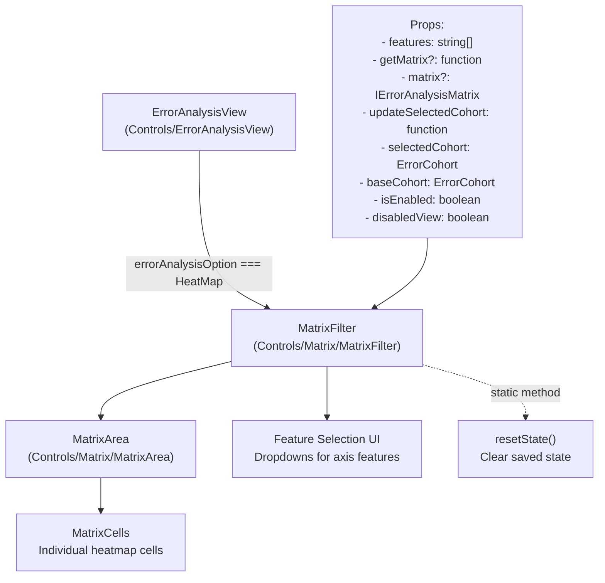
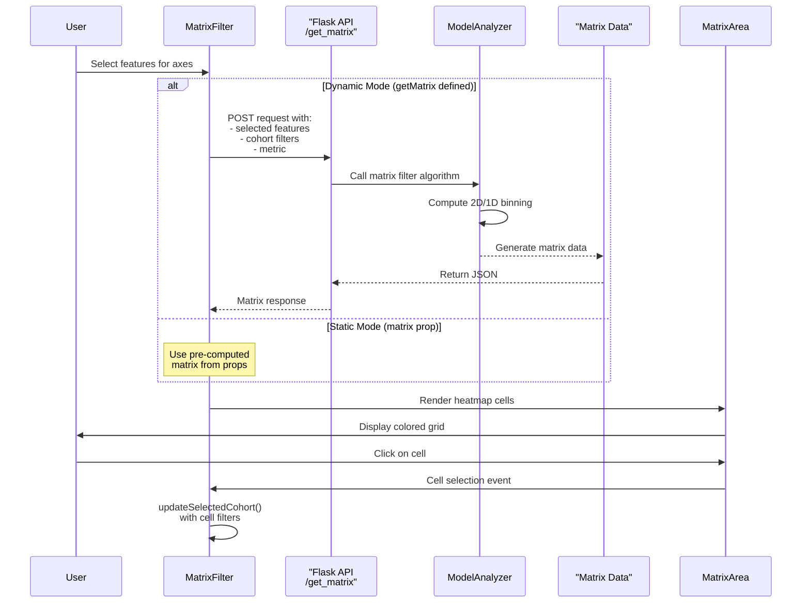
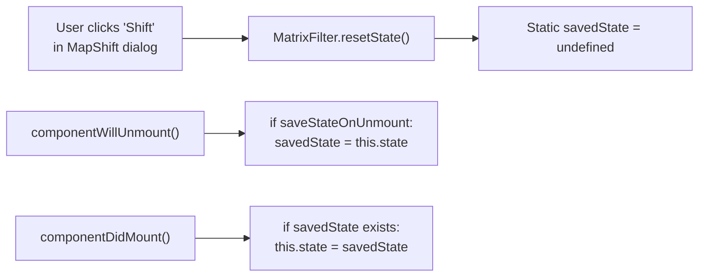
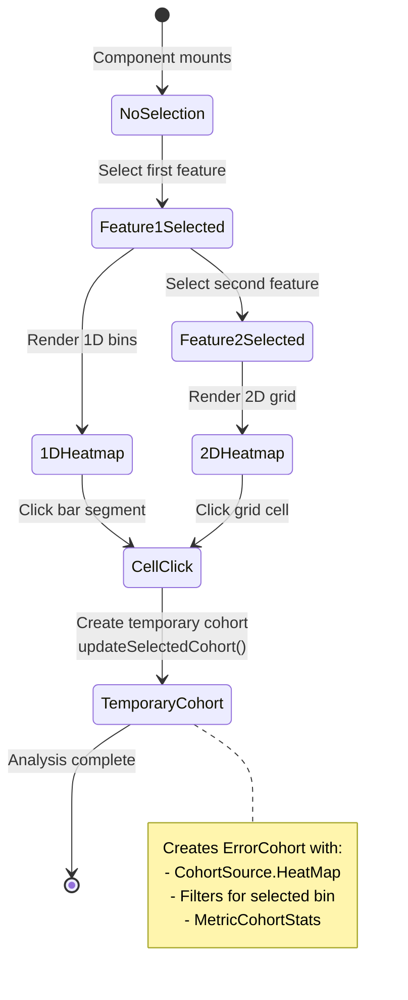
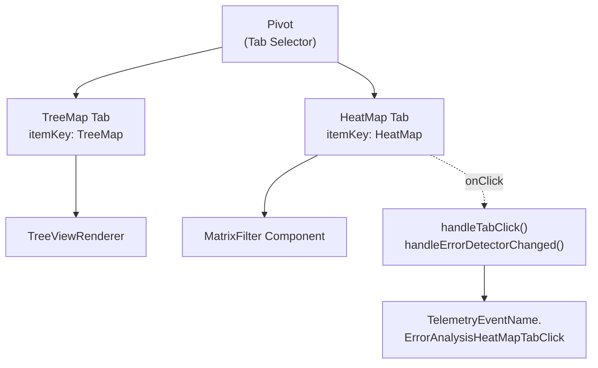
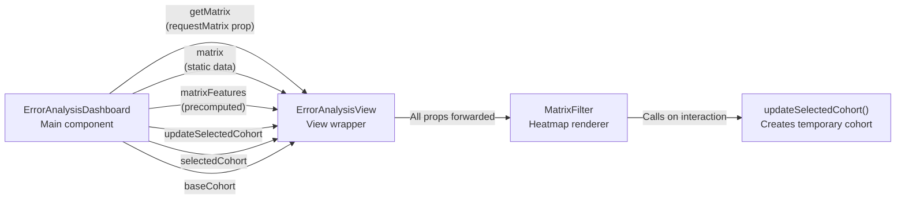

<!-- source: DeepWiki mcp.deepwiki.com · repo microsoft/responsible-ai-toolbox · extra page Matrix Filter UI · fetched 2026-10-26 -->

# Matrix Filter UI

<details>
<summary>Relevant source files</summary>

The following files were used as context for generating this wiki page:

- [apps/dashboard/src/error-analysis/App.tsx](apps/dashboard/src/error-analysis/App.tsx)
- [libs/core-ui/src/lib/components/SVGToolTip.tsx](libs/core-ui/src/lib/components/SVGToolTip.tsx)
- [libs/error-analysis/src/lib/ErrorAnalysisDashboard/ColorPalette.ts](libs/error-analysis/src/lib/ErrorAnalysisDashboard/ColorPalette.ts)
- [libs/error-analysis/src/lib/ErrorAnalysisDashboard/Controls/ErrorAnalysisView/ErrorAnalysisView.tsx](libs/error-analysis/src/lib/ErrorAnalysisDashboard/Controls/ErrorAnalysisView/ErrorAnalysisView.tsx)
- [libs/error-analysis/src/lib/ErrorAnalysisDashboard/Controls/ErrorAnalysisView/ErrorAnalysisViewTab.tsx](libs/error-analysis/src/lib/ErrorAnalysisDashboard/Controls/ErrorAnalysisView/ErrorAnalysisViewTab.tsx)
- [libs/error-analysis/src/lib/ErrorAnalysisDashboard/Controls/FilterTooltip/FilterTooltip.styles.ts](libs/error-analysis/src/lib/ErrorAnalysisDashboard/Controls/FilterTooltip/FilterTooltip.styles.ts)
- [libs/error-analysis/src/lib/ErrorAnalysisDashboard/Controls/FilterTooltip/FilterTooltip.tsx](libs/error-analysis/src/lib/ErrorAnalysisDashboard/Controls/FilterTooltip/FilterTooltip.tsx)
- [libs/error-analysis/src/lib/ErrorAnalysisDashboard/Controls/TreeLegend/TreeLegend.styles.ts](libs/error-analysis/src/lib/ErrorAnalysisDashboard/Controls/TreeLegend/TreeLegend.styles.ts)
- [libs/error-analysis/src/lib/ErrorAnalysisDashboard/Controls/TreeLegend/TreeLegend.tsx](libs/error-analysis/src/lib/ErrorAnalysisDashboard/Controls/TreeLegend/TreeLegend.tsx)
- [libs/error-analysis/src/lib/ErrorAnalysisDashboard/Controls/TreeViewRenderer/TreeViewNode.tsx](libs/error-analysis/src/lib/ErrorAnalysisDashboard/Controls/TreeViewRenderer/TreeViewNode.tsx)
- [libs/error-analysis/src/lib/ErrorAnalysisDashboard/Controls/TreeViewRenderer/TreeViewRenderer.styles.ts](libs/error-analysis/src/lib/ErrorAnalysisDashboard/Controls/TreeViewRenderer/TreeViewRenderer.styles.ts)
- [libs/error-analysis/src/lib/ErrorAnalysisDashboard/Controls/TreeViewRenderer/TreeViewRenderer.tsx](libs/error-analysis/src/lib/ErrorAnalysisDashboard/Controls/TreeViewRenderer/TreeViewRenderer.tsx)
- [libs/error-analysis/src/lib/ErrorAnalysisDashboard/Controls/TreeViewRenderer/TreeViewUtils.ts](libs/error-analysis/src/lib/ErrorAnalysisDashboard/Controls/TreeViewRenderer/TreeViewUtils.ts)
- [libs/error-analysis/src/lib/ErrorAnalysisDashboard/ErrorAnalysisDashboard.tsx](libs/error-analysis/src/lib/ErrorAnalysisDashboard/ErrorAnalysisDashboard.tsx)

</details>


This document describes the `MatrixFilter` component, which provides a heatmap visualization for error analysis in the TypeScript dashboard. For information about the backend matrix filter algorithm that generates the data, see [Matrix Filter (Heatmap)](#3.4.2). For the alternative tree-based visualization, see [Tree View Renderer](#4.3.1).

## Purpose and Scope

The `MatrixFilter` component is a React component that renders a 2D heatmap visualization of model errors across feature combinations. It allows users to:

- Select one or two features to create a 1D or 2D binned visualization
- View error rates or other metrics in each bin as color-coded cells
- Click on cells to create temporary cohorts for deeper analysis
- Understand error distribution patterns across feature space

This component is one of two main visualization modes in the Error Analysis Dashboard, selectable via the "Heat Map" tab.

## Component Architecture



**Sources**: 
- [libs/error-analysis/src/lib/ErrorAnalysisDashboard/Controls/ErrorAnalysisView/ErrorAnalysisView.tsx:1-104]()
- [libs/error-analysis/src/lib/ErrorAnalysisDashboard/ErrorAnalysisDashboard.tsx:61-61]()
- [libs/error-analysis/src/lib/ErrorAnalysisDashboard/ErrorAnalysisDashboard.tsx:456-456]()

## Data Flow and Backend Integration

The `MatrixFilter` component can operate in two modes: static (pre-computed) or dynamic (on-demand computation).



**Sources**:
- [libs/error-analysis/src/lib/ErrorAnalysisDashboard/Controls/ErrorAnalysisView/ErrorAnalysisView.tsx:80-94]()
- [apps/dashboard/src/error-analysis/App.tsx:83-83]()

### Matrix Data Structure

The component receives matrix data through the `IErrorAnalysisMatrix` interface, which contains:

| Property | Type | Description |
|----------|------|-------------|
| `matrix` | 2D array | Error rates/metric values for each bin |
| `category1` | string[] | Labels for first feature bins |
| `category2` | string[] (optional) | Labels for second feature bins (2D only) |
| `values` | number[] | Bin boundary values |

**Sources**: Based on usage patterns in [libs/error-analysis/src/lib/ErrorAnalysisDashboard/Controls/ErrorAnalysisView/ErrorAnalysisView.tsx:35-35]()

## State Management

The `MatrixFilter` component uses React component state and also maintains static saved state to persist user selections across view switches.

### Static State Pattern

Similar to `TreeViewRenderer`, the component implements a state preservation mechanism:



**Sources**:
- [libs/error-analysis/src/lib/ErrorAnalysisDashboard/ErrorAnalysisDashboard.tsx:455-464]()
- [libs/error-analysis/src/lib/ErrorAnalysisDashboard/Controls/TreeViewRenderer/TreeViewRenderer.tsx:99-101]() (similar pattern)

### State Reset During Map Shift

When users navigate from a temporary cohort back to the base cohort using the "Shift" operation, all visualization states are cleared:

[libs/error-analysis/src/lib/ErrorAnalysisDashboard/ErrorAnalysisDashboard.tsx:454-464]()

This ensures that:
1. `MatrixFilter.resetState()` is called (line 456)
2. `MatrixArea.resetState()` is called (line 457)
3. `TreeViewRenderer.resetState()` is called (line 458)
4. The `errorAnalysisOption` is updated (line 460)
5. The `selectedCohort` is reset to `baseCohort` (line 462)

**Sources**: [libs/error-analysis/src/lib/ErrorAnalysisDashboard/ErrorAnalysisDashboard.tsx:443-466]()

## User Interaction Flow

### Feature Selection and Visualization



**Sources**: 
- [libs/error-analysis/src/lib/ErrorAnalysisDashboard/ErrorAnalysisDashboard.tsx:697-744]()
- Based on cohort creation pattern similar to tree view

### Cohort Creation from Cell Selection

When a user clicks on a heatmap cell, the component calls `updateSelectedCohort` with parameters that define the bin boundaries:

| Parameter | Purpose | Source |
|-----------|---------|--------|
| `filters: IFilter[]` | Feature range filters for the selected bin | Cell coordinates |
| `compositeFilters` | Empty array (not used) | - |
| `source` | `CohortSource.HeatMap` | Identifies origin |
| `cells` | Number of cells selected | Cell count |
| `cohortStats` | Metric statistics for the cohort | Calculated from matrix |

The `updateSelectedCohort` function (defined in `ErrorAnalysisDashboard`) then:
1. Relabels filters using `ErrorCohort.getDataFilters()` (line 705)
2. Creates a temporary cohort named "Temporary cohort" (line 713)
3. Combines base cohort filters with new filters (lines 724-726)
4. Constructs an `ErrorCohort` with `isTemporary = true` (lines 721-733)
5. Updates state with the new cohort (lines 740-743)

**Sources**: [libs/error-analysis/src/lib/ErrorAnalysisDashboard/ErrorAnalysisDashboard.tsx:697-744]()

## Integration with Error Analysis Dashboard

### Tab Selection

The Matrix Filter is shown when the user selects the "Heat Map" tab in the Error Analysis view:



**Sources**:
- [libs/error-analysis/src/lib/ErrorAnalysisDashboard/Controls/ErrorAnalysisView/ErrorAnalysisViewTab.tsx:79-93]()
- [libs/error-analysis/src/lib/ErrorAnalysisDashboard/Controls/ErrorAnalysisView/ErrorAnalysisViewTab.tsx:162-174]()

### Props Flow from Dashboard

The props flow from `ErrorAnalysisDashboard` → `ErrorAnalysisView` → `MatrixFilter`:



**Sources**:
- [libs/error-analysis/src/lib/ErrorAnalysisDashboard/ErrorAnalysisDashboard.tsx:526-552]()
- [libs/error-analysis/src/lib/ErrorAnalysisDashboard/Controls/ErrorAnalysisView/ErrorAnalysisView.tsx:80-94]()

### Disabled View Mode

The component supports a `disabledView` mode for cases where the matrix cannot be computed (e.g., insufficient data, missing model):

| Mode | Behavior |
|------|----------|
| Normal (`disabledView: false`) | Full interactivity, cohort creation enabled |
| Disabled (`disabledView: true`) | Read-only display, no cohort creation |

**Sources**: [libs/error-analysis/src/lib/ErrorAnalysisDashboard/Controls/ErrorAnalysisView/ErrorAnalysisView.tsx:91-91]()

## Comparison with TreeViewRenderer

Both `MatrixFilter` and `TreeViewRenderer` serve similar purposes but with different visualizations:

| Aspect | MatrixFilter (HeatMap) | TreeViewRenderer (TreeMap) |
|--------|----------------------|---------------------------|
| **Visualization** | 2D grid or 1D bar chart | Hierarchical tree |
| **Feature selection** | User selects 1-2 features | Uses all features in tree |
| **Bin creation** | Fixed bins based on quantiles | Adaptive splits via surrogate model |
| **State management** | Static `savedState` | Static `savedState` |
| **Reset method** | `MatrixFilter.resetState()` | `TreeViewRenderer.resetState()` |
| **Cohort source** | `CohortSource.HeatMap` | `CohortSource.TreeMap` |
| **Backend endpoint** | `/get_matrix` | `/get_debug_ml` |

**Sources**:
- [libs/error-analysis/src/lib/ErrorAnalysisDashboard/ErrorAnalysisDashboard.tsx:455-458]()
- [libs/error-analysis/src/lib/ErrorAnalysisDashboard/Controls/TreeViewRenderer/TreeViewRenderer.tsx:99-101]()

## Component File Structure

Based on the import patterns, the Matrix Filter component resides in a hierarchical directory structure:

```
libs/error-analysis/src/lib/ErrorAnalysisDashboard/Controls/
├── Matrix/
│   ├── MatrixFilter/
│   │   ├── MatrixFilter.tsx         # Main component
│   │   └── MatrixFilter.styles.ts   # Styles (inferred)
│   └── MatrixArea/
│       └── MatrixArea.tsx            # Cell rendering subcomponent
├── ErrorAnalysisView/
│   └── ErrorAnalysisView.tsx         # Parent view component
└── TreeViewRenderer/
    └── TreeViewRenderer.tsx          # Alternative visualization
```

**Sources**: 
- [libs/error-analysis/src/lib/ErrorAnalysisDashboard/ErrorAnalysisDashboard.tsx:60-61]()
- [libs/error-analysis/src/lib/ErrorAnalysisDashboard/Controls/ErrorAnalysisView/ErrorAnalysisView.tsx:20-20]()

---

