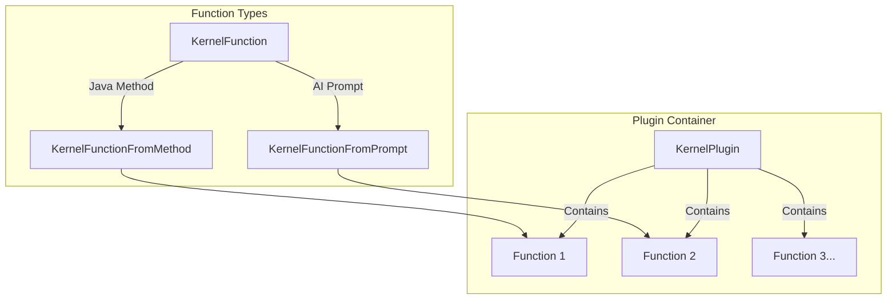
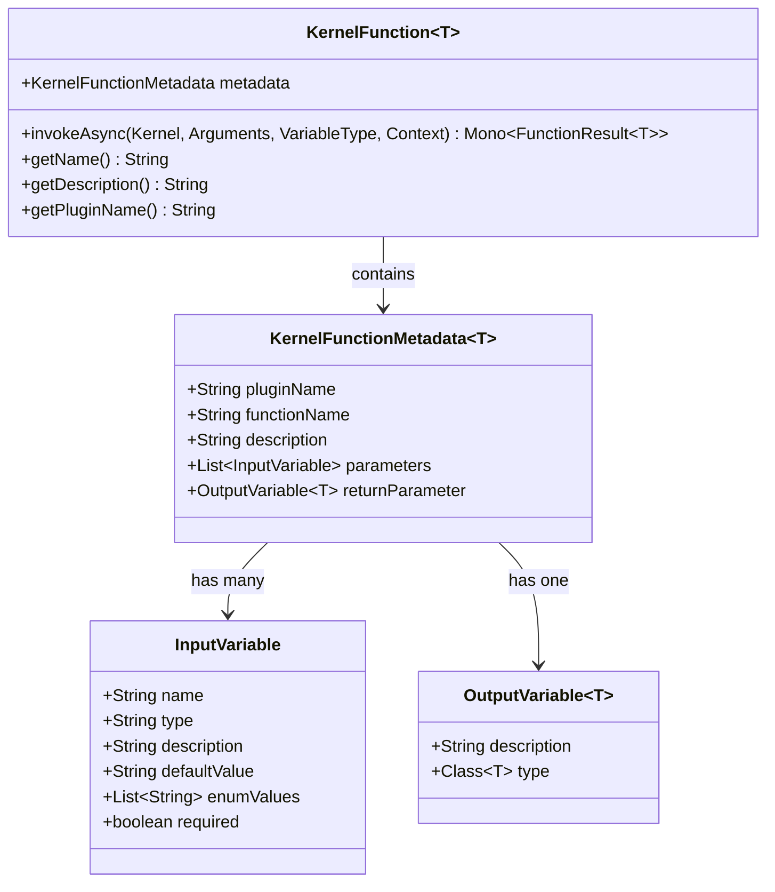
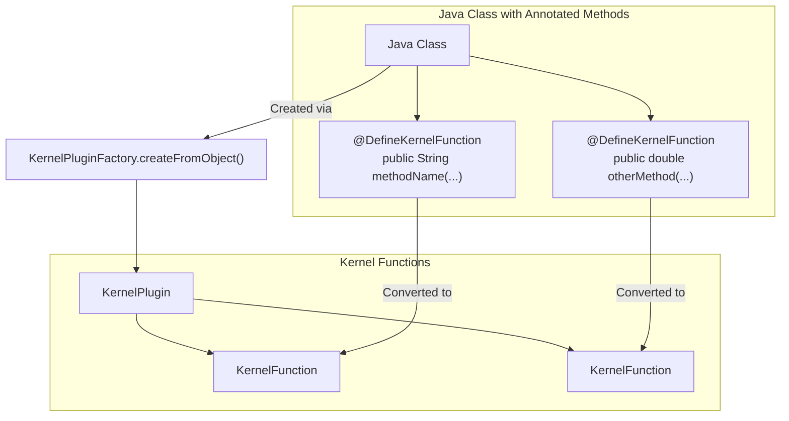
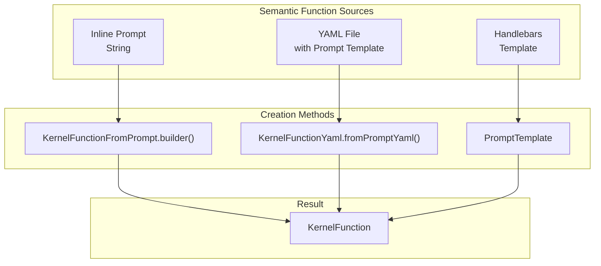
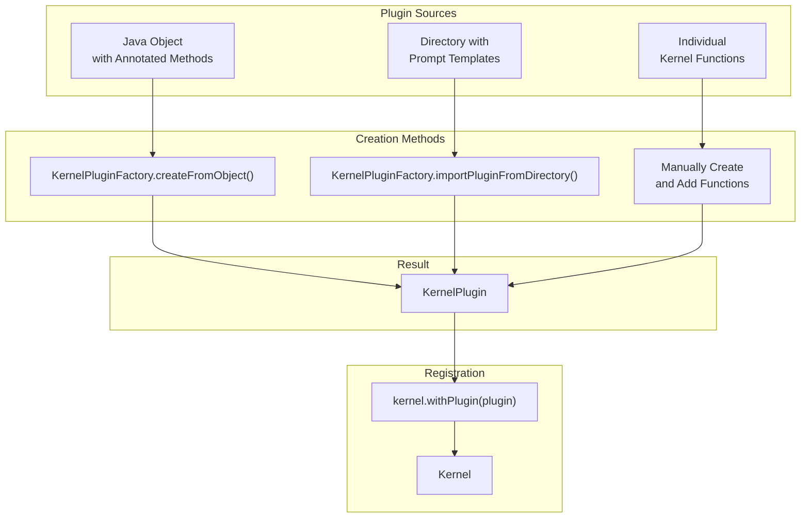
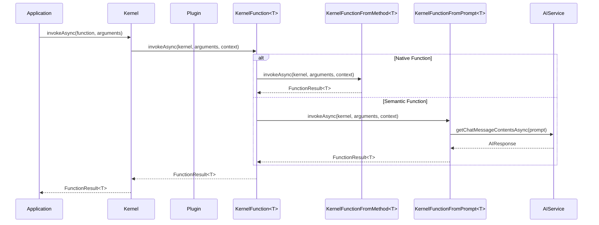
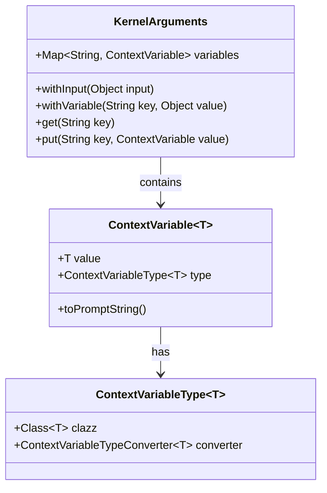
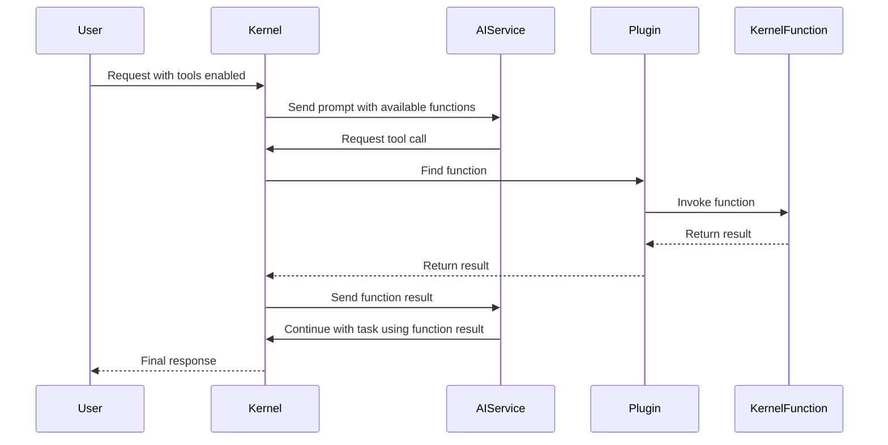
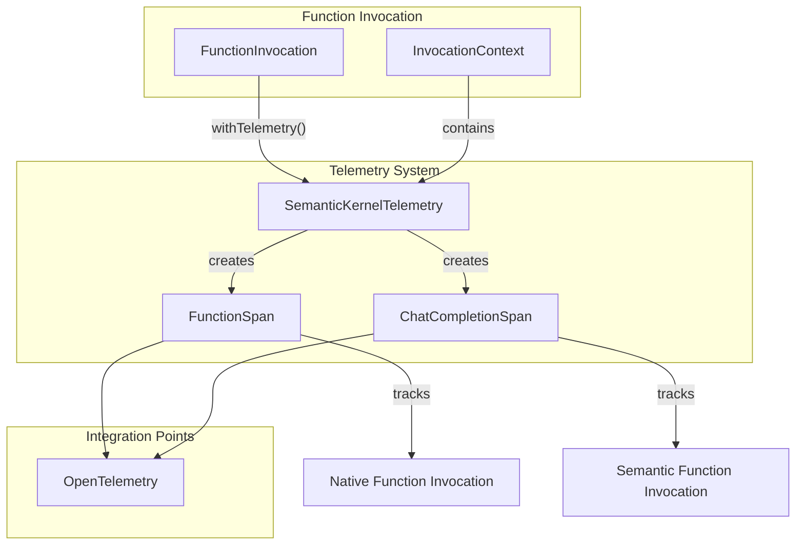

<!-- source: DeepWiki mcp.deepwiki.com · repo microsoft/semantic-kernel-java · page 2.2 Functions and Plugins · fetched 2026-10-26 -->

# Functions and Plugins

<details>
<summary>Relevant source files</summary>

The following files were used as context for generating this wiki page:

- [CHANGELOG.md](CHANGELOG.md)
- [README.md](README.md)
- [aiservices/openai/src/main/java/com/microsoft/semantickernel/aiservices/openai/chatcompletion/OpenAIChatCompletion.java](aiservices/openai/src/main/java/com/microsoft/semantickernel/aiservices/openai/chatcompletion/OpenAIChatCompletion.java)
- [aiservices/openai/src/main/java/com/microsoft/semantickernel/aiservices/openai/chatcompletion/OpenAIFunction.java](aiservices/openai/src/main/java/com/microsoft/semantickernel/aiservices/openai/chatcompletion/OpenAIFunction.java)
- [aiservices/openai/src/main/java/com/microsoft/semantickernel/aiservices/openai/textcompletion/OpenAITextGenerationService.java](aiservices/openai/src/main/java/com/microsoft/semantickernel/aiservices/openai/textcompletion/OpenAITextGenerationService.java)
- [aiservices/openai/src/test/java/com/microsoft/semantickernel/aiservices/openai/OtelCaptureTest.java](aiservices/openai/src/test/java/com/microsoft/semantickernel/aiservices/openai/OtelCaptureTest.java)
- [aiservices/openai/src/test/java/com/microsoft/semantickernel/aiservices/openai/chatcompletion/JsonSchemaTest.java](aiservices/openai/src/test/java/com/microsoft/semantickernel/aiservices/openai/chatcompletion/JsonSchemaTest.java)
- [api-test/integration-tests/src/test/java/com/microsoft/semantickernel/tests/WiremockExamplesIT.java](api-test/integration-tests/src/test/java/com/microsoft/semantickernel/tests/WiremockExamplesIT.java)
- [samples/semantickernel-concepts/semantickernel-syntax-examples/src/main/java/com/microsoft/semantickernel/samples/demos/lights/App.java](samples/semantickernel-concepts/semantickernel-syntax-examples/src/main/java/com/microsoft/semantickernel/samples/demos/lights/App.java)
- [samples/semantickernel-concepts/semantickernel-syntax-examples/src/main/java/com/microsoft/semantickernel/samples/demos/lights/LightModel.java](samples/semantickernel-concepts/semantickernel-syntax-examples/src/main/java/com/microsoft/semantickernel/samples/demos/lights/LightModel.java)
- [samples/semantickernel-concepts/semantickernel-syntax-examples/src/main/java/com/microsoft/semantickernel/samples/demos/lights/LightModelTypeConverter.java](samples/semantickernel-concepts/semantickernel-syntax-examples/src/main/java/com/microsoft/semantickernel/samples/demos/lights/LightModelTypeConverter.java)
- [samples/semantickernel-concepts/semantickernel-syntax-examples/src/main/java/com/microsoft/semantickernel/samples/demos/lights/LightsPlugin.java](samples/semantickernel-concepts/semantickernel-syntax-examples/src/main/java/com/microsoft/semantickernel/samples/demos/lights/LightsPlugin.java)
- [samples/semantickernel-concepts/semantickernel-syntax-examples/src/main/java/com/microsoft/semantickernel/samples/syntaxexamples/RunAll.java](samples/semantickernel-concepts/semantickernel-syntax-examples/src/main/java/com/microsoft/semantickernel/samples/syntaxexamples/RunAll.java)
- [samples/semantickernel-concepts/semantickernel-syntax-examples/src/main/java/com/microsoft/semantickernel/samples/syntaxexamples/java/CustomTypes_Example.java](samples/semantickernel-concepts/semantickernel-syntax-examples/src/main/java/com/microsoft/semantickernel/samples/syntaxexamples/java/CustomTypes_Example.java)
- [samples/semantickernel-concepts/semantickernel-syntax-examples/src/main/java/com/microsoft/semantickernel/samples/syntaxexamples/java/FunctionTelemetry_Example.java](samples/semantickernel-concepts/semantickernel-syntax-examples/src/main/java/com/microsoft/semantickernel/samples/syntaxexamples/java/FunctionTelemetry_Example.java)
- [samples/semantickernel-concepts/semantickernel-syntax-examples/src/main/java/com/microsoft/semantickernel/samples/syntaxexamples/java/KernelFunctionYaml_Example.java](samples/semantickernel-concepts/semantickernel-syntax-examples/src/main/java/com/microsoft/semantickernel/samples/syntaxexamples/java/KernelFunctionYaml_Example.java)
- [samples/semantickernel-concepts/semantickernel-syntax-examples/src/main/java/com/microsoft/semantickernel/samples/syntaxexamples/plugin/Example07_BingAndGooglePlugins.java](samples/semantickernel-concepts/semantickernel-syntax-examples/src/main/java/com/microsoft/semantickernel/samples/syntaxexamples/plugin/Example07_BingAndGooglePlugins.java)
- [samples/semantickernel-concepts/semantickernel-syntax-examples/src/main/java/com/microsoft/semantickernel/samples/syntaxexamples/plugin/Example10_DescribeAllPluginsAndFunctions.java](samples/semantickernel-concepts/semantickernel-syntax-examples/src/main/java/com/microsoft/semantickernel/samples/syntaxexamples/plugin/Example10_DescribeAllPluginsAndFunctions.java)
- [samples/semantickernel-concepts/semantickernel-syntax-examples/src/main/java/com/microsoft/semantickernel/samples/syntaxexamples/plugin/Example13_ConversationSummaryPlugin.java](samples/semantickernel-concepts/semantickernel-syntax-examples/src/main/java/com/microsoft/semantickernel/samples/syntaxexamples/plugin/Example13_ConversationSummaryPlugin.java)
- [samples/semantickernel-concepts/semantickernel-syntax-examples/src/main/resources/com/microsoft/semantickernel/samples/syntaxexamples/java/applicationinsights.json](samples/semantickernel-concepts/semantickernel-syntax-examples/src/main/resources/com/microsoft/semantickernel/samples/syntaxexamples/java/applicationinsights.json)
- [semantickernel-api/src/main/java/com/microsoft/semantickernel/contextvariables/converters/StringVariableContextVariableTypeConverter.java](semantickernel-api/src/main/java/com/microsoft/semantickernel/contextvariables/converters/StringVariableContextVariableTypeConverter.java)
- [semantickernel-api/src/main/java/com/microsoft/semantickernel/hooks/KernelHook.java](semantickernel-api/src/main/java/com/microsoft/semantickernel/hooks/KernelHook.java)
- [semantickernel-api/src/main/java/com/microsoft/semantickernel/hooks/KernelHooks.java](semantickernel-api/src/main/java/com/microsoft/semantickernel/hooks/KernelHooks.java)
- [semantickernel-api/src/main/java/com/microsoft/semantickernel/implementation/telemetry/ChatCompletionSpan.java](semantickernel-api/src/main/java/com/microsoft/semantickernel/implementation/telemetry/ChatCompletionSpan.java)
- [semantickernel-api/src/main/java/com/microsoft/semantickernel/implementation/telemetry/FunctionSpan.java](semantickernel-api/src/main/java/com/microsoft/semantickernel/implementation/telemetry/FunctionSpan.java)
- [semantickernel-api/src/main/java/com/microsoft/semantickernel/implementation/telemetry/SemanticKernelTelemetry.java](semantickernel-api/src/main/java/com/microsoft/semantickernel/implementation/telemetry/SemanticKernelTelemetry.java)
- [semantickernel-api/src/main/java/com/microsoft/semantickernel/orchestration/FunctionInvocation.java](semantickernel-api/src/main/java/com/microsoft/semantickernel/orchestration/FunctionInvocation.java)
- [semantickernel-api/src/main/java/com/microsoft/semantickernel/semanticfunctions/KernelFunctionArguments.java](semantickernel-api/src/main/java/com/microsoft/semantickernel/semanticfunctions/KernelFunctionArguments.java)
- [semantickernel-api/src/main/java/com/microsoft/semantickernel/semanticfunctions/KernelFunctionFromMethod.java](semantickernel-api/src/main/java/com/microsoft/semantickernel/semanticfunctions/KernelFunctionFromMethod.java)
- [semantickernel-api/src/test/java/com/microsoft/semantickernel/contextvariables/converters/ContextVariableTypeConverterTest.java](semantickernel-api/src/test/java/com/microsoft/semantickernel/contextvariables/converters/ContextVariableTypeConverterTest.java)
- [semantickernel-api/src/test/java/com/microsoft/semantickernel/semanticfunctions/KernelFunctionFromMethodTest.java](semantickernel-api/src/test/java/com/microsoft/semantickernel/semanticfunctions/KernelFunctionFromMethodTest.java)

</details>


This page provides a comprehensive overview of Functions and Plugins in the Java implementation of Semantic Kernel. Functions are the building blocks of functionality in the SDK, while Plugins are containers that organize related functions together. This page explains both concepts, their types, how to create them, and how they work together to provide AI capabilities in your applications.

For information about the Kernel itself, see [Kernel](#2.1). For information about creating custom plugins, see [Creating Custom Plugins](#6.2).

## Functions Overview

Functions in Semantic Kernel are executable units that can be invoked by the Kernel. There are two main types of functions:

1. **Native Functions** - Java methods that are exposed to the Kernel through annotations
2. **Semantic Functions** - AI-powered functions that use prompts to generate responses from an AI model

Functions, regardless of type, can be organized into plugins for better organization and reusability.



Sources:
- [semantickernel-api/src/main/java/com/microsoft/semantickernel/semanticfunctions/KernelFunctionFromMethod.java]()
- [aiservices/openai/src/main/java/com/microsoft/semantickernel/aiservices/openai/chatcompletion/OpenAIFunction.java]()

## Function Structure

All functions in Semantic Kernel share a common structure through the `KernelFunction<T>` abstract class. Each function has:

1. **Metadata** - Information about the function (name, description, parameters, return type)
2. **Invocation Logic** - Code that executes when the function is called
3. **Parameters** - Input values required by the function
4. **Return Value** - Output value of type `T` produced by the function



Sources:
- [semantickernel-api/src/main/java/com/microsoft/semantickernel/semanticfunctions/KernelFunctionFromMethod.java]()
- [semantickernel-api/src/main/java/com/microsoft/semantickernel/semanticfunctions/KernelFunctionArguments.java]()

## Native Functions

Native functions are Java methods that are exposed to the Semantic Kernel. They are created using the `KernelFunctionFromMethod` class, typically with annotations to provide metadata.

### Creating Native Functions

Native functions can be created in two ways:

1. **Using annotations** - Annotate Java methods with `@DefineKernelFunction` and `@KernelFunctionParameter`
2. **Programmatically** - Using `KernelFunctionFromMethod.create()` method

Here's an example of a native function definition using annotations:



Native functions support various parameter types and provide automatic type conversion between different representations.

Sources:
- [semantickernel-api/src/main/java/com/microsoft/semantickernel/semanticfunctions/KernelFunctionFromMethod.java]()
- [samples/semantickernel-concepts/semantickernel-syntax-examples/src/main/java/com/microsoft/semantickernel/samples/demos/lights/LightsPlugin.java]()

### Example Native Function

Below is a simple example of a class with a native function:

```java
public class LightsPlugin {
    @DefineKernelFunction(name = "get_lights", description = "Gets a list of lights and their current state")
    public List<LightModel> getLights() {
        return lights;
    }
    
    @DefineKernelFunction(name = "change_state", description = "Changes the state of the light")
    public LightModel changeState(
        @KernelFunctionParameter(name = "id", description = "The ID of the light to change", type = int.class) int id,
        @KernelFunctionParameter(name = "isOn", description = "The new state of the light", type = boolean.class) boolean isOn) {
        // Implementation...
    }
}
```

The annotations provide:
- Function name and description
- Parameter names, types, and descriptions
- Parameter validation (optional/required)
- Return type information

Sources:
- [samples/semantickernel-concepts/semantickernel-syntax-examples/src/main/java/com/microsoft/semantickernel/samples/demos/lights/LightsPlugin.java]()
- [semantickernel-api/src/test/java/com/microsoft/semantickernel/semanticfunctions/KernelFunctionFromMethodTest.java]()

## Semantic Functions

Semantic functions use AI to generate responses based on prompts. They leverage Large Language Models (LLMs) through the Semantic Kernel's AI service integrations.

### Creating Semantic Functions

Semantic functions can be created in several ways:

1. **From inline prompts** - Using `KernelFunctionFromPrompt.builder()`
2. **From template files** - Loading prompt templates from YAML or text files
3. **From Handlebars templates** - Using more advanced templating with Handlebars



Sources:
- [samples/semantickernel-concepts/semantickernel-syntax-examples/src/main/java/com/microsoft/semantickernel/samples/syntaxexamples/java/KernelFunctionYaml_Example.java]()
- [samples/semantickernel-concepts/semantickernel-syntax-examples/src/main/java/com/microsoft/semantickernel/samples/syntaxexamples/functions/Example05_InlineFunctionDefinition.java]()

### Example Semantic Function

Here's an example of creating a semantic function with an inline prompt:

```java
KernelFunction<String> summarizeFunction = KernelFunctionFromPrompt.<String>builder()
    .withTemplate("Summarize the following text in 3 bullet points:\n{{$input}}")
    .withName("Summarize")
    .withDescription("Summarizes text into bullet points")
    .withDefaultExecutionSettings(
        PromptExecutionSettings.builder()
            .withMaxTokens(150)
            .build())
    .build();
```

Semantic functions have special functionality for:
- Variable substitution in templates
- Configuring AI model parameters
- Working with different response formats

Sources:
- [samples/semantickernel-concepts/semantickernel-syntax-examples/src/main/java/com/microsoft/semantickernel/samples/syntaxexamples/template/Example06_TemplateLanguage.java]()
- [samples/semantickernel-concepts/semantickernel-syntax-examples/src/main/java/com/microsoft/semantickernel/samples/syntaxexamples/template/Example64_MultiplePromptTemplates.java]()

## Plugins

Plugins are collections of related functions that can be registered with the Kernel for organization and discovery. A plugin serves as a namespace for functions.

### Creating Plugins

There are several ways to create plugins:

1. **From Java objects** - Using `KernelPluginFactory.createFromObject()`
2. **From directories** - Using `KernelPluginFactory.importPluginFromDirectory()`
3. **From prompt templates** - Creating semantic functions and grouping them
4. **Programmatically** - Creating and adding functions to a plugin instance



Sources:
- [samples/semantickernel-concepts/semantickernel-syntax-examples/src/main/java/com/microsoft/semantickernel/samples/syntaxexamples/plugin/Example10_DescribeAllPluginsAndFunctions.java]()
- [samples/semantickernel-concepts/semantickernel-syntax-examples/src/main/java/com/microsoft/semantickernel/samples/demos/lights/App.java]()

### Example Plugin Registration

Here's an example of creating a plugin from a Java object and registering it with the Kernel:

```java
// Create a plugin from a Java object
KernelPlugin lightPlugin = KernelPluginFactory.createFromObject(new LightsPlugin(), "LightsPlugin");

// Create a kernel and register the plugin
Kernel kernel = Kernel.builder()
    .withAIService(ChatCompletionService.class, chatService)
    .withPlugin(lightPlugin)
    .build();
```

Sources:
- [samples/semantickernel-concepts/semantickernel-syntax-examples/src/main/java/com/microsoft/semantickernel/samples/demos/lights/App.java]()
- [samples/semantickernel-concepts/semantickernel-syntax-examples/src/main/java/com/microsoft/semantickernel/samples/syntaxexamples/plugin/Example13_ConversationSummaryPlugin.java]()

## Function Invocation

Functions in Semantic Kernel are invoked asynchronously, returning `Mono<FunctionResult<T>>` from Project Reactor. The invocation process supports chaining operations and specifying parameters.

### Invocation Flow

The invocation flow varies slightly between native and semantic functions:



Sources:
- [semantickernel-api/src/main/java/com/microsoft/semantickernel/semanticfunctions/KernelFunctionFromMethod.java:730-749]()
- [semantickernel-api/src/main/java/com/microsoft/semantickernel/orchestration/FunctionInvocation.java]()

### Function Arguments

When invoking functions, arguments are passed using the `KernelArguments` class, which is a map of string keys to `ContextVariable` values. The arguments can include:

1. **Main input** - The primary input to the function (key: `"input"`)
2. **Named parameters** - Additional parameters by name
3. **Configuration options** - Execution settings for the function



Sources:
- [semantickernel-api/src/main/java/com/microsoft/semantickernel/semanticfunctions/KernelFunctionArguments.java]()
- [samples/semantickernel-concepts/semantickernel-syntax-examples/src/main/java/com/microsoft/semantickernel/samples/syntaxexamples/functions/Example03_Arguments.java]()

### Fluent Invocation API

The Semantic Kernel provides a fluent API for function invocation through the `FunctionInvocation<T>` class:

```java
// Example of the fluent invocation API
FunctionResult<String> result = kernel.invokeAsync(summarizeFunction)
    .withArguments(
        KernelArguments.builder()
            .withInput("This is a long text that needs summarizing...")
            .withVariable("maxPoints", 3)
            .build())
    .withResultType(String.class)
    .block();
```

This API allows for:
- Specifying arguments
- Setting the expected return type
- Adding hooks for interception
- Configuring execution settings
- Type conversion for results

Sources:
- [semantickernel-api/src/main/java/com/microsoft/semantickernel/orchestration/FunctionInvocation.java]()
- [samples/semantickernel-concepts/semantickernel-syntax-examples/src/main/java/com/microsoft/semantickernel/samples/syntaxexamples/java/CustomTypes_Example.java]()

## Tool Calling

One of the powerful features of Semantic Kernel is the ability for AI services to call functions as tools. This allows the AI to invoke your registered functions when needed to accomplish tasks.

### Tool Calling Flow



Tool calling enables complex interactions where the AI can:
1. Recognize when a function/tool is needed
2. Select the appropriate function
3. Provide the required parameters
4. Receive and incorporate the function's output

Sources:
- [aiservices/openai/src/main/java/com/microsoft/semantickernel/aiservices/openai/chatcompletion/OpenAIChatCompletion.java:396-526]()
- [aiservices/openai/src/main/java/com/microsoft/semantickernel/aiservices/openai/chatcompletion/OpenAIFunction.java]()

### Enabling Tool Calling

To enable tool calling, you need to:

1. Register plugins with functions
2. Configure an `InvocationContext` with tool calling behavior
3. Pass this context when invoking AI services

```java
// Enable tool calling
InvocationContext invocationContext = InvocationContext.builder()
    .withToolCallBehavior(ToolCallBehavior.allowAllKernelFunctions(true))
    .build();

// Use in chat completion
List<ChatMessageContent<?>> results = chatCompletionService.getChatMessageContentsAsync(
    history, kernel, invocationContext).block();
```

Sources:
- [samples/semantickernel-concepts/semantickernel-syntax-examples/src/main/java/com/microsoft/semantickernel/samples/demos/lights/App.java:93-101]()
- [samples/semantickernel-concepts/semantickernel-syntax-examples/src/main/java/com/microsoft/semantickernel/samples/syntaxexamples/functions/Example59_OpenAIFunctionCalling.java]()

## Extended Features

### Custom Type Conversion

Semantic Kernel provides a type conversion system that allows you to work with complex custom types:

```java
// Create a custom type converter
ContextVariableTypeConverter<Pet> typeConverter = ContextVariableTypeConverter.builder(
    Pet.class)
    .toPromptString(pet -> "name: " + pet.name() + "\nage: " + pet.age() + "\n...")
    .fromPromptString(prompt -> /* parsing logic *)
    .build();

// Use with function invocation
kernel.invokePromptAsync(prompt, arguments)
    .withTypeConverter(typeConverter)
    .withResultType(Pet.class)
    .block();
```

Alternatively, you can use Jackson for automatic JSON-based conversion:

```java
ContextVariableTypeConverter<Pet> typeConverter = ContextVariableJacksonConverter.create(Pet.class);
```

Sources:
- [samples/semantickernel-concepts/semantickernel-syntax-examples/src/main/java/com/microsoft/semantickernel/samples/syntaxexamples/java/CustomTypes_Example.java]()
- [samples/semantickernel-concepts/semantickernel-syntax-examples/src/main/java/com/microsoft/semantickernel/samples/demos/lights/LightModelTypeConverter.java]()

### Function Telemetry

Semantic Kernel includes telemetry capabilities for monitoring function invocations:



Telemetry provides visibility into:
- Function execution time
- Success/failure status
- Token usage for AI calls
- Tracing of execution paths

Sources:
- [semantickernel-api/src/main/java/com/microsoft/semantickernel/implementation/telemetry/FunctionSpan.java]()
- [semantickernel-api/src/main/java/com/microsoft/semantickernel/implementation/telemetry/ChatCompletionSpan.java]()
- [samples/semantickernel-concepts/semantickernel-syntax-examples/src/main/java/com/microsoft/semantickernel/samples/syntaxexamples/java/FunctionTelemetry_Example.java]()

## Summary

Functions and Plugins are fundamental building blocks in Semantic Kernel:

- **Functions** provide the executable units of code, either as native Java methods or AI-powered prompts
- **Plugins** organize related functions into logical groups for better organization and discoverability
- The invocation system provides a flexible, fluent API for function execution
- Tool calling enables AI services to use your functions as needed to accomplish tasks
- Type conversion facilitates working with complex data structures
- Telemetry provides visibility into function execution

By combining these components, you can build AI-powered applications that seamlessly integrate code execution with AI capabilities.

---

