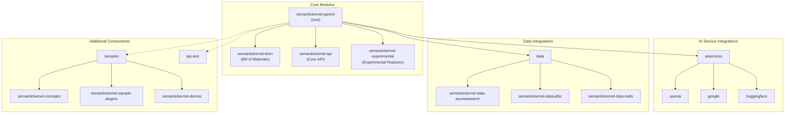
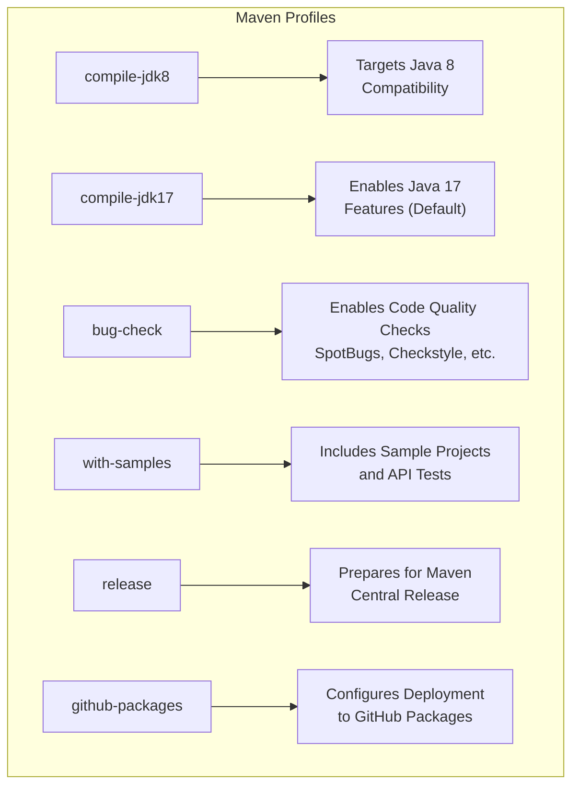
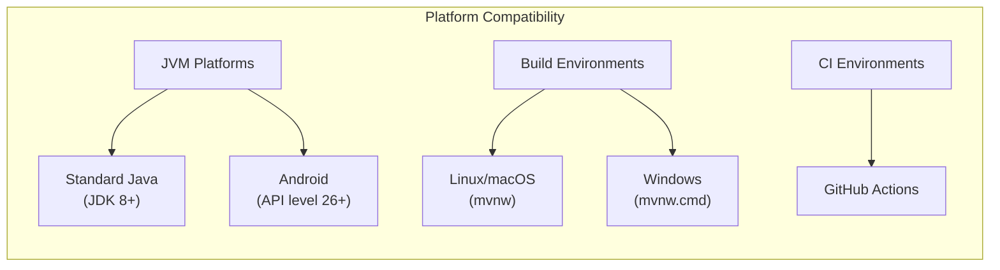

<!-- source: DeepWiki mcp.deepwiki.com · repo microsoft/semantic-kernel-java · page 8 Project Setup and Building · fetched 2026-10-26 -->

# Project Setup and Building

<details>
<summary>Relevant source files</summary>

The following files were used as context for generating this wiki page:

- [.github/_typos.toml](.github/_typos.toml)
- [.github/workflows/codeql-analysis.yml](.github/workflows/codeql-analysis.yml)
- [.github/workflows/java-build.yml](.github/workflows/java-build.yml)
- [.github/workflows/java-integration-tests.yml](.github/workflows/java-integration-tests.yml)
- [.github/workflows/java-publish-package.yml](.github/workflows/java-publish-package.yml)
- [.github/workflows/markdown-link-check.yml](.github/workflows/markdown-link-check.yml)
- [.github/workflows/typos.yaml](.github/workflows/typos.yaml)
- [api-test/integration-tests/pom.xml](api-test/integration-tests/pom.xml)
- [pom.xml](pom.xml)
- [samples/semantickernel-concepts/README.md](samples/semantickernel-concepts/README.md)
- [samples/semantickernel-concepts/semantickernel-syntax-examples/README.md](samples/semantickernel-concepts/semantickernel-syntax-examples/README.md)
- [samples/semantickernel-concepts/semantickernel-syntax-examples/pom.xml](samples/semantickernel-concepts/semantickernel-syntax-examples/pom.xml)
- [samples/semantickernel-demos/booking-agent-m365/pom.xml](samples/semantickernel-demos/booking-agent-m365/pom.xml)
- [samples/semantickernel-demos/semantickernel-spring-starter/pom.xml](samples/semantickernel-demos/semantickernel-spring-starter/pom.xml)
- [samples/semantickernel-sample-plugins/semantickernel-openapi-plugin/pom.xml](samples/semantickernel-sample-plugins/semantickernel-openapi-plugin/pom.xml)
- [semantickernel-api/pom.xml](semantickernel-api/pom.xml)
- [semantickernel-bom/pom.xml](semantickernel-bom/pom.xml)
- [semantickernel-experimental/pom.xml](semantickernel-experimental/pom.xml)

</details>


This document provides comprehensive instructions for setting up, building, and contributing to the Semantic Kernel Java project. It covers environment configuration, build commands, testing procedures, and working with samples.

## Prerequisites

Before working with the Semantic Kernel Java codebase, ensure you have the following prerequisites installed:

| Requirement | Minimum Version | Notes |
|-------------|----------------|-------|
| JDK | 8 | JDK 17 recommended for development |
| Maven | 3.9.9 | Maven wrapper included in repo |
| Git | Any recent version | For source control |

The project enforces Maven version requirements through the Maven Enforcer Plugin configured in the POM files.

Sources: [semantickernel-bom/pom.xml:23-40](), [pom.xml:58]()

## Project Structure

The Semantic Kernel Java project is organized as a multi-module Maven project. Understanding this structure helps navigate the codebase.



Sources: [pom.xml:70-80]()

## Building the Project

The repository includes a Maven wrapper script (`mvnw` or `mvnw.cmd` for Windows), allowing you to build without installing Maven locally.

### Basic Build Commands

```bash
# Basic build
./mvnw clean install

# Skip tests for faster build
./mvnw clean install -DskipTests

# Build with samples included
./mvnw -Pwith-samples clean install
```

### Java Version Specific Builds

The project supports building against different JDK versions using Maven profiles:

```bash
# Build with JDK 8 compatibility
./mvnw -Pcompile-jdk8 clean install

# Build with JDK 17 features (default)
./mvnw -Pcompile-jdk17 clean install
```

Sources: [pom.xml:593-611](), [.github/workflows/java-build.yml:52]()

## Build Profiles

Maven profiles enable different build configurations:



Sources: [pom.xml:592-727](), [pom.xml:232-271]()

### Quality Checks and Linting

The `bug-check` profile enables additional code quality tools:

```bash
# Build with code quality checks
./mvnw -Pbug-check clean install
```

This profile activates:
- SpotBugs for bug detection
- Checkstyle for style enforcement
- Error Prone for static analysis
- Spotless for code formatting

Sources: [pom.xml:612-721]()

## Running Tests

The project includes unit tests and integration tests:

```bash
# Run unit tests
./mvnw test

# Run integration tests (requires Java 17+)
./mvnw -Pwith-samples clean install
cd api-test
../mvnw clean install
```

Integration tests can be configured with environment variables for API keys and endpoints.

Sources: [.github/workflows/java-integration-tests.yml:50-58](), [api-test/integration-tests/pom.xml:152-177]()

## Working with Samples

The repository includes several sample projects demonstrating Semantic Kernel features:

```bash
# Build and run a specific sample
cd samples/semantickernel-concepts/semantickernel-syntax-examples
../../mvnw clean package exec:java -Dsample=Example04_CombineLLMPromptsAndNativeCode
```

Samples can be configured in various ways:

1. With environment variables:
```bash
OPENAI_CLIENT_TYPE=OPEN_AI \
OPEN_AI_KEY="my-key" \
OPEN_AI_ORGANIZATION_ID="organisation id" \
../../mvnw clean package exec:java -Dsample=Example04_CombineLLMPromptsAndNativeCode
```

2. With system properties:
```bash
../../mvnw exec:java \
-DOPENAI_CLIENT_TYPE=OPEN_AI \
-Dclient.openai.key="my-key" \
-Dclient.openai.organizationid="my-org-id" \
-Dsample=Example04_CombineLLMPromptsAndNativeCode
```

3. Using a properties file:
```bash
../../mvnw exec:java \
-DCONF_PROPERTIES=my.properties \
-Dsample=Example04_CombineLLMPromptsAndNativeCode
```

Sources: [samples/semantickernel-concepts/semantickernel-syntax-examples/README.md:1-141](), [samples/semantickernel-concepts/semantickernel-syntax-examples/pom.xml:159-187]()

## Development Tools and IDEs

The project uses several Maven plugins that integrate well with modern IDEs:

- **IntelliJ IDEA**: Automatically recognizes the Maven project structure
- **Eclipse**: Import as Maven project
- **VS Code**: Use with Java and Maven extensions

Key IDE configurations:
- Set JDK 8 (minimum) or JDK 17 (recommended)
- Enable Maven auto-import
- Respect the code style configured in Spotless (`eclipse-formatter.xml`)

## Multi-Platform Support

The project ensures compatibility across different platforms:



Android compatibility is verified through the `animal-sniffer-maven-plugin`.

Sources: [pom.xml:393-419]()

## Contributing and Deployment

For contributors who need to deploy artifacts:

### GitHub Packages Deployment

The repository includes a workflow for publishing to GitHub Packages:

```bash
# Deploy to GitHub Packages
./mvnw -Pgithub-packages clean deploy
```

This requires appropriate GitHub authentication to be configured.

Sources: [.github/workflows/java-publish-package.yml:29-39](), [pom.xml:246-271]()

### Release Process

The project uses Maven Release Plugin for managing releases:

```bash
# Prepare a release
./mvnw -Prelease release:prepare

# Perform a release
./mvnw -Prelease release:perform
```

Sources: [pom.xml:232-245](), [pom.xml:730-776]()

## Troubleshooting Common Issues

| Issue | Solution |
|-------|----------|
| Maven version mismatch | Ensure Maven 3.9.9+ is used or rely on the Maven wrapper (`./mvnw`) |
| JDK compatibility errors | Verify you're using JDK 8+, or use the appropriate profile for your JDK version |
| Test failures | Check required environment variables for API keys and endpoints |
| SpotBugs errors | Run with `-Pbug-check` to identify issues or skip with `-Dspotbugs.skip=true` while developing |

## References

- Maven Central Repository: [https://repo1.maven.org/maven2/](https://repo1.maven.org/maven2)
- GitHub Packages Repository: [https://maven.pkg.github.com/microsoft/semantic-kernel-java](https://maven.pkg.github.com/microsoft/semantic-kernel-java)