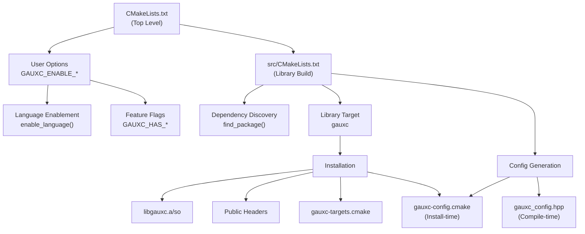
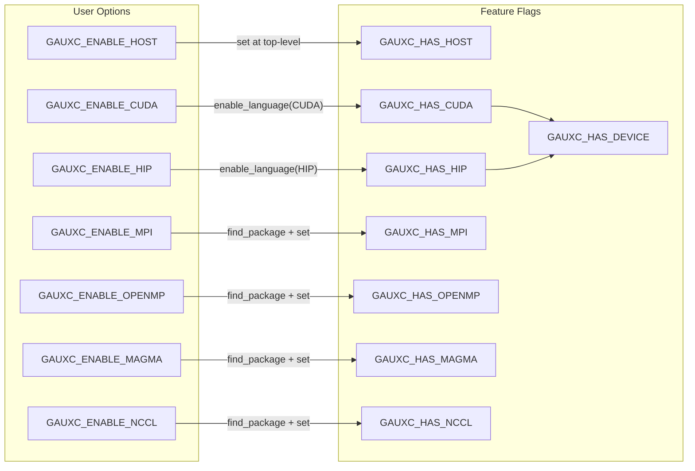
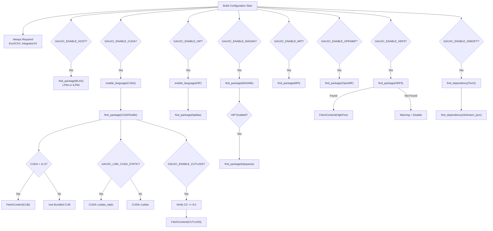
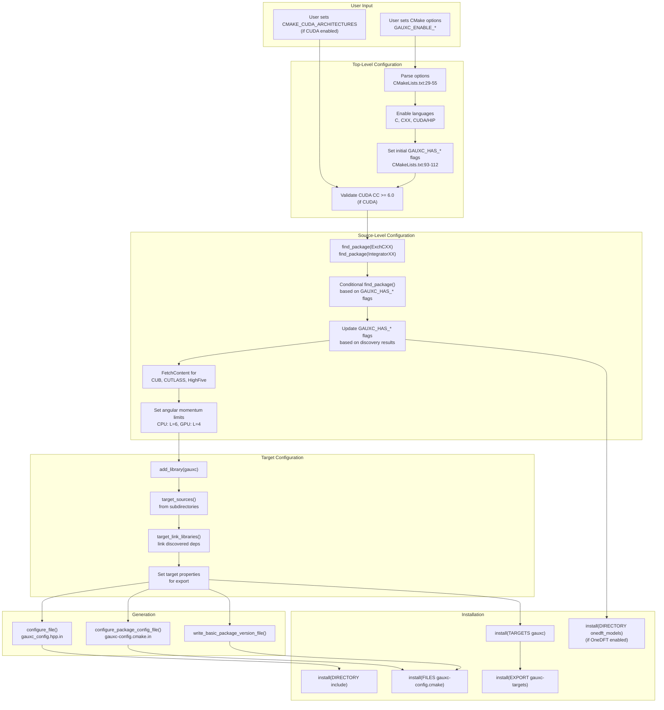

<!-- source: DeepWiki mcp.deepwiki.com · repo microsoft/skala · page 2 Build System and Configuration · fetched 2026-10-26 -->

# Build System and Configuration

<details>
<summary>Relevant source files</summary>

The following files were used as context for generating this wiki page:

- [third_party/gauxc/CMakeLists.txt](third_party/gauxc/CMakeLists.txt)
- [third_party/gauxc/attic/src/integrator/cuda/gauxc-cuda_integrator.cmake](third_party/gauxc/attic/src/integrator/cuda/gauxc-cuda_integrator.cmake)
- [third_party/gauxc/attic/src/new_integrator/device/cuda/gauxc-cuda.cmake](third_party/gauxc/attic/src/new_integrator/device/cuda/gauxc-cuda.cmake)
- [third_party/gauxc/attic/src/new_integrator/device/hip/gauxc-hip.cmake](third_party/gauxc/attic/src/new_integrator/device/hip/gauxc-hip.cmake)
- [third_party/gauxc/cmake/gauxc-config.cmake.in](third_party/gauxc/cmake/gauxc-config.cmake.in)
- [third_party/gauxc/cmake/gauxc-cub.cmake](third_party/gauxc/cmake/gauxc-cub.cmake)
- [third_party/gauxc/cmake/gauxc-cutlass.cmake](third_party/gauxc/cmake/gauxc-cutlass.cmake)
- [third_party/gauxc/include/gauxc/gauxc_config.hpp.in](third_party/gauxc/include/gauxc/gauxc_config.hpp.in)
- [third_party/gauxc/include/gauxc/util/environment.hpp](third_party/gauxc/include/gauxc/util/environment.hpp)
- [third_party/gauxc/src/CMakeLists.txt](third_party/gauxc/src/CMakeLists.txt)
- [third_party/gauxc/src/external/CMakeLists.txt](third_party/gauxc/src/external/CMakeLists.txt)
- [third_party/gauxc/src/xc_integrator/local_work_driver/device/CMakeLists.txt](third_party/gauxc/src/xc_integrator/local_work_driver/device/CMakeLists.txt)
- [third_party/gauxc/src/xc_integrator/local_work_driver/device/cuda/CMakeLists.txt](third_party/gauxc/src/xc_integrator/local_work_driver/device/cuda/CMakeLists.txt)
- [third_party/gauxc/src/xc_integrator/local_work_driver/device/hip/CMakeLists.txt](third_party/gauxc/src/xc_integrator/local_work_driver/device/hip/CMakeLists.txt)
- [third_party/gauxc/tests/environment.cxx](third_party/gauxc/tests/environment.cxx)

</details>


## Purpose and Scope

This document describes the CMake-based build system used to compile GauXC, including configuration options, dependency management, platform-specific setup, and installation artifacts. It covers how user-facing `GAUXC_ENABLE_*` options are processed to generate compile-time `GAUXC_HAS_*` flags, how required and optional dependencies are discovered, and how the build system exports configuration for downstream consumers.

For details on how configuration flags affect runtime execution paths, see [Execution Model: Host vs Device](#4.2). For information on code generation driven by build-time settings, see [Gau2Grid Collocation System](#6.1) and [Kernel Specialization Matrix](#7.2.3).

## Build System Overview

GauXC uses CMake 3.20+ as its build system, with a two-tier structure:

1. **Top-level configuration** ([third_party/gauxc/CMakeLists.txt:1-133]()) - Defines user options, enables languages (C, CXX, CUDA, HIP), and sets feature flags
2. **Source-level configuration** ([third_party/gauxc/src/CMakeLists.txt:1-248]()) - Discovers dependencies, builds the library, generates config artifacts, and handles installation

The build process transforms user options into both compile-time preprocessor definitions (via `gauxc_config.hpp`) and install-time package properties (via `gauxc-config.cmake`).

**Top-Level Build Structure**



Sources: [third_party/gauxc/CMakeLists.txt:1-133](), [third_party/gauxc/src/CMakeLists.txt:1-248]()

## CMake Options and Feature Flags

The build system exposes user-facing `GAUXC_ENABLE_*` options that are transformed into internal `GAUXC_HAS_*` feature flags. This two-level design allows users to request features via simple booleans while the build system tracks which features are actually available after dependency discovery.

### Option Categories

**Core Execution Paths**
- `GAUXC_ENABLE_HOST` (default: ON) - Enable CPU-based integration
- `GAUXC_ENABLE_CUDA` (default: OFF) - Enable NVIDIA GPU support
- `GAUXC_ENABLE_HIP` (default: OFF) - Enable AMD GPU support

**Parallelism and Communication**
- `GAUXC_ENABLE_OPENMP` (default: ON) - Enable OpenMP threading
- `GAUXC_ENABLE_MPI` (default: ON) - Enable MPI distributed parallelism

**Optional Features**
- `GAUXC_ENABLE_GAU2GRID` (default: ON) - Enable Gau2Grid collocation (currently required)
- `GAUXC_ENABLE_HDF5` (default: ON) - Enable HDF5 I/O support
- `GAUXC_ENABLE_ONEDFT` (default: ON) - Enable OneDFT functional integration

**GPU-Specific Optional Features** (CMake Dependent Options)
- `GAUXC_ENABLE_MAGMA` (default: ON if CUDA/HIP) - GPU linear algebra via MAGMA
- `GAUXC_ENABLE_NCCL` (default: OFF) - NVIDIA NCCL for multi-GPU collectives (CUDA only)
- `GAUXC_ENABLE_CUTLASS` (default: OFF) - CUTLASS linear algebra (CUDA only, requires CC ≥ 8.0)

**Build Behavior**
- `GAUXC_LINK_CUDA_STATIC` (default: OFF) - Link against static cuBLAS libraries
- `GAUXC_BLAS_PREFER_ILP64` (default: OFF) - Prefer ILP64 interface for host BLAS
- `GAUXC_USE_FAST_RSQRT` (default: OFF) - Enable fast reciprocal square root approximation

Sources: [third_party/gauxc/CMakeLists.txt:29-55]()

### Option to Flag Mapping



Sources: [third_party/gauxc/CMakeLists.txt:58-112](), [third_party/gauxc/src/CMakeLists.txt:10-33]()

The transformation from options to flags occurs in two phases:

1. **Top-level phase** ([third_party/gauxc/CMakeLists.txt:93-112]()) - Simple boolean options like `GAUXC_ENABLE_HOST` directly set feature flags, while GPU options enable CUDA or HIP languages
2. **Source-level phase** ([third_party/gauxc/src/CMakeLists.txt:10-33]()) - Dependency discovery (e.g., `find_package(MPI)`) sets flags only if packages are found successfully

The `GAUXC_HAS_DEVICE` flag is a derived flag set to TRUE if either `GAUXC_HAS_CUDA` or `GAUXC_HAS_HIP` is enabled ([third_party/gauxc/CMakeLists.txt:108-112]()), and at least one of `GAUXC_HAS_HOST` or `GAUXC_HAS_DEVICE` must be TRUE ([third_party/gauxc/CMakeLists.txt:116-118]()).

### Angular Momentum Limits

Maximum angular momentum (L-value) limits are set differently for CPU and GPU execution:

| Execution Path | Variable | Value | Description |
|----------------|----------|-------|-------------|
| CPU XC/DEN | `GAUXC_CPU_XC_MAX_AM` | 6 | Maximum L for host XC integration |
| CPU SNLINK | `GAUXC_CPU_SNLINK_MAX_AM` | 6 | Maximum L for host SN-LinK |
| GPU XC/DEN | `GAUXC_GPU_XC_MAX_AM` | 4 | Maximum L for device XC integration |
| GPU SNLINK | `GAUXC_GPU_SNLINK_MAX_AM` | 2 | Maximum L for device SN-LinK |

These limits control code generation and kernel specialization. Lower GPU limits reduce compile times and binary size at the cost of supporting fewer basis sets.

Sources: [third_party/gauxc/src/CMakeLists.txt:116-124]()

## Dependency Management

GauXC has a tiered dependency structure with always-required core dependencies and conditionally-required platform-specific dependencies.

### Core Dependencies (Always Required)

**ExchCXX** - Exchange-correlation functional library
- Discovered via `find_dependency(ExchCXX)` in both top-level and package config
- Provides functional definitions and evaluation infrastructure
- Linked via `target_link_libraries(gauxc PUBLIC ExchCXX::ExchCXX)`

**IntegratorXX** - Quadrature rule library  
- Discovered via `find_dependency(IntegratorXX)`
- Provides molecular quadrature grids
- Linked via `target_link_libraries(gauxc PUBLIC IntegratorXX::IntegratorXX)`

**Threading** - OpenMP or Pthreads
- If `GAUXC_HAS_OPENMP`: links `OpenMP::OpenMP_CXX`
- Otherwise: links `Threads::Threads` as fallback

Sources: [third_party/gauxc/src/CMakeLists.txt:36-94](), [third_party/gauxc/cmake/gauxc-config.cmake.in:10-11]()

### Host Execution Dependencies

When `GAUXC_HAS_HOST` is enabled:

**BLAS/LAPACK** - Linear algebra backend
- Interface selection controlled by `GAUXC_BLAS_PREFER_ILP64`
- If prefer ILP64: discovers with `COMPONENTS ilp64`
- Otherwise: discovers with `COMPONENTS lp64`
- The actual interface is recorded in `GAUXC_BLAS_IS_LP64` flag

Sources: [third_party/gauxc/cmake/gauxc-config.cmake.in:34-42]()

### CUDA Dependencies

When `GAUXC_ENABLE_CUDA` is enabled:

**CUDAToolkit** - NVIDIA CUDA compiler and runtime
- Minimum compute capability: 6.0 (required for FP64 atomics)
- Version is recorded and exported for exact matching in package config
- Language enabled via `enable_language(CUDA)` at top-level

**cuBLAS** - CUDA linear algebra
- Static or dynamic linking controlled by `GAUXC_LINK_CUDA_STATIC`
- Links `CUDA::cublas_static` if static, `CUDA::cublas` otherwise

**CUB** - CUDA primitives library
- For CUDA < 11.0: fetched via `FetchContent` from external repository
- For CUDA ≥ 11.0: uses CUB bundled with CUDA Toolkit
- Repository/revision defined in `gauxc-dep-versions.cmake`

**CUTLASS** (Optional, `GAUXC_ENABLE_CUTLASS`)
- Requires CUDA compute capability ≥ 8.0
- Fetched via `FetchContent` from external repository
- Provides optimized GEMM kernels for Ampere+ GPUs
- Validation: [third_party/gauxc/cmake/gauxc-cutlass.cmake:1-6]() checks all architectures are ≥ 80

**MAGMA** (Optional, `GAUXC_ENABLE_MAGMA`)
- GPU-accelerated linear algebra library
- Discovered via custom `FindMAGMA.cmake` module
- Linked as `MAGMA::magma`

**NCCL** (Optional, `GAUXC_ENABLE_NCCL`)  
- NVIDIA Collective Communications Library for multi-GPU
- Discovered via custom `FindNCCL.cmake` module
- Only available for CUDA (not HIP)

Sources: [third_party/gauxc/src/xc_integrator/local_work_driver/device/cuda/CMakeLists.txt:31-41](), [third_party/gauxc/cmake/gauxc-cub.cmake:1-31](), [third_party/gauxc/cmake/gauxc-cutlass.cmake:1-34]()

### HIP Dependencies

When `GAUXC_ENABLE_HIP` is enabled:

**HIP Runtime** - AMD GPU runtime
- Language enabled via `enable_language(HIP)` at top-level

**hipBLAS** - HIP linear algebra
- Always linked as `roc::hipblas`

**hipSPARSE** (when MAGMA enabled)
- Required by MAGMA on HIP platform
- Linked as `roc::hipsparse`

**MAGMA** (Optional, `GAUXC_ENABLE_MAGMA`)
- Same as CUDA, but requires additional hipSPARSE linkage

Sources: [third_party/gauxc/src/xc_integrator/local_work_driver/device/hip/CMakeLists.txt:28-32]()

### Optional Feature Dependencies

**HDF5** (when `GAUXC_ENABLE_HDF5`)
- Discovered via `find_package(HDF5)`
- If not found, warning is issued and HDF5 disabled
- HighFive C++ wrapper fetched via `FetchContent`
- Configuration: [third_party/gauxc/src/external/CMakeLists.txt:8-35]()

**OneDFT** (when `GAUXC_ENABLE_ONEDFT`)
- **Torch/PyTorch** - Neural network inference
  - Discovered via `find_dependency(Torch)`
  - Special handling: Torch may override `CMAKE_CUDA_ARCHITECTURES` to OFF; this is detected and reverted
- **nlohmann_json** - JSON parsing for model configuration
- Model data copied from `data/onedft_models` to install location

Sources: [third_party/gauxc/cmake/gauxc-config.cmake.in:67-75](), [third_party/gauxc/src/CMakeLists.txt:26-33, 126-132]()

### Dependency Discovery Flow



Sources: [third_party/gauxc/src/CMakeLists.txt:10-110](), [third_party/gauxc/cmake/gauxc-cub.cmake:1-31](), [third_party/gauxc/cmake/gauxc-cutlass.cmake:1-34]()

## Platform-Specific Configuration

### CUDA Configuration

**Compute Capability Validation**

GauXC enforces minimum compute capability requirements to ensure availability of required hardware features:

```cmake
# From src/xc_integrator/local_work_driver/device/cuda/CMakeLists.txt:37-41
foreach( cuda_arch ${CMAKE_CUDA_ARCHITECTURES} )
  if( cuda_arch LESS 60 )
    message(FATAL_ERROR "GauXC Requires CUDA CC 6.0+ For FP64 Atomics")
  endif()
endforeach()
```

For CUTLASS support, this is further restricted to CC 8.0+ (Ampere generation):

```cmake
# From cmake/gauxc-cutlass.cmake:2-6
foreach( cuda_arch ${CMAKE_CUDA_ARCHITECTURES} )
  if( NOT cuda_arch GREATER_EQUAL 80 )
    message(FATAL_ERROR "GauXC Requires CUDA CC >= 8.0 For CUTLASS")
  endif()
endforeach()
```

**Compilation Flags**

CUDA source files are compiled with suppression of certain warnings and verbose register/PTX output:

```cmake
target_compile_options( gauxc
  PRIVATE
    $<$<COMPILE_LANGUAGE:CUDA>: -Xcudafe --diag_suppress=partial_override -Xptxas -v >
)
```

Sources: [third_party/gauxc/src/xc_integrator/local_work_driver/device/cuda/CMakeLists.txt:31-53]()

### HIP Configuration

HIP support uses ROCm platform libraries without additional compute capability checks. The main difference is linking requirements:

- `roc::hipblas` for GPU linear algebra
- `roc::hipsparse` when MAGMA is enabled (MAGMA dependency on HIP)

Sources: [third_party/gauxc/src/xc_integrator/local_work_driver/device/hip/CMakeLists.txt:28-32]()

## Generated Build Artifacts

The build system generates two primary configuration artifacts: a compile-time header and an install-time CMake package config.

### Compile-Time Configuration Header

**File**: `gauxc_config.hpp`  
**Template**: [third_party/gauxc/include/gauxc/gauxc_config.hpp.in:1-43]()  
**Generated**: `${PROJECT_BINARY_DIR}/include/gauxc/gauxc_config.hpp`

This header uses `#cmakedefine` directives to conditionally define preprocessor macros based on CMake cache variables:

```cpp
#pragma once

#cmakedefine GAUXC_HAS_HOST
#cmakedefine GAUXC_HAS_CUDA
#cmakedefine GAUXC_HAS_HIP
#cmakedefine GAUXC_HAS_MPI
#cmakedefine GAUXC_HAS_MAGMA
#cmakedefine GAUXC_HAS_NCCL
#cmakedefine GAUXC_HAS_CUTLASS
#cmakedefine GAUXC_HAS_GAU2GRID
#cmakedefine GAUXC_HAS_HDF5
#cmakedefine GAUXC_HAS_ONEDFT
#cmakedefine GAUXC_USE_FAST_RSQRT

#ifdef GAUXC_HAS_HOST
#cmakedefine GAUXC_CPU_XC_MAX_AM     @GAUXC_CPU_XC_MAX_AM@
#cmakedefine GAUXC_CPU_SNLINK_MAX_AM @GAUXC_CPU_SNLINK_MAX_AM@
#endif

#cmakedefine GAUXC_HAS_DEVICE
#ifdef GAUXC_HAS_DEVICE
#cmakedefine GAUXC_GPU_XC_MAX_AM     @GAUXC_GPU_XC_MAX_AM@
#cmakedefine GAUXC_GPU_SNLINK_MAX_AM @GAUXC_GPU_SNLINK_MAX_AM@
#endif
```

The header also defines a `HOST_DEVICE_ACCESSIBLE` macro for CUDA/HIP dual compilation:

```cpp
#if defined(__CUDACC__) || defined(__HIPCC__)
  #define HOST_DEVICE_ACCESSIBLE __host__ __device__
#else
  #define HOST_DEVICE_ACCESSIBLE
#endif
```

**Usage Example**: [third_party/gauxc/include/gauxc/util/environment.hpp:14-40]() demonstrates querying maximum angular momentum at runtime based on compile-time flags:

```cpp
inline int gauxc_max_am(ExecutionSpace ex, SupportedAlg alg) {
  switch(ex) {
    #ifdef GAUXC_HAS_HOST
    case ExecutionSpace::Host:
      switch(alg) {
        case SupportedAlg::XC: 
          return GAUXC_CPU_XC_MAX_AM;
        // ...
      }
    #endif
    #ifdef GAUXC_HAS_DEVICE
    case ExecutionSpace::Device:
      switch(alg) {
        case SupportedAlg::XC: 
          return GAUXC_GPU_XC_MAX_AM;
        // ...
      }
    #endif
    // ...
  }
}
```

Sources: [third_party/gauxc/include/gauxc/gauxc_config.hpp.in:1-43](), [third_party/gauxc/src/CMakeLists.txt:135-138]()

### Install-Time Package Configuration

**File**: `gauxc-config.cmake`  
**Template**: [third_party/gauxc/cmake/gauxc-config.cmake.in:1-85]()  
**Generated**: `${CMAKE_CURRENT_BINARY_DIR}/gauxc-config.cmake`  
**Installed**: `${CMAKE_INSTALL_LIBDIR}/cmake/gauxc/gauxc-config.cmake`

This file allows downstream CMake projects to find and use GauXC via `find_package(GauXC)`. It performs three main functions:

1. **Export Feature Flags** (lines 13-24)

```cmake
set( GAUXC_HAS_HOST       @GAUXC_HAS_HOST@      )
set( GAUXC_HAS_CUDA       @GAUXC_HAS_CUDA@      )
set( GAUXC_HAS_HIP        @GAUXC_HAS_HIP@       )
set( GAUXC_HAS_MAGMA      @GAUXC_HAS_MAGMA@     )
set( GAUXC_HAS_NCCL       @GAUXC_HAS_NCCL@      )
set( GAUXC_HAS_CUTLASS    @GAUXC_HAS_CUTLASS@   )
set( GAUXC_HAS_MPI        @GAUXC_HAS_MPI@       )
set( GAUXC_HAS_OPENMP     @GAUXC_HAS_OPENMP@    )
set( GAUXC_HAS_GAU2GRID   @GAUXC_HAS_GAU2GRID@  )
set( GAUXC_HAS_HDF5       @GAUXC_HAS_HDF5@      )
set( GAUXC_BLAS_IS_LP64   @GAUXC_BLAS_IS_LP64@  )
set( GAUXC_HAS_ONEDFT     @GAUXC_HAS_ONEDFT@    )
```

2. **Re-discover Transitive Dependencies** (lines 26-75)

The config file ensures all dependencies are available in the downstream build by calling `find_dependency` for each enabled feature:

```cmake
# Always required
find_dependency( ExchCXX )
find_dependency( IntegratorXX )

if( GAUXC_HAS_HOST )
  find_dependency( BLAS COMPONENTS "${_blas_components}")
endif()

if( GAUXC_HAS_CUDA )
  enable_language( CUDA )
  find_dependency( CUDAToolkit @CUDAToolkit_VERSION@ EXACT )
  if( GAUXC_HAS_MAGMA )
    find_dependency( MAGMA )
  endif()
  if( GAUXC_HAS_NCCL )
    find_dependency( NCCL )
  endif()
endif()

if( GAUXC_HAS_MPI )
  find_dependency( MPI )
endif()

# ... etc for other dependencies
```

Note the exact version match for `CUDAToolkit` to ensure ABI compatibility.

3. **Import Targets** (lines 80-84)

```cmake
if(NOT TARGET gauxc::gauxc)
    include("${GauXC_CMAKE_DIR}/gauxc-targets.cmake")
endif()

set(GauXC_LIBRARIES gauxc::gauxc)
```

Sources: [third_party/gauxc/cmake/gauxc-config.cmake.in:1-85](), [third_party/gauxc/src/CMakeLists.txt:229-234]()

### Export Properties System

GauXC uses CMake's `EXPORT_PROPERTIES` mechanism to attach metadata to the installed `gauxc::gauxc` target. Downstream projects can query these properties to determine GauXC's capabilities:

```cmake
# From src/CMakeLists.txt:152-191
set(export_properties
  "GAUXC_HAS_HOST"
  "GAUXC_HAS_DEVICE"
  "GAUXC_HAS_CUDA"
  "GAUXC_HAS_HIP"
  "GAUXC_HAS_MAGMA"
  "GAUXC_HAS_CUTLASS"
  "GAUXC_HAS_NCCL"
  "GAUXC_HAS_MPI"
  "GAUXC_HAS_OPENMP"
  "GAUXC_HAS_HDF5"
  "GAUXC_HAS_ONEDFT"
  "GAUXC_CPU_XC_MAX_AM"
  "GAUXC_CPU_SNLINK_MAX_AM"
  "GAUXC_GPU_XC_MAX_AM"
  "GAUXC_GPU_SNLINK_MAX_AM"
)

set_target_properties(gauxc PROPERTIES
    "GAUXC_HAS_HOST"       ${GAUXC_HAS_HOST}
    "GAUXC_HAS_DEVICE"     ${GAUXC_HAS_DEVICE}
    # ... set all properties ...
)

set_property(TARGET gauxc APPEND PROPERTY EXPORT_PROPERTIES "${export_properties}")
```

Downstream projects can query these properties:

```cmake
find_package(GauXC REQUIRED)
get_target_property(GAUXC_HAS_CUDA gauxc::gauxc GAUXC_HAS_CUDA)
if(GAUXC_HAS_CUDA)
  # Use CUDA-specific features
endif()
```

Sources: [third_party/gauxc/src/CMakeLists.txt:152-192]()

## Installation Structure

The installation process copies library files, headers, and CMake package files to standard locations:

**Installation Components**

| Component | Source | Destination |
|-----------|--------|-------------|
| Library | `libgauxc.a` or `libgauxc.so` | `${CMAKE_INSTALL_LIBDIR}` |
| Public Headers | `include/**/*.hpp` | `include/` |
| Generated Config Header | `gauxc_config.hpp` | `include/gauxc/` |
| CMake Package Config | `gauxc-config.cmake` | `${CMAKE_INSTALL_LIBDIR}/cmake/gauxc/` |
| CMake Targets | `gauxc-targets.cmake` | `${CMAKE_INSTALL_LIBDIR}/cmake/gauxc/` |
| CMake Version File | `gauxc-config-version.cmake` | `${CMAKE_INSTALL_LIBDIR}/cmake/gauxc/` |
| Custom Find Modules | `FindMAGMA.cmake`, `FindNCCL.cmake` | `${CMAKE_INSTALL_LIBDIR}/cmake/gauxc/` |
| BLAS Find Modules | From linalg-cmake-modules | `${CMAKE_INSTALL_LIBDIR}/cmake/gauxc/linalg-cmake-modules/` |
| OneDFT Models (if enabled) | `data/onedft_models/` | `share/gauxc/onedft_models/` |

**OneDFT Model Paths**

When `GAUXC_ENABLE_ONEDFT` is enabled, model data is installed and two paths are defined:

- `GAUXC_ONEDFT_MODEL_PATH` - Build-time path: `${PROJECT_SOURCE_DIR}/data/onedft_models`
- `GAUXC_ONEDFT_MODEL_PATH_INSTALL` - Install-time path: `${CMAKE_INSTALL_PREFIX}/share/gauxc/onedft_models`

Both are defined in `gauxc_config.hpp` for runtime model loading.

Sources: [third_party/gauxc/src/CMakeLists.txt:126-248]()

### Version Compatibility

The package config includes a version file generated by `write_basic_package_version_file()` with `AnyNewerVersion` compatibility:

```cmake
write_basic_package_version_file(
  ${CMAKE_CURRENT_BINARY_DIR}/gauxc-config-version.cmake
  VERSION ${PROJECT_VERSION}
  COMPATIBILITY AnyNewerVersion
)
```

This allows downstream projects to specify minimum version requirements:

```cmake
find_package(GauXC 0.0.1 REQUIRED)
```

Sources: [third_party/gauxc/src/CMakeLists.txt:222-226]()

## Complete Build Flow



Sources: [third_party/gauxc/CMakeLists.txt:1-133](), [third_party/gauxc/src/CMakeLists.txt:1-248]()

## CMake Usage Patterns

### Building GauXC

**Minimal Host-Only Build**

```bash
cmake -S . -B build \
  -DGAUXC_ENABLE_HOST=ON \
  -DGAUXC_ENABLE_CUDA=OFF \
  -DGAUXC_ENABLE_HIP=OFF
cmake --build build
cmake --install build --prefix /path/to/install
```

**CUDA Build with CUTLASS**

```bash
cmake -S . -B build \
  -DGAUXC_ENABLE_CUDA=ON \
  -DCMAKE_CUDA_ARCHITECTURES="80;86" \
  -DGAUXC_ENABLE_CUTLASS=ON \
  -DGAUXC_ENABLE_MAGMA=ON
cmake --build build
```

**HIP Build for AMD**

```bash
cmake -S . -B build \
  -DGAUXC_ENABLE_HIP=ON \
  -DGAUXC_ENABLE_MAGMA=ON \
  -DCMAKE_HIP_ARCHITECTURES="gfx908;gfx90a"
cmake --build build
```

### Consuming GauXC

**Downstream CMakeLists.txt**

```cmake
find_package(GauXC 0.0.1 REQUIRED)

add_executable(my_app main.cpp)
target_link_libraries(my_app PRIVATE gauxc::gauxc)

# Query capabilities
get_target_property(HAS_CUDA gauxc::gauxc GAUXC_HAS_CUDA)
if(HAS_CUDA)
  message(STATUS "GauXC built with CUDA support")
endif()
```

Sources: [third_party/gauxc/cmake/gauxc-config.cmake.in:80-85]()

## Compiler-Specific Configuration

The build system checks for and enables various compiler warnings on C++ code:

```cmake
check_cxx_compiler_flag( -Wall              GAUXC_CXX_HAS_WALL              )
check_cxx_compiler_flag( -Wextra            GAUXC_CXX_HAS_WEXTRA            )
check_cxx_compiler_flag( -Wpedantic         GAUXC_CXX_HAS_WPEDANTIC         )
check_cxx_compiler_flag( -Wnon-virtual-dtor GAUXC_CXX_HAS_WNON_VIRTUAL_DTOR )
check_cxx_compiler_flag( -Wshadow           GAUXC_CXX_HAS_WSHADOW           )

if( GAUXC_CXX_HAS_WALL )
  target_compile_options( gauxc PRIVATE $<$<COMPILE_LANGUAGE:CXX>: -Wall> )
endif()
# ... similar for other warnings
```

Non-virtual destructor warnings are treated as errors:

```cmake
if( GAUXC_CXX_HAS_WNON_VIRTUAL_DTOR )
  target_compile_options( gauxc PRIVATE 
    $<$<COMPILE_LANGUAGE:CXX>: -Wnon-virtual-dtor -Werror=non-virtual-dtor> 
  )
endif()
```

These checks use generator expressions to apply flags only to C++ compilation, not CUDA or HIP.

Sources: [third_party/gauxc/src/CMakeLists.txt:58-83]()

---

