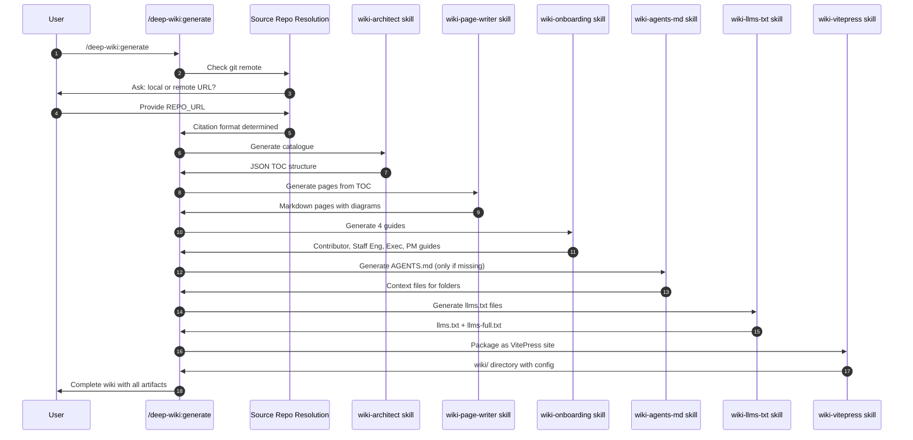
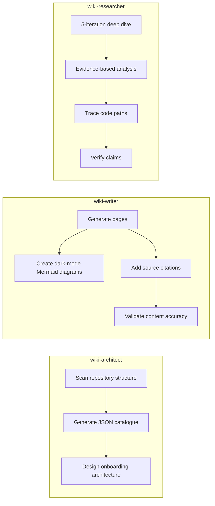
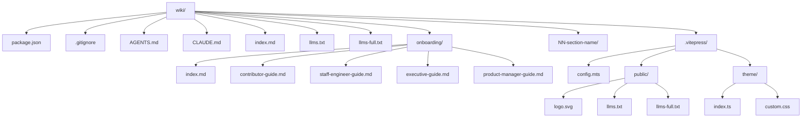
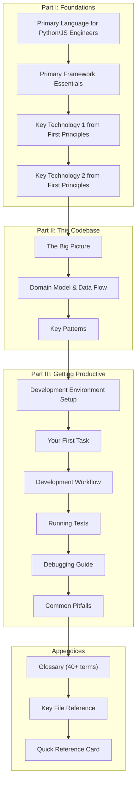
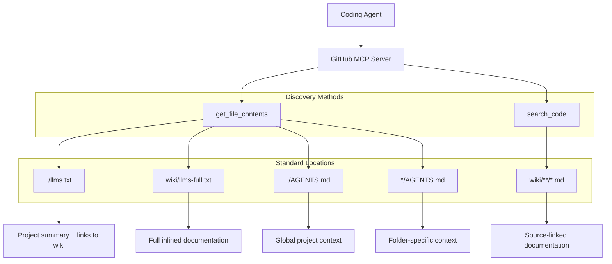
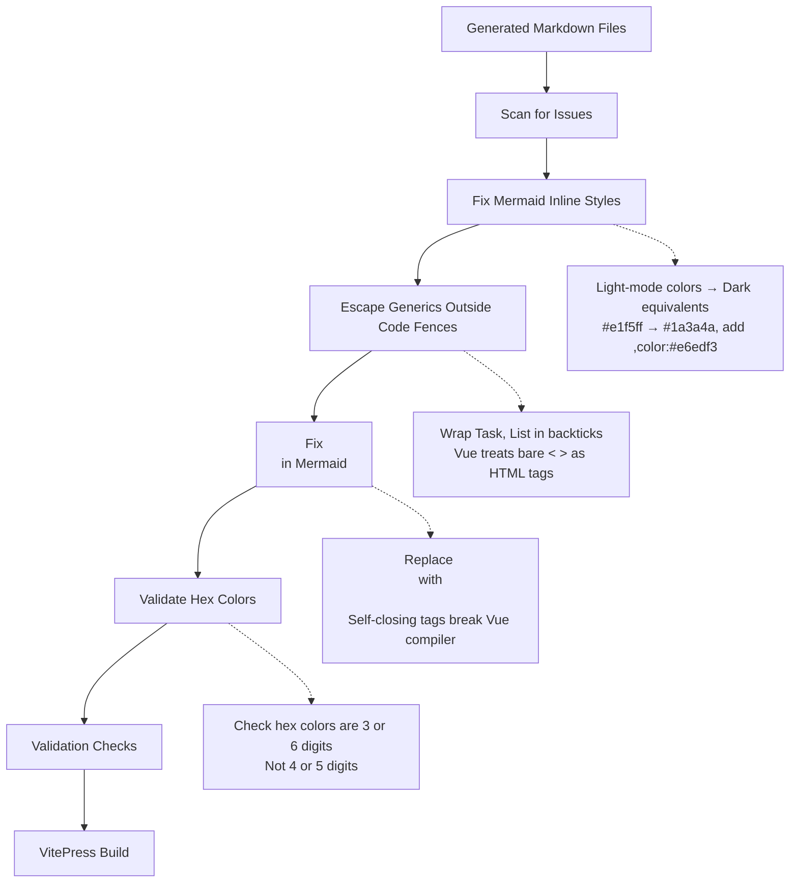

<!-- source: DeepWiki mcp.deepwiki.com · repo microsoft/skills · page 3 Deep Wiki Plugin · fetched 2026-10-30 -->

# Deep Wiki Plugin

<details>
<summary>Relevant source files</summary>

The following files were used as context for generating this wiki page:

- [.github/plugins/deep-wiki/.claude-plugin/plugin.json](.github/plugins/deep-wiki/.claude-plugin/plugin.json)
- [.github/plugins/deep-wiki/README.md](.github/plugins/deep-wiki/README.md)
- [.github/plugins/deep-wiki/commands/ado.md](.github/plugins/deep-wiki/commands/ado.md)
- [.github/plugins/deep-wiki/commands/agents.md](.github/plugins/deep-wiki/commands/agents.md)
- [.github/plugins/deep-wiki/commands/build.md](.github/plugins/deep-wiki/commands/build.md)
- [.github/plugins/deep-wiki/commands/crisp.md](.github/plugins/deep-wiki/commands/crisp.md)
- [.github/plugins/deep-wiki/commands/deploy.md](.github/plugins/deep-wiki/commands/deploy.md)
- [.github/plugins/deep-wiki/commands/generate.md](.github/plugins/deep-wiki/commands/generate.md)
- [.github/plugins/deep-wiki/commands/onboard.md](.github/plugins/deep-wiki/commands/onboard.md)
- [.github/plugins/deep-wiki/skills/wiki-ado-convert/SKILL.md](.github/plugins/deep-wiki/skills/wiki-ado-convert/SKILL.md)
- [.github/plugins/deep-wiki/skills/wiki-agents-md/SKILL.md](.github/plugins/deep-wiki/skills/wiki-agents-md/SKILL.md)
- [.github/plugins/deep-wiki/skills/wiki-onboarding/SKILL.md](.github/plugins/deep-wiki/skills/wiki-onboarding/SKILL.md)
- [README.md](README.md)
- [docs-site/src/pages/index.astro](docs-site/src/pages/index.astro)
- [docs/index.html](docs/index.html)

</details>


The Deep Wiki plugin is a GitHub Copilot CLI plugin that generates comprehensive, evidence-based documentation for code repositories. It produces structured wikis with dark-mode VitePress sites, audience-tailored onboarding guides, and Mermaid diagrams with source-linked citations. The plugin is designed for AI-powered documentation generation with support for multiple output formats including VitePress sites and Azure DevOps wikis.

This page documents the plugin's architecture, commands, agents, and workflows. For information about the skills within this plugin that are auto-invoked during documentation generation, see page 2 (Agent Skills System). For the broader documentation system that this plugin integrates with, see page 5 (Documentation System).

## Plugin Architecture

The Deep Wiki plugin follows a three-tier architecture: commands (slash commands for the Copilot CLI), skills (auto-invoked documentation generation capabilities), and agents (specialized personas for different documentation tasks).

```mermaid
graph TB
    subgraph "Command Layer"
        generate["/deep-wiki:generate"]
        crisp["/deep-wiki:crisp"]
        catalogue["/deep-wiki:catalogue"]
        page["/deep-wiki:page"]
        research["/deep-wiki:research"]
        ask["/deep-wiki:ask"]
        onboard["/deep-wiki:onboard"]
        agents_cmd["/deep-wiki:agents"]
        llms_cmd["/deep-wiki:llms"]
        build["/deep-wiki:build"]
        deploy["/deep-wiki:deploy"]
        ado["/deep-wiki:ado"]
        changelog["/deep-wiki:changelog"]
    end
    
    subgraph "Skill Layer"
        skill_arch["wiki-architect skill"]
        skill_writer["wiki-page-writer skill"]
        skill_researcher["wiki-researcher skill"]
        skill_qa["wiki-qa skill"]
        skill_changelog["wiki-changelog skill"]
        skill_vitepress["wiki-vitepress skill"]
        skill_onboarding["wiki-onboarding skill"]
        skill_agents["wiki-agents-md skill"]
        skill_llms["wiki-llms-txt skill"]
        skill_ado["wiki-ado-convert skill"]
    end
    
    subgraph "Agent Layer"
        agent_arch["wiki-architect agent"]
        agent_writer["wiki-writer agent"]
        agent_researcher["wiki-researcher agent"]
    end
    
    generate --> skill_arch
    generate --> skill_writer
    generate --> skill_onboarding
    generate --> skill_agents
    generate --> skill_llms
    generate --> skill_vitepress
    
    crisp --> skill_arch
    crisp --> skill_writer
    
    catalogue --> skill_arch
    page --> skill_writer
    research --> skill_researcher
    ask --> skill_qa
    onboard --> skill_onboarding
    agents_cmd --> skill_agents
    llms_cmd --> skill_llms
    build --> skill_vitepress
    ado --> skill_ado
    changelog --> skill_changelog
    
    skill_arch --> agent_arch
    skill_writer --> agent_writer
    skill_researcher --> agent_researcher
```



**Plugin Architecture Layers**

Sources: [.github/plugins/deep-wiki/README.md:1-217]()

### Directory Structure

The plugin follows the standard Copilot CLI plugin structure with commands, skills, and agents organized into separate directories.

```mermaid
graph TB
    root["deep-wiki/"]
    
    root --> manifest[".claude-plugin/plugin.json"]
    root --> commands_dir["commands/"]
    root --> skills_dir["skills/"]
    root --> agents_dir["agents/"]
    root --> readme["README.md"]
    
    commands_dir --> cmd_generate["generate.md"]
    commands_dir --> cmd_crisp["crisp.md"]
    commands_dir --> cmd_catalogue["catalogue.md"]
    commands_dir --> cmd_page["page.md"]
    commands_dir --> cmd_research["research.md"]
    commands_dir --> cmd_ask["ask.md"]
    commands_dir --> cmd_onboard["onboard.md"]
    commands_dir --> cmd_agents["agents.md"]
    commands_dir --> cmd_llms["llms.md"]
    commands_dir --> cmd_build["build.md"]
    commands_dir --> cmd_deploy["deploy.md"]
    commands_dir --> cmd_ado["ado.md"]
    commands_dir --> cmd_changelog["changelog.md"]
    
    skills_dir --> skill_arch_dir["wiki-architect/"]
    skills_dir --> skill_writer_dir["wiki-page-writer/"]
    skills_dir --> skill_researcher_dir["wiki-researcher/"]
    skills_dir --> skill_qa_dir["wiki-qa/"]
    skills_dir --> skill_changelog_dir["wiki-changelog/"]
    skills_dir --> skill_vitepress_dir["wiki-vitepress/"]
    skills_dir --> skill_onboarding_dir["wiki-onboarding/"]
    skills_dir --> skill_agents_dir["wiki-agents-md/"]
    skills_dir --> skill_llms_dir["wiki-llms-txt/"]
    skills_dir --> skill_ado_dir["wiki-ado-convert/"]
    
    skill_arch_dir --> skill_arch_file["SKILL.md"]
    skill_writer_dir --> skill_writer_file["SKILL.md"]
    skill_agents_dir --> skill_agents_file["SKILL.md"]
    skill_onboarding_dir --> skill_onboarding_file["SKILL.md"]
    skill_ado_dir --> skill_ado_file["SKILL.md"]
    
    agents_dir --> agent_arch["wiki-architect.md"]
    agents_dir --> agent_writer["wiki-writer.md"]
    agents_dir --> agent_researcher["wiki-researcher.md"]
```



**Deep Wiki Plugin Directory Structure**

Sources: [.github/plugins/deep-wiki/README.md:166-212]()

| Component | Path | Purpose |
|-----------|------|---------|
| Plugin manifest | `.claude-plugin/plugin.json` | Metadata (name, version, description) |
| Commands | `commands/*.md` | Slash command definitions for Copilot CLI |
| Skills | `skills/*/SKILL.md` | Auto-invoked documentation generation capabilities |
| Agents | `agents/*.md` | Specialized agent personas |
| Documentation | `README.md` | Plugin overview and quick start |

Sources: [.github/plugins/deep-wiki/.claude-plugin/plugin.json:1-12](), [.github/plugins/deep-wiki/README.md:166-212]()

## Commands vs Skills vs Agents

The plugin uses three distinct concepts that work together:

| Concept | Definition | Invocation | Example |
|---------|------------|------------|---------|
| **Command** | User-facing slash command | Explicit: `/deep-wiki:generate` | User types `/deep-wiki:generate` in Copilot CLI |
| **Skill** | Auto-invoked capability | Implicit: matches user intent | User says "create a wiki" → `wiki-architect` skill activates |
| **Agent** | Specialized persona | Via agent listing: `/agents` | User switches to `wiki-writer` agent for page generation |

Commands are entry points that orchestrate multiple skills. Skills detect when they should activate based on user intent. Agents provide specialized expertise and can be explicitly selected.

Sources: [.github/plugins/deep-wiki/README.md:39-63]()

## Available Commands

The plugin provides 13 slash commands for different documentation tasks.

| Command | Description | Primary Output |
|---------|-------------|----------------|
| `/deep-wiki:generate` | Complete wiki generation pipeline | VitePress site + onboarding + AGENTS.md + llms.txt |
| `/deep-wiki:crisp` | Fast, concise wiki (5-8 pages) | Markdown pages, no build step |
| `/deep-wiki:catalogue` | Hierarchical structure only | JSON table of contents |
| `/deep-wiki:page <topic>` | Single page with diagrams | Markdown with dark-mode Mermaid |
| `/deep-wiki:changelog` | Structured git commit history | Categorized changelog |
| `/deep-wiki:research <topic>` | Multi-turn investigation | Evidence-based analysis (5 iterations) |
| `/deep-wiki:ask <question>` | Q&A about repository | Answer grounded in source code |
| `/deep-wiki:onboard` | Audience-tailored guides | 4 guides (Contributor, Staff Eng, Exec, PM) |
| `/deep-wiki:agents` | Generate AGENTS.md files | Context files for coding agents |
| `/deep-wiki:llms` | LLM-friendly indexes | llms.txt + llms-full.txt |
| `/deep-wiki:ado` | Azure DevOps export script | Node.js conversion script |
| `/deep-wiki:build` | VitePress site packaging | Complete VitePress project |
| `/deep-wiki:deploy` | GitHub Actions workflow | deploy-wiki.yml workflow file |

Sources: [.github/plugins/deep-wiki/README.md:21-37]()

### Command Workflow: `/deep-wiki:generate`

The `generate` command orchestrates an 8-step documentation pipeline that produces a complete wiki with multiple output formats.



**Full Wiki Generation Workflow**

Sources: [.github/plugins/deep-wiki/commands/generate.md:1-150]()

### Source Repository Resolution

All wiki generation commands **must** resolve the source repository context before generating any content. This determines the citation format used throughout the documentation.

| Repository Type | Citation Format | Example | When Used |
|----------------|-----------------|---------|-----------|
| Remote (GitHub/ADO) | `[file:line](URL/blob/branch/file#Lline)` | `[src/auth.ts:42](https://github.com/org/repo/blob/main/src/auth.ts#L42)` | Remote URL detected or provided |
| Local only | `(file:line)` | `(src/auth.ts:42)` | No remote or user confirms local-only |

The resolution process follows these steps:

1. Run `git remote get-url origin` to detect remote URL
2. Ask user: "Is this a local-only repository, or do you have a source repository URL?"
3. Determine default branch: `git rev-parse --abbrev-ref HEAD`
4. Store citation format for use in all subsequent generation
5. **Block all work until resolved** — this is a hard requirement

Sources: [.github/plugins/deep-wiki/commands/generate.md:13-28](), [.github/plugins/deep-wiki/commands/ado.md:9-18]()

## Specialized Agents

The plugin includes three specialized agent personas that provide expert capabilities for documentation tasks.

| Agent | Role | Core Capabilities | When to Use |
|-------|------|-------------------|-------------|
| `wiki-architect` | Repository analyst | Analyzes structure, generates catalogues, creates onboarding architecture | Structuring documentation, understanding repo layout |
| `wiki-writer` | Technical writer | Generates pages with diagrams, citations, and dark-mode Mermaid | Writing detailed documentation pages |
| `wiki-researcher` | Deep investigator | Multi-turn research with evidence standard (5 iterations) | In-depth analysis requiring code tracing |

Users can switch to these agents using the `/agents` command in Copilot CLI to access specialized documentation expertise.

Sources: [.github/plugins/deep-wiki/README.md:39-47]()

### Agent Responsibilities



**Agent Responsibility Distribution**

Sources: [.github/plugins/deep-wiki/README.md:119-131]()

## Design Principles

The plugin enforces 12 core design principles that ensure high-quality, maintainable documentation.

| Principle | Implementation | Enforcement |
|-----------|----------------|-------------|
| **Source-linked citations** | All citations use `[file:line](URL)` or `(file:line)` format | Source resolution blocks all work |
| **Structure-first** | Always generate TOC/catalogue before pages | Catalogue generation required in all workflows |
| **Evidence-based** | Every claim cites `file_path:line_number` | Validation checks for citations |
| **Diagram-rich** | Minimum 3-5 dark-mode Mermaid diagrams per page | Validation counts diagrams |
| **Table-driven** | Prefer tables over prose for structured info | Summary tables, comparison tables with "Source" columns |
| **Progressive disclosure** | Big picture first, then drill into details | TL;DR at start of each section |
| **Hierarchical depth** | Max 4 levels for component granularity | Catalogue structure enforced |
| **Systems thinking** | Architecture → Subsystems → Components → Methods | Documentation structure |
| **Never invent** | All content derived from actual code | Validation checks file paths, class/method names |
| **Dark-mode native** | All output designed for dark-theme rendering | Dark-mode Mermaid colors enforced |
| **Depth before breadth** | Trace actual code paths, never guess | Code reading required, no file-name inference |
| **Agent-discoverable** | Output at standard paths (`llms.txt`, `AGENTS.md`) | File locations follow specifications |

Sources: [.github/plugins/deep-wiki/README.md:132-146]()

### Citation Format Specification

The plugin uses a strict citation format that enables clickable links to source code.

| Element | Format | Example |
|---------|--------|---------|
| Single line | `[file:line](URL#Lline)` | `[src/auth.ts:42](https://github.com/org/repo/blob/main/src/auth.ts#L42)` |
| Line range | `[file:startLine-endLine](URL#LstartLine-LendLine)` | `[src/auth.ts:42-58](https://github.com/org/repo/blob/main/src/auth.ts#L42-L58)` |
| Local (no URL) | `(file:line)` | `(src/auth.ts:42)` |
| Mermaid diagrams | `<!-- Sources: file:line, file:line -->` comment after diagram | See below |
| Tables | "Source" column with linked citations | Table row with citation in last column |

**Mermaid diagram citation format:**

```markdown
\`\`\`mermaid
graph TB
    A["Component A"] --> B["Component B"]
\`\`\`
<!-- Sources: src/component-a.ts:1-50, src/component-b.ts:1-80 -->
```

Sources: [.github/plugins/deep-wiki/commands/generate.md:23-27]()

## VitePress Site Generation

The `/deep-wiki:build` command packages generated wiki pages into a complete VitePress site with dark theme, dark-mode Mermaid diagrams, and click-to-zoom functionality.

### VitePress Project Structure



**VitePress Site Directory Structure**

Sources: [.github/plugins/deep-wiki/commands/build.md:13-44]()

### Dark Theme Implementation

The VitePress site uses a Daytona-inspired dark theme with comprehensive dark-mode styling for all elements including Mermaid diagrams.

| Theme Element | Configuration | Location |
|---------------|---------------|----------|
| Typography | Inter (body), JetBrains Mono (code) | config.mts head links |
| Appearance | Dark-only mode | config.mts `appearance: 'dark'` |
| Color palette | Background `#0d1117`, surface `#161b22`, node `#2d333b` | custom.css variables |
| Mermaid theme | Dark with comprehensive themeVariables | config.mts mermaid config |
| Mermaid CSS overrides | Force dark fills on all SVG shapes | custom.css `.mermaid` selectors |

**Dark-mode color palette:**

| Element | Background | Border | Text |
|---------|-----------|--------|------|
| Page background | `#0d1117` | — | `#e6edf3` |
| Elevated surface | `#161b22` | `#30363d` | `#e6edf3` |
| Card/node | `#2d333b` | `#6d5dfc` | `#e6edf3` |
| Secondary surface | `#1c2333` | `#6d5dfc` | `#e6edf3` |
| Lines/arrows | — | `#8b949e` | — |

Sources: [.github/plugins/deep-wiki/commands/build.md:150-210](), [.github/plugins/deep-wiki/commands/build.md:432-444]()

### Mermaid Dark-Mode Implementation

The plugin implements dark-mode Mermaid rendering through two mechanisms: theme variables in VitePress config and CSS overrides.

**Config.mts theme variables:**

```typescript
mermaid: {
  theme: 'dark',
  themeVariables: {
    darkMode: true,
    background: '#0d1117',
    primaryColor: '#2d333b',
    primaryTextColor: '#e6edf3',
    primaryBorderColor: '#6d5dfc',
    // ... 30+ additional variables
  }
}
```

**CSS overrides (required because theme variables don't cover everything):**

```css
.mermaid .node rect, .mermaid .node circle, .mermaid .node ellipse,
.mermaid .node polygon, .mermaid .node path, .mermaid .label-container {
  fill: #2d333b !important;
  stroke: #6d5dfc !important;
}
.mermaid .nodeLabel, .mermaid .node text, .mermaid text, .mermaid span {
  color: #e6edf3 !important;
  fill: #e6edf3 !important;
}
.mermaid .cluster rect { fill: #161b22 !important; stroke: #30363d !important; }
```

Sources: [.github/plugins/deep-wiki/commands/build.md:162-210](), [.github/plugins/deep-wiki/commands/build.md:461-479]()

### Zoom Implementation

The VitePress site implements two separate zoom systems: medium-zoom for images and a custom SVG overlay for Mermaid diagrams.

| Zoom Type | Technology | Target Elements | Features |
|-----------|-----------|-----------------|----------|
| Image zoom | medium-zoom library | `.vp-doc img:not(.no-zoom)` | Click to expand, dark backdrop |
| Mermaid zoom | Custom SVG overlay | `.mermaid` containers | Fullscreen modal, pan, wheel zoom, keyboard shortcuts |

**Mermaid zoom implementation details:**

The custom zoom system is necessary because Mermaid renders `<svg>` elements, not `` tags, which medium-zoom cannot handle. The implementation includes:

1. **Polling for async-rendered SVGs**: Mermaid diagrams render asynchronously via `vitepress-plugin-mermaid`, so the zoom handler polls up to 20 times with 500ms delays
2. **SVG cloning**: The original SVG is cloned (not moved) to preserve page layout
3. **ViewBox fixing**: Computes viewBox from `getBBox()` if missing to ensure correct scaling
4. **Pan and zoom**: Mouse drag for panning, scroll wheel for zooming, keyboard shortcuts (+/-/0/Esc)
5. **Duplicate handler prevention**: Marks containers with `data-zoom-attached` attribute

Sources: [.github/plugins/deep-wiki/commands/build.md:221-383]()

### Critical VitePress Setup Requirements

The VitePress config and theme setup has several critical implementation requirements that commonly cause bugs if not followed exactly.

| Requirement | Correct Implementation | Common Mistake | Consequence |
|-------------|----------------------|----------------|-------------|
| Zoom handler location | `setup()` with `onMounted` and route watcher | `enhanceApp()` hook | DOM doesn't exist during SSR, handlers don't attach |
| Mermaid SVG polling | Retry up to 20×500ms | Attach immediately on mount | SVGs don't exist yet, zoom never works |
| SVG cloning | Clone with `cloneNode(true)` | Move original SVG | Page layout breaks |
| ViewBox fixing | Compute from `getBBox()` if missing | Assume viewBox exists | Zoom doesn't scale correctly |
| Route change handling | `watch(() => route.path, () => initZoom())` | Only `onMounted` | Zoom breaks on page navigation |
| Handler deduplication | Check `data-zoom-attached` attribute | No check | Duplicate handlers on every route change |

Sources: [.github/plugins/deep-wiki/commands/build.md:386-391]()

### Index Page Requirements

The VitePress `index.md` landing page must be a developer-focused wiki home page, not a marketing landing page.

**Required content:**
- Project title as `#` heading
- Brief 1-2 sentence technical description
- **Quick Start** section with runnable commands
- **Architecture Overview** diagram with source citations
- **Documentation Map** table linking to all wiki sections
- **Key Files** table with source citations
- **Tech Stack** summary table

**Prohibited content:**
- VitePress `hero:` frontmatter blocks
- Marketing copy ("powerful", "blazing fast", "enterprise-grade")
- Feature highlight cards or badges
- "Get Started" call-to-action buttons
- Any content resembling a product landing page

Sources: [.github/plugins/deep-wiki/commands/build.md:46-119]()

## Onboarding Guide Generation

The `/deep-wiki:onboard` command generates four audience-tailored onboarding guides in an `onboarding/` folder, each providing exactly the understanding that audience needs.

| Guide | File | Audience | Length | Focus |
|-------|------|----------|--------|-------|
| Contributor | `contributor-guide.md` | New contributors (assumes Python/JS) | 1000-2500 lines | Progressive learning: foundations → codebase → productivity |
| Staff Engineer | `staff-engineer-guide.md` | Staff/principal engineers | 800-1200 lines | Dense, architectural, why over what |
| Executive | `executive-guide.md` | VP/director-level leaders | 400-800 lines | Capabilities, risks, investment thesis |
| Product Manager | `product-manager-guide.md` | PMs and non-engineering | 400-800 lines | Features, constraints, zero jargon |

Sources: [.github/plugins/deep-wiki/skills/wiki-onboarding/SKILL.md:27-38](), [.github/plugins/deep-wiki/commands/onboard.md:40-46]()

### Contributor Guide Structure

The Contributor Guide uses a three-part progressive structure that builds understanding step by step.



**Contributor Guide Progressive Structure**

**Part I** is skipped if the repository uses Python or JavaScript. Otherwise, it provides cross-language comparisons with side-by-side syntax tables, async model comparisons, and framework equivalents.

Sources: [.github/plugins/deep-wiki/skills/wiki-onboarding/SKILL.md:72-98](), [.github/plugins/deep-wiki/commands/onboard.md:60-90]()

### Staff Engineer Guide Requirements

The Staff Engineer Guide is dense, opinionated, and architectural. It uses pseudocode in a **different language** from the repository to explain concepts, ensuring the guide teaches understanding rather than syntax.

**Required sections with diagram types:**

| Section | Diagram Type | Purpose |
|---------|-------------|---------|
| System Architecture | `graph TB` | Full system with load-bearing components |
| Domain Model | `erDiagram` | Core entities with data invariants table |
| Key Abstractions | `classDiagram` | Load-bearing interfaces and abstractions |
| Request Lifecycle | `sequenceDiagram` with `autonumber` | Typical request flow end-to-end |
| State Transitions | `stateDiagram-v2` | Entity lifecycle states |

**Required tables:**

| Table | Columns | Purpose |
|-------|---------|---------|
| Data Invariants | Entity, Invariant, Enforced By, Source | Document what must always be true |
| Decision Log | Decision, Alternatives Considered, Rationale, Source | Explain why choices were made |
| Dependency Rationale | Dependency, Purpose, What It Replaced, Source | Justify external dependencies |
| Technical Debt | Issue, Risk Level, Affected Files, Source | Honest assessment of known problems |

Sources: [.github/plugins/deep-wiki/skills/wiki-onboarding/SKILL.md:106-136](), [.github/plugins/deep-wiki/commands/onboard.md:92-125]()

### Executive and PM Guides

The Executive and Product Manager guides are strategic, concise, and avoid technical implementation details.

**Executive Guide characteristics:**
- **NO code snippets** — focuses on business impact, not implementation
- **Service-level diagrams** — shows deployment units and team boundaries, not classes
- **Business language** — translates technical concepts into reliability, velocity, cost, risk
- Includes capability map, risk assessment, cost/scaling model, technical debt with business impact

**Product Manager Guide characteristics:**
- **ZERO engineering jargon** — no "middleware", "dependency injection", "ORM"
- **User-centric framing** — everything described in terms of user experience
- **Feature capability map** — comprehensive table showing what's Live/Beta/Planned/Not Possible
- Includes user journey maps, known limitations with workarounds, data/privacy overview, FAQ

Sources: [.github/plugins/deep-wiki/skills/wiki-onboarding/SKILL.md:142-201](), [.github/plugins/deep-wiki/commands/onboard.md:127-181]()

## AGENTS.md Generation

The `/deep-wiki:agents` command generates `AGENTS.md` files for pertinent repository folders. These files provide coding agents with project-specific context — build commands, testing instructions, code conventions, and operational boundaries.

### Critical Guard: Only Generate If Missing

The most important rule for AGENTS.md generation: **NEVER overwrite an existing AGENTS.md file**. For every folder:

1. Check if `AGENTS.md` exists (case-sensitive)
2. If YES → skip and report: "✅ AGENTS.md already exists in [folder] — skipping"
3. If NO → generate a new one

This is non-negotiable because existing AGENTS.md files may have been carefully hand-crafted with project-specific knowledge.

Sources: [.github/plugins/deep-wiki/skills/wiki-agents-md/SKILL.md:19-34](), [.github/plugins/deep-wiki/commands/agents.md:15-22]()

### Pertinent Folder Detection

The plugin identifies which folders should have an AGENTS.md file based on their contents and role.

| Category | Detection Criteria | Examples |
|----------|-------------------|----------|
| Always include | Repository root | `./` |
| Top-level code | Exists and contains source files | `tests/`, `src/`, `lib/`, `app/`, `api/` |
| Monorepo packages | Folder matches pattern | `packages/*/`, `apps/*/`, `services/*/` |
| Own build system | Contains package manifest | Has `package.json`, `pyproject.toml`, `Cargo.toml`, `*.csproj`, `go.mod`, `pom.xml`, `Makefile` |
| Generated wiki | VitePress wiki folder | `wiki/` with `package.json` |
| Always skip | Generated/vendor directories | `node_modules/`, `.git/`, `dist/`, `build/`, `vendor/`, `__pycache__/` |

Sources: [.github/plugins/deep-wiki/skills/wiki-agents-md/SKILL.md:36-63](), [.github/plugins/deep-wiki/commands/agents.md:26-49]()

### The Six Core Areas

Every AGENTS.md file covers six core areas, tailored to what actually exists in the folder.

```mermaid
graph TB
    commands["1. Build & Run Commands"]
    testing["2. Testing Instructions"]
    structure["3. Project Structure"]
    style["4. Code Style & Conventions"]
    git["5. Git Workflow"]
    boundaries["6. Boundaries"]
    
    commands --> testing
    testing --> structure
    structure --> style
    style --> git
    git --> boundaries
    
    commands_note["PUT FIRST - agents reference constantly<br/>Exact commands with flags"]
    testing_note["How to run all, one file, one test<br/>Test framework and conventions"]
    structure_note["Key directories, entry points<br/>Where to add new features"]
    style_note["Naming conventions<br/>One real code example from project"]
    git_note["Branch naming, PR format<br/>Pre-commit checks"]
    boundaries_note["✅ Always do<br/>⚠️ Ask first<br/>🚫 Never do"]
    
    commands -.-> commands_note
    testing -.-> testing_note
    structure -.-> structure_note
    style -.-> style_note
    git -.-> git_note
    boundaries -.-> boundaries_note
```

**Six Core Areas of AGENTS.md**

**Build & Run Commands** must come first because agents reference these constantly. The commands section contains exact, copy-pasteable commands with flags, not just tool names.

Sources: [.github/plugins/deep-wiki/skills/wiki-agents-md/SKILL.md:64-179](), [.github/plugins/deep-wiki/commands/agents.md:64-107]()

### Root vs Nested AGENTS.md

The content differs between root and nested AGENTS.md files to avoid duplication.

| File | Scope | Content |
|------|-------|---------|
| Root AGENTS.md | Entire project | Overall tech stack, global conventions, dev environment setup, global boundaries, CI/CD overview |
| Nested AGENTS.md | Specific folder | Folder purpose, folder-specific commands, folder-specific conventions, should NOT repeat root content |
| Wiki AGENTS.md | `wiki/` folder | VitePress commands, wiki structure, content conventions (Mermaid dark-mode, citations, frontmatter), boundaries |

**Example: Root AGENTS.md covers:**
- Tech stack: "TypeScript 5.4, React 18, Vite 5.1, Tailwind CSS 3.4"
- Global conventions: "All function names use camelCase, components use PascalCase"
- Security: "Never commit credentials, use environment variables"

**Example: `tests/` AGENTS.md covers:**
- Testing commands: `cd tests && pnpm test`
- Test framework: "Vitest with React Testing Library"
- Conventions: "Test files mirror source structure, use `.test.ts` suffix"

Sources: [.github/plugins/deep-wiki/skills/wiki-agents-md/SKILL.md:266-333](), [.github/plugins/deep-wiki/commands/agents.md:111-170]()

### CLAUDE.md Companion Files

Whenever an `AGENTS.md` is generated, a `CLAUDE.md` companion file is created in the same folder (only if `CLAUDE.md` doesn't already exist). The content is always exactly:

```markdown
# CLAUDE.md

<!-- Generated for repository development workflows. Do not edit directly. -->

Before beginning work in this repository, read `AGENTS.md` and follow all scoped AGENTS guidance.
```

This ensures Claude Code and similar tools are redirected to the authoritative AGENTS.md instructions.

Sources: [.github/plugins/deep-wiki/skills/wiki-agents-md/SKILL.md:335-350](), [.github/plugins/deep-wiki/commands/agents.md:171-186]()

## Azure DevOps Wiki Export

The `/deep-wiki:ado` command generates a Node.js build script that converts VitePress/GFM markdown to Azure DevOps Wiki-compatible format. The source files remain untouched — the script produces transformed copies in `dist/ado-wiki/`.

### ADO Wiki Incompatibilities

Azure DevOps Wikis use a markdown dialect that differs from GFM and VitePress in several critical ways.

```mermaid
graph TB
    subgraph "CRITICAL Incompatibilities"
        fence["Mermaid code fences<br/>```mermaid → ::: mermaid"]
        flowchart["flowchart keyword<br/>flowchart TD → graph TD"]
        br["<br> in Mermaid labels<br/>Strip entirely"]
        arrows["Long arrows<br/>----> → -->"]
        frontmatter["YAML front matter<br/>Rendered as visible text"]
        links["Parent-relative source links<br/>[](../../src) → plain text"]
        containers["VitePress containers<br/>::: tip → > [!TIP]"]
    end
    
    subgraph "MODERATE Issues"
        style["Mermaid style directives<br/>May be ignored"]
        thick["Thick arrows ==><br/>May work"]
        dotted["Dotted arrows -.-><br/>May work"]
    end
    
    subgraph "Compatible As-Is"
        tables["Tables"]
        quotes["Blockquotes"]
        code["Fenced code blocks"]
        samelinks["Same-directory .md links"]
        external["External HTTP/HTTPS links"]
        formatting["Bold, italic, inline code"]
    end
    
    fence --> must_fix["MUST FIX"]
    flowchart --> must_fix
    br --> must_fix
    arrows --> must_fix
    frontmatter --> must_fix
    links --> must_fix
    containers --> must_fix
    
    style --> may_fix["COSMETIC"]
    thick --> may_fix
    dotted --> may_fix
    
    tables --> no_action["NO ACTION"]
    quotes --> no_action
    code --> no_action
    samelinks --> no_action
    external --> no_action
    formatting --> no_action
```

**Azure DevOps Wiki Compatibility Matrix**

Sources: [.github/plugins/deep-wiki/skills/wiki-ado-convert/SKILL.md:24-56](), [.github/plugins/deep-wiki/commands/ado.md:117-127]()

### Transformation Functions

The build script applies five transformations in a specific order:

| Order | Transformation | Input | Output | Purpose |
|-------|---------------|-------|--------|---------|
| 1 | Strip YAML front matter | `---`...`---` at file start | (removed) | ADO renders as visible text |
| 2 | Convert Mermaid blocks | ` ```mermaid ` ... ` ``` ` | `::: mermaid` ... `:::` | ADO uses different fence syntax |
| 3 | Replace `flowchart` | `flowchart TD` | `graph TD` | ADO doesn't support `flowchart` keyword |
| 4 | Strip `<br>` in Mermaid | `Node[A<br>B]` | `Node[A B]` | ADO doesn't support `<br>` in labels |
| 5 | Fix long arrows | `---->` (4+ dashes) | `-->` | ADO doesn't support multi-dash arrows |
| 6 | Convert parent links | `[text](../../src/file)` | `text` (plain) | Wiki is separate from source tree |
| 7 | Convert containers | `::: tip` | `> [!TIP]` | VitePress syntax → ADO alert blockquotes |

Sources: [.github/plugins/deep-wiki/skills/wiki-ado-convert/SKILL.md:69-157](), [.github/plugins/deep-wiki/commands/ado.md:60-77]()

### Build Script Implementation

The generated script is a Node.js ESM module using only built-in modules (no external dependencies).

**Key implementation details:**

```javascript
// File: scripts/build-ado-wiki.js

import { readFile, writeFile, mkdir } from 'node:fs/promises'
import { join, dirname, relative } from 'node:path'

function stripFrontMatter(content) {
  if (!content.startsWith('---')) return content;
  const endIndex = content.indexOf('\n---', 3);
  if (endIndex === -1) return content;
  return content.slice(endIndex + 4).trimStart();
}

function convertMermaidBlocks(content) {
  const lines = content.split('\n');
  let inMermaid = false;
  const result = [];
  
  for (const line of lines) {
    if (/^```mermaid\s*$/.test(line.trimEnd())) {
      result.push('::: mermaid');
      inMermaid = true;
    } else if (inMermaid && /^```\s*$/.test(line.trimEnd())) {
      result.push(':::');
      inMermaid = false;
    } else if (inMermaid) {
      let fixed = line;
      fixed = fixed.replace(/^(\s*)flowchart(\s+)/, '$1graph$2');
      fixed = fixed.replace(/<br\s*\/?>/gi, ' ');
      fixed = fixed.replace(/-{4,}>/g, '-->');
      result.push(fixed);
    } else {
      result.push(line);
    }
  }
  
  return result.join('\n');
}
```

Sources: [.github/plugins/deep-wiki/skills/wiki-ado-convert/SKILL.md:69-179](), [.github/plugins/deep-wiki/commands/ado.md:82-93]()

### Index Page Generation

The ADO Wiki's `index.md` **must be a proper wiki landing page**, not a generic placeholder.

**Logic:**

1. If VitePress source has `index.md`: Transform it (strip front matter and VitePress hero blocks)
2. If meaningful content remains: Use it
3. If empty after stripping OR contains placeholder text ("TODO:", "Give a short introduction"): Generate proper landing page with:
   - Project title as `#` heading
   - Overview paragraph (from README or wiki overview)
   - Quick Navigation table (Section, Description columns)
   - Links to onboarding guides if they exist

**Generated index template structure:**

```markdown
# [Project Name] — Wiki

[1-2 sentence project description]

## Quick Navigation

| Section | Description |
|---------|-------------|
| [Onboarding Hub](./onboarding/index.md) | Guide selector for all audiences |
| [Contributor Guide](./onboarding/contributor-guide.md) | For new contributors |
| ... | ... |

## Wiki Contents

- [Full table of contents with links]
```

Sources: [.github/plugins/deep-wiki/skills/wiki-ado-convert/SKILL.md:209-237](), [.github/plugins/deep-wiki/commands/ado.md:140-177]()

### Citation and Diagram Preservation

The ADO conversion must maintain documentation quality by preserving evidence-based content.

| Element | VitePress Format | ADO Format | Preservation Strategy |
|---------|-----------------|-----------|----------------------|
| Linked citations | `[file:line](URL)` | `[file:line](URL)` | Preserve as-is (standard markdown) |
| Source comments | `<!-- Sources: ... -->` after Mermaid | `<!-- Sources: ... -->` | Preserve (HTML comments work in ADO) |
| Source columns | Table with "Source" column | Table with "Source" column | Preserve (standard markdown tables) |
| Mermaid diagrams | Multiple types supported | graph, sequenceDiagram, classDiagram, etc. | Preserve diagram content, only convert fences |

The transformation only changes syntax (fences, keywords, `<br>` tags) — the actual diagram structure, content, and citations remain intact.

Sources: [.github/plugins/deep-wiki/skills/wiki-ado-convert/SKILL.md:229-237](), [.github/plugins/deep-wiki/commands/ado.md:188-195]()

## LLM-Friendly Documentation

The `/deep-wiki:llms` command generates two LLM-friendly documentation indexes following the [llms.txt specification](https://llmstxt.org).

| File | Location | Purpose | Content |
|------|----------|---------|---------|
| `llms.txt` | Repo root (`./llms.txt`) | Quick project summary | H1 title, blockquote summary, H2 sections with links to wiki pages |
| `wiki/llms.txt` | Wiki directory | VitePress-relative version | Same structure but with wiki-relative paths for deployment |
| `llms-full.txt` | `wiki/llms-full.txt` | Full content for LLM context | Inlined page content in `<doc title="..." path="...">` blocks |

**Standard discovery locations:**

Coding agents and tools (GitHub MCP `get_file_contents`, `search_code`) look for `llms.txt` at the repository root first. VitePress sites serve `llms.txt` from `.vitepress/public/llms.txt` at the deployed URL's `/llms.txt` path.

Sources: [.github/plugins/deep-wiki/commands/generate.md:122-130]()

### llms.txt Format Specification

The `llms.txt` file follows a specific structure with semantic sections.

```markdown
# Project Name

> Brief one-paragraph project description

## Onboarding
- [Onboarding Hub](wiki/onboarding/index.md): Guide selector for all audiences
- [Contributor Guide](wiki/onboarding/contributor-guide.md): For new contributors
- [Staff Engineer Guide](wiki/onboarding/staff-engineer-guide.md): Architectural deep-dive
- [Executive Guide](wiki/onboarding/executive-guide.md): Capability and risk overview
- [Product Manager Guide](wiki/onboarding/product-manager-guide.md): Feature-focused guide

## Architecture
- [System Architecture](wiki/02-architecture/overview.md): High-level system design
- [Component Overview](wiki/02-architecture/components.md): Core components
...

## Getting Started
- [Setup Guide](wiki/01-getting-started/setup.md): Development environment
- [First Steps](wiki/01-getting-started/first-steps.md): Your first contribution
...

## Optional
- [Changelog](wiki/changelog.md): Recent changes
- [Contributing](wiki/contributing.md): Contribution guidelines
```

**Section ordering:** Onboarding → Architecture → Getting Started → Deep Dive → Optional. The "Optional" H2 section has special meaning — content there can be skipped for shorter context windows.

Sources: [.github/plugins/deep-wiki/commands/generate.md:122-130]()

### llms-full.txt Format

The `llms-full.txt` file inlines full page content for comprehensive LLM context.

```markdown
# Project Name

> Brief one-paragraph project description

<doc title="Onboarding Hub" path="wiki/onboarding/index.md">
[Full page content here, front matter stripped, Mermaid diagrams and citations preserved]
</doc>

<doc title="Contributor Guide" path="wiki/onboarding/contributor-guide.md">
[Full page content here]
</doc>

...
```

**Processing rules:**
- Strip YAML frontmatter (between `---` delimiters)
- Preserve Mermaid diagrams in full (including dark-mode syntax)
- Preserve all source citations and `<!-- Sources: ... -->` comment blocks
- Preserve table structure including "Source" columns

Sources: [.github/plugins/deep-wiki/commands/generate.md:122-130]()

## Agent and MCP Integration

The generated output is designed to be discoverable by coding agents using the GitHub MCP Server or any MCP-compatible tool.



**Agent Discovery Workflow**

**Discovery sequence:**

1. Agent calls `get_file_contents` on `llms.txt` → gets project summary + links to all wiki pages
2. Agent calls `get_file_contents` on specific wiki pages → gets full documentation with source citations
3. Agent calls `search_code` with patterns → finds relevant wiki sections across the repository
4. Agent reads `AGENTS.md` → Documentation section points to wiki and onboarding guides

Sources: [.github/plugins/deep-wiki/README.md:147-165]()

## Validation and Quality Control

The plugin enforces validation checks before publishing any documentation to ensure accuracy and completeness.

### 13-Point Validation Checklist

| Check | Validation | Purpose |
|-------|-----------|---------|
| 1. File paths exist | Verify all referenced paths in repo | Prevent broken citations |
| 2. Class/method names accurate | Check actual code definitions | No hallucinated APIs |
| 3. Mermaid syntax correct | Parse all diagrams | No rendering failures |
| 4. Generics escaped | Wrap `Task<T>`, `List<T>` in backticks | Vue template compiler errors |
| 5. `<br/>` fixed | Replace with `<br>` in Mermaid | Vue compilation errors |
| 6. Dark-mode colors | Verify all Mermaid uses dark palette | Consistent theming |
| 7. Citation format | All use resolved format (linked/local) | Clickable source links |
| 8. Diagram count | Min 3-5 per page, 2+ types | Diagram-rich documentation |
| 9. Source comments | `<!-- Sources: ... -->` after diagrams | Evidence-based diagrams |
| 10. Table completeness | "Source" columns present | Evidence-based tables |
| 11. VitePress frontmatter | `title` and `description` on all pages | SEO and navigation |
| 12. Cross-references | Links between wiki pages work | Connected documentation |
| 13. Index page quality | Not a placeholder, proper landing page | Professional first impression |

Sources: [.github/plugins/deep-wiki/commands/generate.md:83-90]()

### Post-Processing Fixes

Before building the VitePress site, the plugin applies automated fixes to common markdown issues.



**Post-Processing Pipeline**

**Mermaid inline style conversion:**

| Light-Mode Color | Dark-Mode Equivalent | Context |
|-----------------|---------------------|---------|
| `#e1f5ff` | `#1a3a4a` | Blue backgrounds |
| `#e8f5e9` | `#1a3a20` | Green backgrounds |
| `#fff3e0` | `#3a3020` | Orange backgrounds |
| `#f3e5f5` | `#2a1a3a` | Purple backgrounds |
| `#f5f5f5`, `#ffffff` | `#2d333b` | White/gray backgrounds |

All inline `style` directives must also add `,color:#e6edf3` for text visibility.

Sources: [.github/plugins/deep-wiki/commands/build.md:608-626]()

## Output Artifacts Summary

A complete wiki generation produces multiple output formats and files, each serving different consumption scenarios.

| Artifact | Location | Format | Purpose | Consumers |
|----------|----------|--------|---------|-----------|
| Markdown pages | `wiki/**/*.md` | GFM + VitePress frontmatter | Source-linked documentation | Human readers, text search |
| VitePress site | `wiki/.vitepress/dist/` | Static HTML/CSS/JS | Browsable dark-theme site | Web browsers |
| Onboarding guides | `wiki/onboarding/*.md` | Audience-tailored markdown | 4 guides (Contributor, Staff Eng, Exec, PM) | New team members |
| AGENTS.md files | `./AGENTS.md`, `*/AGENTS.md` | Structured markdown | Coding agent context | AI coding agents |
| llms.txt | `./llms.txt`, `wiki/llms.txt` | llms.txt spec format | Quick project summary + links | LLMs, MCP tools |
| llms-full.txt | `wiki/llms-full.txt` | Inlined docs | Full context for LLMs | LLMs needing comprehensive context |
| ADO wiki script | `scripts/build-ado-wiki.js` | Node.js ESM | Conversion script | Azure DevOps export |
| ADO wiki output | `dist/ado-wiki/` | ADO-compatible markdown | Converted wiki | Azure DevOps Wikis |
| Deploy workflow | `.github/workflows/deploy-wiki.yml` | GitHub Actions YAML | CI/CD for GitHub Pages | GitHub Actions |

Sources: [.github/plugins/deep-wiki/README.md:101-117]()

---

