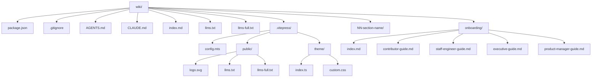
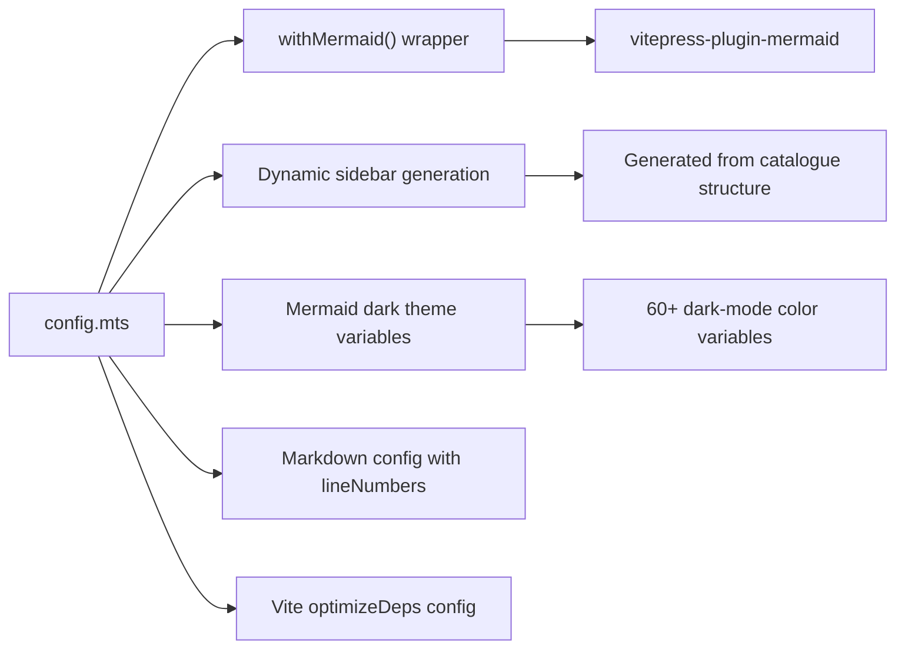
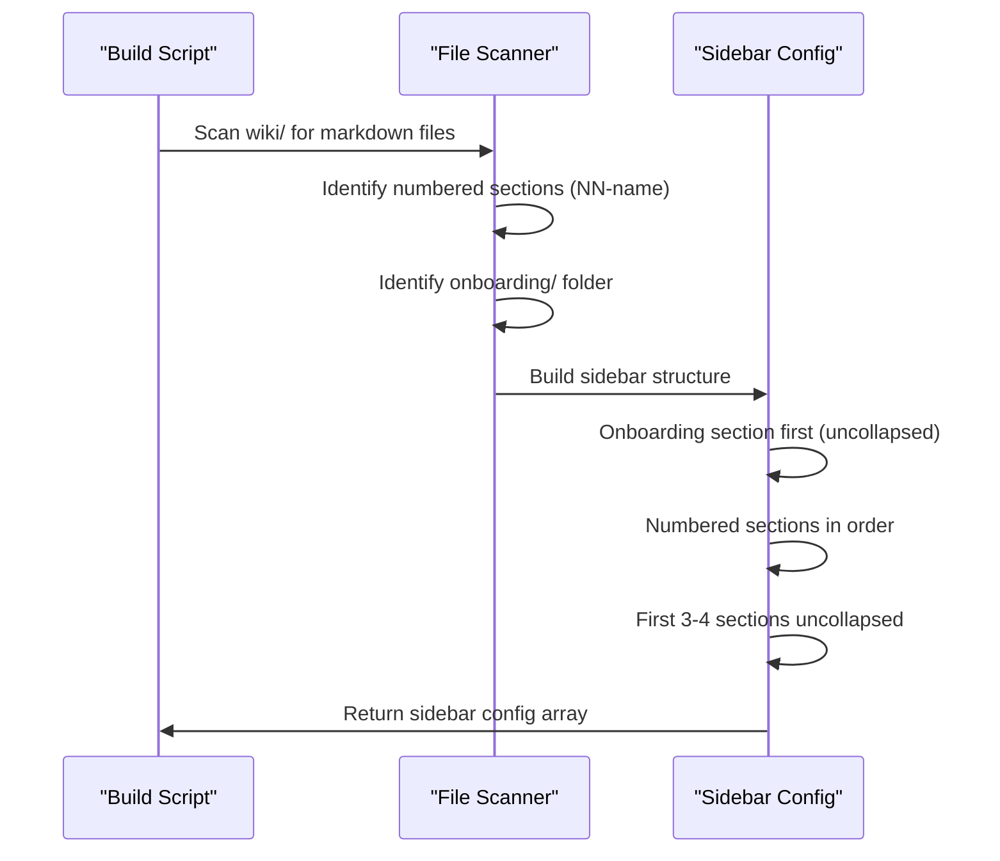
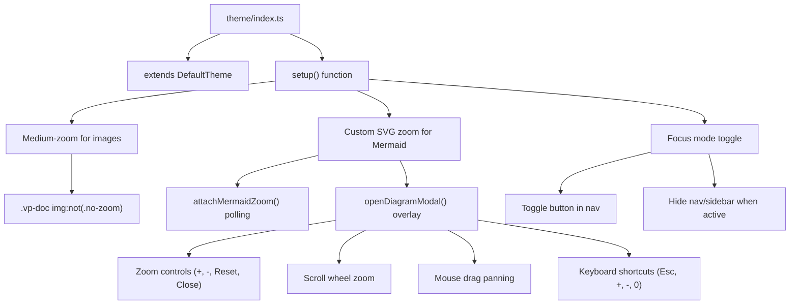
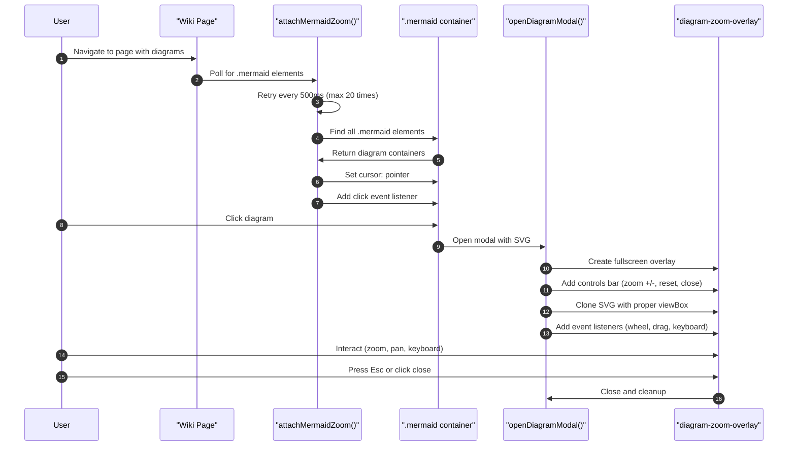
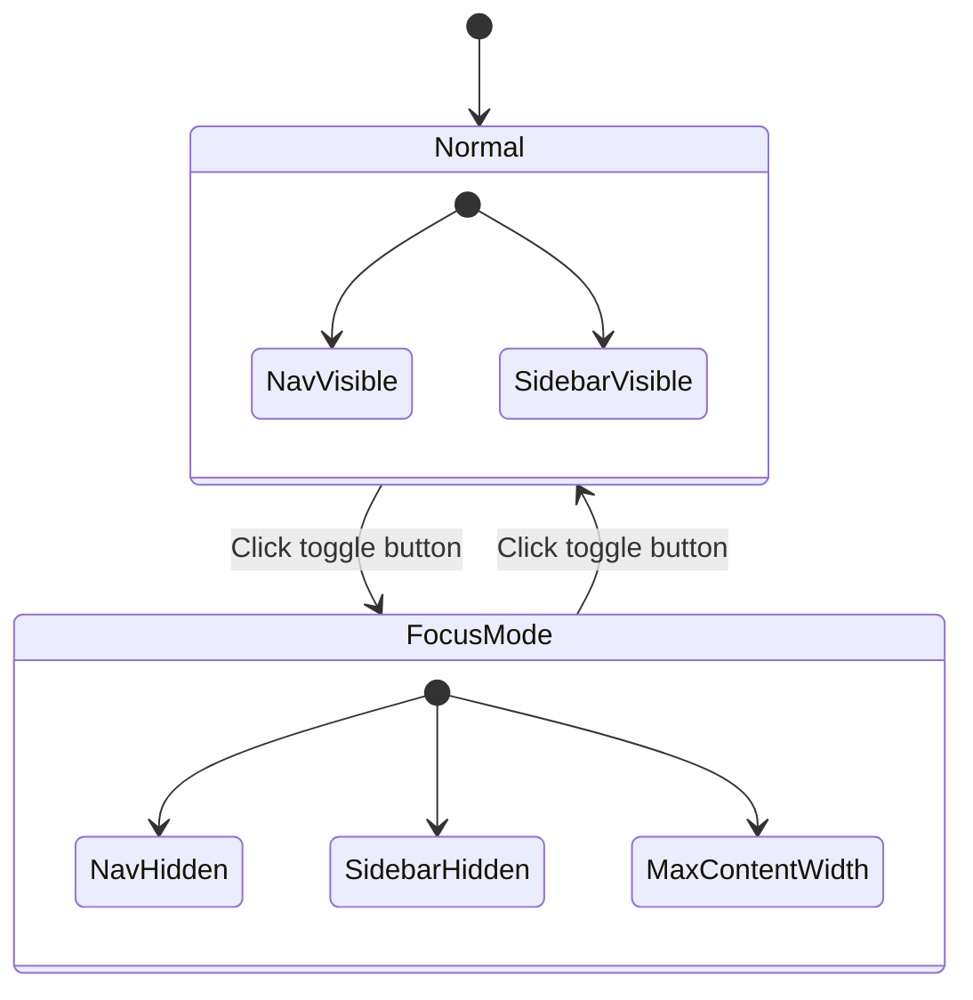
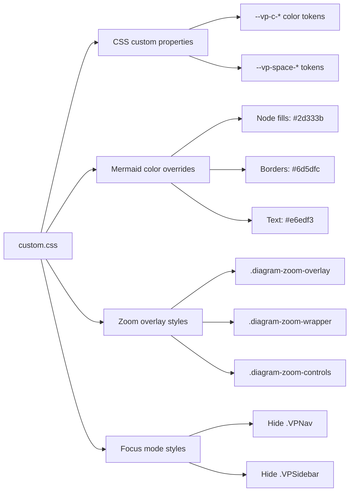
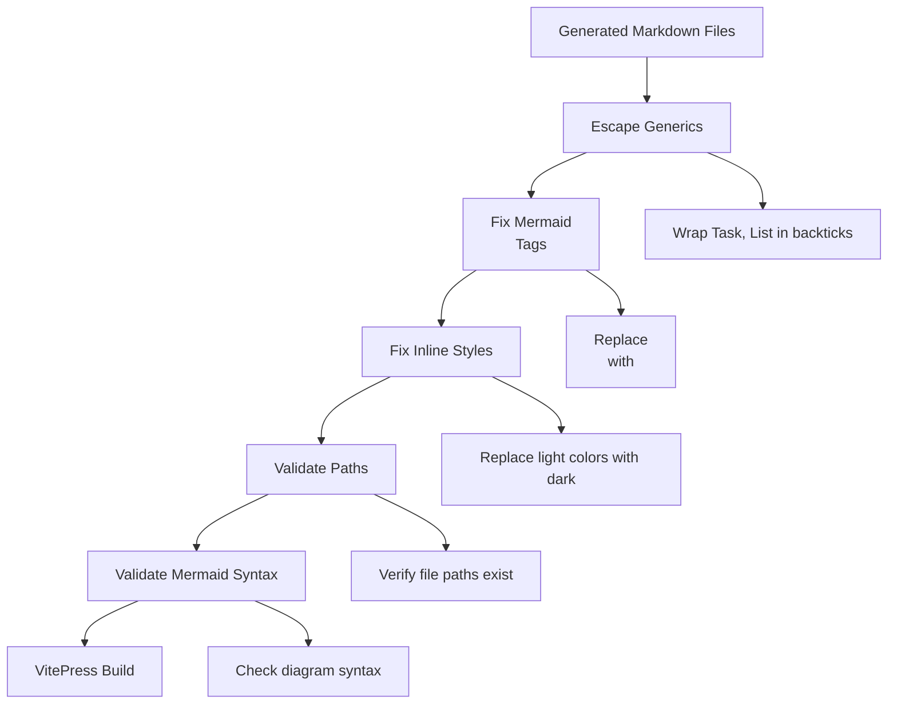
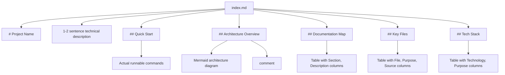

<!-- source: DeepWiki mcp.deepwiki.com · repo microsoft/skills · page 3.4 VitePress Site Generation · fetched 2026-10-30 -->

# VitePress Site Generation

<details>
<summary>Relevant source files</summary>

The following files were used as context for generating this wiki page:

- [.github/plugins/deep-wiki/.claude-plugin/plugin.json](.github/plugins/deep-wiki/.claude-plugin/plugin.json)
- [.github/plugins/deep-wiki/README.md](.github/plugins/deep-wiki/README.md)
- [.github/plugins/deep-wiki/commands/ado.md](.github/plugins/deep-wiki/commands/ado.md)
- [.github/plugins/deep-wiki/commands/agents.md](.github/plugins/deep-wiki/commands/agents.md)
- [.github/plugins/deep-wiki/commands/build.md](.github/plugins/deep-wiki/commands/build.md)
- [.github/plugins/deep-wiki/commands/crisp.md](.github/plugins/deep-wiki/commands/crisp.md)
- [.github/plugins/deep-wiki/commands/deploy.md](.github/plugins/deep-wiki/commands/deploy.md)
- [.github/plugins/deep-wiki/commands/generate.md](.github/plugins/deep-wiki/commands/generate.md)
- [.github/plugins/deep-wiki/commands/onboard.md](.github/plugins/deep-wiki/commands/onboard.md)
- [.github/plugins/deep-wiki/skills/wiki-ado-convert/SKILL.md](.github/plugins/deep-wiki/skills/wiki-ado-convert/SKILL.md)
- [.github/plugins/deep-wiki/skills/wiki-agents-md/SKILL.md](.github/plugins/deep-wiki/skills/wiki-agents-md/SKILL.md)
- [.github/plugins/deep-wiki/skills/wiki-onboarding/SKILL.md](.github/plugins/deep-wiki/skills/wiki-onboarding/SKILL.md)
- [README.md](README.md)
- [docs-site/src/pages/index.astro](docs-site/src/pages/index.astro)
- [docs/index.html](docs/index.html)

</details>


This document describes the VitePress site scaffolding and configuration process used by the Deep Wiki plugin. It covers the directory structure, configuration setup with Mermaid integration, custom theme implementation with click-to-zoom functionality, dark mode styling, and post-processing steps. For information about the overall wiki generation pipeline, see [3.1](#3.1). For the commands that trigger VitePress site generation, see [3.2](#3.2).

## Directory Structure and Files

The VitePress site is scaffolded in a `wiki/` directory with a specific file layout. The `/deep-wiki:build` and `/deep-wiki:generate` commands create this structure programmatically.



**Sources:** [.github/plugins/deep-wiki/commands/build.md:14-44]()

### Core Files

| File | Purpose |
|------|---------|
| `wiki/package.json` | VitePress project dependencies: `vitepress`, `mermaid`, `vitepress-plugin-mermaid`, `medium-zoom` |
| `wiki/.gitignore` | Excludes `node_modules/`, `.vitepress/cache/`, `.vitepress/dist/` |
| `wiki/AGENTS.md` | Agent instructions for wiki folder (VitePress commands, content conventions) |
| `wiki/CLAUDE.md` | Companion pointer redirecting to AGENTS.md |
| `wiki/index.md` | Developer-focused landing page (NOT a marketing hero page) |
| `wiki/llms.txt` | LLM-friendly links with descriptions (wiki-relative paths) |
| `wiki/llms-full.txt` | Full page content inlined in `<doc>` blocks |

**Sources:** [.github/plugins/deep-wiki/commands/build.md:18-44](), [.github/plugins/deep-wiki/commands/agents.md:128-169]()

## VitePress Configuration Setup

The `wiki/.vitepress/config.mts` file contains the complete VitePress configuration. It must use the `withMermaid()` wrapper from `vitepress-plugin-mermaid` to enable Mermaid diagram rendering.



**Sources:** [.github/plugins/deep-wiki/commands/build.md:150-210]()

### Key Configuration Options

| Option | Value | Purpose |
|--------|-------|---------|
| `appearance` | `'dark'` | Dark-only mode |
| `ignoreDeadLinks` | `true` | Wiki pages reference source paths that don't exist in built site |
| `outline.level` | `[2, 3]` | Show h2 and h3 in right sidebar outline |
| `markdown.lineNumbers` | `true` | Show line numbers in code blocks |
| `vite.optimizeDeps.include` | `['mermaid']` | Pre-bundle Mermaid for faster dev server |
| `head` | Inter + JetBrains Mono fonts | Load from Google Fonts |

**Sources:** [.github/plugins/deep-wiki/commands/build.md:150-162]()

### Mermaid Dark Theme Variables

The configuration includes comprehensive dark-mode color variables for Mermaid diagrams. These are set in the `mermaid.themeVariables` object:

| Variable | Value | Usage |
|----------|-------|-------|
| `primaryColor` | `#2d333b` | Node fill color |
| `primaryBorderColor` | `#6d5dfc` | Node border color |
| `primaryTextColor` | `#e6edf3` | Node text color |
| `background` | `#0d1117` | Canvas background |
| `lineColor` | `#8b949e` | Arrow and line color |
| `clusterBkg` | `#161b22` | Subgraph background |
| `clusterBorder` | `#30363d` | Subgraph border |

The configuration includes 60+ variables covering sequence diagrams, class diagrams, state diagrams, ER diagrams, and other Mermaid types.

**Sources:** [.github/plugins/deep-wiki/commands/build.md:164-210]()

### Dynamic Sidebar Generation

The sidebar configuration is generated dynamically from the wiki's catalogue structure:



**Sources:** [.github/plugins/deep-wiki/commands/build.md:212-220]()

## Custom Theme Implementation

The custom theme extends the default VitePress theme and adds two zoom systems plus a focus mode toggle. The implementation is in `wiki/.vitepress/theme/index.ts`.



**Sources:** [.github/plugins/deep-wiki/commands/build.md:222-377]()

### Image Zoom with Medium-Zoom

The theme uses the `medium-zoom` library for standard image zooming. Images with class `no-zoom` are excluded.

```typescript
// Applied in setup()
mediumZoom('.vp-doc img:not(.no-zoom)', {
  background: 'rgba(0, 0, 0, 0.92)',
})
```

**Sources:** [.github/plugins/deep-wiki/commands/build.md:226-228](), [.github/plugins/deep-wiki/commands/build.md:248-251]()

### Mermaid Diagram Zoom Implementation

Mermaid diagrams render as `<svg>` elements, not ``, so `medium-zoom` cannot handle them. The theme implements a custom fullscreen overlay with pan and zoom functionality.



**Sources:** [.github/plugins/deep-wiki/commands/build.md:230-377]()

#### Polling for Async-Rendered Diagrams

Mermaid diagrams are rendered asynchronously by VitePress. The `attachMermaidZoom()` function uses a polling mechanism with retries:

```typescript
const attachMermaidZoom = (retries = 0) => {
  const diagrams = document.querySelectorAll('.mermaid')
  if (diagrams.length === 0 && retries < 20) {
    setTimeout(() => attachMermaidZoom(retries + 1), 500)
    return
  }
  // Attach click handlers
}
```

This ensures diagrams are found even when navigation causes re-renders.

**Sources:** [.github/plugins/deep-wiki/commands/build.md:254-260]()

#### Modal Overlay Controls

The zoom modal provides comprehensive controls:

| Control | Trigger | Action |
|---------|---------|--------|
| Zoom In | `+` button or `+`/`=` key | Scale up by 1.3x (max 5x) |
| Zoom Out | `−` button or `-` key | Scale down by 1.3x (min 0.2x) |
| Reset | Reset button or `0` key | Reset scale to 1.0, center position |
| Close | `✕` button or `Esc` key or backdrop click | Close modal and cleanup |
| Pan | Mouse drag | Translate SVG position |
| Scroll Zoom | Mouse wheel | Zoom in/out continuously |

**Sources:** [.github/plugins/deep-wiki/commands/build.md:316-365]()

#### ViewBox Handling

If a Mermaid SVG lacks a `viewBox` attribute, the modal calculates it from the bounding box:

```typescript
if (!cloned.getAttribute('viewBox')) {
  const bbox = svg.getBBox()
  cloned.setAttribute('viewBox', `${bbox.x} ${bbox.y} ${bbox.width} ${bbox.height}`)
}
```

This ensures proper scaling and prevents clipping.

**Sources:** [.github/plugins/deep-wiki/commands/build.md:302-306]()

### Focus Mode Toggle

The theme includes a focus mode that hides navigation and sidebar for distraction-free reading:



Focus mode state is persisted to `localStorage` under key `wiki-focus-mode`.

**Sources:** [.github/plugins/deep-wiki/commands/build.md:379-420]()

## Dark Mode Styling

The `wiki/.vitepress/theme/custom.css` file contains comprehensive dark mode styles, Mermaid diagram overrides, and zoom-related CSS.



**Sources:** [.github/plugins/deep-wiki/commands/build.md:422-520]()

### Mermaid Color Overrides

Even with `mermaid.themeVariables` in the config, some Mermaid elements require CSS overrides for consistent dark mode rendering:

| Selector | Property | Value | Purpose |
|----------|----------|-------|---------|
| `.mermaid .node rect` | `fill` | `#2d333b` | Node background |
| `.mermaid .node rect` | `stroke` | `#6d5dfc` | Node border |
| `.mermaid text` | `fill` | `#e6edf3` | All text |
| `.mermaid .cluster rect` | `fill` | `#161b22` | Subgraph background |
| `.mermaid .edgeLabel rect` | `fill` | `#1c2333` | Edge label background |
| `.mermaid line` | `stroke` | `#8b949e` | Lines and arrows |

These overrides ensure consistent appearance across all Mermaid diagram types.

**Sources:** [.github/plugins/deep-wiki/commands/build.md:422-520]()

### Zoom Overlay Styles

The zoom overlay uses fixed positioning to cover the entire viewport:

| Class | Properties |
|-------|------------|
| `.diagram-zoom-overlay` | `position: fixed; inset: 0; background: rgba(0,0,0,0.95); z-index: 1000` |
| `.diagram-zoom-wrapper` | Flexbox container for controls and content |
| `.diagram-zoom-controls` | Top bar with zoom buttons, `background: rgba(45,51,59,0.9)` |
| `.diagram-zoom-content` | Scrollable content area with `cursor: grab`, `overflow: auto` |

The overlay prevents body scroll with `document.body.style.overflow = 'hidden'` while open.

**Sources:** [.github/plugins/deep-wiki/commands/build.md:422-520]()

## Post-Processing and Validation

Before packaging the VitePress site, the generation pipeline applies transformations to fix common rendering issues.



**Sources:** [.github/plugins/deep-wiki/commands/generate.md:82-90]()

### Escape Generics

Generic type syntax like `Task<string>` or `List<T>` can break VitePress rendering when not inside code fences. The post-processor wraps these in backticks:

- `Task<string>` → `` `Task<string>` ``
- `List<T>` → `` `List<T>` ``

**Sources:** [.github/plugins/deep-wiki/commands/generate.md:86]()

### Fix Mermaid `<br/>` Tags

VitePress uses Vue to compile markdown. Self-closing `<br/>` tags in Mermaid diagrams break the Vue compiler. The post-processor replaces them:

- `<br/>` → `<br>`
- `<br />` → `<br>`

**Sources:** [.github/plugins/deep-wiki/commands/generate.md:87]()

### Validate File Paths and Code References

The validation step verifies that:
- All file paths cited in the documentation actually exist in the repository
- Class names and method names referenced are accurate
- Mermaid diagram syntax is valid and will render

**Sources:** [.github/plugins/deep-wiki/commands/generate.md:88-89]()

## Index Page Requirements

The `wiki/index.md` file serves as the landing page. It MUST be a developer-focused technical wiki home page, not a marketing page.

### Forbidden Elements

| Element | Why Forbidden |
|---------|---------------|
| VitePress `hero:` frontmatter | Creates marketing hero banners |
| `features:` frontmatter | Creates feature highlight cards |
| Marketing copy ("powerful", "blazing fast") | This is technical documentation |
| Call-to-action buttons | Not a product page |
| Taglines or slogans | Focus on technical content |

**Sources:** [.github/plugins/deep-wiki/commands/build.md:46-119]()

### Required Sections



**Sources:** [.github/plugins/deep-wiki/commands/build.md:52-119]()

### Index Page Structure

| Section | Content |
|---------|---------|
| Frontmatter | `title` and `description` (no `hero:` or `features:`) |
| Quick Start | Clone, install, run commands (from actual repo) |
| Architecture Overview | Mermaid diagram with component relationships and `<!-- Sources: ... -->` comment |
| Documentation Map | Table linking to all wiki sections with descriptions |
| Key Files | Table with file paths, purposes, and source citations |
| Tech Stack | Table with technologies and their purposes |

The Quick Start section must contain real, executable commands from the repository's build system, not placeholder commands.

**Sources:** [.github/plugins/deep-wiki/commands/build.md:52-104]()

## Integration with Generation Pipeline

VitePress site generation is step 6 in the full wiki generation pipeline (`/deep-wiki:generate`):

1. Source repository resolution
2. Repository scan
3. Generate catalogue
4. Generate onboarding guides
5. Generate pages
6. **Package as VitePress site** (this document)
7. Generate AGENTS.md files
8. Generate llms.txt files

The `/deep-wiki:build` command can be run standalone to package existing markdown files without regenerating content.

**Sources:** [.github/plugins/deep-wiki/commands/generate.md:91-102]()

---

