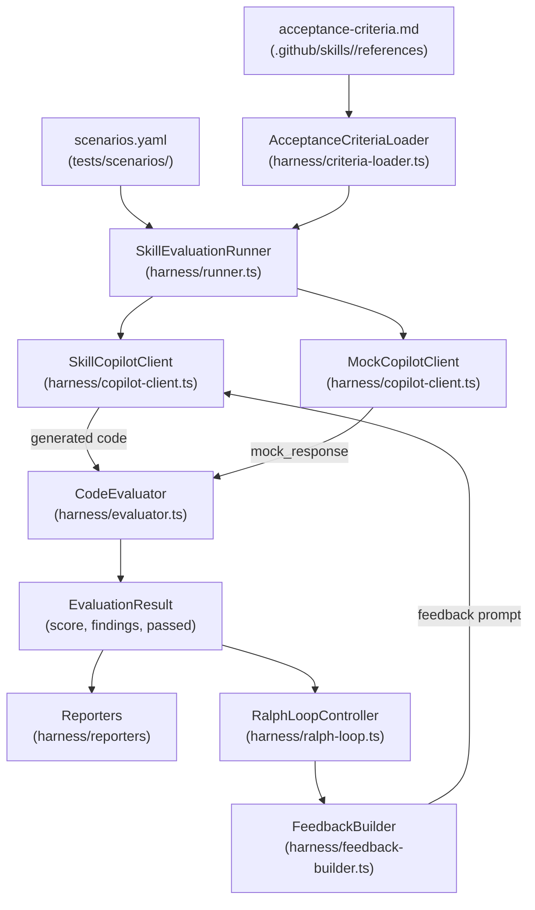
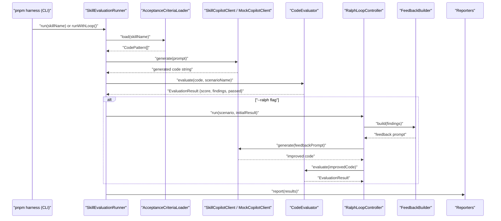
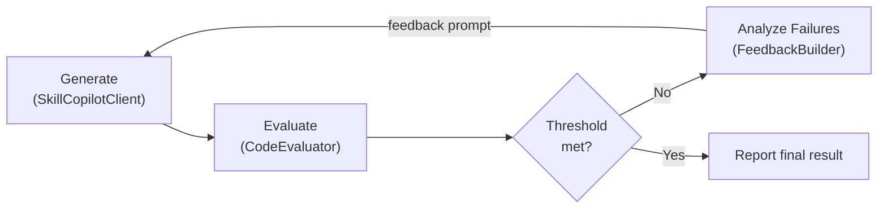

<!-- source: DeepWiki mcp.deepwiki.com · repo microsoft/skills · page 4 Quality Assurance System · fetched 2026-10-30 -->

# Quality Assurance System

<details>
<summary>Relevant source files</summary>

The following files were used as context for generating this wiki page:

- [.github/workflows/skill-evaluation.yml](.github/workflows/skill-evaluation.yml)
- [.github/workflows/test-harness.yml](.github/workflows/test-harness.yml)
- [docs-site/integration-filter-test.png](docs-site/integration-filter-test.png)
- [docs-site/public/og-image.png](docs-site/public/og-image.png)
- [tests/.gitignore](tests/.gitignore)
- [tests/AGENTS.md](tests/AGENTS.md)
- [tests/README.md](tests/README.md)
- [tests/harness/evaluator.ts](tests/harness/evaluator.ts)

</details>


This page introduces the test harness used to evaluate whether AI-generated code correctly follows the patterns defined in each skill's acceptance criteria. It covers the overall purpose, workflow, component map, CI integration, and coverage statistics.

For detailed information on individual subsystems, see the child pages:
- Harness architecture and class structure: [Test Harness Architecture](#4.1)
- Acceptance criteria file format: [Acceptance Criteria Format](#4.2)
- Test scenario YAML format: [Test Scenarios YAML Format](#4.3)
- Running evaluations locally and in CI: [Running Evaluations](#4.4)
- Ralph Loop iterative improvement: [Ralph Loop Iterative Improvement](#4.5)
- Scoring algorithm details: [Scoring Algorithm and Pattern Matching](#4.6)

---

## Purpose

Skills in `.github/skills/` define domain-specific code patterns for Azure SDKs (see [Understanding Skills and Progressive Disclosure](#2.1)). The Quality Assurance System answers the question: *does a language model actually produce code that follows those patterns when guided by the skill?*

The harness does this by:
1. Parsing acceptance criteria from each skill's `references/acceptance-criteria.md`
2. Running structured test scenarios against a code generation backend (real GitHub Copilot SDK or a mock)
3. Scoring the output against correct and incorrect code patterns
4. Reporting results in console, Markdown, or JSON format

Sources: [tests/README.md:1-20](), [tests/AGENTS.md:1-15]()

---

## End-to-End Workflow

**Evaluation pipeline: from skill definition to pass/fail result**



Sources: [tests/README.md:26-49](), [tests/AGENTS.md:119-141]()

---

## Key Components

| Component | File | Role |
|---|---|---|
| `AcceptanceCriteriaLoader` | `harness/criteria-loader.ts` | Parses `acceptance-criteria.md` into structured `CodePattern` objects |
| `CodeEvaluator` | `harness/evaluator.ts` | Matches generated code against correct/incorrect patterns; computes score |
| `SkillCopilotClient` | `harness/copilot-client.ts` | Calls real GitHub Copilot SDK to generate code |
| `MockCopilotClient` | `harness/copilot-client.ts` | Returns `mock_response` from scenario YAML; no external calls |
| `SkillEvaluationRunner` | `harness/runner.ts` | Main orchestrator; loads scenarios, drives generation and evaluation |
| `RalphLoopController` | `harness/ralph-loop.ts` | Iterative re-generation until a quality threshold is met |
| `FeedbackBuilder` | `harness/feedback-builder.ts` | Converts evaluation failures into actionable LLM prompts |
| Console reporter | `harness/reporters/console.ts` | Pretty terminal output |
| Markdown reporter | `harness/reporters/markdown.ts` | Markdown report for CI summaries and artifact upload |

Sources: [tests/README.md:26-49](), [tests/AGENTS.md:119-141]()

---

## Component Interaction Map

**How code entities wire together at call time**



Sources: [tests/README.md:92-118](), [tests/AGENTS.md:231-256]()

---

## Scoring at a Glance

The `CodeEvaluator` assigns a numeric score and separately determines a pass/fail status.

| Factor | Score Impact |
|---|---|
| Syntax error detected | −100 |
| Incorrect pattern matched | −15 each |
| Error-severity finding | −20 each |
| Warning-severity finding | −5 each |
| Correct pattern matched | +5 each |

A scenario **passes** when there are no error-severity findings, regardless of numeric score.

Two distinct pattern-matching strategies are used for incorrect patterns:
- **Import-Only** — the import path itself is the error; fires when all imports in the pattern are present in the generated code
- **Mixed** — a valid import combined with a misuse; fires only when both the import and the misuse code are present simultaneously (avoids false positives)

For full details, see [Scoring Algorithm and Pattern Matching](#4.6).

Sources: [tests/README.md:175-185](), [tests/AGENTS.md:329-389]()

---

## Ralph Loop

When enabled with `--ralph`, the harness enters an iterative refinement loop rather than a single-pass evaluation.

**Ralph Loop: Generate → Evaluate → Feedback → Re-generate**



Stop conditions (whichever is reached first):
- Quality threshold met (default 80)
- Perfect score (100)
- Max iterations reached (default 5)
- No improvement between iterations
- Score regression

Sources: [tests/README.md:73-90](), [tests/AGENTS.md:228-256]()

---

## CI Integration

Two GitHub Actions workflows drive automated evaluation.

| Workflow | File | Trigger | Mode | Purpose |
|---|---|---|---|---|
| Smoke Test | `.github/workflows/test-harness.yml` | PR, push to `main` | `--mock` | Fast, deterministic; no external dependencies |
| Copilot SDK Tests | `.github/workflows/skill-evaluation.yml` | Nightly 2 AM UTC, manual dispatch | Real SDK | Quality measurement against actual model output |

### Smoke Test workflow

Runs on every PR and push to `main`. Uses mock responses so no authentication or network is required.

Steps:
1. TypeScript type check (`pnpm typecheck`)
2. Unit tests (`pnpm test:run`)
3. All-skill harness run with `--all --mock`
4. Results written to `$GITHUB_STEP_SUMMARY` and uploaded as artifacts (`results.md`, `results.json`)
5. Failures emit a warning annotation but do not fail the job (configurable)

Sources: [.github/workflows/test-harness.yml:1-96]()

### Nightly evaluation workflow

Runs with the real GitHub Copilot SDK. Requires a repository secret `COPILOT_TOKEN` (PAT with the **Copilot Requests** permission) and a repository variable `ENABLE_REAL_EVAL=true`.

Supports manual dispatch with parameters:

| Input | Default | Description |
|---|---|---|
| `skill` | *(empty = all)* | Single skill name to evaluate |
| `ralph` | `false` | Enable Ralph Loop |
| `threshold` | `60` | Quality threshold for Ralph Loop |
| `max_iterations` | `2` | Max Ralph Loop iterations |

On failure, a post-step annotates the job with the top three error findings per failing scenario, formatted as `::error::` workflow commands.

Sources: [.github/workflows/skill-evaluation.yml:1-169]()

---

## Test Coverage

As of the latest README, the harness covers 123 skills across five language groups.

| Language | Skills | Scenarios |
|---|---|---|
| Core | 5 | 51 |
| Python | 41 | 333 |
| .NET | 28 | 286 |
| TypeScript | 23 | 249 |
| Java | 26 | 195 |
| **Total** | **123** | **1,114** |

Sources: [tests/README.md:186-199]()

---

## Repository Layout

```
tests/
├── harness/
│   ├── types.ts              # CodePattern, EvaluationResult, FindingSeverity types
│   ├── criteria-loader.ts    # AcceptanceCriteriaLoader
│   ├── evaluator.ts          # CodeEvaluator, pattern matching, scoring
│   ├── copilot-client.ts     # SkillCopilotClient, MockCopilotClient
│   ├── runner.ts             # SkillEvaluationRunner, CLI entry point
│   ├── ralph-loop.ts         # RalphLoopController, RalphLoopConfig
│   ├── feedback-builder.ts   # FeedbackBuilder
│   ├── index.ts              # Package exports
│   └── reporters/
│       ├── console.ts        # Console reporter
│       └── markdown.ts       # Markdown reporter
├── scenarios/
│   └── <skill-name>/
│       └── scenarios.yaml    # Test scenarios per skill
├── package.json
├── tsconfig.json
└── vitest.config.ts
```

Acceptance criteria files live outside `tests/`, co-located with each skill:

```
.github/skills/<skill-name>/references/acceptance-criteria.md
```

Sources: [tests/README.md:26-49](), [tests/AGENTS.md:119-141]()

---

## Quick Start

```bash
cd tests
pnpm install

# List discovered skills
pnpm harness --list

# Run one skill in mock mode
pnpm harness azure-ai-projects-py --mock --verbose

# Run all skills (mock)
pnpm harness --all --mock

# Run with Ralph Loop
pnpm harness azure-ai-projects-py --ralph --max-iterations 5 --threshold 80 --mock

# Run unit tests
pnpm test
```

Sources: [tests/README.md:5-11](), [tests/AGENTS.md:179-200]()

---

