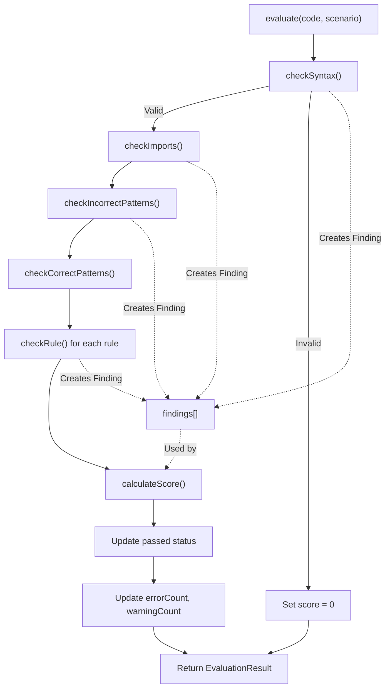
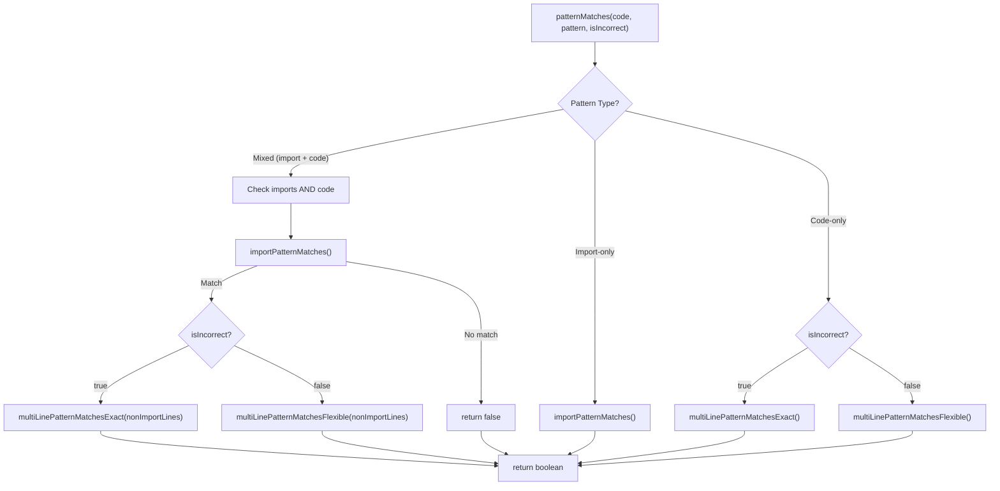
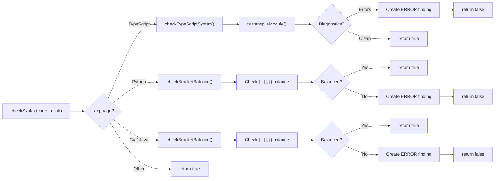
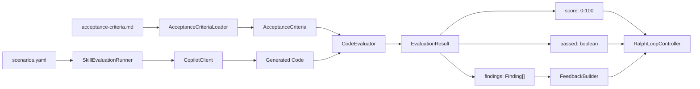

<!-- source: DeepWiki mcp.deepwiki.com · repo microsoft/skills · page 4.6 Scoring Algorithm and Pattern Matching · fetched 2026-10-30 -->

# Scoring Algorithm and Pattern Matching

<details>
<summary>Relevant source files</summary>

The following files were used as context for generating this wiki page:

- [.github/agents/scaffolder.agent.md](.github/agents/scaffolder.agent.md)
- [.github/copilot-instructions.md](.github/copilot-instructions.md)
- [.github/docs/agent-integration.md](.github/docs/agent-integration.md)
- [.github/prompts/scaffold-foundry-app.prompt.md](.github/prompts/scaffold-foundry-app.prompt.md)
- [.github/skills/skill-creator/references/acceptance-criteria.md](.github/skills/skill-creator/references/acceptance-criteria.md)
- [.github/workflows/skill-evaluation.yml](.github/workflows/skill-evaluation.yml)
- [.github/workflows/test-harness.yml](.github/workflows/test-harness.yml)
- [Agents.md](Agents.md)
- [context7.json](context7.json)
- [docs-site/integration-filter-test.png](docs-site/integration-filter-test.png)
- [docs-site/public/og-image.png](docs-site/public/og-image.png)
- [tests/.gitignore](tests/.gitignore)
- [tests/AGENTS.md](tests/AGENTS.md)
- [tests/README.md](tests/README.md)
- [tests/harness/criteria-loader.ts](tests/harness/criteria-loader.ts)
- [tests/harness/evaluator.ts](tests/harness/evaluator.ts)
- [tests/scenarios/skill-creator/scenarios.yaml](tests/scenarios/skill-creator/scenarios.yaml)

</details>


This document explains the evaluation scoring system used by the test harness to validate AI-generated code against acceptance criteria. The scoring algorithm assigns a numeric quality score (0-100) based on detected patterns, syntax errors, and best practice violations.

For information about running evaluations and interpreting results, see [Running Evaluations](#4.4). For details on the Ralph Loop iterative improvement system that uses these scores, see [Ralph Loop Iterative Improvement](#4.5).

## Purpose and Scope

The scoring algorithm provides quantitative feedback on code quality by:
- **Detecting incorrect patterns** from acceptance criteria (anti-patterns)
- **Rewarding correct patterns** that demonstrate proper SDK usage
- **Validating syntax** in Python, TypeScript, C#, and Java
- **Checking import statements** for common module path errors
- **Calculating a normalized score** (0-100) with consistent semantics

The algorithm powers both smoke tests (mock mode) and real SDK evaluations (nightly runs).

---

## Evaluation Flow

The `CodeEvaluator` class in `tests/harness/evaluator.ts` orchestrates the evaluation process:



**Evaluation Flow in CodeEvaluator**

Sources: [tests/harness/evaluator.ts:103-146]()

---

## Scoring Rules

The scoring algorithm starts with a base score of 100 and applies penalties and bonuses based on findings:

| Factor | Impact | Severity | Notes |
|--------|--------|----------|-------|
| **Syntax error** | -100 (score becomes 0) | ERROR | Immediate failure; no further evaluation |
| **Incorrect pattern found** | -20 per occurrence | ERROR | Anti-patterns from acceptance criteria |
| **Import error** | -20 per occurrence | ERROR | Wrong module paths or incorrect combinations |
| **Rule violation** | -20 per occurrence | ERROR | Validation rule failures |
| **Warning finding** | -5 per occurrence | WARNING | Missing recommended patterns |
| **Correct pattern matched** | No direct bonus | INFO | Tracked in `matchedCorrect[]` |

### Score Calculation Formula

The `calculateScore()` method implements the scoring logic:

```typescript
let score = 100;
score -= findings.filter(f => f.severity === Severity.ERROR).length * 20;
score -= findings.filter(f => f.severity === Severity.WARNING).length * 5;
```

**Special cases:**
- If no patterns match and no findings exist: score = 50 (neutral)
- Syntax errors immediately set score to 0
- Score cannot go below 0

Sources: [tests/harness/evaluator.ts:696-724](), [tests/README.md:175-185]()

---

## Pass/Fail Determination

A result **passes** if and only if it has **no error-severity findings**:

```typescript
result.passed = !result.findings.some(f => f.severity === Severity.ERROR);
```

This means:
- ✅ **Pass**: Score 85 with 3 warnings → PASS
- ❌ **Fail**: Score 60 with 2 errors → FAIL
- ✅ **Pass**: Score 100 with 0 findings → PASS
- ❌ **Fail**: Score 0 with syntax error → FAIL

Warnings reduce the score but do not cause failure. This allows the Ralph Loop to iterate on code with warnings to improve quality, while immediately rejecting code with errors.

Sources: [tests/harness/evaluator.ts:135](), [tests/README.md:184]()

---

## Pattern Matching Strategies

The evaluator uses **asymmetric matching** to balance precision and recall:



**Pattern Matching Strategy Decision Tree**

### Strategy Rationale

| Pattern Type | Matching Mode | Reason |
|--------------|---------------|--------|
| **Correct patterns** | FLEXIBLE | Allow variations in formatting, extra parameters, different order |
| **Incorrect patterns** | EXACT | Catch specific errors without false positives |
| **Import-only** | ALL imports must match | Prevents flagging partial import combinations |
| **Mixed patterns** | ALL parts must match | Ensures misuse context is present, not just the import |

Sources: [tests/harness/evaluator.ts:474-536](), [tests/AGENTS.md:325-420]()

---

## Import Pattern Matching

The evaluator distinguishes between two types of incorrect import patterns:

### Import-Only Patterns

These show wrong import paths where the import itself is the error:

```python
# WRONG - clients are not in models submodule
from azure.ai.contentsafety.models import ContentSafetyClient
```

**Matching logic:** If **ALL** imports in the pattern are present in the code, flag as incorrect.

### Mixed Patterns (Import + Misuse)

These show a valid import being misused:

```python
# WRONG - AnalyzeTextOptions is for text analysis only
from azure.ai.contentsafety.models import AnalyzeTextOptions

request = AnalyzeTextOptions(text="image.jpg")
response = client.analyze_image(request)  # <-- The actual error
```

**Matching logic:** **BOTH** the imports **AND** the non-import code (the misuse) must be present.

### Critical Fix: Preventing False Positives

The `checkImports()` method skips mixed patterns to avoid false positives:

```typescript
// CRITICAL FIX: If pattern has non-import lines, skip here.
// These "mixed patterns" (import + misuse) are handled by patternMatches()
// which correctly requires ALL parts to match before flagging as incorrect.
if (nonImportLines.length > 0) {
  continue;
}
```

Without this check, the evaluator would flag valid imports as incorrect just because they appear in an incorrect pattern that also shows their misuse.

Sources: [tests/harness/evaluator.ts:304-389](), [tests/AGENTS.md:332-436]()

---

## Syntax Validation

The evaluator performs language-specific syntax checks:



**Syntax Validation Methods by Language**

### TypeScript Syntax Checking

Uses the TypeScript compiler API (`ts.transpileModule()`) for accurate syntax validation:

```typescript
const transpileResult = ts.transpileModule(code, {
  compilerOptions: {
    target: ts.ScriptTarget.ESNext,
    module: ts.ModuleKind.ESNext,
    isolatedModules: true,  // Syntax only, no module resolution
  },
});
```

**Key feature:** `isolatedModules: true` ensures Azure SDK imports don't cause errors (module resolution is skipped).

### Python/C#/Java Bracket Balance

For languages without AST parsing from TypeScript, the evaluator checks bracket balance:

```typescript
const openParens = (code.match(/\(/g) ?? []).length;
const closeParens = (code.match(/\)/g) ?? []).length;
// Same for [], {}
```

This catches basic syntax errors like mismatched parentheses/braces without requiring language-specific parsers.

Sources: [tests/harness/evaluator.ts:148-295]()

---

## Correct Pattern Matching (Flexible)

The `multiLinePatternMatchesFlexible()` method allows variations in code structure:

```typescript
// Normalize by collapsing whitespace
const normalizedPattern = patternLine.split(/\s+).join(" ");

// Match if code CONTAINS pattern OR pattern CONTAINS code
if (codeLine.includes(normalizedPattern) || 
    normalizedPattern.includes(codeLine)) {
  matchedCount++;
}
```

**Matching criteria:**
- Matches 1+ significant lines (length ≥ 15 chars) for small patterns
- Matches 2+ significant lines for larger patterns
- Allows code to have extra parameters, comments, or formatting differences

**Example:**

Pattern:
```python
client = AIProjectClient(endpoint=endpoint, credential=credential)
```

Matches:
```python
# Extra parameter is OK
client = AIProjectClient(
    endpoint=endpoint,
    credential=credential,
    api_version="2024-01-01"  # Additional parameter
)
```

Sources: [tests/harness/evaluator.ts:647-692]()

---

## Incorrect Pattern Matching (Exact)

The `multiLinePatternMatchesExact()` method requires precise matches to avoid false positives:

```typescript
const normalizedPattern = patternLine.split(/\s+).join(" ");

// Exact match required
if (normalizedPattern === codeLine) {
  matchedCount++;
}
```

**Matching criteria:**
- ALL significant lines (length ≥ 15 chars) must match exactly
- Whitespace normalized, but structure must be identical
- This prevents flagging code when only part of the incorrect pattern is present

**Example:**

Incorrect pattern:
```python
from azure.ai.contentsafety.models import AnalyzeTextOptions
request = AnalyzeTextOptions(text="image.jpg")
response = client.analyze_image(request)
```

Does NOT match:
```python
# Only has the import, missing the misuse
from azure.ai.contentsafety.models import AnalyzeTextOptions
request = AnalyzeTextOptions(text="Hello")
response = client.analyze_text(request)  # CORRECT usage
```

This prevents false positives where valid imports appear in incorrect patterns but are used correctly.

Sources: [tests/harness/evaluator.ts:602-645](), [tests/AGENTS.md:370-420]()

---

## Code Entity Map

Key classes and methods in the scoring system:

| Code Entity | File | Purpose |
|-------------|------|---------|
| `CodeEvaluator` | [tests/harness/evaluator.ts:40-724]() | Main evaluation orchestrator |
| `evaluate()` | [tests/harness/evaluator.ts:103-146]() | Entry point for code evaluation |
| `calculateScore()` | [tests/harness/evaluator.ts:696-724]() | Score calculation logic |
| `checkSyntax()` | [tests/harness/evaluator.ts:148-171]() | Language-specific syntax validation |
| `checkTypeScriptSyntax()` | [tests/harness/evaluator.ts:173-251]() | TypeScript AST parsing |
| `checkBracketBalance()` | [tests/harness/evaluator.ts:253-295]() | Bracket/brace/paren balance check |
| `checkImports()` | [tests/harness/evaluator.ts:297-389]() | Import statement validation |
| `checkIncorrectPatterns()` | [tests/harness/evaluator.ts:391-411]() | Anti-pattern detection |
| `checkCorrectPatterns()` | [tests/harness/evaluator.ts:413-436]() | Best practice pattern detection |
| `patternMatches()` | [tests/harness/evaluator.ts:474-536]() | Pattern matching strategy router |
| `importPatternMatches()` | [tests/harness/evaluator.ts:538-600]() | Import-specific matching |
| `multiLinePatternMatchesExact()` | [tests/harness/evaluator.ts:602-645]() | Exact matching for incorrect patterns |
| `multiLinePatternMatchesFlexible()` | [tests/harness/evaluator.ts:647-692]() | Flexible matching for correct patterns |
| `EvaluationResult` | [tests/harness/types.ts]() | Result data structure |
| `Finding` | [tests/harness/types.ts]() | Individual finding (error/warning) |
| `Severity` | [tests/harness/types.ts]() | ERROR, WARNING, INFO severity levels |

---

## Integration with Test Harness

The scoring algorithm integrates with the broader test harness system:



**Scoring Integration in Test Harness**

The `EvaluationResult` structure connects the scoring algorithm to iterative improvement:

```typescript
interface EvaluationResult {
  skillName: string;
  scenario: string;
  code: string;
  score: number;              // 0-100 calculated by calculateScore()
  passed: boolean;            // true if no ERROR findings
  findings: Finding[];        // Detailed errors/warnings
  matchedCorrect: string[];   // Correct patterns found
  matchedIncorrect: string[]; // Incorrect patterns found
  errorCount: number;         // Count of ERROR findings
  warningCount: number;       // Count of WARNING findings
}
```

Sources: [tests/harness/types.ts](), [tests/harness/evaluator.ts:103-146](), [tests/harness/runner.ts]()

---

## Scoring in Ralph Loop Context

The Ralph Loop uses scores to determine iteration behavior:

| Score Range | Interpretation | Action |
|-------------|----------------|--------|
| **100** | Perfect | Stop iteration (perfection stop condition) |
| **≥80** (default) | Meets threshold | Stop iteration (threshold met) |
| **60-79** | Needs improvement | Continue iteration with feedback |
| **40-59** | Significant issues | Continue iteration, provide detailed feedback |
| **0-39** | Major problems | Continue iteration, likely structural issues |
| **0** | Syntax error | Continue iteration, fix syntax first |

The `RalphLoopController` uses the score to build targeted feedback:

```typescript
if (score >= config.qualityThreshold) {
  // Stop condition: threshold met
  return { stopReason: 'threshold', iterations };
}

if (score === 100) {
  // Stop condition: perfection
  return { stopReason: 'perfection', iterations };
}

// Continue with feedback
const feedback = buildFeedback(result.findings);
```

Sources: [tests/harness/ralph-loop.ts](), [tests/README.md:83-89]()

---

## Example Scoring Scenarios

### Scenario 1: Clean Code

```python
from azure.identity import DefaultAzureCredential
from azure.ai.projects import AIProjectClient
import os

credential = DefaultAzureCredential()
client = AIProjectClient(
    endpoint=os.environ["PROJECT_ENDPOINT"],
    credential=credential
)
```

**Result:**
- Syntax: ✅ Valid
- Imports: ✅ Correct
- Correct patterns: Matched 2 (DefaultAzureCredential, environment variables)
- Incorrect patterns: None
- **Score: 100** | **Passed: true**

### Scenario 2: Import Error

```python
# Wrong import path
from azure.ai.projects.models import AIProjectClient
import os

client = AIProjectClient(endpoint=os.environ["PROJECT_ENDPOINT"])
```

**Result:**
- Syntax: ✅ Valid
- Imports: ❌ Incorrect path (ERROR, -20)
- **Score: 80** | **Passed: false**

### Scenario 3: Syntax Error

```python
from azure.identity import DefaultAzureCredential

client = AIProjectClient(
    endpoint=endpoint
    credential=credential  # Missing comma
)
```

**Result:**
- Syntax: ❌ Invalid (ERROR, score → 0)
- **Score: 0** | **Passed: false**

### Scenario 4: Missing Best Practice

```python
from azure.identity import DefaultAzureCredential
from azure.ai.projects import AIProjectClient

credential = DefaultAzureCredential()
client = AIProjectClient(
    endpoint="https://hardcoded.example.com",  # Hardcoded!
    credential=credential
)
```

**Result:**
- Syntax: ✅ Valid
- Imports: ✅ Correct
- Incorrect patterns: ❌ Hardcoded endpoint (ERROR, -20)
- **Score: 80** | **Passed: false**

Sources: [tests/README.md:175-185]()

---

## Debugging Failed Evaluations

When a scenario fails, examine the `findings` array to understand why:

```typescript
{
  "skillName": "azure-ai-projects-py",
  "scenario": "basic_usage",
  "score": 60,
  "passed": false,
  "findings": [
    {
      "severity": "ERROR",
      "rule": "imports",
      "message": "Incorrect import combination: from azure.ai.projects.models import AIProjectClient",
      "suggestion": "Check acceptance criteria section: Client Import"
    },
    {
      "severity": "ERROR",
      "rule": "pattern:Authentication",
      "message": "Incorrect pattern found from section: Authentication",
      "suggestion": "Review acceptance criteria for correct usage"
    }
  ]
}
```

Each finding includes:
- **severity**: ERROR (blocks pass), WARNING (reduces score), or INFO
- **rule**: Which validation rule or pattern triggered
- **message**: Human-readable description
- **suggestion**: Actionable fix (when available)

Use `--verbose` flag to see detailed pattern matching debug output:

```bash
pnpm harness azure-ai-projects-py --mock --verbose
```

Sources: [tests/harness/types.ts](), [tests/harness/runner.ts]()

---

