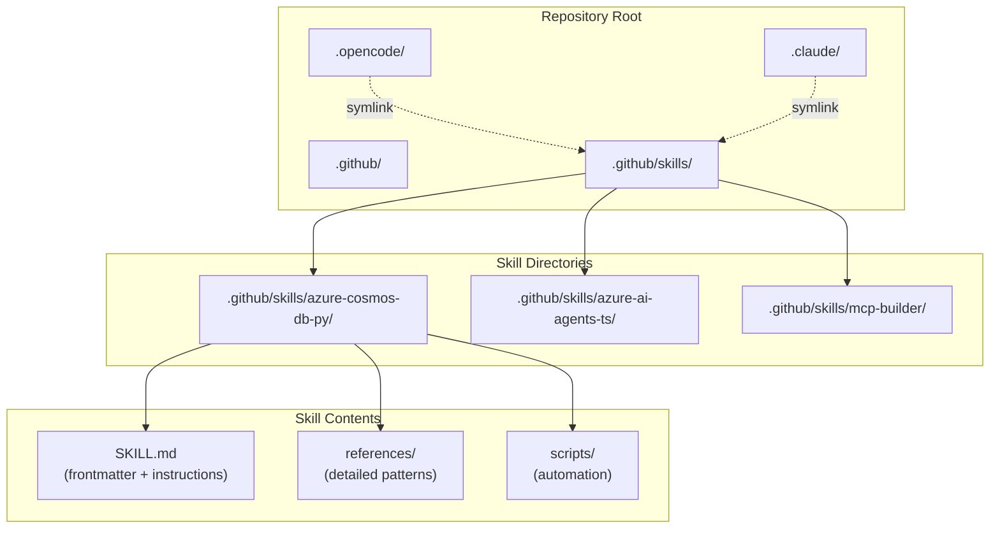
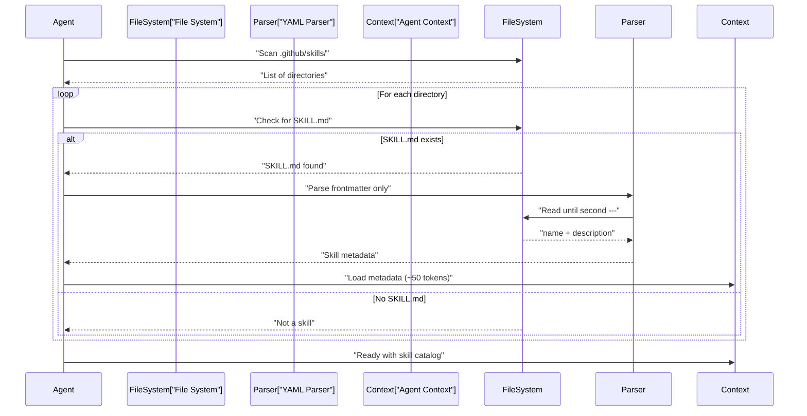
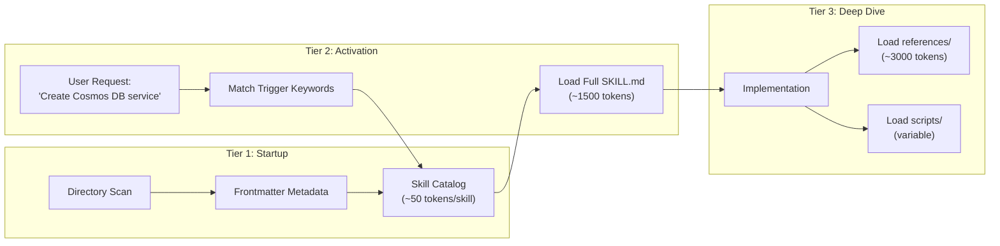
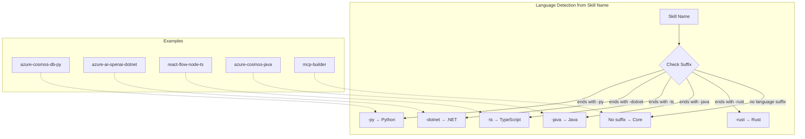
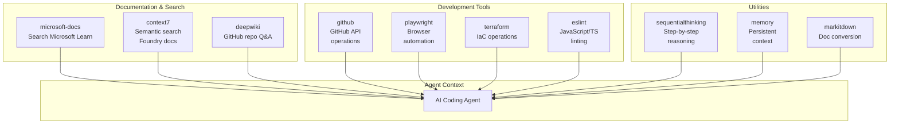
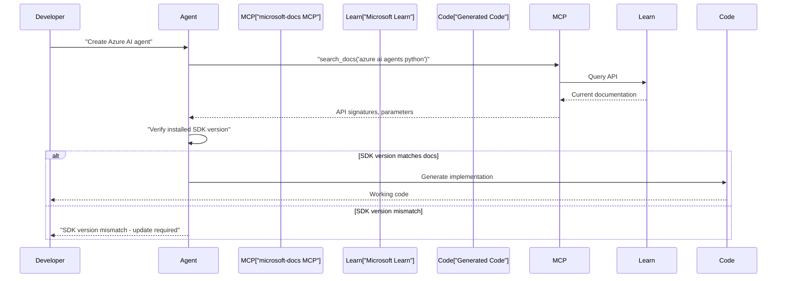
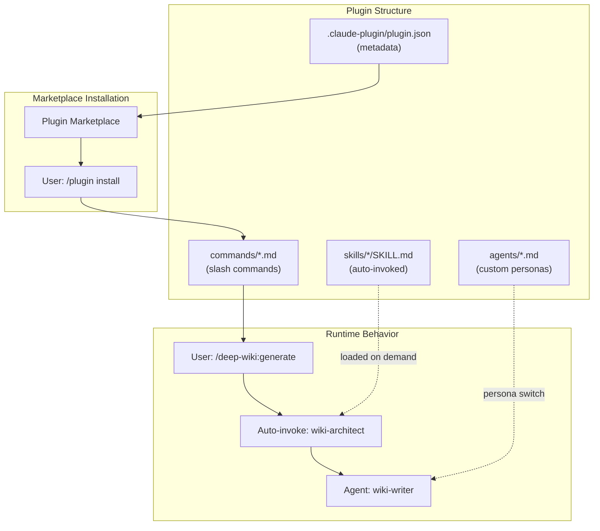
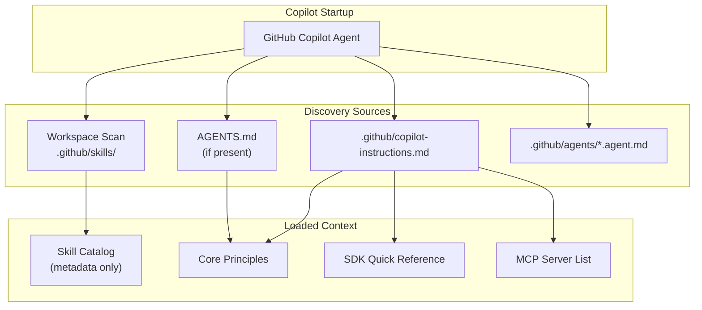
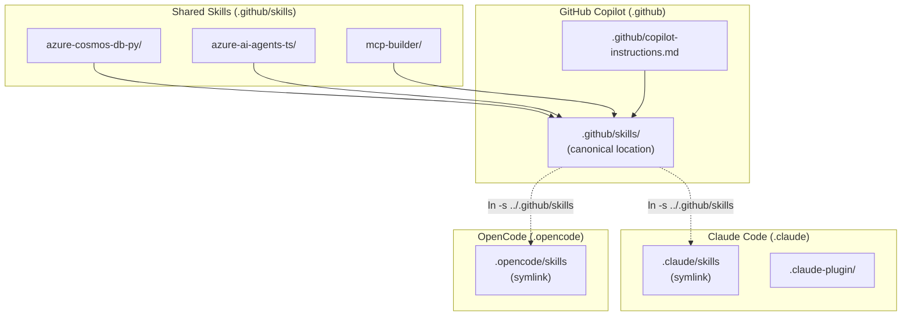
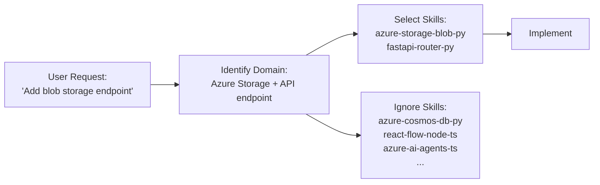

<!-- source: DeepWiki mcp.deepwiki.com · repo microsoft/skills · page 6 Installation and Usage · fetched 2026-10-30 -->

# Installation and Usage

<details>
<summary>Relevant source files</summary>

The following files were used as context for generating this wiki page:

- [.github/agents/scaffolder.agent.md](.github/agents/scaffolder.agent.md)
- [.github/copilot-instructions.md](.github/copilot-instructions.md)
- [.github/docs/agent-integration.md](.github/docs/agent-integration.md)
- [.github/plugins/deep-wiki/.claude-plugin/plugin.json](.github/plugins/deep-wiki/.claude-plugin/plugin.json)
- [.github/plugins/deep-wiki/README.md](.github/plugins/deep-wiki/README.md)
- [.github/plugins/deep-wiki/commands/ado.md](.github/plugins/deep-wiki/commands/ado.md)
- [.github/plugins/deep-wiki/commands/crisp.md](.github/plugins/deep-wiki/commands/crisp.md)
- [.github/plugins/deep-wiki/skills/wiki-ado-convert/SKILL.md](.github/plugins/deep-wiki/skills/wiki-ado-convert/SKILL.md)
- [.github/prompts/scaffold-foundry-app.prompt.md](.github/prompts/scaffold-foundry-app.prompt.md)
- [.github/skills/skill-creator/references/acceptance-criteria.md](.github/skills/skill-creator/references/acceptance-criteria.md)
- [Agents.md](Agents.md)
- [README.md](README.md)
- [context7.json](context7.json)
- [docs-site/src/pages/index.astro](docs-site/src/pages/index.astro)
- [docs/index.html](docs/index.html)
- [tests/harness/criteria-loader.ts](tests/harness/criteria-loader.ts)
- [tests/scenarios/skill-creator/scenarios.yaml](tests/scenarios/skill-creator/scenarios.yaml)

</details>


This page covers installing skills, configuring agent discovery, setting up MCP servers, and integrating with AI coding assistants. For creating new skills, see [Creating New Skills](#2.4). For understanding the skill format, see [SKILL.md Format Specification](#2.3).

---

## Installation Methods

### Quick Install with npx

The fastest method uses the skills installer:

```bash
npx skills add microsoft/skills
```

This launches an interactive wizard that:
1. Lists all available skills by language and category
2. Allows multi-select skill installation
3. Creates `.github/skills/` directory structure
4. Copies selected skills to your project

**Sources:** [README.md:17-23]()

### Manual Installation

Clone the repository and copy specific skills:

```bash
git clone https://github.com/microsoft/skills.git
cp -r skills/.github/skills/azure-cosmos-db-py your-project/.github/skills/
```

**Sources:** [README.md:28-33]()

### Symlink Installation for Multi-Agent Setups

Share skills across different agent configurations in the same repository:

```bash
# Share .github/skills/ with other agent directories
ln -s ../.github/skills .opencode/skills
ln -s ../.github/skills .claude/skills
```

This allows a single skill to be accessible by multiple agents without duplication.

**Sources:** [README.md:35-40]()

---

## Installation Directory Structure



**Installation Directory Layout**

After installation, skills reside in `.github/skills/<skill-name>/` with each skill containing a `SKILL.md` file and optional subdirectories.

**Sources:** [README.md:513-542](), [.github/copilot-instructions.md:70-99]()

---

## Skill Discovery Mechanism

### Agent Startup Scan

Agents discover skills through a two-phase process:



**Skill Discovery Phases**

Agents load skills in three tiers to manage context efficiently.

**Sources:** [.github/docs/agent-integration.md:6-35](), [Agents.md:148-151]()

---

## Progressive Disclosure Architecture



**Progressive Disclosure Loading Strategy**

Agents load minimal information at startup and progressively load more detail only when a skill is activated by user intent.

| Tier | Content | When Loaded | Token Cost | File Path |
|------|---------|-------------|------------|-----------|
| **1. Metadata** | `name`, `description` | Agent startup | ~50-100 | [.github/skills/*/SKILL.md:1-5]() |
| **2. Instructions** | Full markdown body | Skill activation | ~500-2000 | [.github/skills/*/SKILL.md:6-end]() |
| **3. Resources** | Reference files, scripts | On-demand | Variable | [.github/skills/*/references/](), [.github/skills/*/scripts/]() |

**Sources:** [README.md:45-51](), [.github/docs/agent-integration.md:56-77](), [Agents.md:148-176]()

---

## Agent Configuration Files

### GitHub Copilot Integration

GitHub Copilot and VS Code agents use these discovery mechanisms:

| File | Purpose | Path | Key Content |
|------|---------|------|-------------|
| **Copilot Instructions** | Primary agent configuration | [.github/copilot-instructions.md]() | Core principles, SDK reference, skill catalog |
| **Agent Personas** | Role-specific configurations | [.github/agents/*.agent.md]() | Backend, frontend, infrastructure, planner agents |
| **Skill Directory** | Auto-discovered skills | [.github/skills/]() | All installed skills |
| **MCP Config** | Model Context Protocol servers | [.vscode/mcp.json]() | Documentation and tool servers |

**Sources:** [.github/copilot-instructions.md:1-99](), [.github/docs/agent-integration.md:38-56]()

### AGENTS.md Template

The repository provides an `AGENTS.md` template for configuring agent behavior in user projects:

**Key Sections in AGENTS.md:**

1. **Fresh Information First** — Mandate to search official docs before implementing
2. **Core Principles** — Think Before Coding, Simplicity First, Surgical Changes, Goal-Driven Execution
3. **SDK Quick Reference** — Authentication patterns, environment variables
4. **Skills Catalog** — Links to 133 available skills by language
5. **MCP Servers** — Pre-configured documentation and tool servers
6. **Conventions** — Code style, testing patterns, clean code checklist

**Sources:** [Agents.md:1-354](), [README.md:65]()

---

## Skill Naming and Language Detection



**Language Suffix Convention**

Skills use standardized suffixes to indicate target language, enabling automatic filtering by technology stack.

| Suffix | Language | Count | Example Skills |
|--------|----------|-------|----------------|
| `-py` | Python | 41 | `azure-ai-projects-py`, `fastapi-router-py`, `pydantic-models-py` |
| `-dotnet` | .NET/C# | 29 | `azure-ai-openai-dotnet`, `azure-security-keyvault-keys-dotnet` |
| `-ts` | TypeScript | 25 | `azure-ai-projects-ts`, `zustand-store-ts`, `react-flow-node-ts` |
| `-java` | Java | 26 | `azure-ai-projects-java`, `azure-cosmos-java` |
| `-rust` | Rust | 7 | `azure-identity-rust`, `azure-cosmos-rust` |
| (none) | Cross-language | 8 | `mcp-builder`, `skill-creator`, `copilot-sdk` |

**Sources:** [README.md:72-82](), [Agents.md:164-173](), [.github/docs/agent-integration.md:138-149]()

---

## MCP Server Configuration

### Configuration File Structure

MCP servers are configured in `.vscode/mcp.json`:

```json
{
  "mcpServers": {
    "microsoft-docs": {
      "command": "npx",
      "args": ["@modelcontextprotocol/server-microsoft-docs"]
    },
    "context7": {
      "command": "npx",
      "args": ["-y", "@context7/mcp-server", "microsoft/skills"]
    },
    "github": {
      "command": "npx",
      "args": ["-y", "@modelcontextprotocol/server-github"],
      "env": {
        "GITHUB_PERSONAL_ACCESS_TOKEN": "${GITHUB_TOKEN}"
      }
    }
  }
}
```

**Sources:** [README.md:564-572](), [Agents.md:227-255]()

### Available MCP Servers



**MCP Server Ecosystem**

Pre-configured servers provide documentation search, development tools, and utilities accessible to agents during coding sessions.

| Category | Server | Purpose | Key Tool |
|----------|--------|---------|----------|
| **Documentation** | `microsoft-docs` | Search Microsoft Learn for Azure/Foundry docs | `search_docs` |
| **Documentation** | `context7` | Semantic search of indexed Foundry documentation | `search_code` |
| **Documentation** | `deepwiki` | Ask questions about GitHub repositories | `ask_question` |
| **Development** | `github` | GitHub API operations (PRs, issues, repos) | `search_repositories` |
| **Development** | `playwright` | Browser automation and testing | `navigate_to` |
| **Development** | `terraform` | Infrastructure as code operations | `apply_plan` |
| **Development** | `eslint` | JavaScript/TypeScript linting | `lint_files` |
| **Utilities** | `sequentialthinking` | Step-by-step reasoning for complex problems | `think` |
| **Utilities** | `memory` | Persistent memory across agent sessions | `store`, `retrieve` |
| **Utilities** | `markitdown` | Convert documents to markdown | `convert` |

**Sources:** [README.md:564-572](), [Agents.md:227-255](), [.github/copilot-instructions.md:148-177]()

### Microsoft Docs MCP Priority

The `microsoft-docs` MCP server is the primary source for current Azure SDK information:

**Why Microsoft Docs MCP is Critical:**

1. **SDK APIs change frequently** — Training data becomes outdated
2. **Breaking changes occur** — Patterns from 6 months ago may no longer work
3. **New SDKs released** — Agent weights lack knowledge of recent packages
4. **Version differences** — APIs differ between package versions

**Required Workflow Before Azure SDK Implementation:**



**Fresh Information First Workflow**

Agents must query Microsoft Docs MCP before implementing Azure SDK code to ensure current API patterns.

**Sources:** [Agents.md:6-23](), [.github/copilot-instructions.md:6-18]()

---

## Plugin Installation

### Deep Wiki Plugin

The Deep Wiki plugin provides AI-powered documentation generation:

```bash
# Inside Copilot CLI, run these slash commands:
/plugin marketplace add microsoft/skills
/plugin install deep-wiki@skills
```

This enables commands like:
- `/deep-wiki:generate` — Full wiki generation
- `/deep-wiki:crisp` — Fast, concise wiki
- `/deep-wiki:catalogue` — Structure only
- `/deep-wiki:page <topic>` — Single page
- `/deep-wiki:build` — Package as VitePress site

**Sources:** [.github/plugins/deep-wiki/README.md:7-20](), [README.md:547-559]()

### Plugin Architecture



**Plugin Installation and Execution Flow**

Plugins bundle commands, skills, and agents into a single installable package.

**Sources:** [.github/plugins/deep-wiki/.claude-plugin/plugin.json:1-11](), [.github/plugins/deep-wiki/README.md:166-211]()

---

## GitHub Copilot Integration

### Discovery Mechanism

GitHub Copilot agents discover skills through multiple sources:



**GitHub Copilot Skill Discovery Flow**

Copilot scans workspace directories and reads configuration files to build its skill catalog and operating principles.

**Sources:** [.github/docs/agent-integration.md:38-56](), [.github/copilot-instructions.md:1-99]()

### Environment Variables for Azure SDKs

Standard environment variables required for Azure SDK authentication:

```bash
# Azure AI Foundry
AZURE_AI_PROJECT_ENDPOINT=https://<resource>.services.ai.azure.com/api/projects/<project>
AZURE_AI_MODEL_DEPLOYMENT_NAME=gpt-4o-mini

# Azure Cosmos DB
AZURE_COSMOS_ENDPOINT=https://<account>.documents.azure.com:443/
AZURE_COSMOS_DATABASE=my-database

# Azure Storage
AZURE_STORAGE_ACCOUNT_NAME=<account>
AZURE_STORAGE_CONNECTION_STRING=<connection-string>
```

**Sources:** [Agents.md:138-143](), [.github/copilot-instructions.md:205-210]()

### DefaultAzureCredential Pattern

All Azure SDKs in skills use the same authentication pattern:

**Python:**
```python
from azure.identity import DefaultAzureCredential
from azure.ai.projects import AIProjectClient

credential = DefaultAzureCredential()
client = AIProjectClient(
    endpoint=os.environ["AZURE_AI_PROJECT_ENDPOINT"],
    credential=credential
)
```

**TypeScript:**
```typescript
import { DefaultAzureCredential } from "@azure/identity";
import { AIProjectClient } from "@azure/ai-projects";

const credential = new DefaultAzureCredential();
const client = new AIProjectClient(
  process.env.AZURE_AI_PROJECT_ENDPOINT!,
  credential
);
```

**.NET:**
```csharp
using Azure.Identity;
using Azure.AI.Projects;

var credential = new DefaultAzureCredential();
var client = new AIProjectClient(
    new Uri(Environment.GetEnvironmentVariable("AZURE_AI_PROJECT_ENDPOINT")),
    credential
);
```

**Sources:** [Agents.md:123-136](), [.github/copilot-instructions.md:190-203]()

---

## Claude Integration

### Plugin Directory Structure

Claude Code discovers skills via the `.claude-plugin/` directory:

```
.github/plugins/deep-wiki/
├── .claude-plugin/
│   └── plugin.json           # Plugin metadata (name, version, description)
├── commands/                 # Slash commands (/deep-wiki:*)
│   ├── generate.md
│   ├── crisp.md
│   └── catalogue.md
├── skills/                   # Auto-invoked skills
│   ├── wiki-architect/
│   │   └── SKILL.md
│   └── wiki-page-writer/
│       └── SKILL.md
└── agents/                   # Custom agent personas
    ├── wiki-architect.md
    └── wiki-writer.md
```

**Sources:** [.github/plugins/deep-wiki/README.md:166-211]()

### marketplace.json Format

Plugins define their capabilities in `marketplace.json`:

```json
{
  "name": "deep-wiki",
  "version": "2.0.0",
  "description": "AI-powered wiki generator",
  "contexts": ["github", "root", "claude"],
  "commands": [
    {
      "name": "/deep-wiki:generate",
      "description": "Generate complete wiki"
    }
  ],
  "skills": [
    {
      "name": "wiki-architect",
      "path": "skills/wiki-architect/SKILL.md"
    }
  ],
  "agents": [
    {
      "name": "wiki-writer",
      "path": "agents/wiki-writer.md"
    }
  ]
}
```

**Sources:** [.github/plugins/deep-wiki/.claude-plugin/plugin.json:1-11]()

---

## Context7 Integration

The repository includes a `context7.json` file for semantic search indexing:

```json
{
  "projectTitle": "Agent Skills",
  "description": "130 skills for AI coding agents working with Azure SDKs and Microsoft AI Foundry. Python, .NET, TypeScript, Java patterns.",
  "folders": [".github/skills", ".github/plugins", ".github/prompts", ".github/agents", ".github/docs", "output"],
  "excludeFolders": ["skills", ".claude", ".opencode", "node_modules"],
  "excludeFiles": ["SECURITY.md", "blog.wordpress.xml", "AGENTS.md", "README.md"],
  "rules": [
    "Load skills selectively - only those relevant to current task to avoid context rot",
    "Always use DefaultAzureCredential for Azure SDK authentication",
    "Search microsoft-docs MCP before implementing Azure SDK code",
    "Skills use progressive disclosure: metadata at startup, full instructions on activation"
  ]
}
```

The Context7 MCP server reads this configuration to provide semantic search over the repository:

```bash
# In .vscode/mcp.json
{
  "context7": {
    "command": "npx",
    "args": ["-y", "@context7/mcp-server", "microsoft/skills"]
  }
}
```

**Sources:** [context7.json:1-13](), [README.md:269-280]()

---

## Multi-Agent Repository Setup

For repositories using multiple agent systems simultaneously:



**Multi-Agent Skill Sharing via Symlinks**

Use symlinks to share a single skill directory across multiple agent configurations, avoiding duplication.

**Setup Commands:**

```bash
# Create symlinks to share .github/skills/ with other agent directories
ln -s ../.github/skills .opencode/skills
ln -s ../.github/skills .claude/skills
```

This approach ensures:
- Skills are maintained in one canonical location (`.github/skills/`)
- Updates propagate to all agent configurations automatically
- No file duplication across agent directories

**Sources:** [README.md:35-40](), [Agents.md:152-153]()

---

## Selective Skill Loading

**Critical Practice: Never load all skills simultaneously**

Loading too many skills causes context rot:
- Diluted attention across unrelated domains
- Wasted tokens on irrelevant instructions
- Conflated patterns from different SDKs

**Correct Approach:**



**Selective Skill Loading Strategy**

Agents should load only skills directly relevant to the current task domain.

**Selection Criteria:**

| Task Domain | Load These Skills | Skip These Skills |
|-------------|-------------------|-------------------|
| Azure Storage + FastAPI | `azure-storage-blob-py`, `fastapi-router-py` | All Cosmos DB, AI, React skills |
| Azure AI Agents | `azure-ai-agents-py`, `azure-ai-projects-py` | All storage, frontend skills |
| React + Zustand | `react-flow-node-ts`, `zustand-store-ts`, `frontend-ui-dark-ts` | All backend, Azure SDK skills |

**Sources:** [README.md:45-51](), [Agents.md:174-176](), [.github/docs/agent-integration.md:100-117](), [context7.json:8]()

---

## Verification Commands

After installation, verify the setup:

```bash
# List installed skills
ls -la .github/skills/

# Verify skill structure
cat .github/skills/azure-cosmos-db-py/SKILL.md | head -10

# Check MCP configuration (if using VS Code)
cat .vscode/mcp.json

# Test skill discovery (with GitHub Copilot CLI)
copilot --list-skills

# Verify agent configuration
cat .github/copilot-instructions.md | grep -A 5 "Skills"
```

**Sources:** [README.md:612-646](), [.github/docs/agent-integration.md:119-137]()

---

