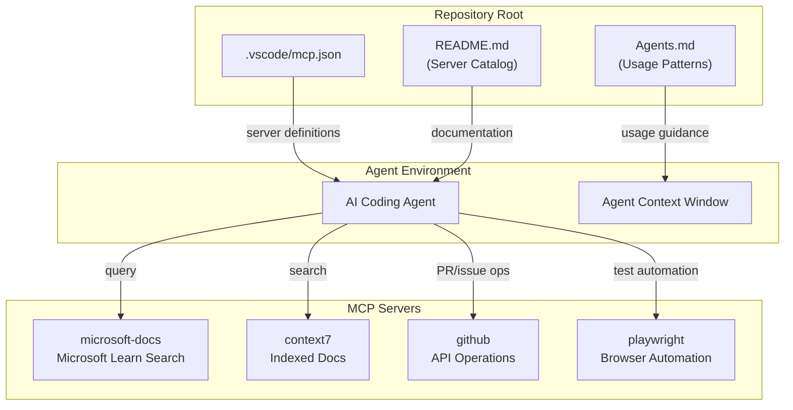
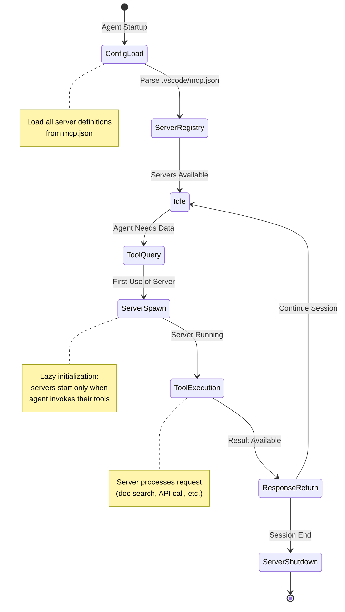
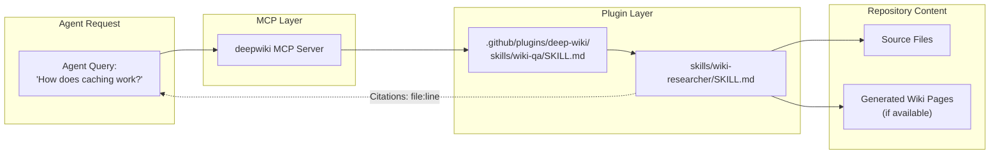
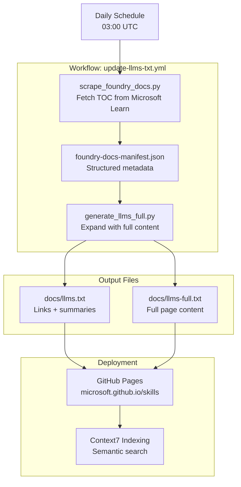

<!-- source: DeepWiki mcp.deepwiki.com · repo microsoft/skills · page 6.3 MCP Server Configuration · fetched 2026-10-30 -->

# MCP Server Configuration

<details>
<summary>Relevant source files</summary>

The following files were used as context for generating this wiki page:

- [.github/agents/scaffolder.agent.md](.github/agents/scaffolder.agent.md)
- [.github/copilot-instructions.md](.github/copilot-instructions.md)
- [.github/docs/agent-integration.md](.github/docs/agent-integration.md)
- [.github/plugins/deep-wiki/.claude-plugin/plugin.json](.github/plugins/deep-wiki/.claude-plugin/plugin.json)
- [.github/plugins/deep-wiki/README.md](.github/plugins/deep-wiki/README.md)
- [.github/plugins/deep-wiki/commands/ado.md](.github/plugins/deep-wiki/commands/ado.md)
- [.github/plugins/deep-wiki/commands/crisp.md](.github/plugins/deep-wiki/commands/crisp.md)
- [.github/plugins/deep-wiki/skills/wiki-ado-convert/SKILL.md](.github/plugins/deep-wiki/skills/wiki-ado-convert/SKILL.md)
- [.github/prompts/scaffold-foundry-app.prompt.md](.github/prompts/scaffold-foundry-app.prompt.md)
- [.github/scripts/generate_llms_full.py](.github/scripts/generate_llms_full.py)
- [.github/scripts/scrape_foundry_docs.py](.github/scripts/scrape_foundry_docs.py)
- [.github/skills/skill-creator/references/acceptance-criteria.md](.github/skills/skill-creator/references/acceptance-criteria.md)
- [.github/workflows/deploy-pages.yml](.github/workflows/deploy-pages.yml)
- [Agents.md](Agents.md)
- [README.md](README.md)
- [context7.json](context7.json)
- [docs-site/src/pages/index.astro](docs-site/src/pages/index.astro)
- [docs/.nojekyll](docs/.nojekyll)
- [docs/foundry-docs-manifest.json](docs/foundry-docs-manifest.json)
- [docs/index.html](docs/index.html)
- [docs/llms-full.txt](docs/llms-full.txt)
- [docs/llms.txt](docs/llms.txt)
- [tests/harness/criteria-loader.ts](tests/harness/criteria-loader.ts)
- [tests/scenarios/skill-creator/scenarios.yaml](tests/scenarios/skill-creator/scenarios.yaml)

</details>


This document describes the Model Context Protocol (MCP) server configurations provided in the microsoft/skills repository for extending AI coding agent capabilities. These configurations enable agents to access fresh documentation, development tools, and utilities beyond static skill content.

**Related documentation:** For skill-based agent knowledge, see [Agent Skills System](#2). For agent behavior configuration, see [Agent Integration](#6.2).

---

## Purpose and Scope

MCP servers provide AI coding agents with tool integrations for:

- **Real-time documentation access** via Microsoft Learn and indexed repositories
- **Development operations** including GitHub API, browser automation, and infrastructure management
- **Utility functions** for reasoning, persistent memory, and document conversion

Unlike skills (which load static domain knowledge), MCP servers query live data sources and execute operations on behalf of agents.

**Sources:** [README.md:562-572](), [Agents.md:226-256](), [.github/copilot-instructions.md:148-178]()

---

## Configuration File Location

The repository provides reference MCP server configurations in [`.vscode/mcp.json`](.vscode/mcp.json). This file defines server connection details, authentication methods, and available tools.



**Diagram: MCP Configuration Discovery and Usage**

**Sources:** [README.md:562-572](), [Agents.md:226-256](), [.vscode/mcp.json](full file)

---

## Server Categories

### Documentation and Search Servers

These servers provide access to current documentation, avoiding stale knowledge from agent training data.

| Server | Purpose | Primary Use Case |
|--------|---------|------------------|
| `microsoft-docs` | Search Microsoft Learn documentation | Retrieve current Azure/Foundry SDK signatures and patterns |
| `context7` | Semantic search over indexed Foundry docs | Query comprehensive documentation updated daily |
| `deepwiki` | Repository Q&A | Ask questions about any GitHub repository's codebase |

**Critical workflow:** Agents MUST query `microsoft-docs` before implementing Azure SDK code, as training data is outdated and APIs change frequently.

**Sources:** [README.md:566-568](), [Agents.md:230-236](), [.github/copilot-instructions.md:152-158]()

---

### Development Tool Servers

| Server | Purpose | Operations |
|--------|---------|------------|
| `github` | GitHub API integration | Create PRs/issues, manage repositories, run workflows |
| `playwright` | Browser automation | UI testing, screenshot generation, web scraping |
| `terraform` | Infrastructure as Code | Resource management, state inspection, plan generation |
| `eslint` | Code linting | JavaScript/TypeScript code quality checks |

**Convention:** Use `gh` CLI for GitHub operations rather than the MCP `github-create_pull_request` tool. The CLI provides better error handling and authentication.

**Sources:** [README.md:567-571](), [Agents.md:238-245](), [.github/copilot-instructions.md:160-167]()

---

### Utility Servers

| Server | Purpose | Use Case |
|--------|---------|----------|
| `sequentialthinking` | Step-by-step reasoning | Complex problem decomposition |
| `memory` | Persistent context storage | Cross-session agent memory |
| `markitdown` | Document conversion | Transform formats to Markdown |

**Sources:** [README.md:567-571](), [Agents.md:247-253](), [.github/copilot-instructions.md:169-175]()

---

## Integration with Agent Workflows

### Fresh Information First Principle

The repository enforces a "Fresh Information First" pattern where agents query MCP servers before relying on cached knowledge:

```mermaid
sequenceDiagram
    participant User
    participant Agent
    participant MicrosoftDocs["microsoft-docs MCP"]
    participant Context7["context7 MCP"]
    participant Skill["Loaded Skill"]
    
    User->>Agent: "Implement Azure AI Projects agent"
    
    rect rgb(40, 40, 40)
        Note over Agent,MicrosoftDocs: Step 1: Query Fresh Docs
        Agent->>MicrosoftDocs: search("azure-ai-projects Python SDK")
        MicrosoftDocs-->>Agent: Current API signatures
        
        Agent->>Context7: search("agent creation patterns")
        Context7-->>Agent: Indexed examples
    end
    
    rect rgb(40, 40, 40)
        Note over Agent,Skill: Step 2: Load Domain Knowledge
        Agent->>Skill: Activate azure-ai-projects-py
        Skill-->>Agent: Installation, auth, workflow patterns
    end
    
    rect rgb(40, 40, 40)
        Note over Agent,User: Step 3: Generate Implementation
        Agent->>Agent: Combine fresh docs + skill patterns
        Agent->>User: Return current implementation
    end
```



**Diagram: MCP-First Query Pattern**

This prevents agents from producing broken code based on outdated training data. The pattern is mandatory for Azure SDK implementations.

**Sources:** [Agents.md:6-23](), [.github/copilot-instructions.md:8-18](), [README.md:47-51]()

---

## Configuration Structure

### JSON Schema Pattern

MCP server configurations follow a standard structure:

```
{
  "mcpServers": {
    "<server-name>": {
      "command": "<executable>",
      "args": ["<arg1>", "<arg2>"],
      "env": {
        "ENV_VAR": "value"
      }
    }
  }
}
```

**Key elements:**
- `command`: Executable to launch the server (e.g., `npx`, `python`, `uvx`)
- `args`: Command-line arguments including server package/module
- `env`: Environment variables for authentication or configuration

**Sources:** [.vscode/mcp.json](full file structure)

---

## MCP Server Lifecycle



**Diagram: MCP Server Lifecycle**

Servers use lazy initialization—they start only when an agent first invokes their tools. This reduces startup overhead and resource consumption.

**Sources:** [README.md:562-572](), Configuration behavior inferred from MCP protocol standards

---

## Example Configurations

### Documentation Access Server

```json
{
  "mcpServers": {
    "microsoft-docs": {
      "command": "npx",
      "args": ["-y", "@azure/microsoft-docs-mcp"]
    }
  }
}
```

**Purpose:** Enables agents to search Microsoft Learn for current Azure documentation.

**Typical query:** `search("azure-ai-projects Python SDK authentication")`

---

### Repository Indexing Server

```json
{
  "mcpServers": {
    "context7": {
      "command": "npx",
      "args": ["-y", "@context7/mcp-server", "microsoft/skills"]
    }
  }
}
```

**Purpose:** Provides semantic search over indexed Microsoft Foundry documentation updated daily via GitHub workflow.

**Update mechanism:** [.github/workflows/update-llms-txt.yml](.github/workflows/update-llms-txt.yml) runs daily to refresh indexed content.

**Sources:** [docs/llms.txt:1-10](), [docs/llms-full.txt:1-10](), [docs/foundry-docs-manifest.json:1-10]()

---

### GitHub Operations Server

```json
{
  "mcpServers": {
    "github": {
      "command": "npx",
      "args": ["-y", "@modelcontextprotocol/server-github"],
      "env": {
        "GITHUB_TOKEN": "${GITHUB_TOKEN}"
      }
    }
  }
}
```

**Purpose:** Enables repository operations (PRs, issues, workflow runs).

**Authentication:** Requires `GITHUB_TOKEN` environment variable. Agents should prefer `gh` CLI for PR/issue creation over MCP tools.

**Sources:** [Agents.md:269-272](), [.github/copilot-instructions.md:269-272]()

---

## Context7 Integration

The repository publishes documentation for Context7 indexing via [context7.json](context7.json):

```json
{
  "projectTitle": "Agent Skills",
  "folders": [".github/skills", ".github/plugins", ".github/prompts"],
  "excludeFolders": ["skills", ".claude", "node_modules"],
  "rules": [
    "Load skills selectively to avoid context rot",
    "Always use DefaultAzureCredential for Azure SDK authentication",
    "Search microsoft-docs MCP before implementing Azure SDK code"
  ]
}
```

**Purpose:** Defines indexing rules and search guidance for the Context7 MCP server.

**Update frequency:** Documentation is refreshed daily by [.github/workflows/update-llms-txt.yml](.github/workflows/update-llms-txt.yml) at 03:00 UTC.

**Sources:** [context7.json:1-13](), [.github/workflows/deploy-pages.yml:1-38]()

---

## Relationship to Deep Wiki Plugin

The `deepwiki` MCP server integrates with the Deep Wiki plugin to enable repository Q&A:



**Diagram: Deep Wiki MCP Integration**

The `deepwiki` MCP server uses skills from [.github/plugins/deep-wiki/skills/](.github/plugins/deep-wiki/skills) to answer questions grounded in source code.

**Sources:** [.github/plugins/deep-wiki/README.md:147-165](), [.github/plugins/deep-wiki/skills/wiki-qa/SKILL.md](path)

---

## Daily Documentation Updates

The repository maintains fresh Foundry documentation through automated workflows:



**Diagram: Documentation Update Pipeline**

**Scripts:**
- [.github/scripts/scrape_foundry_docs.py](.github/scripts/scrape_foundry_docs.py): Fetches TOC from Microsoft Learn, extracts documentation URLs
- [.github/scripts/generate_llms_full.py](.github/scripts/generate_llms_full.py): Fetches full page content, generates expanded llms-full.txt

**Output:**
- [docs/llms.txt](docs/llms.txt): Lightweight index with links and summaries
- [docs/llms-full.txt](docs/llms-full.txt): Complete documentation for context loading
- [docs/foundry-docs-manifest.json](docs/foundry-docs-manifest.json): Structured metadata

**Sources:** [.github/scripts/scrape_foundry_docs.py:1-20](), [.github/scripts/generate_llms_full.py:1-20](), [docs/foundry-docs-manifest.json:1-10]()

---

## Usage Conventions

### Documented Patterns

The repository enforces these MCP usage conventions:

| Convention | Rationale | Source |
|------------|-----------|--------|
| Query `microsoft-docs` FIRST before Azure SDK code | Training data is outdated; APIs change frequently | [Agents.md:9-14]() |
| Use `gh` CLI for GitHub operations | Better error handling than MCP `github-create_pull_request` | [Agents.md:269-272]() |
| Load skills selectively | Loading all skills causes context rot | [context7.json:8]() |
| Prefer DefaultAzureCredential | Standard authentication pattern for Azure SDKs | [context7.json:9]() |

**Sources:** [Agents.md:6-23](), [context7.json:7-12](), [.github/copilot-instructions.md:8-18]()

---

## Summary

MCP servers in the microsoft/skills repository provide:

1. **Fresh documentation access** via `microsoft-docs` and `context7` to prevent outdated code generation
2. **Development operations** through `github`, `playwright`, `terraform`, and `eslint` servers
3. **Utility functions** for reasoning, memory, and document conversion
4. **Daily updates** to Foundry documentation via automated workflows
5. **Integration with Deep Wiki** for repository Q&A capabilities

The configurations in [`.vscode/mcp.json`](.vscode/mcp.json) serve as reference implementations for extending AI coding agent capabilities beyond static skill content.

**Sources:** [README.md:562-572](), [Agents.md:226-256](), [.github/copilot-instructions.md:148-178](), [.vscode/mcp.json](full file)

---

