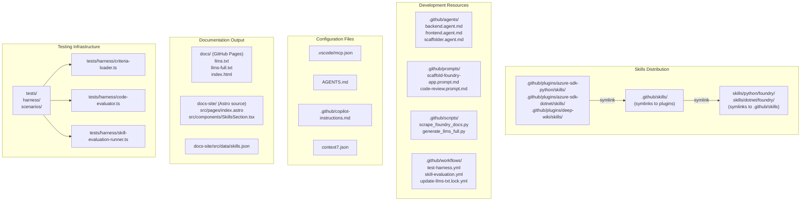
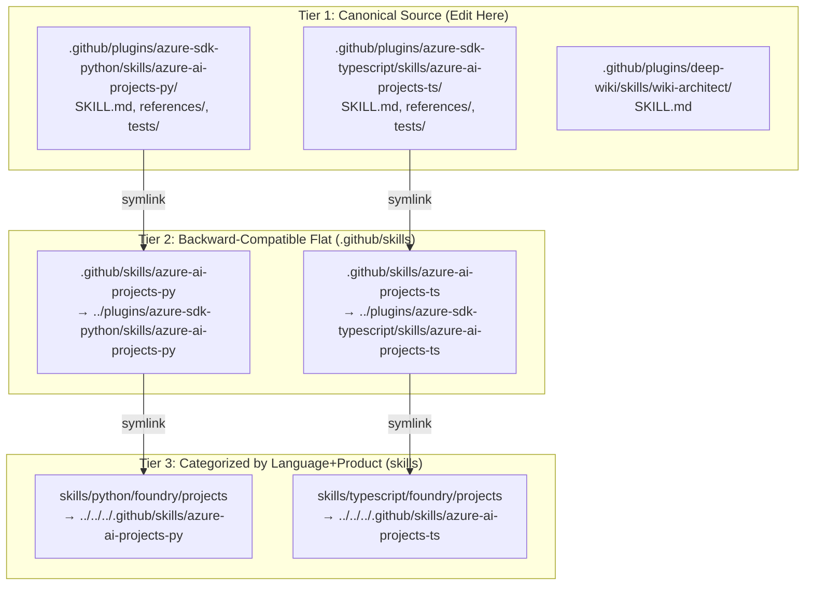
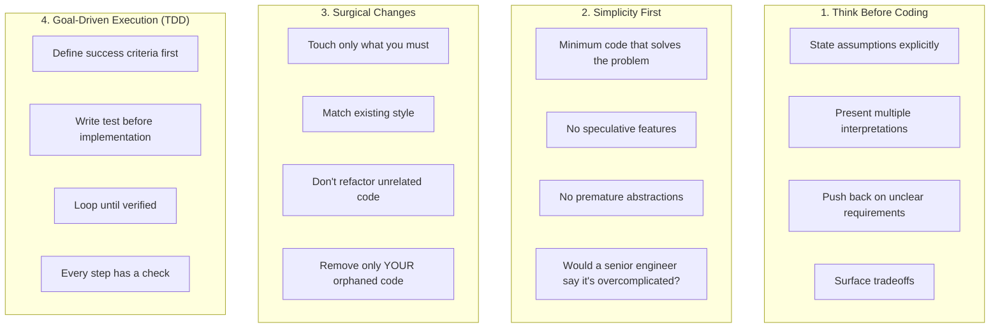
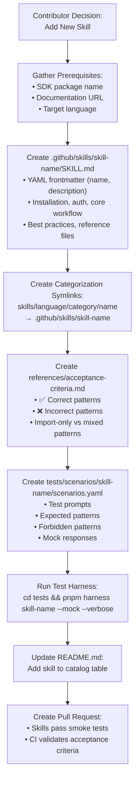
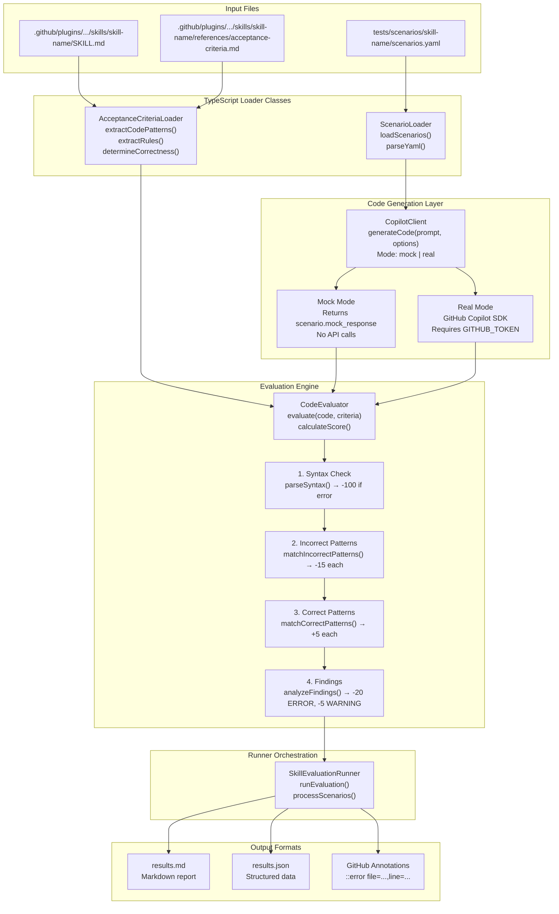

<!-- source: DeepWiki mcp.deepwiki.com · repo microsoft/skills · page 7 Development Guide · fetched 2026-10-30 -->

# Development Guide

<details>
<summary>Relevant source files</summary>

The following files were used as context for generating this wiki page:

- [.github/agents/scaffolder.agent.md](.github/agents/scaffolder.agent.md)
- [.github/copilot-instructions.md](.github/copilot-instructions.md)
- [.github/docs/agent-integration.md](.github/docs/agent-integration.md)
- [.github/plugins/deep-wiki/.claude-plugin/plugin.json](.github/plugins/deep-wiki/.claude-plugin/plugin.json)
- [.github/plugins/deep-wiki/README.md](.github/plugins/deep-wiki/README.md)
- [.github/plugins/deep-wiki/commands/ado.md](.github/plugins/deep-wiki/commands/ado.md)
- [.github/plugins/deep-wiki/commands/crisp.md](.github/plugins/deep-wiki/commands/crisp.md)
- [.github/plugins/deep-wiki/skills/wiki-ado-convert/SKILL.md](.github/plugins/deep-wiki/skills/wiki-ado-convert/SKILL.md)
- [.github/prompts/scaffold-foundry-app.prompt.md](.github/prompts/scaffold-foundry-app.prompt.md)
- [.github/skills/skill-creator/references/acceptance-criteria.md](.github/skills/skill-creator/references/acceptance-criteria.md)
- [Agents.md](Agents.md)
- [README.md](README.md)
- [context7.json](context7.json)
- [docs-site/src/pages/index.astro](docs-site/src/pages/index.astro)
- [docs/index.html](docs/index.html)
- [tests/harness/criteria-loader.ts](tests/harness/criteria-loader.ts)
- [tests/scenarios/skill-creator/scenarios.yaml](tests/scenarios/skill-creator/scenarios.yaml)

</details>


## Purpose and Scope

This guide is for contributors and maintainers of the microsoft/skills repository. It covers repository structure, development principles, contribution workflow, testing infrastructure, and CI/CD pipelines.

**Related Documentation:**
- For using skills in your projects, see [Installation and Usage](#6)
- For skill creation patterns and specifications, see [Creating New Skills](#2.4)
- For test harness architecture and evaluation details, see [Quality Assurance System](#4)
- For Deep Wiki plugin development, see [Deep Wiki Plugin](#3)

---

## Repository Structure

The repository uses a hierarchical organization with skills, plugins, agents, and prompts distributed across `.github/` and top-level directories.

### Directory Layout

**Repository Root Structure**



**Sources:** [README.md:510-542](), [.github/copilot-instructions.md:70-99](), [context7.json:1-14]()

### Key Directories

| Directory | Purpose | Key Files | Access Pattern |
|-----------|---------|-----------|----------------|
| `.github/plugins/` | **Canonical source** for all skills | `azure-sdk-python/skills/`, `azure-sdk-dotnet/skills/`, `deep-wiki/` | Direct editing |
| `.github/skills/` | Backward-compatible symlinks | `azure-ai-projects-py/ -> ../plugins/azure-sdk-python/skills/azure-ai-projects-py/` | Read-only symlink |
| `skills/` | Language-categorized symlinks | `python/foundry/projects -> ../../.github/skills/azure-ai-projects-py/` | Read-only symlink |
| `.github/agents/` | Role-specific agent personas | `backend.agent.md`, `frontend.agent.md`, `scaffolder.agent.md`, `planner.agent.md`, `presenter.agent.md` | Direct editing |
| `.github/prompts/` | Reusable prompt templates | `scaffold-foundry-app.prompt.md`, `code-review.prompt.md`, `create-store.prompt.md`, `add-endpoint.prompt.md` | Direct editing |
| `.github/scripts/` | Automation scripts | `scrape_foundry_docs.py`, `generate_llms_full.py` | Executed by workflows |
| `.github/workflows/` | GitHub Actions CI/CD | `test-harness.yml`, `skill-evaluation.yml`, `update-llms-txt.lock.yml` | Triggered automatically |
| `tests/harness/` | Test harness TypeScript implementation | `criteria-loader.ts`, `code-evaluator.ts`, `skill-evaluation-runner.ts`, `copilot-client.ts` | Executed by `pnpm harness` |
| `tests/scenarios/` | Skill test scenarios | `<skill-name>/scenarios.yaml` | Loaded by ScenarioLoader |
| `docs/` | Static documentation (GitHub Pages) | `llms.txt`, `llms-full.txt`, `index.html` | Auto-generated daily |
| `docs-site/` | Documentation website source (Astro) | `src/pages/index.astro`, `src/components/SkillsSection.tsx`, `src/data/skills.json` | Build → docs/ |

**Sources:** [README.md:510-542](), [.github/copilot-instructions.md:70-99](), [tests/harness/criteria-loader.ts:1-50]()

### Skill Organization Pattern

Skills use a three-tier symlink architecture for distribution and categorization:

**Three-Tier Symlink Architecture**



**Why This Architecture?**

1. **Plugin Distribution** — Skills organized by language SDK in `.github/plugins/` for bundled distribution
2. **Backward Compatibility** — Flat `.github/skills/` structure for `npx skills add microsoft/skills` installer
3. **Discoverability** — Categorized `skills/` structure for browsing by language and product area

**Sources:** [README.md:510-542](), [AGENTS.md:149-153]()

---

## Core Development Principles

The repository follows four principles that reduce common LLM coding mistakes. These apply to all contributions.

### The Four Principles



**Sources:** [AGENTS.md:26-87](), [.github/copilot-instructions.md:21-67]()

### Principle 1: Think Before Coding

**Don't assume. Don't hide confusion. Surface tradeoffs.**

- State assumptions explicitly. If uncertain, ask.
- If multiple interpretations exist, present them — don't pick silently.
- If a simpler approach exists, say so. Push back when warranted.
- If something is unclear, stop. Name what's confusing. Ask.

**Sources:** [AGENTS.md:30-37](), [.github/copilot-instructions.md:25-32]()

### Principle 2: Simplicity First

**Minimum code that solves the problem. Nothing speculative.**

- No features beyond what was asked.
- No abstractions for single-use code.
- No "flexibility" or "configurability" that wasn't requested.
- No error handling for impossible scenarios.
- If you write 200 lines and it could be 50, rewrite it.

**The test:** Would a senior engineer say this is overcomplicated? If yes, simplify.

**Sources:** [AGENTS.md:39-50](), [.github/copilot-instructions.md:34-42]()

### Principle 3: Surgical Changes

**Touch only what you must. Clean up only your own mess.**

When editing existing code:
- Don't "improve" adjacent code, comments, or formatting.
- Don't refactor things that aren't broken.
- Match existing style, even if you'd do it differently.
- If you notice unrelated dead code, mention it — don't delete it.

When your changes create orphans:
- Remove imports/variables/functions that YOUR changes made unused.
- Don't remove pre-existing dead code unless asked.

**The test:** Every changed line should trace directly to the user's request.

**Sources:** [AGENTS.md:52-66](), [.github/copilot-instructions.md:44-56]()

### Principle 4: Goal-Driven Execution (TDD)

**Define success criteria. Loop until verified.**

Transform tasks into verifiable goals:

| Instead of... | Transform to... |
|---------------|-----------------|
| "Add validation" | "Write tests for invalid inputs, then make them pass" |
| "Fix the bug" | "Write a test that reproduces it, then make it pass" |
| "Refactor X" | "Ensure tests pass before and after" |

For multi-step tasks, state a brief plan:
```
1. [Step] → verify: [check]
2. [Step] → verify: [check]
3. [Step] → verify: [check]
```

Strong success criteria let you loop independently. Weak criteria ("make it work") require constant clarification.

**Sources:** [AGENTS.md:68-87](), [.github/copilot-instructions.md:58-67]()

---

## Development Agents

The repository provides role-specific agent personas in `.github/agents/`. Each agent is optimized for a specific domain and references relevant skills.

### Agent Roles

```mermaid
graph TB
    subgraph "Backend Development"
        backend["backend.agent.md"]
        backendSkills["Skills: FastAPI, Pydantic,<br/>Cosmos DB, Azure SDKs"]
    end
    
    subgraph "Frontend Development"
        frontend["frontend.agent.md"]
        frontendSkills["Skills: React, TypeScript,<br/>React Flow, Zustand, Tailwind"]
    end
    
    subgraph "Infrastructure"
        infra["infrastructure.agent.md"]
        infraSkills["Skills: Bicep, Azure CLI,<br/>Container Apps, networking"]
    end
    
    subgraph "Planning & Architecture"
        planner["planner.agent.md"]
        plannerSkills["Skills: Task decomposition,<br/>architecture decisions"]
    end
    
    subgraph "Documentation"
        presenter["presenter.agent.md"]
        presenterSkills["Skills: Documentation,<br/>demos, technical writing"]
    end
    
    subgraph "Full-Stack Scaffolding"
        scaffolder["scaffolder.agent.md"]
        scaffolderSkills["Skills: React + FastAPI + azd,<br/>Fluent UI, Pydantic v2"]
    end
    
    backend --> backendSkills
    frontend --> frontendSkills
    infra --> infraSkills
    planner --> plannerSkills
    presenter --> presenterSkills
    scaffolder --> scaffolderSkills
```



**Sources:** [README.md:577-586](), [AGENTS.md:577-586]()

### Agent Reference Table

| Agent | File | Expertise | Referenced Skills |
|-------|------|-----------|-------------------|
| **Backend** | `.github/agents/backend.agent.md` | FastAPI, Pydantic, Cosmos DB, Azure services | `fastapi-router-py`, `pydantic-models-py`, `azure-cosmos-db-py` |
| **Frontend** | `.github/agents/frontend.agent.md` | React, TypeScript, React Flow, Zustand, Tailwind | `react-flow-node-ts`, `zustand-store-ts`, `frontend-ui-dark-ts` |
| **Infrastructure** | `.github/agents/infrastructure.agent.md` | Bicep, Azure CLI, Container Apps, networking | Bicep templates, azd patterns |
| **Planner** | `.github/agents/planner.agent.md` | Task decomposition, architecture decisions | N/A (meta-agent) |
| **Presenter** | `.github/agents/presenter.agent.md` | Documentation, demos, technical writing | Documentation patterns |
| **Scaffolder** | `.github/agents/scaffolder.agent.md` | Full-stack Azure AI Foundry app scaffolding | `frontend-ui-dark-ts`, `fastapi-router-py`, `pydantic-models-py` |

**Sources:** [README.md:577-586](), [.github/agents/scaffolder.agent.md:1-284]()

### Using Development Agents

Agents are referenced in `AGENTS.md` and can be loaded by AI coding assistants:

```markdown
# In your project's AGENTS.md
## Custom Agents

For backend development, use `.github/agents/backend.agent.md`.
For full-stack scaffolding, use `.github/agents/scaffolder.agent.md`.
```

**Sources:** [AGENTS.md:577-588](), [.github/copilot-instructions.md:1-306]()

---

## Contributing Workflow

The contribution process ensures quality through test-driven development and automated validation.

### Skill Creation Pipeline



**Sources:** [README.md:667-708](), [AGENTS.md:175-213]()

### Contribution Steps

#### 1. Create Skill in Canonical Location

Create the skill in the appropriate plugin directory under `.github/plugins/`:

**File:** `.github/plugins/<plugin-bundle>/skills/<skill-name>/SKILL.md`

| Language | Plugin Bundle | Example Path |
|----------|---------------|--------------|
| Python | `azure-sdk-python` | `.github/plugins/azure-sdk-python/skills/azure-cosmos-db-py/` |
| .NET | `azure-sdk-dotnet` | `.github/plugins/azure-sdk-dotnet/skills/azure-ai-openai-dotnet/` |
| TypeScript | `azure-sdk-typescript` | `.github/plugins/azure-sdk-typescript/skills/azure-storage-blob-ts/` |
| Java | `azure-sdk-java` | `.github/plugins/azure-sdk-java/skills/azure-cosmos-java/` |
| Rust | `azure-sdk-rust` | `.github/plugins/azure-sdk-rust/skills/azure-identity-rust/` |
| Cross-language | (root skills) | `.github/skills/mcp-builder/`, `.github/skills/skill-creator/` |

**Naming Convention for Language-Specific Skills:**

- Pattern: `<service>-<language-suffix>`
- Suffix: `-py`, `-dotnet`, `-ts`, `-java`, `-rust`
- Examples: `azure-ai-projects-py`, `azure-search-documents-dotnet`

**Sources:** [README.md:667-680](), [.github/copilot-instructions.md:108-119](), [.github/skills/skill-creator/references/acceptance-criteria.md:142-160]()

#### 2. Create Backward-Compatible Symlink

Create a symlink from `.github/skills/` to the canonical location:

```bash
cd .github/skills
ln -s ../plugins/azure-sdk-python/skills/azure-ai-projects-py azure-ai-projects-py
```

This enables the `npx skills add microsoft/skills` installer to discover the skill.

#### 3. Add Categorization Symlink

Create a symlink in the categorized `skills/` directory:

```bash
cd skills/python/foundry
ln -s ../../../.github/skills/azure-ai-projects-py projects
```

**Product Area Categories:**

| Category | Skills |
|----------|--------|
| `foundry` | AI agents, projects, inference, search, document intelligence |
| `data` | Storage (Blob, Queue, File Share, Data Lake), Cosmos DB, Tables |
| `messaging` | Event Hubs, Service Bus, Event Grid, Web PubSub |
| `monitoring` | OpenTelemetry, Application Insights, Monitor Query/Ingestion |
| `entra` | Identity, Key Vault (Keys, Secrets, Certificates) |
| `integration` | API Management, App Configuration, Bot Service |
| `compute` | Container Apps, Batch, Durable Task |
| `m365` | Microsoft 365 Agents SDK |
| `general` | Cross-service skills, patterns, frameworks |

**Sources:** [README.md:685-693](), [AGENTS.md:194-222]()

#### 4. Create Test Coverage

Create two files in the skill directory:

**File 1:** `references/acceptance-criteria.md`

Structure the file with sections containing correct (`✅`) and incorrect (`❌`) patterns:

```markdown
## Section Name

### ✅ Correct: Description

\`\`\`python
from azure.identity import DefaultAzureCredential
\`\`\`

### ❌ Incorrect: Description

\`\`\`python
api_key = "hardcoded-secret"
\`\`\`
```

The `AcceptanceCriteriaLoader` class parses this markdown structure into `CodePattern` objects with `isCorrect` flags.

**File 2:** `tests/scenarios/<skill-name>/scenarios.yaml`

Define test scenarios that the `ScenarioLoader` class will parse:

```yaml
config:
  model: gpt-4
  max_tokens: 2000
  temperature: 0.3

scenarios:
  - name: scenario_name
    prompt: |
      Task description for the agent
    expected_patterns:
      - "pattern that MUST appear in code"
      - "another required pattern"
    forbidden_patterns:
      - "pattern that MUST NOT appear"
    mock_response: |
      # Deterministic code output for smoke tests
      from azure.identity import DefaultAzureCredential
```

**Pattern Types:**

- **Import-only patterns** — Must appear at import level (e.g., `from azure.identity import DefaultAzureCredential`)
- **Mixed patterns** — Can appear anywhere in code (e.g., `DefaultAzureCredential\(\)`)

**Sources:** [README.md:694-708](), [tests/harness/criteria-loader.ts:1-286](), [tests/scenarios/skill-creator/scenarios.yaml:1-20](), [.github/skills/skill-creator/references/acceptance-criteria.md:1-20]()

#### 5. Verify Locally with Test Harness

Run the test harness in mock mode to validate your skill:

```bash
cd tests
pnpm install  # First time only
pnpm harness azure-ai-projects-py --mock --verbose
```

**What Happens:**

1. `SkillEvaluationRunner` orchestrates the test pipeline
2. `ScenarioLoader` loads scenarios from `tests/scenarios/<skill>/scenarios.yaml`
3. `AcceptanceCriteriaLoader` parses `references/acceptance-criteria.md`
4. `CopilotClient` uses `mock_response` from scenarios (no API calls)
5. `CodeEvaluator` validates generated code against acceptance criteria
6. Results displayed in terminal with pass/fail for each scenario

**Mock mode benefits:**
- Fast execution (~1-2 seconds per scenario)
- No API quota consumption
- Deterministic results for CI
- No `GITHUB_TOKEN` required

**Sources:** [README.md:607-627](), [tests/harness/criteria-loader.ts:1-50]()

#### 6. Update Documentation

Add the skill to the catalog table in `README.md` under the appropriate language section:

```markdown
## Python

| Skill | Description |
|-------|-------------|
| [azure-ai-projects-py](.github/plugins/azure-sdk-python/skills/azure-ai-projects-py) | Azure AI Projects SDK — project client, agents, evals, connections |
```

The website build extracts metadata from all `SKILL.md` files using the `extract-skills.ts` script, which generates `docs-site/src/data/skills.json`.

**Sources:** [README.md:706-708](), [docs-site/src/pages/index.astro:1-11]()

#### 7. Submit Pull Request

The CI pipeline (`test-harness.yml` workflow) will automatically:

1. **Run smoke tests** — All scenarios with `--mock` flag (fast, deterministic)
2. **Validate acceptance criteria format** — Ensure `✅`/`❌` sections parse correctly
3. **Check symlinks** — Verify `.github/skills/` and `skills/` symlinks are valid
4. **Verify catalog consistency** — Ensure `README.md` lists all skills

**Failed checks produce GitHub annotations:**

```
::error file=tests/scenarios/azure-ai-projects-py/scenarios.yaml,line=45::
Scenario 'create_agent_with_tools' failed: Missing expected pattern 'azure.ai.agents'
```

**Sources:** [README.md:607-665]()

---

## Testing Infrastructure

The test harness validates skills by generating code and evaluating it against acceptance criteria. The system supports both mock mode (fast, deterministic) and real mode (uses Copilot SDK).

### Test Harness Architecture

**Test Harness Component Flow**



**Sources:** [tests/harness/criteria-loader.ts:1-286](), [tests/scenarios/skill-creator/scenarios.yaml:1-20](), [README.md:607-665]()

### Key Components

| Component | File | Key Methods | Purpose |
|-----------|------|-------------|---------|
| `AcceptanceCriteriaLoader` | [tests/harness/criteria-loader.ts:51-100]() | `load()`, `parseCriteria()`, `extractCodePatterns()`, `extractRules()` | Parses acceptance-criteria.md markdown into structured `AcceptanceCriteria` objects with `correctPatterns[]` and `incorrectPatterns[]` |
| `ScenarioLoader` | `tests/harness/scenario-loader.ts` | `loadScenarios()`, `parseYaml()` | Loads scenarios.yaml files into `Scenario[]` objects with `prompt`, `expected_patterns`, `forbidden_patterns`, `mock_response` |
| `CopilotClient` | `tests/harness/copilot-client.ts` | `generateCode()`, `setMode()` | Generates code either via Copilot SDK (real mode) or returns `mock_response` (mock mode) |
| `CodeEvaluator` | `tests/harness/code-evaluator.ts` | `evaluate()`, `calculateScore()`, `matchPatterns()` | Validates generated code against acceptance criteria, calculates 0-100 score with penalties for incorrect patterns |
| `SkillEvaluationRunner` | `tests/harness/skill-evaluation-runner.ts` | `runEvaluation()`, `processScenarios()`, `generateReport()` | Orchestrates the full evaluation pipeline: load → generate → evaluate → report |

**Sources:** [tests/harness/criteria-loader.ts:1-286]()

### Running Tests Locally

```bash
# Navigate to tests directory
cd tests

# Install dependencies (first time only)
pnpm install

# List all skills with test coverage
pnpm harness --list

# Run specific skill (mock mode)
pnpm harness azure-ai-projects-py --mock --verbose

# Run with Ralph Loop (iterative improvement)
pnpm harness azure-ai-projects-py --ralph --mock --max-iterations 5 --threshold 85

# Run all skills in mock mode
pnpm harness --mock

# Run with real Copilot SDK (requires GITHUB_TOKEN)
pnpm harness azure-ai-projects-py --verbose

# Run unit tests
pnpm test
```

**Sources:** [README.md:607-627]()

### Test Coverage Summary

**127 skills with 1148 test scenarios** — all skills have acceptance criteria and test scenarios.

| Language | Skills | Scenarios | Top Skills by Scenarios |
|----------|--------|-----------|-------------------------|
| Core | 6 | 62 | `copilot-sdk` (11), `podcast-generation` (8), `skill-creator` (8) |
| Python | 41 | 331 | `azure-ai-projects-py` (12), `pydantic-models-py` (12), `azure-ai-translation-text-py` (11) |
| .NET | 29 | 290 | `azure-resource-manager-sql-dotnet` (14), `azure-resource-manager-redis-dotnet` (14), `azure-servicebus-dotnet` (13) |
| TypeScript | 25 | 270 | `azure-storage-blob-ts` (17), `azure-servicebus-ts` (14), `aspire-ts` (13) |
| Java | 26 | 195 | `azure-storage-blob-java` (12), `azure-identity-java` (12), `azure-data-tables-java` (11) |

**Sources:** [README.md:629-639]()

---

## CI/CD Pipelines

The repository uses GitHub Actions for continuous integration and automated documentation updates.

### Workflow Architecture

```mermaid
graph TB
    subgraph "On Pull Request"
        prTrigger["PR Created/Updated"]
        smokeTest["test-harness.yml<br/>Smoke Test Workflow"]
        mockMode["Run all scenarios --mock"]
        prPass["✅ All scenarios pass"]
        prFail["❌ Scenarios fail → annotations"]
    end
    
    subgraph "On Push to Main"
        mainTrigger["Push to main"]
        nightlyEval["skill-evaluation.yml<br/>Skill Evaluation Workflow"]
        realMode["Run with GitHub Copilot SDK"]
        evalResults["results.json artifacts"]
    end
    
    subgraph "Daily Schedule"
        dailyTrigger["Cron: 0 2 * * *"]
        updateDocs["update-llms-txt.lock.yml<br/>Documentation Update"]
        scrapeDocs["Scrape Microsoft Learn"]
        generateLlms["Generate llms.txt + llms-full.txt"]
        commitDocs["Auto-commit to docs/"]
    end
    
    subgraph "On Wiki Changes"
        wikiTrigger["Push to wiki/"]
        deployWiki["deploy-wiki.yml<br/>VitePress Deploy"]
        buildVitePress["npm install && npm run build"]
        deployPages["Deploy to GitHub Pages"]
    end
    
    prTrigger --> smokeTest
    smokeTest --> mockMode
    mockMode --> prPass
    mockMode --> prFail
    
    mainTrigger --> nightlyEval
    nightlyEval --> realMode
    realMode --> evalResults
    
    dailyTrigger --> updateDocs
    updateDocs --> scrapeDocs
    scrapeDocs --> generateLlms
    generateLlms --> commitDocs
    
    wikiTrigger --> deployWiki
    deployWiki --> buildVitePress
    buildVitePress --> deployPages
```



**Sources:** [README.md:607-665]()

### GitHub Actions Workflows

| Workflow File | Trigger | Purpose | Key Steps | Duration |
|---------------|---------|---------|-----------|----------|
| `.github/workflows/test-harness.yml` | Pull requests | Smoke tests with `--mock` flag | `pnpm harness --mock` → fast deterministic validation | ~2-5 minutes |
| `.github/workflows/skill-evaluation.yml` | Push to main, nightly cron | Real Copilot SDK evaluation | `pnpm harness` (real mode) → generates results.json artifacts | ~20-40 minutes |
| `.github/workflows/update-llms-txt.lock.yml` | Daily 2 AM UTC | Scrape Microsoft Learn docs | `scrape_foundry_docs.py` → `generate_llms_full.py` → commit to docs/ | ~5-10 minutes |
| `.github/workflows/deploy-wiki.yml` | Push to `wiki/` directory | Build and deploy VitePress site | `npm install` → `npm run build` → deploy to GitHub Pages | ~3-5 minutes |

**Sources:** [README.md:607-665](), [.github/scripts/scaffold-foundry-app.prompt.md:1-100]()

### Smoke Test Workflow

**File:** `.github/workflows/test-harness.yml`

**Trigger:** Every pull request to `main` branch

**Pipeline Steps:**

1. **Setup** — Checkout code, install Node.js, run `pnpm install` in `tests/`
2. **Execute** — Run `pnpm harness --mock` for all skills
3. **Validate** — `SkillEvaluationRunner` processes each scenario using `mock_response` fields
4. **Report** — Generate GitHub annotations for failures

**Mock Mode Behavior:**

- `CopilotClient` returns `scenario.mock_response` instead of calling Copilot SDK
- No `GITHUB_TOKEN` required
- Deterministic results (same input → same output)
- Fast execution (~1-2 seconds per scenario)

**Example GitHub Annotation on Failure:**

```
::error file=tests/scenarios/azure-ai-projects-py/scenarios.yaml,line=45::
Scenario 'create_agent_with_tools' failed: Missing expected pattern 'azure\.ai\.agents'
Score: 45/100 (threshold: 80)
```

**Sources:** [README.md:607-627](), [tests/harness/criteria-loader.ts:1-50]()

### Skill Evaluation Workflow (Nightly SDK Validation)

**File:** `.github/workflows/skill-evaluation.yml`

**Trigger:** Nightly at 2 AM UTC + push to `main` branch

**Pipeline Steps:**

1. **Setup** — Checkout code, install Node.js, authenticate with `GITHUB_TOKEN`
2. **Execute** — Run `pnpm harness` (real mode, no `--mock` flag)
3. **Generate** — `CopilotClient` calls GitHub Copilot SDK to generate code
4. **Evaluate** — `CodeEvaluator` validates against acceptance criteria
5. **Archive** — Upload `results.json` and `results.md` as workflow artifacts

**Real Mode Behavior:**

- Uses GitHub Copilot SDK with model specified in scenarios.yaml (`config.model`)
- Requires `GITHUB_TOKEN` environment variable
- Non-deterministic (AI-generated responses vary)
- Slower execution (~5-10 seconds per scenario)
- Tests actual skill effectiveness with current SDK versions

**Artifacts Structure:**

```json
{
  "skill": "azure-ai-projects-py",
  "scenarios": [
    {
      "name": "create_agent_with_tools",
      "score": 85,
      "passed": true,
      "code": "from azure.ai.agents import AIAgentsClient\n...",
      "findings": []
    }
  ]
}
```

**Sources:** [README.md:607-627](), [tests/scenarios/skill-creator/scenarios.yaml:1-10]()

### Documentation Update Workflow

**File:** `.github/workflows/update-llms-txt.lock.yml`

**Trigger:** Daily cron at 2 AM UTC

**Pipeline Steps:**

1. **Scrape Microsoft Learn** — Run `scrape_foundry_docs.py` to fetch latest Azure AI Foundry documentation
   - Fetches table of contents from Microsoft Learn
   - Extracts SDK quick reference, API endpoints, authentication patterns
   - Outputs `foundry-docs-manifest.json`

2. **Generate llms.txt** — Run `generate_llms_full.py` to create LLM-friendly documentation files
   - `docs/llms.txt` — Links to all documentation with brief summaries
   - `docs/llms-full.txt` — Full content inlined in `<doc>` blocks for LLM consumption
   - Includes skill catalog, Foundry docs, repository structure

3. **Detect Changes** — `git diff --quiet docs/` to check if content changed

4. **Auto-Commit** — If changes detected, commit to `main` branch with message "docs: update llms.txt from Microsoft Learn"

**Output Files:**

| File | Format | Purpose | Consumers |
|------|--------|---------|-----------|
| `docs/llms.txt` | llms.txt spec | Links + summaries | LLMs, Context7 MCP, discovery tools |
| `docs/llms-full.txt` | Plain text with `<doc>` blocks | Full inlined content | LLMs for deep context |
| `foundry-docs-manifest.json` | JSON | Structured metadata | Build scripts |

**Sources:** [README.md:527-528](), [.github/scripts/scaffold-foundry-app.prompt.md:1-5]()

---

## Development Conventions

### Code Style

- Prefer `async/await` for all Azure SDK I/O
- Use context managers: `with client:` or `async with client:`
- Close clients explicitly or use context managers
- Use `create_or_update_*` for idempotent operations
- Use type hints on all function signatures

**Sources:** [AGENTS.md:260-266]()

### Git & GitHub

- Always use `gh` CLI for GitHub operations (PRs, issues, etc.) — never the MCP `github-create_pull_request` tool
- Use `gh pr create` for pull requests, `gh issue create` for issues
- Enterprise token restrictions prevent MCP write operations

**Sources:** [AGENTS.md:268-272](), [.github/copilot-instructions.md:224-227]()

### Clean Code Checklist

Before completing any code change:

- [ ] Functions do one thing
- [ ] Names are descriptive and intention-revealing
- [ ] No magic numbers or strings (use constants)
- [ ] Error handling is explicit (no empty catch blocks)
- [ ] No commented-out code
- [ ] Tests cover the change

**Sources:** [AGENTS.md:274-283]()

### Testing Patterns

Use Arrange-Act-Assert pattern:

```python
# Arrange
service = ProjectService()
expected = Project(id="123", name="test")

# Act  
result = await service.get_project("123")

# Assert
assert result == expected
```

For Azure SDK tests:
- Use `pytest-asyncio` for async tests
- Mock Azure clients at the service boundary
- Test both success and error paths

**Sources:** [AGENTS.md:285-302]()

---

## Success Indicators

These principles are working if you see:

- Fewer unnecessary changes in diffs
- Fewer rewrites due to overcomplication
- Clarifying questions come before implementation (not after mistakes)
- Clean, minimal PRs without drive-by refactoring
- Tests that document expected behavior

**Sources:** [AGENTS.md:346-353](), [.github/copilot-instructions.md:298-305]()

---

