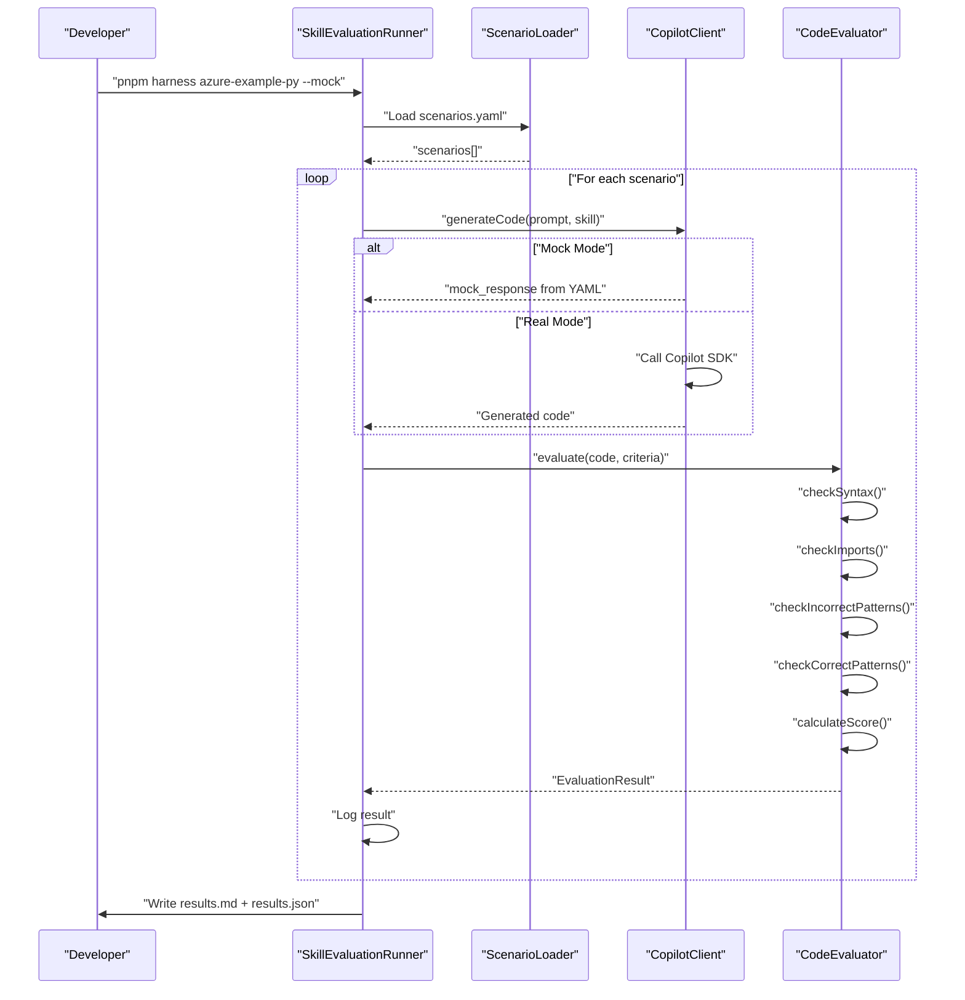
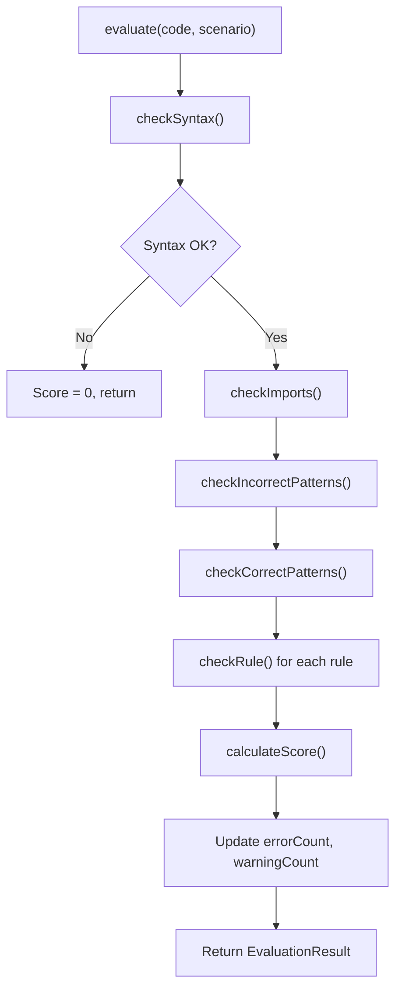
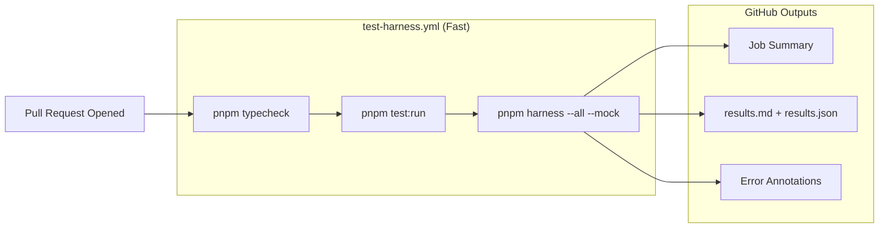

<!-- source: DeepWiki mcp.deepwiki.com · repo microsoft/skills · page 7.3 Contributing Guidelines · fetched 2026-10-30 -->

# Contributing Guidelines

<details>
<summary>Relevant source files</summary>

The following files were used as context for generating this wiki page:

- [.github/agents/scaffolder.agent.md](.github/agents/scaffolder.agent.md)
- [.github/copilot-instructions.md](.github/copilot-instructions.md)
- [.github/docs/agent-integration.md](.github/docs/agent-integration.md)
- [.github/prompts/scaffold-foundry-app.prompt.md](.github/prompts/scaffold-foundry-app.prompt.md)
- [.github/skills/skill-creator/references/acceptance-criteria.md](.github/skills/skill-creator/references/acceptance-criteria.md)
- [.github/workflows/skill-evaluation.yml](.github/workflows/skill-evaluation.yml)
- [.github/workflows/test-harness.yml](.github/workflows/test-harness.yml)
- [Agents.md](Agents.md)
- [context7.json](context7.json)
- [docs-site/integration-filter-test.png](docs-site/integration-filter-test.png)
- [docs-site/public/og-image.png](docs-site/public/og-image.png)
- [tests/.gitignore](tests/.gitignore)
- [tests/AGENTS.md](tests/AGENTS.md)
- [tests/README.md](tests/README.md)
- [tests/harness/criteria-loader.ts](tests/harness/criteria-loader.ts)
- [tests/harness/evaluator.ts](tests/harness/evaluator.ts)
- [tests/scenarios/skill-creator/scenarios.yaml](tests/scenarios/skill-creator/scenarios.yaml)

</details>


This page provides practical guidance for contributing to the microsoft/skills repository, including the complete workflow for creating new skills, writing acceptance criteria, defining test scenarios, running evaluations, and submitting pull requests.

**Related pages:** For conceptual information about skills and progressive disclosure, see [Understanding Skills and Progressive Disclosure](#2.1). For the skill format specification, see [SKILL.md Format Specification](#2.3). For architectural details of the test harness, see [Test Harness Architecture](#4.1). For development principles that guide contribution, see [Development Principles and Agents](#7.2).

---

## Prerequisites

Before contributing a new skill, you must gather:

**Required Information:**
- SDK package name (e.g., `azure-ai-agents`, `Azure.AI.OpenAI`, `@azure/ai-projects`)
- Microsoft Learn documentation URL or GitHub repository URL
- Target language: `py`, `dotnet`, `ts`, `java`, or `rust`

**Development Environment:**
- Node.js 20+ and pnpm 9+ (for running tests)
- Python 3.11+ (optional, for Python skills)
- Git CLI and GitHub CLI (`gh`)
- A fork of the repository

**Knowledge Requirements:**
- Familiarity with the target SDK and language
- Understanding of the repository's [Core Principles](#7.2) (Think Before Coding, Simplicity First, Surgical Changes, Goal-Driven Execution)

Sources: [README.md:667-677](), [Agents.md:182-210](), [.github/copilot-instructions.md:256-273]()

---

## Contribution Workflow Overview

The following diagram shows the complete workflow from skill creation to merged pull request:

### Contribution Workflow State Machine

```mermaid
stateDiagram-v2
    [*] --> GatherRequirements: "Fork repository"
    
    GatherRequirements --> CreateSkillMD: "SDK info collected"
    
    state CreateSkillMD {
        [*] --> WriteFrontmatter
        WriteFrontmatter --> WriteInstructions
        WriteInstructions --> AddExamples
        AddExamples --> [*]
    }
    
    CreateSkillMD --> CreateSymlink: "SKILL.md complete"
    
    CreateSymlink --> WriteCriteria: "Categorized"
    
    state WriteCriteria {
        [*] --> DefineCorrectPatterns
        DefineCorrectPatterns --> DefineIncorrectPatterns
        DefineIncorrectPatterns --> [*]
    }
    
    WriteCriteria --> WriteScenarios: "acceptance-criteria.md created"
    
    state WriteScenarios {
        [*] --> DefineTestCases
        DefineTestCases --> AddMockResponses
        AddMockResponses --> [*]
    }
    
    WriteScenarios --> RunLocalTests: "scenarios.yaml created"
    
    RunLocalTests --> FixIssues: "Tests fail"
    RunLocalTests --> UpdateREADME: "Tests pass"
    FixIssues --> RunLocalTests
    
    UpdateREADME --> CreatePR: "Added to catalog"
    
    state CreatePR {
        [*] --> CommitChanges
        CommitChanges --> PushToFork
        PushToFork --> OpenPR
        OpenPR --> [*]
    }
    
    CreatePR --> CIChecks: "PR opened"
    
    state CIChecks {
        [*] --> SmokeTest
        SmokeTest --> TypeCheck
        TypeCheck --> UnitTests
        UnitTests --> [*]
    }
    
    CIChecks --> AddressReview: "CI passes"
    CIChecks --> FixCIFailures: "CI fails"
    FixCIFailures --> CIChecks
    
    AddressReview --> Merged: "Approved"
    AddressReview --> ReviseChanges: "Changes requested"
    ReviseChanges --> AddressReview
    
    Merged --> [*]
```



Sources: [README.md:667-722](), [Agents.md:182-210](), [.github/workflows/test-harness.yml:1-96]()

---

## Step 1: Create the Skill Directory and SKILL.md

Create a new directory under `.github/skills/<skill-name>/` with a `SKILL.md` file.

### Naming Convention

| Language | Suffix | Pattern | Examples |
|----------|--------|---------|----------|
| Python | `-py` | `azure-<service>-py` | `azure-ai-projects-py`, `azure-cosmos-py` |
| .NET | `-dotnet` | `azure-<service>-dotnet` | `azure-ai-openai-dotnet`, `azure-identity-dotnet` |
| TypeScript | `-ts` | `azure-<service>-ts` | `azure-ai-projects-ts`, `azure-storage-blob-ts` |
| Java | `-java` | `azure-<service>-java` | `azure-ai-projects-java`, `azure-cosmos-java` |
| Rust | `-rust` | `azure-<service>-rust` | `azure-identity-rust`, `azure-cosmos-rust` |
| Core (cross-language) | none | `<skill-name>` | `mcp-builder`, `skill-creator`, `copilot-sdk` |

### SKILL.md Structure

The file must contain YAML frontmatter followed by markdown instructions:

```markdown
---
name: azure-example-py
description: |
  Azure Example SDK for Python. Use for creating and managing examples with async operations.
  Triggers: "create example", "list examples", "azure example sdk", "example management".
---

# Azure Example SDK

## Installation

\`\`\`bash
pip install azure-example
\`\`\`

## Environment Variables

\`\`\`bash
AZURE_EXAMPLE_ENDPOINT=https://<resource>.example.azure.com
\`\`\`

## Authentication

\`\`\`python
from azure.identity import DefaultAzureCredential
from azure.example import ExampleClient

credential = DefaultAzureCredential()
client = ExampleClient(
    endpoint=os.environ["AZURE_EXAMPLE_ENDPOINT"],
    credential=credential
)
\`\`\`

## Core Workflow

[Detailed instructions with code examples]
```

**Frontmatter Requirements:**
- `name`: Skill name matching directory name
- `description`: Multi-line description with:
  - What the SDK does (1-2 sentences)
  - When to use it (use cases)
  - Trigger phrases in format: `Triggers: "phrase1", "phrase2", "phrase3"`

**Body Requirements:**
- Installation command
- Environment variables
- Authentication pattern (always `DefaultAzureCredential` for Azure SDKs)
- Core workflow with code examples
- Common patterns and best practices
- Reference table linking to additional resources

Sources: [.github/skills/skill-creator/references/acceptance-criteria.md:1-68](), [README.md:680-691](), [.github/copilot-instructions.md:103-139]()

---

## Step 2: Categorize with Symlink

Create a symbolic link in `skills/<language>/<category>/` pointing to the skill directory:

```bash
# Example: Python AI agent skill in foundry category
cd skills/python/foundry
ln -s ../../../.github/skills/azure-ai-projects-py projects
```

### Product Area Categories

| Category | Skills | Examples |
|----------|--------|----------|
| `foundry` | AI agents, projects, inference, search, content safety | `azure-ai-projects-py`, `azure-search-documents-py` |
| `data` | Storage, Cosmos DB, Tables | `azure-cosmos-py`, `azure-storage-blob-py` |
| `messaging` | Event Hubs, Service Bus, Event Grid | `azure-eventhub-py`, `azure-servicebus-py` |
| `monitoring` | OpenTelemetry, Application Insights | `azure-monitor-opentelemetry-py` |
| `entra` | Authentication, credentials, Key Vault | `azure-identity-py`, `azure-keyvault-py` |
| `integration` | API Management, App Configuration | `azure-appconfiguration-py` |
| `compute` | Azure Maps, Bot Service | `azure-mgmt-botservice-py` |
| `m365` | Microsoft 365 Agents | `m365-agents-py` |
| `general` | Cross-service patterns | `fastapi-router-py`, `pydantic-models-py` |

**Note:** The symlink structure enables browsing skills by category while the canonical source remains in `.github/skills/`.

Sources: [README.md:685-690](), [Agents.md:213-223]()

---

## Step 3: Write Acceptance Criteria

Create `references/acceptance-criteria.md` in your skill directory. This file defines correct and incorrect code patterns that the test harness validates.

### Skill Directory Structure

```mermaid
graph TD
    SkillDir[".github/skills/azure-example-py/"]
    SkillMD["SKILL.md"]
    RefsDir["references/"]
    AcceptanceCriteria["acceptance-criteria.md"]
    
    SkillDir --> SkillMD
    SkillDir --> RefsDir
    RefsDir --> AcceptanceCriteria
    
    AcceptanceCriteria --> Section1["Section: Authentication"]
    Section1 --> CorrectBlock["Correct pattern block"]
    Section1 --> IncorrectBlock["Incorrect pattern block"]
    
    style SkillMD fill:#1e1e1e,stroke:#6d5dfc
    style AcceptanceCriteria fill:#1e1e1e,stroke:#6d5dfc
```



### Acceptance Criteria Format

```markdown
# Skill Name Acceptance Criteria

**Skill**: `azure-example-py`
**Purpose**: [Brief description]
**Focus**: [Key validation areas]

---

## 1. Authentication

### 1.1 ✅ CORRECT: DefaultAzureCredential

\`\`\`python
from azure.identity import DefaultAzureCredential
from azure.example import ExampleClient

credential = DefaultAzureCredential()
client = ExampleClient(
    endpoint=os.environ["AZURE_EXAMPLE_ENDPOINT"],
    credential=credential
)
\`\`\`

### 1.2 ❌ INCORRECT: Hardcoded API Keys

\`\`\`python
client = ExampleClient(
    endpoint="https://example.com",
    api_key="sk-1234567890abcdef"  # Never hardcode credentials
)
\`\`\`

---

## 2. Async Operations

### 2.1 ✅ CORRECT: Async/Await Pattern

\`\`\`python
async with ExampleClient(...) as client:
    result = await client.create_item(name="example")
\`\`\`

### 2.2 ❌ INCORRECT: Synchronous Client with Async

\`\`\`python
# Don't mix sync client with async
from azure.example import ExampleClient
result = await client.create_item(name="example")  # Wrong
\`\`\`
```

**Structure Rules:**
- Organize into numbered sections (e.g., `## 1. Authentication`)
- Each section has subsections: `### 1.1 ✅ CORRECT:` and `### 1.2 ❌ INCORRECT:`
- All code in fenced code blocks with language identifier
- Comments explain why patterns are correct/incorrect

**Pattern Types:**

| Type | Purpose | Example |
|------|---------|---------|
| Import-only | Flag incompatible import combinations | Async client + sync credential |
| Mixed | Show incorrect usage in context | Hardcoded credentials in client initialization |
| Best Practice | Enforce recommended patterns | Context managers, environment variables |

Sources: [.github/skills/skill-creator/references/acceptance-criteria.md:1-300](), [tests/harness/criteria-loader.ts:1-230]()

---

## Step 4: Define Test Scenarios

Create `tests/scenarios/<skill-name>/scenarios.yaml` with test cases that exercise the skill.

### Scenarios File Structure

```yaml
# Test scenarios for skill evaluation
# Each scenario tests specific skill behaviors

config:
  model: gpt-4
  max_tokens: 2000
  temperature: 0.3

scenarios:
  - name: basic_authentication
    prompt: |
      Create an Azure Example client using DefaultAzureCredential.
      Connect to the endpoint from environment variables.
    expected_patterns:
      - "from azure.identity import DefaultAzureCredential"
      - "from azure.example import ExampleClient"
      - "credential = DefaultAzureCredential\\(\\)"
      - "os\\.environ\\[.*AZURE_EXAMPLE_ENDPOINT.*\\]"
    forbidden_patterns:
      - "api_key.*=.*[\"']sk-"  # No hardcoded credentials
      - "password.*=.*[\"']"     # No passwords
    tags:
      - authentication
      - basic
    mock_response: |
      from azure.identity import DefaultAzureCredential
      from azure.example import ExampleClient
      import os

      credential = DefaultAzureCredential()
      client = ExampleClient(
          endpoint=os.environ["AZURE_EXAMPLE_ENDPOINT"],
          credential=credential
      )

  - name: async_operations
    prompt: |
      Create an async function that lists all items using the Example client.
      Use async context manager.
    expected_patterns:
      - "async def"
      - "async with.*ExampleClient"
      - "await.*list_items"
    forbidden_patterns:
      - "ExampleClient\\([^)]*\\)\\s*$"  # No non-async usage
    tags:
      - async
      - operations
    mock_response: |
      async def list_all_items():
          async with ExampleClient(
              endpoint=os.environ["AZURE_EXAMPLE_ENDPOINT"],
              credential=DefaultAzureCredential()
          ) as client:
              items = []
              async for item in client.list_items():
                  items.append(item)
              return items
```

**Field Descriptions:**

| Field | Required | Description |
|-------|----------|-------------|
| `name` | Yes | Unique scenario identifier (snake_case) |
| `prompt` | Yes | Natural language task for the agent |
| `expected_patterns` | Yes | Regex patterns that MUST appear in generated code |
| `forbidden_patterns` | No | Regex patterns that MUST NOT appear |
| `tags` | Yes | Categories for filtering (e.g., `authentication`, `async`) |
| `mock_response` | Yes | Expected code output for smoke tests |

**Pattern Syntax:**
- Use regex patterns with proper escaping
- `\\.` for literal periods
- `\\(` and `\\)` for literal parentheses
- `.*` for any characters
- `[\"']` for either quote type

Sources: [tests/scenarios/skill-creator/scenarios.yaml:1-400](), [tests/harness/evaluator.ts:1-50]()

---

## Step 5: Run Local Evaluation

Test your skill locally before pushing:

### Test Harness Commands

```bash
# Navigate to tests directory
cd tests

# Install dependencies
pnpm install

# List all skills with test coverage
pnpm harness --list

# Run smoke test (fast, mock mode)
pnpm harness azure-example-py --mock --verbose

# Run with real Copilot SDK (requires GH_TOKEN)
pnpm harness azure-example-py --verbose

# Run specific scenario
pnpm harness azure-example-py --filter "basic_authentication" --mock

# Generate markdown report
pnpm harness azure-example-py --mock --output markdown --output-file results.md

# Generate JSON report
pnpm harness azure-example-py --mock --output json --output-file results.json
```

### Test Harness Evaluation Flow



### Scoring Algorithm

The `CodeEvaluator` class calculates scores through the following process:



**Score Calculation:**

| Check | Score Impact | Implementation |
|-------|--------------|----------------|
| Syntax error | Score = 0 | `checkSyntax()` returns false → immediate score 0 |
| Incorrect pattern | -20 points | Each forbidden pattern found via regex match |
| Correct pattern | +5 points | Each expected pattern matched |
| ERROR finding | Fail | Sets `passed = false` regardless of score |
| WARNING finding | -5 points | Deducts from score but doesn't set fail |

**Passing Criteria:**
- Score > 0
- No ERROR-level findings (`severity === Severity.ERROR`)
- Implementation in `evaluate()` method sets `passed = !result.findings.some((f) => f.severity === Severity.ERROR)`

Sources: [tests/harness/evaluator.ts:104-146](), [tests/harness/evaluator.ts:695-712](), [tests/harness/types.ts:1-16]()

---

## Step 6: Update README.md

Add your skill to the appropriate section in `README.md`:

```markdown
### Python

> 42 skills • suffix: `-py`

<details>
<summary><strong>Foundry & AI</strong> (8 skills)</summary>

| Skill | Description |
|-------|-------------|
| [azure-example-py](.github/skills/azure-example-py) | Azure Example SDK — async operations, item management, CRUD patterns. |
| [azure-ai-projects-py](.github/plugins/azure-sdk-python/skills/azure-ai-projects-py) | High-level Foundry SDK — project client, versioned agents, evals, connections, OpenAI-compatible clients. |
...
</details>
```

**Rules:**
- Update the skill count in the section header
- Add in alphabetical order within the category
- Use relative path to skill directory
- Keep description concise (one line)
- Match existing formatting

Sources: [README.md:71-217]()

---

## Step 7: Create Pull Request

### Pre-PR Checklist

- [ ] `SKILL.md` has complete frontmatter with trigger phrases
- [ ] Symbolic link created in `skills/<language>/<category>/`
- [ ] `acceptance-criteria.md` has ✅ Correct and ❌ Incorrect patterns
- [ ] `scenarios.yaml` has at least 3 test scenarios
- [ ] Local smoke test passes: `pnpm harness <skill> --mock --verbose`
- [ ] Skill added to README.md in correct section
- [ ] No hardcoded credentials in any examples
- [ ] All code uses `DefaultAzureCredential` for authentication

### Git Workflow

```bash
# Create feature branch
git checkout -b add-azure-example-py-skill

# Stage changes
git add .github/skills/azure-example-py/
git add skills/python/foundry/  # symlink
git add tests/scenarios/azure-example-py/
git add README.md

# Commit with descriptive message
git commit -m "Add azure-example-py skill with async patterns"

# Push to your fork
git push origin add-azure-example-py-skill

# Create pull request using GitHub CLI
gh pr create \
  --title "Add azure-example-py skill" \
  --body "Adds Azure Example SDK skill with async operations, acceptance criteria, and test scenarios."
```

### CI/CD Pipeline Workflows



**Workflow Behavior:**

| Workflow | Trigger | Mode | Purpose | File |
|----------|---------|------|---------|------|
| **test-harness.yml** | PR, push to main | Mock | Fast deterministic CI feedback | [.github/workflows/test-harness.yml:1-96]() |
| **skill-evaluation.yml** | Nightly at 2 AM UTC | Real SDK | Quality measurement with Copilot SDK | [.github/workflows/skill-evaluation.yml:1-169]() |

**Output Locations:**
- GitHub Step Summary displays results inline
- Artifacts uploaded as `evaluation-results` (smoke) and `real-evaluation-results` (nightly)
- Failures create annotations with specific error messages extracted from `results.json`

Sources: [.github/workflows/test-harness.yml:1-96](), [.github/workflows/skill-evaluation.yml:1-169]()

---

## Development Principles

All contributions must follow the repository's core principles documented in [Development Principles and Agents](#7.2):

### 1. Think Before Coding

- State assumptions explicitly
- Present multiple interpretations if uncertain
- Push back when simpler approaches exist
- Stop and ask when confused

### 2. Simplicity First

- Write minimum code to solve the problem
- No features beyond what was requested
- No abstractions for single-use code
- If 200 lines could be 50, rewrite it

### 3. Surgical Changes

- Touch only what you must
- Don't refactor adjacent code
- Match existing style
- Remove only imports/variables YOUR changes made unused

### 4. Goal-Driven Execution (TDD)

Transform tasks into verifiable goals:

| Instead of... | Transform to... |
|---------------|-----------------|
| "Add validation" | "Write tests for invalid inputs, then make them pass" |
| "Fix the bug" | "Write a test that reproduces it, then make it pass" |
| "Refactor X" | "Ensure tests pass before and after" |

Sources: [Agents.md:26-88](), [.github/copilot-instructions.md:21-68]()

---

## Common Patterns Reference

### Authentication Pattern (All Azure SDKs)

```python
from azure.identity import DefaultAzureCredential
from azure.service import ServiceClient

credential = DefaultAzureCredential()
client = ServiceClient(
    endpoint=os.environ["AZURE_SERVICE_ENDPOINT"],
    credential=credential
)
```

### Async Context Manager Pattern

```python
async with ServiceClient(...) as client:
    result = await client.operation()
```

### Environment Variables

Always use environment variables for configuration:

```python
import os

ENDPOINT = os.environ["AZURE_SERVICE_ENDPOINT"]
DEPLOYMENT = os.environ.get("AZURE_DEPLOYMENT_NAME", "gpt-4o-mini")
```

### Error Handling

```python
from azure.core.exceptions import HttpResponseError

try:
    result = await client.operation()
except HttpResponseError as e:
    if e.status_code == 404:
        # Handle not found
        pass
    else:
        raise
```

Sources: [Agents.md:125-145](), [.github/copilot-instructions.md:182-211]()

---

## Ralph Loop (Optional Iterative Improvement)

The test harness supports iterative quality improvement via the Ralph Loop:

```bash
# Enable Ralph Loop with quality threshold
pnpm harness azure-example-py --ralph --mock --threshold 85 --max-iterations 5
```

**How it works:**
1. Generate code for scenario
2. Evaluate against acceptance criteria
3. If score < threshold, build feedback from findings
4. Re-generate with feedback
5. Repeat until threshold met or max iterations reached

**Configuration:**

| Flag | Default | Description |
|------|---------|-------------|
| `--ralph` | false | Enable Ralph Loop |
| `--threshold` | 60 | Quality threshold (0-100) |
| `--max-iterations` | 2 | Maximum improvement cycles |

Sources: [.github/workflows/skill-evaluation.yml:13-27](), [README.md:646-664]()

---

## Next Steps After PR Merge

Once your PR is merged:

1. **Nightly Evaluation**: Your skill will be included in the nightly Copilot SDK evaluation
2. **Documentation Update**: The skill appears on [microsoft.github.io/skills](https://microsoft.github.io/skills)
3. **Context7 Indexing**: Skill is indexed for semantic search via the daily documentation workflow
4. **Marketplace**: Skill becomes available via `npx skills add microsoft/skills`

Sources: [README.md:17-23](), [.github/workflows/skill-evaluation.yml:1-10]()