# Page: Overview

# Overview

<details>
<summary>Relevant source files</summary>

The following files were used as context for generating this wiki page:

- [README.md](README.md)

</details>


## Purpose and Scope

This document provides an overview of the SNCA PyTorch repository, which implements **Scalable Neighborhood Component Analysis** for learning feature representations optimized for nearest neighbor classifiers. The repository contains a complete training and evaluation framework for contrastive learning using memory banks and specialized loss functions.

For detailed training procedures, see [Getting Started](#2). For in-depth algorithmic details, see [Core SNCA Components](#3). For model architecture specifics, see [Model Architectures](#4).

## What is Scalable Neighborhood Component Analysis

SNCA is a contrastive learning method that trains deep neural networks to produce feature representations optimized for nearest neighbor classification. Unlike traditional supervised learning that optimizes for softmax classification, SNCA learns embeddings where semantically similar samples are close in the feature space, enabling better generalization to new object categories.

The approach extends [Neighborhood Component Analysis (NCA)](http://www.cs.toronto.edu/~fritz/absps/nca.pdf) to work with deep networks and large-scale datasets by using a non-parametric memory bank system that stores feature representations of all training samples.

Sources: [README.md:3-6]()

## Repository Architecture

The following diagram shows the main code components and their relationships:

**SNCA System Components**

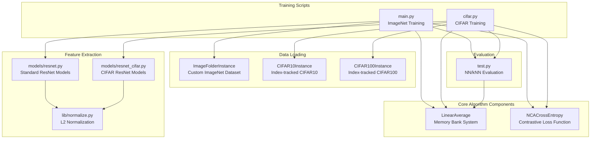

Sources: [README.md:35-64]()

## Training Pipeline Data Flow

The following diagram illustrates how data flows through the SNCA training process:

**SNCA Training Data Flow**

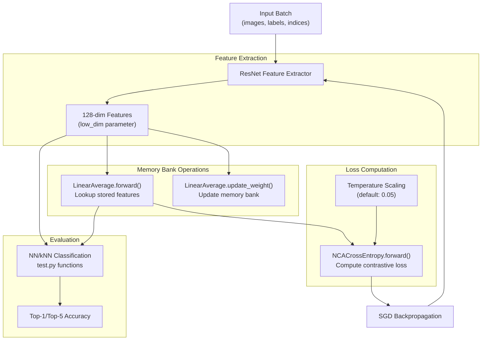

Sources: [README.md:44-50]()

## Key Features and Capabilities

### Pretrained Models
The repository provides three pretrained ResNet models with their corresponding feature databases:

| Model | Top-1 Accuracy | Components |
|-------|----------------|------------|
| ResNet-18 | 70.59% | Model weights + 600MB feature database |
| ResNet-34 | 74.41% | Model weights + 600MB feature database |
| ResNet-50 | 76.57% | Model weights + 600MB feature database |

### Dataset Support
- **ImageNet**: Full-scale training using `main.py` with `ImageFolderInstance`
- **CIFAR-10/100**: Specialized training using `cifar.py` with `CIFAR10Instance`/`CIFAR100Instance`

### Evaluation Methods
- **Training monitoring**: k=1 nearest neighbor for fast validation
- **Final evaluation**: k=30 nearest neighbor for comprehensive testing
- **Feature visualization**: Nearest neighbor retrieval comparisons

Sources: [README.md:15-31](), [README.md:46-50]()

## Memory and Performance Characteristics

### GPU Memory Imbalance
The `LinearAverage` module creates a significant memory bottleneck:

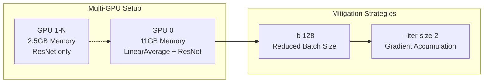

### Memory Requirements
- **ResNet-18**: GPU 0 requires 11GB, others require 2.5GB each
- **Deeper networks**: Require Caffe-style batch size reduction and gradient accumulation
- **Training hardware**: Models trained on V100 machines for optimal performance

Sources: [README.md:52-59]()

## Integration with Related Work

This implementation extends the [lemniscate.pytorch](https://github.com/zhirongw/lemniscate.pytorch) unsupervised learning project, adapting its memory bank approach for supervised contrastive learning. The core algorithmic components (`LinearAverage`, `NCACrossEntropy`) build upon the foundational work while adding supervised signals for improved feature learning.

Sources: [README.md:8-9]()

---

# Page: Getting Started

# Getting Started

<details>
<summary>Relevant source files</summary>

The following files were used as context for generating this wiki page:

- [README.md](README.md)
- [cifar.py](cifar.py)
- [main.py](main.py)

</details>


This document provides a quick start guide for training and evaluating SNCA (Scalable Neighborhood Component Analysis) models on ImageNet and CIFAR datasets. It covers installation, basic usage patterns, and practical considerations for memory management.

For detailed information about the core SNCA algorithm components, see [Core SNCA Components](#3). For comprehensive training configuration options, see [Training and Evaluation](#6).

## Prerequisites

The SNCA implementation requires specific software dependencies and hardware considerations for optimal performance.

### Software Requirements

| Component | Version | Purpose |
|-----------|---------|---------|
| Python | 2.x | Runtime environment |
| PyTorch | ≥ 0.4 | Deep learning framework |
| torchvision | Compatible with PyTorch | Dataset loading and transforms |
| CUDA | Compatible | GPU acceleration |

### Hardware Considerations

SNCA training is memory-intensive due to the non-parametric memory bank. The implementation exhibits significant GPU memory imbalance:

- **Primary GPU (GPU 0)**: 11GB memory usage (ResNet + LinearAverage module)
- **Secondary GPUs**: 2.5GB memory usage (ResNet model only)
- **Recommended**: V100 or equivalent for deeper networks

Sources: [README.md:38-59]()

## Installation

Clone the repository and install dependencies:

```bash
git clone https://github.com/Microsoft/snca.pytorch
cd snca.pytorch
# Install PyTorch >= 0.4 following official instructions
```

Ensure your PyTorch installation supports your CUDA version for GPU training.

Sources: [README.md:40]()

## Training Workflows

### ImageNet Training Workflow

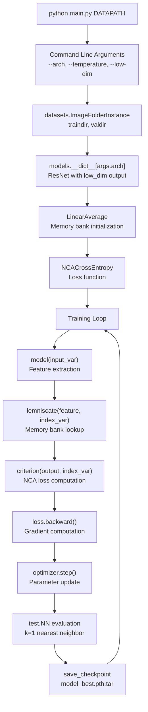

Sources: [main.py:80-197](), [main.py:199-244]()

### CIFAR Training Workflow

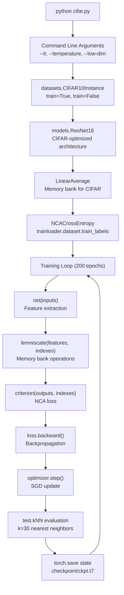

Sources: [cifar.py:110-165](), [cifar.py:148-165]()

## Basic Training Commands

### ImageNet Training

```bash
python main.py DATAPATH --arch resnet18 -j 32 --temperature 0.05 --low-dim 128 -b 256
```

**Key Parameters:**
- `DATAPATH`: Path to ImageNet dataset directory
- `--arch`: Architecture choice (resnet18, resnet34, resnet50)
- `--temperature`: Softmax temperature for contrastive learning
- `--low-dim`: Feature dimension (typically 128)
- `-b`: Batch size (may need reduction for memory constraints)

### CIFAR Training

```bash
python cifar.py --temperature 0.05 --lr 0.1
```

**Key Parameters:**
- `--temperature`: Softmax temperature parameter
- `--lr`: Initial learning rate
- `--low-dim`: Feature dimension (default 128)

Sources: [README.md:42-63](), [main.py:30-77](), [cifar.py:27-37]()

## Evaluation and Testing

### Nearest Neighbor Evaluation

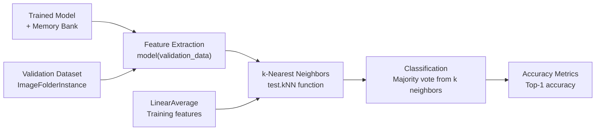

### Evaluation Commands

**ImageNet Evaluation:**
```bash
python main.py DATAPATH --arch resnet18 --resume model.pth.tar -e
```

**CIFAR Evaluation:**
```bash
python cifar.py --test-only --resume ckpt.t7
```

The evaluation uses k=30 neighbors by default for final testing, while training monitoring uses k=1 for efficiency.

Sources: [README.md:48-50](), [main.py:170-172](), [cifar.py:96-98]()

## Pretrained Models

The repository provides three pretrained ResNet models with their corresponding feature databases:

| Architecture | Top-1 Accuracy | Download | Contents |
|--------------|----------------|----------|----------|
| ResNet-18 | 70.59% | Available | Model weights + ImageNet features (600MB) |
| ResNet-34 | 74.41% | Available | Model weights + ImageNet features (600MB) |
| ResNet-50 | 76.57% | Available | Model weights + ImageNet features (600MB) |

Each release contains:
- **Model weights**: 100-200MB checkpoint file
- **Feature representations**: 600MB ImageNet training features
- **Memory bank state**: Pre-computed LinearAverage parameters

Sources: [README.md:13-22]()

## Memory Management Strategies

### GPU Memory Optimization

The SNCA implementation requires careful memory management due to the LinearAverage module:

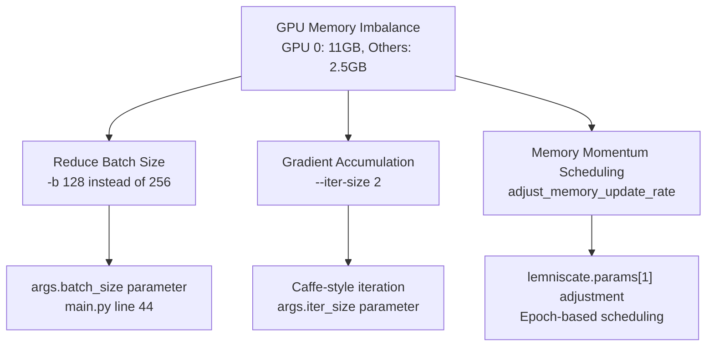

### Recommended Settings for Different Hardware

| GPU Memory | Batch Size | Iter Size | Architecture |
|------------|------------|-----------|--------------|
| 8GB | 64 | 4 | ResNet-18 |
| 11GB | 128 | 2 | ResNet-18/34 |
| 16GB+ | 256 | 1 | ResNet-50 |

Sources: [README.md:52-59](), [main.py:73-74](), [main.py:222](), [main.py:228-231]()

## Data Preparation

### ImageNet Dataset Structure

```
DATAPATH/
├── train/
│   ├── class1/
│   │   ├── img1.jpg
│   │   └── img2.jpg
│   └── class2/
└── val/
    ├── class1/
    └── class2/
```

### Dataset Loading Pipeline

The training scripts use specialized dataset classes that track sample indices:

- **ImageNet**: `datasets.ImageFolderInstance` extends torchvision's ImageFolder
- **CIFAR**: `datasets.CIFAR10Instance` extends torchvision's CIFAR10

These provide `(image, label, index)` tuples required for the memory bank operations.

Sources: [README.md:35-36](), [main.py:96-123](), [cifar.py:61-65]()

---

# Page: Core SNCA Components

# Core SNCA Components

<details>
<summary>Relevant source files</summary>

The following files were used as context for generating this wiki page:

- [lib/LinearAverage.py](lib/LinearAverage.py)
- [lib/NCA.py](lib/NCA.py)
- [lib/__init__.py](lib/__init__.py)

</details>


This document provides an overview of the two fundamental algorithmic components that implement Scalable Neighborhood Component Analysis (SNCA): the memory bank system and the NCA loss function. These components work together to enable contrastive learning through non-parametric feature storage and neighborhood-based optimization.

For detailed implementation specifics of the memory bank, see [Memory Bank System (LinearAverage)](#3.1). For the loss function implementation details, see [NCA Loss Function](#3.2).

## SNCA Algorithm Overview

SNCA implements a contrastive learning approach that learns feature representations optimized for nearest neighbor classification. The algorithm maintains a memory bank of feature representations for all training samples and uses a specialized loss function to encourage samples of the same class to have similar representations while pushing apart samples from different classes.

## Core Component Architecture

The SNCA implementation consists of two primary components that handle the algorithmic core:

| Component | Class Name | File Location | Primary Responsibility |
|-----------|------------|---------------|----------------------|
| Memory Bank | `LinearAverage` | `lib/LinearAverage.py` | Non-parametric feature storage and momentum updates |
| NCA Loss | `NCACrossEntropy` | `lib/NCA.py` | Contrastive loss computation for neighborhood optimization |

### Component Architecture Diagram

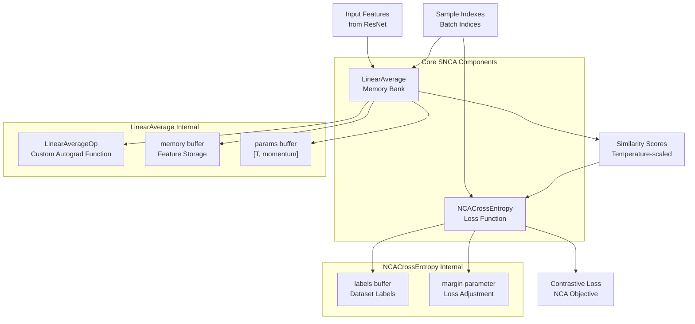

Sources: `lib/LinearAverage.py:44-58`, `lib/NCA.py:8-43`

## Component Interaction Flow

The two core components work together in a sequential pipeline during training, with the `LinearAverage` component computing feature similarities and the `NCACrossEntropy` component converting these similarities into a contrastive loss.

### SNCA Training Data Flow

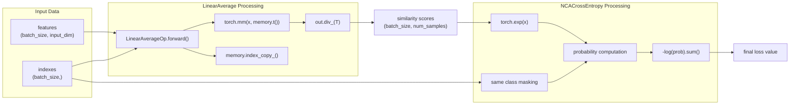

Sources: `lib/LinearAverage.py:8-18`, `lib/LinearAverage.py:55-57`, `lib/NCA.py:19-43`

## Implementation Architecture Details

### LinearAverage Component

The `LinearAverage` class implements a non-parametric memory bank that stores L2-normalized feature representations for all training samples. Key implementation details:

- **Memory Buffer**: Stores feature vectors using `torch.register_buffer('memory', ...)` at [lib/LinearAverage.py:53]()
- **Temperature Parameter**: Controls similarity sharpening via parameter `T` at [lib/LinearAverage.py:46]()
- **Momentum Updates**: Uses exponential moving average with momentum parameter at [lib/LinearAverage.py:46]()
- **Custom Autograd**: Implements `LinearAverageOp` function for memory updates during backpropagation at [lib/LinearAverage.py:6-42]()

### NCACrossEntropy Component

The `NCACrossEntropy` class computes the contrastive loss based on neighborhood component analysis principles:

- **Label Storage**: Maintains all dataset labels in a buffer at [lib/NCA.py:15-16]()
- **Same-Class Identification**: Creates boolean masks for same-class samples at [lib/NCA.py:26]()
- **Self-Exclusion**: Removes self-similarities from loss computation at [lib/NCA.py:29]()
- **Probability Normalization**: Computes softmax probabilities with margin adjustment at [lib/NCA.py:31-38]()

### Key Parameters and Buffers

| Parameter | Component | Default Value | Purpose |
|-----------|-----------|---------------|---------|
| `T` (temperature) | `LinearAverage` | 0.05 | Controls similarity sharpening |
| `momentum` | `LinearAverage` | 0.5 | Memory update rate |
| `inputSize` | `LinearAverage` | Variable | Feature dimension |
| `outputSize` | `LinearAverage` | Variable | Number of training samples |
| `margin` | `NCACrossEntropy` | 0 | Loss margin adjustment |

Sources: `lib/LinearAverage.py:46`, `lib/NCA.py:13`

## Component Integration Points

The core components integrate with the broader SNCA system through well-defined interfaces:

- **Feature Input**: Both components expect normalized feature vectors from ResNet models
- **Index Tracking**: Both components require sample indexes for memory bank operations and label lookup
- **Memory Management**: The `LinearAverage` component handles GPU memory allocation for the feature memory bank
- **Gradient Flow**: Custom autograd functions ensure proper gradient computation through the memory bank

These components form the algorithmic foundation that enables SNCA to learn feature representations optimized for nearest neighbor classification through contrastive learning.

Sources: `lib/LinearAverage.py:1-59`, `lib/NCA.py:1-45`

---

# Page: Memory Bank System (LinearAverage)

# Memory Bank System (LinearAverage)

<details>
<summary>Relevant source files</summary>

The following files were used as context for generating this wiki page:

- [lib/LinearAverage.py](lib/LinearAverage.py)

</details>


## Purpose and Scope

The Memory Bank System implements a non-parametric memory bank for contrastive learning in the SNCA framework. This system maintains feature representations of all training samples and enables efficient similarity computations without storing explicit parametric weights for each class. The `LinearAverage` module serves as the core component that bridges feature extraction and contrastive loss computation.

For information about the loss function that uses this memory bank, see [NCA Loss Function](#3.2). For details on the ResNet feature extractors that feed into this system, see [Model Architectures](#4).

## Architecture Overview

The memory bank system consists of two main components: a custom autograd function (`LinearAverageOp`) that handles forward and backward computations, and a PyTorch module (`LinearAverage`) that manages the memory buffer and parameters.

**Memory Bank Architecture**

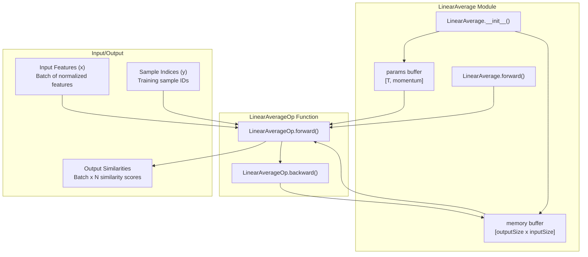

Sources: [lib/LinearAverage.py:1-59]()

## Memory Bank Initialization

The memory bank is initialized as a random matrix where each row represents the feature vector for one training sample. The initialization strategy ensures proper gradient flow during early training phases.

| Parameter | Description | Default Value | Code Location |
|-----------|-------------|---------------|---------------|
| `inputSize` | Dimensionality of input features | - | [lib/LinearAverage.py:46]() |
| `outputSize` | Number of training samples | - | [lib/LinearAverage.py:46]() |
| `T` | Temperature parameter for similarity scaling | 0.05 | [lib/LinearAverage.py:46]() |
| `momentum` | Momentum coefficient for memory updates | 0.5 | [lib/LinearAverage.py:46]() |

The memory buffer initialization follows a uniform distribution strategy:

```
stdv = 1.0 / sqrt(inputSize / 3)
memory ~ Uniform(-stdv, stdv)
```

Sources: [lib/LinearAverage.py:46-53]()

## Forward Pass Mechanics

The forward pass computes similarities between input features and all stored memory bank features through matrix multiplication and temperature scaling.

**Forward Computation Flow**

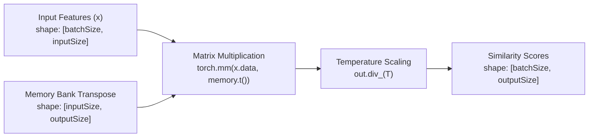

The computation is performed in [lib/LinearAverage.py:13-14]():
- Inner product: `out = torch.mm(x.data, memory.t())`
- Temperature scaling: `out.div_(T)`

Sources: [lib/LinearAverage.py:8-18]()

## Backward Pass and Memory Updates

The backward pass implements two crucial operations: gradient computation for the input features and momentum-based updates to the memory bank. This non-parametric update mechanism allows the system to learn feature representations without explicit gradient descent on memory parameters.

**Memory Update Process**

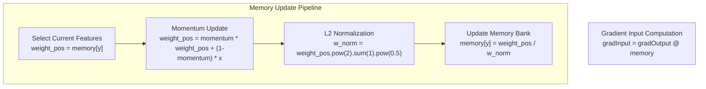

The memory update follows an exponential moving average with L2 normalization:

1. **Feature Selection**: Extract current memory vectors for batch indices [lib/LinearAverage.py:35]()
2. **Momentum Update**: Blend old and new features using momentum coefficient [lib/LinearAverage.py:36-37]()
3. **Normalization**: Apply L2 normalization to maintain unit vectors [lib/LinearAverage.py:38-39]()
4. **Memory Copy**: Update memory bank with normalized features [lib/LinearAverage.py:40]()

Sources: [lib/LinearAverage.py:21-42]()

## Parameter Configuration

The `LinearAverage` module uses two critical hyperparameters stored in a parameter buffer:

**Temperature (T)**: Controls the sharpness of the similarity distribution. Lower values create sharper distributions, while higher values create smoother distributions. The temperature scaling is applied in the forward pass [lib/LinearAverage.py:14]() and gradient computation [lib/LinearAverage.py:28]().

**Momentum**: Controls the rate of memory bank updates. Higher momentum values preserve more historical information, while lower values adapt more quickly to new features. The momentum update occurs during the backward pass [lib/LinearAverage.py:25]().

The parameters are registered as buffers to ensure they move with the module across devices:
```python
self.register_buffer('params', torch.tensor([T, momentum]))
```

Sources: [lib/LinearAverage.py:51]()

## Integration with SNCA Training

The `LinearAverage` module integrates seamlessly with the SNCA training pipeline by accepting normalized features from ResNet models and providing similarity scores to the NCA loss function. The module's `forward` method [lib/LinearAverage.py:55-57]() serves as the interface between feature extraction and loss computation.

The memory bank maintains consistency across training iterations by preserving feature representations and updating them through momentum-based averaging. This approach enables the system to learn discriminative features without requiring explicit parametric classifiers for each training sample.

Sources: [lib/LinearAverage.py:55-59]()

---

# Page: NCA Loss Function

# NCA Loss Function

<details>
<summary>Relevant source files</summary>

The following files were used as context for generating this wiki page:

- [lib/NCA.py](lib/NCA.py)

</details>


This document covers the implementation of the Neighborhood Component Analysis (NCA) loss function in the SNCA framework. The NCA loss is responsible for learning feature representations that maximize the probability of correct nearest neighbor classification by optimizing the likelihood that examples with the same class label are close in the learned feature space.

For information about the memory bank system that works with this loss function, see [Memory Bank System (LinearAverage)](#3.1). For details about the overall training pipeline, see [Training and Evaluation](#6).

## Purpose and Mathematical Foundation

The `NCACrossEntropy` class implements the core NCA objective function, which maximizes the probability that randomly selected neighbors of each training example belong to the same class. The loss function computes:

**Loss = -∑ log(p_ij)**

Where `p_ij` represents the probability that example `i` selects example `j` as its neighbor, given that they share the same class label.

The probability `p_ij` is computed using a softmax over similarity scores, typically cosine similarities from the memory bank system.

Sources: [lib/NCA.py:8-17]()

## Implementation Architecture

### NCA Loss Computation Flow

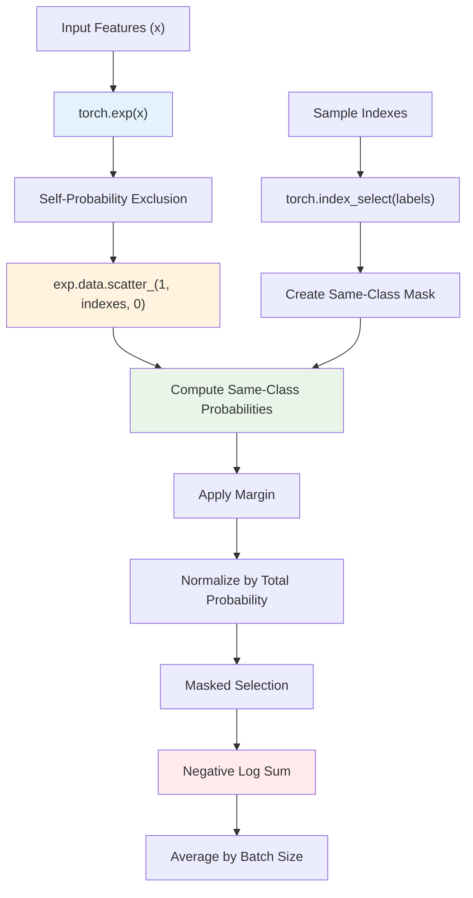

Sources: [lib/NCA.py:19-43]()

### Class Structure and Components

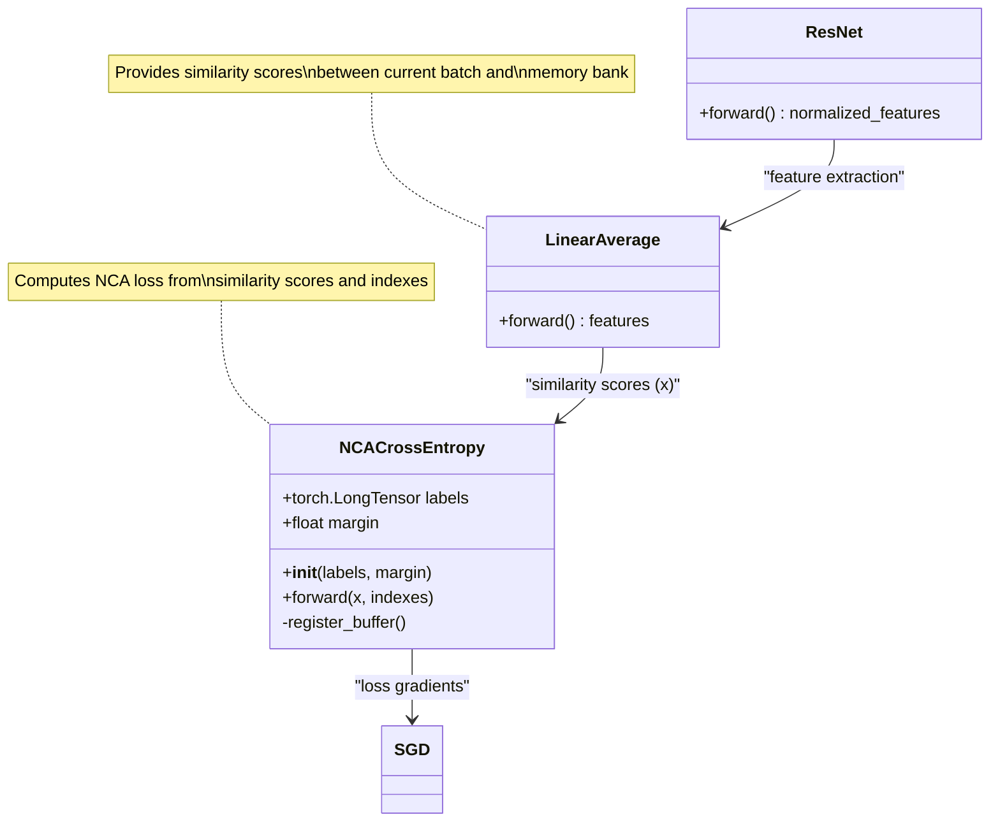

Sources: [lib/NCA.py:8-18]()

## Core Implementation Details

### Label Storage and Indexing

The `NCACrossEntropy` class maintains a buffer containing all dataset labels, allowing efficient lookup during training:

| Component | Purpose | Implementation |
|-----------|---------|----------------|
| `self.labels` | Complete dataset labels | `torch.LongTensor` buffer registered with the module |
| `indexes` | Current batch sample indices | Used to select relevant labels via `torch.index_select` |
| Same-class mask | Boolean mask for positive pairs | Created by comparing batch labels with all dataset labels |

The label indexing mechanism at [lib/NCA.py:25-26]() creates a matrix where each row represents a training example and each column indicates whether the corresponding dataset example shares the same class.

Sources: [lib/NCA.py:13-26]()

### Probability Computation

The loss computation follows these key steps:

1. **Exponential Transformation**: Convert similarity scores to unnormalized probabilities using `torch.exp(x)`
2. **Self-Exclusion**: Remove self-similarities by setting diagonal elements to zero via `exp.data.scatter_(1, indexes.data.view(-1,1), 0)`
3. **Positive Pair Identification**: Multiply exponentials with same-class mask to isolate positive pairs
4. **Margin Application**: Apply optional margin by dividing positive probabilities by `math.exp(self.margin)`
5. **Normalization**: Compute final probabilities as `p / (Z_exclude + p)` where `Z_exclude` is the sum of negative pair exponentials

Sources: [lib/NCA.py:22-38]()

### Loss Computation and Numerical Stability

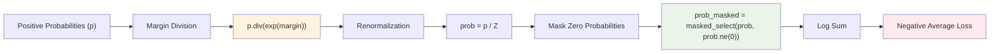

The implementation includes numerical stability measures:
- Zero probability masking at [lib/NCA.py:39]() prevents `log(0)` errors
- Margin application provides additional regularization control
- Batch averaging ensures consistent loss scaling regardless of batch size

Sources: [lib/NCA.py:34-43]()

## Integration with Training Pipeline

### Memory Bank Interaction

The NCA loss function operates on similarity scores provided by the `LinearAverage` memory bank module. The typical data flow is:

1. **Feature Extraction**: ResNet models extract normalized features
2. **Similarity Computation**: `LinearAverage` computes cosine similarities between batch features and memory bank
3. **Loss Computation**: `NCACrossEntropy` converts similarities to probabilities and computes NCA loss
4. **Gradient Backpropagation**: Loss gradients update both ResNet parameters and memory bank features

### Batch Processing Requirements

The loss function expects:
- Input tensor `x` of shape `(batch_size, n_samples)` containing similarity scores
- Index tensor `indexes` of shape `(batch_size,)` identifying which samples correspond to the current batch
- Pre-registered label buffer containing all dataset labels for mask computation

Sources: [lib/NCA.py:19-21]()

## Configuration Parameters

### Margin Parameter

The optional `margin` parameter (default 0) provides additional control over the loss landscape:
- **Positive margin**: Increases the denominator for positive pairs, making the optimization more conservative
- **Zero margin**: Standard NCA loss without additional regularization
- The margin is applied exponentially via `math.exp(self.margin)` division

### Numerical Stability Constants

The implementation uses `eps = 1e-8` for numerical stability, though this constant is defined but not actively used in the current loss computation.

Sources: [lib/NCA.py:6](), [lib/NCA.py:13](), [lib/NCA.py:35]()

---

# Page: Model Architectures

# Model Architectures

<details>
<summary>Relevant source files</summary>

The following files were used as context for generating this wiki page:

- [models/__init__.py](models/__init__.py)
- [models/resnet.py](models/resnet.py)
- [models/resnet_cifar.py](models/resnet_cifar.py)

</details>


This section documents the ResNet model architectures used for feature extraction in the SNCA framework. The repository provides two variants of ResNet implementations: standard ResNet models optimized for ImageNet-scale images and CIFAR-optimized ResNet models designed for smaller 32x32 images.

For information about how these models integrate with the memory bank system, see [LinearAverage](#3.1). For details about the normalization components used in these models, see [Normalization Utilities](#7.1).

## Architecture Overview

The SNCA implementation modifies standard ResNet architectures to output low-dimensional feature representations instead of classification logits. Both model variants share the same core design principles but differ in their layer configurations to accommodate different input image sizes.

### SNCA-Modified ResNet Architecture Flow

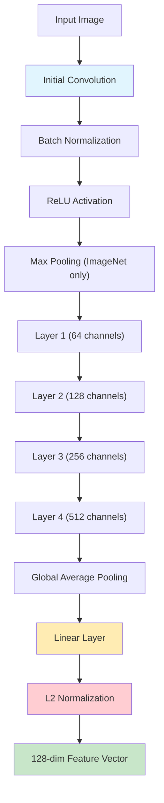

Sources: [models/resnet.py:132-148](), [models/resnet_cifar.py:92-102]()

## Model Variants

The repository provides two distinct ResNet implementations optimized for different datasets:

| Model Type | File | Target Dataset | Input Size | Initial Conv | Max Pool | Global Pool |
|------------|------|----------------|------------|--------------|----------|-------------|
| Standard ResNet | `models/resnet.py` | ImageNet | 224x224 | 7x7, stride=2 | 3x3, stride=2 | 7x7 |
| CIFAR ResNet | `models/resnet_cifar.py` | CIFAR-10/100 | 32x32 | 3x3, stride=1 | None | 4x4 |

### Key Architectural Differences

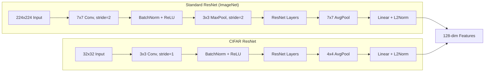

Sources: [models/resnet.py:94-105](), [models/resnet_cifar.py:75-82]()

## Standard ResNet Implementation

The standard ResNet implementation in [models/resnet.py]() provides the classic ResNet architectures adapted for SNCA feature learning.

### Block Types

The implementation includes two fundamental building blocks:

- **BasicBlock**: Used in ResNet-18 and ResNet-34, with expansion factor of 1
- **Bottleneck**: Used in ResNet-50, ResNet-101, and ResNet-152, with expansion factor of 4

### Available Model Configurations

| Model | Block Type | Layer Configuration | Parameters |
|-------|------------|-------------------|------------|
| `resnet18` | BasicBlock | [2, 2, 2, 2] | ~11M |
| `resnet34` | BasicBlock | [3, 4, 6, 3] | ~21M |
| `resnet50` | Bottleneck | [3, 4, 6, 3] | ~23M |
| `resnet101` | Bottleneck | [3, 4, 23, 3] | ~42M |
| `resnet152` | Bottleneck | [3, 8, 36, 3] | ~58M |

### ResNet Class Structure

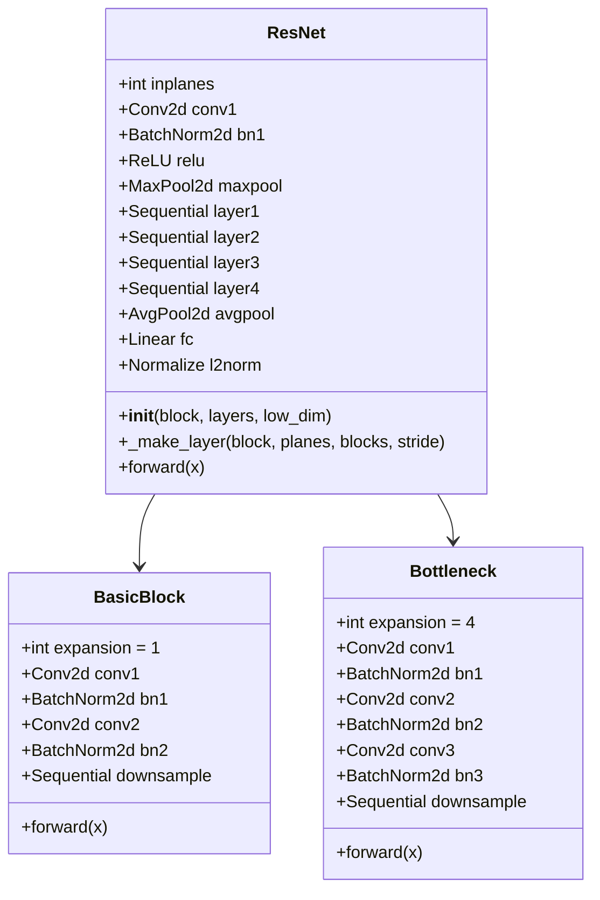

Sources: [models/resnet.py:89-148](), [models/resnet.py:18-47](), [models/resnet.py:50-86]()

## CIFAR-Optimized ResNet Implementation

The CIFAR ResNet implementation in [models/resnet_cifar.py]() is specifically optimized for 32x32 pixel images used in CIFAR-10 and CIFAR-100 datasets.

### CIFAR-Specific Optimizations

1. **No Initial Downsampling**: Uses 3x3 convolution with stride=1 instead of 7x7 with stride=2
2. **No Max Pooling**: Removes the initial max pooling layer that would be too aggressive for small images
3. **Smaller Global Pooling**: Uses 4x4 average pooling instead of 7x7
4. **Simplified Interface**: Uses direct function calls instead of factory pattern

### CIFAR ResNet Architecture Flow

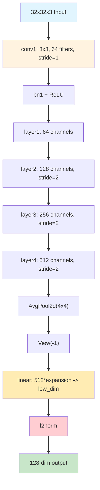

Sources: [models/resnet_cifar.py:92-102]()

### Available CIFAR Model Functions

The CIFAR implementation provides these factory functions:

- `ResNet18(low_dim=128)` → ResNet with BasicBlock [2,2,2,2]
- `ResNet34(low_dim=128)` → ResNet with BasicBlock [3,4,6,3]
- `ResNet50(low_dim=128)` → ResNet with Bottleneck [3,4,6,3]
- `ResNet101(low_dim=128)` → ResNet with Bottleneck [3,4,23,3]
- `ResNet152(low_dim=128)` → ResNet with Bottleneck [3,8,36,3]

Sources: [models/resnet_cifar.py:105-118]()

## SNCA-Specific Modifications

Both ResNet implementations include critical modifications for SNCA compatibility:

### Feature Dimensionality

All models output 128-dimensional feature vectors by default, controlled by the `low_dim` parameter. This low-dimensional representation is essential for the contrastive learning approach used in SNCA.

### L2 Normalization

Both implementations include L2 normalization as the final layer using the `Normalize(2)` module from [lib/normalize.py](). This ensures all feature vectors lie on the unit hypersphere, which is crucial for the neighborhood component analysis loss function.

### Weight Initialization

The standard ResNet implementation includes specific weight initialization:
- Convolutional layers: Normal distribution with std = sqrt(2/n)
- Batch normalization: weights=1, bias=0

Sources: [models/resnet.py:107-113](), [models/resnet.py:104-105](), [models/resnet_cifar.py:81-82]()

## Module Integration

The models integrate with other SNCA components through a well-defined interface:

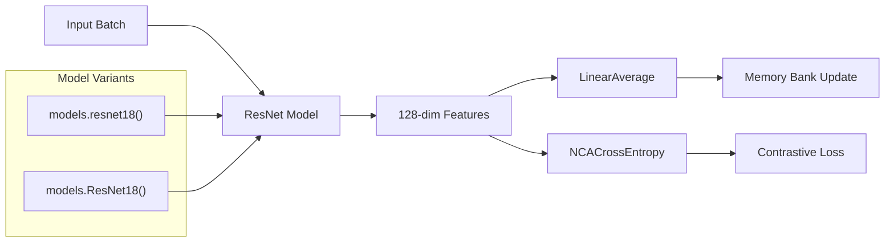

Both model variants are imported through [models/__init__.py]() and can be instantiated using their respective factory functions. The choice between standard and CIFAR variants depends on the target dataset as configured in the training scripts.

Sources: [models/__init__.py:1-2](), [models/resnet.py:151-208](), [models/resnet_cifar.py:105-118]()

---

# Page: Standard ResNet Models

# Standard ResNet Models

<details>
<summary>Relevant source files</summary>

The following files were used as context for generating this wiki page:

- [models/resnet.py](models/resnet.py)

</details>


This document covers the standard ResNet model implementations used for feature extraction in SNCA (Scalable Neighborhood Component Analysis). These models are specifically adapted from the original ResNet architecture to output normalized low-dimensional feature vectors suitable for contrastive learning and nearest neighbor classification.

For CIFAR-optimized ResNet variants, see [CIFAR-Optimized ResNet](#4.2). For information about how these models integrate with the SNCA training pipeline, see [ImageNet Training](#6.1).

## Architecture Overview

The standard ResNet models in this codebase implement the Deep Residual Learning architecture with key modifications for SNCA. Unlike traditional ResNet models that output class predictions, these models are designed as feature extractors that produce normalized low-dimensional embeddings.

### ResNet Architecture Components

```mermaid
graph TD
    subgraph "ResNet Feature Extractor"
        INPUT["Input Image (224x224x3)"]
        CONV1["conv1: Conv2d(3→64, 7x7, stride=2)"]
        BN1["bn1: BatchNorm2d(64)"]
        RELU1["ReLU"]
        MAXPOOL["MaxPool2d(3x3, stride=2)"]
        
        LAYER1["layer1: BasicBlock/Bottleneck layers"]
        LAYER2["layer2: BasicBlock/Bottleneck layers"] 
        LAYER3["layer3: BasicBlock/Bottleneck layers"]
        LAYER4["layer4: BasicBlock/Bottleneck layers"]
        
        AVGPOOL["avgpool: AvgPool2d(7x7)"]
        FC["fc: Linear(512*expansion → low_dim)"]
        L2NORM["l2norm: Normalize(2)"]
        OUTPUT["Output Features (low_dim)"]
    end
    
    INPUT --> CONV1
    CONV1 --> BN1
    BN1 --> RELU1
    RELU1 --> MAXPOOL
    MAXPOOL --> LAYER1
    LAYER1 --> LAYER2
    LAYER2 --> LAYER3
    LAYER3 --> LAYER4
    LAYER4 --> AVGPOOL
    AVGPOOL --> FC
    FC --> L2NORM
    L2NORM --> OUTPUT
```

Sources: [models/resnet.py:89-148]()

## Block Types

The ResNet implementation provides two types of residual blocks for different model depths and computational requirements.

### BasicBlock

The `BasicBlock` is used in shallower ResNet variants (ResNet-18, ResNet-34) and consists of two 3x3 convolutional layers with batch normalization and ReLU activations.

```mermaid
graph LR
    subgraph "BasicBlock Structure"
        INPUT_B["Input"]
        CONV1_B["conv1: conv3x3(inplanes→planes)"]
        BN1_B["bn1: BatchNorm2d"]
        RELU1_B["ReLU"]
        CONV2_B["conv2: conv3x3(planes→planes)"]
        BN2_B["bn2: BatchNorm2d"]
        DOWNSAMPLE_B["downsample (optional)"]
        ADD_B["Element-wise Add"]
        RELU2_B["ReLU"]
        OUTPUT_B["Output"]
    end
    
    INPUT_B --> CONV1_B
    CONV1_B --> BN1_B
    BN1_B --> RELU1_B
    RELU1_B --> CONV2_B
    CONV2_B --> BN2_B
    
    INPUT_B --> DOWNSAMPLE_B
    BN2_B --> ADD_B
    DOWNSAMPLE_B --> ADD_B
    ADD_B --> RELU2_B
    RELU2_B --> OUTPUT_B
```

Sources: [models/resnet.py:18-47]()

### Bottleneck

The `Bottleneck` block is used in deeper ResNet variants (ResNet-50, ResNet-101, ResNet-152) and implements a 1x1 → 3x3 → 1x1 convolution pattern to reduce computational complexity.

| Property | BasicBlock | Bottleneck |
|----------|------------|------------|
| **Expansion factor** | 1 | 4 |
| **Convolution layers** | 2 × 3x3 | 1x1 → 3x3 → 1x1 |
| **Used in models** | ResNet-18, ResNet-34 | ResNet-50, ResNet-101, ResNet-152 |
| **Computational efficiency** | Lower | Higher (for deep networks) |

Sources: [models/resnet.py:50-86]()

## ResNet Class

The main `ResNet` class implements the complete architecture with several key modifications for SNCA feature learning.

### Key Parameters

| Parameter | Type | Default | Description |
|-----------|------|---------|-------------|
| `block` | Class | - | Block type (`BasicBlock` or `Bottleneck`) |
| `layers` | List[int] | - | Number of blocks in each layer |
| `low_dim` | int | 128 | Output feature dimensionality |

### SNCA-Specific Modifications

The ResNet implementation includes several modifications tailored for SNCA:

1. **Low-dimensional output**: The final fully connected layer outputs `low_dim` features (default 128) instead of class logits
2. **L2 normalization**: Features are L2-normalized using the `Normalize(2)` module
3. **Feature extraction focus**: No classification head, optimized for feature representation learning

```mermaid
graph TD
    subgraph "SNCA ResNet Forward Pass"
        X_INPUT["x: Input Tensor"]
        BACKBONE["ResNet Backbone Layers"]
        AVGPOOL_F["avgpool: Global Average Pooling"]
        VIEW["view: Flatten to 1D"]
        FC_F["fc: Linear(512*expansion → low_dim)"]
        L2NORM_F["l2norm: Normalize(2)"]
        X_OUTPUT["x: Normalized Features"]
    end
    
    X_INPUT --> BACKBONE
    BACKBONE --> AVGPOOL_F
    AVGPOOL_F --> VIEW
    VIEW --> FC_F
    FC_F --> L2NORM_F
    L2NORM_F --> X_OUTPUT
```

Sources: [models/resnet.py:132-148](), [models/resnet.py:104-105]()

## Available Model Variants

The module provides factory functions for standard ResNet architectures with different depths:

| Model | Function | Block Type | Layer Configuration | Parameters |
|-------|----------|------------|-------------------|------------|
| **ResNet-18** | `resnet18()` | BasicBlock | [2, 2, 2, 2] | ~11.2M |
| **ResNet-34** | `resnet34()` | BasicBlock | [3, 4, 6, 3] | ~21.3M |
| **ResNet-50** | `resnet50()` | Bottleneck | [3, 4, 6, 3] | ~23.5M |
| **ResNet-101** | `resnet101()` | Bottleneck | [3, 4, 23, 3] | ~42.5M |
| **ResNet-152** | `resnet152()` | Bottleneck | [3, 8, 36, 3] | ~58.2M |

### Usage Pattern

```python
# Create ResNet-50 with 128-dimensional features
model = resnet50(low_dim=128)

# Create ResNet-18 with custom feature dimension
model = resnet18(low_dim=256)
```

Sources: [models/resnet.py:151-208]()

## Integration with SNCA System

These ResNet models serve as the backbone feature extractors in the SNCA training pipeline:

```mermaid
graph LR
    subgraph "SNCA Training Integration"
        IMAGES["Input Images"]
        RESNET_MODEL["ResNet Feature Extractor"]
        FEATURES["Low-dim Features (128D)"]
        LINEARAVG["LinearAverage Memory Bank"]
        NCA_LOSS["NCACrossEntropy Loss"]
    end
    
    IMAGES --> RESNET_MODEL
    RESNET_MODEL --> FEATURES
    FEATURES --> LINEARAVG
    FEATURES --> NCA_LOSS
    LINEARAVG --> NCA_LOSS
```

### Key Design Decisions

1. **Fixed input size**: Designed for ImageNet-scale images (224×224)
2. **Normalized output**: L2 normalization ensures features lie on unit hypersphere
3. **Low-dimensional projection**: Reduces memory requirements for large-scale contrastive learning
4. **No pretrained weights**: Empty `model_urls` dictionary indicates training from scratch

Sources: [models/resnet.py:1-11](), [models/resnet.py:104-106]()

## Dependencies

The ResNet implementation relies on several key components:

- **PyTorch modules**: `nn.Conv2d`, `nn.BatchNorm2d`, `nn.Linear`, etc.
- **Normalize module**: Custom L2 normalization from `lib.normalize`
- **Model zoo**: PyTorch's model loading utilities (though URLs are empty)

Sources: [models/resnet.py:1-4]()

---

# Page: CIFAR-Optimized ResNet

# CIFAR-Optimized ResNet

<details>
<summary>Relevant source files</summary>

The following files were used as context for generating this wiki page:

- [models/resnet_cifar.py](models/resnet_cifar.py)

</details>


## Purpose and Scope

This document covers the CIFAR-optimized ResNet implementations specifically designed for training on CIFAR-10 and CIFAR-100 datasets within the SNCA framework. These models are tailored for the smaller 32×32 pixel images typical of CIFAR datasets, with architectural modifications that differ from standard ImageNet ResNet models.

For information about standard ResNet implementations used with ImageNet, see [Standard ResNet Models](#4.1). For details about how these models integrate with the CIFAR training pipeline, see [CIFAR Training (cifar.py)](#6.2).

## Architectural Overview

The CIFAR-optimized ResNet implementation provides a complete feature extraction backbone optimized for small image classification tasks. Unlike standard ResNet architectures designed for ImageNet's 224×224 images, these models are specifically tuned for CIFAR's 32×32 input resolution.

### CIFAR ResNet Architecture Flow

```mermaid
flowchart TD
    Input["Input Image\n(3×32×32)"] --> Conv1["conv1\nConv2d(3,64,k=3,s=1,p=1)"]
    Conv1 --> BN1["bn1\nBatchNorm2d(64)"]
    BN1 --> ReLU1["ReLU"]
    ReLU1 --> Layer1["layer1\n64 channels, stride=1"]
    Layer1 --> Layer2["layer2\n128 channels, stride=2"]
    Layer2 --> Layer3["layer3\n256 channels, stride=2"]
    Layer3 --> Layer4["layer4\n512 channels, stride=2"]
    Layer4 --> AvgPool["F.avg_pool2d(4)"]
    AvgPool --> Flatten["Flatten"]
    Flatten --> Linear["linear\nLinear(512*expansion, low_dim)"]
    Linear --> L2Norm["l2norm\nNormalize(2)"]
    L2Norm --> Output["Output Features\n(low_dim,)"]
    
    subgraph "Block Types"
        BasicBlock["BasicBlock\nexpansion=1"]
        Bottleneck["Bottleneck\nexpansion=4"]
    end
    
    Layer1 -.-> BasicBlock
    Layer2 -.-> BasicBlock
    Layer3 -.-> BasicBlock
    Layer4 -.-> BasicBlock
    
    Layer1 -.-> Bottleneck
    Layer2 -.-> Bottleneck
    Layer3 -.-> Bottleneck
    Layer4 -.-> Bottleneck
```

Sources: [models/resnet_cifar.py:70-102]()

## Key Architectural Differences

The CIFAR ResNet implementation includes several optimizations specifically for small image processing:

| Component | CIFAR ResNet | Standard ImageNet ResNet |
|-----------|--------------|--------------------------|
| Initial Conv | `Conv2d(3,64,k=3,s=1,p=1)` | `Conv2d(3,64,k=7,s=2,p=3)` |
| Initial Pooling | None | `MaxPool2d(k=3,s=2,p=1)` |
| Final Pooling | `avg_pool2d(4)` | `adaptive_avg_pool2d(1)` |
| Output | L2-normalized features | Raw logits or features |

### Key Optimizations for Small Images

1. **Smaller Initial Convolution**: Uses 3×3 kernel with stride 1 instead of 7×7 with stride 2, preserving spatial resolution for small 32×32 inputs
2. **No Initial MaxPooling**: Eliminates the aggressive downsampling that would be detrimental for small images
3. **Fixed Pooling Size**: Uses `avg_pool2d(4)` instead of adaptive pooling, optimized for the 4×4 feature map size after 32×32 → 8×8 → 4×4 downsampling

Sources: [models/resnet_cifar.py:75-98]()

## Block Implementations

### BasicBlock Architecture

The `BasicBlock` provides the fundamental building block for ResNet18 and ResNet34 architectures:

```mermaid
flowchart TD
    Input["x"] --> Conv1["conv1\nConv2d(k=3,s=stride,p=1)"]
    Conv1 --> BN1["bn1\nBatchNorm2d"]
    BN1 --> ReLU1["ReLU"]
    ReLU1 --> Conv2["conv2\nConv2d(k=3,s=1,p=1)"]
    Conv2 --> BN2["bn2\nBatchNorm2d"]
    
    Input --> Shortcut["shortcut path"]
    Shortcut --> Add["Addition (+)"]
    BN2 --> Add
    Add --> ReLU2["ReLU"]
    ReLU2 --> Output["output"]
    
    subgraph "Shortcut Options"
        Identity["Identity\n(stride=1, planes match)"]
        Projection["1×1 Conv + BN\n(stride≠1 or planes change)"]
    end
    
    Shortcut -.-> Identity
    Shortcut -.-> Projection
```

Sources: [models/resnet_cifar.py:17-39]()

### Bottleneck Architecture

The `Bottleneck` block provides deeper architectures for ResNet50/101/152 with expansion factor of 4:

```mermaid
flowchart TD
    Input["x"] --> Conv1["conv1\n1×1 Conv2d"]
    Conv1 --> BN1["bn1 + ReLU"]
    BN1 --> Conv2["conv2\n3×3 Conv2d(stride)"]
    Conv2 --> BN2["bn2 + ReLU"]
    BN2 --> Conv3["conv3\n1×1 Conv2d"]
    Conv3 --> BN3["bn3"]
    
    Input --> Shortcut["shortcut"]
    Shortcut --> Add["Addition (+)"]
    BN3 --> Add
    Add --> ReLU3["ReLU"]
    ReLU3 --> Output["output"]
    
    subgraph "Dimensions"
        D1["Input: in_planes"]
        D2["Middle: planes"]
        D3["Output: planes × 4"]
    end
```

Sources: [models/resnet_cifar.py:42-67]()

## ResNet Class Implementation

### Constructor Parameters

The main `ResNet` class accepts the following key parameters:

| Parameter | Type | Default | Description |
|-----------|------|---------|-------------|
| `block` | Class | - | Either `BasicBlock` or `Bottleneck` |
| `num_blocks` | List[int] | - | Number of blocks per layer [layer1, layer2, layer3, layer4] |
| `low_dim` | int | 128 | Output feature dimension for SNCA |

### Layer Construction Process

```mermaid
flowchart LR
    Init["__init__"] --> MakeLayer1["_make_layer(64, num_blocks[0], s=1)"]
    MakeLayer1 --> MakeLayer2["_make_layer(128, num_blocks[1], s=2)"]
    MakeLayer2 --> MakeLayer3["_make_layer(256, num_blocks[2], s=2)"]
    MakeLayer3 --> MakeLayer4["_make_layer(512, num_blocks[3], s=2)"]
    
    subgraph "_make_layer Process"
        Strides["Calculate strides\n[stride] + [1]*(num_blocks-1)"]
        BuildBlocks["Build blocks sequentially"]
        UpdatePlanes["Update in_planes"]
    end
    
    MakeLayer1 -.-> Strides
    MakeLayer2 -.-> Strides
    MakeLayer3 -.-> Strides
    MakeLayer4 -.-> Strides
```

Sources: [models/resnet_cifar.py:84-90]()

## Available Model Variants

The implementation provides factory functions for standard ResNet architectures:

### Model Configurations

| Model | Block Type | Layer Configuration | Parameters |
|-------|------------|-------------------|------------|
| ResNet18 | BasicBlock | [2,2,2,2] | ~11M |
| ResNet34 | BasicBlock | [3,4,6,3] | ~21M |
| ResNet50 | Bottleneck | [3,4,6,3] | ~23M |
| ResNet101 | Bottleneck | [3,4,23,3] | ~42M |
| ResNet152 | Bottleneck | [3,8,36,3] | ~58M |

### Factory Function Usage

```mermaid
graph LR
    ResNet18["ResNet18(low_dim=128)"] --> BasicConfig["BasicBlock, [2,2,2,2]"]
    ResNet34["ResNet34(low_dim=128)"] --> BasicConfig2["BasicBlock, [3,4,6,3]"]
    ResNet50["ResNet50(low_dim=128)"] --> BottleneckConfig["Bottleneck, [3,4,6,3]"]
    ResNet101["ResNet101(low_dim=128)"] --> BottleneckConfig2["Bottleneck, [3,4,23,3]"]
    ResNet152["ResNet152(low_dim=128)"] --> BottleneckConfig3["Bottleneck, [3,8,36,3]"]
    
    BasicConfig --> ResNetClass["ResNet(block, num_blocks, low_dim)"]
    BasicConfig2 --> ResNetClass
    BottleneckConfig --> ResNetClass
    BottleneckConfig2 --> ResNetClass
    BottleneckConfig3 --> ResNetClass
```

Sources: [models/resnet_cifar.py:105-118]()

## Integration with SNCA Components

### Feature Extraction Pipeline

The CIFAR ResNet models integrate seamlessly with the SNCA framework through several key design choices:

```mermaid
flowchart TD
    CIFARData["CIFAR10Instance/CIFAR100Instance\n32×32 images"] --> ResNetCIFAR["ResNet CIFAR Model"]
    ResNetCIFAR --> Features["Feature Tensor\n(batch_size, low_dim)"]
    Features --> L2Norm["L2 Normalization\nNormalize(2)"]
    L2Norm --> LinearAverage["LinearAverage\nMemory Bank"]
    L2Norm --> NCACrossEntropy["NCACrossEntropy\nContrastive Loss"]
    
    subgraph "SNCA Integration Points"
        LowDim["low_dim=128\nFixed feature dimension"]
        Normalize["Built-in L2 normalization"]
        BatchSize["Optimized for smaller batches"]
    end
    
    Features -.-> LowDim
    L2Norm -.-> Normalize
    CIFARData -.-> BatchSize
```

### Output Feature Characteristics

- **Dimensionality**: Fixed 128-dimensional feature vectors (configurable via `low_dim` parameter)
- **Normalization**: L2-normalized unit vectors for cosine similarity computation
- **Range**: Feature values in range [-1, 1] due to L2 normalization

Sources: [models/resnet_cifar.py:81-82](), [models/resnet_cifar.py:100-101]()

## Usage in Training Pipeline

The CIFAR ResNet models are instantiated and used within the CIFAR training pipeline:

### Model Selection Logic

```mermaid
flowchart TD
    Args["Command Line Args\n--arch resnet18"] --> ModelDict["Model Dictionary Lookup"]
    ModelDict --> Instantiate["Model Instantiation\nmodel(low_dim=args.low_dim)"]
    Instantiate --> CUDA["model.cuda()"]
    CUDA --> DataParallel["nn.DataParallel(model)"]
    
    subgraph "Available Models"
        R18["resnet18 → ResNet18"]
        R34["resnet34 → ResNet34"] 
        R50["resnet50 → ResNet50"]
        R101["resnet101 → ResNet101"]
        R152["resnet152 → ResNet152"]
    end
    
    ModelDict -.-> R18
    ModelDict -.-> R34
    ModelDict -.-> R50
    ModelDict -.-> R101
    ModelDict -.-> R152
```

The models integrate with the broader CIFAR training pipeline through the `cifar.py` script, where they serve as feature extractors for the SNCA contrastive learning framework.

Sources: [models/resnet_cifar.py:105-118]()

---

# Page: Data Pipeline

# Data Pipeline

<details>
<summary>Relevant source files</summary>

The following files were used as context for generating this wiki page:

- [datasets/__init__.py](datasets/__init__.py)
- [datasets/cifar.py](datasets/cifar.py)
- [datasets/folder.py](datasets/folder.py)

</details>


## Purpose and Scope

The Data Pipeline system provides specialized dataset implementations that extend standard PyTorch/torchvision datasets with index tracking capabilities essential for SNCA's contrastive learning approach. This system enables the LinearAverage memory bank to maintain correspondence between training samples and their cached feature representations.

For detailed information about how these datasets integrate with the memory bank system, see [Memory Bank System (LinearAverage)](#3.1). For training pipeline usage, see [ImageNet Training (main.py)](#6.1) and [CIFAR Training (cifar.py)](#6.2).

## Architecture Overview

The data pipeline consists of three custom dataset classes that wrap standard torchvision datasets to add index tracking functionality. This modification is critical for SNCA's non-parametric memory bank approach, which requires mapping between dataset indices and cached feature vectors.

### Dataset Extension Pattern

```mermaid
graph TB
    subgraph "Standard torchvision Datasets"
        ImageFolder["datasets.ImageFolder"]
        CIFAR10["datasets.CIFAR10"]
    end
    
    subgraph "Index-Aware Extensions"
        ImageFolderInstance["ImageFolderInstance"]
        CIFAR10Instance["CIFAR10Instance"]
        CIFAR100Instance["CIFAR100Instance"]
    end
    
    subgraph "Return Format"
        StandardReturn["(image, target)"]
        IndexedReturn["(image, target, index)"]
    end
    
    ImageFolder --> ImageFolderInstance
    CIFAR10 --> CIFAR10Instance
    CIFAR10Instance --> CIFAR100Instance
    
    ImageFolder --> StandardReturn
    ImageFolderInstance --> IndexedReturn
    CIFAR10 --> StandardReturn
    CIFAR10Instance --> IndexedReturn
    CIFAR100Instance --> IndexedReturn
    
    IndexedReturn -.->|"Essential for"| MemoryBank["LinearAverage Memory Bank"]
```

**Sources:** [datasets/__init__.py:1-4](), [datasets/folder.py:3-20](), [datasets/cifar.py:6-43]()

## Index-Aware Dataset Pattern

All custom datasets in this pipeline follow a consistent pattern of extending torchvision datasets to return a three-element tuple `(image, target, index)` instead of the standard two-element tuple `(image, target)`. This additional index enables the SNCA algorithm to maintain correspondence between training samples and their feature representations in the memory bank.

### Data Flow Architecture

```mermaid
flowchart TD
    subgraph "Data Loading"
        DatasetFiles["Dataset Files<br/>• ImageNet directories<br/>• CIFAR binary files"]
        CustomDatasets["Index-Aware Datasets<br/>• ImageFolderInstance<br/>• CIFAR10Instance<br/>• CIFAR100Instance"]
    end
    
    subgraph "Data Processing"
        Transforms["Data Transforms<br/>• Augmentation<br/>• Normalization<br/>• ToTensor"]
        DataLoader["PyTorch DataLoader<br/>• Batching<br/>• Shuffling<br/>• Multi-processing"]
    end
    
    subgraph "Training Pipeline"
        TrainingBatch["Training Batch<br/>(images, targets, indices)"]
        FeatureExtraction["ResNet Feature Extraction"]
        MemoryBankUpdate["LinearAverage Update<br/>Using indices for mapping"]
    end
    
    DatasetFiles --> CustomDatasets
    CustomDatasets --> Transforms
    Transforms --> DataLoader
    DataLoader --> TrainingBatch
    TrainingBatch --> FeatureExtraction
    TrainingBatch --> MemoryBankUpdate
```

**Sources:** [datasets/folder.py:6-20](), [datasets/cifar.py:9-25]()

## Dataset Implementations

### ImageFolderInstance

The `ImageFolderInstance` class extends `torchvision.datasets.ImageFolder` to support ImageNet and custom image folder datasets with index tracking.

| Property | Description |
|----------|-------------|
| **Base Class** | `datasets.ImageFolder` |
| **Purpose** | Load image datasets from folder structure with index tracking |
| **Return Format** | `(image, target, index)` |
| **Use Case** | ImageNet training and custom image datasets |

Key implementation details:
- Inherits all functionality from `ImageFolder` including automatic class discovery
- Overrides `__getitem__` method at [datasets/folder.py:6-20]() to add index return
- Maintains compatibility with all standard `ImageFolder` transforms and target transforms

**Sources:** [datasets/folder.py:3-21]()

### CIFAR Dataset Extensions

The CIFAR dataset implementations provide index tracking for both CIFAR-10 and CIFAR-100 datasets.

#### CIFAR10Instance

| Property | Description |
|----------|-------------|
| **Base Class** | `datasets.CIFAR10` |
| **Purpose** | CIFAR-10 dataset with index tracking |
| **Image Processing** | Converts numpy arrays to PIL Images for consistency |
| **Return Format** | `(image, target, index)` |

Key implementation at [datasets/cifar.py:6-25]():
- Handles both training and test data access through `self.train` flag
- Converts numpy arrays to PIL Images using `Image.fromarray()` for transform compatibility
- Applies transforms and target transforms before returning the indexed tuple

#### CIFAR100Instance

| Property | Description |
|----------|-------------|
| **Base Class** | `CIFAR10Instance` |
| **Purpose** | CIFAR-100 dataset with index tracking |
| **Implementation** | Inherits index tracking from `CIFAR10Instance` |
| **Dataset Metadata** | Overrides URLs, filenames, and checksums for CIFAR-100 |

The CIFAR-100 implementation at [datasets/cifar.py:27-43]() leverages inheritance to reuse the index tracking logic while providing CIFAR-100 specific metadata including:
- Dataset URL and filename specifications
- Training and test file lists with MD5 checksums
- Base folder name for extracted files

**Sources:** [datasets/cifar.py:6-43]()

## Integration with SNCA Training

### Module Export Structure

The data pipeline exports its components through a clean module interface defined in [datasets/__init__.py:1-4]():

```python
from .folder import ImageFolderInstance
from .cifar import CIFAR10Instance, CIFAR100Instance

__all__ = ('ImageFolderInstance', 'CIFAR10Instance', 'CIFAR100Instance')
```

This structure allows training scripts to import datasets uniformly and switch between different dataset types while maintaining the same index-aware interface.

### Memory Bank Coordination

```mermaid
graph LR
    subgraph "Dataset Layer"
        IndexedDataset["Index-Aware Dataset<br/>Returns (img, target, index)"]
    end
    
    subgraph "Training Loop"
        Batch["Training Batch<br/>indices tensor"]
        Features["Extracted Features<br/>normalized vectors"]
    end
    
    subgraph "Memory Management"
        LinearAverage["LinearAverage Module<br/>Memory bank storage"]
        FeatureUpdate["Feature Updates<br/>Using index mapping"]
    end
    
    IndexedDataset --> Batch
    Batch --> Features
    Batch --> LinearAverage
    Features --> FeatureUpdate
    LinearAverage --> FeatureUpdate
```

The index values returned by these datasets serve as keys for the `LinearAverage` memory bank, enabling efficient storage and retrieval of feature representations corresponding to specific training samples. This design is fundamental to SNCA's non-parametric approach to contrastive learning.

**Sources:** [datasets/__init__.py:1-4](), [datasets/folder.py:6-20](), [datasets/cifar.py:9-25]()

---

# Page: CIFAR Datasets

# CIFAR Datasets

<details>
<summary>Relevant source files</summary>

The following files were used as context for generating this wiki page:

- [datasets/cifar.py](datasets/cifar.py)

</details>


This page documents the custom CIFAR dataset implementations that extend PyTorch's standard CIFAR datasets with index tracking functionality. These datasets are essential for the SNCA contrastive learning pipeline, as they provide the sample indices required by the memory bank system.

For information about the ImageNet-style dataset implementation, see [Image Folder Dataset](#5.2). For details on how these datasets integrate with the memory bank system, see [Memory Bank System (LinearAverage)](#3.1).

## Purpose and Index Tracking

The core purpose of `CIFAR10Instance` and `CIFAR100Instance` is to extend the standard torchvision CIFAR datasets by returning sample indices alongside images and targets. This index tracking is crucial for the SNCA algorithm, which maintains a memory bank that stores feature representations indexed by sample position.

The key modification is in the `__getitem__` method at [datasets/cifar.py:25](), which returns a tuple of `(img, target, index)` instead of the standard `(img, target)`.

Sources: [datasets/cifar.py:6-43]()

## Class Hierarchy and Inheritance

The CIFAR dataset classes follow a simple inheritance pattern:

```mermaid
classDiagram
    class datasets_CIFAR10 {
        +train_data
        +train_labels  
        +test_data
        +test_labels
        +__getitem__(index)
    }
    
    class CIFAR10Instance {
        +__getitem__(index)
        +returns: img, target, index
    }
    
    class CIFAR100Instance {
        +base_folder: "cifar-100-python"
        +url: str
        +filename: str
        +train_list: list
        +test_list: list
    }
    
    datasets_CIFAR10 <|-- CIFAR10Instance
    CIFAR10Instance <|-- CIFAR100Instance
```

The `CIFAR100Instance` class inherits from `CIFAR10Instance` and only overrides the dataset-specific metadata like file paths and checksums, while reusing the index tracking functionality.

Sources: [datasets/cifar.py:6-26](), [datasets/cifar.py:27-42]()

## Data Flow and Index Tracking Implementation

The index tracking implementation follows this data flow:

```mermaid
flowchart TD
    A["CIFAR Dataset Files"] --> B["CIFAR10Instance.__getitem__(index)"]
    B --> C["Load img, target from arrays"]
    C --> D["Image.fromarray(img)"]
    D --> E["Apply transforms"]
    E --> F["Return (img, target, index)"]
    
    G["Training Loop"] --> H["DataLoader iteration"]
    H --> B
    F --> I["Batch: (images, targets, indices)"]
    I --> J["ResNet Feature Extraction"]
    I --> K["LinearAverage Memory Bank"]
    K --> L["Store features at indices"]
    
    subgraph "Index Usage"
        M["indices[i] = dataset position"]
        N["memory_bank[indices[i]] = features[i]"]
    end
    
    I -.-> M
    K -.-> N
```

The implementation details are:

| Method | Implementation | Purpose |
|--------|---------------|---------|
| Data Access | `self.train_data[index]` / `self.test_data[index]` | Access raw numpy arrays |
| Image Conversion | `Image.fromarray(img)` | Convert to PIL Image for consistency |
| Transform Application | `self.transform(img)` if not None | Apply data augmentation |
| Index Return | `return img, target, index` | Provide sample index for memory bank |

Sources: [datasets/cifar.py:9-25]()

## Integration with SNCA Training Pipeline

The index-enhanced datasets integrate with the SNCA training pipeline through the DataLoader and memory bank system:

```mermaid
flowchart LR
    A["CIFAR10Instance"] --> B["DataLoader"]
    B --> C["Training Batch"]
    C --> D["(images, targets, indices)"]
    
    D --> E["ResNet Model"]
    D --> F["LinearAverage"]
    E --> G["Low-dim Features"]
    G --> F
    F --> H["Memory Bank Update"]
    
    subgraph "Memory Bank Operations"
        I["memory_v[indices] = features"]
        J["compute similarities"]
        K["NCA loss calculation"]
    end
    
    F --> I
    I --> J
    J --> K
    
    subgraph "Gradient Flow"
        L["Loss.backward()"]
        M["Update ResNet params"]
    end
    
    K --> L
    L --> M
    M --> E
```

The indices enable the `LinearAverage` module to update the correct positions in its memory bank, maintaining correspondence between training samples and their stored feature representations.

Sources: [datasets/cifar.py:25]()

## Dataset Configuration and Metadata

The `CIFAR100Instance` class defines specific configuration for the CIFAR-100 dataset:

| Property | Value | Purpose |
|----------|--------|---------|
| `base_folder` | `"cifar-100-python"` | Directory name for extracted files |
| `url` | `"https://www.cs.toronto.edu/~kriz/cifar-100-python.tar.gz"` | Download source |
| `filename` | `"cifar-100-python.tar.gz"` | Archive filename |
| `tgz_md5` | `"eb9058c3a382ffc7106e4002c42a8d85"` | Integrity checksum |
| `train_list` | `[['train', '16019d7e3df5f24257cddd939b257f8d']]` | Training file and checksum |
| `test_list` | `[['test', 'f0ef6b0ae62326f3e7ffdfab6717acfc']]` | Test file and checksum |

These metadata fields ensure proper dataset downloading, extraction, and integrity verification while inheriting the index tracking functionality from the parent class.

Sources: [datasets/cifar.py:32-42]()

## Usage in Training Scripts

Both CIFAR dataset classes are used in the CIFAR training pipeline where the returned indices are essential for the contrastive learning process. The datasets support both training and testing modes, with appropriate data splits loaded based on the `train` parameter passed during instantiation.

The PIL Image conversion at [datasets/cifar.py:17]() ensures compatibility with torchvision transforms, while the index return at [datasets/cifar.py:25]() enables the memory bank updates that are central to the SNCA algorithm.

Sources: [datasets/cifar.py:10-25]()

---

# Page: Image Folder Dataset

# Image Folder Dataset

<details>
<summary>Relevant source files</summary>

The following files were used as context for generating this wiki page:

- [datasets/folder.py](datasets/folder.py)

</details>


This document covers the `ImageFolderInstance` class, which provides index-aware image loading for custom image datasets in the SNCA training pipeline. This class extends PyTorch's standard `ImageFolder` dataset to include sample index tracking required for contrastive learning with memory banks.

For information about CIFAR dataset implementations with similar index tracking functionality, see [CIFAR Datasets](#5.1). For details on how the returned indices are used in the memory bank system, see [Memory Bank System (LinearAverage)](#3.1).

## Purpose and Architecture

The `ImageFolderInstance` class serves a critical role in the SNCA data pipeline by providing sample indices alongside image data and labels. This index tracking is essential for the memory bank operations in contrastive learning, where features from specific training samples need to be stored and retrieved consistently.

## Class Implementation

### ImageFolderInstance Overview

The `ImageFolderInstance` class extends `torchvision.datasets.ImageFolder` with minimal modifications to support index tracking:

```mermaid
graph TB
    subgraph "PyTorch torchvision"
        ImageFolder["datasets.ImageFolder<br/>Standard Implementation"]
    end
    
    subgraph "SNCA Custom Implementation"
        ImageFolderInstance["ImageFolderInstance<br/>Index-Aware Extension"]
    end
    
    subgraph "Data Output"
        StandardOutput["(image, target)"]
        ExtendedOutput["(image, target, index)"]
    end
    
    ImageFolder --> ImageFolderInstance
    ImageFolder --> StandardOutput
    ImageFolderInstance --> ExtendedOutput
    
    ExtendedOutput --> MemoryBank["LinearAverage Memory Bank"]
    ExtendedOutput --> TrainingLoop["SNCA Training Loop"]
```

**Inheritance and Method Override**

Sources: [datasets/folder.py:1-22]()

### Key Implementation Details

| Component | Description | Location |
|-----------|-------------|----------|
| Class Definition | Inherits from `datasets.ImageFolder` | [datasets/folder.py:3]() |
| Core Method | Overrides `__getitem__` to return index | [datasets/folder.py:6-20]() |
| Return Value | Returns `(img, target, index)` tuple | [datasets/folder.py:20]() |

The implementation preserves all standard `ImageFolder` functionality while adding index tracking:

- Uses parent class's `self.imgs` for path and target retrieval [datasets/folder.py:13]()
- Applies transforms using parent class's `self.loader` [datasets/folder.py:14]()
- Supports both image and target transforms [datasets/folder.py:15-18]()
- Appends the dataset index to the return tuple [datasets/folder.py:20]()

## Data Flow Integration

```mermaid
flowchart TD
    FileSystem["Image Directory Structure<br/>/class1/img1.jpg<br/>/class2/img2.jpg"]
    
    ImageFolderInstance["ImageFolderInstance.__getitem__(index)"]
    
    DataLoader["PyTorch DataLoader<br/>Batching and Shuffling"]
    
    TrainingBatch["Training Batch<br/>(images, targets, indices)"]
    
    subgraph "SNCA Components"
        ResNet["ResNet Feature Extractor<br/>Extract features from images"]
        LinearAverage["LinearAverage Memory Bank<br/>Use indices to store/retrieve features"]
        NCALoss["NCACrossEntropy Loss<br/>Use indices for contrastive pairs"]
    end
    
    FileSystem --> ImageFolderInstance
    ImageFolderInstance --> DataLoader
    DataLoader --> TrainingBatch
    
    TrainingBatch --> ResNet
    TrainingBatch --> LinearAverage
    TrainingBatch --> NCALoss
    
    ResNet --> LinearAverage
    LinearAverage --> NCALoss
```

Sources: [datasets/folder.py:6-20]()

## Index Usage in SNCA Training

The indices returned by `ImageFolderInstance` serve multiple purposes in the SNCA training pipeline:

### Memory Bank Operations
- **Feature Storage**: Indices map extracted features to specific training samples in the `LinearAverage` memory bank
- **Feature Retrieval**: During contrastive learning, indices enable retrieval of stored features for similarity computations
- **Consistency**: Ensures that features for the same sample are consistently updated across training epochs

### Contrastive Learning
- **Positive/Negative Sampling**: Indices help identify which samples should be treated as positives or negatives in contrastive loss calculations
- **Memory Bank Updates**: The `LinearAverage` module uses indices to perform momentum-based feature updates

## Usage in Training Scripts

The `ImageFolderInstance` is integrated into the SNCA training pipeline through standard PyTorch data loading patterns:

```mermaid
graph LR
    subgraph "Dataset Creation"
        ImageFolderInstance["ImageFolderInstance<br/>(dataset_path, transforms)"]
    end
    
    subgraph "Data Loading"
        DataLoader["DataLoader<br/>(batch_size, shuffle, workers)"]
    end
    
    subgraph "Training Loop"
        BatchData["(images, targets, indices)"]
        FeatureExtraction["ResNet Forward Pass"]
        MemoryUpdate["LinearAverage Update"]
        LossComputation["NCACrossEntropy Loss"]
    end
    
    ImageFolderInstance --> DataLoader
    DataLoader --> BatchData
    BatchData --> FeatureExtraction
    BatchData --> MemoryUpdate
    BatchData --> LossComputation
```

Sources: [datasets/folder.py:3-20]()

## Comparison with Standard ImageFolder

| Feature | `datasets.ImageFolder` | `ImageFolderInstance` |
|---------|----------------------|---------------------|
| Return Type | `(image, target)` | `(image, target, index)` |
| Use Case | Standard classification | Contrastive learning with memory banks |
| Index Tracking | No | Yes |
| Compatibility | Standard PyTorch | SNCA-specific |

The minimal modification approach ensures full compatibility with existing PyTorch data loading infrastructure while adding the essential index tracking capability required for SNCA's memory bank operations.

Sources: [datasets/folder.py:1-22]()

---

# Page: Training and Evaluation

# Training and Evaluation

<details>
<summary>Relevant source files</summary>

The following files were used as context for generating this wiki page:

- [cifar.py](cifar.py)
- [main.py](main.py)
- [test.py](test.py)

</details>


This document covers the training and evaluation systems that implement the core SNCA learning and assessment pipelines. The training process learns feature representations optimized for nearest neighbor classification, while the evaluation system measures the quality of learned features using nearest neighbor retrieval accuracy.

For information about the core SNCA algorithmic components used during training, see [Core SNCA Components](#3). For details about the ResNet model architectures, see [Model Architectures](#4). For information about the custom dataset implementations, see [Data Pipeline](#5).

## Training Pipeline Overview

The SNCA implementation provides two main training entry points that share core algorithmic components but differ in dataset handling and optimization strategies:

| Training Script | Target Dataset | Key Features |
|-----------------|----------------|--------------|
| `main.py` | ImageNet | Multi-GPU support, distributed training, gradient accumulation |
| `cifar.py` | CIFAR-10/100 | Simplified pipeline, aggressive data augmentation |

### Training Pipeline Architecture

```mermaid
flowchart TB
    subgraph "Training Entry Points"
        MAIN["main.py"]
        CIFAR["cifar.py"]
    end
    
    subgraph "Core Training Components"
        MODEL["ResNet Model"]
        LEMNISCATE["LinearAverage Memory Bank"]
        CRITERION["NCACrossEntropy Loss"]
        OPTIMIZER["SGD Optimizer"]
    end
    
    subgraph "Training Process"
        TRAIN_LOOP["train() function"]
        FORWARD["Feature Extraction"]
        MEMORY_UPDATE["Memory Bank Update"]
        LOSS_COMPUTE["NCA Loss Computation"]
        BACKWARD["Gradient Computation"]
    end
    
    subgraph "Evaluation Process"
        NN_EVAL["NN() evaluation"]
        KNN_EVAL["kNN() evaluation"]
    end
    
    MAIN --> MODEL
    CIFAR --> MODEL
    MAIN --> LEMNISCATE
    CIFAR --> LEMNISCATE
    MAIN --> CRITERION
    CIFAR --> CRITERION
    MAIN --> OPTIMIZER
    CIFAR --> OPTIMIZER
    
    MODEL --> TRAIN_LOOP
    LEMNISCATE --> TRAIN_LOOP
    CRITERION --> TRAIN_LOOP
    OPTIMIZER --> TRAIN_LOOP
    
    TRAIN_LOOP --> FORWARD
    FORWARD --> MEMORY_UPDATE
    MEMORY_UPDATE --> LOSS_COMPUTE
    LOSS_COMPUTE --> BACKWARD
    BACKWARD --> OPTIMIZER
    
    TRAIN_LOOP --> NN_EVAL
    NN_EVAL --> KNN_EVAL
```

Sources: [main.py:1-281](), [cifar.py:1-166]()

## ImageNet Training Pipeline

The ImageNet training pipeline in `main.py` implements a comprehensive training system with support for distributed training, gradient accumulation, and sophisticated memory management.

### Command-Line Arguments

The ImageNet training script accepts numerous configuration parameters:

| Argument Category | Key Parameters | Default Values |
|-------------------|----------------|----------------|
| **Data** | `data` (dataset path) | Required |
| **Model** | `--arch` | `resnet18` |
| **Training** | `--epochs`, `--batch-size`, `--lr` | `130`, `256`, `0.1` |
| **SNCA Parameters** | `--low-dim`, `--temperature`, `--memory-momentum` | `128`, `0.05`, `0.5` |
| **Optimization** | `--iter-size`, `--margin` | `1`, `0.0` |
| **Distributed** | `--world-size`, `--dist-backend` | `1`, `gloo` |

### Training Process Flow

```mermaid
flowchart TD
    START["main() function"] --> SETUP["Setup distributed training"]
    SETUP --> DATA_LOAD["Create ImageFolderInstance datasets"]
    DATA_LOAD --> MODEL_CREATE["Initialize ResNet model"]
    MODEL_CREATE --> LEMNISCATE_INIT["Initialize LinearAverage"]
    LEMNISCATE_INIT --> CRITERION_INIT["Initialize NCACrossEntropy"]
    
    CRITERION_INIT --> EPOCH_LOOP["Training epoch loop"]
    EPOCH_LOOP --> ADJUST_LR["adjust_learning_rate()"]
    ADJUST_LR --> ADJUST_MEM["adjust_memory_update_rate()"]
    ADJUST_MEM --> TRAIN_CALL["train() function"]
    
    TRAIN_CALL --> BATCH_LOOP["Batch processing loop"]
    BATCH_LOOP --> FORWARD["model(input_var)"]
    FORWARD --> MEMORY_OP["lemniscate(feature, index_var)"]
    MEMORY_OP --> LOSS_CALC["criterion(output, index_var)"]
    LOSS_CALC --> BACKWARD["loss.backward()"]
    BACKWARD --> GRAD_ACCUM["Gradient accumulation check"]
    GRAD_ACCUM --> OPTIMIZER_STEP["optimizer.step()"]
    
    OPTIMIZER_STEP --> BATCH_LOOP
    TRAIN_CALL --> NN_EVAL["NN evaluation"]
    NN_EVAL --> CHECKPOINT["save_checkpoint()"]
    CHECKPOINT --> EPOCH_LOOP
```

Sources: [main.py:80-197](), [main.py:199-244]()

### Key Training Features

**Gradient Accumulation**: The `--iter-size` parameter enables gradient accumulation to simulate larger batch sizes when memory is limited. The training loop accumulates gradients across multiple mini-batches before updating parameters:

```python
# From main.py:222-231
loss = criterion(output, index_var) / args.iter_size
loss.backward()
if (i+1) % args.iter_size == 0:
    optimizer.step()
    optimizer.zero_grad()
```

**Adaptive Learning Rate**: The learning rate follows a step decay schedule, reducing by 10x every 40 epochs as implemented in `adjust_learning_rate()` [main.py:257-262]().

**Memory Momentum Scheduling**: The memory bank update rate increases during training to improve stability, as implemented in `adjust_memory_update_rate()` [main.py:251-255]().

Sources: [main.py:199-244](), [main.py:251-262]()

## CIFAR Training Pipeline

The CIFAR training pipeline in `cifar.py` provides a streamlined implementation focused on smaller datasets with aggressive data augmentation.

### CIFAR-Specific Features

**Data Augmentation**: The CIFAR pipeline employs extensive data augmentation including:
- `RandomResizedCrop` with scale factor (0.2, 1.0)
- `RandomGrayscale` with probability 0.2
- `ColorJitter` with intensity 0.4 for brightness, contrast, saturation, and hue
- `RandomHorizontalFlip`

**Simplified Training Loop**: The CIFAR training uses a simpler loop structure without gradient accumulation:

```python
# From cifar.py:123-135
features = net(inputs)
outputs = lemniscate(features, indexes)
loss = criterion(outputs, indexes)
loss.backward()
optimizer.step()
```

**Fixed Architecture**: CIFAR training uses a hardcoded ResNet18 architecture optimized for 32x32 images as specified in [cifar.py:82]().

Sources: [cifar.py:46-65](), [cifar.py:110-147]()

## Evaluation System

The evaluation system implements two complementary methods for assessing feature quality using nearest neighbor classification.

### Evaluation Methods Architecture

```mermaid
flowchart LR
    subgraph "Evaluation Functions"
        NN_FUNC["NN() function<br/>1-nearest neighbor"]
        KNN_FUNC["kNN() function<br/>k-nearest neighbor"]
    end
    
    subgraph "Shared Components"
        FEATURES["trainFeatures<br/>lemniscate.memory.t()"]
        LABELS["trainLabels<br/>dataset labels"]
        SIMILARITY["torch.mm(features, trainFeatures)"]
    end
    
    subgraph "NN Specific"
        NN_TOPK["dist.topk(1)"]
        NN_RETRIEVAL["Direct label retrieval"]
    end
    
    subgraph "kNN Specific"
        KNN_TOPK["dist.topk(K)"]
        KNN_WEIGHTS["Temperature-weighted voting"]
        KNN_PROBS["Probability computation"]
    end
    
    NN_FUNC --> FEATURES
    KNN_FUNC --> FEATURES
    FEATURES --> LABELS
    LABELS --> SIMILARITY
    
    SIMILARITY --> NN_TOPK
    SIMILARITY --> KNN_TOPK
    
    NN_TOPK --> NN_RETRIEVAL
    KNN_TOPK --> KNN_WEIGHTS
    KNN_WEIGHTS --> KNN_PROBS
```

Sources: [test.py:8-65](), [test.py:67-135]()

### NN Evaluation (1-Nearest Neighbor)

The `NN` function implements simple 1-nearest neighbor classification by finding the single most similar training example for each test sample:

**Process**:
1. Extract features from the memory bank: `trainFeatures = lemniscate.memory.t()` [test.py:17]()
2. Compute similarity matrix: `dist = torch.mm(features, trainFeatures)` [test.py:44]()
3. Find nearest neighbor: `yd, yi = dist.topk(1, dim=1, largest=True, sorted=True)` [test.py:46]()
4. Retrieve corresponding label and compute accuracy [test.py:47-54]()

**Usage**: Called during training for quick evaluation after each epoch [main.py:184]().

Sources: [test.py:8-65]()

### kNN Evaluation (k-Nearest Neighbor)

The `kNN` function implements weighted k-nearest neighbor classification with temperature-scaled similarity voting:

**Process**:
1. Find k nearest neighbors: `yd, yi = dist.topk(K, dim=1, largest=True, sorted=True)` [test.py:108]()
2. Create one-hot encoding for retrieved labels [test.py:112-113]()
3. Apply temperature scaling: `yd_transform = yd.clone().div_(sigma).exp_()` [test.py:114]()
4. Compute weighted vote probabilities [test.py:115]()
5. Sort predictions and compute top-1 and top-5 accuracy [test.py:116-123]()

**Usage**: Called for comprehensive evaluation with K=30 neighbors [main.py:171](), [cifar.py:97]().

Sources: [test.py:67-135]()

### Evaluation Configuration

| Parameter | NN Function | kNN Function |
|-----------|-------------|--------------|
| **Neighbors (K)** | 1 (fixed) | 30 (typical) |
| **Temperature** | Not used | Inherited from training |
| **Metrics** | Top-1 accuracy | Top-1 and Top-5 accuracy |
| **Performance** | Fast, approximate | Slower, comprehensive |

### Memory Recomputation

Both evaluation functions support memory recomputation mode (`recompute_memory=1`) that re-extracts features using test-time augmentations instead of using cached training features [test.py:23-33](), [test.py:81-91]().

Sources: [test.py:1-137]()

## Training Configuration Examples

### ImageNet Training Example

```bash
python main.py /path/to/imagenet \
    --arch resnet50 \
    --batch-size 128 \
    --iter-size 2 \
    --epochs 130 \
    --lr 0.1 \
    --low-dim 128 \
    --temperature 0.05 \
    --memory-momentum 0.5
```

### CIFAR Training Example

```bash
python cifar.py \
    --lr 0.1 \
    --low-dim 128 \
    --temperature 0.05 \
    --memory-momentum 0.5
```

### Evaluation Only Example

```bash
python main.py /path/to/imagenet \
    --resume checkpoint.pth.tar \
    --evaluate
```

Sources: [main.py:30-77](), [cifar.py:27-37]()

---

# Page: ImageNet Training (main.py)

# ImageNet Training (main.py)

<details>
<summary>Relevant source files</summary>

The following files were used as context for generating this wiki page:

- [main.py](main.py)

</details>


This document covers the ImageNet training pipeline implemented in `main.py`, which serves as the primary entry point for training Scalable Neighborhood Component Analysis (SNCA) models on ImageNet datasets. This script orchestrates the complete training workflow including data loading, model initialization, the SNCA training loop, and evaluation using nearest neighbor classification.

For CIFAR-specific training, see [CIFAR Training (cifar.py)](#6.2). For evaluation-only workflows, see [Evaluation Methods](#6.3). For details about the core SNCA components used here, see [Memory Bank System (LinearAverage)](#3.1) and [NCA Loss Function](#3.2).

## Command-Line Interface and Configuration

The training script provides a comprehensive command-line interface through `argparse.ArgumentParser` that controls all aspects of the training process.

### Core Training Parameters

| Parameter | Default | Description |
|-----------|---------|-------------|
| `data` | Required | Path to ImageNet dataset directory |
| `--arch` | `resnet18` | Model architecture from available choices |
| `--epochs` | `130` | Total number of training epochs |
| `--batch-size` | `256` | Mini-batch size for training |
| `--lr` | `0.1` | Initial learning rate |
| `--momentum` | `0.9` | SGD momentum parameter |
| `--weight-decay` | `1e-4` | L2 regularization weight decay |

### SNCA-Specific Parameters

| Parameter | Default | Description |
|-----------|---------|-------------|
| `--low-dim` | `128` | Feature dimension for learned representations |
| `--temperature` | `0.05` | Temperature parameter for contrastive learning |
| `--memory-momentum` | `0.5` | Momentum for non-parametric memory updates |
| `--iter-size` | `1` | Gradient accumulation steps (Caffe-style) |
| `--margin` | `0.0` | Classification margin for NCA loss |

### System and Performance Parameters

The script supports distributed training, checkpointing, and various performance optimizations through additional command-line arguments for workers, distributed settings, and resume functionality.

**Training Pipeline Architecture**

```mermaid
flowchart TD
    subgraph "Argument Parsing"
        ARGS["`parser.parse_args()`"]
        CONFIG["`args.distributed`<br/>`args.world_size`"]
    end
    
    subgraph "Data Pipeline Setup"
        TRAINDIR["`traindir = args.data + '/train'`"]
        VALDIR["`valdir = args.data + '/val'`"]
        TRAINSET["`datasets.ImageFolderInstance`"]
        TRAINLOADER["`torch.utils.data.DataLoader`"]
        VALLOADER["`val_loader`"]
    end
    
    subgraph "Model and Components"
        MODEL["`models.__dict__[args.arch]`"]
        LEMNISCATE["`LinearAverage(args.low_dim, ndata)`"]
        CRITERION["`NCACrossEntropy`"]
        OPTIMIZER["`torch.optim.SGD`"]
    end
    
    subgraph "Training Loop"
        EPOCH["`for epoch in range(args.epochs)`"]
        TRAIN["`train(train_loader, model, lemniscate)`"]
        EVAL["`NN(epoch, model, lemniscate)`"]
        CHECKPOINT["`save_checkpoint(state, is_best)`"]
    end
    
    ARGS --> CONFIG
    CONFIG --> TRAINDIR
    TRAINDIR --> TRAINSET
    TRAINSET --> TRAINLOADER
    VALDIR --> VALLOADER
    
    TRAINSET --> MODEL
    MODEL --> LEMNISCATE
    LEMNISCATE --> CRITERION
    CRITERION --> OPTIMIZER
    
    OPTIMIZER --> EPOCH
    EPOCH --> TRAIN
    TRAIN --> EVAL
    EVAL --> CHECKPOINT
    CHECKPOINT --> EPOCH
```

Sources: [main.py:30-77](), [main.py:80-197]()

## Data Loading and Preprocessing

The script implements a sophisticated data loading pipeline optimized for SNCA training requirements.

### Dataset Setup

The data loading uses custom `ImageFolderInstance` datasets that extend standard torchvision functionality to provide sample indices required for the contrastive learning approach:

```mermaid
graph LR
    subgraph "Data Directory Structure"
        DATADIR["`args.data`"]
        TRAINDIR["`traindir = data + '/train'`"]
        VALDIR["`valdir = data + '/val'`"]
    end
    
    subgraph "Transform Pipeline"
        NORMALIZE["`transforms.Normalize`<br/>`mean=[0.485, 0.456, 0.406]`<br/>`std=[0.229, 0.224, 0.225]`"]
        TRAINXFORM["`RandomResizedCrop(224)`<br/>`RandomHorizontalFlip()`<br/>`ToTensor()`"]
        VALXFORM["`Resize(256)`<br/>`CenterCrop(224)`<br/>`ToTensor()`"]
    end
    
    subgraph "Dataset Instances"
        TRAINSET["`datasets.ImageFolderInstance(traindir)`"]
        VALSET["`datasets.ImageFolderInstance(valdir)`"]
    end
    
    subgraph "Data Loaders"
        TRAINLOADER["`DataLoader(train_dataset)`<br/>`batch_size=args.batch_size`<br/>`shuffle=True`"]
        VALLOADER["`DataLoader(val_dataset)`<br/>`shuffle=False`"]
    end
    
    DATADIR --> TRAINDIR
    DATADIR --> VALDIR
    TRAINXFORM --> NORMALIZE
    VALXFORM --> NORMALIZE
    TRAINDIR --> TRAINSET
    VALDIR --> VALSET
    TRAINSET --> TRAINLOADER
    VALSET --> VALLOADER
```

### Distributed Training Support

The script supports distributed training through PyTorch's `DistributedSampler` when `args.world_size > 1`. The distributed setup initializes process groups and ensures proper data partitioning across multiple GPUs.

Sources: [main.py:90-123](), [main.py:84-89](), [main.py:105-108]()

## Model Initialization and Setup

The model creation process handles both pretrained and randomly initialized models, with special configuration for SNCA feature extraction.

### Model Architecture Selection

The script dynamically selects model architectures from the `models` module based on the `--arch` argument. Available architectures are automatically discovered from the models module and include various ResNet variants.

### SNCA Component Initialization

```mermaid
graph TB
    subgraph "Model Creation"
        PRETRAINED{"`args.pretrained`"}
        PREMODEL["`models.__dict__[args.arch](pretrained=True)`"]
        NEWMODEL["`models.__dict__[args.arch](low_dim=args.low_dim)`"]
    end
    
    subgraph "Parallelization Setup"
        DISTRIBUTED{"`args.distributed`"}
        DATAPARALLEL["`torch.nn.DataParallel(model).cuda()`"]
        DISTPARALLEL["`torch.nn.parallel.DistributedDataParallel(model)`"]
    end
    
    subgraph "SNCA Components"
        NDATA["`ndata = train_dataset.__len__()`"]
        LEMNISCATE["`LinearAverage(args.low_dim, ndata, args.temperature, args.memory_momentum)`"]
        LABELS["`torch.LongTensor([y for (p, y) in train_loader.dataset.imgs])`"]
        CRITERION["`NCACrossEntropy(labels, args.margin / args.temperature)`"]
    end
    
    subgraph "Optimizer"
        SGD["`torch.optim.SGD(model.parameters())`<br/>`lr=args.lr`<br/>`momentum=args.momentum`<br/>`nesterov=True`"]
    end
    
    PRETRAINED -->|True| PREMODEL
    PRETRAINED -->|False| NEWMODEL
    PREMODEL --> DISTRIBUTED
    NEWMODEL --> DISTRIBUTED
    DISTRIBUTED -->|False| DATAPARALLEL
    DISTRIBUTED -->|True| DISTPARALLEL
    
    NDATA --> LEMNISCATE
    LABELS --> CRITERION
    DATAPARALLEL --> SGD
    DISTPARALLEL --> SGD
```

The `LinearAverage` component serves as the memory bank that stores feature representations for all training samples, while `NCACrossEntropy` implements the neighborhood component analysis loss function.

Sources: [main.py:124-168](), [main.py:161-163](), [main.py:166-167]()

## Training Loop Implementation

The core training loop implements the SNCA algorithm with gradient accumulation support and adaptive learning rate scheduling.

### Single Epoch Training Process

The `train` function implements a single training epoch with the following key components:

| Component | Purpose |
|-----------|---------|
| `AverageMeter` | Tracks timing and loss statistics |
| `model.train()` | Sets model to training mode |
| `lemniscate(feature, index_var)` | Memory bank lookup and update |
| `criterion(output, index_var)` | NCA loss computation |
| Gradient accumulation | Supports large effective batch sizes |

### Training Step Details

```mermaid
sequenceDiagram
    participant TL as "train_loader"
    participant M as "model"
    participant L as "lemniscate"
    participant C as "criterion"
    participant O as "optimizer"
    
    loop "for i, (input, target, index) in enumerate(train_loader)"
        TL->>M: "input_var"
        M->>M: "feature = model(input_var)"
        M->>L: "feature, index_var"
        L->>L: "memory bank lookup/update"
        L->>C: "output"
        C->>C: "loss = criterion(output, index_var) / args.iter_size"
        C->>O: "loss.backward()"
        
        alt "if (i+1) % args.iter_size == 0"
            O->>O: "optimizer.step()"
            O->>O: "optimizer.zero_grad()"
        end
    end
```

The gradient accumulation mechanism allows for larger effective batch sizes by accumulating gradients over `args.iter_size` iterations before performing the optimizer step.

Sources: [main.py:199-244](), [main.py:208-232]()

## Evaluation and Checkpointing

The training script incorporates evaluation and model persistence mechanisms that are essential for SNCA training.

### Evaluation Strategy

The script uses nearest neighbor classification for evaluation rather than traditional classification accuracy:

- **Training evaluation**: `NN(epoch, model, lemniscate, train_loader, val_loader)` performs 1-nearest neighbor evaluation
- **Final evaluation**: `kNN(..., 30, ...)` performs k-nearest neighbor evaluation with k=30
- **Evaluation trigger**: Can be run evaluation-only mode with `--evaluate` flag

### Checkpoint Management

The `save_checkpoint` function persists the complete training state including:

| State Component | Description |
|----------------|-------------|
| `model.state_dict()` | Model parameters |
| `lemniscate` | Complete memory bank state |
| `optimizer.state_dict()` | Optimizer state for resuming |
| `best_prec1` | Best achieved accuracy |
| `epoch` | Current epoch number |

### Adaptive Training Schedules

The script implements adaptive schedules for both learning rate and memory update rate:

- **Learning rate**: Decays by factor of 10 every 40 epochs via `adjust_learning_rate`
- **Memory momentum**: Increases from 0.5 to 0.8 at epoch 80, then to 0.9 at epoch 120 via `adjust_memory_update_rate`

Sources: [main.py:184-196](), [main.py:246-262](), [main.py:170-172]()

## Helper Functions and Utilities

The script includes several utility functions that support the training process:

### Accuracy Computation

The `accuracy` function computes precision@k metrics, though it's primarily used for traditional classification evaluation rather than the nearest neighbor evaluation that SNCA emphasizes.

### Checkpoint Resume Logic

The resume functionality loads all necessary components to continue training from a previous checkpoint, including the memory bank state which is critical for SNCA continuity.

### Distributed Training Coordination

When distributed training is enabled, the script coordinates epoch settings across distributed samplers to ensure proper data shuffling and synchronization.

Sources: [main.py:264-277](), [main.py:147-159](), [main.py:175-176]()

---

# Page: CIFAR Training (cifar.py)

# CIFAR Training (cifar.py)

<details>
<summary>Relevant source files</summary>

The following files were used as context for generating this wiki page:

- [cifar.py](cifar.py)

</details>


This document covers the CIFAR10 training pipeline implementation in `cifar.py`, which provides a specialized training script for learning SNCA feature representations on the CIFAR10 dataset. This script implements a complete training workflow including data loading, model training, and nearest neighbor evaluation.

For ImageNet training, see [6.1](#6.1). For general evaluation methods, see [6.3](#6.3). For details about the CIFAR-optimized ResNet architecture, see [4.2](#4.2).

## Command Line Interface

The `cifar.py` script accepts several command line arguments that control the training process:

| Argument | Default | Type | Description |
|----------|---------|------|-------------|
| `--lr` | 0.1 | float | Initial learning rate for SGD optimizer |
| `--resume` | '' | str | Path to checkpoint file for resuming training |
| `--test-only` | False | flag | Skip training and only run evaluation |
| `--low-dim` | 128 | int | Feature dimensionality for learned representations |
| `--temperature` | 0.05 | float | Temperature parameter for softmax in contrastive learning |
| `--memory-momentum` | 0.5 | float | Momentum coefficient for non-parametric memory updates |

The argument parsing is implemented at [cifar.py:27-38]().

Sources: [cifar.py:27-38]()

## Data Pipeline and Augmentation

### CIFAR Training Pipeline

```mermaid
flowchart TD
    CIFAR10["datasets.CIFAR10Instance"] --> TRAINLOADER["DataLoader(batch_size=128)"]
    CIFAR10 --> TESTLOADER["DataLoader(batch_size=100)"]
    
    TRANSFORM_TRAIN["transform_train"] --> CIFAR10
    TRANSFORM_TEST["transform_test"] --> CIFAR10
    
    TRAINLOADER --> TRAIN_LOOP["train() function"]
    TESTLOADER --> KNN_EVAL["kNN() evaluation"]
    
    subgraph "Training Augmentations"
        RESIZE["RandomResizedCrop(32, scale=(0.2,1.))"]
        GRAY["RandomGrayscale(p=0.2)"]
        JITTER["ColorJitter(0.4, 0.4, 0.4, 0.4)"]
        FLIP["RandomHorizontalFlip()"]
        NORM_TRAIN["Normalize(CIFAR10 stats)"]
    end
    
    subgraph "Test Transforms"
        NORM_TEST["Normalize(CIFAR10 stats)"]
        TENSOR["ToTensor()"]
    end
    
    RESIZE --> TRANSFORM_TRAIN
    GRAY --> TRANSFORM_TRAIN
    JITTER --> TRANSFORM_TRAIN
    FLIP --> TRANSFORM_TRAIN
    NORM_TRAIN --> TRANSFORM_TRAIN
    
    TENSOR --> TRANSFORM_TEST
    NORM_TEST --> TRANSFORM_TEST
```

The data pipeline uses `datasets.CIFAR10Instance`, a custom dataset class that extends the standard CIFAR10 dataset to include sample indices required for contrastive learning. The training data loader is configured with `batch_size=128` and `num_workers=2` at [cifar.py:62]().

### Data Augmentation Strategy

The training augmentation pipeline implements aggressive data augmentation suitable for contrastive learning:

- **RandomResizedCrop**: Crops to 32x32 with scale range (0.2, 1.0) at [cifar.py:48]()
- **RandomGrayscale**: 20% probability grayscale conversion at [cifar.py:49]()
- **ColorJitter**: Brightness, contrast, saturation, and hue jittering with strength 0.4 at [cifar.py:50]()
- **RandomHorizontalFlip**: Standard horizontal flipping at [cifar.py:51]()
- **Normalization**: CIFAR10 dataset statistics at [cifar.py:53]()

The test transformation pipeline only applies tensor conversion and normalization at [cifar.py:56-59]().

Sources: [cifar.py:44-69]()

## Model and Component Initialization

### Component Initialization Flow

```mermaid
flowchart TD
    ARGS["Command line args"] --> RESUME_CHECK{"Resume from checkpoint?"}
    
    RESUME_CHECK -->|Yes| LOAD_CHECKPOINT["Load checkpoint"]
    RESUME_CHECK -->|No| BUILD_MODEL["Build new model"]
    
    LOAD_CHECKPOINT --> NET_LOADED["net = checkpoint['net']"]
    LOAD_CHECKPOINT --> LEM_LOADED["lemniscate = checkpoint['lemniscate']"]
    
    BUILD_MODEL --> NET_NEW["net = ResNet18(low_dim=args.low_dim)"]
    BUILD_MODEL --> LEM_NEW["lemniscate = LinearAverage(args.low_dim, ndata, args.temperature, args.memory_momentum)"]
    
    NET_LOADED --> CUDA_SETUP["GPU setup"]
    LEM_LOADED --> CUDA_SETUP
    NET_NEW --> CUDA_SETUP
    LEM_NEW --> CUDA_SETUP
    
    CUDA_SETUP --> CRITERION["criterion = NCACrossEntropy(train_labels)"]
    CRITERION --> OPTIMIZER["optimizer = SGD(net.parameters())"]
    
    TRAINLOADER --> NDATA["ndata = trainset.__len__()"]
    NDATA --> LEM_NEW
```

The script supports both fresh training and resuming from checkpoints. For new training, it initializes:

1. **ResNet18 Model**: Uses `models.__dict__['ResNet18']` with specified `low_dim` at [cifar.py:82]()
2. **LinearAverage Memory Bank**: Initialized with feature dimension, dataset size, temperature, and momentum at [cifar.py:84]()
3. **NCACrossEntropy Loss**: Initialized with training labels from the dataset at [cifar.py:87]()
4. **SGD Optimizer**: Configured with learning rate 0.1, momentum 0.9, weight decay 5e-4, and Nesterov acceleration at [cifar.py:100]()

The script automatically detects GPU availability and moves all components to CUDA, enabling DataParallel training across multiple GPUs at [cifar.py:89-94]().

Sources: [cifar.py:70-101]()

## Training Process

### Training Loop Implementation

The training function implements the core SNCA training algorithm:

```mermaid
flowchart TD
    EPOCH_START["train(epoch)"] --> LR_ADJUST["adjust_learning_rate(optimizer, epoch)"]
    LR_ADJUST --> BATCH_LOOP["for batch in trainloader"]
    
    BATCH_LOOP --> DATA_LOAD["inputs, targets, indexes = batch"]
    DATA_LOAD --> CUDA_MOVE["Move to GPU"]
    CUDA_MOVE --> ZERO_GRAD["optimizer.zero_grad()"]
    
    ZERO_GRAD --> FEATURES["features = net(inputs)"]
    FEATURES --> OUTPUTS["outputs = lemniscate(features, indexes)"]
    OUTPUTS --> LOSS["loss = criterion(outputs, indexes)"]
    
    LOSS --> BACKWARD["loss.backward()"]
    BACKWARD --> STEP["optimizer.step()"]
    STEP --> UPDATE_METERS["Update AverageMeters"]
    
    UPDATE_METERS --> BATCH_LOOP
    BATCH_LOOP --> EPOCH_END["End epoch"]
```

### Key Training Components

**Learning Rate Schedule**: The learning rate is decayed by a factor of 0.1 every 50 epochs, implemented at [cifar.py:102-107]().

**Training Loop**: Each training iteration processes batches with three components:
- `inputs`: Image tensors
- `targets`: Class labels (unused in contrastive learning)
- `indexes`: Sample indices for memory bank updates

The forward pass extracts features using the ResNet model at [cifar.py:129](), computes similarities using the memory bank at [cifar.py:130](), and calculates the NCA contrastive loss at [cifar.py:131]().

**Metrics Tracking**: The script uses `AverageMeter` instances to track training loss, data loading time, and batch processing time at [cifar.py:113-115]().

Sources: [cifar.py:109-147]()

## Evaluation and Checkpointing

### Training and Evaluation Loop

The main training loop runs for 200 epochs, evaluating the model after each epoch using k-nearest neighbor classification:

```mermaid
flowchart TD
    EPOCH_LOOP["for epoch in range(start_epoch, start_epoch+200)"] --> TRAIN_EPOCH["train(epoch)"]
    TRAIN_EPOCH --> KNN_EVAL["acc = kNN(epoch, net, lemniscate, trainloader, testloader, 30, temperature)"]
    
    KNN_EVAL --> ACC_CHECK{"acc > best_acc?"}
    ACC_CHECK -->|Yes| SAVE_CHECKPOINT["Save checkpoint"]
    ACC_CHECK -->|No| PRINT_BEST["Print best accuracy"]
    
    SAVE_CHECKPOINT --> CREATE_STATE["Create state dict"]
    CREATE_STATE --> TORCH_SAVE["torch.save(state, './checkpoint/ckpt.t7')"]
    TORCH_SAVE --> UPDATE_BEST["best_acc = acc"]
    UPDATE_BEST --> PRINT_BEST
    
    PRINT_BEST --> EPOCH_LOOP
```

### Evaluation Process

The evaluation uses k-nearest neighbor classification with k=30 neighbors, calling the `kNN` function from the `test` module at [cifar.py:150](). This evaluates the quality of learned features by measuring how well they support nearest neighbor classification on the test set.

### Checkpoint Management

When a new best accuracy is achieved, the script saves a checkpoint containing:
- `net`: The ResNet model (unwrapped from DataParallel if using GPU)
- `lemniscate`: The LinearAverage memory bank with all stored features
- `acc`: The best accuracy achieved
- `epoch`: The current epoch number

Checkpoints are saved to `./checkpoint/ckpt.t7` at [cifar.py:162]().

Sources: [cifar.py:148-166]()

## Key Differences from ImageNet Training

The CIFAR training pipeline differs from the ImageNet training script (`main.py`) in several important ways:

| Aspect | CIFAR Training | ImageNet Training |
|--------|----------------|-------------------|
| **Model Architecture** | ResNet18 with CIFAR optimizations | Standard ResNet variants (18, 34, 50, etc.) |
| **Input Resolution** | 32x32 pixels | 224x224 pixels |
| **Batch Size** | 128 (fixed) | Configurable with memory optimization |
| **Training Duration** | 200 epochs (fixed) | Configurable epoch count |
| **Learning Rate Decay** | Every 50 epochs | Different schedule |
| **Data Augmentation** | CIFAR-specific pipeline | ImageNet-specific pipeline |
| **Memory Optimization** | Not required | Requires iter-size and batch size tuning |
| **GPU Memory Usage** | Minimal memory constraints | Significant memory bottlenecks |

The CIFAR script is simpler and more streamlined because CIFAR10's smaller dataset size (50,000 training images) and lower resolution (32x32) create fewer memory constraints compared to ImageNet's massive scale.

Sources: [cifar.py:1-166]()

---

# Page: Evaluation Methods

# Evaluation Methods

<details>
<summary>Relevant source files</summary>

The following files were used as context for generating this wiki page:

- [test.py](test.py)

</details>


This document describes the evaluation methods used to assess the quality of learned feature representations in the SNCA codebase. The evaluation system uses nearest neighbor classification to measure how well the learned features capture semantic similarity for classification tasks.

For information about the training process that produces these features, see [6.1](#6.1) and [6.2](#6.2). For details about the memory bank system that stores the features, see [3.1](#3.1).

## Overview

The SNCA evaluation system implements two primary evaluation methods:

| Method | Description | Use Case |
|--------|-------------|----------|
| **NN** | 1-Nearest Neighbor classification | Quick evaluation during training |
| **kNN** | k-Nearest Neighbor with weighted voting | Comprehensive final evaluation |

Both methods operate by comparing test features against cached training features stored in the memory bank, using cosine similarity for nearest neighbor retrieval.

## Evaluation Pipeline Architecture

```mermaid
flowchart TD
    TestData["Test Dataset"] --> NetInference["Feature Extraction<br/>(ResNet)"]
    MemoryBank["LinearAverage Memory Bank<br/>(Training Features)"] --> SimilarityComp["Similarity Computation<br/>(Matrix Multiplication)"]
    NetInference --> SimilarityComp
    TrainLabels["Training Labels"] --> Classification
    
    SimilarityComp --> NNPath["NN Evaluation Path"]
    SimilarityComp --> kNNPath["kNN Evaluation Path"]
    
    NNPath --> TopK1["topk(k=1)"]
    TopK1 --> NNClassification["Direct Label Retrieval"]
    NNClassification --> NNAccuracy["NN Accuracy"]
    
    kNNPath --> TopKN["topk(k=K)"]
    TopKN --> WeightedVoting["Weighted Voting<br/>(exp(dist/sigma))"]
    WeightedVoting --> Classification["Class Probability Computation"]
    Classification --> kNNAccuracy["kNN Top-1/Top-5 Accuracy"]
    
    OptionalRecompute["Optional Feature<br/>Recomputation"] -.-> MemoryBank
```

*Sources: [test.py:8-136]()*

## Nearest Neighbor (NN) Evaluation

The `NN` function implements standard 1-nearest neighbor classification for rapid evaluation during training.

### NN Algorithm Flow

```mermaid
flowchart TD
    Start["NN Function Entry"] --> LoadFeatures["trainFeatures = lemniscate.memory.t()"]
    LoadFeatures --> LoadLabels["Extract Training Labels"]
    LoadLabels --> CheckRecompute{"recompute_memory?"}
    
    CheckRecompute -->|Yes| RecomputeLoop["Recompute Training Features<br/>with Test Transforms"]
    CheckRecompute -->|No| TestLoop["Process Test Batches"]
    RecomputeLoop --> TestLoop
    
    TestLoop --> ExtractTestFeatures["features = net(inputs)"]
    ExtractTestFeatures --> ComputeSimilarity["dist = torch.mm(features, trainFeatures)"]
    ComputeSimilarity --> FindNearest["yd, yi = dist.topk(1)"]
    FindNearest --> RetrieveLabel["retrieval = trainLabels[yi]"]
    RetrieveLabel --> CheckCorrect["correct += retrieval.eq(targets)"]
    CheckCorrect --> TestLoop
    
    TestLoop --> ReturnAccuracy["return correct/total"]
```

*Sources: [test.py:8-65]()*

### Key Implementation Details

The NN evaluation performs the following steps:

1. **Feature Extraction**: Retrieves cached training features from `lemniscate.memory.t()` [test.py:17]()
2. **Label Loading**: Extracts training labels from dataset, handling both ImageFolder and CIFAR formats [test.py:18-21]()
3. **Similarity Computation**: Uses matrix multiplication for efficient cosine similarity [test.py:44]()
4. **Nearest Neighbor Retrieval**: Finds single nearest neighbor using `topk(1)` [test.py:46]()
5. **Classification**: Directly uses the label of the nearest training example [test.py:48-50]()

## k-Nearest Neighbor (kNN) Evaluation

The `kNN` function implements weighted k-nearest neighbor classification with exponential distance weighting.

### kNN Algorithm Components

```mermaid
graph TB
    subgraph "kNN Core Algorithm"
        TopK["dist.topk(K)<br/>Find K Nearest Neighbors"]
        OneHot["retrieval_one_hot.scatter_<br/>Convert to One-Hot Encoding"]
        ExpWeight["yd_transform = yd.div_(sigma).exp_()<br/>Exponential Distance Weighting"]
        WeightedSum["torch.sum(torch.mul(...))<br/>Weighted Class Probabilities"]
    end
    
    subgraph "Input Processing"
        TestFeatures["Test Features<br/>(Batch × Feature_Dim)"]
        TrainFeatures["Training Features<br/>(Feature_Dim × Num_Train)"]
        TrainLabels["Training Labels<br/>(Num_Train,)"]
    end
    
    subgraph "Output Generation"
        ClassProbs["Class Probabilities<br/>(Batch × Num_Classes)"]
        Predictions["predictions = probs.sort(1, True)<br/>Top-1 and Top-5 Predictions"]
        Accuracy["Top-1 and Top-5 Accuracy"]
    end
    
    TestFeatures --> TopK
    TrainFeatures --> TopK
    TopK --> OneHot
    TopK --> ExpWeight
    TrainLabels --> OneHot
    OneHot --> WeightedSum
    ExpWeight --> WeightedSum
    WeightedSum --> ClassProbs
    ClassProbs --> Predictions
    Predictions --> Accuracy
```

*Sources: [test.py:67-135]()*

### kNN Weighted Voting Process

The kNN evaluation uses sophisticated weighted voting:

1. **Multi-Neighbor Retrieval**: Finds top-K nearest neighbors [test.py:108]()
2. **One-Hot Encoding**: Converts neighbor labels to one-hot format [test.py:112-113]()
3. **Exponential Weighting**: Applies `exp(distance/sigma)` weighting [test.py:114]()
4. **Probability Computation**: Sums weighted votes per class [test.py:115]()
5. **Multi-Accuracy**: Computes both top-1 and top-5 accuracy [test.py:122-123]()

## Feature Recomputation Process

Both evaluation methods support optional feature recomputation via the `recompute_memory` parameter.

### Recomputation Workflow

```mermaid
sequenceDiagram
    participant Eval as "Evaluation Function"
    participant Dataset as "Training Dataset"
    participant Net as "Feature Network"
    participant Memory as "Memory Bank"
    
    Eval->>Dataset: transform_bak = dataset.transform
    Eval->>Dataset: dataset.transform = test_transform
    Eval->>Dataset: Create temporary DataLoader
    
    loop For Each Training Batch
        Dataset->>Net: Forward pass with test transforms
        Net->>Memory: Update trainFeatures[:, batch_indices]
    end
    
    Eval->>Dataset: dataset.transform = transform_bak
    Eval->>Memory: Use updated features for evaluation
```

*Sources: [test.py:23-33](), [test.py:81-91]()*

The recomputation process addresses transform inconsistency by:

1. **Transform Alignment**: Temporarily applies test transforms to training data [test.py:25]()
2. **Batch Processing**: Processes training data in batches of 100 [test.py:26]()
3. **Feature Update**: Overwrites memory bank features with fresh computations [test.py:31]()
4. **Transform Restoration**: Restores original training transforms [test.py:33]()

## Performance Monitoring

Both evaluation functions implement comprehensive timing and progress monitoring.

### Timing Components

| Timer | Purpose | Measures |
|-------|---------|----------|
| `net_time` | Feature extraction overhead | Time spent in `net(inputs)` |
| `cls_time` | Classification computation | Time for similarity and neighbor search |

### Progress Reporting

The evaluation functions provide real-time progress updates:

```python
# NN Progress Format
'Test [{}/{}]\t'
'Net Time {net_time.val:.3f} ({net_time.avg:.3f})\t'
'Cls Time {cls_time.val:.3f} ({cls_time.avg:.3f})\t'
'Top1: {:.2f}'

# kNN Progress Format  
'Test [{}/{}]\t'
'Net Time {net_time.val:.3f} ({net_time.avg:.3f})\t'
'Cls Time {cls_time.val:.3f} ({cls_time.avg:.3f})\t'
'Top1: {:.2f}  Top5: {:.2f}'
```

*Sources: [test.py:59-63](), [test.py:127-131]()*

## Integration with Training Pipeline

The evaluation methods integrate seamlessly with the training scripts through standardized interfaces:

- **Input Requirements**: Network model, LinearAverage memory bank, data loaders
- **Configuration**: K value for kNN, sigma temperature parameter  
- **Output**: Accuracy scores for training monitoring and model selection

*Sources: [test.py:8](), [test.py:67]()*

---

# Page: Utilities and Infrastructure

# Utilities and Infrastructure

<details>
<summary>Relevant source files</summary>

The following files were used as context for generating this wiki page:

- [lib/__init__.py](lib/__init__.py)
- [lib/normalize.py](lib/normalize.py)
- [lib/utils.py](lib/utils.py)

</details>


This document covers the supporting utilities and infrastructure components provided in the `lib/` package. These utilities include normalization functions, metric tracking classes, and other helper functions that are used throughout the SNCA training and evaluation pipeline.

For information about the core SNCA algorithm components, see [Core SNCA Components](#3). For details about training and evaluation workflows, see [Training and Evaluation](#6).

## Overview

The `lib/` package provides essential infrastructure components that support the SNCA implementation. These utilities are designed to be lightweight, reusable, and integrate seamlessly with PyTorch's framework.

```mermaid
graph TD
    subgraph "lib Package Structure"
        INIT["lib/__init__.py"]
        NORM["lib/normalize.py"]
        UTILS["lib/utils.py"]
    end
    
    subgraph "Core Components Using Utilities"
        RESNET["models/resnet.py"]
        RESNET_CIFAR["models/resnet_cifar.py"]
        MAIN["main.py"]
        CIFAR["cifar.py"]
        TEST["test.py"]
    end
    
    NORM --> RESNET
    NORM --> RESNET_CIFAR
    UTILS --> MAIN
    UTILS --> CIFAR
    UTILS --> TEST
    
    INIT -.-> NORM
    INIT -.-> UTILS
```

*Library Package Dependencies and Usage*

The utilities fall into two main categories:
- **Normalization utilities**: Mathematical operations for feature normalization
- **Helper functions**: Metric tracking and measurement utilities for training

Sources: [lib/__init__.py:1-2](), [lib/normalize.py:1-15](), [lib/utils.py:1-17]()

## Normalization Utilities

The normalization module provides the `Normalize` class, which implements L2 normalization functionality crucial for the SNCA feature learning pipeline.

### Normalize Class

The `Normalize` class is a PyTorch `nn.Module` that performs power-based normalization, typically L2 normalization (power=2).

```mermaid
graph LR
    subgraph "Normalize Module"
        INPUT["Input Tensor x"]
        POWER["x.pow(power)"]
        SUM["sum(1, keepdim=True)"]
        NORM["pow(1./power)"]
        DIV["x.div(norm)"]
        OUTPUT["Normalized Output"]
    end
    
    INPUT --> POWER
    POWER --> SUM
    SUM --> NORM
    NORM --> DIV
    INPUT --> DIV
    DIV --> OUTPUT
```

*L2 Normalization Process Flow*

#### Key Features

| Feature | Description | Implementation |
|---------|-------------|----------------|
| **Power parameter** | Configurable normalization power (default: 2 for L2) | [lib/normalize.py:7-9]() |
| **Forward method** | Computes normalized output | [lib/normalize.py:11-14]() |
| **Dimension handling** | Normalizes along dimension 1 with keepdim=True | [lib/normalize.py:12]() |

#### Usage Pattern

The `Normalize` module is typically integrated into ResNet architectures where feature normalization is required:

```mermaid
graph TD
    subgraph "ResNet Integration"
        FEATURES["Feature Extraction Layers"]
        NORMALIZE["Normalize(power=2)"]
        OUTPUT["Normalized Features"]
    end
    
    FEATURES --> NORMALIZE
    NORMALIZE --> OUTPUT
    
    subgraph "Mathematical Operation"
        X["Input: x"]
        NORM_CALC["norm = x.pow(2).sum(1, keepdim=True).pow(0.5)"]
        RESULT["output = x.div(norm)"]
    end
    
    X --> NORM_CALC
    NORM_CALC --> RESULT
```

*Normalize Class Integration and Mathematical Operation*

Sources: [lib/normalize.py:5-15]()

## Helper Functions

The utils module provides utility classes for tracking and measuring various metrics during training and evaluation.

### AverageMeter Class

The `AverageMeter` class efficiently tracks running averages of metrics throughout the training process.

```mermaid
graph TD
    subgraph "AverageMeter State"
        VAL["val: Current Value"]
        AVG["avg: Running Average"]
        SUM["sum: Cumulative Sum"]
        COUNT["count: Total Count"]
    end
    
    subgraph "Operations"
        RESET["reset()"]
        UPDATE["update(val, n=1)"]
    end
    
    RESET --> VAL
    RESET --> AVG
    RESET --> SUM
    RESET --> COUNT
    
    UPDATE --> VAL
    UPDATE --> SUM
    UPDATE --> COUNT
    UPDATE --> AVG
```

*AverageMeter State Management and Operations*

#### Class Interface

| Method | Purpose | Parameters | Updates |
|--------|---------|------------|---------|
| `__init__()` | Initialize meter | None | Calls `reset()` |
| `reset()` | Reset all values to zero | None | `val`, `avg`, `sum`, `count` |
| `update(val, n=1)` | Update with new value | `val`: new value, `n`: count | All state variables |

#### Implementation Details

The `AverageMeter` maintains four key state variables:

```mermaid
graph LR
    subgraph "Update Process"
        NEW_VAL["New Value (val)"]
        COUNT_N["Count (n=1)"]
        
        UPDATE_VAL["self.val = val"]
        UPDATE_SUM["self.sum += val * n"]
        UPDATE_COUNT["self.count += n"]
        UPDATE_AVG["self.avg = self.sum / self.count"]
    end
    
    NEW_VAL --> UPDATE_VAL
    NEW_VAL --> UPDATE_SUM
    COUNT_N --> UPDATE_SUM
    COUNT_N --> UPDATE_COUNT
    UPDATE_SUM --> UPDATE_AVG
    UPDATE_COUNT --> UPDATE_AVG
```

*AverageMeter Update Process Flow*

#### Common Usage Patterns

The `AverageMeter` is typically used for tracking:
- Training loss values
- Accuracy metrics
- Learning rates
- Timing measurements

Sources: [lib/utils.py:1-17]()

## Integration with Training Pipeline

These utilities integrate seamlessly with the broader SNCA training system, providing essential functionality for feature normalization and metric tracking.

```mermaid
graph TB
    subgraph "Training Scripts"
        MAIN_PY["main.py"]
        CIFAR_PY["cifar.py"]
    end
    
    subgraph "Model Architecture"
        RESNET_STD["models/resnet.py"]
        RESNET_CIFAR["models/resnet_cifar.py"]
    end
    
    subgraph "lib Utilities"
        NORMALIZE_CLS["Normalize class"]
        AVERAGEMETER_CLS["AverageMeter class"]
    end
    
    subgraph "Usage Examples"
        LOSS_METER["Loss tracking"]
        ACC_METER["Accuracy tracking"]
        FEATURE_NORM["Feature normalization"]
    end
    
    NORMALIZE_CLS --> RESNET_STD
    NORMALIZE_CLS --> RESNET_CIFAR
    NORMALIZE_CLS --> FEATURE_NORM
    
    AVERAGEMETER_CLS --> MAIN_PY
    AVERAGEMETER_CLS --> CIFAR_PY
    AVERAGEMETER_CLS --> LOSS_METER
    AVERAGEMETER_CLS --> ACC_METER
    
    MAIN_PY --> RESNET_STD
    CIFAR_PY --> RESNET_CIFAR
```

*Utility Integration Across SNCA Components*

### Performance Considerations

Both utilities are designed for minimal computational overhead:

- **Normalize**: Performs efficient tensor operations using PyTorch's optimized functions
- **AverageMeter**: Uses simple arithmetic operations with O(1) complexity for updates

Sources: [lib/normalize.py:1-15](), [lib/utils.py:1-17]()

---

# Page: Normalization Utilities

# Normalization Utilities

<details>
<summary>Relevant source files</summary>

The following files were used as context for generating this wiki page:

- [lib/normalize.py](lib/normalize.py)

</details>


This document covers the L2 normalization utility module used throughout the SNCA codebase for feature vector normalization. The normalization utilities provide essential tensor preprocessing operations that ensure feature vectors have unit norm, which is critical for the contrastive learning and nearest neighbor classification components of SNCA.

For information about the core SNCA algorithmic components that use these normalization utilities, see [Core SNCA Components](#3). For details about the ResNet model architectures that integrate these utilities, see [Model Architectures](#4).

## Overview

The normalization utilities are implemented in a single PyTorch module that provides L-p norm normalization functionality. The primary component is the `Normalize` class, which serves as a standard building block for feature normalization across the SNCA training and evaluation pipeline.

**Normalize Class Integration in SNCA Pipeline**
```mermaid
graph LR
    subgraph "Feature Extraction Pipeline"
        ResNet["ResNet Models"] --> Features["Raw Features"]
        Features --> Normalize["Normalize Module"]
        Normalize --> NormFeatures["L2-Normalized Features"]
    end
    
    subgraph "SNCA Core Components"
        NormFeatures --> LinearAverage["LinearAverage Memory Bank"]
        NormFeatures --> NCACrossEntropy["NCA Loss Function"]
    end
    
    subgraph "Evaluation"
        NormFeatures --> kNN["k-NN Classification"]
    end
    
    LinearAverage --> NCACrossEntropy
```

Sources: [lib/normalize.py:1-15]()

## Normalize Class Implementation

The `Normalize` class implements a configurable L-p normalization operation as a PyTorch `nn.Module`. The class provides power-based normalization where the default power of 2 corresponds to L2 (Euclidean) normalization.

### Class Structure

The `Normalize` class is defined with the following key components:

| Component | Type | Purpose |
|-----------|------|---------|
| `power` | int | Exponent for L-p norm calculation (default: 2) |
| `forward()` | method | Performs the normalization operation |

**Normalize Class Architecture**
```mermaid
graph TB
    subgraph "Normalize Module"
        Init["__init__(power=2)"] --> PowerParam["self.power = power"]
        Forward["forward(x)"] --> Norm["norm = x.pow(power).sum(1, keepdim=True).pow(1./power)"]
        Norm --> Div["out = x.div(norm)"]
        Div --> Return["return out"]
    end
    
    subgraph "Input/Output"
        InputTensor["Input Tensor x"] --> Forward
        Return --> OutputTensor["L2-Normalized Tensor"]
    end
```

Sources: [lib/normalize.py:5-14]()

### Mathematical Operation

The normalization operation implemented by the `forward` method follows this mathematical sequence:

1. **Power Calculation**: Each element is raised to the specified power
2. **Sum Reduction**: Sum across dimension 1 (feature dimension) with keepdim=True
3. **Root Extraction**: Take the p-th root by raising to power of 1/p
4. **Division**: Divide original tensor by computed norm

The mathematical formula implemented is:
```
norm = (Σ|x_i|^p)^(1/p)
out = x / norm
```

**Normalization Computation Flow**
```mermaid
flowchart TD
    Input["x: Input Tensor"] --> Power["x.pow(self.power)"]
    Power --> Sum["sum(1, keepdim=True)"]
    Sum --> Root["pow(1./self.power)"]
    Root --> Norm["norm tensor"]
    
    Input --> Div["x.div(norm)"]
    Norm --> Div
    Div --> Output["Normalized Output"]
    
    subgraph "Dimension Handling"
        Sum -.-> KeepDim["keepdim=True preserves dimensions"]
    end
```

Sources: [lib/normalize.py:11-14]()

## Technical Specifications

### Input/Output Characteristics

| Specification | Details |
|---------------|---------|
| Input Shape | `(batch_size, feature_dim, ...)` |
| Normalization Axis | Dimension 1 (feature dimension) |
| Output Shape | Same as input shape |
| Gradient Support | Yes (through PyTorch autograd) |
| Default Norm Type | L2 (Euclidean) norm |

### Configuration Parameters

The `Normalize` class accepts a single configuration parameter during initialization:

- **`power`** (int, default=2): Specifies the type of L-p norm to compute
  - `power=1`: L1 (Manhattan) norm
  - `power=2`: L2 (Euclidean) norm (default)
  - `power=float('inf')`: L∞ (Chebyshev) norm

Sources: [lib/normalize.py:7-9]()

## Integration with SNCA Components

The `Normalize` module serves as a critical preprocessing step in the SNCA feature learning pipeline. Its primary integration points include:

### ResNet Feature Extraction
The normalization utilities are integrated into ResNet model architectures to ensure feature vectors maintain unit norm before being processed by the contrastive learning components.

### Memory Bank Operations
Normalized features are stored in the `LinearAverage` memory bank, where the unit norm constraint ensures consistent similarity computations across training epochs.

### Loss Function Compatibility
The `NCACrossEntropy` loss function expects normalized input features to compute meaningful similarity scores for the neighborhood component analysis objective.

**SNCA Component Dependencies**
```mermaid
graph TB
    subgraph "lib/normalize.py"
        NormalizeClass["class Normalize(nn.Module)"]
    end
    
    subgraph "Model Implementations"
        ResNetStandard["models/resnet.py"] -.-> NormalizeClass
        ResNetCIFAR["models/resnet_cifar.py"] -.-> NormalizeClass
    end
    
    subgraph "Training Scripts"
        MainPy["main.py"] -.-> ResNetStandard
        CifarPy["cifar.py"] -.-> ResNetCIFAR
    end
    
    subgraph "Core SNCA"
        LinearAverage["LinearAverage"] --> NormalizedFeatures["Normalized Features"]
        NCALoss["NCACrossEntropy"] --> NormalizedFeatures
    end
    
    NormalizeClass --> NormalizedFeatures
```

Sources: [lib/normalize.py:1-15]()

---

# Page: Helper Functions

# Helper Functions

<details>
<summary>Relevant source files</summary>

The following files were used as context for generating this wiki page:

- [lib/utils.py](lib/utils.py)

</details>


## Purpose and Scope

This document covers the utility classes and helper functions that provide supporting functionality across the SNCA codebase. These utilities primarily consist of metric tracking and monitoring capabilities used during model training and evaluation. For information about normalization utilities used in model architectures, see [Normalization Utilities](#7.1).

The helper functions are designed to be lightweight, reusable components that handle common tasks like averaging metrics over batches and epochs during the training process.

## Overview

The SNCA implementation includes a minimal set of utility functions focused on training metric management. The primary helper component is the `AverageMeter` class, which provides a standardized way to track and compute running averages of scalar values during training loops.

**AverageMeter Usage Pattern**
```mermaid
flowchart TD
    A[Training Loop Starts] --> B["AverageMeter.reset()"]
    B --> C[Process Batch]
    C --> D["Compute Loss/Accuracy"]
    D --> E["AverageMeter.update(value, batch_size)"]
    E --> F{More Batches?}
    F -->|Yes| C
    F -->|No| G["Access AverageMeter.avg"]
    G --> H[Log/Display Metrics]
    H --> I[Next Epoch]
    I --> B
```

Sources: [lib/utils.py:1-17]()

## AverageMeter Class

The `AverageMeter` class is the core utility for tracking running statistics during training. It maintains both the current value and running average of a metric across multiple updates.

### Class Structure

**AverageMeter Internal State**
```mermaid
classDiagram
    class AverageMeter {
        +float val
        +float avg 
        +float sum
        +int count
        +__init__()
        +reset()
        +update(val, n=1)
    }
    
    note for AverageMeter "Tracks current value,\nrunning average,\ncumulative sum,\nand sample count"
```

Sources: [lib/utils.py:1-17]()

### Instance Variables

| Variable | Type | Purpose |
|----------|------|---------|
| `val` | float | Most recent value passed to `update()` |
| `avg` | float | Running average of all values |
| `sum` | float | Cumulative sum of all weighted values |
| `count` | int | Total number of samples processed |

### Methods

#### `__init__()`
Initializes a new `AverageMeter` instance by calling `reset()` to set all values to zero.

#### `reset()`
Resets all internal state variables to zero:
- `val = 0`
- `avg = 0` 
- `sum = 0`
- `count = 0`

This method is typically called at the beginning of each training epoch.

#### `update(val, n=1)`
Updates the meter with a new value:
- Sets `val` to the new value
- Adds `val * n` to the cumulative `sum`
- Adds `n` to the total `count`
- Recalculates `avg` as `sum / count`

The parameter `n` represents the number of samples this value represents (typically batch size for loss averaging).

Sources: [lib/utils.py:6-16]()

## Usage Patterns

The `AverageMeter` class follows a consistent usage pattern across the SNCA training pipelines:

### Typical Training Loop Integration

**Metric Tracking Flow**
```mermaid
sequenceDiagram
    participant TL as "Training Loop"
    participant AM as "AverageMeter"
    participant Model as "ResNet/SNCA"
    
    TL->>AM: reset()
    loop For each batch
        TL->>Model: forward(batch)
        Model->>TL: loss, accuracy
        TL->>AM: update(loss, batch_size)
        TL->>AM: update(accuracy, batch_size)
    end
    TL->>AM: .avg (for logging)
```

Sources: [lib/utils.py:1-17]()

### Common Metrics Tracked

The `AverageMeter` class is typically used to track the following metrics during SNCA training:

| Metric | Description | Update Frequency |
|--------|-------------|------------------|
| Loss | NCACrossEntropy loss values | Per batch |
| Learning Rate | Current optimizer learning rate | Per batch/epoch |
| Training Accuracy | Nearest neighbor accuracy on training data | Per evaluation interval |
| Validation Accuracy | Nearest neighbor accuracy on validation data | Per epoch |
| Batch Processing Time | Time per batch processing | Per batch |

### Memory Efficiency

The `AverageMeter` class is designed to be memory-efficient by maintaining only the essential statistics needed to compute running averages. It does not store individual values, making it suitable for long training runs without memory accumulation.

**Memory Usage Pattern**
```mermaid
graph LR
    A["Individual Values"] --> B["AverageMeter"]
    B --> C["Fixed Memory Usage"]
    B --> D["Running Statistics"]
    
    subgraph "Constant Memory"
        C
        E["val: 8 bytes"]
        F["avg: 8 bytes"] 
        G["sum: 8 bytes"]
        H["count: 8 bytes"]
    end
    
    C --> E
    C --> F
    C --> G
    C --> H
```

Sources: [lib/utils.py:1-17]()

## Integration with Training Components

The `AverageMeter` utility integrates with the broader SNCA training infrastructure to provide consistent metric tracking across different training scenarios. It is used in both ImageNet training ([Training and Evaluation](#6.1)) and CIFAR training ([Training and Evaluation](#6.2)) pipelines.

The simplicity and reliability of `AverageMeter` makes it a foundational component for monitoring training progress and debugging convergence issues in the SNCA implementation.

Sources: [lib/utils.py:1-17]()

---

# Page: Memory Management and Performance

# Memory Management and Performance

<details>
<summary>Relevant source files</summary>

The following files were used as context for generating this wiki page:

- [README.md](README.md)
- [lib/LinearAverage.py](lib/LinearAverage.py)
- [main.py](main.py)

</details>


This document covers memory management strategies and performance optimization techniques for training SNCA models. The focus is on understanding and mitigating the GPU memory imbalance caused by the non-parallelized NCA module, optimizing the LinearAverage memory bank operations, and configuring training parameters for efficient resource utilization.

For information about the core LinearAverage implementation details, see [LinearAverage Memory Bank System](#3.1). For training configuration examples, see [Training and Evaluation](#6).

## Memory Architecture Overview

The SNCA implementation exhibits a characteristic memory imbalance across GPUs due to the centralized memory bank architecture. The `LinearAverage` module maintains a large memory buffer that stores feature representations for all training examples, creating a bottleneck on the primary GPU.

### GPU Memory Distribution

```mermaid
graph TB
    subgraph "Multi-GPU Training Setup"
        GPU0["GPU 0 (Primary)<br/>Memory: ~11GB"]
        GPU1["GPU 1<br/>Memory: ~2.5GB"]
        GPU2["GPU 2<br/>Memory: ~2.5GB"]
        GPU3["GPU N<br/>Memory: ~2.5GB"]
    end
    
    subgraph "Memory Components on GPU 0"
        MODEL0["ResNet Model<br/>~2.5GB"]
        LEMNISCATE["LinearAverage Memory Bank<br/>~8GB"]
        NCA["NCACrossEntropy Module<br/>~0.5GB"]
    end
    
    subgraph "Memory Components on Other GPUs"
        MODEL1["ResNet Model<br/>~2.5GB"]
        MODEL2["ResNet Model<br/>~2.5GB"]
        MODEL3["ResNet Model<br/>~2.5GB"]
    end
    
    GPU0 --> MODEL0
    GPU0 --> LEMNISCATE
    GPU0 --> NCA
    
    GPU1 --> MODEL1
    GPU2 --> MODEL2
    GPU3 --> MODEL3
    
    LEMNISCATE -.->|"Not Parallelized"| GPU1
    LEMNISCATE -.->|"Not Parallelized"| GPU2
    LEMNISCATE -.->|"Not Parallelized"| GPU3
```

Sources: [README.md:52-60](), [main.py:163](), [lib/LinearAverage.py:44-58]()

## LinearAverage Memory Bank Architecture

The `LinearAverage` module implements a non-parametric memory bank that stores normalized feature vectors for all training examples. This creates the primary memory bottleneck in the system.

### Memory Bank Structure

```mermaid
graph TB
    subgraph "LinearAverage Module"
        PARAMS["params buffer<br/>[T, momentum]"]
        MEMORY["memory buffer<br/>[nData x inputSize]"]
        FORWARD["LinearAverageOp.forward()"]
        BACKWARD["LinearAverageOp.backward()"]
    end
    
    subgraph "Training Data Flow"
        FEATURES["Input Features<br/>[batchSize x inputSize]"]
        INDICES["Sample Indices<br/>[batchSize]"]
        SIMILARITIES["Output Similarities<br/>[batchSize x nData]"]
    end
    
    subgraph "Memory Operations"
        LOOKUP["memory.index_select()"]
        UPDATE["memory.index_copy_()"]
        NORMALIZE["L2 Normalization"]
    end
    
    FEATURES --> FORWARD
    INDICES --> FORWARD
    MEMORY --> FORWARD
    PARAMS --> FORWARD
    FORWARD --> SIMILARITIES
    
    BACKWARD --> LOOKUP
    BACKWARD --> UPDATE
    BACKWARD --> NORMALIZE
    UPDATE --> MEMORY
    
    SIMILARITIES -.->|"Gradient Flow"| BACKWARD
```

Sources: [lib/LinearAverage.py:6-58](), [main.py:163]()

### Memory Bank Initialization and Updates

The memory bank is initialized with random values and updated using momentum-based updates during backpropagation:

| Component | Size | Description |
|-----------|------|-------------|
| `memory` buffer | `[nData, inputSize]` | Stores normalized features for all training examples |
| `params` buffer | `[2]` | Contains temperature and momentum parameters |
| Memory footprint | ~600MB (ImageNet) | For 1.28M training examples with 128-dim features |

The memory update mechanism in `LinearAverageOp.backward()` performs momentum-based updates:

```
weight_pos = momentum * old_features + (1-momentum) * new_features
updated_weight = L2_normalize(weight_pos)
```

Sources: [lib/LinearAverage.py:34-42](), [lib/LinearAverage.py:46-53](), [README.md:16]()

## GPU Memory Imbalance Problem

The core performance bottleneck stems from the `LinearAverage` module not being parallelized across multiple GPUs. All memory bank operations occur on the primary GPU, creating severe memory imbalance.

### Memory Consumption Breakdown

For ResNet18 training on ImageNet:
- **GPU 0**: 11GB total memory usage
  - ResNet18 model: ~2.5GB
  - LinearAverage memory bank: ~8GB
  - NCACrossEntropy operations: ~0.5GB
- **Other GPUs**: 2.5GB each (ResNet18 model only)

The memory bank size scales with the number of training examples:
- ImageNet (1.28M examples): ~600MB for features + overhead
- CIFAR-10 (50K examples): ~25MB for features + overhead

Sources: [README.md:54-58](), [main.py:162-163]()

## Performance Optimization Strategies

### Gradient Accumulation

The primary strategy for handling memory constraints is gradient accumulation using the `--iter-size` parameter, which implements Caffe-style gradient accumulation.

```mermaid
graph LR
    subgraph "Standard Training"
        BATCH1["Batch 1<br/>Forward + Backward"]
        STEP1["Optimizer Step"]
        BATCH1 --> STEP1
    end
    
    subgraph "Gradient Accumulation (iter-size=2)"
        BATCH2["Batch 1<br/>Forward + Backward"]
        BATCH3["Batch 2<br/>Forward + Backward"]
        STEP2["Optimizer Step"]
        BATCH2 --> BATCH3
        BATCH3 --> STEP2
    end
    
    subgraph "Implementation Details"
        LOSS["loss / args.iter_size"]
        ACCUMULATE["Accumulate Gradients"]
        CONDITION["(i+1) % iter_size == 0"]
    end
    
    BATCH2 -.-> LOSS
    BATCH3 -.-> LOSS
    LOSS --> ACCUMULATE
    ACCUMULATE --> CONDITION
    CONDITION --> STEP2
```

Sources: [main.py:73-74](), [main.py:222](), [main.py:228-231]()

### Memory Momentum Scheduling

The memory bank momentum parameter is dynamically adjusted during training to improve convergence:

| Epoch Range | Momentum Value | Purpose |
|-------------|----------------|---------|
| 0-79 | 0.5 (default) | Initial learning phase |
| 80-119 | 0.8 | Stabilization phase |
| 120+ | 0.9 | Fine-tuning phase |

Sources: [main.py:71-72](), [main.py:251-255]()

### Batch Size Configuration

Recommended configurations for different GPU memory capacities:

| Model | Standard Config | Memory-Constrained Config |
|-------|----------------|---------------------------|
| ResNet18 | `-b 256` | `-b 128 --iter-size 2` |
| ResNet34 | `-b 256` | `-b 128 --iter-size 2` |
| ResNet50 | `-b 128 --iter-size 2` | `-b 64 --iter-size 4` |

The effective batch size remains the same: `batch_size * iter_size = 256`

Sources: [README.md:44](), [README.md:58]()

## Training Configuration Recommendations

### Hardware Requirements

- **Minimum GPU Memory**: 12GB for ResNet18 on primary GPU
- **Recommended Hardware**: V100 GPUs (as used for released models)
- **Multi-GPU Setup**: 2-8 GPUs with memory-aware configuration

### Optimal Parameter Settings

```mermaid
graph TB
    subgraph "Memory-Constrained Setup"
        BATCH["--batch-size 128"]
        ITER["--iter-size 2"]
        WORKERS["--workers 16"]
    end
    
    subgraph "SNCA Parameters"
        TEMP["--temperature 0.05"]
        LOWDIM["--low-dim 128"]
        MOMENTUM["--memory-momentum 0.5"]
    end
    
    subgraph "Training Parameters"
        LR["--lr 0.1"]
        WD["--weight-decay 1e-4"]
        EPOCHS["--epochs 130"]
    end
    
    BATCH --> ITER
    ITER --> WORKERS
    TEMP --> LOWDIM
    LOWDIM --> MOMENTUM
    LR --> WD
    WD --> EPOCHS
```

Sources: [main.py:44-76](), [README.md:44](), [README.md:58]()

### Command Line Examples

For memory-constrained environments:
```bash
python main.py DATAPATH --arch resnet18 -j 32 --temperature 0.05 --low-dim 128 -b 128 --iter-size 2
```

For high-memory environments:
```bash
python main.py DATAPATH --arch resnet18 -j 32 --temperature 0.05 --low-dim 128 -b 256
```

Sources: [README.md:44](), [README.md:58]()

## Monitoring and Debugging

### Memory Usage Indicators

The training script provides several indicators for monitoring memory usage:
- Training loss convergence indicates proper gradient accumulation
- Validation accuracy using 1-NN during training (faster than k-NN)
- GPU memory utilization through system monitoring tools

### Performance Bottlenecks

Common performance issues and solutions:

| Issue | Symptom | Solution |
|-------|---------|----------|
| OOM on GPU 0 | CUDA out of memory | Reduce batch size, increase iter-size |
| Slow convergence | Poor validation accuracy | Adjust memory momentum schedule |
| GPU underutilization | Low GPU usage on secondary GPUs | Expected behavior, not a problem |

Sources: [main.py:184](), [main.py:251-255](), [README.md:54-55]()

The memory management strategy in SNCA requires careful balancing of batch sizes, gradient accumulation, and momentum parameters to achieve optimal performance within GPU memory constraints.

---

# Page: Project Information

# Project Information

<details>
<summary>Relevant source files</summary>

The following files were used as context for generating this wiki page:

- [.gitignore](.gitignore)
- [LICENSE](LICENSE)
- [SECURITY.md](SECURITY.md)
- [ThirdPartyNotices.txt](ThirdPartyNotices.txt)

</details>


This document covers the legal, security, and development infrastructure aspects of the SNCA PyTorch repository. It provides essential information for contributors and users regarding licensing terms, security vulnerability reporting procedures, and development environment setup.

For technical implementation details of the SNCA algorithm, see [Core SNCA Components](#3). For training and usage instructions, see [Getting Started](#2).

## License and Legal Framework

The SNCA PyTorch implementation is distributed under the MIT License, providing broad permissions for use, modification, and distribution. The project incorporates components from two primary external dependencies that require attribution.

### MIT License Terms

The project is licensed under the MIT License with Microsoft Corporation holding the copyright. The license grants unrestricted rights to use, copy, modify, merge, publish, distribute, sublicense, and sell the software, subject to including the copyright notice and license terms in all copies.

**License Structure:**

```mermaid
graph TB
    subgraph "SNCA Project License"
        MIT["MIT License"]
        MSFT["Microsoft Corporation<br/>Copyright Holder"]
        USERS["Users/Contributors<br/>Granted Rights"]
    end
    
    subgraph "Granted Permissions"
        USE["Use"]
        MODIFY["Modify"]
        DISTRIBUTE["Distribute"]
        SUBLICENSE["Sublicense"]
        SELL["Sell"]
    end
    
    subgraph "Requirements"
        NOTICE["Include Copyright Notice"]
        LICENSE_TEXT["Include License Text"]
        NO_WARRANTY["No Warranty Disclaimer"]
    end
    
    MIT --> MSFT
    MSFT --> USERS
    USERS --> USE
    USERS --> MODIFY
    USERS --> DISTRIBUTE
    USERS --> SUBLICENSE
    USERS --> SELL
    
    USE --> NOTICE
    MODIFY --> NOTICE
    DISTRIBUTE --> LICENSE_TEXT
    SUBLICENSE --> NO_WARRANTY
```

Sources: [LICENSE:1-22]()

### Third-Party Dependencies

The project incorporates components from two major external projects, each with specific attribution requirements and licensing terms.

| Component | Source Repository | Primary Use | License Type |
|-----------|------------------|-------------|--------------|
| PyTorch | `https://github.com/pytorch/pytorch` | Deep learning framework, tensor operations | BSD-style |
| lemniscate | `https://github.com/zhirongw/lemniscate.pytorch` | Memory bank implementation concepts | Not specified |

**Third-Party Integration Architecture:**

```mermaid
graph LR
    subgraph "External Dependencies"
        PYTORCH_REPO["pytorch/pytorch<br/>GitHub Repository"]
        LEMNISCATE_REPO["zhirongw/lemniscate.pytorch<br/>GitHub Repository"]
    end
    
    subgraph "SNCA Implementation"
        SNCA_CORE["SNCA Core Components"]
        MEMORY_BANK["LinearAverage<br/>Memory Bank"]
        NEURAL_NETS["ResNet Models"]
    end
    
    subgraph "Copyright Attribution"
        PYTORCH_COPYRIGHT["Facebook, Inc.<br/>Idiap Research Institute<br/>Deepmind Technologies<br/>NYU, NEC Labs"]
        NOTICES["ThirdPartyNotices.txt<br/>Attribution File"]
    end
    
    PYTORCH_REPO --> NEURAL_NETS
    PYTORCH_REPO --> SNCA_CORE
    LEMNISCATE_REPO --> MEMORY_BANK
    
    PYTORCH_COPYRIGHT --> NOTICES
    MEMORY_BANK --> NOTICES
    NEURAL_NETS --> NOTICES
```

Sources: [ThirdPartyNotices.txt:1-82]()

The PyTorch dependency includes contributions from multiple organizations and follows a BSD-style licensing model with specific attribution requirements for Facebook Inc., Idiap Research Institute, Deepmind Technologies, NYU, and NEC Laboratories America.

## Security Vulnerability Reporting

Microsoft maintains a coordinated vulnerability disclosure policy for all repositories under their GitHub organizations. Security issues must be reported through designated channels rather than public GitHub issues.

### Reporting Process

**Primary Reporting Channel:**
- Microsoft Security Response Center (MSRC)
- Web interface: `https://msrc.microsoft.com/create-report`
- Email: `secure@microsoft.com`
- PGP encryption supported for sensitive reports

**Response Timeline:**
- Expected response within 24 hours
- Follow-up required if no initial response
- Coordinated disclosure process followed

### Required Vulnerability Information

When reporting security vulnerabilities, the following information should be included to facilitate effective triage:

| Information Type | Description | Purpose |
|-----------------|-------------|---------|
| Issue Type | Buffer overflow, injection, XSS, etc. | Classification |
| Source File Paths | Full paths to affected files | Localization |
| Source Location | Tag/branch/commit or direct URL | Version identification |
| Configuration | Special setup requirements | Reproduction |
| Reproduction Steps | Step-by-step instructions | Verification |
| Proof of Concept | Exploit code if available | Impact assessment |
| Impact Analysis | Attack vector and consequences | Risk evaluation |

**Security Reporting Flow:**

```mermaid
flowchart TD
    DISCOVER["Security Vulnerability<br/>Discovered"]
    PRIVATE_REPORT["Report to MSRC<br/>secure@microsoft.com"]
    PUBLIC_ISSUE["Public GitHub Issue<br/>❌ DO NOT USE"]
    
    MSRC_RECEIVE["MSRC Receives Report"]
    RESPONSE_24H["Response Within 24 Hours"]
    TRIAGE["Vulnerability Triage"]
    
    COORDINATE["Coordinated Disclosure<br/>Process"]
    PATCH["Security Patch<br/>Development"]
    DISCLOSURE["Public Disclosure<br/>After Fix"]
    
    DISCOVER --> PRIVATE_REPORT
    DISCOVER -.->|"Incorrect Process"| PUBLIC_ISSUE
    
    PRIVATE_REPORT --> MSRC_RECEIVE
    MSRC_RECEIVE --> RESPONSE_24H
    RESPONSE_24H --> TRIAGE
    
    TRIAGE --> COORDINATE
    COORDINATE --> PATCH
    PATCH --> DISCLOSURE
```

Sources: [SECURITY.md:1-42]()

## Development Environment Configuration

The development environment is configured to exclude specific file types and directories that are commonly generated during machine learning research and development workflows.

### Excluded Content Categories

The `.gitignore` configuration defines several categories of excluded content that reflect the project's machine learning research focus:

**Research Data and Outputs:**
- `data/*` - Training datasets and data files
- `checkpoint/*` - Model checkpoints and saved states  
- `logs/*` - Training logs and metrics
- `others/*` - Miscellaneous research outputs

**Generated Artifacts:**
- `*.pyc`, `*.pth`, `*.tar` - Compiled Python and model files
- `__pycache__/` - Python bytecode cache directories
- Build and distribution directories

**Development Tools:**
- Virtual environments (`venv/`, `env/`, `.venv`)
- IDE configurations (`.spyderproject`, `.ropeproject`)
- Testing artifacts (`.coverage`, `.pytest_cache/`)

### Development Workflow Structure

```mermaid
graph TB
    subgraph "Version Controlled"
        SOURCE["Source Code<br/>*.py files"]
        CONFIG["Configuration<br/>Training scripts"]
        DOCS["Documentation<br/>README, wiki"]
    end
    
    subgraph "Excluded from Git"
        DATA_DIR["data/<br/>Training datasets"]
        CHECKPOINT_DIR["checkpoint/<br/>Model checkpoints"]
        LOGS_DIR["logs/<br/>Training logs"]
        OTHERS_DIR["others/<br/>Research outputs"]
    end
    
    subgraph "Python Environment"
        VENV["venv/<br/>Virtual environment"]
        PYCACHE["__pycache__/<br/>Bytecode cache"]
        COMPILED["*.pyc<br/>Compiled files"]
    end
    
    subgraph "Development Process"
        TRAIN["Training Process"]
        EVAL["Evaluation"]
        RESEARCH["Research Outputs"]
    end
    
    SOURCE --> TRAIN
    CONFIG --> TRAIN
    TRAIN --> DATA_DIR
    TRAIN --> CHECKPOINT_DIR
    TRAIN --> LOGS_DIR
    
    EVAL --> RESEARCH
    RESEARCH --> OTHERS_DIR
    
    SOURCE -.->|"Generates"| PYCACHE
    SOURCE -.->|"Compiles to"| COMPILED
```

Sources: [.gitignore:1-117]()

The `.gitignore` patterns indicate a research-oriented development workflow where large datasets, model checkpoints, and experimental outputs are stored locally but not version controlled. This configuration is typical for machine learning projects where data and trained models are managed separately from source code due to size constraints and data sensitivity considerations.

### Environment Management

The exclusion of multiple virtual environment patterns (`venv/`, `env/`, `.venv`, `ENV/`) suggests support for various Python environment management tools including:

- `venv` - Python standard library virtual environments
- `virtualenv` - Third-party virtual environment tool
- Conda environments (implied by `.python-version` exclusion)

The comprehensive Python-specific exclusions (`.pyc`, `__pycache__/`, `.coverage`, `.pytest_cache/`) indicate a standard Python development setup with testing and code coverage analysis capabilities.

---

# Page: License and Legal Notices

# License and Legal Notices

<details>
<summary>Relevant source files</summary>

The following files were used as context for generating this wiki page:

- [LICENSE](LICENSE)
- [ThirdPartyNotices.txt](ThirdPartyNotices.txt)

</details>


This document provides comprehensive information about the licensing terms and legal obligations for the SNCA PyTorch implementation. It covers the primary MIT license governing the codebase as well as the licensing requirements for third-party dependencies, particularly PyTorch and the lemniscate library upon which this implementation builds.

For information about security vulnerability reporting, see [Security Policy](#9.2). For development environment setup considerations, see [Development Environment](#9.3).

## Primary License

The SNCA PyTorch repository is released under the MIT License with Microsoft Corporation as the copyright holder. This license provides broad permissions for use, modification, and distribution of the software.

### MIT License Terms

The repository is governed by the MIT License as specified in [LICENSE:1-21](). The key provisions include:

| Permission | Description |
|------------|-------------|
| **Use** | Free use for any purpose |
| **Modify** | Modification and creation of derivative works |
| **Distribute** | Distribution of original and modified versions |
| **Sublicense** | Ability to sublicense to third parties |
| **Sell** | Commercial use and sale |

The license requires that the copyright notice and license text be included in all copies or substantial portions of the software. The software is provided "AS IS" without warranty.

Sources: [LICENSE:1-21]()

## Third-Party Dependencies

The SNCA implementation incorporates components from two primary external projects, each with their own licensing requirements as documented in [ThirdPartyNotices.txt:1-82]().

### PyTorch Framework License

PyTorch is licensed under a BSD-style license with multiple copyright holders including Facebook, Inc., Deepmind Technologies, NYU, and others as specified in [ThirdPartyNotices.txt:12-81]().

**Key PyTorch Copyright Holders:**
- Facebook, Inc. (Adam Paszke, Soumith Chintala) - [ThirdPartyNotices.txt:14-15]()
- Idiap Research Institute (Ronan Collobert) - [ThirdPartyNotices.txt:16]()
- Deepmind Technologies (Koray Kavukcuoglu) - [ThirdPartyNotices.txt:17]()
- NYU (Clement Farabet) - [ThirdPartyNotices.txt:19]()

### Lemniscate Library

The implementation also incorporates components from the lemniscate.pytorch project ([ThirdPartyNotices.txt:10]()), which provides the foundational memory bank implementation that this SNCA codebase extends.

### BSD License Requirements

The PyTorch and related Caffe2 components are subject to a BSD-style license that requires:

1. **Source Code Redistribution** - Copyright notice, conditions, and disclaimer must be retained ([ThirdPartyNotices.txt:59-60]())
2. **Binary Redistribution** - Copyright notice, conditions, and disclaimer must be included in documentation ([ThirdPartyNotices.txt:62-64]())
3. **Endorsement Restriction** - Names of copyright holders cannot be used for endorsement without permission ([ThirdPartyNotices.txt:66-69]())

Sources: [ThirdPartyNotices.txt:1-82]()

## Licensing Architecture

The following diagram illustrates the licensing structure and dependencies within the SNCA codebase:

### Licensing Hierarchy

```mermaid
graph TB
    subgraph "MIT_License"
        SNCA["SNCA PyTorch Implementation<br/>Microsoft Corporation<br/>MIT License"]
        MAIN["main.py"]
        CIFAR["cifar.py"]
        TEST["test.py"]
        MODELS["models/"]
        LIB["lib/"]
    end
    
    subgraph "BSD_License"
        PYTORCH["PyTorch Framework<br/>Facebook Inc. et al.<br/>BSD-style License"]
        TORCHVISION["torchvision"]
        CAFFE2["Caffe2 Components"]
    end
    
    subgraph "External_Dependencies"
        LEMNISCATE["lemniscate.pytorch<br/>Memory Bank Foundation"]
        PIL["PIL/Pillow<br/>Image Processing"]
    end
    
    SNCA --> MAIN
    SNCA --> CIFAR
    SNCA --> TEST
    SNCA --> MODELS
    SNCA --> LIB
    
    MAIN -.->|"Depends on"| PYTORCH
    CIFAR -.->|"Depends on"| PYTORCH
    TEST -.->|"Depends on"| PYTORCH
    MODELS -.->|"Depends on"| PYTORCH
    
    PYTORCH --> TORCHVISION
    PYTORCH --> CAFFE2
    
    LIB -.->|"Incorporates concepts"| LEMNISCATE
    MAIN -.->|"Image loading"| PIL
```

### License Compliance Map

```mermaid
graph LR
    subgraph "Distribution_Requirements"
        MIT_NOTICE["MIT License Notice<br/>LICENSE file"]
        BSD_NOTICE["BSD License Notice<br/>ThirdPartyNotices.txt"]
        COPYRIGHT["Copyright Attributions<br/>Required in distributions"]
    end
    
    subgraph "Code_Components"
        CORE_SNCA["Core SNCA Code<br/>LinearAverage<br/>NCACrossEntropy"]
        RESNET_IMPL["ResNet Models<br/>models/resnet.py<br/>models/resnet_cifar.py"]
        DATASET_EXT["Dataset Extensions<br/>CIFAR10Instance<br/>ImageFolderInstance"]
    end
    
    subgraph "Pytorch_Dependencies"
        TORCH_CORE["torch"]
        TORCH_NN["torch.nn"]
        TORCH_UTILS["torch.utils.data"]
    end
    
    MIT_NOTICE --> CORE_SNCA
    MIT_NOTICE --> RESNET_IMPL
    MIT_NOTICE --> DATASET_EXT
    
    BSD_NOTICE --> TORCH_CORE
    BSD_NOTICE --> TORCH_NN
    BSD_NOTICE --> TORCH_UTILS
    
    COPYRIGHT --> MIT_NOTICE
    COPYRIGHT --> BSD_NOTICE
```

Sources: [LICENSE:1-21](), [ThirdPartyNotices.txt:1-82]()

## Compliance Requirements

### For Distribution

When distributing the SNCA codebase or derivative works, the following files must be included:

| File | Purpose | License Requirement |
|------|---------|-------------------|
| `LICENSE` | MIT license text | Required for all distributions |
| `ThirdPartyNotices.txt` | Third-party attributions | Required for PyTorch dependencies |

### For Derivative Works

When creating derivative works based on this codebase:

1. **MIT License Components** - Include the MIT license notice from [LICENSE:1-21]()
2. **PyTorch Components** - Include BSD license requirements from [ThirdPartyNotices.txt:56-81]()
3. **Attribution** - Maintain copyright notices for Microsoft Corporation and PyTorch contributors

### Commercial Use

Both the MIT license and BSD-style licenses permit commercial use without royalty payments. However:

- The MIT license disclaimer must be preserved ([LICENSE:15-21]())
- PyTorch's endorsement restrictions apply ([ThirdPartyNotices.txt:66-69]())
- No warranty is provided by any license holder

Sources: [LICENSE:1-21](), [ThirdPartyNotices.txt:56-81]()

## Legal Disclaimer

This software is provided "AS IS" without warranty of any kind as specified in both the MIT license ([LICENSE:15-21]()) and the PyTorch BSD license ([ThirdPartyNotices.txt:71-81]()). Users assume all risks associated with the use of this software.

The licensing information in this document is based on the license files present in the repository as of the time of documentation. For the most current licensing terms, always refer to the actual license files in the repository.

Sources: [LICENSE:1-21](), [ThirdPartyNotices.txt:1-82]()

---

# Page: Security Policy

# Security Policy

<details>
<summary>Relevant source files</summary>

The following files were used as context for generating this wiki page:

- [SECURITY.md](SECURITY.md)

</details>


This document outlines Microsoft's security vulnerability reporting process and coordinated disclosure policy as it applies to the SNCA PyTorch repository. It provides guidance for researchers and users who discover security vulnerabilities in the codebase and establishes the proper channels for reporting such issues.

For information about software licenses and legal notices, see [License and Legal Notices](#9.1). For development environment setup details, see [Development Environment](#9.3).

## Overview

Microsoft maintains a comprehensive security policy for all repositories under its GitHub organizations, including the `microsoft/snca.pytorch` repository. This policy emphasizes responsible disclosure through established security channels rather than public issue reporting.

**Security Reporting Workflow**

```mermaid
flowchart TD
    DISCOVERY["Security Vulnerability Discovery"]
    GITHUB_CHECK{"Report via GitHub Issues?"}
    MSRC_PORTAL["Microsoft Security Response Center (MSRC)"]
    EMAIL_BACKUP["secure@microsoft.com"]
    PGP_ENCRYPT["PGP Encryption (Optional)"]
    RESPONSE_24H["Response within 24 hours"]
    TRIAGE["Vulnerability Triage"]
    CVD["Coordinated Vulnerability Disclosure"]
    
    DISCOVERY --> GITHUB_CHECK
    GITHUB_CHECK -->|"NO - Do not use"| MSRC_PORTAL
    GITHUB_CHECK -->|"NO - Do not use"| EMAIL_BACKUP
    MSRC_PORTAL --> RESPONSE_24H
    EMAIL_BACKUP --> PGP_ENCRYPT
    PGP_ENCRYPT --> RESPONSE_24H
    RESPONSE_24H --> TRIAGE
    TRIAGE --> CVD
    
    style GITHUB_CHECK fill:#ffcccc
    style MSRC_PORTAL fill:#ccffcc
    style EMAIL_BACKUP fill:#ccffcc
```

Sources: [SECURITY.md:1-42]()

## Reporting Security Vulnerabilities

### Prohibited Reporting Channels

Security vulnerabilities must **not** be reported through public GitHub issues in the `microsoft/snca.pytorch` repository. Public disclosure of security vulnerabilities can expose users to unnecessary risk before patches are available.

**Communication Channels Architecture**

```mermaid
graph TB
    subgraph "Public Channels (PROHIBITED)"
        GITHUB_ISSUES["GitHub Issues"]
        PUBLIC_FORUMS["Public Forums"]
        SOCIAL_MEDIA["Social Media"]
    end
    
    subgraph "Approved Security Channels"
        MSRC_PORTAL["MSRC Portal<br/>https://msrc.microsoft.com/create-report"]
        SECURE_EMAIL["secure@microsoft.com"]
        PGP_KEY["Microsoft PGP Key<br/>https://aka.ms/opensource/security/pgpkey"]
    end
    
    subgraph "microsoft/snca.pytorch Repository"
        SNCA_REPO["SNCA PyTorch Codebase"]
        SECURITY_MD["SECURITY.md"]
    end
    
    SECURITY_MD --> MSRC_PORTAL
    SECURITY_MD --> SECURE_EMAIL
    SECURE_EMAIL --> PGP_KEY
    
    GITHUB_ISSUES -.->|"DO NOT USE"| SNCA_REPO
    PUBLIC_FORUMS -.->|"DO NOT USE"| SNCA_REPO
    SOCIAL_MEDIA -.->|"DO NOT USE"| SNCA_REPO
    
    MSRC_PORTAL --> SNCA_REPO
    SECURE_EMAIL --> SNCA_REPO
```

Sources: [SECURITY.md:11-17]()

### Approved Reporting Methods

| Method | Contact | Additional Information |
|--------|---------|----------------------|
| **Primary** | MSRC Portal | [https://msrc.microsoft.com/create-report](https://aka.ms/opensource/security/create-report) |
| **Alternative** | Email | [secure@microsoft.com](mailto:secure@microsoft.com) |
| **Encryption** | PGP Key | [Microsoft Security Response Center PGP Key](https://aka.ms/opensource/security/pgpkey) |

### Required Information

When reporting security vulnerabilities, include the following details to facilitate rapid triage:

**Vulnerability Report Requirements**

```mermaid
graph LR
    subgraph "Technical Details"
        VULN_TYPE["Vulnerability Type<br/>(buffer overflow, injection, XSS)"]
        SOURCE_FILES["Affected Source Files<br/>(full paths)"]
        LOCATION["Code Location<br/>(tag/branch/commit/URL)"]
    end
    
    subgraph "Reproduction Information"
        CONFIG["Special Configuration<br/>(environment setup)"]
        STEPS["Reproduction Steps<br/>(detailed instructions)"]
        POC["Proof of Concept<br/>(exploit code if available)"]
    end
    
    subgraph "Impact Assessment"
        IMPACT["Security Impact<br/>(attack scenarios)"]
        EXPLOITATION["Exploitation Method<br/>(how attacker could use)"]
    end
    
    VULN_REPORT["Security Vulnerability Report"]
    
    VULN_REPORT --> VULN_TYPE
    VULN_REPORT --> SOURCE_FILES
    VULN_REPORT --> LOCATION
    VULN_REPORT --> CONFIG
    VULN_REPORT --> STEPS
    VULN_REPORT --> POC
    VULN_REPORT --> IMPACT
    VULN_REPORT --> EXPLOITATION
```

Sources: [SECURITY.md:19-28]()

## Response Process

### Timeline and Communication

- **Initial Response**: Within 24 hours of report submission
- **Follow-up**: If no response received, follow up via email to ensure delivery
- **Additional Resources**: [microsoft.com/msrc](https://aka.ms/opensource/security/msrc)

### Bug Bounty Program

Complete vulnerability reports may qualify for Microsoft's Bug Bounty Program. More detailed reports with comprehensive impact analysis can contribute to higher bounty awards. Details available at the [Microsoft Bug Bounty Program](https://aka.ms/opensource/security/bounty) page.

## Communication Guidelines

### Language Requirements

All security communications should be conducted in **English** to ensure efficient processing and response from the Microsoft Security Response Center.

### Coordinated Vulnerability Disclosure

Microsoft follows the principle of [Coordinated Vulnerability Disclosure (CVD)](https://aka.ms/opensource/security/cvd). This approach ensures:

- Vulnerabilities are addressed before public disclosure
- Users have access to patches or mitigations
- Security researchers receive appropriate recognition
- The broader security community benefits from lessons learned

**CVD Process Flow**

```mermaid
sequenceDiagram
    participant R as "Security Researcher"
    participant MSRC as "Microsoft Security Response Center"
    participant DEV as "SNCA Development Team"
    participant PUBLIC as "Public/Users"
    
    R->>MSRC: "Report vulnerability via MSRC portal"
    MSRC->>R: "Acknowledge receipt (24h)"
    MSRC->>DEV: "Forward to development team"
    DEV->>MSRC: "Vulnerability analysis & fix development"
    MSRC->>R: "Coordination on disclosure timeline"
    DEV->>DEV: "Implement security patch"
    MSRC->>PUBLIC: "Public disclosure with patch"
    MSRC->>R: "Recognition & potential bounty"
```

Sources: [SECURITY.md:39-41]()

## Repository-Specific Considerations

The `microsoft/snca.pytorch` repository implements machine learning algorithms for Scalable Neighborhood Component Analysis. When reporting security vulnerabilities, consider:

### Potential Security Surfaces

| Component | Security Considerations |
|-----------|----------------------|
| **Data Pipeline** | Input validation, dataset loading vulnerabilities |
| **Model Loading** | Pickle/checkpoint deserialization risks |
| **Training Scripts** | Command injection, path traversal |
| **Memory Management** | Buffer overflows in GPU memory operations |
| **Network Operations** | SSL/TLS issues in distributed training |

### Context-Specific Information

When reporting vulnerabilities in the SNCA codebase, include:

- Affected training pipelines (`main.py`, `cifar.py`)
- Model architecture components (`models/resnet.py`, `models/resnet_cifar.py`)
- Memory management implications (LinearAverage memory bank)
- Dataset handling vulnerabilities (`datasets/` components)
- GPU/CUDA-specific security issues

Sources: [SECURITY.md:1-42]()

## Additional Resources

- **Microsoft Security Response Center**: [https://aka.ms/opensource/security/msrc](https://aka.ms/opensource/security/msrc)
- **Security Vulnerability Definition**: [https://aka.ms/opensource/security/definition](https://aka.ms/opensource/security/definition)
- **Microsoft Open Source Organizations**: [https://opensource.microsoft.com/](https://opensource.microsoft.com)
- **Coordinated Vulnerability Disclosure**: [https://aka.ms/opensource/security/cvd](https://aka.ms/opensource/security/cvd)

Sources: [SECURITY.md:5-7,17,31,39]()

---

# Page: Development Environment

# Development Environment

<details>
<summary>Relevant source files</summary>

The following files were used as context for generating this wiki page:

- [.gitignore](.gitignore)

</details>


This document describes the development environment setup and file organization patterns for the SNCA PyTorch implementation. It covers the project directory structure, Python environment requirements, and development artifacts that are excluded from version control.

For information about training and evaluation workflows, see [Training and Evaluation](#6). For memory management and performance considerations during development, see [Memory Management and Performance](#8).

## Project Directory Structure

The SNCA repository follows a standard PyTorch research project layout with specific directories for different types of artifacts:

```mermaid
graph TD
    ROOT["snca.pytorch/"] --> SRC["Source Code"]
    ROOT --> DATA["data/"]
    ROOT --> CHECKPOINT["checkpoint/"]
    ROOT --> LOGS["logs/"]
    ROOT --> OTHERS["others/"]
    
    SRC --> MAIN["main.py"]
    SRC --> CIFAR["cifar.py"]
    SRC --> TEST["test.py"]
    SRC --> LIB["lib/"]
    SRC --> MODELS["models/"]
    
    LIB --> UTILS["utils.py"]
    LIB --> NORMALIZE["normalize.py"]
    LIB --> LINEARAVG["LinearAverage.py"]
    LIB --> NCA["NCACriterion.py"]
    
    MODELS --> RESNET["resnet.py"]
    MODELS --> RESNET_CIFAR["resnet_cifar.py"]
    
    DATA --> IMAGENET["ImageNet Dataset"]
    DATA --> CIFAR_DATA["CIFAR10/100 Dataset"]
    
    CHECKPOINT --> PTH["*.pth Model Files"]
    LOGS --> TRAINING_LOGS["Training Logs"]
    OTHERS --> MISC["Miscellaneous Files"]
```

The project uses a clear separation between source code and runtime artifacts, with dedicated directories for datasets, model checkpoints, and logging outputs as defined in [.gitignore:1-4]().

Sources: [.gitignore:1-4]()

## Python Environment Configuration

The development environment supports multiple Python environment management approaches based on the exclusion patterns:

| Environment Type | Excluded Patterns | Purpose |
|------------------|-------------------|---------|
| Virtual Environment | `.env`, `.venv`, `env/`, `venv/` | Standard virtualenv isolation |
| Conda Environment | `ENV/`, `env.bak/`, `venv.bak/` | Conda-based package management |
| System Environment | `.python-version` | pyenv version management |

```mermaid
graph LR
    PYENV[".python-version"] --> PYTHON["Python Version"]
    VENV["Virtual Environment"] --> PACKAGES["Package Dependencies"]
    PYTHON --> PYTORCH["PyTorch Framework"]
    PACKAGES --> PYTORCH
    PACKAGES --> TORCHVISION["torchvision"]
    PACKAGES --> PIL["Pillow/PIL"]
    
    PYTORCH --> TRAINING["Training Scripts"]
    TORCHVISION --> DATASETS["Dataset Loading"]
    PIL --> PREPROCESSING["Image Preprocessing"]
```

The environment configuration excludes Python version files and virtual environment directories as specified in [.gitignore:87]() and [.gitignore:95-102]().

Sources: [.gitignore:87](), [.gitignore:95-102]()

## Development Artifacts and Build Exclusions

The project excludes standard Python development artifacts to maintain a clean repository:

### Python Compilation Artifacts
- Bytecode files: `*.pyc`, `__pycache__/`, `*.py[cod]`, `*$py.class` [.gitignore:6](), [.gitignore:13-15]()
- C extensions: `*.so` [.gitignore:18]()

### PyTorch Model Artifacts
```mermaid
graph TD
    TRAINING["Training Process"] --> PTH["*.pth Files"]
    TRAINING --> TAR["*.tar Archives"]
    TRAINING --> LOG["*.log Files"]
    
    PTH --> CHECKPOINT_DIR["checkpoint/"]
    TAR --> OTHERS_DIR["others/"]
    LOG --> LOGS_DIR["logs/"]
    
    GITIGNORE[".gitignore"] --> EXCLUDE_PTH["Exclude *.pth"]
    GITIGNORE --> EXCLUDE_TAR["Exclude *.tar"]
    GITIGNORE --> EXCLUDE_LOG["Exclude *.log"]
```

PyTorch-specific files including model checkpoints (`.pth`), archives (`.tar`), and log files (`.log`) are excluded as specified in [.gitignore:8-10]().

Sources: [.gitignore:6](), [.gitignore:8-10](), [.gitignore:13-15](), [.gitignore:18]()

## Testing and Documentation Infrastructure

The development environment supports comprehensive testing and documentation workflows:

### Testing Framework Support
The project excludes testing artifacts indicating support for multiple testing frameworks:
- Coverage reports: `htmlcov/`, `.coverage`, `coverage.xml` [.gitignore:50-57]()
- pytest artifacts: `.pytest_cache/` [.gitignore:59]()
- Unit test outputs: `nosetests.xml` [.gitignore:55]()

### Documentation Tools
Documentation generation is supported through:
- Sphinx documentation: `docs/_build/` [.gitignore:78]()
- MkDocs: `/site` [.gitignore:112]()

```mermaid
graph LR
    CODE["Source Code"] --> TESTS["Unit Tests"]
    CODE --> DOCS["Documentation"]
    
    TESTS --> PYTEST[".pytest_cache/"]
    TESTS --> COVERAGE["Coverage Reports"]
    
    DOCS --> SPHINX["docs/_build/"]
    DOCS --> MKDOCS["/site"]
    
    GITIGNORE[".gitignore"] --> EXCLUDE_TESTS["Exclude Test Artifacts"]
    GITIGNORE --> EXCLUDE_DOCS["Exclude Built Docs"]
```

Sources: [.gitignore:50-57](), [.gitignore:59](), [.gitignore:78](), [.gitignore:112]()

## Development Workflow Considerations

### IDE and Editor Support
The environment excludes IDE-specific configuration files:
- Spyder: `.spyderproject`, `.spyproject` [.gitignore:105-106]()
- Rope: `.ropeproject` [.gitignore:109]()
- Jupyter: `.ipynb_checkpoints` [.gitignore:84]()

### Package Management and Distribution
The project supports standard Python packaging workflows with exclusions for:
- Build artifacts: `build/`, `dist/`, `*.egg-info/` [.gitignore:22-36]()
- Installation files: `.installed.cfg`, `*.egg` [.gitignore:35-36]()
- PyInstaller outputs: `*.manifest`, `*.spec` [.gitignore:42-43]()

### Data Management Strategy
The development environment implements a clear data exclusion strategy:
- Complete `data/` directory exclusion [.gitignore:1]()
- Checkpoint isolation in `checkpoint/` [.gitignore:2]()
- Log separation in `logs/` [.gitignore:3]()

This structure ensures that large datasets and training artifacts remain local to each development instance while maintaining version control for source code only.

Sources: [.gitignore:1-3](), [.gitignore:22-36](), [.gitignore:42-43](), [.gitignore:84](), [.gitignore:105-106](), [.gitignore:109]()