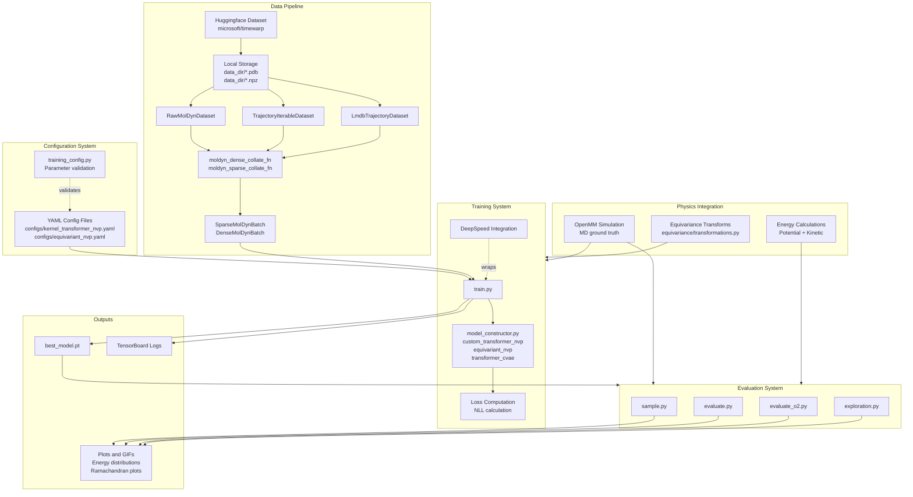
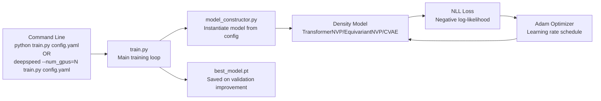
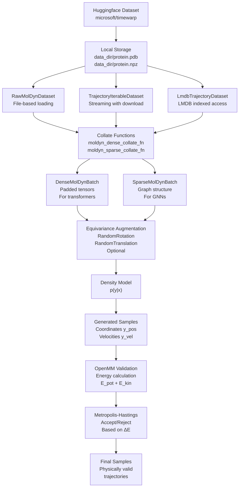

<!-- source: DeepWiki mcp.deepwiki.com · repo microsoft/timewarp · page 1 Overview · fetched 2026-10-26 -->

# Overview

<details>
<summary>Relevant source files</summary>

The following files were used as context for generating this wiki page:

- [LICENSE](LICENSE)
- [README.md](README.md)
- [__init__.py](__init__.py)

</details>


This document introduces the Timewarp project, its purpose for accelerating molecular dynamics (MD) simulations through learned time-coarsened dynamics, and its high-level architecture. For installation and quick start instructions, see [Getting Started](#2). For detailed information about specific subsystems, refer to the table of contents.

## Purpose and Scope

Timewarp is a research codebase that investigates conditional density models for molecular dynamics prediction. The system learns to model the conditional probability distribution **p(y|x)**, where **x** represents the initial state of a molecule (positions and velocities) and **y** represents its future state after a time interval. By learning this distribution, Timewarp can accelerate molecular dynamics simulations by predicting future states without numerically integrating the equations of motion at every timestep.

The codebase provides multiple model architectures (transformer-based normalizing flows, equivariant networks, CVAEs), distributed training infrastructure, and comprehensive evaluation tools that compare learned dynamics against physics-based simulations from OpenMM.

**Sources:** [README.md:1-5]()

## Core Concept

Traditional molecular dynamics simulations require numerical integration with extremely small timesteps (femtoseconds) to maintain stability. Timewarp accelerates this process by learning to predict molecular states at larger time intervals directly from data. The system treats MD acceleration as a conditional density estimation problem:

- **Input (x)**: Current molecular state (3D coordinates, velocities, atom types)
- **Output (y)**: Future molecular state after time interval Δt
- **Model**: Learns p(y|x) using normalizing flows or variational autoencoders
- **Training data**: Molecular dynamics trajectories from physics-based simulations

The learned models can then generate samples from p(y|x) orders of magnitude faster than running traditional MD simulations, while maintaining physical realism through energy-based validation and Metropolis-Hastings sampling.

**Sources:** [README.md:1-5]()

## System Architecture

The Timewarp system consists of six major subsystems that form a complete pipeline from configuration to evaluation:



**Sources:** [README.md:1-132]()

## System Components

### Configuration System

The configuration system defines model architectures and training hyperparameters through YAML files. Each configuration file in [configs/]() specifies a complete experiment setup.

| Component | Purpose | Location |
|-----------|---------|----------|
| YAML configs | Define model architecture, hyperparameters, dataset paths | [configs/*.yaml]() |
| `training_config.py` | Validates and parses configuration parameters | [training_config.py]() |

**Sources:** [README.md:13-22, 85-87]()

### Data Pipeline

The data pipeline loads molecular dynamics trajectories and converts them into model-ready batches. Three dataset implementations support different storage formats:

| Dataset Class | Purpose | Use Case |
|--------------|---------|----------|
| `RawMolDynDataset` | Loads PDB and NPZ files directly | Development, small datasets |
| `TrajectoryIterableDataset` | Streaming access with incremental download | Large datasets, Huggingface integration |
| `LmdbTrajectoryDataset` | Indexed access to preprocessed data | Production training, fast random access |

Data is collated into two batch formats:
- **`SparseMolDynBatch`**: Graph-based representation for GNN models
- **`DenseMolDynBatch`**: Padded tensor representation for transformer models

For detailed information, see [Data Pipeline](#3).

**Sources:** High-level system architecture diagram

### Training System

The training system orchestrates model training with support for single-GPU and multi-GPU execution:



Key training components:
- **[train.py]()**: Main training script with epoch loop, validation, checkpointing
- **DeepSpeed integration**: Data-parallel training across multiple GPUs
- **Model constructors**: Factory functions in [model_constructor.py]() instantiate models from config
- **Loss computation**: Negative log-likelihood for density models

For training details, see [Training](#5). For multi-GPU setup, see [Multi-GPU Training with DeepSpeed](#5.3).

**Sources:** [README.md:11-23, 76-82]()

### Model Architectures

Timewarp provides seven distinct model architectures, all modeling the conditional distribution p(y|x):

| Model | Constructor | Key Feature |
|-------|------------|-------------|
| Transformer NVP | `custom_transformer_nvp_constructor` | Standard self-attention with normalizing flow |
| Kernel Transformer NVP | `custom_transformer_nvp_constructor` | Multi-scale kernel attention |
| Local Transformer NVP | `custom_transformer_nvp_constructor` | Spatially-restricted attention |
| Kernel Chebyshev NVP | `custom_transformer_nvp_constructor` | Chebyshev polynomial kernel approximation |
| Equivariant NVP | `equivariant_nvp_constructor` | SE(3)-equivariant layers |
| Transformer CVAE | `transformer_cvae_constructor` | Conditional VAE with latent space |
| Gaussian Baseline | `gaussian_density_transformer_constructor` | Euler-Maruyama baseline |

Configuration files in [configs/]() specify which model to use via the `model_constructor` parameter. See [Model Architectures](#4) for detailed documentation of each variant.

**Sources:** [README.md:90-94](), High-level system architecture diagram

### Evaluation System

Four specialized evaluation scripts assess different aspects of model performance:

| Script | Purpose | Key Metrics |
|--------|---------|-------------|
| [sample.py]() | General visualization and sampling | Energy distributions, trajectory GIFs |
| [evaluate.py]() | Di-peptide and tetra-peptide evaluation | Ramachandran plots, KS tests, Metropolis-Hastings sampling |
| [evaluate_o2.py]() | Oxygen molecule evaluation | Bond length distributions, energy analysis |
| [exploration.py]() | Long trajectory generation | Energy-based acceptance rates |

All evaluation scripts compare learned model predictions against OpenMM ground truth simulations to validate physical realism. See [Evaluation and Analysis](#7) for usage details.

**Sources:** [README.md:29-74]()

### Physics Integration

Timewarp integrates physics-based validation at multiple levels:

- **OpenMM**: Provides ground truth MD simulations and computes potential/kinetic energies for generated samples
- **Metropolis-Hastings**: Accepts/rejects model proposals based on energy differences to maintain Boltzmann distribution
- **Equivariance transforms**: Applies random rotations, translations, and permutations as data augmentation while preserving physical symmetries

The system ensures that learned models produce physically realistic molecular dynamics even when trained purely on data. See [Equivariance System](#6) for geometric transformation details.

**Sources:** [README.md:51, 63-73]()

## Data Flow Through the System

The following diagram traces the complete data flow from raw files to final predictions:



**Key stages:**

1. **Data Loading**: Raw PDB/NPZ files loaded via one of three dataset classes
2. **Collation**: Individual samples batched into dense or sparse format
3. **Augmentation**: Optional geometric transforms for equivariance
4. **Model Inference**: Generate samples from learned p(y|x)
5. **Physics Validation**: OpenMM computes energies, Metropolis-Hastings filters samples

**Sources:** High-level data flow diagram, [README.md:1-132]()

## Training and Evaluation Workflow

The typical workflow for using Timewarp involves three phases:

### Phase 1: Configuration
Select or create a YAML configuration file in [configs/]() specifying:
- Model architecture (`model_constructor`)
- Dataset paths (`data_dir`, `protein`)
- Training hyperparameters (`learning_rate`, `batch_size`, `num_epochs`)
- Model-specific parameters (attention type, number of layers, embedding dimensions)

See [Training Configuration](#5.1) for all available parameters.

### Phase 2: Training
Execute training with single or multiple GPUs:

```bash
# Single GPU
python train.py configs/kernel_transformer_nvp.yaml

# Multi-GPU with DeepSpeed
deepspeed --num_gpus=4 train.py configs/kernel_transformer_nvp.yaml
```

The system automatically:
- Loads and batches training data
- Trains the model for specified epochs
- Validates on held-out data
- Saves the best model to [outputs/best_model.pt]()
- Logs metrics to TensorBoard

Training typically takes less than 12 hours for small peptides like alanine dipeptide on a single Tesla P100 GPU. See [Training](#5) for detailed instructions.

### Phase 3: Evaluation
Evaluate the trained model using specialized scripts:

```bash
# General sampling and visualization
python sample.py --savefile outputs/best_model.pt --data_dir data/ --protein AD-1

# Peptide evaluation with Metropolis-Hastings
python evaluate.py outputs/best_model.pt --data_dir data/ --num_samples 1000 --mh

# Oxygen molecule evaluation
python evaluate_o2.py --savefile outputs/best_model.pt --data_dir data/

# Long trajectory exploration
python exploration.py outputs/best_model.pt --data_dir data/
```

Evaluation produces:
- Energy distribution plots comparing model vs. OpenMM
- Ramachandran plots for peptide backbone angles
- Bond length and angle distributions
- Kolmogorov-Smirnov test statistics
- Animated GIFs of sampled trajectories

See [Evaluation and Analysis](#7) for complete evaluation documentation.

**Sources:** [README.md:11-74]()

## Project Organization

The repository is organized into several key directories and modules:

```
timewarp/
├── configs/                  # YAML configuration files for different models
├── data_dir/                 # Local storage for molecular dynamics data
├── equivariance/             # Geometric transformation utilities
├── model_constructor.py      # Factory functions for model instantiation
├── training_config.py        # Configuration validation and parsing
├── train.py                  # Main training script
├── sample.py                 # General sampling and visualization
├── evaluate.py               # Peptide evaluation with MH sampling
├── evaluate_o2.py            # Oxygen molecule evaluation
├── exploration.py            # Long trajectory generation
└── outputs/                  # Training outputs (checkpoints, logs, plots)
```

For a detailed breakdown of the directory structure, see [Project Structure](#1.1).

**Sources:** [README.md:1-132]()

## Responsible AI and Limitations

Timewarp is a **research project** with the following scope and limitations:

| Aspect | Details |
|--------|---------|
| **Purpose** | ML and molecular dynamics research only |
| **Supported systems** | Very small peptides (2-4 amino acids), O2 molecules |
| **Limitations** | Does not achieve wall-clock speedup for many peptides; limited to small systems |
| **Evaluation** | Compared against standard MD integration (OpenMM) |
| **Intended use** | Research purposes only, not production applications |

The system is designed for investigating learned time-coarsened dynamics and should not be used for production molecular simulations without extensive validation.

**Sources:** [README.md:96-108]()

## Getting Started

To begin using Timewarp:

1. **Installation**: See [Getting Started](#2) for environment setup and dependencies
2. **Data**: Download datasets from [Huggingface](https://huggingface.co/datasets/microsoft/timewarp) to `data_dir/`
3. **Training**: Run `python train.py configs/kernel_transformer_nvp.yaml` for a quick experiment
4. **Evaluation**: Use `sample.py` to visualize model predictions

For multi-GPU training, distributed sampling strategies, and advanced configuration options, refer to the respective sections in this wiki.

**Sources:** [README.md:7-23]()

## License and Contributing

Timewarp is licensed under the MIT License (see [LICENSE]()). The project welcomes contributions following the Microsoft Contributor License Agreement (CLA) and adheres to the [Microsoft Open Source Code of Conduct](https://opensource.microsoft.com/codeofconduct).

For contribution guidelines, see [Contributing and Community](#1.2). For information about the continuous integration pipeline, see [Continuous Integration](#1.3).

**Sources:** [README.md:111-131](), [LICENSE:1-22]()

---

