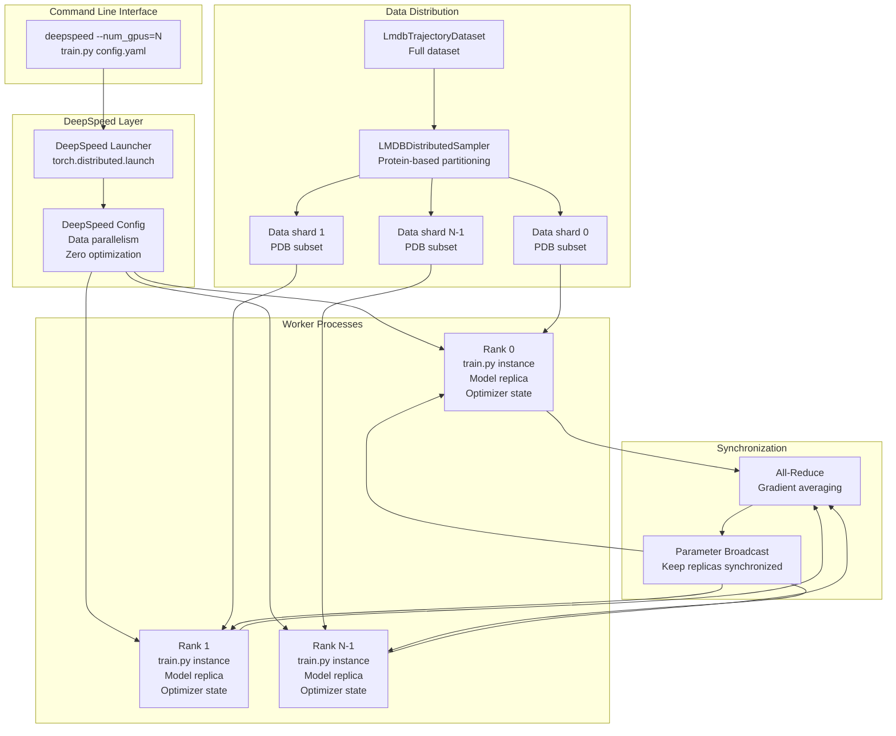
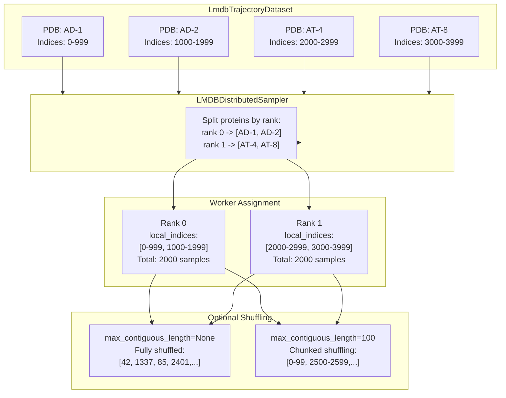
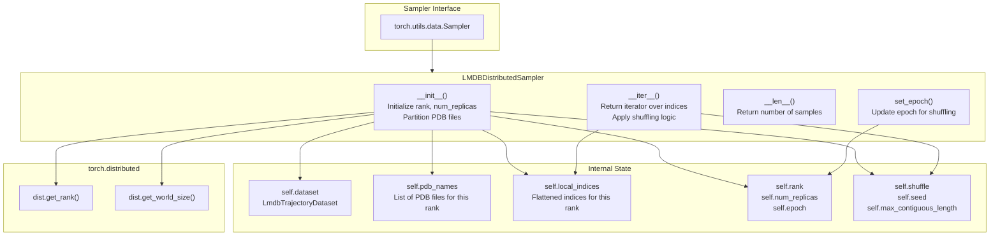
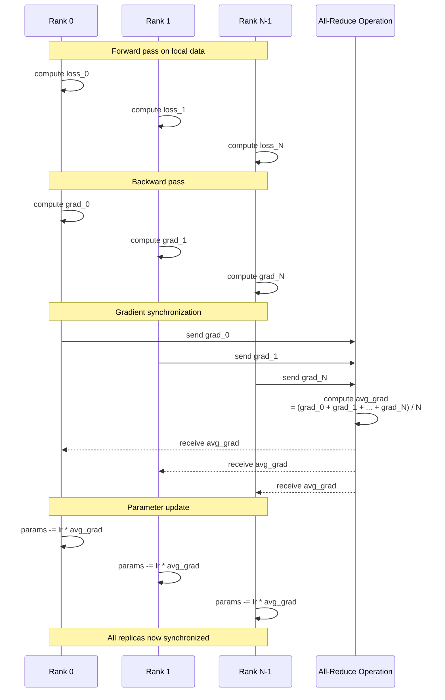

<!-- source: DeepWiki mcp.deepwiki.com · repo microsoft/timewarp · page 5.3 Multi-GPU Training with DeepSpeed · fetched 2026-10-26 -->

# Multi-GPU Training with DeepSpeed

<details>
<summary>Relevant source files</summary>

The following files were used as context for generating this wiki page:

- [README.md](README.md)
- [datasets/pdb_sampler.py](datasets/pdb_sampler.py)

</details>


This page documents how to use DeepSpeed for distributed, multi-GPU training in Timewarp. It covers the command-line interface, data parallelism strategy, batch size scaling considerations, and the protein-based data partitioning mechanism.

For general training configuration options, see [Training Configuration](#5.1). For single-GPU training, see [Single-GPU Training](#5.2).

## Overview

Timewarp uses [DeepSpeed](https://www.deepspeed.ai) to enable data-parallel training across multiple GPUs. The system maintains a full replica of the model on each GPU and partitions the dataset across workers. Gradients are synchronized using all-reduce operations after each backward pass, ensuring all model replicas remain identical.

The implementation uses **data parallelism** (not model parallelism), meaning each GPU processes a different subset of the data while running the complete model. This approach is well-suited for Timewarp's model architectures, which typically fit comfortably on a single GPU.

**Sources:** [README.md:76-82]()

## DeepSpeed Architecture

The following diagram shows how DeepSpeed orchestrates multi-GPU training in Timewarp:



**Sources:** [README.md:76-82](), [datasets/pdb_sampler.py:19-217]()

## Running Multi-GPU Training

To launch multi-GPU training, use the `deepspeed` command instead of `python`:

```bash
deepspeed --num_gpus=2 train.py configs/kernel_transformer_nvp.yaml
```

This command spawns 2 training processes, one for each GPU. Each process runs the complete `train.py` script but operates on a different data partition.

### Command-Line Syntax

| Component | Description |
|-----------|-------------|
| `deepspeed` | DeepSpeed launcher executable |
| `--num_gpus=N` | Number of GPUs to use for training |
| `train.py` | Main training script |
| `config.yaml` | Configuration file with model/training parameters |
| Additional args | Any additional arguments are passed to `train.py` |

### Example Commands

**2 GPUs:**
```bash
deepspeed --num_gpus=2 train.py configs/kernel_transformer_nvp.yaml
```

**4 GPUs with config override:**
```bash
deepspeed --num_gpus=4 train.py configs/kernel_transformer_nvp.yaml batch_size=512
```

**8 GPUs:**
```bash
deepspeed --num_gpus=8 train.py configs/equivariant_nvp.yaml
```

**Sources:** [README.md:76-82]()

## Data Parallelism Strategy

Timewarp implements **protein-based data partitioning** rather than simple index-based partitioning. This strategy groups all trajectory frames from the same PDB file onto the same GPU worker.

### Why Protein-Based Partitioning?

Standard distributed samplers partition data by indices, which can result in different frames from the same protein being processed on different GPUs. Protein-based partitioning offers several advantages:

1. **Memory Efficiency**: All frames for a protein share molecular topology (atom types, bonds, angles). Loading topology once per protein per GPU reduces memory overhead.

2. **Computational Efficiency**: Some computations can be cached per-protein rather than recomputed for each frame.

3. **Load Balancing**: By partitioning at the protein level, the system avoids splitting large proteins across multiple workers.

### Data Flow with Distributed Sampler



**Sources:** [datasets/pdb_sampler.py:19-70]()

## Batch Size Scaling

One of the most critical considerations for multi-GPU training is batch size scaling. The `batch_size` parameter in the configuration file specifies the **total batch size across all GPUs**, not the per-GPU batch size.

### Batch Size Calculation

The effective batch size per GPU is:

```
batch_size_per_gpu = batch_size / num_gpus
```

The total effective batch size remains constant regardless of the number of GPUs.

### Scaling Guidelines

To maintain constant GPU utilization when increasing the number of GPUs, you must scale the `batch_size` parameter proportionally:

| Number of GPUs | Original batch_size | Scaled batch_size |
|----------------|---------------------|-------------------|
| 1 | 128 | 128 |
| 2 | 128 | 256 |
| 4 | 128 | 512 |
| 8 | 128 | 1024 |

### Example Scenario

**Single-GPU baseline:**
```bash
python train.py configs/kernel_transformer_nvp.yaml batch_size=128
# Effective: 128 samples per GPU
```

**4-GPU training with equivalent per-GPU batch size:**
```bash
deepspeed --num_gpus=4 train.py configs/kernel_transformer_nvp.yaml batch_size=512
# Effective: 512 / 4 = 128 samples per GPU
```

### Important Considerations

1. **Memory Constraints**: Ensure the per-GPU batch size does not exceed GPU memory capacity.

2. **Training Dynamics**: Larger effective batch sizes may require learning rate adjustments. Some practitioners use the linear scaling rule: `learning_rate_new = learning_rate_base * (batch_size_new / batch_size_base)`.

3. **Gradient Accumulation**: If GPU memory is limited, consider using gradient accumulation to simulate larger batch sizes without increasing memory requirements.

**Sources:** [README.md:82]()

## LMDBDistributedSampler

The `LMDBDistributedSampler` class implements protein-based data partitioning for distributed training. It extends PyTorch's `Sampler` interface with specialized logic for LMDB trajectory datasets.

### Class Structure



**Sources:** [datasets/pdb_sampler.py:19-217]()

### Initialization Parameters

| Parameter | Type | Default | Description |
|-----------|------|---------|-------------|
| `dataset` | `LmdbTrajectoryDataset` | Required | Dataset to sample from |
| `num_replicas` | `Optional[int]` | `None` | Number of GPUs; auto-detected if None |
| `rank` | `Optional[int]` | `None` | Current GPU rank; auto-detected if None |
| `shuffle` | `bool` | `True` | Whether to shuffle data |
| `seed` | `int` | `0` | Random seed for shuffling |
| `drop_last` | `bool` | `False` | Whether to drop incomplete batches |
| `max_contiguous_length` | `Optional[int]` | `None` | Maximum contiguous samples per protein |

**Sources:** [datasets/pdb_sampler.py:71-80]()

### Protein Partitioning Logic

The sampler partitions proteins across ranks using a round-robin strategy:

```
rank 0: proteins[0], proteins[num_replicas], proteins[2*num_replicas], ...
rank 1: proteins[1], proteins[num_replicas+1], proteins[2*num_replicas+1], ...
...
rank k: proteins[k], proteins[num_replicas+k], proteins[2*num_replicas+k], ...
```

Implementation at [datasets/pdb_sampler.py:103-126]():
- Sorts PDB names for consistency across ranks
- Calculates number of proteins per rank using `math.ceil()`
- Handles `drop_last` logic for even division
- Extracts protein subset using slice notation: `pdb_names[rank::num_replicas]`

### Shuffling Behavior

The sampler supports two shuffling modes controlled by the `max_contiguous_length` parameter:

#### Mode 1: Full Shuffling (`max_contiguous_length=None`)

All indices are flattened and shuffled randomly:

```python
indices = [local_indices[i] for i in torch.randperm(len(local_indices))]
```

This produces maximum diversity: consecutive samples likely come from different proteins.

#### Mode 2: Chunked Shuffling (`max_contiguous_length=N`)

Process:
1. Shuffle examples within each protein
2. Split per-protein indices into chunks of length `max_contiguous_length`
3. Shuffle the chunks
4. Flatten the shuffled chunks

Implementation at [datasets/pdb_sampler.py:162-190]()

This produces controlled diversity: consecutive samples may come from the same protein (up to `max_contiguous_length` samples), but chunk order is randomized.

**Use case:** When certain computations can be cached per-protein, chunked shuffling improves computational efficiency by reducing cache misses.

**Sources:** [datasets/pdb_sampler.py:149-203]()

### Epoch Management

For proper shuffling across epochs, the `set_epoch()` method must be called before creating the DataLoader iterator:

```python
sampler.set_epoch(epoch)
dataloader = DataLoader(dataset, sampler=sampler, ...)
```

The epoch value is combined with the seed to generate different random orderings:

```python
g = torch.Generator()
g.manual_seed(self.seed + self.epoch)
```

**Important:** Forgetting to call `set_epoch()` will result in identical data ordering across all epochs.

**Sources:** [datasets/pdb_sampler.py:208-217]()

### Diagnostic Output

During initialization, the sampler prints diagnostic information:

```
LMDBDistributedSampler: rank=0 largest molecule=22 pdb_names=['AD-1', 'AD-2']
LMDBDistributedSampler: rank=1 largest molecule=66 pdb_names=['AT-4', 'AT-8']
```

This output helps verify:
- Correct protein assignment to each rank
- Load balancing (number of atoms per rank)
- Dataset partitioning

**Sources:** [datasets/pdb_sampler.py:131-133]()

## Gradient Synchronization

DeepSpeed handles gradient synchronization automatically using collective communication operations from `torch.distributed`.

### Synchronization Flow



### Key Points

1. **All-Reduce**: DeepSpeed uses efficient all-reduce operations (typically ring all-reduce) to average gradients across all GPUs.

2. **Automatic Synchronization**: The synchronization happens automatically after `.backward()` is called. No explicit synchronization code is needed in `train.py`.

3. **Gradient Scaling**: Gradients are automatically scaled by `1 / num_gpus` during the all-reduce operation.

4. **Communication Overhead**: Synchronization adds communication overhead proportional to model size and inversely proportional to network bandwidth. This overhead is typically small compared to computation time.

**Sources:** [README.md:76-82]()

## Best Practices

### 1. Batch Size Scaling

Always scale `batch_size` proportionally when increasing the number of GPUs:

```bash
# 1 GPU baseline
python train.py config.yaml batch_size=128

# 4 GPU equivalent
deepspeed --num_gpus=4 train.py config.yaml batch_size=512
```

### 2. Learning Rate Adjustment

Consider adjusting learning rate when scaling batch size. A common heuristic is linear scaling:

```
learning_rate_new = learning_rate_base * (num_gpus)
```

However, this is dataset and model dependent. Monitor training curves carefully.

### 3. Set Epoch for Shuffling

Always call `sampler.set_epoch(epoch)` before each epoch to ensure proper shuffling:

```python
for epoch in range(num_epochs):
    sampler.set_epoch(epoch)
    for batch in dataloader:
        # training logic
```

### 4. Monitor GPU Utilization

Use `nvidia-smi` or similar tools to verify all GPUs are being utilized:

```bash
watch -n 1 nvidia-smi
```

All GPUs should show similar memory usage and utilization percentages.

### 5. Check Data Distribution

Review the diagnostic output from `LMDBDistributedSampler` to verify:
- Proteins are evenly distributed across ranks
- No single rank has disproportionately large molecules
- Expected protein assignment

### 6. Validate Checkpoint Saving

Only rank 0 typically saves checkpoints. Ensure the checkpoint saving logic in `train.py` uses rank-aware conditions:

```python
if dist.get_rank() == 0:
    torch.save(model.state_dict(), 'checkpoint.pt')
```

### 7. Use max_contiguous_length for Large Datasets

For datasets with many proteins, consider setting `max_contiguous_length` to improve cache efficiency:

```python
sampler = LMDBDistributedSampler(
    dataset,
    max_contiguous_length=100  # Process up to 100 frames from same protein consecutively
)
```

**Sources:** [README.md:76-82](), [datasets/pdb_sampler.py:60-62]()

## Common Issues and Solutions

### Issue 1: Out of Memory Errors

**Symptom:** Training crashes with CUDA out of memory error after switching to multi-GPU.

**Cause:** Forgot to scale `batch_size` parameter.

**Solution:** Multiply `batch_size` by `num_gpus`.

### Issue 2: Same Data Every Epoch

**Symptom:** Training loss does not improve after first epoch; validation metrics are constant.

**Cause:** Not calling `sampler.set_epoch(epoch)`.

**Solution:** Call `set_epoch()` before each epoch's DataLoader iteration.

### Issue 3: Imbalanced GPU Utilization

**Symptom:** Some GPUs show higher utilization than others.

**Cause:** Uneven protein size distribution across ranks.

**Solution:** Check diagnostic output from `LMDBDistributedSampler`. Consider rebalancing protein assignments or using dynamic batch sizing.

### Issue 4: Training Slower with More GPUs

**Symptom:** 4-GPU training is slower than 2-GPU training.

**Cause:** Batch size per GPU too small, leading to communication overhead dominating computation.

**Solution:** Increase `batch_size` to ensure each GPU has sufficient work. Use gradient accumulation if memory constrained.

**Sources:** [README.md:76-82](), [datasets/pdb_sampler.py:19-217]()

---

