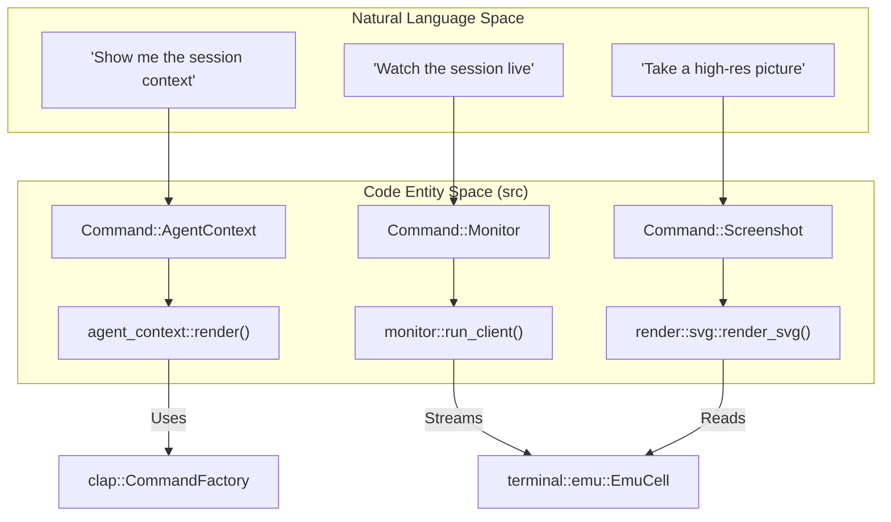
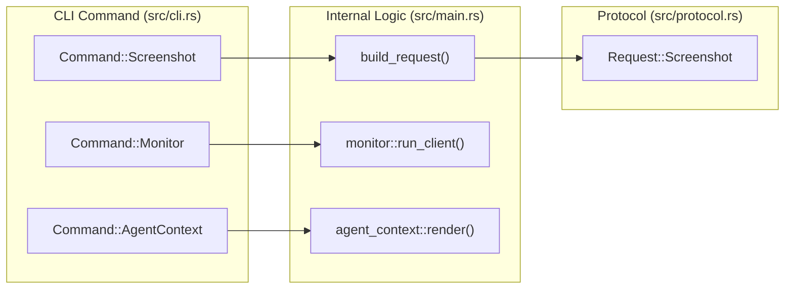

<!-- source: DeepWiki mcp.deepwiki.com · repo microsoft/tui-test · page 2.5 Observability Commands · fetched 2026-10-26 -->

# Observability Commands

Relevant source files

The following files were used as context for generating this wiki page:

- [src/agent_context.rs](src/agent_context.rs)
- [src/cli.rs](src/cli.rs)
- [src/main.rs](src/main.rs)
- [src/monitor.rs](src/monitor.rs)
- [src/render/mod.rs](src/render/mod.rs)
- [src/render/svg.rs](src/render/svg.rs)

Observability commands in `shell-use` provide mechanisms for inspecting, monitoring, and documenting the state of headless terminal sessions. These commands cater to both human operators (via live monitoring and SVG screenshots) and automated agents (via machine-readable context and usage manifests).

### Visual Monitoring and Capture

`shell-use` supports high-fidelity visual observability through live streaming and vector-based screenshots.

#### Monitor (Live View)
The `monitor` command allows a human to watch an agent's session in real-time. The implementation uses a client-server frame streaming model [src/monitor.rs:1-7]().

*   **Implementation**: The daemon renders the current terminal grid into a framed ANSI representation using `render_frame` [src/monitor.rs:33-56]().
*   **Data Flow**: Frames are streamed at approximately 20fps over the session socket [src/monitor.rs:4-7](). The client takes over an alternate screen in raw mode to display these frames [src/monitor.rs:228-230]().
*   **UI Elements**: The monitor includes a border [src/monitor.rs:132-151](), session metadata (shell type, dimensions, status) [src/monitor.rs:58-71](), and a placeholder for inactive sessions [src/monitor.rs:109-130]().

#### Screenshot (SVG Output)
The `screenshot` command can produce either plain text or a full-color SVG image [src/cli.rs:89-98]().

*   **SVG Rendering**: The `render_svg` function [src/render/svg.rs:154-222]() generates a standalone SVG document styled after `svg-term-cli`, featuring macOS-style window controls and a rounded panel [src/render/svg.rs:1-3]().
*   **Visual Fidelity**: It preserves colors, bold/italic/underline styles, and inverse video [src/render/svg.rs:4-6](). It uses `textLength` to ensure precise column alignment regardless of the viewer's monospace font metrics [src/render/svg.rs:7-8]().
*   **Implementation**: Styles are resolved via a `Theme` [src/render/svg.rs:24-55]() which maps terminal colors to RGB hex values [src/render/svg.rs:58-72]().

**Observability Data Flow**

| Command | Source Entity | Output Format | Primary Use Case |
| :--- | :--- | :--- | :--- |
| `monitor` | `monitor::run_client` | ANSI Stream | Real-time human oversight of agent actions. |
| `screenshot` | `render::svg::render_svg` | SVG (Vector) | High-quality documentation and debugging. |
| `get-recording` | `recorder::Recorder` | asciinema v2 (.cast) | Session replay and GIF generation. |

**Sources:** [src/monitor.rs:1-151](), [src/render/svg.rs:1-222](), [src/cli.rs:89-98](), [src/cli.rs:180-188]().

### Session Recording Retrieval

Every `shell-use` session is recorded by default in the asciinema v2 format.

*   **Command**: `get-recording` [src/cli.rs:180-183]().
*   **Function**: It retrieves the `.cast` file associated with a session [src/main.rs:55]().
*   **Workflow**: Users can redirect this output to a file for use with `asciinema play` or `agg` for GIF generation [src/cli.rs:178-179]().

**Sources:** [src/main.rs:55](), [src/cli.rs:176-183]().

### Agent Self-Documentation

To facilitate integration with Large Language Models (LLMs) and autonomous agents, `shell-use` provides commands that describe its own interface and capabilities.

#### Agent Context
The `agent-context` command generates a comprehensive JSON description of the CLI surface [src/agent_context.rs:1-3]().

*   **Implementation**: It uses the `clap` command model to reflectively build the documentation, ensuring the schema never drifts from the implementation [src/agent_context.rs:13-15]().
*   **Content**: The output includes the `schema_version`, global flags, subcommands, arguments (including types and defaults), and the stable exit-code taxonomy [src/agent_context.rs:23-31]().
*   **Exit Codes**: Explicitly documents codes 0 through 5, mapping them to specific failure states like "assertion failure" (1) or "session missing" (3) [src/agent_context.rs:36-45]().

#### Skill and Usage
*   **`skill`**: Prints the contents of `SKILL.md` [src/main.rs:51-54](), which serves as a long-form manifest for agent capabilities [src/main.rs:24]().
*   **`usage`**: Prints a compact command cheatsheet [src/cli.rs:189-190]().

**CLI to Code Entity Mapping**

**Sources:** [src/agent_context.rs:1-139](), [src/main.rs:43-54](), [src/cli.rs:189-197]().

### Command Implementation Detail

The mapping from CLI commands to internal protocol requests is handled in `main.rs`.

**Protocol Mapping Diagram**

**Sources:** [src/main.rs:35-62](), [src/main.rs:131-134](), [src/cli.rs:26-201]().

---

