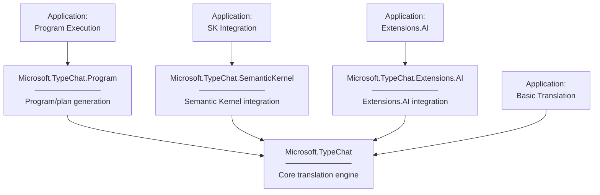
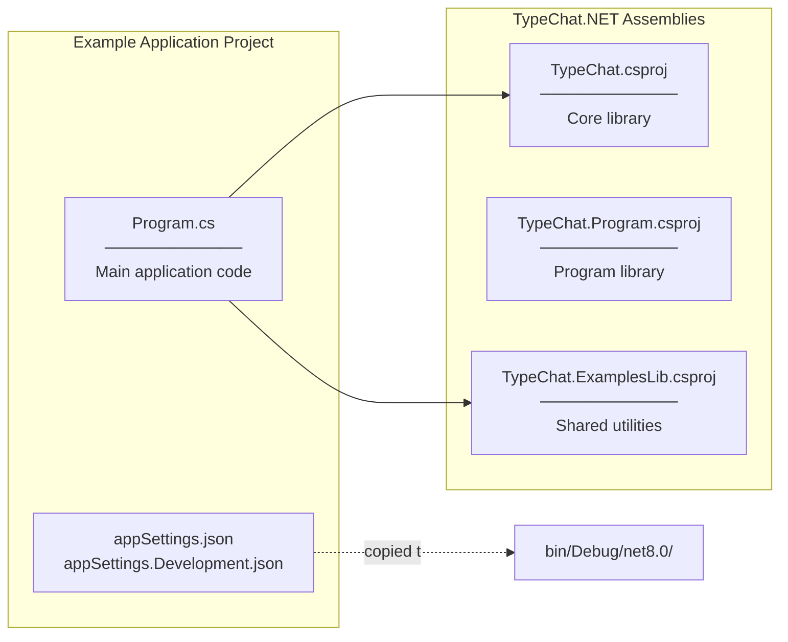
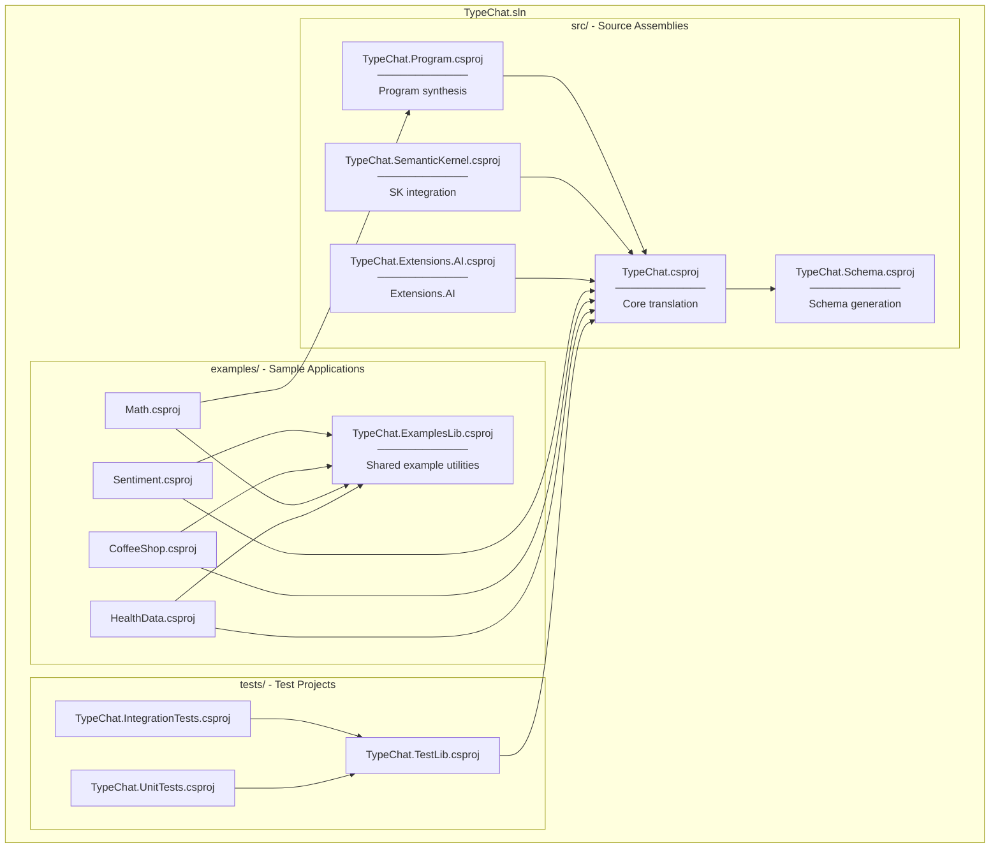
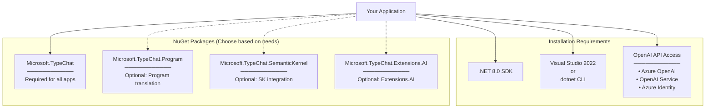

<!-- source: DeepWiki mcp.deepwiki.com · repo microsoft/typechat.net · page 2.1 Installation · fetched 2026-10-26 -->

# Installation

<details>
<summary>Relevant source files</summary>

The following files were used as context for generating this wiki page:

- [README.md](README.md)
- [TypeChat.sln](TypeChat.sln)
- [examples/CoffeeShop/CoffeeShop.csproj](examples/CoffeeShop/CoffeeShop.csproj)
- [examples/CoffeeShop2/CoffeeShop2.csproj](examples/CoffeeShop2/CoffeeShop2.csproj)
- [examples/Math/Math.csproj](examples/Math/Math.csproj)
- [examples/Sentiment/Program.cs](examples/Sentiment/Program.cs)
- [examples/Sentiment/Sentiment.csproj](examples/Sentiment/Sentiment.csproj)
- [examples/appSettings.json](examples/appSettings.json)

</details>


This document covers the installation of TypeChat.NET packages and setup of required dependencies. For information about configuring OpenAI credentials after installation, see [Configuration](#2.2). For a step-by-step tutorial on building your first application, see [Your First Translation](#2.3).

## Prerequisites

### .NET SDK

TypeChat.NET requires:
- **.NET 8.0 SDK** or later
- The framework target is `net8.0` as shown in [examples/Sentiment/Sentiment.csproj:5]()

All example projects specify `<RollForward>LatestMajor</RollForward>`, allowing the framework to roll forward to newer major versions if the target version is unavailable.

### OpenAI Language Model Access

TypeChat.NET requires access to OpenAI language models. Supported options:

| Service | Models Supported |
|---------|-----------------|
| **Azure OpenAI** | gpt-35-turbo, gpt-4 |
| **OpenAI** | gpt-3.5-turbo, gpt-4 |
| **Embedding Models** | ada-002 (text-embedding-ada-002) |

**Note**: Some examples and advanced scenarios work best with `gpt-4`. Basic translation examples function with `gpt-35-turbo`.

### Development Environment

Recommended development tools:
- **Visual Studio 2022** (for solution development)
- **dotnet CLI** (for command-line builds)
- Any IDE with .NET 8.0 support

**Sources**: [README.md:79-96](), [examples/Sentiment/Sentiment.csproj:5]()

## Package Installation

### NuGet Package Overview

TypeChat.NET consists of three main packages:



**Package Dependency Architecture**

### Installing Microsoft.TypeChat

The core package provides `JsonTranslator<T>`, schema generation, validation, and repair functionality.

```bash
dotnet add package Microsoft.TypeChat
```

**NuGet Package**: [](https://www.nuget.org/packages/Microsoft.TypeChat)

This package is required for all TypeChat.NET applications.

### Installing Microsoft.TypeChat.Program

The program package adds the ability to translate natural language into executable programs.

```bash
dotnet add package Microsoft.TypeChat.Program
```

**NuGet Package**: [](https://www.nuget.org/packages/Microsoft.TypeChat.Program)

This package automatically includes `Microsoft.TypeChat` as a dependency.

### Installing Microsoft.TypeChat.SemanticKernel

The Semantic Kernel integration package provides interoperability with Microsoft Semantic Kernel 1.0.

```bash
dotnet add package Microsoft.TypeChat.SemanticKernel
```

**NuGet Package**: [](https://www.nuget.org/packages/Microsoft.TypeChat.SemanticKernel)

This package enables using Semantic Kernel's `IChatCompletionService`, plugin programs, and embedding models with TypeChat.

### Installing Microsoft.TypeChat.Extensions.AI

The Extensions.AI integration package provides support for the standard `Microsoft.Extensions.AI` abstractions.

```bash
dotnet add package Microsoft.TypeChat.Extensions.AI
```

This package enables using `IChatClient` and `IEmbeddingGenerator` with TypeChat and supports multiple AI providers beyond OpenAI.

**Sources**: [README.md:19-27](), [README.md:98-113]()

## Project Configuration

### Basic Project Setup

A minimal TypeChat.NET project requires these `.csproj` settings:

```xml
<PropertyGroup>
  <TargetFramework>net8.0</TargetFramework>
  <LangVersion>latest</LangVersion>
  <RollForward>LatestMajor</RollForward>
  <ImplicitUsings>enable</ImplicitUsings>
  <Nullable>annotations</Nullable>
</PropertyGroup>
```

### Configuration Files

TypeChat examples use configuration files for OpenAI settings. These files must be copied to the output directory:

```xml
<ItemGroup>
  <Content Include="appSettings.json">
    <CopyToOutputDirectory>Always</CopyToOutputDirectory>
  </Content>
</ItemGroup>

<ItemGroup Condition="Exists('appSettings.Development.json')">
  <Content Include="appSettings.Development.json">
    <CopyToOutputDirectory>Always</CopyToOutputDirectory>
  </Content>
</ItemGroup>
```

The `appSettings.Development.json` file is environment-specific and should not be checked into source control. The conditional inclusion prevents build errors when this file is absent.

### Example Project Reference Structure



**Project Reference Flow in Example Applications**

**Sources**: [examples/Sentiment/Sentiment.csproj:1-36](), [examples/CoffeeShop/CoffeeShop.csproj:13-23](), [examples/Math/Math.csproj:13-23]()

## Building from Source

### Building with Visual Studio 2022

1. Open [TypeChat.sln]() from the repository root directory
2. Restore NuGet packages: **Build → Restore NuGet Packages**
3. Build the solution: **Build → Build Solution** (or press `Ctrl+Shift+B`)

### Building with dotnet CLI

From the repository root directory:

```bash
# Navigate to repository root
cd typechat.net

# Restore packages and build
dotnet build TypeChat.sln
```

This builds all projects in the solution including:
- Core libraries: `TypeChat`, `TypeChat.Program`, `TypeChat.SemanticKernel`, `TypeChat.Schema`, `TypeChat.Extensions.AI`
- Example applications: `Sentiment`, `CoffeeShop`, `Math`, `Calendar`, etc.
- Test projects: `TypeChat.IntegrationTests`, `TypeChat.UnitTests`, `TypeChat.TestLib`

### Solution Structure



**Solution Organization and Dependencies**

**Sources**: [README.md:87-96](), [TypeChat.sln:1-172]()

## Verification

### Verify Installation

To verify TypeChat.NET is correctly installed, create a minimal application:

```csharp
using Microsoft.TypeChat;

// Create a translator (requires valid OpenAI configuration)
var config = OpenAIConfig.FromEnvironment();
var model = new LanguageModel(config);
var translator = new JsonTranslator<SentimentResponse>(model);

// Basic type for translation
public class SentimentResponse
{
    public string Sentiment { get; set; }
}
```

This code demonstrates:
- The `Microsoft.TypeChat` namespace is accessible
- The `JsonTranslator<T>`, `LanguageModel`, and `OpenAIConfig` classes are available
- Configuration can be loaded (see [Configuration](#2.2) for setup details)

### Build Output Location

Built assemblies are placed in:
```
{ProjectDirectory}/bin/{Configuration}/{TargetFramework}/
```

For example:
```
examples/Sentiment/bin/Debug/net8.0/Sentiment.dll
src/typechat/bin/Debug/net8.0/Microsoft.TypeChat.dll
```

Configuration files from the project's `ItemGroup` sections are copied to the output directory during build.

**Sources**: [examples/Sentiment/Program.cs:1-43](), [examples/Sentiment/Sentiment.csproj:13-22]()

## Dependencies and Versions

### External Package Dependencies

TypeChat.NET depends on the following external packages:

| Package | Version | Purpose |
|---------|---------|---------|
| `Microsoft.SemanticKernel` | v1.67.1 | Semantic Kernel integration |
| `Microsoft.Extensions.AI` | v9.10.2 | Standard AI abstractions |
| `Microsoft.CodeAnalysis.CSharp` | v5.0.0 | Program compilation (DLR) |
| `Azure.Identity` | Latest | Azure credential support |
| `Azure.AI.OpenAI` | Latest | Azure OpenAI client |

### Framework Requirements Summary



**Complete Installation Requirements**

**Sources**: [README.md:79-85](), [TypeChat.sln:6](), [src/typechat.sk/TypeChat.SemanticKernel.csproj](), [src/typechat.meai/TypeChat.Extensions.AI.csproj]()

## Next Steps

After installing TypeChat.NET:

1. **Configure OpenAI credentials**: See [Configuration](#2.2) for setting up API keys and endpoints
2. **Build your first translator**: Follow [Your First Translation](#2.3) for a step-by-step tutorial
3. **Explore examples**: Run the example applications in the [examples](https://github.com/microsoft/typechat.net/tree/main/examples) directory
4. **Learn core concepts**: Review [JsonTranslator](#3.1) and [Schema Generation](#3.2) for deeper understanding

**Sources**: [README.md:77-147]()

---

