# Page: Overview

# Overview

<details>
<summary>Relevant source files</summary>

The following files were used as context for generating this wiki page:

- [README.md](README.md)
- [TypeChat.sln](TypeChat.sln)
- [examples/CoffeeShop/CoffeeShop.csproj](examples/CoffeeShop/CoffeeShop.csproj)
- [examples/CoffeeShop2/CoffeeShop2.csproj](examples/CoffeeShop2/CoffeeShop2.csproj)
- [examples/Math/Math.csproj](examples/Math/Math.csproj)
- [examples/Sentiment/Program.cs](examples/Sentiment/Program.cs)
- [examples/Sentiment/Sentiment.csproj](examples/Sentiment/Sentiment.csproj)
- [examples/appSettings.json](examples/appSettings.json)

</details>


This document provides a high-level introduction to TypeChat.NET, explaining what it is, its core purpose, and the key capabilities it provides. It describes the main assemblies, fundamental translation workflow, and primary use cases.

For detailed information about getting started with your first application, see [Getting Started](#2). For architectural details about layers and component interactions, see [Architecture Overview](#1.2). For in-depth coverage of core concepts, see [Core Concepts](#3).

**Sources:** [README.md:1-17]()

## What is TypeChat.NET

TypeChat.NET is a cross-platform .NET library that enables building natural language interfaces using large language models (LLMs) with strong types, type validation, and type-safe programs. It brings the concepts from the TypeChat project to the .NET ecosystem.

The library's primary goal is to make language model outputs more deterministic and reliable by constraining them to strongly-typed schemas. Instead of receiving free-form text responses from LLMs, applications receive validated, deserialized C# objects that conform to defined types.

**Sources:** [README.md:5-7]()

## Core Translation Workflow

TypeChat.NET operates through a structured translation pipeline that converts natural language into typed objects:

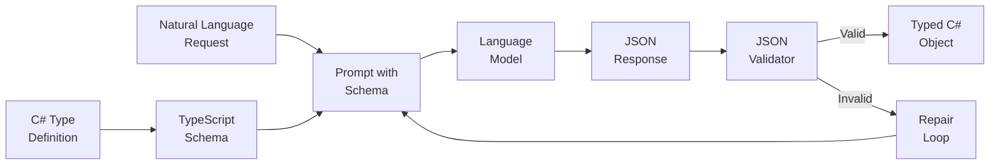

**TypeChat.NET Translation Pipeline**

The translation process follows these steps:

1. **Schema Generation**: C# types are automatically exported to TypeScript schema format
2. **Prompt Construction**: User input is combined with the schema and instructions
3. **LLM Request**: The prompt is sent to a language model (e.g., GPT-3.5, GPT-4)
4. **JSON Parsing**: The model's text response is parsed as JSON
5. **Validation**: The JSON is validated against the schema
6. **Repair Loop**: If validation fails, errors are sent back to the model for correction
7. **Deserialization**: Valid JSON is deserialized into the target C# type

**Sources:** [README.md:8-15](), [README.md:29-37]()

## Primary Assemblies

TypeChat.NET consists of three main NuGet packages, each serving distinct purposes:

| Assembly | Purpose | Key Types |
|----------|---------|-----------|
| **Microsoft.TypeChat** | Core JSON translation, validation, and schema generation | `JsonTranslator<T>`, `LanguageModel`, `TypeScriptExporter` |
| **Microsoft.TypeChat.Program** | Natural language to executable code translation | `ProgramTranslator<T>`, `ProgramCompiler`, `ProgramInterpreter` |
| **Microsoft.TypeChat.SemanticKernel** | Integration with Semantic Kernel for plugins and models | `KernelEx`, `ChatLanguageModel`, plugin programs |

**Sources:** [README.md:19-27](), [README.md:69-74]()

### Microsoft.TypeChat

The core assembly provides JSON translation capabilities. It converts natural language into JSON that conforms to a schema, validates the result, and repairs invalid outputs by sending validation errors back to the language model.

Key features:
- JSON translation, validation, repair, and deserialization via `JsonTranslator<T>`
- Schema export to TypeScript format from .NET types
- Support for vocabularies using `[JsonVocab]` attribute to constrain string values
- Support for polymorphic types using `[JsonPolymorphic]` attribute
- Extensibility through interfaces: `ILanguageModel`, `IJsonTypeValidator`, `IJsonTranslatorPrompts`

**Sources:** [README.md:28-45]()

### Microsoft.TypeChat.Program

This assembly extends TypeChat to translate natural language into executable programs represented as JSON. Programs are type-checked against target APIs and can be compiled or interpreted.

Key features:
- `ProgramTranslator<TApi>` translates natural language to JSON programs
- Programs follow a defined grammar in [src/typechat.program/ProgramSchema.ts]()
- `ProgramCompiler` uses .NET's Dynamic Language Runtime (DLR) to compile programs with type checking
- `ProgramInterpreter` provides runtime execution without compilation
- Compilation diagnostics feed back to the LLM for program repair

**Sources:** [README.md:47-67]()

### Microsoft.TypeChat.SemanticKernel

This assembly provides integration with Microsoft Semantic Kernel 1.0, enabling TypeChat to work with Semantic Kernel's plugin system and AI services.

Key features:
- Extension methods for creating kernels with chat and embedding models
- Model adapters: `ChatLanguageModel`, `TextCompletionModel`, `TextEmbeddingModel`
- Support for translating natural language into Semantic Kernel plugin invocations
- Access to language models and embeddings through Semantic Kernel services

**Sources:** [README.md:69-75]()

## Key Components and Code Entities

The following diagram maps high-level concepts to the primary code entities in TypeChat.NET:

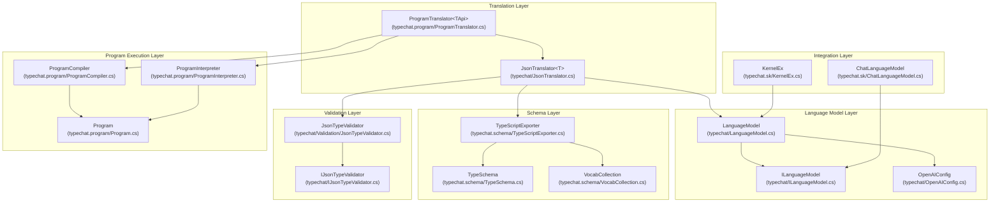

**TypeChat.NET Component Architecture**

**Sources:** [README.md:19-75]()

## Translation Example

A minimal TypeChat.NET application translating natural language to a typed object:

```csharp
// Schema definition
public class SentimentResponse
{
    public string Sentiment { get; set; }
    public string Reason { get; set; }
}

// Translation setup
var model = new LanguageModel(Config.LoadOpenAI());
var translator = new JsonTranslator<SentimentResponse>(model);

// Translate natural language to typed object
SentimentResponse response = await translator.TranslateAsync("I love this product!");
Console.WriteLine($"Sentiment: {response.Sentiment}");
```

This example demonstrates:
- Defining a target type (`SentimentResponse`) that represents the desired output structure
- Creating a `JsonTranslator<T>` with a `LanguageModel` configured via `OpenAIConfig`
- Calling `TranslateAsync` to convert natural language into a strongly-typed object
- Accessing the result as a typed C# object with IntelliSense and compile-time safety

**Sources:** [README.md:8-15](), [examples/Sentiment/Program.cs:1-43]()

## Program Translation Example

TypeChat.Program enables translating natural language into executable code:

```csharp
// API definition
public interface IMathAPI
{
    double Add(double x, double y);
    double Multiply(double x, double y);
}

// Translation and execution
var api = new MathAPI();
var translator = new ProgramTranslator<IMathAPI>(model, api);

// Translate "add 2 and 3, then multiply by 5"
Program program = await translator.TranslateAsync(requestText);

// Execute the generated program
object result = program.Run(api);
```

This demonstrates:
- Defining a target API interface that programs can call
- Using `ProgramTranslator<TApi>` to generate JSON programs
- Executing programs via the `Run` method against the API implementation
- Type-safe program generation and execution

**Sources:** [README.md:57-67]()

## Primary Use Cases

TypeChat.NET supports several categories of applications:

| Use Case | Description | Example |
|----------|-------------|---------|
| **Structured Data Extraction** | Convert natural language to typed data objects | Sentiment analysis, form filling |
| **Command Translation** | Transform requests into action objects | Calendar operations, order processing |
| **Code Generation** | Generate executable programs from natural language | Math calculators, API orchestration |
| **Conversational Agents** | Build multi-turn dialogs with history | Health data collection, interactive assistants |
| **Request Routing** | Classify and route inputs to appropriate handlers | Multi-schema apps, hierarchical routing |

**Sources:** [README.md:123-146]()

## Configuration

TypeChat.NET requires access to OpenAI or Azure OpenAI services. Configuration is managed through the `OpenAIConfig` class:

```csharp
// Load from application configuration
OpenAIConfig config = Config.LoadOpenAI();

// Load from JSON file
OpenAIConfig config = OpenAIConfig.LoadFromJsonFile("path/to/config.json");

// Load from environment variables
OpenAIConfig config = OpenAIConfig.FromEnvironment();

// Create language model
var model = new LanguageModel(config);
```

Configuration includes:
- **Azure**: Boolean indicating Azure OpenAI vs. OpenAI service
- **ApiKey**: API key or "identity" for Azure DefaultCredential authentication
- **Endpoint**: Service endpoint URL
- **Model**: Model deployment name (e.g., "gpt-35-turbo", "gpt-4")
- **MaxRetries**: HTTP retry attempts
- **TimeoutMs**: Request timeout in milliseconds

**Sources:** [README.md:148-207](), [examples/appSettings.json:1-21]()

## Supported Language Models

TypeChat.NET has been tested with and supports:
- **gpt-35-turbo**: Cost-effective model suitable for many scenarios
- **gpt-4**: More capable model recommended for complex schemas and scenarios
- **ada-002**: Text embedding model for vectorization and semantic search

Both OpenAI and Azure OpenAI service deployments are supported.

**Sources:** [README.md:79-85]()

## Development Status

TypeChat.NET is in active development with frequent updates. The framework continues to evolve as the team explores the design space and incorporates feedback. Supported scenarios are demonstrated in the included examples, and documentation continues to improve.

**Sources:** [README.md:17]()

---

# Page: Repository Structure

# Repository Structure

<details>
<summary>Relevant source files</summary>

The following files were used as context for generating this wiki page:

- [README.md](README.md)
- [examples/Sentiment/Program.cs](examples/Sentiment/Program.cs)
- [examples/appSettings.json](examples/appSettings.json)
- [examples/typechat.examplesLib/TypeChat.ExamplesLib.csproj](examples/typechat.examplesLib/TypeChat.ExamplesLib.csproj)
- [src/typechat.meai/TypeChat.Extensions.AI.csproj](src/typechat.meai/TypeChat.Extensions.AI.csproj)
- [src/typechat.program/TypeChat.Program.csproj](src/typechat.program/TypeChat.Program.csproj)
- [src/typechat.schema/TypeChat.Schema.csproj](src/typechat.schema/TypeChat.Schema.csproj)
- [src/typechat.sk/KernelEx.cs](src/typechat.sk/KernelEx.cs)
- [src/typechat.sk/TypeChat.SemanticKernel.csproj](src/typechat.sk/TypeChat.SemanticKernel.csproj)
- [src/typechat/TypeChat.csproj](src/typechat/TypeChat.csproj)

</details>


This document describes the physical organization of the TypeChat.NET repository, including the purpose of each assembly, their dependencies, and how the projects are structured. For a conceptual overview of how these components interact, see [Architecture Overview](#1.2). For information about getting started with development, see [Installation](#2.1).

## Repository Layout

The TypeChat.NET repository is organized into three primary directories that separate core framework code, example applications, and test infrastructure:

```mermaid
graph TB
    Root["typechat.net/<br/>(Repository Root)"]
    
    Root --> Src["src/<br/>(Framework Code)"]
    Root --> Examples["examples/<br/>(Example Applications)"]
    Root --> Tests["tests/<br/>(Test Infrastructure)"]
    Root --> Docs["README.md<br/>LICENSE<br/>typechat.sln"]
    
    Src --> TypeChat["typechat/<br/>Microsoft.TypeChat"]
    Src --> Schema["typechat.schema/<br/>Microsoft.TypeChat.Schema"]
    Src --> Program["typechat.program/<br/>Microsoft.TypeChat.Program"]
    Src --> SK["typechat.sk/<br/>Microsoft.TypeChat.SemanticKernel"]
    Src --> MEAI["typechat.meai/<br/>Microsoft.TypeChat.Extensions.AI"]
    
    Examples --> ExLib["typechat.examplesLib/<br/>Microsoft.TypeChat.Examples"]
    Examples --> Sentiment["Sentiment/"]
    Examples --> Coffee["CoffeeShop/"]
    Examples --> Math["Math/"]
    Examples --> Calendar["Calendar/"]
    Examples --> Health["HealthData/"]
    Examples --> Multi["MultiSchema/"]
    Examples --> Hierarchy["SchemaHierarchy/"]
    Examples --> Restaurant["Restaurant/"]
    Examples --> Plugins["Plugins/"]
    Examples --> Config["appSettings.json"]
    
    Tests --> TestLib["typechat.testLib/<br/>Microsoft.TypeChat.TestLib"]
    Tests --> Unit["typechat.tests/<br/>Microsoft.TypeChat.UnitTests"]
    Tests --> Integration["typechat.integrationtests/<br/>Microsoft.TypeChat.IntegrationTests"]
```

**Sources:** [README.md:1-243]()

## Core Framework Assemblies

The core framework consists of three foundational assemblies that provide the primary TypeChat functionality:

| Assembly | Target Framework | Assembly Name | Root Namespace | Purpose |
|----------|-----------------|---------------|----------------|---------|
| `src/typechat/` | netstandard2.0 | Microsoft.TypeChat | Microsoft.TypeChat | Core JSON translation with validation and repair |
| `src/typechat.schema/` | netstandard2.0, net8.0 | Microsoft.TypeChat.Schema | Microsoft.TypeChat.Schema | TypeScript schema generation from C# types |
| `src/typechat.program/` | netstandard2.0 | Microsoft.TypeChat.Program | Microsoft.TypeChat | Natural language to executable program translation |

### Microsoft.TypeChat

The `Microsoft.TypeChat` assembly ([src/typechat/TypeChat.csproj]()) provides the foundational `JsonTranslator<T>` class and related infrastructure for translating natural language into strongly-typed JSON objects. Key dependencies:
- `System.ComponentModel.Annotations` (5.0.0) - for attribute support
- `System.Text.Json` (10.0.0-rc.2.25502.107) - for JSON serialization
- Project reference to `Microsoft.TypeChat.Schema`

The assembly targets netstandard2.0 for maximum compatibility and enables implicit usings and nullable annotations ([src/typechat/TypeChat.csproj:4-7]()).

### Microsoft.TypeChat.Schema

The `Microsoft.TypeChat.Schema` assembly ([src/typechat.schema/TypeChat.Schema.csproj]()) generates TypeScript-style schema definitions from C# types. It targets both netstandard2.0 and net8.0 ([src/typechat.schema/TypeChat.Schema.csproj:4]()). Key dependencies:
- `Microsoft.CodeAnalysis.CSharp` (5.0.0-2.final) - for Roslyn-based type analysis
- `System.Text.Json` (10.0.0-rc.2.25502.107) - for JSON processing

This assembly shares utility code from the core project through linked files: `ArgumentVerify.cs`, `StringEx.cs`, and `ListEx.cs` ([src/typechat.schema/TypeChat.Schema.csproj:13-15]()).

### Microsoft.TypeChat.Program

The `Microsoft.TypeChat.Program` assembly ([src/typechat.program/TypeChat.Program.csproj]()) extends TypeChat with program translation capabilities via `ProgramTranslator<T>`, `ProgramCompiler`, and `ProgramInterpreter`. Key dependencies:
- `Microsoft.CodeAnalysis.CSharp` (5.0.0-2.final) - for DLR-based compilation
- `Microsoft.CSharp` (4.7.0) - for dynamic language runtime support
- Project reference to `Microsoft.TypeChat`

The assembly includes `ProgramSchema.ts` as a distributable file ([src/typechat.program/TypeChat.Program.csproj:17-19]()) that defines the JSON grammar for programs.

**Sources:** [src/typechat/TypeChat.csproj:1-24](), [src/typechat.schema/TypeChat.Schema.csproj:1-29](), [src/typechat.program/TypeChat.Program.csproj:1-37]()

## Integration Assemblies

TypeChat.NET provides two parallel integration paths for connecting to AI services and frameworks:

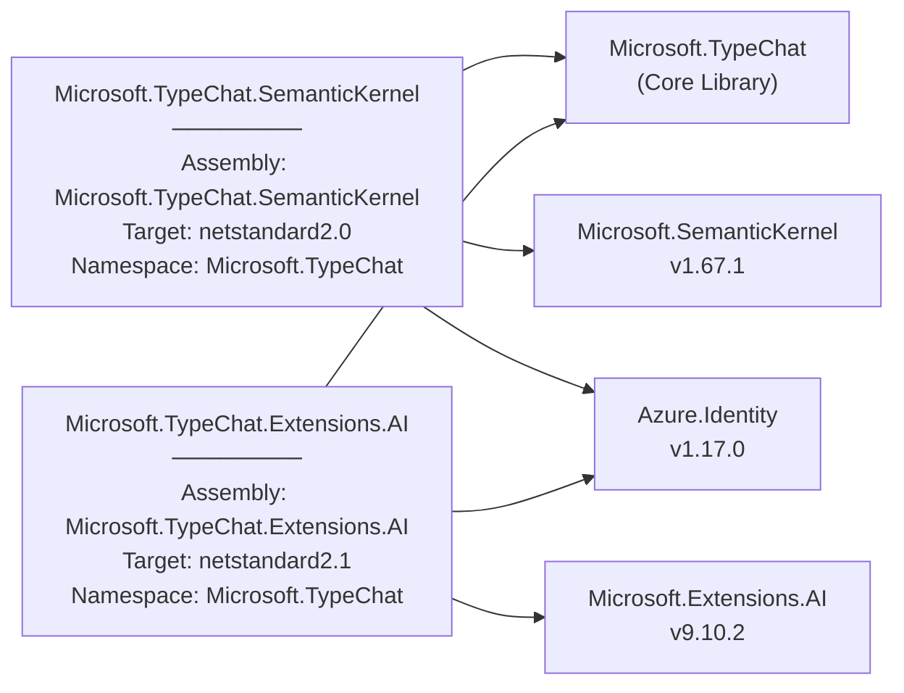

### Microsoft.TypeChat.SemanticKernel

Located in `src/typechat.sk/`, this assembly ([src/typechat.sk/TypeChat.SemanticKernel.csproj]()) provides integration with Microsoft Semantic Kernel v1.67.1. Key components:
- `KernelEx` extension methods ([src/typechat.sk/KernelEx.cs]()) for configuring kernels with chat and embedding models
- `ChatLanguageModel` and `TextCompletionModel` adapters for Semantic Kernel services
- `TextEmbeddingModel` for embedding generation

The assembly targets netstandard2.0 and includes compiler warnings suppression for experimental SK features (SKEXP0001, SKEXP0011) ([src/typechat.sk/TypeChat.SemanticKernel.csproj:35-38]()).

Key dependencies:
- `Microsoft.SemanticKernel` (1.67.1)
- `Azure.Identity` (1.17.0)
- `System.Numerics.Tensors` (10.0.0) - for tensor operations in embeddings

### Microsoft.TypeChat.Extensions.AI

Located in `src/typechat.meai/`, this assembly ([src/typechat.meai/TypeChat.Extensions.AI.csproj]()) provides integration with the standard `Microsoft.Extensions.AI` abstractions (v9.10.2). It targets netstandard2.1 ([src/typechat.meai/TypeChat.Extensions.AI.csproj:4]()) to support the Extensions.AI requirements.

Key dependencies:
- `Microsoft.Extensions.AI` (9.10.2)
- `Azure.Identity` (1.17.0)
- `Microsoft.Extensions.Configuration.Binder` (10.0.0)

This integration path provides a more portable abstraction layer that can work with multiple AI providers beyond OpenAI.

**Sources:** [src/typechat.sk/TypeChat.SemanticKernel.csproj:1-41](), [src/typechat.sk/KernelEx.cs:1-141](), [src/typechat.meai/TypeChat.Extensions.AI.csproj:1-40]()

## Examples and Shared Infrastructure

### Microsoft.TypeChat.Examples

The examples library ([examples/typechat.examplesLib/TypeChat.ExamplesLib.csproj]()) provides shared infrastructure for all example applications. It targets both netstandard2.0 and net8.0 ([examples/typechat.examplesLib/TypeChat.ExamplesLib.csproj:4]()).

Key components provided:
- `ConsoleApp` base class for interactive and batch-mode example applications
- `Config.LoadOpenAI()` for configuration management
- `VectorTextIndex<T>` for semantic search and classification
- `TextClassifier` for request routing

Dependencies include:
- Project references to both `TypeChat.Program` and `TypeChat.SemanticKernel` ([examples/typechat.examplesLib/TypeChat.ExamplesLib.csproj:19-20]())
- `Azure.Identity` (1.17.0) for authentication
- `Microsoft.Extensions.Configuration.Json` (10.0.0-rc.2.25502.107) for settings
- `System.CommandLine` (2.0.0) for CLI parsing

### Example Applications

Each example project demonstrates specific TypeChat capabilities:

| Example | Primary Class | Demonstrates |
|---------|--------------|--------------|
| Sentiment | `SentimentApp` | Simple `JsonTranslator<T>` usage |
| CoffeeShop | `CoffeeShopApp` | Complex schemas with vocabularies and polymorphism |
| Math | `MathApp` | `ProgramTranslator<T>` for mathematical operations |
| Calendar | `CalendarApp` | Translating to structured calendar actions |
| HealthData | `HealthDataApp` | `AgentWithHistory<T>` for conversational data collection |
| MultiSchema | `MultiSchemaApp` | Dynamic routing across multiple schemas |
| SchemaHierarchy | `SchemaHierarchyApp` | Semantic routing using embeddings |
| Restaurant | `RestaurantApp` | Complex nested schemas with polymorphic types |
| Plugins | `PluginsApp` | Translating to Semantic Kernel plugin invocations |

All examples reference `Microsoft.TypeChat.Examples` and share the configuration structure defined in `examples/appSettings.json`.

**Sources:** [examples/typechat.examplesLib/TypeChat.ExamplesLib.csproj:1-30](), [examples/Sentiment/Program.cs:1-42](), [README.md:115-146]()

## Project Dependency Graph

The following diagram shows the complete dependency relationships between all assemblies in the repository:

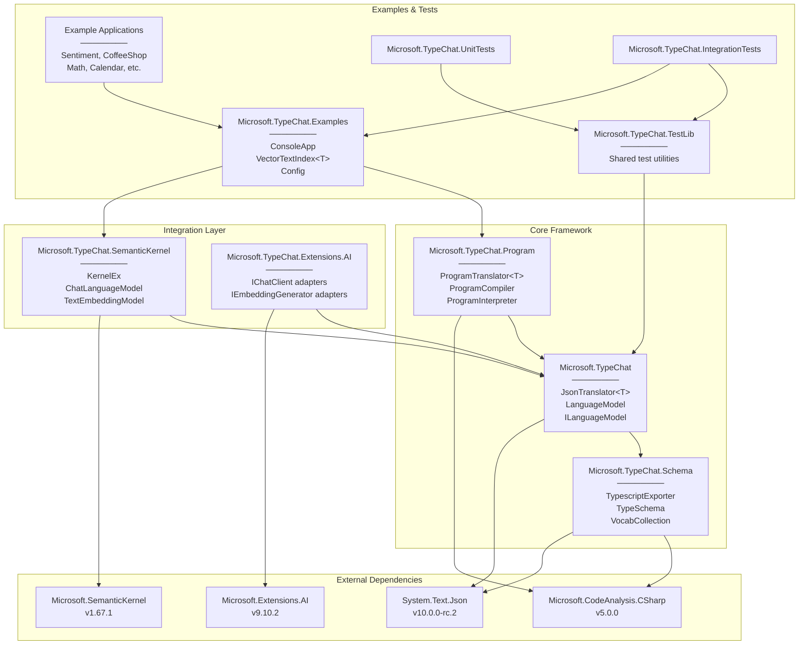

**Sources:** [src/typechat/TypeChat.csproj:1-24](), [src/typechat.schema/TypeChat.Schema.csproj:1-29](), [src/typechat.program/TypeChat.Program.csproj:1-37](), [src/typechat.sk/TypeChat.SemanticKernel.csproj:1-41](), [src/typechat.meai/TypeChat.Extensions.AI.csproj:1-40](), [examples/typechat.examplesLib/TypeChat.ExamplesLib.csproj:1-30]()

## Configuration Structure

The repository uses a layered configuration approach centered on OpenAI service configuration:

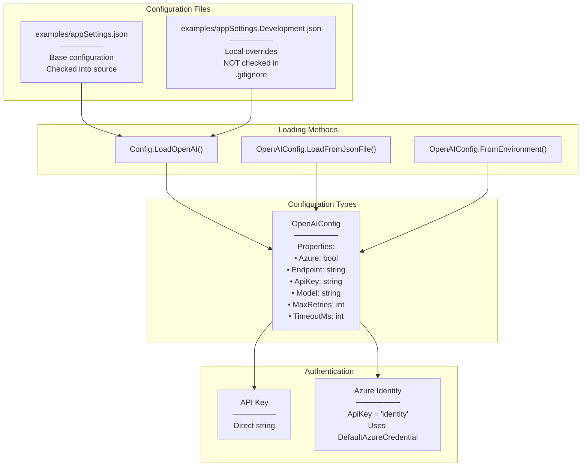

The base configuration file ([examples/appSettings.json]()) defines two OpenAI configurations:
- `OpenAI` - Primary chat model configuration (gpt-35-turbo by default)
- `OpenAI_Embedding` - Embedding model configuration (ada-002 by default)

Each configuration includes retry and timeout settings ([examples/appSettings.json:11-13]()):
- `MaxRetries`: Number of retry attempts (default: 2)
- `TimeoutMs`: HTTP timeout in milliseconds (default: 30000)

Applications load configuration using `Config.LoadOpenAI()` which automatically merges `appSettings.json` with `appSettings.Development.json` when present. The development file is excluded from source control to protect API keys.

**Sources:** [examples/appSettings.json:1-21](), [README.md:148-207]()

## Shared Code Patterns

Several utility files are shared across projects using MSBuild `<Compile Include>` links to avoid duplication:

| Utility File | Purpose | Used By |
|-------------|---------|---------|
| `ArgumentVerify.cs` | Null and argument validation | TypeChat, TypeChat.Schema, TypeChat.Program, TypeChat.SemanticKernel, TypeChat.Extensions.AI, TypeChat.Examples |
| `ListEx.cs` | List extension methods | TypeChat.Schema, TypeChat.Program, TypeChat.Examples |
| `StringEx.cs` | String utility methods | TypeChat.Schema |

This linking pattern is visible in project files, for example ([src/typechat.schema/TypeChat.Schema.csproj:13-15]()):
```xml
<Compile Include="..\typechat\ArgumentVerify.cs" Link="ArgumentVerify.cs" />
<Compile Include="..\typechat\StringEx.cs" Link="StringEx.cs" />
<Compile Include="..\typechat\ListEx.cs" Link="ListEx.cs" />
```

The shared utilities avoid external dependencies and provide consistent error handling and validation patterns across the entire codebase.

**Sources:** [src/typechat.schema/TypeChat.Schema.csproj:13-15](), [src/typechat.program/TypeChat.Program.csproj:23-24](), [src/typechat.sk/TypeChat.SemanticKernel.csproj:14](), [examples/typechat.examplesLib/TypeChat.ExamplesLib.csproj:14-15]()

## NuGet Package Structure

All framework assemblies are published as NuGet packages with consistent metadata defined through shared properties:

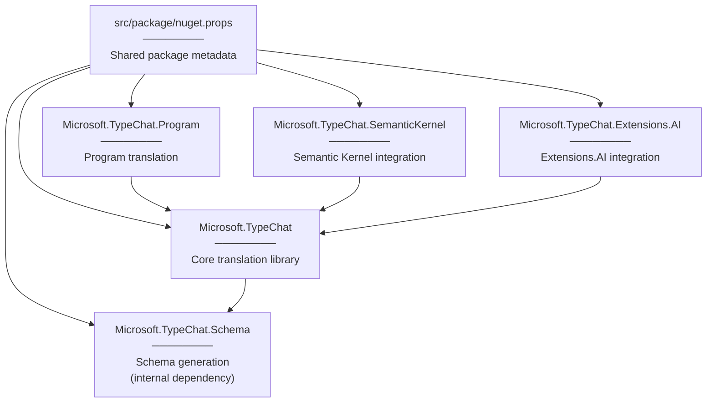

Each project imports the shared properties ([src/typechat/TypeChat.csproj:13](), [src/typechat.program/TypeChat.Program.csproj:32](), [src/typechat.sk/TypeChat.SemanticKernel.csproj:29]()):
```xml
<Import Project="../package/nuget.props" />
```

Package installation commands ([README.md:98-113]()):
- `dotnet add package Microsoft.TypeChat`
- `dotnet add package Microsoft.TypeChat.Program`
- `dotnet add package Microsoft.TypeChat.SemanticKernel`

The `Microsoft.TypeChat.Schema` assembly is an internal dependency and not published separately—it's included as part of `Microsoft.TypeChat`.

**Sources:** [README.md:98-113](), [src/typechat/TypeChat.csproj:13](), [src/typechat.program/TypeChat.Program.csproj:32](), [src/typechat.sk/TypeChat.SemanticKernel.csproj:29]()

## Test Infrastructure

The test infrastructure is organized into three assemblies providing different testing capabilities:

| Assembly | Target Framework | Purpose |
|----------|-----------------|---------|
| Microsoft.TypeChat.TestLib | netstandard2.0, net8.0 | Shared test utilities, test data, base classes |
| Microsoft.TypeChat.UnitTests | net8.0 | Isolated component tests without external dependencies |
| Microsoft.TypeChat.IntegrationTests | net8.0 | End-to-end tests with real OpenAI services |

The test projects share the same configuration management as examples, using `appSettings.json` and `appSettings.Development.json` for OpenAI credentials. Integration tests validate the complete translation workflow, program execution, embedding generation, and agent behavior with actual language models.

Test data includes JSON files for various scenarios:
- Success cases (mathPrograms.json, objectPrograms.json)
- Failure cases (mathPrograms_Fail.json) for validation testing
- Schema examples (SentimentSchema.ts)
- Vocabulary test data (TestVocabs.json)

**Sources:** [README.md:148-159](), Diagrams 1 and 6 from context

## Build and Development

The repository is configured for cross-platform development with Visual Studio 2022 or the .NET CLI:

**Visual Studio:**
1. Open `typechat.sln` from the repository root
2. Restore NuGet packages
3. Build the solution

**Command Line:**
```bash
cd [repository root]
dotnet build typechat.sln
```

All projects use:
- `LangVersion`: latest - enabling newest C# language features
- `ImplicitUsings`: enabled - automatic common namespace imports
- `Nullable`: annotations - nullable reference type annotations without enforcement

Target frameworks are carefully chosen:
- netstandard2.0: Maximum compatibility for core libraries
- netstandard2.1: Required for Microsoft.Extensions.AI
- net8.0: Modern runtime features for examples and tests

**Sources:** [README.md:87-96](), [src/typechat/TypeChat.csproj:4-7](), [src/typechat.meai/TypeChat.Extensions.AI.csproj:4]()

---

# Page: Architecture Overview

# Architecture Overview

<details>
<summary>Relevant source files</summary>

The following files were used as context for generating this wiki page:

- [README.md](README.md)
- [examples/Math/Program.cs](examples/Math/Program.cs)
- [examples/MultiSchema/Program.cs](examples/MultiSchema/Program.cs)
- [examples/Sentiment/Program.cs](examples/Sentiment/Program.cs)
- [examples/appSettings.json](examples/appSettings.json)
- [src/typechat.program/ProgramCompiler.cs](src/typechat.program/ProgramCompiler.cs)
- [src/typechat.program/ProgramSchemaImpl.cs](src/typechat.program/ProgramSchemaImpl.cs)
- [src/typechat.program/ProgramTranslator.cs](src/typechat.program/ProgramTranslator.cs)
- [src/typechat.program/ProgramValidator.cs](src/typechat.program/ProgramValidator.cs)
- [src/typechat/JsonResponse.cs](src/typechat/JsonResponse.cs)
- [src/typechat/JsonSerializerTypeValidator.cs](src/typechat/JsonSerializerTypeValidator.cs)
- [src/typechat/JsonTranslator.cs](src/typechat/JsonTranslator.cs)
- [src/typechat/ModelInfo.cs](src/typechat/ModelInfo.cs)
- [src/typechat/Prompt.cs](src/typechat/Prompt.cs)
- [src/typechat/TypeChatException.cs](src/typechat/TypeChatException.cs)

</details>


## Purpose and Scope

This document describes the high-level architecture of TypeChat.NET, focusing on the system's layers, data flow patterns, and component interactions. It covers the core translation workflow, program synthesis architecture, and integration points with external AI services.

For information about the physical organization of assemblies and projects, see [Repository Structure](#1.1). For details on specific components like schema generation or validation, see [Core Concepts](#3). For integration specifics, see [Integration](#6).

---

## Layer Architecture

TypeChat.NET is organized into four primary architectural layers that separate concerns and enable modularity:

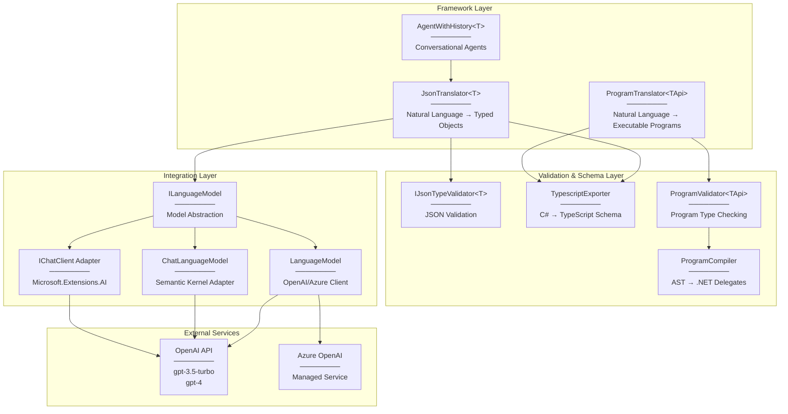

**Sources**: [README.md:19-76](), [src/typechat/JsonTranslator.cs:1-315](), [src/typechat.program/ProgramTranslator.cs:1-122]()

### Layer Responsibilities

| Layer | Primary Components | Responsibility |
|-------|-------------------|----------------|
| **Framework** | `JsonTranslator<T>`, `ProgramTranslator<TApi>`, `AgentWithHistory<T>` | Orchestrate translation workflows, manage validation-repair loops, expose public APIs |
| **Validation & Schema** | `IJsonTypeValidator<T>`, `TypescriptExporter`, `ProgramCompiler` | Generate schemas, validate JSON, compile programs, enforce type safety |
| **Integration** | `ILanguageModel`, `LanguageModel`, `ChatLanguageModel` | Abstract model access, adapt to different AI service providers |
| **External Services** | OpenAI, Azure OpenAI | Provide language model inference capabilities |

**Sources**: [README.md:22-27](), [src/typechat/JsonTranslator.cs:23-66](), [src/typechat.program/ProgramTranslator.cs:5-11]()

---

## Core Translation Workflow

The `JsonTranslator<T>` class implements the fundamental pattern for converting natural language requests into strongly-typed objects. This workflow consists of four phases: schema generation, prompt construction, model completion, and validation-repair.

```mermaid
sequenceDiagram
    participant App as "Application Code"
    participant JT as "JsonTranslator&lt;T&gt;"
    participant TE as "TypescriptExporter"
    participant Val as "IJsonTypeValidator&lt;T&gt;"
    participant LM as "ILanguageModel"
    participant API as "OpenAI/Azure"
    
    Note over App,TE: Initialization Phase
    App->>JT: new JsonTranslator&lt;T&gt;(model)
    JT->>TE: Export schema for type T
    TE->>TE: Generate TypeScript from C# types
    TE-->>JT: TypeSchema object
    
    Note over App,API: Translation Phase
    App->>JT: TranslateAsync(request)
    JT->>JT: CreateRequestPrompt()<br/>- Schema text<br/>- Instructions<br/>- User request
    
    JT->>LM: CompleteAsync(prompt, settings)
    LM->>API: HTTP POST with prompt
    API-->>LM: Response text (JSON)
    LM-->>JT: responseText
    
    JT->>JT: JsonResponse.Parse(responseText)
    
    JT->>Val: Validate(json)
    Val->>Val: JsonSerializer.Deserialize&lt;T&gt;()
    
    alt Validation Success
        Val-->>JT: Result&lt;T&gt; with typed object
        JT-->>App: Return T
    else Validation Failure (attempt < MaxRepairAttempts)
        Val-->>JT: Result&lt;T&gt; with error message
        JT->>JT: CreateRepairPrompt(responseText, error)
        JT->>JT: prompt.AppendResponse(responseText)
        JT->>JT: prompt.Append(repairPrompt)
        Note over JT,API: Retry loop
    else Max Attempts Exceeded
        JT-->>App: throw TypeChatException
    end
```

**Sources**: [src/typechat/JsonTranslator.cs:169-252](), [src/typechat/JsonResponse.cs:61-101](), [src/typechat/TypeChatException.cs:1-100]()

### Translation Phase Details

The translation process operates through a carefully orchestrated sequence:

1. **Prompt Construction** ([src/typechat/JsonTranslator.cs:254-257]()): The `CreateRequestPrompt()` method combines the TypeScript schema, system instructions, and user request into a structured prompt.

2. **Model Completion** ([src/typechat/JsonTranslator.cs:259-265]()): `GetResponseAsync()` sends the prompt to the language model via `ILanguageModel.CompleteAsync()` and receives raw text.

3. **JSON Extraction** ([src/typechat/JsonResponse.cs:61-101]()): `JsonResponse.Parse()` extracts JSON from the response, separating prologue, JSON body, and epilogue text.

4. **Validation** ([src/typechat/JsonTranslator.cs:275-289]()): The `IJsonTypeValidator<T>` implementation attempts to deserialize JSON into type `T`, catching any schema violations.

5. **Repair Loop** ([src/typechat/JsonTranslator.cs:236-251]()): On validation failure, errors are formatted into a repair prompt and the cycle repeats up to `MaxRepairAttempts` times.

**Sources**: [src/typechat/JsonTranslator.cs:199-252](), [src/typechat/JsonResponse.cs:1-103]()

---

## Schema Generation Architecture

TypeChat.NET automatically generates TypeScript schemas from C# types, enabling the language model to understand the expected structure of JSON responses.

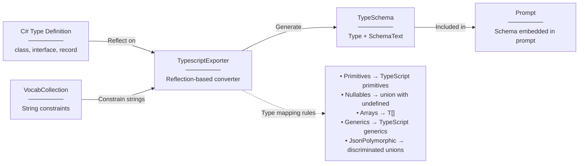

**Sources**: [src/typechat.schema/TypescriptExporter.cs]() (file not shown but referenced), [README.md:34-37]()

### Type Mapping Strategy

| C# Construct | TypeScript Output | Example |
|--------------|------------------|---------|
| `int`, `double`, `decimal` | `number` | `42` → `42` |
| `string` | `string` | `"text"` → `"text"` |
| `bool` | `boolean` | `true` → `true` |
| `T?` (nullable) | `T \| undefined` | `int?` → `number \| undefined` |
| `T[]` | `T[]` | `string[]` → `string[]` |
| `List<T>` | `T[]` | `List<string>` → `string[]` |
| `[JsonVocab("a \| b")]` | `"a" \| "b"` | Constrained string literals |
| `[JsonPolymorphic]` | Discriminated union | Type hierarchy with `@type` field |

**Sources**: [README.md:34-45]()

---

## Program Translation Architecture

The `ProgramTranslator<TApi>` extends the base translation workflow to synthesize executable programs that call methods on a target API. This architecture adds compilation and type-checking capabilities.

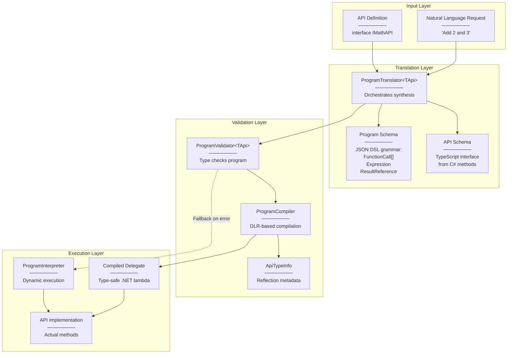

**Sources**: [src/typechat.program/ProgramTranslator.cs:12-95](), [src/typechat.program/ProgramCompiler.cs:9-459](), [src/typechat.program/ProgramValidator.cs:1-92]()

### Program Structure

Programs follow a defined JSON grammar represented by these core types:

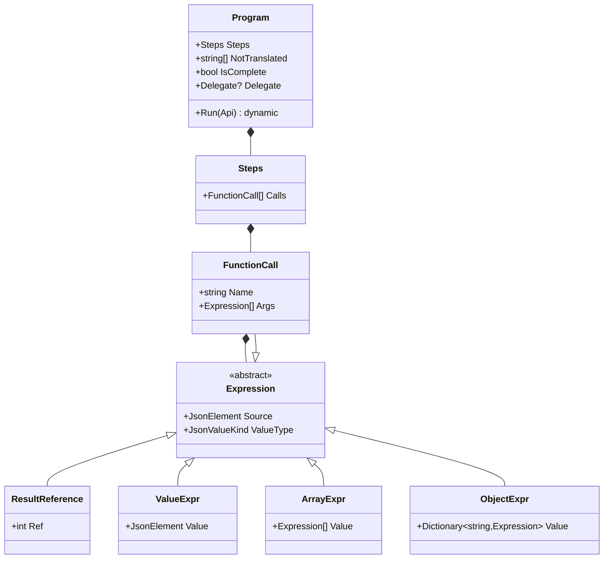

**Sources**: [src/typechat.program/ProgramSchemaImpl.cs:9-273](), [src/typechat.program/ProgramTranslator.cs:14-45]()

### Compilation Pipeline

The `ProgramCompiler` transforms validated JSON programs into optimized .NET delegates using the Dynamic Language Runtime (DLR):

1. **AST Construction** ([src/typechat.program/ProgramCompiler.cs:46-59]()): `CompileToExpressionTree()` walks the program's AST and builds corresponding `System.Linq.Expressions.Expression` nodes.

2. **Type Checking** ([src/typechat.program/ProgramCompiler.cs:154-207]()): `CompileArgs()` validates that function arguments match parameter types from `ApiTypeInfo`.

3. **Expression Tree Building** ([src/typechat.program/ProgramCompiler.cs:90-114]()): Each `FunctionCall` becomes a `MethodCallExpression`, with result references mapped to `ParameterExpression` variables.

4. **Delegate Compilation** ([src/typechat.program/ProgramCompiler.cs:78-82]()): The `LambdaExpression.Compile()` method generates executable IL code.

**Sources**: [src/typechat.program/ProgramCompiler.cs:13-459]()

---

## Integration Architecture

TypeChat.NET provides three parallel integration paths for language model access, each implementing the `ILanguageModel` interface:

```mermaid
graph TB
    subgraph "TypeChat Core"
        ILanguageModel["ILanguageModel Interface<br/>────────<br/>CompleteAsync(prompt, settings)"]
        JsonTranslator["JsonTranslator&lt;T&gt;<br/>────────<br/>Consumes ILanguageModel"]
    end
    
    subgraph "Direct Integration Path"
        LanguageModel["LanguageModel<br/>────────<br/>Azure.AI.OpenAI client"]
        OpenAIConfig["OpenAIConfig<br/>────────<br/>Configuration loader"]
    end
    
    subgraph "Semantic Kernel Path"
        ChatLanguageModel["ChatLanguageModel<br/>────────<br/>IChatCompletionService adapter"]
        KernelEx["KernelEx Extensions<br/>────────<br/>CreateKernel()<br/>WithChatModels()"]
        SKKernel["Kernel<br/>────────<br/>Microsoft.SemanticKernel"]
    end
    
    subgraph "Extensions.AI Path"
        ExtAIAdapter["IChatClient Adapter<br/>────────<br/>ToLanguageModel() extension"]
        IChatClient["IChatClient<br/>────────<br/>Microsoft.Extensions.AI"]
    end
    
    subgraph "OpenAI Services"
        OpenAIAPI["OpenAI API"]
        AzureOAI["Azure OpenAI"]
    end
    
    JsonTranslator --> ILanguageModel
    
    ILanguageModel <|.. LanguageModel
    ILanguageModel <|.. ChatLanguageModel
    ILanguageModel <|.. ExtAIAdapter
    
    LanguageModel --> OpenAIConfig
    LanguageModel --> OpenAIAPI
    LanguageModel --> AzureOAI
    
    ChatLanguageModel --> SKKernel
    SKKernel --> KernelEx
    SKKernel --> OpenAIAPI
    SKKernel --> AzureOAI
    
    ExtAIAdapter --> IChatClient
    IChatClient --> OpenAIAPI
    IChatClient --> AzureOAI
```

**Sources**: [README.md:69-76](), [README.md:209-220](), [src/typechat/LanguageModel.cs]() (referenced but not shown)

### Integration Path Comparison

| Integration Path | Assembly | Use Case | Key Classes |
|-----------------|----------|----------|-------------|
| **Direct** | `Microsoft.TypeChat` | Standalone applications with minimal dependencies | `LanguageModel`, `OpenAIConfig` |
| **Semantic Kernel** | `Microsoft.TypeChat.SemanticKernel` | Applications using SK plugins, planners, or kernel orchestration | `ChatLanguageModel`, `KernelEx` |
| **Extensions.AI** | `Microsoft.TypeChat.Extensions.AI` | Applications needing provider-agnostic AI abstractions | `IChatClient` adapters |

**Sources**: [README.md:22-27](), [README.md:69-76]()

---

## Validation and Repair Pattern

A key architectural innovation is the validation-repair loop, which makes language model outputs deterministic by iteratively correcting errors:

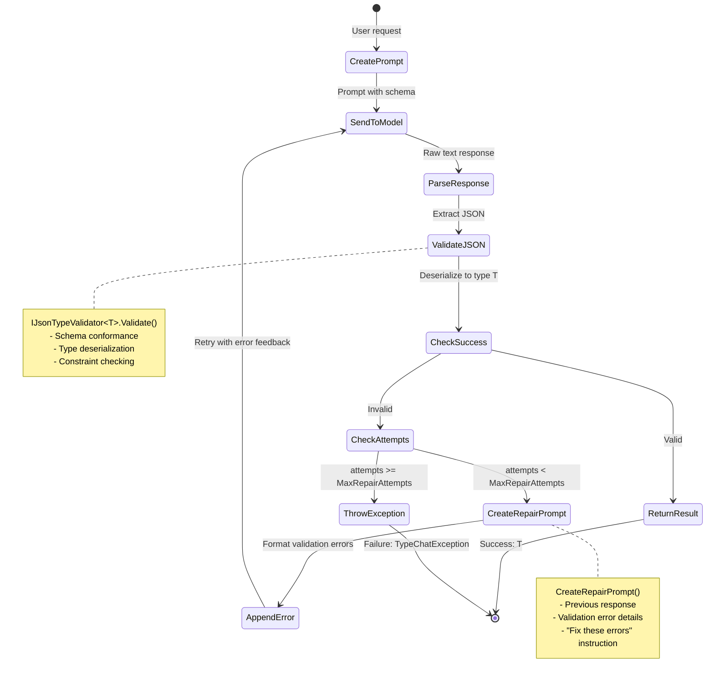

**Sources**: [src/typechat/JsonTranslator.cs:210-252](), [src/typechat/JsonTranslator.cs:267-270]()

### Repair Prompt Construction

When validation fails, `CreateRepairPrompt()` ([src/typechat/JsonTranslator.cs:267-270]()) constructs a new prompt section containing:

1. The previous response text (showing the LLM what it generated)
2. Detailed validation error messages (explaining what was wrong)
3. Instructions to correct the errors and retry

The prompt history grows with each repair attempt: `prompt.AppendResponse(responseText)` followed by `prompt.Append(repairPrompt)` ([src/typechat/JsonTranslator.cs:249-250]()). The `Prompt.Trim(2)` method ([src/typechat/JsonTranslator.cs:247]()) removes previous repair attempts to prevent unbounded growth.

**Sources**: [src/typechat/JsonTranslator.cs:236-251](), [src/typechat/Prompt.cs:1-193]()

---

## Configuration and Extensibility

TypeChat.NET exposes well-defined extension points for customization:

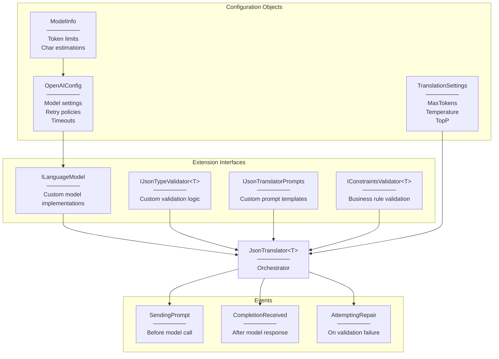

**Sources**: [src/typechat/JsonTranslator.cs:27-146](), [src/typechat/OpenAIConfig.cs]() (referenced), [src/typechat/ModelInfo.cs:1-61]()

### Extension Points Usage

**Custom Validation**: Implement `IJsonTypeValidator<T>` to use alternative serializers or validation libraries:
```csharp
// Reference: src/typechat/JsonSerializerTypeValidator.cs:102-151
public class JsonSerializerTypeValidator<T> : IJsonTypeValidator<T>
{
    public TypeSchema Schema { get; }
    public Result<T> Validate(string json) { /* ... */ }
}
```

**Custom Prompts**: Implement `IJsonTranslatorPrompts` to modify system instructions or repair logic:
```csharp
// Reference: src/typechat/IJsonTranslatorPrompts.cs (not shown but used in JsonTranslator.cs:30,50,62)
var translator = new JsonTranslator<T>(model, validator, customPrompts);
```

**Observability**: Subscribe to events for logging and debugging:
```csharp
// Reference: src/typechat/JsonTranslator.cs:152-165
translator.SendingPrompt += (prompt) => Logger.Log(prompt);
translator.CompletionReceived += (text) => Logger.Log(text);
translator.AttemptingRepair += (error) => Logger.LogWarning(error);
```

**Sources**: [src/typechat/JsonTranslator.cs:23-314](), [src/typechat/JsonSerializerTypeValidator.cs:1-152](), [src/typechat/ModelInfo.cs:1-61]()

---

## Data Flow Summary

The following diagram captures the complete data transformation pipeline from natural language input to typed output:

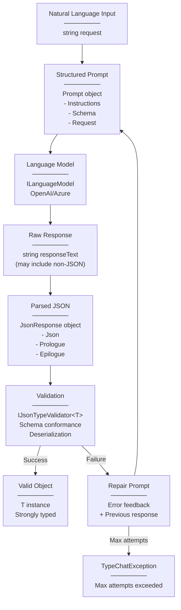

**Sources**: [src/typechat/JsonTranslator.cs:199-252](), [src/typechat/JsonResponse.cs:61-101](), [src/typechat/TypeChatException.cs:1-100]()

This architecture achieves deterministic outputs from stochastic language models through schema-guided generation, iterative error correction, and strong type validation. The layered design enables extensibility while maintaining separation of concerns across translation, validation, and model access.

---

# Page: Getting Started

# Getting Started

<details>
<summary>Relevant source files</summary>

The following files were used as context for generating this wiki page:

- [README.md](README.md)
- [examples/Sentiment/Program.cs](examples/Sentiment/Program.cs)
- [examples/appSettings.json](examples/appSettings.json)
- [examples/typechat.examplesLib/Auth.cs](examples/typechat.examplesLib/Auth.cs)
- [examples/typechat.examplesLib/Config.cs](examples/typechat.examplesLib/Config.cs)
- [src/typechat/HttpEx.cs](src/typechat/HttpEx.cs)
- [src/typechat/LanguageModel.cs](src/typechat/LanguageModel.cs)
- [src/typechat/OpenAIConfig.cs](src/typechat/OpenAIConfig.cs)

</details>


This guide walks you through installing TypeChat.NET, configuring your environment, and building your first translation application. By the end of this page, you will have a working TypeChat application that translates natural language into strongly typed C# objects.

For detailed information about the architecture and core concepts, see [Architecture Overview](#1.2) and [Core Concepts](#3). For more complex scenarios including program translation and conversational agents, see [Program Translation](#5) and [Advanced Features](#7).

---

## Prerequisites and Overview

Before you begin, you need:
- **.NET 6.0 or later**: TypeChat.NET is a cross-platform .NET library
- **OpenAI Access**: An API key for OpenAI or Azure OpenAI services
- **Supported Models**: `gpt-35-turbo`, `gpt-4`, or `ada-002` (for embeddings)

**Getting Started Journey**

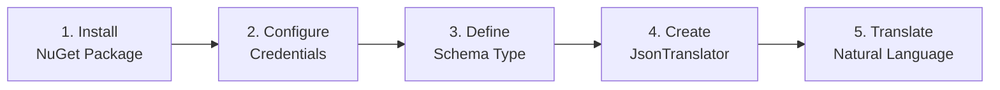

**High-Level Translation Flow**

```mermaid
sequenceDiagram
    participant App as "Your Application"
    participant Config as "OpenAIConfig"
    participant LM as "LanguageModel"
    participant JT as "JsonTranslator&lt;T&gt;"
    participant OpenAI as "OpenAI API"
    
    App->>Config: Load from appSettings<br/>or environment
    App->>LM: new LanguageModel(config)
    App->>JT: new JsonTranslator&lt;T&gt;(model)
    
    Note over App,OpenAI: Translation Phase
    App->>JT: TranslateAsync(userInput)
    JT->>JT: Generate TypeScript schema
    JT->>OpenAI: Send prompt + schema
    OpenAI-->>JT: JSON response
    JT->>JT: Validate + deserialize
    JT-->>App: Typed object T
```

**Sources:** [README.md:1-243](), [examples/Sentiment/Program.cs:1-43]()

---

## Installation

TypeChat.NET is distributed as NuGet packages. Install the packages you need based on your scenario:

| Package | Purpose | Install Command |
|---------|---------|-----------------|
| **Microsoft.TypeChat** | Core translation: `JsonTranslator<T>`, schema generation, validation | `dotnet add package Microsoft.TypeChat` |
| **Microsoft.TypeChat.Program** | Program synthesis: `ProgramTranslator<T>`, code generation | `dotnet add package Microsoft.TypeChat.Program` |
| **Microsoft.TypeChat.SemanticKernel** | Semantic Kernel integration: model adapters, plugin programs | `dotnet add package Microsoft.TypeChat.SemanticKernel` |

**Package Dependency Architecture**

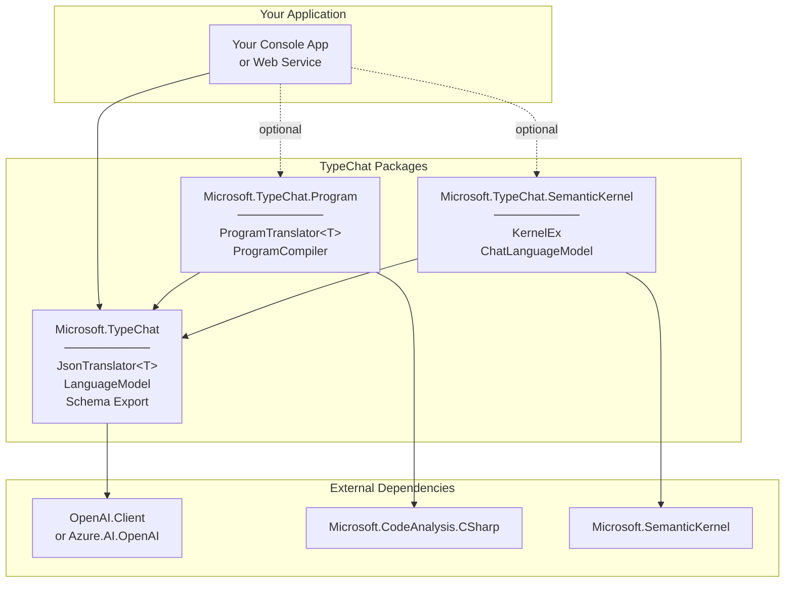

**For Most Scenarios:** Start with just `Microsoft.TypeChat`. Add `Microsoft.TypeChat.Program` if you need code generation, or `Microsoft.TypeChat.SemanticKernel` if integrating with Semantic Kernel.

**Building from Source:**
```bash
git clone https://github.com/microsoft/typechat.net
cd typechat.net
dotnet build TypeChat.sln
```

**Sources:** [README.md:87-113]()

---

## Configuration

TypeChat.NET requires configuration to connect to OpenAI or Azure OpenAI services. You can configure using either settings files or environment variables.

### Configuration File Approach

The recommended approach for development is using JSON configuration files. The examples use two files:
- `appSettings.json`: Checked into source control, contains structure but no secrets
- `appSettings.Development.json`: Local only (gitignored), contains your actual credentials

**Configuration File Structure**

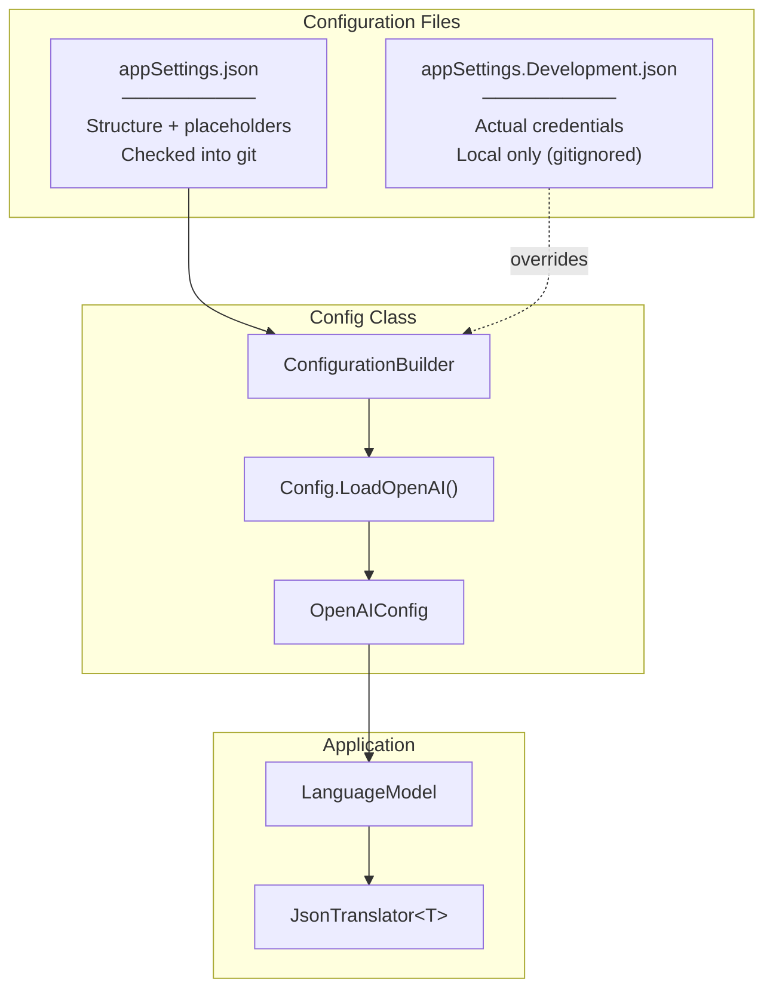

**appSettings.json Structure** (see [examples/appSettings.json:1-22]()):
```json
{
  "OpenAI": {
    "Azure": true,
    "Endpoint": "?",
    "ApiKey": "?",
    "Model": "gpt-35-turbo",
    "MaxRetries": 2,
    "TimeoutMs": 30000
  },
  "OpenAI_Embedding": {
    "Azure": true,
    "ApiKey": "?", 
    "Endpoint": "?",
    "Model": "ada-002"
  }
}
```

**Configuration Properties Table**

| Property | Description | Azure OpenAI Example | OpenAI Example |
|----------|-------------|---------------------|----------------|
| `Azure` | Use Azure OpenAI service? | `true` | `false` |
| `Endpoint` | Service endpoint | `https://YOUR_RESOURCE.openai.azure.com` | `https://api.openai.com/v1/chat/completions` |
| `ApiKey` | API key or `"identity"` | Your key or `"identity"` | Your OpenAI key |
| `Model` | Model/deployment name | `gpt-35-turbo` (deployment) | `gpt-3.5-turbo` (model) |
| `MaxRetries` | HTTP retry attempts | `2` | `2` |
| `TimeoutMs` | Request timeout | `30000` | `30000` |
| `Organization` | OpenAI organization | (not used) | Your org ID |

**Loading Configuration in Code** (see [examples/typechat.examplesLib/Config.cs:43-52]()):
```csharp
// Load from appSettings.json + appSettings.Development.json
OpenAIConfig config = Config.LoadOpenAI();

// Create language model
var model = new LanguageModel(config);
```

### Azure Identity (Token-Based Authentication)

Instead of API keys, you can use Azure AD authentication with role-based access control:

1. Set `"ApiKey": "identity"` in your configuration
2. Authenticate using Azure CLI: `az login`
3. Grant your identity the **Cognitive Services OpenAI User** role on your Azure OpenAI resource

The `Config.LoadOpenAI()` method automatically detects the `"identity"` keyword and configures `AzureTokenProvider.Default` which uses `DefaultAzureCredential` (see [examples/typechat.examplesLib/Config.cs:47-50]() and [examples/typechat.examplesLib/Auth.cs:14-47]()).

### Environment Variable Approach

For production or containerized deployments, use environment variables:

**Environment Variable Names** (see [src/typechat/OpenAIConfig.cs:14-52]()):

| Variable | Description |
|----------|-------------|
| `AZURE_OPENAI_ENDPOINT` | Azure OpenAI endpoint |
| `AZURE_OPENAI_API_KEY` | Azure OpenAI API key |
| `OPENAI_ENDPOINT` | OpenAI endpoint |
| `OPENAI_API_KEY` | OpenAI API key |
| `OPENAI_MODEL` | Model name |
| `OPENAI_EMBEDDINGMODEL` | Embedding model name |
| `OPENAI_ORGANIZATION` | OpenAI organization |

**Loading from Environment** (see [src/typechat/OpenAIConfig.cs:130-155]()):
```csharp
OpenAIConfig config = OpenAIConfig.FromEnvironment();
var model = new LanguageModel(config);
```

**Configuration Resolution Flow**

```mermaid
flowchart TD
    Start["Application Startup"]
    
    CheckFile{"appSettings.json<br/>exists?"}
    LoadFile["Config.LoadOpenAI()"]
    LoadEnv["OpenAIConfig.FromEnvironment()"]
    
    CheckAzure{"Azure = true?"}
    AzureVars["Load AZURE_OPENAI_*<br/>variables"]
    OpenAIVars["Load OPENAI_*<br/>variables"]
    
    CheckIdentity{"ApiKey =<br/>'identity'?"}
    SetProvider["Set AzureTokenProvider"]
    UseApiKey["Use ApiKey directly"]
    
    Validate["Validate configuration"]
    CreateModel["new LanguageModel(config)"]
    
    Start --> CheckFile
    CheckFile -->|Yes| LoadFile
    CheckFile -->|No| LoadEnv
    
    LoadFile --> CheckIdentity
    LoadEnv --> CheckAzure
    
    CheckAzure -->|Yes| AzureVars
    CheckAzure -->|No| OpenAIVars
    
    AzureVars --> CheckIdentity
    OpenAIVars --> CheckIdentity
    
    CheckIdentity -->|Yes| SetProvider
    CheckIdentity -->|No| UseApiKey
    
    SetProvider --> Validate
    UseApiKey --> Validate
    
    Validate --> CreateModel
```

**Sources:** [README.md:148-208](), [examples/appSettings.json:1-22](), [src/typechat/OpenAIConfig.cs:1-172](), [examples/typechat.examplesLib/Config.cs:1-106](), [examples/typechat.examplesLib/Auth.cs:1-106]()

---

## Your First Translation

The simplest TypeChat.NET application is the Sentiment example, which translates natural language text into a structured sentiment response.

### The Schema Type

First, define a C# type representing the structure you want to translate to. TypeChat will automatically generate TypeScript schema from this type (see [Schema Generation](#3.2) for details).

For the Sentiment example, the schema type is `SentimentResponse`:
```csharp
public class SentimentResponse
{
    public string Sentiment { get; set; }
}
```

### Creating the Translator

**Complete Sentiment Application** (see [examples/Sentiment/Program.cs:1-43]()):

```mermaid
flowchart TB
    subgraph "Application Setup"
        ConfigLoad["Config.LoadOpenAI()"]
        ConfigObj["OpenAIConfig object"]
        CreateLM["new LanguageModel(config)"]
        LM["LanguageModel instance"]
        CreateJT["new JsonTranslator&lt;SentimentResponse&gt;(model)"]
        JT["JsonTranslator instance"]
    end
    
    subgraph "Translation Phase"
        Input["User input string"]
        Translate["translator.TranslateAsync(input)"]
        Schema["Auto-generate TypeScript schema"]
        Prompt["Build prompt with schema"]
        API["OpenAI API call"]
        Validate["Validate + deserialize JSON"]
        Result["SentimentResponse object"]
    end
    
    ConfigLoad --> ConfigObj
    ConfigObj --> CreateLM
    CreateLM --> LM
    LM --> CreateJT
    CreateJT --> JT
    
    Input --> Translate
    JT --> Translate
    Translate --> Schema
    Schema --> Prompt
    Prompt --> API
    API --> Validate
    Validate --> Result
```

**Step-by-Step Code Walkthrough:**

1. **Load Configuration** ([examples/Sentiment/Program.cs:12-16]()):
   ```csharp
   OpenAIConfig config = Config.LoadOpenAI();
   // Alternative: OpenAIConfig.FromEnvironment()
   // Alternative: OpenAIConfig.LoadFromJsonFile("path")
   ```

2. **Create Language Model** ([examples/Sentiment/Program.cs:16]()):
   ```csharp
   var model = new LanguageModel(config);
   ```
   The `LanguageModel` class ([src/typechat/LanguageModel.cs:8-169]()) implements `ILanguageModel` and handles OpenAI/Azure OpenAI API calls.

3. **Create JsonTranslator** ([examples/Sentiment/Program.cs:16]()):
   ```csharp
   var translator = new JsonTranslator<SentimentResponse>(model);
   ```
   `JsonTranslator<T>` is the core class that:
   - Generates TypeScript schema from `SentimentResponse`
   - Constructs prompts with the schema
   - Calls the language model
   - Validates and deserializes the JSON response
   - Repairs invalid responses (see [Validation and Repair](#3.3))

4. **Translate User Input** ([examples/Sentiment/Program.cs:21]()):
   ```csharp
   SentimentResponse response = await translator.TranslateAsync(input);
   ```
   The `TranslateAsync` method returns a strongly-typed `SentimentResponse` object.

5. **Use the Result** ([examples/Sentiment/Program.cs:22]()):
   ```csharp
   Console.WriteLine($"The sentiment is {response.Sentiment}");
   ```

### Translation Lifecycle

**Detailed Translation Flow with Code References**

```mermaid
sequenceDiagram
    participant App as "SentimentApp:19-23"
    participant JT as "JsonTranslator&lt;T&gt;"
    participant SE as "TypescriptExporter"
    participant LM as "LanguageModel:47-55"
    participant Val as "IJsonTypeValidator"
    participant API as "OpenAI API"
    
    Note over App,API: Initialization (Constructor)
    App->>JT: new JsonTranslator&lt;SentimentResponse&gt;(model)
    JT->>SE: Export schema for SentimentResponse
    SE-->>JT: TypeScript schema text
    
    Note over App,API: Translation Request
    App->>JT: TranslateAsync(input)
    JT->>JT: Build prompt:<br/>instructions + schema + input
    JT->>LM: CompleteAsync(prompt)
    LM->>API: HTTP POST request
    API-->>LM: Response text
    LM-->>JT: Response string
    
    JT->>JT: Extract JSON from response
    JT->>Val: Validate JSON against schema
    
    alt Valid JSON
        Val-->>JT: Success
        JT->>JT: Json.Parse&lt;SentimentResponse&gt;()
        JT-->>App: SentimentResponse object
    else Invalid JSON (attempt < MaxRepairAttempts)
        Val-->>JT: Validation error messages
        JT->>JT: Build repair prompt with errors
        JT->>LM: CompleteAsync(repair prompt)
        Note over JT,API: Retry loop (up to 3 attempts)
    else Max Attempts Exceeded
        JT-->>App: Throw TypeChatException
    end
```

### Running the Example

**Option 1: Interactive Mode**
```bash
cd examples/Sentiment
dotnet run
```
Type sentences and press Enter to see sentiment analysis:
```
😀> I love this framework!
The sentiment is positive

😀> This is confusing.
The sentiment is negative
```

**Option 2: Batch Mode**
```bash
dotnet run input.txt
```
Processes all lines from `input.txt` and outputs results.

### Key Classes and Their Roles

| Class | Location | Purpose |
|-------|----------|---------|
| `OpenAIConfig` | [src/typechat/OpenAIConfig.cs:9-172]() | Configuration container for OpenAI credentials and settings |
| `Config` | [examples/typechat.examplesLib/Config.cs:8-106]() | Helper for loading configuration from files |
| `LanguageModel` | [src/typechat/LanguageModel.cs:8-169]() | Implements `ILanguageModel`, handles OpenAI API communication |
| `JsonTranslator<T>` | Referenced, full details in [JsonTranslator](#3.1) | Core translation engine: schema generation, validation, repair |
| `ConsoleApp` | Referenced in [examples/Sentiment/Program.cs:6]() | Base class for console examples with input processing |

### What Happens Under the Hood

1. **Schema Generation**: TypeChat analyzes the `SentimentResponse` type and generates TypeScript schema describing its structure
2. **Prompt Construction**: A prompt is built containing:
   - Instructions for the language model
   - The generated TypeScript schema
   - The user's input text
3. **API Call**: The prompt is sent to the OpenAI model via the `LanguageModel` class
4. **Response Processing**: The model's response (JSON text) is extracted and validated
5. **Validation**: The JSON is checked against the schema using a validator
6. **Repair Loop**: If validation fails, error messages are sent back to the model for correction (up to 3 attempts)
7. **Deserialization**: Valid JSON is deserialized into a `SentimentResponse` object

For detailed information on each of these steps, see:
- [Schema Generation](#3.2)
- [Prompts and Prompt Engineering](#3.5)
- [Validation and Repair](#3.3)
- [JsonTranslator](#3.1)

**Sources:** [examples/Sentiment/Program.cs:1-43](), [src/typechat/LanguageModel.cs:1-169](), [README.md:77-128]()

---

## Next Steps

Now that you have a working TypeChat application, explore:

- **[Configuration](#2.2)**: Detailed configuration options and advanced authentication
- **[Core Concepts](#3)**: Deep dive into `JsonTranslator`, schema generation, and validation
- **[Schema Definition](#4)**: Learn to define complex schemas with vocabularies, polymorphism, and constraints
- **[Program Translation](#5)**: Generate executable programs from natural language
- **[Examples](#8)**: Study more complex examples like CoffeeShop, Math, and HealthData

### Common Patterns

**Pattern 1: Single Configuration, Multiple Translators**
```csharp
OpenAIConfig config = Config.LoadOpenAI();
var model = new LanguageModel(config);

var sentimentTranslator = new JsonTranslator<SentimentResponse>(model);
var calendarTranslator = new JsonTranslator<CalendarActions>(model);
```

**Pattern 2: Using Semantic Kernel**
```csharp
var kernel = Kernel.CreateBuilder()
    .AddAzureOpenAIChatCompletion(deploymentName, endpoint, apiKey)
    .Build();
    
var model = new ChatLanguageModel(kernel.GetService<IChatCompletionService>());
var translator = new JsonTranslator<T>(model);
```

**Pattern 3: Custom Language Model**
Implement `ILanguageModel` ([src/typechat/ILanguageModel.cs]()) for custom model providers.

**Sources:** [README.md:1-243](), [examples/Sentiment/Program.cs:1-43]()

---

# Page: Installation

# Installation

<details>
<summary>Relevant source files</summary>

The following files were used as context for generating this wiki page:

- [README.md](README.md)
- [TypeChat.sln](TypeChat.sln)
- [examples/CoffeeShop/CoffeeShop.csproj](examples/CoffeeShop/CoffeeShop.csproj)
- [examples/CoffeeShop2/CoffeeShop2.csproj](examples/CoffeeShop2/CoffeeShop2.csproj)
- [examples/Math/Math.csproj](examples/Math/Math.csproj)
- [examples/Sentiment/Program.cs](examples/Sentiment/Program.cs)
- [examples/Sentiment/Sentiment.csproj](examples/Sentiment/Sentiment.csproj)
- [examples/appSettings.json](examples/appSettings.json)

</details>


This document covers the installation of TypeChat.NET packages and setup of required dependencies. For information about configuring OpenAI credentials after installation, see [Configuration](#2.2). For a step-by-step tutorial on building your first application, see [Your First Translation](#2.3).

## Prerequisites

### .NET SDK

TypeChat.NET requires:
- **.NET 8.0 SDK** or later
- The framework target is `net8.0` as shown in [examples/Sentiment/Sentiment.csproj:5]()

All example projects specify `<RollForward>LatestMajor</RollForward>`, allowing the framework to roll forward to newer major versions if the target version is unavailable.

### OpenAI Language Model Access

TypeChat.NET requires access to OpenAI language models. Supported options:

| Service | Models Supported |
|---------|-----------------|
| **Azure OpenAI** | gpt-35-turbo, gpt-4 |
| **OpenAI** | gpt-3.5-turbo, gpt-4 |
| **Embedding Models** | ada-002 (text-embedding-ada-002) |

**Note**: Some examples and advanced scenarios work best with `gpt-4`. Basic translation examples function with `gpt-35-turbo`.

### Development Environment

Recommended development tools:
- **Visual Studio 2022** (for solution development)
- **dotnet CLI** (for command-line builds)
- Any IDE with .NET 8.0 support

**Sources**: [README.md:79-96](), [examples/Sentiment/Sentiment.csproj:5]()

## Package Installation

### NuGet Package Overview

TypeChat.NET consists of three main packages:

```mermaid
graph TB
    Core["Microsoft.TypeChat<br/>────────────<br/>Core translation engine"]
    Program["Microsoft.TypeChat.Program<br/>────────────<br/>Program/plan generation"]
    SK["Microsoft.TypeChat.SemanticKernel<br/>────────────<br/>Semantic Kernel integration"]
    ExtAI["Microsoft.TypeChat.Extensions.AI<br/>────────────<br/>Extensions.AI integration"]
    
    Program --> Core
    SK --> Core
    ExtAI --> Core
    
    AppBasic["Application:<br/>Basic Translation"] --> Core
    AppProgram["Application:<br/>Program Execution"] --> Program
    AppSK["Application:<br/>SK Integration"] --> SK
    AppExtAI["Application:<br/>Extensions.AI"] --> ExtAI
```

**Package Dependency Architecture**

### Installing Microsoft.TypeChat

The core package provides `JsonTranslator<T>`, schema generation, validation, and repair functionality.

```bash
dotnet add package Microsoft.TypeChat
```

**NuGet Package**: [](https://www.nuget.org/packages/Microsoft.TypeChat)

This package is required for all TypeChat.NET applications.

### Installing Microsoft.TypeChat.Program

The program package adds the ability to translate natural language into executable programs.

```bash
dotnet add package Microsoft.TypeChat.Program
```

**NuGet Package**: [](https://www.nuget.org/packages/Microsoft.TypeChat.Program)

This package automatically includes `Microsoft.TypeChat` as a dependency.

### Installing Microsoft.TypeChat.SemanticKernel

The Semantic Kernel integration package provides interoperability with Microsoft Semantic Kernel 1.0.

```bash
dotnet add package Microsoft.TypeChat.SemanticKernel
```

**NuGet Package**: [](https://www.nuget.org/packages/Microsoft.TypeChat.SemanticKernel)

This package enables using Semantic Kernel's `IChatCompletionService`, plugin programs, and embedding models with TypeChat.

### Installing Microsoft.TypeChat.Extensions.AI

The Extensions.AI integration package provides support for the standard `Microsoft.Extensions.AI` abstractions.

```bash
dotnet add package Microsoft.TypeChat.Extensions.AI
```

This package enables using `IChatClient` and `IEmbeddingGenerator` with TypeChat and supports multiple AI providers beyond OpenAI.

**Sources**: [README.md:19-27](), [README.md:98-113]()

## Project Configuration

### Basic Project Setup

A minimal TypeChat.NET project requires these `.csproj` settings:

```xml
<PropertyGroup>
  <TargetFramework>net8.0</TargetFramework>
  <LangVersion>latest</LangVersion>
  <RollForward>LatestMajor</RollForward>
  <ImplicitUsings>enable</ImplicitUsings>
  <Nullable>annotations</Nullable>
</PropertyGroup>
```

### Configuration Files

TypeChat examples use configuration files for OpenAI settings. These files must be copied to the output directory:

```xml
<ItemGroup>
  <Content Include="appSettings.json">
    <CopyToOutputDirectory>Always</CopyToOutputDirectory>
  </Content>
</ItemGroup>

<ItemGroup Condition="Exists('appSettings.Development.json')">
  <Content Include="appSettings.Development.json">
    <CopyToOutputDirectory>Always</CopyToOutputDirectory>
  </Content>
</ItemGroup>
```

The `appSettings.Development.json` file is environment-specific and should not be checked into source control. The conditional inclusion prevents build errors when this file is absent.

### Example Project Reference Structure

```mermaid
graph LR
    subgraph "Example Application Project"
        App["Program.cs<br/>────────────<br/>Main application code"]
        Settings["appSettings.json<br/>appSettings.Development.json"]
    end
    
    subgraph "TypeChat.NET Assemblies"
        TypeChat["TypeChat.csproj<br/>────────────<br/>Core library"]
        Program["TypeChat.Program.csproj<br/>────────────<br/>Program library"]
        ExamplesLib["TypeChat.ExamplesLib.csproj<br/>────────────<br/>Shared utilities"]
    end
    
    App --> TypeChat
    App --> ExamplesLib
    Settings -.copied to.-> Output["bin/Debug/net8.0/"]
```

**Project Reference Flow in Example Applications**

**Sources**: [examples/Sentiment/Sentiment.csproj:1-36](), [examples/CoffeeShop/CoffeeShop.csproj:13-23](), [examples/Math/Math.csproj:13-23]()

## Building from Source

### Building with Visual Studio 2022

1. Open [TypeChat.sln]() from the repository root directory
2. Restore NuGet packages: **Build → Restore NuGet Packages**
3. Build the solution: **Build → Build Solution** (or press `Ctrl+Shift+B`)

### Building with dotnet CLI

From the repository root directory:

```bash
# Navigate to repository root
cd typechat.net

# Restore packages and build
dotnet build TypeChat.sln
```

This builds all projects in the solution including:
- Core libraries: `TypeChat`, `TypeChat.Program`, `TypeChat.SemanticKernel`, `TypeChat.Schema`, `TypeChat.Extensions.AI`
- Example applications: `Sentiment`, `CoffeeShop`, `Math`, `Calendar`, etc.
- Test projects: `TypeChat.IntegrationTests`, `TypeChat.UnitTests`, `TypeChat.TestLib`

### Solution Structure

```mermaid
graph TB
    subgraph "TypeChat.sln"
        subgraph "src/ - Source Assemblies"
            TypeChat["TypeChat.csproj<br/>────────────<br/>Core translation"]
            Schema["TypeChat.Schema.csproj<br/>────────────<br/>Schema generation"]
            Program["TypeChat.Program.csproj<br/>────────────<br/>Program synthesis"]
            SK["TypeChat.SemanticKernel.csproj<br/>────────────<br/>SK integration"]
            ExtAI["TypeChat.Extensions.AI.csproj<br/>────────────<br/>Extensions.AI"]
        end
        
        subgraph "examples/ - Sample Applications"
            Sentiment["Sentiment.csproj"]
            Coffee["CoffeeShop.csproj"]
            Math["Math.csproj"]
            Health["HealthData.csproj"]
            ExamplesLib["TypeChat.ExamplesLib.csproj<br/>────────────<br/>Shared example utilities"]
        end
        
        subgraph "tests/ - Test Projects"
            IntTests["TypeChat.IntegrationTests.csproj"]
            UnitTests["TypeChat.UnitTests.csproj"]
            TestLib["TypeChat.TestLib.csproj"]
        end
    end
    
    Program --> TypeChat
    SK --> TypeChat
    ExtAI --> TypeChat
    TypeChat --> Schema
    
    Sentiment --> TypeChat
    Sentiment --> ExamplesLib
    Coffee --> TypeChat
    Coffee --> ExamplesLib
    Math --> Program
    Math --> ExamplesLib
    Health --> TypeChat
    Health --> ExamplesLib
    
    IntTests --> TestLib
    UnitTests --> TestLib
    TestLib --> TypeChat
```

**Solution Organization and Dependencies**

**Sources**: [README.md:87-96](), [TypeChat.sln:1-172]()

## Verification

### Verify Installation

To verify TypeChat.NET is correctly installed, create a minimal application:

```csharp
using Microsoft.TypeChat;

// Create a translator (requires valid OpenAI configuration)
var config = OpenAIConfig.FromEnvironment();
var model = new LanguageModel(config);
var translator = new JsonTranslator<SentimentResponse>(model);

// Basic type for translation
public class SentimentResponse
{
    public string Sentiment { get; set; }
}
```

This code demonstrates:
- The `Microsoft.TypeChat` namespace is accessible
- The `JsonTranslator<T>`, `LanguageModel`, and `OpenAIConfig` classes are available
- Configuration can be loaded (see [Configuration](#2.2) for setup details)

### Build Output Location

Built assemblies are placed in:
```
{ProjectDirectory}/bin/{Configuration}/{TargetFramework}/
```

For example:
```
examples/Sentiment/bin/Debug/net8.0/Sentiment.dll
src/typechat/bin/Debug/net8.0/Microsoft.TypeChat.dll
```

Configuration files from the project's `ItemGroup` sections are copied to the output directory during build.

**Sources**: [examples/Sentiment/Program.cs:1-43](), [examples/Sentiment/Sentiment.csproj:13-22]()

## Dependencies and Versions

### External Package Dependencies

TypeChat.NET depends on the following external packages:

| Package | Version | Purpose |
|---------|---------|---------|
| `Microsoft.SemanticKernel` | v1.67.1 | Semantic Kernel integration |
| `Microsoft.Extensions.AI` | v9.10.2 | Standard AI abstractions |
| `Microsoft.CodeAnalysis.CSharp` | v5.0.0 | Program compilation (DLR) |
| `Azure.Identity` | Latest | Azure credential support |
| `Azure.AI.OpenAI` | Latest | Azure OpenAI client |

### Framework Requirements Summary

```mermaid
graph TB
    App["Your Application"]
    
    subgraph "Installation Requirements"
        SDK[".NET 8.0 SDK"]
        VS["Visual Studio 2022<br/>or<br/>dotnet CLI"]
        OpenAI["OpenAI API Access<br/>────────────<br/>• Azure OpenAI<br/>• OpenAI Service<br/>• Azure Identity"]
    end
    
    subgraph "NuGet Packages (Choose based on needs)"
        Core["Microsoft.TypeChat<br/>────────────<br/>Required for all apps"]
        Prog["Microsoft.TypeChat.Program<br/>────────────<br/>Optional: Program translation"]
        SKPkg["Microsoft.TypeChat.SemanticKernel<br/>────────────<br/>Optional: SK integration"]
        AIExt["Microsoft.TypeChat.Extensions.AI<br/>────────────<br/>Optional: Extensions.AI"]
    end
    
    App --> SDK
    App --> VS
    App --> OpenAI
    App --> Core
    App -.-> Prog
    App -.-> SKPkg
    App -.-> AIExt
```

**Complete Installation Requirements**

**Sources**: [README.md:79-85](), [TypeChat.sln:6](), [src/typechat.sk/TypeChat.SemanticKernel.csproj](), [src/typechat.meai/TypeChat.Extensions.AI.csproj]()

## Next Steps

After installing TypeChat.NET:

1. **Configure OpenAI credentials**: See [Configuration](#2.2) for setting up API keys and endpoints
2. **Build your first translator**: Follow [Your First Translation](#2.3) for a step-by-step tutorial
3. **Explore examples**: Run the example applications in the [examples](https://github.com/microsoft/typechat.net/tree/main/examples) directory
4. **Learn core concepts**: Review [JsonTranslator](#3.1) and [Schema Generation](#3.2) for deeper understanding

**Sources**: [README.md:77-147]()

---

# Page: Configuration

# Configuration

<details>
<summary>Relevant source files</summary>

The following files were used as context for generating this wiki page:

- [README.md](README.md)
- [examples/Sentiment/Program.cs](examples/Sentiment/Program.cs)
- [examples/appSettings.json](examples/appSettings.json)
- [examples/typechat.examplesLib/Auth.cs](examples/typechat.examplesLib/Auth.cs)
- [examples/typechat.examplesLib/Config.cs](examples/typechat.examplesLib/Config.cs)
- [src/typechat/HttpEx.cs](src/typechat/HttpEx.cs)
- [src/typechat/LanguageModel.cs](src/typechat/LanguageModel.cs)
- [src/typechat/OpenAIConfig.cs](src/typechat/OpenAIConfig.cs)

</details>


This page describes how to configure OpenAI and Azure OpenAI credentials for TypeChat.NET applications. Configuration can be provided through JSON settings files or environment variables. Both approaches support API key-based authentication and Azure identity-based authentication (token providers).

For information about installing TypeChat.NET packages, see [Installation](#2.1). For creating your first application after configuration, see [Your First Translation](#2.3).

---

## Configuration Overview

TypeChat.NET provides three methods for supplying configuration to the `LanguageModel` class:

```mermaid
flowchart TD
    subgraph "Configuration Sources"
        JsonFile["JSON Settings Files<br/>(appSettings.json)"]
        EnvVars["Environment Variables<br/>(OPENAI_API_KEY, etc.)"]
        DirectConfig["Direct Instantiation<br/>(OpenAIConfig object)"]
    end
    
    subgraph "Configuration Loading"
        ConfigHelper["Config.LoadOpenAI()"]
        EnvLoader["OpenAIConfig.FromEnvironment()"]
        JsonLoader["OpenAIConfig.LoadFromJsonFile()"]
    end
    
    subgraph "Configuration Object"
        OpenAIConfig["OpenAIConfig<br/>────────<br/>• Azure: bool<br/>• Endpoint: string<br/>• ApiKey: string<br/>• Model: string<br/>• ApiTokenProvider: IApiTokenProvider"]
    end
    
    subgraph "Language Model"
        LanguageModel["LanguageModel<br/>────────<br/>Implements ILanguageModel"]
        HttpClient["HttpClient<br/>────────<br/>Configured with headers,<br/>timeouts, retry logic"]
    end
    
    JsonFile --> ConfigHelper
    JsonFile --> JsonLoader
    EnvVars --> EnvLoader
    EnvVars --> ConfigHelper
    
    ConfigHelper --> OpenAIConfig
    EnvLoader --> OpenAIConfig
    JsonLoader --> OpenAIConfig
    DirectConfig --> OpenAIConfig
    
    OpenAIConfig --> LanguageModel
    LanguageModel --> HttpClient
```

**Sources:** [src/typechat/OpenAIConfig.cs](), [src/typechat/LanguageModel.cs](), [examples/typechat.examplesLib/Config.cs]()

---

## File-Based Configuration

The recommended approach for examples and development is using JSON settings files. TypeChat.NET uses the standard ASP.NET Core configuration system with hierarchical overrides.

### Configuration Files

Two configuration files are used:

| File | Purpose | Version Control |
|------|---------|-----------------|
| `appSettings.json` | Default configuration with placeholder values | **Checked into source control** |
| `appSettings.Development.json` | Local development overrides with real credentials | **Never checked in** (in .gitignore) |

The `appSettings.Development.json` file overrides values from `appSettings.json` when present [examples/typechat.examplesLib/Config.cs:27-30]().

### Configuration Structure

```mermaid
graph TB
    subgraph "Configuration File Structure"
        AppSettings["appSettings.json / appSettings.Development.json"]
        
        OpenAISection["OpenAI Section<br/>────────<br/>Language model configuration"]
        EmbedSection["OpenAI_Embedding Section<br/>────────<br/>Embedding model configuration"]
        
        AzureProps["Azure Properties<br/>────────<br/>• Azure: true<br/>• Endpoint: resource URL<br/>• ApiKey: key or 'identity'<br/>• Model: deployment name<br/>• MaxRetries: int<br/>• TimeoutMs: int"]
        
        OpenAIProps["OpenAI Properties<br/>────────<br/>• Azure: false<br/>• Endpoint: api.openai.com URL<br/>• ApiKey: sk-...<br/>• Model: model name<br/>• Organization: optional"]
    end
    
    AppSettings --> OpenAISection
    AppSettings --> EmbedSection
    
    OpenAISection --> AzureProps
    OpenAISection --> OpenAIProps
    
    EmbedSection --> AzureProps
    EmbedSection --> OpenAIProps
```

**Sources:** [examples/appSettings.json](), [examples/typechat.examplesLib/Config.cs:43-52]()

### Azure OpenAI Configuration Example

```json
{
  "OpenAI": {
    "Azure": true,
    "Endpoint": "https://YOUR_RESOURCE_NAME.openai.azure.com",
    "ApiKey": "YOUR_API_KEY_OR_identity",
    "Model": "gpt-35-turbo",
    "MaxRetries": 2,
    "TimeoutMs": 30000
  }
}
```

**Key Properties:**
- `Azure`: Set to `true` for Azure OpenAI Service [src/typechat/OpenAIConfig.cs:59]()
- `Endpoint`: Azure resource URL [src/typechat/OpenAIConfig.cs:64]()
- `ApiKey`: API key or the special value `"identity"` for Azure identity authentication [examples/typechat.examplesLib/Config.cs:12]()
- `Model`: Azure deployment name (not the underlying model name) [src/typechat/OpenAIConfig.cs:79]()

### OpenAI Service Configuration Example

```json
{
  "OpenAI": {
    "Azure": false,
    "Endpoint": "https://api.openai.com/v1/chat/completions",
    "ApiKey": "sk-...",
    "Model": "gpt-3.5-turbo",
    "Organization": "org-..."
  }
}
```

**Key Properties:**
- `Azure`: Set to `false` for OpenAI Service [src/typechat/OpenAIConfig.cs:59]()
- `Endpoint`: OpenAI API endpoint [src/typechat/OpenAIConfig.cs:64]()
- `ApiKey`: OpenAI API key starting with `sk-` [src/typechat/OpenAIConfig.cs:69]()
- `Organization`: Optional organization ID [src/typechat/OpenAIConfig.cs:74]()

### Loading File-Based Configuration

The `Config.LoadOpenAI()` helper method loads configuration from the JSON files:

```csharp
// Load from appSettings.json and appSettings.Development.json
OpenAIConfig config = Config.LoadOpenAI();
var model = new LanguageModel(config);
```

This method:
1. Loads `appSettings.json` [examples/typechat.examplesLib/Config.cs:25]()
2. Applies overrides from `appSettings.Development.json` if present [examples/typechat.examplesLib/Config.cs:27-30]()
3. Binds the `OpenAI` section to an `OpenAIConfig` object [examples/typechat.examplesLib/Config.cs:32-40]()
4. Configures Azure identity if `ApiKey` is `"identity"` [examples/typechat.examplesLib/Config.cs:47-50]()

**Sources:** [examples/typechat.examplesLib/Config.cs:43-52](), [examples/Sentiment/Program.cs:12-16]()

---

## Environment Variable Configuration

For deployment scenarios or CI/CD pipelines, configuration can be loaded from environment variables.

### Environment Variable Names

The `OpenAIConfig.VariableNames` class defines standard environment variable names:

| Environment Variable | Purpose | Service |
|---------------------|---------|---------|
| `AZURE_OPENAI_API_KEY` | Azure OpenAI API key | Azure OpenAI |
| `AZURE_OPENAI_ENDPOINT` | Azure OpenAI resource endpoint | Azure OpenAI |
| `OPENAI_API_KEY` | OpenAI API key | OpenAI |
| `OPENAI_ENDPOINT` | OpenAI API endpoint | OpenAI |
| `OPENAI_ORGANIZATION` | OpenAI organization ID | OpenAI |
| `OPENAI_MODEL` | Language model name/deployment | Both |
| `OPENAI_EMBEDDINGMODEL` | Embedding model name/deployment | Both |

**Sources:** [src/typechat/OpenAIConfig.cs:14-52]()

### Service Detection Logic

```mermaid
flowchart TD
    Start["OpenAIConfig.FromEnvironment()"]
    
    CheckAzureKey{"AZURE_OPENAI_API_KEY<br/>exists?"}
    
    AzureFlow["Set Azure = true<br/>Load AZURE_OPENAI_ENDPOINT"]
    OpenAIFlow["Set Azure = false<br/>Load OPENAI_API_KEY<br/>Load OPENAI_ENDPOINT<br/>Load OPENAI_ORGANIZATION"]
    
    CheckEmbedding{"isEmbedding<br/>parameter?"}
    
    LoadModel["Load OPENAI_MODEL"]
    LoadEmbedding["Load OPENAI_EMBEDDINGMODEL"]
    
    Validate["Validate configuration"]
    Return["Return OpenAIConfig"]
    
    Start --> CheckAzureKey
    CheckAzureKey -->|Yes| AzureFlow
    CheckAzureKey -->|No| OpenAIFlow
    
    AzureFlow --> CheckEmbedding
    OpenAIFlow --> CheckEmbedding
    
    CheckEmbedding -->|false| LoadModel
    CheckEmbedding -->|true| LoadEmbedding
    
    LoadModel --> Validate
    LoadEmbedding --> Validate
    Validate --> Return
```

**Sources:** [src/typechat/OpenAIConfig.cs:130-155]()

### Loading Environment-Based Configuration

```csharp
// Load language model configuration from environment
OpenAIConfig config = OpenAIConfig.FromEnvironment();

// Load embedding model configuration from environment
OpenAIConfig embeddingConfig = OpenAIConfig.FromEnvironment(isEmbedding: true);
```

The `Config` class also supports environment variables as a fallback when configuration files are not present [examples/typechat.examplesLib/Config.cs:74-89]().

**Sources:** [src/typechat/OpenAIConfig.cs:130-155](), [examples/typechat.examplesLib/Config.cs:74-89]()

---

## OpenAIConfig Properties

The `OpenAIConfig` class provides comprehensive configuration for language model access:

### Core Properties

| Property | Type | Default | Description |
|----------|------|---------|-------------|
| `Azure` | `bool` | `true` | Use Azure OpenAI Service vs OpenAI Service |
| `Endpoint` | `string` | Required | API endpoint URL |
| `ApiKey` | `string` | Required | API key or `"identity"` for Azure identity |
| `Model` | `string` | `null` | Model name or Azure deployment name |
| `Organization` | `string` | `null` | OpenAI organization ID (OpenAI Service only) |
| `ApiVersion` | `string` | `"2023-05-15"` | Azure OpenAI API version |

**Sources:** [src/typechat/OpenAIConfig.cs:54-85]()

### HTTP Configuration Properties

| Property | Type | Default | Description |
|----------|------|---------|-------------|
| `TimeoutMs` | `int` | `15000` | HTTP request timeout in milliseconds |
| `MaxRetries` | `int` | `3` | Maximum retry attempts for transient errors |
| `MaxPauseMs` | `int` | `1000` | Pause duration between retries in milliseconds |

The `HttpClient` automatically retries transient HTTP errors (429, 500, 502, 503, 504) up to `MaxRetries` times [src/typechat/HttpEx.cs:33-43]().

**Sources:** [src/typechat/OpenAIConfig.cs:88-93](), [src/typechat/HttpEx.cs:11-51]()

### Token Provider Property

| Property | Type | Default | Description |
|----------|------|---------|-------------|
| `ApiTokenProvider` | `IApiTokenProvider` | `null` | Provider for Azure access tokens |

When set, the `LanguageModel` class uses `ApiTokenProvider.GetAccessTokenAsync()` instead of static API keys [src/typechat/LanguageModel.cs:52]().

**Sources:** [src/typechat/OpenAIConfig.cs:96-103](), [src/typechat/LanguageModel.cs:47-55]()

---

## Azure Identity Authentication

TypeChat.NET supports Azure identity-based authentication using the Azure SDK's `DefaultAzureCredential`. This eliminates the need to store API keys in configuration files.

### Azure Identity Configuration Flow

```mermaid
sequenceDiagram
    participant App as Application
    participant Config as Config.LoadOpenAI()
    participant OpenAIConfig as OpenAIConfig
    participant TokenProvider as AzureTokenProvider
    participant AzureID as DefaultAzureCredential
    participant LanguageModel as LanguageModel
    participant HttpClient as HttpClient
    
    App->>Config: Load configuration
    Config->>Config: Read "ApiKey: identity"
    Config->>TokenProvider: Create AzureTokenProvider.Default
    TokenProvider->>AzureID: new DefaultAzureCredential()
    Config->>OpenAIConfig: Set ApiTokenProvider
    Config-->>App: Return OpenAIConfig
    
    App->>LanguageModel: new LanguageModel(config)
    
    Note over App,HttpClient: During CompleteAsync()
    LanguageModel->>TokenProvider: GetAccessTokenAsync()
    TokenProvider->>AzureID: GetTokenAsync(scopes)
    AzureID-->>TokenProvider: AccessToken
    TokenProvider-->>LanguageModel: Token string
    LanguageModel->>HttpClient: Add Authorization: Bearer {token}
    HttpClient->>HttpClient: Send HTTP request
```

**Sources:** [examples/typechat.examplesLib/Config.cs:47-50](), [examples/typechat.examplesLib/Auth.cs:49-56](), [src/typechat/LanguageModel.cs:52-53]()

### Enabling Azure Identity

Set the `ApiKey` property to the special value `"identity"`:

```json
{
  "OpenAI": {
    "Azure": true,
    "ApiKey": "identity",
    "Endpoint": "https://YOUR_RESOURCE_NAME.openai.azure.com",
    "Model": "gpt-35-turbo"
  }
}
```

The `Config.LoadOpenAI()` method detects this value and configures `AzureTokenProvider.Default` [examples/typechat.examplesLib/Config.cs:47-50]().

### AzureTokenProvider Implementation

The `AzureTokenProvider` class manages Azure access tokens with automatic refresh:

**Key Features:**
- Uses `DefaultAzureCredential` to obtain tokens [examples/typechat.examplesLib/Auth.cs:43]()
- Caches tokens until expiration [examples/typechat.examplesLib/Auth.cs:51-56]()
- Automatically refreshes expired tokens [examples/typechat.examplesLib/Auth.cs:63-76]()
- Thread-safe token refresh using `SemaphoreSlim` [examples/typechat.examplesLib/Auth.cs:65]()
- Uses Cognitive Services scope: `https://cognitiveservices.azure.com/.default` [examples/typechat.examplesLib/Auth.cs:98-100]()

**Sources:** [examples/typechat.examplesLib/Auth.cs:14-105]()

### Azure Identity Prerequisites

To use Azure identity authentication:

1. Configure your Azure OpenAI resource for role-based access control (RBAC)
2. Grant the appropriate identity the "Cognitive Services OpenAI User" role
3. Authenticate using one of the credential sources supported by `DefaultAzureCredential`:
   - Azure CLI (`az login`)
   - Environment variables
   - Managed identity (in Azure)
   - Visual Studio credentials
   - Other Azure SDK credential sources

**Sources:** [README.md:151-158]()

---

## Embedding Model Configuration

TypeChat.NET supports separate configuration for embedding models used in vectorization and semantic search scenarios.

### Embedding Configuration Section

Add an `OpenAI_Embedding` section to configure embedding models:

```json
{
  "OpenAI": {
    "Azure": true,
    "Endpoint": "https://YOUR_RESOURCE_NAME.openai.azure.com",
    "ApiKey": "YOUR_API_KEY",
    "Model": "gpt-35-turbo"
  },
  "OpenAI_Embedding": {
    "Azure": true,
    "Endpoint": "https://YOUR_RESOURCE_NAME.openai.azure.com",
    "ApiKey": "YOUR_API_KEY",
    "Model": "ada-002"
  }
}
```

### Loading Embedding Configuration

The `Config` class provides access to both language model and embedding model configurations:

```csharp
var config = new Config();

// Language model configuration
OpenAIConfig languageModelConfig = config.OpenAI;

// Embedding model configuration
OpenAIConfig embeddingModelConfig = config.OpenAIEmbeddings;
```

The constructor attempts to load embedding configuration from either `OpenAI_Embeddings` (legacy) or `OpenAI_Embedding` (current) sections [examples/typechat.examplesLib/Config.cs:64-72]().

### Environment Variables for Embeddings

When using environment variables, set `isEmbedding: true` to load embedding-specific configuration:

```csharp
OpenAIConfig embeddingConfig = OpenAIConfig.FromEnvironment(isEmbedding: true);
```

This loads the model name from `OPENAI_EMBEDDINGMODEL` instead of `OPENAI_MODEL` [src/typechat/OpenAIConfig.cs:145-152]().

**Sources:** [examples/appSettings.json:15-20](), [examples/typechat.examplesLib/Config.cs:54-104](), [src/typechat/OpenAIConfig.cs:130-155]()

---

## Configuration in Code

### Basic Configuration Pattern

```mermaid
flowchart LR
    subgraph "Configuration Loading"
        LoadConfig["Config.LoadOpenAI()"]
        CreateConfig["new OpenAIConfig()"]
        FromEnv["OpenAIConfig.FromEnvironment()"]
    end
    
    subgraph "OpenAIConfig Object"
        ConfigObj["OpenAIConfig<br/>────────<br/>Azure, Endpoint,<br/>ApiKey, Model, etc."]
    end
    
    subgraph "Model Creation"
        CreateModel["new LanguageModel(config)"]
    end
    
    subgraph "Translator Creation"
        CreateTranslator["new JsonTranslator&lt;T&gt;(model)"]
        CreateProgram["new ProgramTranslator&lt;T&gt;(model)"]
    end
    
    LoadConfig --> ConfigObj
    CreateConfig --> ConfigObj
    FromEnv --> ConfigObj
    
    ConfigObj --> CreateModel
    CreateModel --> CreateTranslator
    CreateModel --> CreateProgram
```

**Sources:** [examples/Sentiment/Program.cs:10-16]()

### Example: File-Based Configuration

The Sentiment example demonstrates the standard configuration pattern [examples/Sentiment/Program.cs:10-16]():

```csharp
// Load from appSettings.json and appSettings.Development.json
OpenAIConfig config = Config.LoadOpenAI();

// Create language model
var model = new LanguageModel(config);

// Create translator
var translator = new JsonTranslator<SentimentResponse>(model);
```

### Example: Environment-Based Configuration

Alternative pattern using environment variables:

```csharp
// Load from environment variables
OpenAIConfig config = OpenAIConfig.FromEnvironment();

// Create language model
var model = new LanguageModel(config);

// Create translator
var translator = new JsonTranslator<SentimentResponse>(model);
```

### Example: Direct Configuration

For programmatic configuration:

```csharp
var config = new OpenAIConfig
{
    Azure = true,
    Endpoint = "https://my-resource.openai.azure.com",
    ApiKey = "my-api-key",
    Model = "gpt-35-turbo",
    MaxRetries = 5,
    TimeoutMs = 60000
};

var model = new LanguageModel(config);
```

### Example: Azure Identity Configuration

```csharp
OpenAIConfig config = Config.LoadOpenAI();
// If ApiKey is "identity", Config.LoadOpenAI() automatically sets:
// config.ApiTokenProvider = AzureTokenProvider.Default;

var model = new LanguageModel(config);
```

**Sources:** [examples/Sentiment/Program.cs:10-16](), [examples/typechat.examplesLib/Config.cs:43-52](), [README.md:198-207]()

---

## Configuration Validation

The `OpenAIConfig.Validate()` method ensures required properties are set [src/typechat/OpenAIConfig.cs:109-123]():

**Validation Rules:**
- `Endpoint` must be non-empty and not `"?"`
- `ApiKey` must be non-empty and not `"?"`

The `LanguageModel` constructor automatically validates configuration [src/typechat/LanguageModel.cs:27]():

```csharp
public LanguageModel(OpenAIConfig config, ModelInfo? model = null, HttpClient? client = null)
{
    ArgumentVerify.ThrowIfNull(config, nameof(config));
    config.Validate();  // Throws ArgumentException if invalid
    // ...
}
```

**Sources:** [src/typechat/OpenAIConfig.cs:109-123](), [src/typechat/LanguageModel.cs:24-33]()

---

# Page: Your First Translation

# Your First Translation

<details>
<summary>Relevant source files</summary>

The following files were used as context for generating this wiki page:

- [README.md](README.md)
- [examples/CoffeeShop/CoffeeShopSchema.cs](examples/CoffeeShop/CoffeeShopSchema.cs)
- [examples/CoffeeShop/Program.cs](examples/CoffeeShop/Program.cs)
- [examples/CoffeeShop/input.txt](examples/CoffeeShop/input.txt)
- [examples/Sentiment/Program.cs](examples/Sentiment/Program.cs)
- [examples/appSettings.json](examples/appSettings.json)
- [src/typechat.schema/TypescriptExporter.cs](src/typechat.schema/TypescriptExporter.cs)

</details>


This page provides a step-by-step tutorial for creating your first TypeChat.NET translation application. You will learn how to translate natural language input into strongly typed C# objects using `JsonTranslator<T>`.

For information about installing packages and setting up dependencies, see [Installation](#2.1). For configuring OpenAI credentials and settings, see [Configuration](#2.2). For comprehensive documentation on `JsonTranslator<T>` features, see [JsonTranslator](#3.1).

## Overview

This tutorial demonstrates the core TypeChat.NET workflow by building a simple sentiment analysis application. The complete example is available at [examples/Sentiment]() in the repository.

The basic steps are:
1. Define a C# type representing the desired output structure
2. Create a `JsonTranslator<T>` instance with a language model
3. Call `TranslateAsync()` to convert natural language into typed objects
4. Use the strongly typed result in your application

**Sources:** [README.md:1-243](), [examples/Sentiment/Program.cs:1-42]()

## Defining the Schema Type

The first step is defining a C# type that represents the structure you want the language model to produce. TypeChat.NET will automatically convert this type into a TypeScript schema that guides the model's output.

For sentiment analysis, define a simple class:

```csharp
public class SentimentResponse
{
    public string Sentiment { get; set; }
}
```

This type can be expanded to include additional properties as needed. The language model will generate JSON that conforms to this structure, which TypeChat.NET will validate and deserialize.

**Sources:** [examples/Sentiment/SentimentResponse.cs](), [README.md:28-45]()

## Creating the Translator

Create a `JsonTranslator<T>` instance by providing a `LanguageModel` configured with your OpenAI credentials:

```csharp
OpenAIConfig config = Config.LoadOpenAI();
var translator = new JsonTranslator<SentimentResponse>(new LanguageModel(config));
```

The `Config.LoadOpenAI()` helper loads configuration from `appSettings.json` or `appSettings.Development.json`. The translator is now ready to process natural language input.

**Sources:** [examples/Sentiment/Program.cs:12-16](), [README.md:193-207]()

## Translation Workflow

The following diagram shows the complete translation workflow, including the actual classes and methods involved:

```mermaid
sequenceDiagram
    participant User as "Natural Language Input"
    participant App as "Application Code"
    participant JT as "JsonTranslator&lt;SentimentResponse&gt;"
    participant LM as "LanguageModel"
    participant TS as "TypescriptExporter"
    participant Val as "IJsonTypeValidator"
    participant API as "OpenAI API"
    
    Note over App: Initialization
    App->>JT: new JsonTranslator&lt;T&gt;(model)
    JT->>TS: TypescriptExporter.GenerateSchema(typeof(T))
    TS-->>JT: TypescriptSchema
    
    Note over User,API: Translation Request
    User->>App: "I love this product!"
    App->>JT: TranslateAsync(input)
    JT->>JT: Build prompt with schema
    JT->>LM: CompleteAsync(prompt)
    LM->>API: HTTP request
    API-->>LM: Response text
    LM-->>JT: Response
    
    JT->>JT: Parse JSON
    JT->>Val: Validate(json, schema)
    
    alt Valid JSON
        Val-->>JT: Success
        JT->>JT: Deserialize to SentimentResponse
        JT-->>App: SentimentResponse object
        App->>App: response.Sentiment == "positive"
        App-->>User: "The sentiment is positive"
    else Invalid JSON
        Val-->>JT: Validation errors
        JT->>JT: Build repair prompt
        Note over JT,API: Retry with errors feedback
    end
```

**Sources:** [src/typechat/JsonTranslator.cs](), [README.md:28-37](), [examples/Sentiment/Program.cs:19-22]()

## Processing Input

Call `TranslateAsync()` with natural language input to perform the translation:

```csharp
string input = "I love this product!";
SentimentResponse response = await translator.TranslateAsync(input, cancelToken);
Console.WriteLine($"The sentiment is {response.Sentiment}");
```

The method returns a strongly typed `SentimentResponse` object. If translation or validation fails, a `TypeChatException` is thrown.

**Sources:** [examples/Sentiment/Program.cs:19-22](), [README.md:8-15]()

## Component Architecture

The following diagram shows how the key components work together in a translation application:

```mermaid
graph TB
    subgraph "Application Layer"
        App["SentimentApp<br/>ConsoleApp"]
        Input["Natural Language Input"]
        Output["Typed Result<br/>SentimentResponse"]
    end
    
    subgraph "TypeChat Core"
        JT["JsonTranslator&lt;SentimentResponse&gt;"]
        Schema["TypescriptSchema<br/>Generated from C# type"]
        Val["JsonTypeValidator<br/>Validates against schema"]
    end
    
    subgraph "Language Model Layer"
        LM["LanguageModel"]
        Config["OpenAIConfig<br/>From Config.LoadOpenAI()"]
        Prompt["Prompt Builder<br/>Combines schema + input"]
    end
    
    subgraph "External Service"
        OpenAI["OpenAI / Azure OpenAI<br/>gpt-35-turbo / gpt-4"]
    end
    
    Input --> App
    App --> JT
    JT --> Schema
    JT --> Val
    JT --> LM
    LM --> Config
    LM --> Prompt
    LM --> OpenAI
    JT --> Output
    Output --> App
    
    style JT fill:#f9f9f9
    style LM fill:#f9f9f9
    style Schema fill:#f9f9f9
```

**Sources:** [examples/Sentiment/Program.cs:1-42](), [src/typechat/JsonTranslator.cs](), [src/typechat/LanguageModel.cs]()

## Complete Example Application

Here is the complete structure of a minimal translation application:

[examples/Sentiment/Program.cs:1-42]()

### Key Components

| Component | Purpose | Configuration |
|-----------|---------|---------------|
| `JsonTranslator<T>` | Translates natural language to typed objects | Created with `LanguageModel` instance |
| `LanguageModel` | Provides access to OpenAI language models | Created with `OpenAIConfig` |
| `OpenAIConfig` | Stores API credentials and endpoint settings | Loaded via `Config.LoadOpenAI()` |
| `ConsoleApp` | Base class for console applications | Optional helper from `TypeChat.ExamplesLib` |

**Sources:** [examples/Sentiment/Program.cs:1-42](), [README.md:77-96]()

## Configuration Details

The translator requires valid OpenAI credentials. The configuration is loaded from `appSettings.Development.json`:

[examples/appSettings.json:1-22]()

For Azure OpenAI:
```json
{
  "OpenAI": {
    "Azure": true,
    "ApiKey": "YOUR_API_KEY",
    "Endpoint": "https://YOUR_RESOURCE_NAME.openai.azure.com",
    "Model": "gpt-35-turbo"
  }
}
```

For OpenAI service:
```json
{
  "OpenAI": {
    "Azure": false,
    "ApiKey": "YOUR_API_KEY",
    "Endpoint": "https://api.openai.com/v1/chat/completions",
    "Model": "gpt-3.5-turbo"
  }
}
```

**Sources:** [README.md:148-190](), [examples/appSettings.json:1-22]()

## Schema Generation Process

When you create a `JsonTranslator<T>`, TypeChat.NET automatically generates a TypeScript schema from your C# type. This process is handled by `TypescriptExporter`:

```mermaid
graph LR
    subgraph "C# Type Definition"
        CSharp["SentimentResponse class<br/>• Properties<br/>• Attributes<br/>• Comments"]
    end
    
    subgraph "Schema Generation"
        Exporter["TypescriptExporter"]
        Analyze["Type Analysis<br/>• Properties<br/>• Nullability<br/>• Attributes"]
        Generate["TypeScript Generation<br/>• Interface definition<br/>• Type mappings<br/>• Vocabularies"]
    end
    
    subgraph "Output"
        Schema["TypescriptSchema<br/>interface SentimentResponse {<br/>  sentiment: string;<br/>}"]
    end
    
    CSharp --> Exporter
    Exporter --> Analyze
    Analyze --> Generate
    Generate --> Schema
    Schema --> JT["JsonTranslator<br/>Uses schema in prompts"]
```

The schema is automatically included in prompts sent to the language model, ensuring the model produces JSON that matches your C# type structure.

**Sources:** [src/typechat.schema/TypescriptExporter.cs:1-767](), [README.md:32-45]()

## Validation and Repair

TypeChat.NET validates the language model's JSON output against the generated schema. If validation fails, the error messages are sent back to the model to "repair" the JSON:

```mermaid
graph TD
    Start["TranslateAsync() called"] --> Generate["Send prompt to language model"]
    Generate --> Parse["Parse JSON from response"]
    Parse --> Validate["Validate against schema"]
    
    Validate -->|Valid| Deserialize["Deserialize to SentimentResponse"]
    Deserialize --> Return["Return typed object"]
    
    Validate -->|Invalid| Check{"Attempts < MaxRepairAttempts?"}
    Check -->|Yes| Repair["Build repair prompt with errors"]
    Repair --> Generate
    Check -->|No| Error["Throw TypeChatException"]
    
    style Validate fill:#f9f9f9
    style Deserialize fill:#f9f9f9
```

The default `MaxRepairAttempts` is 3, but can be configured:

```csharp
translator.MaxRepairAttempts = 5;
```

**Sources:** [src/typechat/JsonTranslator.cs](), [examples/CoffeeShop/Program.cs:19](), [README.md:28-37]()

## Running the Application

To run the sentiment analysis example:

1. Ensure configuration is set up in `appSettings.Development.json`
2. Build and run the application
3. Enter natural language input at the prompt
4. Receive typed sentiment analysis results

Example session:
```
😀> I love this product!
The sentiment is positive

😀> This is terrible
The sentiment is negative

😀> It's okay I guess
The sentiment is neutral
```

**Sources:** [examples/Sentiment/Program.cs:25-40](), [README.md:117-146]()

## Next Steps

After mastering basic translation:

- **Complex Schemas**: Learn about polymorphic types, vocabularies, and nested structures in [Schema Definition](#4)
- **Error Handling**: Understand validation failures and repair mechanisms in [Validation and Repair](#3.3)
- **Advanced Translation**: Explore `JsonTranslator<T>` configuration options in [JsonTranslator](#3.1)
- **Program Translation**: Generate executable code from natural language using [Program Translation](#5)
- **Examples**: Study more complex examples like [CoffeeShop Example](#8.1)

**Sources:** [README.md:115-146]()

---

# Page: Core Concepts

# Core Concepts

<details>
<summary>Relevant source files</summary>

The following files were used as context for generating this wiki page:

- [README.md](README.md)
- [examples/MultiSchema/Program.cs](examples/MultiSchema/Program.cs)
- [examples/Sentiment/Program.cs](examples/Sentiment/Program.cs)
- [examples/appSettings.json](examples/appSettings.json)
- [src/typechat/JsonResponse.cs](src/typechat/JsonResponse.cs)
- [src/typechat/JsonSerializerTypeValidator.cs](src/typechat/JsonSerializerTypeValidator.cs)
- [src/typechat/JsonTranslator.cs](src/typechat/JsonTranslator.cs)
- [src/typechat/ModelInfo.cs](src/typechat/ModelInfo.cs)
- [src/typechat/Prompt.cs](src/typechat/Prompt.cs)
- [src/typechat/TypeChatException.cs](src/typechat/TypeChatException.cs)

</details>


This page provides a comprehensive overview of the fundamental concepts and components that power TypeChat.NET. It explains the translation pipeline that converts natural language requests into strongly-typed C# objects, the role of schemas in guiding language models, and the validation-repair mechanism that ensures type safety.

For step-by-step tutorials on using these components, see [Getting Started](#2). For detailed reference documentation on specific classes, see [API Reference](#10).

## The Translation Pipeline

TypeChat.NET's core workflow transforms unstructured natural language into validated, strongly-typed objects through a multi-stage pipeline.

### Translation Workflow

```mermaid
graph TB
    NL["Natural Language Request<br/>(string input)"]
    JT["JsonTranslator&lt;T&gt;"]
    SE["TypeScript Schema Export<br/>(TypescriptExporter)"]
    Prompt["Prompt Construction<br/>(CreateRequestPrompt)"]
    LM["ILanguageModel.CompleteAsync"]
    Parse["JsonResponse.Parse"]
    Val["IJsonTypeValidator&lt;T&gt;.Validate"]
    Repair["CreateRepairPrompt"]
    Result["Result&lt;T&gt;<br/>(typed object)"]
    
    NL --> JT
    JT --> SE
    SE -.schema text.-> Prompt
    NL -.request.-> Prompt
    Prompt --> LM
    LM --> Parse
    Parse --> Val
    Val -->|"Success"| Result
    Val -->|"Error (attempt < MaxRepairAttempts)"| Repair
    Repair --> LM
    Val -->|"Max attempts exceeded"| Exception["TypeChatException"]
```

**Sources:** [src/typechat/JsonTranslator.cs:1-314](), [src/typechat/JsonResponse.cs:1-103]()

The pipeline consists of the following stages:

| Stage | Component | Purpose |
|-------|-----------|---------|
| **Schema Generation** | `TypescriptExporter` | Converts C# type `T` to TypeScript schema text |
| **Prompt Construction** | `IJsonTranslatorPrompts` | Builds prompt containing instructions, schema, and request |
| **Model Completion** | `ILanguageModel` | Sends prompt to LLM, receives raw text response |
| **Response Parsing** | `JsonResponse` | Extracts JSON from response (handles prologue/epilogue) |
| **Validation** | `IJsonTypeValidator<T>` | Validates JSON and deserializes to type `T` |
| **Repair Loop** | `CreateRepairPrompt` | On failure, sends errors back to model for correction |
| **Result** | `Result<T>` | Returns validated object or throws exception |

**Sources:** [src/typechat/JsonTranslator.cs:199-252]()

## Core Components

TypeChat.NET's architecture centers around several key abstractions that work together to enable type-safe natural language translation.

### Primary Classes

```mermaid
classDiagram
    class JsonTranslator~T~ {
        +ILanguageModel Model
        +IJsonTypeValidator~T~ Validator
        +IJsonTranslatorPrompts Prompts
        +TranslationSettings TranslationSettings
        +int MaxRepairAttempts
        +TranslateAsync(string) Task~T~
        +event SendingPrompt
        +event CompletionReceived
        +event AttemptingRepair
    }
    
    class ILanguageModel {
        <<interface>>
        +CompleteAsync(Prompt, TranslationSettings) Task~string~
        +ModelInfo Info
    }
    
    class IJsonTypeValidator~T~ {
        <<interface>>
        +TypeSchema Schema
        +Validate(string json) Result~T~
    }
    
    class IJsonTranslatorPrompts {
        <<interface>>
        +CreateRequestPrompt(TypeSchema, Prompt) Prompt
        +CreateRepairPrompt(TypeSchema, string, string) PromptSection
    }
    
    class LanguageModel {
        +OpenAIConfig Config
        +ModelInfo Info
        +CompleteAsync(Prompt) Task~string~
    }
    
    class TypeValidator~T~ {
        +TypeSchema Schema
        +Validate(string) Result~T~
    }
    
    class JsonSerializerTypeValidator~T~ {
        +TypeSchema Schema
        +JsonSerializerOptions Options
        +Validate(string) Result~T~
    }
    
    JsonTranslator~T~ --> ILanguageModel
    JsonTranslator~T~ --> IJsonTypeValidator~T~
    JsonTranslator~T~ --> IJsonTranslatorPrompts
    ILanguageModel <|.. LanguageModel
    IJsonTypeValidator~T~ <|.. TypeValidator~T~
    IJsonTypeValidator~T~ <|.. JsonSerializerTypeValidator~T~
```

**Sources:** [src/typechat/JsonTranslator.cs:23-66](), [src/typechat/ILanguageModel.cs](), [src/typechat/IJsonTypeValidator.cs]()

### Component Responsibilities

| Component | Type | Responsibility |
|-----------|------|----------------|
| `JsonTranslator<T>` | Class | Orchestrates the translation pipeline; manages validation-repair loop |
| `ILanguageModel` | Interface | Abstracts language model interaction; implemented by `LanguageModel` |
| `IJsonTypeValidator<T>` | Interface | Validates JSON conforms to schema; deserializes to type `T` |
| `IJsonTranslatorPrompts` | Interface | Generates prompts for initial translation and repair attempts |
| `TypeSchema` | Class | Encapsulates type information and schema text for a given type |
| `Prompt` | Class | Represents multi-section prompt with source tracking (System/User/Assistant) |
| `Result<T>` | Struct | Discriminated union: success with value or error with message |
| `JsonResponse` | Class | Parses model response, extracting JSON from surrounding text |

**Sources:** [src/typechat/JsonTranslator.cs:23-146](), [src/typechat/Prompt.cs:1-193](), [src/typechat/JsonResponse.cs:1-103]()

## Schema-Driven Translation

TypeChat.NET uses TypeScript schemas to describe the expected structure of JSON that language models should generate. This approach leverages TypeScript's concise type syntax while targeting C# types.

### Schema Generation Flow

```mermaid
graph LR
    CSharp["C# Type T<br/>(classes, records, enums)"]
    Attrs["Attributes<br/>(JsonVocab, Comment, JsonPolymorphic)"]
    Export["TypescriptExporter.Export"]
    TS["TypeScript Schema Text"]
    Schema["TypeSchema<br/>(Type + SchemaText)"]
    Validator["IJsonTypeValidator&lt;T&gt;"]
    
    CSharp --> Export
    Attrs -.annotates.-> CSharp
    Export --> TS
    CSharp -.Type.-> Schema
    TS -.SchemaText.-> Schema
    Schema --> Validator
```

**Sources:** [src/typechat.schema/TypescriptExporter.cs](), [examples/Sentiment/SentimentResponse.cs]()

### Schema Components

The schema generation process considers:

| Element | Source | Purpose |
|---------|--------|---------|
| **Type Structure** | C# properties, fields, methods | Maps to TypeScript interface/type definitions |
| **Dependencies** | Referenced types | Recursively exports dependent types |
| **Vocabularies** | `[JsonVocab]` attribute | Constrains string properties to specific values |
| **Comments** | `[Comment]` attribute, XML docs | Provides semantic guidance to the model |
| **Polymorphism** | `[JsonPolymorphic]` attribute | Supports type hierarchies with discriminators |
| **Nullability** | `?` annotations | Translates to optional TypeScript properties |

**Sources:** [README.md:38-45](), [src/typechat.schema/]()

### Example: From C# to Schema

A simple C# type:

```csharp
public class SentimentResponse
{
    [Comment("The sentiment of the text")]
    public string Sentiment { get; set; }
    
    [Comment("Explanation for the sentiment")]
    public string Reason { get; set; }
}
```

Generates TypeScript schema:

```typescript
// The sentiment of the text
export type Sentiment = string;

// Explanation for the sentiment  
export type Reason = string;

export interface SentimentResponse {
    sentiment: Sentiment;
    reason: Reason;
}
```

This schema is embedded in the prompt sent to the language model, guiding it to produce JSON matching this structure.

**Sources:** [examples/Sentiment/SentimentResponse.cs]()

## Validation and Repair Mechanism

TypeChat.NET's validation-repair loop is a key innovation that improves reliability when working with stochastic language models.

### Repair Loop Architecture

```mermaid
stateDiagram-v2
    [*] --> SendPrompt: TranslateAsync(request)
    
    SendPrompt --> GetResponse: ILanguageModel.CompleteAsync
    GetResponse --> ParseResponse: response text
    
    ParseResponse --> ValidateJSON: JsonResponse.Parse
    
    ValidateJSON --> CheckSuccess: IJsonTypeValidator.Validate
    
    CheckSuccess --> Deserialize: validation succeeded
    CheckSuccess --> CheckAttempts: validation failed
    
    CheckAttempts --> CreateRepair: attempts < MaxRepairAttempts
    CheckAttempts --> ThrowException: attempts >= MaxRepairAttempts
    
    CreateRepair --> AppendError: CreateRepairPrompt(errors)
    AppendError --> GetResponse: retry with error context
    
    Deserialize --> [*]: return Result<T>
    ThrowException --> [*]: throw TypeChatException
```

**Sources:** [src/typechat/JsonTranslator.cs:199-252]()

### Repair Process Details

When validation fails, the repair mechanism:

1. **Captures Error Details**: The validator returns specific error messages (JSON parsing errors, type mismatches, constraint violations)
2. **Constructs Repair Prompt**: `CreateRepairPrompt` builds a new prompt section containing:
   - The original invalid JSON response
   - Detailed error messages explaining what's wrong
   - Instructions to fix the errors
3. **Appends to Conversation**: The repair prompt is appended to the existing prompt history, maintaining context
4. **Retries**: The model is invoked again with the error context
5. **Limits Attempts**: After `MaxRepairAttempts` (default: 1), throws `TypeChatException`

**Sources:** [src/typechat/JsonTranslator.cs:234-251](), [src/typechat/IJsonTranslatorPrompts.cs]()

### Validation Components

```mermaid
graph TB
    JSON["JSON String<br/>(from model response)"]
    
    subgraph "Type Validation"
        JSV["JsonSerializerTypeValidator&lt;T&gt;"]
        Deserialize["JsonSerializer.Deserialize"]
        TypeCheck["Type conformance check"]
    end
    
    subgraph "Constraint Validation"
        CV["IConstraintsValidator&lt;T&gt;"]
        VocabCheck["Vocabulary validation"]
        CustomCheck["Custom constraints"]
    end
    
    JSON --> JSV
    JSV --> Deserialize
    Deserialize --> TypeCheck
    TypeCheck -->|"Success"| CV
    TypeCheck -->|"JsonException"| Error1["Result.Error"]
    CV --> VocabCheck
    VocabCheck --> CustomCheck
    CustomCheck -->|"Success"| Success["Result&lt;T&gt;(value)"]
    CustomCheck -->|"Failure"| Error2["Result.Error"]
```

**Sources:** [src/typechat/JsonSerializerTypeValidator.cs:1-152](), [src/typechat/JsonTranslator.cs:275-289]()

The validation system operates in two phases:

| Phase | Component | Validates |
|-------|-----------|-----------|
| **Type Validation** | `IJsonTypeValidator<T>` | JSON structure matches schema; can deserialize to type `T` |
| **Constraint Validation** | `IConstraintsValidator<T>` (optional) | Business rules, vocabulary constraints, cross-field validation |

**Sources:** [src/typechat/JsonTranslator.cs:94-111]()

## Translation Settings and Configuration

TypeChat.NET provides extensive configuration options to control the translation process.

### Translation Settings

```mermaid
graph LR
    TS["TranslationSettings"]
    MT["MaxTokens<br/>(output limit)"]
    Temp["Temperature<br/>(randomness)"]
    TP["TopP<br/>(nucleus sampling)"]
    FP["FrequencyPenalty"]
    PP["PresencePenalty"]
    
    TS --> MT
    TS --> Temp
    TS --> TP
    TS --> FP
    TS --> PP
    
    MT -.controls.-> LLM["Language Model<br/>Generation"]
    Temp -.controls.-> LLM
    TP -.controls.-> LLM
```

**Sources:** [src/typechat/TranslationSettings.cs]()

### JsonTranslator Configuration

The `JsonTranslator<T>` class exposes several configurable properties:

| Property | Type | Purpose | Default |
|----------|------|---------|---------|
| `Model` | `ILanguageModel` | The language model to use | (required) |
| `Validator` | `IJsonTypeValidator<T>` | Type validator for schema validation | `TypeValidator<T>` |
| `ConstraintsValidator` | `IConstraintsValidator<T>?` | Optional additional validation | `null` |
| `Prompts` | `IJsonTranslatorPrompts` | Prompt generation strategy | `JsonTranslatorPrompts.Default` |
| `TranslationSettings` | `TranslationSettings` | Model parameters (MaxTokens, etc.) | Default settings |
| `MaxRepairAttempts` | `int` | Number of repair attempts on validation failure | `1` |

**Sources:** [src/typechat/JsonTranslator.cs:86-146]()

### Observable Events

`JsonTranslator<T>` provides events for monitoring and debugging:

```csharp
// Event: Sending a prompt to the model
public event Action<Prompt> SendingPrompt;

// Event: Received raw response from model
public event Action<string> CompletionReceived;

// Event: Attempting repair with validation errors
public event Action<string> AttemptingRepair;
```

These events enable logging, telemetry, and debugging without modifying translator code.

**Sources:** [src/typechat/JsonTranslator.cs:152-165]()

## Prompt Structure

TypeChat.NET uses structured prompts with multiple sections, each tagged with a source (System, User, Assistant).

### Prompt Architecture

```mermaid
graph TB
    subgraph "Prompt Sections"
        System["System Section<br/>(Instructions + Schema)"]
        User1["User Section<br/>(Natural Language Request)"]
        Asst1["Assistant Section<br/>(Previous Response)"]
        User2["User Section<br/>(Repair Instructions)"]
    end
    
    subgraph "CreateRequestPrompt"
        Instr["Translation Instructions"]
        Schema["TypeScript Schema"]
        Req["User Request"]
        
        Instr --> System
        Schema --> System
        Req --> User1
    end
    
    subgraph "CreateRepairPrompt (if needed)"
        PrevResp["Previous JSON Response"]
        Errors["Validation Errors"]
        RepairInstr["Fix Instructions"]
        
        PrevResp --> Asst1
        Errors --> User2
        RepairInstr --> User2
    end
    
    Prompt["Prompt<br/>(List&lt;IPromptSection&gt;)"]
    System --> Prompt
    User1 --> Prompt
    Asst1 -.repair.-> Prompt
    User2 -.repair.-> Prompt
```

**Sources:** [src/typechat/Prompt.cs:1-193](), [src/typechat/IJsonTranslatorPrompts.cs]()

### Prompt Section Sources

The `PromptSection` class tracks the source of each section:

| Source | Role | Used For |
|--------|------|----------|
| `System` | Instructions | Translation rules, schema definition, system-level guidance |
| `User` | Request | Natural language input, repair requests with error details |
| `Assistant` | Response | Previous model responses (used in repair loop for context) |

**Sources:** [src/typechat/PromptSection.cs]()

This multi-turn conversation structure allows the repair loop to provide context about previous attempts, helping the model understand what went wrong and how to fix it.

## Error Handling

TypeChat.NET uses structured error handling to provide actionable diagnostics.

### Exception Types

```mermaid
classDiagram
    class TypeChatException {
        +ErrorCode Code
        +string Request
        +JsonResponse Response
        +NoJsonObject
        +JsonValidation
        +NoTranslator
    }
    
    class JsonException {
        +string Message
        +string Path
        +long LineNumber
    }
    
    class Result~T~ {
        +bool Success
        +T Value
        +string Message
        +Error(string)
    }
    
    TypeChatException --> JsonResponse
    Result~T~ -.contains errors from.-> JsonException
```

**Sources:** [src/typechat/TypeChatException.cs:1-101](), [src/typechat/Result.cs]()

### Error Codes

| Error Code | Meaning | Thrown When |
|------------|---------|-------------|
| `NoJsonObject` | Response contains no JSON | Model returns plain text with no `{` `}` braces |
| `JsonValidation` | JSON failed type validation | JSON structure doesn't match schema or deserialization fails |
| `NoTranslator` | No suitable translator found | Multi-schema routing finds no matching translator |

**Sources:** [src/typechat/TypeChatException.cs:19-37]()

### JsonResponse Parsing

The `JsonResponse` class handles model responses that may contain text before or after the JSON object:

```mermaid
graph LR
    Raw["Raw Model Response"]
    Parse["JsonResponse.Parse"]
    
    subgraph "Parsed Components"
        Prologue["Prologue<br/>(text before JSON)"]
        JSON["Json<br/>(extracted JSON)"]
        Epilogue["Epilogue<br/>(text after JSON)"]
    end
    
    Complete["HasCompleteJson<br/>(bool)"]
    
    Raw --> Parse
    Parse --> Prologue
    Parse --> JSON
    Parse --> Epilogue
    Parse --> Complete
```

The parser identifies:
- `Prologue`: Text before the first `{`
- `Json`: Text between outermost `{` and `}`
- `Epilogue`: Text after the last `}`
- `HasCompleteJson`: Whether JSON has both opening and closing braces

**Sources:** [src/typechat/JsonResponse.cs:1-103]()

## Type System Integration

TypeChat.NET bridges C# types with TypeScript schema and JSON serialization.

### Type Flow

```mermaid
graph TB
    CSharpType["C# Type T<br/>(generic parameter)"]
    TypeInfo["System.Type<br/>(reflection)"]
    TS["TypeScript Schema<br/>(string)"]
    JSON["JSON String<br/>(from model)"]
    Instance["Instance of T<br/>(deserialized)"]
    
    CSharpType -.typeof.-> TypeInfo
    TypeInfo --> Export["TypescriptExporter"]
    Export --> TS
    TS --> LLM["Language Model"]
    LLM --> JSON
    JSON --> Deserialize["JsonSerializer.Deserialize"]
    TypeInfo --> Deserialize
    Deserialize --> Instance
```

**Sources:** [src/typechat/TypeSchema.cs](), [src/typechat.schema/TypescriptExporter.cs]()

### Schema Text Formats

TypeChat.NET supports multiple ways to provide schema:

| Format | Use Case | Example |
|--------|----------|---------|
| **Auto-generated** | Most common; automatic from type `T` | `new JsonTranslator<Cart>(model)` |
| **Explicit SchemaText** | Custom schema or hand-authored TypeScript | `new JsonTranslator(model, schemaText)` |
| **TypeValidator** | Advanced: custom validation logic | `new JsonTranslator(model, customValidator)` |

**Sources:** [src/typechat/JsonTranslator.cs:39-84](), [README.md:34-45]()

This flexibility allows developers to start with auto-generated schemas and progressively enhance them with custom schema text or validation logic as needed.

---

**Summary**: TypeChat.NET's core architecture centers on type-safe translation through schema-driven prompts, robust validation, and automatic repair. The `JsonTranslator<T>` orchestrates interaction between language models, schema generation, and validators to transform natural language into strongly-typed objects. The validation-repair loop ensures reliability by feeding errors back to the model for correction, while the flexible type system enables both automatic and custom schema generation. For implementation details on each component, see the child pages of this section: [JsonTranslator](#3.1), [Schema Generation](#3.2), [Validation and Repair](#3.3), [Language Models](#3.4), and [Prompts and Prompt Engineering](#3.5).

---

# Page: JsonTranslator

# JsonTranslator

<details>
<summary>Relevant source files</summary>

The following files were used as context for generating this wiki page:

- [README.md](README.md)
- [examples/MultiSchema/Program.cs](examples/MultiSchema/Program.cs)
- [examples/Sentiment/Program.cs](examples/Sentiment/Program.cs)
- [examples/appSettings.json](examples/appSettings.json)
- [src/typechat/JsonResponse.cs](src/typechat/JsonResponse.cs)
- [src/typechat/JsonSerializerTypeValidator.cs](src/typechat/JsonSerializerTypeValidator.cs)
- [src/typechat/JsonTranslator.cs](src/typechat/JsonTranslator.cs)
- [src/typechat/ModelInfo.cs](src/typechat/ModelInfo.cs)
- [src/typechat/Prompt.cs](src/typechat/Prompt.cs)
- [src/typechat/TypeChatException.cs](src/typechat/TypeChatException.cs)

</details>


## Purpose and Scope

`JsonTranslator<T>` is the core component of TypeChat.NET that translates natural language requests into strongly typed objects. It orchestrates the complete translation workflow: generating TypeScript schemas from C# types, prompting language models, validating JSON responses, and automatically repairing validation errors.

This page covers the `JsonTranslator<T>` class, its configuration options, lifecycle, and events. For information about schema generation, see [Schema Generation](#3.2). For validation and repair mechanisms, see [Validation and Repair](#3.3). For language model configuration, see [Language Models](#3.4). For customizing prompts, see [Prompts and Prompt Engineering](#3.5).

**Sources:** [README.md:1-43](), [src/typechat/JsonTranslator.cs:1-314]()

## Overview

`JsonTranslator<T>` implements a validation-repair loop that transforms natural language into typed objects:

1. **Schema Generation**: Automatically exports a TypeScript schema from the C# type `T`
2. **Prompt Construction**: Builds a prompt containing instructions, schema, and user request
3. **Model Invocation**: Sends the prompt to the language model for completion
4. **JSON Extraction**: Extracts JSON from the model's response (handling prologues/epilogues)
5. **Validation**: Deserializes and validates JSON against the schema
6. **Repair**: If validation fails, sends errors back to the model for correction (up to `MaxRepairAttempts` times)
7. **Return**: Returns a validated, strongly-typed object of type `T`

```mermaid
graph TB
    NL["Natural Language<br/>Request"]
    JT["JsonTranslator&lt;T&gt;<br/>(src/typechat/JsonTranslator.cs)"]
    Schema["TypeScript Schema<br/>(TypeValidator&lt;T&gt;.Schema)"]
    Prompt["Prompt Object<br/>(CreateRequestPrompt)"]
    Model["ILanguageModel<br/>(CompleteAsync)"]
    Response["JsonResponse<br/>(JsonResponse.Parse)"]
    Validator["IJsonTypeValidator&lt;T&gt;<br/>(Validate)"]
    Result["Result&lt;T&gt;"]
    Repair["Repair Prompt<br/>(CreateRepairPrompt)"]
    
    NL --> JT
    JT --> Schema
    Schema --> Prompt
    JT --> Prompt
    Prompt --> Model
    Model --> Response
    Response --> Validator
    Validator -->|Success| Result
    Validator -->|Failure| Repair
    Repair --> Model
    
    style JT fill:#f9f9f9
    style Validator fill:#f9f9f9
    style Result fill:#f9f9f9
```

**Sources:** [src/typechat/JsonTranslator.cs:6-21](), [README.md:28-35]()

## Class Structure and Construction

### Core Dependencies

`JsonTranslator<T>` requires two primary dependencies:

| Dependency | Type | Purpose |
|------------|------|---------|
| **Language Model** | `ILanguageModel` | Generates JSON completions from prompts |
| **Validator** | `IJsonTypeValidator<T>` | Validates and deserializes JSON to type `T` |

```mermaid
graph LR
    subgraph "JsonTranslator&lt;T&gt; Components"
        JT["JsonTranslator&lt;T&gt;"]
        Model["_model<br/>(ILanguageModel)"]
        Validator["_validator<br/>(IJsonTypeValidator&lt;T&gt;)"]
        Prompts["_prompts<br/>(IJsonTranslatorPrompts)"]
        Constraints["_constraintsValidator<br/>(IConstraintsValidator&lt;T&gt;)"]
        Settings["_translationSettings<br/>(TranslationSettings)"]
    end
    
    JT --> Model
    JT --> Validator
    JT --> Prompts
    JT --> Constraints
    JT --> Settings
    
    Model -.->|"CompleteAsync"| OpenAI["OpenAI / Azure OpenAI"]
    Validator -.->|"Validate"| Schema["TypeSchema"]
```

**Sources:** [src/typechat/JsonTranslator.cs:27-33]()

### Constructor Overloads

`JsonTranslator<T>` provides three constructor overloads for different use cases:

#### 1. Automatic Schema Generation with Vocabularies

```csharp
public JsonTranslator(
    ILanguageModel model, 
    IJsonTranslatorPrompts? prompts = null, 
    IVocabCollection? knownVocabs = null)
```

**Use Case**: Most common scenario. Automatically generates TypeScript schema from type `T` and supports dynamic vocabulary loading.

**Implementation Details**:
- Creates a `TypeValidator<T>` internally [src/typechat/JsonTranslator.cs:79]()
- Uses `JsonTranslatorPrompts.Default` if no custom prompts provided [src/typechat/JsonTranslator.cs:80]()
- Sets `MaxRepairAttempts = 1` [src/typechat/JsonTranslator.cs:83]()

**Sources:** [src/typechat/JsonTranslator.cs:74-84]()

#### 2. Custom Validator

```csharp
public JsonTranslator(
    ILanguageModel model,
    IJsonTypeValidator<T> validator,
    IJsonTranslatorPrompts? prompts = null)
```

**Use Case**: Advanced scenarios requiring custom validation logic or schema generation.

**Sources:** [src/typechat/JsonTranslator.cs:50-66]()

#### 3. Manual Schema Text

```csharp
public JsonTranslator(
    ILanguageModel model, 
    SchemaText schema)
```

**Use Case**: When providing hand-authored TypeScript schemas instead of auto-generated ones.

**Implementation Details**:
- Creates a `JsonSerializerTypeValidator<T>` with the provided schema [src/typechat/JsonTranslator.cs:40]()

**Sources:** [src/typechat/JsonTranslator.cs:39-42]()

### Example: Basic Construction

```csharp
// From examples/Sentiment/Program.cs:12-16
OpenAIConfig config = Config.LoadOpenAI();
var translator = new JsonTranslator<SentimentResponse>(
    new LanguageModel(config)
);
```

**Sources:** [examples/Sentiment/Program.cs:12-16]()

## Configuration Properties

### Validator and Schema

```csharp
public IJsonTypeValidator<T> Validator { get; set; }
```

The validator performs JSON deserialization and type checking. Replacement validators must provide a compatible `Schema` property.

**Sources:** [src/typechat/JsonTranslator.cs:94-102]()

### Constraints Validator

```csharp
public IConstraintsValidator<T>? ConstraintsValidator { get; set; }
```

Optional validator that runs **after** successful JSON validation to enforce additional business rules or constraints on the typed object.

**Sources:** [src/typechat/JsonTranslator.cs:107-111]()

### Prompts

```csharp
public IJsonTranslatorPrompts Prompts { get; set; }
```

Controls how prompts are constructed for translation and repair. Defaults to `JsonTranslatorPrompts.Default`.

**Sources:** [src/typechat/JsonTranslator.cs:116-124]()

### Translation Settings

```csharp
public TranslationSettings TranslationSettings { get; }
```

Configures model-specific parameters like `MaxTokens`, temperature, and other generation settings.

**Sources:** [src/typechat/JsonTranslator.cs:129]()

### Max Repair Attempts

```csharp
public int MaxRepairAttempts { get; set; }
```

Controls how many times the translator will attempt to repair invalid JSON. Default is `1`.

- `0`: No repair attempts (fail on first validation error)
- `1`: One repair attempt (default)
- `>1`: Multiple repair attempts

**Sources:** [src/typechat/JsonTranslator.cs:135-146](), [src/typechat/JsonTranslator.cs:25]()

## Translation Workflow

### Translation Method Signatures

```csharp
// Simple translation
public Task<T> TranslateAsync(
    string request, 
    CancellationToken cancelToken = default)

// Advanced translation with preamble
public Task<T> TranslateAsync(
    Prompt request,
    IList<IPromptSection>? preamble,
    TranslationSettings? requestSettings = null,
    CancellationToken cancelToken = default)
```

**Sources:** [src/typechat/JsonTranslator.cs:185-205]()

### Detailed Translation Flow

```mermaid
sequenceDiagram
    participant App as "Application"
    participant JT as "JsonTranslator&lt;T&gt;"
    participant JT_CreatePrompt as "CreateRequestPrompt"
    participant JT_GetResponse as "GetResponseAsync"
    participant Model as "ILanguageModel"
    participant JT_Parse as "JsonResponse.Parse"
    participant JT_Validate as "ValidateJson"
    participant Validator as "IJsonTypeValidator&lt;T&gt;"
    participant ConstraintsVal as "IConstraintsValidator&lt;T&gt;"
    participant JT_Repair as "CreateRepairPrompt"
    
    App->>JT: TranslateAsync(request)
    
    Note over JT: repairAttempts = 0
    
    JT->>JT_CreatePrompt: CreateRequestPrompt(request, preamble)
    JT_CreatePrompt-->>JT: Prompt with schema
    
    loop While validation fails
        JT->>JT_GetResponse: GetResponseAsync(prompt, settings)
        Note over JT_GetResponse: Fires SendingPrompt event
        JT_GetResponse->>Model: CompleteAsync(prompt)
        Model-->>JT_GetResponse: responseText
        Note over JT_GetResponse: Fires CompletionReceived event
        JT_GetResponse-->>JT: responseText
        
        JT->>JT_Parse: JsonResponse.Parse(responseText)
        JT_Parse-->>JT: JsonResponse
        
        alt Has Complete JSON
            JT->>JT_Validate: ValidateJson(json)
            JT_Validate->>Validator: Validate(json)
            Validator-->>JT_Validate: Result&lt;T&gt;
            
            alt Validation Success
                JT_Validate->>ConstraintsVal: Validate(value)
                ConstraintsVal-->>JT_Validate: Result&lt;T&gt;
                JT_Validate-->>JT: Result&lt;T&gt;
                JT-->>App: Return T
            else Validation Failure
                JT_Validate-->>JT: Result with error
            end
        else No Complete JSON
            Note over JT: Create error result
        end
        
        Note over JT: ++repairAttempts
        alt repairAttempts > MaxRepairAttempts
            JT-->>App: Throw TypeChatException
        end
        
        Note over JT: Fires AttemptingRepair event
        JT->>JT_Repair: CreateRepairPrompt(responseText, errors)
        JT_Repair-->>JT: PromptSection
        
        Note over JT: Append response and repair to prompt
        JT->>JT: prompt.AppendResponse(responseText)
        JT->>JT: prompt.Append(repairPrompt)
    end
```

**Sources:** [src/typechat/JsonTranslator.cs:199-252]()

### Prompt Construction

The `CreateRequestPrompt` method builds the initial translation prompt:

```csharp
protected virtual Prompt CreateRequestPrompt(
    Prompt request, 
    IList<IPromptSection> preamble)
{
    return _prompts.CreateRequestPrompt(
        _validator.Schema, 
        request, 
        preamble
    );
}
```

**Prompt Structure**:
1. **Preamble**: Optional instructions or context (e.g., conversation history)
2. **System Instructions**: Standard TypeChat translation instructions
3. **Schema**: TypeScript type definitions for `T`
4. **Request**: The user's natural language input

**Sources:** [src/typechat/JsonTranslator.cs:254-257]()

### Response Processing

The `GetResponseAsync` method handles model invocation and event notifications:

```csharp
protected virtual async Task<string> GetResponseAsync(
    Prompt prompt, 
    TranslationSettings requestSettings, 
    CancellationToken cancelToken)
{
    NotifyEvent(SendingPrompt, prompt);
    string responseText = await _model.CompleteAsync(
        prompt, 
        requestSettings, 
        cancelToken
    ).ConfigureAwait(false);
    NotifyEvent(CompletionReceived, responseText);
    return responseText;
}
```

**Sources:** [src/typechat/JsonTranslator.cs:259-265]()

## Validation and Repair Mechanism

### JSON Response Parsing

The `JsonResponse.Parse` method extracts JSON from model responses that may contain additional text:

| Property | Description |
|----------|-------------|
| `ResponseText` | Raw model response |
| `Json` | Text within outermost `{}` braces |
| `Prologue` | Text before the JSON |
| `Epilogue` | Text after the JSON |
| `HasCompleteJson` | Whether JSON is enclosed in `{}` |

```mermaid
graph TB
    Response["Model Response:<br/>'Here is the JSON: {...} Done'"]
    Parser["JsonResponse.Parse"]
    
    Parser --> Prologue["Prologue:<br/>'Here is the JSON: '"]
    Parser --> Json["Json:<br/>'{...}'"]
    Parser --> Epilogue["Epilogue:<br/>' Done'"]
    Parser --> HasComplete["HasCompleteJson: true"]
    
    Response --> Parser
```

**Sources:** [src/typechat/JsonResponse.cs:1-102]()

### Validation Process

The `ValidateJson` method orchestrates validation:

```csharp
private Result<T> ValidateJson(string json)
{
    var result = Validator.Validate(json);
    if (!OnValidationComplete(result))
    {
        return result;
    }
    if (result.Success)
    {
        result = (_constraintsValidator is not null) ?
                 _constraintsValidator.Validate(result.Value) :
                 result;
    }
    return result;
}
```

**Validation Steps**:
1. **Type Validation**: `IJsonTypeValidator<T>.Validate(json)` deserializes and validates against schema
2. **Extension Point**: `OnValidationComplete(result)` allows subclasses to intercept
3. **Constraints Validation**: `IConstraintsValidator<T>.Validate(value)` applies business rules

**Sources:** [src/typechat/JsonTranslator.cs:275-289]()

### Repair Loop

When validation fails, the translator constructs a repair prompt:

```csharp
protected virtual PromptSection CreateRepairPrompt(
    string responseText, 
    Result<T> validationResult)
{
    return _prompts.CreateRepairPrompt(
        _validator.Schema, 
        responseText, 
        validationResult.Message
    );
}
```

**Repair Prompt Structure**:
- Previous response (what the model generated)
- Validation error details (why it failed)
- Instructions to correct the error

The repair prompt is appended to the original prompt, creating a multi-turn conversation:

```
[System] Instructions + Schema
[User] Original request
[Assistant] Invalid JSON response
[User] Repair prompt with errors  ← Added during repair
[Assistant] Corrected JSON response (hopefully)
```

**Sources:** [src/typechat/JsonTranslator.cs:267-270](), [src/typechat/JsonTranslator.cs:236-251]()

### Repair Loop Control Flow

```mermaid
graph TD
    Start["Start Translation"]
    GetResponse["Get Model Response"]
    Parse["Parse JSON"]
    Validate["Validate JSON"]
    CheckSuccess{"Validation<br/>Success?"}
    Return["Return T"]
    IncRepair["++repairAttempts"]
    CheckMax{"repairAttempts ><br/>MaxRepairAttempts?"}
    ThrowEx["Throw TypeChatException"]
    Repair["Build Repair Prompt"]
    AppendPrompt["Append to Prompt:<br/>- Response<br/>- Repair Instructions"]
    
    Start --> GetResponse
    GetResponse --> Parse
    Parse --> Validate
    Validate --> CheckSuccess
    CheckSuccess -->|Yes| Return
    CheckSuccess -->|No| IncRepair
    IncRepair --> CheckMax
    CheckMax -->|Yes| ThrowEx
    CheckMax -->|No| Repair
    Repair --> AppendPrompt
    AppendPrompt --> GetResponse
```

**Sources:** [src/typechat/JsonTranslator.cs:210-251]()

## Events and Diagnostics

`JsonTranslator<T>` exposes three events for monitoring and diagnostics:

### SendingPrompt Event

```csharp
public event Action<Prompt> SendingPrompt;
```

Fired immediately before sending a prompt to the language model. Use this to:
- Log prompts for debugging
- Track prompt construction
- Monitor token usage

**Sources:** [src/typechat/JsonTranslator.cs:155](), [src/typechat/JsonTranslator.cs:261]()

### CompletionReceived Event

```csharp
public event Action<string> CompletionReceived;
```

Fired after receiving a response from the language model. Use this to:
- Log raw model outputs
- Debug JSON extraction issues
- Monitor model behavior

**Sources:** [src/typechat/JsonTranslator.cs:160](), [src/typechat/JsonTranslator.cs:263]()

### AttemptingRepair Event

```csharp
public event Action<string> AttemptingRepair;
```

Fired when validation fails and a repair attempt is initiated. The string parameter contains the validation error message. Use this to:
- Track repair attempts
- Monitor validation failures
- Debug schema or prompt issues

**Sources:** [src/typechat/JsonTranslator.cs:165](), [src/typechat/JsonTranslator.cs:241]()

### Event Usage Pattern

```csharp
var translator = new JsonTranslator<SentimentResponse>(model);

translator.SendingPrompt += (prompt) => 
{
    Console.WriteLine($"Sending prompt: {prompt.GetLength()} chars");
};

translator.CompletionReceived += (response) => 
{
    Console.WriteLine($"Received: {response.Substring(0, Math.Min(100, response.Length))}...");
};

translator.AttemptingRepair += (error) => 
{
    Console.WriteLine($"Repair attempt due to: {error}");
};
```

**Sources:** [src/typechat/JsonTranslator.cs:291-313]()

## Error Handling

### TypeChatException

`JsonTranslator<T>` throws `TypeChatException` when translation fails after exhausting repair attempts.

| Error Code | Scenario | Description |
|------------|----------|-------------|
| `NoJsonObject` | No JSON found in response | Model returned text without any `{}` braces |
| `JsonValidation` | Validation failed after max repairs | JSON validation failed `MaxRepairAttempts` times |

**Exception Properties**:

```csharp
public class TypeChatException : Exception
{
    public ErrorCode Code { get; }           // Error category
    public string Request { get; }           // Original request
    public JsonResponse? Response { get; }   // Last model response
}
```

**Sources:** [src/typechat/TypeChatException.cs:1-100]()

### Exception Throwing Logic

```csharp
// No complete JSON found
if (!jsonResponse.HasCompleteJson)
{
    validationResult = Result<T>.Error(
        TypeChatException.IncompleteJson(jsonResponse)
    );
}
else if (!jsonResponse.HasJson)
{
    validationResult = Result<T>.Error(
        TypeChatException.NoJson(jsonResponse)
    );
}

// Max repair attempts exceeded
if (repairAttempts > _maxRepairAttempts)
{
    TypeChatException.ThrowJsonValidation(
        request, 
        jsonResponse, 
        validationResult.Message
    );
}
```

**Sources:** [src/typechat/JsonTranslator.cs:225-240](), [src/typechat/TypeChatException.cs:71-89]()

### Error Recovery Strategies

1. **Increase MaxRepairAttempts**: Give the model more chances to self-correct
   ```csharp
   translator.MaxRepairAttempts = 3;
   ```

2. **Customize Prompts**: Improve instructions via `IJsonTranslatorPrompts`
   ```csharp
   translator.Prompts = new CustomPrompts();
   ```

3. **Simplify Schema**: Reduce complexity of type `T` to improve model success rate

4. **Event Monitoring**: Use events to identify systematic issues
   ```csharp
   translator.AttemptingRepair += LogRepairAttempt;
   ```

**Sources:** [src/typechat/JsonTranslator.cs:135-146]()

## Usage Patterns

### Basic Translation Pattern

```csharp
// From examples/Sentiment/Program.cs
var translator = new JsonTranslator<SentimentResponse>(
    new LanguageModel(config)
);

SentimentResponse response = await translator.TranslateAsync(
    "I love this product!", 
    cancelToken
);
```

**Sources:** [examples/Sentiment/Program.cs:8-23]()

### Multi-Schema Routing Pattern

```csharp
// From examples/MultiSchema/Program.cs
var router = new TextRequestRouter<IInputHandler>(model);
router.Add(new CoffeeShopApp(), "CoffeeShop", "Order coffee...");
router.Add(new CalendarApp(), "Calendar", "Calendar actions...");

var match = await router.ClassifyRequestAsync(input, cancelToken);
if (match.Value is not null)
{
    await match.Value.ProcessInputAsync(input, cancelToken);
}
```

**Sources:** [examples/MultiSchema/Program.cs:28-54]()

### Custom Validation Pattern

```csharp
// Custom validator with additional logic
var customValidator = new CustomTypeValidator<MyType>();
var translator = new JsonTranslator<MyType>(
    model, 
    customValidator
);

// Additional constraints validation
translator.ConstraintsValidator = new MyConstraintsValidator();
```

**Sources:** [src/typechat/JsonTranslator.cs:50-66](), [src/typechat/JsonTranslator.cs:107-111]()

### Configuration Override Pattern

```csharp
var translator = new JsonTranslator<CalendarActions>(model);

// Override repair attempts
translator.MaxRepairAttempts = 2;

// Override translation settings per-request
var settings = new TranslationSettings 
{ 
    MaxTokens = 2000,
    Temperature = 0.7 
};

var result = await translator.TranslateAsync(
    request, 
    preamble: null,
    requestSettings: settings
);
```

**Sources:** [src/typechat/JsonTranslator.cs:199-205](), [src/typechat/JsonTranslator.cs:129]()

## Architecture Integration

```mermaid
graph TB
    subgraph "Application Layer"
        App["Example Application<br/>(e.g., CoffeeShopApp)"]
    end
    
    subgraph "JsonTranslator&lt;T&gt; Core"
        JT["JsonTranslator&lt;T&gt;<br/>(src/typechat/JsonTranslator.cs)"]
        TranslateAsync["TranslateAsync()<br/>Line 185-252"]
        CreatePrompt["CreateRequestPrompt()<br/>Line 254-257"]
        GetResponse["GetResponseAsync()<br/>Line 259-265"]
        ValidateJson["ValidateJson()<br/>Line 275-289"]
        CreateRepair["CreateRepairPrompt()<br/>Line 267-270"]
    end
    
    subgraph "Dependencies"
        Model["ILanguageModel<br/>(LanguageModel.cs)"]
        Validator["IJsonTypeValidator&lt;T&gt;<br/>(TypeValidator.cs)"]
        Prompts["IJsonTranslatorPrompts<br/>(JsonTranslatorPrompts.cs)"]
        Constraints["IConstraintsValidator&lt;T&gt;<br/>(optional)"]
    end
    
    subgraph "Supporting Types"
        PromptObj["Prompt<br/>(Prompt.cs)"]
        JsonResp["JsonResponse<br/>(JsonResponse.cs)"]
        ResultT["Result&lt;T&gt;"]
        TypeChatEx["TypeChatException<br/>(TypeChatException.cs)"]
    end
    
    App --> JT
    JT --> TranslateAsync
    TranslateAsync --> CreatePrompt
    TranslateAsync --> GetResponse
    TranslateAsync --> ValidateJson
    TranslateAsync --> CreateRepair
    
    JT --> Model
    JT --> Validator
    JT --> Prompts
    JT --> Constraints
    
    CreatePrompt --> PromptObj
    GetResponse --> Model
    GetResponse --> JsonResp
    ValidateJson --> Validator
    ValidateJson --> ResultT
    TranslateAsync --> TypeChatEx
```

**Sources:** [src/typechat/JsonTranslator.cs:1-314](), [README.md:22-45]()

---

# Page: Schema Generation

# Schema Generation

<details>
<summary>Relevant source files</summary>

The following files were used as context for generating this wiki page:

- [examples/CoffeeShop/CoffeeShopSchema.cs](examples/CoffeeShop/CoffeeShopSchema.cs)
- [examples/CoffeeShop/Program.cs](examples/CoffeeShop/Program.cs)
- [examples/CoffeeShop/input.txt](examples/CoffeeShop/input.txt)
- [examples/SchemaHierarchy/Program.cs](examples/SchemaHierarchy/Program.cs)
- [src/typechat.schema/TypescriptExporter.cs](src/typechat.schema/TypescriptExporter.cs)
- [tests/TypeChat.UnitTests/TestSchema.cs](tests/TypeChat.UnitTests/TestSchema.cs)

</details>


## Purpose and Scope

This page documents how TypeChat.NET automatically generates TypeScript schemas from C# types. The schema generation system converts C# classes, interfaces, enums, and their associated metadata into TypeScript interface definitions that language models can understand and use to produce correctly structured JSON.

For information about how schemas are used during translation, see [JsonTranslator](#3.1). For guidance on designing effective schemas, see [Schema Definition](#4) and [Schema Design Best Practices](#11.1).

**Sources:** [src/typechat.schema/TypescriptExporter.cs:1-27]()

## Overview

TypeChat.NET uses the `TypescriptExporter` class to generate TypeScript schemas at runtime. When you create a `JsonTranslator<T>`, it automatically generates a TypeScript schema for type `T` by analyzing the type's structure using reflection. This TypeScript schema is then included in prompts sent to the language model, enabling the model to understand the expected JSON structure.

The schema generation process:
1. Analyzes the target C# type using reflection
2. Discovers all dependent types recursively
3. Maps C# types to TypeScript equivalents
4. Processes attributes (e.g., `JsonPropertyName`, `JsonVocab`, `Comment`)
5. Generates TypeScript interface definitions
6. Handles vocabularies, polymorphism, and nullability
7. Returns a `TypescriptSchema` object containing the generated text

**Sources:** [src/typechat.schema/TypescriptExporter.cs:28-61](), [examples/CoffeeShop/Program.cs:14-22]()

## Schema Generation Workflow

```mermaid
graph TB
    subgraph "Input Types"
        CSharpType["C# Type (T)<br/>────────<br/>• Classes<br/>• Enums<br/>• Interfaces<br/>• Value Types"]
        Attributes["Attributes<br/>────────<br/>• JsonPropertyName<br/>• JsonVocab<br/>• JsonPolymorphic<br/>• Comment"]
        Vocabs["IVocabCollection<br/>────────<br/>Optional external<br/>vocabularies"]
    end
    
    subgraph "TypescriptExporter"
        Reflection["Type Analysis<br/>────────<br/>• Reflection<br/>• Member discovery<br/>• Attribute reading<br/>• Dependency graph"]
        
        TypeMapper["Type Mapping<br/>────────<br/>• Primitives → TS types<br/>• Arrays<br/>• Nullability<br/>• Generics"]
        
        MemberExport["Member Export<br/>────────<br/>• Properties<br/>• Fields<br/>• Methods (APIs)<br/>• Enums"]
        
        VocabExport["Vocabulary Export<br/>────────<br/>TypescriptVocabExporter<br/>• Inline literals<br/>• Named types"]
        
        PolyExport["Polymorphism<br/>────────<br/>• Discriminators<br/>• Base classes<br/>• Subclass discovery"]
    end
    
    subgraph "Output"
        TSWriter["TypescriptWriter<br/>────────<br/>Formats TypeScript<br/>syntax"]
        
        Schema["TypescriptSchema<br/>────────<br/>• Schema text<br/>• Source type<br/>• Used vocabularies"]
    end
    
    CSharpType --> Reflection
    Attributes --> Reflection
    Vocabs --> VocabExport
    
    Reflection --> TypeMapper
    Reflection --> MemberExport
    Reflection --> VocabExport
    Reflection --> PolyExport
    
    TypeMapper --> TSWriter
    MemberExport --> TSWriter
    VocabExport --> TSWriter
    PolyExport --> TSWriter
    
    TSWriter --> Schema
    
    style CSharpType fill:#f9f9f9
    style Schema fill:#f9f9f9
    style Reflection fill:#e8e8e8
```

**Sources:** [src/typechat.schema/TypescriptExporter.cs:28-97](), [src/typechat.schema/TypescriptExporter.cs:159-193]()

## TypescriptExporter Class

The `TypescriptExporter` class is the primary entry point for schema generation. It provides two main static methods:

### GenerateSchema

```csharp
public static TypescriptSchema GenerateSchema(Type type, IVocabCollection? knownVocabs = null)
```

Generates a TypeScript schema for JSON objects. This is the most common use case for `JsonTranslator<T>`.

**Location:** [src/typechat.schema/TypescriptExporter.cs:36-47]()

### GenerateAPI

```csharp
public static TypescriptSchema GenerateAPI(Type type)
```

Generates a TypeScript interface definition for an API (used with `ProgramTranslator<T>`). The input type must be a C# interface.

**Location:** [src/typechat.schema/TypescriptExporter.cs:54-61]()

### Key Properties

| Property | Type | Default | Description |
|----------|------|---------|-------------|
| `IncludeSubclasses` | `bool` | `true` | Automatically export type hierarchies |
| `IncludeComments` | `bool` | `true` | Include comments from `[Comment]` attributes |
| `EnumsAsLiterals` | `bool` | `false` | Export enums as string literal unions instead of enums |
| `TypeNameMapper` | `Func<Type, string?>` | `null` | Custom type name mapping function |
| `Vocabs` | `IVocabCollection` | `null` | External vocabulary collection |
| `TypesToIgnore` | `HashSet<Type>` | Built-in types | Types to skip during export |

**Sources:** [src/typechat.schema/TypescriptExporter.cs:107-156]()

## Type Mapping Process

```mermaid
graph LR
    subgraph "C# Types"
        Primitives["Primitives<br/>────────<br/>string, int, bool<br/>double, decimal, etc."]
        Classes["Classes<br/>────────<br/>public class Cart"]
        Enums["Enums<br/>────────<br/>public enum Size"]
        Arrays["Arrays<br/>────────<br/>CartItem[]"]
        Nullable["Nullable<br/>────────<br/>int?, string?"]
        Generic["Generics<br/>────────<br/>List&lt;T&gt;, Task&lt;T&gt;"]
    end
    
    subgraph "Mapping Logic"
        PrimMapper["Typescript.Types<br/>.ToPrimitive()"]
        ClassMapper["ExportClass()<br/>→ interface"]
        EnumMapper["ExportEnum()<br/>→ enum or union"]
        ArrayMapper["Detect array<br/>→ type[]"]
        NullMapper["NullabilityInfoContext<br/>→ type?"]
        GenericMapper["GenerateInterfaceName()<br/>→ Parent_Name_Location"]
    end
    
    subgraph "TypeScript Output"
        TSPrimitives["string | number<br/>boolean"]
        TSInterfaces["interface Cart"]
        TSEnums["enum Size<br/>or type Size = 'A'|'B'"]
        TSArrays["CartItem[]"]
        TSNullable["string?"]
        TSGeneric["Parent_Name_Location"]
    end
    
    Primitives --> PrimMapper --> TSPrimitives
    Classes --> ClassMapper --> TSInterfaces
    Enums --> EnumMapper --> TSEnums
    Arrays --> ArrayMapper --> TSArrays
    Nullable --> NullMapper --> TSNullable
    Generic --> GenericMapper --> TSGeneric
```

**Sources:** [src/typechat.schema/TypescriptExporter.cs:654-697](), [src/typechat.schema/TypescriptExporter.cs:176-193]()

## Primitive Type Mappings

| C# Type | TypeScript Type | Notes |
|---------|----------------|-------|
| `string` | `string` | Direct mapping |
| `int`, `long`, `short`, `byte` | `number` | All numeric types map to `number` |
| `float`, `double`, `decimal` | `number` | All floating-point types map to `number` |
| `bool` | `boolean` | Direct mapping |
| `DateTime`, `DateTimeOffset` | `string` | Serialized as ISO 8601 strings |
| `Guid` | `string` | Serialized as strings |
| `object` | `any` | Not exported as a type |
| `void` | `void` | For method return types |
| `Task<T>` | `T` | Task wrapper is removed |

**Sources:** [src/typechat.schema/TypescriptExporter.cs:654-681]()

## Attribute Processing

### JsonPropertyName

Controls the property name in the generated TypeScript interface and JSON output.

```csharp
[JsonPropertyName("items")]
public CartItem[] Items { get; set; }
```

Generates:
```typescript
items: CartItem[];
```

**Location:** [examples/CoffeeShop/CoffeeShopSchema.cs:20-22]()

### Comment

Adds inline comments to the TypeScript schema. These comments guide the language model.

```csharp
[Comment("Use this type for Cart Items that match nothing else")]
public partial class UnknownItem : CartItem
{
    [Comment("The text that wasn't understood")]
    [JsonPropertyName("text")]
    public string Text { get; set; }
}
```

Generates:
```typescript
// Use this type for Cart Items that match nothing else
interface UnknownItem extends CartItem {
    // The text that wasn't understood
    text: string;
}
```

**Location:** [examples/CoffeeShop/CoffeeShopSchema.cs:34-40](), [src/typechat.schema/TypescriptExporter.cs:465-479]()

### JsonIgnore

Excludes properties or fields from the generated schema.

**Location:** [src/typechat.schema/TypescriptExporter.cs:420-426](), [src/typechat.schema/TypescriptExporter.cs:429-436]()

## Vocabulary Integration

The schema generator integrates with the vocabulary system through the `JsonVocabAttribute`. When a property is annotated with `[JsonVocab]`, the exporter can:

1. **Inline the vocabulary** as a string literal union
2. **Reference a named vocabulary type** for reuse

### Inline Vocabularies

```csharp
[JsonVocab(CoffeeShopVocabs.EspressoDrinks, PropertyName = "productName")]
[JsonPropertyName("productName")]
public string Name { get; set; }
```

Where `EspressoDrinks = "espresso | lungo | ristretto | macchiato"`

Generates:
```typescript
productName: "espresso" | "lungo" | "ristretto" | "macchiato";
```

**Location:** [examples/CoffeeShop/CoffeeShopSchema.cs:50-52](), [examples/CoffeeShop/CoffeeShopSchema.cs:260]()

### Named Vocabulary Types

When vocabularies are provided through `IVocabCollection`, the exporter creates reusable TypeScript type aliases:

```typescript
type EspressoDrinks = "espresso" | "lungo" | "ristretto" | "macchiato";

interface EspressoDrinks {
    productName: EspressoDrinks;
}
```

**Location:** [src/typechat.schema/TypescriptExporter.cs:544-630]()

### Vocabulary Export Flow

```mermaid
graph TB
    Member["Property with<br/>[JsonVocab]"]
    
    HasVocab{"Vocab attribute<br/>has hardcoded<br/>vocab?"}
    
    Inline{"Inline = true?"}
    
    ExternalLookup["Lookup in<br/>IVocabCollection"]
    
    InlineExport["ExportVocabInline()<br/>────────<br/>Generate literal union<br/>at property site"]
    
    TypeExport["ExportVocabType()<br/>────────<br/>Reference named type<br/>Add to pending exports"]
    
    VocabExporter["TypescriptVocabExporter<br/>────────<br/>Generate type alias"]
    
    UsedVocabs["Add to<br/>TypescriptSchema<br/>.UsedVocabs"]
    
    Member --> HasVocab
    HasVocab -->|Yes| Inline
    HasVocab -->|No| ExternalLookup
    ExternalLookup --> Inline
    
    Inline -->|Yes| InlineExport
    Inline -->|No| TypeExport
    
    TypeExport --> VocabExporter
    TypeExport --> UsedVocabs
```

**Sources:** [src/typechat.schema/TypescriptExporter.cs:544-630]()

## Polymorphism and Inheritance

The exporter handles C# inheritance and polymorphism using the `JsonPolymorphicAttribute` system.

### Discriminators

When a class has a base class, the exporter automatically adds a `$type` discriminator field:

```csharp
[JsonPolymorphic]
[JsonDerivedType(typeof(UnknownItem), typeDiscriminator: nameof(UnknownItem))]
[JsonDerivedType(typeof(EspressoDrinks), typeDiscriminator: nameof(EspressoDrinks))]
public abstract partial class CartItem { }

public partial class EspressoDrinks : LineItem { }
```

Generates:
```typescript
interface CartItem {
}

interface EspressoDrinks extends CartItem {
    $type: 'EspressoDrinks'; // Always emit first
    // ... other properties
}
```

**Location:** [examples/CoffeeShop/CoffeeShopSchema.cs:24-32](), [examples/CoffeeShop/CoffeeShopSchema.cs:48-63](), [src/typechat.schema/TypescriptExporter.cs:632-652]()

### Subclass Discovery

When `IncludeSubclasses` is `true` (default), the exporter automatically discovers and exports all derived types and implementing interfaces.

**Location:** [src/typechat.schema/TypescriptExporter.cs:234-238]()

### JsonPolymorphismSettings

The `JsonPolymorphismSettings` property allows customization of polymorphism behavior:

| Property | Type | Description |
|----------|------|-------------|
| `IncludeDiscriminator` | `bool` | Whether to include `$type` discriminator fields |
| `IncludeComment` | `bool` | Whether to add "// Always emit first" comment |
| `DiscriminatorGenerator` | `Func<Type, string>` | Custom discriminator value generator |

**Location:** [src/typechat.schema/TypescriptExporter.cs:112](), [src/typechart.schema/TypescriptExporter.cs:632-652]()

## Nullability Handling

The exporter handles both nullable value types and nullable reference types (when targeting .NET 6.0+).

### Nullable Value Types

```csharp
public int? OptionalQuantity { get; set; }
```

Generates:
```typescript
OptionalQuantity?: number;
```

### Nullable Reference Types (.NET 6.0+)

```csharp
public string? OptionalText { get; set; }
```

Generates:
```typescript
optionalText?: string;
```

The exporter uses `NullabilityInfoContext` to detect nullable reference types through the C# nullable reference type annotations.

**Location:** [src/typechat.schema/TypescriptExporter.cs:481-514](), [src/typechat.schema/TypescriptExporter.cs:699-743]()

### Nullability Detection Flow

```mermaid
graph TD
    Member["Property or Field"]
    
    IsValueType{"Is ValueType?"}
    
    CheckNullableValue["GetNullableValueType()"]
    
    CheckNullableRef["NullabilityInfoContext<br/>.Create()"]
    
    ValueResult["isNullable = true<br/>if Nullable&lt;T&gt;"]
    
    RefResult["isNullable = true<br/>if WriteState == Nullable"]
    
    Export["Export with ? suffix<br/>if isNullable"]
    
    Member --> IsValueType
    IsValueType -->|Yes| CheckNullableValue
    IsValueType -->|No| CheckNullableRef
    
    CheckNullableValue --> ValueResult
    CheckNullableRef --> RefResult
    
    ValueResult --> Export
    RefResult --> Export
```

**Sources:** [src/typechat.schema/TypescriptExporter.cs:481-543](), [src/typechat.schema/TypescriptExporter.cs:699-743]()

## Enum Export Strategies

The exporter supports two strategies for exporting enums, controlled by the `EnumsAsLiterals` property.

### As TypeScript Enums (Default)

```csharp
[JsonConverter(typeof(JsonStringEnumConverter))]
public enum CoffeeSize
{
    Short,
    Tall,
    Grande,
    Venti
}
```

Generates:
```typescript
enum CoffeeSize {
    Short,
    Tall,
    Grande,
    Venti
}
```

**Location:** [examples/CoffeeShop/CoffeeShopSchema.cs:109-116](), [src/typechat.schema/TypescriptExporter.cs:301-313]()

### As String Literal Unions

When `EnumsAsLiterals = true`:

Generates:
```typescript
type CoffeeSize = 
    "Short" |
    "Tall" |
    "Grande" |
    "Venti";
```

**Location:** [src/typechat.schema/TypescriptExporter.cs:131](), [src/typechat.schema/TypescriptExporter.cs:315-354]()

## Generic Type Handling

Generic types are handled by generating specialized interface names that include the generic type arguments.

```csharp
public class Parent<T1, T2>
{
    public Child<T1>[] FirstChildren { get; set; }
    public Child<T2>[] SecondChildren { get; set; }
}
```

When exporting `Parent<Name, Location>`, generates:
```typescript
interface Parent_Name_Location {
    FirstChildren: Child_Name[];
    SecondChildren: Child_Location[];
}

interface Child_Name {
    // ...
}

interface Child_Location {
    // ...
}
```

**Location:** [tests/TypeChat.UnitTests/TestSchema.cs:88-97](), [src/typechat.schema/TypescriptExporter.cs:683-697]()

## API Schema Generation

For `ProgramTranslator<T>`, the exporter generates TypeScript interfaces representing the target API.

```csharp
public interface IMathAPI
{
    double Add(double x, double y);
    double Subtract(double x, double y);
}
```

Generates:
```typescript
interface IMathAPI {
    // Add two numbers
    add(x: number, y: number): number;
    // Subtract two numbers
    subtract(x: number, y: number): number;
}
```

The exporter:
- Converts method names to TypeScript conventions
- Maps parameter types
- Handles return types (unwrapping `Task<T>` to `T`)
- Exports parameter types and return types as interfaces

**Location:** [src/typechat.schema/TypescriptExporter.cs:272-299](), [src/typechat.schema/TypescriptExporter.cs:439-463](), [tests/TypeChat.UnitTests/TestSchema.cs:40-48]()

## Export Process Details

### Recursive Type Discovery

The exporter uses a pending type queue to discover and export all dependent types:

1. Start with the root type
2. Export the type (class, enum, or interface)
3. Analyze all members (properties, fields, method parameters)
4. Add referenced types to the pending queue
5. Repeat until no pending types remain

**Location:** [src/typechat.schema/TypescriptExporter.cs:159-174]()

### Type Export Decision Flow

```mermaid
graph TD
    Type["Type to Export"]
    
    IsExported{"Already<br/>exported?"}
    
    ShouldExport{"Should export?<br/>────────<br/>• Not primitive<br/>• Not in TypesToIgnore<br/>• Not task wrapper"}
    
    IsArray{"Is Array?"}
    
    IsEnum{"Is Enum?"}
    
    ExportElement["Add element type<br/>to pending"]
    
    ExportEnum["ExportEnum()<br/>────────<br/>Generate enum or<br/>literal union"]
    
    ExportClass["ExportClass()<br/>────────<br/>Generate interface"]
    
    AddExported["Mark as exported"]
    
    AddSubclasses["Add subclasses<br/>to pending<br/>(if IncludeSubclasses)"]
    
    Done["Done"]
    
    Type --> IsExported
    IsExported -->|Yes| Done
    IsExported -->|No| ShouldExport
    
    ShouldExport -->|No| Done
    ShouldExport -->|Yes| IsArray
    
    IsArray -->|Yes| ExportElement
    IsArray -->|No| IsEnum
    
    IsEnum -->|Yes| ExportEnum
    IsEnum -->|No| ExportClass
    
    ExportElement --> Done
    ExportEnum --> AddExported
    ExportClass --> AddExported
    
    AddExported --> AddSubclasses
    AddSubclasses --> Done
```

**Sources:** [src/typechat.schema/TypescriptExporter.cs:176-193](), [src/typechat.schema/TypescriptExporter.cs:195-267](), [src/typechat.schema/TypescriptExporter.cs:745-766]()

## TypescriptSchema Output

The `TypescriptSchema` class represents the final output of schema generation:

| Property | Type | Description |
|----------|------|-------------|
| `Type` | `Type` | The source C# type |
| `Schema` | `Text` | The generated TypeScript schema text |
| `UsedVocabs` | `VocabCollection?` | Vocabularies that need enforcement during validation |

The `TypescriptSchema` is consumed by `JsonTranslator<T>` and included in prompts sent to the language model.

**Location:** [src/typechat.schema/TypescriptExporter.cs:36-47]()

## TypescriptWriter

The `TypescriptWriter` class provides low-level TypeScript syntax generation with:

- Indentation management (`PushIndent`, `PopIndent`)
- Interface generation (`BeginInterface`, `EndInterface`)
- Variable declarations with proper TypeScript syntax
- Enum generation
- Comment formatting
- Method signatures

**Location:** [src/typechat.schema/TypescriptExporter.cs:74-101]()

## Usage Examples

### Basic Schema Generation

```csharp
// Generate schema for a simple type
TypeSchema schema = TypescriptExporter.GenerateSchema(typeof(SentimentResponse));
string typescriptText = schema.Schema.Text;
```

**Location:** [tests/TypeChat.UnitTests/TestSchema.cs:8-12]()

### Schema with Vocabularies

```csharp
// Generate schema with external vocabularies
VocabCollection vocabs = TestVocabs.All();
TypeSchema schema = TypescriptExporter.GenerateSchema(typeof(Order), vocabs);
```

**Location:** [tests/TypeChat.UnitTests/TestSchema.cs:14-15]()

### API Schema Generation

```csharp
// Generate API interface schema
TypeSchema schema = TypescriptExporter.GenerateAPI(typeof(IMathAPI));
```

**Location:** [tests/TypeChat.UnitTests/TestSchema.cs:41-42]()

### Custom Configuration

```csharp
using StringWriter writer = new StringWriter();
TypescriptExporter exporter = new TypescriptExporter(writer);

// Configure exporter
exporter.EnumsAsLiterals = true;
exporter.IncludeComments = true;
exporter.Vocabs = myVocabCollection;

// Export type
exporter.Export(typeof(MyType));
string schema = writer.ToString();
```

**Location:** [src/typechat.schema/TypescriptExporter.cs:74-96]()

## Integration with JsonTranslator

The schema generation is automatically invoked when creating a `JsonTranslator<T>`:

```csharp
JsonTranslator<Cart> translator = new JsonTranslator<Cart>(
    new LanguageModel(Config.LoadOpenAI())
);

// Schema is automatically generated and available
TypeSchema schema = translator.Validator.Schema;
Console.WriteLine(schema.Schema.Text);
```

The generated schema is stored in the `JsonValidator<T>` and included in every prompt sent to the language model.

**Location:** [examples/CoffeeShop/Program.cs:14-24]()

## Best Practices

1. **Use descriptive property names**: The language model is sensitive to property names. Use clear, domain-specific names like `productName` instead of generic names like `name`.

2. **Add comments**: Use `[Comment]` attributes to guide the language model, especially for ambiguous or complex types.

3. **Leverage vocabularies**: Use `[JsonVocab]` to constrain string values to known options, improving translation accuracy.

4. **Design for the model**: Remember that the TypeScript schema is consumed by an AI model, not humans. Clear structure and explicit constraints work better than clever code.

5. **Test schema generation**: Use the test infrastructure to verify that your schemas generate as expected.

**Location:** [examples/CoffeeShop/CoffeeShopSchema.cs:8-16]()

---

**Sources:** [src/typechat.schema/TypescriptExporter.cs:1-768](), [examples/CoffeeShop/CoffeeShopSchema.cs:1-290](), [examples/CoffeeShop/Program.cs:1-77](), [tests/TypeChat.UnitTests/TestSchema.cs:1-99](), [examples/SchemaHierarchy/Program.cs:1-66]()

---

# Page: Validation and Repair

# Validation and Repair

<details>
<summary>Relevant source files</summary>

The following files were used as context for generating this wiki page:

- [README.md](README.md)
- [examples/MultiSchema/Program.cs](examples/MultiSchema/Program.cs)
- [examples/Sentiment/Program.cs](examples/Sentiment/Program.cs)
- [examples/appSettings.json](examples/appSettings.json)
- [src/typechat/JsonResponse.cs](src/typechat/JsonResponse.cs)
- [src/typechat/JsonSerializerTypeValidator.cs](src/typechat/JsonSerializerTypeValidator.cs)
- [src/typechat/JsonTranslator.cs](src/typechat/JsonTranslator.cs)
- [src/typechat/ModelInfo.cs](src/typechat/ModelInfo.cs)
- [src/typechat/Prompt.cs](src/typechat/Prompt.cs)
- [src/typechat/TypeChatException.cs](src/typechat/TypeChatException.cs)

</details>


## Purpose and Scope

This document describes the validation and repair mechanism in TypeChat.NET, which ensures that JSON responses from language models conform to expected schemas and can be successfully deserialized into strongly-typed objects. Since language models are stochastic and may produce malformed or invalid JSON, TypeChat implements an automatic repair loop that feeds validation errors back to the model for correction.

For information about how schemas are generated, see [Schema Generation](#3.2). For details about the overall translation process, see [JsonTranslator](#3.1). For prompt engineering related to repair, see [Prompts and Prompt Engineering](#3.5).

---

## Overview

The validation and repair pipeline consists of four stages:

1. **Response Parsing**: Extract JSON from the model's text response, which may contain prologues, epilogues, or incomplete JSON
2. **Type Validation**: Validate the JSON against the TypeScript schema and deserialize it into a .NET object
3. **Constraints Validation**: Apply additional domain-specific constraints (optional)
4. **Repair Loop**: When validation fails, send errors back to the model for correction, up to a maximum number of attempts

The entire process is orchestrated by `JsonTranslator<T>` and executes within a retry loop until either validation succeeds or the maximum number of repair attempts is exceeded.

Sources: [src/typechat/JsonTranslator.cs:1-314](), [README.md:29-29]()

---

## Validation and Repair Architecture

```mermaid
graph TB
    subgraph "JsonTranslator Orchestration"
        Translator["JsonTranslator&lt;T&gt;<br/>────────<br/>Main orchestrator<br/>MaxRepairAttempts = 1"]
    end
    
    subgraph "Stage 1: Response Parsing"
        ModelResponse["Model Response Text<br/>────────<br/>May include prologue,<br/>JSON, epilogue"]
        JsonResponseParser["JsonResponse.Parse()<br/>────────<br/>Extract JSON from<br/>surrounding text"]
        JsonResponseObj["JsonResponse<br/>────────<br/>• ResponseText<br/>• Json<br/>• Prologue/Epilogue<br/>• HasCompleteJson"]
    end
    
    subgraph "Stage 2: Type Validation"
        TypeValidator["IJsonTypeValidator&lt;T&gt;<br/>────────<br/>Validate & deserialize"]
        DefaultImpl["JsonSerializerTypeValidator&lt;T&gt;<br/>────────<br/>System.Text.Json<br/>DefaultOptions()"]
        TypeResult["Result&lt;T&gt;<br/>────────<br/>Success: typed object<br/>Error: diagnostic message"]
    end
    
    subgraph "Stage 3: Constraints Validation"
        ConstraintsValidator["IConstraintsValidator&lt;T&gt;<br/>────────<br/>Optional additional<br/>domain constraints"]
        ConstraintsResult["Result&lt;T&gt;<br/>────────<br/>Final validation result"]
    end
    
    subgraph "Stage 4: Repair Loop"
        RepairCheck{"validation<br/>success?"}
        RepairCounter{"repair attempts<br/>&lt; MaxRepairAttempts?"}
        RepairPrompt["IJsonTranslatorPrompts<br/>CreateRepairPrompt()<br/>────────<br/>Build prompt with<br/>validation errors"]
        SendRepair["Send repair prompt<br/>to model"]
    end
    
    subgraph "Results"
        Success["Return typed object<br/>of type T"]
        Failure["Throw TypeChatException<br/>────────<br/>ErrorCode.JsonValidation"]
    end
    
    Translator --> ModelResponse
    ModelResponse --> JsonResponseParser
    JsonResponseParser --> JsonResponseObj
    JsonResponseObj --> TypeValidator
    TypeValidator --> DefaultImpl
    DefaultImpl --> TypeResult
    TypeResult --> RepairCheck
    
    RepairCheck -->|Yes| ConstraintsValidator
    ConstraintsValidator --> ConstraintsResult
    ConstraintsResult --> Success
    
    RepairCheck -->|No| RepairCounter
    RepairCounter -->|Yes| RepairPrompt
    RepairPrompt --> SendRepair
    SendRepair --> ModelResponse
    
    RepairCounter -->|No| Failure
    
    style Translator fill:#f9f9f9
    style RepairCheck fill:#f9f9f9
    style RepairCounter fill:#f9f9f9
```

**Validation and Repair Pipeline Architecture**

This diagram shows how `JsonTranslator<T>` orchestrates the four-stage validation pipeline, with the repair loop feeding errors back to the language model when validation fails.

Sources: [src/typechat/JsonTranslator.cs:199-252](), [src/typechat/JsonTranslator.cs:275-289]()

---

## Response Parsing with JsonResponse

The `JsonResponse` class handles the first validation stage by parsing the raw text response from the language model. Models often return JSON surrounded by explanatory text, markdown formatting, or incomplete JSON due to token limits.

### JsonResponse Structure

| Property | Type | Description |
|----------|------|-------------|
| `ResponseText` | `string` | Raw response text from the model |
| `Json` | `string?` | Text within outermost braces `{}` |
| `Prologue` | `string?` | Text before the JSON |
| `Epilogue` | `string?` | Text after the JSON |
| `HasCompleteJson` | `bool` | Whether JSON has matching outer braces |
| `HasJson` | `bool` | Whether any JSON was found |

### Parsing Algorithm

The `JsonResponse.Parse()` method [src/typechat/JsonResponse.cs:61-101]() uses the following logic:

1. **Locate JSON boundaries**: Find first `{` and last `}` in the response text
2. **Extract prologue**: If `{` is not at position 0, text before it is the prologue
3. **Extract JSON**: Text between first `{` and last `}` inclusive
4. **Extract epilogue**: Any text after the last `}`
5. **Set flags**: `HasCompleteJson` is true only if both `{` and `}` are found

### Example Parsing Scenarios

**Complete JSON with explanation:**
```
Response: "Here is the result:\n{\"sentiment\": \"positive\"}\nHope this helps!"
→ Prologue: "Here is the result:\n"
→ Json: "{\"sentiment\": \"positive\"}"
→ Epilogue: "\nHope this helps!"
→ HasCompleteJson: true
```

**Incomplete JSON (token limit exceeded):**
```
Response: "{\"items\": [{\"name\": \"latte\", \"size\":"
→ Prologue: null
→ Json: "{\"items\": [{\"name\": \"latte\", \"size\":"
→ Epilogue: null
→ HasCompleteJson: false
```

**No JSON:**
```
Response: "I apologize, I cannot process that request."
→ Prologue: "I apologize, I cannot process that request."
→ Json: null
→ HasCompleteJson: false
```

Sources: [src/typechat/JsonResponse.cs:1-103](), [src/typechat/JsonTranslator.cs:215-233]()

---

## Type Validation with IJsonTypeValidator

The `IJsonTypeValidator<T>` interface [src/typechat/IJsonTypeValidator.cs]() defines the contract for validating JSON against a schema and deserializing it into a typed object.

### IJsonTypeValidator<T> Interface

```
IJsonTypeValidator<T>
├── Schema: TypeSchema (get)
├── Validate(string json): Result<T>
```

The validator must:
1. Check that JSON conforms to the TypeScript schema for type `T`
2. Deserialize the JSON into an instance of `T`
3. Return a `Result<T>` with either the typed object or validation error messages

### Default Implementation: JsonSerializerTypeValidator<T>

The default validator [src/typechat/JsonSerializerTypeValidator.cs:98-151]() uses `System.Text.Json` with custom serialization options:

**DefaultOptions() configuration** [src/typechat/JsonSerializerTypeValidator.cs:16-28]():
- `IncludeFields = true`: Serialize public fields
- `AllowTrailingCommas = true`: Be lenient with JSON formatting
- `ReadCommentHandling = JsonCommentHandling.Skip`: Ignore comments
- `DefaultIgnoreCondition = JsonIgnoreCondition.WhenWritingNull`: Omit null values
- `JsonStringEnumConverter`: Parse enums from strings

### Validation Error Formatting

When validation fails, `JsonSerializerTypeValidator` formats detailed error messages [src/typechat/JsonSerializerTypeValidator.cs:68-84]():

```
### JSON ERROR:
<exception message>
Property with error: <property path>
### Errors here:
<line of JSON with error>
```

This error format is specifically designed to help the language model understand what went wrong and how to fix it. The error message is sent back to the model in the repair prompt.

### Custom Validators

You can provide custom validators when creating a `JsonTranslator<T>`:

```csharp
var customValidator = new MyCustomValidator<T>(schema);
var translator = new JsonTranslator<T>(model, customValidator);
```

Custom validators might implement additional validation logic beyond what `System.Text.Json` provides, such as cross-field validation or business rule checking.

Sources: [src/typechat/JsonSerializerTypeValidator.cs:1-152](), [src/typechat/JsonTranslator.cs:94-102]()

---

## The Repair Loop Mechanism

The repair loop is TypeChat's core innovation for achieving reliable outputs from stochastic language models. When validation fails, the system feeds error messages back to the model so it can generate corrected JSON.

### Repair Loop Sequence

```mermaid
sequenceDiagram
    participant JT as JsonTranslator&lt;T&gt;
    participant Model as ILanguageModel
    participant Parser as JsonResponse
    participant Validator as IJsonTypeValidator&lt;T&gt;
    participant Prompts as IJsonTranslatorPrompts
    
    Note over JT: Attempt 0: Initial Request
    JT->>Model: CompleteAsync(request prompt)
    Model-->>JT: response text
    JT->>Parser: Parse(response text)
    Parser-->>JT: JsonResponse
    JT->>Validator: Validate(jsonResponse.Json)
    Validator-->>JT: Result&lt;T&gt; [Error]
    
    Note over JT: repairAttempts = 1
    JT->>JT: Check: 1 &lt;= MaxRepairAttempts?<br/>Yes, continue
    JT->>JT: Fire AttemptingRepair event
    JT->>Prompts: CreateRepairPrompt(response, error)
    Prompts-->>JT: repair prompt section
    JT->>JT: Append response to prompt
    JT->>JT: Append repair prompt to prompt
    
    Note over JT: Repair Attempt 1
    JT->>Model: CompleteAsync(prompt with error)
    Model-->>JT: corrected response
    JT->>Parser: Parse(corrected response)
    Parser-->>JT: JsonResponse
    JT->>Validator: Validate(jsonResponse.Json)
    Validator-->>JT: Result&lt;T&gt; [Success]
    
    JT-->>JT: Return typed object
```

**Repair Loop Sequence Diagram**

This diagram shows how validation errors are fed back to the model for correction. The prompt accumulates the conversation history, with the model's previous response and the repair instructions.

Sources: [src/typechat/JsonTranslator.cs:199-252]()

### Repair Loop Implementation Details

The repair loop is implemented in `JsonTranslator<T>.TranslateAsync()` [src/typechat/JsonTranslator.cs:199-252]():

**Key variables:**
- `repairAttempts` [line 210]: Counter tracking repair attempts, initialized to 0
- `_maxRepairAttempts` [line 237]: Configuration property, default is 1

**Loop structure:**
```
while (true) {
    1. Get model response
    2. Parse JSON from response
    3. Validate JSON
    4. If valid → return object
    5. If invalid:
        - Increment repairAttempts
        - If repairAttempts > MaxRepairAttempts → throw exception
        - Create repair prompt with errors
        - Append to conversation history
        - Continue loop (retry with model)
}
```

**Prompt management during repair** [src/typechat/JsonTranslator.cs:244-251]():
- If `repairAttempts > 1`, trim the last 2 sections from the prompt (removes previous failed repair attempt)
- Append the model's response to the prompt (as an assistant message)
- Append the repair prompt (as a system/user message with error details)

This ensures the model sees:
1. The original request
2. Its previous attempt
3. The validation errors
4. Instructions to fix the errors

### Creating Repair Prompts

The `IJsonTranslatorPrompts` interface provides the `CreateRepairPrompt()` method [src/typechat/JsonTranslator.cs:267-270]() that constructs the repair instruction:

```csharp
protected virtual PromptSection CreateRepairPrompt(
    string responseText, 
    Result<T> validationResult)
{
    return _prompts.CreateRepairPrompt(
        _validator.Schema, 
        responseText, 
        validationResult.Message
    );
}
```

The default implementation constructs a prompt that includes:
- The TypeScript schema (so the model can reference it)
- The validation error message (detailed diagnostics)
- Instructions to fix the JSON

Sources: [src/typechat/JsonTranslator.cs:199-252](), [src/typechat/JsonTranslator.cs:267-270]()

---

## Constraints Validation

After type validation succeeds, `JsonTranslator<T>` optionally applies additional domain-specific validation through the `IConstraintsValidator<T>` interface [src/typechat/JsonTranslator.cs:107-111]().

### When to Use Constraints Validation

Type validation ensures structural correctness (correct types, required fields, etc.), but cannot enforce all business rules. Constraints validation is useful for:

- **Cross-field validation**: "endDate must be after startDate"
- **Business rules**: "cannot order more than 10 items"
- **External data checks**: "productId must exist in inventory"
- **Complex conditions**: "if type is X, then field Y is required"

### Integration with Repair Loop

Constraints validation is applied **after** successful type validation [src/typechat/JsonTranslator.cs:275-289]():

```csharp
private Result<T> ValidateJson(string json)
{
    var result = Validator.Validate(json);  // Type validation
    if (!OnValidationComplete(result))
    {
        return result;
    }
    if (result.Success)
    {
        // Apply constraints validation only on success
        result = (_constraintsValidator is not null) ?
                 _constraintsValidator.Validate(result.Value) :
                 result;
    }
    return result;
}
```

If constraints validation fails, the error message is sent back to the model in the repair prompt, just like type validation errors. This means the model can learn to satisfy domain-specific constraints.

### Example: Setting a Constraints Validator

```csharp
var translator = new JsonTranslator<CalendarActions>(model);
translator.ConstraintsValidator = new CalendarConstraintsValidator();
```

The `IConstraintsValidator<T>` interface requires a single method:
```csharp
Result<T> Validate(T value);
```

Sources: [src/typechat/JsonTranslator.cs:107-111](), [src/typechat/JsonTranslator.cs:275-289]()

---

## Configuration and Settings

The validation and repair process can be configured through several properties on `JsonTranslator<T>`.

### MaxRepairAttempts

Controls how many times the translator will attempt to repair invalid JSON [src/typechat/JsonTranslator.cs:135-146]():

| Setting | Behavior |
|---------|----------|
| `0` | No repair attempts; first validation failure throws exception |
| `1` | Default; allows one repair attempt |
| `> 1` | Multiple repair attempts before giving up |

**Example:**
```csharp
var translator = new JsonTranslator<T>(model);
translator.MaxRepairAttempts = 3; // Allow up to 3 repair attempts
```

**Default value** [src/typechat/JsonTranslator.cs:25]():
```csharp
public const int DefaultMaxRepairAttempts = 1;
```

### Validator Property

The validator can be replaced at runtime [src/typechat/JsonTranslator.cs:94-102]():

```csharp
translator.Validator = new CustomValidator<T>(schema);
```

This allows switching validation strategies without creating a new translator instance.

### Prompts Property

The prompts interface can be customized to change how repair prompts are generated [src/typechat/JsonTranslator.cs:116-124]():

```csharp
translator.Prompts = new CustomPrompts();
```

See [Prompts and Prompt Engineering](#3.5) for details on customizing prompts.

### TranslationSettings

The `TranslationSettings` property [src/typechat/JsonTranslator.cs:129]() controls request-level parameters like:
- `MaxTokens`: Maximum tokens in the response
- Temperature and other model parameters

These settings affect the model's output quality and can impact whether validation succeeds on the first attempt.

Sources: [src/typechat/JsonTranslator.cs:25-146]()

---

## Events and Diagnostics

`JsonTranslator<T>` provides events that allow monitoring the validation and repair process in real-time.

### Available Events

| Event | Type | When Fired |
|-------|------|------------|
| `SendingPrompt` | `Action<Prompt>` | Before sending any prompt to the model |
| `CompletionReceived` | `Action<string>` | After receiving model response |
| `AttemptingRepair` | `Action<string>` | When starting a repair attempt, includes validation error message |

### Event Subscription

Events are defined in [src/typechat/JsonTranslator.cs:150-165]():

```csharp
translator.SendingPrompt += (prompt) => {
    Console.WriteLine($"Sending prompt with {prompt.Count} sections");
};

translator.CompletionReceived += (response) => {
    Console.WriteLine($"Received {response.Length} characters");
};

translator.AttemptingRepair += (errorMessage) => {
    Console.WriteLine($"Repair attempt due to:\n{errorMessage}");
};
```

### Using Events for Debugging

These events are particularly useful for:

1. **Understanding failures**: See exactly what errors triggered repair attempts
2. **Prompt inspection**: Examine the full prompt sent to the model, including repair instructions
3. **Token usage tracking**: Count prompt and response sizes for cost estimation
4. **Performance monitoring**: Time the gap between `SendingPrompt` and `CompletionReceived`

### Event Notification Implementation

Events are fired using protected helper methods [src/typechat/JsonTranslator.cs:291-313]():

```csharp
protected void NotifyEvent(Action<Prompt> evt, Prompt prompt)
{
    if (evt is not null)
    {
        try
        {
            evt(prompt);
        }
        catch { }  // Swallow exceptions in event handlers
    }
}
```

Exception swallowing ensures that errors in event handlers don't disrupt the translation process.

Sources: [src/typechat/JsonTranslator.cs:150-313]()

---

## Error Handling and Exceptions

When validation fails after exhausting all repair attempts, `JsonTranslator<T>` throws a `TypeChatException` with detailed diagnostic information.

### TypeChatException Structure

```mermaid
graph LR
    subgraph "TypeChatException"
        Props["TypeChatException<br/>────────<br/>• Code: ErrorCode enum<br/>• Request: string<br/>• Response: JsonResponse<br/>• Message: string"]
    end
    
    subgraph "ErrorCode Enum"
        Codes["ErrorCode values<br/>────────<br/>• Unknown<br/>• NoJsonObject<br/>• JsonValidation<br/>• NoTranslator"]
    end
    
    subgraph "Exception Factory Methods"
        ThrowNoJson["ThrowNoJson()<br/>────────<br/>Model returned no JSON"]
        ThrowJsonValidation["ThrowJsonValidation()<br/>────────<br/>JSON failed validation"]
        NoJson["NoJson()<br/>────────<br/>Message: no JSON returned"]
        IncompleteJson["IncompleteJson()<br/>────────<br/>Message: incomplete JSON"]
    end
    
    Props --> Codes
    ThrowNoJson --> Props
    ThrowJsonValidation --> Props
    NoJson --> Props
    IncompleteJson --> Props
```

**TypeChatException Class Structure**

Sources: [src/typechat/TypeChatException.cs:1-101]()

### Exception Scenarios

**No JSON returned** [src/typechat/JsonTranslator.cs:230-233]():
```csharp
if (!jsonResponse.HasJson)
{
    validationResult = Result<T>.Error(TypeChatException.NoJson(jsonResponse));
}
```

**Incomplete JSON** [src/typechat/JsonTranslator.cs:225-229]():
```csharp
if (jsonResponse.HasJson && !jsonResponse.HasCompleteJson)
{
    validationResult = Result<T>.Error(TypeChatException.IncompleteJson(jsonResponse));
}
```

**Validation failure after max attempts** [src/typechat/JsonTranslator.cs:237-240]():
```csharp
if (repairAttempts > _maxRepairAttempts)
{
    TypeChatException.ThrowJsonValidation(request, jsonResponse, validationResult.Message);
}
```

### Exception Information

The exception contains complete diagnostic information [src/typechat/TypeChatException.cs:39-64]():

| Property | Description |
|----------|-------------|
| `Code` | Specific error code (enum value) |
| `Request` | The original user request that failed |
| `Response` | The `JsonResponse` object with the model's output |
| `Message` | Detailed validation error message |

### ToString() Format

The exception's `ToString()` method [src/typechat/TypeChatException.cs:66-69]() provides a complete diagnostic dump:

```
Error: JsonValidation

<validation error message>

Request:
<original request text>

Response:
<model's response text>
```

This format makes it easy to diagnose failures by seeing exactly what was requested, what the model returned, and why it failed validation.

### Example Exception Handling

```csharp
try
{
    var result = await translator.TranslateAsync(userInput);
    // Use result
}
catch (TypeChatException ex) when (ex.Code == TypeChatException.ErrorCode.JsonValidation)
{
    Console.WriteLine($"Validation failed after {translator.MaxRepairAttempts} repair attempts");
    Console.WriteLine($"Error: {ex.Message}");
    Console.WriteLine($"Model response: {ex.Response?.ResponseText}");
}
```

Sources: [src/typechat/TypeChatException.cs:1-101](), [src/typechat/JsonTranslator.cs:225-240]()

---

## Validation Flow Summary

The complete validation and repair flow integrates all components discussed above:

```mermaid
flowchart TD
    Start["TranslateAsync(request)"]
    CreatePrompt["Create request prompt<br/>with schema"]
    SendPrompt["Send to language model"]
    GetResponse["Receive response text"]
    ParseResponse["JsonResponse.Parse()"]
    
    HasJson{"Has JSON?"}
    HasCompleteJson{"Complete<br/>JSON?"}
    
    TypeValidate["IJsonTypeValidator.Validate()"]
    TypeSuccess{"Type valid?"}
    
    ConstraintsCheck{"Has constraints<br/>validator?"}
    ConstraintsValidate["IConstraintsValidator.Validate()"]
    ConstraintsSuccess{"Constraints<br/>valid?"}
    
    IncrementRepair["repairAttempts++"]
    CheckMax{"repairAttempts ><br/>MaxRepairAttempts?"}
    
    FireEvent["Fire AttemptingRepair event"]
    CreateRepair["CreateRepairPrompt()<br/>with errors"]
    TrimPrompt["If repairAttempts > 1:<br/>trim last 2 sections"]
    AppendResponse["Append model response<br/>to prompt"]
    AppendRepair["Append repair prompt"]
    
    ReturnSuccess["Return typed object"]
    ThrowException["Throw TypeChatException"]
    
    Start --> CreatePrompt
    CreatePrompt --> SendPrompt
    SendPrompt --> GetResponse
    GetResponse --> ParseResponse
    
    ParseResponse --> HasJson
    HasJson -->|No| IncrementRepair
    HasJson -->|Yes| HasCompleteJson
    HasCompleteJson -->|No| IncrementRepair
    HasCompleteJson -->|Yes| TypeValidate
    
    TypeValidate --> TypeSuccess
    TypeSuccess -->|No| IncrementRepair
    TypeSuccess -->|Yes| ConstraintsCheck
    
    ConstraintsCheck -->|No| ReturnSuccess
    ConstraintsCheck -->|Yes| ConstraintsValidate
    ConstraintsValidate --> ConstraintsSuccess
    ConstraintsSuccess -->|Yes| ReturnSuccess
    ConstraintsSuccess -->|No| IncrementRepair
    
    IncrementRepair --> CheckMax
    CheckMax -->|Yes| ThrowException
    CheckMax -->|No| FireEvent
    FireEvent --> CreateRepair
    CreateRepair --> TrimPrompt
    TrimPrompt --> AppendResponse
    AppendResponse --> AppendRepair
    AppendRepair --> SendPrompt
    
    style Start fill:#f9f9f9
    style ReturnSuccess fill:#f9f9f9
    style ThrowException fill:#f9f9f9
```

**Complete Validation and Repair Flow Diagram**

This diagram shows the complete decision tree for validation and repair, including all error paths and the repair loop feedback mechanism.

Sources: [src/typechat/JsonTranslator.cs:199-252](), [src/typechat/JsonTranslator.cs:275-289]()

---

## Key Takeaways

| Concept | Key Points |
|---------|------------|
| **Response Parsing** | `JsonResponse.Parse()` extracts JSON from model output, handling prologues, epilogues, and incomplete JSON |
| **Type Validation** | `IJsonTypeValidator<T>` validates JSON structure and deserializes to typed objects using `System.Text.Json` by default |
| **Repair Loop** | Validation errors are fed back to the model up to `MaxRepairAttempts` times (default: 1) |
| **Constraints** | Optional `IConstraintsValidator<T>` enforces business rules after type validation |
| **Monitoring** | Events (`SendingPrompt`, `CompletionReceived`, `AttemptingRepair`) provide visibility into the process |
| **Error Handling** | `TypeChatException` with detailed diagnostics is thrown when all repair attempts fail |
| **Configurability** | Validators, prompts, and repair attempts can all be customized |

The validation and repair mechanism is fundamental to TypeChat's ability to reliably extract structured data from language models despite their stochastic nature.

Sources: [src/typechat/JsonTranslator.cs:1-314](), [README.md:29-29]()

---

# Page: Language Models

# Language Models

<details>
<summary>Relevant source files</summary>

The following files were used as context for generating this wiki page:

- [README.md](README.md)
- [examples/Sentiment/Program.cs](examples/Sentiment/Program.cs)
- [examples/appSettings.json](examples/appSettings.json)
- [examples/typechat.examplesLib/Auth.cs](examples/typechat.examplesLib/Auth.cs)
- [examples/typechat.examplesLib/Config.cs](examples/typechat.examplesLib/Config.cs)
- [src/typechat/HttpEx.cs](src/typechat/HttpEx.cs)
- [src/typechat/LanguageModel.cs](src/typechat/LanguageModel.cs)
- [src/typechat/OpenAIConfig.cs](src/typechat/OpenAIConfig.cs)

</details>


## Purpose and Scope

This page describes how TypeChat.NET interfaces with language models through the `ILanguageModel` abstraction. It covers the `LanguageModel` class (the default OpenAI/Azure OpenAI implementation), the `OpenAIConfig` configuration system, authentication methods, and HTTP client settings. 

For information about how prompts are constructed and sent to language models, see [Prompts and Prompt Engineering](#3.5). For integration with Semantic Kernel and Microsoft.Extensions.AI, see [Integration](#6).

**Sources:** [README.md:1-243](), [src/typechat/LanguageModel.cs:1-169]()

---

## ILanguageModel Interface

TypeChat.NET abstracts language model access through the `ILanguageModel` interface, enabling support for different model providers and custom implementations.

```mermaid
classDiagram
    class ILanguageModel {
        <<interface>>
        +CompleteAsync(Prompt, TranslationSettings?, CancellationToken) Task~string~
        +ModelInfo ModelInfo
    }
    
    class LanguageModel {
        -OpenAIConfig _config
        -ModelInfo _model
        -HttpClient _client
        +LanguageModel(OpenAIConfig, ModelInfo?, HttpClient?)
        +CompleteAsync(Prompt, TranslationSettings?, CancellationToken) Task~string~
        +ModelInfo ModelInfo
        -CreateRequest(Prompt, TranslationSettings?) Request
        -ConfigureClient() void
    }
    
    class ChatLanguageModel {
        +ChatLanguageModel(IChatCompletionService, string)
        +CompleteAsync(Prompt, TranslationSettings?, CancellationToken) Task~string~
    }
    
    class JsonTranslator~T~ {
        -ILanguageModel _model
        +JsonTranslator(ILanguageModel)
        +TranslateAsync(string, CancellationToken) Task~T~
    }
    
    class ProgramTranslator~T~ {
        -ILanguageModel _model
        +ProgramTranslator(ILanguageModel, T)
        +TranslateAsync(string, CancellationToken) Task~Program~
    }
    
    ILanguageModel <|.. LanguageModel : implements
    ILanguageModel <|.. ChatLanguageModel : implements
    JsonTranslator~T~ --> ILanguageModel : uses
    ProgramTranslator~T~ --> ILanguageModel : uses
```

**Figure 1: ILanguageModel Interface and Implementations**

The interface defines two members:
- `CompleteAsync`: Sends a prompt to the model and returns the response text
- `ModelInfo`: Provides metadata about the model (name, token limits, etc.)

**Sources:** [README.md:217-219](), [src/typechat/LanguageModel.cs:8-55]()

---

## LanguageModel Class

The `LanguageModel` class is the default implementation of `ILanguageModel`, providing access to OpenAI and Azure OpenAI Chat Completion APIs.

### Constructor and Initialization

[src/typechat/LanguageModel.cs:24-33]()

```
Constructor parameters:
- config: OpenAIConfig with endpoint, API key, and settings
- model: Optional ModelInfo (defaults to config.Model)
- client: Optional HttpClient (creates new if not provided)
```

The constructor validates configuration and configures the HTTP client for the target service (Azure OpenAI or OpenAI).

### Request Flow

```mermaid
sequenceDiagram
    participant App as "Application"
    participant LM as "LanguageModel"
    participant HTTP as "HttpClient"
    participant API as "OpenAI/Azure<br/>OpenAI API"
    
    App->>LM: CompleteAsync(prompt, settings)
    
    LM->>LM: CreateRequest(prompt, settings)
    Note over LM: Build Request:<br/>- messages array<br/>- temperature<br/>- max_tokens<br/>- model (if OpenAI)
    
    alt Has Token Provider
        LM->>LM: GetAccessTokenAsync()
        Note over LM: Get Azure access token
    end
    
    LM->>HTTP: GetJsonResponseAsync(endpoint, request)
    
    loop Retry up to MaxRetries
        HTTP->>API: POST request
        API-->>HTTP: Response
        
        alt Status OK (200)
            HTTP-->>LM: Response object
            Note over HTTP: Success - exit loop
        else Transient Error (429, 500, 502, 503, 504)
            Note over HTTP: Pause and retry
        else Other Error
            HTTP-->>LM: Throw exception
        end
    end
    
    LM->>LM: GetText() from choices[0]
    LM-->>App: Response string
```

**Figure 2: LanguageModel Request/Response Flow**

**Sources:** [src/typechat/LanguageModel.cs:47-55](), [src/typechat/LanguageModel.cs:57-65](), [src/typechat/HttpEx.cs:11-51]()

### HTTP Client Configuration

The `ConfigureClient` method [src/typechat/LanguageModel.cs:67-98]() sets up the HTTP client differently based on the service type:

| Configuration | Azure OpenAI | OpenAI |
|---------------|--------------|--------|
| Endpoint Format | `{Endpoint}/openai/deployments/{Model}/chat/completions?api-version={ApiVersion}` | `{Endpoint}` (e.g., https://api.openai.com/v1/chat/completions) |
| Authentication | `api-key` header or Bearer token | `Authorization: Bearer {ApiKey}` |
| Model in Request | No (part of URL path) | Yes (`model` field in request body) |
| Organization Header | Not used | `OpenAI-Organization` header if configured |

**Sources:** [src/typechat/LanguageModel.cs:67-98]()

---

## OpenAIConfig Configuration

The `OpenAIConfig` class [src/typechat/OpenAIConfig.cs:1-171]() centralizes all configuration settings for accessing language models.

### Configuration Properties

```mermaid
classDiagram
    class OpenAIConfig {
        +bool Azure
        +string Endpoint
        +string ApiKey
        +string? Organization
        +string? Model
        +string ApiVersion
        +int TimeoutMs
        +int MaxRetries
        +int MaxPauseMs
        +IApiTokenProvider ApiTokenProvider
        +bool HasTokenProvider
        +Validate(string?) void
        +FromEnvironment(bool) OpenAIConfig$
        +LoadFromJsonFile(string) OpenAIConfig$
    }
    
    class IApiTokenProvider {
        <<interface>>
        +GetAccessTokenAsync(CancellationToken) Task~string~
    }
    
    class AzureTokenProvider {
        -TokenCredential _credential
        -string[] _scopes
        -AccessToken _accessToken
        +GetAccessTokenAsync(CancellationToken) Task~string~
        +RefreshTokenAsync(CancellationToken) Task~string~
    }
    
    OpenAIConfig --> IApiTokenProvider : uses
    IApiTokenProvider <|.. AzureTokenProvider : implements
```

**Figure 3: OpenAIConfig and Authentication**

| Property | Type | Default | Description |
|----------|------|---------|-------------|
| `Azure` | bool | true | Use Azure OpenAI service (vs OpenAI) |
| `Endpoint` | string | - | API endpoint URL |
| `ApiKey` | string | - | API key or "identity" for Azure credentials |
| `Organization` | string? | null | OpenAI organization (OpenAI service only) |
| `Model` | string? | null | Model name/deployment name |
| `ApiVersion` | string | "2023-05-15" | Azure OpenAI API version |
| `TimeoutMs` | int | 15000 | HTTP request timeout in milliseconds |
| `MaxRetries` | int | 3 | Maximum retry attempts for transient errors |
| `MaxPauseMs` | int | 1000 | Pause duration between retries |
| `ApiTokenProvider` | IApiTokenProvider | null | Provider for Azure access tokens |

**Sources:** [src/typechat/OpenAIConfig.cs:9-124](), [examples/appSettings.json:1-21]()

### Loading Configuration

TypeChat.NET supports three methods for loading configuration:

#### 1. From Configuration Files (Examples Library)

[examples/typechat.examplesLib/Config.cs:43-52]()

```csharp
// Load from appSettings.json and appSettings.Development.json
OpenAIConfig config = Config.LoadOpenAI();

// Automatically configures Azure identity if ApiKey = "identity"
var model = new LanguageModel(config);
```

**Configuration File Structure:**

[examples/appSettings.json:1-21]()

#### 2. From Environment Variables

[src/typechat/OpenAIConfig.cs:130-155]()

Supported environment variables [src/typechat/OpenAIConfig.cs:14-52]():

| Variable | Purpose |
|----------|---------|
| `OPENAI_API_KEY` | OpenAI service API key |
| `OPENAI_ENDPOINT` | OpenAI service endpoint |
| `OPENAI_ORGANIZATION` | OpenAI organization |
| `OPENAI_MODEL` | Model name for chat |
| `OPENAI_EMBEDDINGMODEL` | Model name for embeddings |
| `AZURE_OPENAI_API_KEY` | Azure OpenAI API key |
| `AZURE_OPENAI_ENDPOINT` | Azure OpenAI endpoint |

```csharp
// Load from environment variables
OpenAIConfig config = OpenAIConfig.FromEnvironment();

// For embedding models
OpenAIConfig embeddingConfig = OpenAIConfig.FromEnvironment(isEmbedding: true);
```

#### 3. From JSON File Directly

[src/typechat/OpenAIConfig.cs:162-170]()

```csharp
// Load from custom JSON file
OpenAIConfig config = OpenAIConfig.LoadFromJsonFile("myconfig.json");
```

**Sources:** [examples/typechat.examplesLib/Config.cs:8-105](), [src/typechat/OpenAIConfig.cs:130-170]()

---

## Authentication

TypeChat.NET supports two authentication mechanisms:

### API Key Authentication

The simplest method using a static API key:

```csharp
var config = new OpenAIConfig
{
    Azure = true,
    Endpoint = "https://your-resource.openai.azure.com",
    ApiKey = "your-api-key-here",
    Model = "gpt-35-turbo"
};
```

For Azure OpenAI, the key is added as an `api-key` header [src/typechat/LanguageModel.cs:82](). For OpenAI service, it's used in the `Authorization: Bearer` header [src/typechat/LanguageModel.cs:88]().

### Azure Identity Authentication

For Azure OpenAI, you can use Azure credentials instead of static keys by setting `ApiKey = "identity"` and providing an `IApiTokenProvider`:

```mermaid
sequenceDiagram
    participant App as "Application"
    participant LM as "LanguageModel"
    participant ATP as "AzureTokenProvider"
    participant AAD as "Azure AD"
    participant AOAI as "Azure OpenAI"
    
    App->>ATP: new AzureTokenProvider()
    Note over ATP: Uses DefaultAzureCredential<br/>(az login, managed identity, etc.)
    
    App->>LM: new LanguageModel(config)
    Note over LM: config.ApiTokenProvider = ATP
    
    App->>LM: CompleteAsync(prompt)
    
    alt Token expired or not cached
        LM->>ATP: GetAccessTokenAsync()
        ATP->>AAD: GetTokenAsync(scope)
        AAD-->>ATP: Access token + expiration
        ATP-->>LM: Token string
    else Token still valid
        ATP-->>LM: Cached token
    end
    
    LM->>AOAI: POST with Authorization: Bearer {token}
    AOAI-->>LM: Response
    LM-->>App: Result
```

**Figure 4: Azure Identity Token Flow**

[examples/typechat.examplesLib/Auth.cs:14-105]()

The `AzureTokenProvider` class:
- Uses `DefaultAzureCredential` to acquire tokens from various sources (az CLI, managed identity, etc.)
- Caches tokens and refreshes them before expiration
- Uses the Cognitive Services scope: `https://cognitiveservices.azure.com/.default`

**Configuration in appSettings.Development.json:**

```json
{
  "OpenAI": {
    "Azure": true,
    "ApiKey": "identity",
    "Endpoint": "https://your-resource.openai.azure.com",
    "Model": "gpt-35-turbo"
  }
}
```

**Sources:** [examples/typechat.examplesLib/Auth.cs:1-105](), [examples/typechat.examplesLib/Config.cs:47-50](), [README.md:150-158]()

---

## HTTP Settings and Retry Logic

TypeChat.NET includes built-in retry logic for transient errors to improve reliability.

### Retry Configuration

| Property | Default | Description |
|----------|---------|-------------|
| `MaxRetries` | 3 | Maximum number of retry attempts |
| `MaxPauseMs` | 1000 | Delay between retries in milliseconds |
| `TimeoutMs` | 15000 | HTTP request timeout |

**Example configuration:**

[examples/appSettings.json:9-13]()

### Transient Error Detection

[src/typechat/HttpEx.cs:53-69]()

The following HTTP status codes are considered transient and trigger retries:
- `429`: Too Many Requests (rate limiting)
- `500`: Internal Server Error
- `502`: Bad Gateway
- `503`: Service Unavailable
- `504`: Gateway Timeout

```mermaid
stateDiagram-v2
    [*] --> SendRequest
    SendRequest --> CheckResponse
    
    CheckResponse --> Success: 200 OK
    CheckResponse --> TransientError: 429, 500, 502, 503, 504
    CheckResponse --> PermanentError: Other errors
    
    TransientError --> CheckRetries: Error
    CheckRetries --> Pause: retryCount < MaxRetries
    CheckRetries --> ThrowException: retryCount >= MaxRetries
    
    Pause --> SendRequest: After MaxPauseMs
    PermanentError --> ThrowException
    
    Success --> [*]
    ThrowException --> [*]
```

**Figure 5: HTTP Retry State Machine**

**Sources:** [src/typechat/HttpEx.cs:1-70](), [src/typechat/OpenAIConfig.cs:89-93]()

---

## Model Information

The `ModelInfo` class provides metadata about language models, including token limits and capabilities.

### Predefined Models

TypeChat.NET includes predefined `ModelInfo` instances for common models:

[examples/typechat.examplesLib/Config.cs:14-19]()

```csharp
public static class ModelNames
{
    public const string Gpt35Turbo = "gpt-35-turbo";
    public const string Gpt4 = "gpt-4";
    public const string Ad002 = "ada-002";  // Embedding model
}
```

### Supported Models

From [README.md:82-85]():

| Model | Type | Use Case |
|-------|------|----------|
| gpt-35-turbo | Chat | General purpose, faster, lower cost |
| gpt-4 | Chat | Complex reasoning, best quality |
| ada-002 | Embedding | Text embeddings for semantic search |

Some examples and scenarios work best with GPT-4 for higher quality results.

**Sources:** [README.md:80-85](), [examples/typechat.examplesLib/Config.cs:14-19](), [src/typechat/LanguageModel.cs:30-38]()

---

## Usage Patterns

### Basic Usage with JsonTranslator

[examples/Sentiment/Program.cs:1-42]()

```csharp
// Load configuration
OpenAIConfig config = Config.LoadOpenAI();

// Create language model
var model = new LanguageModel(config);

// Create translator
var translator = new JsonTranslator<SentimentResponse>(model);

// Translate
SentimentResponse response = await translator.TranslateAsync(input);
```

### Usage with ProgramTranslator

[README.md:58-67]()

```csharp
// Create language model
var model = new LanguageModel(Config.LoadOpenAI());

// Create API instance
var api = new MathAPI();

// Create program translator
var translator = new ProgramTranslator<IMathAPI>(model, api);

// Translate to program
Program program = await translator.TranslateAsync(requestText);

// Run the program
program.Run(api);
```

### Custom Configuration

```csharp
// Create custom configuration
var config = new OpenAIConfig
{
    Azure = true,
    Endpoint = "https://my-resource.openai.azure.com",
    ApiKey = "my-key",
    Model = "gpt-4",
    TimeoutMs = 30000,  // 30 second timeout
    MaxRetries = 5,      // More retries
    MaxPauseMs = 2000    // Longer pause between retries
};

var model = new LanguageModel(config);
```

**Sources:** [examples/Sentiment/Program.cs:1-42](), [README.md:8-15](), [README.md:58-67]()

---

## Alternative Implementations

While `LanguageModel` is the default implementation, TypeChat.NET supports alternative implementations through the `ILanguageModel` interface.

### Semantic Kernel Integration

[README.md:209-214]()

```csharp
// Use Semantic Kernel's chat completion service
const string modelName = "gpt-35-turbo";
var skModel = new ChatLanguageModel(
    _kernel.GetService<IChatCompletionService>(modelName), 
    modelName
);

var translator = new JsonTranslator<T>(skModel);
```

The `ChatLanguageModel` class wraps Semantic Kernel's `IChatCompletionService` and implements `ILanguageModel`.

### Microsoft.Extensions.AI Integration

TypeChat.NET also supports Microsoft.Extensions.AI abstractions, which provide standard interfaces for chat clients and embeddings.

For details on these integrations, see:
- [Semantic Kernel Integration](#6.1)
- [Microsoft.Extensions.AI Integration](#6.2)

### Custom Implementations

You can implement `ILanguageModel` to support other providers:

```csharp
public class CustomLanguageModel : ILanguageModel
{
    public ModelInfo ModelInfo { get; }
    
    public async Task<string> CompleteAsync(
        Prompt prompt, 
        TranslationSettings? settings = null, 
        CancellationToken cancelToken = default)
    {
        // Your implementation here
        // Call your custom model provider
        // Return the response text
    }
}
```

When implementing custom models, you may also need to provide custom prompts via `IJsonTranslatorPrompts` that work best with your model [README.md:219]().

**Sources:** [README.md:209-219](), [src/typechat/LanguageModel.cs:8]()

---

## Request and Response Structures

The internal request/response structures used by `LanguageModel` follow the OpenAI Chat Completion API format.

### Request Structure

[src/typechat/LanguageModel.cs:100-116]()

```
Request:
- model: string (only for OpenAI service)
- messages: Message[] (role + content pairs)
- temperature: number (0 for deterministic)
- max_tokens: number (optional token limit)
```

### Response Structure

[src/typechat/LanguageModel.cs:118-131]()

```
Response:
- choices: Choice[]
  - message:
    - role: string
    - content: string (extracted as result)
```

The `GetText()` method extracts the content from `choices[0].message.content`.

### Message Structure

[src/typechat/LanguageModel.cs:133-147]()

Messages are constructed from the `Prompt` object, which contains multiple sections (system, user, assistant). Each section is converted to a message with:
- `role`: "system", "user", or "assistant"
- `content`: The prompt text for that section

**Sources:** [src/typechat/LanguageModel.cs:100-147]()

---

## Summary

The language model system in TypeChat.NET provides:

1. **Abstraction**: `ILanguageModel` interface for provider independence
2. **Default Implementation**: `LanguageModel` class for OpenAI/Azure OpenAI
3. **Flexible Configuration**: Support for files, environment variables, and programmatic setup
4. **Multiple Authentication**: API keys or Azure Identity with token providers
5. **Reliability**: Built-in retry logic for transient errors
6. **Extensibility**: Custom implementations for other providers
7. **Integration**: Support for Semantic Kernel and Microsoft.Extensions.AI

The configuration and authentication system is designed to work seamlessly in development (with config files) and production (with environment variables or Azure managed identities).

**Sources:** [README.md:1-243](), [src/typechat/LanguageModel.cs:1-169](), [src/typechat/OpenAIConfig.cs:1-171]()

---

# Page: Prompts and Prompt Engineering

# Prompts and Prompt Engineering

<details>
<summary>Relevant source files</summary>

The following files were used as context for generating this wiki page:

- [examples/MultiSchema/Program.cs](examples/MultiSchema/Program.cs)
- [src/typechat.program/JsonParser.cs](src/typechat.program/JsonParser.cs)
- [src/typechat.program/ProgramSchema.ts](src/typechat.program/ProgramSchema.ts)
- [src/typechat.program/ProgramTranslatorPrompts.cs](src/typechat.program/ProgramTranslatorPrompts.cs)
- [src/typechat/JsonResponse.cs](src/typechat/JsonResponse.cs)
- [src/typechat/JsonSerializerTypeValidator.cs](src/typechat/JsonSerializerTypeValidator.cs)
- [src/typechat/JsonTranslator.cs](src/typechat/JsonTranslator.cs)
- [src/typechat/ModelInfo.cs](src/typechat/ModelInfo.cs)
- [src/typechat/Prompt.cs](src/typechat/Prompt.cs)
- [src/typechat/TypeChatException.cs](src/typechat/TypeChatException.cs)

</details>


## Purpose and Scope

This document describes how prompts are constructed, structured, and sent to language models in TypeChat.NET. Prompts are the text instructions and context that tell language models what to generate. This page covers the `Prompt` class, prompt sections, default prompt templates, and customization strategies.

For information about how language models are configured and invoked, see [Language Models](#3.4). For details about schema generation that is included in prompts, see [Schema Generation](#3.2). For the overall translation workflow, see [JsonTranslator](#3.1).

---

## Prompt Structure

### The Prompt Class

TypeChat represents prompts as structured objects rather than simple strings. The [`Prompt`](src/typechat/Prompt.cs:1-193)() class is a list of `IPromptSection` objects, where each section has a source (System, User, or Assistant) and text content.

```mermaid
graph TB
    Prompt["Prompt<br/>(List&lt;IPromptSection&gt;)"]
    
    Section1["PromptSection 1<br/>Source: System<br/>Text: Instructions"]
    Section2["PromptSection 2<br/>Source: System<br/>Text: Schema"]
    Section3["PromptSection 3<br/>Source: User<br/>Text: Request"]
    Section4["PromptSection 4<br/>Source: Assistant<br/>Text: Response"]
    
    Prompt --> Section1
    Prompt --> Section2
    Prompt --> Section3
    Prompt --> Section4
```

**Sources:** [src/typechat/Prompt.cs:1-193]()

### Prompt Sections

Each section in a prompt has two components:

| Component | Description | Type |
|-----------|-------------|------|
| **Source** | Origin of the section | `string` (System, User, or Assistant) |
| **Text** | Content of the section | `string` |

The standard sources are defined in [`PromptSection.Sources`](src/typechat/Prompt.cs:1-193)():

- **System**: Instructions and context from the application
- **User**: Requests from the end user
- **Assistant**: Previous responses from the language model

**Sources:** [src/typechat/Prompt.cs:1-193]()

### Building Prompts

The `Prompt` class provides multiple methods for constructing prompts:

```mermaid
graph LR
    Methods["Prompt Construction Methods"]
    
    Append["Append(string)<br/>Add user text"]
    AppendInstruction["AppendInstruction(string)<br/>Add system instruction"]
    AppendResponse["AppendResponse(string)<br/>Add assistant response"]
    AppendSection["Append(IPromptSection)<br/>Add any section"]
    
    Methods --> Append
    Methods --> AppendInstruction
    Methods --> AppendResponse
    Methods --> AppendSection
```

Example usage from [src/typechat/Prompt.cs:68-95]():
- `Append(source, section)` - Add section with specified source
- `Append(section)` - Add section with User source (default)
- `AppendInstruction(section)` - Add section with System source
- `AppendResponse(section)` - Add section with Assistant source

**Sources:** [src/typechat/Prompt.cs:68-95]()

---

## Default Prompt Templates

### IJsonTranslatorPrompts Interface

TypeChat uses the `IJsonTranslatorPrompts` interface to abstract prompt construction. The interface defines two methods:

| Method | Purpose | Returns |
|--------|---------|---------|
| `CreateRequestPrompt` | Build initial translation prompt | `Prompt` |
| `CreateRepairPrompt` | Build repair prompt for invalid JSON | `PromptSection` |

**Sources:** [src/typechat/JsonTranslator.cs:30](), [src/typechat/JsonTranslator.cs:254-270]()

### JsonTranslatorPrompts

The default implementation is `JsonTranslatorPrompts`. It constructs standard prompts for JSON translation.

**Sources:** [src/typechat/JsonTranslator.cs:62-63](), [src/typechat/JsonTranslator.cs:80-81]()

### Request Prompt Structure

When [`JsonTranslator.TranslateAsync`](src/typechat/JsonTranslator.cs:185-252)() is called, it builds a request prompt with this structure:

```mermaid
sequenceDiagram
    participant App as Application
    participant JT as JsonTranslator
    participant Prompts as IJsonTranslatorPrompts
    participant Model as ILanguageModel
    
    App->>JT: TranslateAsync(request)
    JT->>JT: CreateRequestPrompt(request, preamble)
    JT->>Prompts: CreateRequestPrompt(schema, request, context)
    
    Note over Prompts: Builds prompt with:<br/>1. System instructions<br/>2. TypeScript schema<br/>3. Context (if provided)<br/>4. User request
    
    Prompts-->>JT: Prompt
    JT->>Model: CompleteAsync(prompt, settings)
    Model-->>JT: JSON response
```

The standard request prompt format includes:
1. **System Instructions**: "You are a service that translates user requests into JSON objects..."
2. **TypeScript Schema**: The schema generated from type `T`
3. **Context/Preamble** (optional): Additional instructions or examples
4. **User Request**: The actual natural language input

**Sources:** [src/typechat/JsonTranslator.cs:254-257](), [src/typechat/JsonTranslator.cs:209]()

### Repair Prompt Structure

When validation fails, TypeChat creates a repair prompt that includes:

```mermaid
graph TB
    subgraph "Repair Prompt Components"
        Original["Original Request"]
        Response["Model's Response"]
        Error["Validation Error"]
        Instruction["Repair Instruction"]
    end
    
    Original --> RepairPrompt["Repair Prompt"]
    Response --> RepairPrompt
    Error --> RepairPrompt
    Instruction --> RepairPrompt
    
    RepairPrompt --> Model["Language Model"]
    Model --> CorrectedJSON["Corrected JSON"]
```

The repair loop is controlled by [`MaxRepairAttempts`](src/typechat/JsonTranslator.cs:135-146)() (default: 1).

**Sources:** [src/typechat/JsonTranslator.cs:267-270](), [src/typechat/JsonTranslator.cs:236-251]()

---

## Customizing Prompts

### Custom Prompt Implementation

Applications can customize prompts by implementing `IJsonTranslatorPrompts` or extending `JsonTranslatorPrompts`:

```mermaid
graph TB
    Interface["IJsonTranslatorPrompts<br/>(Interface)"]
    
    Default["JsonTranslatorPrompts<br/>(Default Implementation)"]
    Program["ProgramTranslatorPrompts<br/>(Program-specific)"]
    Custom["CustomPrompts<br/>(Your Implementation)"]
    
    Interface --> Default
    Interface --> Program
    Interface --> Custom
    
    Default --> Program
    
    JT["JsonTranslator&lt;T&gt;"]
    JT -.uses.-> Interface
```

**Sources:** [src/typechat/JsonTranslator.cs:116-124]()

### ProgramTranslatorPrompts Example

The [`ProgramTranslatorPrompts`](src/typechat.program/ProgramTranslatorPrompts.cs:1-39)() class demonstrates customization for program translation:

```mermaid
graph LR
    subgraph "ProgramTranslatorPrompts"
        Extends["extends JsonTranslatorPrompts"]
        Override["CreateRequestPrompt()"]
        API["Includes API Definition"]
    end
    
    subgraph "Prompt Content"
        Inst["System: Translate to programs"]
        Schema["Program Schema<br/>(FunctionCall, Expression)"]
        APIDef["API Definition<br/>(Target methods)"]
        Request["User Request"]
    end
    
    Override --> Inst
    Override --> Schema
    Override --> APIDef
    Override --> Request
```

Key differences from standard JSON translation prompts:
- Includes the **Program Schema** ([src/typechat.program/ProgramSchema.ts:1-30]())
- Includes the **API Definition** (target methods the program can call)
- Instructs model to generate executable programs, not arbitrary JSON

From [src/typechat.program/ProgramTranslatorPrompts.cs:23-37]():
```
"You are a service that translates user requests into programs represented as JSON using the following TypeScript definitions:
```
{programSchema}
```
The programs can call functions from the API defined in the following TypeScript definitions:
```
{apiDef}
```
"
```

**Sources:** [src/typechat.program/ProgramTranslatorPrompts.cs:1-39](), [src/typechat.program/ProgramSchema.ts:1-30]()

### Setting Custom Prompts

Custom prompts are provided during `JsonTranslator` construction or via the [`Prompts`](src/typechat/JsonTranslator.cs:116-124)() property:

```csharp
// Constructor approach
var translator = new JsonTranslator<T>(model, validator, customPrompts);

// Property approach
translator.Prompts = customPrompts;
```

**Sources:** [src/typechat/JsonTranslator.cs:50-66](), [src/typechat/JsonTranslator.cs:74-84](), [src/typechat/JsonTranslator.cs:116-124]()

---

## Prompt Construction Workflow

### Translation Request Flow

The complete prompt construction and usage workflow:

```mermaid
sequenceDiagram
    participant App as Application Code
    participant Translator as JsonTranslator&lt;T&gt;
    participant Prompts as IJsonTranslatorPrompts
    participant Model as ILanguageModel
    
    Note over App,Model: Initial Request
    App->>Translator: TranslateAsync("user request")
    Translator->>Prompts: CreateRequestPrompt(schema, request, preamble)
    Prompts-->>Translator: Prompt with sections
    
    Translator->>Translator: NotifyEvent(SendingPrompt)
    Translator->>Model: CompleteAsync(prompt, settings)
    Model-->>Translator: Response text
    Translator->>Translator: NotifyEvent(CompletionReceived)
    
    Translator->>Translator: Parse JSON from response
    Translator->>Translator: ValidateJson(json)
    
    alt Validation Success
        Translator-->>App: Typed object T
    else Validation Failure (attempts < MaxRepairAttempts)
        Translator->>Translator: NotifyEvent(AttemptingRepair)
        Translator->>Prompts: CreateRepairPrompt(response, error)
        Prompts-->>Translator: Repair section
        Translator->>Translator: Append repair to prompt
        Note over Translator: Loop back to CompleteAsync
    else Max Attempts Exceeded
        Translator-->>App: TypeChatException
    end
```

**Sources:** [src/typechat/JsonTranslator.cs:199-252](), [src/typechat/JsonTranslator.cs:259-265]()

### Preamble and Context

Prompts can include optional preambles for additional context:

| Parameter | Type | Purpose | Used By |
|-----------|------|---------|---------|
| `request` | `Prompt` or `string` | User's request | Required |
| `preamble` | `IList<IPromptSection>` | Context sections added before request | Optional |
| `requestSettings` | `TranslationSettings` | Model configuration | Optional |

From [src/typechat/JsonTranslator.cs:199-204]():
```csharp
public async Task<T> TranslateAsync(
    Prompt request,
    IList<IPromptSection>? preamble,
    TranslationSettings? requestSettings = null,
    CancellationToken cancelToken = default)
```

**Sources:** [src/typechat/JsonTranslator.cs:199-204](), [src/typechat/Prompt.cs:28-50]()

### Multi-Turn Conversations

For conversational scenarios, prompts accumulate history by appending responses:

```mermaid
graph TB
    Turn1["Turn 1"]
    Turn2["Turn 2"]
    Turn3["Turn 3"]
    
    subgraph "Turn 1 Prompt"
        T1I["System: Instructions"]
        T1R["User: Request 1"]
    end
    
    subgraph "Turn 2 Prompt"
        T2I["System: Instructions"]
        T2R1["User: Request 1"]
        T2Resp1["Assistant: Response 1"]
        T2R2["User: Request 2"]
    end
    
    subgraph "Turn 3 Prompt"
        T3I["System: Instructions"]
        T3R1["User: Request 1"]
        T3Resp1["Assistant: Response 1"]
        T3R2["User: Request 2"]
        T3Resp2["Assistant: Response 2"]
        T3R3["User: Request 3"]
    end
    
    Turn1 --> Turn2
    Turn2 --> Turn3
```

The repair loop demonstrates this pattern - previous responses are appended using [`AppendResponse`](src/typechat/JsonTranslator.cs:249)():

**Sources:** [src/typechat/JsonTranslator.cs:244-250](), [src/typechat/Prompt.cs:89]()

---

## Diagnostic Events

`JsonTranslator` exposes events for observing prompt construction and model interaction:

| Event | When Fired | Payload |
|-------|------------|---------|
| `SendingPrompt` | Before sending prompt to model | `Prompt` |
| `CompletionReceived` | After receiving model response | `string` |
| `AttemptingRepair` | Before repair attempt | `string` (error message) |

These events are useful for debugging, logging, and understanding what the model sees:

```csharp
translator.SendingPrompt += (prompt) => {
    Console.WriteLine("Sending prompt:");
    Console.WriteLine(prompt.ToString(includeSource: true));
};

translator.CompletionReceived += (response) => {
    Console.WriteLine("Received response:");
    Console.WriteLine(response);
};

translator.AttemptingRepair += (error) => {
    Console.WriteLine($"Repair needed: {error}");
};
```

**Sources:** [src/typechat/JsonTranslator.cs:155-165](), [src/typechat/JsonTranslator.cs:291-313]()

---

## Error Formatting in Repair Prompts

When validation fails, TypeChat formats errors to help the model understand what went wrong:

```mermaid
graph TB
    Response["Model Response"]
    Validator["JsonSerializerTypeValidator"]
    JsonEx["JsonException"]
    
    Response --> Validator
    Validator --> JsonEx
    
    subgraph "Error Message Format"
        Header["### JSON ERROR:"]
        Message["Error message"]
        Property["Property with error: path"]
        Location["### Errors here:<br/>Relevant JSON line"]
    end
    
    JsonEx --> Header
    JsonEx --> Message
    JsonEx --> Property
    JsonEx --> Location
    
    Formatted["Formatted Error"] --> RepairPrompt["Repair Prompt"]
```

From [src/typechat/JsonSerializerTypeValidator.cs:68-84]():
- Error header: `### JSON ERROR:`
- Error message from exception
- Property path where error occurred
- Relevant JSON line with line number

**Sources:** [src/typechat/JsonSerializerTypeValidator.cs:68-84](), [src/typechat/JsonTranslator.cs:267-270]()

---

## Prompt Settings and Token Management

### TranslationSettings

The [`TranslationSettings`](src/typechat/JsonTranslator.cs:129)() class controls prompt-related model behavior:

| Setting | Purpose | Default |
|---------|---------|---------|
| `MaxTokens` | Maximum tokens in response | Model-dependent |
| `Temperature` | Randomness (0.0 = deterministic) | Model-dependent |
| `TopP` | Nucleus sampling threshold | Model-dependent |

**Sources:** [src/typechat/JsonTranslator.cs:129](), [src/typechat/JsonTranslator.cs:208-213]()

### Prompt Length Calculation

The [`Prompt.GetLength()`](src/typechat/Prompt.cs:162-170)() method calculates total character count:

```csharp
public int GetLength()
{
    int total = 0;
    foreach (var section in this)
    {
        total += section.GetText().Length;
    }
    return total;
}
```

This is useful for estimating token usage. [`ModelInfo`](src/typechat/ModelInfo.cs:1-61)() provides `MaxCharCount` and `TokenToCharMultiple` for rough token estimation.

**Sources:** [src/typechat/Prompt.cs:162-170](), [src/typechat/ModelInfo.cs:1-61]()

---

## Best Practices

### Schema-Driven Prompting

TypeChat's approach is schema-driven rather than example-driven:

**✅ Do:**
- Include complete TypeScript schema in prompts
- Use clear type names and property names
- Add documentation comments to types (included in schema)
- Let schema guide the model's structure

**❌ Avoid:**
- Relying solely on examples without schema
- Overly complex nested schemas (harder for models to follow)
- Ambiguous property names

**Sources:** [src/typechat/JsonTranslator.cs:9-12]()

### Repair Strategy

Configure repair attempts based on your needs:

| Scenario | Recommended MaxRepairAttempts |
|----------|------------------------------|
| Production with tight latency | 0-1 |
| Development/testing | 2-3 |
| High-accuracy requirements | 2-3 |
| Simple schemas | 0-1 |
| Complex schemas | 2-3 |

From [src/typechat/JsonTranslator.cs:25](), default is 1 attempt.

**Sources:** [src/typechat/JsonTranslator.cs:25](), [src/typechat/JsonTranslator.cs:135-146]()

### Context Management

When providing preambles:
- Keep context focused and relevant
- Use consistent section sources (System for instructions)
- Avoid redundancy with schema
- Consider token limits

**Sources:** [src/typechat/JsonTranslator.cs:254-257](), [src/typechat/Prompt.cs:28-50]()

### Observability

Always wire up diagnostic events during development:
- `SendingPrompt` - Inspect what the model sees
- `CompletionReceived` - Monitor model outputs
- `AttemptingRepair` - Track validation issues

**Sources:** [src/typechat/JsonTranslator.cs:155-165]()

---

## Related Examples

Real-world prompt customization can be seen in:

- **MultiSchema** ([examples/MultiSchema/Program.cs:1-100]()) - Dynamic routing uses classification prompts
- **ProgramTranslator** - Custom prompts for code generation (covered above)
- **CoffeeShop** - Standard prompts with complex schema
- **SchemaHierarchy** - Semantic routing with embedding-based selection

For conversational prompt management, see [Conversational Agents](#7.1).

**Sources:** [examples/MultiSchema/Program.cs:1-100](), [src/typechat.program/ProgramTranslatorPrompts.cs:1-39]()

---

# Page: Schema Definition

# Schema Definition

<details>
<summary>Relevant source files</summary>

The following files were used as context for generating this wiki page:

- [examples/CoffeeShop/CoffeeShopSchema.cs](examples/CoffeeShop/CoffeeShopSchema.cs)
- [examples/CoffeeShop/Program.cs](examples/CoffeeShop/Program.cs)
- [examples/CoffeeShop/input.txt](examples/CoffeeShop/input.txt)
- [examples/SchemaHierarchy/Program.cs](examples/SchemaHierarchy/Program.cs)
- [src/typechat.schema/TypescriptExporter.cs](src/typechat.schema/TypescriptExporter.cs)
- [tests/TypeChat.UnitTests/TestSchema.cs](tests/TypeChat.UnitTests/TestSchema.cs)

</details>


## Purpose and Scope

This page explains how to define schemas in TypeChat.NET by creating C# types that represent the structure of JSON objects. Schemas serve as the contract between natural language inputs and structured data outputs, enabling language models to understand what format to produce.

Schema Definition covers:
- How C# classes, enums, and properties map to TypeScript schemas
- Schema attributes that control generation and validation
- Basic schema design patterns and organization
- The `TypescriptExporter` class that performs schema generation

For detailed information on specific schema features, see:
- [Type Mapping](#4.1) - Comprehensive guide to C# to TypeScript type mappings
- [Vocabularies](#4.2) - Using `JsonVocab` to constrain string values
- [Polymorphic Types](#4.3) - Working with inheritance hierarchies and discriminators
- [Unknown Items Pattern](#4.4) - Handling partial understanding with `UnknownItem` types

For the overall translation workflow that uses schemas, see [JsonTranslator](#3.1).

---

## Schema Generation Overview

TypeChat.NET uses the `TypescriptExporter` class to automatically convert C# types into TypeScript schemas. The `JsonTranslator<T>` invokes this exporter during initialization to produce the schema that will guide the language model's JSON generation.

### Schema Generation Flow

```mermaid
flowchart TB
    CSharpType["C# Type Definition<br/>(classes, enums, properties)"]
    Attributes["Schema Attributes<br/>(JsonPropertyName, JsonVocab,<br/>JsonPolymorphic, Comment)"]
    Exporter["TypescriptExporter"]
    Reflection["Reflection Analysis<br/>(types, members, nullability)"]
    TypeScript["TypeScript Schema Text"]
    Validation["JSON Schema Validation<br/>(IJsonTypeValidator)"]
    
    CSharpType --> Exporter
    Attributes --> Exporter
    Exporter --> Reflection
    Reflection --> TypeScript
    TypeScript --> Validation
    
    subgraph "Generation Process"
        Reflection
    end
    
    subgraph "Runtime Usage"
        Validation
    end
```

**Sources:** [src/typechat.schema/TypescriptExporter.cs:1-767]()

### Key Components

| Component | Purpose | Code Location |
|-----------|---------|---------------|
| `TypescriptExporter` | Converts C# types to TypeScript schemas | [src/typechat.schema/TypescriptExporter.cs:28-767]() |
| `TypescriptExporter.GenerateSchema()` | Static method to generate schema from a type | [src/typechat.schema/TypescriptExporter.cs:36-47]() |
| `TypeSchema` | Encapsulates generated schema text and metadata | Referenced in schema generation |
| `IVocabCollection` | Provides vocabulary definitions for schema | [src/typechat.schema/TypescriptExporter.cs:40-43]() |
| `JsonTranslator<T>` | Uses generated schema for validation | [examples/CoffeeShop/Program.cs:16-18]() |

**Sources:** [src/typechat.schema/TypescriptExporter.cs:28-96](), [examples/CoffeeShop/Program.cs:10-22]()

---

## Core Schema Concepts

### Classes as Schema Types

C# classes define the structure of JSON objects. Each public property or field becomes a field in the TypeScript interface:

```mermaid
flowchart LR
    subgraph "C# Class"
        Class["public class Cart"]
        Prop1["public CartItem[] Items"]
    end
    
    subgraph "TypeScript Interface"
        Interface["interface Cart"]
        Field1["items: CartItem[]"]
    end
    
    Class --> Interface
    Prop1 --> Field1
```

**Example from CoffeeShop:**
- C# class `Cart` at [examples/CoffeeShop/CoffeeShopSchema.cs:18-22]() becomes TypeScript `interface Cart`
- Property `Items` becomes field `items` (lowercase per JSON convention)

**Sources:** [examples/CoffeeShop/CoffeeShopSchema.cs:18-22](), [src/typechat.schema/TypescriptExporter.cs:195-241]()

### Enums as Literal Types

C# enums map to TypeScript enums or string literal unions. The `JsonConverter(typeof(JsonStringEnumConverter))` attribute controls how enums serialize:

```mermaid
flowchart LR
    subgraph "C# Enum"
        Enum["[JsonConverter(...)]<br/>enum CoffeeSize"]
        Val1["Short"]
        Val2["Tall"]
        Val3["Grande"]
        Val4["Venti"]
    end
    
    subgraph "TypeScript"
        TSEnum["enum CoffeeSize"]
        TSVal1["Short"]
        TSVal2["Tall"]
        TSVal3["Grande"]
        TSVal4["Venti"]
    end
    
    Enum --> TSEnum
    Val1 --> TSVal1
    Val2 --> TSVal2
    Val3 --> TSVal3
    Val4 --> TSVal4
```

**Example:** [examples/CoffeeShop/CoffeeShopSchema.cs:109-116]() defines `CoffeeSize` enum values.

**Sources:** [examples/CoffeeShop/CoffeeShopSchema.cs:109-134](), [src/typechat.schema/TypescriptExporter.cs:243-267]()

### Properties and Fields

Both properties and fields are exported if they are public and not marked with `[JsonIgnore]`:

| C# Member Type | Exported? | Notes |
|----------------|-----------|-------|
| Public property with getter/setter | ✓ | Most common pattern |
| Public field | ✓ | Also supported |
| Private member | ✗ | Not exported |
| Property with `[JsonIgnore]` | ✗ | Explicitly excluded |
| Abstract property | ✗ | Skipped during export |

**Sources:** [src/typechat.schema/TypescriptExporter.cs:376-437]()

---

## Schema Attributes

Schema attributes control how C# types are converted to TypeScript and how JSON is validated. These are standard `System.Text.Json` attributes plus TypeChat-specific extensions.

### Attribute Reference Diagram

```mermaid
graph TB
    subgraph "Property Naming"
        JsonPropertyName["[JsonPropertyName]<br/>Specifies JSON field name"]
    end
    
    subgraph "Documentation"
        Comment["[Comment]<br/>Adds TypeScript comments"]
    end
    
    subgraph "Vocabularies"
        JsonVocab["[JsonVocab]<br/>Constrains string values"]
    end
    
    subgraph "Polymorphism"
        JsonPolymorphic["[JsonPolymorphic]<br/>Marks base type"]
        JsonDerivedType["[JsonDerivedType]<br/>Registers derived types"]
    end
    
    subgraph "Serialization"
        JsonConverter["[JsonConverter]<br/>Custom serialization"]
        JsonIgnore["[JsonIgnore]<br/>Excludes from schema"]
    end
    
    Property["C# Property"] --> JsonPropertyName
    Property --> Comment
    Property --> JsonVocab
    Class["C# Class"] --> JsonPolymorphic
    Class --> JsonDerivedType
    Enum["C# Enum"] --> JsonConverter
    Member["Any Member"] --> JsonIgnore
```

**Sources:** [examples/CoffeeShop/CoffeeShopSchema.cs:1-290](), [src/typechat.schema/TypescriptExporter.cs:418-437]()

### JsonPropertyName

Specifies the JSON property name, overriding C# naming conventions:

```csharp
// From CoffeeShopSchema.cs
[JsonPropertyName("items")]
public CartItem[] Items { get; set; }
```

This ensures the JSON field is `"items"` even though the C# property is `Items`.

**Sources:** [examples/CoffeeShop/CoffeeShopSchema.cs:20-21]()

### Comment Attribute

Adds TypeScript comments that guide the language model:

```csharp
// From CoffeeShopSchema.cs
[Comment("Use this type for Cart Items that match nothing else")]
public partial class UnknownItem : CartItem
{
    [Comment("The text that wasn't understood")]
    [JsonPropertyName("text")]
    public string Text { get; set; }
}
```

These comments appear in the generated TypeScript schema and help the model understand intent.

**Sources:** [examples/CoffeeShop/CoffeeShopSchema.cs:34-40](), [src/typechat.schema/TypescriptExporter.cs:465-479]()

### JsonVocab Attribute

Constrains string properties to a specific vocabulary (see [Vocabularies](#4.2) for details):

```csharp
// From CoffeeShopSchema.cs
[JsonVocab(CoffeeShopVocabs.EspressoDrinks, PropertyName = "productName")]
[JsonPropertyName("productName")]
public string Name { get; set; }
```

The vocabulary `"espresso | lungo | ristretto | macchiato"` is embedded in the schema.

**Sources:** [examples/CoffeeShop/CoffeeShopSchema.cs:50-52](), [src/typechat.schema/TypescriptExporter.cs:544-601]()

### JsonPolymorphic and JsonDerivedType

Enable inheritance hierarchies with type discriminators (see [Polymorphic Types](#4.3) for details):

```csharp
// From CoffeeShopSchema.cs
[JsonPolymorphic]
[JsonDerivedType(typeof(UnknownItem), typeDiscriminator: nameof(UnknownItem))]
[JsonDerivedType(typeof(EspressoDrinks), typeDiscriminator: nameof(EspressoDrinks))]
[JsonDerivedType(typeof(CoffeeDrinks), typeDiscriminator: nameof(CoffeeDrinks))]
public abstract partial class CartItem { }
```

**Sources:** [examples/CoffeeShop/CoffeeShopSchema.cs:24-32]()

---

## Schema Generation Process

The TypeScript schema generation process follows these steps:

```mermaid
sequenceDiagram
    participant App as "Application Code"
    participant JT as "JsonTranslator&lt;Cart&gt;"
    participant TE as "TypescriptExporter"
    participant TW as "TypescriptWriter"
    participant Refl as "Reflection APIs"
    
    App->>JT: new JsonTranslator&lt;Cart&gt;(model)
    JT->>TE: GenerateSchema(typeof(Cart))
    
    TE->>Refl: Analyze Cart type
    Refl-->>TE: Type metadata
    
    TE->>TE: Export Cart interface
    TE->>TW: BeginInterface("Cart")
    TE->>TW: Variable("items", "CartItem[]")
    TE->>TW: EndInterface()
    
    TE->>TE: Discover CartItem type
    TE->>TE: Add to pending types
    
    TE->>TE: ExportPending()
    
    loop For each CartItem subclass
        TE->>TE: ExportClass(UnknownItem)
        TE->>TE: ExportClass(EspressoDrinks)
        TE->>TE: ExportClass(CoffeeDrinks)
    end
    
    TE-->>JT: TypescriptSchema
    JT->>JT: Create validator with schema
```

**Sources:** [src/typechat.schema/TypescriptExporter.cs:36-47](), [src/typechat.schema/TypescriptExporter.cs:195-241]()

### Step-by-Step Breakdown

1. **Type Analysis** [src/typechat.schema/TypescriptExporter.cs:176-193]()
   - Inspect root type (e.g., `Cart`)
   - Identify properties, fields, base classes
   - Collect nullability information

2. **Interface Generation** [src/typechat.schema/TypescriptExporter.cs:195-241]()
   - Export base class first (if any)
   - Begin interface declaration
   - Export discriminator (for polymorphic types)
   - Export all members

3. **Member Export** [src/typechat.schema/TypescriptExporter.cs:376-437]()
   - Export properties with `ExportProperty()`
   - Export fields with `ExportField()`
   - Handle vocabularies with `ExportJsonVocab()`
   - Respect `JsonIgnore` and abstract properties

4. **Pending Type Export** [src/typechat.schema/TypescriptExporter.cs:170-174]()
   - Referenced types added to pending queue
   - Process until queue is empty
   - Automatically export subclasses if `IncludeSubclasses = true`

5. **Vocabulary Export** [src/typechat.schema/TypescriptExporter.cs:544-631]()
   - Inline vocabularies as string literal unions
   - Or export as named type aliases
   - Track used vocabularies for validation

**Sources:** [src/typechat.schema/TypescriptExporter.cs:159-174](), [src/typechat.schema/TypescriptExporter.cs:195-299]()

---

## Complete Schema Example: CoffeeShop

The CoffeeShop example demonstrates a comprehensive schema with multiple features.

### CoffeeShop Schema Structure

```mermaid
classDiagram
    class Cart {
        +CartItem[] items
    }
    
    class CartItem {
        <<abstract>>
    }
    
    class UnknownItem {
        +string text
        +string $type
    }
    
    class LineItem {
        <<abstract>>
        +int quantity
    }
    
    class EspressoDrinks {
        +string productName
        +CoffeeTemperature? temperature
        +EspressoSize? size
        +DrinkOption[]? options
        +string $type
    }
    
    class CoffeeDrinks {
        +string productName
        +CoffeeTemperature? temperature
        +CoffeeSize? size
        +DrinkOption[]? options
        +string $type
    }
    
    class LatteDrinks {
        +string productName
        +CoffeeTemperature? temperature
        +CoffeeSize? size
        +DrinkOption[]? options
        +string $type
    }
    
    class BakeryProducts {
        +string productName
        +BakeryOptions[]? options
        +string $type
    }
    
    class DrinkOption {
        <<abstract>>
    }
    
    class Creamers {
        +string optionName
        +string $type
    }
    
    class Milks {
        +string optionName
        +string $type
    }
    
    Cart --> CartItem
    CartItem <|-- UnknownItem
    CartItem <|-- LineItem
    LineItem <|-- EspressoDrinks
    LineItem <|-- CoffeeDrinks
    LineItem <|-- LatteDrinks
    LineItem <|-- BakeryProducts
    EspressoDrinks --> DrinkOption
    CoffeeDrinks --> DrinkOption
    LatteDrinks --> DrinkOption
    DrinkOption <|-- Creamers
    DrinkOption <|-- Milks
```

**Sources:** [examples/CoffeeShop/CoffeeShopSchema.cs:18-250]()

### Key Schema Features in CoffeeShop

| Feature | Location | Purpose |
|---------|----------|---------|
| Root type | `Cart` at [examples/CoffeeShop/CoffeeShopSchema.cs:18-22]() | Top-level container for orders |
| Polymorphism | `CartItem` base class [examples/CoffeeShop/CoffeeShopSchema.cs:24-32]() | Multiple product types |
| Vocabularies | Multiple vocab constants [examples/CoffeeShop/CoffeeShopSchema.cs:258-289]() | Constrain product names, options |
| Unknown items | `UnknownItem` class [examples/CoffeeShop/CoffeeShopSchema.cs:34-40]() | Handle unrecognized requests |
| Nested polymorphism | `DrinkOption` hierarchy [examples/CoffeeShop/CoffeeShopSchema.cs:136-211]() | Options within options |
| Nullable properties | `Temperature?`, `Size?` | Optional attributes |
| Default values | `Size = EspressoSize.Doppio` [examples/CoffeeShop/CoffeeShopSchema.cs:59]() | Provide defaults |
| Enums | `CoffeeSize`, `CoffeeTemperature` [examples/CoffeeShop/CoffeeShopSchema.cs:109-134]() | Fixed value sets |

**Sources:** [examples/CoffeeShop/CoffeeShopSchema.cs:1-290]()

### Vocabulary Definitions

CoffeeShop defines vocabularies as string constants:

```csharp
// From CoffeeShopSchema.cs:258-289
public static class CoffeeShopVocabs
{
    public const string EspressoDrinks = "espresso | lungo | ristretto | macchiato";
    public const string CoffeeDrinks = "americano | coffee";
    public const string LatteDrinks = "cappuccino | flat white | latte | latte macchiato| mocha | chai latte";
    // ... more vocabularies
}
```

These vocabularies are referenced by `JsonVocab` attributes throughout the schema. See [Vocabularies](#4.2) for more details.

**Sources:** [examples/CoffeeShop/CoffeeShopSchema.cs:258-289]()

---

## Schema Design Patterns

### Pattern: Abstract Base Class with Polymorphic Derivatives

Use an abstract base class with `[JsonPolymorphic]` to model type hierarchies:

```
Base Class (abstract)
  ├─ UnknownItem (fallback)
  ├─ ConcreteType1
  ├─ ConcreteType2
  └─ ConcreteType3
```

**Example:** `CartItem` at [examples/CoffeeShop/CoffeeShopSchema.cs:24-32]()

**When to use:** 
- Multiple distinct entity types that share common structure
- Need to handle unrecognized inputs gracefully with `UnknownItem`

**Sources:** [examples/CoffeeShop/CoffeeShopSchema.cs:24-32](), [examples/CoffeeShop/CoffeeShopSchema.cs:136-145]()

### Pattern: Vocabulary-Constrained Strings

Use `[JsonVocab]` instead of enums when:
- Product catalogs are dynamic and may change
- Values are loaded from external sources
- Need natural language flexibility while maintaining constraints

**Example:** `EspressoDrinks.Name` at [examples/CoffeeShop/CoffeeShopSchema.cs:50-52]()

**Sources:** [examples/CoffeeShop/CoffeeShopSchema.cs:50-52](), [examples/CoffeeShop/CoffeeShopSchema.cs:258-289]()

### Pattern: Collection Properties

Arrays and lists represent multiple items:

```csharp
public CartItem[] Items { get; set; }  // Array of items
public DrinkOption[]? Options { get; set; }  // Optional array
```

**Sources:** [examples/CoffeeShop/CoffeeShopSchema.cs:21](), [examples/CoffeeShop/CoffeeShopSchema.cs:62]()

### Pattern: Nullable Optional Properties

Use nullable types for optional attributes:

```csharp
public CoffeeTemperature? Temperature { get; set; }  // Optional
public CoffeeSize? Size { get; set; } = CoffeeSize.Grande;  // Optional with default
```

**Sources:** [examples/CoffeeShop/CoffeeShopSchema.cs:54-59]()

---

## Schema Initialization and Usage

### In JsonTranslator

The `JsonTranslator<T>` automatically generates the schema during construction:

```csharp
// From CoffeeShop/Program.cs:16-18
_translator = new JsonTranslator<Cart>(
    new LanguageModel(Config.LoadOpenAI())
);
```

The translator:
1. Calls `TypescriptExporter.GenerateSchema(typeof(Cart))`
2. Stores the schema in the validator
3. Uses the schema in prompts to the language model
4. Validates responses against the schema

**Sources:** [examples/CoffeeShop/Program.cs:14-22]()

### Accessing Generated Schema

The schema can be accessed for debugging or logging:

```csharp
// From CoffeeShop/Program.cs:24
public TypeSchema Schema => _translator.Validator.Schema;

// Print schema (commented out in example):
// Console.WriteLine(app.Schema.Schema.Text);
```

**Sources:** [examples/CoffeeShop/Program.cs:24](), [examples/CoffeeShop/Program.cs:63]()

### Schema with Vocabularies

Vocabularies can be provided during schema generation:

```csharp
// From TestSchema.cs:14
schema = TypescriptExporter.GenerateSchema(typeof(Order), TestVocabs.All());
```

This enables dynamic vocabulary loading from databases or external sources.

**Sources:** [tests/TypeChat.UnitTests/TestSchema.cs:14]()

---

## Exporter Configuration Options

The `TypescriptExporter` class provides several configuration properties:

| Property | Default | Purpose |
|----------|---------|---------|
| `IncludeSubclasses` | `true` | Automatically export derived types |
| `IncludeComments` | `true` | Include `[Comment]` attributes in schema |
| `EnumsAsLiterals` | `false` | Export enums as string literals vs enum types |
| `TypeNameMapper` | `null` | Custom function to map type names |
| `PolymorphismSettings` | default | Configure discriminator generation |
| `TypesToIgnore` | built-in set | Skip specific types during export |

**Sources:** [src/typechat.schema/TypescriptExporter.cs:115-136]()

### Example: Custom Type Name Mapping

```csharp
exporter.TypeNameMapper = (type) => {
    // Custom logic to generate TypeScript names
    return type.Name.Replace("DTO", "");
};
```

**Sources:** [src/typechat.schema/TypescriptExporter.cs:107]()

---

## Best Practices

### Schema Design Guidelines

1. **Use descriptive property names** - Language models respond better to semantic names like `productName` vs `name`
   - See comment at [examples/CoffeeShop/CoffeeShopSchema.cs:15](): "The model can be VERY sensitive to property names"

2. **Add comments for guidance** - Use `[Comment]` to explain intent, especially for `UnknownItem` types
   - Example: [examples/CoffeeShop/CoffeeShopSchema.cs:34]()

3. **Provide defaults for optional properties** - Helps the model make reasonable choices
   - Example: [examples/CoffeeShop/CoffeeShopSchema.cs:59]()

4. **Use vocabularies for constrained strings** - More flexible than enums for dynamic catalogs
   - Pattern used throughout [examples/CoffeeShop/CoffeeShopSchema.cs]()

5. **Always include an UnknownItem type** - Enables graceful handling of unrecognized inputs
   - Example: [examples/CoffeeShop/CoffeeShopSchema.cs:34-40]()

6. **Keep hierarchies shallow** - Deep inheritance makes schemas complex
   - CoffeeShop uses max 2 levels: `CartItem` → `LineItem` → concrete types

7. **Test schema with print statements** - Uncomment schema printing during development
   - Example: [examples/CoffeeShop/Program.cs:63]()

**Sources:** [examples/CoffeeShop/CoffeeShopSchema.cs:8-16](), [examples/CoffeeShop/CoffeeShopSchema.cs:34-40]()

---

## Testing Schema Generation

The test infrastructure validates schema generation:

```csharp
// From TestSchema.cs:8-21
[Fact]
public void ExportBasic()
{
    TypeSchema schema = TypescriptExporter.GenerateSchema(typeof(SentimentResponse));
    ValidateBasic(typeof(SentimentResponse), schema);
    Assert.True(schema.Schema.Text.Contains("sentiment"));
    
    schema = TypescriptExporter.GenerateSchema(typeof(Order), TestVocabs.All());
    ValidateBasic(typeof(Order), schema);
    
    var lines = schema.Schema.Text.Lines();
    Assert.True(lines.ContainsSubstring("coffee", "CoffeeOrder[]"));
}
```

**Sources:** [tests/TypeChat.UnitTests/TestSchema.cs:5-98]()

---

## Related Topics

- **[Type Mapping](#4.1)** - Detailed rules for how C# types map to TypeScript
- **[Vocabularies](#4.2)** - Deep dive on vocabulary constraints and `JsonVocab`
- **[Polymorphic Types](#4.3)** - Working with inheritance, discriminators, and derived types
- **[Unknown Items Pattern](#4.4)** - Handling partial understanding and unknown inputs
- **[Schema Generation](#3.2)** - Technical details of the TypeScript export process
- **[JsonTranslator](#3.1)** - How schemas are used in the translation workflow
- **[Validation and Repair](#3.3)** - How schemas enable JSON validation

**Sources:** Table of contents structure

---

# Page: Type Mapping

# Type Mapping

<details>
<summary>Relevant source files</summary>

The following files were used as context for generating this wiki page:

- [examples/CoffeeShop/CoffeeShopSchema.cs](examples/CoffeeShop/CoffeeShopSchema.cs)
- [examples/CoffeeShop/Program.cs](examples/CoffeeShop/Program.cs)
- [examples/CoffeeShop/input.txt](examples/CoffeeShop/input.txt)
- [examples/SchemaHierarchy/Program.cs](examples/SchemaHierarchy/Program.cs)
- [src/typechat.schema/TypescriptExporter.cs](src/typechat.schema/TypescriptExporter.cs)
- [tests/TypeChat.UnitTests/TestSchema.cs](tests/TypeChat.UnitTests/TestSchema.cs)

</details>


This page documents how C# types are automatically mapped to TypeScript types during schema generation. TypeChat.NET's `TypescriptExporter` analyzes .NET type metadata and produces TypeScript schemas that language models can understand while maintaining compatibility with System.Text.Json serialization.

For information about the overall schema generation process, see [Schema Generation](#3.2). For type-specific features like vocabularies and polymorphism, see [Vocabularies](#4.2) and [Polymorphic Types](#4.3).

---

## Type Mapping Overview

The `TypescriptExporter` class performs automatic type conversion by inspecting .NET types using reflection and generating equivalent TypeScript definitions. This process preserves type semantics, nullability annotations, and serialization attributes.

```mermaid
graph TB
    subgraph "C# Type System"
        CSType["C# Type<br/>────────<br/>class, struct, enum,<br/>interface, array, generic"]
        Reflect["Reflection API<br/>────────<br/>Type.GetProperties()<br/>Type.GetFields()<br/>Type metadata"]
        Attrs["Attributes<br/>────────<br/>JsonPropertyName<br/>JsonIgnore<br/>JsonVocab<br/>JsonPolymorphic"]
    end
    
    subgraph "TypescriptExporter"
        Exporter["TypescriptExporter<br/>────────<br/>GenerateSchema()<br/>GenerateAPI()"]
        TypeMap["Type Mapping Logic<br/>────────<br/>DataType()<br/>InterfaceName()<br/>ShouldExport()"]
        Writer["TypescriptWriter<br/>────────<br/>Interface()<br/>Variable()<br/>Enum()"]
    end
    
    subgraph "TypeScript Schema"
        TSType["TypeScript Definition<br/>────────<br/>interface, enum,<br/>type literals, unions"]
        Schema["Schema Text<br/>────────<br/>Complete TypeScript<br/>module definition"]
    end
    
    CSType --> Reflect
    Reflect --> Exporter
    Attrs --> Exporter
    Exporter --> TypeMap
    TypeMap --> Writer
    Writer --> TSType
    TSType --> Schema
```

**Diagram: Type Mapping Process Flow**

Sources: [src/typechat.schema/TypescriptExporter.cs:1-767]()

---

## Primitive Type Mapping

Primitive C# types are mapped to their TypeScript equivalents using the `Typescript.Types.ToPrimitive()` method. The mapping preserves semantic meaning across type systems.

| C# Type | TypeScript Type | Notes |
|---------|----------------|-------|
| `bool` | `boolean` | Direct mapping |
| `byte`, `sbyte`, `short`, `ushort`, `int`, `uint`, `long`, `ulong` | `number` | All integer types map to number |
| `float`, `double`, `decimal` | `number` | All floating-point types map to number |
| `string` | `string` | Direct mapping |
| `char` | `string` | Character represented as single-character string |
| `DateTime`, `DateTimeOffset` | `string` | ISO 8601 string format |
| `Guid` | `string` | String representation |
| `object` | `any` | Top type |
| `void` | `void` | Used for method return types |

The type mapping logic is implemented in the `DataType()` method:

[src/typechat.schema/TypescriptExporter.cs:654-681]()

**Example: Primitive Type Mapping**

```csharp
// C# Definition
public class PrimitiveExample
{
    public int Count { get; set; }
    public string Name { get; set; }
    public bool IsActive { get; set; }
    public double Price { get; set; }
}
```

Maps to:

```typescript
// Generated TypeScript
interface PrimitiveExample {
    Count: number;
    Name: string;
    IsActive: boolean;
    Price: number;
}
```

Sources: [src/typechat.schema/TypescriptExporter.cs:654-681]()

---

## Nullable Types

TypeChat.NET handles both nullable value types (`Nullable<T>` or `T?`) and nullable reference types (C# 8.0+). The nullability is expressed using TypeScript's optional property syntax (`?`).

### Nullable Value Types

Nullable value types like `int?` are detected by inspecting if the type is `Nullable<T>`:

[src/typechat.schema/TypescriptExporter.cs:481-514]()

### Nullable Reference Types

For .NET 6.0 and later, nullable reference types are detected using `NullabilityInfoContext`:

[src/typechat.schema/TypescriptExporter.cs:712-721]()

For earlier frameworks, only nullable value types are supported:

[src/typechat.schema/TypescriptExporter.cs:717-720]()

**Example: Nullable Type Mapping**

```csharp
// C# Definition
public class NullableExample
{
    public int RequiredCount { get; set; }
    public int? OptionalCount { get; set; }
    public string RequiredText { get; set; }
    public string? OptionalText { get; set; }  // Requires C# 8.0+ and nullable reference types enabled
}
```

Maps to:

```typescript
// Generated TypeScript
interface NullableExample {
    RequiredCount: number;
    OptionalCount?: number;
    RequiredText: string;
    OptionalText?: string;
}
```

The test case demonstrates this behavior:

[tests/TypeChat.UnitTests/TestSchema.cs:23-38]()

Sources: [src/typechat.schema/TypescriptExporter.cs:481-514](), [src/typechat.schema/TypescriptExporter.cs:712-743](), [tests/TypeChat.UnitTests/TestSchema.cs:23-38]()

---

## Arrays and Collections

C# arrays are mapped to TypeScript array syntax. The exporter detects arrays using `Type.IsArray` and generates the appropriate TypeScript notation.

```mermaid
graph LR
    CSharpArray["C# Array<br/>────────<br/>T[]<br/>List&lt;T&gt;"]
    Detection["Array Detection<br/>────────<br/>Type.IsArray<br/>GetElementType()"]
    TSArray["TypeScript Array<br/>────────<br/>T[]"]
    Variable["Variable Output<br/>────────<br/>writer.Variable(..., isArray: true)"]
    
    CSharpArray --> Detection
    Detection --> TSArray
    TSArray --> Variable
```

**Diagram: Array Type Mapping**

The array handling logic extracts the element type and marks the variable as an array:

[src/typechat.schema/TypescriptExporter.cs:178-181]()

[src/typechat.schema/TypescriptExporter.cs:481-514]()

**Example: Array Mapping**

```csharp
// C# Definition
public class Cart
{
    [JsonPropertyName("items")]
    public CartItem[] Items { get; set; }
}
```

Maps to:

```typescript
// Generated TypeScript
interface Cart {
    items: CartItem[];
}
```

This is demonstrated in the CoffeeShop example:

[examples/CoffeeShop/CoffeeShopSchema.cs:18-22]()

Sources: [src/typechat.schema/TypescriptExporter.cs:178-181](), [src/typechat.schema/TypescriptExporter.cs:481-514](), [examples/CoffeeShop/CoffeeShopSchema.cs:18-22]()

---

## Enum Mapping

Enums can be exported in two different formats: as TypeScript enums or as string literal unions. The format is controlled by the `EnumsAsLiterals` property.

### TypeScript Enum Format (Default)

By default, enums are exported as TypeScript `enum` declarations:

[src/typechat.schema/TypescriptExporter.cs:301-313]()

### String Literal Union Format

When `EnumsAsLiterals` is true, enums are exported as type aliases with string literal unions:

[src/typechat.schema/TypescriptExporter.cs:315-325]()

**Example: Enum Mapping**

```csharp
// C# Definition
[JsonConverter(typeof(JsonStringEnumConverter))]
public enum CoffeeSize
{
    Short,
    Tall,
    Grande,
    Venti
}
```

Maps to (default format):

```typescript
// Generated TypeScript (EnumsAsLiterals = false)
enum CoffeeSize {
    Short,
    Tall,
    Grande,
    Venti
}
```

Or (literal format):

```typescript
// Generated TypeScript (EnumsAsLiterals = true)
type CoffeeSize = 
    "Short" | 
    "Tall" | 
    "Grande" | 
    "Venti";
```

Example from CoffeeShop:

[examples/CoffeeShop/CoffeeShopSchema.cs:109-116]()

The `JsonConverter(typeof(JsonStringEnumConverter))` attribute ensures System.Text.Json serializes the enum as strings rather than integers.

Sources: [src/typechat.schema/TypescriptExporter.cs:243-267](), [src/typechat.schema/TypescriptExporter.cs:301-325](), [examples/CoffeeShop/CoffeeShopSchema.cs:109-126]()

---

## Complex Types (Classes and Interfaces)

Classes and interfaces are exported as TypeScript interfaces. The exporter processes inheritance hierarchies, properties, and fields.

### Class Mapping

Classes are exported using `ExportClass()`:

[src/typechat.schema/TypescriptExporter.cs:195-241]()

The process includes:
1. Export base class first (if any)
2. Generate interface declaration with optional base class
3. Export discriminator (for polymorphic types)
4. Export properties and fields
5. Recursively export subclasses and implementors

### Property and Field Export

Properties and fields are exported based on their visibility and attributes:

[src/typechat.schema/TypescriptExporter.cs:376-416]()

Properties marked with `[JsonIgnore]` are excluded:

[src/typechat.schema/TypescriptExporter.cs:418-427]()

### Interface Naming

The exporter generates interface names using the C# type name. Generic types receive special treatment (see Generics section):

[src/typechat.schema/TypescriptExporter.cs:683-697]()

**Example: Complex Type Mapping**

```csharp
// C# Definition
public abstract class LineItem : CartItem
{
    [JsonPropertyName("quantity")]
    public int Quantity { get; set; } = 1;
}

public partial class EspressoDrinks : LineItem
{
    [JsonVocab(CoffeeShopVocabs.EspressoDrinks, PropertyName = "productName")]
    [JsonPropertyName("productName")]
    public string Name { get; set; }
    
    [JsonPropertyName("temperature")]
    public CoffeeTemperature? Temperature { get; set; }
    
    [JsonPropertyName("size")]
    public EspressoSize? Size { get; set; } = EspressoSize.Doppio;
}
```

Maps to:

```typescript
// Generated TypeScript
interface LineItem extends CartItem {
    quantity: number;
}

interface EspressoDrinks extends LineItem {
    productName: EspressoDrinkType; // Vocabulary type
    temperature?: CoffeeTemperature;
    size?: EspressoSize;
}
```

From CoffeeShop example:

[examples/CoffeeShop/CoffeeShopSchema.cs:42-63]()

Sources: [src/typechat.schema/TypescriptExporter.cs:195-241](), [src/typechat.schema/TypescriptExporter.cs:376-437](), [examples/CoffeeShop/CoffeeShopSchema.cs:42-63]()

---

## Generic Types

Generic types are mapped to TypeScript by instantiating the type parameters and generating a flattened interface name that includes all type arguments.

```mermaid
graph TB
    Generic["C# Generic Type<br/>────────<br/>Parent&lt;TFirst, TSecond&gt;"]
    Concrete["Concrete Type Instance<br/>────────<br/>Parent&lt;Name, Location&gt;"]
    NameGen["Interface Name Generation<br/>────────<br/>GenerateInterfaceName()"]
    Flatten["Flattened Name<br/>────────<br/>Parent_Name_Location"]
    Export["Export Children<br/>────────<br/>Child&lt;Name&gt;<br/>Child&lt;Location&gt;"]
    TSInterface["TypeScript Interfaces<br/>────────<br/>interface Parent_Name_Location<br/>interface Child_Name<br/>interface Child_Location"]
    
    Generic --> Concrete
    Concrete --> NameGen
    NameGen --> Flatten
    Flatten --> Export
    Export --> TSInterface
```

**Diagram: Generic Type Mapping**

The naming is handled by `GenerateInterfaceName()` which constructs a name by concatenating the base type name with all type parameter names separated by underscores.

**Example: Generic Type Mapping**

```csharp
// C# Definition
public class Parent<TFirst, TSecond>
{
    public Child<TFirst>[] FirstChildren { get; set; }
    public Child<TSecond>[] SecondChildren { get; set; }
}

public class Child<T>
{
    public T Value { get; set; }
}
```

When instantiated as `Parent<Name, Location>`, this maps to:

```typescript
// Generated TypeScript
interface Parent_Name_Location {
    FirstChildren: Child_Name[];
    SecondChildren: Child_Location[];
}

interface Child_Name {
    Value: Name;
}

interface Child_Location {
    Value: Location;
}

interface Name { /* ... */ }
interface Location { /* ... */ }
```

Test demonstrating generic mapping:

[tests/TypeChat.UnitTests/TestSchema.cs:87-97]()

**Note:** TypeScript generics are not currently used in the generated schema. Each concrete instantiation of a generic type results in a separate interface with a flattened name. This ensures language models receive concrete, unambiguous type definitions.

Sources: [tests/TypeChat.UnitTests/TestSchema.cs:87-97](), [src/typechat.schema/TypescriptExporter.cs:683-697]()

---

## Task and Async Types

For API schema generation (used by ProgramTranslator), `Task` and `Task<T>` return types are unwrapped to their underlying type. This is because the TypeScript schema represents the API contract, not the C# execution semantics.

[src/typechat.schema/TypescriptExporter.cs:656-659]()

[src/typechat.schema/TypescriptExporter.cs:747-751]()

**Example: Async API Mapping**

```csharp
// C# Definition
public interface IAsyncService
{
    Task DoWork();
    Task<Name> GetNameOf(int id);
}
```

Maps to:

```typescript
// Generated TypeScript
interface IAsyncService {
    DoWork(): void;
    GetNameOf(id: number): Name;
}
```

Test demonstrating async unwrapping:

[tests/TypeChat.UnitTests/TestSchema.cs:74-85]()

Sources: [src/typechat.schema/TypescriptExporter.cs:656-659](), [src/typechart.schema/TypescriptExporter.cs:747-751](), [tests/TypeChat.UnitTests/TestSchema.cs:74-85]()

---

## Polymorphic Types

Polymorphic types (inheritance hierarchies) require special handling to ensure the language model generates the correct discriminator. This is covered in detail in [Polymorphic Types](#4.3). 

In brief, the type mapper:
1. Detects base classes and generates inheritance relationships
2. Exports discriminator fields for derived types
3. Automatically exports all subclasses when `IncludeSubclasses` is true

[src/typechat.schema/TypescriptExporter.cs:208-238]()

Discriminator export:

[src/typechat.schema/TypescriptExporter.cs:632-652]()

**Example: Polymorphic Hierarchy**

```csharp
// C# Definition
[JsonPolymorphic]
[JsonDerivedType(typeof(UnknownItem), typeDiscriminator: nameof(UnknownItem))]
[JsonDerivedType(typeof(EspressoDrinks), typeDiscriminator: nameof(EspressoDrinks))]
[JsonDerivedType(typeof(CoffeeDrinks), typeDiscriminator: nameof(CoffeeDrinks))]
public abstract partial class CartItem { }

public partial class UnknownItem : CartItem
{
    public string Text { get; set; }
}
```

Maps to:

```typescript
// Generated TypeScript
interface CartItem { }

interface UnknownItem extends CartItem {
    $type: "UnknownItem";  // Always emit first
    Text: string;
}
```

From CoffeeShop example:

[examples/CoffeeShop/CoffeeShopSchema.cs:24-32]()

Sources: [src/typechat.schema/TypescriptExporter.cs:208-238](), [src/typechat.schema/TypescriptExporter.cs:632-652](), [examples/CoffeeShop/CoffeeShopSchema.cs:24-40]()

---

## JsonPropertyName and Serialization Attributes

The exporter respects System.Text.Json serialization attributes to ensure the TypeScript schema matches the actual JSON structure.

### JsonPropertyName

The `[JsonPropertyName]` attribute customizes the property name in the generated schema:

[src/typechat.schema/TypescriptExporter.cs:504-510]()

The `PropertyName()` extension method extracts the JSON property name:

```csharp
// Usage in CoffeeShop
[JsonPropertyName("items")]
public CartItem[] Items { get; set; }
```

Maps to:

```typescript
interface Cart {
    items: CartItem[];  // Uses "items" not "Items"
}
```

### JsonIgnore

Properties marked with `[JsonIgnore]` are excluded from the schema:

[src/typechat.schema/TypescriptExporter.cs:420-421]()

Sources: [src/typechat.schema/TypescriptExporter.cs:420-427](), [src/typechat.schema/TypescriptExporter.cs:504-510](), [examples/CoffeeShop/CoffeeShopSchema.cs:18-22]()

---

## Type Mapping Configuration

The `TypescriptExporter` provides several configuration options:

| Property | Type | Default | Description |
|----------|------|---------|-------------|
| `TypeNameMapper` | `Func<Type, string?>` | `null` | Custom function to override type name mapping |
| `IncludeSubclasses` | `bool` | `true` | Automatically export subclasses and implementors |
| `IncludeComments` | `bool` | `true` | Include comments from `[Comment]` attributes |
| `EnumsAsLiterals` | `bool` | `false` | Export enums as string literal unions instead of enums |
| `TypesToIgnore` | `HashSet<Type>` | Pre-populated | Types to skip during export |
| `PolymorphismSettings` | `JsonPolymorphismSettings` | Default | Configure discriminator generation |

Configuration example:

```csharp
// Custom exporter configuration
var exporter = new TypescriptExporter(writer);
exporter.EnumsAsLiterals = true;
exporter.IncludeComments = true;
exporter.TypeNameMapper = type => 
{
    // Custom name mapping logic
    if (type == typeof(MySpecialType))
        return "CustomTypeName";
    return null; // Use default
};
exporter.Export(typeof(MyType));
```

Configuration properties:

[src/typechat.schema/TypescriptExporter.cs:107-156]()

Sources: [src/typechat.schema/TypescriptExporter.cs:74-156]()

---

## Type Export Decision Logic

Not all types are exported. The `ShouldExport()` method determines which types require explicit interface definitions:

[src/typechart.schema/TypescriptExporter.cs:745-766]()

Types that are NOT exported:
- Primitive types (int, string, bool, etc.)
- `System.Object`
- `System.String` 
- `System.Array`
- `Nullable<T>`
- `Task` and `Task<T>`
- Types in the `TypesToIgnore` collection

The non-exported types are initialized in the constructor:

[src/typechat.schema/TypescriptExporter.cs:84-91]()

Sources: [src/typechat.schema/TypescriptExporter.cs:745-766](), [src/typechat.schema/TypescriptExporter.cs:84-91]()

---

## Summary

The type mapping system provides automatic conversion between C# and TypeScript type systems:

```mermaid
graph TB
    Input["C# Type<br/>────────<br/>Classes, Enums, Interfaces,<br/>Generics, Arrays"]
    
    subgraph "Type Analysis"
        Primitive["Primitive Mapping<br/>────────<br/>int → number<br/>string → string<br/>bool → boolean"]
        Nullable["Nullability Detection<br/>────────<br/>T? → T?<br/>NullabilityInfoContext"]
        Complex["Complex Type Export<br/>────────<br/>Classes → interfaces<br/>Inheritance → extends<br/>Properties → members"]
        Special["Special Handling<br/>────────<br/>Enums → enum or literals<br/>Arrays → T[]<br/>Generics → flattened names<br/>Task&lt;T&gt; → T"]
    end
    
    Output["TypeScript Schema<br/>────────<br/>Interfaces, Enums,<br/>Type Literals, Unions"]
    
    Validation["JSON Validation<br/>────────<br/>System.Text.Json<br/>Type-safe deserialization"]
    
    Input --> Primitive
    Input --> Nullable
    Input --> Complex
    Input --> Special
    
    Primitive --> Output
    Nullable --> Output
    Complex --> Output
    Special --> Output
    
    Output --> Validation
```

**Diagram: Complete Type Mapping System**

The type mapping process ensures:
- **Type Safety**: Generated schemas match C# type constraints
- **Serialization Compatibility**: Respects System.Text.Json attributes
- **Nullability Preservation**: Maintains optional/required semantics
- **Language Model Clarity**: Produces clear, unambiguous TypeScript definitions

For vocabulary constraints on string types, see [Vocabularies](#4.2). For inheritance and polymorphic type handling, see [Polymorphic Types](#4.3). For the complete schema generation workflow, see [Schema Generation](#3.2).

Sources: [src/typechat.schema/TypescriptExporter.cs:1-767](), [examples/CoffeeShop/CoffeeShopSchema.cs:1-290](), [tests/TypeChat.UnitTests/TestSchema.cs:1-99]()

---

# Page: Vocabularies

# Vocabularies

<details>
<summary>Relevant source files</summary>

The following files were used as context for generating this wiki page:

- [examples/CoffeeShop/CoffeeShopSchema.cs](examples/CoffeeShop/CoffeeShopSchema.cs)
- [examples/CoffeeShop/Program.cs](examples/CoffeeShop/Program.cs)
- [examples/CoffeeShop/input.txt](examples/CoffeeShop/input.txt)
- [examples/SchemaHierarchy/Program.cs](examples/SchemaHierarchy/Program.cs)
- [src/typechat.schema/TypescriptExporter.cs](src/typechat.schema/TypescriptExporter.cs)
- [tests/TypeChat.UnitTests/TestSchema.cs](tests/TypeChat.UnitTests/TestSchema.cs)

</details>


This page describes vocabularies in TypeChat.NET, a mechanism for constraining string property values to a specific set of allowed values. Vocabularies improve translation accuracy by guiding language models to select from predefined options rather than generating arbitrary strings.

For information about defining schemas more broadly, see [Schema Definition](#4). For type mapping details, see [Type Mapping](#4.1). For handling polymorphic types with vocabularies, see [Polymorphic Types](#4.3).

## Overview

Vocabularies allow schema authors to constrain string properties to a limited set of acceptable values, similar to enums but with more flexibility. When a property has a vocabulary, the TypeScript schema exports these constraints, helping the language model understand which values are valid. This significantly improves translation accuracy for domain-specific terminology.

**Sources:** [examples/CoffeeShop/CoffeeShopSchema.cs:258-289](), [src/typechat.schema/TypescriptExporter.cs:1-27]()

## Vocabulary Definition Architecture

The following diagram shows how vocabularies are defined and flow from C# attributes to TypeScript schemas:

```mermaid
graph TB
    subgraph "C# Schema Definition"
        Property["Property with<br/>JsonVocabAttribute"]
        Attr["JsonVocabAttribute"]
        HardcodedVocab["Hardcoded Vocabulary<br/>(string constant)"]
        VocabCollection["IVocabCollection<br/>(dynamic source)"]
    end
    
    subgraph "Vocabulary Sources"
        InlineVocab["Inline Vocabulary<br/>(in attribute)"]
        NamedVocab["Named Vocabulary<br/>(from collection)"]
    end
    
    subgraph "Export Pipeline"
        TypescriptExporter["TypescriptExporter"]
        VocabExporter["TypescriptVocabExporter"]
    end
    
    subgraph "TypeScript Output"
        InlineType["Inline Union Type<br/>productName: 'espresso' | 'lungo'"]
        NamedType["Named Type<br/>type EspressoDrinks = 'espresso' | 'lungo'"]
    end
    
    Property --> Attr
    Attr --> HardcodedVocab
    Attr --> VocabCollection
    
    HardcodedVocab --> InlineVocab
    VocabCollection --> NamedVocab
    
    InlineVocab --> TypescriptExporter
    NamedVocab --> VocabExporter
    
    TypescriptExporter --> InlineType
    VocabExporter --> NamedType
```

**Sources:** [examples/CoffeeShop/CoffeeShopSchema.cs:50-52](), [src/typechat.schema/TypescriptExporter.cs:544-601]()

## The JsonVocabAttribute

The `JsonVocabAttribute` is applied to string properties to associate them with vocabularies. The attribute supports multiple configuration options:

| Property | Type | Purpose |
|----------|------|---------|
| `Name` | `string` | Name of the vocabulary (for named vocabularies) |
| `Vocab` | `string` or `IVocab` | Inline vocabulary definition (pipe-delimited strings) |
| `Inline` | `bool` | Export as inline union type vs. named type |
| `Enforce` | `bool` | Validate at runtime that values match vocabulary |
| `PropertyName` | `string` | Override the property name in validation messages |

**Sources:** [examples/CoffeeShop/CoffeeShopSchema.cs:50-52, 67-69, 84-86]()

## Hardcoded Vocabularies

Vocabularies can be defined directly in the attribute using pipe-delimited strings. This is the simplest approach for static vocabularies:

```csharp
public partial class EspressoDrinks : LineItem
{
    [JsonVocab(CoffeeShopVocabs.EspressoDrinks, PropertyName = "productName")]
    [JsonPropertyName("productName")]
    public string Name { get; set; }
}
```

The vocabulary constant is defined separately:

```csharp
public static class CoffeeShopVocabs
{
    public const string EspressoDrinks = "espresso | lungo | ristretto | macchiato";
    public const string CoffeeDrinks = "americano | coffee";
    public const string LatteDrinks = "cappuccino | flat white | latte | latte macchiato| mocha | chai latte";
}
```

**Sources:** [examples/CoffeeShop/CoffeeShopSchema.cs:48-52, 258-264]()

## CoffeeShop Vocabulary Mapping

The CoffeeShop example demonstrates a comprehensive vocabulary system mapping drink types, options, and preparation methods:

```mermaid
graph LR
    subgraph "Product Categories"
        EspressoDrinks["EspressoDrinks<br/>───────<br/>espresso<br/>lungo<br/>ristretto<br/>macchiato"]
        CoffeeDrinks["CoffeeDrinks<br/>───────<br/>americano<br/>coffee"]
        LatteDrinks["LatteDrinks<br/>───────<br/>cappuccino<br/>flat white<br/>latte<br/>mocha<br/>chai latte"]
        BakeryProducts["BakeryProducts<br/>───────<br/>apple bran muffin<br/>blueberry muffin<br/>bagel"]
    end
    
    subgraph "Option Categories"
        Milks["Milks<br/>───────<br/>whole milk<br/>soy milk<br/>almond milk<br/>oat milk"]
        Sweetners["Sweeteners<br/>───────<br/>equal<br/>honey<br/>splenda<br/>sugar"]
        Syrups["Syrups<br/>───────<br/>almond syrup<br/>caramel syrup<br/>vanilla syrup"]
        Toppings["Toppings<br/>───────<br/>cinnamon<br/>foam<br/>nutmeg<br/>whipped cream"]
    end
    
    subgraph "Quantity Modifiers"
        OptionQuantity["OptionQuantity<br/>───────<br/>no<br/>light<br/>regular<br/>extra"]
    end
```

**Sources:** [examples/CoffeeShop/CoffeeShopSchema.cs:258-289]()

## Inline vs. Named Vocabularies

Vocabularies can be exported in two forms:

### Inline Vocabularies

When `Inline = true`, the vocabulary is exported directly in the property definition:

```typescript
interface Milks {
    optionName: "whole milk" | "two percent milk" | "nonfat milk" | "coconut milk" | "soy milk" | "almond milk" | "oat milk";
}
```

### Named Vocabularies

When `Inline = false` (default), a named type is created and reused:

```typescript
type EspressoDrinks = "espresso" | "lungo" | "ristretto" | "macchiato";

interface EspressoDrinks {
    productName: EspressoDrinks;
}
```

Named vocabularies are preferred as they create more readable schemas and avoid duplication when the same vocabulary is used multiple times.

**Sources:** [src/typechat.schema/TypescriptExporter.cs:570-630]()

## Vocabulary Export Process

The following diagram shows how vocabularies are processed during schema generation:

```mermaid
sequenceDiagram
    participant Exporter as TypescriptExporter
    participant Method as ExportJsonVocab
    participant Attr as JsonVocabAttribute
    participant VocabExp as TypescriptVocabExporter
    participant Writer as TypescriptWriter
    
    Exporter->>Method: ExportVariable(member, type)
    Method->>Attr: Get JsonVocabAttribute
    
    alt Has Hardcoded Vocab
        Attr-->>Method: vocab = attribute.Vocab
    else Named Vocab
        Method->>VocabExp: Vocabs.Get(name)
        VocabExp-->>Method: NamedVocab
    end
    
    alt Inline Export
        Method->>Writer: Variable with union literals
        Note over Writer: name: "opt1" | "opt2" | "opt3"
    else Named Export
        Method->>Writer: Variable with type name
        Note over Writer: name: VocabTypeName
        Method->>VocabExp: AddPending(vocabType)
    end
    
    alt Enforce = true
        Method->>Exporter: Add to UsedVocabs
        Note over Exporter: Track for validation
    end
```

**Sources:** [src/typechat.schema/TypescriptExporter.cs:544-630]()

## Dynamic Vocabularies with IVocabCollection

For scenarios where vocabularies change dynamically (e.g., loading from a database), use `IVocabCollection`:

```csharp
// Create translator with dynamic vocabularies
var translator = new JsonTranslator<Cart>(
    new LanguageModel(config),
    knownVocabs: myDatabaseVocabs
);
```

The schema generator retrieves vocabularies from the collection when referenced by name:

```csharp
[JsonVocab("ProductNames")]  // Looks up "ProductNames" in collection
public string Name { get; set; }
```

The `IVocabCollection` interface allows vocabularies to be:
- Loaded from databases
- Customized per user
- Updated without code changes
- Shared across multiple schemas

**Sources:** [examples/CoffeeShop/CoffeeShopSchema.cs:251-257](), [src/typechat.schema/TypescriptExporter.cs:36-47]()

## Vocabulary Enforcement

The `Enforce` property determines whether vocabulary constraints are validated at runtime:

```csharp
[JsonVocab(CoffeeShopVocabs.EspressoDrinks, Enforce = true)]
public string Name { get; set; }
```

When `Enforce = true`:
- The vocabulary is added to `TypescriptSchema.UsedVocabs`
- Runtime validation can check values against the vocabulary
- Provides stronger guarantees about data validity

The `UsedVocabs` collection is accessible via `translator.Validator.Schema.UsedVocabs` and can be used for post-translation validation.

**Sources:** [src/typechat.schema/TypescriptExporter.cs:594-598]()

## Complete CoffeeShop Vocabulary Example

The following table shows all vocabularies used in the CoffeeShop example:

| Vocabulary Name | Applied To | Values |
|----------------|------------|---------|
| `EspressoDrinks` | `EspressoDrinks.Name` | espresso, lungo, ristretto, macchiato |
| `CoffeeDrinks` | `CoffeeDrinks.Name` | americano, coffee |
| `LatteDrinks` | `LatteDrinks.Name` | cappuccino, flat white, latte, latte macchiato, mocha, chai latte |
| `BakeryProducts` | `BakeryProducts.Name` | apple bran muffin, blueberry muffin, lemon poppyseed muffin, bagel |
| `Milks` | `Milks.Name` | whole milk, two percent milk, nonfat milk, coconut milk, soy milk, almond milk, oat milk |
| `Creamers` | `Creamers.Name` | whole milk creamer, two percent milk creamer, nonfat milk creamer, etc. |
| `Caffeines` | `Caffeines.Name` | regular, two thirds caf, half caf, one third caf, decaf |
| `Sweetners` | `Sweetners.Name` | equal, honey, splenda, sugar, sugar in the raw, sweet n low |
| `Syrups` | `Syrups.Name` | almond syrup, caramel syrup, vanilla syrup, etc. |
| `Toppings` | `Toppings.Name` | cinnamon, foam, ice, nutmeg, whipped cream, water |
| `LattePreparations` | `LattePreparations.Name` | for here cup, lid, with room, to go, dry, wet |
| `BakeryToppings` | `BakeryToppings.Name` | butter, strawberry jam, cream cheese |
| `BakeryPreparations` | `BakeryPreparations.Name` | warmed, cut in half |
| `OptionQuantity` | `StringQuantity.Amount` | no, light, regular, extra |

**Sources:** [examples/CoffeeShop/CoffeeShopSchema.cs:260-289]()

## Natural Language Translation with Vocabularies

Vocabularies enable accurate translation of natural language to structured data:

```mermaid
graph LR
    subgraph "User Input"
        Input1["'a venti iced latte with<br/>peppermint syrup'"]
        Input2["'decaf soy vanilla syrup<br/>caramel latte with sugar'"]
    end
    
    subgraph "Vocabulary Matching"
        V1["LatteDrinks:<br/>'latte'"]
        V2["CoffeeSize:<br/>'venti'"]
        V3["CoffeeTemperature:<br/>'iced'"]
        V4["Syrups:<br/>'peppermint syrup'"]
        V5["Caffeines:<br/>'decaf'"]
        V6["Milks:<br/>'soy'"]
        V7["Sweetners:<br/>'sugar'"]
    end
    
    subgraph "Structured Output"
        Output["Cart.Items[0]:<br/>LatteDrinks {<br/>  Name: 'latte',<br/>  Size: 'Venti',<br/>  Temperature: 'Iced',<br/>  Options: [<br/>    Syrups { Name: 'peppermint syrup' }<br/>  ]<br/>}"]
    end
    
    Input1 --> V1
    Input1 --> V2
    Input1 --> V3
    Input1 --> V4
    Input2 --> V5
    Input2 --> V6
    Input2 --> V7
    
    V1 --> Output
    V2 --> Output
    V3 --> Output
    V4 --> Output
```

Test inputs demonstrating vocabulary matching:

From [examples/CoffeeShop/input.txt]():
- Line 7: `"i'd like a venti iced latte"` → Matches `LatteDrinks`, `CoffeeSize.Venti`, `CoffeeTemperature.Iced`
- Line 13: `"decaf soy vanilla syrup caramel latte with sugar and foam"` → Matches multiple vocabularies including `Caffeines.decaf`, `Milks.soy`, `Syrups.vanilla`, `Sweetners.sugar`, `Toppings.foam`
- Line 20: `"light whipped no foam mocha with extra hazelnut and cinnamon"` → Uses `OptionQuantity` vocab for modifiers

**Sources:** [examples/CoffeeShop/input.txt:7-13, 20](), [examples/CoffeeShop/Program.cs:28-38]()

## Best Practices

1. **Use Pipe-Delimited Syntax**: Separate values with ` | ` (space-pipe-space) for readability in TypeScript output
2. **Prefer Named Vocabularies**: Use `Inline = false` (default) to create reusable type definitions
3. **Group Related Values**: Organize vocabularies by category (e.g., `Milks`, `Syrups`, `Toppings`)
4. **Include Variations**: Add common variations of terms (e.g., "latte macchiato" in addition to "macchiato")
5. **Document Constants**: Store vocabularies in a dedicated class like `CoffeeShopVocabs` for maintainability
6. **Use Dynamic Vocabularies**: For production systems, load vocabularies from configuration or databases using `IVocabCollection`
7. **Enable Enforcement**: Set `Enforce = true` for critical properties that must match vocabulary values
8. **Match Domain Language**: Use terminology that matches how users naturally express requests

**Sources:** [examples/CoffeeShop/CoffeeShopSchema.cs:251-289]()

---

# Page: Polymorphic Types

# Polymorphic Types

<details>
<summary>Relevant source files</summary>

The following files were used as context for generating this wiki page:

- [examples/CoffeeShop/CoffeeShopSchema.cs](examples/CoffeeShop/CoffeeShopSchema.cs)
- [examples/CoffeeShop/Program.cs](examples/CoffeeShop/Program.cs)
- [examples/CoffeeShop/input.txt](examples/CoffeeShop/input.txt)
- [examples/SchemaHierarchy/Program.cs](examples/SchemaHierarchy/Program.cs)
- [src/typechat.schema/TypescriptExporter.cs](src/typechat.schema/TypescriptExporter.cs)
- [tests/TypeChat.UnitTests/TestSchema.cs](tests/TypeChat.UnitTests/TestSchema.cs)

</details>


## Purpose and Scope

This page explains how TypeChat.NET handles polymorphic types using C# inheritance hierarchies and System.Text.Json's polymorphic serialization attributes. It covers defining type hierarchies, discriminator configuration, TypeScript schema generation, and how language models use discriminators to select appropriate derived types during translation.

For information about the overall schema definition process, see [Schema Definition](#4). For details on how types are mapped from C# to TypeScript, see [Type Mapping](#4.1).

---

## Overview

TypeChat.NET uses System.Text.Json's polymorphic serialization features to represent inheritance hierarchies in JSON schemas. When a schema contains abstract base classes or interfaces with multiple concrete implementations, the language model must choose which derived type to instantiate based on the natural language input.

The framework automatically generates TypeScript schemas with discriminator properties (typically `$type`) that identify the concrete type. This allows language models to:
- Understand the available subtypes in a hierarchy
- Select the appropriate concrete type based on user intent
- Generate valid JSON with proper type discrimination

**Key Components:**

| Component | Location | Purpose |
|-----------|----------|---------|
| `[JsonPolymorphic]` | System.Text.Json.Serialization | Marks a base class as polymorphic |
| `[JsonDerivedType]` | System.Text.Json.Serialization | Declares derived types and discriminators |
| `JsonPolymorphismSettings` | [src/typechat.schema/TypescriptExporter.cs:72]() | Controls discriminator generation |
| `TypescriptExporter.ExportDiscriminator` | [src/typechat.schema/TypescriptExporter.cs:632-652]() | Generates TypeScript discriminators |

Sources: [examples/CoffeeShop/CoffeeShopSchema.cs](), [src/typechat.schema/TypescriptExporter.cs:1-767]()

---

## Defining Polymorphic Hierarchies

### Basic Polymorphic Type Definition

To define a polymorphic hierarchy, mark the base class with `[JsonPolymorphic]` and declare each derived type with `[JsonDerivedType]`:

```mermaid
graph TB
    subgraph "C# Type Definition"
        BaseClass["[JsonPolymorphic]<br/>abstract class CartItem"]
        
        UnknownType["[JsonDerivedType(typeof(UnknownItem),<br/>typeDiscriminator: nameof(UnknownItem))]"]
        EspressoType["[JsonDerivedType(typeof(EspressoDrinks),<br/>typeDiscriminator: nameof(EspressoDrinks))]"]
        CoffeeType["[JsonDerivedType(typeof(CoffeeDrinks),<br/>typeDiscriminator: nameof(CoffeeDrinks))]"]
        LatteType["[JsonDerivedType(typeof(LatteDrinks),<br/>typeDiscriminator: nameof(LatteDrinks))]"]
        BakeryType["[JsonDerivedType(typeof(BakeryProducts),<br/>typeDiscriminator: nameof(BakeryProducts))]"]
        
        BaseClass --> UnknownType
        BaseClass --> EspressoType
        BaseClass --> CoffeeType
        BaseClass --> LatteType
        BaseClass --> BakeryType
        
        UnknownType --> UnknownClass["class UnknownItem : CartItem"]
        EspressoType --> EspressoClass["class EspressoDrinks : LineItem"]
        CoffeeType --> CoffeeClass["class CoffeeDrinks : LineItem"]
        LatteType --> LatteClass["class LatteDrinks : LineItem"]
        BakeryType --> BakeryClass["class BakeryProducts : LineItem"]
    end
```

**Example from CoffeeShop:**

```csharp
[JsonPolymorphic]
[JsonDerivedType(typeof(UnknownItem), typeDiscriminator: nameof(UnknownItem))]
[JsonDerivedType(typeof(EspressoDrinks), typeDiscriminator: nameof(EspressoDrinks))]
[JsonDerivedType(typeof(CoffeeDrinks), typeDiscriminator: nameof(CoffeeDrinks))]
[JsonDerivedType(typeof(LatteDrinks), typeDiscriminator: nameof(LatteDrinks))]
[JsonDerivedType(typeof(BakeryProducts), typeDiscriminator: nameof(BakeryProducts))]
public abstract partial class CartItem
{
}

public partial class UnknownItem : CartItem
{
    [JsonPropertyName("text")]
    public string Text { get; set; }
}

public partial class EspressoDrinks : LineItem
{
    [JsonPropertyName("productName")]
    public string Name { get; set; }
    
    [JsonPropertyName("temperature")]
    public CoffeeTemperature? Temperature { get; set; }
}
```

Sources: [examples/CoffeeShop/CoffeeShopSchema.cs:24-63]()

### Nested Polymorphic Hierarchies

Polymorphic types can be nested within other polymorphic hierarchies:

```mermaid
graph TB
    CartItem["CartItem<br/>(abstract, polymorphic)"]
    
    LineItem["LineItem<br/>(abstract, inherits CartItem)"]
    UnknownItem["UnknownItem"]
    BakeryProducts["BakeryProducts"]
    
    EspressoDrinks["EspressoDrinks"]
    CoffeeDrinks["CoffeeDrinks"]
    LatteDrinks["LatteDrinks"]
    
    DrinkOption["DrinkOption<br/>(abstract, polymorphic)"]
    Creamers["Creamers"]
    Milks["Milks"]
    Caffeines["Caffeines"]
    Sweetners["Sweetners"]
    Syrups["Syrups"]
    
    CartItem --> UnknownItem
    CartItem --> LineItem
    CartItem --> BakeryProducts
    
    LineItem --> EspressoDrinks
    LineItem --> CoffeeDrinks
    LineItem --> LatteDrinks
    
    EspressoDrinks -.has.-> DrinkOption
    CoffeeDrinks -.has.-> DrinkOption
    LatteDrinks -.has.-> DrinkOption
    
    DrinkOption --> Creamers
    DrinkOption --> Milks
    DrinkOption --> Caffeines
    DrinkOption --> Sweetners
    DrinkOption --> Syrups
```

**DrinkOption Hierarchy Example:**

The `DrinkOption` type demonstrates a second level of polymorphism:

```csharp
[JsonPolymorphic]
[JsonDerivedType(typeof(UnknownDrinkOption), typeDiscriminator: nameof(UnknownDrinkOption))]
[JsonDerivedType(typeof(Creamers), typeDiscriminator: nameof(Creamers))]
[JsonDerivedType(typeof(Milks), typeDiscriminator: nameof(Milks))]
[JsonDerivedType(typeof(Caffeines), typeDiscriminator: nameof(Caffeines))]
[JsonDerivedType(typeof(Sweetners), typeDiscriminator: nameof(Sweetners))]
[JsonDerivedType(typeof(Syrups), typeDiscriminator: nameof(Syrups))]
[JsonDerivedType(typeof(Toppings), typeDiscriminator: nameof(Toppings))]
[JsonDerivedType(typeof(LattePreparations), typeDiscriminator: nameof(LattePreparations))]
public abstract partial class DrinkOption { }
```

Sources: [examples/CoffeeShop/CoffeeShopSchema.cs:136-145](), [examples/CoffeeShop/CoffeeShopSchema.cs:42-97]()

---

## Discriminators and Type Identification

### Discriminator Property

The discriminator is a special property that identifies the concrete type in JSON. By default, TypeChat.NET uses `$type` as the discriminator property name.

**Generated TypeScript Schema:**

```typescript
interface CartItem {
}

interface UnknownItem extends CartItem {
  $type: 'UnknownItem'; // Always emit first
  text: string;
}

interface EspressoDrinks extends LineItem {
  $type: 'EspressoDrinks'; // Always emit first
  productName: string;
  temperature?: CoffeeTemperature;
  size?: EspressoSize;
  options?: DrinkOption[];
}
```

**Generated JSON Example:**

```json
{
  "items": [
    {
      "$type": "EspressoDrinks",
      "productName": "espresso",
      "temperature": "Hot",
      "size": "Doppio",
      "quantity": 1
    },
    {
      "$type": "UnknownItem",
      "text": "banana"
    }
  ]
}
```

Sources: [src/typechat.schema/TypescriptExporter.cs:632-652]()

### Discriminator Generation Process

```mermaid
sequenceDiagram
    participant TE as TypescriptExporter
    participant PS as JsonPolymorphismSettings
    participant TW as TypescriptWriter
    participant Schema as TypeScript Schema
    
    Note over TE,Schema: Schema Generation Phase
    
    TE->>TE: ExportClass(DerivedType)
    TE->>TE: Check if baseClass is not null
    
    alt Has Base Class
        TE->>PS: Check IncludeDiscriminator
        
        alt IncludeDiscriminator == true
            TE->>TE: ExportDiscriminator(type)
            TE->>PS: Get DiscriminatorGenerator
            
            alt Custom Generator Exists
                PS-->>TE: discriminator = DiscriminatorGenerator(type)
            else Default Generator
                PS-->>TE: discriminator = type.Name
            end
            
            TE->>TW: Variable("$type", discriminator)
            
            alt IncludeComment == true
                TW->>Schema: $type: 'TypeName'; // Always emit first
            else No Comment
                TW->>Schema: $type: 'TypeName';
            end
        end
    end
    
    TE->>TE: ExportMembers(type)
```

**JsonPolymorphismSettings Configuration:**

| Property | Type | Default | Purpose |
|----------|------|---------|---------|
| `IncludeDiscriminator` | `bool` | `true` | Whether to include discriminator in schema |
| `IncludeComment` | `bool` | `true` | Whether to add "Always emit first" comment |
| `DiscriminatorGenerator` | `Func<Type, string>` | `null` | Custom discriminator value generator |

Sources: [src/typechat.schema/TypescriptExporter.cs:72](), [src/typechat.schema/TypescriptExporter.cs:112](), [src/typechat.schema/TypescriptExporter.cs:632-652]()

---

## TypeScript Schema Generation

### Inheritance Export Process

The `TypescriptExporter` automatically exports type hierarchies when `IncludeSubclasses` is enabled:

```mermaid
graph TB
    subgraph "TypescriptExporter Export Flow"
        Start["Export(CartItem)"]
        CheckPolymorphic["Is JsonPolymorphic?"]
        ExportBase["ExportClass(CartItem)"]
        CheckSubclasses["IncludeSubclasses?"]
        FindDerived["Find all types with<br/>[JsonDerivedType]"]
        ExportDerived["ExportClass for each<br/>derived type"]
        ExportMembers["ExportMembers for<br/>each type"]
        AddDiscriminator["ExportDiscriminator<br/>if has base class"]
        Done["Complete Schema"]
        
        Start --> CheckPolymorphic
        CheckPolymorphic -->|Yes| ExportBase
        ExportBase --> AddDiscriminator
        AddDiscriminator --> ExportMembers
        ExportMembers --> CheckSubclasses
        CheckSubclasses -->|true| FindDerived
        FindDerived --> ExportDerived
        ExportDerived --> Done
        CheckSubclasses -->|false| Done
    end
```

**Key Methods:**

| Method | Location | Purpose |
|--------|----------|---------|
| `ExportClass` | [src/typechat.schema/TypescriptExporter.cs:195-241]() | Exports class as TypeScript interface |
| `ExportDiscriminator` | [src/typechat.schema/TypescriptExporter.cs:632-652]() | Adds `$type` discriminator property |
| `IncludeSubclasses` | [src/typechat.schema/TypescriptExporter.cs:118]() | Controls automatic subclass export |

Sources: [src/typechat.schema/TypescriptExporter.cs:195-241](), [src/typechat.schema/TypescriptExporter.cs:234-238]()

### Complete Schema Example

For the `CartItem` hierarchy, the generated TypeScript schema includes:

```typescript
// Base interface (abstract class becomes interface)
interface CartItem {
}

// Derived types with discriminators
interface UnknownItem extends CartItem {
  $type: 'UnknownItem'; // Always emit first
  text: string;
}

interface LineItem extends CartItem {
  quantity: number;
}

interface EspressoDrinks extends LineItem {
  $type: 'EspressoDrinks'; // Always emit first
  productName: string;
  temperature?: CoffeeTemperature;
  size?: EspressoSize;
  options?: DrinkOption[];
}

interface CoffeeDrinks extends LineItem {
  $type: 'CoffeeDrinks'; // Always emit first
  productName: string;
  temperature?: CoffeeTemperature;
  size?: CoffeeSize;
  options?: DrinkOption[];
}

// ... other derived types
```

Sources: [src/typechat.schema/TypescriptExporter.cs:195-241]()

---

## Using Polymorphic Types in Translation

### Language Model Type Selection

When translating natural language to JSON, the language model uses the TypeScript schema to understand available types and selects the appropriate derived type based on context:

```mermaid
sequenceDiagram
    participant User
    participant LLM as Language Model
    participant Schema as TypeScript Schema
    participant JSON as Generated JSON
    participant Validator as JSON Validator
    participant Object as Deserialized Object
    
    User->>LLM: "I want an espresso and a banana"
    
    Note over LLM,Schema: LLM analyzes input with schema context
    
    LLM->>Schema: Read CartItem hierarchy
    Schema-->>LLM: CartItem with derived types:<br/>- UnknownItem<br/>- EspressoDrinks<br/>- CoffeeDrinks<br/>- LatteDrinks<br/>- BakeryProducts
    
    LLM->>LLM: "espresso" matches EspressoDrinks
    LLM->>LLM: "banana" doesn't match any product type
    LLM->>LLM: Use UnknownItem for "banana"
    
    LLM->>JSON: Generate JSON with $type discriminators
    JSON-->>Validator: {"items": [<br/>  {"$type": "EspressoDrinks", "productName": "espresso"},<br/>  {"$type": "UnknownItem", "text": "banana"}<br/>]}
    
    Validator->>Validator: Validate JSON structure
    Validator->>Validator: Check discriminators match schema
    
    Validator->>Object: Deserialize to Cart with<br/>- EspressoDrinks instance<br/>- UnknownItem instance
```

Sources: [examples/CoffeeShop/Program.cs:26-38]()

### Handling Unknown Items Pattern

A common pattern in polymorphic hierarchies is including an "Unknown" type to handle inputs that don't match any specific derived type:

```csharp
[Comment("Use this type for Cart Items that match nothing else")]
public partial class UnknownItem : CartItem
{
    [Comment("The text that wasn't understood")]
    [JsonPropertyName("text")]
    public string Text { get; set; }
}

[Comment("Use this type for DrinkOptions that match nothing else OR if you are NOT SURE.")]
public class UnknownDrinkOption : DrinkOption
{
    [Comment("The text that wasn't understood")]
    [JsonPropertyName("text")]
    public string Text { get; set; }
}
```

This pattern:
- Provides a fallback for unrecognized inputs
- Enables partial understanding (some items recognized, some not)
- Allows applications to report what wasn't understood
- Prevents translation failure due to unknown elements

For more details on this pattern, see [Unknown Items Pattern](#4.4).

Sources: [examples/CoffeeShop/CoffeeShopSchema.cs:34-40](), [examples/CoffeeShop/CoffeeShopSchema.cs:147-153]()

---

## Customizing Polymorphism Behavior

### JsonPolymorphismSettings Configuration

The `TypescriptExporter` provides `JsonPolymorphismSettings` to customize discriminator behavior:

```csharp
var exporter = new TypescriptExporter(writer);
exporter.PolymorphismSettings = new JsonPolymorphismSettings
{
    IncludeDiscriminator = true,  // Include $type property
    IncludeComment = true,        // Add "Always emit first" comment
    DiscriminatorGenerator = (type) => $"'{type.Name}'"  // Custom discriminator format
};
```

**Custom Discriminator Generator:**

```csharp
// Use lowercase discriminators
exporter.PolymorphismSettings.DiscriminatorGenerator = (type) => $"'{type.Name.ToLower()}'";

// Use full type names
exporter.PolymorphismSettings.DiscriminatorGenerator = (type) => $"'{type.FullName}'";

// Use custom mapping
exporter.PolymorphismSettings.DiscriminatorGenerator = (type) => 
    type.Name switch
    {
        "EspressoDrinks" => "'espresso'",
        "CoffeeDrinks" => "'coffee'",
        _ => $"'{type.Name}'"
    };
```

Sources: [src/typechat.schema/TypescriptExporter.cs:112](), [src/typechat.schema/TypescriptExporter.cs:632-652]()

### Controlling Subclass Export

Control whether derived types are automatically exported:

```csharp
var exporter = new TypescriptExporter(writer);
exporter.IncludeSubclasses = true;   // Default: automatically export all derived types
exporter.IncludeSubclasses = false;  // Only export explicitly requested types
```

When `IncludeSubclasses` is `true`, the exporter automatically:
1. Finds all types with `[JsonDerivedType]` attributes
2. Exports each derived type as a TypeScript interface
3. Includes discriminators for each concrete type
4. Recursively exports nested polymorphic hierarchies

Sources: [src/typechat.schema/TypescriptExporter.cs:118](), [src/typechat.schema/TypescriptExporter.cs:234-238]()

---

## Real-World Example: CoffeeShop Schema

### Complete Polymorphic Type Structure

The CoffeeShop example demonstrates a complex multi-level polymorphic schema:

```mermaid
graph TB
    subgraph "Top Level"
        Cart["Cart"]
        Cart --> CartItemArray["items: CartItem[]"]
    end
    
    subgraph "CartItem Hierarchy"
        CartItemArray --> CartItem["CartItem<br/>(abstract, polymorphic)"]
        
        CartItem --> UnknownItem["UnknownItem<br/>$type: 'UnknownItem'"]
        CartItem --> LineItem["LineItem<br/>(abstract)"]
        CartItem --> BakeryProducts["BakeryProducts<br/>$type: 'BakeryProducts'"]
        
        LineItem --> EspressoDrinks["EspressoDrinks<br/>$type: 'EspressoDrinks'"]
        LineItem --> CoffeeDrinks["CoffeeDrinks<br/>$type: 'CoffeeDrinks'"]
        LineItem --> LatteDrinks["LatteDrinks<br/>$type: 'LatteDrinks'"]
    end
    
    subgraph "DrinkOption Hierarchy"
        EspressoDrinks --> OptionsArray["options: DrinkOption[]"]
        CoffeeDrinks --> OptionsArray
        LatteDrinks --> OptionsArray
        
        OptionsArray --> DrinkOption["DrinkOption<br/>(abstract, polymorphic)"]
        
        DrinkOption --> UnknownDrinkOption["UnknownDrinkOption<br/>$type: 'UnknownDrinkOption'"]
        DrinkOption --> Creamers["Creamers<br/>$type: 'Creamers'"]
        DrinkOption --> Milks["Milks<br/>$type: 'Milks'"]
        DrinkOption --> Caffeines["Caffeines<br/>$type: 'Caffeines'"]
        DrinkOption --> Sweetners["Sweetners<br/>$type: 'Sweetners'"]
        DrinkOption --> Syrups["Syrups<br/>$type: 'Syrups'"]
        DrinkOption --> Toppings["Toppings<br/>$type: 'Toppings'"]
        DrinkOption --> LattePreparations["LattePreparations<br/>$type: 'LattePreparations'"]
    end
    
    subgraph "OptionQuantity Hierarchy"
        Sweetners --> QuantityProp["optionQuantity: OptionQuantity"]
        Syrups --> QuantityProp
        Toppings --> QuantityProp
        
        QuantityProp --> OptionQuantity["OptionQuantity<br/>(abstract, polymorphic)"]
        
        OptionQuantity --> StringQuantity["StringQuantity<br/>$type: 'StringQuantity'"]
        OptionQuantity --> NumberQuantity["NumberQuantity<br/>$type: 'NumberQuantity'"]
    end
    
    subgraph "BakeryOptions Hierarchy"
        BakeryProducts --> BakeryOptionsArray["options: BakeryOptions[]"]
        
        BakeryOptionsArray --> BakeryOptions["BakeryOptions<br/>(abstract, polymorphic)"]
        
        BakeryOptions --> BakeryToppings["BakeryToppings<br/>$type: 'BakeryToppings'"]
        BakeryOptions --> BakeryPreparations["BakeryPreparations<br/>$type: 'BakeryPreparations'"]
    end
```

### Translation Examples

**Input:** "I want an espresso and a banana"

**Generated JSON:**
```json
{
  "items": [
    {
      "$type": "EspressoDrinks",
      "productName": "espresso",
      "quantity": 1,
      "size": "Doppio"
    },
    {
      "$type": "UnknownItem",
      "text": "banana"
    }
  ]
}
```

**Input:** "A latte with soy milk and two pumps of vanilla syrup"

**Generated JSON:**
```json
{
  "items": [
    {
      "$type": "LatteDrinks",
      "productName": "latte",
      "quantity": 1,
      "size": "Grande",
      "options": [
        {
          "$type": "Milks",
          "optionName": "soy milk"
        },
        {
          "$type": "Syrups",
          "optionName": "vanilla syrup",
          "optionQuantity": {
            "$type": "NumberQuantity",
            "amount": 2
          }
        }
      ]
    }
  ]
}
```

Sources: [examples/CoffeeShop/CoffeeShopSchema.cs:18-249](), [examples/CoffeeShop/input.txt:1-72]()

---

## Best Practices

### Schema Design Guidelines

| Practice | Rationale | Example |
|----------|-----------|---------|
| Include "Unknown" types | Enables partial understanding | `UnknownItem`, `UnknownDrinkOption` |
| Use meaningful discriminator names | Matches type name for clarity | `nameof(EspressoDrinks)` |
| Keep hierarchies shallow | Simpler for language models | Max 2-3 levels deep |
| Provide clear property names | Helps language model selection | `productName` vs `name` |
| Add comments to guide LLM | Explicit instructions for edge cases | "Use this type for items that match nothing else" |

### Common Patterns

**1. Product Hierarchy Pattern**
```csharp
[JsonPolymorphic]
[JsonDerivedType(typeof(UnknownProduct), typeDiscriminator: nameof(UnknownProduct))]
[JsonDerivedType(typeof(ConcreteProduct1), typeDiscriminator: nameof(ConcreteProduct1))]
[JsonDerivedType(typeof(ConcreteProduct2), typeDiscriminator: nameof(ConcreteProduct2))]
public abstract class Product { }
```

**2. Options/Modifiers Pattern**
```csharp
[JsonPolymorphic]
[JsonDerivedType(typeof(UnknownOption), typeDiscriminator: nameof(UnknownOption))]
[JsonDerivedType(typeof(Option1), typeDiscriminator: nameof(Option1))]
[JsonDerivedType(typeof(Option2), typeDiscriminator: nameof(Option2))]
public abstract class Option { }
```

**3. Action/Command Pattern**
```csharp
[JsonPolymorphic]
[JsonDerivedType(typeof(CreateAction), typeDiscriminator: nameof(CreateAction))]
[JsonDerivedType(typeof(UpdateAction), typeDiscriminator: nameof(UpdateAction))]
[JsonDerivedType(typeof(DeleteAction), typeDiscriminator: nameof(DeleteAction))]
public abstract class Action { }
```

### Troubleshooting

**Issue:** Language model selects wrong derived type

**Solution:** Add more specific properties to derived types or add clarifying comments using `[Comment]` attribute

**Issue:** Discriminators not appearing in schema

**Solution:** Verify `JsonPolymorphismSettings.IncludeDiscriminator` is `true` and base class relationship is correct

**Issue:** Deserialization fails with unknown discriminator

**Solution:** Ensure all `[JsonDerivedType]` attributes are present and discriminator values match exactly

Sources: [examples/CoffeeShop/CoffeeShopSchema.cs:1-289](), [src/typechat.schema/TypescriptExporter.cs:195-241]()

---

## Related Examples

The following examples demonstrate polymorphic types in practice:

- **CoffeeShop** ([examples/CoffeeShop/Program.cs]()): Complex multi-level polymorphic schema with product types and options
- **SchemaHierarchy** ([examples/SchemaHierarchy/Program.cs]()): Dynamic routing across multiple polymorphic schemas
- **Restaurant** (referenced in [examples/SchemaHierarchy/Program.cs:45]()): Pizza orders with polymorphic toppings and options

Sources: [examples/CoffeeShop/Program.cs:1-77](), [examples/SchemaHierarchy/Program.cs:1-66]()

---

# Page: Unknown Items Pattern

# Unknown Items Pattern

<details>
<summary>Relevant source files</summary>

The following files were used as context for generating this wiki page:

- [README.md](README.md)
- [examples/CoffeeShop/CoffeeShopSchema.cs](examples/CoffeeShop/CoffeeShopSchema.cs)
- [examples/CoffeeShop/Program.cs](examples/CoffeeShop/Program.cs)
- [examples/CoffeeShop/input.txt](examples/CoffeeShop/input.txt)
- [examples/Sentiment/Program.cs](examples/Sentiment/Program.cs)
- [examples/appSettings.json](examples/appSettings.json)
- [src/typechat.schema/TypescriptExporter.cs](src/typechat.schema/TypescriptExporter.cs)

</details>


## Purpose and Scope

This page describes the Unknown Items Pattern, a schema design pattern in TypeChat.NET that enables graceful degradation when language models encounter input they cannot fully translate into known types. This pattern allows applications to process partially understood requests rather than failing completely.

For information about polymorphic type hierarchies that enable this pattern, see [Polymorphic Types](#4.3). For general schema design guidance, see [Schema Definition](#4).

**Sources:** [README.md:1-243](), [examples/CoffeeShop/CoffeeShopSchema.cs:1-290]()

---

## Pattern Overview

The Unknown Items Pattern addresses a fundamental challenge in natural language interfaces: users may request items or specify options that are not in the application's domain model. Rather than rejecting the entire request, this pattern allows the language model to:

1. Translate recognized elements into their appropriate strongly-typed representations
2. Capture unrecognized elements in special "unknown" types
3. Allow the application to process what was understood and handle the unknowns appropriately

This enables a "best effort" translation strategy where partial understanding is better than complete failure.

**Sources:** [examples/CoffeeShop/CoffeeShopSchema.cs:24-40](), [examples/CoffeeShop/input.txt:63-69]()

---

## Pattern Implementation

### Type Hierarchy with Unknown Types

The Unknown Items Pattern is implemented through polymorphic type hierarchies where one or more derived types serve as "catch-all" containers for unrecognized input.

```mermaid
graph TB
    subgraph "Polymorphic Type Hierarchy"
        Base["CartItem<br/>(abstract base)"]
        Known1["EspressoDrinks<br/>(concrete type)"]
        Known2["CoffeeDrinks<br/>(concrete type)"]
        Known3["LatteDrinks<br/>(concrete type)"]
        Known4["BakeryProducts<br/>(concrete type)"]
        Unknown["UnknownItem<br/>(catch-all type)"]
        
        Base --> Known1
        Base --> Known2
        Base --> Known3
        Base --> Known4
        Base --> Unknown
    end
    
    subgraph "Translation Results"
        Input["User Input:<br/>'a latte and a banana'"]
        Result1["LatteDrinks instance<br/>(recognized)"]
        Result2["UnknownItem instance<br/>Text: 'banana'"]
        
        Input --> Result1
        Input --> Result2
    end
```

**Sources:** [examples/CoffeeShop/CoffeeShopSchema.cs:24-40]()

---

## Schema Definition

### Basic Unknown Type Structure

An unknown type typically contains a single `Text` property that captures the unrecognized input verbatim:

```csharp
// From CoffeeShopSchema.cs
[Comment("Use this type for Cart Items that match nothing else")]
public partial class UnknownItem : CartItem
{
    [Comment("The text that wasn't understood")]
    [JsonPropertyName("text")]
    public string Text { get; set; }
}
```

| Element | Purpose |
|---------|---------|
| Comment attribute | Instructs the LLM when to use this type |
| Text property | Preserves the unrecognized input for application handling |
| Inheritance | Integrates into polymorphic hierarchy |

**Sources:** [examples/CoffeeShop/CoffeeShopSchema.cs:34-40]()

### Polymorphic Integration

Unknown types must be registered in the polymorphic type hierarchy using `JsonDerivedType`:

```csharp
[JsonPolymorphic]
[JsonDerivedType(typeof(UnknownItem), typeDiscriminator: nameof(UnknownItem))]
[JsonDerivedType(typeof(EspressoDrinks), typeDiscriminator: nameof(EspressoDrinks))]
[JsonDerivedType(typeof(CoffeeDrinks), typeDiscriminator: nameof(CoffeeDrinks))]
[JsonDerivedType(typeof(LatteDrinks), typeDiscriminator: nameof(LatteDrinks))]
[JsonDerivedType(typeof(BakeryProducts), typeDiscriminator: nameof(BakeryProducts))]
public abstract partial class CartItem
{
}
```

**Sources:** [examples/CoffeeShop/CoffeeShopSchema.cs:24-32]()

---

## Multiple Unknown Types

Complex schemas may require unknown types at multiple levels of the type hierarchy. The CoffeeShop example demonstrates this with drink options:

```mermaid
graph TB
    subgraph "Nested Unknown Pattern"
        DrinkBase["DrinkOption<br/>(abstract)"]
        
        subgraph "Known Options"
            Creamer["Creamers"]
            Milk["Milks"]
            Caffeine["Caffeines"]
            Sweetener["Sweetners"]
            Syrup["Syrups"]
            Topping["Toppings"]
        end
        
        UnknownOpt["UnknownDrinkOption<br/>'NOT SURE'"]
        
        DrinkBase --> Creamer
        DrinkBase --> Milk
        DrinkBase --> Caffeine
        DrinkBase --> Sweetener
        DrinkBase --> Syrup
        DrinkBase --> Topping
        DrinkBase --> UnknownOpt
    end
    
    subgraph "Example Translation"
        Input2["'latte with banana syrup'"]
        LatteDrink["LatteDrinks instance"]
        OptionsList["Options array"]
        UnknownDrinkOpt["UnknownDrinkOption<br/>Text: 'banana syrup'"]
        
        Input2 --> LatteDrink
        LatteDrink --> OptionsList
        OptionsList --> UnknownDrinkOpt
    end
```

The `UnknownDrinkOption` type includes explicit guidance for uncertainty:

```csharp
[Comment("Use this type for DrinkOptions that match nothing else OR if you are NOT SURE.")]
public class UnknownDrinkOption : DrinkOption
{
    [Comment("The text that wasn't understood")]
    [JsonPropertyName("text")]
    public string Text { get; set; }
}
```

**Sources:** [examples/CoffeeShop/CoffeeShopSchema.cs:136-153]()

---

## Generated TypeScript Schema

The TypeScript schema generated from unknown types provides explicit instructions to the language model:

```typescript
// Use this type for Cart Items that match nothing else
interface UnknownItem extends CartItem {
    $type: 'UnknownItem';
    // The text that wasn't understood
    text: string;
}

// Use this type for DrinkOptions that match nothing else OR if you are NOT SURE.
interface UnknownDrinkOption extends DrinkOption {
    $type: 'UnknownDrinkOption';
    // The text that wasn't understood
    text: string;
}
```

The comment attributes become TypeScript comments that guide the LLM's decision-making process during translation.

**Sources:** [src/typechat.schema/TypescriptExporter.cs:465-479](), [examples/CoffeeShop/CoffeeShopSchema.cs:34-40,147-153]()

---

## Handling Unknown Items in Application Code

### Detection Pattern

Applications should check for and report unknown items to users:

```mermaid
sequenceDiagram
    participant User
    participant App as "CoffeeShopApp"
    participant Translator as "JsonTranslator<Cart>"
    participant Handler as "PrintAnyUnknown"
    
    User->>App: "latte and banana"
    App->>Translator: TranslateAsync(input)
    Translator-->>App: Cart with mixed items
    
    App->>Handler: PrintAnyUnknown(cart)
    Handler->>Handler: cart.GetUnknown(sb)
    
    alt Has Unknown Items
        Handler-->>App: true
        App->>User: "I didn't understand: banana"
    else All Known
        Handler-->>App: false
        App->>User: "Success!"
    end
```

**Sources:** [examples/CoffeeShop/Program.cs:26-55]()

### Implementation Example

The CoffeeShop example demonstrates unknown item handling:

```csharp
private bool PrintAnyUnknown(Cart cart)
{
    if (cart.Items is not null)
    {
        StringBuilder sb = new StringBuilder();
        cart.GetUnknown(sb);
        if (sb.Length > 0)
        {
            Console.WriteLine();
            Console.WriteLine("I didn't understand the following:");
            Console.WriteLine(sb.ToString());
            return true;
        }
    }
    return false;
}
```

The `GetUnknown` extension method (referenced at line 45) traverses the object graph to collect all `UnknownItem` instances and their text.

**Sources:** [examples/CoffeeShop/Program.cs:40-55]()

---

## Test Cases for Unknown Items

The CoffeeShop example includes test inputs designed to produce unknown items:

| Input | Expected Behavior |
|-------|-------------------|
| `"roses are red"` | All items unknown (not coffee-related) |
| `"two lawnmowers, a grande latte and a tall tree"` | Latte recognized, lawnmowers and tree unknown |
| `"i want a banana, a bran muffin and 2 tall coffees"` | Coffees and muffin recognized, banana unknown |
| `"2 chocolate cakes, a t-shirt and a coffee"` | Coffee recognized, cakes and t-shirt unknown |

**Sources:** [examples/CoffeeShop/input.txt:63-69]()

---

## Translation Flow with Unknown Items

```mermaid
flowchart TB
    Input["User Input:<br/>'latte, banana, espresso'"]
    LLM["Language Model<br/>with TypeScript Schema"]
    
    Decision{"Can recognize<br/>as known type?"}
    
    Latte["Create LatteDrinks<br/>instance"]
    Espresso["Create EspressoDrinks<br/>instance"]
    Banana["Create UnknownItem<br/>Text: 'banana'"]
    
    Cart["Cart JSON:<br/>{items: [LatteDrinks,<br/>UnknownItem,<br/>EspressoDrinks]}"]
    
    Validation["JsonTranslator<br/>validation"]
    Result["Deserialized Cart<br/>with mixed items"]
    
    Input --> LLM
    LLM --> Decision
    
    Decision -->|"'latte'<br/>matches"| Latte
    Decision -->|"'banana'<br/>no match"| Banana
    Decision -->|"'espresso'<br/>matches"| Espresso
    
    Latte --> Cart
    Banana --> Cart
    Espresso --> Cart
    
    Cart --> Validation
    Validation --> Result
```

**Sources:** [examples/CoffeeShop/CoffeeShopSchema.cs:18-40](), [examples/CoffeeShop/Program.cs:26-38]()

---

## Best Practices

### When to Use Unknown Types

| Scenario | Recommendation |
|----------|----------------|
| Open-ended user input | Include unknown types to handle unexpected requests |
| Fixed domain model | Include unknown types to capture items outside the model |
| Evolving vocabulary | Use to identify commonly requested but unsupported items |
| Strict validation | May omit if all input must match known types exactly |

### Instruction Clarity

The comment on unknown types is critical for LLM behavior. Compare these approaches:

**Less Effective:**
```csharp
[Comment("Unknown item")]
public class UnknownItem : CartItem
```

**More Effective:**
```csharp
[Comment("Use this type for Cart Items that match nothing else")]
public class UnknownItem : CartItem
```

**Most Effective (when appropriate):**
```csharp
[Comment("Use this type for DrinkOptions that match nothing else OR if you are NOT SURE.")]
public class UnknownDrinkOption : DrinkOption
```

The phrase "OR if you are NOT SURE" explicitly encourages conservative behavior when the LLM has low confidence.

**Sources:** [examples/CoffeeShop/CoffeeShopSchema.cs:34,147]()

### Application Response Strategies

| Strategy | Use Case | Implementation |
|----------|----------|----------------|
| Inform and proceed | Non-critical unknowns | Display unknowns but process recognized items |
| Request clarification | Critical information missing | Ask user to rephrase or select from options |
| Suggest alternatives | Known similar items exist | "Did you mean X instead of Y?" |
| Learn and expand | Frequent unknowns | Log unknowns for vocabulary expansion |

**Sources:** [examples/CoffeeShop/Program.cs:40-55]()

---

## Integration with Schema Generation

The TypeScript exporter automatically handles unknown types like any other type in the polymorphic hierarchy:

```mermaid
graph LR
    CSharp["C# Schema Definition<br/>UnknownItem class"]
    Exporter["TypescriptExporter"]
    TS["TypeScript Schema"]
    Prompt["Prompt to LLM"]
    
    CSharp -->|"Export"| Exporter
    Exporter -->|"Generate"| TS
    TS -->|"Included in"| Prompt
    
    subgraph "Generated Output"
        Interface["interface UnknownItem"]
        Comment["// Use this type for..."]
        Discriminator["$type: 'UnknownItem'"]
        TextField["text: string"]
    end
    
    TS --> Interface
    Interface --> Comment
    Interface --> Discriminator
    Interface --> TextField
```

The `Comment` attribute at [examples/CoffeeShop/CoffeeShopSchema.cs:34]() becomes a TypeScript comment through the exporter's `ExportComments` method at [src/typechat.schema/TypescriptExporter.cs:465-479]().

**Sources:** [src/typechat.schema/TypescriptExporter.cs:465-479,196-241](), [examples/CoffeeShop/CoffeeShopSchema.cs:34-40]()

---

## Relationship to NotTranslated Pattern

While not present in the current codebase, the README mentions a "NotTranslated" pattern alongside UnknownItem. These serve different purposes:

| Pattern | Purpose | Typical Use |
|---------|---------|-------------|
| UnknownItem | Capture unrecognized items | Items outside domain model |
| NotTranslated | Flag translation failures | When LLM explicitly cannot translate |

The unknown item pattern is more common and handles the majority of partial understanding scenarios.

**Sources:** [README.md:37]()

---

## Summary

The Unknown Items Pattern enables robust natural language interfaces by:

1. **Defining catch-all types** in polymorphic hierarchies using clear comments
2. **Preserving unrecognized input** in `Text` properties for application handling  
3. **Allowing partial translation** rather than complete failure
4. **Providing user feedback** about what wasn't understood
5. **Supporting iterative improvement** by identifying gaps in the domain model

This pattern is essential for production applications where user input cannot be fully constrained.

**Sources:** [examples/CoffeeShop/CoffeeShopSchema.cs:18-153](), [examples/CoffeeShop/Program.cs:26-55](), [README.md:1-243]()

---

# Page: Program Translation

# Program Translation

<details>
<summary>Relevant source files</summary>

The following files were used as context for generating this wiki page:

- [README.md](README.md)
- [examples/Math/Program.cs](examples/Math/Program.cs)
- [examples/Sentiment/Program.cs](examples/Sentiment/Program.cs)
- [examples/appSettings.json](examples/appSettings.json)
- [src/typechat.program/ProgramCompiler.cs](src/typechat.program/ProgramCompiler.cs)
- [src/typechat.program/ProgramSchemaImpl.cs](src/typechat.program/ProgramSchemaImpl.cs)
- [src/typechat.program/ProgramTranslator.cs](src/typechat.program/ProgramTranslator.cs)
- [src/typechat.program/ProgramValidator.cs](src/typechat.program/ProgramValidator.cs)

</details>


Program Translation extends TypeChat's JSON translation capabilities to generate executable programs from natural language. Instead of translating user intent into simple data structures, Program Translation creates JSON-based programs that consist of sequences of function calls targeting a specific API. These programs are type-checked, validated, and can be executed via interpretation or compiled into optimized .NET delegates.

This page provides a conceptual overview of Program Translation. For detailed information about specific components, see:
- [ProgramTranslator](#5.1) - translating natural language to programs
- [Program Structure](#5.2) - the program AST and expression types
- [Program Compilation](#5.3) - compiling programs to .NET delegates
- [Program Interpretation](#5.4) - interpreting programs dynamically
- [API Definition](#5.5) - defining target APIs

## What is Program Translation?

Program Translation converts natural language requests into structured JSON programs that call methods on a target API. Unlike basic JSON translation (see [JsonTranslator](#3.1)), which produces passive data structures, Program Translation generates executable code represented as JSON.

A program consists of:
- **Steps**: A sequence of function calls executed in order
- **Function Calls**: Invocations of API methods with typed arguments
- **Expressions**: Values, nested function calls, or references to previous results
- **Result References**: Pointers to the output of earlier steps in the program

**Key Benefits:**
- **Type Safety**: Programs are validated against API signatures before execution
- **Repair Loop**: Compilation errors are sent back to the language model for correction
- **Performance**: Programs can be compiled to optimized .NET delegates using the Dynamic Language Runtime (DLR)
- **Flexibility**: Fallback interpretation path for dynamic scenarios

Sources: [README.md:47-56](), [src/typechat.program/ProgramTranslator.cs:5-11]()

## Translation and Execution Flow

The following diagram illustrates how natural language is transformed into an executable program:

```mermaid
graph TB
    NL["Natural Language Request<br/>'add 2 and 3 then multiply by 5'"]
    
    PT["ProgramTranslator&lt;IMathAPI&gt;"]
    
    Schema["Program Schema<br/>@steps: FunctionCall[]<br/>@args: Expression[]<br/>@ref: ResultReference"]
    
    API["Target API Definition<br/>TypeScript Interface<br/>from C# methods"]
    
    LLM["Language Model<br/>GPT-3.5/4"]
    
    JSON["JSON Program<br/>{<br/>  '@steps': [<br/>    {'@func': 'add', '@args': [2, 3]},<br/>    {'@func': 'multiply', '@args': [{'@ref': 0}, 5]}<br/>  ]<br/>}"]
    
    Validator["ProgramValidator&lt;IMathAPI&gt;"]
    
    Compiler["ProgramCompiler<br/>Uses .NET DLR<br/>Expression Trees"]
    
    Delegate["Compiled Delegate<br/>Func&lt;double&gt;<br/>Type-safe, optimized"]
    
    Interpreter["ProgramInterpreter<br/>Dynamic execution<br/>Fallback path"]
    
    Execute["Execute<br/>program.Run(api)"]
    
    Result["Result<br/>25.0"]
    
    NL --> PT
    PT --> Schema
    PT --> API
    PT --> LLM
    LLM --> JSON
    JSON --> Validator
    Validator -->|Validate| Compiler
    Compiler -->|Success| Delegate
    Compiler -->|Failure| Interpreter
    Delegate --> Execute
    Interpreter --> Execute
    Execute --> Result
    
    Validator -.Type Check Errors.-> LLM
```

Sources: [src/typechat.program/ProgramTranslator.cs:1-122](), [src/typechat.program/ProgramCompiler.cs:1-82](), [README.md:47-67]()

## Basic Usage Example

The following example demonstrates Program Translation with a simple calculator API:

```csharp
// Define the target API
public interface IMathAPI
{
    double Add(double x, double y);
    double Multiply(double x, double y);
    double Divide(double x, double y);
}

// Create an implementation
var api = new MathAPI(); // implements IMathAPI

// Create a program translator
var model = new LanguageModel(Config.LoadOpenAI());
var translator = new ProgramTranslator<IMathAPI>(model, api);

// Translate natural language to a program
Program program = await translator.TranslateAsync("add 2 and 3, then multiply the result by 5");

// Execute the program
dynamic result = program.Run(api);
Console.WriteLine($"Result: {result}"); // Output: Result: 25
```

The language model generates a program like:

```json
{
  "@steps": [
    {
      "@func": "Add",
      "@args": [2, 3]
    },
    {
      "@func": "Multiply",
      "@args": [
        { "@ref": 0 },
        5
      ]
    }
  ]
}
```

Sources: [examples/Math/Program.cs:1-81](), [README.md:57-67]()

## Core Components

### Component Architecture

```mermaid
graph TB
    subgraph "Translation Layer"
        PT["ProgramTranslator&lt;TApi&gt;<br/>Extends JsonTranslator&lt;Program&gt;"]
        Prompts["ProgramTranslatorPrompts<br/>Constructs prompts with<br/>API definition + Program schema"]
    end
    
    subgraph "Validation Layer"
        PV["ProgramValidator&lt;TApi&gt;<br/>Implements IJsonTypeValidator&lt;Program&gt;"]
        TV["TypeValidator&lt;Program&gt;<br/>Validates JSON structure"]
        PC["ProgramCompiler<br/>Type checks against API<br/>Generates Expression Trees"]
    end
    
    subgraph "Program AST"
        Prog["Program<br/>@steps: Steps<br/>NotTranslated: string[]<br/>Delegate: Delegate?"]
        Steps["Steps<br/>Calls: FunctionCall[]"]
        FC["FunctionCall<br/>Name: string<br/>Args: Expression[]"]
        Expr["Expression<br/>- ValueExpr<br/>- ArrayExpr<br/>- ObjectExpr<br/>- ResultReference"]
    end
    
    subgraph "Execution Layer"
        Comp["Compiled Execution<br/>program.Delegate.DynamicInvoke()"]
        Interp["ProgramInterpreter<br/>Interprets JSON dynamically"]
    end
    
    subgraph "API Layer"
        ApiT["Api&lt;TApi&gt;<br/>Wraps API implementation"]
        ApiInfo["ApiTypeInfo<br/>Reflects API methods<br/>and signatures"]
    end
    
    PT --> Prompts
    PT --> PV
    PV --> TV
    PV --> PC
    
    TV --> Prog
    PC --> Prog
    Prog --> Steps
    Steps --> FC
    FC --> Expr
    
    Prog --> Comp
    Prog --> Interp
    
    PC --> ApiInfo
    Comp --> ApiT
    Interp --> ApiT
    
    ApiT --> ApiInfo
```

Sources: [src/typechat.program/ProgramTranslator.cs:1-122](), [src/typechat.program/ProgramValidator.cs:1-92](), [src/typechat.program/ProgramSchemaImpl.cs:1-273]()

### ProgramTranslator

`ProgramTranslator<TApi>` is the entry point for Program Translation. It extends `JsonTranslator<Program>` and configures translation to produce programs conforming to the Program Schema that target a specific API.

**Key Responsibilities:**
- Generates TypeScript schema for the target API
- Combines Program Schema with API definition in prompts
- Validates generated programs via `ProgramValidator<TApi>`
- Handles repair loop when compilation fails

**File Location:** [src/typechat.program/ProgramTranslator.cs:105-122]()

### Program

The `Program` class represents the root of the program AST. It contains:
- `Steps`: Sequence of function calls to execute
- `NotTranslated`: Parts of the request the model couldn't translate
- `Delegate`: Optional compiled delegate for fast execution
- `IsComplete`: Property indicating whether the program has steps and nothing was left untranslated

**File Location:** [src/typechat.program/ProgramSchemaImpl.cs:9-110]()

### ProgramValidator

`ProgramValidator<TApi>` validates programs in two phases:
1. **Structural Validation**: Ensures JSON conforms to Program Schema
2. **Type Checking**: Compiles the program against the API to verify type safety

Compilation errors are returned as validation failures, triggering the repair loop.

**File Location:** [src/typechat.program/ProgramValidator.cs:64-92]()

### ProgramCompiler

`ProgramCompiler` transforms validated JSON programs into .NET Expression Trees using the Dynamic Language Runtime. The compiler:
- Type-checks function calls against API method signatures
- Generates optimized `LambdaExpression` trees
- Handles result references between steps
- Converts async methods to synchronous execution
- Produces a `Delegate` that can be invoked directly

**File Location:** [src/typechat.program/ProgramCompiler.cs:9-459]()

### ProgramInterpreter

`ProgramInterpreter` provides a fallback execution path that interprets JSON programs dynamically. It is used when compilation fails or for scenarios requiring maximum flexibility. The interpreter walks the program AST at runtime and invokes API methods via reflection.

**Related Documentation:** See [Program Interpretation](#5.4) for details.

Sources: [src/typechat.program/ProgramSchemaImpl.cs:72-99]()

## Program Schema

Programs conform to a fixed grammar defined in TypeScript. This schema is embedded in `ProgramTranslator`:

```typescript
// A program consists of a sequence of function calls that are evaluated in order.
export type Program = {
    "@steps": FunctionCall[];
    "@cannot_translate"?: string[];
}

// A function call specifies a function name and a list of argument expressions.
export type FunctionCall = {
    "@func": string;
    "@args"?: Expression[];
};

// An expression is a JSON value, a function call, or a reference to a preceding result.
export type Expression = JsonValue | FunctionCall | ResultReference;

// A result reference represents the value of an expression from a preceding step.
export type ResultReference = {
    "@ref": number;
};
```

**Special Property Names:**
- `@steps`: Denotes the array of function calls
- `@func`: Function name
- `@args`: Function arguments
- `@ref`: Reference to result of step N
- `@cannot_translate`: Parts of the request that couldn't be translated

Sources: [src/typechat.program/ProgramTranslator.cs:14-45]()

## Code Entity Reference Table

The following table maps conceptual elements to code entities:

| Concept | Primary Type | File Location |
|---------|--------------|---------------|
| Program Translator | `ProgramTranslator<TApi>` | [src/typechat.program/ProgramTranslator.cs:105-122]() |
| Program AST Root | `Program` | [src/typechat.program/ProgramSchemaImpl.cs:9-110]() |
| Function Call | `FunctionCall` | [src/typechat.program/ProgramSchemaImpl.cs:147-165]() |
| Expression Base | `Expression` | [src/typechat.program/ProgramSchemaImpl.cs:112-133]() |
| Result Reference | `ResultReference` | [src/typechat.program/ProgramSchemaImpl.cs:167-179]() |
| Validator | `ProgramValidator<TApi>` | [src/typechat.program/ProgramValidator.cs:64-92]() |
| Compiler | `ProgramCompiler` | [src/typechat.program/ProgramCompiler.cs:13-459]() |
| Interpreter | `ProgramInterpreter` | Referenced in [src/typechat.program/ProgramSchemaImpl.cs:84-85]() |
| API Wrapper | `Api<TApi>` | Referenced in [src/typechat.program/ProgramTranslator.cs:113]() |

## Execution Paths

Programs can be executed via two paths:

### Compiled Execution (Preferred)

When `ProgramValidator<TApi>` successfully compiles a program, the resulting `Delegate` is stored in `program.Delegate`. Calling `program.Run(api)` invokes this delegate:

```csharp
if (Delegate is not null)
{
    return Delegate.DynamicInvoke();
}
```

**Advantages:**
- Type-safe: verified at compile time
- Fast: optimized .NET IL code
- No reflection overhead

**File Location:** [src/typechat.program/ProgramSchemaImpl.cs:79-82]()

### Interpreted Execution (Fallback)

If compilation fails or `Delegate` is null, the interpreter is used:

```csharp
ProgramInterpreter interpreter = new ProgramInterpreter();
return interpreter.Run(this, api.Call);
```

**Advantages:**
- Flexible: handles edge cases
- Debugging: easier to step through
- Fallback: ensures execution always possible

**File Location:** [src/typechat.program/ProgramSchemaImpl.cs:84-86]()

Sources: [src/typechat.program/ProgramSchemaImpl.cs:72-99]()

## Type Safety and Repair

### Type Checking Flow

```mermaid
sequenceDiagram
    participant LLM as Language Model
    participant PT as ProgramTranslator
    participant PV as ProgramValidator
    participant PC as ProgramCompiler
    participant API as Api TypeInfo
    
    LLM->>PT: JSON Program
    PT->>PV: Validate(json)
    PV->>PV: TypeValidator checks<br/>JSON structure
    
    alt Structure Valid
        PV->>PC: ValidateProgram(program)
        PC->>API: Check method signatures
        
        alt Type Check Success
            PC->>PC: Build Expression Tree
            PC->>PV: Return compiled delegate
            PV->>PT: Success
        else Type Check Failure
            PC->>PV: Compilation error
            PV->>PT: ValidationError(message)
            PT->>LLM: Repair prompt with errors
            LLM->>PT: Corrected JSON
        end
    else Structure Invalid
        PV->>PT: ValidationError(message)
        PT->>LLM: Repair prompt with errors
        LLM->>PT: Corrected JSON
    end
```

Sources: [src/typechat.program/ProgramValidator.cs:49-91](), [src/typechat.program/ProgramCompiler.cs:46-82]()

### Validation Phases

**Phase 1: Structural Validation**
- Validates JSON conforms to Program Schema
- Checks `@steps`, `@func`, `@args`, `@ref` properties
- Ensures result references are valid (non-negative indices)

**Phase 2: Type Checking**
- Verifies function names exist in API
- Checks argument counts match method signatures
- Validates argument types are compatible
- Handles type conversions and coercions

**Phase 3: Compilation**
- Builds Expression Tree representation
- Generates optimized IL code
- Stores compiled delegate in `program.Delegate`

If any phase fails, errors are formatted and sent back to the language model for repair, up to `MaxRepairAttempts` times.

Sources: [src/typechat.program/ProgramValidator.cs:34-57](), [src/typechat.program/ProgramCompiler.cs:46-82]()

## API Definition

Programs target a specific API defined by a C# interface or class. The API surface consists of all public methods, which are exported to TypeScript and included in the translation prompt.

Example API definition:

```csharp
public interface IMathAPI
{
    double Add(double x, double y);
    double Subtract(double x, double y);
    double Multiply(double x, double y);
    double Divide(double x, double y);
}
```

This is converted to TypeScript:

```typescript
interface IMathAPI {
    Add(x: number, y: number): number;
    Subtract(x: number, y: number): number;
    Multiply(x: number, y: number): number;
    Divide(x: number, y: number): number;
}
```

The language model uses this TypeScript interface to understand available functions and their signatures when generating programs.

For detailed information on defining APIs, see [API Definition](#5.5).

Sources: [README.md:57-67](), [src/typechat.program/ProgramTranslator.cs:66-81]()

## Partial Translation

Programs may contain a `@cannot_translate` property listing parts of the user request that couldn't be translated:

```json
{
  "@steps": [
    {
      "@func": "Add",
      "@args": [2, 3]
    }
  ],
  "@cannot_translate": ["make it faster"]
}
```

The `Program.IsComplete` property is false when `NotTranslated` is non-empty. The `ProgramTranslator` checks this condition and continues the repair loop even if structural validation succeeds:

```csharp
protected override bool OnValidationComplete(Result<Program> validationResult)
{
    Program? program = validationResult.Value;
    return (program is not null) ? program.HasNotTranslated : true;
}
```

This allows the system to prompt the model to complete the translation or explain what couldn't be translated.

Sources: [src/typechat.program/ProgramTranslator.cs:88-95](), [src/typechat.program/ProgramSchemaImpl.cs:19-21,52-56]()

## Next Steps

- **[ProgramTranslator](#5.1)**: Learn how to create and configure program translators
- **[Program Structure](#5.2)**: Understand the program AST in detail
- **[Program Compilation](#5.3)**: Explore how programs are compiled to .NET delegates
- **[Program Interpretation](#5.4)**: Use the interpreter for dynamic execution
- **[API Definition](#5.5)**: Design APIs for program translation
- **[Math Calculator Example](#8.3)**: See a complete working example

---

# Page: ProgramTranslator

# ProgramTranslator

<details>
<summary>Relevant source files</summary>

The following files were used as context for generating this wiki page:

- [README.md](README.md)
- [examples/Math/Program.cs](examples/Math/Program.cs)
- [examples/Sentiment/Program.cs](examples/Sentiment/Program.cs)
- [examples/appSettings.json](examples/appSettings.json)
- [src/typechat.program/ProgramCompiler.cs](src/typechat.program/ProgramCompiler.cs)
- [src/typechat.program/ProgramSchemaImpl.cs](src/typechat.program/ProgramSchemaImpl.cs)
- [src/typechat.program/ProgramTranslator.cs](src/typechat.program/ProgramTranslator.cs)
- [src/typechat.program/ProgramValidator.cs](src/typechat.program/ProgramValidator.cs)

</details>


## Purpose and Scope

This document describes the `ProgramTranslator` and `ProgramTranslator<TApi>` classes, which translate natural language requests into structured, type-safe programs that call methods on a target API. A program is a JSON representation of a sequence of function calls that can be validated, compiled, and executed.

This page focuses on how to create and configure a `ProgramTranslator`, define target APIs, and translate natural language into programs. For details on the structure of generated programs, see [Program Structure](#5.2). For program compilation, see [Program Compilation](#5.3). For program execution, see [Program Interpretation](#5.4).

Sources: [src/typechat.program/ProgramTranslator.cs:1-122](), [README.md:47-67]()

---

## Overview

`ProgramTranslator` extends `JsonTranslator<Program>` to translate natural language into JSON programs. Unlike basic JSON translation which produces data structures, program translation produces executable code represented as JSON that follows a formal grammar (the Program Schema).

### Key Characteristics

| Aspect | Description |
|--------|-------------|
| **Base Class** | Extends `JsonTranslator<Program>` |
| **Output Type** | `Program` - a structured AST of function calls |
| **Schema** | Fixed Program Schema + Dynamic API Definition |
| **Validation** | Structural validation + Type checking via compilation |
| **Execution** | Programs can be compiled or interpreted |
| **Type Safety** | Function calls are type-checked against target API |

The generic version `ProgramTranslator<TApi>` targets a specific API type, automatically generating the API schema from the type's public methods and performing type checking during validation.

Sources: [src/typechat.program/ProgramTranslator.cs:5-11](), [src/typechat.program/ProgramTranslator.cs:98-121]()

---

## Class Hierarchy

```mermaid
classDiagram
    class JsonTranslator~Program~ {
        +ILanguageModel Model
        +IJsonTypeValidator Validator
        +TranslateAsync(request) Program
        +MaxRepairAttempts
    }
    
    class ProgramTranslator {
        +SchemaText ApiDef
        +ProgramTranslator(model, validator, apiDef)
        #OnValidationComplete(result) bool
    }
    
    class ProgramTranslator~TApi~ {
        +ProgramTranslator(model, api)
    }
    
    class ProgramValidator {
        +TypeSchema Schema
        +Validate(json) Result~Program~
        +ValidateProgram(program) Result~Program~
    }
    
    class ProgramValidator~TApi~ {
        +ValidateProgram(program) Result~Program~
    }
    
    class Api~TApi~ {
        +ApiTypeInfo TypeInfo
        +object Implementation
        +GenerateSchema() TypeSchema
    }
    
    JsonTranslator~Program~ <|-- ProgramTranslator
    ProgramTranslator <|-- ProgramTranslator~TApi~
    ProgramTranslator --> ProgramValidator : uses
    ProgramTranslator~TApi~ --> ProgramValidator~TApi~ : creates
    ProgramTranslator~TApi~ --> Api~TApi~ : requires
    ProgramValidator <|-- ProgramValidator~TApi~
```

**Class Hierarchy Diagram**: Shows how `ProgramTranslator` extends `JsonTranslator<Program>` and its relationship with validators and API definitions.

Sources: [src/typechat.program/ProgramTranslator.cs:12-95](), [src/typechat.program/ProgramTranslator.cs:105-121]()

---

## Basic Usage

### Creating a ProgramTranslator

The typical usage pattern uses the generic `ProgramTranslator<TApi>` which requires a language model and an `Api<TApi>` instance:

```csharp
// Define your API interface
public interface IMathAPI
{
    double Add(double x, double y);
    double Multiply(double x, double y);
}

// Create API instance
var api = new Api<IMathAPI>(new MathAPI());

// Create translator
var model = new LanguageModel(Config.LoadOpenAI());
var translator = new ProgramTranslator<IMathAPI>(model, api);

// Translate natural language to program
Program program = await translator.TranslateAsync("add 5 and 3, then multiply by 2");

// Execute the program
dynamic result = program.Run(api);
```

The `ProgramTranslator<TApi>` constructor automatically:
1. Generates a TypeScript schema for the API from the type's public methods
2. Creates a `ProgramValidator<TApi>` that compiles and type-checks programs
3. Configures prompts with both the Program Schema and API Definition

Sources: [examples/Math/Program.cs:13-19](), [src/typechat.program/ProgramTranslator.cs:105-121]()

### Configuration Options

`ProgramTranslator` inherits all configuration from `JsonTranslator<Program>`:

| Property | Type | Description | Default |
|----------|------|-------------|---------|
| `MaxRepairAttempts` | `int` | Maximum validation/repair cycles | 3 |
| `StripJsonMarkdown` | `bool` | Remove markdown code blocks from response | `true` |
| `AttemptJsonRepair` | `bool` | Enable automatic JSON repair loop | `true` |

Example configuration:

```csharp
var translator = new ProgramTranslator<IMathAPI>(model, api);
translator.MaxRepairAttempts = 5;  // Allow more repair attempts
```

Sources: [examples/Math/Program.cs:20]()

---

## Translation Workflow

```mermaid
sequenceDiagram
    participant User
    participant PT as ProgramTranslator~TApi~
    participant LM as LanguageModel
    participant PV as ProgramValidator~TApi~
    participant PC as ProgramCompiler
    
    Note over PT: Initialization
    PT->>PT: Generate API Schema from TApi
    PT->>PT: Create ProgramValidator~TApi~
    
    Note over User,PC: Translation Phase
    User->>PT: TranslateAsync(request)
    PT->>PT: Build prompt with:<br/>- Program Schema<br/>- API Definition<br/>- User request
    
    PT->>LM: CompleteAsync(prompt)
    LM-->>PT: JSON Program text
    
    PT->>PT: Parse JSON to Program AST
    
    PT->>PV: Validate(json)
    PV->>PV: Structural validation
    
    alt Program.HasNotTranslated
        PV-->>PT: Success (partial translation)
        PT-->>User: Program with NotTranslated
    else Program is complete
        PV->>PC: CompileToExpressionTree(program, api)
        
        alt Compilation Success
            PC-->>PV: Delegate
            PV->>PV: program.Delegate = delegate
            PV-->>PT: Success
            PT-->>User: Compiled Program
        else Compilation Error
            PC-->>PV: Exception with errors
            PV-->>PT: Result.Error(message)
            PT->>PT: Build repair prompt
            Note over PT,LM: Retry up to MaxRepairAttempts
        end
    end
```

**Translation Workflow Diagram**: Shows the complete flow from natural language request to validated, compiled program.

Sources: [src/typechat.program/ProgramTranslator.cs:73-81](), [src/typechat.program/ProgramValidator.cs:77-90]()

---

## Program Schema

`ProgramTranslator` uses a fixed Program Schema that defines the grammar for all programs. This schema is embedded as a TypeScript definition:

### Program Grammar

The Program Schema defines the structure of executable programs:

| Type | Description |
|------|-------------|
| `Program` | Root object with `@steps` array and optional `@cannot_translate` |
| `FunctionCall` | Function invocation with `@func` name and `@args` array |
| `Expression` | JSON value, FunctionCall, or ResultReference |
| `ResultReference` | Reference to result of previous step via `@ref` index |
| `JsonValue` | String, number, boolean, null, object, or array |

Example program structure:

```json
{
  "@steps": [
    {
      "@func": "Add",
      "@args": [5, 3]
    },
    {
      "@func": "Multiply",
      "@args": [{ "@ref": 0 }, 2]
    }
  ]
}
```

The schema text is defined at [src/typechat.program/ProgramTranslator.cs:14-45]() and accessed via the static `ProgramSchema` property.

Sources: [src/typechat.program/ProgramTranslator.cs:14-61]()

---

## API Definition

### Generating API Schema

The `Api<TApi>` class generates a TypeScript schema describing the available functions:

```csharp
public interface IMathAPI
{
    double Add(double x, double y);
    double Subtract(double x, double y);
    double Multiply(double x, double y);
    double Divide(double x, double y);
}
```

This generates TypeScript schema like:

```typescript
interface IMathAPI {
    Add(x: number, y: number): number;
    Subtract(x: number, y: number): number;
    Multiply(x: number, y: number): number;
    Divide(x: number, y: number): number;
}
```

The schema is included in the prompt sent to the language model, informing it which functions are available and their signatures.

Sources: [src/typechat.program/ProgramTranslator.cs:66-73](), [src/typechat.program/ProgramTranslator.cs:113-118]()

### Accessing API Definition

The API definition can be accessed via the `ApiDef` property:

```csharp
var translator = new ProgramTranslator<IMathAPI>(model, api);
SchemaText apiDef = translator.ApiDef;
Console.WriteLine(apiDef);  // Prints TypeScript interface
```

Sources: [src/typechat.program/ProgramTranslator.cs:86](), [examples/Math/Program.cs:69]()

---

## Validation and Type Checking

### Validation Pipeline

`ProgramTranslator` uses `ProgramValidator<TApi>` which performs validation in two stages:

```mermaid
graph TB
    JSON["Raw JSON Text"]
    
    subgraph "Stage 1: Structural Validation"
        Parse["Parse JSON"]
        StructCheck["Check Program Structure:<br/>- Has @steps array<br/>- Steps are FunctionCalls<br/>- Expression types valid"]
        AST["Program AST"]
    end
    
    subgraph "Stage 2: Type Checking via Compilation"
        Compile["ProgramCompiler.CompileToExpressionTree()"]
        TypeCheck["Type Check:<br/>- Function exists in API<br/>- Arg count matches<br/>- Arg types compatible<br/>- Return types valid"]
        ExprTree["Expression Tree<br/>(LINQ)"]
        Delegate["Compiled Delegate"]
    end
    
    Success["Valid Program<br/>with Delegate"]
    Error["Validation Error<br/>+ Error Message"]
    
    JSON --> Parse
    Parse --> StructCheck
    StructCheck --> AST
    
    AST --> Compile
    Compile --> TypeCheck
    TypeCheck --> ExprTree
    ExprTree --> Delegate
    Delegate --> Success
    
    Parse -.-> Error
    StructCheck -.-> Error
    TypeCheck -.-> Error
```

**Validation Pipeline Diagram**: Shows how programs are validated structurally then type-checked via compilation.

Sources: [src/typechat.program/ProgramValidator.cs:34-46](), [src/typechat.program/ProgramValidator.cs:77-90]()

### Compilation-Based Type Checking

The `ProgramValidator<TApi>` uses `ProgramCompiler` to validate programs by compiling them to Expression Trees. This provides strong type checking:

1. **Function Existence**: Verifies function name exists in API
2. **Argument Count**: Checks argument count matches method signature
3. **Type Compatibility**: Verifies argument types are compatible with parameters
4. **Return Type**: Validates return values can be used in subsequent steps

If compilation fails, the error message is sent back to the language model for repair.

Example compilation errors:

- "Function 'Foo' not found in API"
- "Function 'Add' expects 2 arguments but got 3"
- "Cannot convert argument of type 'string' to parameter of type 'double'"

Sources: [src/typechat.program/ProgramValidator.cs:77-90](), [src/typechat.program/ProgramCompiler.cs:46-59]()

---

## Handling Partial Translation

`ProgramTranslator` has special logic for handling cases where the language model cannot fully translate the user's request:

### NotTranslated Pattern

Programs include a `@cannot_translate` field for parts of the request that couldn't be translated:

```json
{
  "@steps": [
    { "@func": "Add", "@args": [2, 3] }
  ],
  "@cannot_translate": [
    "calculate the quantum flux capacitance"
  ]
}
```

### Validation Behavior

The `OnValidationComplete` method checks if translation is complete:

```csharp
protected override bool OnValidationComplete(Result<Program> validationResult)
{
    Program? program = validationResult.Value;
    return (program is not null) ? program.HasNotTranslated : true;
}
```

- If `program.HasNotTranslated` is `true`, validation stops and the partial program is returned
- If `program.HasNotTranslated` is `false`, validation continues with compilation

This prevents infinite repair loops when the API genuinely cannot satisfy the request.

Sources: [src/typechat.program/ProgramTranslator.cs:88-94](), [src/typechat.program/ProgramSchemaImpl.cs:52-56]()

---

## Component Relationships

```mermaid
graph TB
    subgraph "Translation Layer"
        PT["ProgramTranslator~TApi~"]
        API["Api~TApi~"]
        Schema["TypeScript<br/>Schema Generator"]
    end
    
    subgraph "Validation Layer"
        PV["ProgramValidator~TApi~"]
        TV["TypeValidator~Program~"]
    end
    
    subgraph "Compilation Layer"
        PC["ProgramCompiler"]
        ATI["ApiTypeInfo"]
        DLR["Dynamic Language<br/>Runtime (DLR)"]
    end
    
    subgraph "Execution Layer"
        Prog["Program"]
        Delegate["Compiled Delegate"]
        PI["ProgramInterpreter"]
    end
    
    PT --> API
    PT --> PV
    API --> Schema
    API --> ATI
    
    PV --> TV
    PV --> PC
    PC --> ATI
    PC --> DLR
    
    PT --> Prog
    Prog --> Delegate
    Prog --> PI
    
    PC --> Delegate
```

**Component Relationships Diagram**: Shows how ProgramTranslator connects to validators, compilers, and execution components.

Sources: [src/typechat.program/ProgramTranslator.cs:105-121](), [src/typechat.program/ProgramValidator.cs:64-91]()

---

## Events and Observability

`ProgramTranslator` inherits all events from `JsonTranslator<Program>`:

| Event | Purpose |
|-------|---------|
| `TranslationAttempt` | Fired before sending prompt to model |
| `TranslationSuccess` | Fired after successful validation |
| `TranslationRepairAttempt` | Fired before repair attempt |
| `ValidationFailed` | Fired when validation fails |

Example event subscription:

```csharp
var translator = new ProgramTranslator<IMathAPI>(model, api);
translator.ValidationFailed += (sender, args) => {
    Console.WriteLine($"Validation failed: {args.Error}");
};
```

For observing program execution, subscribe to the `Api<TApi>.CallCompleted` event:

```csharp
api.CallCompleted += (functionName, args, result) => {
    Console.WriteLine($"{functionName}({string.Join(", ", args)}) => {result}");
};
```

Sources: [examples/Math/Program.cs:21-23](), [examples/Math/Program.cs:57-61]()

---

## Usage Patterns

### Pattern 1: Execute Compiled Program

The recommended pattern for production use:

```csharp
var translator = new ProgramTranslator<IMathAPI>(model, api);
Program program = await translator.TranslateAsync(request);

if (program.IsComplete && program.Delegate != null)
{
    dynamic result = program.Delegate.DynamicInvoke();
    Console.WriteLine($"Result: {result}");
}
```

The compiled delegate provides:
- Type safety at runtime
- Optimal performance
- Exception handling

Sources: [examples/Math/Program.cs:44-55](), [src/typechat.program/ProgramSchemaImpl.cs:72-86]()

### Pattern 2: Handle Partial Translation

Handle cases where translation is incomplete:

```csharp
Program program = await translator.TranslateAsync(request);

if (!program.IsComplete)
{
    Console.WriteLine("Could not fully translate request:");
    foreach (string item in program.NotTranslated)
    {
        Console.WriteLine($"  - {item}");
    }
}
```

Sources: [src/typechat.program/ProgramSchemaImpl.cs:40-56]()

### Pattern 3: Display Generated Program

Inspect the generated program for debugging:

```csharp
Program program = await translator.TranslateAsync(request);
program.Print(api.Type.Name);  // Prints formatted program
```

Sources: [examples/Math/Program.cs:33-34]()

---

## Example: Math Calculator

Complete example showing `ProgramTranslator<IMathAPI>` usage:

### API Definition

```csharp
public interface IMathAPI
{
    double Add(double x, double y);
    double Subtract(double x, double y);
    double Multiply(double x, double y);
    double Divide(double x, double y);
}

public class MathAPI : IMathAPI
{
    public double Add(double x, double y) => x + y;
    public double Subtract(double x, double y) => x - y;
    public double Multiply(double x, double y) => x * y;
    public double Divide(double x, double y) => x / y;
}
```

### Translator Setup and Usage

```csharp
var api = new Api<IMathAPI>(new MathAPI());
var translator = new ProgramTranslator<IMathAPI>(
    new LanguageModel(Config.LoadOpenAI()),
    api
);

// Translate: "add 2 and 3, then multiply by 5"
Program program = await translator.TranslateAsync("add 2 and 3, then multiply by 5");

// Generated program:
// {
//   "@steps": [
//     { "@func": "Add", "@args": [2, 3] },
//     { "@func": "Multiply", "@args": [{ "@ref": 0 }, 5] }
//   ]
// }

dynamic result = program.Run(api);
Console.WriteLine($"Result: {result}");  // Output: Result: 25
```

Sources: [examples/Math/Program.cs:8-41]()

---

## Advanced: Custom Validators

For advanced scenarios, create a custom `IProgramValidator`:

```csharp
public class CustomValidator : IProgramValidator
{
    public Result<Program> ValidateProgram(Program program)
    {
        // Custom validation logic
        // e.g., check resource limits, security constraints
        return new Result<Program>(program);
    }
}

var translator = new ProgramTranslator(
    model,
    new ProgramValidator(new CustomValidator()),
    apiDefinition
);
```

Sources: [src/typechat.program/ProgramValidator.cs:5-12](), [src/typechat.program/ProgramTranslator.cs:73-81]()

---

## Key Classes Reference

| Class | Purpose | Location |
|-------|---------|----------|
| `ProgramTranslator` | Base translator for programs | [src/typechat.program/ProgramTranslator.cs:12-95]() |
| `ProgramTranslator<TApi>` | Generic translator targeting specific API | [src/typechat.program/ProgramTranslator.cs:105-121]() |
| `Program` | AST representation of a program | [src/typechat.program/ProgramSchemaImpl.cs:9-110]() |
| `ProgramValidator` | Validates program structure | [src/typechat.program/ProgramValidator.cs:17-57]() |
| `ProgramValidator<TApi>` | Validates and compiles programs | [src/typechat.program/ProgramValidator.cs:64-91]() |
| `Api<TApi>` | Wraps API implementation and type info | Referenced in [src/typechat.program/ProgramTranslator.cs:113-118]() |
| `ProgramCompiler` | Compiles programs to delegates | [src/typechat.program/ProgramCompiler.cs:13-459]() |

Sources: [src/typechat.program/ProgramTranslator.cs:1-122](), [src/typechat.program/ProgramValidator.cs:1-92](), [src/typechat.program/ProgramCompiler.cs:1-459]()

---

# Page: Program Structure

# Program Structure

<details>
<summary>Relevant source files</summary>

The following files were used as context for generating this wiki page:

- [src/typechat.program/JsonParser.cs](src/typechat.program/JsonParser.cs)
- [src/typechat.program/ProgramException.cs](src/typechat.program/ProgramException.cs)
- [src/typechat.program/ProgramInterpreter.cs](src/typechat.program/ProgramInterpreter.cs)
- [src/typechat.program/ProgramParser.cs](src/typechat.program/ProgramParser.cs)
- [src/typechat.program/ProgramSchema.ts](src/typechat.program/ProgramSchema.ts)
- [src/typechat.program/ProgramTranslatorPrompts.cs](src/typechat.program/ProgramTranslatorPrompts.cs)

</details>


## Purpose and Scope

This page describes the structure of the Program Abstract Syntax Tree (AST) that represents executable programs generated by TypeChat. The Program AST defines a JSON-based intermediate representation that language models produce and that can be compiled or interpreted for execution.

For information about translating natural language into programs, see [ProgramTranslator](#5.1). For details on compiling programs into optimized delegates, see [Program Compilation](#5.3). For interpreting programs dynamically, see [Program Interpretation](#5.4).

---

## Overview

Programs in TypeChat are structured JSON documents that conform to a formal grammar defined in [src/typechat.program/ProgramSchema.ts](). The Program AST consists of a sequence of function calls (`@steps`) that are evaluated in order, with support for nested expressions, result references, and explicit handling of untranslatable input (`@cannot_translate`).

The Program structure serves as a bridge between natural language and executable code:
- Language models generate JSON conforming to this structure
- The `ProgramParser` converts JSON into strongly-typed Program objects
- The `ProgramCompiler` or `ProgramInterpreter` executes the resulting program

**Key Design Principles:**
- **Sequential Execution**: Steps execute in order, building on previous results
- **Result References**: Later steps can reference results from earlier steps using `@ref`
- **Type Safety**: Expression types map to .NET types during compilation/interpretation
- **Partial Translation**: Untranslatable portions are explicitly captured in `@cannot_translate`

Sources: [src/typechat.program/ProgramSchema.ts:1-30]()

---

## Program Type

### Structure

The `Program` type is the root container for an executable program.

```mermaid
classDiagram
    class Program {
        +JsonDocument Source
        +Steps Steps
        +string[] NotTranslated
        +bool HasSteps
        +bool HasNotTranslated
    }
    
    class Steps {
        +JsonElement Source
        +FunctionCall[] Calls
    }
    
    class FunctionCall {
        +JsonElement Source
        +JsonElement Name
        +Expression[] Args
    }
    
    Program --> Steps : contains
    Steps --> FunctionCall : array of
    FunctionCall --> Expression : arguments
```

Sources: [src/typechat.program/ProgramSchema.ts:2-7](), [src/typechat.program/ProgramParser.cs:40-77]()

### JSON Schema

From the TypeScript definition:

| Property | Type | Required | Description |
|----------|------|----------|-------------|
| `@steps` | `FunctionCall[]` | Yes | Sequence of function calls to execute |
| `@cannot_translate` | `string[]` | No | Parts of user request that could not be translated |

**Example Program JSON:**

```json
{
  "@steps": [
    {
      "@func": "add",
      "@args": [5, 3]
    },
    {
      "@func": "multiply",
      "@args": [
        { "@ref": 0 },
        2
      ]
    }
  ]
}
```

This program:
1. Calls `add(5, 3)` → result stored at index 0
2. Calls `multiply(@ref:0, 2)` → multiplies the first result by 2

Sources: [src/typechat.program/ProgramSchema.ts:2-7]()

### Parsing Programs

The `ProgramParser` class converts JSON into `Program` objects:

```mermaid
sequenceDiagram
    participant Client
    participant Parser as ProgramParser
    participant JSON as JsonDocument
    participant Prog as Program
    
    Client->>Parser: Parse(programSource)
    Parser->>JSON: JsonDocument.Parse()
    Parser->>Parser: Parse root element
    
    alt Has @cannot_translate
        Parser->>Prog: Set NotTranslated[]
    end
    
    alt Has @steps
        Parser->>Parser: ParseSteps()
        Parser->>Parser: ParseCall() for each step
        Parser->>Parser: ParseExpr() for each arg
        Parser->>Prog: Set Steps
    end
    
    alt Valid program
        Parser-->>Client: Return Program
    else Invalid
        Parser-->>Client: Throw ProgramException
    end
```

Sources: [src/typechat.program/ProgramParser.cs:29-77]()

---

## Expression Types

Expressions form the core of the Program AST. The `Expression` type is a discriminated union that can represent function calls, result references, values, arrays, or objects.

### Expression Hierarchy

```mermaid
classDiagram
    class Expression {
        <<abstract>>
        +JsonElement Source
    }
    
    class FunctionCall {
        +JsonElement Name
        +Expression[] Args
    }
    
    class ResultReference {
        +JsonElement Ref
        +int GetRef()
    }
    
    class ValueExpr {
        +JsonElement Value
    }
    
    class ArrayExpr {
        +Expression[] Value
    }
    
    class ObjectExpr {
        +Dictionary~string,Expression~ Value
    }
    
    class UnknownExpr {
    }
    
    Expression <|-- FunctionCall
    Expression <|-- ResultReference
    Expression <|-- ValueExpr
    Expression <|-- ArrayExpr
    Expression <|-- ObjectExpr
    Expression <|-- UnknownExpr
```

Sources: [src/typechat.program/ProgramParser.cs:172-194](), [src/typechat.program/ProgramInterpreter.cs:103-127]()

### TypeScript Definition

From `ProgramSchema.ts`:

```typescript
export type Expression = JsonValue | FunctionCall | ResultReference;

export type JsonValue = string | number | boolean | null | 
    { [x: string]: Expression } | Expression[];
```

Sources: [src/typechat.program/ProgramSchema.ts:18-23]()

---

## FunctionCall

A `FunctionCall` represents an invocation of a function from the target API.

### Structure

| Property | Type | Description |
|----------|------|-------------|
| `Source` | `JsonElement` | Original JSON element |
| `Name` | `JsonElement` | Function name as string element |
| `Args` | `Expression[]` | Argument expressions (may be empty) |

### JSON Representation

```json
{
  "@func": "functionName",
  "@args": [
    "literal value",
    { "@ref": 0 },
    { "@func": "nestedCall", "@args": [] }
  ]
}
```

### Parsing Logic

The parser identifies function calls by the presence of the `@func` property:

```mermaid
flowchart TD
    A["Parse JsonElement"] --> B{ValueKind?}
    B -->|Object| C{Has @func?}
    B -->|Array| D["ParseExprArray"]
    B -->|String/Number/Bool| E["ValueExpr"]
    C -->|Yes| F["ParseCall"]
    C -->|No| G{Has @ref?}
    G -->|Yes| H["ResultReference"]
    G -->|No| I["ObjectExpr"]
    
    F --> J["Get @func name"]
    F --> K["ParseArgs"]
    F --> L["Return FunctionCall"]
```

Sources: [src/typechat.program/ProgramParser.cs:106-116](), [src/typechat.program/ProgramParser.cs:139-158]()

### Evaluation

During interpretation, function calls are evaluated by:
1. Evaluating all argument expressions recursively
2. Passing the function name and evaluated arguments to a callback handler
3. Returning the result for use by subsequent steps

Sources: [src/typechat.program/ProgramInterpreter.cs:90-101]()

---

## ResultReference

A `ResultReference` allows later steps to reference the results of earlier steps by index.

### Structure

| Property | Type | Description |
|----------|------|-------------|
| `Source` | `JsonElement` | Original JSON element |
| `Ref` | `JsonElement` | Numeric element containing the step index |

### JSON Representation

```json
{
  "@ref": 0
}
```

This references the result of the function call at index 0 in the `@steps` array.

### Validation

Result references must:
- Reference a valid step index (0 to current step - 1)
- Only reference steps that have already executed

Invalid references throw `ProgramException` with error code `InvalidResultRef`:

Sources: [src/typechat.program/ProgramException.cs:64-71]()

### Evaluation

During interpretation:

```mermaid
flowchart TD
    A["Eval(ResultReference)"] --> B["Get Ref index"]
    B --> C{Index < Results.Count?}
    C -->|Yes| D["Return Results[index]"]
    C -->|No| E["ThrowInvalidResultRef"]
```

Sources: [src/typechat.program/ProgramInterpreter.cs:236-243]()

---

## Value Expressions

### ValueExpr

Represents literal JSON values: strings, numbers, booleans, or null.

**JSON Examples:**
```json
42
"hello"
true
false
null
```

**Evaluation:** Values are extracted based on `JsonValueKind`:

| JsonValueKind | Return Type | Method |
|---------------|-------------|--------|
| `True` | `bool` | Returns `true` |
| `False` | `bool` | Returns `false` |
| `String` | `string` | `GetString()` |
| `Number` | `double` | `GetDouble()` |

Sources: [src/typechat.program/ProgramInterpreter.cs:185-200]()

### ArrayExpr

Represents JSON arrays containing expressions.

**JSON Example:**
```json
[1, 2, { "@ref": 0 }, { "@func": "add", "@args": [3, 4] }]
```

**Structure:**
- `Value`: `Expression[]` - Array of child expressions

**Evaluation:** Each element expression is evaluated recursively and returned as `dynamic[]`.

Sources: [src/typechat.program/ProgramInterpreter.cs:202-210]()

### ObjectExpr

Represents JSON objects with expression values.

**JSON Example:**
```json
{
  "name": "John",
  "age": 30,
  "salary": { "@ref": 0 }
}
```

**Structure:**
- `Value`: `Dictionary<string, Expression>` - Map of property names to expressions

**Evaluation:** Each property value is evaluated and assembled into a `JsonObject`.

Sources: [src/typechat.program/ProgramInterpreter.cs:212-234]()

---

## Steps Collection

The `Steps` class wraps the array of function calls that comprise the program's execution sequence.

### Structure

```mermaid
classDiagram
    class Steps {
        +JsonElement Source
        +FunctionCall[] Calls
    }
    
    class Program {
        +Steps Steps
        +bool HasSteps
    }
    
    Program --> Steps : contains
    Steps --> FunctionCall : "0..*"
```

### Properties

| Property | Type | Description |
|----------|------|-------------|
| `Source` | `JsonElement` | Original JSON array element |
| `Calls` | `FunctionCall[]` | Ordered array of function calls |

### Execution Semantics

Steps execute sequentially:
1. Step 0 executes first, result stored at index 0
2. Step 1 executes next, can reference result 0 via `@ref`, result stored at index 1
3. Continue for all steps
4. Final result is the result of the last step

Sources: [src/typechat.program/ProgramParser.cs:79-88](), [src/typechat.program/ProgramInterpreter.cs:42-50]()

---

## JSON-to-AST Mapping

The following table shows how JSON structures map to Program AST types:

| JSON Pattern | AST Type | Example |
|--------------|----------|---------|
| `{ "@func": "name", "@args": [...] }` | `FunctionCall` | Function invocation |
| `{ "@ref": 0 }` | `ResultReference` | Reference to previous result |
| `"text"` | `ValueExpr` | String literal |
| `42` | `ValueExpr` | Number literal |
| `true` / `false` | `ValueExpr` | Boolean literal |
| `null` | `ValueExpr` | Null value |
| `[...]` | `ArrayExpr` | Array of expressions |
| `{ "key": value, ... }` | `ObjectExpr` | Object with expression properties |
| Other | `UnknownExpr` | Unrecognized structure |

### Complete Parsing Flow

```mermaid
flowchart TB
    Start["JSON String"] --> Parse["JsonDocument.Parse()"]
    Parse --> Root["Root Element"]
    
    Root --> CheckSteps{Has @steps?}
    CheckSteps -->|Yes| ParseSteps["ParseSteps()"]
    CheckSteps -->|No| CheckTranslate
    
    ParseSteps --> StepLoop["For each step"]
    StepLoop --> ParseCall["ParseCall()"]
    ParseCall --> GetFunc["Get @func name"]
    ParseCall --> ParseArgs["ParseArgs()"]
    ParseArgs --> ArgLoop["For each arg"]
    ArgLoop --> ParseExpr["ParseExpr()"]
    
    ParseExpr --> TypeCheck{Element type?}
    TypeCheck -->|Object| ObjCheck{Has special prop?}
    TypeCheck -->|Array| ArrExpr["ArrayExpr"]
    TypeCheck -->|String/Number/Bool/Null| ValExpr["ValueExpr"]
    
    ObjCheck -->|@func| FuncExpr["FunctionCall"]
    ObjCheck -->|@ref| RefExpr["ResultReference"]
    ObjCheck -->|Neither| ObjExpr["ObjectExpr"]
    
    Root --> CheckTranslate{Has @cannot_translate?}
    CheckTranslate -->|Yes| ParseNotTranslated["Parse string array"]
    CheckTranslate -->|No| End
    
    ParseNotTranslated --> End
    StepLoop --> End["Return Program"]
    
    style ParseExpr fill:#f9f9f9
    style TypeCheck fill:#f9f9f9
```

Sources: [src/typechat.program/ProgramParser.cs:29-77](), [src/typechat.program/ProgramParser.cs:172-194]()

---

## Partial Translation Support

Programs can indicate portions of the user request that could not be translated via the `@cannot_translate` property.

### Structure

```json
{
  "@cannot_translate": [
    "the part about quantum computing",
    "requests for weather data"
  ],
  "@steps": [
    // ... successfully translated function calls
  ]
}
```

### Use Cases

1. **No Suitable API**: Language model determines no API functions match the request
2. **Ambiguous Requests**: Parts of the request are unclear or contradictory
3. **Out of Scope**: User asks for capabilities not in the API definition

### Error Handling

When `@cannot_translate` is present:
- The parser returns a valid `Program` object
- `Program.HasNotTranslated` returns `true`
- `Program.NotTranslated` contains the array of untranslatable strings
- Parsing errors in `@steps` are ignored (since translation was partial)
- Client code can inspect `NotTranslated` and prompt user for clarification

Sources: [src/typechat.program/ProgramParser.cs:47-67](), [src/typechat.program/ProgramSchema.ts:4-6]()

---

## Expression Constants

The `ProgramParser.ExprNames` class defines the JSON property names used in the Program schema:

| Constant | Value | Usage |
|----------|-------|-------|
| `Steps` | `"@steps"` | Root-level array of function calls |
| `Func` | `"@func"` | Function name in FunctionCall |
| `Args` | `"@args"` | Arguments array in FunctionCall |
| `Ref` | `"@ref"` | Step index in ResultReference |
| `CannotTranslate` | `"@cannot_translate"` | Array of untranslatable strings |

These constants are prefixed with `@` to:
- Distinguish them from user-defined property names
- Prevent naming conflicts in ObjectExpr
- Make the JSON structure self-documenting

Sources: [src/typechat.program/ProgramParser.cs:10-17]()

---

## Example: Complete Program Structure

### Natural Language
"Add 5 and 3, then multiply the result by 2, then format it as currency"

### Generated JSON Program

```json
{
  "@steps": [
    {
      "@func": "add",
      "@args": [5, 3]
    },
    {
      "@func": "multiply",
      "@args": [
        { "@ref": 0 },
        2
      ]
    },
    {
      "@func": "formatCurrency",
      "@args": [
        { "@ref": 1 },
        "USD"
      ]
    }
  ]
}
```

### AST Structure

```mermaid
graph TB
    Program["Program"]
    Steps["Steps"]
    Call0["FunctionCall: add"]
    Call1["FunctionCall: multiply"]
    Call2["FunctionCall: formatCurrency"]
    
    Args0["Args[0]: ValueExpr(5)<br/>Args[1]: ValueExpr(3)"]
    Args1["Args[0]: ResultReference(0)<br/>Args[1]: ValueExpr(2)"]
    Args2["Args[0]: ResultReference(1)<br/>Args[1]: ValueExpr(\"USD\")"]
    
    Program --> Steps
    Steps --> Call0
    Steps --> Call1
    Steps --> Call2
    
    Call0 --> Args0
    Call1 --> Args1
    Call2 --> Args2
    
    style Program fill:#f9f9f9
    style Steps fill:#f9f9f9
```

### Execution Flow

| Step | Call | Arguments | Result | Index |
|------|------|-----------|--------|-------|
| 0 | `add` | `[5, 3]` | `8` | 0 |
| 1 | `multiply` | `[8, 2]` (resolved from @ref:0) | `16` | 1 |
| 2 | `formatCurrency` | `[16, "USD"]` (resolved from @ref:1) | `"$16.00"` | 2 |

Final program result: `"$16.00"`

Sources: [src/typechat.program/ProgramInterpreter.cs:34-50]()

---

## Error Handling

### ProgramException Error Codes

The `ProgramException` class defines specific error codes for program-related failures:

| Error Code | Description | Thrown When |
|------------|-------------|-------------|
| `InvalidProgramJson` | JSON does not contain a valid program | Missing both `@steps` and `@cannot_translate` |
| `JsonValueTypeNotSupported` | Unsupported JSON value type | Unknown JsonValueKind during evaluation |
| `TypeMismatch` | Argument type doesn't match parameter | Type checking fails during compilation |
| `InvalidResultRef` | Invalid result reference | Referencing non-existent or future step |
| `ArgCountMismatch` | Wrong number of arguments | Arguments don't match function signature |
| `FunctionNotFound` | Function not in API | `@func` name not found in target API |
| `UnknownExpression` | Unrecognized expression type | Parser encounters unexpected structure |

Sources: [src/typechat.program/ProgramException.cs:8-76]()

### Common Validation Errors

**Invalid Result Reference:**
```json
{
  "@steps": [
    {
      "@func": "add",
      "@args": [
        { "@ref": 1 }  // ERROR: Step 1 hasn't executed yet
      ]
    }
  ]
}
```

**Missing Function Name:**
```json
{
  "@steps": [
    {
      "@args": [1, 2]  // ERROR: Missing @func property
    }
  ]
}
```

**Type Mismatch in Arguments:**
```json
{
  "@func": "getUserById",
  "@args": ["not-a-number"]  // ERROR: Expected int, got string
}
```

Sources: [src/typechat.program/ProgramException.cs:35-75]()

---

# Page: Program Compilation

# Program Compilation

<details>
<summary>Relevant source files</summary>

The following files were used as context for generating this wiki page:

- [examples/Math/Program.cs](examples/Math/Program.cs)
- [src/typechat.program/ProgramCompiler.cs](src/typechat.program/ProgramCompiler.cs)
- [src/typechat.program/ProgramException.cs](src/typechat.program/ProgramException.cs)
- [src/typechat.program/ProgramInterpreter.cs](src/typechat.program/ProgramInterpreter.cs)
- [src/typechat.program/ProgramParser.cs](src/typechat.program/ProgramParser.cs)
- [src/typechat.program/ProgramSchemaImpl.cs](src/typechat.program/ProgramSchemaImpl.cs)
- [src/typechat.program/ProgramTranslator.cs](src/typechat.program/ProgramTranslator.cs)
- [src/typechat.program/ProgramValidator.cs](src/typechat.program/ProgramValidator.cs)

</details>


This page describes how the `ProgramCompiler` class transforms validated JSON programs into type-safe, executable .NET delegates using the Dynamic Language Runtime (DLR) and LINQ Expression Trees. The compilation process provides type safety, performance optimization, and early error detection.

For information about generating programs from natural language, see [ProgramTranslator](#5.1). For understanding the JSON program structure, see [Program Structure](#5.2). For the fallback execution path, see [Program Interpretation](#5.4).

## Compilation Overview

The `ProgramCompiler` converts a `Program` Abstract Syntax Tree (AST) into an optimized .NET delegate through a multi-stage process. The compiler validates function signatures, performs type checking, and generates LINQ Expression Trees that are compiled into executable IL code. If compilation fails, the program falls back to interpreted execution.

**Compilation Pipeline**

```mermaid
graph TB
    Program["Program AST<br/>(@steps: FunctionCall[])"]
    Compiler["ProgramCompiler<br/>(ApiTypeInfo)"]
    ExprTree["LINQ Expression Tree<br/>(BlockExpression)"]
    Lambda["LambdaExpression"]
    Delegate["Compiled Delegate<br/>(Func<dynamic>)"]
    Execution["DynamicInvoke()"]
    Result["Program Result"]
    
    Program --> Compiler
    Compiler -->|"CompileToExpressionTree()"| ExprTree
    ExprTree -->|"Variables + Steps"| Lambda
    Lambda -->|"Compile()"| Delegate
    Delegate -->|"Execute"| Execution
    Execution --> Result
    
    Compiler -.->|"Type Checking"| ApiTypeInfo["ApiTypeInfo<br/>(Method Signatures)"]
    Compiler -.->|"Validation"| TypeCheck["Type Validation<br/>(Parameter Matching)"]
    
    TypeCheck -->|"Failure"| Error["ProgramException"]
    Error -->|"Fallback"| Interpreter["ProgramInterpreter"]
```

Sources: [src/typechat.program/ProgramCompiler.cs:1-460](), [src/typechat.program/ProgramValidator.cs:59-91]()

## ProgramCompiler Class

The `ProgramCompiler` class is the central component responsible for transforming JSON programs into executable code. It maintains API type information and manages variable scoping during compilation.

| Component | Type | Purpose |
|-----------|------|---------|
| `_apiTypeInfo` | `ApiTypeInfo` | Contains method signatures and type information for the target API |
| `_apiImpl` | `ConstantExpression` | Reference to the actual API implementation instance |
| `_variables` | `Dictionary<string, ParameterExpression>` | Maps result variables to their Expression representations |

**Key Methods**

```mermaid
graph LR
    CompileToExpressionTree["CompileToExpressionTree()<br/>(Program, object)"]
    Compile["Compile()<br/>(Program, Api)"]
    CompileSteps["CompileSteps()<br/>(Steps)"]
    CompileStep["CompileStep()<br/>(FunctionCall, int)"]
    CompileExpr["Compile()<br/>(Expression)"]
    CompileArgs["CompileArgs()<br/>(FunctionCall, ParameterInfo[])"]
    
    CompileToExpressionTree --> CompileSteps
    Compile --> CompileToExpressionTree
    Compile -->|"lambda.Compile()"| DotNetDelegate["Delegate"]
    
    CompileSteps --> CompileStep
    CompileStep --> CompileExpr
    CompileStep --> CompileArgs
```

Sources: [src/typechat.program/ProgramCompiler.cs:13-88]()

## Compilation Process

The compilation process transforms each element of the Program AST into corresponding LINQ Expression Tree nodes. The compiler walks the AST recursively, building up a block expression that represents the entire program.

**AST to Expression Tree Mapping**

```mermaid
graph TB
    subgraph "JSON Program AST"
        ProgramAST["Program"]
        StepsAST["Steps<br/>(@steps: FunctionCall[])"]
        CallAST["FunctionCall<br/>(@func: string<br/>@args: Expression[])"]
        RefAST["ResultReference<br/>(@ref: number)"]
        ValueAST["ValueExpr<br/>(JSON primitives)"]
        ArrayAST["ArrayExpr<br/>(Expression[])"]
        ObjectAST["ObjectExpr<br/>(Dictionary)"]
    end
    
    subgraph "LINQ Expression Trees"
        BlockExpr["BlockExpression<br/>(Variables + Steps)"]
        CallExpr["MethodCallExpression<br/>(api.Method(args))"]
        ParamExpr["ParameterExpression<br/>(resultRef_N)"]
        ConstExpr["ConstantExpression<br/>(Primitive Values)"]
        ArrayExpr["NewArrayExpression<br/>(Array Initialization)"]
        ObjExpr["BlockExpression<br/>(JsonObject Construction)"]
    end
    
    ProgramAST --> BlockExpr
    StepsAST --> BlockExpr
    CallAST --> CallExpr
    RefAST --> ParamExpr
    ValueAST --> ConstExpr
    ArrayAST --> ArrayExpr
    ObjectAST --> ObjExpr
```

Sources: [src/typechat.program/ProgramCompiler.cs:90-152]()

### Step-by-Step Compilation

The `CompileSteps` method processes each function call in the program sequentially:

1. **Begin Block**: Creates a `BlockExpression` to hold all statements [src/typechat.program/ProgramCompiler.cs:90-101]()
2. **Compile Each Step**: For each `FunctionCall` in `@steps`:
   - Look up the method signature from `ApiTypeInfo` [src/typechat.program/ProgramCompiler.cs:106]()
   - Compile the function call expression [src/typechat.program/ProgramCompiler.cs:107]()
   - If the method returns a value, create a result variable and assign the result [src/typechat.program/ProgramCompiler.cs:108-113]()
3. **End Block**: Complete the block expression and return [src/typechat.program/ProgramCompiler.cs:101]()

**Function Call Compilation**

When compiling a `FunctionCall` node:

```mermaid
graph TB
    FuncCall["FunctionCall<br/>(name, args[])"]
    LookupMethod["ApiTypeInfo[name]<br/>(Method Signature)"]
    CompileArgs["CompileArgs()<br/>(Validate + Convert)"]
    MethodCall["MethodCallExpression<br/>(Call(apiImpl, method, args))"]
    HandleReturn["CompileReturnValue()<br/>(Handle Task/Async)"]
    Result["Final Expression"]
    
    FuncCall --> LookupMethod
    LookupMethod --> CompileArgs
    CompileArgs -->|"Type-checked args"| MethodCall
    MethodCall --> HandleReturn
    HandleReturn --> Result
    
    CompileArgs -.->|"Type Mismatch"| Error["ProgramException.ThrowTypeMismatch()"]
```

Sources: [src/typechat.program/ProgramCompiler.cs:116-126](), [src/typechat.program/ProgramCompiler.cs:154-207]()

## Type Safety and Validation

The compiler enforces type safety by validating argument types against method parameter signatures. This happens during argument compilation and prevents runtime type errors.

**Type Checking Process**

| Expression Type | Validation | Conversion |
|----------------|------------|------------|
| `ValueExpr` | Check if type is convertible to parameter type | Insert `Convert()` expression if types differ |
| `ArrayExpr` | Validate element types match array parameter | Cast elements to required type |
| `ObjectExpr` | Verify parameter can accept JSON deserialization | Generate `Deserialize()` call |
| `FunctionCall` | Recursive compilation with return type checking | Automatic type propagation |
| `ResultReference` | Reference must point to valid previous step | Use stored `ParameterExpression` |

**Type Conversion Logic**

The compiler handles type conversions at [src/typechat.program/ProgramCompiler.cs:163-205]():

1. **Primitive Types**: Direct conversion with `Expression.Convert()` [src/typechat.program/ProgramCompiler.cs:179-183]()
2. **Arrays**: Cast individual elements to target element type [src/typechat.program/ProgramCompiler.cs:186-192]()
3. **Objects**: Deserialize `JsonObject` to target type using `CompilerApi.Deserialize()` [src/typechat.program/ProgramCompiler.cs:194-203]()

Sources: [src/typechat.program/ProgramCompiler.cs:154-207](), [src/typechat.program/ProgramException.cs:51-62]()

## Expression Types

The compiler handles different program expression types by generating corresponding LINQ expressions:

**Expression Compilation Methods**

```mermaid
graph LR
    CompileExpr["Compile(Expression)"]
    
    CompileExpr -->|"FunctionCall"| CompileCall["Compile(FunctionCall)"]
    CompileExpr -->|"ResultReference"| CompileRef["Compile(ResultReference)"]
    CompileExpr -->|"ValueExpr"| CompileValue["Compile(ValueExpr)"]
    CompileExpr -->|"ArrayExpr"| CompileArray["Compile(ArrayExpr)"]
    CompileExpr -->|"ObjectExpr"| CompileObj["Compile(ObjectExpr)"]
    
    CompileCall --> MethodCallExpr["MethodCallExpression"]
    CompileRef --> ParamExpr["ParameterExpression<br/>(Variable Lookup)"]
    CompileValue --> ConstantExpr["ConstantExpression"]
    CompileArray --> NewArrayExpr["NewArrayExpression"]
    CompileObj --> BlockExpr["BlockExpression<br/>(JsonObject)"]
```

Sources: [src/typechat.program/ProgramCompiler.cs:128-152]()

### Value Expression Compilation

`ValueExpr` nodes (primitives) are compiled to `ConstantExpression` [src/typechat.program/ProgramCompiler.cs:227-242]():

- `JsonValueKind.True` → `Expression.Constant(true)`
- `JsonValueKind.False` → `Expression.Constant(false)`
- `JsonValueKind.String` → `Expression.Constant(string)`
- `JsonValueKind.Number` → `Expression.Constant(double)`

### Result Reference Compilation

`ResultReference` nodes reference the result of previous steps. The compiler maintains result variables in `_variables` dictionary with names like `"resultRef_0"`, `"resultRef_1"`, etc. [src/typechat.program/ProgramCompiler.cs:251-254](), [src/typechat.program/ProgramCompiler.cs:392-395]()

### Object Expression Compilation

`ObjectExpr` nodes generate complex block expressions that construct `JsonObject` instances dynamically [src/typechat.program/ProgramCompiler.cs:256-306]():

1. Create a constant `JsonObject` instance
2. For each property:
   - If value is constant: Add directly to `JsonObject` at compile time
   - If value is dynamic: Generate method call to `CompilerApi.AddNode()`
3. Return the constructed `JsonObject`

Sources: [src/typechat.program/ProgramCompiler.cs:256-306]()

## Asynchronous Method Support

The compiler automatically handles asynchronous API methods by detecting `Task` return types and generating appropriate await expressions.

**Async Handling**

```mermaid
graph TB
    MethodCall["MethodCallExpression<br/>(api.MethodAsync(args))"]
    CheckType["Check Return Type"]
    
    MethodCall --> CheckType
    
    CheckType -->|"Task&lt;T&gt;"| GenericTask["WaitForResult(task)<br/>Returns: T"]
    CheckType -->|"Task"| NonGenericTask["WaitFor(task)<br/>Returns: void"]
    CheckType -->|"Non-Task"| Direct["Direct Return"]
    
    GenericTask --> Convert["Convert to T"]
    NonGenericTask --> VoidReturn["void"]
    Direct --> Result["Return Value"]
```

The `CompileReturnValue` method [src/typechat.program/ProgramCompiler.cs:374-390]() generates calls to helper methods:
- `CompilerApi.WaitForResult()` for `Task<T>` [src/typechat.program/ProgramCompiler.cs:382-383]()
- `CompilerApi.WaitFor()` for `Task` [src/typechat.program/ProgramCompiler.cs:386]()

Sources: [src/typechat.program/ProgramCompiler.cs:374-390](), [src/typechat.program/ProgramCompiler.cs:448-457]()

## CompilerApi Helper Methods

The `ProgramCompiler` uses a private `CompilerApi` class containing static helper methods that are invoked from generated expression trees. These methods handle runtime operations that cannot be expressed directly in LINQ expressions.

**Helper Methods**

| Method | Purpose | Signature |
|--------|---------|-----------|
| `Deserialize` | Convert `JsonObject` to typed object | `object? Deserialize(JsonObject obj, Type type)` |
| `Serialize` | Convert object to `JsonNode` | `JsonNode Serialize(object obj)` |
| `AddNode` | Add property to `JsonObject` | `JsonObject AddNode(JsonObject obj, string name, JsonNode node)` |
| `WaitFor` | Wait for `Task` completion | `void WaitFor(Task task)` |
| `WaitForResult` | Wait for `Task<T>` and extract result | `dynamic WaitForResult(Task task)` |

Sources: [src/typechat.program/ProgramCompiler.cs:409-458]()

## Program Validation and Compilation

The `ProgramValidator<TApi>` class integrates compilation into the validation process. When a program is validated, it is automatically compiled if possible.

**Validation Flow with Compilation**

```mermaid
sequenceDiagram
    participant Translator as ProgramTranslator
    participant Validator as ProgramValidator<TApi>
    participant Compiler as ProgramCompiler
    participant Program as Program
    
    Translator->>Validator: Validate(json)
    Validator->>Validator: TypeValidator.Validate()
    
    alt JSON Valid
        Validator->>Validator: ValidateProgram(program)
        Validator->>Compiler: CompileToExpressionTree()
        
        alt Compilation Success
            Compiler->>Compiler: Generate Expression Tree
            Compiler->>Compiler: Type Check All Calls
            Compiler-->>Validator: LambdaExpression
            Validator->>Validator: lambda.Compile()
            Validator->>Program: Set Delegate property
            Validator-->>Translator: Success(program)
        else Compilation Failure
            Compiler-->>Validator: ProgramException
            Validator-->>Translator: Error(message)
            Note over Translator: LLM receives error for repair
        end
    else JSON Invalid
        Validator-->>Translator: Error(message)
    end
```

Sources: [src/typechat.program/ProgramValidator.cs:64-91]()

## Execution: Compiled vs Interpreted

When a program is executed via `Program.Run()`, it first checks if a compiled delegate exists. If so, it executes the delegate; otherwise, it falls back to interpretation.

**Execution Decision Tree**

```mermaid
graph TB
    Run["Program.Run(api)"]
    CheckComplete["IsComplete?"]
    CheckDelegate["Delegate != null?"]
    ExecuteDelegate["Delegate.DynamicInvoke()"]
    CreateInterpreter["new ProgramInterpreter()"]
    InterpretRun["interpreter.Run(this, api.Call)"]
    Result["Return Result"]
    Error["ProgramException<br/>(InvalidProgramJson)"]
    
    Run --> CheckComplete
    CheckComplete -->|"false"| Error
    CheckComplete -->|"true"| CheckDelegate
    CheckDelegate -->|"true"| ExecuteDelegate
    CheckDelegate -->|"false"| CreateInterpreter
    ExecuteDelegate --> Result
    CreateInterpreter --> InterpretRun
    InterpretRun --> Result
```

Sources: [src/typechat.program/ProgramSchemaImpl.cs:72-86]()

**Performance Comparison**

| Execution Mode | Type Safety | Performance | Use Case |
|---------------|-------------|-------------|----------|
| **Compiled Delegate** | Compile-time checking | Fast (native IL code) | Production execution of validated programs |
| **Interpreted** | Runtime checking | Slower (dynamic dispatch) | Debugging, compilation failures, dynamic scenarios |

The compiled path is preferred because:
1. **Type Safety**: All type checking happens at compile time [src/typechat.program/ProgramCompiler.cs:154-207]()
2. **Performance**: IL code execution is significantly faster than dynamic interpretation
3. **Optimization**: The .NET JIT compiler can optimize the compiled delegate
4. **Early Error Detection**: Compilation failures are caught before execution

Sources: [src/typechat.program/ProgramSchemaImpl.cs:72-99]()

## Example: Math Program Compilation

The Math example demonstrates the complete compilation and execution flow.

**Math Program Execution Flow**

```mermaid
graph TB
    Input["User Input:<br/>'add 2 and 3'"]
    Translate["ProgramTranslator.TranslateAsync()"]
    ProgramJSON["Program JSON:<br/>{@steps: [{@func: 'add',<br/>@args: [2, 3]}]}"]
    Validate["ProgramValidator.Validate()"]
    Compile["ProgramCompiler.CompileToExpressionTree()"]
    Lambda["LambdaExpression:<br/>() => api.add(2, 3)"]
    CompileDelegate["lambda.Compile()"]
    Delegate["Delegate"]
    Execute["program.Run(api)"]
    Invoke["Delegate.DynamicInvoke()"]
    Result["Result: 5"]
    
    Input --> Translate
    Translate --> ProgramJSON
    ProgramJSON --> Validate
    Validate --> Compile
    Compile --> Lambda
    Lambda --> CompileDelegate
    CompileDelegate --> Delegate
    Delegate --> Execute
    Execute --> Invoke
    Invoke --> Result
```

In the Math example [examples/Math/Program.cs:44-55](), when `program.Run(_api)` is called:
1. The program checks if `Delegate` is set (it is, from validation)
2. Executes `Delegate.DynamicInvoke()` which runs the compiled code
3. The compiled delegate calls `api.add(2, 3)` directly
4. Returns the result `5.0`

Sources: [examples/Math/Program.cs:1-81](), [src/typechat.program/ProgramSchemaImpl.cs:72-86]()

## Error Handling

Compilation errors are captured and returned as validation failures, which can be sent back to the language model for program repair.

**Common Compilation Errors**

| Error Type | ErrorCode | Cause | Example |
|------------|-----------|-------|---------|
| Function Not Found | `FunctionNotFound` | API doesn't have the requested method | `@func "multiply"` when only `add` exists |
| Type Mismatch | `TypeMismatch` | Argument type doesn't match parameter | Passing string to numeric parameter |
| Arg Count Mismatch | `ArgCountMismatch` | Wrong number of arguments | `add(2)` when signature is `add(a, b)` |
| Invalid Result Ref | `InvalidResultRef` | `@ref` points to non-existent step | `@ref: 5` when only 2 steps executed |

**Error Reporting**

When compilation fails [src/typechat.program/ProgramValidator.cs:86-89]():
1. The exception message is captured
2. Returned as `Result<Program>.Error(message)`
3. `ProgramTranslator` receives the error [src/typechat.program/ProgramTranslator.cs:89-94]()
4. Error is included in the repair prompt sent to the LLM
5. LLM generates a corrected program
6. Process repeats up to `MaxRepairAttempts`

Sources: [src/typechat.program/ProgramValidator.cs:77-90](), [src/typechat.program/ProgramException.cs:1-76]()

## Variable Management

The compiler maintains a dictionary of variables to store intermediate results from each program step.

**Variable Lifecycle**

```mermaid
graph LR
    Step0["Step 0:<br/>@func: 'add'<br/>@args: [2, 3]"]
    Var0["resultRef_0<br/>Type: double<br/>Value: 5.0"]
    Step1["Step 1:<br/>@func: 'multiply'<br/>@args: [{@ref: 0}, 4]"]
    VarLookup["GetVariable('resultRef_0')"]
    Var1["resultRef_1<br/>Type: double<br/>Value: 20.0"]
    
    Step0 -->|"AddVariable(double, 'resultRef_0')"| Var0
    Step1 --> VarLookup
    VarLookup --> Var0
    Step1 -->|"AddVariable(double, 'resultRef_1')"| Var1
```

The variable management methods [src/typechat.program/ProgramCompiler.cs:308-325]():
- `AddVariable()`: Creates a new `ParameterExpression` and adds to `_variables`
- `GetVariable()`: Retrieves a previously created variable by name
- Variable names follow the pattern `"resultRef_N"` where N is the step index [src/typechat.program/ProgramCompiler.cs:392-395]()

Sources: [src/typechat.program/ProgramCompiler.cs:308-325](), [src/typechat.program/ProgramCompiler.cs:392-395]()

## Summary

The `ProgramCompiler` provides:

1. **Type Safety**: Compile-time validation of function calls and arguments
2. **Performance**: Optimized IL code generation through LINQ Expression Trees
3. **Flexibility**: Automatic fallback to interpretation if compilation fails
4. **Error Detection**: Early detection of type mismatches and invalid programs
5. **Async Support**: Automatic handling of asynchronous API methods
6. **Integration**: Seamless integration with validation and repair loops

The compilation process transforms natural language requests (via JSON programs) into type-safe, optimized executable code, enabling TypeChat programs to call real APIs with the same performance characteristics as hand-written code.

---

# Page: Program Interpretation

# Program Interpretation

<details>
<summary>Relevant source files</summary>

The following files were used as context for generating this wiki page:

- [src/typechat.program/Include.cs](src/typechat.program/Include.cs)
- [src/typechat.program/ProgramException.cs](src/typechat.program/ProgramException.cs)
- [src/typechat.program/ProgramInterpreter.cs](src/typechat.program/ProgramInterpreter.cs)
- [src/typechat.program/ProgramParser.cs](src/typechat.program/ProgramParser.cs)

</details>


## Purpose and Scope

This page documents the `ProgramInterpreter` class, which provides dynamic execution of JSON programs generated by `ProgramTranslator`. The interpreter evaluates programs using a lightweight, stateful execution model that does not require compilation.

The interpreter serves as a fallback execution path when `ProgramCompiler` cannot compile a program to a .NET delegate, and is also useful for debugging and scenarios requiring maximum flexibility. For information about the compiled execution path, see [Program Compilation](#5.3). For the structure of programs being executed, see [Program Structure](#5.2).

**Sources:** [src/typechat.program/ProgramInterpreter.cs:1-256]()

---

## ProgramInterpreter Overview

The `ProgramInterpreter` class provides stateful evaluation of JSON programs through simple tree-walking interpretation. The interpreter is extremely lightweight and thread-unsafe by design—each thread should use its own interpreter instance.

### Core Architecture

```mermaid
graph TB
    Program["Program<br/>────────────<br/>@steps: FunctionCall[]<br/>AST representation"]
    
    Interpreter["ProgramInterpreter<br/>────────────<br/>_results: List&lt;dynamic&gt;<br/>_callHandler: Func<br/>_callHandlerAsync: Func"]
    
    Run["Run() / RunAsync()<br/>────────────<br/>Entry points<br/>Execute program steps"]
    
    Eval["Eval() / EvalAsync()<br/>────────────<br/>Expression evaluation<br/>Pattern matching on types"]
    
    CallHandler["Call Handler<br/>────────────<br/>User-provided delegate<br/>Dispatches function calls"]
    
    Results["Results List<br/>────────────<br/>Stores step results<br/>Indexed by step number"]
    
    Program --> Run
    Run --> Interpreter
    Interpreter --> Eval
    Eval --> CallHandler
    CallHandler --> Results
    Results --> Eval
    
    style Interpreter fill:#f9f9f9
    style Eval fill:#f9f9f9
```

**Sources:** [src/typechat.program/ProgramInterpreter.cs:11-25](), [src/typechat.program/ProgramInterpreter.cs:34-50]()

---

## Execution Model

### Synchronous Execution

The `Run` method executes a program synchronously by iterating through each `FunctionCall` in the program's `@steps` array and evaluating it:

```mermaid
sequenceDiagram
    participant Client
    participant Interpreter as ProgramInterpreter
    participant Handler as Call Handler
    participant Results as _results List
    
    Client->>Interpreter: Run(program, callHandler)
    Interpreter->>Interpreter: Clear()
    Interpreter->>Interpreter: Store callHandler
    
    loop For each FunctionCall in @steps
        Interpreter->>Interpreter: Eval(call.Args)
        Note over Interpreter: Evaluate arguments recursively
        Interpreter->>Handler: callHandler(name, args)
        Handler-->>Interpreter: result
        Interpreter->>Results: Add(result)
    end
    
    Interpreter->>Results: Get last result
    Results-->>Interpreter: final result
    Interpreter-->>Client: Return result
```

The interpreter maintains a `List<dynamic>` that stores the result of each step. The final result is the value from the last step.

**Sources:** [src/typechat.program/ProgramInterpreter.cs:34-50](), [src/typechat.program/ProgramInterpreter.cs:84-88]()

### Asynchronous Execution

The `RunAsync` method provides asynchronous execution with the same logic but using async/await patterns:

| Method | Signature | Purpose |
|--------|-----------|---------|
| `Run` | `dynamic? Run(Program, Func<string, dynamic[], dynamic>)` | Synchronous execution |
| `RunAsync` | `Task<dynamic?> RunAsync(Program, Func<string, dynamic[], Task<dynamic>>)` | Asynchronous execution |

Both methods follow identical evaluation logic but differ in how the call handler is invoked.

**Sources:** [src/typechat.program/ProgramInterpreter.cs:59-75]()

---

## Expression Evaluation

The interpreter evaluates different expression types through pattern matching in the `Eval` and `EvalAsync` methods:

### Expression Type Hierarchy

```mermaid
graph TB
    Expression["Expression<br/>────────────<br/>Base type<br/>JsonElement source"]
    
    FunctionCall["FunctionCall<br/>────────────<br/>@func: string<br/>@args: Expression[]"]
    
    ResultReference["ResultReference<br/>────────────<br/>@ref: int<br/>References step result"]
    
    ValueExpr["ValueExpr<br/>────────────<br/>Primitive values<br/>string, number, bool"]
    
    ArrayExpr["ArrayExpr<br/>────────────<br/>Expression[]<br/>Array of expressions"]
    
    ObjectExpr["ObjectExpr<br/>────────────<br/>Dictionary properties<br/>Complex objects"]
    
    Expression --> FunctionCall
    Expression --> ResultReference
    Expression --> ValueExpr
    Expression --> ArrayExpr
    Expression --> ObjectExpr
    
    style Expression fill:#f9f9f9
```

**Sources:** [src/typechat.program/ProgramInterpreter.cs:103-127]()

### Evaluation Logic

Each expression type has specific evaluation logic:

| Expression Type | Evaluation Method | Returns |
|----------------|-------------------|---------|
| `FunctionCall` | Evaluate args, invoke call handler | `dynamic` result from handler |
| `ResultReference` | Lookup in `_results[ref]` | Previously computed result |
| `ValueExpr` | Extract from `JsonElement` | Primitive value (bool, string, double) |
| `ArrayExpr` | Recursively evaluate elements | `dynamic[]` array |
| `ObjectExpr` | Recursively evaluate properties | `JsonObject` |

**Sources:** [src/typechat.program/ProgramInterpreter.cs:103-153](), [src/typechat.program/ProgramInterpreter.cs:185-243]()

### FunctionCall Evaluation

```mermaid
graph LR
    FunctionCall["FunctionCall<br/>name: 'add'<br/>args: [1, 2]"]
    
    EvalArgs["Eval(args)<br/>────────────<br/>Recursively evaluate<br/>each argument"]
    
    CallHandler["_callHandler<br/>────────────<br/>Invoke with<br/>name + args[]"]
    
    Result["dynamic result<br/>────────────<br/>Returned value<br/>stored in _results"]
    
    FunctionCall --> EvalArgs
    EvalArgs --> CallHandler
    CallHandler --> Result
    
    style FunctionCall fill:#f9f9f9
```

**Sources:** [src/typechat.program/ProgramInterpreter.cs:90-101]()

### ResultReference Evaluation

Result references (`@ref: N`) retrieve previously computed results by index:

```mermaid
graph TB
    Ref["ResultReference<br/>@ref: 2"]
    
    Check["Bounds Check<br/>────────────<br/>ref < _results.Count"]
    
    Lookup["_results[2]<br/>────────────<br/>Retrieve result<br/>from step 2"]
    
    Error["ProgramException<br/>────────────<br/>InvalidResultRef"]
    
    Ref --> Check
    Check -->|Valid| Lookup
    Check -->|Invalid| Error
    
    style Ref fill:#f9f9f9
```

**Sources:** [src/typechat.program/ProgramInterpreter.cs:236-243]()

---

## Call Handler Pattern

The call handler is the bridge between the interpreter and the actual API implementation. The caller provides a delegate that dispatches function calls to concrete implementations.

### Call Handler Contract

```mermaid
graph TB
    Interpreter["ProgramInterpreter<br/>────────────<br/>Evaluates expressions"]
    
    Handler["Call Handler<br/>────────────<br/>Func&lt;string, dynamic[], dynamic&gt;<br/>or async variant"]
    
    Dispatch["Dispatch Logic<br/>────────────<br/>Switch on function name<br/>Route to API methods"]
    
    API["API Implementation<br/>────────────<br/>Concrete methods<br/>Business logic"]
    
    Interpreter -->|"callHandler(name, args)"| Handler
    Handler --> Dispatch
    Dispatch -->|"Invoke method"| API
    API -->|"Return result"| Handler
    Handler -->|"dynamic result"| Interpreter
    
    style Handler fill:#f9f9f9
```

The interpreter does not know about the target API—it delegates all function execution to the provided handler. This separation enables the interpreter to work with any API interface.

**Sources:** [src/typechat.program/ProgramInterpreter.cs:16-17](), [src/typechat.program/ProgramInterpreter.cs:90-101]()

### Handler Responsibilities

| Responsibility | Description |
|----------------|-------------|
| **Dispatch** | Map function name to concrete method |
| **Type Conversion** | Convert `dynamic[]` args to expected types |
| **Error Handling** | Handle invalid function names or argument counts |
| **Execution** | Invoke the actual API method |

**Sources:** [src/typechat.program/ProgramInterpreter.cs:34-50]()

---

## State Management

The interpreter maintains state during execution:

### State Components

```mermaid
graph TB
    State["ProgramInterpreter State<br/>────────────<br/>Stateful execution"]
    
    Results["_results<br/>────────────<br/>List&lt;dynamic&gt;<br/>Step results"]
    
    SyncHandler["_callHandler<br/>────────────<br/>Func&lt;string, dynamic[], dynamic&gt;<br/>Sync handler"]
    
    AsyncHandler["_callHandlerAsync<br/>────────────<br/>Func&lt;string, dynamic[], Task&lt;dynamic&gt;&gt;<br/>Async handler"]
    
    Clear["Clear()<br/>────────────<br/>Reset state<br/>between runs"]
    
    State --> Results
    State --> SyncHandler
    State --> AsyncHandler
    State --> Clear
    
    style State fill:#f9f9f9
```

**Key Points:**
- The interpreter is **stateful** and **not thread-safe**
- State is cleared at the start of each `Run` or `RunAsync` call
- For concurrent execution, use separate interpreter instances
- Each interpreter instance is extremely lightweight

**Sources:** [src/typechat.program/ProgramInterpreter.cs:15-25](), [src/typechat.program/ProgramInterpreter.cs:77-82]()

---

## Error Handling

The interpreter throws `ProgramException` for various error conditions:

### Error Categories

| Error Code | Condition | Example |
|------------|-----------|---------|
| `InvalidResultRef` | `@ref` value exceeds available results | `@ref: 5` when only 3 steps executed |
| `JsonValueTypeNotSupported` | Unsupported `JsonValueKind` | `Undefined` or `Null` in unexpected context |

```mermaid
graph TB
    Error["Error Detection<br/>────────────<br/>During evaluation"]
    
    RefError["ResultReference Error<br/>────────────<br/>ref >= _results.Count"]
    
    TypeError["Value Type Error<br/>────────────<br/>Unsupported JsonValueKind"]
    
    Exception["ProgramException<br/>────────────<br/>Thrown with ErrorCode"]
    
    Handler["Call Handler Error<br/>────────────<br/>Propagated to caller"]
    
    Error --> RefError
    Error --> TypeError
    Error --> Handler
    
    RefError --> Exception
    TypeError --> Exception
    
    style Exception fill:#f9f9f9
```

**Sources:** [src/typechat.program/ProgramInterpreter.cs:236-243](), [src/typechat.program/ProgramInterpreter.cs:185-200](), [src/typechat.program/ProgramException.cs:1-76]()

### Exception Details

The `ProgramException` class provides specific error codes and messages:

**Common Exceptions:**

1. **InvalidResultRef**: Thrown when a `ResultReference` points to a step that hasn't been executed yet
   - Example: `@ref: 3` in step 2 (only 2 results available)
   - [src/typechat.program/ProgramException.cs:64-71]()

2. **JsonValueTypeNotSupported**: Thrown when `ValueExpr` contains unsupported JSON value kind
   - Supported: `True`, `False`, `String`, `Number`
   - [src/typechat.program/ProgramInterpreter.cs:185-200]()

3. **Handler Errors**: Any exceptions thrown by the call handler propagate to the caller
   - Function not found, argument type mismatches, etc.

**Sources:** [src/typechat.program/ProgramException.cs:8-76]()

---

## JSON Conversion

The interpreter converts evaluation results to `JsonNode` for object properties:

### Conversion Logic

```mermaid
graph TB
    Result["Evaluation Result<br/>────────────<br/>dynamic object"]
    
    Types["Result Types<br/>────────────<br/>dynamic[], dynamic, JsonObject"]
    
    Array["dynamic[]<br/>────────────<br/>Convert to JsonArray"]
    
    Primitive["Primitives<br/>────────────<br/>Wrap in JsonValue"]
    
    Object["JsonObject<br/>────────────<br/>Already JsonNode"]
    
    JsonNode["JsonNode<br/>────────────<br/>Final representation"]
    
    Result --> Types
    Types --> Array
    Types --> Primitive
    Types --> Object
    
    Array --> JsonNode
    Primitive --> JsonNode
    Object --> JsonNode
    
    style Result fill:#f9f9f9
```

The `ToJsonNode` static method handles conversion from dynamic evaluation results to JSON nodes, particularly when evaluating `ObjectExpr` properties.

**Sources:** [src/typechat.program/ProgramInterpreter.cs:212-234](), [src/typechat.program/ProgramInterpreter.cs:245-255]()

---

## Comparison with Compilation

The interpreter provides an alternative execution path to the compiled path:

| Aspect | ProgramInterpreter | ProgramCompiler |
|--------|-------------------|-----------------|
| **Execution** | Tree-walking interpretation | Compiled .NET delegate |
| **Performance** | Slower (repeated evaluation) | Fast (optimized code) |
| **Type Safety** | Runtime type checking | Compile-time type checking |
| **Flexibility** | Works with any valid program | May fail to compile edge cases |
| **Usage** | Fallback, debugging | Primary execution path |
| **Thread Safety** | Not thread-safe (stateful) | Thread-safe (immutable delegate) |
| **Memory** | Lightweight instances | Single compiled delegate |

### When to Use Interpreter

1. **Fallback**: When `ProgramCompiler` throws an exception
2. **Debugging**: Easier to inspect intermediate results
3. **Dynamic Scenarios**: When program structure varies significantly
4. **Testing**: Simpler to mock call handlers for unit tests

**Sources:** [src/typechat.program/ProgramInterpreter.cs:1-11]()

---

## Usage Example Flow

```mermaid
sequenceDiagram
    participant App as Application
    participant Trans as ProgramTranslator
    participant Comp as ProgramCompiler
    participant Interp as ProgramInterpreter
    participant Handler as Call Handler
    participant API as API Implementation
    
    App->>Trans: TranslateAsync(request)
    Trans-->>App: Program JSON
    
    App->>Comp: Compile(program, apiInstance)
    
    alt Compilation Succeeds
        Comp-->>App: Compiled delegate
        Note over App: Use compiled path (fast)
    else Compilation Fails
        Comp-->>App: Exception
        App->>Interp: new ProgramInterpreter()
        App->>Interp: Run(program, handler)
        
        loop For each step
            Interp->>Handler: Invoke(funcName, args)
            Handler->>API: Call method
            API-->>Handler: result
            Handler-->>Interp: result
        end
        
        Interp-->>App: Final result
        Note over App: Use interpreted path (flexible)
    end
```

**Sources:** [src/typechat.program/ProgramInterpreter.cs:1-256]()

---

## Key Takeaways

| Concept | Summary |
|---------|---------|
| **Purpose** | Lightweight fallback execution for programs that cannot be compiled |
| **State** | Stateful, not thread-safe—use one instance per thread |
| **Handler** | Caller provides dispatch logic via `Func<string, dynamic[], dynamic>` |
| **Results** | Each step result stored in `_results` for `@ref` lookups |
| **Evaluation** | Pattern matching on expression types with recursive evaluation |
| **Async** | Separate `RunAsync` with async handler for asynchronous APIs |
| **Errors** | `ProgramException` for invalid refs and unsupported types |

**Sources:** [src/typechat.program/ProgramInterpreter.cs:1-256](), [src/typechat.program/ProgramException.cs:1-76]()

---

# Page: API Definition

# API Definition

<details>
<summary>Relevant source files</summary>

The following files were used as context for generating this wiki page:

- [examples/Math/Program.cs](examples/Math/Program.cs)
- [src/typechat.program/Include.cs](src/typechat.program/Include.cs)
- [src/typechat.program/ProgramCompiler.cs](src/typechat.program/ProgramCompiler.cs)
- [src/typechat.program/ProgramSchemaImpl.cs](src/typechat.program/ProgramSchemaImpl.cs)
- [src/typechat.program/ProgramTranslator.cs](src/typechat.program/ProgramTranslator.cs)
- [src/typechat.program/ProgramValidator.cs](src/typechat.program/ProgramValidator.cs)

</details>


## Purpose and Scope

This page describes how to define target APIs for program translation. An API definition specifies the methods that generated programs can call, establishing the vocabulary and operations available to the language model when translating natural language into executable code.

For information about using `ProgramTranslator` with APIs, see [ProgramTranslator](#5.1). For details on how APIs are compiled and executed, see [Program Compilation](#5.3) and [Program Interpretation](#5.4).

## API Definition Fundamentals

An API definition in TypeChat.Program is a C# interface or class whose public methods define the operations available to generated programs. The language model translates natural language requests into JSON programs containing function calls to these methods.

```mermaid
graph LR
    NL["Natural Language<br/>Request"]
    API["C# API Definition<br/>(Interface or Class)"]
    Schema["TypeScript Schema<br/>of API Methods"]
    LLM["Language Model"]
    Program["JSON Program<br/>with FunctionCalls"]
    
    NL --> LLM
    API --> Schema
    Schema --> LLM
    LLM --> Program
    
    Program -.calls.-> API
```

**Diagram: API Definition Role in Program Translation**

The API serves dual purposes:
1. **Schema source** - Methods are exported to TypeScript to inform the language model
2. **Execution target** - Programs invoke the actual C# methods at runtime

Sources: [src/typechat.program/ProgramTranslator.cs:1-122]()

## The Api and Api<TApi> Classes

### Api<TApi> Generic Class

The `Api<TApi>` class wraps an API definition and provides type information for program translation and validation:

```mermaid
classDiagram
    class Api~TApi~ {
        +Type Type
        +ApiTypeInfo TypeInfo
        +object Implementation
        +CallCompleted event
        +Call(functionName, args) dynamic
        +CallAsync(functionName, args) Task~dynamic~
        +GenerateSchema() TypeSchema
    }
    
    class ApiTypeInfo {
        +Type Type
        +ApiMethod[] Methods
        +ApiMethod this[string name]
    }
    
    class ApiMethod {
        +string Name
        +MethodInfo Method
        +ParameterInfo[] Params
        +ParameterInfo ReturnType
    }
    
    Api~TApi~ --> ApiTypeInfo : "contains"
    ApiTypeInfo --> ApiMethod : "contains multiple"
```

**Diagram: Api Class Structure**

The generic `Api<TApi>` provides:
- **Type**: The `Type` object representing `TApi`
- **TypeInfo**: Extracted method and parameter information
- **Implementation**: The actual instance to invoke methods on
- **CallCompleted**: Event fired when a method completes
- **GenerateSchema()**: Creates TypeScript schema from the API

Sources: [src/typechat.program/ProgramTranslator.cs:105-121](), [examples/Math/Program.cs:1-82]()

### Creating an Api Instance

APIs can be created with an explicit implementation or let the constructor create an instance:

```csharp
// With explicit implementation
IMathAPI mathImpl = new MathAPI();
Api<IMathAPI> api = new Api<IMathAPI>(mathImpl);

// Auto-instantiate (requires parameterless constructor)
Api<IMathAPI> api = new MathAPI(); // implicit conversion
```

Sources: [examples/Math/Program.cs:14-19]()

## Method Requirements and Constraints

### Eligible Methods

Only **public instance methods** of the API type are included in the generated schema and available for program execution:

| Requirement | Description |
|-------------|-------------|
| Accessibility | Must be `public` |
| Member Type | Must be instance methods (not static, not properties) |
| Inheritance | Includes inherited methods from base types/interfaces |
| Overloads | Method overloading is supported |

### Supported Parameter Types

Parameters must be serializable types:

| Type Category | Examples | Notes |
|---------------|----------|-------|
| Primitives | `int`, `double`, `string`, `bool` | Direct mapping |
| Nullable primitives | `int?`, `string?` | Handled automatically |
| Arrays | `int[]`, `string[]` | Maps to TypeScript arrays |
| Complex types | Custom classes/records | Serialized via `JsonObject` |
| Enums | Any enum type | Exported as union types |

### Supported Return Types

Methods can return:
- **Value types**: Primitives, structs, enums
- **Reference types**: Classes, records, strings
- **void**: For side-effect operations
- **Task**: Asynchronous operations (automatically awaited during compilation)
- **Task<T>**: Asynchronous operations returning values

Sources: [src/typechat.program/ProgramCompiler.cs:1-460]()

## API Type Information Extraction

### ApiTypeInfo Class

`ApiTypeInfo` extracts and indexes method information from the API type:

```mermaid
graph TB
    Type["API Type<br/>(Interface or Class)"]
    ATI["ApiTypeInfo"]
    Methods["Public Instance<br/>Methods"]
    ApiMethod1["ApiMethod:<br/>Method1"]
    ApiMethod2["ApiMethod:<br/>Method2"]
    ApiMethodN["ApiMethod:<br/>MethodN"]
    
    Type --> ATI
    ATI --> Methods
    Methods --> ApiMethod1
    Methods --> ApiMethod2
    Methods --> ApiMethodN
    
    subgraph "Per ApiMethod"
        Name["Name: string"]
        MethodInfo["Method: MethodInfo"]
        Params["Params: ParameterInfo[]"]
        ReturnType["ReturnType: ParameterInfo"]
    end
    
    ApiMethod1 -.contains.-> Name
    ApiMethod1 -.contains.-> MethodInfo
    ApiMethod1 -.contains.-> Params
    ApiMethod1 -.contains.-> ReturnType
```

**Diagram: API Type Information Extraction**

`ApiTypeInfo` provides:
- **Indexer access**: `apiTypeInfo["methodName"]` returns `ApiMethod`
- **Method enumeration**: Iterate all available methods
- **Parameter details**: Type, name, and position for each parameter

The `ProgramCompiler` uses `ApiTypeInfo` to validate function calls and generate type-safe code:

```csharp
// Lookup method by name during compilation
ApiMethod method = _apiTypeInfo[call.Name];

// Access parameter information for type checking
ParameterInfo param = method.Params[i];
```

Sources: [src/typechat.program/ProgramCompiler.cs:14-37](), [src/typechat.program/ProgramCompiler.cs:104-126]()

## Schema Generation from API

### TypeScript Schema Export

The API definition is converted to TypeScript to inform the language model. The `GenerateSchema()` method uses `TypescriptExporter` to create an interface matching the API:

```mermaid
sequenceDiagram
    participant PT as ProgramTranslator
    participant Api as Api~TApi~
    participant TE as TypescriptExporter
    participant Schema as TypeScript Schema
    
    PT->>Api: GenerateSchema()
    Api->>TE: Export(typeof(TApi))
    TE->>TE: Analyze methods
    TE->>TE: Analyze parameters
    TE->>TE: Analyze return types
    TE->>TE: Generate TypeScript interface
    TE-->>Api: TypeScript text
    Api-->>PT: TypeSchema object
```

**Diagram: API to TypeScript Schema Generation**

Example TypeScript output for a math API:

```typescript
export interface IMathAPI {
    add(x: number, y: number): number;
    subtract(x: number, y: number): number;
    multiply(x: number, y: number): number;
    divide(x: number, y: number): number;
}
```

The generated TypeScript schema is included in prompts to the language model, enabling it to understand available functions and their signatures.

Sources: [src/typechat.program/ProgramTranslator.cs:63-86]()

## Complete API Definition Example

### IMathAPI Interface

The Math example demonstrates a complete API definition:

```csharp
// File: examples/Math/MathAPI.cs
public interface IMathAPI
{
    double Add(double x, double y);
    double Subtract(double x, double y);
    double Multiply(double x, double y);
    double Divide(double x, double y);
    double Negate(double x);
    double Power(double x, double exponent);
    double SquareRoot(double x);
}

public class MathAPI : Api<IMathAPI>, IMathAPI
{
    public double Add(double x, double y) => x + y;
    public double Subtract(double x, double y) => x - y;
    public double Multiply(double x, double y) => x * y;
    public double Divide(double x, double y) => x / y;
    public double Negate(double x) => -x;
    public double Power(double x, double exponent) => Math.Pow(x, exponent);
    public double SquareRoot(double x) => Math.Sqrt(x);
}
```

### Usage in ProgramTranslator

```csharp
// Create API instance
Api<IMathAPI> api = new MathAPI();

// Create translator targeting this API
var translator = new ProgramTranslator<IMathAPI>(
    languageModel,
    api
);

// Subscribe to call events
api.CallCompleted += (name, args, result) => {
    Console.WriteLine($"{name}({string.Join(", ", args)}) => {result}");
};

// Translate natural language to program
Program program = await translator.TranslateAsync(
    "What is the square root of 144 times 3?"
);

// Execute program
dynamic result = program.Run(api);
```

Sources: [examples/Math/Program.cs:8-82]()

## API Definition in ProgramTranslator

### Constructor Parameters

`ProgramTranslator<TApi>` requires:

| Parameter | Type | Purpose |
|-----------|------|---------|
| `model` | `ILanguageModel` | Language model for translation |
| `api` | `Api<TApi>` | API definition and implementation |

The constructor internally creates:
- `ProgramValidator<TApi>` - Validates programs against the API
- TypeScript schema via `api.GenerateSchema()` - Used in prompts

```mermaid
graph LR
    subgraph "ProgramTranslator Construction"
        Model["ILanguageModel"]
        ApiDef["Api~TApi~"]
        
        Model --> PT["ProgramTranslator~TApi~"]
        ApiDef --> PT
        
        PT --> Validator["ProgramValidator~TApi~"]
        PT --> Schema["TypeScript Schema"]
        PT --> Prompts["ProgramTranslatorPrompts"]
    end
    
    ApiDef --> Schema
    Schema --> Prompts
    ApiDef --> Validator
```

**Diagram: ProgramTranslator Construction with API**

Sources: [src/typechat.program/ProgramTranslator.cs:105-121]()

### ApiDef Property

The `ProgramTranslator` exposes the API schema through the `ApiDef` property:

```csharp
public SchemaText ApiDef { get; }
```

This provides access to the raw TypeScript schema text, useful for debugging or logging:

```csharp
Console.WriteLine(translator.ApiDef);
// Output: TypeScript interface definition of the API
```

Sources: [src/typechat.program/ProgramTranslator.cs:84-86](), [examples/Math/Program.cs:69]()

## API Validation

### ProgramValidator<TApi>

The `ProgramValidator<TApi>` validates that generated programs can bind to the API:

```mermaid
graph TB
    JSON["Raw JSON<br/>Program"]
    TypeVal["Type Validation<br/>(Structure)"]
    ProgVal["Program Validation<br/>(API Binding)"]
    Compiler["ProgramCompiler"]
    Result["Valid Program<br/>with Delegate"]
    Error["Validation Errors"]
    
    JSON --> TypeVal
    TypeVal -->|Success| ProgVal
    TypeVal -->|Failure| Error
    ProgVal --> Compiler
    Compiler -->|Success| Result
    Compiler -->|Failure| Error
```

**Diagram: Two-Phase Validation Process**

Phase 1: **Type Validation** - Ensures JSON matches Program schema structure
Phase 2: **Program Validation** - Ensures function calls match API methods

```csharp
public override Result<Program> ValidateProgram(Program program)
{
    ProgramCompiler compiler = new ProgramCompiler(_api.TypeInfo);
    try
    {
        var lambdaExpr = compiler.CompileToExpressionTree(
            program, 
            _api.Implementation
        );
        program.Delegate = lambdaExpr.Compile();
        return new Result<Program>(program);
    }
    catch (Exception ex)
    {
        return Result<Program>.Error(ex.Message);
    }
}
```

Validation failures include:
- **Unknown function**: Function name not found in API
- **Argument count mismatch**: Wrong number of arguments
- **Type mismatch**: Argument type incompatible with parameter
- **Invalid result reference**: Reference to non-existent step

Sources: [src/typechat.program/ProgramValidator.cs:59-92]()

## API Method Invocation

### Direct Invocation

The `Api` class provides methods to invoke API functions by name:

```csharp
// Synchronous call
dynamic result = api.Call("add", new object[] { 2, 3 });

// Asynchronous call
dynamic result = await api.CallAsync("add", new object[] { 2, 3 });
```

### CallCompleted Event

Subscribe to track method invocations:

```csharp
api.CallCompleted += (functionName, args, result) => {
    Console.WriteLine($"Called: {functionName}");
    Console.WriteLine($"Args: {string.Join(", ", args)}");
    Console.WriteLine($"Result: {result}");
};
```

This event fires whenever the API executes a function, whether through compiled delegates or interpreter.

Sources: [examples/Math/Program.cs:21](), [examples/Math/Program.cs:57-61]()

## Best Practices for API Design

### Method Naming

Use clear, descriptive names that map naturally to natural language:

| Good | Poor | Reason |
|------|------|--------|
| `Add(x, y)` | `A(x, y)` | Clear intent |
| `GetWeather(city)` | `Get(city)` | Specific operation |
| `ConvertTemperature(value, from, to)` | `Cvt(v, f, t)` | Descriptive |

### Parameter Design

Keep parameter lists focused and ordered logically:

```csharp
// Good: Clear parameter purpose
double ConvertTemperature(double value, string fromUnit, string toUnit);

// Poor: Ambiguous ordering
double ConvertTemperature(string fromUnit, string toUnit, double value);
```

### Return Value Clarity

Return specific types rather than generic objects:

```csharp
// Good: Explicit return type
WeatherData GetWeather(string city);

// Poor: Ambiguous return
object GetData(string city);
```

### API Granularity

Design APIs at the appropriate level of abstraction:

```csharp
// Good: Single-purpose methods
double Add(double x, double y);
double Multiply(double x, double y);

// Poor: Overloaded generic method
dynamic Calculate(string operation, params object[] args);
```

The language model performs better with explicit, well-named methods than with generic "do anything" methods.

### Handling Async Operations

Async methods are automatically supported - just return `Task` or `Task<T>`:

```csharp
public interface IWeatherAPI
{
    Task<WeatherData> GetCurrentWeatherAsync(string city);
    Task<Forecast[]> GetForecastAsync(string city, int days);
}
```

The `ProgramCompiler` automatically awaits Task results during execution.

Sources: [src/typechat.program/ProgramCompiler.cs:374-390]()

## Type Constraints

### Supported Types

| Category | C# Type | TypeScript Type | Notes |
|----------|---------|-----------------|-------|
| Numbers | `int`, `long`, `double`, `float` | `number` | All numeric types map to `number` |
| Strings | `string` | `string` | Direct mapping |
| Booleans | `bool` | `boolean` | Direct mapping |
| Null | `null` | `null` | Supported in nullable contexts |
| Arrays | `T[]` | `T[]` | Element type must be supported |
| Objects | Custom classes | `object` | Serialized as JSON |
| Enums | Any enum | Union type | `"Value1" \| "Value2"` |
| Void | `void` | `void` | For side-effect methods |

### Unsupported Types

- `ref` or `out` parameters
- Pointer types
- Generic method parameters (use concrete types)
- Non-serializable types

Sources: [src/typechat.program/ProgramCompiler.cs:154-207]()

## Summary

An API definition in TypeChat.Program serves as both a schema for the language model and an execution target for generated programs. Key points:

1. Define APIs as C# interfaces or classes with public methods
2. Wrap definitions in `Api<TApi>` for type information extraction
3. Methods are automatically converted to TypeScript schemas
4. The `ProgramValidator<TApi>` ensures programs bind correctly to the API
5. Design APIs with clear naming and appropriate granularity
6. Async methods are fully supported via `Task` returns

The API definition bridges natural language and executable code, enabling type-safe program generation and execution.

Sources: [src/typechat.program/ProgramTranslator.cs:1-122](), [src/typechat.program/ProgramCompiler.cs:1-460](), [src/typechat.program/ProgramValidator.cs:1-92](), [examples/Math/Program.cs:1-82]()

---

# Page: Integration

# Integration

<details>
<summary>Relevant source files</summary>

The following files were used as context for generating this wiki page:

- [examples/typechat.examplesLib/TypeChat.ExamplesLib.csproj](examples/typechat.examplesLib/TypeChat.ExamplesLib.csproj)
- [src/typechat.meai/TypeChat.Extensions.AI.csproj](src/typechat.meai/TypeChat.Extensions.AI.csproj)
- [src/typechat.program/TypeChat.Program.csproj](src/typechat.program/TypeChat.Program.csproj)
- [src/typechat.schema/TypeChat.Schema.csproj](src/typechat.schema/TypeChat.Schema.csproj)
- [src/typechat.sk/KernelEx.cs](src/typechat.sk/KernelEx.cs)
- [src/typechat.sk/TypeChat.SemanticKernel.csproj](src/typechat.sk/TypeChat.SemanticKernel.csproj)
- [src/typechat/TypeChat.csproj](src/typechat/TypeChat.csproj)

</details>


## Purpose and Scope

TypeChat.NET provides two integration packages that enable seamless integration with different AI frameworks and abstractions. These packages allow TypeChat to leverage language models and embeddings from multiple sources while maintaining a consistent programming model.

This page provides an overview of both integration paths. For detailed information about specific integrations, see:
- Semantic Kernel integration: [Semantic Kernel Integration](#6.1)
- Microsoft.Extensions.AI integration: [Microsoft.Extensions.AI Integration](#6.2)

For information about the core `ILanguageModel` interface that both integrations implement, see [Language Models](#3.4).

Sources: [src/typechat.sk/TypeChat.SemanticKernel.csproj:1-41](), [src/typechat.meai/TypeChat.Extensions.AI.csproj:1-40]()

## Integration Architecture

TypeChat's integration architecture provides two parallel paths for connecting to AI services, each targeting different ecosystems and use cases.

```mermaid
graph TB
    subgraph TypeChatCore["TypeChat Core Library"]
        ILM["ILanguageModel<br/>interface"]
        JT["JsonTranslator&lt;T&gt;"]
        PT["ProgramTranslator&lt;T&gt;"]
        Agent["AgentWithHistory&lt;T&gt;"]
    end
    
    subgraph SKIntegration["TypeChat.SemanticKernel"]
        SKPackage["Microsoft.TypeChat.SemanticKernel<br/>netstandard2.0"]
        KernelEx["KernelEx<br/>extension methods"]
        ChatLM["ChatLanguageModel"]
        TextLM["TextCompletionModel"]
        EmbedLM["TextEmbeddingModel"]
    end
    
    subgraph AIIntegration["TypeChat.Extensions.AI"]
        AIPackage["Microsoft.TypeChat.Extensions.AI<br/>netstandard2.1"]
        AIEx["Extension methods<br/>ToLanguageModel()"]
        ChatWrapper["IChatClient wrapper"]
        EmbedWrapper["IEmbeddingGenerator wrapper"]
    end
    
    subgraph SKFramework["Semantic Kernel Framework"]
        SKLib["Microsoft.SemanticKernel<br/>v1.67.1"]
        IChatCompletion["IChatCompletionService"]
        ITextGen["ITextGenerationService"]
        IEmbedGen["IEmbeddingGenerationService"]
    end
    
    subgraph AIFramework["Microsoft.Extensions.AI"]
        AILib["Microsoft.Extensions.AI<br/>v9.10.2"]
        IChatClient["IChatClient"]
        IEmbedGen2["IEmbeddingGenerator"]
    end
    
    subgraph Services["AI Services"]
        OpenAI["OpenAI<br/>gpt-3.5-turbo<br/>gpt-4"]
        AzureOAI["Azure OpenAI"]
        Others["Other providers<br/>via Extensions.AI"]
    end
    
    JT --> ILM
    PT --> ILM
    Agent --> ILM
    
    ChatLM --> ILM
    TextLM --> ILM
    
    ChatWrapper --> ILM
    
    KernelEx --> IChatCompletion
    KernelEx --> ITextGen
    ChatLM --> IChatCompletion
    TextLM --> ITextGen
    EmbedLM --> IEmbedGen
    
    AIEx --> IChatClient
    AIEx --> IEmbedGen2
    ChatWrapper --> IChatClient
    EmbedWrapper --> IEmbedGen2
    
    IChatCompletion --> OpenAI
    IChatCompletion --> AzureOAI
    ITextGen --> OpenAI
    ITextGen --> AzureOAI
    IEmbedGen --> OpenAI
    IEmbedGen --> AzureOAI
    
    IChatClient --> OpenAI
    IChatClient --> AzureOAI
    IChatClient --> Others
    IEmbedGen2 --> OpenAI
    IEmbedGen2 --> AzureOAI
    IEmbedGen2 --> Others
    
    SKPackage -.depends on.-> SKLib
    SKPackage -.depends on.-> TypeChatCore
    AIPackage -.depends on.-> AILib
    AIPackage -.depends on.-> TypeChatCore
```

**Dual Integration Architecture**: TypeChat supports two integration paths that both implement the `ILanguageModel` interface. The Semantic Kernel path provides integration with the SK ecosystem and its rich plugin model. The Extensions.AI path provides integration with the standardized `Microsoft.Extensions.AI` abstractions, offering maximum portability across AI providers.

Sources: [src/typechat.sk/TypeChat.SemanticKernel.csproj:1-41](), [src/typechat.meai/TypeChat.Extensions.AI.csproj:1-40](), [src/typechat/TypeChat.csproj:1-24]()

## Integration Packages

TypeChat.NET provides two separate NuGet packages for integration with different AI frameworks:

| Package | Assembly Name | Target Framework | Key Dependencies | Description |
|---------|--------------|------------------|------------------|-------------|
| `Microsoft.TypeChat.SemanticKernel` | `Microsoft.TypeChat.SemanticKernel` | netstandard2.0 | `Microsoft.SemanticKernel` v1.67.1<br/>`Azure.Identity` v1.17.0 | Provides `KernelEx` extension methods, model adapters (`ChatLanguageModel`, `TextCompletionModel`, `TextEmbeddingModel`), and plugin integration capabilities |
| `Microsoft.TypeChat.Extensions.AI` | `Microsoft.TypeChat.Extensions.AI` | netstandard2.1 | `Microsoft.Extensions.AI` v9.10.2<br/>`Azure.Identity` v1.17.0 | Provides extension methods (`ToLanguageModel()`, `ToEmbeddingModel()`) for wrapping `IChatClient` and `IEmbeddingGenerator` implementations |

Both packages:
- Reference the core `Microsoft.TypeChat` library
- Support both OpenAI and Azure OpenAI services
- Include `Azure.Identity` for Azure authentication
- Suppress experimental API warnings (`SKEXP0001`, `SKEXP0011`)

Sources: [src/typechat.sk/TypeChat.SemanticKernel.csproj:1-41](), [src/typechat.meai/TypeChat.Extensions.AI.csproj:1-40]()

## Language Model Abstraction

Both integration packages implement the core `ILanguageModel` interface, which TypeChat uses to communicate with AI services. This abstraction enables TypeChat components (`JsonTranslator<T>`, `ProgramTranslator<T>`, `AgentWithHistory<T>`) to work with any language model implementation.

```mermaid
graph TB
    subgraph CoreAbstraction["Core Abstraction"]
        ILanguageModel["ILanguageModel<br/>────────────<br/>• CompleteAsync(prompt)<br/>• Model info properties"]
    end
    
    subgraph SKImplementations["Semantic Kernel Implementations"]
        ChatLanguageModel["ChatLanguageModel<br/>────────────<br/>Wraps IChatCompletionService"]
        TextCompletionModel["TextCompletionModel<br/>────────────<br/>Wraps ITextGenerationService"]
        
        ChatLanguageModel --> ILanguageModel
        TextCompletionModel --> ILanguageModel
    end
    
    subgraph AIImplementations["Extensions.AI Implementations"]
        ChatClientWrapper["IChatClient wrapper<br/>────────────<br/>Created by ToLanguageModel()"]
        
        ChatClientWrapper --> ILanguageModel
    end
    
    subgraph TypeChatComponents["TypeChat Components"]
        JsonTranslator["JsonTranslator&lt;T&gt;"]
        ProgramTranslator["ProgramTranslator&lt;T&gt;"]
        AgentWithHistory["AgentWithHistory&lt;T&gt;"]
    end
    
    ILanguageModel --> JsonTranslator
    ILanguageModel --> ProgramTranslator
    ILanguageModel --> AgentWithHistory
    
    subgraph CreationMethods["Factory Methods"]
        KernelExtensions["Kernel.ChatLanguageModel(model)<br/>Kernel.TextCompletionModel(model)"]
        AIExtensions["IChatClient.ToLanguageModel()"]
    end
    
    KernelExtensions -.creates.-> ChatLanguageModel
    KernelExtensions -.creates.-> TextCompletionModel
    AIExtensions -.creates.-> ChatClientWrapper
```

**Consistent Interface**: The `ILanguageModel` abstraction allows TypeChat components to remain decoupled from specific AI frameworks. Both integration packages provide implementations that wrap their respective framework's services (`IChatCompletionService`, `ITextGenerationService`, `IChatClient`) and expose them through the common interface.

Sources: [src/typechat.sk/KernelEx.cs:110-133]()

## Configuration and Setup

Both integration packages use the `OpenAIConfig` class for configuration, providing a unified configuration model regardless of the integration path chosen.

```mermaid
graph LR
    subgraph Configuration["Configuration Sources"]
        AppSettings["appsettings.json"]
        EnvVars["Environment variables"]
        AzureIdentity["Azure.Identity<br/>TokenCredential"]
    end
    
    subgraph SharedConfig["Shared Configuration"]
        OpenAIConfig["OpenAIConfig<br/>────────────<br/>• Endpoint<br/>• ApiKey<br/>• Model<br/>• Azure flag<br/>• TimeoutMs<br/>• Organization<br/>• ApiTokenProvider"]
    end
    
    subgraph SKSetup["Semantic Kernel Setup"]
        KernelBuilder["IKernelBuilder"]
        WithChatModel["WithChatModel(model, config)"]
        WithEmbedding["WithEmbeddingModel(model, config)"]
        CreateKernel["CreateKernel(config)"]
        
        KernelBuilder --> WithChatModel
        KernelBuilder --> WithEmbedding
        WithChatModel --> CreateKernel
    end
    
    subgraph AISetup["Extensions.AI Setup"]
        IChatClientFactory["IChatClient factory"]
        IEmbedGenFactory["IEmbeddingGenerator factory"]
        ToLanguageModel["ToLanguageModel()"]
        ToEmbeddingModel["ToEmbeddingModel()"]
        
        IChatClientFactory --> ToLanguageModel
        IEmbedGenFactory --> ToEmbeddingModel
    end
    
    subgraph Result["Resulting Adapters"]
        SKLanguageModel["ChatLanguageModel<br/>TextCompletionModel"]
        AILanguageModel["ILanguageModel wrapper"]
        SKEmbedding["TextEmbeddingModel"]
        AIEmbedding["IEmbeddingModel wrapper"]
    end
    
    AppSettings --> OpenAIConfig
    EnvVars --> OpenAIConfig
    AzureIdentity --> OpenAIConfig
    
    OpenAIConfig --> WithChatModel
    OpenAIConfig --> WithEmbedding
    OpenAIConfig --> CreateKernel
    
    CreateKernel --> SKLanguageModel
    ToLanguageModel --> AILanguageModel
    
    WithEmbedding --> SKEmbedding
    ToEmbeddingModel --> AIEmbedding
```

**Unified Configuration**: Both integration paths consume the same `OpenAIConfig` class, which supports Azure OpenAI (with API key or token-based authentication), standard OpenAI, timeouts, and organization settings. The Semantic Kernel path uses `KernelEx` extension methods to configure the kernel builder, while the Extensions.AI path uses factory methods to create clients that are then wrapped using extension methods.

Sources: [src/typechat.sk/KernelEx.cs:16-107](), [src/typechat.sk/TypeChat.SemanticKernel.csproj:18-22](), [src/typechat.meai/TypeChat.Extensions.AI.csproj:18-22]()

## Key Extension Methods

Both integration packages provide extension methods that simplify the creation of TypeChat-compatible language models from their respective frameworks.

### Semantic Kernel Extensions

The `KernelEx` class in [src/typechat.sk/KernelEx.cs:8-140]() provides:

| Method | Parameters | Returns | Purpose |
|--------|-----------|---------|---------|
| `CreateKernel` | `OpenAIConfig` | `Kernel` | Creates a configured Semantic Kernel with chat model and retry settings |
| `WithChatModel` | `IKernelBuilder`, `string modelName`, `OpenAIConfig` | `IKernelBuilder` | Adds a chat completion service (Azure or OpenAI) to the kernel builder |
| `WithChatModels` | `IKernelBuilder`, `OpenAIConfig`, `params string[] modelNames` | `IKernelBuilder` | Adds multiple chat models at once |
| `WithEmbeddingModel` | `IKernelBuilder`, `string modelName`, `OpenAIConfig` | `IKernelBuilder` | Adds an embedding generation service to the kernel builder |
| `ChatLanguageModel` | `Kernel`, `ModelInfo` | `ChatLanguageModel` | Creates a TypeChat language model from the kernel's chat completion service |
| `TextCompletionModel` | `Kernel`, `ModelInfo` | `TextCompletionModel` | Creates a TypeChat language model from the kernel's text generation service |

### Microsoft.Extensions.AI Extensions

The Extensions.AI integration package provides:

| Method | Parameters | Returns | Purpose |
|--------|-----------|---------|---------|
| `ToLanguageModel` | `IChatClient` | `ILanguageModel` | Wraps an `IChatClient` as a TypeChat language model |
| `ToEmbeddingModel` | `IEmbeddingGenerator` | `IEmbeddingModel` | Wraps an embedding generator for TypeChat use |

Sources: [src/typechat.sk/KernelEx.cs:8-140]()

## Choosing an Integration Path

The choice between Semantic Kernel and Microsoft.Extensions.AI integration depends on your application's requirements and existing dependencies.

### Use Semantic Kernel Integration When:

- **Semantic Kernel Ecosystem**: Your application already uses or plans to use Semantic Kernel for AI orchestration, plugins, or planners
- **SK Plugin Integration**: You want to translate natural language into Semantic Kernel plugin invocations using TypeChat's program translation capabilities
- **Kernel Services**: You need access to Semantic Kernel's kernel services, memory, and execution context
- **Mature SK Features**: You want to leverage SK's memory connectors, planning capabilities, or other SK-specific features
- **netstandard2.0**: You need compatibility with .NET Framework or older .NET Core versions

### Use Microsoft.Extensions.AI Integration When:

- **Provider Portability**: You want maximum flexibility to switch between different AI providers without changing your TypeChat integration code
- **Standard Abstractions**: You prefer working with the standardized `IChatClient` and `IEmbeddingGenerator` interfaces that are becoming the .NET standard for AI services
- **Simpler Dependencies**: You want a lighter dependency footprint without the full Semantic Kernel framework
- **Multi-Provider**: Your application needs to work with AI providers beyond OpenAI/Azure OpenAI that have Extensions.AI adapters
- **netstandard2.1+**: Your application targets modern .NET versions (requires netstandard2.1)

### Both Integration Paths Support:

- OpenAI and Azure OpenAI services
- Azure Identity authentication (API key or token-based)
- Text embeddings and vectorization via `VectorTextIndex<T>`
- Configuration timeouts and retry logic
- All TypeChat core features (`JsonTranslator`, `ProgramTranslator`, `AgentWithHistory`)

Sources: [src/typechat.sk/TypeChat.SemanticKernel.csproj:1-41](), [src/typechat.meai/TypeChat.Extensions.AI.csproj:1-40]()

## Integration Package Dependencies

Understanding the dependency relationships helps clarify how the integration packages fit into the TypeChat ecosystem.

```mermaid
graph TB
    subgraph Applications["Application Layer"]
        ExamplesLib["TypeChat.ExamplesLib<br/>────────────<br/>References both SK and Program"]
        YourApp["Your Application"]
    end
    
    subgraph IntegrationLayer["Integration Packages"]
        SKPackage["TypeChat.SemanticKernel<br/>────────────<br/>netstandard2.0"]
        AIPackage["TypeChat.Extensions.AI<br/>────────────<br/>netstandard2.1"]
    end
    
    subgraph CoreLayer["Core TypeChat Libraries"]
        TypeChat["TypeChat<br/>────────────<br/>Core translation"]
        ProgramLib["TypeChat.Program<br/>────────────<br/>Program execution"]
        DialogLib["TypeChat.Dialog<br/>────────────<br/>Conversational agents"]
    end
    
    subgraph SchemaLayer["Schema Infrastructure"]
        SchemaLib["TypeChat.Schema<br/>────────────<br/>TypeScript generation"]
    end
    
    subgraph ExternalFrameworks["External Frameworks"]
        SK["Microsoft.SemanticKernel<br/>v1.67.1"]
        ExtAI["Microsoft.Extensions.AI<br/>v9.10.2"]
        AzureId["Azure.Identity<br/>v1.17.0"]
    end
    
    ExamplesLib --> SKPackage
    ExamplesLib --> ProgramLib
    YourApp -.may use.-> SKPackage
    YourApp -.may use.-> AIPackage
    YourApp -.may use.-> ProgramLib
    YourApp -.may use.-> DialogLib
    
    SKPackage --> TypeChat
    SKPackage --> SK
    SKPackage --> AzureId
    
    AIPackage --> TypeChat
    AIPackage --> ExtAI
    AIPackage --> AzureId
    
    ProgramLib --> TypeChat
    DialogLib --> TypeChat
    TypeChat --> SchemaLib
```

**Layered Dependencies**: Integration packages sit between application code and the core TypeChat library. They add framework-specific adapters without modifying core TypeChat behavior. The `TypeChat.ExamplesLib` demonstrates using both integration packages together, showing that they can coexist in the same application when needed.

Sources: [src/typechat.sk/TypeChat.SemanticKernel.csproj:25-27](), [src/typechat.meai/TypeChat.Extensions.AI.csproj:24-26](), [examples/typechat.examplesLib/TypeChat.ExamplesLib.csproj:18-21]()

## Usage Pattern Comparison

The following diagram illustrates the typical usage patterns for both integration approaches when creating a TypeChat translator.

```mermaid
sequenceDiagram
    participant App as "Application Code"
    participant Config as "OpenAIConfig"
    participant SK as "Semantic Kernel Path"
    participant AI as "Extensions.AI Path"
    participant TC as "TypeChat Components"
    
    Note over App,TC: Semantic Kernel Integration Pattern
    App->>Config: Load configuration
    App->>SK: config.CreateKernel()
    SK-->>App: Kernel instance
    App->>SK: kernel.ChatLanguageModel(model)
    SK-->>App: ChatLanguageModel
    App->>TC: new JsonTranslator<T>(languageModel)
    TC-->>App: Translator ready
    
    Note over App,TC: Extensions.AI Integration Pattern
    App->>Config: Load configuration
    App->>AI: Create IChatClient<br/>(using AI builder)
    AI-->>App: IChatClient instance
    App->>AI: chatClient.ToLanguageModel()
    AI-->>App: ILanguageModel wrapper
    App->>TC: new JsonTranslator<T>(languageModel)
    TC-->>App: Translator ready
    
    Note over App,TC: Both paths result in same TypeChat capabilities
```

**Convergence at TypeChat**: Both integration patterns converge at the `ILanguageModel` interface, meaning the rest of your TypeChat code (schema definitions, translation logic, validation, repair) remains identical regardless of which integration path you choose. This design allows you to switch integration paths without rewriting your TypeChat application logic.

Sources: [src/typechat.sk/KernelEx.cs:16-24](), [src/typechat.sk/KernelEx.cs:115-120]()

---

# Page: Semantic Kernel Integration

# Semantic Kernel Integration

<details>
<summary>Relevant source files</summary>

The following files were used as context for generating this wiki page:

- [README.md](README.md)
- [examples/Sentiment/Program.cs](examples/Sentiment/Program.cs)
- [examples/appSettings.json](examples/appSettings.json)
- [src/typechat.program/TypeChat.Program.csproj](src/typechat.program/TypeChat.Program.csproj)
- [src/typechat.schema/TypeChat.Schema.csproj](src/typechat.schema/TypeChat.Schema.csproj)
- [src/typechat.sk/KernelEx.cs](src/typechat.sk/KernelEx.cs)
- [src/typechat.sk/TypeChat.SemanticKernel.csproj](src/typechat.sk/TypeChat.SemanticKernel.csproj)
- [src/typechat/TypeChat.csproj](src/typechat/TypeChat.csproj)

</details>


## Purpose and Scope

This document describes how TypeChat.NET integrates with Microsoft Semantic Kernel to provide language model access, embedding generation, and plugin orchestration. The `Microsoft.TypeChat.SemanticKernel` package enables TypeChat applications to leverage Semantic Kernel's services and abstractions.

For information about the core TypeChat translation workflow without Semantic Kernel, see [JsonTranslator](#3.1). For program translation and execution, see [Program Translation](#5). For integration using Microsoft.Extensions.AI abstractions instead, see [Microsoft.Extensions.AI Integration](#6.2).

---

## Integration Architecture

The Semantic Kernel integration provides a bridge between TypeChat's `ILanguageModel` interface and Semantic Kernel's chat completion and text generation services. The integration consists of three primary components: kernel configuration extensions, model adapter implementations, and plugin program support.

**Architecture Diagram: Semantic Kernel Integration Components**

```mermaid
graph TB
    subgraph "TypeChat Core"
        ILM["ILanguageModel<br/>Interface"]
        JT["JsonTranslator&lt;T&gt;"]
        PT["ProgramTranslator&lt;T&gt;"]
    end
    
    subgraph "TypeChat.SemanticKernel Package"
        KernelEx["KernelEx<br/>Extension Methods"]
        CLM["ChatLanguageModel<br/>ILanguageModel wrapper"]
        TCM["TextCompletionModel<br/>ILanguageModel wrapper"]
        TEM["TextEmbeddingModel<br/>IEmbeddingGenerator wrapper"]
        PP["Plugin Programs<br/>SK Plugin orchestration"]
    end
    
    subgraph "Semantic Kernel Services"
        ICCS["IChatCompletionService"]
        ITGS["ITextGenerationService"]
        ITEG["ITextEmbeddingGenerationService"]
        Kernel["Kernel<br/>Service Container"]
        Plugins["KernelPlugin[]<br/>Registered Plugins"]
    end
    
    subgraph "Configuration"
        OAIConfig["OpenAIConfig<br/>Model settings"]
    end
    
    OAIConfig -->|CreateKernel| KernelEx
    OAIConfig -->|WithChatModel| KernelEx
    OAIConfig -->|WithEmbeddingModel| KernelEx
    
    KernelEx -->|Configures| Kernel
    Kernel -->|Provides| ICCS
    Kernel -->|Provides| ITGS
    Kernel -->|Provides| ITEG
    
    ICCS -->|Wraps| CLM
    ITGS -->|Wraps| TCM
    ITEG -->|Wraps| TEM
    
    CLM -.implements.-> ILM
    TCM -.implements.-> ILM
    
    ILM -->|Used by| JT
    ILM -->|Used by| PT
    
    Plugins -->|Target for| PP
    PP -->|Extends| PT
```

**Sources:** [src/typechat.sk/KernelEx.cs](), [src/typechat.sk/TypeChat.SemanticKernel.csproj](), [README.md:69-75]()

---

## Kernel Creation and Configuration

The `KernelEx` class provides extension methods to create and configure Semantic Kernel instances with chat models and embedding generators.

### Creating a Kernel

The `CreateKernel` extension method creates a fully configured `Kernel` instance from an `OpenAIConfig`:

| Method | Purpose | Returns |
|--------|---------|---------|
| `CreateKernel(OpenAIConfig)` | Creates a kernel with chat completion service | `Kernel` |
| `WithChatModel(IKernelBuilder, string, OpenAIConfig)` | Adds a chat completion service | `IKernelBuilder` |
| `WithChatModels(IKernelBuilder, OpenAIConfig, params string[])` | Adds multiple chat models | `IKernelBuilder` |
| `WithEmbeddingModel(IKernelBuilder, string, OpenAIConfig)` | Adds embedding generation service | `IKernelBuilder` |

**Configuration Flow Diagram**

```mermaid
sequenceDiagram
    participant App as "Application Code"
    participant Config as "OpenAIConfig"
    participant KEx as "KernelEx"
    participant KB as "IKernelBuilder"
    participant Kernel as "Kernel"
    participant SK as "Semantic Kernel<br/>Services"
    
    App->>Config: LoadOpenAI()
    Config-->>App: OpenAIConfig instance
    
    App->>KEx: CreateKernel(config)
    KEx->>KB: Kernel.CreateBuilder()
    KB-->>KEx: IKernelBuilder
    
    KEx->>KEx: WithChatModel(modelName, config)
    
    alt Azure OpenAI
        KEx->>KB: AddAzureOpenAIChatCompletion()
    else OpenAI Service
        KEx->>KB: AddOpenAIChatCompletion()
    end
    
    KB->>KB: Configure HttpClient timeout
    KB->>KB: Configure authentication
    
    KEx->>KB: Build()
    KB->>Kernel: Create Kernel instance
    Kernel->>SK: Register services
    Kernel-->>App: Kernel with services
```

**Sources:** [src/typechat.sk/KernelEx.cs:16-24](), [src/typechat.sk/KernelEx.cs:52-78]()

### Configuration Options

The `WithChatModel` method automatically handles:

- **Azure OpenAI vs OpenAI Service selection** based on `config.Azure` flag [src/typechat.sk/KernelEx.cs:62-76]()
- **Authentication methods**: API key or Azure token credentials [src/typechat.sk/KernelEx.cs:64-66]()
- **HTTP timeout configuration** from `config.TimeoutMs` [src/typechat.sk/KernelEx.cs:56-61]()
- **Service naming** for multi-model scenarios [src/typechat.sk/KernelEx.cs:52]()

**Sources:** [src/typechat.sk/KernelEx.cs:52-78](), [examples/appSettings.json:1-21]()

---

## Model Adapters

TypeChat's Semantic Kernel integration provides adapter classes that wrap Semantic Kernel services to implement TypeChat's `ILanguageModel` interface.

### ChatLanguageModel

The `ChatLanguageModel` class wraps Semantic Kernel's `IChatCompletionService` to provide chat-based language model access:

**Adapter Pattern Diagram**

```mermaid
graph LR
    subgraph "TypeChat Interface"
        ILM["ILanguageModel"]
        CompleteAsync["CompleteAsync(prompt)"]
    end
    
    subgraph "Adapter Implementation"
        CLM["ChatLanguageModel"]
        Convert["Convert to ChatHistory"]
        Call["GetChatMessageContentAsync"]
    end
    
    subgraph "Semantic Kernel Service"
        ICCS["IChatCompletionService"]
        Execute["Execute chat completion"]
    end
    
    ILM -->|requires| CompleteAsync
    CLM -.implements.-> ILM
    CompleteAsync -->|invokes| Convert
    Convert --> Call
    Call --> ICCS
    ICCS --> Execute
```

**Creating Model Adapters:**

The `KernelEx` class provides factory methods to create model adapters from a configured kernel:

| Factory Method | Service Type | Returns |
|----------------|--------------|---------|
| `ChatLanguageModel(Kernel, ModelInfo)` | `IChatCompletionService` | `ChatLanguageModel` |
| `TextCompletionModel(Kernel, ModelInfo)` | `ITextGenerationService` | `TextCompletionModel` |

**Sources:** [src/typechat.sk/KernelEx.cs:115-120](), [src/typechat.sk/KernelEx.cs:128-133]()

### Usage Example

The following table shows how to use Semantic Kernel services with TypeChat:

| Step | Code Pattern | Purpose |
|------|-------------|---------|
| 1. Configure | `var config = Config.LoadOpenAI();` | Load model configuration |
| 2. Create Kernel | `var kernel = config.CreateKernel();` | Initialize Semantic Kernel |
| 3. Create Adapter | `var model = kernel.ChatLanguageModel(new ModelInfo(config.Model));` | Wrap SK service |
| 4. Create Translator | `var translator = new JsonTranslator<T>(model);` | Use with TypeChat |

**Sources:** [README.md:210-214](), [src/typechat.sk/KernelEx.cs:16-24](), [src/typechat.sk/KernelEx.cs:115-120]()

---

## Embedding Model Integration

The Semantic Kernel integration provides embedding generation support through the `TextEmbeddingModel` class and kernel configuration extensions.

**Embedding Integration Architecture**

```mermaid
graph TB
    subgraph "Configuration Layer"
        Config["OpenAIConfig"]
        KB["IKernelBuilder"]
    end
    
    subgraph "Kernel Layer"
        Kernel["Kernel"]
        ITEG["ITextEmbeddingGenerationService"]
    end
    
    subgraph "Adapter Layer"
        TEM["TextEmbeddingModel"]
        GenEmbed["GenerateEmbeddingAsync"]
    end
    
    subgraph "TypeChat Features"
        VTI["VectorTextIndex&lt;T&gt;"]
        Router["Request Routing"]
        Schema["SchemaHierarchy"]
    end
    
    Config -->|WithEmbeddingModel| KB
    KB -->|Build| Kernel
    Kernel -->|Provides| ITEG
    ITEG -->|Wrapped by| TEM
    TEM -->|GenerateEmbeddingAsync| GenEmbed
    GenEmbed -->|Feeds| VTI
    VTI -->|Powers| Router
    VTI -->|Powers| Schema
```

**Embedding Model Configuration:**

The `WithEmbeddingModel` extension configures the kernel with embedding generation services:

```
WithEmbeddingModel(builder, modelName, config)
  ↓
  if config.Azure:
    AddAzureOpenAIEmbeddingGenerator(modelName, endpoint, credential)
  else:
    AddOpenAIEmbeddingGenerator(modelName, apiKey, organization)
```

**Sources:** [src/typechat.sk/KernelEx.cs:87-107](), [examples/appSettings.json:15-20]()

---

## Plugin Program Integration

The Semantic Kernel integration enables TypeChat to translate natural language into programs that invoke Semantic Kernel plugins. This allows dynamic orchestration of plugin functions based on user intent.

**Plugin Program Architecture**

```mermaid
graph TB
    subgraph "User Input"
        NL["Natural Language<br/>Request"]
    end
    
    subgraph "Program Translation"
        PT["ProgramTranslator&lt;KernelPlugin&gt;"]
        Schema["Plugin Function<br/>Signatures"]
        LLM["Language Model"]
    end
    
    subgraph "Validation"
        TypeCheck["Function Signature<br/>Validation"]
        Compile["ProgramCompiler"]
    end
    
    subgraph "Semantic Kernel"
        Kernel["Kernel"]
        Plugins["Registered KernelPlugin[]"]
        Functions["KernelFunction[]"]
    end
    
    subgraph "Execution"
        Invoke["InvokeAsync"]
        Results["Plugin Results"]
    end
    
    NL -->|Input| PT
    Kernel -->|Export API| Schema
    Schema -->|Defines target| PT
    PT -->|Generate| LLM
    
    LLM -->|Program JSON| TypeCheck
    TypeCheck -->|Valid| Compile
    Compile -->|Compiled delegate| Invoke
    
    Kernel -->|Contains| Plugins
    Plugins -->|Contain| Functions
    Invoke -->|Calls| Functions
    Functions -->|Return| Results
```

**Plugin Translation Workflow:**

1. **API Export**: Plugin functions are exported as API definitions for the language model
2. **Translation**: Natural language is translated into JSON programs targeting plugin functions
3. **Validation**: Generated programs are validated against plugin signatures
4. **Execution**: Valid programs are compiled and executed against the kernel

The plugin integration allows applications to:

- Dynamically compose plugin invocations from natural language
- Type-check generated programs against plugin signatures
- Execute plugin orchestrations with strong type safety
- Leverage Semantic Kernel's plugin ecosystem

**Sources:** [README.md:71-73](), [README.md:142]()

---

## Authentication and Security

The Semantic Kernel integration supports multiple authentication mechanisms for Azure OpenAI services:

| Authentication Method | Configuration | Use Case |
|-----------------------|---------------|----------|
| **API Key** | `config.ApiKey = "your-key"` | Development, simple scenarios |
| **Azure Token Credentials** | `config.ApiKey = "identity"` | Production, managed identity |
| **Custom TokenProvider** | `config.ApiTokenProvider` | Custom auth implementations |

**Azure Identity Flow:**

When `config.ApiKey == "identity"`, the integration uses Azure's `DefaultAzureCredential`:

```
config.HasTokenProvider
  ↓
TokenCredential credential = config.ApiTokenProvider.GetCredential()
  ↓
AddAzureOpenAIChatCompletion(modelName, endpoint, credential, ...)
```

The `DefaultAzureCredential` attempts authentication in this order:
1. Environment variables
2. Managed identity
3. Azure CLI credentials
4. Visual Studio credentials
5. Azure PowerShell credentials

**Sources:** [src/typechat.sk/KernelEx.cs:64-66](), [src/typechat.sk/KernelEx.cs:92-94](), [README.md:158]()

---

## HTTP Configuration

The integration provides control over HTTP client behavior for language model requests:

**HTTP Client Configuration Table:**

| Setting | Property | Default | Purpose |
|---------|----------|---------|---------|
| Timeout | `config.TimeoutMs` | - | Maximum request duration (milliseconds) |
| Retries | `config.MaxRetries` | 2 | Number of retry attempts |

**Timeout Configuration:**

When `config.TimeoutMs > 0`, a dedicated `HttpClient` is created with the specified timeout:

```
if config.TimeoutMs > 0:
  HttpClient client = new HttpClient()
  client.Timeout = TimeSpan.FromMilliseconds(config.TimeoutMs)
  
  AddAzureOpenAIChatCompletion(..., httpClient: client)
```

**Sources:** [src/typechat.sk/KernelEx.cs:57-61](), [examples/appSettings.json:9-13]()

---

## Package Dependencies

The `Microsoft.TypeChat.SemanticKernel` package has the following key dependencies:

| Package | Version | Purpose |
|---------|---------|---------|
| Microsoft.SemanticKernel | 1.67.1 | Core Semantic Kernel functionality |
| Azure.Identity | 1.17.0 | Azure authentication support |
| Microsoft.TypeChat | (project ref) | Core TypeChat library |
| System.Numerics.Tensors | 10.0.0 | Tensor operations for embeddings |

**Target Framework:** netstandard2.0 for maximum compatibility

**Sources:** [src/typechat.sk/TypeChat.SemanticKernel.csproj:18-23](), [src/typechat.sk/TypeChat.SemanticKernel.csproj:4]()

---

## Extension Method Reference

The following table summarizes all extension methods provided by the `KernelEx` class:

| Method Signature | Return Type | Purpose |
|------------------|-------------|---------|
| `CreateKernel(OpenAIConfig)` | `Kernel` | Create configured kernel instance |
| `WithChatModel(IKernelBuilder, string, OpenAIConfig)` | `IKernelBuilder` | Add single chat model |
| `WithChatModels(IKernelBuilder, OpenAIConfig, string[])` | `IKernelBuilder` | Add multiple chat models |
| `WithEmbeddingModel(IKernelBuilder, string, OpenAIConfig)` | `IKernelBuilder` | Add embedding generator |
| `ChatLanguageModel(Kernel, ModelInfo)` | `ChatLanguageModel` | Create chat model adapter |
| `TextCompletionModel(Kernel, ModelInfo)` | `TextCompletionModel` | Create text completion adapter |
| `GenerateMessageAsync(IChatCompletionService, ChatHistory, OpenAIPromptExecutionSettings, CancellationToken)` | `Task<string>` | Helper for message generation |

**Sources:** [src/typechat.sk/KernelEx.cs:8-141]()

---

## Comparison with Extensions.AI

The Semantic Kernel integration and Microsoft.Extensions.AI integration provide different approaches to language model access:

| Aspect | Semantic Kernel | Extensions.AI |
|--------|-----------------|---------------|
| **Abstraction** | Semantic Kernel services | Standard AI abstractions |
| **Plugin Support** | Native plugin orchestration | Not included |
| **Kernel Services** | Full kernel ecosystem access | Focused on model access |
| **Target Scenarios** | SK-based applications | Portable AI applications |
| **Package** | Microsoft.TypeChat.SemanticKernel | TypeChat.Extensions.AI |

For applications already using Semantic Kernel, the SK integration provides seamless access to kernel services and plugins. For new applications or those requiring portability, the Extensions.AI integration may be more appropriate.

**Sources:** [README.md:69-76](), [src/typechat.sk/TypeChat.SemanticKernel.csproj]()

---

# Page: Microsoft.Extensions.AI Integration

# Microsoft.Extensions.AI Integration

<details>
<summary>Relevant source files</summary>

The following files were used as context for generating this wiki page:

- [examples/typechat.examplesLib/TypeChat.ExamplesLib.csproj](examples/typechat.examplesLib/TypeChat.ExamplesLib.csproj)
- [src/typechat.meai/TypeChat.Extensions.AI.csproj](src/typechat.meai/TypeChat.Extensions.AI.csproj)
- [src/typechat.program/TypeChat.Program.csproj](src/typechat.program/TypeChat.Program.csproj)
- [src/typechat.schema/TypeChat.Schema.csproj](src/typechat.schema/TypeChat.Schema.csproj)
- [src/typechat.sk/KernelEx.cs](src/typechat.sk/KernelEx.cs)
- [src/typechat.sk/TypeChat.SemanticKernel.csproj](src/typechat.sk/TypeChat.SemanticKernel.csproj)
- [src/typechat/TypeChat.csproj](src/typechat/TypeChat.csproj)

</details>


## Purpose and Scope

This document describes the TypeChat.Extensions.AI library, which provides integration between TypeChat.NET and the Microsoft.Extensions.AI abstractions. This integration enables TypeChat to work with the standard `IChatClient` and `IEmbeddingGenerator` interfaces, offering a vendor-neutral approach to AI service integration.

For integration with Microsoft Semantic Kernel, see [Semantic Kernel Integration](#6.1). For core language model concepts, see [Language Models](#3.4).

**Sources:** [src/typechat.meai/TypeChat.Extensions.AI.csproj:1-40]()

---

## Overview

The TypeChat.Extensions.AI library bridges TypeChat's `ILanguageModel` interface with the Microsoft.Extensions.AI abstractions. This integration provides:

- Adapter implementations that convert `IChatClient` instances to TypeChat `ILanguageModel` implementations
- Adapter implementations for `IEmbeddingGenerator<string, Embedding<float>>` to TypeChat embedding models
- Extension methods for seamless integration with Microsoft.Extensions.AI patterns
- Support for multiple AI providers through the standard abstractions layer

### Architecture

```mermaid
graph TB
    subgraph "TypeChat Core"
        ILM["ILanguageModel<br/>Interface"]
        JT["JsonTranslator&lt;T&gt;"]
        PT["ProgramTranslator&lt;T&gt;"]
    end
    
    subgraph "TypeChat.Extensions.AI"
        ChatAdapter["ChatClientAdapter<br/>IChatClient → ILanguageModel"]
        EmbedAdapter["EmbeddingGeneratorAdapter<br/>IEmbeddingGenerator → EmbeddingModel"]
        ExtMethods["Extension Methods<br/>• ToLanguageModel()<br/>• ToEmbeddingModel()"]
    end
    
    subgraph "Microsoft.Extensions.AI"
        IChatClient["IChatClient<br/>Standard chat interface"]
        IEmbedGen["IEmbeddingGenerator<br/>Standard embedding interface"]
        AIAbstractions["Microsoft.Extensions.AI<br/>v9.10.2"]
    end
    
    subgraph "AI Service Providers"
        OpenAI["OpenAI<br/>via Extensions.AI.OpenAI"]
        Azure["Azure OpenAI<br/>via Extensions.AI.AzureAIInference"]
        Other["Other Providers<br/>Custom implementations"]
    end
    
    JT --> ILM
    PT --> ILM
    
    ChatAdapter --> ILM
    EmbedAdapter --> ILM
    ExtMethods --> ChatAdapter
    ExtMethods --> EmbedAdapter
    
    IChatClient --> ChatAdapter
    IEmbedGen --> EmbedAdapter
    
    IChatClient --> AIAbstractions
    IEmbedGen --> AIAbstractions
    
    OpenAI --> IChatClient
    Azure --> IChatClient
    Other --> IChatClient
    
    OpenAI --> IEmbedGen
    Azure --> IEmbedGen
    Other --> IEmbedGen
```

**Sources:** [src/typechat.meai/TypeChat.Extensions.AI.csproj:1-40]()

---

## Package Configuration

The TypeChat.Extensions.AI package targets `.NET Standard 2.1` and includes the following key dependencies:

| Package | Version | Purpose |
|---------|---------|---------|
| Microsoft.Extensions.AI | 9.10.2 | Core AI abstractions |
| Microsoft.TypeChat | (project ref) | TypeChat core functionality |
| Azure.Identity | 1.17.0 | Azure authentication support |
| Microsoft.Extensions.Configuration.Binder | 10.0.0 | Configuration binding |

The package provides bindings for language models and embeddings to TypeChat.NET using standard AI abstractions.

**Sources:** [src/typechat.meai/TypeChat.Extensions.AI.csproj:17-26]()

---

## Integration Patterns

### Converting IChatClient to ILanguageModel

The primary integration pattern involves converting `IChatClient` instances from Microsoft.Extensions.AI into TypeChat's `ILanguageModel` interface. This is typically done through extension methods:

```csharp
// Conceptual usage pattern
IChatClient chatClient = /* obtain from provider */;
ILanguageModel languageModel = chatClient.ToLanguageModel(modelInfo);

var translator = new JsonTranslator<MySchema>(languageModel);
var result = await translator.TranslateAsync("user request");
```

The adapter handles:
- Message format conversion between Extensions.AI and TypeChat conventions
- Prompt construction and response parsing
- Error handling and retry logic
- Model-specific configuration (temperature, max tokens, etc.)

### Converting IEmbeddingGenerator to Embedding Model

For embedding and vectorization scenarios, the integration provides adapters for `IEmbeddingGenerator`:

```csharp
// Conceptual usage pattern
IEmbeddingGenerator<string, Embedding<float>> embeddingGen = /* obtain from provider */;
var embeddingModel = embeddingGen.ToEmbeddingModel();

// Use with TypeChat's vectorization features
var index = new VectorTextIndex<MyData>(embeddingModel);
```

**Sources:** [src/typechat.meai/TypeChat.Extensions.AI.csproj:1-40](), [src/typechat.sk/KernelEx.cs:109-133]()

---

## Comparison with Semantic Kernel Integration

### Architectural Differences

```mermaid
graph TB
    subgraph "TypeChat.Extensions.AI Approach"
        direction LR
        ExtAI["Microsoft.Extensions.AI<br/>────────────<br/>• IChatClient<br/>• IEmbeddingGenerator<br/>• Standard abstractions"]
        ExtAdapters["TypeChat Adapters<br/>────────────<br/>• ToLanguageModel()<br/>• ToEmbeddingModel()"]
        ExtCore["TypeChat Core<br/>────────────<br/>ILanguageModel"]
        
        ExtAI --> ExtAdapters
        ExtAdapters --> ExtCore
    end
    
    subgraph "TypeChat.SemanticKernel Approach"
        direction LR
        SK["Semantic Kernel<br/>────────────<br/>• IChatCompletionService<br/>• ITextGenerationService<br/>• Kernel orchestration"]
        SKAdapters["TypeChat SK Models<br/>────────────<br/>• ChatLanguageModel<br/>• TextCompletionModel"]
        SKCore["TypeChat Core<br/>────────────<br/>ILanguageModel"]
        
        SK --> SKAdapters
        SKAdapters --> SKCore
    end
```

### When to Use Each Integration

| Scenario | Microsoft.Extensions.AI | Semantic Kernel |
|----------|------------------------|-----------------|
| **Vendor neutrality** | ✓ Better - designed for provider independence | Semantic Kernel specific |
| **Simple TypeChat usage** | ✓ Recommended - lighter weight | More features than needed |
| **SK plugins required** | Limited support | ✓ Full native support |
| **Kernel orchestration** | Not available | ✓ Available |
| **Multiple AI providers** | ✓ Standard abstraction layer | Provider-specific implementations |
| **Future-proofing** | ✓ Industry standard direction | Microsoft ecosystem focus |
| **Existing SK investment** | Migration required | ✓ Direct integration |

**Sources:** [src/typechat.meai/TypeChat.Extensions.AI.csproj:1-40](), [src/typechat.sk/TypeChat.SemanticKernel.csproj:1-41]()

---

## Project Structure and Dependencies

### Dependency Graph

```mermaid
graph TB
    App["Application Code"]
    
    ExtAI["TypeChat.Extensions.AI<br/>────────────<br/>netstandard2.1<br/>Microsoft.TypeChat.Extensions.AI"]
    
    Core["TypeChat Core<br/>────────────<br/>netstandard2.0<br/>Microsoft.TypeChat"]
    
    MEAI["Microsoft.Extensions.AI<br/>────────────<br/>v9.10.2<br/>Standard AI abstractions"]
    
    AzureId["Azure.Identity<br/>────────────<br/>v1.17.0<br/>Authentication"]
    
    Config["Configuration<br/>────────────<br/>Microsoft.Extensions.Configuration.Binder<br/>v10.0.0"]
    
    App --> ExtAI
    ExtAI --> Core
    ExtAI --> MEAI
    ExtAI --> AzureId
    ExtAI --> Config
```

The TypeChat.Extensions.AI assembly is named `Microsoft.TypeChat.Extensions.AI` and uses the `Microsoft.TypeChat` root namespace, maintaining consistency with the broader TypeChat.NET library structure.

**Sources:** [src/typechat.meai/TypeChat.Extensions.AI.csproj:1-40]()

---

## Integration with TypeChat Features

### JsonTranslator Integration

The Extensions.AI integration works seamlessly with `JsonTranslator<T>` for schema-based translation:

```csharp
// Using Extensions.AI chat client
IChatClient chatClient = /* configured client */;
ILanguageModel model = chatClient.ToLanguageModel(modelInfo);

var translator = new JsonTranslator<OrderSchema>(model);
translator.MaxRepairAttempts = 3;

var order = await translator.TranslateAsync(
    "I'd like a large coffee with milk"
);
```

The adapter ensures that:
- Prompts are properly formatted for the underlying provider
- System messages and user messages are correctly structured
- Response parsing handles provider-specific formatting
- Validation errors are properly communicated for repair loops

### ProgramTranslator Integration

For program translation scenarios, the same adapter pattern applies:

```csharp
// Using Extensions.AI for program generation
var programTranslator = new ProgramTranslator<ICalendarAPI>(model);
var program = await programTranslator.TranslateAsync(
    "Show me meetings on Friday with John"
);

var result = await program.RunAsync(calendarApi);
```

### Embedding and Vectorization

The embedding adapter enables semantic search and vector operations:

```csharp
IEmbeddingGenerator<string, Embedding<float>> embeddingGen = /* configured */;
var embeddingModel = embeddingGen.ToEmbeddingModel();

// Use with VectorTextIndex for semantic routing
var index = new VectorTextIndex<SchemaDescriptor>(embeddingModel);
await index.AddAsync(schemaDescriptors);

var nearest = await index.FindNearestAsync(userQuery, topK: 5);
```

**Sources:** [src/typechat.meai/TypeChat.Extensions.AI.csproj:1-40](), [src/typechat/TypeChat.csproj:1-24]()

---

## Configuration and Authentication

### Azure Identity Support

The integration includes Azure.Identity support for token-based authentication with Azure OpenAI and other Azure AI services:

```csharp
// Using Azure identity with Extensions.AI
var credential = new DefaultAzureCredential();

// Extensions.AI client configuration with Azure identity
var chatClient = /* configure with credential */;
var model = chatClient.ToLanguageModel(modelInfo);
```

### Configuration Binding

The package supports `Microsoft.Extensions.Configuration.Binder` for reading model settings from configuration files:

```json
{
  "AI": {
    "ChatModel": "gpt-4",
    "Temperature": 0.0,
    "MaxTokens": 2000
  }
}
```

**Sources:** [src/typechat.meai/TypeChat.Extensions.AI.csproj:18-22]()

---

## Target Framework and Compatibility

The TypeChat.Extensions.AI library targets `.NET Standard 2.1`, requiring:

| Requirement | Minimum Version |
|-------------|----------------|
| .NET Standard | 2.1 |
| .NET Core | 3.0 or higher |
| .NET | 5.0 or higher |

This is a higher requirement than TypeChat Core (which targets `.NET Standard 2.0`) due to the Microsoft.Extensions.AI package requirements. Applications using this integration must target a compatible framework.

**Sources:** [src/typechat.meai/TypeChat.Extensions.AI.csproj:4](), [src/typechat/TypeChat.csproj:4]()

---

## Advantages of Standard Abstractions

### Provider Flexibility

The Microsoft.Extensions.AI abstractions enable switching between providers without changing TypeChat code:

```mermaid
graph LR
    App["TypeChat Application<br/>Uses ILanguageModel"]
    
    ExtAI["Extensions.AI Layer<br/>IChatClient"]
    
    Provider1["OpenAI<br/>Extensions.AI.OpenAI"]
    Provider2["Azure OpenAI<br/>Extensions.AI.AzureAIInference"]
    Provider3["Custom Provider<br/>Implements IChatClient"]
    
    App --> ExtAI
    ExtAI --> Provider1
    ExtAI --> Provider2
    ExtAI --> Provider3
```

### Industry Alignment

Microsoft.Extensions.AI represents the .NET ecosystem's direction for AI abstractions, similar to how `Microsoft.Extensions.DependencyInjection` became the standard for DI. Using this integration aligns TypeChat applications with emerging .NET AI standards.

### Ecosystem Integration

The Extensions.AI abstractions integrate with:
- ASP.NET Core middleware and services
- Dependency injection containers
- Configuration systems
- Logging and telemetry
- Middleware pipelines

**Sources:** [src/typechat.meai/TypeChat.Extensions.AI.csproj:1-40]()

---

## Summary

The TypeChat.Extensions.AI integration provides a standards-based approach to using TypeChat with AI services through Microsoft.Extensions.AI abstractions. Key characteristics include:

- **Standard Abstractions**: Uses `IChatClient` and `IEmbeddingGenerator` interfaces
- **Provider Independence**: Supports multiple AI providers through unified interface
- **Seamless Integration**: Works with all TypeChat features (translation, programs, agents)
- **Azure Support**: Includes Azure.Identity for managed identity authentication
- **Future Direction**: Aligns with .NET ecosystem standards for AI services

For applications that need Semantic Kernel's orchestration capabilities or extensive plugin support, see [Semantic Kernel Integration](#6.1). For basic TypeChat usage with maximum flexibility, the Extensions.AI integration provides a lightweight, standards-based approach.

**Sources:** [src/typechat.meai/TypeChat.Extensions.AI.csproj:1-40](), [src/typechat.sk/TypeChat.SemanticKernel.csproj:1-41]()

---

# Page: Advanced Features

# Advanced Features

<details>
<summary>Relevant source files</summary>

The following files were used as context for generating this wiki page:

- [examples/HealthData/HealthSchema.cs](examples/HealthData/HealthSchema.cs)
- [examples/HealthData/Program.cs](examples/HealthData/Program.cs)
- [examples/typechat.examplesLib/ConsoleApp.cs](examples/typechat.examplesLib/ConsoleApp.cs)
- [examples/typechat.examplesLib/VectorTextIndex.cs](examples/typechat.examplesLib/VectorTextIndex.cs)
- [src/typechat.sk/Embeddings/Embedding.cs](src/typechat.sk/Embeddings/Embedding.cs)
- [src/typechat.sk/Embeddings/EmbeddingsEx.cs](src/typechat.sk/Embeddings/EmbeddingsEx.cs)
- [src/typechat.sk/TextEmbeddingModel.cs](src/typechat.sk/TextEmbeddingModel.cs)
- [tests/TypeChat.IntegrationTests/TestVectorized_EndToEnd.cs](tests/TypeChat.IntegrationTests/TestVectorized_EndToEnd.cs)

</details>


This document provides an overview of TypeChat.NET's advanced capabilities that extend beyond basic JSON translation. These features enable sophisticated AI applications including multi-turn conversations, semantic search, and intelligent request routing.

**Scope**: This page introduces three major advanced feature areas:
- **Conversational Agents**: Building stateful, multi-turn dialogs using `AgentWithHistory<T>`
- **Embeddings and Vectorization**: Using `TextEmbeddingModel` and `VectorTextIndex<T>` for semantic search
- **Request Routing**: Dynamic schema selection based on semantic similarity or classification

For step-by-step guides on each feature, see [Conversational Agents](#7.1), [Multi-Schema Routing](#7.2), [Embeddings and Vectorization](#7.3), and [Request Routing](#7.4). For basic translation capabilities, see [Core Concepts](#3).

## Feature Overview

TypeChat.NET provides three primary advanced capabilities that build upon the core `JsonTranslator<T>`:

| Feature | Primary Types | Use Cases |
|---------|--------------|-----------|
| Conversational Agents | `AgentWithHistory<T>`, `MessageHistory`, `Message` | Multi-turn dialogs, data collection, interactive assistants |
| Embeddings | `TextEmbeddingModel`, `Embedding`, `VectorizedList<T>` | Semantic similarity, text classification, clustering |
| Request Routing | `VectorTextIndex<T>`, `ITextRequestRouter<T>`, `VectorizedMessageList` | Multi-schema selection, context retrieval, intelligent dispatching |

These features work together to enable sophisticated AI applications that maintain conversation context, understand semantic relationships, and dynamically adapt to user requests.

Sources: [examples/HealthData/Program.cs:1-127](), [examples/typechat.examplesLib/VectorTextIndex.cs:1-156](), [src/typechat.sk/TextEmbeddingModel.cs:1-80]()

## Conversational Agents with History Management

### AgentWithHistory Architecture

The `AgentWithHistory<T>` class extends `JsonTranslator<T>` with conversation history management, enabling multi-turn dialogs where the language model maintains context across requests.

```mermaid
graph TB
    subgraph "Agent Components"
        Agent["AgentWithHistory&lt;T&gt;<br/>────────────<br/>Wraps JsonTranslator&lt;T&gt;<br/>+ MessageHistory<br/>+ Instructions"]
        
        History["MessageHistory<br/>────────────<br/>Stores Message objects<br/>User + Assistant turns"]
        
        Translator["JsonTranslator&lt;T&gt;<br/>────────────<br/>Core translation logic<br/>Schema validation"]
    end
    
    subgraph "Agent Configuration"
        Instructions["Instructions: Prompt<br/>────────────<br/>System-level directions<br/>Agent personality/rules"]
        
        CreateMessage["CreateMessageForHistory<br/>────────────<br/>Func&lt;T, Message?&gt;<br/>Controls what goes in history"]
        
        MaxPrompt["MaxRequestPromptLength<br/>────────────<br/>Character limit<br/>for history in prompt"]
    end
    
    subgraph "Request Flow"
        Input["User Input"]
        BuildPrompt["Build Prompt:<br/>Instructions +<br/>History +<br/>Current Request"]
        Translate["Translate via<br/>JsonTranslator&lt;T&gt;"]
        Response["Typed Response T"]
        UpdateHistory["Update History<br/>via CreateMessageForHistory"]
    end
    
    Agent --> History
    Agent --> Translator
    Agent --> Instructions
    Agent --> CreateMessage
    Agent --> MaxPrompt
    
    Input --> BuildPrompt
    BuildPrompt --> Translate
    Translate --> Response
    Response --> UpdateHistory
    UpdateHistory --> History
    
    History -.informs.-> BuildPrompt
    Instructions -.informs.-> BuildPrompt
```

**Key Agent Methods and Properties**:

| Member | Type | Purpose |
|--------|------|---------|
| `GetResponseAsync(string, CancellationToken)` | Method | Main entry point: translates user input with history context |
| `Instructions` | `Prompt` | System-level instructions prepended to all requests |
| `History` | `MessageHistory` | Conversation history storage |
| `CreateMessageForHistory` | `Func<T, Message?>` | Determines what response data to store in history |
| `MaxRequestPromptLength` | `int` | Limits total character count to avoid token limits |
| `Translator` | `JsonTranslator<T>` | Underlying translator with schema and validation |

Sources: [examples/HealthData/Program.cs:11-31](), [examples/HealthData/Program.cs:44-57]()

### HealthData Agent Example

The HealthData example demonstrates a conversational agent that collects structured health data through natural dialog:

```mermaid
sequenceDiagram
    participant User
    participant Agent as "AgentWithHistory&lt;HealthDataResponse&gt;"
    participant History as "MessageHistory"
    participant LM as "Language Model"
    
    Note over Agent: Initialize with Instructions<br/>Set CreateMessageForHistory
    
    User->>Agent: "Taking aspirin"
    Agent->>Agent: Build Prompt:<br/>Instructions + History + Request
    Agent->>LM: Translate request
    LM-->>Agent: HealthDataResponse:<br/>Message = "What dose?"
    Agent->>History: Store: Message.FromAssistant("What dose?")
    Agent-->>User: "📝: What dose?"
    
    User->>Agent: "81 mg daily"
    Agent->>Agent: Build Prompt with History
    Agent->>LM: Translate with context
    LM-->>Agent: HealthDataResponse:<br/>Data = Medication object
    Agent->>History: Store: Message.FromAssistant(...)
    Agent-->>User: Display structured data
```

**Key Implementation Details**:

The HealthData agent uses several configuration options in [examples/HealthData/Program.cs:14-31]():
- `CreateMessageForHistory = (r) => (r.HasMessage) ? Message.FromAssistant(r.Message) : null` - Only stores questions in history, not full data
- `ConstraintsValidator = new ConstraintsValidator<HealthDataResponse>()` - Enforces `System.ComponentModel.DataAnnotations` attributes
- `MaxRequestPromptLength = 2048` - Limits prompt size
- `Translator.MaxRepairAttempts = 2` - Reduces retry attempts

The `HealthDataResponse` schema in [examples/HealthData/HealthSchema.cs:91-107]() uses three optional properties to enable flexible agent responses:
- `Data`: Returned when all required information is collected
- `Message`: Used to ask clarifying questions
- `NotTranslated`: Captures off-topic or unclear input

For detailed agent implementation patterns, see [Conversational Agents](#7.1).

Sources: [examples/HealthData/Program.cs:9-58](), [examples/HealthData/HealthSchema.cs:91-107]()

## Embeddings and Vectorization

### Text Embedding Model

The `TextEmbeddingModel` class wraps embedding generation services from OpenAI or other providers, generating vector representations of text for semantic similarity calculations.

```mermaid
graph LR
    subgraph "Embedding Generation"
        Config["OpenAIConfig<br/>────────────<br/>Model: text-embedding-ada-002<br/>Endpoint + Credentials"]
        
        Model["TextEmbeddingModel<br/>────────────<br/>IEmbeddingGenerator wrapper<br/>Batch support"]
        
        Generator["IEmbeddingGenerator<br/>────────────<br/>Microsoft.Extensions.AI<br/>Standard abstraction"]
    end
    
    subgraph "Embedding Usage"
        SingleText["GenerateEmbeddingAsync(string)<br/>────────────<br/>Single text → Embedding&lt;float&gt;"]
        
        BatchText["GenerateEmbeddingsAsync(string[])<br/>────────────<br/>Batch texts → Embedding&lt;float&gt;[]"]
        
        Embedding["Embedding struct<br/>────────────<br/>float[] vector<br/>+ similarity methods"]
    end
    
    Config --> Model
    Model --> Generator
    Model --> SingleText
    Model --> BatchText
    SingleText --> Embedding
    BatchText --> Embedding
```

**Embedding Methods**:

The `Embedding` struct in [src/typechat.sk/Embeddings/Embedding.cs:11-159]() provides similarity calculations:

| Method | Parameters | Returns | Purpose |
|--------|-----------|---------|---------|
| `CosineSimilarity(Embedding)` | other embedding | `double` | Measures similarity between -1 and 1 |
| `DotProduct(Embedding)` | other embedding | `double` | Fast similarity for normalized vectors |
| `Similarity(Embedding, EmbeddingDistance)` | other, distance type | `double` | Generic similarity using specified measure |
| `NormalizeInPlace()` | - | `void` | Converts to unit vector for efficient comparisons |

**EmbeddingDistance Enum**: `Dot` (dot product) or `Cosine` (cosine similarity)

Sources: [src/typechat.sk/TextEmbeddingModel.cs:8-79](), [src/typechat.sk/Embeddings/Embedding.cs:11-159]()

### VectorTextIndex for Semantic Search

`VectorTextIndex<T>` provides an in-memory semantic search index that automatically vectorizes items and enables nearest-neighbor search:

```mermaid
graph TB
    subgraph "Index Structure"
        VTI["VectorTextIndex&lt;T&gt;<br/>────────────<br/>Implements ITextRequestRouter&lt;T&gt;"]
        
        VList["VectorizedList&lt;T&gt;<br/>────────────<br/>Stores: T + Embedding pairs<br/>Normalized vectors"]
        
        TEM["TextEmbeddingModel<br/>────────────<br/>Auto-vectorizes text"]
    end
    
    subgraph "Index Operations"
        Add["AddAsync(T, string)<br/>────────────<br/>Item + text description<br/>→ Generate embedding"]
        
        AddBatch["AddAsync(T[], string[])<br/>────────────<br/>Batch operation<br/>→ Generate embeddings[]"]
        
        Nearest["NearestAsync(string)<br/>────────────<br/>Query text<br/>→ Closest T"]
        
        NearestN["NearestAsync(string, int)<br/>────────────<br/>Query text + maxMatches<br/>→ List&lt;T&gt;"]
        
        Route["RouteRequestAsync(string)<br/>────────────<br/>ITextRequestRouter interface<br/>→ Nearest T"]
    end
    
    VTI --> VList
    VTI --> TEM
    VTI --> Add
    VTI --> AddBatch
    VTI --> Nearest
    VTI --> NearestN
    VTI --> Route
    
    Add --> TEM
    AddBatch --> TEM
    Nearest --> TEM
    NearestN --> TEM
```

**Index Usage Pattern**:

```
// Create index
var model = new TextEmbeddingModel(config);
var index = new VectorTextIndex<string>(model);

// Add items
await index.AddAsync("bookstore", "Books about science fiction, mystery, and biographies");
await index.AddAsync("bakery", "Fresh bread, pastries, donuts, and cakes");

// Semantic search
string match = await index.NearestAsync("Where can I buy a novel?");
// Returns: "bookstore"
```

The index automatically:
1. Generates embeddings for added items via `TextEmbeddingModel`
2. Normalizes embeddings for efficient comparison
3. Uses dot product similarity for normalized vectors
4. Supports batch operations for performance

Sources: [examples/typechat.examplesLib/VectorTextIndex.cs:7-155](), [tests/TypeChat.IntegrationTests/TestVectorized_EndToEnd.cs:51-89]()

### Vectorized Message Lists

`VectorizedMessageList` extends message history with semantic search capabilities:

```mermaid
graph TB
    subgraph "VectorizedMessageList"
        VML["VectorizedMessageList<br/>────────────<br/>MessageHistory + VectorIndex<br/>Semantic context retrieval"]
        
        Append["AppendAsync(string)<br/>────────────<br/>Add message + vectorize"]
        
        GetContext["GetContextAsync(string)<br/>────────────<br/>Query → IAsyncEnumerable&lt;Message&gt;<br/>Semantically similar messages"]
        
        MaxMatches["MaxContextMatches: int<br/>────────────<br/>Default = 10<br/>Max messages returned"]
    end
    
    subgraph "Use Case"
        LongConv["Long Conversation<br/>────────────<br/>100+ messages<br/>Token limit concerns"]
        
        SelectiveHistory["Selective History<br/>────────────<br/>Retrieve only relevant<br/>past messages"]
        
        Prompt["Build Prompt<br/>────────────<br/>Instructions + Relevant Context<br/>+ Current Request"]
    end
    
    VML --> Append
    VML --> GetContext
    VML --> MaxMatches
    
    LongConv --> VML
    VML --> SelectiveHistory
    SelectiveHistory --> Prompt
```

**Context Retrieval**: Instead of including entire conversation history, `GetContextAsync` retrieves only the most semantically relevant past messages for the current query.

Example from [tests/TypeChat.IntegrationTests/TestVectorized_EndToEnd.cs:106-140]():
- Messages about "desserts" and "books" are added
- Query "Chocolate Cake" retrieves only dessert-related messages
- Query "Literary fiction" retrieves only book-related messages
- Reduces token usage while maintaining relevant context

Sources: [tests/TypeChat.IntegrationTests/TestVectorized_EndToEnd.cs:106-140]()

## Request Routing with Embeddings

Request routing uses semantic similarity to select the appropriate schema or handler for an incoming request. The `ITextRequestRouter<T>` interface defines the routing contract:

```mermaid
graph TB
    subgraph "Router Interface"
        IRouter["ITextRequestRouter&lt;T&gt;<br/>────────────<br/>interface"]
        
        RouteMethod["RouteRequestAsync(string, CancellationToken)<br/>────────────<br/>Task&lt;T&gt;"]
    end
    
    subgraph "Implementations"
        VTI["VectorTextIndex&lt;T&gt;<br/>────────────<br/>Embedding-based routing<br/>Semantic similarity"]
        
        Custom["Custom Routers<br/>────────────<br/>Rule-based<br/>Hybrid approaches"]
    end
    
    subgraph "Routing Scenarios"
        MultiSchema["Multi-Schema<br/>────────────<br/>Route to correct<br/>JsonTranslator&lt;T&gt;"]
        
        SchemaHier["Schema Hierarchy<br/>────────────<br/>Semantic schema<br/>selection"]
        
        Dispatch["Request Dispatch<br/>────────────<br/>Route to appropriate<br/>handler/API"]
    end
    
    IRouter --> RouteMethod
    VTI -.implements.-> IRouter
    Custom -.implements.-> IRouter
    
    VTI --> MultiSchema
    VTI --> SchemaHier
    VTI --> Dispatch
```

### Routing Example

From [tests/TypeChat.IntegrationTests/TestVectorized_EndToEnd.cs:92-103](), routing to different shop types:

```
var index = new VectorTextIndex<string>(embeddingModel);

// Add shop descriptions
await index.AddAsync("bookstore", "Books, magazines, textbooks, literature");
await index.AddAsync("bakery", "Bread, pastries, cakes, desserts");
await index.AddAsync("hardware", "Tools, nails, lumber, paint");

// Route request semantically
string shop = await index.RouteRequestAsync("Want to buy a book about artificial intelligence");
// Returns: "bookstore"
```

The routing process:
1. Request text is converted to an embedding
2. Similarity scores computed against all indexed items
3. Highest-scoring item is returned
4. Application uses result to select appropriate translator or handler

For advanced routing patterns including multi-schema selection, see [Multi-Schema Routing](#7.2) and [Request Routing](#7.4).

Sources: [tests/TypeChat.IntegrationTests/TestVectorized_EndToEnd.cs:92-103](), [examples/typechat.examplesLib/VectorTextIndex.cs:48-58]()

## Integration: Agents, Embeddings, and Routing

The following diagram shows how advanced features integrate with core TypeChat components and with each other:

```mermaid
graph TB
    subgraph "Core TypeChat"
        JT["JsonTranslator&lt;T&gt;<br/>────────────<br/>Schema validation<br/>Repair logic"]
        
        LM["ILanguageModel<br/>────────────<br/>ChatLanguageModel<br/>TextCompletionModel"]
        
        Schema["TypeScript Schema<br/>────────────<br/>Generated from C# types"]
    end
    
    subgraph "Agent Layer"
        Agent["AgentWithHistory&lt;T&gt;<br/>────────────<br/>src/typechat.dialog/AgentWithHistory.cs"]
        
        MsgHistory["MessageHistory<br/>────────────<br/>All() / Clear() / Append()"]
        
        VecMsgList["VectorizedMessageList<br/>────────────<br/>Semantic history retrieval"]
    end
    
    subgraph "Embedding Layer"
        TEM["TextEmbeddingModel<br/>────────────<br/>src/typechat.sk/TextEmbeddingModel.cs"]
        
        Emb["Embedding struct<br/>────────────<br/>CosineSimilarity / DotProduct"]
        
        VTI["VectorTextIndex&lt;T&gt;<br/>────────────<br/>examples/typechat.examplesLib/VectorTextIndex.cs"]
    end
    
    subgraph "Routing Layer"
        Router["ITextRequestRouter&lt;T&gt;<br/>────────────<br/>RouteRequestAsync()"]
        
        MultiSchema["Multi-Schema Routing<br/>────────────<br/>Dynamic translator selection"]
        
        SchemaHier["Schema Hierarchy<br/>────────────<br/>Embedding-based dispatch"]
    end
    
    subgraph "Examples"
        HealthData["HealthData Example<br/>────────────<br/>examples/HealthData/Program.cs"]
        
        SchemaHierEx["SchemaHierarchy Example<br/>────────────<br/>Semantic routing demo"]
    end
    
    Agent --> JT
    Agent --> MsgHistory
    VecMsgList --> MsgHistory
    VecMsgList --> TEM
    
    JT --> LM
    JT --> Schema
    
    VTI --> TEM
    VTI --> Emb
    TEM --> Emb
    
    VTI -.implements.-> Router
    Router --> MultiSchema
    Router --> SchemaHier
    
    MultiSchema --> JT
    SchemaHier --> JT
    
    HealthData --> Agent
    SchemaHierEx --> Router
    SchemaHierEx --> VTI
```

**Feature Combinations**:

| Combination | Use Case | Example |
|------------|----------|---------|
| Agent + Embeddings | Selective history retrieval for long conversations | Using `VectorizedMessageList` with `AgentWithHistory<T>` |
| Routing + Multiple Translators | Dynamic schema selection based on request semantics | `VectorTextIndex<JsonTranslator<T>>` routing requests to appropriate translator |
| Agent + Routing | Conversational assistant that switches contexts | Agent that routes between different capability domains |
| Embeddings + Schema Search | Finding most relevant schema for ambiguous requests | Pre-computing schema embeddings for fast matching |

Sources: [examples/HealthData/Program.cs:11-31](), [examples/typechat.examplesLib/VectorTextIndex.cs:15-155](), [tests/TypeChat.IntegrationTests/TestVectorized_EndToEnd.cs:1-146]()

## Configuration and Best Practices

### Embedding Model Configuration

Configure embedding models via `OpenAIConfig`:

| Property | Default | Purpose |
|----------|---------|---------|
| `Model.Name` | "text-embedding-ada-002" | OpenAI embedding model identifier |
| `Endpoint` | - | API endpoint URL |
| `Key` or `Credentials` | - | Authentication |

From [src/typechat.sk/TextEmbeddingModel.cs:20-32](), models support:
- Direct instantiation from `OpenAIConfig`
- Custom `IEmbeddingGenerator<string, Embedding<float>>` services
- Optional `ModelInfo` for model metadata

### Performance Considerations

**Batch Operations**: Use array overloads when adding multiple items to `VectorTextIndex<T>`:
```
// Slower: N individual API calls
for (int i = 0; i < items.Length; i++) {
    await index.AddAsync(items[i], descriptions[i]);
}

// Faster: 1 batch API call
await index.AddAsync(items, descriptions);
```

From [examples/typechat.examplesLib/VectorTextIndex.cs:84-104](), batch operations generate all embeddings in a single API request.

**Vector Normalization**: Embeddings are automatically normalized in `VectorTextIndex<T>` ([examples/typechat.examplesLib/VectorTextIndex.cs:133-154]()). Normalized vectors enable using dot product instead of cosine similarity, improving performance.

**History Length Management**: Set `MaxRequestPromptLength` on `AgentWithHistory<T>` to prevent exceeding token limits:
```csharp
_agent.MaxRequestPromptLength = 2048; // Limit character count
```

From [examples/HealthData/Program.cs:26](), this truncates history when building prompts.

### Error Handling

Embedding operations can fail due to:
- API rate limits
- Network timeouts
- Invalid input text (empty strings, excessive length)

Wrap embedding calls in try-catch blocks and implement retry logic for transient failures.

Sources: [examples/typechat.examplesLib/VectorTextIndex.cs:66-104](), [src/typechat.sk/TextEmbeddingModel.cs:20-78](), [examples/HealthData/Program.cs:26-27]()

## Next Steps

- **[Conversational Agents](#7.1)**: Detailed guide to building multi-turn dialog systems with `AgentWithHistory<T>`
- **[Multi-Schema Routing](#7.2)**: Implementing dynamic schema selection using `VectorTextIndex<T>` and other routing strategies
- **[Embeddings and Vectorization](#7.3)**: Deep dive into embedding generation, similarity calculations, and vectorized data structures
- **[Request Routing](#7.4)**: Advanced routing patterns including hybrid rule-based and semantic approaches
- **[HealthData Agent Example](#8.4)**: Complete walkthrough of a conversational health data collection agent
- **[SchemaHierarchy Example](#8.5)**: Demonstration of semantic schema routing with embeddings

---

# Page: Conversational Agents

# Conversational Agents

<details>
<summary>Relevant source files</summary>

The following files were used as context for generating this wiki page:

- [README.md](README.md)
- [examples/HealthData/HealthSchema.cs](examples/HealthData/HealthSchema.cs)
- [examples/HealthData/Program.cs](examples/HealthData/Program.cs)
- [examples/Sentiment/Program.cs](examples/Sentiment/Program.cs)
- [examples/appSettings.json](examples/appSettings.json)

</details>


## Purpose and Scope

This document covers the conversational agent capabilities in TypeChat.NET, specifically the `AgentWithHistory<T>` class and its supporting infrastructure. Conversational agents enable multi-turn dialogs with language models while maintaining conversation history and context. These agents extend TypeChat's JSON translation capabilities with memory and state management, allowing for interactive data collection and complex user interactions.

For basic single-turn JSON translation without conversation history, see [JsonTranslator](#3.1). For program-based interactions, see [Program Translation](#5).

**Sources:** [README.md:144-146](), [examples/HealthData/Program.cs:1-125]()

## Overview

Conversational agents in TypeChat.NET provide structured, multi-turn interactions with language models. Unlike single-turn translation where each request is independent, conversational agents maintain context across multiple exchanges, enabling:

- **Incremental data collection**: Gathering complex structured data through a series of questions
- **Context awareness**: Referencing previous exchanges in the conversation
- **State management**: Maintaining conversation history and managing prompt length
- **Guided interactions**: Providing instructions that persist across turns

The primary implementation is `AgentWithHistory<T>`, which wraps a `JsonTranslator<T>` and adds conversation history management.

**Sources:** [README.md:144-146](), [examples/HealthData/Program.cs:11-31]()

## Architecture

```mermaid
graph TB
    subgraph "Application Layer"
        UserInput["User Input<br/>(Natural Language)"]
        AppCode["Application Code<br/>(e.g., HealthDataAgent)"]
        Display["Response Display"]
    end
    
    subgraph "AgentWithHistory&lt;T&gt;"
        Agent["AgentWithHistory&lt;T&gt;"]
        Instructions["Instructions<br/>(Prompt)"]
        History["ConversationHistory"]
        MessageFactory["CreateMessageForHistory<br/>(Callback)"]
    end
    
    subgraph "Core Translation"
        Translator["JsonTranslator&lt;T&gt;"]
        Validator["IJsonTypeValidator"]
        ConstraintsValidator["ConstraintsValidator&lt;T&gt;"]
    end
    
    subgraph "Language Model"
        ChatModel["ChatLanguageModel"]
        LLM["OpenAI / Azure OpenAI"]
    end
    
    UserInput --> AppCode
    AppCode --> Agent
    Agent --> Instructions
    Agent --> History
    Agent --> MessageFactory
    Agent --> Translator
    
    Translator --> Validator
    Translator --> ConstraintsValidator
    Translator --> ChatModel
    ChatModel --> LLM
    
    LLM --> ChatModel
    ChatModel --> Translator
    Translator --> Agent
    Agent --> MessageFactory
    MessageFactory --> History
    Agent --> AppCode
    AppCode --> Display
```

**AgentWithHistory<T> Component Architecture**

**Sources:** [examples/HealthData/Program.cs:11-31](), [examples/HealthData/HealthSchema.cs:91-107]()

## AgentWithHistory&lt;T&gt; Class

The `AgentWithHistory<T>` class is located in the `Microsoft.TypeChat.Dialog` namespace and provides the core conversational agent functionality. It maintains a `JsonTranslator<T>` internally and adds conversation history management on top of it.

### Key Components

| Component | Type | Purpose |
|-----------|------|---------|
| `Translator` | `JsonTranslator<T>` | Underlying translator for JSON conversion |
| `Instructions` | `Prompt` | Persistent instructions prepended to each request |
| `History` | `ConversationHistory` | Stores messages from previous turns |
| `CreateMessageForHistory` | `Func<T, Message>` | Callback to extract history-relevant messages from responses |
| `MaxRequestPromptLength` | `int` | Maximum prompt length to avoid token limits |

### Initialization

```mermaid
sequenceDiagram
    participant App as "Application"
    participant Agent as "AgentWithHistory&lt;T&gt;"
    participant Translator as "JsonTranslator&lt;T&gt;"
    participant Model as "ChatLanguageModel"
    
    App->>Model: Create ChatLanguageModel(config)
    App->>Agent: new AgentWithHistory&lt;T&gt;(model)
    Agent->>Translator: Create internal JsonTranslator&lt;T&gt;
    App->>Agent: Set Instructions
    App->>Agent: Configure CreateMessageForHistory
    App->>Agent: Configure MaxRequestPromptLength
    App->>Agent: Set ConstraintsValidator
```

**Agent Initialization Sequence**

**Sources:** [examples/HealthData/Program.cs:13-31]()

## Message History Management

The `ConversationHistory` component stores messages from previous conversation turns. Each message has a source (User or Assistant) and content.

### Message Structure

```mermaid
classDiagram
    class Message {
        +MessageSource Source
        +string GetText()
        +FromUser(text) Message
        +FromAssistant(text) Message
    }
    
    class ConversationHistory {
        +Add(Message)
        +Clear()
        +All() IEnumerable~Message~
        +GetMessages(maxLength) Message[]
    }
    
    class MessageSource {
        <<enumeration>>
        User
        Assistant
    }
    
    Message --> MessageSource
    ConversationHistory --> Message
```

**Message and History Class Structure**

### History Lifecycle

1. **User Input Added**: When `GetResponseAsync()` is called, user input is added to history
2. **Translation Occurs**: Request is sent to language model with history context
3. **Response Processed**: Response is translated to `T`
4. **Selective History Update**: `CreateMessageForHistory` callback determines what to store
5. **Length Management**: `MaxRequestPromptLength` controls prompt size

**Sources:** [examples/HealthData/Program.cs:20-21](), [examples/HealthData/Program.cs:67-72]()

## Instructions and Context

Instructions provide persistent context that applies to every turn in the conversation. They are prepended to each request along with the conversation history.

### Setting Instructions

The `Instructions` property is a `Prompt` object that can be built incrementally:

```mermaid
graph LR
    Instructions["Instructions<br/>(Prompt)"]
    Now["PromptLibrary.Now()<br/>(Current date/time)"]
    Custom["Custom Instructions<br/>(String)"]
    
    Instructions --> Now
    Instructions --> Custom
    
    subgraph "Example Instructions"
        Help["'Help me enter my health data<br/>step by step'"]
        Ask["'Ask specific questions to<br/>gather required fields'"]
        Fix["'Automatically fix my<br/>spelling mistakes'"]
    end
    
    Custom --> Help
    Custom --> Ask
    Custom --> Fix
```

**Instruction Composition Pattern**

### Instruction Example

The HealthData example demonstrates comprehensive instruction setting:

| Instruction | Purpose |
|-------------|---------|
| `PromptLibrary.Now()` | Provides current date/time context for date-related fields |
| Step-by-step guidance | Tells agent to collect data incrementally |
| Question specificity | Instructs agent to ask specific questions for missing fields |
| Spelling correction | Enables automatic phonetic spelling fixes |
| Data completeness | Ensures all complex nested data is recorded |
| Always respond | Prevents empty responses; agent asks clarifying questions or confirms |

**Sources:** [examples/HealthData/Program.cs:44-57]()

## Multi-Turn Conversation Flow

```mermaid
sequenceDiagram
    participant User
    participant App as "HealthDataAgent"
    participant Agent as "AgentWithHistory"
    participant History as "ConversationHistory"
    participant Trans as "JsonTranslator"
    participant LLM as "Language Model"
    
    Note over App,Agent: Initialization
    App->>Agent: Set Instructions
    App->>Agent: Configure CreateMessageForHistory
    
    Note over User,LLM: Turn 1
    User->>App: "I take aspirin"
    App->>Agent: GetResponseAsync(input)
    Agent->>History: Add User message
    Agent->>Trans: TranslateAsync(instructions + history + input)
    Trans->>LLM: Complete with full prompt
    LLM-->>Trans: JSON response
    Trans-->>Agent: HealthDataResponse
    Agent->>Agent: CreateMessageForHistory(response)
    Agent->>History: Add Assistant message (if any)
    Agent-->>App: HealthDataResponse
    App-->>User: "What dosage?"
    
    Note over User,LLM: Turn 2
    User->>App: "Two tablets daily"
    App->>Agent: GetResponseAsync(input)
    Agent->>History: Add User message
    Agent->>Trans: TranslateAsync(instructions + history + input)
    Trans->>LLM: Complete with full prompt
    LLM-->>Trans: JSON response with complete medication
    Trans-->>Agent: HealthDataResponse
    Agent->>Agent: CreateMessageForHistory(response)
    Agent->>History: Add Assistant message (if any)
    Agent-->>App: HealthDataResponse with data
    App-->>User: Display medication data
```

**Multi-Turn Conversation Sequence**

**Sources:** [examples/HealthData/Program.cs:35-39](), [examples/HealthData/Program.cs:83-97]()

## CreateMessageForHistory Callback

The `CreateMessageForHistory` callback controls what information from each response is stored in conversation history. This is critical for managing prompt length and relevance.

### Callback Signature

```
Func<T, Message> CreateMessageForHistory
```

Where:
- **Input**: The translated response object of type `T`
- **Output**: A `Message` to add to history, or `null` to skip adding to history

### Strategy Patterns

| Pattern | Implementation | Use Case |
|---------|---------------|----------|
| **Selective Storage** | Store only assistant questions | Preserve conversation flow without duplicating data |
| **Full Storage** | Store complete responses | Maximum context retention |
| **Conditional Storage** | Store based on response properties | Balance between context and prompt length |
| **No Storage** | Return `null` | Stateless or validation-only responses |

### HealthData Example

```
_agent.CreateMessageForHistory = (r) => 
    (r.HasMessage) ? Message.FromAssistant(r.Message) : null;
```

This implementation:
1. Checks if response has a `Message` property (assistant's question or confirmation)
2. If present, stores it as an Assistant message in history
3. If not present (e.g., data-only response), skips history storage
4. Prevents data duplication while preserving conversation questions

**Sources:** [examples/HealthData/Program.cs:20-21](), [examples/HealthData/HealthSchema.cs:96-97]()

## Response Schema Pattern

Conversational agent response schemas typically include three components:

```mermaid
classDiagram
    class HealthDataResponse {
        +HealthData? Data
        +string? Message
        +string? NotTranslated
        +bool HasMessage
        +bool HasNotTranslated
    }
    
    class HealthData {
        +Medication[] Medication
        +Condition[] Condition
        +OtherHealthData[] Other
    }
    
    class ResponseComponents {
        <<interface>>
    }
    
    ResponseComponents <|-- HealthDataResponse
    HealthDataResponse --> HealthData
    
    note for HealthDataResponse "Data: Structured information collected\nMessage: Agent's question or response\nNotTranslated: Unhandled/off-topic input"
```

**Conversational Response Schema Pattern**

### Component Purposes

| Component | Type | Purpose | When Populated |
|-----------|------|---------|---------------|
| `Data` | Domain object | Structured data collected | When all required fields are gathered |
| `Message` | `string` | Agent's question or acknowledgment | To ask for missing information or confirm |
| `NotTranslated` | `string` | Unprocessed input | When user provides off-topic or unclear input |

This pattern enables:
- **Incremental collection**: Agent can gather data across multiple turns
- **Guidance**: Agent asks specific questions via `Message`
- **Error handling**: Unprocessed input captured in `NotTranslated`

**Sources:** [examples/HealthData/HealthSchema.cs:91-107]()

## Integration with JsonTranslator

`AgentWithHistory<T>` extends `JsonTranslator<T>` capabilities by wrapping it and adding conversation management:

### Exposed Translator Properties

| Property | Type | Purpose |
|----------|------|---------|
| `Translator` | `JsonTranslator<T>` | Direct access to underlying translator |
| `Translator.MaxRepairAttempts` | `int` | Configure validation repair attempts |
| `Translator.ConstraintsValidator` | `IJsonConstraintsValidator<T>` | Add data annotation validation |
| `Translator.Validator.Schema` | `TypeSchema` | Access generated schema |

### Configuration Example

```
// Configure validation
_agent.Translator.ConstraintsValidator = new ConstraintsValidator<HealthDataResponse>();

// Set repair attempts
_agent.Translator.MaxRepairAttempts = 2;

// Access schema
TypeSchema schema = _agent.Translator.Validator.Schema;
```

**Sources:** [examples/HealthData/Program.cs:22-28](), [examples/HealthData/Program.cs:33]()

## Prompt Length Management

`MaxRequestPromptLength` limits the total character count of prompts sent to the language model, preventing token limit errors.

```mermaid
graph TB
    subgraph "Prompt Composition"
        Instructions["Instructions"]
        History["Conversation History"]
        UserInput["Current User Input"]
    end
    
    subgraph "Length Management"
        Total["Total Length Calculation"]
        Limit["MaxRequestPromptLength"]
        Trim["History Trimming"]
    end
    
    subgraph "Result"
        FinalPrompt["Final Prompt"]
    end
    
    Instructions --> Total
    History --> Total
    UserInput --> Total
    
    Total --> Limit
    Limit -->|"Exceeds limit"| Trim
    Limit -->|"Within limit"| FinalPrompt
    Trim --> History
    Trim --> FinalPrompt
```

**Prompt Length Management Flow**

### Trimming Strategy

When total prompt length exceeds `MaxRequestPromptLength`:
1. Instructions are always preserved (highest priority)
2. Current user input is always preserved (required for current turn)
3. History is trimmed from oldest to newest to fit within limit
4. Most recent history messages are retained for context

**Configuration:**
```
_agent.MaxRequestPromptLength = 2048;
```

**Sources:** [examples/HealthData/Program.cs:26]()

## Commands and History Management

Applications using conversational agents typically implement commands for history inspection and management:

### Common Commands

| Command | Implementation | Purpose |
|---------|---------------|---------|
| `@history` | `_agent.History.All()` | Display all conversation messages |
| `@clear` | `_agent.History.Clear()` | Reset conversation state |

### Implementation Pattern

```mermaid
sequenceDiagram
    participant User
    participant App as "ConsoleApp"
    participant Agent as "AgentWithHistory"
    participant History as "ConversationHistory"
    
    User->>App: "@history"
    App->>Agent: Access History
    Agent->>History: All()
    History-->>Agent: IEnumerable<Message>
    Agent-->>App: Messages
    App->>App: Display messages
    App-->>User: Conversation history
    
    User->>App: "@clear"
    App->>Agent: Access History
    Agent->>History: Clear()
    History-->>Agent: Cleared
    App->>App: Console.Clear()
    App-->>User: Fresh session
```

**History Management Command Flow**

**Sources:** [examples/HealthData/Program.cs:59-81]()

## Complete Example: HealthData Agent

The HealthData example demonstrates a complete conversational agent implementation for collecting structured health information.

### System Overview

```mermaid
graph TB
    subgraph "User Interaction"
        Console["Console Input/Output"]
        Commands["Commands: @history, @clear"]
    end
    
    subgraph "HealthDataAgent"
        Agent["AgentWithHistory&lt;HealthDataResponse&gt;"]
        Instructions["Instructions:<br/>- Current date/time<br/>- Step-by-step collection<br/>- Spelling correction<br/>- Always respond"]
        HistoryCallback["CreateMessageForHistory:<br/>Store only assistant messages"]
    end
    
    subgraph "Response Processing"
        DataDisplay["Display HealthData JSON"]
        MessageDisplay["Display Agent Message"]
        NotTranslatedDisplay["Display Unknown Input"]
    end
    
    subgraph "Schema"
        HealthDataResponse["HealthDataResponse"]
        HealthData["HealthData:<br/>- Medication[]<br/>- Condition[]<br/>- OtherHealthData[]"]
        Validation["ConstraintsValidator:<br/>Required fields<br/>Data annotations"]
    end
    
    Console --> Agent
    Commands --> Agent
    Agent --> Instructions
    Agent --> HistoryCallback
    Agent --> HealthDataResponse
    HealthDataResponse --> HealthData
    HealthDataResponse --> Validation
    
    HealthDataResponse --> DataDisplay
    HealthDataResponse --> MessageDisplay
    HealthDataResponse --> NotTranslatedDisplay
    
    DataDisplay --> Console
    MessageDisplay --> Console
    NotTranslatedDisplay --> Console
```

**HealthData Agent Architecture**

### Initialization Steps

1. **Create Agent** with `ChatLanguageModel`
2. **Configure Instructions** with date/time context and guidance
3. **Set History Callback** to store only assistant questions
4. **Enable Constraints Validation** for data annotations
5. **Set Prompt Limits** to avoid token overruns
6. **Configure Repair Attempts** for validation failures

### Conversation Flow Example

| Turn | User Input | Agent Response Type | Result |
|------|-----------|-------------------|--------|
| 1 | "I take aspirin" | Message | "What dosage do you take?" |
| 2 | "Two tablets daily" | Message | "What strength are the tablets?" |
| 3 | "50 mg" | Data + Message | Medication data + "Anything else?" |
| 4 | "I have diabetes" | Message | "When did it start?" |
| 5 | "About 5 years ago" | Message | "What is the current status?" |
| 6 | "active" | Data | Complete HealthData with medication and condition |

### Response Handling

```
private void PrintResponse(HealthDataResponse response)
{
    // Display structured data
    if (response.Data is not null)
        Console.WriteLine(Json.Stringify(response.Data));
    
    // Display agent message
    if (response.HasMessage)
        Console.WriteLine($"📝: {response.Message}");
    
    // Display unprocessed input
    if (response.HasNotTranslated)
        Console.WriteLine($"🤔: I did not understand\n {response.NotTranslated}");
}
```

**Sources:** [examples/HealthData/Program.cs:1-125](), [examples/HealthData/HealthSchema.cs:1-108]()

## Key Configuration Properties

| Property | Location | Type | Default | Purpose |
|----------|----------|------|---------|---------|
| `Instructions` | `AgentWithHistory<T>` | `Prompt` | Empty | Persistent context prepended to all requests |
| `CreateMessageForHistory` | `AgentWithHistory<T>` | `Func<T, Message>` | Store all | Controls what enters conversation history |
| `MaxRequestPromptLength` | `AgentWithHistory<T>` | `int` | Unlimited | Caps total prompt character count |
| `MaxRepairAttempts` | `Translator` | `int` | 3 | Validation repair retry limit |
| `ConstraintsValidator` | `Translator` | `IJsonConstraintsValidator<T>` | `null` | Additional validation beyond schema |

**Sources:** [examples/HealthData/Program.cs:20-28]()

## Best Practices

### Instruction Design
- Include current date/time context when relevant (use `PromptLibrary.Now()`)
- Specify step-by-step behavior for complex data collection
- Tell the agent to always respond (never return empty)
- Enable spelling correction for user-friendly input
- Emphasize data completeness for nested structures

### History Management
- Store only conversation-relevant messages (questions, not data)
- Set `MaxRequestPromptLength` to avoid token limits (typically 2048-4096)
- Implement `@history` and `@clear` commands for user control
- Use `CreateMessageForHistory` callback to filter history content

### Schema Design
- Include optional `Message` field for agent questions
- Include optional `NotTranslated` field for error handling
- Add helper properties (`HasMessage`, `HasNotTranslated`) for convenient checks
- Use nullable data properties to indicate incomplete collection

### Validation
- Use `ConstraintsValidator<T>` for data annotation enforcement
- Set `MaxRepairAttempts` to balance accuracy and performance (typically 2-3)
- Provide clear comments in schema to guide language model
- Use `[Required]` and other data annotations on critical fields

**Sources:** [examples/HealthData/Program.cs:44-57](), [examples/HealthData/HealthSchema.cs:91-107]()

---

# Page: Multi-Schema Routing

# Multi-Schema Routing

<details>
<summary>Relevant source files</summary>

The following files were used as context for generating this wiki page:

- [README.md](README.md)
- [examples/SchemaHierarchy/Program.cs](examples/SchemaHierarchy/Program.cs)
- [examples/Sentiment/Program.cs](examples/Sentiment/Program.cs)
- [examples/appSettings.json](examples/appSettings.json)
- [tests/TypeChat.UnitTests/TestSchema.cs](tests/TypeChat.UnitTests/TestSchema.cs)

</details>


## Purpose and Scope

Multi-schema routing enables TypeChat.NET applications to handle diverse user intents by dynamically selecting the appropriate schema translator for each request. This capability is essential when building applications that need to respond to multiple, distinct types of requests—such as a unified assistant that can handle coffee orders, calendar actions, and restaurant reservations.

This page covers the concepts, architectures, and implementation approaches for multi-schema routing in TypeChat.NET. For information about the underlying embedding and vectorization technology, see [Embeddings and Vectorization](#7.3). For general request routing patterns, see [Request Routing](#7.4).

## Overview

Multi-schema routing addresses scenarios where a single application needs to support multiple `JsonTranslator<T>` instances, each targeting different schema types. Rather than forcing users to explicitly select which translator to use, the system automatically determines the most appropriate schema based on the natural language input.

### When to Use Multi-Schema Routing

Multi-schema routing is appropriate when:
- Your application supports multiple, distinct intent types (e.g., ordering, scheduling, sentiment analysis)
- Different user requests map to completely different schema structures
- You want to build a unified interface that delegates to specialized sub-applications
- Request types can be distinguished by semantic meaning rather than explicit keywords

Sources: [README.md:134-137]()

## Routing Approaches

TypeChat.NET supports two primary approaches for multi-schema routing, each suited to different scenarios:

| Approach | Implementation | Best For | Requires Embeddings |
|----------|---------------|----------|-------------------|
| **Dynamic Routing** | Programmatic logic using patterns, keywords, or custom classification | Deterministic routing rules, keyword-based detection | No |
| **Semantic Routing** | Embedding-based similarity matching | Natural language understanding, ambiguous cases | Yes |

### Dynamic Routing

Dynamic routing uses programmatic logic to select schemas. This can include:
- Pattern matching on input text
- Keyword detection
- Custom classification logic
- Rule-based decision trees

This approach provides deterministic behavior and does not require embedding models, making it suitable for scenarios with clear distinguishing features.

### Semantic Routing

Semantic routing leverages text embeddings to compute similarity between the input request and schema descriptions. The system:
1. Generates embeddings for schema descriptions during initialization
2. Generates an embedding for each incoming request
3. Computes similarity scores (typically cosine similarity)
4. Routes to the schema with the highest similarity score

This approach handles ambiguous or nuanced requests more effectively than keyword-based routing.

Sources: [README.md:134-137](), [examples/SchemaHierarchy/Program.cs:1-66]()

## Multi-Schema Routing Architecture

The following diagram illustrates the high-level architecture for multi-schema routing:

```mermaid
graph TB
    subgraph "Input Layer"
        UserInput["User Input<br/>(Natural Language)"]
    end
    
    subgraph "Routing Layer"
        Router["Router<br/>(HierarchicalJsonTranslator or<br/>Custom Logic)"]
        
        SchemaRegistry["Schema Registry<br/>────────────<br/>• Schema Type<br/>• Description<br/>• JsonTranslator Instance"]
        
        EmbeddingModel["TextEmbeddingModel<br/>(Optional for Semantic Routing)"]
        
        VectorIndex["VectorTextIndex&lt;Schema&gt;<br/>(Optional for Semantic Routing)"]
    end
    
    subgraph "Translation Layer"
        T1["JsonTranslator&lt;Cart&gt;<br/>Coffee Shop Orders"]
        T2["JsonTranslator&lt;CalendarActions&gt;<br/>Calendar Operations"]
        T3["JsonTranslator&lt;Order&gt;<br/>Restaurant Orders"]
        T4["JsonTranslator&lt;SentimentResponse&gt;<br/>Sentiment Analysis"]
        T5["JsonTranslator&lt;HealthDataResponse&gt;<br/>Health Information"]
    end
    
    subgraph "Output Layer"
        TypedResult["Typed Object<br/>(Cart | CalendarActions |<br/>Order | SentimentResponse |<br/>HealthDataResponse)"]
    end
    
    UserInput --> Router
    Router --> SchemaRegistry
    Router --> EmbeddingModel
    EmbeddingModel --> VectorIndex
    VectorIndex --> SchemaRegistry
    
    SchemaRegistry -.-> T1
    SchemaRegistry -.-> T2
    SchemaRegistry -.-> T3
    SchemaRegistry -.-> T4
    SchemaRegistry -.-> T5
    
    Router --> T1
    Router --> T2
    Router --> T3
    Router --> T4
    Router --> T5
    
    T1 --> TypedResult
    T2 --> TypedResult
    T3 --> TypedResult
    T4 --> TypedResult
    T5 --> TypedResult
```

**Multi-Schema Routing Architecture**: The router maintains a registry of available schemas with their descriptions and translator instances. For semantic routing, it uses `TextEmbeddingModel` and `VectorTextIndex` to find the best match. Once selected, the appropriate `JsonTranslator<T>` handles the translation.

Sources: [examples/SchemaHierarchy/Program.cs:17-26]()

## Semantic Routing Workflow

The following sequence diagram shows how semantic routing operates using embeddings:

```mermaid
sequenceDiagram
    participant User
    participant App
    participant HJT as HierarchicalJsonTranslator
    participant VTI as VectorTextIndex&lt;Schema&gt;
    participant EM as TextEmbeddingModel
    participant JT as JsonTranslator&lt;T&gt;
    participant LM as LanguageModel
    
    Note over App,EM: Initialization Phase
    App->>HJT: new HierarchicalJsonTranslator(model, embeddingModel)
    App->>HJT: AddSchemaAsync&lt;Cart&gt;("Order Coffee Drinks...")
    HJT->>EM: GenerateEmbeddingAsync("Order Coffee Drinks...")
    EM-->>HJT: Embedding vector
    HJT->>VTI: AddAsync(schema, embedding)
    App->>HJT: AddSchemaAsync&lt;CalendarActions&gt;("Actions related to calendars...")
    HJT->>EM: GenerateEmbeddingAsync("Actions related to calendars...")
    EM-->>HJT: Embedding vector
    HJT->>VTI: AddAsync(schema, embedding)
    Note over HJT,VTI: Repeat for all schemas
    
    Note over User,LM: Translation Phase
    User->>App: "Schedule a meeting tomorrow at 2pm"
    App->>HJT: TranslateToObjectAsync(input)
    HJT->>EM: GenerateEmbeddingAsync(input)
    EM-->>HJT: Input embedding vector
    HJT->>VTI: FindNearestAsync(input embedding)
    VTI-->>HJT: CalendarActions schema (highest similarity)
    HJT->>JT: GetTranslator&lt;CalendarActions&gt;()
    HJT->>JT: TranslateAsync(input)
    JT->>LM: CompleteAsync(prompt + CalendarActions schema)
    LM-->>JT: JSON response
    JT-->>HJT: CalendarActions object
    HJT-->>App: CalendarActions object
    App-->>User: Display result
```

**Semantic Routing Sequence**: During initialization, each schema description is converted to an embedding and indexed. At runtime, the input is converted to an embedding, compared against indexed schema embeddings, and routed to the nearest match.

Sources: [examples/SchemaHierarchy/Program.cs:17-48]()

## Schema Registration

Schema registration involves associating a schema type with a descriptive string that captures its purpose and scope. These descriptions are critical for semantic routing as they form the basis for similarity matching.

### Registration Example

The `SchemaHierarchy` example demonstrates registering multiple schemas:

```
examples/SchemaHierarchy/Program.cs:38-48
```

Each `AddSchemaAsync<T>()` call provides:
1. **Type parameter** (`<Cart>`, `<CalendarActions>`, etc.): The C# type representing the schema
2. **Description string**: A natural language description of what requests this schema handles

### Writing Effective Descriptions

Schema descriptions should:
- Clearly state the domain or intent type
- Include relevant keywords and synonyms
- Mention specific entities or operations the schema handles
- Be distinct from other schema descriptions

**Examples of effective descriptions:**

| Schema Type | Description | Key Characteristics |
|------------|-------------|-------------------|
| `Cart` | "Order Coffee Drinks (Italian names included) and Baked Goods" | Mentions coffee, drinks, Italian names, baked goods |
| `CalendarActions` | "Actions related to calendars, appointments, meetings, schedules" | Lists calendar-related nouns (appointments, meetings, schedules) |
| `Order` | "Order pizza, beer and salads" | Specific to restaurant menu items |
| `SentimentResponse` | "Statements with sentiments, emotions, feelings, impressions about places, things, the surroundings" | Focuses on emotional/evaluative language |
| `HealthDataResponse` | "Health information: enter your medications, conditions" | Medical domain with specific data types |

Sources: [examples/SchemaHierarchy/Program.cs:43-47]()

## HierarchicalJsonTranslator

The `HierarchicalJsonTranslator` class implements semantic routing using embeddings. While not shown in the provided file excerpts, this class is referenced in the `SchemaHierarchy` example and serves as the primary implementation for embedding-based multi-schema routing.

### Key Components

```mermaid
graph LR
    subgraph "HierarchicalJsonTranslator"
        LM["LanguageModel<br/>For translation"]
        EM["TextEmbeddingModel<br/>For embeddings"]
        Registry["Schema Registry<br/>Type → Translator mapping"]
        VTI["VectorTextIndex&lt;Schema&gt;<br/>Embedding search"]
    end
    
    Init["AddSchemaAsync&lt;T&gt;<br/>Registration"]
    Translate["TranslateToObjectAsync<br/>Routing + Translation"]
    
    Init --> Registry
    Init --> EM
    EM --> VTI
    Registry --> VTI
    
    Translate --> VTI
    VTI --> Registry
    Registry --> LM
```

**HierarchicalJsonTranslator Components**: The translator combines a language model for translation, an embedding model for similarity computation, a schema registry for maintaining type-to-translator mappings, and a vector index for nearest-neighbor search.

### Initialization

The constructor requires both translation and embedding models:

```
examples/SchemaHierarchy/Program.cs:23-25
```

The embedding model is typically configured separately from the translation model, as shown in the configuration:

```
examples/appSettings.json:15-20
```

### Schema Addition

The `AddSchemaAsync<T>()` method:
1. Creates a `JsonTranslator<T>` instance for the schema type
2. Generates an embedding for the provided description
3. Stores the schema-translator-embedding association in the vector index
4. Enables lookup during routing

### Translation Process

The `TranslateToObjectAsync()` method:
1. Accepts natural language input
2. Generates an embedding for the input
3. Searches the vector index for the nearest schema description
4. Retrieves the corresponding `JsonTranslator<T>`
5. Delegates translation to the selected translator
6. Returns the typed object (as `object` since the type varies)

Sources: [examples/SchemaHierarchy/Program.cs:17-36]()

## Vector-Based Routing Implementation

The routing decision relies on `VectorTextIndex<T>`, which provides nearest-neighbor search capabilities. The index stores embeddings and their associated metadata (in this case, schema information).

### Similarity Computation

The system computes similarity between embeddings using standard vector operations, typically:
- **Cosine similarity**: Measures angle between vectors (range: -1 to 1)
- **Dot product**: Measures alignment between vectors

For more details on these operations, see [Embeddings and Vectorization](#7.3).

### Routing Decision

The schema with the highest similarity score is selected. The process:

```mermaid
flowchart TD
    Input["User Input:<br/>'Schedule a meeting tomorrow at 2pm'"]
    
    Embed["Generate Input Embedding<br/>(768-dimensional vector)"]
    
    Compare["Compare Against All Schema Embeddings<br/>────────────<br/>Coffee: similarity = 0.32<br/>Calendar: similarity = 0.87<br/>Restaurant: similarity = 0.28<br/>Sentiment: similarity = 0.15<br/>Health: similarity = 0.19"]
    
    Select["Select Highest Score<br/>CalendarActions (0.87)"]
    
    Translate["Translate Using<br/>JsonTranslator&lt;CalendarActions&gt;"]
    
    Result["Return<br/>CalendarActions object"]
    
    Input --> Embed
    Embed --> Compare
    Compare --> Select
    Select --> Translate
    Translate --> Result
```

**Similarity-Based Selection**: The input embedding is compared against all registered schema embeddings. The schema with the highest similarity score is selected for translation.

Sources: [README.md:136-137]()

## MultiSchema Example

The `MultiSchema` example demonstrates dynamic routing without embeddings. While the implementation details are not shown in the provided files, the README indicates this example uses programmatic logic to route requests to different sub-applications (Calendar, Restaurant, CoffeeShop) based on input context.

This approach might use:
- Regular expressions for pattern matching
- Keyword lists for domain detection
- Custom classification logic based on linguistic features
- Rule-based decision trees

The advantage of this approach is simpler setup (no embedding model required) and deterministic behavior. The disadvantage is reduced flexibility for handling ambiguous or novel input patterns.

Sources: [README.md:135]()

## Handling Routing Failures

When no schema matches the input sufficiently well, applications should handle this gracefully:

1. **Threshold-based rejection**: Only route if similarity score exceeds a threshold
2. **Fallback schema**: Designate a default schema for unmatched requests
3. **Error reporting**: Inform the user that the request couldn't be understood
4. **Logging**: Track routing failures to identify gaps in schema coverage

## Integration with Other Components

Multi-schema routing integrates with several TypeChat.NET components:

### VectorTextIndex

`VectorTextIndex<T>` provides the core nearest-neighbor search functionality. It:
- Stores items (schemas) with their embeddings
- Supports adding items asynchronously
- Finds nearest matches based on similarity metrics
- Returns ranked results

For implementation details, see [Embeddings and Vectorization](#7.3).

### TextEmbeddingModel

`TextEmbeddingModel` generates embeddings from text. It:
- Wraps OpenAI embedding endpoints (e.g., `text-embedding-ada-002`)
- Handles batch embedding generation
- Integrates with both Azure OpenAI and OpenAI services

Configuration example:

```
examples/appSettings.json:15-20
```

### TextClassifier

The `TextClassifier` class (referenced in README) provides an alternative classification approach. It may use embeddings or other techniques to classify input into predefined categories, which can then drive routing decisions.

For more information on request routing patterns, see [Request Routing](#7.4).

Sources: [README.md:137](), [examples/appSettings.json:15-20]()

## Example Application Analysis

The `SchemaHierarchy` example provides a complete implementation of semantic multi-schema routing:

### Application Structure

```
examples/SchemaHierarchy/Program.cs:17-66
```

Key aspects:
1. **Constructor** ([lines 22-26]()): Initializes both translation and embedding models
2. **Initialization** ([lines 38-48]()): Registers all schemas with descriptions during startup
3. **Processing** ([lines 28-36]()): Routes and translates each input, handling any schema type
4. **Console Interface**: Uses the `ConsoleApp` base class for interactive or batch mode

### Supported Schemas

The example supports five distinct schemas, demonstrating the breadth of multi-schema routing:

| Schema | Domain | Sample Request |
|--------|--------|---------------|
| `Cart` (CoffeeShop) | Coffee orders | "I'll have a large latte with almond milk" |
| `CalendarActions` | Scheduling | "Schedule a meeting tomorrow at 2pm" |
| `Order` (Restaurant) | Food orders | "I'd like a large pepperoni pizza and two beers" |
| `SentimentResponse` | Sentiment analysis | "This place has a wonderful atmosphere" |
| `HealthDataResponse` | Health data | "I take metformin and have type 2 diabetes" |

### Running the Example

The console prompt `"☕📅🍕💊🤧😀> "` uses emojis representing each supported domain:
- ☕ Coffee
- 📅 Calendar
- 🍕 Restaurant
- 💊💉 Health
- 😀 Sentiment

Sources: [examples/SchemaHierarchy/Program.cs:1-66]()

## Best Practices

### Schema Description Guidelines

1. **Be specific**: Include concrete examples of entities or operations
2. **Use natural language**: Descriptions should read like human explanations
3. **Include synonyms**: Cover alternative ways of expressing the same intent
4. **Avoid overlap**: Ensure descriptions are distinguishable from each other
5. **Test with real inputs**: Validate that typical user requests match correctly

### Model Selection

For semantic routing:
- **Embedding model**: Use `text-embedding-ada-002` or equivalent
- **Translation model**: Can vary per schema (e.g., `gpt-3.5-turbo` vs. `gpt-4`)
- **Consistency**: Ensure embedding model remains consistent across schema additions

### Performance Considerations

1. **Initialization cost**: Generate schema embeddings once during startup
2. **Routing overhead**: Embedding generation and similarity computation add latency per request
3. **Caching**: Consider caching embeddings for frequently used input patterns
4. **Threshold tuning**: Adjust similarity thresholds based on observed routing accuracy

### Error Handling

1. **Validation failures**: Each translator may fail validation independently
2. **Type casting**: `TranslateToObjectAsync()` returns `object`; cast to expected type carefully
3. **Null results**: Handle cases where no suitable schema is found
4. **Logging**: Track which schemas are selected to identify routing issues

Sources: [examples/SchemaHierarchy/Program.cs:1-66](), [README.md:134-137]()

## Summary

Multi-schema routing enables TypeChat.NET applications to handle diverse user intents by automatically selecting the appropriate schema translator. The two primary approaches—dynamic routing (programmatic logic) and semantic routing (embedding-based similarity)—offer flexibility for different scenarios. The `HierarchicalJsonTranslator` class implements semantic routing using `VectorTextIndex` and `TextEmbeddingModel`, providing a robust solution for applications that need to support multiple, distinct intent types within a unified interface.

Sources: [README.md:134-137](), [examples/SchemaHierarchy/Program.cs:1-66]()

---

# Page: Embeddings and Vectorization

# Embeddings and Vectorization

<details>
<summary>Relevant source files</summary>

The following files were used as context for generating this wiki page:

- [examples/typechat.examplesLib/ConsoleApp.cs](examples/typechat.examplesLib/ConsoleApp.cs)
- [examples/typechat.examplesLib/TypeChat.ExamplesLib.csproj](examples/typechat.examplesLib/TypeChat.ExamplesLib.csproj)
- [examples/typechat.examplesLib/VectorTextIndex.cs](examples/typechat.examplesLib/VectorTextIndex.cs)
- [src/typechat.meai/TypeChat.Extensions.AI.csproj](src/typechat.meai/TypeChat.Extensions.AI.csproj)
- [src/typechat.sk/Embeddings/Embedding.cs](src/typechat.sk/Embeddings/Embedding.cs)
- [src/typechat.sk/Embeddings/EmbeddingsEx.cs](src/typechat.sk/Embeddings/EmbeddingsEx.cs)
- [src/typechat.sk/TextEmbeddingModel.cs](src/typechat.sk/TextEmbeddingModel.cs)
- [tests/TypeChat.IntegrationTests/TestVectorized_EndToEnd.cs](tests/TypeChat.IntegrationTests/TestVectorized_EndToEnd.cs)

</details>


## Purpose and Scope

This document describes TypeChat's embedding and vectorization capabilities, which enable semantic search, similarity calculations, and intelligent request routing. Embeddings convert text into numerical vectors that capture semantic meaning, allowing the system to find conceptually similar items even when they don't share exact keywords.

For information about using embeddings in multi-schema scenarios, see [Multi-Schema Routing](#7.2). For information about request routing strategies, see [Request Routing](#7.4). For information about embedding model integration, see [Semantic Kernel Integration](#6.1) and [Microsoft.Extensions.AI Integration](#6.2).

**Sources:** [examples/typechat.examplesLib/VectorTextIndex.cs](), [src/typechat.sk/TextEmbeddingModel.cs](), [src/typechat.sk/Embeddings/Embedding.cs]()

---

## Core Concepts

### What Are Embeddings?

Embeddings are numerical vector representations of text that capture semantic meaning. Two pieces of text with similar meanings will have similar embedding vectors, even if they use different words. This enables semantic search, where you can find relevant content based on meaning rather than exact keyword matching.

TypeChat uses embeddings from language models (typically OpenAI's `text-embedding-ada-002`) to:
- Perform semantic search across collections of items
- Route requests to the appropriate schema or handler
- Find conceptually similar content
- Build context-aware conversational agents

### Architecture Overview

```mermaid
graph TB
    subgraph "Text Input Layer"
        TextIn["Text Input<br/>Natural language strings"]
    end
    
    subgraph "Embedding Generation Layer"
        TEModel["TextEmbeddingModel<br/>[TextEmbeddingModel.cs]"]
        IEmbedGen["IEmbeddingGenerator&lt;string, Embedding&lt;float&gt;&gt;<br/>Microsoft.Extensions.AI interface"]
        Kernel["Semantic Kernel<br/>Service resolution"]
    end
    
    subgraph "Embedding Processing Layer"
        EmbedStruct["Embedding struct<br/>[Embedding.cs:11-159]<br/>• Vector storage<br/>• Normalization<br/>• Similarity calculations"]
        Distance["EmbeddingDistance enum<br/>• Cosine<br/>• Dot (for normalized)"]
    end
    
    subgraph "Vector Index Layer"
        VectorIndex["VectorTextIndex&lt;T&gt;<br/>[VectorTextIndex.cs:15-155]<br/>In-memory vector index"]
        VecList["VectorizedList&lt;T&gt;<br/>Pairs items with embeddings"]
    end
    
    subgraph "Application Layer"
        Search["Semantic Search<br/>NearestAsync()"]
        Routing["Request Routing<br/>RouteRequestAsync()"]
        Context["Context Matching<br/>VectorizedMessageList"]
    end
    
    TextIn --> TEModel
    TEModel --> IEmbedGen
    TEModel --> Kernel
    IEmbedGen --> EmbedStruct
    EmbedStruct --> Distance
    EmbedStruct --> VectorIndex
    VectorIndex --> VecList
    VectorIndex --> Search
    VectorIndex --> Routing
    VectorIndex --> Context
    
    style TEModel fill:#f9f9f9
    style EmbedStruct fill:#f9f9f9
    style VectorIndex fill:#f9f9f9
```

**Sources:** [examples/typechat.examplesLib/VectorTextIndex.cs:1-155](), [src/typechat.sk/TextEmbeddingModel.cs:1-79](), [src/typechat.sk/Embeddings/Embedding.cs:1-159]()

---

## The Embedding Structure

### Embedding Struct

The `Embedding` struct ([src/typechat.sk/Embeddings/Embedding.cs:11-159]()) is a lightweight wrapper around a `float[]` vector that provides mathematical operations for comparing embeddings.

| Property/Method | Type | Description |
|----------------|------|-------------|
| `Vector` | `float[]` | The raw embedding vector |
| `Size` | `int` | Dimension of the embedding vector |
| `VectorSpan` | `ReadOnlySpan<float>` | Span view of the vector for efficient operations |
| `NormalizeInPlace()` | `void` | Converts vector to unit length (magnitude = 1) |
| `CosineSimilarity(Embedding)` | `double` | Computes cosine similarity [-1, 1] |
| `DotProduct(Embedding)` | `double` | Computes dot product |
| `Similarity(Embedding, EmbeddingDistance)` | `double` | Computes similarity using specified distance measure |

### Normalization

Embeddings can be normalized to unit length (magnitude = 1), which provides performance benefits. When all embeddings are normalized, dot product and cosine similarity are equivalent, but dot product is faster to compute:

```
Normalized embeddings: CosineSimilarity(A, B) = DotProduct(A, B)
```

The `NormalizeInPlace()` method ([src/typechat.sk/Embeddings/Embedding.cs:80-87]()) converts the embedding vector to unit length:

```csharp
public void NormalizeInPlace()
{
    var length = EuclideanLength(_vector);
    for (int i = 0; i < _vector.Length; ++i)
    {
        _vector[i] = (float)((double)_vector[i] / length);
    }
}
```

### Distance Measures

TypeChat supports two similarity measures via the `EmbeddingDistance` enum:

| Measure | Use Case | Range | Optimizations |
|---------|----------|-------|---------------|
| `Cosine` | Standard semantic similarity | [-1, 1] | Works with any embeddings |
| `Dot` | Fast similarity for normalized embeddings | [-1, 1] for normalized | Requires normalized embeddings, faster |

**Sources:** [src/typechat.sk/Embeddings/Embedding.cs:11-159](), [src/typechat.sk/Embeddings/EmbeddingsEx.cs:1-95]()

---

## TextEmbeddingModel

### Overview

The `TextEmbeddingModel` class ([src/typechat.sk/TextEmbeddingModel.cs:8-79]()) wraps the `IEmbeddingGenerator<string, Embedding<float>>` interface from `Microsoft.Extensions.AI` to generate embeddings from text.

### Creating an Embedding Model

```mermaid
graph LR
    subgraph "Configuration"
        Config["OpenAIConfig<br/>• Model name<br/>• API key<br/>• Endpoint"]
    end
    
    subgraph "TextEmbeddingModel Construction"
        Constructor["TextEmbeddingModel constructor<br/>[TextEmbeddingModel.cs:20-32]"]
        KernelBuilder["IKernelBuilder"]
        WithEmbed["WithEmbeddingModel()<br/>Extension method"]
    end
    
    subgraph "Semantic Kernel"
        Kernel["Kernel<br/>Service container"]
        Service["IEmbeddingGenerator<br/>Resolved service"]
    end
    
    Config --> Constructor
    Constructor --> KernelBuilder
    KernelBuilder --> WithEmbed
    WithEmbed --> Kernel
    Kernel --> Service
    Service --> Constructor
    
    style Constructor fill:#f9f9f9
```

From `OpenAIConfig`:
```csharp
TextEmbeddingModel model = new TextEmbeddingModel(config);
```

From an `IEmbeddingGenerator`:
```csharp
TextEmbeddingModel model = new TextEmbeddingModel(service, modelInfo);
```

**Implementation:** [src/typechat.sk/TextEmbeddingModel.cs:20-44]()

### Generating Embeddings

#### Single Embedding

```csharp
Task<Embedding<float>> GenerateEmbeddingAsync(
    string text, 
    CancellationToken cancelToken = default
)
```

**Implementation:** [src/typechat.sk/TextEmbeddingModel.cs:52-60]()

#### Batch Embeddings

For efficiency when processing multiple texts, use the batch method:

```csharp
Task<Embedding<float>[]> GenerateEmbeddingsAsync(
    IList<string> texts, 
    CancellationToken cancelToken = default
)
```

**Implementation:** [src/typechat.sk/TextEmbeddingModel.cs:62-78]()

Batch generation is more efficient than individual calls because the embedding model can process multiple texts in a single API request.

**Sources:** [src/typechat.sk/TextEmbeddingModel.cs:1-79]()

---

## VectorTextIndex\<T\>

### Overview

`VectorTextIndex<T>` ([examples/typechat.examplesLib/VectorTextIndex.cs:15-155]()) is an in-memory vector index that automatically vectorizes items and enables semantic search. Each item of type `T` is associated with a text description, and that description is converted to an embedding for fast similarity comparisons.

### Architecture

```mermaid
graph TB
    subgraph "VectorTextIndex&lt;T&gt;"
        VTI["VectorTextIndex&lt;T&gt;<br/>[VectorTextIndex.cs:15-155]"]
        Model["TextEmbeddingModel<br/>_model field"]
        VList["VectorizedList&lt;T&gt;<br/>_list field<br/>Stores (T, Embedding) pairs"]
    end
    
    subgraph "Add Operations"
        AddSingle["AddAsync(T item, string text)<br/>[VectorTextIndex.cs:66-73]"]
        AddBatch["AddAsync(T[] items, string[] texts)<br/>[VectorTextIndex.cs:84-104]"]
        Normalize["GetNormalizedEmbeddingAsync()<br/>[VectorTextIndex.cs:133-154]"]
    end
    
    subgraph "Search Operations"
        NearestOne["NearestAsync(string)<br/>[VectorTextIndex.cs:112-117]<br/>Returns single T"]
        NearestN["NearestAsync(string, int)<br/>[VectorTextIndex.cs:126-131]<br/>Returns List&lt;T&gt;"]
        Route["RouteRequestAsync(string)<br/>[VectorTextIndex.cs:55-58]<br/>Implements ITextRequestRouter"]
    end
    
    VTI --> Model
    VTI --> VList
    VTI --> AddSingle
    VTI --> AddBatch
    VTI --> NearestOne
    VTI --> NearestN
    VTI --> Route
    
    AddSingle --> Normalize
    AddBatch --> Normalize
    Normalize --> VList
    
    NearestOne --> VList
    NearestN --> VList
    Route --> NearestOne
    
    style VTI fill:#f9f9f9
    style Normalize fill:#f9f9f9
```

### Construction

```csharp
VectorTextIndex<T> index = new VectorTextIndex<T>(embeddingModel);
```

Or with a custom `VectorizedList<T>`:

```csharp
VectorTextIndex<T> index = new VectorTextIndex<T>(embeddingModel, vectorizedList);
```

**Implementation:** [examples/typechat.examplesLib/VectorTextIndex.cs:24-40]()

### Adding Items

#### Single Item

```csharp
await index.AddAsync(item, "text description of item");
```

The text description is automatically converted to a normalized embedding and stored with the item.

**Implementation:** [examples/typechat.examplesLib/VectorTextIndex.cs:66-73]()

#### Batch Addition

For better performance when adding multiple items:

```csharp
T[] items = new T[] { item1, item2, item3 };
string[] descriptions = new string[] { "desc1", "desc2", "desc3" };
await index.AddAsync(items, descriptions);
```

Batch addition uses the embedding model's batch API, which is significantly faster than individual calls.

**Implementation:** [examples/typechat.examplesLib/VectorTextIndex.cs:84-104]()

### Searching

#### Find Nearest Single Item

```csharp
T nearestItem = await index.NearestAsync("search query");
```

Returns the single item whose text description is semantically most similar to the query.

**Implementation:** [examples/typechat.examplesLib/VectorTextIndex.cs:112-117]()

#### Find Top N Nearest Items

```csharp
List<T> topMatches = await index.NearestAsync("search query", maxMatches: 5);
```

Returns the top N items ranked by semantic similarity.

**Implementation:** [examples/typechat.examplesLib/VectorTextIndex.cs:126-131]()

### Request Routing

`VectorTextIndex<T>` implements the `ITextRequestRouter<T>` interface, enabling it to route text requests to the semantically nearest item:

```csharp
T target = await index.RouteRequestAsync("user request");
```

This is useful for routing user inputs to the appropriate handler, schema, or action based on semantic similarity.

**Implementation:** [examples/typechat.examplesLib/VectorTextIndex.cs:55-58]()

**Sources:** [examples/typechat.examplesLib/VectorTextIndex.cs:1-155]()

---

## Normalization and Performance

### Why Normalize?

`VectorTextIndex<T>` automatically normalizes all embeddings before storing them ([examples/typechat.examplesLib/VectorTextIndex.cs:133-154]()):

```csharp
private async Task<Embedding> GetNormalizedEmbeddingAsync(string text, CancellationToken cancelToken)
{
    var embedding_float = await _model.GenerateEmbeddingAsync(text, cancelToken);
    var embedding = new Embedding(embedding_float);
    embedding.NormalizeInPlace();  // Convert to unit vector
    return embedding;
}
```

This provides two benefits:

1. **Performance:** With normalized embeddings, dot product equals cosine similarity but is faster to compute
2. **Consistency:** All similarity scores are on the same scale

### Distance Measure Selection

When searching, `VectorTextIndex<T>` uses dot product (`EmbeddingDistance.Dot`) because all embeddings are normalized:

```csharp
return _list.Nearest(embedding, EmbeddingDistance.Dot);
```

**Source:** [examples/typechat.examplesLib/VectorTextIndex.cs:116]()

---

## Extension Methods

The `EmbeddingsEx` class ([src/typechat.sk/Embeddings/EmbeddingsEx.cs:1-95]()) provides extension methods for working with collections of embeddings.

### Finding Nearest Neighbors

```csharp
// Find index of nearest neighbor
ScoredValue<int> nearest = embeddings.IndexOfNearest(queryEmbedding, EmbeddingDistance.Cosine);

// Find top N nearest neighbors
TopNCollection<int> topN = embeddings.Nearest(queryEmbedding, maxMatches: 5, EmbeddingDistance.Dot);
```

**Implementation:** [src/typechat.sk/Embeddings/EmbeddingsEx.cs:48-94]()

### Generating Single Embeddings

```csharp
// Extension method for IEmbeddingGenerator
Embedding<float> embedding = await model.GenerateEmbeddingAsync(text, kernel, cancelToken);
```

**Implementation:** [src/typechat.sk/Embeddings/EmbeddingsEx.cs:33-38]()

**Sources:** [src/typechat.sk/Embeddings/EmbeddingsEx.cs:1-95]()

---

## Usage Examples

### Basic Semantic Search

```mermaid
sequenceDiagram
    participant App as Application
    participant VTI as VectorTextIndex<int>
    participant TEM as TextEmbeddingModel
    participant API as OpenAI API
    
    Note over App,API: Setup Phase
    App->>VTI: new VectorTextIndex<int>(model)
    loop For each item
        App->>VTI: AddAsync(i, "This is number i")
        VTI->>TEM: GenerateEmbeddingAsync("This is number i")
        TEM->>API: Generate embedding
        API-->>TEM: Embedding<float>
        TEM-->>VTI: Embedding
        Note over VTI: Normalize & store (i, embedding)
    end
    
    Note over App,API: Search Phase
    App->>VTI: NearestAsync("Number 6")
    VTI->>TEM: GenerateEmbeddingAsync("Number 6")
    TEM->>API: Generate embedding
    API-->>TEM: Embedding<float>
    TEM-->>VTI: Query embedding
    Note over VTI: Normalize query embedding
    Note over VTI: Compute dot product with all items
    Note over VTI: Return item with highest score
    VTI-->>App: 6 (matched item)
```

Example from tests ([tests/TypeChat.IntegrationTests/TestVectorized_EndToEnd.cs:51-89]()):

```csharp
VectorTextIndex<int> index = new VectorTextIndex<int>(embeddingModel);

// Add items
for (int i = 0; i < 10; i++)
{
    await index.AddAsync(i, $"This is the number {i}");
}

// Search
int match = await index.NearestAsync($"Number 6");
Assert.Equal(6, match);

// Get top 5 matches
var matches = await index.NearestAsync($"Number 6", 5);
Assert.Equal(5, matches.Count);
```

### Request Routing

Example from tests ([tests/TypeChat.IntegrationTests/TestVectorized_EndToEnd.cs:92-103]()):

```csharp
VectorTextIndex<string> index = new VectorTextIndex<string>(embeddingModel);

// Add shop categories
await index.AddAsync("bookstore", "Books, magazines, and reading materials");
await index.AddAsync("coffeeshop", "Coffee, tea, and beverages");
await index.AddAsync("bakery", "Bread, pastries, and baked goods");

// Route request
string match = await index.RouteRequestAsync(
    "Want to buy a book about artificial intelligence"
);

// Returns "bookstore"
```

### Batch Operations

Adding multiple items efficiently:

```csharp
VectorTextIndex<Schema> index = new VectorTextIndex<Schema>(embeddingModel);

Schema[] schemas = LoadSchemas();
string[] descriptions = schemas.Select(s => s.Description).ToArray();

// Single API call for all embeddings
await index.AddAsync(schemas, descriptions);
```

**Sources:** [tests/TypeChat.IntegrationTests/TestVectorized_EndToEnd.cs:16-146](), [examples/typechat.examplesLib/VectorTextIndex.cs:66-104]()

---

## Integration Patterns

### With Multi-Schema Routing

`VectorTextIndex<T>` is used in schema hierarchy scenarios to route requests to the appropriate schema based on semantic similarity. See [Multi-Schema Routing](#7.2) for details.

### With Conversational Agents

Embeddings can be used to find relevant historical context in multi-turn conversations by comparing the current input to previous messages.

### With VectorizedMessageList

The `VectorizedMessageList` class (used in tests [tests/TypeChat.IntegrationTests/TestVectorized_EndToEnd.cs:106-140]()) extends vectorization to message lists, enabling context-aware conversational agents:

```csharp
VectorizedMessageList messages = new VectorizedMessageList(embeddingModel);
messages.MaxContextMatches = 2;

// Add messages
await messages.AppendAsync("Strawberry Shortcake, Tiramisu");
await messages.AppendAsync("Donuts and Eclairs");

// Get relevant context
await foreach (var match in messages.GetContextAsync("Chocolate Cake"))
{
    // Returns dessert-related messages
}
```

**Sources:** [tests/TypeChat.IntegrationTests/TestVectorized_EndToEnd.cs:106-140]()

---

## Performance Considerations

### Normalization Strategy

All embeddings in `VectorTextIndex<T>` are normalized on insertion, not on query. This means:
- Normalization cost is paid once per item (during `AddAsync`)
- Query-time operations are fast (simple dot product)
- Memory overhead is minimal (same vector size)

### Batch Operations

When adding multiple items, always use `AddAsync(T[], string[])` instead of multiple `AddAsync(T, string)` calls. The batch method:
- Makes a single API call to the embedding model
- Reduces network round-trips
- Improves throughput significantly

### In-Memory Index

`VectorTextIndex<T>` stores all embeddings in memory. For large collections:
- Consider implementing persistence
- Consider implementing approximate nearest neighbor search (ANN)
- Current implementation is O(n) for searches (linear scan)

**Sources:** [examples/typechat.examplesLib/VectorTextIndex.cs:84-104](), [examples/typechat.examplesLib/VectorTextIndex.cs:133-154]()

---

## Key Classes Reference

| Class/Type | Location | Purpose |
|------------|----------|---------|
| `Embedding` | [src/typechat.sk/Embeddings/Embedding.cs:11-159]() | Struct representing an embedding vector with similarity operations |
| `TextEmbeddingModel` | [src/typechat.sk/TextEmbeddingModel.cs:8-79]() | Wrapper for generating embeddings via Microsoft.Extensions.AI |
| `VectorTextIndex<T>` | [examples/typechat.examplesLib/VectorTextIndex.cs:15-155]() | In-memory vector index for semantic search |
| `VectorizedList<T>` | Referenced in VectorTextIndex | Storage for (item, embedding) pairs |
| `EmbeddingDistance` | [src/typechat.sk/Embeddings/Embedding.cs]() | Enum for distance measures (Cosine, Dot) |
| `ITextRequestRouter<T>` | [examples/typechat.examplesLib/VectorTextIndex.cs:15]() | Interface for routing text requests to typed targets |
| `EmbeddingsEx` | [src/typechat.sk/Embeddings/EmbeddingsEx.cs:7-95]() | Extension methods for embeddings operations |

**Sources:** [src/typechat.sk/Embeddings/Embedding.cs](), [src/typechat.sk/TextEmbeddingModel.cs](), [examples/typechat.examplesLib/VectorTextIndex.cs](), [src/typechat.sk/Embeddings/EmbeddingsEx.cs]()

---

# Page: Request Routing

# Request Routing

<details>
<summary>Relevant source files</summary>

The following files were used as context for generating this wiki page:

- [README.md](README.md)
- [examples/Sentiment/Program.cs](examples/Sentiment/Program.cs)
- [examples/appSettings.json](examples/appSettings.json)
- [examples/typechat.examplesLib/ConsoleApp.cs](examples/typechat.examplesLib/ConsoleApp.cs)
- [examples/typechat.examplesLib/VectorTextIndex.cs](examples/typechat.examplesLib/VectorTextIndex.cs)
- [src/typechat.sk/Embeddings/Embedding.cs](src/typechat.sk/Embeddings/Embedding.cs)
- [src/typechat.sk/Embeddings/EmbeddingsEx.cs](src/typechat.sk/Embeddings/EmbeddingsEx.cs)
- [src/typechat.sk/TextEmbeddingModel.cs](src/typechat.sk/TextEmbeddingModel.cs)
- [tests/TypeChat.IntegrationTests/TestVectorized_EndToEnd.cs](tests/TypeChat.IntegrationTests/TestVectorized_EndToEnd.cs)

</details>


Request Routing provides semantic routing capabilities that enable TypeChat applications to dynamically direct user requests to the appropriate handler based on meaning rather than exact pattern matching. This page covers the embedding-based routing infrastructure provided by `VectorTextIndex<T>` and `TextEmbeddingModel`.

For dynamic schema selection using routing, see [Multi-Schema Routing](#7.2). For general embedding and vectorization concepts, see [Embeddings and Vectorization](#7.3).

---

## Purpose and Scope

Request routing solves the problem of directing natural language input to the correct handler when multiple options exist. Instead of keyword matching or rule-based classification, TypeChat uses **semantic similarity** through embeddings to find the best match.

The routing system enables:
- Semantic matching of requests to registered items
- Nearest neighbor search in embedding space
- Top-N matching for ambiguous cases
- Integration with multi-schema translators

---

## Core Components

The request routing infrastructure consists of three main components:

| Component | Purpose | Location |
|-----------|---------|----------|
| `VectorTextIndex<T>` | In-memory vector index with routing capabilities | [examples/typechat.examplesLib/VectorTextIndex.cs]() |
| `TextEmbeddingModel` | Embedding generation service | [src/typechat.sk/TextEmbeddingModel.cs]() |
| `Embedding` | Vector representation and similarity operations | [src/typechat.sk/Embeddings/Embedding.cs]() |

Sources: [examples/typechat.examplesLib/VectorTextIndex.cs:1-156](), [src/typechat.sk/TextEmbeddingModel.cs:1-80]()

---

## Routing Architecture

### Request Routing Workflow

```mermaid
sequenceDiagram
    participant App as "Application"
    participant Router as "VectorTextIndex<T>"
    participant Model as "TextEmbeddingModel"
    participant API as "OpenAI API"
    participant List as "VectorizedList<T>"
    
    Note over App,List: Initialization Phase
    App->>Router: new VectorTextIndex(model)
    App->>Router: AddAsync(item, "text description")
    Router->>Model: GenerateEmbeddingAsync("text description")
    Model->>API: Generate embedding
    API-->>Model: float[] vector
    Model-->>Router: Embedding
    Router->>Router: NormalizeInPlace()
    Router->>List: Add(item, normalized embedding)
    
    Note over App,List: Routing Phase
    App->>Router: RouteRequestAsync("user request")
    Router->>Model: GenerateEmbeddingAsync("user request")
    Model->>API: Generate embedding
    API-->>Model: float[] vector
    Model-->>Router: Request embedding
    Router->>Router: NormalizeInPlace()
    Router->>List: Nearest(embedding, Dot)
    List->>List: Compute dot products
    List-->>Router: Best match item
    Router-->>App: T (routed item)
```

Sources: [examples/typechat.examplesLib/VectorTextIndex.cs:55-58](), [examples/typechat.examplesLib/VectorTextIndex.cs:112-117]()

---

## VectorTextIndex

### Class Structure

`VectorTextIndex<T>` implements `ITextRequestRouter<T>` and provides semantic routing through embeddings.

**Key Properties and Methods:**

| Member | Type | Purpose |
|--------|------|---------|
| `Items` | `VectorizedList<T>` | Underlying vectorized collection |
| `AddAsync(item, text)` | Method | Add item with text representation |
| `AddAsync(items[], texts[])` | Method | Batch add with embeddings |
| `NearestAsync(text)` | Method | Find single nearest match |
| `NearestAsync(text, maxMatches)` | Method | Find top-N matches |
| `RouteRequestAsync(request)` | Method | Route request to nearest item |

Sources: [examples/typechat.examplesLib/VectorTextIndex.cs:15-45]()

### Initialization Pattern

```mermaid
graph TB
    Config["OpenAIConfig<br/>(embedding model config)"]
    Model["TextEmbeddingModel<br/>_model"]
    VList["VectorizedList&lt;T&gt;<br/>_list"]
    Index["VectorTextIndex&lt;T&gt;"]
    
    Config-->|"new TextEmbeddingModel(config)"|Model
    Model-->|"constructor param"|Index
    VList-->|"constructor param"|Index
    
    Index-->|"stores reference"|Model
    Index-->|"stores reference"|VList
```

Sources: [examples/typechat.examplesLib/VectorTextIndex.cs:24-40]()

### Adding Items

Items are added with their text representations, which are automatically vectorized:

**Single Item:**
```
await index.AddAsync(item, "text representation")
```
- Calls `GetNormalizedEmbeddingAsync(text)` [examples/typechat.examplesLib/VectorTextIndex.cs:70]()
- Normalizes embedding to unit vector [examples/typechat.examplesLib/VectorTextIndex.cs:137]()
- Adds to `_list` [examples/typechat.examplesLib/VectorTextIndex.cs:72]()

**Batch Add:**
```
await index.AddAsync(items[], texts[])
```
- Uses batch embedding generation for efficiency [examples/typechat.examplesLib/VectorTextIndex.cs:94]()
- Validates lengths match [examples/typechat.examplesLib/VectorTextIndex.cs:89-92]()
- Normalizes all embeddings [examples/typechat.examplesLib/VectorTextIndex.cs:149-151]()

Sources: [examples/typechat.examplesLib/VectorTextIndex.cs:66-104]()

### Routing Requests

The `RouteRequestAsync` method is the primary routing interface:

```
T result = await index.RouteRequestAsync("user request text")
```

Implementation delegates to `NearestAsync`:
- [examples/typechat.examplesLib/VectorTextIndex.cs:55-58]()

**Nearest Neighbor Search:**
1. Generate embedding for request text [examples/typechat.examplesLib/VectorTextIndex.cs:114]()
2. Normalize to unit vector [examples/typechat.examplesLib/VectorTextIndex.cs:137]()
3. Find item with highest dot product [examples/typechat.examplesLib/VectorTextIndex.cs:116]()

Sources: [examples/typechat.examplesLib/VectorTextIndex.cs:112-131]()

---

## TextEmbeddingModel

### Model Initialization

`TextEmbeddingModel` wraps embedding generation services and supports multiple initialization patterns:

**From OpenAI Configuration:**
```csharp
OpenAIConfig config = Config.LoadOpenAI("OpenAI_Embedding");
TextEmbeddingModel model = new TextEmbeddingModel(config);
```
- Uses [src/typechat.sk/TextEmbeddingModel.cs:20-32]()
- Creates Kernel with embedding service [src/typechat.sk/TextEmbeddingModel.cs:25-28]()

**From Existing Service:**
```csharp
IEmbeddingGenerator<string, Embedding<float>> service = ...;
TextEmbeddingModel model = new TextEmbeddingModel(service, modelInfo);
```
- Uses [src/typechat.sk/TextEmbeddingModel.cs:39-44]()

Sources: [src/typechat.sk/TextEmbeddingModel.cs:8-49]()

### Embedding Generation

**Single Embedding:**
```
Embedding<float> embedding = await model.GenerateEmbeddingAsync(text);
```
Implementation: [src/typechat.sk/TextEmbeddingModel.cs:57-60]()

**Batch Embeddings:**
```
Embedding<float>[] embeddings = await model.GenerateEmbeddingsAsync(texts);
```
Implementation: [src/typechat.sk/TextEmbeddingModel.cs:68-78]()

Batch generation is significantly more efficient when multiple texts need embedding simultaneously.

Sources: [src/typechat.sk/TextEmbeddingModel.cs:51-79]()

---

## Embedding Operations

### Similarity Measures

The `Embedding` struct provides two similarity measures:

| Measure | Method | Use Case |
|---------|--------|----------|
| **Cosine Similarity** | `CosineSimilarity(other)` | General similarity, range [-1, 1] |
| **Dot Product** | `DotProduct(other)` | Optimized for normalized vectors |

**Implementation Details:**

Cosine Similarity: [src/typechat.sk/Embeddings/Embedding.cs:94-97]()
```csharp
public double CosineSimilarity(Embedding other)
{
    return TensorPrimitives.CosineSimilarity(VectorSpan, other.VectorSpan);
}
```

Dot Product: [src/typechat.sk/Embeddings/Embedding.cs:104-107]()
```csharp
public double DotProduct(Embedding other)
{
    return TensorPrimitives.Dot(VectorSpan, other.VectorSpan);
}
```

Sources: [src/typechat.sk/Embeddings/Embedding.cs:89-122]()

### Normalization

For performance optimization, embeddings should be normalized to unit vectors:

```csharp
embedding.NormalizeInPlace();
```

**Why Normalize:**
- When all vectors have length 1, dot product equals cosine similarity
- Dot product is faster to compute than cosine similarity
- `VectorTextIndex<T>` automatically normalizes all embeddings [examples/typechat.examplesLib/VectorTextIndex.cs:137]()

Implementation: [src/typechat.sk/Embeddings/Embedding.cs:80-87]()

Sources: [src/typechat.sk/Embeddings/Embedding.cs:76-87]()

---

## Routing Patterns

### Basic Routing Example

```mermaid
graph LR
    Request["User Request:<br/>'Want to buy a book'"]
    Index["VectorTextIndex&lt;string&gt;"]
    
    subgraph "Registered Items"
        Coffee["CoffeeShop:<br/>'order coffee drinks'"]
        Books["BookStore:<br/>'buy books, literature'"]
        Pizza["Restaurant:<br/>'order pizza, food'"]
    end
    
    Request-->|"RouteRequestAsync()"|Index
    Index-->|"semantic match"|Books
    
    Coffee-.->|"stored in"|Index
    Books-.->|"stored in"|Index
    Pizza-.->|"stored in"|Index
```

**Test Example:**

The routing test demonstrates typical usage: [tests/TypeChat.IntegrationTests/TestVectorized_EndToEnd.cs:92-103]()

```csharp
VectorTextIndex<string> index = CreateIndex<string>();
foreach (var shop in Classes.Shops())
{
    await index.AddAsync(shop.Key, shop.Value);
}
string match = await index.RouteRequestAsync(
    "Want to buy a book about artificial intelligence"
);
Assert.True(index.Items.Contains(match));
```

Sources: [tests/TypeChat.IntegrationTests/TestVectorized_EndToEnd.cs:92-103]()

### Top-N Matching

For ambiguous requests, retrieve multiple matches:

```csharp
List<T> matches = await index.NearestAsync(text, maxMatches: 5);
```

This returns the top 5 semantically closest items, sorted by similarity score.

Implementation: [examples/typechat.examplesLib/VectorTextIndex.cs:126-131]()

Test example: [tests/TypeChat.IntegrationTests/TestVectorized_EndToEnd.cs:86-89]()

Sources: [examples/typechat.examplesLib/VectorTextIndex.cs:119-131](), [tests/TypeChat.IntegrationTests/TestVectorized_EndToEnd.cs:82-89]()

---

## Integration with Schema Routing

### ITextRequestRouter Interface

`VectorTextIndex<T>` implements the `ITextRequestRouter<T>` interface:

```csharp
public interface ITextRequestRouter<T>
{
    Task<T> RouteRequestAsync(string request, CancellationToken cancelToken = default);
}
```

This enables polymorphic use in schema routing scenarios. Reference: [examples/typechat.examplesLib/VectorTextIndex.cs:15]()

### Schema Hierarchy Example

The [SchemaHierarchy example](#8.5) uses `VectorTextIndex<Schema>` to route requests to the semantically nearest schema:

```
VectorTextIndex<Schema> schemaIndex = new VectorTextIndex<Schema>(embeddingModel);

// Add schemas with descriptions
await schemaIndex.AddAsync(calendarSchema, "calendar events and scheduling");
await schemaIndex.AddAsync(restaurantSchema, "food ordering and menus");
await schemaIndex.AddAsync(coffeeSchema, "coffee drinks and customization");

// Route request
Schema targetSchema = await schemaIndex.RouteRequestAsync(userRequest);
```

Reference: [README.md:136-137]()

Sources: [README.md:136-137](), [examples/typechat.examplesLib/VectorTextIndex.cs:15-58]()

---

## Configuration

### Embedding Model Setup

Embedding models are configured separately from chat models. Typical configuration in `appSettings.json`:

```json
{
  "OpenAI_Embedding": {
    "Azure": true,
    "ApiKey": "?", 
    "Endpoint": "?",
    "Model": "ada-002"
  }
}
```

Reference: [examples/appSettings.json:15-20]()

**Loading Configuration:**

```csharp
OpenAIConfig embeddingConfig = Config.LoadOpenAI("OpenAI_Embedding");
TextEmbeddingModel model = new TextEmbeddingModel(embeddingConfig);
```

Sources: [examples/appSettings.json:15-20]()

### Supported Models

TypeChat has been tested with:
- **text-embedding-ada-002** (OpenAI and Azure OpenAI)

Reference: [README.md:84]()

Sources: [README.md:80-85]()

---

## Extension Methods

The `EmbeddingsEx` class provides additional utility methods for working with embedding collections:

### IndexOfNearest

Find the index of the nearest embedding in a list:

```csharp
ScoredValue<int> result = embeddings.IndexOfNearest(queryEmbedding, EmbeddingDistance.Dot);
int index = result.Value;
double score = result.Score;
```

Implementation: [src/typechat.sk/Embeddings/EmbeddingsEx.cs:48-60]()

### Nearest (Top-N)

Find multiple nearest neighbors:

```csharp
TopNCollection<int> matches = embeddings.Nearest(
    queryEmbedding, 
    maxMatches: 10, 
    EmbeddingDistance.Dot
);
```

Implementation: [src/typechat.sk/Embeddings/EmbeddingsEx.cs:88-94]()

Sources: [src/typechat.sk/Embeddings/EmbeddingsEx.cs:41-95]()

---

## Performance Considerations

### Normalization Strategy

`VectorTextIndex<T>` normalizes all embeddings to unit vectors:
- Normalization happens once when items are added [examples/typechat.examplesLib/VectorTextIndex.cs:137]()
- Request embeddings are normalized before comparison [examples/typechat.examplesLib/VectorTextIndex.cs:137]()
- Enables using dot product instead of cosine similarity for speed

### Batch Operations

When adding multiple items, use batch methods:
- Batch embedding generation reduces API calls [examples/typechat.examplesLib/VectorTextIndex.cs:94]()
- More efficient than individual `AddAsync` calls
- Particularly beneficial with high-latency embedding services

Sources: [examples/typechat.examplesLib/VectorTextIndex.cs:84-104](), [examples/typechat.examplesLib/VectorTextIndex.cs:133-154]()

---

## Testing

### Integration Tests

The routing system includes comprehensive integration tests in [tests/TypeChat.IntegrationTests/TestVectorized_EndToEnd.cs]():

| Test | Purpose | Line Reference |
|------|---------|----------------|
| `TestEmbeddings` | Verify embedding generation and similarity | [tests/TypeChat.IntegrationTests/TestVectorized_EndToEnd.cs:16-48]() |
| `TestVectorTextIndex` | Test index operations and nearest neighbor | [tests/TypeChat.IntegrationTests/TestVectorized_EndToEnd.cs:51-89]() |
| `TestRouting` | Verify semantic routing to shops | [tests/TypeChat.IntegrationTests/TestVectorized_EndToEnd.cs:92-103]() |
| `TestMessageIndex` | Test vectorized message context | [tests/TypeChat.IntegrationTests/TestVectorized_EndToEnd.cs:106-140]() |

**Test Requirements:**

Tests require embedding model configuration and use `Skip.If()` to conditionally run:
```csharp
Skip.If(!CanRunEndToEndTest_Embeddings(_config));
```

Reference: [tests/TypeChat.IntegrationTests/TestVectorized_EndToEnd.cs:18]()

Sources: [tests/TypeChat.IntegrationTests/TestVectorized_EndToEnd.cs:1-147]()

---

## Distance Measures

The `EmbeddingDistance` enum defines supported similarity measures:

```csharp
public enum EmbeddingDistance
{
    Dot,      // Dot product (optimized for normalized vectors)
    Cosine    // Cosine similarity
}
```

**When to Use Each:**

| Measure | Best For | Notes |
|---------|----------|-------|
| `Dot` | Normalized embeddings | Faster, equivalent to cosine for unit vectors |
| `Cosine` | Non-normalized embeddings | Handles varying vector magnitudes |

`VectorTextIndex<T>` always uses `Dot` since it normalizes embeddings.

Reference: [examples/typechat.examplesLib/VectorTextIndex.cs:116]()

Sources: [src/typechat.sk/Embeddings/Embedding.cs:115-122](), [examples/typechat.examplesLib/VectorTextIndex.cs:116]()

---

## Summary

Request routing in TypeChat enables semantic matching through:

1. **VectorTextIndex<T>** - In-memory vector index with automatic embedding
2. **TextEmbeddingModel** - Embedding generation service wrapper
3. **Embedding** - Vector operations and similarity measures
4. **ITextRequestRouter<T>** - Interface for routing implementations

The system uses normalized embeddings and dot products for efficient semantic matching, supporting both single-match and top-N routing scenarios. Integration with multi-schema translators enables dynamic schema selection based on request semantics.

Sources: [examples/typechat.examplesLib/VectorTextIndex.cs:1-156](), [src/typechat.sk/TextEmbeddingModel.cs:1-80](), [src/typechat.sk/Embeddings/Embedding.cs:1-160]()

---

# Page: Examples

# Examples

<details>
<summary>Relevant source files</summary>

The following files were used as context for generating this wiki page:

- [TypeChat.sln](TypeChat.sln)
- [examples/CoffeeShop/CoffeeShop.csproj](examples/CoffeeShop/CoffeeShop.csproj)
- [examples/CoffeeShop/CoffeeShopSchema.cs](examples/CoffeeShop/CoffeeShopSchema.cs)
- [examples/CoffeeShop/Program.cs](examples/CoffeeShop/Program.cs)
- [examples/CoffeeShop/input.txt](examples/CoffeeShop/input.txt)
- [examples/CoffeeShop2/CoffeeShop2.csproj](examples/CoffeeShop2/CoffeeShop2.csproj)
- [examples/Math/Math.csproj](examples/Math/Math.csproj)
- [examples/Sentiment/Sentiment.csproj](examples/Sentiment/Sentiment.csproj)
- [src/typechat.schema/TypescriptExporter.cs](src/typechat.schema/TypescriptExporter.cs)

</details>


This page provides an overview of the example applications included in the TypeChat.NET repository. These examples demonstrate TypeChat capabilities ranging from simple JSON translation to complex program generation, conversational agents, and multi-schema routing. Each example is a self-contained console application that showcases specific TypeChat features and patterns.

For detailed walkthroughs of individual examples, see:
- [CoffeeShop Example](#8.1) - Complex schema with vocabularies and polymorphism
- [Sentiment Analysis Example](#8.2) - Simple translation example
- [Math Calculator Example](#8.3) - Program translation and execution
- [HealthData Agent Example](#8.4) - Conversational agent with history
- [SchemaHierarchy Example](#8.5) - Semantic routing via embeddings

For information about the core translation concepts used in these examples, see [Core Concepts](#3). For program translation concepts, see [Program Translation](#5). For agent concepts, see [Conversational Agents](#7.1).

## Example Application Categories

The repository contains examples organized by TypeChat capability level and use case complexity. All examples share common infrastructure from `TypeChat.ExamplesLib` and use `ConsoleApp` as their base class.

```mermaid
graph TB
    subgraph SimpleTranslation["Simple Translation Examples"]
        Sentiment["Sentiment<br/>────────<br/>JsonTranslator&lt;SentimentResponse&gt;<br/>Basic schema translation"]
        CoffeeShop["CoffeeShop<br/>────────<br/>JsonTranslator&lt;Cart&gt;<br/>Vocabularies, polymorphism<br/>UnknownItem pattern"]
        CoffeeShop2["CoffeeShop2<br/>────────<br/>JsonTranslator&lt;Cart&gt;<br/>External vocabulary loading"]
        Restaurant["Restaurant<br/>────────<br/>JsonTranslator&lt;Order&gt;<br/>Complex nested schemas"]
    end
    
    subgraph ProgramExecution["Program Execution Examples"]
        Math["Math<br/>────────<br/>ProgramTranslator&lt;IMathAPI&gt;<br/>Mathematical operations"]
        Calendar["Calendar<br/>────────<br/>ProgramTranslator&lt;ICalendarAPI&gt;<br/>Calendar actions"]
    end
    
    subgraph ConversationalAgents["Conversational Agent Examples"]
        HealthData["HealthData<br/>────────<br/>AgentWithHistory&lt;HealthDataResponse&gt;<br/>Multi-turn data collection"]
    end
    
    subgraph MultiSchemaRouting["Multi-Schema Routing Examples"]
        MultiSchema["MultiSchema<br/>────────<br/>Dynamic schema selection<br/>Calendar/Restaurant/Coffee"]
        SchemaHierarchy["SchemaHierarchy<br/>────────<br/>VectorTextIndex&lt;SchemaInfo&gt;<br/>Semantic routing via embeddings"]
    end
    
    subgraph AdvancedIntegration["Advanced Integration Examples"]
        Plugins["Plugins<br/>────────<br/>Semantic Kernel integration<br/>Plugin orchestration"]
    end
    
    subgraph SharedInfra["Shared Infrastructure"]
        ExamplesLib["TypeChat.ExamplesLib<br/>────────<br/>ConsoleApp base class<br/>Config.LoadOpenAI()<br/>VectorTextIndex&lt;T&gt;<br/>Authentication helpers"]
    end
    
    Sentiment --> ExamplesLib
    CoffeeShop --> ExamplesLib
    CoffeeShop2 --> ExamplesLib
    Restaurant --> ExamplesLib
    Math --> ExamplesLib
    Calendar --> ExamplesLib
    HealthData --> ExamplesLib
    MultiSchema --> ExamplesLib
    SchemaHierarchy --> ExamplesLib
    Plugins --> ExamplesLib
```

**Sources:** [TypeChat.sln:1-173](), [examples/CoffeeShop/CoffeeShop.csproj:1-37](), [examples/Sentiment/Sentiment.csproj:1-36](), [examples/Math/Math.csproj:1-44]()

## Example Overview Table

| Example | TypeChat Component | Schema Complexity | Key Features | Use Case |
|---------|-------------------|-------------------|--------------|----------|
| Sentiment | `JsonTranslator<SentimentResponse>` | Minimal | Basic translation | Sentiment analysis from text |
| CoffeeShop | `JsonTranslator<Cart>` | High | Vocabularies, polymorphism, `UnknownItem` | Coffee order processing |
| CoffeeShop2 | `JsonTranslator<Cart>` | High | External vocabulary loading from JSON | Dynamic vocabulary management |
| Restaurant | `JsonTranslator<Order>` | Very High | Complex nested types | Restaurant order processing |
| Math | `ProgramTranslator<IMathAPI>` | Medium | Code generation, DLR compilation | Natural language calculator |
| Calendar | `ProgramTranslator<ICalendarAPI>` | Medium | API invocation | Calendar operations |
| HealthData | `AgentWithHistory<HealthDataResponse>` | Medium | Multi-turn conversation | Health data collection |
| MultiSchema | Multiple translators | High | Dynamic routing logic | Multi-domain request handling |
| SchemaHierarchy | `VectorTextIndex<SchemaInfo>` | High | Semantic similarity | Embedding-based routing |
| Plugins | `ProgramTranslator` + SK | Medium | Semantic Kernel plugins | Plugin orchestration |

**Sources:** [TypeChat.sln:14-172]()

## Common Application Structure

All examples follow a consistent structure using `ConsoleApp` as the base class and shared configuration patterns.

```mermaid
graph LR
    subgraph ApplicationLifecycle["Example Application Lifecycle"]
        Main["Main()<br/>────────<br/>Entry point<br/>Exception handling"]
        Constructor["Constructor<br/>────────<br/>Create translator<br/>Load configuration<br/>Subscribe to events"]
        ProcessInput["ProcessInputAsync()<br/>────────<br/>Translate user input<br/>Display results"]
        RunAsync["RunAsync()<br/>────────<br/>ConsoleApp.RunAsync()<br/>Read from file or prompt"]
    end
    
    subgraph Infrastructure["Shared Infrastructure"]
        ConsoleApp["ConsoleApp<br/>────────<br/>Base class<br/>Input/output handling"]
        Config["Config.LoadOpenAI()<br/>────────<br/>appSettings.json<br/>Environment variables<br/>Azure identity"]
        LanguageModel["LanguageModel<br/>────────<br/>OpenAI client<br/>API configuration"]
    end
    
    Main --> Constructor
    Constructor --> Config
    Constructor --> LanguageModel
    Main --> RunAsync
    RunAsync --> ProcessInput
    Constructor --> ConsoleApp
```

**Sources:** [examples/CoffeeShop/Program.cs:10-76]()

### CoffeeShop Application Structure

The CoffeeShop example demonstrates the standard pattern used across examples:

[examples/CoffeeShop/Program.cs:10-23]() - The `CoffeeShopApp` class inherits from `ConsoleApp` and creates a `JsonTranslator<Cart>` in the constructor:

```csharp
public class CoffeeShopApp : ConsoleApp
{
    private readonly JsonTranslator<Cart> _translator;

    public CoffeeShopApp()
    {
        _translator = new JsonTranslator<Cart>(
            new LanguageModel(Config.LoadOpenAI())
        );
        _translator.MaxRepairAttempts = 3;
    }
}
```

[examples/CoffeeShop/Program.cs:26-38]() - The `ProcessInputAsync` method handles translation and result display:

```csharp
public override async Task ProcessInputAsync(string input, CancellationToken cancelToken)
{
    Cart cart = await _translator.TranslateAsync(input, cancelToken);
    
    Console.WriteLine("##YOUR ORDER");
    string json = Microsoft.TypeChat.Json.Stringify(cart);
    Console.WriteLine(json);
    
    if (!PrintAnyUnknown(cart))
    {
        Console.WriteLine("Success!");
    }
}
```

[examples/CoffeeShop/Program.cs:57-76]() - The `Main` method initializes the app and runs it:

```csharp
public static async Task<int> Main(string[] args)
{
    try
    {
        CoffeeShopApp app = new CoffeeShopApp();
        await app.RunAsync("☕> ", args.GetOrNull(0));
    }
    catch (Exception ex)
    {
        WriteError(ex);
        Console.ReadLine();
        return -1;
    }
    return 0;
}
```

**Sources:** [examples/CoffeeShop/Program.cs:1-77]()

## Configuration and Setup

All examples use a consistent configuration pattern:

```mermaid
graph TB
    subgraph ConfigurationSources["Configuration Sources"]
        AppSettings["appSettings.json<br/>────────<br/>Default settings<br/>OpenAI/Azure endpoints"]
        AppSettingsDev["appSettings.Development.json<br/>────────<br/>Development overrides<br/>Local settings"]
        EnvVars["Environment Variables<br/>────────<br/>OPENAI_API_KEY<br/>AZURE_OPENAI_ENDPOINT<br/>AZURE_OPENAI_API_KEY"]
        AzureIdentity["Azure Identity<br/>────────<br/>DefaultAzureCredential<br/>Managed Identity"]
    end
    
    subgraph ConfigLoading["Config.LoadOpenAI()"]
        LoadMethod["Config.LoadOpenAI()<br/>────────<br/>Merge configuration sources<br/>Priority: Env → Dev → Base"]
    end
    
    subgraph Output["OpenAIConfig"]
        OpenAIConfig["OpenAIConfig<br/>────────<br/>Endpoint<br/>ApiKey<br/>Model<br/>EmbeddingModel"]
    end
    
    AppSettings --> LoadMethod
    AppSettingsDev --> LoadMethod
    EnvVars --> LoadMethod
    AzureIdentity --> LoadMethod
    LoadMethod --> OpenAIConfig
    OpenAIConfig --> LanguageModel["LanguageModel"]
```

**Sources:** [examples/CoffeeShop/CoffeeShop.csproj:13-23](), [examples/Sentiment/Sentiment.csproj:12-22]()

[examples/CoffeeShop/CoffeeShop.csproj:13-23]() - Configuration files are copied to the output directory:

```xml
<ItemGroup>
  <Content Include="..\appSettings.json" Link="appSettings.json">
    <CopyToOutputDirectory>Always</CopyToOutputDirectory>
  </Content>
</ItemGroup>

<ItemGroup Condition="Exists('..\appSettings.Development.json')">
  <Content Include="..\appSettings.Development.json" Link="appSettings.Development.json">
    <CopyToOutputDirectory>Always</CopyToOutputDirectory>
  </Content>
</ItemGroup>
```

**Sources:** [examples/CoffeeShop/CoffeeShop.csproj:1-37](), [examples/Sentiment/Sentiment.csproj:1-36]()

## Schema Definition Patterns

Examples demonstrate different schema complexity levels and TypeScript generation patterns.

### Simple Schema Example (Sentiment)

The Sentiment example uses a minimal schema with basic types.

**Key TypeChat features demonstrated:**
- Basic C# to TypeScript mapping
- Simple property translation
- Nullable types

### Complex Schema Example (CoffeeShop)

[examples/CoffeeShop/CoffeeShopSchema.cs:18-32]() - The `Cart` and `CartItem` types demonstrate polymorphism:

```csharp
public partial class Cart
{
    [JsonPropertyName("items")]
    public CartItem[] Items { get; set; }
}

[JsonPolymorphic]
[JsonDerivedType(typeof(UnknownItem), typeDiscriminator: nameof(UnknownItem))]
[JsonDerivedType(typeof(EspressoDrinks), typeDiscriminator: nameof(EspressoDrinks))]
[JsonDerivedType(typeof(CoffeeDrinks), typeDiscriminator: nameof(CoffeeDrinks))]
[JsonDerivedType(typeof(LatteDrinks), typeDiscriminator: nameof(LatteDrinks))]
[JsonDerivedType(typeof(BakeryProducts), typeDiscriminator: nameof(BakeryProducts))]
public abstract partial class CartItem
{
}
```

[examples/CoffeeShop/CoffeeShopSchema.cs:34-40]() - The `UnknownItem` pattern handles partial understanding:

```csharp
[Comment("Use this type for Cart Items that match nothing else")]
public partial class UnknownItem : CartItem
{
    [Comment("The text that wasn't understood")]
    [JsonPropertyName("text")]
    public string Text { get; set; }
}
```

[examples/CoffeeShop/CoffeeShopSchema.cs:48-63]() - Vocabularies constrain string values:

```csharp
public partial class EspressoDrinks : LineItem
{
    [JsonVocab(CoffeeShopVocabs.EspressoDrinks, PropertyName = "productName")]
    [JsonPropertyName("productName")]
    public string Name { get; set; }

    [JsonPropertyName("temperature")]
    public CoffeeTemperature? Temperature { get; set; }

    [JsonPropertyName("size")]
    [Comment("The default is 'Doppio'")]
    public EspressoSize? Size { get; set; } = EspressoSize.Doppio;

    [JsonPropertyName("options")]
    public DrinkOption[]? Options { get; set; }
}
```

[examples/CoffeeShop/CoffeeShopSchema.cs:258-289]() - Vocabularies are defined as constants:

```csharp
public static class CoffeeShopVocabs
{
    public const string EspressoDrinks = "espresso | lungo | ristretto | macchiato";
    public const string CoffeeDrinks = "americano | coffee";
    public const string LatteDrinks = "cappuccino | flat white | latte | latte macchiato| mocha | chai latte";
    // ... additional vocabularies
}
```

**Sources:** [examples/CoffeeShop/CoffeeShopSchema.cs:1-290]()

## TypeScript Schema Generation

TypeChat automatically generates TypeScript schemas from C# types. The `TypescriptExporter` class handles this conversion.

```mermaid
graph TB
    subgraph CSharpTypes["C# Type System"]
        Cart["Cart class<br/>────────<br/>C# properties<br/>JsonPropertyName attributes"]
        CartItem["CartItem abstract class<br/>────────<br/>JsonPolymorphic attribute<br/>JsonDerivedType attributes"]
        EspressoDrinks["EspressoDrinks class<br/>────────<br/>JsonVocab attributes<br/>Comment attributes"]
        Vocabs["CoffeeShopVocabs<br/>────────<br/>const string vocabularies"]
    end
    
    subgraph TypescriptExporter["TypescriptExporter"]
        GenerateSchema["GenerateSchema(Type)<br/>────────<br/>Export type hierarchy<br/>Include vocabularies<br/>Add comments"]
        ExportClass["ExportClass()<br/>────────<br/>Generate interface<br/>Include discriminator<br/>Export members"]
        ExportVocab["Export vocabularies<br/>────────<br/>Inline or type reference<br/>Enforce constraints"]
    end
    
    subgraph TypeScriptSchema["TypeScript Schema"]
        TSInterface["interface Cart<br/>────────<br/>items: CartItem[]"]
        TSDiscriminator["interface EspressoDrinks<br/>────────<br/>$type: 'EspressoDrinks'"]
        TSVocab["type EspressoDrinks =<br/>────────<br/>'espresso' | 'lungo' | ..."]
    end
    
    Cart --> GenerateSchema
    CartItem --> GenerateSchema
    EspressoDrinks --> GenerateSchema
    Vocabs --> GenerateSchema
    
    GenerateSchema --> ExportClass
    GenerateSchema --> ExportVocab
    
    ExportClass --> TSInterface
    ExportClass --> TSDiscriminator
    ExportVocab --> TSVocab
```

**Sources:** [src/typechat.schema/TypescriptExporter.cs:28-47](), [examples/CoffeeShop/CoffeeShopSchema.cs:1-290]()

[src/typechat.schema/TypescriptExporter.cs:36-47]() - The `GenerateSchema` method creates TypeScript from C# types:

```csharp
public static TypescriptSchema GenerateSchema(Type type, IVocabCollection? knownVocabs = null)
{
    using StringWriter writer = new StringWriter();
    TypescriptExporter exporter = new TypescriptExporter(writer);
    if (knownVocabs is not null)
    {
        exporter.Vocabs = knownVocabs;
    }
    exporter.Export(type);
    string schema = writer.ToString();
    return new TypescriptSchema(type, schema, exporter.UsedVocabs);
}
```

**Sources:** [src/typechat.schema/TypescriptExporter.cs:1-768]()

## Input Processing Patterns

Examples demonstrate different input sources and processing patterns.

### File Input

[examples/CoffeeShop/input.txt:1-72]() - The CoffeeShop example includes a comprehensive input file with test cases:

```
# Ported from Typechat example
i'd like a latte that's it
i'll have a dark roast coffee thank you
get me a coffee please
we need twenty five flat whites and that'll do it
# ... more test cases
```

The input file demonstrates:
- Basic orders
- Complex orders with multiple options
- Edge cases (multiple sizes, unknown items)
- Non-English input
- Invalid requests

### Interactive Prompt

[examples/CoffeeShop/Program.cs:65]() - Examples support interactive mode or file input:

```csharp
await app.RunAsync("☕> ", args.GetOrNull(0));
```

When no file path is provided, the app enters interactive mode with the specified prompt.

**Sources:** [examples/CoffeeShop/input.txt:1-72](), [examples/CoffeeShop/Program.cs:57-76]()

## Example Capabilities Map

```mermaid
graph TB
    subgraph CoreCapabilities["Core TypeChat Capabilities"]
        JsonTranslation["JSON Translation<br/>────────<br/>JsonTranslator&lt;T&gt;"]
        ProgramTranslation["Program Translation<br/>────────<br/>ProgramTranslator&lt;T&gt;"]
        ConversationalAI["Conversational AI<br/>────────<br/>AgentWithHistory&lt;T&gt;"]
        RequestRouting["Request Routing<br/>────────<br/>VectorTextIndex&lt;T&gt;<br/>TextClassifier"]
    end
    
    subgraph Features["TypeChat Features"]
        Vocabularies["Vocabularies<br/>────────<br/>JsonVocab attribute"]
        Polymorphism["Polymorphism<br/>────────<br/>JsonPolymorphic attribute"]
        UnknownPattern["Unknown Pattern<br/>────────<br/>UnknownItem handling"]
        Validation["Validation & Repair<br/>────────<br/>Automatic error correction"]
        Compilation["DLR Compilation<br/>────────<br/>Type-safe delegates"]
        Interpretation["Program Interpretation<br/>────────<br/>Dynamic execution"]
        Embeddings["Embeddings<br/>────────<br/>Semantic similarity"]
    end
    
    subgraph Examples["Example Applications"]
        Sentiment1["Sentiment"]
        CoffeeShop1["CoffeeShop"]
        CoffeeShop21["CoffeeShop2"]
        Restaurant1["Restaurant"]
        Math1["Math"]
        Calendar1["Calendar"]
        HealthData1["HealthData"]
        MultiSchema1["MultiSchema"]
        SchemaHierarchy1["SchemaHierarchy"]
        Plugins1["Plugins"]
    end
    
    JsonTranslation --> Sentiment1
    JsonTranslation --> CoffeeShop1
    JsonTranslation --> CoffeeShop21
    JsonTranslation --> Restaurant1
    
    ProgramTranslation --> Math1
    ProgramTranslation --> Calendar1
    ProgramTranslation --> Plugins1
    
    ConversationalAI --> HealthData1
    
    RequestRouting --> MultiSchema1
    RequestRouting --> SchemaHierarchy1
    
    Vocabularies --> CoffeeShop1
    Vocabularies --> CoffeeShop21
    Polymorphism --> CoffeeShop1
    Polymorphism --> Restaurant1
    UnknownPattern --> CoffeeShop1
    Validation --> CoffeeShop1
    Compilation --> Math1
    Compilation --> Calendar1
    Interpretation --> Math1
    Embeddings --> SchemaHierarchy1
```

**Sources:** [TypeChat.sln:1-173]()

## Project References

All examples reference core TypeChat libraries and the shared examples library.

[examples/CoffeeShop/CoffeeShop.csproj:25-28]() - Standard project references:

```xml
<ItemGroup>
  <ProjectReference Include="..\typechat.examplesLib\TypeChat.ExamplesLib.csproj" />
  <ProjectReference Include="..\..\src\typechat\TypeChat.csproj" />
</ItemGroup>
```

[examples/Math/Math.csproj:25-29]() - Program examples add `TypeChat.Program`:

```xml
<ItemGroup>
  <ProjectReference Include="..\typechat.examplesLib\TypeChat.ExamplesLib.csproj" />
  <ProjectReference Include="..\..\src\typechat.program\TypeChat.Program.csproj" />
  <ProjectReference Include="..\..\src\typechat\TypeChat.csproj" />
</ItemGroup>
```

**Sources:** [examples/CoffeeShop/CoffeeShop.csproj:1-37](), [examples/Math/Math.csproj:1-44](), [examples/Sentiment/Sentiment.csproj:1-36]()

## Running Examples

All examples follow the same execution pattern:

1. **Configuration**: Ensure `appSettings.json` or environment variables contain OpenAI credentials
2. **Build**: Build the solution or individual example project
3. **Run with file**: `dotnet run -- path/to/input.txt` (processes all lines in file)
4. **Run interactively**: `dotnet run` (enters prompt mode)

The `ConsoleApp` base class handles:
- Reading from file or interactive prompt
- Line-by-line processing
- Error display
- Result formatting

**Sources:** [examples/CoffeeShop/Program.cs:57-76]()

## Next Steps

For detailed analysis of specific examples, see the following pages:

- [CoffeeShop Example](#8.1) - Deep dive into complex schemas, vocabularies, and the UnknownItem pattern
- [Sentiment Analysis Example](#8.2) - Simple translation with minimal schema
- [Math Calculator Example](#8.3) - Program translation, compilation, and execution
- [HealthData Agent Example](#8.4) - Multi-turn conversations and history management
- [SchemaHierarchy Example](#8.5) - Semantic routing with embeddings and vector search

For guidance on schema design patterns demonstrated in these examples, see [Schema Definition](#4) and [Best Practices](#11.1).

For testing examples and patterns, see [Integration Testing](#9.2).

---

# Page: CoffeeShop Example

# CoffeeShop Example

<details>
<summary>Relevant source files</summary>

The following files were used as context for generating this wiki page:

- [TypeChat.sln](TypeChat.sln)
- [examples/CoffeeShop/CoffeeShop.csproj](examples/CoffeeShop/CoffeeShop.csproj)
- [examples/CoffeeShop/CoffeeShopSchema.cs](examples/CoffeeShop/CoffeeShopSchema.cs)
- [examples/CoffeeShop/Program.cs](examples/CoffeeShop/Program.cs)
- [examples/CoffeeShop/input.txt](examples/CoffeeShop/input.txt)
- [examples/CoffeeShop2/CoffeeShop2.csproj](examples/CoffeeShop2/CoffeeShop2.csproj)
- [examples/Math/Math.csproj](examples/Math/Math.csproj)
- [examples/Sentiment/Sentiment.csproj](examples/Sentiment/Sentiment.csproj)
- [src/typechat.schema/TypescriptExporter.cs](src/typechat.schema/TypescriptExporter.cs)

</details>


## Purpose and Scope

The CoffeeShop example demonstrates TypeChat.NET's capabilities for translating complex natural language coffee orders into structured data. This example showcases:

- Complex nested schema design with multiple levels of polymorphism
- Extensive use of vocabularies (`JsonVocab`) to constrain string values
- The `UnknownItem` pattern for handling partial understanding
- Real-world domain modeling for a coffee shop ordering system

This example focuses on schema-based translation using `JsonTranslator<T>`. For program execution examples, see [Math Calculator Example](#8.3). For conversational AI, see [HealthData Agent Example](#8.4).

**Sources:** [examples/CoffeeShop/Program.cs:1-77](), [examples/CoffeeShop/CoffeeShopSchema.cs:1-290]()

---

## Example Location and Structure

The CoffeeShop example exists in two variants:

| Example | Location | Vocabulary Source |
|---------|----------|-------------------|
| CoffeeShop | `examples/CoffeeShop/` | Hardcoded in `CoffeeShopVocabs` class |
| CoffeeShop2 | `examples/CoffeeShop2/` | Loaded from `CoffeeShopVocab.json` file |

Both share the same schema structure but differ in how vocabularies are provided to the system. This document focuses on the CoffeeShop variant with hardcoded vocabularies.

**Sources:** [examples/CoffeeShop/CoffeeShop.csproj:1-37](), [examples/CoffeeShop2/CoffeeShop2.csproj:1-39]()

---

## Schema Architecture

### Type Hierarchy Diagram

```mermaid
graph TB
    Cart["Cart"]
    CartItem["CartItem<br/>(abstract)"]
    LineItem["LineItem<br/>(abstract)"]
    
    UnknownItem["UnknownItem"]
    EspressoDrinks["EspressoDrinks"]
    CoffeeDrinks["CoffeeDrinks"]
    LatteDrinks["LatteDrinks"]
    BakeryProducts["BakeryProducts"]
    
    DrinkOption["DrinkOption<br/>(abstract)"]
    UnknownDrinkOption["UnknownDrinkOption"]
    Creamers["Creamers"]
    Milks["Milks"]
    Caffeines["Caffeines"]
    Sweetners["Sweetners"]
    Syrups["Syrups"]
    Toppings["Toppings"]
    LattePreparations["LattePreparations"]
    
    BakeryOptions["BakeryOptions<br/>(abstract)"]
    BakeryToppings["BakeryToppings"]
    BakeryPreparations["BakeryPreparations"]
    
    OptionQuantity["OptionQuantity<br/>(abstract)"]
    StringQuantity["StringQuantity"]
    NumberQuantity["NumberQuantity"]
    
    Cart -->|"items: CartItem[]"| CartItem
    
    CartItem --> UnknownItem
    CartItem --> LineItem
    
    LineItem --> EspressoDrinks
    LineItem --> CoffeeDrinks
    LineItem --> LatteDrinks
    LineItem --> BakeryProducts
    
    EspressoDrinks -->|"options?"| DrinkOption
    CoffeeDrinks -->|"options?"| DrinkOption
    LatteDrinks -->|"options?"| DrinkOption
    
    DrinkOption --> UnknownDrinkOption
    DrinkOption --> Creamers
    DrinkOption --> Milks
    DrinkOption --> Caffeines
    DrinkOption --> Sweetners
    DrinkOption --> Syrups
    DrinkOption --> Toppings
    DrinkOption --> LattePreparations
    
    BakeryProducts -->|"options?"| BakeryOptions
    
    BakeryOptions --> BakeryToppings
    BakeryOptions --> BakeryPreparations
    
    Sweetners -->|"optionQuantity?"| OptionQuantity
    Syrups -->|"optionQuantity?"| OptionQuantity
    Toppings -->|"optionQuantity?"| OptionQuantity
    
    OptionQuantity --> StringQuantity
    OptionQuantity --> NumberQuantity
```

**Sources:** [examples/CoffeeShop/CoffeeShopSchema.cs:18-250]()

### Cart and CartItem Classes

The root type `Cart` contains an array of `CartItem` objects:

```
Cart
  - items: CartItem[]
```

`CartItem` is an abstract base class marked with `JsonPolymorphic` that has five derived types: `UnknownItem`, `EspressoDrinks`, `CoffeeDrinks`, `LatteDrinks`, and `BakeryProducts`.

**Sources:** [examples/CoffeeShop/CoffeeShopSchema.cs:18-32]()

### LineItem and Drink Types

`LineItem` extends `CartItem` and adds a `quantity` property with a default value of 1. The three drink types (`EspressoDrinks`, `CoffeeDrinks`, `LatteDrinks`) all inherit from `LineItem`:

| Type | Vocabulary | Default Size | Temperature | Options |
|------|-----------|--------------|-------------|---------|
| `EspressoDrinks` | "espresso \| lungo \| ristretto \| macchiato" | Doppio | Optional | `DrinkOption[]?` |
| `CoffeeDrinks` | "americano \| coffee" | Grande | Optional | `DrinkOption[]?` |
| `LatteDrinks` | "cappuccino \| flat white \| latte \| latte macchiato\| mocha \| chai latte" | Grande | Optional | `DrinkOption[]?` |

**Sources:** [examples/CoffeeShop/CoffeeShopSchema.cs:42-97](), [examples/CoffeeShop/CoffeeShopSchema.cs:258-264]()

### DrinkOption Polymorphism

`DrinkOption` is a polymorphic base class with eight derived types. Each type uses `JsonVocab` to constrain valid values:

| Type | Purpose | Vocabulary Sample | Quantity |
|------|---------|-------------------|----------|
| `UnknownDrinkOption` | Fallback for unrecognized options | N/A | No |
| `Creamers` | Milk creamers | "whole milk creamer \| two percent milk creamer \| ..." | No |
| `Milks` | Milk types | "whole milk \| two percent milk \| nonfat milk \| ..." | No |
| `Caffeines` | Caffeine levels | "regular \| two thirds caf \| half caf \| one third caf \| decaf" | No |
| `Sweetners` | Sweetener types | "equal \| honey \| splenda \| sugar \| ..." | Optional |
| `Syrups` | Syrup flavors | "almond syrup \| buttered rum syrup \| caramel syrup \| ..." | Optional |
| `Toppings` | Drink toppings | "cinnamon \| foam \| ice \| nutmeg \| whipped cream \| water" | Optional |
| `LattePreparations` | Preparation instructions | "for here cup \| lid \| with room \| to go \| dry \| wet" | No |

**Sources:** [examples/CoffeeShop/CoffeeShopSchema.cs:136-211](), [examples/CoffeeShop/CoffeeShopSchema.cs:266-283]()

### BakeryProducts and Options

`BakeryProducts` inherits from `LineItem` and has its own option hierarchy:

```
BakeryProducts
  - productName: JsonVocab("apple bran muffin | blueberry muffin | lemon poppyseed muffin | bagel")
  - options?: BakeryOptions[]
    - BakeryToppings: JsonVocab("butter | strawberry jam | cream cheese")
    - BakeryPreparations: JsonVocab("warmed | cut in half")
```

**Sources:** [examples/CoffeeShop/CoffeeShopSchema.cs:99-229](), [examples/CoffeeShop/CoffeeShopSchema.cs:285-287]()

### OptionQuantity Polymorphism

`OptionQuantity` represents quantity modifiers for options with two implementations:

- `StringQuantity`: Uses vocabulary "no | light | regular | extra"
- `NumberQuantity`: Uses integer amount

This allows natural language like "two pumps of vanilla" (NumberQuantity) or "extra foam" (StringQuantity).

**Sources:** [examples/CoffeeShop/CoffeeShopSchema.cs:231-249](), [examples/CoffeeShop/CoffeeShopSchema.cs:288]()

---

## Vocabulary System

### Vocabulary Definition and Usage

The CoffeeShop example demonstrates extensive use of the `JsonVocab` attribute to constrain string values. All vocabularies are defined as constants in the `CoffeeShopVocabs` static class.

**Example Vocabulary Definition:**

```
public const string LatteDrinks = "cappuccino | flat white | latte | latte macchiato| mocha | chai latte";
```

**Usage in Schema:**

```
[JsonVocab(CoffeeShopVocabs.LatteDrinks, PropertyName = "productName")]
[JsonPropertyName("productName")]
public string Name { get; set; }
```

**Sources:** [examples/CoffeeShop/CoffeeShopSchema.cs:258-289](), [examples/CoffeeShop/CoffeeShopSchema.cs:82-86]()

### Complete Vocabulary Table

| Vocabulary Constant | Purpose | Values |
|---------------------|---------|--------|
| `EspressoDrinks` | Espresso-based drinks | espresso, lungo, ristretto, macchiato |
| `CoffeeDrinks` | Regular coffee drinks | americano, coffee |
| `LatteDrinks` | Latte-based drinks | cappuccino, flat white, latte, latte macchiato, mocha, chai latte |
| `Creamers` | Coffee creamers | whole milk creamer, two percent milk creamer, one percent milk creamer, nonfat milk creamer, coconut milk creamer, soy milk creamer, almond milk creamer, oat milk creamer, half and half, heavy cream |
| `Milks` | Milk types | whole milk, two percent milk, nonfat milk, coconut milk, soy milk, almond milk, oat milk |
| `Caffeines` | Caffeine levels | regular, two thirds caf, half caf, one third caf, decaf |
| `Toppings` | Drink toppings | cinnamon, foam, ice, nutmeg, whipped cream, water |
| `Sweetners` | Sweetener types | equal, honey, splenda, sugar, sugar in the raw, sweet n low |
| `Syrups` | Syrup flavors | almond syrup, buttered rum syrup, caramel syrup, cinnamon syrup, hazelnut syrup, orange syrup, peppermint syrup, raspberry syrup, toffee syrup, vanilla syrup |
| `LattePreparations` | Preparation instructions | for here cup, lid, with room, to go, dry, wet |
| `BakeryProducts` | Bakery items | apple bran muffin, blueberry muffin, lemon poppyseed muffin, bagel |
| `BakeryToppings` | Bakery toppings | butter, strawberry jam, cream cheese |
| `BakeryPreparations` | Bakery preparations | warmed, cut in half |
| `OptionQuantity` | Quantity modifiers | no, light, regular, extra |

**Sources:** [examples/CoffeeShop/CoffeeShopSchema.cs:258-289]()

### How Vocabularies Guide the Language Model

Vocabularies are exported as TypeScript union types in the schema sent to the language model. For example, `LatteDrinks` becomes:

```typescript
type LatteDrinks = "cappuccino" | "flat white" | "latte" | "latte macchiato" | "mocha" | "chai latte";
```

This constrains the model to only generate values from the vocabulary, improving translation accuracy and reducing hallucination.

**Sources:** [src/typechat.schema/TypescriptExporter.cs:544-630]()

---

## UnknownItem Pattern

### Purpose and Implementation

The `UnknownItem` pattern allows TypeChat to gracefully handle requests that don't match any known product types. This enables partial understanding rather than complete failure when the user includes unknown items.

```mermaid
graph LR
    Input["Natural Language Input"]
    Model["Language Model"]
    Cart["Cart Object"]
    Known["Known Items<br/>(EspressoDrinks, etc.)"]
    Unknown["UnknownItem<br/>with text field"]
    
    Input --> Model
    Model --> Cart
    Cart --> Known
    Cart --> Unknown
```

**Sources:** [examples/CoffeeShop/CoffeeShopSchema.cs:34-40]()

### UnknownItem Class Structure

```
[Comment("Use this type for Cart Items that match nothing else")]
public partial class UnknownItem : CartItem
{
    [Comment("The text that wasn't understood")]
    [JsonPropertyName("text")]
    public string Text { get; set; }
}
```

The `Comment` attribute provides explicit instructions to the language model about when to use `UnknownItem`.

**Sources:** [examples/CoffeeShop/CoffeeShopSchema.cs:34-40]()

### UnknownDrinkOption Pattern

The same pattern applies to drink options:

```
[Comment("Use this type for DrinkOptions that match nothing else OR if you are NOT SURE.")]
public class UnknownDrinkOption : DrinkOption
{
    [Comment("The text that wasn't understood")]
    [JsonPropertyName("text")]
    public string Text { get; set; }
}
```

**Sources:** [examples/CoffeeShop/CoffeeShopSchema.cs:147-153]()

### Detection and Reporting

The application includes the `Cart.GetUnknown` extension method to extract all unknown items from a cart. The `CoffeeShopApp.PrintAnyUnknown` method displays these to the user:

```
if (cart.Items is not null)
{
    StringBuilder sb = new StringBuilder();
    cart.GetUnknown(sb);
    if (sb.Length > 0)
    {
        Console.WriteLine("I didn't understand the following:");
        Console.WriteLine(sb.ToString());
    }
}
```

**Sources:** [examples/CoffeeShop/Program.cs:40-55]()

---

## Application Implementation

### CoffeeShopApp Class Structure

```mermaid
graph TB
    CoffeeShopApp["CoffeeShopApp"]
    ConsoleApp["ConsoleApp<br/>(base class)"]
    JsonTranslator["JsonTranslator&lt;Cart&gt;"]
    LanguageModel["LanguageModel"]
    Config["Config.LoadOpenAI()"]
    
    CoffeeShopApp --|inherits| ConsoleApp
    CoffeeShopApp -->|creates| JsonTranslator
    JsonTranslator -->|uses| LanguageModel
    LanguageModel -->|configured by| Config
```

**Sources:** [examples/CoffeeShop/Program.cs:10-22]()

### Initialization

The `CoffeeShopApp` constructor creates a `JsonTranslator<Cart>` with configuration:

```
public CoffeeShopApp()
{
    _translator = new JsonTranslator<Cart>(
        new LanguageModel(Config.LoadOpenAI())
    );
    _translator.MaxRepairAttempts = 3;
}
```

Key configuration:
- `MaxRepairAttempts` set to 3 allows the model multiple attempts to correct invalid JSON
- `Config.LoadOpenAI()` loads credentials from appSettings.json

**Sources:** [examples/CoffeeShop/Program.cs:14-22]()

### Translation Flow

```mermaid
sequenceDiagram
    participant User
    participant CoffeeShopApp
    participant JsonTranslator
    participant LanguageModel
    participant Validator
    
    User->>CoffeeShopApp: "i'd like a venti iced latte"
    CoffeeShopApp->>JsonTranslator: TranslateAsync(input)
    JsonTranslator->>JsonTranslator: Build prompt with TypeScript schema
    JsonTranslator->>LanguageModel: CompleteAsync(prompt)
    LanguageModel-->>JsonTranslator: JSON response
    JsonTranslator->>Validator: Validate against schema
    
    alt Valid JSON
        Validator-->>JsonTranslator: Valid
        JsonTranslator->>JsonTranslator: Deserialize to Cart
        JsonTranslator-->>CoffeeShopApp: Cart object
        CoffeeShopApp->>CoffeeShopApp: PrintAnyUnknown(cart)
        CoffeeShopApp->>User: Display order + unknowns
    else Invalid JSON
        Validator-->>JsonTranslator: Errors
        JsonTranslator->>LanguageModel: CompleteAsync(repair prompt)
        Note over JsonTranslator,LanguageModel: Retry up to MaxRepairAttempts
    end
```

**Sources:** [examples/CoffeeShop/Program.cs:26-38]()

### Processing Input Method

```
public override async Task ProcessInputAsync(string input, CancellationToken cancelToken)
{
    Cart cart = await _translator.TranslateAsync(input, cancelToken);
    
    Console.WriteLine("##YOUR ORDER");
    string json = Microsoft.TypeChat.Json.Stringify(cart);
    Console.WriteLine(json);
    
    if (!PrintAnyUnknown(cart))
    {
        Console.WriteLine("Success!");
    }
}
```

The method:
1. Translates natural language to `Cart` object
2. Serializes the cart back to JSON for display
3. Checks for unknown items and reports them
4. Prints "Success!" only if everything was understood

**Sources:** [examples/CoffeeShop/Program.cs:26-38]()

---

## Example Interactions

### Natural Language to Schema Mapping

The following table shows how various natural language inputs map to the schema:

| Input | Cart Structure |
|-------|----------------|
| "i'd like a latte" | `{ items: [{ $type: "LatteDrinks", productName: "latte", size: "Grande", quantity: 1 }] }` |
| "venti iced latte" | `{ items: [{ $type: "LatteDrinks", productName: "latte", size: "Venti", temperature: "Iced", quantity: 1 }] }` |
| "decaf soy vanilla syrup caramel latte with sugar and foam" | `{ items: [{ $type: "LatteDrinks", productName: "latte", options: [{ $type: "Caffeines", optionName: "decaf" }, { $type: "Milks", optionName: "soy milk" }, { $type: "Syrups", optionName: "vanilla syrup" }, { $type: "Syrups", optionName: "caramel syrup" }, { $type: "Sweetners", optionName: "sugar" }, { $type: "Toppings", optionName: "foam" }] }] }` |
| "bagel with cream cheese, cut in half" | `{ items: [{ $type: "BakeryProducts", productName: "bagel", options: [{ $type: "BakeryToppings", name: "cream cheese" }, { $type: "BakeryPreparations", name: "cut in half" }] }] }` |

**Sources:** [examples/CoffeeShop/input.txt:1-72]()

### Complex Order Example

```
Input: "two tall lattes. the first one with no foam. the second one with whole milk."

Cart Structure:
{
  "items": [
    {
      "$type": "LatteDrinks",
      "productName": "latte",
      "size": "Tall",
      "quantity": 1,
      "options": [
        {
          "$type": "Toppings",
          "optionName": "foam",
          "optionQuantity": {
            "$type": "StringQuantity",
            "amount": "no"
          }
        }
      ]
    },
    {
      "$type": "LatteDrinks",
      "productName": "latte",
      "size": "Tall",
      "quantity": 1,
      "options": [
        {
          "$type": "Milks",
          "optionName": "whole milk"
        }
      ]
    }
  ]
}
```

This demonstrates:
- Multiple items in a single order
- Individual customization per item
- Size specification ("tall")
- Different option types (Toppings vs Milks)
- Quantity modifiers (StringQuantity with "no")

**Sources:** [examples/CoffeeShop/input.txt:38]()

### UnknownItem Examples

```
Input: "i want a banana, a bran muffin and 2 tall coffees"

Result:
{
  "items": [
    { "$type": "UnknownItem", "text": "banana" },
    { "$type": "BakeryProducts", "productName": "apple bran muffin", "quantity": 1 },
    { "$type": "CoffeeDrinks", "productName": "coffee", "size": "Tall", "quantity": 2 }
  ]
}

Console Output:
I didn't understand the following:
UnknownItem: banana
```

The model correctly identifies "banana" as unknown while successfully parsing the bran muffin and coffees.

**Sources:** [examples/CoffeeShop/input.txt:67]()

---

## Schema Design Best Practices

### Property Naming Sensitivity

The schema includes a warning comment about property naming:

```
/*
    Do not rename properties or refactor without testing.
    The model can be VERY sensitive to property names.
    E.g. changing 'productName' to 'name' can lead to the model being less stringent 
    about what it places in that field. 
*/
```

This demonstrates that language models use property names as semantic hints. Using `productName` rather than `name` helps the model understand the expected content.

**Sources:** [examples/CoffeeShop/CoffeeShopSchema.cs:8-16]()

### Comment Attributes for Model Guidance

The schema uses `Comment` attributes extensively:

- `[Comment("Use this type for Cart Items that match nothing else")]` on `UnknownItem`
- `[Comment("The text that wasn't understood")]` on unknown text fields
- `[Comment("The default is 'Grande'")]` on default size properties
- `[Comment("Always emit first")]` on discriminator fields

These comments appear in the generated TypeScript schema and guide the language model's behavior.

**Sources:** [examples/CoffeeShop/CoffeeShopSchema.cs:34-40](), [examples/CoffeeShop/CoffeeShopSchema.cs:58-59](), [examples/CoffeeShop/CoffeeShopSchema.cs:92-93]()

### Default Values

The schema uses C# default values that are preserved in the TypeScript schema:

```
[Comment("The default is 'Doppio'")]
public EspressoSize? Size { get; set; } = EspressoSize.Doppio;
```

This tells the model that if no size is mentioned, it should use "Doppio" for espresso drinks.

**Sources:** [examples/CoffeeShop/CoffeeShopSchema.cs:57-59]()

---

## Testing and Validation

### Test Input File

The example includes an `input.txt` file with comprehensive test cases organized into sections:

1. **Ported from TypeChat example** (lines 1-45): Basic orders and variations
2. **Other test strings** (lines 49-60): Additional test cases
3. **Unknown items** (lines 65-69): Cases that should produce `UnknownItem`

**Sources:** [examples/CoffeeShop/input.txt:1-72]()

### Running the Example

```bash
# Interactive mode
dotnet run --project examples/CoffeeShop

# Batch mode with test file
dotnet run --project examples/CoffeeShop input.txt
```

The batch mode processes each line from `input.txt` as a separate order.

**Sources:** [examples/CoffeeShop/Program.cs:57-76]()

### Debugging Options

The application includes commented-out debugging options:

```
// Uncomment to see ALL raw messages to and from the AI
//base.SubscribeAllEvents(_translator);

// Un-comment to print auto-generated schema at start:
//Console.WriteLine(app.Schema.Schema.Text);
```

- `SubscribeAllEvents`: Shows all prompts and responses
- `Schema.Schema.Text`: Displays the generated TypeScript schema

**Sources:** [examples/CoffeeShop/Program.cs:20-21](), [examples/CoffeeShop/Program.cs:62-63]()

---

## TypeScript Schema Generation

### Generated Schema Structure

The TypeScript schema auto-generated from the C# types follows this structure:

```
interface Cart {
  items: CartItem[];
}

type CartItem = 
  | UnknownItem
  | EspressoDrinks
  | CoffeeDrinks
  | LatteDrinks
  | BakeryProducts;

interface UnknownItem {
  $type: "UnknownItem";
  text: string;
}

interface EspressoDrinks {
  $type: "EspressoDrinks";
  productName: EspressoDrinksVocab;
  temperature?: CoffeeTemperature;
  size?: EspressoSize;
  options?: DrinkOption[];
  quantity: number;
}

type EspressoDrinksVocab = "espresso" | "lungo" | "ristretto" | "macchiato";
```

This schema is automatically generated by `TypescriptExporter.GenerateSchema` and sent to the language model with every translation request.

**Sources:** [src/typechat.schema/TypescriptExporter.cs:28-47](), [examples/CoffeeShop/Program.cs:24]()

### Discriminator Fields

The `$type` field in each polymorphic type serves as a discriminator:

```
interface EspressoDrinks {
  $type: "EspressoDrinks"; // Always emit first
  ...
}
```

This enables JSON deserialization to correctly instantiate the appropriate derived class.

**Sources:** [src/typechat.schema/TypescriptExporter.cs:632-652]()

---

## Comparison: CoffeeShop vs CoffeeShop2

### Key Differences

| Aspect | CoffeeShop | CoffeeShop2 |
|--------|-----------|-------------|
| Vocabulary Source | Hardcoded in `CoffeeShopVocabs` class | Loaded from `CoffeeShopVocab.json` |
| Schema Definition | Identical | Identical |
| Flexibility | Static vocabulary | Dynamic vocabulary |
| Use Case | Fixed menu | Menu can change without recompilation |

### CoffeeShop2 Vocabulary Loading

CoffeeShop2 demonstrates loading vocabularies from an external JSON file at runtime, allowing menu updates without code changes. This is accomplished through the `IVocabCollection` interface.

**Sources:** [examples/CoffeeShop2/CoffeeShopVocab.json:1]()

---

## Related Examples

For related examples demonstrating other TypeChat capabilities:

- **Simple translation**: See [Sentiment Analysis Example](#8.2) for a minimal schema
- **Program execution**: See [Math Calculator Example](#8.3) for natural language to code
- **Conversational AI**: See [HealthData Agent Example](#8.4) for multi-turn dialogs
- **Schema routing**: See [SchemaHierarchy Example](#8.5) for multi-schema scenarios

For schema design concepts:
- **Vocabularies**: See [Vocabularies](#4.2)
- **Polymorphic types**: See [Polymorphic Types](#4.3)
- **Unknown items**: See [Unknown Items Pattern](#4.4)

**Sources:** [examples/CoffeeShop/Program.cs:1-77](), [examples/CoffeeShop/CoffeeShopSchema.cs:1-290]()

---

# Page: Sentiment Analysis Example

# Sentiment Analysis Example

<details>
<summary>Relevant source files</summary>

The following files were used as context for generating this wiki page:

- [README.md](README.md)
- [TypeChat.sln](TypeChat.sln)
- [examples/CoffeeShop/CoffeeShop.csproj](examples/CoffeeShop/CoffeeShop.csproj)
- [examples/CoffeeShop2/CoffeeShop2.csproj](examples/CoffeeShop2/CoffeeShop2.csproj)
- [examples/Math/Math.csproj](examples/Math/Math.csproj)
- [examples/Sentiment/Program.cs](examples/Sentiment/Program.cs)
- [examples/Sentiment/Sentiment.csproj](examples/Sentiment/Sentiment.csproj)
- [examples/appSettings.json](examples/appSettings.json)

</details>


## Purpose and Scope

This page documents the Sentiment Analysis example, which serves as TypeChat.NET's "Hello World" application and the simplest introduction to the `JsonTranslator<T>` class. The example demonstrates how to translate natural language text into a strongly-typed sentiment response using a language model.

This is the recommended starting point for understanding TypeChat.NET's core translation workflow. For comprehensive coverage of `JsonTranslator<T>`, see [JsonTranslator](#3.1). For step-by-step guidance on creating your first application, see [Your First Translation](#2.3). For information on configuring OpenAI credentials, see [Configuration](#2.2).

**Sources:** [README.md:124](), [examples/Sentiment/Program.cs:1-43]()

## Example Overview

The Sentiment Analysis example translates arbitrary text input into a structured sentiment classification. The application:

1. Accepts text input from the user (console or batch file)
2. Translates the input into a strongly-typed `SentimentResponse` object
3. Displays the detected sentiment

This minimal example demonstrates the essential TypeChat.NET workflow without the complexity of vocabularies, polymorphism, or program execution found in more advanced examples like CoffeeShop or Math.

**Sources:** [README.md:124](), [examples/Sentiment/Program.cs:19-23]()

## Architecture Diagram

```mermaid
graph TB
    subgraph "User Interface"
        CLI["Console Input/Output<br/>────────────<br/>SentimentApp.RunAsync()"]
        InputFile["input.txt<br/>────────────<br/>Batch mode input"]
    end
    
    subgraph "Application Layer"
        SentimentApp["SentimentApp<br/>────────────<br/>extends ConsoleApp<br/>ProcessInputAsync()"]
        Main["Main()<br/>────────────<br/>Entry point"]
    end
    
    subgraph "TypeChat Core"
        Translator["JsonTranslator&lt;SentimentResponse&gt;<br/>────────────<br/>TranslateAsync()"]
        LanguageModel["LanguageModel<br/>────────────<br/>OpenAI client"]
    end
    
    subgraph "Configuration"
        Config["Config.LoadOpenAI()<br/>────────────<br/>from appSettings.json"]
        AppSettings["appSettings.json<br/>appSettings.Development.json"]
    end
    
    subgraph "Schema"
        SentimentResponse["SentimentResponse<br/>────────────<br/>• Sentiment property<br/>• Other metadata"]
    end
    
    subgraph "External"
        OpenAI["OpenAI / Azure OpenAI<br/>────────────<br/>gpt-35-turbo / gpt-4"]
    end
    
    CLI --> SentimentApp
    InputFile --> SentimentApp
    Main --> SentimentApp
    SentimentApp --> Translator
    Translator --> LanguageModel
    LanguageModel --> OpenAI
    Config --> LanguageModel
    AppSettings --> Config
    Translator -.uses schema.-> SentimentResponse
```

**Sources:** [examples/Sentiment/Program.cs:1-43](), [examples/appSettings.json:1-22]()

## Application Structure

### SentimentApp Class

The `SentimentApp` class extends `ConsoleApp` from the TypeChat.ExamplesLib assembly, inheriting standard console application functionality including input handling, batch mode support, and error display.

[examples/Sentiment/Program.cs:6-7]()

| Member | Type | Purpose |
|--------|------|---------|
| `_translator` | `JsonTranslator<SentimentResponse>` | Private field holding the translator instance |
| `ProcessInputAsync()` | Method | Processes each line of user input by translating and displaying results |
| `Main()` | Static method | Application entry point that creates and runs the app |

**Sources:** [examples/Sentiment/Program.cs:6-41]()

### Constructor and Initialization

The constructor creates the translation pipeline in three steps:

1. **Load Configuration:** `Config.LoadOpenAI()` reads OpenAI settings from `appSettings.json` or `appSettings.Development.json`
2. **Create Language Model:** `new LanguageModel(config)` wraps the OpenAI client
3. **Create Translator:** `new JsonTranslator<SentimentResponse>(model)` creates the typed translator

[examples/Sentiment/Program.cs:10-17]()

The constructor demonstrates three alternative configuration loading approaches:
- `Config.LoadOpenAI()` - from application configuration files (used in example)
- `OpenAIConfig.LoadFromJsonFile()` - from explicit JSON file path
- `OpenAIConfig.FromEnvironment()` - from environment variables

**Sources:** [examples/Sentiment/Program.cs:10-17](), [README.md:193-207]()

### Translation Processing

The `ProcessInputAsync` method implements the core translation workflow:

[examples/Sentiment/Program.cs:19-23]()

```
Input: "I love TypeChat!"
  ↓
TranslateAsync()
  ↓
Output: SentimentResponse object
  ↓
Display: "The sentiment is positive"
```

The method:
1. Accepts string input from the user
2. Calls `_translator.TranslateAsync(input, cancelToken)` to perform translation
3. Returns a strongly-typed `SentimentResponse` object
4. Accesses the `Sentiment` property to display results

**Sources:** [examples/Sentiment/Program.cs:19-23]()

### Entry Point

The `Main` method follows the standard console application pattern:

[examples/Sentiment/Program.cs:25-40]()

- Creates a `SentimentApp` instance
- Calls `RunAsync()` with a custom prompt ("😀> ") and optional input file path
- Handles exceptions with `WriteError()` from the `ConsoleApp` base class
- Returns 0 for success, -1 for errors

The application supports two execution modes:
- **Interactive mode:** `dotnet run` - prompts user for input line by line
- **Batch mode:** `dotnet run input.txt` - processes all lines from file

**Sources:** [examples/Sentiment/Program.cs:25-40](), [README.md:119]()

## Translation Workflow

```mermaid
sequenceDiagram
    participant User
    participant SentimentApp
    participant JsonTranslator
    participant LanguageModel
    participant OpenAI
    
    User->>SentimentApp: "Text input"
    SentimentApp->>JsonTranslator: TranslateAsync(input)
    
    Note over JsonTranslator: Generate TypeScript schema<br/>for SentimentResponse
    
    JsonTranslator->>JsonTranslator: Build prompt with<br/>schema + instructions
    
    JsonTranslator->>LanguageModel: CompleteAsync(prompt)
    LanguageModel->>OpenAI: Chat completion request
    OpenAI-->>LanguageModel: JSON response
    LanguageModel-->>JsonTranslator: Response text
    
    JsonTranslator->>JsonTranslator: Parse JSON
    JsonTranslator->>JsonTranslator: Validate against schema
    
    alt Valid JSON
        JsonTranslator->>JsonTranslator: Deserialize to SentimentResponse
        JsonTranslator-->>SentimentApp: SentimentResponse object
        SentimentApp-->>User: Display sentiment
    else Invalid JSON
        JsonTranslator->>JsonTranslator: Build repair prompt
        Note over JsonTranslator,OpenAI: Retry loop (max attempts)
    end
```

**Sources:** [examples/Sentiment/Program.cs:19-23](), [README.md:29-34]()

## Schema Definition

The example uses a `SentimentResponse` type as its schema. While the type definition is not shown in the provided source files, based on the usage pattern at [examples/Sentiment/Program.cs:22](), the schema includes at minimum a `Sentiment` property.

### Type Export to TypeScript

TypeChat.NET automatically generates a TypeScript schema from the C# `SentimentResponse` type. The schema generation process:

1. Analyzes the C# type structure using reflection
2. Exports the type definition to TypeScript syntax
3. Includes all public properties and their types
4. Adds any vocabulary constraints or comments specified via attributes
5. Includes dependent types and base classes

The generated TypeScript schema is included in the prompt sent to the language model, enabling it to produce JSON that conforms to the expected structure. See [Schema Generation](#3.2) for details on this process.

**Sources:** [README.md:34-37](), [examples/Sentiment/Program.cs:8]()

### Minimal Schema Example

The Sentiment example demonstrates the simplest possible schema pattern:

| Feature | Present in Sentiment |
|---------|---------------------|
| Vocabularies | No |
| Polymorphic types | No |
| Nested objects | No |
| Arrays/collections | No |
| Complex constraints | No |

This minimal approach makes the example ideal for understanding core translation mechanics without schema complexity. For examples with more sophisticated schemas, see [CoffeeShop Example](#8.1).

**Sources:** [README.md:124-133]()

## Project Configuration

### Project File Structure

[examples/Sentiment/Sentiment.csproj:1-36]()

The project file demonstrates standard TypeChat.NET project structure:

| Configuration | Purpose |
|--------------|---------|
| `TargetFramework: net8.0` | Requires .NET 8.0 or later |
| `ImplicitUsings: enable` | Automatic using directives |
| `Nullable: annotations` | Nullable reference type annotations |

### Dependencies

The project references:

1. **TypeChat.ExamplesLib** - Provides `ConsoleApp` base class and utilities
2. **TypeChat** - Core `JsonTranslator<T>` and `LanguageModel` classes

**Sources:** [examples/Sentiment/Sentiment.csproj:24-27]()

### Configuration Files

The project includes configuration files via linked content:

[examples/Sentiment/Sentiment.csproj:12-22]()

- `appSettings.json` - Default configuration (checked into source control)
- `appSettings.Development.json` - Local overrides with API keys (never checked in)

Both files are copied to the output directory, allowing the application to load configuration at runtime. See [Configuration](#2.2) for details on configuring API keys.

**Sources:** [examples/Sentiment/Sentiment.csproj:12-22](), [README.md:149-190]()

## Running the Example

### Prerequisites

Before running the example, you must configure OpenAI credentials:

1. Navigate to the `examples` folder
2. Copy `appSettings.json` to `appSettings.Development.json`
3. Add your OpenAI API key or configure Azure identity
4. Specify your model endpoint and deployment name

See [Configuration](#2.2) for detailed setup instructions.

**Sources:** [README.md:149-190]()

### Execution Modes

**Interactive Mode:**
```bash
cd examples/Sentiment
dotnet run
```

The application displays the "😀> " prompt and waits for user input. Enter text to analyze sentiment:

```
😀> I absolutely love this library!
The sentiment is positive

😀> This is frustrating and difficult
The sentiment is negative
```

**Batch Mode:**
```bash
dotnet run input.txt
```

Processes all lines from the input file sequentially. The repository includes [examples/Sentiment/input.txt:30-33]() with sample inputs for batch processing.

**Sources:** [examples/Sentiment/Program.cs:30](), [README.md:119](), [examples/Sentiment/Sentiment.csproj:30-33]()

## Key Concepts Demonstrated

### Minimal JsonTranslator Usage

The Sentiment example demonstrates the minimal code required to use TypeChat.NET:

1. Create a language model instance
2. Create a `JsonTranslator<T>` with the model
3. Call `TranslateAsync()` with user input
4. Receive a strongly-typed result

This three-line pattern (excluding configuration) represents the essential TypeChat.NET workflow used in all applications.

**Sources:** [examples/Sentiment/Program.cs:10-22]()

### Configuration Loading

The example shows three equivalent configuration loading approaches:

| Method | Source | Use Case |
|--------|--------|----------|
| `Config.LoadOpenAI()` | Application configuration | Recommended for most apps |
| `OpenAIConfig.LoadFromJsonFile()` | Explicit file path | Custom configuration locations |
| `OpenAIConfig.FromEnvironment()` | Environment variables | Container/cloud deployments |

**Sources:** [examples/Sentiment/Program.cs:12-15](), [README.md:193-207]()

### ConsoleApp Infrastructure

By extending `ConsoleApp`, the example gains standard functionality without boilerplate:

- Input loop handling (interactive and batch modes)
- Exception handling and error display
- Cancellation token management
- Standard command-line argument parsing

This pattern is used across all TypeChat.NET examples, providing consistent user experience.

**Sources:** [examples/Sentiment/Program.cs:6]()

## Comparison with Other Examples

The Sentiment example is intentionally minimal. For more advanced features:

| Feature | Example | Page |
|---------|---------|------|
| Complex schemas with vocabularies | CoffeeShop | [8.1](#8.1) |
| Polymorphic type hierarchies | CoffeeShop | [8.1](#8.1) |
| Program generation and execution | Math | [8.3](#8.3) |
| Multi-turn conversations | HealthData | [8.4](#8.4) |
| Multi-schema routing | SchemaHierarchy | [8.5](#8.5) |

The progression from Sentiment → CoffeeShop → Math → HealthData → SchemaHierarchy represents increasing complexity in TypeChat.NET usage patterns.

**Sources:** [README.md:121-146]()

---

# Page: Math Calculator Example

# Math Calculator Example

<details>
<summary>Relevant source files</summary>

The following files were used as context for generating this wiki page:

- [TypeChat.sln](TypeChat.sln)
- [examples/CoffeeShop/CoffeeShop.csproj](examples/CoffeeShop/CoffeeShop.csproj)
- [examples/CoffeeShop2/CoffeeShop2.csproj](examples/CoffeeShop2/CoffeeShop2.csproj)
- [examples/Math/Math.csproj](examples/Math/Math.csproj)
- [examples/Sentiment/Sentiment.csproj](examples/Sentiment/Sentiment.csproj)
- [src/typechat.program/Include.cs](src/typechat.program/Include.cs)

</details>


## Purpose and Scope

This document describes the Math Calculator example application, which demonstrates **program translation** capabilities in TypeChat.NET. The example shows how to translate natural language mathematical expressions into executable programs that call a defined API.

For information about the core program translation system, see [ProgramTranslator](#5.1). For details about program compilation and execution, see [Program Compilation](#5.3) and [Program Interpretation](#5.4).

## Overview

The Math Calculator example ([examples/Math]()) demonstrates TypeChat.NET's ability to translate natural language into structured, executable programs. Unlike simple JSON translation (see [Sentiment Analysis Example](#8.2)), this example generates multi-step programs that invoke methods on a target API interface.

**Key capabilities demonstrated:**
- Translation of natural language math expressions to API calls
- Multi-step program generation (e.g., "add 2 and 3, then multiply by 4")
- Type-safe API invocation through interface definitions
- Both compiled (optimized) and interpreted execution paths
- Automatic validation of function signatures and argument types

Sources: [examples/Math/Math.csproj:1-43]()

## Architecture

The following diagram illustrates the complete workflow of the Math Calculator example:

```mermaid
graph TB
    subgraph "Input"
        NL["Natural Language Input<br/>────────────<br/>'add 2 and 3'<br/>'square root of 144'<br/>'multiply 5 and 7, then subtract 3'"]
    end
    
    subgraph "API Definition"
        IMathAPI["IMathAPI Interface<br/>────────────<br/>• Add(double, double)<br/>• Subtract(double, double)<br/>• Multiply(double, double)<br/>• Divide(double, double)<br/>• Sqrt(double)<br/>• Pow(double, double)"]
    end
    
    subgraph "Translation Layer"
        PT["ProgramTranslator&lt;IMathAPI&gt;<br/>────────────<br/>Inherits JsonTranslator&lt;Program&gt;<br/>Adds API schema to prompt"]
        
        Schema["Program Schema<br/>────────────<br/>@steps: FunctionCall[]<br/>@func: string<br/>@args: Expression[]<br/>@ref: ResultReference"]
        
        LLM["Language Model<br/>────────────<br/>Generates JSON programs"]
    end
    
    subgraph "Validation"
        TypeChecker["Type Checker<br/>────────────<br/>Validates function names<br/>Validates argument types<br/>Validates result references"]
    end
    
    subgraph "Execution"
        Compiler["ProgramCompiler<br/>────────────<br/>Converts to Expression Trees<br/>Uses .NET DLR<br/>Produces Func&lt;T&gt; delegate"]
        
        Interpreter["ProgramInterpreter<br/>────────────<br/>Dynamic execution<br/>Fallback path<br/>Step-by-step evaluation"]
        
        MathAPIImpl["Math API Implementation<br/>────────────<br/>System.Math methods<br/>wrapped in interface"]
    end
    
    subgraph "Output"
        Result["Computation Result<br/>────────────<br/>Typed double value<br/>Console display"]
    end
    
    NL --> PT
    IMathAPI --> PT
    PT --> Schema
    PT --> LLM
    LLM --> TypeChecker
    
    TypeChecker -->|Valid| Compiler
    TypeChecker -->|Invalid| LLM
    
    Compiler -->|Success| MathAPIImpl
    Compiler -->|Failure| Interpreter
    Interpreter --> MathAPIImpl
    
    MathAPIImpl --> Result
```

Sources: [examples/Math/Math.csproj:1-43](), Diagram 3 from repository overview

## IMathAPI Interface

The Math Calculator defines a target API interface that exposes mathematical operations. The `ProgramTranslator<IMathAPI>` uses this interface to:
1. Generate a TypeScript schema of available functions
2. Validate that generated programs only call defined methods
3. Type-check function arguments at translation time
4. Execute the programs against a concrete implementation

**Typical interface structure:**

| Method | Parameters | Return Type | Purpose |
|--------|-----------|-------------|---------|
| `Add` | `(double a, double b)` | `double` | Addition |
| `Subtract` | `(double a, double b)` | `double` | Subtraction |
| `Multiply` | `(double a, double b)` | `double` | Multiplication |
| `Divide` | `(double a, double b)` | `double` | Division |
| `Sqrt` | `(double x)` | `double` | Square root |
| `Pow` | `(double x, double y)` | `double` | Exponentiation |
| `Negate` | `(double x)` | `double` | Negation |

Sources: [examples/Math/Math.csproj:32-34]()

## Translation Workflow

The following sequence diagram shows the complete translation and execution process:

```mermaid
sequenceDiagram
    participant User
    participant App as "Math Calculator App"
    participant PT as "ProgramTranslator&lt;IMathAPI&gt;"
    participant LM as "Language Model"
    participant TC as "Type Checker"
    participant PC as "ProgramCompiler"
    participant API as "IMathAPI Implementation"
    
    User->>App: "add 2 and 3, then multiply by 4"
    
    App->>PT: TranslateAsync(input)
    
    Note over PT: Build prompt with:<br/>- IMathAPI schema<br/>- Program grammar<br/>- User request
    
    PT->>LM: CompleteAsync(prompt)
    LM-->>PT: JSON Program
    
    Note over PT: Parse JSON to Program object
    
    PT->>TC: Validate program
    
    alt Valid Program
        TC-->>PT: Valid
        PT-->>App: Program object
        
        App->>PC: TryCompile(program, api)
        
        alt Compilation Success
            PC->>PC: Build Expression Trees<br/>using DLR
            PC-->>App: Compiled Func&lt;IMathAPI, double&gt;
            App->>API: Execute delegate
            API-->>App: Result (20.0)
        else Compilation Failure
            PC-->>App: null
            App->>API: Execute via ProgramInterpreter
            API-->>App: Result (20.0)
        end
        
        App-->>User: Display result
        
    else Invalid Program
        TC-->>PT: Validation errors
        Note over PT: Attempt repair<br/>(up to MaxRepairAttempts)
    end
```

Sources: [examples/Math/Math.csproj:26-28](), Diagram 2 from repository overview

## Program Structure

The generated `Program` objects consist of a sequence of function calls, where each call can reference results from previous steps.

**Program Schema Components:**

| Component | Type | Description |
|-----------|------|-------------|
| `@steps` | `FunctionCall[]` | Array of function calls to execute in order |
| `@func` | `string` | Name of the function to invoke (must match IMathAPI method) |
| `@args` | `Expression[]` | Arguments to pass to the function |
| `@ref` | `ResultReference` | Reference to a previous step's result (e.g., `@step1`) |

**Example Translation:**

Natural Language:
```
"add 2 and 3, then multiply the result by 4"
```

Generated Program JSON:
```json
{
  "@steps": [
    {
      "@func": "Add",
      "@args": [2, 3]
    },
    {
      "@func": "Multiply",
      "@args": ["@step0", 4]
    }
  ]
}
```

Sources: [src/typechat.program/Include.cs:1-12](), Diagram 3 from repository overview

## Execution Paths

The Math Calculator supports two execution strategies:

### Compiled Execution Path

The `ProgramCompiler` converts validated programs into optimized .NET delegates using Expression Trees and the Dynamic Language Runtime (DLR).

**Advantages:**
- Type-safe at compile time
- Optimized performance (JIT compilation)
- Direct method invocation (no reflection overhead)
- Preferred execution path

**Process:**
1. Build Expression Tree for each step
2. Handle result references via closure variables
3. Compile to `Func<IMathAPI, TResult>` delegate
4. Execute delegate with API implementation

### Interpreted Execution Path

The `ProgramInterpreter` provides dynamic execution as a fallback when compilation fails or for debugging purposes.

**Advantages:**
- Flexible (handles edge cases)
- Easier debugging (step-by-step visibility)
- No compilation overhead for single-use programs

**Process:**
1. Iterate through `@steps` array
2. Resolve function names via reflection
3. Evaluate expressions recursively
4. Store intermediate results
5. Return final result

Sources: [examples/Math/Math.csproj:27-28](), Diagram 3 from repository overview

## Project Structure

The Math example project references the following TypeChat.NET assemblies:

```mermaid
graph LR
    MathApp["Math.csproj<br/>────────────<br/>Console Application"]
    
    ExamplesLib["TypeChat.ExamplesLib<br/>────────────<br/>ConsoleApp base<br/>Config helpers"]
    
    ProgramLib["TypeChat.Program<br/>────────────<br/>ProgramTranslator&lt;T&gt;<br/>ProgramCompiler<br/>ProgramInterpreter"]
    
    CoreLib["TypeChat<br/>────────────<br/>JsonTranslator&lt;T&gt;<br/>LanguageModel<br/>Schema generation"]
    
    MathApp --> ExamplesLib
    MathApp --> ProgramLib
    MathApp --> CoreLib
    
    ProgramLib --> CoreLib
```

Sources: [examples/Math/Math.csproj:25-28]()

## Key Files

| File | Purpose |
|------|---------|
| `Math.csproj` | Project file defining dependencies and build configuration |
| `Program.cs` | Main entry point; creates `ProgramTranslator<IMathAPI>` and processes input |
| `MathAPI.cs` | Interface definition for mathematical operations |
| `input.txt` | Sample natural language math expressions for testing |
| `appSettings.json` | Configuration for OpenAI/Azure OpenAI credentials |

Sources: [examples/Math/Math.csproj:1-43]()

## Configuration

The Math Calculator uses the standard TypeChat configuration system:

**Required settings:**
- OpenAI API key or Azure OpenAI endpoint
- Model name (e.g., `gpt-3.5-turbo`, `gpt-4`)

**Configuration sources:**
1. `appSettings.json` in the examples directory
2. `appSettings.Development.json` (if present)
3. Environment variables for sensitive credentials

See [Configuration](#2.2) for detailed setup instructions.

Sources: [examples/Math/Math.csproj:13-22]()

## Example Interactions

The following table shows sample inputs and their expected outputs:

| Natural Language Input | Generated Program | Result |
|------------------------|-------------------|--------|
| `"add 2 and 3"` | `Add(2, 3)` | `5.0` |
| `"square root of 144"` | `Sqrt(144)` | `12.0` |
| `"multiply 5 and 7, then subtract 3"` | `Multiply(5, 7)` → `Subtract(@step0, 3)` | `32.0` |
| `"2 plus 3 times 4"` | `Add(2, 3)` → `Multiply(@step0, 4)` | `20.0` |
| `"divide 100 by 5, then square the result"` | `Divide(100, 5)` → `Pow(@step0, 2)` | `400.0` |

Sources: [examples/Math/Math.csproj:38-40]()

## Type Safety and Validation

The Math Calculator demonstrates TypeChat's strong type safety guarantees:

**Translation-time validation:**
- Function names must match `IMathAPI` methods
- Argument counts must match method signatures
- Argument types must be compatible with parameters
- Result references must point to valid previous steps

**Execution-time safety:**
- Compiled delegates are type-safe (no runtime type errors)
- Interpreted execution validates types at each step
- Invalid operations (e.g., division by zero) throw appropriate exceptions

**Error handling:**
- Invalid programs trigger the repair loop (see [Validation and Repair](#3.3))
- Compilation failures fall back to interpretation
- Execution errors are caught and reported to the user

Sources: [examples/Math/Math.csproj:1-43](), Diagram 3 from repository overview

## Usage Pattern

The typical usage pattern for the Math Calculator:

1. **Initialize:** Create `ProgramTranslator<IMathAPI>` with language model
2. **Translate:** Convert natural language to `Program` object
3. **Compile:** Attempt to compile program to optimized delegate
4. **Execute:** Run compiled delegate or fall back to interpreter
5. **Display:** Show the computed result to the user

This pattern is reusable for any API-based program translation scenario. For other examples of program translation, see [Calendar Actions Example](#8.4).

Sources: [examples/Math/Math.csproj:1-43]()

## Related Examples

- [Calendar Actions](#8.4) - Program translation for calendar operations
- [CoffeeShop Example](#8.1) - Simple JSON translation without programs
- [Semantic Kernel Plugins](#6.1) - Program translation for SK plugin orchestration

---

# Page: HealthData Agent Example

# HealthData Agent Example

<details>
<summary>Relevant source files</summary>

The following files were used as context for generating this wiki page:

- [TypeChat.sln](TypeChat.sln)
- [examples/CoffeeShop/CoffeeShop.csproj](examples/CoffeeShop/CoffeeShop.csproj)
- [examples/CoffeeShop2/CoffeeShop2.csproj](examples/CoffeeShop2/CoffeeShop2.csproj)
- [examples/HealthData/HealthSchema.cs](examples/HealthData/HealthSchema.cs)
- [examples/HealthData/Program.cs](examples/HealthData/Program.cs)
- [examples/Math/Math.csproj](examples/Math/Math.csproj)
- [examples/Sentiment/Sentiment.csproj](examples/Sentiment/Sentiment.csproj)

</details>


## Purpose and Scope

This document provides a comprehensive analysis of the HealthData example application, which demonstrates TypeChat's conversational agent capabilities for structured data collection. The example implements a multi-turn dialog system that gathers medical information (medications and conditions) through natural conversation while ensuring data completeness and validation.

This example showcases the `AgentWithHistory<T>` class for building conversational AI applications. For information about basic JSON translation without conversation, see [Sentiment Analysis Example](#8.2). For program translation examples, see [Math Calculator Example](#8.3). For general agent concepts, see [Conversational Agents](#7.1).

**Sources:** [examples/HealthData/Program.cs:1-127]()

---

## Architecture Overview

The HealthData Agent is built on TypeChat's dialog system and uses the following components:

```mermaid
graph TB
    subgraph "Application Layer"
        HealthDataAgent["HealthDataAgent<br/>extends ConsoleApp"]
        Main["Main Entry Point"]
    end
    
    subgraph "TypeChat Dialog Layer"
        AgentWithHistory["AgentWithHistory&lt;HealthDataResponse&gt;"]
        Instructions["Prompt Instructions"]
        History["MessageHistory"]
        CreateMessageForHistory["Message Filtering Logic"]
    end
    
    subgraph "TypeChat Core Layer"
        JsonTranslator["JsonTranslator&lt;HealthDataResponse&gt;"]
        ConstraintsValidator["ConstraintsValidator&lt;HealthDataResponse&gt;"]
        Validator["IJsonTypeValidator"]
    end
    
    subgraph "Language Model"
        ChatLanguageModel["ChatLanguageModel"]
        OpenAIConfig["Config.LoadOpenAI"]
    end
    
    subgraph "Schema Definition"
        HealthDataResponse["HealthDataResponse"]
        HealthData["HealthData"]
        Medication["Medication"]
        Condition["Condition"]
        OtherHealthData["OtherHealthData"]
        ApproxQuantity["ApproxQuantity"]
        ApproxDateTime["ApproxDateTime"]
        Quantity["Quantity"]
    end
    
    Main --> HealthDataAgent
    HealthDataAgent --> AgentWithHistory
    AgentWithHistory --> Instructions
    AgentWithHistory --> History
    AgentWithHistory --> CreateMessageForHistory
    AgentWithHistory --> JsonTranslator
    JsonTranslator --> ConstraintsValidator
    JsonTranslator --> Validator
    AgentWithHistory --> ChatLanguageModel
    ChatLanguageModel --> OpenAIConfig
    
    JsonTranslator --> HealthDataResponse
    HealthDataResponse --> HealthData
    HealthData --> Medication
    HealthData --> Condition
    HealthData --> OtherHealthData
    Medication --> ApproxQuantity
    Medication --> Quantity
    Condition --> ApproxDateTime
    Condition --> ApproxQuantity
    OtherHealthData --> ApproxDateTime
    ApproxQuantity --> Quantity
    ApproxDateTime -.optional.-> Quantity
    
    style HealthDataAgent fill:#e1f5ff
    style AgentWithHistory fill:#ffe1e1
    style JsonTranslator fill:#e1ffe1
    style HealthDataResponse fill:#fff4e1
```

**Diagram: HealthData Agent Component Architecture**

The architecture consists of four layers:
- **Application Layer**: `HealthDataAgent` class handles user interaction and response rendering
- **Dialog Layer**: `AgentWithHistory<HealthDataResponse>` manages conversation state and multi-turn interactions
- **Core Layer**: `JsonTranslator<HealthDataResponse>` translates natural language to structured JSON, with `ConstraintsValidator` for additional validation
- **Schema Layer**: Type hierarchy defining health data structures

**Sources:** [examples/HealthData/Program.cs:9-31](), [examples/HealthData/HealthSchema.cs:1-108]()

---

## Schema Definition

### Core Schema Types

The health data schema defines a hierarchical structure for medical information:

| Type | Purpose | Key Properties |
|------|---------|----------------|
| `HealthDataResponse` | Top-level response wrapper | `Data`, `Message`, `NotTranslated` |
| `HealthData` | Container for all health data | `Medication[]`, `Condition[]`, `Other[]` |
| `Medication` | Prescription/medication information | `Name`, `Dose`, `Frequency`, `Strength` |
| `Condition` | Medical condition/diagnosis | `Name`, `StartDate`, `Status`, `EndDate?` |
| `OtherHealthData` | Unstructured health information | `Text`, `When?` |
| `ApproxQuantity` | Quantity with optional precision | `DisplayText`, `Quantity?` |
| `ApproxDateTime` | Date/time with optional precision | `DisplayText`, `Timestamp?` |
| `Quantity` | Precise measurement | `Value`, `Units` |

**Sources:** [examples/HealthData/HealthSchema.cs:9-108]()

### Response Structure Pattern

The `HealthDataResponse` uses a three-field pattern for conversational data collection:

```mermaid
graph LR
    UserInput["User Input"]
    
    subgraph HealthDataResponse
        Data["Data<br/>HealthData?<br/>(Complete structured data)"]
        Message["Message<br/>string?<br/>(Agent questions/responses)"]
        NotTranslated["NotTranslated<br/>string?<br/>(Ununderstood input)"]
    end
    
    Complete["Data Gathering<br/>Complete"]
    Continue["Continue<br/>Conversation"]
    Clarify["Request<br/>Clarification"]
    
    UserInput --> HealthDataResponse
    
    Data --> Complete
    Message --> Continue
    NotTranslated --> Clarify
```

**Diagram: HealthDataResponse Response Pattern**

- **Data**: Populated only when all required fields are collected
- **Message**: Used by agent to ask questions or acknowledge responses
- **NotTranslated**: Captures off-topic or unclear user input

**Sources:** [examples/HealthData/HealthSchema.cs:91-107]()

### Schema Features

#### Comments and Type Annotations

The schema uses `[Comment]` attributes extensively to guide the language model:

[examples/HealthData/HealthSchema.cs:11-14]() - Quantity comments specify units  
[examples/HealthData/HealthSchema.cs:40-41]() - Medication name spelling correction  
[examples/HealthData/HealthSchema.cs:66-67]() - Condition status guidance

#### Vocabulary Constraints

The `Condition.Status` field uses `[JsonVocab]` to constrain possible values:

[examples/HealthData/HealthSchema.cs:67-69]() - Status vocabulary: `"active | recurrence | relapse | inactive | remission | resolved | unknown"`

#### Required Field Validation

Multiple fields use `[Required]` or `[JsonRequired]` attributes:

[examples/HealthData/HealthSchema.cs:44-53]() - Medication dose, frequency, and strength are required  
[examples/HealthData/HealthSchema.cs:63-69]() - Condition start date and status are required

**Sources:** [examples/HealthData/HealthSchema.cs:1-108]()

---

## Agent Configuration

### Initialization

The `HealthDataAgent` constructor configures the agent with specific behaviors:

```mermaid
graph TB
    Constructor["HealthDataAgent Constructor"]
    
    CreateAgent["Create AgentWithHistory&lt;HealthDataResponse&gt;<br/>with ChatLanguageModel"]
    
    GiveInstructions["GiveAgentInstructions<br/>Configure prompt with:<br/>- Current date/time<br/>- Data gathering instructions<br/>- Spelling correction<br/>- Question asking behavior"]
    
    ConfigureHistory["Configure CreateMessageForHistory<br/>Filter: Only capture agent questions"]
    
    ConfigureValidator["Set ConstraintsValidator<br/>Enable DataAnnotations validation"]
    
    SetParameters["Set Parameters:<br/>- MaxRequestPromptLength: 2048<br/>- MaxRepairAttempts: 2"]
    
    Constructor --> CreateAgent
    CreateAgent --> GiveInstructions
    GiveInstructions --> ConfigureHistory
    ConfigureHistory --> ConfigureValidator
    ConfigureValidator --> SetParameters
    
    style Constructor fill:#e1f5ff
    style GiveInstructions fill:#fff4e1
```

**Diagram: Agent Initialization Sequence**

**Sources:** [examples/HealthData/Program.cs:13-31]()

### Agent Instructions

The agent receives detailed instructions about its behavior:

[examples/HealthData/Program.cs:44-57]() - Instructions include:
- Current date/time context via `PromptLibrary.Now()`
- Step-by-step data gathering approach
- Asking specific questions for missing required/optional fields
- Stopping when user doesn't know the answer
- Automatic spelling correction
- Recording complex health data completely
- Always providing a response (question or acknowledgment)

### History Management

Custom message filtering ensures only agent questions are stored in history:

[examples/HealthData/Program.cs:20]() - `CreateMessageForHistory` lambda:
```
(r) => (r.HasMessage) ? Message.FromAssistant(r.Message) : null
```

This prevents storing structured data responses, keeping history focused on conversation flow.

### Constraints Validation

The agent uses `ConstraintsValidator<HealthDataResponse>` for additional validation beyond JSON schema:

[examples/HealthData/Program.cs:22]() - Enforces `System.ComponentModel.DataAnnotations` attributes like `[Required]`

### Performance Tuning

[examples/HealthData/Program.cs:26-27]() - Configuration parameters:
- `MaxRequestPromptLength = 2048`: Limits prompt size to avoid token limits
- `MaxRepairAttempts = 2`: Reduces retry attempts for validation failures

**Sources:** [examples/HealthData/Program.cs:13-31](), [examples/HealthData/Program.cs:44-57]()

---

## Conversation Flow

### Multi-Turn Dialog Pattern

```mermaid
sequenceDiagram
    participant User
    participant HealthDataAgent
    participant AgentWithHistory
    participant JsonTranslator
    participant ChatLanguageModel
    participant ConstraintsValidator
    
    Note over User,ConstraintsValidator: Turn 1: Initial Request
    
    User->>HealthDataAgent: "I take aspirin"
    HealthDataAgent->>AgentWithHistory: GetResponseAsync(input)
    AgentWithHistory->>AgentWithHistory: Build prompt with:<br/>- Instructions<br/>- History (empty)<br/>- Schema<br/>- User input
    AgentWithHistory->>JsonTranslator: TranslateAsync(prompt)
    JsonTranslator->>ChatLanguageModel: CompleteAsync(prompt)
    ChatLanguageModel-->>JsonTranslator: JSON response
    JsonTranslator->>ConstraintsValidator: Validate
    ConstraintsValidator-->>JsonTranslator: Valid
    JsonTranslator-->>AgentWithHistory: HealthDataResponse
    AgentWithHistory->>AgentWithHistory: CreateMessageForHistory:<br/>Filter and store "What dose?"
    AgentWithHistory-->>HealthDataAgent: Response with Message
    HealthDataAgent->>HealthDataAgent: PrintResponse
    HealthDataAgent-->>User: "📝: What dose do you take?"
    
    Note over User,ConstraintsValidator: Turn 2: Provide Missing Data
    
    User->>HealthDataAgent: "2 tablets twice daily"
    HealthDataAgent->>AgentWithHistory: GetResponseAsync(input)
    AgentWithHistory->>AgentWithHistory: Build prompt with:<br/>- Instructions<br/>- History (previous question)<br/>- Schema<br/>- User input
    AgentWithHistory->>JsonTranslator: TranslateAsync(prompt)
    JsonTranslator->>ChatLanguageModel: CompleteAsync(prompt)
    ChatLanguageModel-->>JsonTranslator: JSON response
    JsonTranslator->>ConstraintsValidator: Validate
    ConstraintsValidator-->>JsonTranslator: Valid
    JsonTranslator-->>AgentWithHistory: HealthDataResponse
    AgentWithHistory->>AgentWithHistory: CreateMessageForHistory:<br/>Filter and store "What strength?"
    AgentWithHistory-->>HealthDataAgent: Response with Message
    HealthDataAgent-->>User: "📝: What strength?"
    
    Note over User,ConstraintsValidator: Turn 3: Complete Data
    
    User->>HealthDataAgent: "81 mg"
    HealthDataAgent->>AgentWithHistory: GetResponseAsync(input)
    AgentWithHistory->>JsonTranslator: TranslateAsync(prompt)
    JsonTranslator->>ChatLanguageModel: CompleteAsync(prompt)
    ChatLanguageModel-->>JsonTranslator: JSON response
    JsonTranslator->>ConstraintsValidator: Validate
    ConstraintsValidator-->>JsonTranslator: Valid (all required fields present)
    JsonTranslator-->>AgentWithHistory: HealthDataResponse with Data
    AgentWithHistory->>AgentWithHistory: No message to store
    AgentWithHistory-->>HealthDataAgent: Response with Data
    HealthDataAgent->>HealthDataAgent: PrintResponse
    HealthDataAgent-->>User: "{"Medication":[{"Name":"aspirin",...}]}"
```

**Diagram: Multi-Turn Conversation Sequence for Medication Entry**

**Sources:** [examples/HealthData/Program.cs:35-39]()

### Response Processing

The `ProcessInputAsync` method handles user input and displays responses:

[examples/HealthData/Program.cs:35-39]() - Processing flow:
1. Call `_agent.GetResponseAsync(input, cancelToken)`
2. Pass result to `PrintResponse(response)`

The `PrintResponse` method displays different response components:

[examples/HealthData/Program.cs:83-97]() - Display logic:
- If `response.Data` exists: Print JSON-serialized structured data
- If `response.HasMessage`: Print agent message with 📝 emoji
- If `response.HasNotTranslated`: Print ununderstood text with 🤔 emoji

**Sources:** [examples/HealthData/Program.cs:35-39](), [examples/HealthData/Program.cs:83-97]()

---

## Command Interface

### Available Commands

| Command | Implementation | Purpose |
|---------|---------------|---------|
| `@history` | [examples/HealthData/Program.cs:67-72]() | Display all messages in conversation history |
| `@clear` | [examples/HealthData/Program.cs:74-78]() | Clear history and reset console |

### Command Processing

[examples/HealthData/Program.cs:59-81]() - The `ProcessCommandAsync` method handles commands prefixed with `@`:

```mermaid
graph LR
    UserInput["User Input"]
    IsCommand{"Starts with '@'?"}
    
    ProcessInput["ProcessInputAsync<br/>Normal translation"]
    ProcessCommand["ProcessCommandAsync<br/>Execute command"]
    
    HistoryCmd["@history<br/>Print all messages"]
    ClearCmd["@clear<br/>Clear history & console"]
    Unknown["Unknown command<br/>Print error"]
    
    UserInput --> IsCommand
    IsCommand -->|No| ProcessInput
    IsCommand -->|Yes| ProcessCommand
    
    ProcessCommand --> HistoryCmd
    ProcessCommand --> ClearCmd
    ProcessCommand --> Unknown
```

**Diagram: Command Processing Flow**

**Sources:** [examples/HealthData/Program.cs:59-81]()

---

## Application Entry Point

### Main Method

[examples/HealthData/Program.cs:99-116]() - The `Main` method:
1. Creates `HealthDataAgent` instance
2. Calls `PrintHelp()` to display usage instructions
3. Calls `RunAsync("💉💊🤧> ", args.GetOrNull(0))` to start console loop
4. Handles exceptions and returns exit code

### Help Display

[examples/HealthData/Program.cs:118-124]() - The `PrintHelp` method displays:
- Purpose: "Enter medications and conditions"
- `@history` command description
- `@clear` command description

The prompt uses health-related emojis: 💉💊🤧>

**Sources:** [examples/HealthData/Program.cs:99-124]()

---

## Key Implementation Details

### Approximate Quantity Pattern

The schema uses an "approximate with optional precision" pattern:

**ApproxQuantity Structure:**
- [examples/HealthData/HealthSchema.cs:17-25]()
- `DisplayText`: Human-readable text (e.g., "twice a day", "unknown")
- `Quantity`: Optional precise measurement with value and units

This allows the agent to accept imprecise user input while capturing precision when available.

### Approximate DateTime Pattern

Similar pattern for temporal information:

**ApproxDateTime Structure:**
- [examples/HealthData/HealthSchema.cs:27-35]()
- `DisplayText`: Human-readable text (e.g., "last year", "unknown")
- `Timestamp`: Optional precise DateTime value

### JsonIgnore Helper Properties

[examples/HealthData/HealthSchema.cs:102-106]() - Helper properties marked with `[JsonIgnore]`:
- `HasMessage`: Checks if `Message` is non-empty
- `HasNotTranslated`: Checks if `NotTranslated` is non-empty

These are not serialized to JSON but provide convenient access in application code.

**Sources:** [examples/HealthData/HealthSchema.cs:17-35](), [examples/HealthData/HealthSchema.cs:102-106]()

---

## Project Configuration

### Dependencies

The HealthData project references:
- `TypeChat.csproj`: Core translation functionality
- `TypeChat.ExamplesLib.csproj`: Console application framework

### Configuration Files

[examples/CoffeeShop/CoffeeShop.csproj:14-23]() - Standard configuration pattern:
- `appSettings.json`: Shared configuration
- `appSettings.Development.json`: Development overrides (conditional include)

Configuration is loaded via `Config.LoadOpenAI()` at [examples/HealthData/Program.cs:16]()

**Sources:** [examples/CoffeeShop/CoffeeShop.csproj:14-23](), [examples/HealthData/Program.cs:16]()

---

## Usage Example

### Sample Conversation

```
💉💊🤧> I'm taking metformin for diabetes
📝: What dose of metformin do you take?

💉💊🤧> 500 mg twice a day
📝: When did you start taking this medication?

💉💊🤧> about 6 months ago
{
  "Medication": [
    {
      "Name": "metformin",
      "Dose": {
        "DisplayText": "twice a day",
        "Quantity": { "Value": 1, "Units": "dose" }
      },
      "Frequency": {
        "DisplayText": "twice a day",
        "Quantity": { "Value": 2, "Units": "per-day" }
      },
      "Strength": {
        "DisplayText": "500 mg",
        "Quantity": { "Value": 500, "Units": "mg" }
      }
    }
  ],
  "Condition": [
    {
      "Name": "diabetes",
      "StartDate": {
        "DisplayText": "about 6 months ago"
      },
      "Status": "active"
    }
  ]
}
```

### Command Usage

```
💉💊🤧> @history
user: I'm taking metformin for diabetes
assistant: What dose of metformin do you take?
user: 500 mg twice a day
assistant: When did you start taking this medication?

💉💊🤧> @clear
[Console cleared and help redisplayed]
```

**Sources:** [examples/HealthData/Program.cs:1-127](), [examples/HealthData/HealthSchema.cs:1-108]()

---

# Page: SchemaHierarchy Example

# SchemaHierarchy Example

<details>
<summary>Relevant source files</summary>

The following files were used as context for generating this wiki page:

- [README.md](README.md)
- [examples/SchemaHierarchy/Program.cs](examples/SchemaHierarchy/Program.cs)
- [examples/Sentiment/Program.cs](examples/Sentiment/Program.cs)
- [examples/appSettings.json](examples/appSettings.json)
- [tests/TypeChat.UnitTests/TestSchema.cs](tests/TypeChat.UnitTests/TestSchema.cs)

</details>


This page describes the **SchemaHierarchy** example application, which demonstrates semantic routing across multiple schemas using text embeddings. The example shows how to build a single natural language interface that dynamically routes user requests to the most appropriate schema based on semantic similarity.

For information about multi-schema routing using explicit logic, see [Multi-Schema Routing](#7.2). For details about the underlying embedding and vectorization infrastructure, see [Embeddings and Vectorization](#7.3).

## Purpose and Scope

The SchemaHierarchy example illustrates how to create a hierarchical translator that manages multiple `JsonTranslator<T>` instances, each targeting a different schema. When a user submits a natural language request, the system:

1. Uses embeddings to determine which schema is semantically most relevant
2. Routes the request to the appropriate child translator
3. Returns a strongly-typed result corresponding to the selected schema

This pattern is useful when building applications that need to handle diverse user intents within a single interface, such as multi-domain assistants or unified command interfaces.

**Sources:** [README.md:134-137](), [examples/SchemaHierarchy/Program.cs:1-68]()

## Architecture Overview

The following diagram shows the high-level architecture of the SchemaHierarchy example:

```mermaid
graph TB
    subgraph "User Interface"
        User["User Input<br/>(Natural Language)"]
        ConsoleApp["SchemaHierarchyApp<br/>ConsoleApp"]
    end
    
    subgraph "Hierarchical Translator"
        HJT["HierarchicalJsonTranslator"]
        VI["VectorTextIndex&lt;Schema&gt;"]
        
        HJT -->|"manages"| VI
    end
    
    subgraph "Child Translators"
        T1["JsonTranslator&lt;Cart&gt;<br/>CoffeeShop"]
        T2["JsonTranslator&lt;CalendarActions&gt;<br/>Calendar"]
        T3["JsonTranslator&lt;Order&gt;<br/>Restaurant"]
        T4["JsonTranslator&lt;SentimentResponse&gt;<br/>Sentiment"]
        T5["JsonTranslator&lt;HealthDataResponse&gt;<br/>Health"]
        
        HJT -->|"routes to"| T1
        HJT -->|"routes to"| T2
        HJT -->|"routes to"| T3
        HJT -->|"routes to"| T4
        HJT -->|"routes to"| T5
    end
    
    subgraph "Models"
        LM["LanguageModel"]
        EM["TextEmbeddingModel"]
        
        T1 --> LM
        T2 --> LM
        T3 --> LM
        T4 --> LM
        T5 --> LM
        
        VI --> EM
    end
    
    subgraph "External Services"
        OpenAI["OpenAI<br/>gpt-35-turbo"]
        Embedding["OpenAI<br/>ada-002"]
        
        LM --> OpenAI
        EM --> Embedding
    end
    
    User --> ConsoleApp
    ConsoleApp --> HJT
    HJT -->|"returns"| ConsoleApp
    ConsoleApp -->|"displays"| User
```

**Sources:** [examples/SchemaHierarchy/Program.cs:17-26](), [README.md:134-137]()

## Key Components

The SchemaHierarchy example consists of the following core components:

| Component | Type | Purpose |
|-----------|------|---------|
| `SchemaHierarchyApp` | ConsoleApp | Main application class that manages user interaction |
| `HierarchicalJsonTranslator` | Custom translator | Manages multiple child translators and routes requests |
| `VectorTextIndex<Schema>` | Generic index | Performs semantic search to find nearest matching schema |
| `TextEmbeddingModel` | Embedding generator | Generates embeddings for schema descriptions and user input |
| `LanguageModel` | LLM client | Used by child translators for JSON translation |

**Sources:** [examples/SchemaHierarchy/Program.cs:17-26]()

## Schema Registration

The following diagram illustrates how schemas are registered during application initialization:

```mermaid
sequenceDiagram
    participant Main as Main()
    participant App as SchemaHierarchyApp
    participant HJT as HierarchicalJsonTranslator
    participant VI as VectorTextIndex&lt;Schema&gt;
    participant EM as TextEmbeddingModel
    
    Main->>App: new SchemaHierarchyApp()
    App->>HJT: Create with LanguageModel + TextEmbeddingModel
    HJT->>VI: Initialize VectorTextIndex
    
    Main->>App: RunAsync()
    App->>App: InitApp()
    
    Note over App,EM: Register Cart Schema
    App->>HJT: AddSchemaAsync&lt;Cart&gt;("Order Coffee...")
    HJT->>EM: Generate embedding for description
    EM-->>HJT: Embedding vector
    HJT->>VI: Add schema with embedding
    
    Note over App,EM: Register CalendarActions Schema
    App->>HJT: AddSchemaAsync&lt;CalendarActions&gt;("Actions related...")
    HJT->>EM: Generate embedding for description
    EM-->>HJT: Embedding vector
    HJT->>VI: Add schema with embedding
    
    Note over App,EM: Register Other Schemas
    App->>HJT: AddSchemaAsync&lt;Order&gt;(...)
    App->>HJT: AddSchemaAsync&lt;SentimentResponse&gt;(...)
    App->>HJT: AddSchemaAsync&lt;HealthDataResponse&gt;(...)
    
    Note over App: Application ready for requests
```

The initialization occurs in the `InitApp()` method, which registers five schemas with descriptive text:

```
Cart: "Order Coffee Drinks (Italian names included) and Baked Goods"
CalendarActions: "Actions related to calendars, appointments, meetings, schedules"
Order: "Order pizza, beer and salads"
SentimentResponse: "Statements with sentiments, emotions, feelings, impressions about places, things, the surroundings"
HealthDataResponse: "Health information: enter your medications, conditions"
```

Each schema is associated with its description embedding, enabling semantic similarity comparison during request routing.

**Sources:** [examples/SchemaHierarchy/Program.cs:38-48]()

## Request Routing Workflow

The following diagram shows how user requests are routed to the appropriate schema:

```mermaid
sequenceDiagram
    participant User
    participant App as SchemaHierarchyApp
    participant HJT as HierarchicalJsonTranslator
    participant VI as VectorTextIndex&lt;Schema&gt;
    participant EM as TextEmbeddingModel
    participant JT as JsonTranslator&lt;T&gt;
    participant LM as LanguageModel
    
    User->>App: "I need a latte with extra foam"
    App->>HJT: TranslateToObjectAsync(input)
    
    Note over HJT,EM: Phase 1: Find Nearest Schema
    HJT->>EM: Generate embedding for input
    EM-->>HJT: Input embedding vector
    
    HJT->>VI: GetNearestAsync(input embedding)
    VI->>VI: Calculate cosine similarity<br/>with all schema embeddings
    VI-->>HJT: Nearest schema = Cart
    
    Note over HJT,LM: Phase 2: Translate Using Selected Schema
    HJT->>JT: Retrieve JsonTranslator&lt;Cart&gt;
    HJT->>JT: TranslateAsync(input)
    JT->>LM: Complete with Cart schema
    LM-->>JT: JSON response
    JT->>JT: Validate and deserialize
    JT-->>HJT: Cart object
    
    HJT-->>App: object (Cart)
    App->>App: Display result type + JSON
    App-->>User: Cart<br/>{"items": [...]}
```

This two-phase approach separates schema selection from translation, enabling efficient routing without requiring the LLM to understand all schemas simultaneously.

**Sources:** [examples/SchemaHierarchy/Program.cs:28-36](), [README.md:134-137]()

## Implementation Details

### Main Application Class

The `SchemaHierarchyApp` class extends `ConsoleApp` and manages the lifecycle of the hierarchical translator:

| Method | Purpose | Line Reference |
|--------|---------|----------------|
| Constructor | Initializes models and translator | [examples/SchemaHierarchy/Program.cs:21-26]() |
| `InitApp()` | Registers all schemas with descriptions | [examples/SchemaHierarchy/Program.cs:38-48]() |
| `ProcessInputAsync()` | Routes input and displays result | [examples/SchemaHierarchy/Program.cs:28-36]() |
| `Main()` | Entry point with console prompt | [examples/SchemaHierarchy/Program.cs:50-66]() |

### Configuration Requirements

The application requires two OpenAI configurations:

1. **Chat Model** (`OpenAI`): For JSON translation via child translators
   - Default: `gpt-35-turbo`
   - Loaded via `Config.LoadOpenAI()`

2. **Embedding Model** (`OpenAI_Embedding`): For semantic similarity
   - Default: `ada-002`
   - Loaded via `Config.LoadOpenAI("OpenAI_Embedding")`

**Sources:** [examples/SchemaHierarchy/Program.cs:23-25](), [examples/appSettings.json:1-21]()

### Schema Registration

Each schema is registered with a descriptive string that captures its domain:

```
await _translator.AddSchemaAsync<Cart>("Order Coffee Drinks (Italian names included) and Baked Goods");
```

The description quality directly impacts routing accuracy. Descriptions should:
- Clearly identify the domain
- Include relevant keywords and synonyms
- Distinguish the schema from others in the hierarchy
- Be concise but comprehensive

**Sources:** [examples/SchemaHierarchy/Program.cs:43-47]()

### Result Processing

The `ProcessInputAsync()` method receives an untyped `object` result because the actual type depends on which schema was selected:

```csharp
object result = await _translator.TranslateToObjectAsync(input, cancelToken);
if (result is not null)
{
    Console.WriteLine($"{result.GetType()}");
    Console.WriteLine(Microsoft.TypeChat.Json.Stringify(result));
}
```

This demonstrates a trade-off: dynamic schema routing provides flexibility but requires runtime type inspection. Applications can use pattern matching or type checks to handle different result types appropriately.

**Sources:** [examples/SchemaHierarchy/Program.cs:30-35]()

## Usage Examples

The following table shows example inputs and their expected routing:

| User Input | Routed Schema | Reason |
|------------|---------------|--------|
| "I need a cappuccino with almond milk" | `Cart` | Coffee order keywords |
| "Schedule a meeting tomorrow at 2pm" | `CalendarActions` | Calendar-related action |
| "Order a large pepperoni pizza" | `Order` | Pizza restaurant order |
| "I'm feeling very happy about the weather" | `SentimentResponse` | Sentiment/emotion expression |
| "I take aspirin daily" | `HealthDataResponse` | Medication information |

### Running the Example

The application supports both interactive and batch modes:

**Interactive Mode:**
```bash
dotnet run
```

Displays the prompt: `☕📅🍕💊🤧😀> `

The emoji prompt reflects the five supported domains (coffee, calendar, restaurant, health, sentiment).

**Batch Mode:**
```bash
dotnet run input.txt
```

Processes all inputs from the specified file.

**Sources:** [examples/SchemaHierarchy/Program.cs:55](), [README.md:119-120]()

## Component Dependencies

The following diagram shows the dependency relationships:

```mermaid
graph LR
    subgraph "SchemaHierarchy Example"
        Program["Program.cs<br/>SchemaHierarchyApp"]
    end
    
    subgraph "TypeChat Core"
        JT["JsonTranslator&lt;T&gt;"]
        LM["LanguageModel"]
    end
    
    subgraph "Semantic Kernel"
        TEM["TextEmbeddingModel"]
    end
    
    subgraph "ExamplesLib"
        CA["ConsoleApp"]
        VTI["VectorTextIndex&lt;T&gt;"]
        Config["Config"]
    end
    
    subgraph "Other Examples"
        Coffee["CoffeeShop.Cart"]
        Calendar["Calendar.CalendarActions"]
        Restaurant["Restaurant.Order"]
        Sentiment["Sentiment.SentimentResponse"]
        Health["HealthData.HealthDataResponse"]
    end
    
    Program -->|"extends"| CA
    Program -->|"creates"| JT
    Program -->|"uses"| LM
    Program -->|"uses"| TEM
    Program -->|"uses"| VTI
    Program -->|"uses"| Config
    
    Program -->|"references"| Coffee
    Program -->|"references"| Calendar
    Program -->|"references"| Restaurant
    Program -->|"references"| Sentiment
    Program -->|"references"| Health
```

This demonstrates how SchemaHierarchy combines components from across the TypeChat ecosystem to create a unified multi-domain interface.

**Sources:** [examples/SchemaHierarchy/Program.cs:3-13](), [examples/SchemaHierarchy/Program.cs:43-47]()

## Key Takeaways

The SchemaHierarchy example demonstrates several important patterns:

1. **Semantic Routing**: Uses embeddings to automatically route requests without hardcoded rules
2. **Composition**: Combines multiple existing schemas into a unified interface
3. **Scalability**: Adding new schemas requires only registration—no routing logic changes
4. **Type Safety**: Each child translator maintains strong typing for its domain
5. **Flexibility**: The untyped result pattern allows dynamic handling of diverse outputs

This approach is particularly effective when:
- Domains have distinct vocabularies and concepts
- The number of schemas is manageable (typically < 20)
- Schema descriptions can be clearly differentiated
- Request distribution is relatively balanced across schemas

For scenarios requiring more complex routing logic or tighter integration between schemas, consider the MultiSchema approach described in [Multi-Schema Routing](#7.2).

**Sources:** [README.md:134-137](), [examples/SchemaHierarchy/Program.cs:1-68]()

---

# Page: Testing

# Testing

<details>
<summary>Relevant source files</summary>

The following files were used as context for generating this wiki page:

- [src/typechat.program/Extensions.cs](src/typechat.program/Extensions.cs)
- [tests/TypeChat.IntegrationTests/TypeChat.IntegrationTests.csproj](tests/TypeChat.IntegrationTests/TypeChat.IntegrationTests.csproj)
- [tests/TypeChat.IntegrationTests/appSettings.json](tests/TypeChat.IntegrationTests/appSettings.json)
- [tests/TypeChat.TestLib/TypeChat.TestLib.csproj](tests/TypeChat.TestLib/TypeChat.TestLib.csproj)
- [tests/TypeChat.UnitTests/TestConfig.cs](tests/TypeChat.UnitTests/TestConfig.cs)
- [tests/TypeChat.UnitTests/TypeChat.UnitTests.csproj](tests/TypeChat.UnitTests/TypeChat.UnitTests.csproj)

</details>


TypeChat.NET includes comprehensive testing infrastructure covering unit tests, integration tests, and shared test utilities. The testing approach validates core translation functionality, program execution, schema generation, embedding capabilities, and integration points with Semantic Kernel and Microsoft.Extensions.AI. Tests are organized into three projects: `TypeChat.UnitTests` for isolated component validation, `TypeChat.IntegrationTests` for end-to-end scenarios with real language models, and `TypeChat.TestLib` for shared test infrastructure and test data.

For examples of testing specific features, see [Schema Generation](#3.2) for schema validation tests, [Program Translation](#5) for program execution tests, and [Embeddings and Vectorization](#7.3) for embedding tests.

---

## Test Project Architecture

The testing infrastructure is organized into three distinct assemblies, each serving a specific purpose in the validation strategy.

```mermaid
graph TB
    subgraph TestProjects["Test Projects"]
        IntTests["TypeChat.IntegrationTests<br/>────────────<br/>End-to-end validation<br/>Real OpenAI services<br/>xUnit + SkippableFact"]
        
        UnitTests["TypeChat.UnitTests<br/>────────────<br/>Isolated component tests<br/>No external dependencies<br/>xUnit framework"]
        
        TestLib["TypeChat.TestLib<br/>────────────<br/>Shared infrastructure<br/>Test data files<br/>Base test classes"]
    end
    
    subgraph CoreComponents["Components Under Test"]
        Core["TypeChat<br/>────────────<br/>JsonTranslator<br/>Schema export<br/>Validation"]
        
        Program["TypeChat.Program<br/>────────────<br/>ProgramTranslator<br/>ProgramCompiler<br/>ProgramInterpreter"]
        
        SK["TypeChat.SemanticKernel<br/>────────────<br/>KernelEx<br/>Model adapters<br/>Plugin integration"]
        
        Examples["TypeChat.ExamplesLib<br/>────────────<br/>Config<br/>VectorTextIndex<br/>ConsoleApp utilities"]
    end
    
    subgraph TestResources["Test Resources"]
        Config["Configuration<br/>────────────<br/>appSettings.json<br/>appSettings.Development.json<br/>Environment variables"]
        
        Data["Test Data<br/>────────────<br/>mathPrograms.json<br/>objectPrograms.json<br/>stringPrograms.json<br/>SentimentSchema.ts<br/>TestVocabs.json<br/>mathPrograms_Fail.json"]
    end
    
    IntTests --> TestLib
    UnitTests --> TestLib
    
    IntTests --> Core
    IntTests --> Program
    IntTests --> SK
    IntTests --> Examples
    
    UnitTests --> Core
    UnitTests --> Program
    UnitTests --> SK
    
    TestLib --> Core
    TestLib --> Program
    TestLib --> SK
    TestLib --> Examples
    
    IntTests -.uses.-> Config
    TestLib -.includes.-> Data
```

**Test Project Dependencies**

| Project | Framework | Purpose | External Services |
|---------|-----------|---------|-------------------|
| **TypeChat.UnitTests** | xUnit | Isolated component validation | None |
| **TypeChat.IntegrationTests** | xUnit + SkippableFact | End-to-end scenarios | OpenAI/Azure OpenAI |
| **TypeChat.TestLib** | xUnit | Shared utilities and test data | None |

Sources: [tests/TypeChat.IntegrationTests/TypeChat.IntegrationTests.csproj](), [tests/TypeChat.UnitTests/TypeChat.UnitTests.csproj](), [tests/TypeChat.TestLib/TypeChat.TestLib.csproj]()

---

## Test Infrastructure (TypeChat.TestLib)

The `TypeChat.TestLib` project provides shared testing infrastructure including base test classes, test data files, and utility methods. This centralized approach eliminates code duplication across test projects and ensures consistent test patterns.

```mermaid
graph TB
    subgraph TestLib["TypeChat.TestLib Structure"]
        BaseClasses["Base Test Classes<br/>────────────<br/>TypeChatTest<br/>Common setup/teardown<br/>Shared assertions"]
        
        TestData["Test Data Files<br/>────────────<br/>mathPrograms.json<br/>objectPrograms.json<br/>stringPrograms.json<br/>mathPrograms_Fail.json"]
        
        Schemas["Schema Files<br/>────────────<br/>SentimentSchema.ts<br/>TestVocabs.json"]
        
        Utilities["Test Utilities<br/>────────────<br/>Configuration helpers<br/>Mock builders<br/>Validation helpers"]
    end
    
    subgraph ConsumerTests["Test Projects"]
        Integration["Integration Tests<br/>────────────<br/>Use test data<br/>Extend base classes"]
        
        Unit["Unit Tests<br/>────────────<br/>Use test data<br/>Extend base classes"]
    end
    
    TestData --> Integration
    TestData --> Unit
    Schemas --> Integration
    Schemas --> Unit
    BaseClasses --> Integration
    BaseClasses --> Unit
    Utilities --> Integration
    Utilities --> Unit
```

**Test Data Files**

| File | Purpose | Usage |
|------|---------|-------|
| `mathPrograms.json` | Valid mathematical program examples | Program translation validation |
| `mathPrograms_Fail.json` | Invalid program examples | Error handling validation |
| `objectPrograms.json` | Object manipulation programs | Complex type handling tests |
| `stringPrograms.json` | String operation programs | String API validation |
| `SentimentSchema.ts` | TypeScript schema example | Schema export validation |
| `TestVocabs.json` | Vocabulary definitions | Vocabulary constraint tests |

The test data files are configured to copy to the output directory during build, ensuring they are available at runtime for test execution.

Sources: [tests/TypeChat.TestLib/TypeChat.TestLib.csproj:28-46](), [tests/TypeChat.UnitTests/TestConfig.cs]()

---

## Test Configuration

TypeChat tests require OpenAI or Azure OpenAI credentials for integration testing. Configuration supports both file-based and environment variable approaches, enabling flexible test execution in local development and CI/CD environments.

```mermaid
graph LR
    subgraph ConfigSources["Configuration Sources"]
        AppSettings["appSettings.json<br/>────────────<br/>OpenAI section<br/>OpenAI_Embedding section"]
        
        DevSettings["appSettings.Development.json<br/>────────────<br/>Local overrides<br/>Developer credentials"]
        
        EnvVars["Environment Variables<br/>────────────<br/>AZURE_OPENAI_ENDPOINT<br/>AZURE_OPENAI_API_KEY<br/>OPENAI_ENDPOINT<br/>OPENAI_API_KEY<br/>OPENAI_MODEL<br/>OPENAI_EMBEDDINGMODEL"]
    end
    
    subgraph ConfigLoader["Config Loading"]
        ConfigClass["OpenAIConfig<br/>────────────<br/>FromEnvironment()<br/>Property resolution"]
        
        Priority["Priority Order<br/>────────────<br/>1. Environment variables<br/>2. appSettings.Development.json<br/>3. appSettings.json"]
    end
    
    subgraph TestExecution["Test Execution"]
        IntTests["Integration Tests<br/>────────────<br/>Load configuration<br/>Create LanguageModel<br/>Execute with real API"]
        
        Skippable["Skippable Tests<br/>────────────<br/>Skip if no credentials<br/>SkippableFact attribute"]
    end
    
    AppSettings --> ConfigLoader
    DevSettings --> ConfigLoader
    EnvVars --> ConfigLoader
    
    ConfigLoader --> IntTests
    ConfigLoader --> Skippable
```

**Configuration File Structure**

The `appSettings.json` file defines separate configurations for chat and embedding models:

```json
{
  "OpenAI": {
    "Azure": true,
    "Endpoint": "https://your-endpoint.openai.azure.com",
    "ApiKey": "your-api-key",
    "Model": "gpt-4"
  },
  "OpenAI_Embedding": {
    "Azure": true,
    "Endpoint": "https://your-endpoint.openai.azure.com",
    "ApiKey": "your-api-key",
    "Model": "text-embedding-ada-002"
  }
}
```

**Environment Variable Configuration**

The `TestConfig` class validates environment variable configuration loading:

| Environment Variable | Purpose | Azure | Non-Azure |
|---------------------|---------|-------|-----------|
| `AZURE_OPENAI_ENDPOINT` | Azure OpenAI endpoint URL | ✓ | |
| `AZURE_OPENAI_API_KEY` | Azure OpenAI API key | ✓ | |
| `OPENAI_ENDPOINT` | OpenAI endpoint URL | | ✓ |
| `OPENAI_API_KEY` | OpenAI API key | | ✓ |
| `OPENAI_ORGANIZATION` | OpenAI organization ID | | ✓ |
| `OPENAI_MODEL` | Chat completion model name | ✓ | ✓ |
| `OPENAI_EMBEDDINGMODEL` | Embedding model name | ✓ | ✓ |

**Configuration Fallback Strategy**

The integration tests project implements a cascading configuration file resolution:

1. Check for `appSettings.Development.json` in test project directory
2. If not found, check for `appSettings.Development.json` in examples directory
3. Fall back to `appSettings.json` in test project directory

This approach allows developers to maintain a single development configuration file at the repository root while enabling project-specific overrides when needed.

Sources: [tests/TypeChat.IntegrationTests/TypeChat.IntegrationTests.csproj:33-47](), [tests/TypeChat.IntegrationTests/appSettings.json](), [tests/TypeChat.UnitTests/TestConfig.cs:8-99]()

---

## Integration Testing

Integration tests validate end-to-end scenarios with real OpenAI or Azure OpenAI services. These tests ensure that TypeChat's translation workflow, program execution, embedding generation, and Semantic Kernel integration function correctly with actual language models.

```mermaid
sequenceDiagram
    participant Test as "Integration Test"
    participant Config as "OpenAIConfig"
    participant Model as "LanguageModel"
    participant Translator as "JsonTranslator<T>"
    participant OpenAI as "OpenAI API"
    participant Validator as "JSON Validator"
    
    Note over Test,Validator: Test Initialization
    Test->>Config: LoadOpenAI()
    Config-->>Test: OpenAIConfig
    
    Test->>Model: new LanguageModel(config)
    Test->>Translator: new JsonTranslator<T>(model)
    
    Note over Test,OpenAI: Test Execution
    Test->>Translator: TranslateAsync(request)
    Translator->>Model: CompleteAsync(prompt)
    Model->>OpenAI: API call
    OpenAI-->>Model: Response
    Model-->>Translator: Response text
    
    Translator->>Validator: Validate JSON
    Validator-->>Translator: Validation result
    
    alt Validation Success
        Translator-->>Test: Typed object
        Test->>Test: Assert.NotNull()<br/>Assert properties
    else Validation Failure
        Translator->>OpenAI: Repair attempt
        Note over Translator,OpenAI: Retry up to MaxRepairAttempts
    else Max Attempts Exceeded
        Translator-->>Test: TypeChatException
        Test->>Test: Assert failure<br/>or Skip if expected
    end
```

**Integration Test Categories**

Integration tests are organized by the components they validate:

| Test Category | Components Tested | External Dependencies |
|---------------|-------------------|----------------------|
| **Core Translation Tests** | `JsonTranslator<T>`, schema export, validation, repair | OpenAI chat completion |
| **Program Execution Tests** | `ProgramTranslator<T>`, `ProgramCompiler`, `ProgramInterpreter` | OpenAI chat completion |
| **Semantic Kernel Tests** | `KernelEx`, model adapters, plugin integration | OpenAI via Semantic Kernel |
| **Embedding Tests** | `TextEmbeddingModel`, `VectorTextIndex`, similarity calculations | OpenAI embeddings API |
| **Agent Tests** | `AgentWithHistory<T>`, conversation management | OpenAI chat completion |
| **Routing Tests** | Multi-schema routing, semantic classification | OpenAI embeddings + chat |

**Skippable Tests**

Integration tests use the `Xunit.SkippableFact` attribute to gracefully skip tests when OpenAI credentials are not configured. This allows the test suite to run in environments without API access without generating false negatives:

```
[SkippableFact]
public async Task TestTranslation()
{
    Skip.IfNot(HasValidConfig(), "OpenAI configuration not available");
    // Test implementation
}
```

This pattern is particularly useful for:
- Running tests in CI/CD environments without exposing credentials
- Executing partial test suites during development
- Validating tests on developer machines without API access

Sources: [tests/TypeChat.IntegrationTests/TypeChat.IntegrationTests.csproj:22]()

---

## Unit Testing

Unit tests validate individual components in isolation without external dependencies. These tests focus on schema generation logic, type validation, configuration loading, and other deterministic functionality that does not require language model interaction.

```mermaid
graph TB
    subgraph UnitTestScope["Unit Test Scope"]
        SchemaTests["Schema Generation Tests<br/>────────────<br/>C# to TypeScript mapping<br/>Type export logic<br/>Vocabulary handling"]
        
        ConfigTests["Configuration Tests<br/>────────────<br/>Environment variable parsing<br/>Config file loading<br/>Priority resolution"]
        
        ValidationTests["Validation Tests<br/>────────────<br/>JSON schema validation<br/>Type checking<br/>Error reporting"]
        
        ProgramTests["Program Structure Tests<br/>────────────<br/>AST parsing<br/>Type checking<br/>Compilation logic"]
    end
    
    subgraph TestImplementation["Test Implementation"]
        NoExternalDeps["No External Dependencies<br/>────────────<br/>No OpenAI API calls<br/>No network requests<br/>Deterministic execution"]
        
        MockData["Mock Data<br/>────────────<br/>Predefined JSON<br/>Test schemas<br/>Known inputs/outputs"]
        
        FastExecution["Fast Execution<br/>────────────<br/>Millisecond timing<br/>No rate limits<br/>Parallel execution"]
    end
    
    subgraph ValidationApproach["Validation Approach"]
        Assertions["Assert Methods<br/>────────────<br/>Assert.Equal()<br/>Assert.NotNull()<br/>Assert.Throws()<br/>Assert.True/False()"]
        
        SetupTeardown["Setup/Teardown<br/>────────────<br/>Environment setup<br/>State isolation<br/>Cleanup"]
    end
    
    SchemaTests --> NoExternalDeps
    ConfigTests --> NoExternalDeps
    ValidationTests --> NoExternalDeps
    ProgramTests --> NoExternalDeps
    
    NoExternalDeps --> MockData
    MockData --> FastExecution
    
    FastExecution --> Assertions
    Assertions --> SetupTeardown
```

**Unit Test Examples**

The `TestConfig` class demonstrates typical unit test patterns for validating configuration loading:

**Environment Variable Configuration Test**
- Tests `OpenAIConfig.FromEnvironment()` method
- Sets environment variables using test helper methods
- Validates correct parsing of Azure vs non-Azure configuration
- Ensures proper cleanup in `finally` blocks

**Configuration Priority Test**
- Validates that Azure configuration takes precedence when both Azure and OpenAI variables are set
- Tests that embedding model configuration uses separate environment variables
- Ensures `OpenAIConfig.FromEnvironment(isEmbedding: true)` loads correct model names

**Test Isolation Pattern**

Unit tests follow a consistent pattern for environment variable manipulation:

```
string? prevValue = null;
try
{
    prevValue = SetEnv(VARIABLE_NAME, "TEST_VALUE");
    var config = OpenAIConfig.FromEnvironment();
    Assert.Equal("TEST_VALUE", config.Property);
}
finally
{
    SetEnv(VARIABLE_NAME, prevValue); // Restore original value
}
```

This pattern ensures:
- Tests do not interfere with each other
- Original environment state is preserved
- Tests can run in parallel without conflicts

**Unit Test Organization**

| Test Class | Focus Area | External Dependencies |
|------------|------------|----------------------|
| `TestConfig` | Configuration loading and environment variables | None |
| `TestSchemaExport` | TypeScript schema generation from C# types | None |
| `TestTypeMapping` | C# to TypeScript type mapping logic | None |
| `TestProgramParsing` | Program JSON parsing and AST construction | None |
| `TestProgramValidation` | Program type checking without compilation | None |

Unit tests are designed to execute quickly (typically under 100ms per test) and can be run continuously during development without requiring API credentials or network access.

Sources: [tests/TypeChat.UnitTests/TypeChat.UnitTests.csproj](), [tests/TypeChat.UnitTests/TestConfig.cs:8-99]()

---

## Running Tests

Tests can be executed using standard .NET testing tools. The test suite supports both command-line and IDE-based execution with appropriate handling of configuration requirements.

**Command-Line Execution**

```bash
# Run all tests
dotnet test

# Run only unit tests (fast, no external dependencies)
dotnet test tests/TypeChat.UnitTests

# Run only integration tests (requires OpenAI configuration)
dotnet test tests/TypeChat.IntegrationTests

# Run with verbose output
dotnet test --logger "console;verbosity=detailed"

# Run specific test by name
dotnet test --filter "FullyQualifiedName~TestConfig.TestEnvOpenAI"
```

**IDE Execution**

- **Visual Studio**: Use Test Explorer to discover and run tests
- **Visual Studio Code**: Install C# Dev Kit extension for integrated test runner
- **JetBrains Rider**: Use built-in test runner with coverage support

**Test Execution Requirements**

| Test Project | OpenAI Config Required | Network Access Required | Execution Time |
|--------------|------------------------|------------------------|----------------|
| TypeChat.UnitTests | No | No | < 5 seconds |
| TypeChat.IntegrationTests | Yes | Yes | 30-120 seconds |
| TypeChat.TestLib | N/A (library only) | No | N/A |

**CI/CD Considerations**

For continuous integration pipelines:

1. **Unit Tests**: Run on every commit without special configuration
2. **Integration Tests**: Require OpenAI credentials via environment variables or Azure Key Vault
3. **Skippable Tests**: Use `SkippableFact` to gracefully skip when credentials unavailable
4. **Rate Limiting**: Consider test parallelization limits to avoid OpenAI rate limits
5. **Test Data**: Ensure test data files are included in build artifacts

Sources: [tests/TypeChat.IntegrationTests/TypeChat.IntegrationTests.csproj](), [tests/TypeChat.UnitTests/TypeChat.UnitTests.csproj]()

---

## Testing Patterns and Best Practices

TypeChat tests follow consistent patterns to ensure reliability, maintainability, and clear failure diagnostics.

```mermaid
graph TB
    subgraph TestPatterns["Common Testing Patterns"]
        AAA["Arrange-Act-Assert<br/>────────────<br/>1. Setup test data<br/>2. Execute operation<br/>3. Verify results"]
        
        Isolation["Test Isolation<br/>────────────<br/>Independent tests<br/>No shared state<br/>Cleanup in finally blocks"]
        
        Descriptive["Descriptive Names<br/>────────────<br/>TestMethodName_Scenario_ExpectedResult<br/>Clear intent<br/>Self-documenting"]
    end
    
    subgraph ConfigPatterns["Configuration Patterns"]
        EnvRestore["Environment Restoration<br/>────────────<br/>Save original values<br/>Modify for test<br/>Restore in finally"]
        
        ConfigFallback["Configuration Fallback<br/>────────────<br/>Try environment variables<br/>Try appSettings.Development.json<br/>Try appSettings.json"]
        
        SkipOnMissing["Skip When Missing<br/>────────────<br/>SkippableFact attribute<br/>Skip.IfNot() checks<br/>Graceful degradation"]
    end
    
    subgraph DataPatterns["Test Data Patterns"]
        ValidData["Valid Test Cases<br/>────────────<br/>mathPrograms.json<br/>Expected success scenarios<br/>Positive validation"]
        
        InvalidData["Invalid Test Cases<br/>────────────<br/>mathPrograms_Fail.json<br/>Expected failure scenarios<br/>Error handling validation"]
        
        EdgeCases["Edge Cases<br/>────────────<br/>Empty inputs<br/>Boundary values<br/>Special characters"]
    end
    
    AAA --> Isolation
    Isolation --> Descriptive
    
    EnvRestore --> ConfigFallback
    ConfigFallback --> SkipOnMissing
    
    ValidData --> InvalidData
    InvalidData --> EdgeCases
```

**Recommended Test Structure**

**1. Arrange-Act-Assert Pattern**
```
[Fact]
public void TestOperation()
{
    // Arrange: Set up test data and dependencies
    var input = CreateTestInput();
    var expected = CreateExpectedOutput();
    
    // Act: Execute the operation under test
    var actual = PerformOperation(input);
    
    // Assert: Verify results
    Assert.Equal(expected, actual);
}
```

**2. Environment Variable Test Pattern**
```
[Fact]
public void TestEnvironmentConfig()
{
    string? previousValue = null;
    try
    {
        // Arrange: Set test environment
        previousValue = SetEnv("VARIABLE_NAME", "TEST_VALUE");
        
        // Act: Execute operation
        var result = LoadConfiguration();
        
        // Assert: Verify behavior
        Assert.Equal("TEST_VALUE", result.Property);
    }
    finally
    {
        // Cleanup: Restore original state
        SetEnv("VARIABLE_NAME", previousValue);
    }
}
```

**3. Integration Test with Skipping**
```
[SkippableFact]
public async Task TestTranslation()
{
    // Skip if configuration not available
    var config = Config.LoadOpenAI();
    Skip.IfNot(config.IsValid(), "OpenAI configuration required");
    
    // Arrange: Create translator
    var model = new LanguageModel(config);
    var translator = new JsonTranslator<ResponseType>(model);
    
    // Act: Perform translation
    var result = await translator.TranslateAsync("test input");
    
    // Assert: Verify translation
    Assert.NotNull(result.Value);
    Assert.Null(result.Exception);
}
```

**Best Practices Summary**

| Practice | Rationale | Implementation |
|----------|-----------|----------------|
| **Independent Tests** | Tests should not depend on execution order | Use setup/teardown for state management |
| **Fast Unit Tests** | Enable rapid feedback during development | Avoid external dependencies in unit tests |
| **Descriptive Names** | Clearly communicate test intent | Use `Test[Component]_[Scenario]_[Expected]` pattern |
| **Test Data Files** | Reuse test data across test projects | Store in TypeChat.TestLib, copy to output |
| **Configuration Fallback** | Support multiple configuration methods | Check env vars, then dev file, then default file |
| **Graceful Skipping** | Allow tests to run without all prerequisites | Use `SkippableFact` for optional dependencies |
| **Cleanup in Finally** | Ensure state restoration even on failure | Always restore environment variables |
| **Both Success and Failure** | Validate correct behavior and error handling | Include `_Fail.json` test data files |

Sources: [tests/TypeChat.UnitTests/TestConfig.cs:8-99](), [tests/TypeChat.TestLib/TypeChat.TestLib.csproj:29-46]()

---

# Page: Test Infrastructure

# Test Infrastructure

<details>
<summary>Relevant source files</summary>

The following files were used as context for generating this wiki page:

- [src/typechat.program/Extensions.cs](src/typechat.program/Extensions.cs)
- [tests/TypeChat.IntegrationTests/TypeChat.IntegrationTests.csproj](tests/TypeChat.IntegrationTests/TypeChat.IntegrationTests.csproj)
- [tests/TypeChat.IntegrationTests/appSettings.json](tests/TypeChat.IntegrationTests/appSettings.json)
- [tests/TypeChat.TestLib/TypeChat.TestLib.csproj](tests/TypeChat.TestLib/TypeChat.TestLib.csproj)
- [tests/TypeChat.UnitTests/TestConfig.cs](tests/TypeChat.UnitTests/TestConfig.cs)
- [tests/TypeChat.UnitTests/TypeChat.UnitTests.csproj](tests/TypeChat.UnitTests/TypeChat.UnitTests.csproj)

</details>


## Purpose and Scope

This document describes the test infrastructure that supports TypeChat.NET testing. It covers the test project structure, shared test utilities in `TypeChat.TestLib`, test data files, and configuration management for connecting to OpenAI services during testing.

For information about writing integration tests with real language models, see [Integration Testing](#9.2). For information about writing isolated unit tests, see [Unit Testing](#9.3).

## Test Project Architecture

TypeChat.NET's test infrastructure consists of three projects organized in a layered architecture:

**Test Project Structure and Dependencies**

```mermaid
graph TB
    IntTests["TypeChat.IntegrationTests<br/>────────────<br/>tests/TypeChat.IntegrationTests/<br/>End-to-end tests with real services"]
    
    UnitTests["TypeChat.UnitTests<br/>────────────<br/>tests/TypeChat.UnitTests/<br/>Isolated component tests"]
    
    TestLib["TypeChat.TestLib<br/>────────────<br/>tests/TypeChat.TestLib/<br/>Shared utilities and test data"]
    
    subgraph "Source Projects"
        Core["TypeChat"]
        Program["TypeChat.Program"]
        SK["TypeChat.SemanticKernel"]
        ExamplesLib["TypeChat.ExamplesLib"]
    end
    
    subgraph "Test Frameworks"
        xUnit["xunit 2.9.3"]
        TestSDK["Microsoft.NET.Test.Sdk 18.0.1"]
        SkippableFact["Xunit.SkippableFact 1.5.23"]
    end
    
    IntTests --> TestLib
    IntTests --> ExamplesLib
    IntTests --> Core
    IntTests --> Program
    IntTests --> SK
    IntTests --> SkippableFact
    
    UnitTests --> TestLib
    UnitTests --> Core
    UnitTests --> Program
    UnitTests --> SK
    
    TestLib --> ExamplesLib
    TestLib --> Core
    TestLib --> Program
    TestLib --> SK
    
    IntTests --> xUnit
    IntTests --> TestSDK
    UnitTests --> xUnit
    UnitTests --> TestSDK
    TestLib --> xUnit
    TestLib --> TestSDK
```

Sources: [tests/TypeChat.IntegrationTests/TypeChat.IntegrationTests.csproj:1-49](), [tests/TypeChat.UnitTests/TypeChat.UnitTests.csproj:1-35](), [tests/TypeChat.TestLib/TypeChat.TestLib.csproj:1-49]()

### Project Characteristics

| Project | Target Framework | Purpose | Key Dependencies |
|---------|------------------|---------|------------------|
| `TypeChat.IntegrationTests` | net8.0 | End-to-end scenarios with real OpenAI services | TestLib, ExamplesLib, Xunit.SkippableFact |
| `TypeChat.UnitTests` | net8.0 | Isolated component tests without external services | TestLib |
| `TypeChat.TestLib` | net8.0 | Shared test utilities, data, and base classes | Configuration.Json |

All three projects:
- Use xUnit 2.9.3 as the test framework
- Target .NET 8.0 with latest C# language version
- Enable implicit usings and nullable annotations
- Set `IsTestProject` to `true` and `IsPackable` to `false`

Sources: [tests/TypeChat.IntegrationTests/TypeChat.IntegrationTests.csproj:3-13](), [tests/TypeChat.UnitTests/TypeChat.UnitTests.csproj:3-13](), [tests/TypeChat.TestLib/TypeChat.TestLib.csproj:3-8]()

## TypeChat.TestLib: Shared Test Infrastructure

The `TypeChat.TestLib` project provides shared utilities and test data used by both integration and unit test projects.

### Test Library Contents

**TypeChat.TestLib Structure**

```mermaid
graph LR
    TestLib["TypeChat.TestLib"]
    
    subgraph "Test Data Files"
        MathJSON["mathPrograms.json<br/>────────────<br/>Valid math program test cases"]
        MathFailJSON["mathPrograms_Fail.json<br/>────────────<br/>Invalid programs for error testing"]
        ObjectJSON["objectPrograms.json<br/>────────────<br/>Object manipulation programs"]
        StringJSON["stringPrograms.json<br/>────────────<br/>String operation programs"]
        VocabJSON["TestVocabs.json<br/>────────────<br/>Vocabulary definitions"]
        SchemaTS["SentimentSchema.ts<br/>────────────<br/>TypeScript schema sample"]
    end
    
    subgraph "Test Utilities"
        BaseClasses["Base Test Classes<br/>────────────<br/>Common test infrastructure"]
        MockHelpers["Mock Helpers<br/>────────────<br/>Test doubles and stubs"]
    end
    
    TestLib --> MathJSON
    TestLib --> MathFailJSON
    TestLib --> ObjectJSON
    TestLib --> StringJSON
    TestLib --> VocabJSON
    TestLib --> SchemaTS
    TestLib --> BaseClasses
    TestLib --> MockHelpers
    
    MathJSON -.CopyToOutputDirectory.-> PreserveNewest1["PreserveNewest"]
    MathFailJSON -.CopyToOutputDirectory.-> PreserveNewest2["PreserveNewest"]
    ObjectJSON -.CopyToOutputDirectory.-> PreserveNewest3["PreserveNewest"]
    StringJSON -.CopyToOutputDirectory.-> PreserveNewest4["PreserveNewest"]
    VocabJSON -.CopyToOutputDirectory.-> PreserveNewest5["PreserveNewest"]
    SchemaTS -.CopyToOutputDirectory.-> Always["Always"]
```

Sources: [tests/TypeChat.TestLib/TypeChat.TestLib.csproj:28-46]()

### Test Data Files

The test library includes several JSON and TypeScript files used for validating TypeChat functionality:

| File | Purpose | Copy Behavior |
|------|---------|---------------|
| `mathPrograms.json` | Valid mathematical programs for program translation tests | PreserveNewest |
| `mathPrograms_Fail.json` | Invalid programs to test error handling | PreserveNewest |
| `objectPrograms.json` | Programs that manipulate objects | PreserveNewest |
| `stringPrograms.json` | Programs that perform string operations | PreserveNewest |
| `TestVocabs.json` | Vocabulary definitions for vocabulary constraint testing | PreserveNewest |
| `SentimentSchema.ts` | Sample TypeScript schema for schema validation tests | Always |

These files are copied to the output directory to make them available at test runtime. The `PreserveNewest` behavior only copies when the source file is newer than the destination, while `Always` copies on every build.

Sources: [tests/TypeChat.TestLib/TypeChat.TestLib.csproj:28-46]()

### Test Library Dependencies

```mermaid
graph TB
    TestLib["TypeChat.TestLib"]
    
    subgraph "Configuration"
        ConfigJSON["Microsoft.Extensions.Configuration.Json<br/>────────────<br/>v10.0.0-rc.2.25502.107"]
    end
    
    subgraph "Test Framework"
        TestSDK["Microsoft.NET.Test.Sdk<br/>────────────<br/>v18.0.1"]
        xUnit["xunit<br/>────────────<br/>v2.9.3"]
        xUnitRunner["xunit.runner.visualstudio<br/>────────────<br/>v3.1.5"]
    end
    
    subgraph "TypeChat Projects"
        ExamplesLib["TypeChat.ExamplesLib"]
        Core["TypeChat"]
        Program["TypeChat.Program"]
        SK["TypeChat.SemanticKernel"]
    end
    
    TestLib --> ConfigJSON
    TestLib --> TestSDK
    TestLib --> xUnit
    TestLib --> xUnitRunner
    TestLib --> ExamplesLib
    TestLib --> Core
    TestLib --> Program
    TestLib --> SK
```

The test library references `Microsoft.Extensions.Configuration.Json` to support loading test configuration from JSON files, and references all core TypeChat projects to provide test utilities that work with the full framework.

Sources: [tests/TypeChat.TestLib/TypeChat.TestLib.csproj:10-26]()

## Configuration Management

TypeChat tests support two configuration methods: JSON configuration files and environment variables.

### JSON Configuration Files

The integration tests use a layered configuration approach:

**Integration Test Configuration Loading**

```mermaid
graph LR
    TestProject["TypeChat.IntegrationTests"]
    
    subgraph "Configuration Files Priority High to Low"
        LocalDev["appSettings.Development.json<br/>────────────<br/>Local developer settings<br/>Not in source control"]
        SharedDev["../../examples/appSettings.Development.json<br/>────────────<br/>Shared development settings<br/>Fallback if local doesn't exist"]
        BaseSettings["appSettings.json<br/>────────────<br/>Template with placeholders<br/>In source control"]
    end
    
    TestProject -->|1. Try load| LocalDev
    TestProject -->|2. If not exists, try| SharedDev
    TestProject -->|3. Always load base| BaseSettings
    
    LocalDev -.CopyToOutputDirectory.-> Always1["Always"]
    SharedDev -.CopyToOutputDirectory.-> Always2["Always Conditional"]
    BaseSettings -.CopyToOutputDirectory.-> Always3["Always"]
```

The configuration loading logic in the project file:

```
Lines 34-36: Always include appSettings.json
Lines 38-42: Conditionally include appSettings.Development.json if it exists
Lines 43-47: Fallback to shared examples/appSettings.Development.json if local doesn't exist
```

Sources: [tests/TypeChat.IntegrationTests/TypeChat.IntegrationTests.csproj:33-47]()

### appSettings.json Structure

The base `appSettings.json` file provides a template for OpenAI configuration:

```json
{
  "OpenAI": {
    "Azure": true,
    "Endpoint": "?",
    "ApiKey": "?",
    "Model": "?"
  },
  "OpenAI_Embedding": {
    "Azure": true,
    "Endpoint": "?",
    "ApiKey": "?",
    "Model": "?"
  }
}
```

This file supports two separate OpenAI configurations:
- `OpenAI`: For language model (chat/completion) operations
- `OpenAI_Embedding`: For text embedding generation

Each configuration specifies:
- `Azure`: Whether to use Azure OpenAI Service (true) or OpenAI API (false)
- `Endpoint`: API endpoint URL
- `ApiKey`: Authentication key
- `Model`: Model name/deployment name

Sources: [tests/TypeChat.IntegrationTests/appSettings.json:1-14]()

### Environment Variable Configuration

TypeChat also supports configuration through environment variables, tested in `TestConfig.cs`:

**OpenAI Environment Variables**

```mermaid
graph TB
    FromEnv["OpenAIConfig.FromEnvironment"]
    
    subgraph "Azure OpenAI Variables"
        AzureKey["AZURE_OPENAI_API_KEY"]
        AzureEndpoint["AZURE_OPENAI_ENDPOINT"]
    end
    
    subgraph "OpenAI Variables"
        OpenAIEndpoint["OPENAI_ENDPOINT"]
        OpenAIKey["OPENAI_API_KEY"]
        OpenAIOrg["OPENAI_ORGANIZATION"]
        OpenAIModel["OPENAI_MODEL"]
        OpenAIEmbedding["OPENAI_EMBEDDINGMODEL"]
    end
    
    subgraph "Priority Logic"
        CheckAzure{"Azure variables<br/>present?"}
        UseAzure["Azure = true<br/>Use Azure variables"]
        UseOpenAI["Azure = false<br/>Use OpenAI variables"]
    end
    
    FromEnv --> CheckAzure
    CheckAzure -->|Yes| UseAzure
    CheckAzure -->|No| UseOpenAI
    
    AzureKey --> CheckAzure
    AzureEndpoint --> CheckAzure
    
    OpenAIEndpoint --> UseOpenAI
    OpenAIKey --> UseOpenAI
    OpenAIOrg --> UseOpenAI
    OpenAIModel --> UseOpenAI
    OpenAIEmbedding --> UseOpenAI
```

The `OpenAIConfig.FromEnvironment()` method checks environment variables with this priority:
1. If `AZURE_OPENAI_API_KEY` or `AZURE_OPENAI_ENDPOINT` are set, use Azure OpenAI configuration
2. Otherwise, use standard OpenAI configuration with `OPENAI_*` variables

For embedding models, pass `true` to `FromEnvironment(true)` to use `OPENAI_EMBEDDINGMODEL` instead of `OPENAI_MODEL`.

Sources: [tests/TypeChat.UnitTests/TestConfig.cs:1-100]()

### Configuration Variable Names

| Variable | Purpose | Source Class |
|----------|---------|--------------|
| `AZURE_OPENAI_API_KEY` | Azure OpenAI authentication key | `OpenAIConfig.VariableNames` |
| `AZURE_OPENAI_ENDPOINT` | Azure OpenAI endpoint URL | `OpenAIConfig.VariableNames` |
| `OPENAI_ENDPOINT` | OpenAI API endpoint URL | `OpenAIConfig.VariableNames` |
| `OPENAI_API_KEY` | OpenAI API authentication key | `OpenAIConfig.VariableNames` |
| `OPENAI_ORGANIZATION` | OpenAI organization ID | `OpenAIConfig.VariableNames` |
| `OPENAI_MODEL` | Model name for chat/completion | `OpenAIConfig.VariableNames` |
| `OPENAI_EMBEDDINGMODEL` | Model name for embeddings | `OpenAIConfig.VariableNames` |

Sources: [tests/TypeChat.UnitTests/TestConfig.cs:18-75]()

## Test Framework Dependencies

All test projects use xUnit as the testing framework with supporting packages:

### Core Testing Packages

| Package | Version | Purpose |
|---------|---------|---------|
| `Microsoft.NET.Test.Sdk` | 18.0.1 | .NET test platform SDK for running tests |
| `xunit` | 2.9.3 | xUnit test framework for writing tests |
| `xunit.runner.visualstudio` | 3.1.5 | Visual Studio and VS Code test runner integration |
| `Xunit.SkippableFact` | 1.5.23 | Conditional test execution (IntegrationTests only) |

Sources: [tests/TypeChat.IntegrationTests/TypeChat.IntegrationTests.csproj:15-23](), [tests/TypeChat.UnitTests/TypeChat.UnitTests.csproj:19-26](), [tests/TypeChat.TestLib/TypeChat.TestLib.csproj:13-18]()

### Xunit.SkippableFact Usage

The `Xunit.SkippableFact` package (used only in IntegrationTests) allows tests to be skipped at runtime based on conditions:

```csharp
[SkippableFact]
public async Task TestWithOpenAI()
{
    Skip.IfNot(HasValidConfiguration(), "OpenAI configuration not available");
    // Test continues only if configuration is valid
}
```

This is particularly useful for integration tests that require external services, allowing tests to skip gracefully when OpenAI credentials are not configured rather than failing.

Sources: [tests/TypeChat.IntegrationTests/TypeChat.IntegrationTests.csproj:22-22]()

## Assembly Configuration

All test projects share common assembly-level configuration:

### Build Settings

| Setting | Value | Purpose |
|---------|-------|---------|
| `TargetFramework` | net8.0 | Target .NET 8.0 runtime |
| `LangVersion` | latest | Use latest C# language features |
| `RollForward` | LatestMajor | Allow running on newer .NET versions |
| `ImplicitUsings` | enable | Enable global usings for common namespaces |
| `Nullable` | annotations | Enable nullable reference type annotations |
| `IsPackable` | false | Prevent creating NuGet packages |
| `IsTestProject` | true | Mark as test project for tooling |

Sources: [tests/TypeChat.IntegrationTests/TypeChat.IntegrationTests.csproj:3-13](), [tests/TypeChat.UnitTests/TypeChat.UnitTests.csproj:3-13](), [tests/TypeChat.TestLib/TypeChat.TestLib.csproj:3-8]()

### Assembly Names and Namespaces

Each test project uses lowercase assembly names for consistency:

| Project | Assembly Name | Root Namespace |
|---------|--------------|----------------|
| TypeChat.IntegrationTests | typechat.integrationtests | Microsoft.TypeChat.IntegrationTests |
| TypeChat.UnitTests | typechat.unittests | Microsoft.TypeChat.UnitTests |
| TypeChat.TestLib | (default) | Microsoft.TypeChat.Tests |

The lowercase assembly names follow the convention used in the main TypeChat projects, while maintaining standard PascalCase namespace conventions.

Sources: [tests/TypeChat.IntegrationTests/TypeChat.IntegrationTests.csproj:11-12](), [tests/TypeChat.UnitTests/TypeChat.UnitTests.csproj:11-12](), [tests/TypeChat.TestLib/TypeChat.TestLib.csproj:7-7]()

---

# Page: Integration Testing

# Integration Testing

<details>
<summary>Relevant source files</summary>

The following files were used as context for generating this wiki page:

- [examples/typechat.examplesLib/ConsoleApp.cs](examples/typechat.examplesLib/ConsoleApp.cs)
- [examples/typechat.examplesLib/VectorTextIndex.cs](examples/typechat.examplesLib/VectorTextIndex.cs)
- [src/typechat.sk/Embeddings/Embedding.cs](src/typechat.sk/Embeddings/Embedding.cs)
- [src/typechat.sk/Embeddings/EmbeddingsEx.cs](src/typechat.sk/Embeddings/EmbeddingsEx.cs)
- [src/typechat.sk/TextEmbeddingModel.cs](src/typechat.sk/TextEmbeddingModel.cs)
- [tests/TypeChat.IntegrationTests/TestVectorized_EndToEnd.cs](tests/TypeChat.IntegrationTests/TestVectorized_EndToEnd.cs)
- [tests/TypeChat.IntegrationTests/TypeChat.IntegrationTests.csproj](tests/TypeChat.IntegrationTests/TypeChat.IntegrationTests.csproj)
- [tests/TypeChat.IntegrationTests/appSettings.json](tests/TypeChat.IntegrationTests/appSettings.json)
- [tests/TypeChat.TestLib/TypeChat.TestLib.csproj](tests/TypeChat.TestLib/TypeChat.TestLib.csproj)
- [tests/TypeChat.UnitTests/TestConfig.cs](tests/TypeChat.UnitTests/TestConfig.cs)
- [tests/TypeChat.UnitTests/TypeChat.UnitTests.csproj](tests/TypeChat.UnitTests/TypeChat.UnitTests.csproj)

</details>


## Purpose and Scope

This document covers the integration testing infrastructure in TypeChat.NET, focusing on end-to-end tests that validate complete workflows with real language models and external services. Integration tests verify that TypeChat components work correctly with OpenAI/Azure OpenAI services, including JSON translation, program execution, embeddings generation, and semantic search capabilities.

For information about unit testing isolated components without external dependencies, see [Unit Testing](#9.3). For general test infrastructure and shared utilities, see [Test Infrastructure](#9.1).

## Overview

Integration tests in TypeChat.NET validate end-to-end scenarios by making actual calls to OpenAI or Azure OpenAI services. These tests ensure that the complete translation pipeline—from prompt generation through validation and repair—works correctly in real-world conditions. Unlike unit tests, integration tests exercise the full stack including network communication, model responses, and state management.

The integration test suite is located in the `TypeChat.IntegrationTests` project and uses xUnit as the testing framework with support for conditional test execution via `Xunit.SkippableFact`.

**Sources:** [tests/TypeChat.IntegrationTests/TypeChat.IntegrationTests.csproj:1-49]()

## Test Project Structure

```mermaid
graph TB
    subgraph "Integration Test Project"
        IntTests["TypeChat.IntegrationTests<br/>────────────<br/>tests/TypeChat.IntegrationTests/"]
        
        TestVectorized["TestVectorized_EndToEnd.cs<br/>────────────<br/>• Embedding tests<br/>• VectorTextIndex tests<br/>• Routing tests<br/>• Message index tests"]
        
        Config["appSettings.json<br/>────────────<br/>OpenAI configuration<br/>Azure OpenAI settings"]
        
        DevConfig["appSettings.Development.json<br/>────────────<br/>Local development overrides"]
    end
    
    subgraph "Dependencies"
        TestLib["TypeChat.TestLib<br/>────────────<br/>Shared test utilities<br/>Base classes<br/>Test data"]
        
        ExamplesLib["TypeChat.ExamplesLib<br/>────────────<br/>Config helpers<br/>VectorTextIndex<br/>ConsoleApp base"]
        
        Core["TypeChat Core<br/>────────────<br/>JsonTranslator<br/>LanguageModel"]
        
        Program["TypeChat.Program<br/>────────────<br/>ProgramTranslator<br/>ProgramCompiler"]
        
        SK["TypeChat.SemanticKernel<br/>────────────<br/>TextEmbeddingModel<br/>KernelEx"]
    end
    
    subgraph "Test Framework"
        XUnit["xUnit<br/>────────────<br/>Test runner<br/>Assertions"]
        
        Skippable["Xunit.SkippableFact<br/>────────────<br/>Conditional execution"]
    end
    
    IntTests --> TestVectorized
    IntTests --> Config
    IntTests --> DevConfig
    
    IntTests --> TestLib
    IntTests --> ExamplesLib
    IntTests --> Core
    IntTests --> Program
    IntTests --> SK
    
    IntTests --> XUnit
    IntTests --> Skippable
```

**Sources:** [tests/TypeChat.IntegrationTests/TypeChat.IntegrationTests.csproj:1-49]()

### Key Components

| Component | Purpose |
|-----------|---------|
| `TypeChat.IntegrationTests.csproj` | Main test project with references to all TypeChat libraries |
| `TestVectorized_EndToEnd.cs` | End-to-end tests for embeddings and vectorization features |
| `appSettings.json` | Configuration for OpenAI/Azure OpenAI endpoints and credentials |
| `appSettings.Development.json` | Optional local configuration overrides |
| `TypeChatTest` base class | Shared test infrastructure from TypeChat.TestLib |
| `Config` fixture | Manages OpenAI configuration for test execution |

**Sources:** [tests/TypeChat.IntegrationTests/TypeChat.IntegrationTests.csproj:15-31](), [tests/TypeChat.IntegrationTests/TypeChat.IntegrationTests.csproj:34-47]()

## Configuration Management

Integration tests require valid OpenAI or Azure OpenAI credentials to execute. The configuration system supports multiple sources and graceful fallback behavior.

### Configuration File Structure

The `appSettings.json` file defines two separate OpenAI configurations:

```json
{
  "OpenAI": {
    "Azure": true,
    "Endpoint": "?",
    "ApiKey": "?",
    "Model": "?"
  },
  "OpenAI_Embedding": {
    "Azure": true,
    "Endpoint": "?",
    "ApiKey": "?",
    "Model": "?"
  }
}
```

**Configuration Properties:**

| Property | Description |
|----------|-------------|
| `Azure` | Boolean indicating whether to use Azure OpenAI (true) or OpenAI (false) |
| `Endpoint` | Service endpoint URL |
| `ApiKey` | Authentication key |
| `Model` | Model name/deployment name |

**Sources:** [tests/TypeChat.IntegrationTests/appSettings.json:1-14]()

### Configuration Loading Flow

```mermaid
sequenceDiagram
    participant Test as "Integration Test"
    participant Fixture as "Config Fixture"
    participant Loader as "Config.LoadOpenAI()"
    participant Files as "Configuration Files"
    participant Env as "Environment Variables"
    
    Test->>Fixture: Constructor injection
    Fixture->>Loader: LoadOpenAI("OpenAI")
    
    Loader->>Files: Load appSettings.json
    alt appSettings.Development.json exists
        Loader->>Files: Load appSettings.Development.json
        Files-->>Loader: Override settings
    end
    
    Loader->>Env: Check environment variables
    alt Environment variables set
        Env-->>Loader: Override settings
    end
    
    Loader-->>Fixture: OpenAIConfig instance
    Fixture-->>Test: Ready for test execution
```

The configuration loading follows a priority order:
1. Base configuration from `appSettings.json`
2. Overrides from `appSettings.Development.json` (if present)
3. Overrides from environment variables (highest priority)

**Sources:** [tests/TypeChat.IntegrationTests/TypeChat.IntegrationTests.csproj:38-47](), [tests/TypeChat.UnitTests/TestConfig.cs:8-99]()

### Configuration Fixture Pattern

Integration tests use xUnit's `IClassFixture<Config>` to share configuration across test methods:

```csharp
public class TestVectorized_EndToEnd : TypeChatTest, IClassFixture<Config>
{
    private readonly Config _config;

    public TestVectorized_EndToEnd(Config config, ITestOutputHelper output)
        : base(output)
    {
        _config = config;
    }
    // Tests use _config.OpenAIEmbeddings, etc.
}
```

The `Config` fixture is instantiated once per test class and injected into each test instance, ensuring efficient configuration loading and consistent settings across related tests.

**Sources:** [tests/TypeChat.IntegrationTests/TestVectorized_EndToEnd.cs:5-13]()

## Conditional Test Execution

Integration tests use `[SkippableFact]` attribute to skip tests when required configuration is unavailable:

```csharp
[SkippableFact]
public async Task TestEmbeddings()
{
    Skip.If(!CanRunEndToEndTest_Embeddings(_config));
    // Test implementation
}
```

### Skip Condition Pattern

The `CanRunEndToEndTest_Embeddings()` method (from `TypeChatTest` base class) checks:
- Valid OpenAI embedding configuration exists
- Endpoint is configured (not "?")
- API key is configured (not "?")
- Model name is specified

This pattern allows the test suite to run in environments without full OpenAI access, automatically skipping tests that require external services.

**Sources:** [tests/TypeChat.IntegrationTests/TestVectorized_EndToEnd.cs:15-18](), [tests/TypeChat.IntegrationTests/TestVectorized_EndToEnd.cs:50-53]()

## Embeddings and Vectorization Tests

The `TestVectorized_EndToEnd` class demonstrates comprehensive testing of TypeChat's embedding and vectorization capabilities.

### Embedding Generation Test Flow

```mermaid
sequenceDiagram
    participant Test as "TestEmbeddings()"
    participant Model as "TextEmbeddingModel"
    participant OpenAI as "OpenAI Service"
    participant Verify as "Assertions"
    
    Note over Test: Single embedding test
    Test->>Model: new TextEmbeddingModel(config)
    Test->>Model: GenerateEmbeddingAsync("text")
    Model->>OpenAI: API call
    OpenAI-->>Model: Embedding<float>
    Model-->>Test: Embedding vector
    Test->>Verify: Assert.True(embedding.Size > 0)
    
    Note over Test: Duplicate embedding test
    Test->>Model: GenerateEmbeddingAsync("same text")
    Model->>OpenAI: API call
    OpenAI-->>Model: Embedding<float>
    Model-->>Test: Embedding vector
    Test->>Test: CosineSimilarity(embedding1, embedding2)
    Test->>Verify: Assert.Equal(1, score) // Identical embeddings
    
    Note over Test: Batch embedding test
    Test->>Model: GenerateEmbeddingsAsync(["text1", "text2"])
    Model->>OpenAI: Batch API call
    OpenAI-->>Model: Embedding<float>[]
    Model-->>Test: Array of embeddings
    Test->>Test: Compare similarities
    Test->>Verify: Assert.True(related > unrelated)
```

**Sources:** [tests/TypeChat.IntegrationTests/TestVectorized_EndToEnd.cs:16-48]()

### Embedding Test Implementation

The test validates three key scenarios:

**1. Reproducibility:** Same input produces identical embeddings
```csharp
string request = "The area of a circle is Pi R Squared";
TextEmbeddingModel model = new TextEmbeddingModel(_config.OpenAIEmbeddings);
Embedding embeddingX = new Embedding(await model.GenerateEmbeddingAsync(request));
Embedding embeddingY = new Embedding(await model.GenerateEmbeddingAsync(request));
double score = embeddingX.CosineSimilarity(embeddingY);
Assert.Equal(1, score.RoundToInt()); // Cosine should be 1
```

**2. Batch Processing:** Multiple texts can be embedded efficiently
```csharp
string[] requests = new string[]
{
    "The circumference of a circle is 2 Pi R",
    "All we are, is dust in the wind, dude"
};
Embedding<float>[] embeddings = await model.GenerateEmbeddingsAsync(requests);
```

**3. Semantic Similarity:** Related content has higher similarity than unrelated content
```csharp
double score1 = embeddingX.CosineSimilarity(embeddings[0]); // Math-related
double score2 = embeddingX.CosineSimilarity(embeddings[1]); // Unrelated
Assert.True(score1 > score2);
```

**Sources:** [tests/TypeChat.IntegrationTests/TestVectorized_EndToEnd.cs:23-48]()

## VectorTextIndex Testing

The `VectorTextIndex<T>` class provides in-memory semantic search capabilities. Integration tests verify indexing, retrieval, and routing operations.

### VectorTextIndex Test Operations

```mermaid
graph TB
    subgraph "Test Setup"
        Create["CreateIndex&lt;int&gt;()<br/>────────────<br/>VectorTextIndex<br/>+ TextEmbeddingModel"]
    end
    
    subgraph "Index Population"
        Single["Single Item Add<br/>────────────<br/>AddAsync(0, 'This is number 0')<br/>...<br/>AddAsync(4, 'This is number 4')"]
        
        Batch["Batch Add<br/>────────────<br/>AddAsync(int[], string[])<br/>Items 5-9 in one call"]
    end
    
    subgraph "Search Operations"
        Nearest["Nearest Search<br/>────────────<br/>NearestAsync('Number 6')<br/>Returns: int = 6"]
        
        TopN["Top-N Search<br/>────────────<br/>NearestAsync('Number 6', 5)<br/>Returns: List&lt;int&gt; (5 items)"]
    end
    
    subgraph "Verification"
        Assert1["Assert.Equal(numItems, index.Items.Count)"]
        Assert2["Assert.Equal(testItem, iMatch)"]
        Assert3["Assert.Equal(5, matches.Count)"]
    end
    
    Create --> Single
    Create --> Batch
    Single --> Nearest
    Batch --> Nearest
    Nearest --> TopN
    Nearest --> Assert1
    Nearest --> Assert2
    TopN --> Assert3
```

**Sources:** [tests/TypeChat.IntegrationTests/TestVectorized_EndToEnd.cs:51-89]()

### Index Population Pattern

The test demonstrates both single-item and batch indexing:

**Single Item Addition:**
```csharp
for (int i = 0; i < numSingle; ++i)
{
    await index.AddAsync(i, $"This is the number {i}");
}
```

**Batch Addition:**
```csharp
int[] intValues = new int[numArray];
string[] stringValues = new string[numArray];
for (; i < numItems; ++i)
{
    intValues[i - numSingle] = i;
    stringValues[i - numSingle] = $"This is the number {i}";
}
await index.AddAsync(intValues, stringValues);
```

The batch method is more efficient when adding multiple items, as it can leverage the model's batch embedding generation capabilities.

**Sources:** [tests/TypeChat.IntegrationTests/TestVectorized_EndToEnd.cs:62-77](), [examples/typechat.examplesLib/VectorTextIndex.cs:84-104]()

### Nearest Neighbor Search

The test verifies semantic search functionality:

```csharp
// Search for closest match
int iMatch = await index.NearestAsync($"Number {testItem}");
Assert.Equal(testItem, iMatch);

// Get top 5 matches
var matches = await index.NearestAsync($"Number {testItem}", 5);
Assert.Equal(5, matches.Count);
Assert.Equal(iMatch, matches[0]); // First match should be the nearest
```

The `NearestAsync()` method uses cosine similarity (via dot product on normalized embeddings) to find the semantically closest items in the index.

**Sources:** [tests/TypeChat.IntegrationTests/TestVectorized_EndToEnd.cs:82-88](), [examples/typechat.examplesLib/VectorTextIndex.cs:112-131]()

## Request Routing Tests

Integration tests validate semantic routing capabilities for directing requests to appropriate handlers based on content similarity.

### Routing Test Architecture

```mermaid
graph TB
    subgraph "Test Data"
        Shops["Classes.Shops()<br/>────────────<br/>Dictionary&lt;string, string&gt;<br/>• 'bookstore' → description<br/>• 'coffeeshop' → description<br/>• 'hardware' → description<br/>etc."]
    end
    
    subgraph "Index Setup"
        Index["VectorTextIndex&lt;string&gt;<br/>────────────<br/>AddAsync(key, description)<br/>for each shop"]
    end
    
    subgraph "Routing"
        Request["User Request<br/>────────────<br/>'Want to buy a book<br/>about artificial intelligence'"]
        
        Route["RouteRequestAsync(request)<br/>────────────<br/>1. Generate embedding<br/>2. Find nearest match<br/>3. Return matched key"]
        
        Result["Matched Shop<br/>────────────<br/>Returns: 'bookstore'"]
    end
    
    subgraph "Verification"
        Verify["Assert.True(<br/>index.Items.Contains(match))"]
    end
    
    Shops --> Index
    Request --> Route
    Index --> Route
    Route --> Result
    Result --> Verify
```

**Sources:** [tests/TypeChat.IntegrationTests/TestVectorized_EndToEnd.cs:92-103]()

### Routing Implementation

The routing test demonstrates how `VectorTextIndex<T>` can act as a `ITextRequestRouter<T>`:

```csharp
[SkippableFact]
public async Task TestRouting()
{
    Skip.If(!CanRunEndToEndTest_Embeddings(_config));

    VectorTextIndex<string> index = CreateIndex<string>();
    foreach (var shop in Classes.Shops())
    {
        await index.AddAsync(shop.Key, shop.Value);
    }
    string match = await index.RouteRequestAsync("Want to buy a book about artificial intelligence");
    Assert.True(index.Items.Contains(match));
}
```

The `RouteRequestAsync()` method internally calls `NearestAsync()` to find the semantically closest match, making it suitable for multi-schema routing scenarios.

**Sources:** [tests/TypeChat.IntegrationTests/TestVectorized_EndToEnd.cs:92-103](), [examples/typechat.examplesLib/VectorTextIndex.cs:55-58]()

## Vectorized Message List Testing

The `VectorizedMessageList` class maintains a conversational history with semantic search capabilities. Integration tests verify context retrieval based on semantic similarity.

### Message Index Test Flow

```mermaid
sequenceDiagram
    participant Test as "TestMessageIndex()"
    participant MsgList as "VectorizedMessageList"
    participant Model as "TextEmbeddingModel"
    participant Index as "Internal VectorIndex"
    
    Note over Test: Setup
    Test->>MsgList: new VectorizedMessageList(model)
    Test->>MsgList: MaxContextMatches = 2
    
    Note over Test: Add non-vectorized messages
    Test->>MsgList: Append("Popular Science, Biographies...")
    MsgList->>Index: Add without embedding
    Test->>MsgList: Append("Mysteries, Thrillers...")
    MsgList->>Index: Add without embedding
    
    Note over Test: Add vectorized messages
    Test->>MsgList: AppendAsync("Strawberry Shortcake...")
    MsgList->>Model: GenerateEmbeddingAsync()
    Model-->>MsgList: Embedding<float>
    MsgList->>Index: Add with embedding
    
    Note over Test: Query for context
    Test->>MsgList: GetContextAsync("Chocolate Cake")
    MsgList->>Model: GenerateEmbeddingAsync("Chocolate Cake")
    Model-->>MsgList: Query embedding
    MsgList->>Index: Find nearest neighbors (max 2)
    Index-->>MsgList: Matched messages
    MsgList-->>Test: IAsyncEnumerable<Message>
    
    Test->>Test: Assert messages contain dessert references
```

**Sources:** [tests/TypeChat.IntegrationTests/TestVectorized_EndToEnd.cs:106-140]()

### Message List Implementation Details

The test validates two key scenarios:

**1. Selective Vectorization:**
```csharp
// Non-vectorized additions (synchronous)
for (int i = 0; i < books.Length; ++i)
{
    messages.Append(books[i]);
}

// Vectorized additions (asynchronous)
for (int i = 0; i < desserts.Length; ++i)
{
    await messages.AppendAsync(desserts[i]);
}
```

**2. Context Retrieval by Semantic Similarity:**
```csharp
await foreach (var match in messages.GetContextAsync("Chocolate Cake"))
{
    Assert.True(desserts.Contains(match.GetText()));
}

await foreach (var match in messages.GetContextAsync("Literary fiction"))
{
    Assert.True(books.Contains(match.GetText()));
}
```

The `MaxContextMatches` property limits the number of results returned, enabling efficient context window management for conversational agents.

**Sources:** [tests/TypeChat.IntegrationTests/TestVectorized_EndToEnd.cs:110-140]()

## Test Execution Model

```mermaid
graph TB
    subgraph "Test Discovery"
        Runner["xUnit Test Runner<br/>────────────<br/>Visual Studio<br/>dotnet test<br/>CI/CD Pipeline"]
        
        Discovery["Test Discovery<br/>────────────<br/>Scan [SkippableFact]<br/>Identify test methods"]
    end
    
    subgraph "Fixture Initialization"
        ConfigFix["Config Fixture<br/>────────────<br/>Load appSettings.json<br/>Check credentials"]
        
        SkipCheck["Skip Condition Check<br/>────────────<br/>CanRunEndToEndTest_Embeddings()<br/>Validate configuration"]
    end
    
    subgraph "Test Execution"
        TestRun["Execute Test Method<br/>────────────<br/>Create models<br/>Call OpenAI<br/>Verify results"]
        
        Skip["Skip Test<br/>────────────<br/>Log skip reason<br/>Mark as skipped"]
    end
    
    subgraph "Results"
        Pass["Test Passed<br/>────────────<br/>All assertions succeeded"]
        
        Fail["Test Failed<br/>────────────<br/>Assertion failed<br/>Exception thrown"]
        
        Skipped["Test Skipped<br/>────────────<br/>Configuration unavailable"]
    end
    
    Runner --> Discovery
    Discovery --> ConfigFix
    ConfigFix --> SkipCheck
    
    SkipCheck -->|Config Valid| TestRun
    SkipCheck -->|Config Invalid| Skip
    
    TestRun -->|Success| Pass
    TestRun -->|Failure| Fail
    Skip --> Skipped
```

**Sources:** [tests/TypeChat.IntegrationTests/TypeChat.IntegrationTests.csproj:16-22]()

## Running Integration Tests

### Command Line Execution

Run all integration tests:
```bash
dotnet test tests/TypeChat.IntegrationTests/TypeChat.IntegrationTests.csproj
```

Run specific test class:
```bash
dotnet test --filter "FullyQualifiedName~TestVectorized_EndToEnd"
```

Run specific test method:
```bash
dotnet test --filter "FullyQualifiedName~TestVectorized_EndToEnd.TestEmbeddings"
```

### Visual Studio Execution

1. Open Test Explorer (Test → Test Explorer)
2. Tests appear under TypeChat.IntegrationTests
3. Right-click test or test class to run
4. View results in Test Explorer output

### Configuration Requirements

Before running integration tests:

| Requirement | Description |
|-------------|-------------|
| **OpenAI Credentials** | Valid API key and endpoint |
| **Embedding Model** | Configured embedding deployment |
| **Network Access** | Connectivity to OpenAI services |
| **Configuration File** | `appSettings.Development.json` with valid settings |

Tests automatically skip when configuration is unavailable, preventing false failures.

**Sources:** [tests/TypeChat.IntegrationTests/TypeChat.IntegrationTests.csproj:1-49]()

## Writing New Integration Tests

### Test Class Template

```csharp
public class TestMyFeature_EndToEnd : TypeChatTest, IClassFixture<Config>
{
    private readonly Config _config;

    public TestMyFeature_EndToEnd(Config config, ITestOutputHelper output)
        : base(output)
    {
        _config = config;
    }

    [SkippableFact]
    public async Task TestMyFeature()
    {
        Skip.If(!CanRunEndToEndTest(_config));
        
        // Setup
        var model = new LanguageModel(_config.OpenAI);
        var translator = new JsonTranslator<MyType>(model);
        
        // Execute
        var result = await translator.TranslateAsync("user input");
        
        // Verify
        Assert.NotNull(result.Value);
        Assert.Equal(expectedValue, result.Value.Property);
    }
}
```

### Key Patterns

**1. Inherit from TypeChatTest:**
- Provides base test infrastructure
- Access to configuration helpers
- Standard skip condition methods

**2. Use IClassFixture<Config>:**
- Shares configuration across test methods
- Efficient initialization
- Consistent test environment

**3. Apply [SkippableFact]:**
- Graceful handling of missing configuration
- Prevents false failures in CI/CD
- Clear skip reasons in test output

**4. Check Configuration:**
- Call `Skip.If()` at method start
- Use appropriate check method
- Document required configuration

**Sources:** [tests/TypeChat.IntegrationTests/TestVectorized_EndToEnd.cs:5-18]()

## Test Data Management

Integration tests use real data but should be designed for determinism:

### Best Practices

| Practice | Rationale |
|----------|-----------|
| **Deterministic Queries** | Use specific queries that should produce predictable responses |
| **Validate Structure** | Assert on response structure rather than exact content |
| **Use Semantic Checks** | Verify semantic similarity rather than exact string matches |
| **Test Multiple Scenarios** | Cover success, failure, and edge cases |
| **Timeout Protection** | Set reasonable timeouts for API calls |

### Example: Semantic Validation

Instead of exact string matching:
```csharp
// Good: Semantic validation
double similarity = embeddingX.CosineSimilarity(embeddingY);
Assert.True(similarity > 0.8); // Related content
```

Rather than:
```csharp
// Avoid: Exact string matching (fragile)
Assert.Equal("expected exact response", response.ToString());
```

**Sources:** [tests/TypeChat.IntegrationTests/TestVectorized_EndToEnd.cs:29-47]()

## Common Integration Test Patterns

### Pattern 1: Embedding Reproducibility

Verify that identical inputs produce identical embeddings:

```csharp
var embedding1 = await model.GenerateEmbeddingAsync(text);
var embedding2 = await model.GenerateEmbeddingAsync(text);
Assert.Equal(1.0, embedding1.CosineSimilarity(embedding2), precision: 5);
```

**Sources:** [tests/TypeChat.IntegrationTests/TestVectorized_EndToEnd.cs:23-30]()

### Pattern 2: Semantic Similarity Comparison

Verify that related content has higher similarity:

```csharp
var baseEmbedding = await model.GenerateEmbeddingAsync("circle area");
var relatedEmbedding = await model.GenerateEmbeddingAsync("circle circumference");
var unrelatedEmbedding = await model.GenerateEmbeddingAsync("dust in wind");

double relatedScore = baseEmbedding.CosineSimilarity(relatedEmbedding);
double unrelatedScore = baseEmbedding.CosineSimilarity(unrelatedEmbedding);
Assert.True(relatedScore > unrelatedScore);
```

**Sources:** [tests/TypeChat.IntegrationTests/TestVectorized_EndToEnd.cs:32-47]()

### Pattern 3: Index Population and Search

Build index, search, and verify results:

```csharp
var index = new VectorTextIndex<T>(model);

// Populate
for (int i = 0; i < items.Length; i++)
{
    await index.AddAsync(items[i], descriptions[i]);
}

// Search
T result = await index.NearestAsync(query);

// Verify
Assert.NotNull(result);
Assert.Contains(result, items);
```

**Sources:** [tests/TypeChat.IntegrationTests/TestVectorized_EndToEnd.cs:55-84]()

### Pattern 4: Routing Validation

Test request routing to correct handlers:

```csharp
var router = new VectorTextIndex<string>(model);
await router.AddAsync("handler1", "description of handler1 capabilities");
await router.AddAsync("handler2", "description of handler2 capabilities");

string match = await router.RouteRequestAsync("user request matching handler1");
Assert.Equal("handler1", match);
```

**Sources:** [tests/TypeChat.IntegrationTests/TestVectorized_EndToEnd.cs:92-103]()

## CI/CD Integration

Integration tests are designed for continuous integration pipelines:

### Required Secrets

Configure these secrets in your CI/CD environment:

| Secret Name | Purpose |
|-------------|---------|
| `AZURE_OPENAI_ENDPOINT` | Azure OpenAI service endpoint |
| `AZURE_OPENAI_API_KEY` | Azure OpenAI API key |
| `OPENAI_API_KEY` | OpenAI API key (if not using Azure) |
| `OPENAI_EMBEDDINGMODEL` | Embedding model deployment name |

### Pipeline Configuration

Tests automatically skip when secrets are unavailable, allowing the pipeline to succeed without access to OpenAI services. This enables:

- Running tests in development environments with local configuration
- Running tests in CI with production credentials
- Graceful degradation when credentials are temporarily unavailable
- Clear reporting of which tests executed vs. skipped

**Sources:** [tests/TypeChat.IntegrationTests/appSettings.json:1-14](), [tests/TypeChat.UnitTests/TestConfig.cs:8-99]()

## Troubleshooting

### Test Skipped: Configuration Not Found

**Problem:** All tests show as skipped

**Solutions:**
1. Create `appSettings.Development.json` with valid credentials
2. Set environment variables for OpenAI configuration
3. Verify configuration file is copied to output directory

**Sources:** [tests/TypeChat.IntegrationTests/TypeChat.IntegrationTests.csproj:34-47]()

### Test Failed: Authentication Error

**Problem:** 401 Unauthorized errors

**Solutions:**
1. Verify API key is correct and active
2. Check endpoint URL format
3. Ensure model/deployment name matches actual deployment
4. Verify Azure OpenAI vs. OpenAI setting is correct

### Test Failed: Model Not Found

**Problem:** 404 Not Found errors

**Solutions:**
1. Verify model deployment exists in Azure OpenAI
2. Check model name matches deployment name exactly
3. Ensure endpoint points to correct resource

### Test Timeout

**Problem:** Tests hang or timeout

**Solutions:**
1. Check network connectivity to OpenAI services
2. Verify firewall/proxy settings allow HTTPS to OpenAI domains
3. Increase timeout values if network is slow
4. Consider using Azure OpenAI for better latency

**Sources:** [tests/TypeChat.IntegrationTests/TestVectorized_EndToEnd.cs:15-18]()

---

# Page: Unit Testing

# Unit Testing

<details>
<summary>Relevant source files</summary>

The following files were used as context for generating this wiki page:

- [examples/SchemaHierarchy/Program.cs](examples/SchemaHierarchy/Program.cs)
- [src/typechat.program/Extensions.cs](src/typechat.program/Extensions.cs)
- [tests/TypeChat.UnitTests/TestSchema.cs](tests/TypeChat.UnitTests/TestSchema.cs)

</details>


Unit testing in TypeChat.NET validates individual components in isolation without requiring external dependencies such as OpenAI services. Unit tests focus on deterministic, fast-running validation of schema generation, type mapping, configuration loading, and internal logic.

For end-to-end testing with actual language models, see [Integration Testing](#9.2). For information about the overall test infrastructure and shared utilities, see [Test Infrastructure](#9.1).

## Purpose and Scope

The **TypeChat.UnitTests** project provides isolated component tests that:

- Validate TypeScript schema generation from C# types
- Test type mapping logic (primitives, nullables, arrays, generics)
- Verify vocabulary and polymorphic type handling
- Test API schema generation for program translation
- Validate configuration loading and parsing
- Execute without network calls or external service dependencies

Unit tests run quickly and deterministically, making them suitable for continuous integration pipelines and rapid development feedback loops.

**Sources:** Diagram 6 from context

## Test Project Structure

The unit test project follows a standard xUnit organization:

```mermaid
graph TB
    UnitTests["TypeChat.UnitTests<br/>────────────<br/>Test project"]
    
    TestBase["TypeChatTest<br/>────────────<br/>Base class for tests"]
    
    TestSchema["TestSchema<br/>────────────<br/>Schema generation tests"]
    
    TestConfig["Configuration tests<br/>────────────<br/>Config loading validation"]
    
    TestLib["TypeChat.TestLib<br/>────────────<br/>Shared test utilities"]
    
    Helpers["Test Helpers<br/>────────────<br/>• Lines()<br/>• ContainsSubstring()<br/>• ValidateBasic()"]
    
    TestData["Test Data<br/>────────────<br/>• TestVocabs<br/>• Sample types<br/>• Expected schemas"]
    
    UnitTests --> TestBase
    TestSchema --> TestBase
    TestConfig --> TestBase
    
    TestBase --> TestLib
    TestLib --> Helpers
    TestLib --> TestData
    
    TestSchema -.tests.-> SchemaGen["TypescriptExporter<br/>────────────<br/>Schema generation"]
    TestConfig -.tests.-> ConfigLoader["Config<br/>────────────<br/>Configuration loading"]
```

**Sources:** Diagram 6 from context, [tests/TypeChat.UnitTests/TestSchema.cs]()

## Schema Generation Testing

Schema generation tests validate that `TypescriptExporter` correctly converts C# types into TypeScript schemas that language models can understand.

### Basic Schema Export Tests

Tests verify fundamental type mapping:

```mermaid
graph LR
    CSharpType["C# Type<br/>────────────<br/>SentimentResponse<br/>Order<br/>NullableTestObj"]
    
    Exporter["TypescriptExporter<br/>────────────<br/>GenerateSchema()"]
    
    Schema["TypeSchema<br/>────────────<br/>Generated schema"]
    
    Validation["Test Assertions<br/>────────────<br/>• Type name present<br/>• Properties correct<br/>• Vocabulary applied"]
    
    CSharpType --> Exporter
    Exporter --> Schema
    Schema --> Validation
```

The `ExportBasic()` test [tests/TypeChat.UnitTests/TestSchema.cs:8-21]() demonstrates this pattern:

| Test Method | Purpose | Key Validations |
|------------|---------|----------------|
| `ExportBasic()` | Validate basic type export | Schema contains expected type name, properties present |
| `ExportNullable()` | Test optional property handling | Optional properties marked with `?`, correct nullability |
| `ExportMathAPI()` | Verify API interface export | Method signatures, parameter types, return types |
| `ExportStringAPI()` | Test string manipulation API | Array parameters (`any[]`), string return types |
| `ExportObjectAPI()` | Validate complex object APIs | Nested types exported, object return types correct |
| `ExportAsyncApi()` | Test async method handling | `Task<T>` unwrapped to `T`, no Task in output |
| `ExportGenerics()` | Verify generic type handling | Generic parameters instantiated in type name |

**Sources:** [tests/TypeChat.UnitTests/TestSchema.cs:8-98]()

### Nullable Type Testing

The `ExportNullable()` test [tests/TypeChat.UnitTests/TestSchema.cs:24-38]() validates optional property handling:

```mermaid
graph TB
    Input["C# Nullable Types<br/>────────────<br/>string?<br/>int?<br/>Nullable&lt;T&gt;"]
    
    Export["TypescriptExporter<br/>────────────<br/>GenerateSchema()"]
    
    TSSchema["TypeScript Schema<br/>────────────<br/>optionalText?: string<br/>OptionalAmt?: number"]
    
    Assert["Assertions<br/>────────────<br/>Property name ends with ?<br/>Type matches expected"]
    
    Input --> Export
    Export --> TSSchema
    TSSchema --> Assert
```

The test verifies that C# nullable properties are correctly mapped to TypeScript optional properties using the `?` suffix.

**Sources:** [tests/TypeChat.UnitTests/TestSchema.cs:24-38]()

### API Schema Testing

API schema tests validate interface export for program translation scenarios:

```mermaid
graph TB
    APIInterface["C# Interface<br/>────────────<br/>IMathAPI<br/>IStringAPI<br/>IPersonApi<br/>IAsyncService"]
    
    Generator["TypescriptExporter<br/>────────────<br/>GenerateAPI()"]
    
    APISchema["TypeScript Interface<br/>────────────<br/>interface IMathAPI {'{'}...{'}'}"]
    
    Checks["Validation Checks<br/>────────────<br/>• Interface declaration<br/>• Method signatures<br/>• Return types<br/>• Parameter types<br/>• Nested types"]
    
    APIInterface --> Generator
    Generator --> APISchema
    APISchema --> Checks
```

The `ExportMathAPI()` test [tests/TypeChat.UnitTests/TestSchema.cs:41-48]() validates that:
- Interface declaration is present
- Method names are correct
- Parameter names and types match
- Return types are properly mapped

**Sources:** [tests/TypeChat.UnitTests/TestSchema.cs:41-72]()

### Generic Type Testing

The `ExportGenerics()` test [tests/TypeChat.UnitTests/TestSchema.cs:88-97]() demonstrates how generic types are handled:

```mermaid
graph LR
    GenericCSharp["C# Generic<br/>────────────<br/>Parent&lt;Name, Location&gt;"]
    
    Exporter["TypescriptExporter"]
    
    ConcreteTS["TypeScript Concrete<br/>────────────<br/>Parent_Name_Location<br/>Child_Name[]<br/>Child_Location[]"]
    
    GenericCSharp -->|"Instantiate generics"| Exporter
    Exporter --> ConcreteTS
```

Generic types are instantiated with concrete type parameters, resulting in type names like `Parent_Name_Location` rather than `Parent<TName, TLocation>`.

**Sources:** [tests/TypeChat.UnitTests/TestSchema.cs:88-97]()

## Test Utilities and Helpers

The `TypeChatTest` base class and helper extensions provide reusable test infrastructure:

### String Analysis Helpers

Tests use extension methods to analyze generated schemas:

```mermaid
graph TB
    SchemaText["Schema.Schema.Text<br/>────────────<br/>TypeScript schema string"]
    
    Lines["Lines()<br/>────────────<br/>Split into array"]
    
    Contains["ContainsSubstring()<br/>────────────<br/>Search for patterns"]
    
    Assert["Assertions<br/>────────────<br/>Assert.True()"]
    
    SchemaText --> Lines
    Lines --> Contains
    Contains --> Assert
```

The `ContainsSubstring()` method allows searching for multiple keywords in sequence, validating that generated schemas contain expected constructs.

Example usage from [tests/TypeChat.UnitTests/TestSchema.cs:17-20]():
```
var lines = schema.Schema.Text.Lines();
Assert.True(lines.ContainsSubstring("coffee", "CoffeeOrder[]"));
Assert.True(lines.ContainsSubstring("desserts", "DessertOrder[]"));
```

**Sources:** [tests/TypeChat.UnitTests/TestSchema.cs:17-20]()

### Validation Methods

The `ValidateBasic()` method provides standard schema validation:

| Validation | Purpose |
|-----------|---------|
| Type name match | Verifies target type name appears in schema |
| Schema structure | Ensures valid TypeScript syntax |
| Export completeness | Confirms all properties exported |

**Sources:** [tests/TypeChat.UnitTests/TestSchema.cs:11]()

## Writing Unit Tests

To write unit tests for TypeChat components:

### 1. Test Class Structure

Create test classes that inherit from `TypeChatTest`:

```mermaid
graph TB
    TestClass["Your Test Class<br/>────────────<br/>public class TestMyFeature"]
    
    BaseClass["TypeChatTest<br/>────────────<br/>Base test class"]
    
    Facts["[Fact] Methods<br/>────────────<br/>Individual test methods"]
    
    Utilities["Test Utilities<br/>────────────<br/>Inherited helpers"]
    
    TestClass -->|"inherits"| BaseClass
    TestClass --> Facts
    BaseClass --> Utilities
```

### 2. Test Method Pattern

Follow the Arrange-Act-Assert pattern:

| Phase | Action | Example |
|-------|--------|---------|
| **Arrange** | Set up test data | Create type, configure options, load vocabularies |
| **Act** | Execute component | Call `TypescriptExporter.GenerateSchema()` |
| **Assert** | Verify results | Use `Assert.True()`, `ContainsSubstring()` |

### 3. Schema Validation Pattern

For schema generation tests:

```mermaid
graph LR
    Type["Define Type<br/>────────────<br/>C# class/interface"]
    
    Vocabs["Optional Vocabs<br/>────────────<br/>VocabCollection"]
    
    Generate["Generate Schema<br/>────────────<br/>TypescriptExporter"]
    
    Parse["Parse Output<br/>────────────<br/>Lines()"]
    
    Verify["Verify Contents<br/>────────────<br/>ContainsSubstring()"]
    
    Type --> Generate
    Vocabs -.optional.-> Generate
    Generate --> Parse
    Parse --> Verify
```

**Sources:** [tests/TypeChat.UnitTests/TestSchema.cs:8-98]()

## Test Data Management

Unit tests use structured test data from **TypeChat.TestLib**:

```mermaid
graph TB
    TestLib["TypeChat.TestLib<br/>────────────<br/>Shared test utilities"]
    
    Vocabs["TestVocabs<br/>────────────<br/>• Milks()<br/>• All()"]
    
    Types["Test Types<br/>────────────<br/>• SentimentResponse<br/>• Order<br/>• NullableTestObj"]
    
    APIs["Test APIs<br/>────────────<br/>• IMathAPI<br/>• IStringAPI<br/>• IPersonApi"]
    
    TestLib --> Vocabs
    TestLib --> Types
    TestLib --> APIs
```

### Vocabulary Test Data

Tests use `TestVocabs.All()` [tests/TypeChat.UnitTests/TestSchema.cs:14]() to provide vocabulary collections for schema generation, ensuring that vocabulary constraints are properly exported.

**Sources:** [tests/TypeChat.UnitTests/TestSchema.cs:14,32]()

## Isolated Testing Strategy

Unit tests maintain isolation by avoiding external dependencies:

```mermaid
graph TB
    UnitTest["Unit Test<br/>────────────<br/>Isolated execution"]
    
    NoNetwork["No Network Calls<br/>────────────<br/>No OpenAI/Azure"]
    
    NoIO["No File I/O<br/>────────────<br/>In-memory only"]
    
    Fast["Fast Execution<br/>────────────<br/>Milliseconds per test"]
    
    Deterministic["Deterministic<br/>────────────<br/>Same input = same output"]
    
    UnitTest --> NoNetwork
    UnitTest --> NoIO
    UnitTest --> Fast
    UnitTest --> Deterministic
```

| Isolation Principle | Implementation |
|-------------------|----------------|
| No language model calls | Test schema generation logic directly |
| No configuration files | Test types defined in code |
| No external services | Pure in-memory validation |
| Deterministic results | No randomness or time-based logic |

**Sources:** Diagram 6 from context

## Testing Type Mapping Logic

Tests verify correct C# to TypeScript type mapping:

```mermaid
graph LR
    CSharpTypes["C# Types<br/>────────────<br/>• Primitives<br/>• Nullable&lt;T&gt;<br/>• Arrays<br/>• Generics<br/>• Interfaces"]
    
    TypeMapper["Type Mapping Logic<br/>────────────<br/>TypescriptExporter"]
    
    TypeScriptTypes["TypeScript Types<br/>────────────<br/>• number, string, boolean<br/>• Optional: T?<br/>• Arrays: T[]<br/>• Concrete types<br/>• interface"]
    
    Assertions["Test Assertions<br/>────────────<br/>Verify correct mapping"]
    
    CSharpTypes --> TypeMapper
    TypeMapper --> TypeScriptTypes
    TypeScriptTypes --> Assertions
```

### Async Method Handling

The `ExportAsyncApi()` test [tests/TypeChat.UnitTests/TestSchema.cs:75-85]() verifies that:
- `Task<T>` return types are unwrapped to `T`
- `Task` (void) methods map to `void`
- No `Task` keyword appears in generated schema

**Sources:** [tests/TypeChat.UnitTests/TestSchema.cs:75-85]()

## Best Practices

### Test Organization

| Practice | Rationale |
|---------|-----------|
| One test per scenario | Clear failure messages, easy debugging |
| Descriptive test names | Test name describes what is validated |
| Arrange-Act-Assert | Standard test structure |
| Minimal setup | Tests should be self-contained |

### Assertion Strategies

```mermaid
graph TB
    Schema["Generated Schema"]
    
    Structural["Structural Checks<br/>────────────<br/>• Type declared<br/>• Interface present"]
    
    Detailed["Detailed Checks<br/>────────────<br/>• Property types<br/>• Method signatures"]
    
    Edge["Edge Cases<br/>────────────<br/>• Nullability<br/>• Generics<br/>• Async"]
    
    Schema --> Structural
    Schema --> Detailed
    Schema --> Edge
```

### Test Maintenance

- Keep test data in **TypeChat.TestLib** for reuse
- Update tests when schema generation logic changes
- Add tests for new type mapping scenarios
- Verify both positive and negative cases

**Sources:** [tests/TypeChat.UnitTests/TestSchema.cs](), Diagram 6 from context

## Common Unit Test Scenarios

| Scenario | Test Method Example | Validates |
|----------|-------------------|-----------|
| Basic type export | `ExportBasic()` | Type names, properties present |
| Optional properties | `ExportNullable()` | Nullable types marked with `?` |
| API interfaces | `ExportMathAPI()` | Method signatures correct |
| Generic types | `ExportGenerics()` | Generic parameters instantiated |
| Async methods | `ExportAsyncApi()` | `Task<T>` unwrapped |
| Vocabularies | `ExportBasic()` with vocabs | Vocabulary constraints applied |

**Sources:** [tests/TypeChat.UnitTests/TestSchema.cs:8-98]()

---

# Page: API Reference

# API Reference

<details>
<summary>Relevant source files</summary>

The following files were used as context for generating this wiki page:

- [README.md](README.md)
- [examples/MultiSchema/Program.cs](examples/MultiSchema/Program.cs)
- [examples/Sentiment/Program.cs](examples/Sentiment/Program.cs)
- [examples/appSettings.json](examples/appSettings.json)
- [src/typechat/JsonResponse.cs](src/typechat/JsonResponse.cs)
- [src/typechat/JsonSerializerTypeValidator.cs](src/typechat/JsonSerializerTypeValidator.cs)
- [src/typechat/JsonTranslator.cs](src/typechat/JsonTranslator.cs)
- [src/typechat/ModelInfo.cs](src/typechat/ModelInfo.cs)
- [src/typechat/Prompt.cs](src/typechat/Prompt.cs)
- [src/typechat/TypeChatException.cs](src/typechat/TypeChatException.cs)

</details>


This section provides comprehensive documentation for all major types, interfaces, and classes in the TypeChat.NET API. For detailed implementation examples and usage patterns, see the [Examples](#8) section. For conceptual explanations of how these types work together, see [Core Concepts](#3).

Child pages provide detailed reference for specific API areas:
- [Core Types](#10.1) - Translation, validation, and language model types
- [Program Types](#10.2) - Program translation and execution types
- [Schema Types](#10.3) - Schema generation and type export types
- [Integration Types](#10.4) - Semantic Kernel and Extensions.AI integration types
- [Utility Types](#10.5) - Configuration, console apps, and helper utilities

---

## API Organization

TypeChat.NET is organized into several assemblies, each providing distinct functionality:

| Assembly | Namespace | Purpose |
|----------|-----------|---------|
| **Microsoft.TypeChat** | `Microsoft.TypeChat` | Core translation, validation, and language model abstractions |
| **Microsoft.TypeChat.Program** | `Microsoft.TypeChat.Program` | Program/plan translation, compilation, and interpretation |
| **Microsoft.TypeChat.Schema** | `Microsoft.TypeChat.Schema` | TypeScript schema generation from C# types |
| **Microsoft.TypeChat.SemanticKernel** | `Microsoft.TypeChat.SemanticKernel` | Integration with Microsoft Semantic Kernel |
| **Microsoft.TypeChat.Extensions.AI** | `Microsoft.TypeChat.Extensions.AI` | Integration with Microsoft.Extensions.AI |
| **TypeChat.ExamplesLib** | `Microsoft.TypeChat` | Shared utilities for example applications |

Sources: [README.md:19-27](), [README.md:69-75]()

---

## Assembly and Namespace Structure

```mermaid
graph TB
    subgraph MicrosoftTypeChat["Microsoft.TypeChat"]
        JsonTranslator["JsonTranslator&lt;T&gt;"]
        ILanguageModel["ILanguageModel"]
        LanguageModel["LanguageModel"]
        IJsonTypeValidator["IJsonTypeValidator&lt;T&gt;"]
        JsonSerializerTypeValidator["JsonSerializerTypeValidator&lt;T&gt;"]
        Prompt["Prompt"]
        TypeChatException["TypeChatException"]
        JsonResponse["JsonResponse"]
        Result["Result&lt;T&gt;"]
    end
    
    subgraph MicrosoftTypeChatProgram["Microsoft.TypeChat.Program"]
        ProgramTranslator["ProgramTranslator&lt;T&gt;"]
        ProgramCompiler["ProgramCompiler"]
        ProgramInterpreter["ProgramInterpreter"]
        ProgramAST["Program"]
        FunctionCall["FunctionCall"]
        Expression["Expression"]
    end
    
    subgraph MicrosoftTypeChatSchema["Microsoft.TypeChat.Schema"]
        TypescriptExporter["TypescriptExporter"]
        TypeSchema["TypeSchema"]
        SchemaText["SchemaText"]
        VocabCollection["VocabCollection"]
    end
    
    subgraph MicrosoftTypeChatSK["Microsoft.TypeChat.SemanticKernel"]
        KernelEx["KernelEx"]
        ChatLanguageModel["ChatLanguageModel"]
        TextCompletionModel["TextCompletionModel"]
        TextEmbeddingModel["TextEmbeddingModel"]
    end
    
    subgraph MicrosoftTypeChatExtAI["Microsoft.TypeChat.Extensions.AI"]
        IChatClientExtensions["IChatClient Extensions"]
        IEmbeddingGeneratorExtensions["IEmbeddingGenerator Extensions"]
    end
    
    subgraph ExamplesLib["TypeChat.ExamplesLib"]
        Config["Config"]
        OpenAIConfig["OpenAIConfig"]
        ConsoleApp["ConsoleApp"]
        VectorTextIndex["VectorTextIndex&lt;T&gt;"]
        TextRequestRouter["TextRequestRouter&lt;T&gt;"]
    end
    
    ProgramTranslator --> JsonTranslator
    ProgramCompiler --> ProgramAST
    ProgramInterpreter --> ProgramAST
    
    JsonTranslator --> ILanguageModel
    JsonTranslator --> IJsonTypeValidator
    JsonTranslator --> Prompt
    
    JsonSerializerTypeValidator --> TypeSchema
    
    TypescriptExporter --> TypeSchema
    
    ChatLanguageModel --> ILanguageModel
    TextCompletionModel --> ILanguageModel
    
    ConsoleApp --> Config
    Config --> OpenAIConfig
```

Sources: [README.md:19-75](), [src/typechat/JsonTranslator.cs:1-314]()

---

## Core Translation Types

The following types form the core translation workflow that converts natural language into typed objects:

### Primary Types

| Type | Location | Purpose |
|------|----------|---------|
| `JsonTranslator<T>` | [src/typechat/JsonTranslator.cs:23-314]() | Translates natural language requests into validated objects of type `T` |
| `ILanguageModel` | [src/typechat/ILanguageModel.cs]() | Interface for language model implementations |
| `LanguageModel` | [src/typechat/LanguageModel.cs]() | OpenAI/Azure OpenAI implementation of `ILanguageModel` |
| `IJsonTypeValidator<T>` | [src/typechat/IJsonTypeValidator.cs]() | Interface for validating JSON against schema |
| `JsonSerializerTypeValidator<T>` | [src/typechat/JsonSerializerTypeValidator.cs:102-151]() | JSON.NET-based validator implementation |
| `Prompt` | [src/typechat/Prompt.cs:8-192]() | Represents a multi-section prompt sent to the language model |
| `PromptSection` | [src/typechat/PromptSection.cs]() | Individual section within a prompt with source attribution |

Sources: [src/typechat/JsonTranslator.cs:1-314](), [README.md:28-45]()

### Translation Workflow Types

```mermaid
graph LR
    Request["Natural Language<br/>Request (string)"]
    Prompt["Prompt<br/>(structured sections)"]
    JsonTranslator["JsonTranslator&lt;T&gt;"]
    ILanguageModel["ILanguageModel"]
    JsonResponse["JsonResponse<br/>(parsed response)"]
    IJsonTypeValidator["IJsonTypeValidator&lt;T&gt;"]
    Result["Result&lt;T&gt;<br/>(validated object)"]
    RepairPrompt["Repair Prompt<br/>(with validation errors)"]
    
    Request --> JsonTranslator
    JsonTranslator --> Prompt
    Prompt --> ILanguageModel
    ILanguageModel --> JsonResponse
    JsonResponse --> IJsonTypeValidator
    IJsonTypeValidator --> Result
    IJsonTypeValidator -.validation failure.-> RepairPrompt
    RepairPrompt -.retry.-> ILanguageModel
```

Sources: [src/typechat/JsonTranslator.cs:169-252]()

### Supporting Types

| Type | Location | Purpose |
|------|----------|---------|
| `JsonResponse` | [src/typechat/JsonResponse.cs:9-102]() | Parses model responses into prologue, JSON, and epilogue sections |
| `Result<T>` | [src/typechat/Result.cs]() | Represents success/failure of validation with typed value or error message |
| `TypeChatException` | [src/typechat/TypeChatException.cs:8-100]() | Exception thrown during translation failures |
| `TranslationSettings` | [src/typechat/TranslationSettings.cs]() | Configuration for translation requests (MaxTokens, Temperature, etc.) |
| `ModelInfo` | [src/typechat/ModelInfo.cs:8-60]() | Metadata about language model capabilities and limits |

Sources: [src/typechat/JsonResponse.cs:1-102](), [src/typechat/TypeChatException.cs:1-100](), [src/typechat/ModelInfo.cs:1-60]()

---

## Prompt and Completion Types

### Prompt Construction

```mermaid
classDiagram
    class Prompt {
        +List~IPromptSection~ sections
        +Add(IPromptSection)
        +Append(string source, string text)
        +AppendInstruction(string)
        +AppendResponse(string)
        +ToString(bool includeSource)
        +GetLength() int
    }
    
    class IPromptSection {
        <<interface>>
        +string Source
        +GetText() string
    }
    
    class PromptSection {
        +string Source
        +string Text
        +GetText() string
    }
    
    class PromptSectionSources {
        <<static>>
        +string System
        +string User
        +string Assistant
    }
    
    Prompt o-- IPromptSection
    PromptSection ..|> IPromptSection
    PromptSection ..> PromptSectionSources
```

Sources: [src/typechat/Prompt.cs:8-192]()

### Prompt Customization

| Interface | Location | Purpose |
|-----------|----------|---------|
| `IJsonTranslatorPrompts` | [src/typechat/IJsonTranslatorPrompts.cs]() | Customizes prompts for translation and repair |
| `JsonTranslatorPrompts` | [src/typechat/JsonTranslatorPrompts.cs]() | Default prompt implementation |

Sources: [README.md:219]()

---

## Schema Generation Types

These types export C# type definitions as TypeScript schemas for language models:

| Type | Location | Purpose |
|------|----------|---------|
| `TypescriptExporter` | [src/typechat.schema/TypescriptExporter.cs]() | Generates TypeScript schema from C# types |
| `TypeSchema` | [src/typechat.schema/TypeSchema.cs]() | Represents a type and its schema text |
| `SchemaText` | [src/typechat.schema/SchemaText.cs]() | Wrapper for schema text with validation |
| `VocabCollection` | [src/typechat.schema/VocabCollection.cs]() | Collection of vocabularies for schema generation |

### Schema Attributes

| Attribute | Purpose |
|-----------|---------|
| `[Comment("...")]` | Adds documentation comments to exported schema |
| `[JsonVocab("...")]` | Constrains string property to vocabulary values |
| `[JsonPolymorphic]` | Enables discriminated union types |

Sources: [README.md:34-44]()

---

## Validation and Repair Types

### Validator Interfaces

```mermaid
graph TB
    IJsonTypeValidator["IJsonTypeValidator&lt;T&gt;<br/>────────<br/>Validate(string json) : Result&lt;T&gt;"]
    IConstraintsValidator["IConstraintsValidator&lt;T&gt;<br/>────────<br/>Validate(T value) : Result&lt;T&gt;"]
    
    JsonSerializerTypeValidator["JsonSerializerTypeValidator&lt;T&gt;<br/>────────<br/>Uses System.Text.Json<br/>Deserializes and validates"]
    
    TypeValidator["TypeValidator&lt;T&gt;<br/>────────<br/>Auto-generates schema<br/>Handles vocabularies"]
    
    CustomValidator["Custom Validator<br/>────────<br/>User-defined validation"]
    
    JsonTranslator["JsonTranslator&lt;T&gt;"]
    
    IJsonTypeValidator <|.. JsonSerializerTypeValidator
    IJsonTypeValidator <|.. TypeValidator
    IJsonTypeValidator <|.. CustomValidator
    
    JsonTranslator --> IJsonTypeValidator
    JsonTranslator --> IConstraintsValidator
```

Sources: [src/typechat/JsonSerializerTypeValidator.cs:1-151](), [src/typechat/JsonTranslator.cs:93-111]()

### Validation Result Type

The `Result<T>` type represents the outcome of validation:

| Member | Type | Purpose |
|--------|------|---------|
| `Success` | `bool` | Indicates whether validation succeeded |
| `Value` | `T` | The validated value (if successful) |
| `Message` | `string` | Error message (if validation failed) |

**Implicit Conversion**: `Result<T>` can be implicitly converted to `T`, throwing `TypeChatException` on failure.

Sources: [src/typechat/Result.cs]()

---

## Configuration Types

### OpenAI Configuration

```mermaid
classDiagram
    class OpenAIConfig {
        +string ApiKey
        +string Endpoint
        +string Model
        +bool Azure
        +int MaxRetries
        +int TimeoutMs
        +LoadFromJsonFile(path) OpenAIConfig$
        +FromEnvironment() OpenAIConfig$
    }
    
    class Config {
        +LoadOpenAI() OpenAIConfig$
        +LoadOpenAIEmbedding() OpenAIConfig$
    }
    
    class LanguageModel {
        +LanguageModel(OpenAIConfig)
        +CompleteAsync(Prompt) Task~string~
    }
    
    Config ..> OpenAIConfig : creates
    LanguageModel ..> OpenAIConfig : uses
```

Sources: [README.md:192-207](), [examples/appSettings.json:1-21]()

### Configuration Loading Patterns

**From Configuration File:**
```csharp
OpenAIConfig config = Config.LoadOpenAI();
```

**From JSON File:**
```csharp
OpenAIConfig config = OpenAIConfig.LoadFromJsonFile("path/to/config.json");
```

**From Environment Variables:**
```csharp
OpenAIConfig config = OpenAIConfig.FromEnvironment();
```

Sources: [examples/Sentiment/Program.cs:12-15](), [README.md:149-190]()

---

## Program Translation Types

The Program subsystem translates natural language into executable code:

| Type | Location | Purpose |
|------|----------|---------|
| `ProgramTranslator<T>` | [src/typechat.program/ProgramTranslator.cs]() | Translates natural language into `Program` objects targeting API `T` |
| `Program` | [src/typechat.program/Program.cs]() | AST representing a sequence of function calls |
| `ProgramCompiler` | [src/typechat.program/ProgramCompiler.cs]() | Compiles programs using DLR into type-safe delegates |
| `ProgramInterpreter` | [src/typechat.program/ProgramInterpreter.cs]() | Executes programs dynamically without compilation |
| `FunctionCall` | [src/typechat.program/FunctionCall.cs]() | Represents a single API method invocation |
| `Expression` | [src/typechat.program/Expression.cs]() | Base class for program expressions (values, references, calls) |

Sources: [README.md:47-67]()

### Program Structure

```mermaid
graph TB
    Program["Program<br/>────────<br/>@steps : FunctionCall[]"]
    
    FunctionCall["FunctionCall<br/>────────<br/>@func : string<br/>@args : Expression[]<br/>@result : string?"]
    
    Expression["Expression (abstract)<br/>────────<br/>Base for all expressions"]
    
    Value["Value<br/>────────<br/>@value : primitive"]
    
    ResultReference["ResultReference<br/>────────<br/>@ref : string"]
    
    ArrayExpression["ArrayExpression<br/>────────<br/>@value : Expression[]"]
    
    ObjectExpression["ObjectExpression<br/>────────<br/>Properties : dict"]
    
    Program --> FunctionCall
    FunctionCall --> Expression
    Expression <|-- Value
    Expression <|-- ResultReference
    Expression <|-- ArrayExpression
    Expression <|-- ObjectExpression
```

Sources: [README.md:50](), [src/typechat.program/ProgramSchema.ts]()

---

## Integration Types

### Semantic Kernel Integration

| Type | Location | Purpose |
|------|----------|---------|
| `KernelEx` | [src/typechat.semantickernel/KernelEx.cs]() | Extension methods for `Kernel` initialization |
| `ChatLanguageModel` | [src/typechat.semantickernel/ChatLanguageModel.cs]() | Adapts SK `IChatCompletionService` to `ILanguageModel` |
| `TextCompletionModel` | [src/typechat.semantickernel/TextCompletionModel.cs]() | Adapts SK text completion to `ILanguageModel` |
| `TextEmbeddingModel` | [src/typechat.semantickernel/TextEmbeddingModel.cs]() | Generates embeddings using SK embedding services |

**Usage Pattern:**
```csharp
var kernel = new Kernel();
var model = new ChatLanguageModel(
    kernel.GetService<IChatCompletionService>("gpt-4"),
    "gpt-4"
);
```

Sources: [README.md:69-75](), [README.md:209-214]()

### Microsoft.Extensions.AI Integration

| Extension Method | Purpose |
|-----------------|---------|
| `ToLanguageModel(this IChatClient)` | Converts `IChatClient` to `ILanguageModel` |
| `ToEmbeddingModel(this IEmbeddingGenerator)` | Converts embedding generator for TypeChat use |

Sources: [README.md:69-75]()

---

## Utility Types

### Console Application Framework

| Type | Location | Purpose |
|------|----------|---------|
| `ConsoleApp` | [examples/typechat.examplesLib/ConsoleApp.cs]() | Base class for interactive console applications |
| `IInputHandler` | [examples/typechat.examplesLib/IInputHandler.cs]() | Interface for processing user input |

Sources: [examples/Sentiment/Program.cs:6-41]()

### Request Routing

| Type | Location | Purpose |
|------|----------|---------|
| `TextRequestRouter<T>` | [examples/typechat.examplesLib/Classification/TextRequestRouter.cs]() | Routes requests to appropriate handlers using LLM classification |
| `VectorTextIndex<T>` | [examples/typechat.examplesLib/VectorTextIndex.cs]() | Semantic search using embedding vectors |
| `TextClassifier` | [examples/typechat.examplesLib/Classification/TextClassifier.cs]() | Classifies text into categories |

Sources: [examples/MultiSchema/Program.cs:22-98]()

---

## Exception Handling

### TypeChatException

The `TypeChatException` class provides structured error information:

| Property | Type | Purpose |
|----------|------|---------|
| `Code` | `ErrorCode` | Classification of error (Unknown, NoJsonObject, JsonValidation, NoTranslator) |
| `Request` | `string` | The request that caused the error |
| `Response` | `JsonResponse?` | The response that caused the error |
| `Message` | `string` | Human-readable error description |

**Error Codes:**

| Code | Value | Description |
|------|-------|-------------|
| `Unknown` | 0 | Unclassified error |
| `NoJsonObject` | 1 | Model did not return valid JSON |
| `JsonValidation` | 2 | JSON failed schema validation |
| `NoTranslator` | 3 | No suitable translator found for request |

Sources: [src/typechat/TypeChatException.cs:8-100]()

---

## Events and Diagnostics

### JsonTranslator Events

`JsonTranslator<T>` exposes events for monitoring translation progress:

| Event | Signature | Purpose |
|-------|-----------|---------|
| `SendingPrompt` | `Action<Prompt>` | Fires before sending prompt to model |
| `CompletionReceived` | `Action<string>` | Fires when model response is received |
| `AttemptingRepair` | `Action<string>` | Fires when attempting to repair invalid JSON |

**Usage Example:**
```csharp
translator.SendingPrompt += (prompt) => {
    Console.WriteLine($"Sending: {prompt}");
};
translator.AttemptingRepair += (error) => {
    Console.WriteLine($"Repair needed: {error}");
};
```

Sources: [src/typechat/JsonTranslator.cs:148-165]()

---

## API Type Hierarchy

### Type Relationships by Assembly

```mermaid
graph TB
    subgraph Interfaces["Core Interfaces"]
        ILanguageModel["ILanguageModel"]
        IJsonTypeValidator["IJsonTypeValidator&lt;T&gt;"]
        IConstraintsValidator["IConstraintsValidator&lt;T&gt;"]
        IJsonTranslatorPrompts["IJsonTranslatorPrompts"]
        IPromptSection["IPromptSection"]
    end
    
    subgraph CoreImpl["Core Implementations"]
        JsonTranslator["JsonTranslator&lt;T&gt;"]
        LanguageModel["LanguageModel"]
        JsonSerializerTypeValidator["JsonSerializerTypeValidator&lt;T&gt;"]
        TypeValidator["TypeValidator&lt;T&gt;"]
        Prompt["Prompt"]
        PromptSection["PromptSection"]
    end
    
    subgraph ProgramTypes["Program Types"]
        ProgramTranslator["ProgramTranslator&lt;T&gt;"]
        Program["Program"]
        ProgramCompiler["ProgramCompiler"]
        ProgramInterpreter["ProgramInterpreter"]
    end
    
    subgraph SchemaTypes["Schema Types"]
        TypescriptExporter["TypescriptExporter"]
        TypeSchema["TypeSchema"]
    end
    
    subgraph IntegrationTypes["Integration Types"]
        ChatLanguageModel["ChatLanguageModel"]
        TextEmbeddingModel["TextEmbeddingModel"]
    end
    
    JsonTranslator ..|> ILanguageModel
    JsonTranslator ..|> IJsonTypeValidator
    JsonTranslator ..|> IConstraintsValidator
    JsonTranslator ..|> IJsonTranslatorPrompts
    
    LanguageModel ..|> ILanguageModel
    JsonSerializerTypeValidator ..|> IJsonTypeValidator
    TypeValidator ..|> IJsonTypeValidator
    
    Prompt o-- IPromptSection
    PromptSection ..|> IPromptSection
    
    ProgramTranslator --> JsonTranslator
    ProgramCompiler --> Program
    ProgramInterpreter --> Program
    
    JsonSerializerTypeValidator --> TypeSchema
    TypeValidator --> TypescriptExporter
    TypescriptExporter --> TypeSchema
    
    ChatLanguageModel ..|> ILanguageModel
```

Sources: [src/typechat/JsonTranslator.cs:1-314](), [src/typechat/ILanguageModel.cs]()

---

## Common API Patterns

### Pattern: Basic Translation

```csharp
// 1. Create language model
var model = new LanguageModel(Config.LoadOpenAI());

// 2. Create translator for target type
var translator = new JsonTranslator<SentimentResponse>(model);

// 3. Translate natural language
SentimentResponse result = await translator.TranslateAsync(userInput);
```

Sources: [examples/Sentiment/Program.cs:10-21]()

### Pattern: Custom Validation

```csharp
// Create validator with custom schema
var validator = new JsonSerializerTypeValidator<MyType>(customSchema);

// Create translator with custom validator
var translator = new JsonTranslator<MyType>(model, validator);

// Add constraints validation
translator.ConstraintsValidator = new MyConstraintsValidator();
```

Sources: [src/typechat/JsonTranslator.cs:39-66]()

### Pattern: Program Translation

```csharp
// 1. Define API interface
public interface IMathAPI {
    double Add(double x, double y);
    double Multiply(double x, double y);
}

// 2. Create program translator
var api = new MathAPI();
var translator = new ProgramTranslator<IMathAPI>(model, api);

// 3. Translate and execute
Program program = await translator.TranslateAsync("add 5 and 3, then multiply by 2");
object result = program.Run(api);
```

Sources: [README.md:57-67]()

### Pattern: Event Monitoring

```csharp
translator.SendingPrompt += (prompt) => {
    logger.LogDebug($"Prompt: {prompt}");
};

translator.CompletionReceived += (response) => {
    logger.LogDebug($"Response: {response}");
};

translator.AttemptingRepair += (error) => {
    logger.LogWarning($"Repair: {error}");
};
```

Sources: [src/typechat/JsonTranslator.cs:152-165]()

---

## Type Navigation Map

This diagram maps common user scenarios to the primary API types involved:

```mermaid
graph LR
    TranslateNL["Translate Natural<br/>Language to Object"]
    ExecuteProgram["Generate and<br/>Execute Code"]
    CustomizeSchema["Define Custom<br/>Schema"]
    IntegrateSK["Integrate with<br/>Semantic Kernel"]
    RouteRequests["Route Requests<br/>to Multiple Schemas"]
    
    TranslateNL --> JsonTranslatorT["JsonTranslator&lt;T&gt;"]
    TranslateNL --> LanguageModel["LanguageModel"]
    TranslateNL --> IJsonTypeValidator["IJsonTypeValidator&lt;T&gt;"]
    
    ExecuteProgram --> ProgramTranslator["ProgramTranslator&lt;T&gt;"]
    ExecuteProgram --> ProgramCompiler["ProgramCompiler"]
    ExecuteProgram --> ProgramInterpreter["ProgramInterpreter"]
    
    CustomizeSchema --> TypescriptExporter["TypescriptExporter"]
    CustomizeSchema --> JsonVocab["[JsonVocab] attribute"]
    CustomizeSchema --> JsonPolymorphic["[JsonPolymorphic] attribute"]
    
    IntegrateSK --> KernelEx["KernelEx"]
    IntegrateSK --> ChatLanguageModel["ChatLanguageModel"]
    IntegrateSK --> TextEmbeddingModel["TextEmbeddingModel"]
    
    RouteRequests --> TextRequestRouter["TextRequestRouter&lt;T&gt;"]
    RouteRequests --> VectorTextIndex["VectorTextIndex&lt;T&gt;"]
    RouteRequests --> TextClassifier["TextClassifier"]
```

Sources: [README.md:1-243](), [src/typechat/JsonTranslator.cs:1-314]()

---

# Page: Core Types

# Core Types

<details>
<summary>Relevant source files</summary>

The following files were used as context for generating this wiki page:

- [README.md](README.md)
- [examples/MultiSchema/Program.cs](examples/MultiSchema/Program.cs)
- [examples/Sentiment/Program.cs](examples/Sentiment/Program.cs)
- [examples/appSettings.json](examples/appSettings.json)
- [src/typechat/JsonResponse.cs](src/typechat/JsonResponse.cs)
- [src/typechat/JsonSerializerTypeValidator.cs](src/typechat/JsonSerializerTypeValidator.cs)
- [src/typechat/JsonTranslator.cs](src/typechat/JsonTranslator.cs)
- [src/typechat/ModelInfo.cs](src/typechat/ModelInfo.cs)
- [src/typechat/Prompt.cs](src/typechat/Prompt.cs)
- [src/typechat/TypeChatException.cs](src/typechat/TypeChatException.cs)

</details>


This document provides comprehensive API reference documentation for the fundamental types in the TypeChat core library. These types form the foundation of TypeChat's natural language translation capabilities and are used by all higher-level features.

For information about program-specific types (ProgramTranslator, ProgramCompiler, etc.), see [Program Types](#10.2). For schema generation types, see [Schema Types](#10.3). For practical usage examples, see [Getting Started](#2) and [Core Concepts](#3).

## Type System Overview

The following diagram illustrates the core types in TypeChat and their relationships:

```mermaid
graph TB
    subgraph Translation["Translation System"]
        JsonTranslator["JsonTranslator&lt;T&gt;<br/>[src/typechat/JsonTranslator.cs]"]
        IJsonTranslator["IJsonTranslator<br/>(interface)"]
        TranslationSettings["TranslationSettings<br/>[src/typechat/TranslationSettings.cs]"]
    end
    
    subgraph Prompts["Prompt System"]
        Prompt["Prompt<br/>[src/typechat/Prompt.cs]"]
        PromptSection["PromptSection<br/>[src/typechat/PromptSection.cs]"]
        IPromptSection["IPromptSection<br/>(interface)"]
        IJsonTranslatorPrompts["IJsonTranslatorPrompts<br/>(interface)"]
        JsonTranslatorPrompts["JsonTranslatorPrompts<br/>(default impl)"]
    end
    
    subgraph Validation["Validation System"]
        IJsonTypeValidator["IJsonTypeValidator&lt;T&gt;<br/>(interface)"]
        JsonSerializerTypeValidator["JsonSerializerTypeValidator&lt;T&gt;<br/>[src/typechat/JsonSerializerTypeValidator.cs]"]
        TypeValidator["TypeValidator&lt;T&gt;<br/>[src/typechat/TypeValidator.cs]"]
        IConstraintsValidator["IConstraintsValidator&lt;T&gt;<br/>(interface)"]
        TypeSchema["TypeSchema<br/>[src/typechat/TypeSchema.cs]"]
        SchemaText["SchemaText<br/>[src/typechat/SchemaText.cs]"]
    end
    
    subgraph Models["Language Model System"]
        ILanguageModel["ILanguageModel<br/>[src/typechat/ILanguageModel.cs]"]
        LanguageModel["LanguageModel<br/>[src/typechat/LanguageModel.cs]"]
        ModelInfo["ModelInfo<br/>[src/typechat/ModelInfo.cs]"]
        OpenAIConfig["OpenAIConfig<br/>[src/typechat/OpenAIConfig.cs]"]
    end
    
    subgraph Results["Response & Error Types"]
        JsonResponse["JsonResponse<br/>[src/typechat/JsonResponse.cs]"]
        Result["Result&lt;T&gt;<br/>[src/typechat/Result.cs]"]
        TypeChatException["TypeChatException<br/>[src/typechat/TypeChatException.cs]"]
    end
    
    JsonTranslator -->|"uses"| ILanguageModel
    JsonTranslator -->|"uses"| IJsonTypeValidator
    JsonTranslator -->|"uses"| IJsonTranslatorPrompts
    JsonTranslator -->|"uses"| TranslationSettings
    JsonTranslator -->|"may use"| IConstraintsValidator
    JsonTranslator -->|"implements"| IJsonTranslator
    
    ILanguageModel -->|"implemented by"| LanguageModel
    LanguageModel -->|"configured by"| OpenAIConfig
    LanguageModel -->|"has"| ModelInfo
    
    IJsonTypeValidator -->|"implemented by"| JsonSerializerTypeValidator
    IJsonTypeValidator -->|"implemented by"| TypeValidator
    JsonSerializerTypeValidator -->|"uses"| TypeSchema
    TypeSchema -->|"contains"| SchemaText
    
    IJsonTranslatorPrompts -->|"implemented by"| JsonTranslatorPrompts
    JsonTranslatorPrompts -->|"creates"| Prompt
    Prompt -->|"contains"| IPromptSection
    IPromptSection -->|"implemented by"| PromptSection
    
    JsonTranslator -->|"processes"| JsonResponse
    JsonTranslator -->|"returns"| Result
    JsonTranslator -->|"throws"| TypeChatException
    IJsonTypeValidator -->|"returns"| Result
```

**Sources:** [src/typechat/JsonTranslator.cs:1-315](), [src/typechat/Prompt.cs:1-193](), [src/typechat/JsonSerializerTypeValidator.cs:1-152](), [src/typechat/JsonResponse.cs:1-103](), [src/typechat/TypeChatException.cs:1-101](), [src/typechat/ModelInfo.cs:1-61]()

## JsonTranslator<T>

`JsonTranslator<T>` is the primary class for translating natural language requests into strongly-typed objects. It orchestrates the entire translation workflow including prompt construction, model interaction, validation, and automatic repair.

### Class Declaration

[src/typechat/JsonTranslator.cs:23-314]()

```
public class JsonTranslator<T> : IJsonTranslator
```

### Core Properties

| Property | Type | Description |
|----------|------|-------------|
| `Model` | `ILanguageModel` | The language model used for translation [line 89]() |
| `Validator` | `IJsonTypeValidator<T>` | Validates and deserializes JSON responses [lines 94-102]() |
| `ConstraintsValidator` | `IConstraintsValidator<T>?` | Optional additional validation of deserialized objects [lines 107-111]() |
| `Prompts` | `IJsonTranslatorPrompts` | Customizable prompts for translation and repair [lines 116-124]() |
| `TranslationSettings` | `TranslationSettings` | Settings like MaxTokens, temperature [line 129]() |
| `MaxRepairAttempts` | `int` | Number of repair attempts when validation fails (default: 1) [lines 135-146]() |

### Constructors

**Basic Constructor**
```csharp
public JsonTranslator(ILanguageModel model, SchemaText schema)
```
[src/typechat/JsonTranslator.cs:39-42]()

Creates a JsonTranslator with a simple schema text. Uses `JsonSerializerTypeValidator<T>` internally.

**Custom Validator Constructor**
```csharp
public JsonTranslator(
    ILanguageModel model,
    IJsonTypeValidator<T> validator,
    IJsonTranslatorPrompts? prompts = null)
```
[src/typechat/JsonTranslator.cs:50-66]()

Provides full control over validation and prompts.

**Automatic Schema Generation Constructor**
```csharp
public JsonTranslator(
    ILanguageModel model, 
    IJsonTranslatorPrompts? prompts = null, 
    IVocabCollection? knownVocabs = null)
```
[src/typechat/JsonTranslator.cs:74-84]()

Automatically generates TypeScript schema from type `T` using `TypeValidator<T>`.

### Translation Methods

**Primary Translation Method**
```csharp
public Task<T> TranslateAsync(
    string request, 
    CancellationToken cancelToken = default)
```
[src/typechat/JsonTranslator.cs:185-188]()

**Advanced Translation Method**
```csharp
public async Task<T> TranslateAsync(
    Prompt request,
    IList<IPromptSection>? preamble,
    TranslationSettings? requestSettings = null,
    CancellationToken cancelToken = default)
```
[src/typechat/JsonTranslator.cs:199-252]()

Allows custom preamble and per-request settings.

### Events

JsonTranslator provides diagnostic events for monitoring the translation process:

| Event | Signature | Purpose |
|-------|-----------|---------|
| `SendingPrompt` | `Action<Prompt>` | Fired before sending prompt to model [line 155]() |
| `CompletionReceived` | `Action<string>` | Fired when model returns response [line 160]() |
| `AttemptingRepair` | `Action<string>` | Fired when attempting to repair validation errors [line 165]() |

### Translation Workflow

```mermaid
sequenceDiagram
    participant Client as "Client Code"
    participant JT as "JsonTranslator&lt;T&gt;<br/>[JsonTranslator.cs:23]"
    participant Prompts as "IJsonTranslatorPrompts<br/>[CreateRequestPrompt]"
    participant Model as "ILanguageModel<br/>[CompleteAsync]"
    participant Validator as "IJsonTypeValidator&lt;T&gt;<br/>[Validate]"
    participant Parser as "JsonResponse.Parse<br/>[JsonResponse.cs:61]"
    
    Client->>JT: TranslateAsync(request)
    
    JT->>Prompts: CreateRequestPrompt(schema, request)
    Prompts-->>JT: Prompt
    
    JT->>JT: SendingPrompt event
    JT->>Model: CompleteAsync(prompt, settings)
    Model-->>JT: responseText
    JT->>JT: CompletionReceived event
    
    JT->>Parser: Parse(responseText)
    Parser-->>JT: JsonResponse
    
    alt Has Complete JSON
        JT->>Validator: Validate(json)
        Validator-->>JT: Result&lt;T&gt;
        
        alt Validation Success
            JT->>Client: Return T
        else Validation Failed (attempts < max)
            JT->>JT: AttemptingRepair event
            JT->>Prompts: CreateRepairPrompt(errors)
            Prompts-->>JT: Repair prompt
            Note over JT,Model: Loop back to CompleteAsync
        else Max Attempts Exceeded
            JT->>Client: Throw TypeChatException
        end
    else No JSON or Incomplete
        JT->>Client: Throw TypeChatException
    end
```

**Sources:** [src/typechat/JsonTranslator.cs:199-252](), [src/typechat/JsonResponse.cs:61-101]()

## Prompt

The `Prompt` class represents a structured collection of prompt sections that are sent to the language model. It extends `List<IPromptSection>` and provides convenient methods for building multi-part prompts.

### Class Declaration

[src/typechat/Prompt.cs:8-192]()

```
public class Prompt : List<IPromptSection>
```

### Constructors

| Constructor | Description |
|-------------|-------------|
| `Prompt()` | Creates empty prompt [lines 13-16]() |
| `Prompt(PromptSection? text)` | Creates prompt with single section [lines 22-25]() |
| `Prompt(IEnumerable<IPromptSection>? preamble, PromptSection? text, IEnumerable<IPromptSection>? postamble)` | Creates structured prompt with preamble, text, and postamble [lines 36-50]() |

### Key Methods

| Method | Description |
|--------|-------------|
| `Append(string section)` | Appends text with User source [line 77]() |
| `AppendInstruction(string section)` | Appends instruction with System source [line 83]() |
| `AppendResponse(string section)` | Appends response with Assistant source [line 89]() |
| `Append(IPromptSection section)` | Appends a prompt section [line 95]() |
| `Append(Prompt prompt)` | Appends another prompt [line 107]() |
| `Last()` | Returns most recent section [lines 113-122]() |
| `JoinSections(string sectionSep, bool includeSource, StringBuilder sb)` | Combines sections into string [lines 131-143]() |
| `ToString(bool includeSource)` | Converts to string, optionally including sources [lines 152-156]() |
| `GetLength()` | Returns total character length [lines 162-170]() |

### PromptSection

Individual sections of a prompt are represented by `IPromptSection` interface and the `PromptSection` class.

**Standard Sources** [PromptSection.cs]():
- `Sources.System`: Instructions to the model
- `Sources.User`: User input
- `Sources.Assistant`: Model responses (used in repair loops)

```mermaid
graph LR
    Prompt["Prompt<br/>[Prompt.cs:8]"]
    IPromptSection["IPromptSection<br/>(interface)"]
    PromptSection["PromptSection<br/>(implementation)"]
    Sources["PromptSection.Sources<br/>• System<br/>• User<br/>• Assistant"]
    
    Prompt -->|"contains list of"| IPromptSection
    IPromptSection -->|"implemented by"| PromptSection
    PromptSection -->|"has"| Sources
    
    Note1["Preamble sections<br/>(System instructions)"]
    Note2["Request section<br/>(User input)"]
    Note3["Response sections<br/>(Repair history)"]
    
    Note1 -.->|"typically"| Sources
    Note2 -.->|"typically"| Sources
    Note3 -.->|"typically"| Sources
```

**Sources:** [src/typechat/Prompt.cs:1-193]()

## Validation Types

TypeChat uses a validation system to ensure that JSON returned by language models conforms to the expected schema and can be deserialized into type `T`.

### IJsonTypeValidator<T>

Core interface for JSON validation and deserialization.

```
public interface IJsonTypeValidator<T>
{
    TypeSchema Schema { get; }
    Result<T> Validate(string json);
}
```

### JsonSerializerTypeValidator<T>

Default validator implementation using System.Text.Json.

[src/typechat/JsonSerializerTypeValidator.cs:102-151]()

**Key Features:**
- Uses .NET JSON serializer for validation [line 56]()
- Provides detailed error messages with line numbers [lines 68-84]()
- Configurable via `JsonSerializerOptions` [lines 37-43]()

**Default Options** [src/typechat/JsonSerializerTypeValidator.cs:15-28]():
- `IncludeFields = true`
- `AllowTrailingCommas = true`
- `ReadCommentHandling = JsonCommentHandling.Skip`
- Includes `JsonStringEnumConverter`

### TypeSchema

Represents the schema for a type, combining the .NET Type with its TypeScript schema text.

```
public class TypeSchema
{
    public Type Type { get; }
    public SchemaText Schema { get; }
}
```

**Sources:** [src/typechat/JsonSerializerTypeValidator.cs:1-152]()

## Response and Error Types

### JsonResponse

Parses raw text responses from language models to extract JSON, handling cases where models include explanatory text before or after the JSON.

[src/typechat/JsonResponse.cs:9-102]()

**Properties:**

| Property | Type | Description |
|----------|------|-------------|
| `ResponseText` | `string` | Raw response from model [line 20]() |
| `Json` | `string?` | Extracted JSON (text within outermost `{}`) [line 26]() |
| `Prologue` | `string?` | Text before JSON [line 31]() |
| `Epilogue` | `string?` | Text after JSON [line 36]() |
| `HasCompleteJson` | `bool` | Whether JSON is enclosed in braces [line 41]() |

**Static Method:**
```csharp
public static JsonResponse Parse(string responseText)
```
[src/typechat/JsonResponse.cs:61-101]()

Parses response text to extract JSON and surrounding content.

### Result<T>

Generic result type that represents either success with a value or failure with an error message.

```
public class Result<T>
{
    public bool Success { get; }
    public T Value { get; }
    public string Message { get; }
    
    public static Result<T> Error(string message);
    public static implicit operator T(Result<T> result);
}
```

### TypeChatException

Exception type thrown when translation fails after all repair attempts.

[src/typechat/TypeChatException.cs:8-100]()

**Error Codes:**

| Code | Description |
|------|-------------|
| `Unknown` | Unknown error [line 24]() |
| `NoJsonObject` | Model returned no JSON [lines 27-28]() |
| `JsonValidation` | JSON validation failed [lines 31-32]() |
| `NoTranslator` | No suitable translator found (multi-schema scenarios) [lines 35-36]() |

**Properties:**

| Property | Type | Description |
|----------|------|-------------|
| `Code` | `ErrorCode` | Error classification [line 54]() |
| `Request` | `string` | Original request that caused error [line 59]() |
| `Response` | `JsonResponse?` | Model response if available [line 64]() |

**Sources:** [src/typechat/JsonResponse.cs:1-103](), [src/typechat/TypeChatException.cs:1-101]()

## Language Model Types

### ILanguageModel

Interface that abstracts language model interactions. Implementations handle API communication with OpenAI or other providers.

```
public interface ILanguageModel
{
    Task<string> CompleteAsync(
        Prompt prompt, 
        TranslationSettings settings, 
        CancellationToken cancelToken);
}
```

[src/typechat/ILanguageModel.cs]()

### LanguageModel

Default implementation of `ILanguageModel` for OpenAI and Azure OpenAI services.

[src/typechat/LanguageModel.cs]()

**Constructor:**
```csharp
public LanguageModel(OpenAIConfig config)
```

Typical usage pattern from examples:
```csharp
OpenAIConfig config = Config.LoadOpenAI();
var model = new LanguageModel(config);
var translator = new JsonTranslator<SentimentResponse>(model);
```

[examples/Sentiment/Program.cs:12-16]()

### OpenAIConfig

Configuration class for OpenAI and Azure OpenAI services.

[src/typechat/OpenAIConfig.cs]()

**Key Properties:**
- `Azure`: Whether using Azure OpenAI (vs OpenAI service)
- `ApiKey`: API key or "identity" for Azure credentials
- `Endpoint`: Service endpoint URL
- `Model`: Model name or deployment name
- `MaxRetries`: HTTP retry count
- `TimeoutMs`: Request timeout in milliseconds

**Loading Configuration:**
```csharp
// From application configuration
OpenAIConfig config = Config.LoadOpenAI();

// From JSON file
OpenAIConfig config = OpenAIConfig.LoadFromJsonFile(path);

// From environment variables
OpenAIConfig config = OpenAIConfig.FromEnvironment();
```

[README.md:199-207]()

**Example Configuration File:**
[examples/appSettings.json:1-21]()

```json
{
  "OpenAI": {
    "Azure": true,
    "Endpoint": "https://YOUR_RESOURCE_NAME.openai.azure.com",
    "ApiKey": "YOUR API KEY",
    "Model": "gpt-35-turbo",
    "MaxRetries": 2,
    "TimeoutMs": 30000
  }
}
```

### ModelInfo

Describes language model capabilities and limitations.

[src/typechat/ModelInfo.cs:8-60]()

**Properties:**

| Property | Type | Description |
|----------|------|-------------|
| `Name` | `string` | Model name [line 36]() |
| `MaxTokens` | `int` | Token limit (default: 4096) [line 42]() |
| `TokenToCharMultiple` | `double` | Character-to-token ratio estimate [line 48]() |
| `MaxCharCount` | `int` | Estimated max characters (computed) [line 54]() |

**Constructor:**
```csharp
public ModelInfo(
    string name, 
    int maxTokens = 4096, 
    double tokenToCharMultiple = 2.5)
```
[src/typechat/ModelInfo.cs:22-30]()

**Sources:** [src/typechat/ModelInfo.cs:1-61](), [examples/appSettings.json:1-21](), [README.md:192-207]()

## TranslationSettings

Controls parameters for individual translation requests.

```
public class TranslationSettings
{
    public int? MaxTokens { get; set; }
    public double? Temperature { get; set; }
    public double? TopP { get; set; }
    // Additional parameters...
}
```

[src/typechat/TranslationSettings.cs]()

These settings can be customized per request or set globally on the `JsonTranslator<T>` instance via the `TranslationSettings` property [src/typechat/JsonTranslator.cs:129]().

## Supporting Interfaces

### IJsonTranslatorPrompts

Interface for customizing prompts sent to language models.

```
public interface IJsonTranslatorPrompts
{
    Prompt CreateRequestPrompt(
        TypeSchema schema, 
        Prompt request, 
        IList<IPromptSection>? preamble);
    
    PromptSection CreateRepairPrompt(
        TypeSchema schema, 
        string responseText, 
        string validationError);
}
```

Default implementation: `JsonTranslatorPrompts` [src/typechat/JsonTranslatorPrompts.cs]()

### IConstraintsValidator<T>

Optional interface for additional validation after successful JSON deserialization.

```
public interface IConstraintsValidator<T>
{
    Result<T> Validate(T value);
}
```

Used when business logic validation is needed beyond schema conformance, such as checking that dates are in the future or quantities are positive.

## Type Relationship Summary

```mermaid
graph TB
    subgraph Usage["Typical Usage Pattern"]
        ConfigFile["appSettings.json<br/>[examples/appSettings.json]"]
        ConfigLoad["Config.LoadOpenAI()<br/>[ExamplesLib]"]
        OpenAIConfig["OpenAIConfig<br/>[OpenAIConfig.cs]"]
        LanguageModel["LanguageModel<br/>[LanguageModel.cs]"]
        JsonTranslator["JsonTranslator&lt;T&gt;<br/>[JsonTranslator.cs:23]"]
        TranslateAsync["TranslateAsync(request)<br/>[line 185]"]
        TypedObject["T (strongly-typed result)"]
    end
    
    subgraph Internal["Internal Processing"]
        Prompt["Prompt<br/>[Prompt.cs:8]"]
        ILanguageModel["ILanguageModel.CompleteAsync<br/>[ILanguageModel.cs]"]
        JsonResponse["JsonResponse.Parse<br/>[JsonResponse.cs:61]"]
        IJsonTypeValidator["IJsonTypeValidator.Validate<br/>(interface)"]
        Result["Result&lt;T&gt;<br/>[Result.cs]"]
    end
    
    ConfigFile -->|"loaded by"| ConfigLoad
    ConfigLoad -->|"returns"| OpenAIConfig
    OpenAIConfig -->|"configures"| LanguageModel
    LanguageModel -->|"passed to"| JsonTranslator
    JsonTranslator -->|"exposes"| TranslateAsync
    TranslateAsync -->|"returns"| TypedObject
    
    TranslateAsync -.->|"internally creates"| Prompt
    Prompt -.->|"sent via"| ILanguageModel
    ILanguageModel -.->|"returns text to"| JsonResponse
    JsonResponse -.->|"JSON validated by"| IJsonTypeValidator
    IJsonTypeValidator -.->|"returns"| Result
    Result -.->|"contains"| TypedObject
```

**Sources:** [src/typechat/JsonTranslator.cs:1-315](), [src/typechat/Prompt.cs:1-193](), [src/typechat/JsonResponse.cs:1-103](), [examples/Sentiment/Program.cs:1-43](), [examples/appSettings.json:1-21]()

---

# Page: Program Types

# Program Types

<details>
<summary>Relevant source files</summary>

The following files were used as context for generating this wiki page:

- [examples/Math/Program.cs](examples/Math/Program.cs)
- [src/typechat.program/ProgramCompiler.cs](src/typechat.program/ProgramCompiler.cs)
- [src/typechat.program/ProgramException.cs](src/typechat.program/ProgramException.cs)
- [src/typechat.program/ProgramInterpreter.cs](src/typechat.program/ProgramInterpreter.cs)
- [src/typechat.program/ProgramParser.cs](src/typechat.program/ProgramParser.cs)
- [src/typechat.program/ProgramSchemaImpl.cs](src/typechat.program/ProgramSchemaImpl.cs)
- [src/typechat.program/ProgramTranslator.cs](src/typechat.program/ProgramTranslator.cs)
- [src/typechat.program/ProgramValidator.cs](src/typechat.program/ProgramValidator.cs)

</details>


## Purpose and Scope

This document provides comprehensive API reference documentation for all types in the `TypeChat.Program` library. These types enable translating natural language requests into executable programs that call type-safe APIs, and then compiling or interpreting those programs for execution.

For conceptual information about program translation and usage patterns, see [Program Translation](#5). For end-to-end examples, see [Math Calculator Example](#8.3) and [Calendar Actions Example](#8.4).

The types documented here are located in the `src/typechat.program` directory and fall into several categories:
- **Program AST Types**: Classes representing the abstract syntax tree of programs
- **Translation Types**: Classes that generate programs from natural language
- **Execution Types**: Compilers and interpreters that execute programs
- **Validation Types**: Validators that ensure programs are type-safe
- **Supporting Types**: Parsers, exceptions, and utilities

---

## Type Hierarchy Overview

```mermaid
graph TB
    subgraph "Translation Layer"
        PT["ProgramTranslator"]
        PTApi["ProgramTranslator&lt;TApi&gt;"]
        Prompts["ProgramTranslatorPrompts"]
    end
    
    subgraph "Validation Layer"
        PV["ProgramValidator"]
        PVApi["ProgramValidator&lt;TApi&gt;"]
        IPV["IProgramValidator"]
    end
    
    subgraph "AST Types"
        Prog["Program"]
        Steps["Steps"]
        Expr["Expression"]
        FC["FunctionCall"]
        RR["ResultReference"]
        VE["ValueExpr"]
        AE["ArrayExpr"]
        OE["ObjectExpr"]
        UE["UnknownExpr"]
    end
    
    subgraph "Execution Layer"
        PC["ProgramCompiler"]
        PI["ProgramInterpreter"]
    end
    
    subgraph "Parsing Layer"
        PP["ProgramParser"]
    end
    
    subgraph "Error Handling"
        PE["ProgramException"]
    end
    
    PT --> PV
    PTApi --> PT
    PTApi --> PVApi
    PVApi --> PV
    PV --> IPV
    
    PV --> PP
    PP --> Prog
    Prog --> Steps
    Steps --> FC
    
    Expr --> FC
    Expr --> RR
    Expr --> VE
    Expr --> AE
    Expr --> OE
    Expr --> UE
    
    FC --> Expr
    AE --> Expr
    OE --> Expr
    
    PVApi --> PC
    PC --> Prog
    PI --> Prog
    Prog --> PC
    Prog --> PI
    
    PC -.throws.-> PE
    PI -.throws.-> PE
    PP -.throws.-> PE
    
    style PT fill:#e1f5ff
    style PC fill:#ffe1e1
    style PI fill:#e1ffe1
    style Prog fill:#fff4e1
```

**Diagram: Type Hierarchy and Relationships**

Sources: [src/typechat.program/ProgramTranslator.cs:1-122](), [src/typechat.program/ProgramCompiler.cs:1-460](), [src/typechat.program/ProgramInterpreter.cs:1-257](), [src/typechat.program/ProgramSchemaImpl.cs:1-273]()

---

## Program AST Types

### Program

The root type representing a complete program. Programs consist of a sequence of function calls (steps) that execute in order.

**Location**: [src/typechat.program/ProgramSchemaImpl.cs:9-110]()

| Property | Type | Description |
|----------|------|-------------|
| `Source` | `JsonDocument?` | Original JSON source document |
| `Steps` | `Steps` | Sequence of function calls to execute |
| `NotTranslated` | `string[]?` | Parts of request that couldn't be translated |
| `HasSteps` | `bool` | Whether the program contains any steps |
| `IsComplete` | `bool` | Whether program is complete (has steps and no untranslated parts) |
| `HasNotTranslated` | `bool` | Whether there are untranslated parts |
| `Delegate` | `Delegate?` | Compiled delegate for type-safe execution |

**Key Methods**:

| Method | Returns | Description |
|--------|---------|-------------|
| `Run(Api api)` | `dynamic` | Executes program synchronously using compiled delegate or interpreter |
| `RunAsync(Api api)` | `Task<dynamic>` | Executes program asynchronously |
| `Dispose()` | `void` | Releases JSON source document |

**Constructor**: [src/typechat.program/ProgramSchemaImpl.cs:18-29]()
```
Program(JsonDocument? source, Steps steps)
Program(JsonDocument? source = null)  // internal
```

Sources: [src/typechat.program/ProgramSchemaImpl.cs:9-110]()

---

### Expression Hierarchy

All expression types inherit from the abstract `Expression` base class.

```mermaid
graph TB
    Expression["Expression<br/>────────<br/>• Source: JsonElement<br/>• ValueType: JsonValueKind<br/>• Type: Type"]
    
    FunctionCall["FunctionCall<br/>────────<br/>• Name: string<br/>• Args: Expression[]"]
    
    ResultReference["ResultReference<br/>────────<br/>• Ref: int"]
    
    ValueExpr["ValueExpr<br/>────────<br/>• Value: JsonElement"]
    
    ArrayExpr["ArrayExpr<br/>────────<br/>• Value: Expression[]"]
    
    ObjectExpr["ObjectExpr<br/>────────<br/>• Value: Dictionary<string, Expression>"]
    
    UnknownExpr["UnknownExpr<br/>────────<br/>Unrecognized expression"]
    
    NotTranslatedExpr["NotTranslatedExpr<br/>────────<br/>• Text: string"]
    
    Steps["Steps<br/>────────<br/>• Calls: FunctionCall[]"]
    
    Expression --> FunctionCall
    Expression --> ResultReference
    Expression --> ValueExpr
    Expression --> ArrayExpr
    Expression --> ObjectExpr
    Expression --> UnknownExpr
    Expression --> NotTranslatedExpr
    Expression --> Steps
```

**Diagram: Expression Type Hierarchy**

Sources: [src/typechat.program/ProgramSchemaImpl.cs:112-273]()

---

### Steps

Container for the sequence of function calls in a program.

**Location**: [src/typechat.program/ProgramSchemaImpl.cs:135-145]()

| Property | Type | Description |
|----------|------|-------------|
| `Calls` | `FunctionCall[]` | Array of function calls to execute in order |

**Constructor**:
```
Steps(JsonElement source, FunctionCall[]? calls)
```

Sources: [src/typechat.program/ProgramSchemaImpl.cs:135-145]()

---

### FunctionCall

Represents a call to an API function with arguments.

**Location**: [src/typechat.program/ProgramSchemaImpl.cs:147-165]()

| Property | Type | Description |
|----------|------|-------------|
| `Name` | `string` | Name of the function to call |
| `Args` | `Expression[]` | Arguments to pass to the function |
| `Source` | `JsonElement` | Original JSON element |

**Constructor**:
```
FunctionCall(JsonElement source, JsonElement name, Expression[] args)
```

Sources: [src/typechat.program/ProgramSchemaImpl.cs:147-165]()

---

### ResultReference

References the result of a previous step in the program.

**Location**: [src/typechat.program/ProgramSchemaImpl.cs:167-179]()

| Property | Type | Description |
|----------|------|-------------|
| `Ref` | `int` | Zero-based index of the step whose result to reference |

**Constructor**:
```
ResultReference(JsonElement source, JsonElement value)
```

The `Ref` value must be non-negative and less than the number of completed steps. [src/typechat.program/ProgramSchemaImpl.cs:173-177]()

Sources: [src/typechat.program/ProgramSchemaImpl.cs:167-179]()

---

### ValueExpr

Represents a JSON primitive value (string, number, boolean, or null).

**Location**: [src/typechat.program/ProgramSchemaImpl.cs:181-231]()

| Property | Type | Description |
|----------|------|-------------|
| `Value` | `JsonElement` | The primitive JSON value |
| `Type` | `Type` | .NET type (`string`, `double`, `bool`) based on JSON type |

**Methods**:
- `ToJsonNode()`: Converts to `JsonNode` for serialization [src/typechat.program/ProgramSchemaImpl.cs:214-229]()

**Type Mapping**: [src/typechat.program/ProgramSchemaImpl.cs:194-212]()

| JSON Type | .NET Type |
|-----------|-----------|
| `String` | `typeof(string)` |
| `Number` | `typeof(double)` |
| `True`/`False` | `typeof(bool)` |

Sources: [src/typechat.program/ProgramSchemaImpl.cs:181-231]()

---

### ArrayExpr

Represents a JSON array containing expressions.

**Location**: [src/typechat.program/ProgramSchemaImpl.cs:233-243]()

| Property | Type | Description |
|----------|------|-------------|
| `Value` | `Expression[]` | Array of expressions |
| `Type` | `Type` | Always `typeof(object[])` |

**Constructor**:
```
ArrayExpr(JsonElement source, Expression[] exprs)
```

Sources: [src/typechat.program/ProgramSchemaImpl.cs:233-243]()

---

### ObjectExpr

Represents a JSON object with string keys and expression values.

**Location**: [src/typechat.program/ProgramSchemaImpl.cs:245-255]()

| Property | Type | Description |
|----------|------|-------------|
| `Value` | `Dictionary<string, Expression>` | Object properties as key-value pairs |
| `Type` | `Type` | Always `typeof(JsonObject)` |

**Constructor**:
```
ObjectExpr(JsonElement source, Dictionary<string, Expression> obj)
```

Sources: [src/typechat.program/ProgramSchemaImpl.cs:245-255]()

---

### UnknownExpr

Represents an expression that couldn't be parsed into a known type.

**Location**: [src/typechat.program/ProgramSchemaImpl.cs:266-272]()

**Constructor**:
```
UnknownExpr(JsonElement source)
```

Sources: [src/typechat.program/ProgramSchemaImpl.cs:266-272]()

---

## Translation Types

### ProgramTranslator

Translates natural language requests into type-safe programs targeting a specific API.

```mermaid
graph LR
    NL["Natural Language<br/>Request"]
    PT["ProgramTranslator"]
    Schema["Program Schema<br/>+ API Schema"]
    LLM["ILanguageModel"]
    PV["ProgramValidator"]
    Prog["Program"]
    
    NL --> PT
    PT --> Schema
    PT --> LLM
    LLM --> PT
    PT --> PV
    PV --> Prog
    
    Schema -.defines.-> Prog
```

**Diagram: ProgramTranslator Flow**

**Location**: [src/typechat.program/ProgramTranslator.cs:12-95]()

The base `ProgramTranslator` extends `JsonTranslator<Program>` and uses a fixed program schema combined with a dynamically generated API schema.

**Constructor**:
```
ProgramTranslator(
    ILanguageModel model, 
    IJsonTypeValidator<Program> validator, 
    SchemaText apiDef)
```

| Property | Type | Description |
|----------|------|-------------|
| `ApiDef` | `SchemaText` | TypeScript schema defining the target API |

**Key Method**:
- `OnValidationComplete(Result<Program> validationResult)`: Returns `false` to stop validation if the program has untranslated parts [src/typechat.program/ProgramTranslator.cs:89-94]()

**Program Schema**: The fixed program schema is defined as a TypeScript string [src/typechat.program/ProgramTranslator.cs:14-45]():

```typescript
export type Program = {
    "@steps": FunctionCall[];
    "@cannot_translate"?: string[];
}

export type FunctionCall = {
    "@func": string;
    "@args"?: Expression[];
};

export type Expression = JsonValue | FunctionCall | ResultReference;

export type ResultReference = {
    "@ref": number;
};
```

Sources: [src/typechat.program/ProgramTranslator.cs:12-95]()

---

### ProgramTranslator&lt;TApi&gt;

Generic version that automatically generates the API schema from a C# type.

**Location**: [src/typechat.program/ProgramTranslator.cs:105-121]()

```mermaid
graph TB
    TApi["C# Interface/Class<br/>TApi"]
    ApiType["Api&lt;TApi&gt;"]
    Schema["TypeScript Schema<br/>Generation"]
    PV["ProgramValidator&lt;TApi&gt;"]
    PT["ProgramTranslator&lt;TApi&gt;"]
    
    TApi --> ApiType
    ApiType --> Schema
    ApiType --> PV
    Schema --> PT
    PV --> PT
```

**Diagram: ProgramTranslator&lt;TApi&gt; Initialization**

**Constructor**:
```
ProgramTranslator(ILanguageModel model, Api<TApi> api)
```

This constructor automatically:
1. Generates a TypeScript schema from `TApi` using `api.GenerateSchema()`
2. Creates a `ProgramValidator<TApi>` for type-safe validation and compilation
3. Passes both to the base `ProgramTranslator` constructor

**Example Usage**: [examples/Math/Program.cs:15-19]()
```csharp
_translator = new ProgramTranslator<IMathAPI>(
    new LanguageModel(Config.LoadOpenAI()),
    _api
);
```

Sources: [src/typechat.program/ProgramTranslator.cs:105-121](), [examples/Math/Program.cs:15-19]()

---

## Execution Types

### ProgramCompiler

Compiles a JSON program into a type-safe .NET delegate using the Dynamic Language Runtime (DLR) and LINQ Expression Trees.

**Location**: [src/typechat.program/ProgramCompiler.cs:13-459]()

```mermaid
graph TB
    Prog["Program<br/>JSON AST"]
    PC["ProgramCompiler"]
    ApiInfo["ApiTypeInfo"]
    ExprTree["LINQ Expression Tree"]
    Delegate["Compiled Delegate"]
    
    Prog --> PC
    ApiInfo --> PC
    PC --> ExprTree
    ExprTree --> Delegate
    
    subgraph "Compilation Steps"
        Steps["Compile Steps"]
        FuncCall["Compile FunctionCall"]
        Args["Compile Arguments"]
        TypeCheck["Type Checking"]
    end
    
    PC --> Steps
    Steps --> FuncCall
    FuncCall --> Args
    Args --> TypeCheck
```

**Diagram: Program Compilation Pipeline**

**Constructor**:
```
ProgramCompiler(Type type)
ProgramCompiler(ApiTypeInfo typeInfo)
```

**Key Methods**:

| Method | Returns | Description |
|--------|---------|-------------|
| `CompileToExpressionTree(Program, object)` | `LambdaExpression` | Generates LINQ expression tree with type checking |
| `Compile(Program, Api)` | `Delegate` | Compiles to executable delegate |
| `Compile(Program, object)` | `Delegate` | Compiles to executable delegate with API instance |

**Compilation Process**: [src/typechat.program/ProgramCompiler.cs:46-82]()

1. Parse program steps [src/typechat.program/ProgramCompiler.cs:90-102]()
2. For each function call:
   - Look up method in `ApiTypeInfo` [src/typechat.program/ProgramCompiler.cs:106]()
   - Compile arguments with type checking [src/typechat.program/ProgramCompiler.cs:154-207]()
   - Generate method call expression [src/typechat.program/ProgramCompiler.cs:124]()
3. Handle async methods by injecting wait calls [src/typechat.program/ProgramCompiler.cs:374-390]()
4. Build block expression with result variables [src/typechat.program/ProgramCompiler.cs:54-58]()
5. Compile to delegate [src/typechat.program/ProgramCompiler.cs:80-81]()

**Type Conversions**: The compiler handles automatic conversions between JSON types and .NET types [src/typechat.program/ProgramCompiler.cs:173-183]():
- Primitives: Direct conversion with cast if needed
- Arrays: Element-wise conversion
- Objects: JSON deserialization to target type [src/typechat.program/ProgramCompiler.cs:194-203]()

**Internal API**: The compiler uses helper methods for runtime operations [src/typechat.program/ProgramCompiler.cs:409-458]():

| Method | Purpose |
|--------|---------|
| `Deserialize(JsonObject, Type)` | Deserializes JSON objects to typed objects |
| `Serialize(object)` | Serializes objects to JSON nodes |
| `AddNode(JsonObject, string, JsonNode)` | Adds properties to JSON objects |
| `WaitFor(Task)` | Synchronously waits for async methods |
| `WaitForResult(Task)` | Synchronously waits and returns task result |

Sources: [src/typechat.program/ProgramCompiler.cs:13-459]()

---

### ProgramInterpreter

Lightweight interpreter for dynamic program execution without compilation.

**Location**: [src/typechat.program/ProgramInterpreter.cs:11-256]()

```mermaid
graph TB
    Prog["Program"]
    PI["ProgramInterpreter"]
    Handler["Call Handler<br/>Func or Async"]
    Results["Result Stack"]
    
    Prog --> PI
    Handler --> PI
    PI --> Results
    
    subgraph "Evaluation Process"
        EvalSteps["Evaluate Steps"]
        EvalCall["Evaluate FunctionCall"]
        EvalArgs["Evaluate Arguments"]
        EvalExpr["Evaluate Expression"]
    end
    
    PI --> EvalSteps
    EvalSteps --> EvalCall
    EvalCall --> EvalArgs
    EvalArgs --> EvalExpr
    EvalExpr --> Handler
```

**Diagram: Program Interpretation Flow**

**Constructor**:
```
ProgramInterpreter()
```

The interpreter is stateful and maintains a list of results from executed steps. For multi-threaded usage, create multiple interpreter instances (they are lightweight). [src/typechat.program/ProgramInterpreter.cs:5-25]()

**Key Methods**:

| Method | Returns | Description |
|--------|---------|-------------|
| `Run(Program, Func<string, dynamic[], dynamic>)` | `dynamic?` | Executes program synchronously |
| `RunAsync(Program, Func<string, dynamic[], Task<dynamic>>)` | `Task<dynamic?>` | Executes program asynchronously |

**Execution Process**: [src/typechat.program/ProgramInterpreter.cs:34-75]()

1. Clear previous state [src/typechat.program/ProgramInterpreter.cs:77-82]()
2. For each step:
   - Evaluate the function call [src/typechat.program/ProgramInterpreter.cs:90-95]()
   - Invoke handler with function name and evaluated arguments
   - Store result in result stack [src/typechat.program/ProgramInterpreter.cs:47]()
3. Return last result [src/typechat.program/ProgramInterpreter.cs:84-88]()

**Expression Evaluation**: [src/typechat.program/ProgramInterpreter.cs:103-153]()

The interpreter recursively evaluates expressions based on type:

| Expression Type | Evaluation |
|-----------------|------------|
| `FunctionCall` | Evaluate args, invoke handler |
| `ResultReference` | Retrieve from result stack |
| `ValueExpr` | Extract primitive value |
| `ArrayExpr` | Evaluate each element |
| `ObjectExpr` | Evaluate each property, build `JsonObject` |

**Result References**: When evaluating `ResultReference`, the interpreter looks up the result by index [src/typechat.program/ProgramInterpreter.cs:236-243]():
```csharp
if (expr.Ref >= _results.Count)
{
    ProgramException.ThrowInvalidResultRef(expr.Ref, _results.Count);
}
return _results[expr.Ref];
```

**Static Helper**:
- `ToJsonNode(dynamic obj)`: Converts interpreter results to JSON nodes [src/typechat.program/ProgramInterpreter.cs:255]()

Sources: [src/typechat.program/ProgramInterpreter.cs:11-256]()

---

## Validation Types

### ProgramValidator

Base validator that structurally validates JSON programs and optionally performs additional validation.

**Location**: [src/typechat.program/ProgramValidator.cs:17-57]()

```mermaid
graph TB
    JSON["JSON String"]
    TV["TypeValidator&lt;Program&gt;"]
    Struct["Structural Validation"]
    IPV["IProgramValidator"]
    Custom["Custom Validation"]
    Result["Result&lt;Program&gt;"]
    
    JSON --> TV
    TV --> Struct
    Struct --> IPV
    IPV --> Custom
    Custom --> Result
```

**Diagram: Validation Pipeline**

**Constructor**:
```
ProgramValidator(IProgramValidator? programValidator = null)
```

**Properties**:

| Property | Type | Description |
|----------|------|-------------|
| `Schema` | `TypeSchema` | Returns the program schema |

**Key Methods**:

| Method | Returns | Description |
|--------|---------|-------------|
| `Validate(string json)` | `Result<Program>` | Validates JSON structure and delegates to `ValidateProgram` |
| `ValidateProgram(Program)` | `Result<Program>` | Override for custom validation logic |

**Validation Steps**: [src/typechat.program/ProgramValidator.cs:33-47]()

1. Structural validation using `TypeValidator<Program>` [src/typechat.program/ProgramValidator.cs:35-36]()
2. Check if request has untranslated parts - if so, skip further validation [src/typechat.program/ProgramValidator.cs:40-41]()
3. Call `ValidateProgram` for additional checks [src/typechat.program/ProgramValidator.cs:43]()

Sources: [src/typechat.program/ProgramValidator.cs:17-57]()

---

### ProgramValidator&lt;TApi&gt;

Type-safe validator that compiles programs to verify they correctly bind to the target API.

**Location**: [src/typechat.program/ProgramValidator.cs:64-91]()

```mermaid
graph LR
    Prog["Program"]
    PV["ProgramValidator&lt;TApi&gt;"]
    PC["ProgramCompiler"]
    API["Api&lt;TApi&gt;"]
    ExprTree["Expression Tree"]
    Delegate["Compiled Delegate"]
    Result["Result&lt;Program&gt;"]
    
    Prog --> PV
    API --> PV
    PV --> PC
    PC --> ExprTree
    ExprTree --> Delegate
    Delegate --> Result
```

**Diagram: Type-Safe Validation through Compilation**

**Constructor**:
```
ProgramValidator(Api<TApi> api)
```

**Validation Process**: [src/typechat.program/ProgramValidator.cs:77-90]()

1. Create `ProgramCompiler` with API type information [src/typechat.program/ProgramValidator.cs:79]()
2. Attempt to compile program to expression tree [src/typechat.program/ProgramValidator.cs:82]()
3. If compilation succeeds:
   - Compile expression tree to delegate [src/typechat.program/ProgramValidator.cs:83]()
   - Store delegate in `Program.Delegate` property
   - Return success result
4. If compilation fails:
   - Catch exception [src/typechat.program/ProgramValidator.cs:86]()
   - Return error result with exception message [src/typechat.program/ProgramValidator.cs:88]()

This validation ensures:
- All function names exist in the API
- Argument counts match method signatures
- Argument types are compatible
- Result references are valid

The compiled delegate is cached in the `Program` object for efficient execution.

Sources: [src/typechat.program/ProgramValidator.cs:64-91]()

---

### IProgramValidator

Interface for custom program validators.

**Location**: [src/typechat.program/ProgramValidator.cs:9-12]()

**Method**:
```
Result<Program> ValidateProgram(Program program);
```

Implementations can provide custom validation logic beyond structural JSON validation.

Sources: [src/typechat.program/ProgramValidator.cs:9-12]()

---

## Supporting Types

### ProgramParser

Parses JSON programs into the AST representation.

**Location**: [src/typechat.program/ProgramParser.cs:8-195]()

```mermaid
graph TB
    JSON["JSON String/<br/>JsonDocument"]
    Parser["ProgramParser"]
    Root["Root Object"]
    Steps["@steps Array"]
    Calls["FunctionCall[]"]
    Prog["Program"]
    
    JSON --> Parser
    Parser --> Root
    Root --> Steps
    Root --> NotTrans["@cannot_translate"]
    Steps --> Calls
    Calls --> Prog
    NotTrans --> Prog
    
    subgraph "Expression Parsing"
        Object["Parse Object"]
        Array["Parse Array"]
        Value["Parse Value"]
        Func["Parse @func"]
        Ref["Parse @ref"]
    end
    
    Calls --> Object
    Object --> Func
    Object --> Ref
    Object --> Value
    Object --> Array
```

**Diagram: Program Parsing Process**

**Constants**: [src/typechat.program/ProgramParser.cs:10-17]()

| Constant | Value | Description |
|----------|-------|-------------|
| `ExprNames.Steps` | `"@steps"` | Property name for steps array |
| `ExprNames.Func` | `"@func"` | Property name for function name |
| `ExprNames.Args` | `"@args"` | Property name for arguments |
| `ExprNames.Ref` | `"@ref"` | Property name for result reference |
| `ExprNames.CannotTranslate` | `"@cannot_translate"` | Property name for untranslated parts |

**Key Methods**:

| Method | Returns | Description |
|--------|---------|-------------|
| `Parse(string)` | `Program` | Parses JSON string to program |
| `Parse(JsonDocument)` | `Program` | Parses JSON document to program |

**Parsing Logic**: [src/typechat.program/ProgramParser.cs:40-77]()

1. Ensure root is a JSON object [src/typechat.program/ProgramParser.cs:42-43]()
2. Parse `@cannot_translate` array if present [src/typechat.program/ProgramParser.cs:47-51]()
3. Parse `@steps` array if present [src/typechat.program/ProgramParser.cs:52-68]()
4. Return program if it has steps or untranslated parts [src/typechat.program/ProgramParser.cs:70-74]()
5. Otherwise throw `InvalidProgramJson` exception [src/typechat.program/ProgramParser.cs:76]()

**Expression Parsing**: [src/typechat.program/ProgramParser.cs:172-194]()

The parser dispatches based on JSON value kind:

| JSON Kind | Result Type |
|-----------|-------------|
| `Object` | `FunctionCall`, `ResultReference`, or `ObjectExpr` |
| `Array` | `ArrayExpr` |
| `String`, `Number`, `Boolean`, `Null` | `ValueExpr` |
| Other | `UnknownExpr` |

**Object Disambiguation**: [src/typechat.program/ProgramParser.cs:139-158]()
- If object has `@func` property → `FunctionCall`
- If object has `@ref` property → `ResultReference`
- Otherwise → `ObjectExpr`

Sources: [src/typechat.program/ProgramParser.cs:8-195]()

---

### ProgramException

Exception type for all program-related errors.

**Location**: [src/typechat.program/ProgramException.cs:8-76]()

**Constructor**:
```
ProgramException(ErrorCode code, string? message = null, Exception? inner = null)
```

**Error Codes**: [src/typechat.program/ProgramException.cs:13-23]()

| Error Code | Description |
|------------|-------------|
| `InvalidProgramJson` | JSON does not contain a valid program |
| `JsonValueTypeNotSupported` | Unsupported JSON value type |
| `TypeMismatch` | Type mismatch when calling a function |
| `InvalidResultRef` | Invalid reference to a previous result |
| `ArgCountMismatch` | Wrong number of arguments |
| `FunctionNotFound` | Function not found in target API |
| `UnknownExpression` | Unknown expression type |

**Properties**:

| Property | Type | Description |
|----------|------|-------------|
| `Code` | `ErrorCode` | The specific error code |

**Static Factory Methods**: [src/typechat.program/ProgramException.cs:35-75]()

| Method | Error Code | Description |
|--------|-----------|-------------|
| `ThrowFunctionNotFound(string)` | `FunctionNotFound` | Function name not found in API |
| `ThrowArgCountMismatch(FunctionCall, int, int)` | `ArgCountMismatch` | Wrong number of arguments with context |
| `ThrowTypeMismatch(FunctionCall, ParameterInfo, Type)` | `TypeMismatch` | Type mismatch with parameter info |
| `ThrowInvalidResultRef(int)` | `InvalidResultRef` | Invalid result reference ID |
| `ThrowVariableNotFound(string)` | `FunctionNotFound` | Variable not found |

**Error Messages**: The exception includes detailed error messages with context. For example, `ThrowArgCountMismatch` includes the JSON source [src/typechat.program/ProgramException.cs:39-43]():
```csharp
string json = call.Source.ToString();
string message = $"@func {call.Name}: Wrong number of arguments passed. Expected {expectedCount}, Got {actualCount}\n\n{json}";
```

Sources: [src/typechat.program/ProgramException.cs:8-76]()

---

## Type Reference Table

| Type | Category | Primary Purpose | Location |
|------|----------|-----------------|----------|
| `Program` | AST | Root program container | [src/typechat.program/ProgramSchemaImpl.cs:9]() |
| `Steps` | AST | Container for function call sequence | [src/typechat.program/ProgramSchemaImpl.cs:135]() |
| `Expression` | AST | Base class for all expressions | [src/typechat.program/ProgramSchemaImpl.cs:112]() |
| `FunctionCall` | AST | API function call | [src/typechat.program/ProgramSchemaImpl.cs:147]() |
| `ResultReference` | AST | Reference to previous result | [src/typechat.program/ProgramSchemaImpl.cs:167]() |
| `ValueExpr` | AST | JSON primitive value | [src/typechat.program/ProgramSchemaImpl.cs:181]() |
| `ArrayExpr` | AST | JSON array | [src/typechat.program/ProgramSchemaImpl.cs:233]() |
| `ObjectExpr` | AST | JSON object | [src/typechat.program/ProgramSchemaImpl.cs:245]() |
| `UnknownExpr` | AST | Unparseable expression | [src/typechat.program/ProgramSchemaImpl.cs:266]() |
| `ProgramTranslator` | Translation | Base translator for programs | [src/typechat.program/ProgramTranslator.cs:12]() |
| `ProgramTranslator<TApi>` | Translation | Type-safe program translator | [src/typechat.program/ProgramTranslator.cs:105]() |
| `ProgramCompiler` | Execution | Compiles programs to delegates | [src/typechat.program/ProgramCompiler.cs:13]() |
| `ProgramInterpreter` | Execution | Interprets programs dynamically | [src/typechat.program/ProgramInterpreter.cs:11]() |
| `ProgramValidator` | Validation | Validates program structure | [src/typechat.program/ProgramValidator.cs:17]() |
| `ProgramValidator<TApi>` | Validation | Type-safe program validation | [src/typechat.program/ProgramValidator.cs:64]() |
| `IProgramValidator` | Validation | Custom validator interface | [src/typechat.program/ProgramValidator.cs:9]() |
| `ProgramParser` | Parsing | Parses JSON to AST | [src/typechat.program/ProgramParser.cs:8]() |
| `ProgramException` | Error | Program-specific exceptions | [src/typechat.program/ProgramException.cs:8]() |

Sources: [src/typechat.program/ProgramSchemaImpl.cs:1-273](), [src/typechat.program/ProgramTranslator.cs:1-122](), [src/typechat.program/ProgramCompiler.cs:1-460](), [src/typechat.program/ProgramInterpreter.cs:1-257](), [src/typechat.program/ProgramValidator.cs:1-92](), [src/typechat.program/ProgramParser.cs:1-195](), [src/typechat.program/ProgramException.cs:1-76]()

---

# Page: Schema Types

# Schema Types

<details>
<summary>Relevant source files</summary>

The following files were used as context for generating this wiki page:

- [examples/SchemaHierarchy/Program.cs](examples/SchemaHierarchy/Program.cs)
- [src/typechat.program/Extensions.cs](src/typechat.program/Extensions.cs)
- [tests/TypeChat.UnitTests/TestSchema.cs](tests/TypeChat.UnitTests/TestSchema.cs)

</details>


## Purpose and Scope

This page provides comprehensive API reference documentation for TypeChat's schema generation and type analysis infrastructure. These types enable the conversion of C# types into TypeScript schemas that language models can understand, validate generated JSON responses, and analyze type compatibility for program execution.

For conceptual understanding of how schema generation works, see [Schema Generation](#3.2). For guidance on defining schemas with attributes and vocabularies, see [Schema Definition](#4). For understanding type mapping rules, see [Type Mapping](#4.1).

## Overview

The schema type system in TypeChat consists of three primary components:

1. **Schema Generation** - Converting C# types to TypeScript schemas
2. **Vocabulary Management** - Constraining and validating string values
3. **Type Analysis** - Runtime type checking and compatibility verification

```mermaid
graph TB
    subgraph "Schema Generation Pipeline"
        CSharpType["C# Type<br/>(Classes, Interfaces, Enums)"]
        Attributes["Schema Attributes<br/>(JsonPropertyName, JsonVocab,<br/>JsonPolymorphic)"]
        Vocabs["VocabCollection<br/>(Vocabulary definitions)"]
        
        TypescriptExporter["TypescriptExporter<br/>(Static generator)"]
        
        TypeSchema["TypeSchema<br/>(Generated schema result)"]
        TSText["TypeScript Schema Text<br/>(String representation)"]
    end
    
    subgraph "Type Analysis"
        TypeInfo["System.Type<br/>(Runtime type info)"]
        Extensions["Type Extension Methods<br/>(IsAsync, IsMatchingType,<br/>IsConvertibleFrom)"]
        Validation["Type Compatibility<br/>Validation"]
    end
    
    CSharpType --> TypescriptExporter
    Attributes --> TypescriptExporter
    Vocabs --> TypescriptExporter
    
    TypescriptExporter --> TypeSchema
    TypeSchema --> TSText
    
    TypeInfo --> Extensions
    Extensions --> Validation
    
    style TypescriptExporter fill:#f9f9f9
    style TypeSchema fill:#f9f9f9
    style VocabCollection fill:#f9f9f9
```

Sources: [tests/TypeChat.UnitTests/TestSchema.cs:1-100]()

## TypescriptExporter

The `TypescriptExporter` class is the core schema generation engine that converts C# types into TypeScript schema definitions. This static class provides methods for generating both data type schemas and API interface schemas.

### Key Methods

| Method | Purpose | Returns |
|--------|---------|---------|
| `GenerateSchema(Type type)` | Generates TypeScript schema for a data type | `TypeSchema` |
| `GenerateSchema(Type type, VocabCollection vocabs)` | Generates schema with vocabulary constraints | `TypeSchema` |
| `GenerateAPI(Type apiInterface)` | Generates TypeScript API interface from C# interface | `TypeSchema` |

### Schema Generation Workflow

```mermaid
flowchart LR
    Input["Input:<br/>C# Type + Vocabs"]
    
    Analyze["Analyze Type<br/>• Properties<br/>• Attributes<br/>• Dependencies"]
    
    Export["Export TypeScript<br/>• Interfaces<br/>• Type unions<br/>• Enums"]
    
    ApplyVocabs["Apply Vocabularies<br/>• String constraints<br/>• Union types"]
    
    Output["Output:<br/>TypeSchema"]
    
    Input --> Analyze
    Analyze --> Export
    Export --> ApplyVocabs
    ApplyVocabs --> Output
```

### Data Type Schema Generation

Generates TypeScript interface definitions from C# classes and records:

```typescript
// Generated from C# type:
// public record SentimentResponse(string sentiment);

export interface SentimentResponse {
    sentiment: string;
}
```

Example usage from test suite:

**Basic Schema Generation:**
```csharp
TypeSchema schema = TypescriptExporter.GenerateSchema(typeof(SentimentResponse));
// schema.Schema.Text contains the TypeScript interface definition
```

**Schema with Vocabularies:**
```csharp
TypeSchema schema = TypescriptExporter.GenerateSchema(
    typeof(Order), 
    TestVocabs.All()
);
// Vocabulary constraints are applied to string properties
```

Sources: [tests/TypeChat.UnitTests/TestSchema.cs:8-21]()

### API Interface Generation

Converts C# interfaces with method definitions into TypeScript API interfaces:

**Math API Example:**
```csharp
// C# Interface
public interface IMathAPI {
    double add(double x, double y);
}

// Generated TypeScript
var schema = TypescriptExporter.GenerateAPI(typeof(IMathAPI));
// Output:
// interface IMathAPI {
//     add(x: number, y: number): number;
// }
```

Sources: [tests/TypeChat.UnitTests/TestSchema.cs:40-48]()

**String API Example:**
```csharp
var schema = TypescriptExporter.GenerateAPI(typeof(IStringAPI));
// Generates interface with string manipulation methods
// string concat(args: any[]): string;
// string lowercase(s: string): string;
```

Sources: [tests/TypeChat.UnitTests/TestSchema.cs:50-59]()

**Object API with Dependencies:**
```csharp
var schema = TypescriptExporter.GenerateAPI(typeof(IPersonApi));
// Generates IPersonApi interface plus all dependent types:
// - interface Person
// - interface Name
// - interface Location
```

Sources: [tests/TypeChat.UnitTests/TestSchema.cs:61-72]()

### Async API Handling

The exporter automatically strips `Task` and `Task<T>` return types from async methods:

```csharp
// C# Interface
public interface IAsyncService {
    Task DoWork();
    Task<Name> GetNameOf();
}

// Generated TypeScript (Task is removed)
var schema = TypescriptExporter.GenerateAPI(typeof(IAsyncService));
// interface IAsyncService {
//     DoWork(): void;
//     GetNameOf(): Name;
// }
```

Sources: [tests/TypeChat.UnitTests/TestSchema.cs:74-85]()

### Generic Type Handling

Generic types are converted to concrete TypeScript interfaces with mangled names:

```csharp
var schema = TypescriptExporter.GenerateSchema(typeof(Parent<Name, Location>));
// Generates:
// interface Parent_Name_Location {
//     children1: Child_Name[];
//     children2: Child_Location[];
// }
```

The generic type parameters are embedded in the interface name using underscore separation.

Sources: [tests/TypeChat.UnitTests/TestSchema.cs:87-97]()

### Nullable Type Support

Optional properties are marked with `?` in TypeScript:

```csharp
var schema = TypescriptExporter.GenerateSchema(typeof(NullableTestObj));
// Generates:
// interface NullableTestObj {
//     optionalText?: string;
//     OptionalAmt?: number;
// }
```

Vocabularies can also be optional:
```csharp
VocabCollection vocabs = new VocabCollection { TestVocabs.Milks() };
schema = TypescriptExporter.GenerateSchema(typeof(WrapperNullableObj), vocabs);
// milk?: "whole" | "skim" | "oat" | ...
```

Sources: [tests/TypeChat.UnitTests/TestSchema.cs:23-38]()

## TypeSchema

The `TypeSchema` class represents the result of schema generation. It contains the generated TypeScript schema text and metadata about the type.

### Structure

```mermaid
classDiagram
    class TypeSchema {
        +Schema SchemaText
    }
    
    class SchemaText {
        +string Text
        +Lines() string[]
    }
    
    TypeSchema --> SchemaText
```

### Properties

| Property | Type | Description |
|----------|------|-------------|
| `Schema` | Schema representation | Contains the generated TypeScript text |
| `Schema.Text` | `string` | The complete TypeScript schema as a string |

### Usage Pattern

```csharp
TypeSchema schema = TypescriptExporter.GenerateSchema(typeof(Order));

// Access the generated TypeScript text
string typescriptCode = schema.Schema.Text;

// Parse into lines for validation
var lines = schema.Schema.Text.Lines();
```

### Schema Text Analysis

The schema text can be analyzed to verify generated content:

```csharp
var lines = schema.Schema.Text.Lines();
Assert.True(lines.ContainsSubstring("coffee", "CoffeeOrder[]"));
Assert.True(lines.ContainsSubstring("desserts", "DessertOrder[]"));
```

Sources: [tests/TypeChat.UnitTests/TestSchema.cs:8-21]()

## VocabCollection

The `VocabCollection` class manages vocabulary definitions that constrain string properties to specific allowed values. Vocabularies improve translation accuracy by limiting the language model to predefined options.

### Purpose

Vocabularies serve two key purposes:
1. **Constraint Specification** - Define allowed string values for properties
2. **Schema Enhancement** - Generate TypeScript union types for constrained strings

### Usage Pattern

```csharp
// Create a collection with specific vocabularies
VocabCollection vocabs = new VocabCollection { 
    TestVocabs.Milks(),
    TestVocabs.CoffeeSizes(),
    TestVocabs.CoffeeTypes()
};

// Pass to schema generator
TypeSchema schema = TypescriptExporter.GenerateSchema(
    typeof(CoffeeOrder), 
    vocabs
);
```

### Vocabulary Application

When vocabularies are applied, string properties are converted to TypeScript union types:

```typescript
// Without vocabulary:
interface CoffeeOrder {
    size: string;
}

// With vocabulary:
interface CoffeeOrder {
    size: "small" | "medium" | "large" | "extra large";
}
```

### Test Vocabularies

The test suite defines several vocabulary collections:

```csharp
VocabCollection vocabs = new VocabCollection { TestVocabs.Milks() };
// Provides milk type options for coffee orders

TestVocabs.All()
// Returns a comprehensive collection for complex schemas
```

Sources: [tests/TypeChat.UnitTests/TestSchema.cs:32-38]()

## Type Analysis Extensions

The schema system includes internal extension methods for runtime type analysis and compatibility checking. These are used primarily by the program execution system.

### Type Compatibility Matrix

```mermaid
graph TB
    subgraph "Type Checking Methods"
        IsAsync["IsAsync()<br/>Checks if parameter is Task-based"]
        IsJsonObject["IsJsonObject()<br/>Checks for JsonObject assignability"]
        IsConvertibleFrom["IsConvertibleFrom()<br/>Checks implicit conversion support"]
        CanBeDeserialized["CanBeDeserialized()<br/>Checks if type needs JSON deserialization"]
        IsMatchingType["IsMatchingType()<br/>Validates type compatibility"]
    end
    
    subgraph "Type Categories"
        Primitive["Primitive Types<br/>(int, double, bool)"]
        String["String Type"]
        Array["Array Types<br/>(T[])"]
        Complex["Complex Types<br/>(Classes, Records)"]
        Task["Task Types<br/>(Task, Task&lt;T&gt;)"]
    end
    
    IsAsync -.checks.-> Task
    IsConvertibleFrom -.checks.-> Primitive
    CanBeDeserialized -.excludes.-> Primitive
    CanBeDeserialized -.excludes.-> String
    IsMatchingType -.checks.-> Array
    IsMatchingType -.checks.-> Complex
```

Sources: [src/typechat.program/Extensions.cs:1-51]()

### Extension Method Reference

#### IsAsync

Determines if a parameter type is asynchronous (Task-based):

```csharp
internal static bool IsAsync(this ParameterInfo returnType)
{
    return (typeof(Task)).IsAssignableFrom(returnType.ParameterType);
}
```

**Usage:** Identifies async methods when generating API schemas or compiling programs.

Sources: [src/typechat.program/Extensions.cs:7-10]()

#### IsJsonObject

Checks if a type can be treated as a `JsonObject`:

```csharp
internal static bool IsJsonObject(this Type type)
{
    return type.IsAssignableFrom(typeof(JsonObject));
}
```

**Usage:** Determines if dynamic JSON handling is needed.

Sources: [src/typechat.program/Extensions.cs:12-15]()

#### IsConvertibleFrom

Determines if a parameter can accept a value of a given type through implicit conversion:

```csharp
internal static bool IsConvertibleFrom(this ParameterInfo param, Type fromType)
{
    return (param.ParameterType == fromType ||
           param.ParameterType.IsPrimitive && fromType.IsPrimitive);
}
```

**Usage:** Validates argument compatibility in program execution, allowing implicit casts between primitive types.

Sources: [src/typechat.program/Extensions.cs:20-24]()

#### CanBeDeserialized

Determines if a parameter requires JSON deserialization (excludes primitives and strings):

```csharp
internal static bool CanBeDeserialized(this ParameterInfo param)
{
    return (!param.ParameterType.IsPrimitive &&
            !param.ParameterType.IsString());
}
```

**Usage:** Identifies parameters that need to be deserialized from JSON objects during program execution.

Sources: [src/typechat.program/Extensions.cs:26-30]()

#### IsMatchingType

Performs deep type compatibility checking, including array element types:

```csharp
internal static bool IsMatchingType(this ParameterInfo param, Type otherType)
{
    Type expectedType = param.ParameterType;
    if (expectedType.IsArray)
    {
        if (!otherType.IsArray)
        {
            return false;
        }
        return (expectedType.GetElementType() == otherType.GetElementType());
    }
    return (expectedType.IsAssignableFrom(otherType));
}
```

**Usage:** Validates that array element types match exactly, while allowing inheritance for reference types.

Sources: [src/typechat.program/Extensions.cs:32-44]()

### Serialization Helper

The `Stringify<T>` extension method provides JSON serialization with program-specific options:

```csharp
internal static string Stringify<T>(this T value)
{
    return JsonSerializer.Serialize<T>(value, JsonProgramConvertor.Options);
}
```

**Usage:** Serializes program values with consistent formatting options.

Sources: [src/typechat.program/Extensions.cs:46-49]()

## Schema Registration and Hierarchies

The `HierarchicalJsonTranslator` uses schema types to enable dynamic schema selection based on semantic similarity. This is part of the multi-schema routing system.

### Schema Registration Pattern

```csharp
var translator = new HierarchicalJsonTranslator(model, embeddingModel);

// Register schemas with natural language descriptions
await translator.AddSchemaAsync<Cart>(
    "Order Coffee Drinks (Italian names included) and Baked Goods"
);

await translator.AddSchemaAsync<CalendarActions>(
    "Actions related to calendars, appointments, meetings, schedules"
);

await translator.AddSchemaAsync<Order>(
    "Order pizza, beer and salads"
);
```

### Schema Selection Workflow

```mermaid
sequenceDiagram
    participant User
    participant HierarchicalTranslator
    participant SchemaRegistry
    participant EmbeddingModel
    participant TypescriptExporter
    
    Note over HierarchicalTranslator,SchemaRegistry: Initialization Phase
    HierarchicalTranslator->>TypescriptExporter: GenerateSchema<Cart>()
    TypescriptExporter-->>HierarchicalTranslator: TypeSchema
    HierarchicalTranslator->>EmbeddingModel: Generate embedding for description
    EmbeddingModel-->>HierarchicalTranslator: Embedding vector
    HierarchicalTranslator->>SchemaRegistry: Register (schema, embedding)
    
    Note over User,TypescriptExporter: Translation Phase
    User->>HierarchicalTranslator: TranslateToObjectAsync(input)
    HierarchicalTranslator->>EmbeddingModel: Generate embedding for input
    EmbeddingModel-->>HierarchicalTranslator: Input embedding
    HierarchicalTranslator->>SchemaRegistry: Find nearest schema
    SchemaRegistry-->>HierarchicalTranslator: Selected TypeSchema
    HierarchicalTranslator->>User: Translate with selected schema
```

Sources: [examples/SchemaHierarchy/Program.cs:17-66]()

### Registration Example

From the SchemaHierarchy example application:

```csharp
public class SchemaHierarchyApp : ConsoleApp
{
    private readonly HierarchicalJsonTranslator _translator;

    protected override async Task InitApp()
    {
        await _translator.AddSchemaAsync<Cart>(
            "Order Coffee Drinks (Italian names included) and Baked Goods"
        );
        
        await _translator.AddSchemaAsync<SentimentResponse>(
            "Statements with sentiments, emotions, feelings, impressions"
        );
        
        await _translator.AddSchemaAsync<HealthDataResponse>(
            "Health information: enter your medications, conditions"
        );
    }
}
```

This registration pattern associates each schema (generated by `TypescriptExporter`) with a semantic description for routing.

Sources: [examples/SchemaHierarchy/Program.cs:38-48]()

## Testing and Validation

The test infrastructure validates schema generation across multiple dimensions:

### Test Coverage Matrix

| Test Category | Validation Focus | Test Method |
|--------------|------------------|-------------|
| Basic Types | Property mapping | `ExportBasic()` |
| Nullable Types | Optional property handling | `ExportNullable()` |
| API Interfaces | Method signature conversion | `ExportMathAPI()`, `ExportStringAPI()` |
| Object APIs | Dependency analysis | `ExportObjectAPI()` |
| Async Methods | Task type removal | `ExportAsyncApi()` |
| Generic Types | Type parameter handling | `ExportGenerics()` |

### Validation Pattern

Tests use a common pattern of generating schemas and verifying content:

```csharp
[Fact]
public void ExportBasic()
{
    TypeSchema schema = TypescriptExporter.GenerateSchema(typeof(SentimentResponse));
    
    // Validate schema structure
    ValidateBasic(typeof(SentimentResponse), schema);
    
    // Verify specific content
    Assert.True(schema.Schema.Text.Contains("sentiment"));
}
```

### Line-Based Verification

The test suite uses line parsing for detailed schema validation:

```csharp
var lines = schema.Schema.Text.Lines();
Assert.True(lines.ContainsSubstring("optionalText?", "string"));
Assert.True(lines.ContainsSubstring("OptionalAmt?", "number"));
Assert.True(lines.ContainsSubstring("interface", "IMathAPI"));
```

This approach verifies:
- Property names and types
- Optional property markers (`?`)
- Interface declarations
- Method signatures
- Array type annotations

Sources: [tests/TypeChat.UnitTests/TestSchema.cs:1-100]()

## Related Types

For information about other API reference topics:
- **Core translation types** - See [Core Types](#10.1) for `JsonTranslator`, `LanguageModel`, and `Prompt`
- **Program execution types** - See [Program Types](#10.2) for `ProgramTranslator`, `ProgramCompiler`, and `ProgramInterpreter`
- **Integration types** - See [Integration Types](#10.4) for Semantic Kernel and Extensions.AI adapters
- **Utility types** - See [Utility Types](#10.5) for `Config`, `ConsoleApp`, and `VectorTextIndex`

For conceptual information:
- **Schema design patterns** - See [Schema Definition](#4)
- **Type mapping rules** - See [Type Mapping](#4.1)
- **Vocabulary usage** - See [Vocabularies](#4.2)

---

# Page: Integration Types

# Integration Types

<details>
<summary>Relevant source files</summary>

The following files were used as context for generating this wiki page:

- [examples/typechat.examplesLib/ConsoleApp.cs](examples/typechat.examplesLib/ConsoleApp.cs)
- [examples/typechat.examplesLib/VectorTextIndex.cs](examples/typechat.examplesLib/VectorTextIndex.cs)
- [src/typechat.program/TypeChat.Program.csproj](src/typechat.program/TypeChat.Program.csproj)
- [src/typechat.schema/TypeChat.Schema.csproj](src/typechat.schema/TypeChat.Schema.csproj)
- [src/typechat.sk/Embeddings/Embedding.cs](src/typechat.sk/Embeddings/Embedding.cs)
- [src/typechat.sk/Embeddings/EmbeddingsEx.cs](src/typechat.sk/Embeddings/EmbeddingsEx.cs)
- [src/typechat.sk/KernelEx.cs](src/typechat.sk/KernelEx.cs)
- [src/typechat.sk/TextEmbeddingModel.cs](src/typechat.sk/TextEmbeddingModel.cs)
- [src/typechat.sk/TypeChat.SemanticKernel.csproj](src/typechat.sk/TypeChat.SemanticKernel.csproj)
- [src/typechat/TypeChat.csproj](src/typechat/TypeChat.csproj)
- [tests/TypeChat.IntegrationTests/TestVectorized_EndToEnd.cs](tests/TypeChat.IntegrationTests/TestVectorized_EndToEnd.cs)

</details>


This page documents the types in the TypeChat.NET integration layer that enable interoperability with Semantic Kernel and Microsoft.Extensions.AI, as well as the embedding and vectorization infrastructure. These types provide adapters, extension methods, and utilities for integrating TypeChat with external AI frameworks and implementing semantic search capabilities.

For core translation types, see [Core Types](#10.1). For schema-related types, see [Schema Types](#10.3). For utility types including configuration, see [Utility Types](#10.5). For practical usage of these integration types, see [Semantic Kernel Integration](#6.1) and [Embeddings and Vectorization](#7.3).

## Overview

The integration types are primarily located in two assemblies:

| Assembly | Purpose |
|----------|---------|
| `Microsoft.TypeChat.SemanticKernel` | Semantic Kernel integration, model adapters, and embedding infrastructure |
| `Microsoft.TypeChat.ExamplesLib` | Vector indexing and semantic search utilities |

**Sources:** [src/typechat.sk/TypeChat.SemanticKernel.csproj:1-42](), [examples/typechat.examplesLib/VectorTextIndex.cs:1-156]()

## Architecture

### Integration Layer Architecture

```mermaid
graph TB
    subgraph TypeChat_Core["TypeChat Core"]
        ILanguageModel["ILanguageModel"]
        JsonTranslator["JsonTranslator&lt;T&gt;"]
    end
    
    subgraph Semantic_Kernel["Semantic Kernel Integration"]
        KernelEx["KernelEx<br/>(Extension Methods)"]
        ChatLanguageModel["ChatLanguageModel"]
        TextCompletionModel["TextCompletionModel"]
        TextEmbeddingModel["TextEmbeddingModel"]
    end
    
    subgraph Embedding_Infrastructure["Embedding Infrastructure"]
        Embedding["Embedding<br/>(struct)"]
        EmbeddingsEx["EmbeddingsEx<br/>(Extension Methods)"]
        VectorTextIndex["VectorTextIndex&lt;T&gt;"]
        VectorizedList["VectorizedList&lt;T&gt;"]
    end
    
    subgraph External_SK["Semantic Kernel SDK"]
        Kernel["Kernel"]
        IKernelBuilder["IKernelBuilder"]
        IChatCompletionService["IChatCompletionService"]
        ITextGenerationService["ITextGenerationService"]
        IEmbeddingGenerator["IEmbeddingGenerator"]
    end
    
    subgraph Extensions_AI["Microsoft.Extensions.AI"]
        EmbeddingFloat["Embedding&lt;float&gt;"]
        IChatClient["IChatClient"]
    end
    
    KernelEx -->|"configures"| IKernelBuilder
    KernelEx -->|"creates"| Kernel
    KernelEx -->|"creates adapters"| ChatLanguageModel
    KernelEx -->|"creates adapters"| TextCompletionModel
    KernelEx -->|"creates adapters"| TextEmbeddingModel
    
    ChatLanguageModel -->|"implements"| ILanguageModel
    TextCompletionModel -->|"implements"| ILanguageModel
    ChatLanguageModel -->|"wraps"| IChatCompletionService
    TextCompletionModel -->|"wraps"| ITextGenerationService
    TextEmbeddingModel -->|"wraps"| IEmbeddingGenerator
    
    JsonTranslator -->|"uses"| ILanguageModel
    
    TextEmbeddingModel -->|"generates"| EmbeddingFloat
    Embedding -->|"wraps"| EmbeddingFloat
    VectorTextIndex -->|"uses"| TextEmbeddingModel
    VectorTextIndex -->|"contains"| VectorizedList
    VectorizedList -->|"stores"| Embedding
    EmbeddingsEx -->|"operates on"| Embedding
```

**Sources:** [src/typechat.sk/KernelEx.cs:1-141](), [src/typechat.sk/TextEmbeddingModel.cs:1-80](), [src/typechat.sk/Embeddings/Embedding.cs:1-160](), [examples/typechat.examplesLib/VectorTextIndex.cs:1-156]()

## KernelEx Extension Methods

The `KernelEx` class provides extension methods for configuring and creating Semantic Kernel instances with TypeChat-compatible language models and embedding generators.

### Kernel Creation

```
public static Kernel CreateKernel(this OpenAIConfig config)
```

Creates a Semantic Kernel with chat completion capabilities based on OpenAI configuration.

**Key Methods:**

| Method | Purpose |
|--------|---------|
| `CreateKernel(OpenAIConfig)` | Creates a configured kernel from OpenAI settings |
| `WithChatModel(IKernelBuilder, string, OpenAIConfig)` | Adds a chat completion service to the kernel builder |
| `WithChatModels(IKernelBuilder, OpenAIConfig, string[])` | Adds multiple chat models to the kernel builder |
| `WithEmbeddingModel(IKernelBuilder, string, OpenAIConfig)` | Adds an embedding generation service to the kernel builder |

**Configuration Options:**

The methods support both Azure OpenAI and OpenAI configurations:
- Azure OpenAI with token credentials (TokenCredential)
- Azure OpenAI with API keys
- OpenAI with API keys and optional organization

**Sources:** [src/typechat.sk/KernelEx.cs:8-108]()

### Model Adapter Creation

```
public static ChatLanguageModel ChatLanguageModel(this Kernel kernel, ModelInfo model)
public static TextCompletionModel TextCompletionModel(this Kernel kernel, ModelInfo model)
```

These extension methods create TypeChat-compatible language model adapters from Semantic Kernel services.

**Sources:** [src/typechat.sk/KernelEx.cs:115-133]()

### Extension Method Usage Pattern

```mermaid
sequenceDiagram
    participant App as "Application"
    participant KernelEx as "KernelEx"
    participant Builder as "IKernelBuilder"
    participant Kernel as "Kernel"
    participant Service as "IChatCompletionService"
    participant Adapter as "ChatLanguageModel"
    
    App->>KernelEx: "CreateKernel(config)"
    KernelEx->>Builder: "CreateBuilder()"
    KernelEx->>Builder: "WithChatModel(modelName, config)"
    Builder->>Builder: "AddAzureOpenAIChatCompletion<br/>or AddOpenAIChatCompletion"
    KernelEx->>Kernel: "Build()"
    Kernel-->>App: "kernel instance"
    
    App->>KernelEx: "kernel.ChatLanguageModel(modelInfo)"
    KernelEx->>Kernel: "GetRequiredService<IChatCompletionService>"
    Kernel-->>KernelEx: "service"
    KernelEx->>Adapter: "new ChatLanguageModel(service, modelInfo)"
    Adapter-->>App: "language model adapter"
```

**Sources:** [src/typechat.sk/KernelEx.cs:16-133]()

## Language Model Adapters

While the adapter classes are not included in the provided files, they are referenced in the KernelEx extension methods and serve as bridges between Semantic Kernel services and TypeChat's `ILanguageModel` interface.

### ChatLanguageModel

Adapts `IChatCompletionService` from Semantic Kernel to TypeChat's `ILanguageModel` interface. This adapter enables using Semantic Kernel's chat completion services for TypeChat translation.

**Creation:**
```csharp
ChatLanguageModel model = kernel.ChatLanguageModel(modelInfo);
```

**Sources:** [src/typechat.sk/KernelEx.cs:115-120]()

### TextCompletionModel

Adapts `ITextGenerationService` from Semantic Kernel to TypeChat's `ILanguageModel` interface. This adapter enables using Semantic Kernel's text generation services for TypeChat translation.

**Creation:**
```csharp
TextCompletionModel model = kernel.TextCompletionModel(modelInfo);
```

**Sources:** [src/typechat.sk/KernelEx.cs:128-133]()

## TextEmbeddingModel

The `TextEmbeddingModel` class wraps Semantic Kernel's embedding generation services to provide text embedding capabilities for TypeChat applications.

### Class Structure

| Property/Method | Type | Purpose |
|----------------|------|---------|
| `ModelInfo` | `ModelInfo` | Information about the embedding model |
| `GenerateEmbeddingAsync(string, CancellationToken)` | `Task<Embedding<float>>` | Generates an embedding for a single text |
| `GenerateEmbeddingsAsync(IList<string>, CancellationToken)` | `Task<Embedding<float>[]>` | Generates embeddings for multiple texts in batch |

### Constructors

**From OpenAI Configuration:**
```csharp
public TextEmbeddingModel(OpenAIConfig config, ModelInfo? modelInfo = null)
```
Creates a model by configuring a kernel with an embedding generator from the OpenAI configuration.

**From Existing Service:**
```csharp
public TextEmbeddingModel(IEmbeddingGenerator<string, Embedding<float>> service, ModelInfo? modelInfo)
```
Creates a model wrapping an existing embedding generation service.

**Sources:** [src/typechat.sk/TextEmbeddingModel.cs:8-80]()

### Embedding Generation Pipeline

```mermaid
graph LR
    Input["Text Input(s)"]
    Model["TextEmbeddingModel"]
    Service["IEmbeddingGenerator"]
    Kernel["Kernel"]
    API["OpenAI API"]
    Output["Embedding&lt;float&gt;[]"]
    
    Input -->|"text(s)"| Model
    Model -->|"GenerateAsync"| Service
    Service -->|"uses"| Kernel
    Service -->|"calls"| API
    API -->|"returns vectors"| Service
    Service -->|"Embedding&lt;float&gt;"| Model
    Model -->|"array"| Output
```

**Sources:** [src/typechat.sk/TextEmbeddingModel.cs:57-78]()

### Batch Processing

The `GenerateEmbeddingsAsync` method supports batch processing of multiple texts, which is more efficient than generating embeddings individually when the underlying model supports batching.

**Sources:** [src/typechat.sk/TextEmbeddingModel.cs:68-78]()

## Embedding Structure

The `Embedding` struct is a mutable wrapper around embedding vectors that provides vector operations and distance calculations.

### Properties and Methods

| Member | Type | Purpose |
|--------|------|---------|
| `Vector` | `float[]` | The raw embedding vector |
| `VectorSpan` | `ReadOnlySpan<float>` | Span view of the vector for efficient operations |
| `Size` | `int` | Dimension of the embedding vector |
| `IsEmpty` | `bool` | Whether the embedding is empty |
| `NormalizeInPlace()` | `void` | Normalizes the vector to unit length in-place |
| `CosineSimilarity(Embedding)` | `double` | Computes cosine similarity with another embedding |
| `DotProduct(Embedding)` | `double` | Computes dot product with another embedding |
| `Similarity(Embedding, EmbeddingDistance)` | `double` | Computes similarity using specified distance measure |

### Constructors

```csharp
public Embedding()                              // Empty embedding
public Embedding(float[] vector)                // From array
public Embedding(ReadOnlyMemory<float> vector)  // From memory
public Embedding(Embedding<float> vector)       // From Extensions.AI embedding
```

**Sources:** [src/typechat.sk/Embeddings/Embedding.cs:11-159]()

### Distance Measures

The struct supports two distance measures via the `Similarity` method:

| Distance Type | Description | Use Case |
|--------------|-------------|----------|
| `EmbeddingDistance.Dot` | Dot product | Fast comparison when vectors are normalized |
| `EmbeddingDistance.Cosine` | Cosine similarity | General-purpose similarity regardless of normalization |

**Normalization Optimization:**

When embeddings are normalized to unit length using `NormalizeInPlace()`, dot product becomes equivalent to cosine similarity but with better performance.

**Sources:** [src/typechat.sk/Embeddings/Embedding.cs:80-122]()

### Vector Operations

```mermaid
graph TB
    subgraph Operations["Vector Operations"]
        Raw["float[] vector"]
        Embedding["Embedding struct"]
        
        Raw -->|"constructor"| Embedding
        Embedding -->|"NormalizeInPlace()"| Normalized["Normalized<br/>Unit Vector"]
        
        Normalized -->|"DotProduct"| Score1["Similarity Score<br/>(fast)"]
        Normalized -->|"CosineSimilarity"| Score2["Similarity Score<br/>(equivalent)"]
        
        Embedding -->|"VectorSpan"| Span["ReadOnlySpan&lt;float&gt;"]
        Span -->|"TensorPrimitives"| Operations_SIMD["SIMD-Optimized<br/>Operations"]
    end
```

**Sources:** [src/typechat.sk/Embeddings/Embedding.cs:70-127]()

## EmbeddingsEx Extension Methods

The `EmbeddingsEx` static class provides extension methods for working with embeddings, particularly for finding nearest neighbors in collections.

### Extension Methods

| Method | Purpose |
|--------|---------|
| `GenerateEmbeddingAsync(IEmbeddingGenerator, string, Kernel, CancellationToken)` | Generates a single embedding |
| `IndexOfNearest(IList<Embedding>, Embedding, EmbeddingDistance)` | Finds the index of the nearest neighbor |
| `Nearest(IList<Embedding>, Embedding, TopNCollection<int>, EmbeddingDistance)` | Finds top-N nearest neighbors |
| `Nearest(IList<Embedding>, Embedding, int, EmbeddingDistance)` | Creates and populates a top-N collection |

### Nearest Neighbor Search

The nearest neighbor methods compare an embedding against a list of candidate embeddings and return the closest matches.

**Return Type:**
```csharp
ScoredValue<int>  // Single match with index and score
TopNCollection<int>  // Top-N matches with indexes and scores
```

**Sources:** [src/typechat.sk/Embeddings/EmbeddingsEx.cs:8-95]()

## VectorTextIndex<T>

The `VectorTextIndex<T>` class is an in-memory vector index that automatically vectorizes items and enables semantic search and routing.

### Class Overview

```mermaid
graph TB
    VectorTextIndex["VectorTextIndex&lt;T&gt;"]
    TextEmbeddingModel["TextEmbeddingModel"]
    VectorizedList["VectorizedList&lt;T&gt;"]
    ITextRequestRouter["ITextRequestRouter&lt;T&gt;<br/>(interface)"]
    
    VectorTextIndex -->|"uses"| TextEmbeddingModel
    VectorTextIndex -->|"contains"| VectorizedList
    VectorTextIndex -->|"implements"| ITextRequestRouter
    
    VectorizedList -->|"stores"| ItemEmbedding["Item + Embedding<br/>pairs"]
    
    AddAsync["AddAsync(T, string)"]
    NearestAsync["NearestAsync(string)"]
    RouteRequestAsync["RouteRequestAsync(string)"]
    
    VectorTextIndex -->|"method"| AddAsync
    VectorTextIndex -->|"method"| NearestAsync
    VectorTextIndex -->|"method"| RouteRequestAsync
```

**Sources:** [examples/typechat.examplesLib/VectorTextIndex.cs:7-156]()

### Key Methods

| Method | Return Type | Purpose |
|--------|------------|---------|
| `AddAsync(T, string, CancellationToken)` | `Task` | Adds an item with its text representation |
| `AddAsync(T[], string[], CancellationToken)` | `Task` | Batch adds items with text representations |
| `NearestAsync(string, CancellationToken)` | `Task<T>` | Finds the nearest item to given text |
| `NearestAsync(string, int, CancellationToken)` | `Task<List<T>>` | Finds top-N nearest items |
| `RouteRequestAsync(string, CancellationToken)` | `Task<T>` | Routes a request to the nearest item |

### Usage Pattern

```mermaid
sequenceDiagram
    participant App as "Application"
    participant Index as "VectorTextIndex&lt;T&gt;"
    participant Model as "TextEmbeddingModel"
    participant List as "VectorizedList&lt;T&gt;"
    
    Note over App,List: Initialization
    App->>Index: "new VectorTextIndex(model)"
    
    Note over App,List: Adding Items
    App->>Index: "AddAsync(item, 'description')"
    Index->>Model: "GenerateEmbeddingAsync('description')"
    Model-->>Index: "Embedding&lt;float&gt;"
    Index->>Index: "new Embedding(embedding_float)"
    Index->>Index: "NormalizeInPlace()"
    Index->>List: "Add(item, embedding)"
    
    Note over App,List: Searching
    App->>Index: "NearestAsync('query text')"
    Index->>Model: "GenerateEmbeddingAsync('query text')"
    Model-->>Index: "Embedding&lt;float&gt;"
    Index->>Index: "new Embedding + NormalizeInPlace()"
    Index->>List: "Nearest(embedding, EmbeddingDistance.Dot)"
    List-->>Index: "item"
    Index-->>App: "item"
```

**Sources:** [examples/typechat.examplesLib/VectorTextIndex.cs:24-155]()

### Batch Processing

The `AddAsync(T[], string[], CancellationToken)` overload enables efficient batch addition of items:

1. Generates embeddings for all texts in a single batch operation
2. Normalizes all embeddings
3. Adds all item-embedding pairs to the index

This is significantly more efficient than adding items individually when the embedding model supports batch processing.

**Sources:** [examples/typechat.examplesLib/VectorTextIndex.cs:84-104]()

### Request Routing

The `VectorTextIndex<T>` implements `ITextRequestRouter<T>`, making it usable for routing natural language requests to the semantically nearest item:

```csharp
public Task<T> RouteRequestAsync(string request, CancellationToken cancelToken = default)
{
    return NearestAsync(request, cancelToken);
}
```

This enables semantic routing scenarios where requests are automatically directed to the most relevant handler, schema, or action based on embedding similarity.

**Sources:** [examples/typechat.examplesLib/VectorTextIndex.cs:55-58]()

## Integration Type Dependencies

### Package Dependencies

The integration types depend on the following external packages:

| Package | Version | Purpose |
|---------|---------|---------|
| `Microsoft.SemanticKernel` | 1.67.1 | Core Semantic Kernel functionality |
| `Azure.Identity` | 1.17.0 | Azure authentication for Azure OpenAI |
| `System.Numerics.Tensors` | 10.0.0 | SIMD-optimized vector operations |
| `Microsoft.Extensions.Configuration.Binder` | 10.0.0 | Configuration binding |

**Sources:** [src/typechat.sk/TypeChat.SemanticKernel.csproj:13-30]()

### Type Relationships

```mermaid
graph TB
    subgraph External["External Types"]
        Kernel_SK["Kernel<br/>(Semantic Kernel)"]
        IChatCompletionService_SK["IChatCompletionService<br/>(Semantic Kernel)"]
        IEmbeddingGenerator_EA["IEmbeddingGenerator<br/>(Extensions.AI)"]
        EmbeddingFloat_EA["Embedding&lt;float&gt;<br/>(Extensions.AI)"]
    end
    
    subgraph Integration["Integration Types"]
        KernelEx_TC["KernelEx"]
        ChatLanguageModel_TC["ChatLanguageModel"]
        TextEmbeddingModel_TC["TextEmbeddingModel"]
        Embedding_TC["Embedding"]
    end
    
    subgraph Core["Core Types"]
        ILanguageModel_TC["ILanguageModel<br/>(TypeChat)"]
        JsonTranslator_TC["JsonTranslator&lt;T&gt;<br/>(TypeChat)"]
    end
    
    subgraph Utilities["Utility Types"]
        VectorTextIndex_TC["VectorTextIndex&lt;T&gt;"]
    end
    
    KernelEx_TC -->|"creates"| Kernel_SK
    KernelEx_TC -->|"creates adapters from"| IChatCompletionService_SK
    ChatLanguageModel_TC -->|"wraps"| IChatCompletionService_SK
    ChatLanguageModel_TC -->|"implements"| ILanguageModel_TC
    JsonTranslator_TC -->|"uses"| ILanguageModel_TC
    
    TextEmbeddingModel_TC -->|"wraps"| IEmbeddingGenerator_EA
    TextEmbeddingModel_TC -->|"returns"| EmbeddingFloat_EA
    Embedding_TC -->|"wraps"| EmbeddingFloat_EA
    VectorTextIndex_TC -->|"uses"| TextEmbeddingModel_TC
    VectorTextIndex_TC -->|"stores"| Embedding_TC
```

**Sources:** [src/typechat.sk/KernelEx.cs:1-141](), [src/typechat.sk/TextEmbeddingModel.cs:1-80](), [src/typechat.sk/Embeddings/Embedding.cs:1-160](), [examples/typechat.examplesLib/VectorTextIndex.cs:1-156]()

## Usage Examples

### Creating a Kernel and Language Model

```csharp
// From OpenAI configuration
OpenAIConfig config = Config.LoadOpenAI();
Kernel kernel = config.CreateKernel();
ChatLanguageModel model = kernel.ChatLanguageModel(config.Model);

// Use with JsonTranslator
var translator = new JsonTranslator<MySchema>(model);
```

### Creating an Embedding Model and Index

```csharp
// Create embedding model
TextEmbeddingModel embeddingModel = new TextEmbeddingModel(config);

// Create vector index
VectorTextIndex<string> index = new VectorTextIndex<string>(embeddingModel);

// Add items
await index.AddAsync("CoffeeShop", "Order coffee, tea, and bakery items");
await index.AddAsync("BookStore", "Browse and purchase books");

// Find nearest match
string route = await index.RouteRequestAsync("I want to buy a latte");
// Returns: "CoffeeShop"
```

### Working with Embeddings

```csharp
// Generate embeddings
TextEmbeddingModel model = new TextEmbeddingModel(config);
var embedding1 = new Embedding(await model.GenerateEmbeddingAsync("Hello world"));
var embedding2 = new Embedding(await model.GenerateEmbeddingAsync("Greetings planet"));

// Normalize for efficient comparison
embedding1.NormalizeInPlace();
embedding2.NormalizeInPlace();

// Compute similarity
double similarity = embedding1.DotProduct(embedding2);
```

**Sources:** [tests/TypeChat.IntegrationTests/TestVectorized_EndToEnd.cs:16-146]()

---

# Page: Utility Types

# Utility Types

<details>
<summary>Relevant source files</summary>

The following files were used as context for generating this wiki page:

- [examples/typechat.examplesLib/Auth.cs](examples/typechat.examplesLib/Auth.cs)
- [examples/typechat.examplesLib/Config.cs](examples/typechat.examplesLib/Config.cs)
- [examples/typechat.examplesLib/TypeChat.ExamplesLib.csproj](examples/typechat.examplesLib/TypeChat.ExamplesLib.csproj)
- [src/typechat.meai/TypeChat.Extensions.AI.csproj](src/typechat.meai/TypeChat.Extensions.AI.csproj)
- [src/typechat/HttpEx.cs](src/typechat/HttpEx.cs)
- [src/typechat/LanguageModel.cs](src/typechat/LanguageModel.cs)
- [src/typechat/OpenAIConfig.cs](src/typechat/OpenAIConfig.cs)

</details>


## Purpose and Scope

This page documents utility and helper types in TypeChat.NET that provide supporting functionality for configuration management, authentication, HTTP operations, and example application infrastructure. These types are not part of the core translation pipeline but are essential for practical application development and testing.

For core translation types, see [Core Types](#10.1). For schema-related utilities, see [Schema Types](#10.3).

---

## Overview

TypeChat.NET includes several utility types organized across different assemblies:

| Assembly | Utility Types | Purpose |
|----------|---------------|---------|
| `Microsoft.TypeChat` | `OpenAIConfig`, `IApiTokenProvider`, `HttpEx` | Core configuration and HTTP utilities |
| `Microsoft.TypeChat.Examples` | `Config`, `AzureTokenProvider`, `ConsoleApp`, `VectorTextIndex<T>` | Example application infrastructure |
| `Microsoft.TypeChat.SemanticKernel` | `KernelEx` | Semantic Kernel extension methods |
| `Microsoft.TypeChat.Extensions.AI` | Extension methods | Microsoft.Extensions.AI adapters |

These utilities handle concerns that are common across TypeChat applications but orthogonal to the translation logic itself.

Sources: [examples/typechat.examplesLib/TypeChat.ExamplesLib.csproj](), [src/typechat.meai/TypeChat.Extensions.AI.csproj]()

---

## Configuration Management

### OpenAIConfig

```mermaid
graph TB
    subgraph "Configuration Sources"
        EnvVars["Environment Variables<br/>────────<br/>OPENAI_API_KEY<br/>AZURE_OPENAI_API_KEY<br/>OPENAI_ENDPOINT<br/>OPENAI_MODEL"]
        JsonFiles["JSON Configuration Files<br/>────────<br/>appSettings.json<br/>appSettings.Development.json"]
    end
    
    subgraph "OpenAIConfig Properties"
        Config["OpenAIConfig<br/>────────<br/>Azure: bool<br/>Endpoint: string<br/>ApiKey: string<br/>Model: string<br/>ApiVersion: string<br/>TimeoutMs: int<br/>MaxRetries: int<br/>MaxPauseMs: int<br/>ApiTokenProvider: IApiTokenProvider"]
    end
    
    subgraph "Loading Methods"
        FromEnv["FromEnvironment(isEmbedding)"]
        LoadJson["LoadFromJsonFile(path)"]
        ConfigClass["Config.LoadOpenAI(section)"]
    end
    
    subgraph "Consumers"
        LM["LanguageModel"]
        SKModels["Semantic Kernel Models"]
        AIModels["Extensions.AI Models"]
    end
    
    EnvVars --> FromEnv
    JsonFiles --> ConfigClass
    JsonFiles --> LoadJson
    
    FromEnv --> Config
    LoadJson --> Config
    ConfigClass --> Config
    
    Config --> LM
    Config --> SKModels
    Config --> AIModels
```

**OpenAIConfig Class**

The `OpenAIConfig` class stores configuration for connecting to OpenAI or Azure OpenAI services. It supports both environment variable-based and file-based configuration loading.

**Key Properties:**

- `Azure` - Boolean indicating whether to use Azure OpenAI (true) or OpenAI (false)
- `Endpoint` - API endpoint URL
- `ApiKey` - API key for authentication, or "identity" to use Azure token provider
- `Model` - Name of the language or embedding model
- `ApiVersion` - API version (default: "2023-05-15")
- `TimeoutMs` - HTTP timeout in milliseconds (default: 15000)
- `MaxRetries` - Maximum number of retry attempts (default: 3)
- `MaxPauseMs` - Pause duration between retries (default: 1000)
- `ApiTokenProvider` - Optional token provider for Azure authentication

**Loading from Environment:**

[src/typechat/OpenAIConfig.cs:130-155]()

```csharp
// Load configuration from environment variables
var config = OpenAIConfig.FromEnvironment(isEmbedding: false);
```

The method checks for Azure OpenAI variables first (`AZURE_OPENAI_API_KEY`, `AZURE_OPENAI_ENDPOINT`), then falls back to OpenAI variables (`OPENAI_API_KEY`, `OPENAI_ENDPOINT`, `OPENAI_ORGANIZATION`).

**Loading from JSON:**

[src/typechat/OpenAIConfig.cs:162-170]()

```csharp
// Load from JSON file
var config = OpenAIConfig.LoadFromJsonFile("config.json");
```

**Validation:**

The `Validate()` method ensures required properties are set before use. It is automatically called by `FromEnvironment()` and should be called manually when loading from other sources.

Sources: [src/typechat/OpenAIConfig.cs:1-172]()

### Config Helper Class

```mermaid
graph LR
    subgraph "Configuration Files"
        Default["appSettings.json"]
        Dev["appSettings.Development.json"]
    end
    
    subgraph "Config Static Methods"
        LoadConfig["LoadConfig&lt;T&gt;(file, overload, section)"]
        LoadOpenAI["LoadOpenAI(sectionName)"]
    end
    
    subgraph "Config Instance"
        ConfigObj["Config Instance<br/>────────<br/>OpenAI: OpenAIConfig<br/>OpenAIEmbeddings: OpenAIConfig<br/>HasOpenAI: bool<br/>HasOpenAIEmbeddings: bool"]
    end
    
    subgraph "Authentication"
        Identity["ApiKey == 'identity'"]
        TokenProvider["AzureTokenProvider.Default"]
    end
    
    Default --> LoadConfig
    Dev --> LoadConfig
    LoadConfig --> LoadOpenAI
    LoadOpenAI --> ConfigObj
    
    ConfigObj --> Identity
    Identity --> TokenProvider
    TokenProvider --> ConfigObj
```

**Config Class**

The `Config` class simplifies loading configuration from JSON files for example applications. It handles both file-based and environment-based configuration with automatic fallback.

**Static Methods:**

- `LoadConfig<T>(configFile, configOverloadFile, sectionName)` - Generic configuration loading
- `LoadOpenAI(sectionName)` - Specialized method for loading OpenAI configuration

[examples/typechat.examplesLib/Config.cs:21-52]()

**Instance Usage:**

```csharp
var config = new Config();
var languageModel = new LanguageModel(config.OpenAI);
var embeddingModel = new TextEmbeddingModel(config.OpenAIEmbeddings);
```

The constructor automatically loads configuration from `appSettings.json` and `appSettings.Development.json` if they exist, or falls back to environment variables.

**Configuration File Structure:**

```json
{
  "OpenAI": {
    "Azure": true,
    "Endpoint": "https://YOUR_RESOURCE.openai.azure.com",
    "ApiKey": "your-key-or-identity",
    "Model": "gpt-4",
    "ApiVersion": "2023-05-15"
  },
  "OpenAI_Embedding": {
    "Azure": true,
    "Endpoint": "https://YOUR_RESOURCE.openai.azure.com",
    "ApiKey": "identity",
    "Model": "text-embedding-ada-002"
  }
}
```

**Identity-Based Authentication:**

When `ApiKey` is set to `"identity"`, the `Config` class automatically assigns `AzureTokenProvider.Default` to the `ApiTokenProvider` property:

[examples/typechat.examplesLib/Config.cs:47-50]()

Sources: [examples/typechat.examplesLib/Config.cs:1-106]()

---

## Authentication

### IApiTokenProvider Interface

```mermaid
graph TB
    subgraph "IApiTokenProvider Contract"
        Interface["IApiTokenProvider<br/>────────<br/>GetAccessTokenAsync(cancelToken): Task&lt;string&gt;"]
    end
    
    subgraph "Implementations"
        Azure["AzureTokenProvider<br/>────────<br/>Uses DefaultAzureCredential<br/>Manages token expiration<br/>Thread-safe refresh"]
    end
    
    subgraph "Usage Context"
        OpenAIConfig["OpenAIConfig<br/>────────<br/>ApiTokenProvider property"]
        LanguageModel["LanguageModel<br/>────────<br/>Retrieves token per request"]
        HttpEx["HttpEx<br/>────────<br/>Adds Bearer token to headers"]
    end
    
    Interface --> Azure
    Azure --> OpenAIConfig
    OpenAIConfig --> LanguageModel
    LanguageModel --> HttpEx
```

**IApiTokenProvider**

The `IApiTokenProvider` interface defines a contract for obtaining API access tokens. This abstraction allows TypeChat to support different authentication mechanisms.

```csharp
public interface IApiTokenProvider
{
    Task<string> GetAccessTokenAsync(CancellationToken cancelToken);
}
```

**Usage in LanguageModel:**

[src/typechat/LanguageModel.cs:52]()

The `LanguageModel` class retrieves a token before each API request when a token provider is configured:

```csharp
string apiToken = _config.HasTokenProvider 
    ? await _config.ApiTokenProvider.GetAccessTokenAsync(cancelToken) 
    : null;
```

Sources: [src/typechat/LanguageModel.cs:47-55]()

### AzureTokenProvider

**AzureTokenProvider Class**

The `AzureTokenProvider` class implements `IApiTokenProvider` using Azure Identity's `DefaultAzureCredential`. It handles token caching, expiration checking, and thread-safe token refresh.

**Key Features:**

- **Automatic Credential Discovery** - Uses `DefaultAzureCredential` which tries multiple authentication methods
- **Token Caching** - Caches tokens until they near expiration
- **Expiration Buffer** - Refreshes tokens 5 minutes before actual expiration (configurable)
- **Thread Safety** - Uses `SemaphoreSlim` for concurrent refresh protection

[examples/typechat.examplesLib/Auth.cs:14-106]()

**Constructor:**

```csharp
// Using predefined scope
var provider = new AzureTokenProvider(AzureTokenScopes.CogServices);

// Using custom scopes
var provider = new AzureTokenProvider(
    new[] { "https://cognitiveservices.azure.com/.default" },
    expirationBufferMs: 300000
);
```

**Singleton Instance:**

A default instance is available for Cognitive Services:

```csharp
var provider = AzureTokenProvider.Default;
```

**Token Refresh Logic:**

[examples/typechat.examplesLib/Auth.cs:49-76]()

The provider checks if the current token is expired (with buffer) and refreshes if necessary. The refresh operation is protected by a semaphore to prevent concurrent refresh attempts.

**Supported Azure Scopes:**

| Enum Value | Scope URI |
|------------|-----------|
| `AzureTokenScopes.CogServices` | `https://cognitiveservices.azure.com/.default` |

Sources: [examples/typechat.examplesLib/Auth.cs:1-106]()

---

## HTTP Utilities

### HttpEx Extension Methods

```mermaid
sequenceDiagram
    participant Client as HttpClient
    participant HttpEx as HttpEx.GetJsonResponseAsync
    participant Endpoint as OpenAI Endpoint
    participant Retry as Retry Logic
    
    Client->>HttpEx: GetJsonResponseAsync(endpoint, request)
    HttpEx->>HttpEx: Create HttpRequestMessage
    
    loop Retry Loop (max attempts)
        HttpEx->>HttpEx: Add Bearer token if provided
        HttpEx->>Endpoint: POST request with JSON
        Endpoint-->>HttpEx: HttpResponseMessage
        
        alt Status OK (200)
            HttpEx->>HttpEx: Parse JSON response
            HttpEx-->>Client: Typed response object
        else Transient Error (429, 500, 502, 503, 504)
            HttpEx->>Retry: Check retry count
            Retry->>HttpEx: Wait (MaxPauseMs)
            Note over HttpEx: Retry attempt
        else Non-Transient Error
            HttpEx->>HttpEx: EnsureSuccessStatusCode()
            HttpEx-->>Client: Throw HttpRequestException
        end
    end
```

**HttpEx Class**

The `HttpEx` class provides internal extension methods for HTTP operations used by `LanguageModel` and other components. These methods are not part of the public API.

**GetJsonResponseAsync Method:**

[src/typechat/HttpEx.cs:11-51]()

This method handles JSON request/response with automatic retry logic:

```csharp
internal static async Task<Response> GetJsonResponseAsync<Request, Response>(
    this HttpClient client,
    string endpoint,
    Request request,
    int maxRetries,
    int retryPauseMs,
    string? apiToken = null)
```

**Features:**

- **JSON Serialization** - Automatic request/response JSON conversion
- **Bearer Token Support** - Optional API token header injection
- **Retry Logic** - Automatic retry on transient errors
- **Configurable Backoff** - Pause between retries (from `OpenAIConfig.MaxPauseMs`)

**Transient Error Detection:**

[src/typechat/HttpEx.cs:53-69]()

The `IsTransientError` extension method identifies HTTP status codes that warrant retry:

| Status Code | Value | Description |
|-------------|-------|-------------|
| Too Many Requests | 429 | Rate limit exceeded |
| Internal Server Error | 500 | Server error |
| Bad Gateway | 502 | Gateway error |
| Service Unavailable | 503 | Service temporarily unavailable |
| Gateway Timeout | 504 | Gateway timeout |

**Usage in LanguageModel:**

[src/typechat/LanguageModel.cs:53]()

```csharp
var response = await _client.GetJsonResponseAsync<Request, Response>(
    _endPoint, 
    request, 
    _config.MaxRetries, 
    _config.MaxPauseMs, 
    apiToken
).ConfigureAwait(false);
```

Sources: [src/typechat/HttpEx.cs:1-71](), [src/typechat/LanguageModel.cs:47-55]()

---

## Example Infrastructure

### ConsoleApp Base Class

The `ConsoleApp` class (part of `TypeChat.ExamplesLib`) provides a base class for building console-based TypeChat examples. While the implementation is not included in the provided files, it is referenced throughout the example projects.

**Typical Usage Pattern:**

```csharp
public class MyExample : ConsoleApp
{
    protected override async Task RunAsync()
    {
        // Example implementation
        var config = new Config();
        var model = new LanguageModel(config.OpenAI);
        var translator = new JsonTranslator<MyType>(model);
        
        await RunInputLoopAsync(async input => {
            var result = await translator.TranslateAsync(input);
            // Process result
        });
    }
}
```

**Key Responsibilities:**

- Command-line argument parsing
- Input loop management
- Configuration loading
- Error handling and display
- Sample data file loading

Sources: [examples/typechat.examplesLib/TypeChat.ExamplesLib.csproj]()

### VectorTextIndex<T>

The `VectorTextIndex<T>` class provides semantic search capabilities using text embeddings. While the implementation is not included in the provided files, it is extensively referenced in the architecture diagrams.

**Conceptual Structure:**

```mermaid
graph TB
    subgraph "VectorTextIndex&lt;T&gt;"
        Items["Indexed Items<br/>────────<br/>Generic type T<br/>Associated text<br/>Embedding vector"]
        
        Index["Vector Index<br/>────────<br/>Embedding storage<br/>Similarity calculation<br/>Nearest neighbor search"]
        
        Embeddings["Embedding Model<br/>────────<br/>TextEmbeddingModel<br/>Generates embeddings"]
    end
    
    subgraph "Operations"
        Add["Add(item, text, embedding)"]
        Search["Search(query, topK)"]
        SearchByVector["SearchByVector(embedding, topK)"]
    end
    
    subgraph "Use Cases"
        SchemaRouting["Schema Routing<br/>────────<br/>Find matching schema"]
        SemanticSearch["Semantic Search<br/>────────<br/>Find similar items"]
        Classification["Text Classification<br/>────────<br/>Categorize input"]
    end
    
    Embeddings --> Items
    Items --> Index
    
    Index --> Add
    Index --> Search
    Index --> SearchByVector
    
    Add --> SchemaRouting
    Search --> SemanticSearch
    SearchByVector --> Classification
```

**Typical Usage:**

```csharp
// Create index with embedding model
var embeddingModel = new TextEmbeddingModel(config.OpenAIEmbeddings);
var index = new VectorTextIndex<Schema>(embeddingModel);

// Add items to index
await index.AddAsync(schema1, "description of schema 1");
await index.AddAsync(schema2, "description of schema 2");

// Search for similar items
var results = await index.SearchAsync("user query", topK: 3);
```

**Key Operations:**

- **AddAsync** - Add items with text and computed embeddings
- **SearchAsync** - Find nearest neighbors by text query
- **SearchByVectorAsync** - Find nearest neighbors by embedding vector
- **CosineSimilarity** - Calculate similarity between embeddings

**Applications:**

1. **Schema Hierarchy Example** - Routes requests to appropriate schema based on semantic similarity
2. **Multi-Schema Routing** - Selects correct translator for incoming requests
3. **Semantic Search** - Finds relevant items in a collection

Sources: Architecture diagrams, [examples/typechat.examplesLib/TypeChat.ExamplesLib.csproj]()

---

## Configuration Flow

### Complete Configuration and Authentication Flow

```mermaid
graph TB
    subgraph "Configuration Loading"
        Files["Configuration Files<br/>────────<br/>appSettings.json<br/>appSettings.Development.json"]
        Env["Environment Variables<br/>────────<br/>AZURE_OPENAI_API_KEY<br/>OPENAI_MODEL"]
        
        ConfigClass["Config class"]
        LoadMethod["LoadOpenAI() / FromEnvironment()"]
        
        Files --> ConfigClass
        Env --> LoadMethod
        ConfigClass --> OpenAIConfigObj
        LoadMethod --> OpenAIConfigObj
    end
    
    subgraph "OpenAIConfig Object"
        OpenAIConfigObj["OpenAIConfig<br/>────────<br/>Endpoint, ApiKey, Model<br/>TimeoutMs, MaxRetries"]
        
        CheckApiKey{"ApiKey == 'identity'?"}
        
        OpenAIConfigObj --> CheckApiKey
    end
    
    subgraph "Authentication Setup"
        CheckApiKey -->|Yes| SetProvider["Set ApiTokenProvider<br/>= AzureTokenProvider.Default"]
        CheckApiKey -->|No| UseKey["Use ApiKey directly"]
        
        SetProvider --> TokenProviderObj
        
        TokenProviderObj["AzureTokenProvider<br/>────────<br/>DefaultAzureCredential<br/>Token caching<br/>Expiration handling"]
    end
    
    subgraph "LanguageModel Usage"
        LMConstructor["new LanguageModel(config)"]
        
        OpenAIConfigObj --> LMConstructor
        TokenProviderObj --> LMConstructor
        
        LMConstructor --> CompleteAsync["CompleteAsync(prompt)"]
        
        CompleteAsync --> GetToken{"HasTokenProvider?"}
        GetToken -->|Yes| GetAccessToken["ApiTokenProvider.GetAccessTokenAsync()"]
        GetToken -->|No| NoToken["apiToken = null"]
        
        GetAccessToken --> HttpRequest
        NoToken --> HttpRequest
        
        HttpRequest["HttpEx.GetJsonResponseAsync()<br/>────────<br/>Add Bearer token to headers<br/>Retry on transient errors"]
    end
    
    subgraph "HTTP Execution"
        HttpRequest --> OpenAIAPI["OpenAI / Azure OpenAI<br/>REST API"]
        OpenAIAPI --> Response["JSON Response"]
        Response --> Deserialized["Typed Response Object"]
    end
```

This diagram shows the complete flow from configuration loading through authentication setup to actual API requests.

Sources: [examples/typechat.examplesLib/Config.cs](), [src/typechat/OpenAIConfig.cs](), [examples/typechat.examplesLib/Auth.cs](), [src/typechat/LanguageModel.cs](), [src/typechat/HttpEx.cs]()

---

## Usage Patterns

### Basic Configuration Setup

**File-Based Configuration (Recommended for Examples):**

```csharp
using Microsoft.TypeChat;

// Load from appSettings.json
var config = new Config();

// Create language model
var languageModel = new LanguageModel(config.OpenAI);

// Create embedding model if needed
if (config.HasOpenAIEmbeddings)
{
    var embeddingModel = new TextEmbeddingModel(config.OpenAIEmbeddings);
}
```

**Environment-Based Configuration:**

```csharp
// Load from environment variables
var openAIConfig = OpenAIConfig.FromEnvironment();
var languageModel = new LanguageModel(openAIConfig);

// For embeddings
var embeddingConfig = OpenAIConfig.FromEnvironment(isEmbedding: true);
var embeddingModel = new TextEmbeddingModel(embeddingConfig);
```

**Custom JSON Configuration:**

```csharp
// Load custom configuration
var customConfig = Config.LoadConfig<MyConfig>(
    "myconfig.json",
    "myconfig.Development.json",
    "MySection"
);
```

### Azure Identity Authentication

**Setup for Azure OpenAI with Identity:**

```json
{
  "OpenAI": {
    "Azure": true,
    "Endpoint": "https://myresource.openai.azure.com",
    "ApiKey": "identity",
    "Model": "gpt-4"
  }
}
```

**Using Custom Token Provider:**

```csharp
var config = new OpenAIConfig
{
    Azure = true,
    Endpoint = "https://myresource.openai.azure.com",
    Model = "gpt-4",
    ApiTokenProvider = new AzureTokenProvider(AzureTokenScopes.CogServices)
};

var model = new LanguageModel(config);
```

### Error Handling

**Configuration Validation:**

```csharp
try
{
    var config = OpenAIConfig.FromEnvironment();
    config.Validate("environment");
}
catch (ArgumentException ex)
{
    // Handle missing or invalid configuration
    Console.WriteLine($"Configuration error: {ex.Message}");
}
```

**HTTP Retry Configuration:**

```csharp
var config = new OpenAIConfig
{
    // ... other settings
    MaxRetries = 5,           // Retry up to 5 times
    MaxPauseMs = 2000,        // Wait 2 seconds between retries
    TimeoutMs = 30000         // 30 second timeout per request
};
```

Sources: [examples/typechat.examplesLib/Config.cs](), [src/typechat/OpenAIConfig.cs](), [examples/typechat.examplesLib/Auth.cs]()

---

## Assembly and Dependency Structure

```mermaid
graph TB
    subgraph "TypeChat Core"
        CoreUtilities["OpenAIConfig<br/>IApiTokenProvider<br/>HttpEx"]
    end
    
    subgraph "TypeChat.ExamplesLib"
        ExampleUtilities["Config<br/>AzureTokenProvider<br/>ConsoleApp<br/>VectorTextIndex&lt;T&gt;"]
    end
    
    subgraph "External Dependencies"
        AzureIdentity["Azure.Identity<br/>────────<br/>DefaultAzureCredential<br/>TokenCredential"]
        
        MSExtConfig["Microsoft.Extensions.Configuration<br/>────────<br/>ConfigurationBuilder<br/>IConfiguration"]
        
        CommandLine["System.CommandLine<br/>────────<br/>Command-line parsing"]
    end
    
    CoreUtilities --> AzureIdentity
    ExampleUtilities --> CoreUtilities
    ExampleUtilities --> AzureIdentity
    ExampleUtilities --> MSExtConfig
    ExampleUtilities --> CommandLine
    
    subgraph "TypeChat Components"
        LanguageModel["LanguageModel"]
        JsonTranslator["JsonTranslator&lt;T&gt;"]
        ProgramTranslator["ProgramTranslator&lt;T&gt;"]
    end
    
    CoreUtilities --> LanguageModel
    LanguageModel --> JsonTranslator
    LanguageModel --> ProgramTranslator
    
    ExampleUtilities --> JsonTranslator
    ExampleUtilities --> ProgramTranslator
```

**Package Dependencies:**

| Assembly | Key Dependencies |
|----------|------------------|
| `Microsoft.TypeChat` | None (self-contained HTTP and config types) |
| `Microsoft.TypeChat.Examples` | `Azure.Identity` 1.17.0<br/>`Microsoft.Extensions.Configuration.Binder` 10.0.0<br/>`Microsoft.Extensions.Configuration.Json` 10.0.0<br/>`System.CommandLine` 2.0.0 |
| `Microsoft.TypeChat.Extensions.AI` | `Azure.Identity` 1.17.0<br/>`Microsoft.Extensions.AI` 9.10.2<br/>`Microsoft.Extensions.Configuration.Binder` 10.0.0 |

Sources: [examples/typechat.examplesLib/TypeChat.ExamplesLib.csproj](), [src/typechat.meai/TypeChat.Extensions.AI.csproj]()

---

## Summary

The utility types in TypeChat.NET provide essential infrastructure for:

1. **Configuration Management** - `Config` and `OpenAIConfig` simplify loading settings from files or environment variables
2. **Authentication** - `IApiTokenProvider` and `AzureTokenProvider` enable Azure Identity-based authentication
3. **HTTP Operations** - `HttpEx` handles API communication with retry logic
4. **Example Infrastructure** - `ConsoleApp` and `VectorTextIndex<T>` support example applications and semantic search

These utilities are designed to reduce boilerplate code and provide consistent patterns across TypeChat applications. The configuration system supports both development (file-based) and production (environment-based) scenarios, while the authentication system provides seamless integration with Azure services.

Sources: [examples/typechat.examplesLib/Config.cs](), [src/typechat/OpenAIConfig.cs](), [examples/typechat.examplesLib/Auth.cs](), [src/typechat/HttpEx.cs]()

---

# Page: Best Practices

# Best Practices

<details>
<summary>Relevant source files</summary>

The following files were used as context for generating this wiki page:

- [README.md](README.md)
- [examples/CoffeeShop/CoffeeShopSchema.cs](examples/CoffeeShop/CoffeeShopSchema.cs)
- [examples/CoffeeShop/Program.cs](examples/CoffeeShop/Program.cs)
- [examples/CoffeeShop/input.txt](examples/CoffeeShop/input.txt)
- [examples/Sentiment/Program.cs](examples/Sentiment/Program.cs)
- [examples/appSettings.json](examples/appSettings.json)
- [src/typechat.schema/TypescriptExporter.cs](src/typechat.schema/TypescriptExporter.cs)

</details>


This document provides high-level guidance and recommendations for building effective applications with TypeChat.NET. It covers general principles, component selection, configuration strategies, and common patterns that lead to successful implementations.

For detailed guidance on specific topics, see:
- [Schema Design](#11.1) - Best practices for defining types and schemas
- [Error Handling](#11.2) - Strategies for validation failures and repair loops
- [Performance Optimization](#11.3) - Token usage, caching, and execution optimization

## Purpose and Scope

This page addresses cross-cutting best practices that apply across all TypeChat.NET components, including when to use each component, how to structure your application, and general patterns for reliable operation. It focuses on architectural decisions and integration patterns rather than implementation details.

## General Principles

### Type First, Prompt Second

TypeChat.NET's core strength is strong typing. Design your C# types first to represent the domain model clearly, then let the `TypescriptExporter` generate the schema automatically. This approach:

- Ensures type safety throughout your application
- Provides compile-time validation of your domain model
- Enables IDE support and refactoring
- Makes schema changes traceable through version control

```mermaid
graph LR
    DomainModel["Domain Model<br/>(C# Types)"]
    TypescriptExporter["TypescriptExporter.<br/>GenerateSchema()"]
    Schema["TypeScript Schema"]
    LLM["Language Model"]
    JSON["Validated JSON"]
    TypedObject["Typed C# Object"]
    
    DomainModel --> TypescriptExporter
    TypescriptExporter --> Schema
    Schema --> LLM
    LLM --> JSON
    JSON --> TypedObject
    TypedObject -.feedback.-> DomainModel
    
    style DomainModel fill:#f9f9f9
    style TypedObject fill:#f9f9f9
```

**Sources:** [src/typechat.schema/TypescriptExporter.cs:28-47](), [README.md:28-45]()

### Start Simple, Iterate Toward Complexity

Begin with `JsonTranslator<T>` for simple scenarios before moving to `ProgramTranslator<T>` or `AgentWithHistory<T>`. The component selection should match your use case complexity:

```mermaid
graph TD
    Start["User Request"]
    Q1{"Need executable<br/>program/plan?"}
    Q2{"Need multi-turn<br/>conversation?"}
    Q3{"Need schema<br/>routing?"}
    Q4{"Single or multiple<br/>target APIs?"}
    
    JsonTranslator["JsonTranslator&lt;T&gt;"]
    ProgramTranslator["ProgramTranslator&lt;T&gt;"]
    Agent["AgentWithHistory&lt;T&gt;"]
    MultiSchema["MultiSchema /<br/>SchemaHierarchy"]
    PluginProgram["Plugin Programs<br/>(Semantic Kernel)"]
    
    Start --> Q1
    Q1 -->|No| Q2
    Q1 -->|Yes| Q4
    Q2 -->|No| Q3
    Q2 -->|Yes| Agent
    Q3 -->|No| JsonTranslator
    Q3 -->|Yes| MultiSchema
    Q4 -->|Single| ProgramTranslator
    Q4 -->|Multiple| PluginProgram
```

**Sources:** [README.md:19-27](), [README.md:122-147]()

## Component Selection Guide

### When to Use JsonTranslator&lt;T&gt;

Use `JsonTranslator<T>` when you need to convert natural language into structured data without execution logic:

- **Sentiment analysis** - Classify text sentiment with reasoning
- **Order processing** - Parse customer orders into structured carts
- **Data extraction** - Extract structured information from unstructured text
- **Classification** - Categorize inputs into predefined types

Example use cases: [examples/Sentiment/Program.cs:6-41](), [examples/CoffeeShop/Program.cs:10-76]()

### When to Use ProgramTranslator&lt;T&gt;

Use `ProgramTranslator<T>` when you need to generate and execute programs against a specific API:

- **Calculation engines** - Translate "add 2 and 3" into mathematical operations
- **Calendar operations** - Generate calendar action sequences
- **API orchestration** - Create multi-step API call sequences
- **Plugin invocation** - Route to Semantic Kernel plugins dynamically

Example use cases: [README.md:48-67](), [README.md:139-142]()

### When to Use AgentWithHistory&lt;T&gt;

Use `AgentWithHistory<T>` for conversational scenarios requiring context:

- **Data collection agents** - Gather information across multiple turns
- **Guided workflows** - Lead users through multi-step processes
- **Contextual clarification** - Ask follow-up questions when needed
- **Progressive refinement** - Build up complex requests incrementally

Example use cases: [README.md:144-146]()

**Sources:** [README.md:122-146]()

## Configuration Management

### Use Environment-Specific Settings

Structure configuration to support local development and production deployment without code changes:

```
examples/
├── appSettings.json                    # Default/template settings
└── appSettings.Development.json        # Local overrides (gitignored)
```

The `OpenAIConfig` class supports multiple configuration sources with precedence:

```mermaid
graph LR
    EnvVars["Environment<br/>Variables"]
    DevSettings["appSettings.<br/>Development.json"]
    BaseSettings["appSettings.json"]
    Identity["Azure Identity<br/>(DefaultAzureCredential)"]
    
    Final["OpenAIConfig<br/>Instance"]
    
    EnvVars -->|Highest| Final
    DevSettings -->|Override| Final
    BaseSettings -->|Default| Final
    Identity -->|ApiKey='identity'| Final
    
    style Final fill:#f9f9f9
```

**Sources:** [README.md:148-191](), [examples/appSettings.json:1-22]()

### Configuration Priority Pattern

Load configuration in this order for maximum flexibility:

1. **Environment variables** - For production/CI deployment (`OpenAIConfig.FromEnvironment()`)
2. **Development overrides** - For local development (`Config.LoadOpenAI()`)
3. **Default values** - As fallback in base `appSettings.json`

```csharp
// Recommended pattern from examples
OpenAIConfig config = Config.LoadOpenAI();
var model = new LanguageModel(config);
```

**Sources:** [README.md:193-207](), [examples/Sentiment/Program.cs:12-16]()

### Use Azure Identity for Production

For production deployments, use Azure Managed Identity instead of API keys:

- Set `ApiKey` to `"identity"` in configuration
- System uses `DefaultAzureCredential` for token acquisition
- Enables rotation and centralized access management
- Eliminates secrets in configuration files

**Sources:** [README.md:150-158]()

## Model Selection and Configuration

### Choose Appropriate Models for Task Complexity

Different scenarios have different model requirements:

| Use Case | Recommended Model | Reasoning |
|----------|------------------|-----------|
| Simple classification | gpt-35-turbo | Cost-effective, fast responses |
| Complex schemas (CoffeeShop, Restaurant) | gpt-4 | Better understanding of nested structures |
| Program generation | gpt-4 | More reliable code generation |
| Embeddings / semantic search | ada-002 | Optimized for vector representations |
| High-volume production | gpt-35-turbo | Balance cost and quality |

**Sources:** [README.md:80-85](), [README.md:121]()

### Configure Retry and Timeout Settings

Set appropriate retry and timeout values based on your deployment scenario:

```json
{
  "OpenAI": {
    "MaxRetries": 2,
    "TimeoutMs": 30000
  }
}
```

- **Development**: Higher timeouts (30-60s) to accommodate debugging
- **Production**: Balanced timeouts (15-30s) with retry logic
- **High-volume**: Lower timeouts (10-15s) with circuit breakers

**Sources:** [examples/appSettings.json:9-13]()

## Translation Workflow Best Practices

### Set Appropriate MaxRepairAttempts

The `JsonTranslator<T>.MaxRepairAttempts` property controls validation retry behavior:

```mermaid
sequenceDiagram
    participant App as "Application"
    participant JT as "JsonTranslator&lt;T&gt;"
    participant LM as "LanguageModel"
    participant Val as "IJsonTypeValidator"
    
    App->>JT: "TranslateAsync(input)"
    JT->>LM: "CompleteAsync(prompt + schema)"
    LM-->>JT: "JSON response"
    JT->>Val: "Validate(json)"
    
    alt "Valid JSON"
        Val-->>JT: "Success"
        JT-->>App: "Typed object"
    else "Invalid JSON (attempt < MaxRepairAttempts)"
        Val-->>JT: "Validation errors"
        JT->>LM: "CompleteAsync(repair prompt + errors)"
        Note over JT,LM: "Retry loop"
    else "Max attempts exceeded"
        JT-->>App: "TypeChatException"
    end
```

**Recommended values:**

- **Simple schemas**: `MaxRepairAttempts = 1-2` - Fast failure for basic types
- **Complex schemas**: `MaxRepairAttempts = 3-4` - Allow more repair cycles
- **Production systems**: `MaxRepairAttempts = 2-3` - Balance reliability and cost

**Sources:** [examples/CoffeeShop/Program.cs:16-19]()

### Monitor Translation Events

Subscribe to translator events for observability and debugging:

```csharp
// During development - see all interactions
translator.ValidatorEvent += OnValidation;
translator.Repaired += OnRepaired;
translator.Completed += OnCompleted;

// In production - log failures only
translator.Failed += LogTranslationFailure;
```

Event subscription helps with:
- Understanding model behavior during development
- Tracking repair frequency and success rates
- Identifying schema improvement opportunities
- Production monitoring and alerting

**Sources:** [examples/CoffeeShop/Program.cs:20-21]()

## Schema Patterns

### Use Vocabularies to Constrain String Values

Apply `[JsonVocab]` attributes to string properties that should accept only specific values:

```csharp
[JsonVocab("espresso | lungo | ristretto | macchiato")]
public string Name { get; set; }
```

Benefits:
- Reduces model hallucination
- Provides clear constraints to the LLM
- Enables runtime validation against known values
- Improves translation accuracy

See [Schema Design](#11.1) for comprehensive vocabulary patterns.

**Sources:** [examples/CoffeeShop/CoffeeShopSchema.cs:50-52](), [README.md:36-44]()

### Implement Unknown Item Patterns

For schemas with partial understanding requirements, include an `UnknownItem` type:

```csharp
[JsonPolymorphic]
[JsonDerivedType(typeof(UnknownItem), typeDiscriminator: nameof(UnknownItem))]
[JsonDerivedType(typeof(KnownItem), typeDiscriminator: nameof(KnownItem))]
public abstract class Item { }

[Comment("Use this type for items that match nothing else")]
public class UnknownItem : Item
{
    [Comment("The text that wasn't understood")]
    public string Text { get; set; }
}
```

This pattern allows graceful degradation when the model doesn't understand parts of the input.

**Sources:** [examples/CoffeeShop/CoffeeShopSchema.cs:24-40](), [examples/CoffeeShop/CoffeeShopSchema.cs:136-153]()

### Property Naming Considerations

Property names significantly impact model behavior:

- **Be specific**: `ProductName` is better than `Name` for product identification
- **Be consistent**: Use the same terminology throughout your schema
- **Be descriptive**: `CoffeeTemperature` is clearer than `Temp`
- **Avoid ambiguity**: Don't use terms that could mean multiple things

```csharp
// The model is VERY sensitive to property names
// E.g. changing 'productName' to 'name' can lead to the model 
// being less stringent about what it places in that field.
```

**Sources:** [examples/CoffeeShop/CoffeeShopSchema.cs:8-16]()

## Testing Strategies

### Use Batch Input Files

Structure test inputs in text files for repeatable testing:

```
examples/CoffeeShop/
├── Program.cs
└── input.txt          # Test cases with expected behaviors
```

Run in batch mode: `dotnet run -- input.txt`

Benefits:
- Regression testing across schema changes
- Documenting expected behaviors
- Sharing test cases with stakeholders
- Automated testing in CI/CD

**Sources:** [README.md:119](), [examples/CoffeeShop/input.txt:1-72]()

### Test Across Complexity Levels

Include test cases that cover:

1. **Happy path** - Clear, unambiguous requests
2. **Edge cases** - Boundary conditions and unusual patterns
3. **Ambiguous inputs** - Cases requiring clarification
4. **Failure cases** - Inputs that should produce `UnknownItem` or errors
5. **Multi-entity** - Multiple items in a single request

Example test categories from CoffeeShop:

```
# Basic orders
i'd like a latte that's it

# Complex nested options  
decaf soy vanilla syrup caramel latte with sugar and foam

# Should produce UnknownItem
roses are red
two lawnmowers, a grande latte and a tall tree
```

**Sources:** [examples/CoffeeShop/input.txt:1-72]()

### Integration vs Unit Testing

```mermaid
graph TB
    subgraph "Unit Tests"
        SchemaGen["Schema Generation<br/>TypescriptExporter"]
        Validation["Type Validation<br/>IJsonTypeValidator"]
        Config["Config Loading<br/>OpenAIConfig"]
    end
    
    subgraph "Integration Tests"
        E2E["End-to-End Translation<br/>JsonTranslator&lt;T&gt;"]
        Programs["Program Execution<br/>ProgramTranslator&lt;T&gt;"]
        Agents["Agent Conversations<br/>AgentWithHistory&lt;T&gt;"]
        Embeddings["Embedding Generation<br/>TextEmbeddingModel"]
    end
    
    subgraph "External Dependencies"
        OpenAI["OpenAI / Azure OpenAI"]
    end
    
    Integration -->|Requires| OpenAI
    
    style Unit fill:#f9f9f9
    style Integration fill:#f9f9f9
```

**Unit tests** should validate:
- Schema generation correctness
- Type mapping and export logic
- Configuration parsing
- Validation rules (without LLM)

**Integration tests** should validate:
- Complete translation workflows
- Model interaction and repair loops
- Program compilation and execution
- Agent conversation flows

**Sources:** [README.md:115-118]()

## Common Pitfalls and Anti-Patterns

### Anti-Pattern: Ignoring Validation Errors

❌ **Don't ignore validation results:**
```csharp
try {
    var result = await translator.TranslateAsync(input);
    // Proceed without checking for UnknownItem
} catch { }
```

✅ **Do check for partial understanding:**
```csharp
var cart = await translator.TranslateAsync(input);
if (HasUnknownItems(cart)) {
    // Handle partial understanding
    PromptUserForClarification();
}
```

**Sources:** [examples/CoffeeShop/Program.cs:34-55]()

### Anti-Pattern: Over-Complex Schemas

❌ **Don't create deeply nested hierarchies without reason:**
- Makes debugging difficult
- Increases token usage
- Reduces model accuracy
- Complicates deserialization

✅ **Do flatten where possible and use focused schemas:**
- Keep nesting to 3-4 levels maximum
- Split complex domains into multiple translators
- Use schema routing for multi-domain applications

### Anti-Pattern: Hardcoding API Keys

❌ **Don't hardcode credentials:**
```csharp
var config = new OpenAIConfig {
    ApiKey = "sk-..." // DON'T DO THIS
};
```

✅ **Do use configuration management:**
```csharp
// Development
var config = Config.LoadOpenAI();

// Production with Azure Identity
var config = new OpenAIConfig {
    ApiKey = "identity",
    Azure = true,
    Endpoint = "https://resource.openai.azure.com"
};
```

**Sources:** [README.md:148-191]()

### Anti-Pattern: No Timeout Configuration

❌ **Don't use default timeouts in production:**

The default timeout may be too long or too short for your scenario, leading to poor user experience or premature failures.

✅ **Do configure appropriate timeouts:**
```json
{
  "OpenAI": {
    "TimeoutMs": 15000,
    "MaxRetries": 2
  }
}
```

**Sources:** [examples/appSettings.json:9-13]()

## Observability and Monitoring

### Key Metrics to Track

Monitor these metrics in production:

| Metric | Purpose | Threshold |
|--------|---------|-----------|
| Translation success rate | Overall reliability | > 95% |
| Repair attempt frequency | Schema quality indicator | < 20% requiring repair |
| Average response time | Performance baseline | < 3 seconds for JsonTranslator |
| Token consumption | Cost management | Monitor trends |
| Validation failure types | Schema improvement signals | Categorize and track |

### Logging Strategy

```csharp
// Production logging pattern
translator.Failed += (sender, e) => {
    logger.LogError(e.Exception, 
        "Translation failed after {Attempts} attempts. Input length: {Length}",
        e.RepairAttempts, e.Input.Length);
};

translator.Repaired += (sender, e) => {
    logger.LogWarning(
        "Translation required {Attempts} repair attempts",
        e.RepairAttempts);
};
```

Log at appropriate levels:
- **Error**: Translation failures after max attempts
- **Warning**: Repair cycles, UnknownItem usage
- **Info**: Successful translations in high-verbosity scenarios
- **Debug**: Full prompts and responses (development only)

## Performance Considerations

### Token Usage Optimization

Token consumption is the primary cost driver. Optimize by:

1. **Minimizing schema size**
   - Export only required types
   - Use `TypescriptExporter.TypesToIgnore` for unnecessary types
   
2. **Efficient vocabularies**
   - Use named vocabularies instead of inline for repeated values
   - Keep vocabulary lists focused and relevant

3. **Prompt optimization**
   - Customize `IJsonTranslatorPrompts` for your domain
   - Remove unnecessary instructions

See [Performance Optimization](#11.3) for detailed guidance.

**Sources:** [src/typechat.schema/TypescriptExporter.cs:134-136]()

### Caching Strategies

Consider caching at multiple levels:

```mermaid
graph TB
    UserInput["User Input"]
    
    Cache1["Schema Cache<br/>(Per Type)"]
    Schema["TypeScript Schema"]
    
    Cache2["Translation Cache<br/>(Per Input Hash)"]
    Translation["Translation Result"]
    
    Cache3["Embedding Cache<br/>(For Routing)"]
    Route["Routing Decision"]
    
    UserInput --> Cache2
    Cache2 -->|Miss| Translation
    Translation --> Cache1
    Cache1 -->|Miss| Schema
    
    UserInput --> Cache3
    Cache3 -->|Miss| Route
    
    style Cache1 fill:#f9f9f9
    style Cache2 fill:#f9f9f9
    style Cache3 fill:#f9f9f9
```

- **Schema caching**: TypeScript schemas rarely change, cache per type
- **Translation caching**: Cache results for identical inputs (with TTL)
- **Embedding caching**: Cache embeddings for routing decisions

## Security Considerations

### Input Validation

Always validate user input before translation:

```csharp
// Length limits
if (input.Length > MaxInputLength) {
    throw new ArgumentException("Input too long");
}

// Content filtering
if (ContainsProhibitedContent(input)) {
    throw new SecurityException("Invalid content");
}

// Rate limiting per user/session
if (!rateLimiter.AllowRequest(userId)) {
    throw new RateLimitException();
}
```

### Output Validation

Validate translated results before execution:

```csharp
var program = await translator.TranslateAsync(input);

// Validate program structure
if (program.Steps.Length > MaxSteps) {
    throw new SecurityException("Program too complex");
}

// Validate API calls
foreach (var step in program.Steps) {
    if (!IsAllowedFunction(step.FunctionName)) {
        throw new SecurityException($"Function {step.FunctionName} not allowed");
    }
}
```

### Sensitive Data Handling

- Never include sensitive data in schema comments
- Sanitize logs to remove PII
- Use Azure Private Link for OpenAI in regulated environments
- Implement data retention policies for translation history

## Migration and Versioning

### Schema Evolution

When evolving schemas in production:

1. **Add optional properties first** - Maintain backward compatibility
2. **Version your schemas** - Use separate types for breaking changes
3. **Test with existing data** - Validate against production samples
4. **Gradual rollout** - Use feature flags for new schema versions

```csharp
// Version 1
public class OrderV1 { ... }

// Version 2 with breaking changes
public class OrderV2 { ... }

// Router to handle both
var translator = useLegacySchema 
    ? new JsonTranslator<OrderV1>(model)
    : new JsonTranslator<OrderV2>(model);
```

### Semantic Kernel Migration

When upgrading Semantic Kernel versions:

```csharp
// Pre-1.0 (deprecated)
// Used sk_0.22.230905.3-preview branch

// 1.0+ (current)
using Microsoft.TypeChat.SemanticKernel;
var kernel = KernelEx.CreateKernel()
    .WithChatModels(config)
    .Build();
```

**Sources:** [README.md:69-75]()

## Summary

Effective TypeChat.NET applications follow these principles:

1. **Type-first design** - Define strong C# types, let schema generation handle the rest
2. **Appropriate component selection** - Match component complexity to use case requirements
3. **Robust configuration** - Support multiple environments without code changes
4. **Comprehensive testing** - Cover happy paths, edge cases, and failures
5. **Observability** - Monitor success rates, repair frequency, and performance
6. **Security awareness** - Validate inputs and outputs, protect sensitive data
7. **Iterative refinement** - Start simple, add complexity as needed

For implementation details, see:
- [Schema Design](#11.1) - Detailed type and vocabulary patterns
- [Error Handling](#11.2) - Validation, repair, and exception strategies
- [Performance Optimization](#11.3) - Token usage, caching, and execution optimization

**Sources:** [README.md:1-243](), [examples/CoffeeShop/Program.cs:1-77](), [examples/Sentiment/Program.cs:1-42]()

---

# Page: Schema Design

# Schema Design

<details>
<summary>Relevant source files</summary>

The following files were used as context for generating this wiki page:

- [examples/CoffeeShop/CoffeeShopSchema.cs](examples/CoffeeShop/CoffeeShopSchema.cs)
- [examples/CoffeeShop/Program.cs](examples/CoffeeShop/Program.cs)
- [examples/CoffeeShop/input.txt](examples/CoffeeShop/input.txt)
- [examples/SchemaHierarchy/Program.cs](examples/SchemaHierarchy/Program.cs)
- [src/typechat.schema/TypescriptExporter.cs](src/typechat.schema/TypescriptExporter.cs)
- [tests/TypeChat.UnitTests/TestSchema.cs](tests/TypeChat.UnitTests/TestSchema.cs)

</details>


## Purpose and Scope

This page provides best practices and design patterns for creating schemas that work effectively with language models in TypeChat.NET. A well-designed schema significantly impacts translation accuracy, robustness, and maintainability.

For technical details on how schemas are generated from C# types, see [Schema Generation](#3.2). For specific implementation guidance on vocabularies, polymorphism, and type mapping, see [Schema Definition](#4).

---

## Core Design Principles

Effective schema design for language models differs from traditional API design. Language models interpret schemas as instructions, not just type definitions. The following principles guide successful schema design:

### Principle 1: Property Names Are Semantic Signals

Property names strongly influence how language models classify and populate data. Descriptive, specific names improve accuracy.

```mermaid
graph LR
    Input["User: 'grande latte'"]
    
    subgraph "Poor Naming"
        Poor_Schema["name: string<br/>value: string"]
        Poor_Result["Ambiguous:<br/>name='grande latte'?<br/>value='grande latte'?"]
    end
    
    subgraph "Good Naming"
        Good_Schema["productName: string<br/>size: CoffeeSize"]
        Good_Result["Clear:<br/>productName='latte'<br/>size='Grande'"]
    end
    
    Input --> Poor_Schema
    Input --> Good_Schema
    Poor_Schema --> Poor_Result
    Good_Schema --> Good_Result
```

**Example from CoffeeShop schema:**

The property is named `productName` rather than just `name` to make the semantic intent clear [examples/CoffeeShop/CoffeeShopSchema.cs:51-52](), [examples/CoffeeShop/CoffeeShopSchema.cs:68-69](), [examples/CoffeeShop/CoffeeShopSchema.cs:85-86]().

**Warning from source code:**
> "The model can be VERY sensitive to property names. E.g. changing 'productName' to 'name' can lead to the model being less stringent about what it places in that field." [examples/CoffeeShop/CoffeeShopSchema.cs:15]()

**Sources:** [examples/CoffeeShop/CoffeeShopSchema.cs:1-290]()

---

### Principle 2: Constrain with Vocabularies

Vocabularies (`JsonVocab`) dramatically improve accuracy by constraining string values to known sets. Use vocabularies for any domain-specific terminology.

```mermaid
graph TB
    subgraph "Without Vocabulary"
        NoVocab_Input["User: 'I want an expresso'"]
        NoVocab_Schema["drinkName: string"]
        NoVocab_Result["drinkName: 'expresso'<br/>(misspelling preserved)"]
    end
    
    subgraph "With Vocabulary"
        Vocab_Input["User: 'I want an expresso'"]
        Vocab_Schema["drinkName: 'espresso' | 'lungo' | 'ristretto'"]
        Vocab_Result["drinkName: 'espresso'<br/>(corrected to nearest match)"]
    end
    
    NoVocab_Input --> NoVocab_Schema --> NoVocab_Result
    Vocab_Input --> Vocab_Schema --> Vocab_Result
```

**CoffeeShop vocabularies by category:**

| Property Type | Vocabulary Constant | Purpose |
|--------------|---------------------|---------|
| `EspressoDrinks.Name` | `CoffeeShopVocabs.EspressoDrinks` | Constrain to espresso drink types [examples/CoffeeShop/CoffeeShopSchema.cs:50-52]() |
| `Milks.Name` | `CoffeeShopVocabs.Milks` | Constrain to milk options [examples/CoffeeShop/CoffeeShopSchema.cs:164-166]() |
| `Syrups.Name` | `CoffeeShopVocabs.Syrups` | Constrain to syrup flavors [examples/CoffeeShop/CoffeeShopSchema.cs:188-190]() |
| `OptionQuantity.Amount` | `CoffeeShopVocabs.OptionQuantity` | Constrain to quantity descriptors [examples/CoffeeShop/CoffeeShopSchema.cs:240-242]() |

**Sources:** [examples/CoffeeShop/CoffeeShopSchema.cs:50-52](), [examples/CoffeeShop/CoffeeShopSchema.cs:258-289]()

---

### Principle 3: Use Comments to Guide Translation

The `[Comment]` attribute provides explicit instructions to the language model. Use comments to clarify intent, specify defaults, or explain edge cases.

```mermaid
graph LR
    Schema_With_Comments["[Comment('Use this type for Cart Items that match nothing else')]<br/>UnknownItem<br/>---<br/>[Comment('The text that wasn't understood')]<br/>text: string"]
    
    LLM_Understanding["Language model learns:<br/>1. Use UnknownItem as fallback<br/>2. Capture unmatched text<br/>3. Don't force into wrong type"]
    
    Behavior["Behavior:<br/>Input: 'a banana'<br/>Output: UnknownItem<br/>text='a banana'"]
    
    Schema_With_Comments --> LLM_Understanding --> Behavior
```

**Strategic comment placement in CoffeeShop:**

- **Fallback guidance:** `"Use this type for Cart Items that match nothing else"` [examples/CoffeeShop/CoffeeShopSchema.cs:34]()
- **Uncertainty handling:** `"Use this type for DrinkOptions that match nothing else OR if you are NOT SURE"` [examples/CoffeeShop/CoffeeShopSchema.cs:147]()
- **Default values:** `"The default is 'Doppio'"` [examples/CoffeeShop/CoffeeShopSchema.cs:58]()
- **Field purpose:** `"The text that wasn't understood"` [examples/CoffeeShop/CoffeeShopSchema.cs:37]()

**Sources:** [examples/CoffeeShop/CoffeeShopSchema.cs:34-40](), [examples/CoffeeShop/CoffeeShopSchema.cs:147-153]()

---

## Schema Architecture Patterns

### Pattern 1: Polymorphic Type Hierarchies

Design type hierarchies that mirror domain concepts. Use abstract base classes with concrete implementations.

```mermaid
classDiagram
    class CartItem {
        <<abstract>>
    }
    
    class LineItem {
        <<abstract>>
        +quantity: int
    }
    
    class UnknownItem {
        +text: string
    }
    
    class EspressoDrinks {
        +productName: string
        +size: EspressoSize
        +temperature: CoffeeTemperature
        +options: DrinkOption[]
    }
    
    class CoffeeDrinks {
        +productName: string
        +size: CoffeeSize
        +temperature: CoffeeTemperature
        +options: DrinkOption[]
    }
    
    class LatteDrinks {
        +productName: string
        +size: CoffeeSize
        +temperature: CoffeeTemperature
        +options: DrinkOption[]
    }
    
    class BakeryProducts {
        +productName: string
        +options: BakeryOptions[]
    }
    
    CartItem <|-- UnknownItem
    CartItem <|-- LineItem
    LineItem <|-- EspressoDrinks
    LineItem <|-- CoffeeDrinks
    LineItem <|-- LatteDrinks
    LineItem <|-- BakeryProducts
```

**Design rationale:**

1. **Abstract base (`CartItem`)**: Defines the contract for all items [examples/CoffeeShop/CoffeeShopSchema.cs:24-32]()
2. **Intermediate abstract (`LineItem`)**: Shares common properties like `quantity` [examples/CoffeeShop/CoffeeShopSchema.cs:42-46]()
3. **Concrete types**: Specific product categories with tailored properties [examples/CoffeeShop/CoffeeShopSchema.cs:48-107]()
4. **Fallback type (`UnknownItem`)**: Handles partial understanding [examples/CoffeeShop/CoffeeShopSchema.cs:35-40]()

**Sources:** [examples/CoffeeShop/CoffeeShopSchema.cs:18-107]()

---

### Pattern 2: Nested Polymorphism for Options

Complex domains benefit from hierarchical polymorphism. Options can have their own type hierarchies.

```mermaid
graph TB
    subgraph "Primary Type Hierarchy"
        CartItem["CartItem (abstract)"]
        EspressoDrinks["EspressoDrinks"]
        CoffeeDrinks["CoffeeDrinks"]
        
        CartItem --> EspressoDrinks
        CartItem --> CoffeeDrinks
    end
    
    subgraph "Secondary Type Hierarchy"
        DrinkOption["DrinkOption (abstract)"]
        Milks["Milks<br/>vocab: 'whole milk' | 'soy milk' | ..."]
        Syrups["Syrups<br/>vocab: 'vanilla syrup' | 'caramel syrup' | ...<br/>quantity: OptionQuantity"]
        Caffeines["Caffeines<br/>vocab: 'decaf' | 'half caf' | ..."]
        UnknownDrinkOption["UnknownDrinkOption<br/>text: string"]
        
        DrinkOption --> Milks
        DrinkOption --> Syrups
        DrinkOption --> Caffeines
        DrinkOption --> UnknownDrinkOption
    end
    
    EspressoDrinks -.options.-> DrinkOption
    CoffeeDrinks -.options.-> DrinkOption
```

**Implementation in CoffeeShop:**

The `DrinkOption` abstract class supports seven concrete option types [examples/CoffeeShop/CoffeeShopSchema.cs:136-211](), each with specific vocabularies:

- `Creamers`: 10 varieties [examples/CoffeeShop/CoffeeShopSchema.cs:266-269]()
- `Milks`: 7 varieties [examples/CoffeeShop/CoffeeShopSchema.cs:271-273]()
- `Caffeines`: 5 levels [examples/CoffeeShop/CoffeeShopSchema.cs:275]()
- `Sweetners`: 6 types with optional quantity [examples/CoffeeShop/CoffeeShopSchema.cs:277]()
- `Syrups`: 11 flavors with optional quantity [examples/CoffeeShop/CoffeeShopSchema.cs:278-281]()
- `Toppings`: 6 options with optional quantity [examples/CoffeeShop/CoffeeShopSchema.cs:276]()
- `LattePreparations`: 6 preparation styles [examples/CoffeeShop/CoffeeShopSchema.cs:283]()

**Sources:** [examples/CoffeeShop/CoffeeShopSchema.cs:136-211](), [examples/CoffeeShop/CoffeeShopSchema.cs:266-289]()

---

### Pattern 3: The UnknownItem Fallback Pattern

Always provide an "escape hatch" for unrecognized input. This prevents the model from forcing data into incorrect types.

```mermaid
stateDiagram-v2
    [*] --> ParseInput
    ParseInput --> MatchExact: Recognized
    ParseInput --> MatchPartial: Partial match
    ParseInput --> Unknown: No match
    
    MatchExact --> EspressoDrinks: "espresso"
    MatchExact --> LatteDrinks: "latte"
    MatchExact --> CoffeeDrinks: "coffee"
    
    MatchPartial --> BestGuess: Try closest match
    BestGuess --> Confident: High confidence
    BestGuess --> Uncertain: Low confidence
    
    Confident --> EspressoDrinks
    Uncertain --> UnknownItem
    
    Unknown --> UnknownItem
    
    UnknownItem --> [*]: text="banana"
    EspressoDrinks --> [*]
    LatteDrinks --> [*]
    CoffeeDrinks --> [*]
```

**UnknownItem implementation requirements:**

1. **Comment attribute**: Explicit instruction to use as fallback [examples/CoffeeShop/CoffeeShopSchema.cs:34]()
2. **Text property**: Capture the unrecognized input [examples/CoffeeShop/CoffeeShopSchema.cs:38-39]()
3. **Inheritance**: Include in polymorphic hierarchy [examples/CoffeeShop/CoffeeShopSchema.cs:25]()
4. **Application handling**: Check for unknown items post-translation [examples/CoffeeShop/Program.cs:40-55]()

**Two-level unknown pattern:**

CoffeeShop implements unknown items at two levels:
- `UnknownItem` for unrecognized cart items [examples/CoffeeShop/CoffeeShopSchema.cs:35-40]()
- `UnknownDrinkOption` for unrecognized drink options [examples/CoffeeShop/CoffeeShopSchema.cs:148-153]()

**Sources:** [examples/CoffeeShop/CoffeeShopSchema.cs:34-40](), [examples/CoffeeShop/CoffeeShopSchema.cs:147-153](), [examples/CoffeeShop/Program.cs:40-55]()

---

## Vocabulary Design Guidelines

Vocabularies are one of TypeChat's most powerful features. Design them carefully for maximum impact.

### Vocabulary Selection Criteria

```mermaid
graph TD
    Question["Should this property use a vocabulary?"]
    
    Question --> Limited{"Is there a limited,<br/>well-defined set<br/>of valid values?"}
    Question --> Domain{"Is this domain-specific<br/>terminology?"}
    Question --> Spelling{"Are misspellings or<br/>variations common?"}
    Question --> Freeform{"Is freeform text<br/>actually needed?"}
    
    Limited -->|Yes| UseVocab["✓ Use JsonVocab"]
    Domain -->|Yes| UseVocab
    Spelling -->|Yes| UseVocab
    Freeform -->|Yes| NoVocab["✗ Use plain string"]
    
    Limited -->|No| Consider["Consider carefully"]
    Domain -->|No| Consider
    Spelling -->|No| Consider
    
    Consider --> NoVocab
```

### Vocabulary Organization Strategies

**Strategy 1: Group by semantic category**

Organize vocabularies by the conceptual category they represent:

```csharp
// Product categories - what you're ordering
public const string EspressoDrinks = "espresso | lungo | ristretto | macchiato";
public const string LatteDrinks = "cappuccino | flat white | latte | latte macchiato| mocha | chai latte";

// Customization categories - how you modify it
public const string Milks = "whole milk | two percent milk | nonfat milk | coconut milk | ...";
public const string Syrups = "almond syrup | buttered rum syrup | caramel syrup | ...";
public const string Toppings = "cinnamon | foam | ice | nutmeg | whipped cream | water";
```

[examples/CoffeeShop/CoffeeShopSchema.cs:260-276]()

**Strategy 2: Include common variations**

Anticipate how users will naturally express concepts:

```csharp
// "latte" and "latte macchiato" are both included
public const string LatteDrinks = "cappuccino | flat white | latte | latte macchiato| mocha | chai latte";

// Multiple ways to express milk percentages
public const string Milks = "whole milk | two percent milk | nonfat milk | ...";
```

[examples/CoffeeShop/CoffeeShopSchema.cs:264](), [examples/CoffeeShop/CoffeeShopSchema.cs:271-273]()

**Strategy 3: Balance specificity and flexibility**

| Too Restrictive | Well-Balanced | Too Permissive |
|----------------|---------------|----------------|
| `"espresso"` (only one option) | `"espresso \| lungo \| ristretto"` | `string` (no constraint) |
| Model frustrated | Model guided | Model confused |

**Sources:** [examples/CoffeeShop/CoffeeShopSchema.cs:258-289]()

---

### Vocabulary Property Name Alignment

When using `JsonVocab`, align the `PropertyName` parameter with the actual JSON property name:

```csharp
[JsonVocab(CoffeeShopVocabs.EspressoDrinks, PropertyName = "productName")]
[JsonPropertyName("productName")]
public string Name { get; set; }
```

[examples/CoffeeShop/CoffeeShopSchema.cs:50-52]()

**Why this matters:**

1. **Validation**: Enables runtime enforcement of vocabulary constraints [src/typechat.schema/TypescriptExporter.cs:589-598]()
2. **Error messages**: Provides clear feedback when violations occur
3. **Schema clarity**: Makes the relationship between C# and JSON explicit

**Common pattern across CoffeeShop schema:**

Every vocabulary-constrained property follows this pattern [examples/CoffeeShop/CoffeeShopSchema.cs:50-52](), [examples/CoffeeShop/CoffeeShopSchema.cs:67-69](), [examples/CoffeeShop/CoffeeShopSchema.cs:84-86](), [examples/CoffeeShop/CoffeeShopSchema.cs:101-103]().

**Sources:** [examples/CoffeeShop/CoffeeShopSchema.cs:50-52](), [src/typechat.schema/TypescriptExporter.cs:544-601]()

---

## Default Values and Nullability

Strategic use of default values and optional fields guides the language model's behavior.

### Default Value Strategy

```mermaid
graph LR
    subgraph "Without Default"
        NoDefault_Input["User: 'espresso'<br/>(no size mentioned)"]
        NoDefault_Schema["size?: EspressoSize"]
        NoDefault_Result["size: null<br/>(unclear intent)"]
    end
    
    subgraph "With Default"
        Default_Input["User: 'espresso'<br/>(no size mentioned)"]
        Default_Schema["size?: EspressoSize<br/>// default is 'Doppio'"]
        Default_Result["size: 'Doppio'<br/>(sensible default)"]
    end
    
    NoDefault_Input --> NoDefault_Schema --> NoDefault_Result
    Default_Input --> Default_Schema --> Default_Result
```

**Default value examples from CoffeeShop:**

| Type | Property | Default | Rationale |
|------|----------|---------|-----------|
| `EspressoDrinks` | `Size` | `Doppio` | Standard double shot [examples/CoffeeShop/CoffeeShopSchema.cs:59]() |
| `CoffeeDrinks` | `Size` | `Grande` | Most common size [examples/CoffeeShop/CoffeeShopSchema.cs:76]() |
| `LatteDrinks` | `Size` | `Grande` | Most common size [examples/CoffeeShop/CoffeeShopSchema.cs:93]() |
| `LineItem` | `Quantity` | `1` | Single item assumption [examples/CoffeeShop/CoffeeShopSchema.cs:45]() |

**Comment + default pattern:**

```csharp
[JsonPropertyName("size")]
[Comment("The default is 'Doppio'")]
public EspressoSize? Size { get; set; } = EspressoSize.Doppio;
```

[examples/CoffeeShop/CoffeeShopSchema.cs:57-59]()

**Sources:** [examples/CoffeeShop/CoffeeShopSchema.cs:45](), [examples/CoffeeShop/CoffeeShopSchema.cs:57-59](), [examples/CoffeeShop/CoffeeShopSchema.cs:74-76](), [examples/CoffeeShop/CoffeeShopSchema.cs:91-93]()

---

### Nullability Strategy Matrix

| Scenario | Type | Rationale |
|----------|------|-----------|
| **Always required** | `string Name` | Non-nullable, no default. Must be provided. |
| **Optional, no default** | `CoffeeSize? Size` | Nullable. User may not specify; no assumption. |
| **Optional with sensible default** | `CoffeeSize? Size = Grande` | Nullable but defaults. Guides model behavior. |
| **Array, possibly empty** | `DrinkOption[]? Options` | Nullable array. Empty is different from null. |
| **Required array** | `CartItem[] Items` | Non-nullable array. Must contain items. |

**Examples in CoffeeShop:**

- **Required**: `CartItem[] Items` (cart must have items) [examples/CoffeeShop/CoffeeShopSchema.cs:21]()
- **Optional**: `CoffeeTemperature? Temperature` (not always specified) [examples/CoffeeShop/CoffeeShopSchema.cs:72]()
- **Optional with default**: `EspressoSize? Size = Doppio` (defaults when omitted) [examples/CoffeeShop/CoffeeShopSchema.cs:59]()
- **Optional array**: `DrinkOption[]? Options` (may have no customizations) [examples/CoffeeShop/CoffeeShopSchema.cs:62]()

**Sources:** [examples/CoffeeShop/CoffeeShopSchema.cs:21](), [examples/CoffeeShop/CoffeeShopSchema.cs:54-62](), [examples/CoffeeShop/CoffeeShopSchema.cs:72]()

---

## Schema Complexity Management

### Complexity Trade-offs

```mermaid
graph TB
    Simple["Simple Schema<br/>────────<br/>+ Easy to understand<br/>+ Fast translation<br/>+ Fewer errors<br/>- Limited expressiveness"]
    
    Complex["Complex Schema<br/>────────<br/>+ Rich domain modeling<br/>+ Precise types<br/>+ Better validation<br/>- Harder for LLM<br/>- Slower translation<br/>- More repair loops"]
    
    Balanced["Balanced Approach<br/>────────<br/>• Core types: precise<br/>• Options: flexible<br/>• Unknown: fallback<br/>• Comments: guidance"]
    
    Simple --> Question{"Does schema capture<br/>domain accurately?"}
    Complex --> Question2{"Can LLM handle<br/>complexity reliably?"}
    
    Question -->|No| AddComplexity["Add necessary types"]
    Question -->|Yes| Balanced
    
    Question2 -->|No| Simplify["Simplify or flatten"]
    Question2 -->|Yes| Balanced
    
    AddComplexity --> Balanced
    Simplify --> Balanced
```

### Complexity Metrics

**CoffeeShop schema complexity analysis:**

| Metric | Count | Notes |
|--------|-------|-------|
| Total types | 24 | Including enums and polymorphic types |
| Abstract types | 3 | `CartItem`, `LineItem`, `DrinkOption` |
| Concrete types | 19 | Product and option types |
| Polymorphic hierarchies | 2 | Cart items and drink options |
| Vocabularies | 12 | Constraining string values |
| Enum types | 3 | `CoffeeSize`, `CoffeeTemperature`, `EspressoSize` |

[examples/CoffeeShop/CoffeeShopSchema.cs:1-290]()

**Complexity justified by:**
- Real-world domain complexity (coffee shops have many options)
- Vocabularies reduce ambiguity significantly
- UnknownItem patterns provide safety valves
- Comments guide the model through complexity

**Sources:** [examples/CoffeeShop/CoffeeShopSchema.cs:1-290]()

---

### When to Split Schemas

Consider splitting a schema when:

```mermaid
graph TD
    Evaluate["Evaluate Schema"]
    
    Evaluate --> Size{"Schema exports to<br/>>2000 tokens?"}
    Evaluate --> Domains{"Covers multiple<br/>distinct domains?"}
    Evaluate --> Accuracy{"Translation accuracy<br/>below acceptable?"}
    Evaluate --> Repair{"Frequent repair loops<br/>or timeouts?"}
    
    Size -->|Yes| Split["Consider splitting"]
    Domains -->|Yes| Split
    Accuracy -->|Yes| Split
    Repair -->|Yes| Split
    
    Size -->|No| Keep["Keep unified"]
    Domains -->|No| Keep
    Accuracy -->|No| Keep
    Repair -->|No| Keep
    
    Split --> MultiSchema["Use multi-schema routing"]
    MultiSchema --> SchemaHierarchy["SchemaHierarchy example"]
```

**Multi-schema example:**

SchemaHierarchy routes between five distinct schemas [examples/SchemaHierarchy/Program.cs:43-48]():
- `Cart` (coffee shop)
- `CalendarActions` (calendar operations)
- `Order` (restaurant orders)
- `SentimentResponse` (sentiment analysis)
- `HealthDataResponse` (health data collection)

Each schema focuses on a single domain, improving accuracy and reducing complexity.

**Sources:** [examples/SchemaHierarchy/Program.cs:1-67]()

---

## Common Anti-Patterns and Pitfalls

### Anti-Pattern 1: Overly Generic Property Names

**❌ Poor:**
```csharp
public class Order
{
    public string Value { get; set; }  // What kind of value?
    public string Type { get; set; }   // Type of what?
    public string Data { get; set; }   // What data?
}
```

**✓ Good:**
```csharp
public class Order
{
    public string ProductName { get; set; }
    public string ProductCategory { get; set; }
    public string CustomerInstructions { get; set; }
}
```

**Why:** Generic names like `Value`, `Data`, `Type` give the model no semantic guidance.

---

### Anti-Pattern 2: Missing Vocabularies for Known Sets

**❌ Poor:**
```csharp
public class DrinkOrder
{
    public string Size { get; set; }  // "large"? "huge"? "grande"?
}
```

**✓ Good:**
```csharp
[JsonConverter(typeof(JsonStringEnumConverter))]
public enum CoffeeSize
{
    Short, Tall, Grande, Venti
}

public class DrinkOrder
{
    public CoffeeSize Size { get; set; }
}
```

[examples/CoffeeShop/CoffeeShopSchema.cs:110-116]()

**Why:** Constraining to valid values prevents invalid data and reduces ambiguity.

---

### Anti-Pattern 3: No Fallback for Unrecognized Input

**❌ Poor:**
```csharp
[JsonPolymorphic]
[JsonDerivedType(typeof(Coffee), typeDiscriminator: "Coffee")]
[JsonDerivedType(typeof(Pastry), typeDiscriminator: "Pastry")]
public abstract class Item { }
```

**✓ Good:**
```csharp
[JsonPolymorphic]
[JsonDerivedType(typeof(UnknownItem), typeDiscriminator: "UnknownItem")]
[JsonDerivedType(typeof(Coffee), typeDiscriminator: "Coffee")]
[JsonDerivedType(typeof(Pastry), typeDiscriminator: "Pastry")]
public abstract class Item { }

[Comment("Use this type for items that match nothing else")]
public class UnknownItem : Item
{
    [Comment("The text that wasn't understood")]
    public string Text { get; set; }
}
```

[examples/CoffeeShop/CoffeeShopSchema.cs:24-40]()

**Why:** Without a fallback, the model may force invalid data into incorrect types.

---

### Anti-Pattern 4: Insufficient Comments on Abstract Types

**❌ Poor:**
```csharp
public abstract class Option { }
```

**✓ Good:**
```csharp
[Comment("Use this type for DrinkOptions that match nothing else OR if you are NOT SURE.")]
public class UnknownDrinkOption : DrinkOption
{
    [Comment("The text that wasn't understood")]
    public string Text { get; set; }
}
```

[examples/CoffeeShop/CoffeeShopSchema.cs:147-153]()

**Why:** Comments guide the model on when and how to use fallback types.

---

### Anti-Pattern 5: Excessive Nesting

**❌ Poor:**
```csharp
public class Order
{
    public OrderDetails Details { get; set; }
}

public class OrderDetails
{
    public OrderItems Items { get; set; }
}

public class OrderItems
{
    public OrderItem[] List { get; set; }
}
// 3 levels deep to get to actual items
```

**✓ Good:**
```csharp
public class Order
{
    public OrderItem[] Items { get; set; }
}
// Direct access to items
```

**Why:** Excessive nesting increases cognitive load for both the model and developers.

---

### Anti-Pattern 6: Polymorphism Without Discriminators

**❌ Poor:**
```csharp
[JsonPolymorphic]  // No discriminator configuration
public abstract class CartItem { }
```

**✓ Good:**
```csharp
[JsonPolymorphic]
[JsonDerivedType(typeof(UnknownItem), typeDiscriminator: nameof(UnknownItem))]
[JsonDerivedType(typeof(EspressoDrinks), typeDiscriminator: nameof(EspressoDrinks))]
public abstract class CartItem { }
```

[examples/CoffeeShop/CoffeeShopSchema.cs:24-32]()

**Why:** Explicit discriminators ensure reliable type resolution during deserialization.

---

## Schema Design Checklist

Use this checklist when designing or reviewing a schema:

### Naming and Structure
- [ ] Property names are descriptive and domain-specific (not `Name`, but `ProductName`)
- [ ] Type names clearly indicate their purpose
- [ ] Inheritance hierarchies are shallow (≤3 levels)
- [ ] No generic property names like `Value`, `Data`, `Type`

### Vocabularies and Constraints
- [ ] All domain-specific terms use `[JsonVocab]`
- [ ] Vocabulary values include common variations
- [ ] Enums are used for fixed value sets
- [ ] `PropertyName` parameter matches JSON property name

### Polymorphism and Fallbacks
- [ ] Polymorphic types have explicit `[JsonDerivedType]` attributes
- [ ] Every polymorphic hierarchy includes an `UnknownXxx` fallback
- [ ] Fallback types have clarifying `[Comment]` attributes
- [ ] Discriminator values are consistent

### Comments and Guidance
- [ ] Abstract types explain when to use each derived type
- [ ] Default values are documented in `[Comment]` attributes
- [ ] Unusual or non-obvious fields have explanatory comments
- [ ] Required fields are marked with `[Comment("Required")]`

### Nullability and Defaults
- [ ] Required properties are non-nullable
- [ ] Optional properties are nullable (`?`)
- [ ] Sensible defaults are provided where appropriate
- [ ] Arrays use nullable (`[]?`) when they can be omitted

### Complexity Management
- [ ] Schema complexity matches domain complexity
- [ ] Related concepts are grouped in nested types
- [ ] If schema is very large, consider multi-schema routing
- [ ] Schema can be understood by reading generated TypeScript

### Validation Support
- [ ] Application checks for `UnknownItem` instances [examples/CoffeeShop/Program.cs:40-55]()
- [ ] Vocabulary enforcement is enabled where needed [src/typechat.schema/TypescriptExporter.cs:594-598]()
- [ ] Schema can be serialized and deserialized correctly

**Sources:** [examples/CoffeeShop/CoffeeShopSchema.cs:1-290](), [examples/CoffeeShop/Program.cs:1-77](), [src/typechat.schema/TypescriptExporter.cs:1-768]()

---

## Testing Schema Designs

Validate schema effectiveness through systematic testing:

### Test Input Categories

```mermaid
graph TB
    TestInputs["Test Input Categories"]
    
    TestInputs --> Valid["Valid Inputs"]
    TestInputs --> Edge["Edge Cases"]
    TestInputs --> Invalid["Invalid/Unknown"]
    TestInputs --> Ambiguous["Ambiguous Inputs"]
    
    Valid --> ValidExamples["• 'grande latte'<br/>• 'two espressos'<br/>• 'coffee with sugar'"]
    
    Edge --> EdgeExamples["• Multiple sizes: 'short tall latte'<br/>• Contradictions: 'decaf half caf'<br/>• Missing info: 'a coffee'"]
    
    Invalid --> InvalidExamples["• Out of domain: 'a banana'<br/>• Misspellings: 'expresso'<br/>• Nonsense: 'roses are red'"]
    
    Ambiguous --> AmbiguousExamples["• 'latte latte macchiato'<br/>• 'large' (which size enum?)<br/>• 'add sugar' (to what?)"]
```

**CoffeeShop test inputs:** [examples/CoffeeShop/input.txt:1-72]()

Test categories in input.txt:
- Lines 1-45: Valid orders with increasing complexity
- Lines 49-60: Valid with edge cases (multiple items, specific requests)
- Lines 65-69: Invalid inputs (non-coffee items, out of domain)

**Sources:** [examples/CoffeeShop/input.txt:1-72]()

---

### Schema Test Results Analysis

Monitor these metrics:

| Metric | Target | Indicates |
|--------|--------|-----------|
| **First-attempt success rate** | >80% | Schema clarity |
| **Repair attempts needed** | <2 avg | Validation robustness |
| **UnknownItem frequency** | 5-15% | Fallback effectiveness |
| **Translation time** | <5 sec | Complexity appropriateness |
| **Token usage** | <2000/request | Schema size |

**What to adjust based on results:**

- **High repair rate:** Add more comments, simplify types, or improve vocabularies
- **Low UnknownItem rate:** May be over-constraining; model might be forcing bad matches
- **High UnknownItem rate:** Vocabularies may be too restrictive or missing variations
- **Long translation time:** Schema may be too complex; consider splitting

**Sources:** [examples/CoffeeShop/input.txt:1-72]()

---

## Summary of Best Practices

### Top 10 Schema Design Rules

1. **Use descriptive property names**: `ProductName` not `Name`, `CoffeeSize` not `Size`
2. **Constrain with vocabularies**: Define allowed values for domain terms
3. **Include UnknownItem fallbacks**: Provide escape hatches in polymorphic hierarchies
4. **Add strategic comments**: Guide the model's classification decisions
5. **Set sensible defaults**: Document and implement common-case defaults
6. **Keep hierarchies shallow**: Avoid deep nesting (≤3 levels)
7. **Align property names**: Match `JsonVocab.PropertyName` with `JsonPropertyName`
8. **Use explicit discriminators**: Configure `JsonDerivedType` for all polymorphic types
9. **Test with real inputs**: Validate against representative user requests
10. **Balance complexity**: Match schema complexity to domain complexity, no more

**Sources:** [examples/CoffeeShop/CoffeeShopSchema.cs:1-290](), [src/typechat.schema/TypescriptExporter.cs:1-768]()

---

# Page: Error Handling

# Error Handling

<details>
<summary>Relevant source files</summary>

The following files were used as context for generating this wiki page:

- [examples/MultiSchema/Program.cs](examples/MultiSchema/Program.cs)
- [src/typechat.program/ProgramException.cs](src/typechat.program/ProgramException.cs)
- [src/typechat.program/ProgramInterpreter.cs](src/typechat.program/ProgramInterpreter.cs)
- [src/typechat.program/ProgramParser.cs](src/typechat.program/ProgramParser.cs)
- [src/typechat/JsonResponse.cs](src/typechat/JsonResponse.cs)
- [src/typechat/JsonSerializerTypeValidator.cs](src/typechat/JsonSerializerTypeValidator.cs)
- [src/typechat/JsonTranslator.cs](src/typechat/JsonTranslator.cs)
- [src/typechat/ModelInfo.cs](src/typechat/ModelInfo.cs)
- [src/typechat/Prompt.cs](src/typechat/Prompt.cs)
- [src/typechat/TypeChatException.cs](src/typechat/TypeChatException.cs)

</details>


This page describes the error handling mechanisms in TypeChat.NET, including exception types, validation failures, automatic repair strategies, and diagnostic events. It covers error handling for both JSON translation and program execution.

For information about validation and repair mechanisms, see [Validation and Repair](#3.3). For debugging techniques, see [Debugging Techniques](#12.2).

---

## Exception Hierarchy

TypeChat.NET defines two primary exception types to handle errors at different layers of the system.

### TypeChatException

`TypeChatException` is thrown during JSON translation when the language model fails to produce valid output. It includes structured information about the failure, including the original request, the model's response, and a specific error code.

| Error Code | Description | When It Occurs |
|------------|-------------|----------------|
| `Unknown` | Unspecified error | Default error state |
| `NoJsonObject` | Model did not return JSON | Response contains no JSON braces `{}` |
| `JsonValidation` | JSON validation failed | JSON does not match target schema after all repair attempts |
| `NoTranslator` | No suitable translator found | Multi-schema routing could not find a matching translator |

**Key Properties:**
- `ErrorCode Code` - The specific error code
- `string Request` - The original user request that caused the error
- `JsonResponse? Response` - The model's response, including any partial JSON

Sources: [src/typechat/TypeChatException.cs:1-101]()

### ProgramException

`ProgramException` is thrown during program translation, compilation, or execution when issues occur with generated programs.

| Error Code | Description | When It Occurs |
|------------|-------------|----------------|
| `InvalidProgramJson` | Invalid program structure | JSON does not contain valid program syntax |
| `JsonValueTypeNotSupported` | Unsupported JSON value type | Unknown `JsonValueKind` encountered |
| `TypeMismatch` | Function argument type error | Argument type does not match expected parameter type |
| `InvalidResultRef` | Invalid result reference | `@ref` references non-existent or unavailable result |
| `ArgCountMismatch` | Wrong number of arguments | Function called with incorrect argument count |
| `FunctionNotFound` | Function does not exist | `@func` name not found in target API |
| `UnknownExpression` | Unrecognized expression type | Unknown expression node in program AST |

Sources: [src/typechat.program/ProgramException.cs:1-77]()

---

## The Validation and Repair Loop

TypeChat's core innovation is its automatic validation and repair mechanism. When the language model produces invalid JSON, the system feeds the validation errors back to the model to request corrections.

### Validation and Repair Workflow

```mermaid
flowchart TD
    Start["TranslateAsync(request)"] --> BuildPrompt["Build Initial Prompt:<br/>- Instructions<br/>- Schema<br/>- User Request"]
    BuildPrompt --> SendPrompt["Send to Language Model"]
    SendPrompt --> ReceiveResponse["Receive Response Text"]
    ReceiveResponse --> ParseJSON["Parse JSON from Response"]
    
    ParseJSON --> CheckComplete{"Has Complete<br/>JSON?"}
    CheckComplete -->|No| IncompleteError["Create Error:<br/>NoJson or IncompleteJson"]
    CheckComplete -->|Yes| Validate["Validate JSON<br/>Against Schema"]
    
    Validate --> CheckValid{"Validation<br/>Success?"}
    CheckValid -->|Yes| ConstraintsCheck{"Constraints<br/>Validator?"}
    ConstraintsCheck -->|Yes| ValidateConstraints["Validate Constraints"]
    ConstraintsCheck -->|No| Success["Return Typed Object"]
    ValidateConstraints --> CheckConstraints{"Valid?"}
    CheckConstraints -->|Yes| Success
    CheckConstraints -->|No| ConstraintError["Constraint Error"]
    
    CheckValid -->|No| ValidationError["Capture Validation Error"]
    IncompleteError --> IncrementAttempts["Increment Repair Attempts"]
    ValidationError --> IncrementAttempts
    ConstraintError --> IncrementAttempts
    
    IncrementAttempts --> CheckAttempts{"Attempts ><br/>MaxRepairAttempts?"}
    CheckAttempts -->|Yes| ThrowException["Throw TypeChatException<br/>with full error details"]
    CheckAttempts -->|No| FireEvent["Fire AttemptingRepair Event"]
    
    FireEvent --> BuildRepair["Build Repair Prompt:<br/>- Previous Response<br/>- Validation Errors<br/>- Instructions to Fix"]
    BuildRepair --> SendRepair["Send Repair Prompt<br/>to Language Model"]
    SendRepair --> ReceiveResponse
```

**Key Configuration:**
- `MaxRepairAttempts` property (default = 1) controls how many repair attempts are made
- Set to 0 to disable repair and fail immediately on validation errors
- Each repair attempt includes the previous response and specific error messages

Sources: [src/typechat/JsonTranslator.cs:199-252]()

### Repair Prompt Construction

The repair prompt is constructed to give the language model precise feedback about what went wrong:

```mermaid
graph TB
    subgraph "Repair Prompt Components"
        PrevResponse["Previous Assistant Response<br/>───────────<br/>(The invalid JSON)"]
        ErrorDetails["Validation Error Details<br/>───────────<br/>• JSON parse errors<br/>• Type mismatches<br/>• Property errors with line numbers"]
        RepairInstructions["Repair Instructions<br/>───────────<br/>• 'The following is an error...'<br/>• 'Please try again'<br/>• Original schema reference"]
    end
    
    PrevResponse --> Combined["Combined Repair Prompt"]
    ErrorDetails --> Combined
    RepairInstructions --> Combined
    Combined --> Model["Send to Language Model"]
```

The `JsonSerializerTypeValidator` formats errors to include:
- Error message from JSON deserialization
- Property path where the error occurred (e.g., `"drinks.0.temperature"`)
- Line number in the JSON where the error was found
- Extract of the problematic line

Sources: [src/typechat/JsonTranslator.cs:267-270](), [src/typechat/JsonSerializerTypeValidator.cs:68-84]()

---

## Response Parsing and Incomplete JSON

The `JsonResponse` class handles model responses that may contain incomplete or malformed JSON, including prologue and epilogue text around the JSON object.

### Response Structure

```mermaid
graph LR
    subgraph "Model Response Text"
        Prologue["Prologue<br/>───────────<br/>'Sure! Here is...'<br/>'Let me help...'"]
        JSON["JSON Object<br/>───────────<br/>{...}"]
        Epilogue["Epilogue<br/>───────────<br/>'I hope this helps'<br/>'Let me know...'"]
    end
    
    Prologue --> Parse["JsonResponse.Parse()"]
    JSON --> Parse
    Epilogue --> Parse
    
    Parse --> Result["JsonResponse<br/>───────────<br/>• HasCompleteJson<br/>• HasJson<br/>• Json property<br/>• Prologue/Epilogue"]
```

**Parsing Logic:**
1. Find first `{` and last `}` in response
2. If no `{` found → entire text is prologue, `HasJson = false`
3. If `{` but no matching `}` → incomplete JSON, `HasCompleteJson = false`
4. If both found → extract JSON, set prologue/epilogue, `HasCompleteJson = true`

**Error Handling:**
- Incomplete JSON (has `{` but no `}`) triggers repair with error message "Json Object is incomplete"
- No JSON at all triggers repair with error message "The response is not Json"

Sources: [src/typechat/JsonResponse.cs:1-103]()

---

## Diagnostic Events

`JsonTranslator<T>` exposes events that allow monitoring of the translation process and capture errors for logging or debugging.

### Available Events

| Event | Type | When Fired | Use Case |
|-------|------|------------|----------|
| `SendingPrompt` | `Action<Prompt>` | Before sending prompt to model | Log prompts, inspect requests |
| `CompletionReceived` | `Action<string>` | After receiving model response | Log raw responses, capture output |
| `AttemptingRepair` | `Action<string>` | Before starting repair attempt | Monitor validation failures, track repair count |

### Event Subscription Pattern

```mermaid
sequenceDiagram
    participant App as "Application Code"
    participant Translator as "JsonTranslator<T>"
    participant Model as "Language Model"
    
    App->>Translator: Subscribe to Events:<br/>• SendingPrompt<br/>• CompletionReceived<br/>• AttemptingRepair
    
    App->>Translator: TranslateAsync(request)
    
    Translator->>App: Fire SendingPrompt event
    Note over App: Log prompt for debugging
    
    Translator->>Model: CompleteAsync(prompt)
    Model-->>Translator: Response text
    
    Translator->>App: Fire CompletionReceived event
    Note over App: Log response for diagnostics
    
    alt Validation Fails
        Translator->>App: Fire AttemptingRepair event
        Note over App: Log validation error,<br/>track repair attempts
        
        Translator->>Model: CompleteAsync(repair prompt)
        Model-->>Translator: Corrected response
        
        Translator->>App: Fire CompletionReceived event
    end
```

**Event Safety:**
Events are wrapped in try-catch blocks [src/typechat/JsonTranslator.cs:291-313]() so that exceptions in event handlers do not disrupt the translation process.

Sources: [src/typechat/JsonTranslator.cs:152-166](), [src/typechat/JsonTranslator.cs:291-313]()

---

## Exception Handling Patterns

### Pattern 1: Basic Error Handling

```csharp
try
{
    var result = await translator.TranslateAsync(userInput);
    // Process result
}
catch (TypeChatException ex)
{
    switch (ex.Code)
    {
        case TypeChatException.ErrorCode.NoJsonObject:
            // Model didn't return JSON - may need to adjust prompt
            Console.WriteLine("Model did not return valid JSON");
            break;
        
        case TypeChatException.ErrorCode.JsonValidation:
            // Validation failed after all repair attempts
            Console.WriteLine($"Validation failed: {ex.Message}");
            // Check ex.Response for partial JSON
            break;
        
        case TypeChatException.ErrorCode.NoTranslator:
            // For multi-schema routing scenarios
            Console.WriteLine("Could not find suitable translator");
            break;
    }
}
```

### Pattern 2: Monitoring with Events

```csharp
var translator = new JsonTranslator<MyType>(model);

// Track repair attempts
int repairCount = 0;
translator.AttemptingRepair += (errorMessage) => {
    repairCount++;
    Logger.LogWarning($"Repair attempt {repairCount}: {errorMessage}");
};

// Log all prompts for debugging
translator.SendingPrompt += (prompt) => {
    Logger.LogDebug($"Sending prompt: {prompt}");
};

// Capture raw responses
translator.CompletionReceived += (response) => {
    Logger.LogDebug($"Received: {response}");
};
```

### Pattern 3: Controlling Repair Behavior

```csharp
// Fail fast without repair attempts
translator.MaxRepairAttempts = 0;

// Allow more repair attempts for complex schemas
translator.MaxRepairAttempts = 3;

// Monitor repair rate to detect schema issues
var successCount = 0;
var repairCount = 0;

translator.AttemptingRepair += _ => repairCount++;

try {
    var result = await translator.TranslateAsync(input);
    successCount++;
} catch (TypeChatException) {
    // Handle error
}

// If repair rate is high, schema may need improvement
var repairRate = (double)repairCount / (successCount + repairCount);
```

Sources: [src/typechat/JsonTranslator.cs:135-146](), [src/typechat/JsonTranslator.cs:185-252]()

---

## Program Execution Errors

Program translation and execution introduce additional error scenarios specific to code generation.

### Program Translation Error Flow

```mermaid
flowchart TD
    Start["TranslateAsync(request)"] --> ParseJSON["Parse JSON Response"]
    
    ParseJSON --> CheckSteps{"Has @steps<br/>property?"}
    CheckSteps -->|No| CheckNotTranslated{"Has @cannot_translate<br/>property?"}
    CheckSteps -->|Yes| ParseSteps["Parse Steps Array"]
    
    CheckNotTranslated -->|Yes| ReturnNotTranslated["Return Program with<br/>NotTranslated items"]
    CheckNotTranslated -->|No| InvalidProgram["Throw ProgramException<br/>InvalidProgramJson"]
    
    ParseSteps --> ParseError{"Parse<br/>Error?"}
    ParseError -->|Yes| HasNotTranslated{"Has NotTranslated<br/>items?"}
    ParseError -->|No| ValidateProgram["Type Check Program"]
    
    HasNotTranslated -->|Yes| IgnoreParseError["Ignore parse errors,<br/>return NotTranslated"]
    HasNotTranslated -->|No| ThrowParseError["Re-throw JsonException"]
    
    ValidateProgram --> TypeCheck["Check function signatures,<br/>argument types, result refs"]
    TypeCheck --> CheckTypeErrors{"Type<br/>Errors?"}
    
    CheckTypeErrors -->|Yes| TypeMismatch["ProgramException:<br/>• FunctionNotFound<br/>• TypeMismatch<br/>• ArgCountMismatch"]
    CheckTypeErrors -->|No| CompileOrInterpret["Compile or Interpret"]
```

### Common Program Errors

**Function Not Found:**
```
ProgramException.ErrorCode.FunctionNotFound
Message: "@func calculateTotal not found in API"
```
Occurs when the program references a function that doesn't exist in the target API.

**Argument Count Mismatch:**
```
ProgramException.ErrorCode.ArgCountMismatch  
Message: "@func add: Wrong number of arguments passed. Expected 2, Got 3"
```
Occurs when a function call has the wrong number of arguments.

**Type Mismatch:**
```
ProgramException.ErrorCode.TypeMismatch
Message: "TypeMismatch: @func multiply @arg value: Expected Double, Got String"
```
Occurs when an argument type doesn't match the expected parameter type.

**Invalid Result Reference:**
```
ProgramException.ErrorCode.InvalidResultRef
Message: "Referencing @ref: 5 that is not available yet. Only 2 results available"
```
Occurs when a `@ref` references a step that hasn't executed yet or doesn't exist.

Sources: [src/typechat.program/ProgramException.cs:1-77](), [src/typechat.program/ProgramParser.cs:39-77]()

### Runtime Execution Errors

The `ProgramInterpreter` can encounter errors during execution:

```mermaid
graph TB
    subgraph "ProgramInterpreter.Run()"
        EvalSteps["Evaluate Steps Sequentially"]
        EvalSteps --> EvalCall["Eval(FunctionCall)"]
        EvalCall --> EvalArgs["Eval Arguments"]
        EvalArgs --> CheckRef{"Argument is<br/>ResultReference?"}
        
        CheckRef -->|Yes| CheckRefValid{"Ref < Results.Count?"}
        CheckRefValid -->|No| RefError["Throw ProgramException<br/>InvalidResultRef"]
        CheckRefValid -->|Yes| GetResult["Get _results[ref]"]
        
        CheckRef -->|No| CheckValue{"Argument is<br/>ValueExpr?"}
        CheckValue -->|Yes| EvalValue["Convert JsonElement to CLR type"]
        EvalValue --> CheckValueType{"Supported<br/>ValueKind?"}
        CheckValueType -->|No| ValueError["Throw ProgramException<br/>JsonValueTypeNotSupported"]
        
        CheckValue -->|No| EvalOther["Eval other expression types"]
    end
    
    GetResult --> CallHandler["Invoke CallHandler delegate"]
    CheckValueType -->|Yes| CallHandler
    EvalOther --> CallHandler
    
    CallHandler --> HandlerError{"Handler throws<br/>exception?"}
    HandlerError -->|Yes| Propagate["Exception propagates to caller"]
    HandlerError -->|No| StoreResult["Store result, continue"]
```

**Error Handling Strategy:**
- Program execution stops on first error
- Exceptions from the call handler propagate directly to the caller
- Invalid result references are caught during evaluation [src/typechat.program/ProgramInterpreter.cs:236-243]()
- Unsupported JSON value types throw immediately [src/typechat.program/ProgramInterpreter.cs:185-200]()

Sources: [src/typechat.program/ProgramInterpreter.cs:1-257]()

---

## Best Practices for Error Handling

### 1. Set Appropriate MaxRepairAttempts

**For simple schemas:**
```csharp
translator.MaxRepairAttempts = 1; // Default, usually sufficient
```

**For complex nested schemas:**
```csharp
translator.MaxRepairAttempts = 2; // Allow more repair attempts
```

**For high-confidence scenarios:**
```csharp
translator.MaxRepairAttempts = 0; // Fail fast, no repair
```

### 2. Use Events for Diagnostics

Always subscribe to events during development to understand error patterns:

```csharp
translator.AttemptingRepair += (error) => {
    // Log to identify schema design issues
    // High repair rates indicate problems
};
```

### 3. Handle NotTranslated Items

For program translation, check for partial understanding:

```csharp
var program = await programTranslator.TranslateAsync(request);

if (program.HasNotTranslated)
{
    Console.WriteLine("Could not fully understand:");
    foreach (var item in program.NotTranslated)
    {
        Console.WriteLine($"  - {item}");
    }
    // Decide whether to proceed with partial program
}
```

### 4. Differentiate Error Types

```csharp
try
{
    var result = await translator.TranslateAsync(input);
}
catch (TypeChatException ex) when (ex.Code == TypeChatException.ErrorCode.NoJsonObject)
{
    // Prompt engineering issue - model not returning JSON
    // May need to adjust system instructions
}
catch (TypeChatException ex) when (ex.Code == TypeChatException.ErrorCode.JsonValidation)
{
    // Schema mismatch - likely schema design issue
    // Review ex.Message for specific validation errors
}
catch (ProgramException ex) when (ex.Code == ProgramException.ErrorCode.FunctionNotFound)
{
    // API definition issue - function not in target interface
}
catch (ProgramException ex) when (ex.Code == ProgramException.ErrorCode.TypeMismatch)
{
    // Type safety issue - review API signatures
}
```

### 5. Provide User-Friendly Error Messages

```csharp
try
{
    return await translator.TranslateAsync(userInput);
}
catch (TypeChatException ex)
{
    // Don't expose raw exception to end users
    switch (ex.Code)
    {
        case TypeChatException.ErrorCode.JsonValidation:
            return "I couldn't quite understand that. Could you rephrase?";
        
        case TypeChatException.ErrorCode.NoJsonObject:
            return "I'm having trouble processing your request. Please try again.";
        
        default:
            return "An error occurred. Please try again later.";
    }
}
```

### 6. Monitor Error Rates

Track error rates to identify when schema improvements are needed:

```csharp
var metrics = new TranslationMetrics();

translator.AttemptingRepair += _ => metrics.RepairAttempts++;
translator.CompletionReceived += _ => metrics.TotalRequests++;

// Alert if repair rate exceeds threshold
if (metrics.RepairRate > 0.3) // 30% repair rate
{
    Logger.LogWarning("High repair rate detected - review schema design");
}
```

Sources: [src/typechat/JsonTranslator.cs:135-146](), [src/typechat.program/ProgramParser.cs:55-68]()

---

## Multi-Schema Error Handling

When using multi-schema routing, handle the `NoTranslator` error code appropriately:

```csharp
var router = new TextRequestRouter<IHandler>(model);
// ... configure routes ...

try
{
    var match = await router.ClassifyRequestAsync(input);
    if (match.Value != null)
    {
        await match.Value.HandleAsync(input);
    }
    else
    {
        // No matching translator found
        Console.WriteLine("I don't know how to help with that.");
        // Optionally show available capabilities
    }
}
catch (TypeChatException ex) when (ex.Code == TypeChatException.ErrorCode.NoTranslator)
{
    // Classification failed to find match
    // Provide fallback behavior
}
```

Sources: [examples/MultiSchema/Program.cs:38-54]()

---

# Page: Performance Optimization

# Performance Optimization

<details>
<summary>Relevant source files</summary>

The following files were used as context for generating this wiki page:

- [README.md](README.md)
- [examples/Math/Program.cs](examples/Math/Program.cs)
- [examples/Sentiment/Program.cs](examples/Sentiment/Program.cs)
- [examples/appSettings.json](examples/appSettings.json)
- [src/typechat.program/ProgramCompiler.cs](src/typechat.program/ProgramCompiler.cs)
- [src/typechat.program/ProgramSchemaImpl.cs](src/typechat.program/ProgramSchemaImpl.cs)
- [src/typechat.program/ProgramTranslator.cs](src/typechat.program/ProgramTranslator.cs)
- [src/typechat.program/ProgramValidator.cs](src/typechat.program/ProgramValidator.cs)

</details>


This document covers strategies for optimizing TypeChat.NET applications across three key dimensions: token usage (which directly impacts API costs), execution performance, and resource management. These optimizations apply to all TypeChat components including `JsonTranslator<T>`, `ProgramTranslator<TApi>`, and conversational agents.

For schema design best practices that also impact performance, see [Schema Design](#11.1). For error handling strategies that affect retry behavior, see [Error Handling](#11.2).

## Token Usage Optimization

Language model API calls are billed per token. Reducing token consumption directly reduces operational costs while maintaining functionality.

### Schema Caching

TypeScript schemas are generated once and reused across all translation requests. The `TypescriptSchema` object should be created during initialization, not per-request.

```mermaid
graph TB
    subgraph "Optimal Pattern - Schema Cached"
        Init1["Application Startup"]
        Schema1["TypescriptSchema<br/>Generated Once"]
        Trans1["JsonTranslator<T><br/>Created"]
        Req1["Request 1"]
        Req2["Request 2"]
        Req3["Request N"]
        
        Init1 --> Schema1
        Schema1 --> Trans1
        Trans1 --> Req1
        Trans1 --> Req2
        Trans1 --> Req3
    end
    
    subgraph "Anti-Pattern - Schema Regenerated"
        Init2["Per Request"]
        Schema2["TypescriptSchema<br/>Regenerated"]
        Trans2["New JsonTranslator<T>"]
        
        Init2 --> Schema2
        Schema2 --> Trans2
    end
```

**Sources:** [src/typechat.program/ProgramTranslator.cs:46-51]()

The `ProgramTranslator` class uses a static field to cache the program schema:

| Optimization | Implementation | Impact |
|-------------|----------------|---------|
| Static Schema | `static readonly TypescriptSchema ProgramSchema` | Schema generated once per application lifetime |
| Reusable Translator | Create translator at startup, reuse for all requests | Eliminates schema generation overhead |
| Language Model Reuse | Single `LanguageModel` instance | Maintains HTTP client pool |

**Sources:** [src/typechat.program/ProgramTranslator.cs:46-51](), [README.md:193-207]()

### Controlling Repair Attempts

The `MaxRepairAttempts` property controls how many times TypeChat will attempt to repair invalid JSON. Each repair attempt consumes additional tokens.

```mermaid
graph LR
    Request["User Request"]
    Translate["TranslateAsync"]
    Validate["Validate JSON"]
    Repair["Repair Attempt"]
    Success["Success<br/>Return Result"]
    Fail["Max Attempts<br/>Throw Exception"]
    
    Request --> Translate
    Translate --> Validate
    Validate -->|Valid| Success
    Validate -->|Invalid| Repair
    Repair -->|Count < Max| Translate
    Repair -->|Count >= Max| Fail
```

| Setting | Token Impact | Use Case |
|---------|-------------|----------|
| `MaxRepairAttempts = 1` | Minimal - fails fast | Simple schemas, cost-sensitive applications |
| `MaxRepairAttempts = 2-3` | Moderate - default | Most production scenarios |
| `MaxRepairAttempts = 5+` | High - multiple retries | Complex schemas, high accuracy requirements |

**Example configuration:**

```csharp
var translator = new JsonTranslator<CalendarActions>(model);
translator.MaxRepairAttempts = 2;  // Limit to 2 repair attempts
```

**Sources:** [examples/Math/Program.cs:20](), [src/typechat.program/ProgramTranslator.cs:89-94]()

### Model Selection Strategy

Different OpenAI models have different token costs and capabilities. Choose the appropriate model for your use case.

```mermaid
graph TB
    subgraph "Model Selection Decision Tree"
        Start["Choose Model"]
        Complex{"Complex Schema?<br/>Polymorphism?"}
        Budget{"Cost Sensitive?"}
        Accuracy{"High Accuracy<br/>Required?"}
        
        GPT35["gpt-35-turbo<br/>Lower cost<br/>Faster response"]
        GPT4["gpt-4<br/>Higher accuracy<br/>Better reasoning"]
        
        Start --> Complex
        Complex -->|No| Budget
        Complex -->|Yes| Accuracy
        Budget -->|Yes| GPT35
        Budget -->|No| GPT4
        Accuracy -->|Yes| GPT4
        Accuracy -->|No| GPT35
    end
```

| Model | Best For | Token Cost | Considerations |
|-------|----------|------------|----------------|
| `gpt-35-turbo` | Simple schemas, high volume | Lower | May require more repair attempts |
| `gpt-4` | Complex schemas, polymorphism, programs | Higher | Fewer repair attempts, better first-try accuracy |
| `ada-002` | Embeddings only | Lowest | Not for translation |

**Sources:** [README.md:80-85](), [examples/appSettings.json:1-21]()

### Schema Design for Efficiency

Concise schemas consume fewer tokens in prompts. Apply these principles:

| Technique | Example | Token Savings |
|-----------|---------|---------------|
| Vocabularies | `[JsonVocab("milk | cream | sugar")]` | Constrains LLM output space |
| Minimal comments | Avoid verbose `[Comment]` attributes | Reduces prompt size |
| Type reuse | Shared base types for polymorphism | Prevents schema duplication |
| Avoid deep nesting | Flatten object hierarchies where possible | Reduces schema complexity |

**Sources:** [README.md:38-45]()

## Execution Performance

Program execution can be optimized through compilation and caching strategies.

### Compiled vs Interpreted Execution

`ProgramTranslator<TApi>` offers two execution paths with significant performance differences:

```mermaid
graph TB
    subgraph "Execution Paths"
        Program["Program Object"]
        
        CheckDelegate{"Program.Delegate<br/>exists?"}
        
        Compiled["Compiled Path<br/>━━━━━━━━━━━<br/>Delegate.DynamicInvoke()<br/>✓ Type-safe<br/>✓ Optimized by JIT<br/>✓ Fast"]
        
        Interpreted["Interpreted Path<br/>━━━━━━━━━━━<br/>ProgramInterpreter.Run()<br/>✓ Flexible<br/>✓ Debuggable<br/>⚠ Slower"]
        
        Result["Return Value"]
        
        Program --> CheckDelegate
        CheckDelegate -->|Yes| Compiled
        CheckDelegate -->|No| Interpreted
        Compiled --> Result
        Interpreted --> Result
    end
```

**Performance comparison for repeated execution:**

| Execution Mode | First Execution | Subsequent Executions | Use Case |
|----------------|----------------|----------------------|----------|
| Compiled (with `ProgramValidator<TApi>`) | ~10-50ms (compilation) | <1ms | Production, repeated execution |
| Interpreted | ~5-10ms | ~5-10ms | Development, debugging, one-time execution |

**Sources:** [src/typechat.program/ProgramSchemaImpl.cs:72-86](), [src/typechat.program/ProgramCompiler.cs:1-459]()

### Compilation Process

The `ProgramValidator<TApi>` automatically compiles programs into delegates during validation:

```mermaid
sequenceDiagram
    participant T as ProgramTranslator
    participant V as ProgramValidator<TApi>
    participant C as ProgramCompiler
    participant DLR as .NET DLR
    
    Note over T,DLR: Validation Phase
    T->>V: ValidateProgram(program)
    V->>C: new ProgramCompiler(apiTypeInfo)
    V->>C: CompileToExpressionTree(program, api)
    C->>C: Build LINQ Expression Tree<br/>- Type check all calls<br/>- Verify argument types<br/>- Handle async methods
    C->>DLR: Expression.Lambda(block)
    DLR-->>C: LambdaExpression
    C->>DLR: LambdaExpression.Compile()
    DLR-->>C: Delegate
    C-->>V: LambdaExpression + Delegate
    V->>V: program.Delegate = compiled
    V-->>T: Result<Program>
    
    Note over T,DLR: Execution Phase (Fast Path)
    T->>T: program.Run(api)
    T->>T: Delegate.DynamicInvoke()
```

**Key compilation steps:**

1. **Type Checking** - [src/typechat.program/ProgramCompiler.cs:154-207](): Verifies all function calls match API signatures
2. **Expression Tree Building** - [src/typechat.program/ProgramCompiler.cs:46-59](): Converts JSON AST to LINQ expressions
3. **Async Handling** - [src/typechat.program/ProgramCompiler.cs:374-390](): Wraps Task-returning methods with synchronous waits
4. **JIT Compilation** - Delegate creation triggers JIT optimization

**Sources:** [src/typechat.program/ProgramValidator.cs:77-90](), [src/typechat.program/ProgramCompiler.cs:14-459]()

### Delegate Caching and Reuse

Once compiled, the `Program.Delegate` can be reused for the same program structure with different API implementations:

```csharp
// First execution - compilation happens
Program program = await translator.TranslateAsync("add 2 and 3");
var result1 = program.Run(api);  // Compiles to delegate

// Second execution - reuses compiled delegate
var result2 = program.Run(api);  // Fast path: delegate invocation

// Same program structure, different API instance
var api2 = new MathAPI();
var result3 = program.Run(api2);  // Still uses compiled delegate
```

**Sources:** [src/typechat.program/ProgramSchemaImpl.cs:64-86]()

### API Implementation Patterns

The implementation of your API methods impacts execution performance:

| Pattern | Performance | Implementation |
|---------|------------|----------------|
| Synchronous methods | Fastest | `double Add(double a, double b)` |
| Async methods (awaited) | Overhead from Task unwrapping | `Task<double> AddAsync(...)` |
| Void returns | Fastest for side effects | `void Log(string message)` |

The compiler automatically handles async methods by generating synchronous waits via `CompilerApi.WaitForResult()` at [src/typechat.program/ProgramCompiler.cs:448-457]().

**Sources:** [src/typechat.program/ProgramCompiler.cs:374-390](), [src/typechat.program/ProgramCompiler.cs:409-458]()

## Request Configuration

HTTP client configuration impacts both performance and reliability.

### Retry and Timeout Settings

Configure `OpenAIConfig` properties to balance responsiveness and resilience:

```mermaid
graph LR
    Request["API Request"]
    Timeout{"Timeout<br/>Exceeded?"}
    Retry{"Retry Count<br/>< MaxRetries?"}
    Success["Success"]
    Fail["Failure"]
    Wait["Exponential<br/>Backoff"]
    
    Request --> Timeout
    Timeout -->|No| Success
    Timeout -->|Yes| Retry
    Retry -->|Yes| Wait
    Retry -->|No| Fail
    Wait --> Request
```

**Configuration in appSettings.json:**

| Setting | Default | Recommended Range | Impact |
|---------|---------|-------------------|--------|
| `MaxRetries` | 2 | 1-3 | Transient network failure recovery |
| `TimeoutMs` | 30000 (30s) | 15000-60000 | Prevents indefinite hangs |

**Sources:** [examples/appSettings.json:9-13]()

### Request Batching Considerations

TypeChat processes requests individually. For high-volume scenarios, consider:

```mermaid
graph TB
    subgraph "Single Request Pattern - Default"
        R1["Request 1"] --> T1["Translate"] --> M1["Model Call"]
        R2["Request 2"] --> T2["Translate"] --> M2["Model Call"]
        R3["Request 3"] --> T3["Translate"] --> M3["Model Call"]
    end
    
    subgraph "Optimized Pattern - Semantic Deduplication"
        R4["Request 1"] --> Cache1{"Cache Hit?"}
        R5["Request 2<br/>Similar"] --> Cache2{"Cache Hit?"}
        R6["Request 3"] --> Cache3{"Cache Hit?"}
        
        Cache1 -->|No| T4["Translate"]
        Cache1 -->|Yes| Result1["Cached Result"]
        Cache2 -->|Yes| Result2["Cached Result"]
        Cache3 -->|No| T5["Translate"]
    end
```

**Implementation strategies:**

1. **Application-level caching** - Cache translation results by input hash
2. **Semantic deduplication** - Use embeddings to detect similar requests
3. **Parallel processing** - Use `Task.WhenAll()` for independent requests

**Sources:** N/A - application-level pattern

## Resource Management

Proper resource disposal prevents memory leaks and resource exhaustion.

### Disposing Programs

`Program` objects implement `IDisposable` because they hold `JsonDocument` references:

```mermaid
graph TB
    Translate["TranslateAsync()"]
    Program["Program Object<br/>━━━━━━━━━━<br/>Contains JsonDocument<br/>Contains Delegate"]
    Use["program.Run(api)"]
    Dispose["program.Dispose()"]
    Release["Release Resources<br/>━━━━━━━━━━<br/>JsonDocument freed<br/>Delegate cleared"]
    
    Translate -->|Returns| Program
    Program --> Use
    Use --> Dispose
    Dispose --> Release
```

**Correct usage pattern:**

```csharp
// Using statement ensures disposal
using Program program = await translator.TranslateAsync(input);
program.Run(api);
// program.Dispose() called automatically

// Manual disposal
Program program = await translator.TranslateAsync(input);
try {
    program.Run(api);
} finally {
    program.Dispose();
}
```

**What gets disposed:**
- `JsonDocument` at [src/typechat.program/ProgramSchemaImpl.cs:11]() - releases unmanaged memory
- `Delegate` reference cleared at [src/typechat.program/ProgramSchemaImpl.cs:108]() - allows GC

**Sources:** [src/typechat.program/ProgramSchemaImpl.cs:9-110](), [examples/Math/Program.cs:30]()

### Language Model Reuse

`LanguageModel` instances should be created once and reused to maintain HTTP client connection pooling:

```mermaid
graph TB
    subgraph "Optimal Pattern"
        Config1["OpenAIConfig"]
        Model1["LanguageModel<br/>Created Once"]
        Trans1A["JsonTranslator<Type1>"]
        Trans1B["JsonTranslator<Type2>"]
        Trans1C["ProgramTranslator<API>"]
        
        Config1 --> Model1
        Model1 --> Trans1A
        Model1 --> Trans1B
        Model1 --> Trans1C
    end
    
    subgraph "Anti-Pattern"
        Config2["OpenAIConfig"]
        Model2A["New LanguageModel"]
        Model2B["New LanguageModel"]
        Trans2A["JsonTranslator"]
        Trans2B["JsonTranslator"]
        
        Config2 --> Model2A
        Config2 --> Model2B
        Model2A --> Trans2A
        Model2B --> Trans2B
    end
```

**Benefits of model reuse:**
- HTTP client connection pooling (fewer TCP handshakes)
- Reduced memory allocation
- Consistent retry/timeout behavior

**Sources:** [README.md:193-207](), [examples/Sentiment/Program.cs:10-17]()

### Memory Pressure from Large Schemas

Complex schemas with many vocabularies or large type hierarchies increase memory usage:

| Component | Memory Impact | Mitigation |
|-----------|---------------|------------|
| `TypescriptSchema.SchemaText` | String storage (~1-50KB per schema) | Static caching, share across translators |
| `JsonDocument` in validation | Temporary (~2x JSON size) | Dispose after translation |
| Compiled delegates | IL code (~5-50KB per program) | Only compile frequently-used patterns |
| Vocabulary dictionaries | ~100 bytes per vocab entry | Use vocabularies judiciously |

**Sources:** [README.md:36-45]()

## Monitoring and Measurement

Implement telemetry to identify performance bottlenecks:

```mermaid
graph TB
    subgraph "Key Metrics to Monitor"
        TokenCount["Token Count<br/>━━━━━━━━━<br/>Prompt + Response<br/>Per Request"]
        
        Latency["Request Latency<br/>━━━━━━━━━<br/>Translation time<br/>Validation time<br/>Repair attempts"]
        
        CacheHit["Cache Efficiency<br/>━━━━━━━━━<br/>Schema cache reuse<br/>Delegate cache reuse"]
        
        ErrorRate["Error Metrics<br/>━━━━━━━━━<br/>Validation failures<br/>Max retries hit<br/>Timeout frequency"]
    end
    
    subgraph "Events to Subscribe"
        Events["JsonTranslator Events<br/>━━━━━━━━━<br/>Translation<br/>ValidationFailed<br/>ValidationComplete<br/>ValidationRepaired"]
    end
    
    Events -.provides data for.-> TokenCount
    Events -.provides data for.-> Latency
    Events -.provides data for.-> ErrorRate
```

**Event subscription for monitoring:**

```csharp
translator.Translation += (sender, e) => {
    // Log: input length, prompt tokens
};

translator.ValidationComplete += (sender, e) => {
    // Log: validation time, success/failure, repair count
};

translator.ValidationRepaired += (sender, e) => {
    // Alert: repair attempt (indicates schema/model mismatch)
};
```

**Key Performance Indicators (KPIs):**

| Metric | Target | Action if Exceeded |
|--------|--------|-------------------|
| Average tokens/request | <2000 | Simplify schema, reduce comments |
| 95th percentile latency | <3s | Check timeout settings, consider gpt-3.5-turbo |
| Repair rate | <20% | Improve schema clarity, consider gpt-4 |
| Cache hit rate | >80% | Verify schema caching implementation |

**Sources:** [README.md:17]() (mentions events in examples)

## Performance Checklist

Use this checklist to ensure optimal performance:

**Initialization:**
- [ ] Create `LanguageModel` once at startup
- [ ] Create translators once, reuse for all requests
- [ ] Schema generation happens at initialization, not per-request
- [ ] Configure `MaxRepairAttempts` based on cost/accuracy requirements

**Runtime:**
- [ ] Use `using` statement for `Program` objects
- [ ] Set appropriate `TimeoutMs` and `MaxRetries` for your environment
- [ ] Monitor token usage via events
- [ ] Use compiled programs for repeated execution

**Production:**
- [ ] Implement application-level caching for common requests
- [ ] Choose appropriate model (gpt-3.5-turbo vs gpt-4) based on complexity
- [ ] Monitor validation failure and repair rates
- [ ] Configure logging for performance metrics

**Sources:** Multiple files across codebase

---

# Page: Troubleshooting

# Troubleshooting

<details>
<summary>Relevant source files</summary>

The following files were used as context for generating this wiki page:

- [README.md](README.md)
- [examples/Sentiment/Program.cs](examples/Sentiment/Program.cs)
- [examples/appSettings.json](examples/appSettings.json)
- [tests/TypeChat.IntegrationTests/TypeChat.IntegrationTests.csproj](tests/TypeChat.IntegrationTests/TypeChat.IntegrationTests.csproj)
- [tests/TypeChat.IntegrationTests/appSettings.json](tests/TypeChat.IntegrationTests/appSettings.json)
- [tests/TypeChat.TestLib/TypeChat.TestLib.csproj](tests/TypeChat.TestLib/TypeChat.TestLib.csproj)
- [tests/TypeChat.UnitTests/TestConfig.cs](tests/TypeChat.UnitTests/TestConfig.cs)
- [tests/TypeChat.UnitTests/TypeChat.UnitTests.csproj](tests/TypeChat.UnitTests/TypeChat.UnitTests.csproj)

</details>


This page provides an overview of troubleshooting TypeChat.NET applications, including common problem areas, diagnostic workflows, and initial steps for resolving issues. For detailed catalogs of specific errors and their solutions, see [Common Errors](#12.1). For in-depth debugging techniques and tools, see [Debugging Techniques](#12.2).

For guidance on handling validation failures and repair mechanisms at the application level, see [Validation and Repair](#3.3). For best practices on error handling patterns, see [Error Handling](#11.2).

## Problem Categories

TypeChat.NET issues typically fall into one of five major categories, each with distinct symptoms and diagnostic approaches:

```mermaid
graph TB
    Problem["TypeChat Application Issue"]
    
    Config["Configuration Problems<br/>────────────<br/>• API keys invalid/missing<br/>• Endpoint misconfigured<br/>• Azure vs OpenAI mismatch<br/>• Model name incorrect"]
    
    Translation["Translation Failures<br/>────────────<br/>• Validation errors<br/>• Repair loop exhaustion<br/>• Schema mismatches<br/>• JSON parsing failures"]
    
    Connectivity["Model Connectivity<br/>────────────<br/>• Network timeouts<br/>• Rate limiting<br/>• Authentication failures<br/>• Service unavailable"]
    
    Schema["Schema Issues<br/>────────────<br/>• Type export failures<br/>• Vocabulary loading errors<br/>• Polymorphic deserialization<br/>• Missing dependencies"]
    
    Program["Program Execution<br/>────────────<br/>• Compilation errors<br/>• Type checking failures<br/>• Runtime exceptions<br/>• API invocation failures"]
    
    Problem --> Config
    Problem --> Translation
    Problem --> Connectivity
    Problem --> Schema
    Problem --> Program
    
    Config --> ConfigFix["Check appSettings files<br/>Verify environment variables<br/>Test with FromEnvironment()"]
    Translation --> TransFix["Enable diagnostics<br/>Review validation errors<br/>Check MaxRepairAttempts"]
    Connectivity --> ConnFix["Verify endpoint URL<br/>Check API key validity<br/>Review retry settings"]
    Schema --> SchemaFix["Inspect exported schema<br/>Validate vocabulary JSON<br/>Review type attributes"]
    Program --> ProgFix["Check API signatures<br/>Review compilation diagnostics<br/>Enable interpreter fallback"]
```

**Sources:** [README.md:149-208](), [examples/appSettings.json](), [tests/TypeChat.IntegrationTests/appSettings.json]()

## Diagnostic Workflow

When troubleshooting a TypeChat.NET application, follow this systematic workflow to identify the root cause:

```mermaid
flowchart TD
    Start["Application Failure"]
    
    CheckException{"Exception thrown?"}
    CheckExType{"Exception type?"}
    
    TypeChatEx["TypeChatException"]
    ConfigEx["Configuration exception"]
    HttpEx["HTTP/Network exception"]
    JsonEx["JSON exception"]
    OtherEx["Other exception"]
    
    CheckValidation{"Validation errors<br/>in exception?"}
    CheckRepair{"MaxRepairAttempts<br/>exceeded?"}
    CheckModel{"Model responding?"}
    CheckAuth{"Authentication<br/>successful?"}
    
    ValidationIssue["Schema/Validation Problem<br/>See section 12.1"]
    RepairIssue["Translation Quality Problem<br/>Adjust schema or model"]
    ModelIssue["Model Connectivity Problem<br/>Check endpoint/network"]
    AuthIssue["Configuration Problem<br/>Verify API keys"]
    SchemaIssue["Schema Generation Problem<br/>Check type export"]
    ProgramIssue["Program Problem<br/>Check API/compilation"]
    
    Start --> CheckException
    CheckException -->|Yes| CheckExType
    CheckException -->|No| CheckBehavior["Check application behavior<br/>Enable diagnostics/logging"]
    
    CheckExType -->|TypeChatException| TypeChatEx
    CheckExType -->|ArgumentException<br/>InvalidOperationException| ConfigEx
    CheckExType -->|HttpRequestException<br/>TaskCanceledException| HttpEx
    CheckExType -->|JsonException| JsonEx
    CheckExType -->|Other| OtherEx
    
    TypeChatEx --> CheckValidation
    CheckValidation -->|Yes| ValidationIssue
    CheckValidation -->|No| CheckRepair
    CheckRepair -->|Yes| RepairIssue
    CheckRepair -->|No| SchemaIssue
    
    ConfigEx --> AuthIssue
    HttpEx --> CheckModel
    CheckModel -->|No| ModelIssue
    CheckModel -->|Yes| CheckAuth
    CheckAuth -->|No| AuthIssue
    CheckAuth -->|Yes| SchemaIssue
    
    JsonEx --> SchemaIssue
    OtherEx --> ProgramIssue
```

**Sources:** [README.md:28-36](), [src/typechat/JsonTranslator.cs]()

## Configuration Issues

Configuration problems are the most common source of issues, particularly for new users. The `OpenAIConfig` class manages all connection settings and can be loaded from multiple sources.

### Configuration Loading Methods

| Method | Source | Use Case |
|--------|--------|----------|
| `Config.LoadOpenAI()` | appSettings.json + appSettings.Development.json | Examples and local development |
| `OpenAIConfig.LoadFromJsonFile(path)` | Specified JSON file | Custom configuration locations |
| `OpenAIConfig.FromEnvironment()` | Environment variables | Production deployments, CI/CD |

**Sources:** [README.md:192-207](), [examples/Sentiment/Program.cs:12-16]()

### Configuration File Locations

The examples use a hierarchical configuration approach where `appSettings.Development.json` overrides `appSettings.json`:

```mermaid
graph LR
    Base["appSettings.json<br/>────────────<br/>Default values<br/>Checked into source"]
    
    Dev["appSettings.Development.json<br/>────────────<br/>Local overrides<br/>NOT checked in<br/>.gitignore"]
    
    Final["Final Configuration<br/>────────────<br/>Merged values<br/>Dev overrides Base"]
    
    Base --> Final
    Dev --> Final
```

The test projects attempt to locate configuration using fallback logic:

1. Local `appSettings.Development.json` in test project directory
2. Fallback to `examples/appSettings.Development.json`
3. Base `appSettings.json` as defaults

**Sources:** [tests/TypeChat.IntegrationTests/TypeChat.IntegrationTests.csproj:34-47](), [tests/TypeChat.UnitTests/TypeChat.UnitTests.csproj:15-17]()

### Environment Variables

When using `OpenAIConfig.FromEnvironment()`, the following environment variables are checked:

| Azure OpenAI | Standard OpenAI | Purpose |
|--------------|-----------------|---------|
| `AZURE_OPENAI_ENDPOINT` | `OPENAI_ENDPOINT` | API endpoint URL |
| `AZURE_OPENAI_API_KEY` | `OPENAI_API_KEY` | Authentication key or "identity" |
| - | `OPENAI_ORGANIZATION` | OpenAI organization ID |
| `OPENAI_MODEL` | `OPENAI_MODEL` | Model/deployment name |
| `OPENAI_EMBEDDINGMODEL` | `OPENAI_EMBEDDINGMODEL` | Embedding model name |

**Sources:** [README.md:195-198](), [tests/TypeChat.UnitTests/TestConfig.cs:8-100]()

### Azure Identity Configuration

For production scenarios using Azure identity instead of API keys, use the special key value `"identity"`:

```json
{
  "OpenAI": {
    "Azure": true,
    "ApiKey": "identity",
    "Endpoint": "https://YOUR_RESOURCE_NAME.openai.azure.com",
    "Model": "gpt-35-turbo"
  }
}
```

This instructs TypeChat to use `DefaultAzureCredential` for authentication, which works with managed identities, Azure CLI credentials, and other Azure identity providers.

**Sources:** [README.md:158-179]()

## Translation and Validation Failures

Translation failures occur during the core TypeChat workflow when the language model produces JSON that cannot be validated or deserialized. The system attempts automatic repair, but this can fail.

### Translation Failure Points

```mermaid
sequenceDiagram
    participant App as "Application"
    participant JT as "JsonTranslator&lt;T&gt;"
    participant LM as "LanguageModel"
    participant Val as "Validator"
    
    Note over App,Val: Translation Attempt
    App->>JT: TranslateAsync(input)
    JT->>LM: CompleteAsync(prompt)
    LM-->>JT: Response text
    
    alt Parse Failure
        JT->>JT: Parse JSON
        Note right of JT: JsonException thrown<br/>Invalid JSON syntax
    end
    
    JT->>Val: Validate JSON
    
    alt Validation Failure (attempt < MaxRepairAttempts)
        Val-->>JT: Validation errors
        Note right of JT: Repair loop iteration
        JT->>LM: CompleteAsync(repair prompt)
        LM-->>JT: Repaired response
    else Max Attempts Exceeded
        Val-->>JT: Still invalid
        JT-->>App: TypeChatException
        Note right of App: Check validation errors<br/>Review schema<br/>Consider adjusting MaxRepairAttempts
    end
    
    alt Deserialization Failure
        JT->>JT: Deserialize to T
        Note right of JT: JsonException thrown<br/>Type mismatch
    end
```

### Key Configuration Properties

The `JsonTranslator<T>` class exposes configuration properties that affect validation behavior:

| Property | Default | Purpose |
|----------|---------|---------|
| `MaxRepairAttempts` | 3 | Maximum validation repair iterations |
| `StripComments` | true | Strip JSON comments before parsing |
| `CreatePrompts` | DefaultPrompts | Customize prompt generation |

To increase repair attempts for complex schemas:

```csharp
var translator = new JsonTranslator<ComplexType>(model)
{
    MaxRepairAttempts = 5
};
```

**Sources:** [README.md:28-36](), [src/typechat/JsonTranslator.cs]()

## Model Connectivity

Connectivity issues manifest as HTTP exceptions, timeouts, or authentication failures when communicating with OpenAI or Azure OpenAI services.

### HTTP Configuration

The `OpenAIConfig` class includes retry and timeout settings:

```json
{
  "OpenAI": {
    "MaxRetries": 2,
    "TimeoutMs": 30000
  }
}
```

| Setting | Default | Purpose |
|---------|---------|---------|
| `MaxRetries` | 2 | HTTP retry attempts for transient failures |
| `TimeoutMs` | 30000 | Request timeout in milliseconds (30 seconds) |

**Sources:** [examples/appSettings.json:9-13]()

### Endpoint Validation

Verify that endpoint URLs are correctly formatted:

| Service | Expected Format | Example |
|---------|----------------|---------|
| Azure OpenAI | `https://{resource}.openai.azure.com` | `https://myresource.openai.azure.com` |
| OpenAI | `https://api.openai.com/v1/chat/completions` | `https://api.openai.com/v1/chat/completions` |

**Sources:** [README.md:162-189]()

## Quick Diagnostics Checklist

Use this checklist to quickly identify common issues:

### Configuration Checks

- [ ] `appSettings.Development.json` exists and contains valid values (not `"?"`)
- [ ] `Azure` property matches the service type (true for Azure OpenAI, false for OpenAI)
- [ ] `Endpoint` URL is correctly formatted for the service type
- [ ] `ApiKey` is valid or set to `"identity"` for Azure identity
- [ ] `Model` name matches an existing deployment (Azure) or model (OpenAI)
- [ ] For tests: configuration file is copied to output directory

**Sources:** [README.md:149-190](), [tests/TypeChat.IntegrationTests/TypeChat.IntegrationTests.csproj:34-47]()

### Translation Checks

- [ ] Schema exports without errors (check TypeScript output)
- [ ] Vocabularies load correctly (check JSON syntax)
- [ ] `MaxRepairAttempts` is sufficient for schema complexity
- [ ] Request input is clear and within model's capabilities
- [ ] Model has sufficient context window for schema size

**Sources:** [README.md:28-45]()

### Program Checks (for TypeChat.Program)

- [ ] API interface methods have supported signatures
- [ ] Program compilation diagnostics are reviewed
- [ ] Interpreter fallback works if compilation fails
- [ ] API implementation is provided to executor

**Sources:** [README.md:47-67]()

### Test Execution Checks

- [ ] API keys/credentials are configured for integration tests
- [ ] Test data files are copied to output directory (`*.json`, `*.ts`)
- [ ] Network connectivity to OpenAI services is available
- [ ] Sufficient API quota/rate limits are available

**Sources:** [tests/TypeChat.TestLib/TypeChat.TestLib.csproj:28-47]()

## Test Infrastructure for Diagnostics

The test projects provide infrastructure that can be used for diagnostic purposes:

```mermaid
graph TB
    subgraph "Test Projects"
        TestLib["TypeChat.TestLib<br/>────────────<br/>Base test utilities<br/>Test data management<br/>TypeChatTest base class"]
        
        Unit["TypeChat.UnitTests<br/>────────────<br/>Isolated component tests<br/>No external dependencies<br/>Config validation"]
        
        Integration["TypeChat.IntegrationTests<br/>────────────<br/>End-to-end scenarios<br/>Real model connections<br/>Full translation workflow"]
    end
    
    subgraph "Test Resources"
        TestData["Test Data Files<br/>────────────<br/>mathPrograms.json<br/>mathPrograms_Fail.json<br/>SentimentSchema.ts<br/>TestVocabs.json"]
        
        TestConfig["Test Configuration<br/>────────────<br/>appSettings.json<br/>Fallback to examples config<br/>Environment variable support"]
    end
    
    Unit --> TestLib
    Integration --> TestLib
    TestLib --> TestData
    Integration --> TestConfig
    
    TestLib --> TestHelpers["Test Helpers<br/>────────────<br/>Config loading<br/>Schema validation<br/>Model mocking"]
```

Key test utilities for diagnostics:

| Class/File | Purpose |
|------------|---------|
| `TypeChatTest` | Base class with common test utilities |
| `mathPrograms_Fail.json` | Known failure cases for validation |
| `TestVocabs.json` | Vocabulary loading test data |
| `SentimentSchema.ts` | Hand-authored schema for comparison |

**Sources:** [tests/TypeChat.TestLib/TypeChat.TestLib.csproj:28-47](), [tests/TypeChat.UnitTests/TestConfig.cs:1-100]()

## Next Steps

For comprehensive coverage of specific error messages and their resolutions, see [Common Errors](#12.1).

For detailed debugging techniques including event tracing, logging, and diagnostic tools, see [Debugging Techniques](#12.2).

For guidance on schema design that minimizes translation failures, see [Schema Design](#11.1).

For understanding the validation and repair mechanism in depth, see [Validation and Repair](#3.3).

**Sources:** [README.md:1-243](), [examples/Sentiment/Program.cs:1-43](), [tests/TypeChat.IntegrationTests/TypeChat.IntegrationTests.csproj:1-50](), [tests/TypeChat.UnitTests/TypeChat.UnitTests.csproj:1-36](), [tests/TypeChat.TestLib/TypeChat.TestLib.csproj:1-50]()

---

# Page: Common Errors

# Common Errors

<details>
<summary>Relevant source files</summary>

The following files were used as context for generating this wiki page:

- [examples/MultiSchema/Program.cs](examples/MultiSchema/Program.cs)
- [src/typechat.program/ProgramException.cs](src/typechat.program/ProgramException.cs)
- [src/typechat.program/ProgramInterpreter.cs](src/typechat.program/ProgramInterpreter.cs)
- [src/typechat.program/ProgramParser.cs](src/typechat.program/ProgramParser.cs)
- [src/typechat/JsonResponse.cs](src/typechat/JsonResponse.cs)
- [src/typechat/JsonSerializerTypeValidator.cs](src/typechat/JsonSerializerTypeValidator.cs)
- [src/typechat/JsonTranslator.cs](src/typechat/JsonTranslator.cs)
- [src/typechat/ModelInfo.cs](src/typechat/ModelInfo.cs)
- [src/typechat/Prompt.cs](src/typechat/Prompt.cs)
- [src/typechat/TypeChatException.cs](src/typechat/TypeChatException.cs)

</details>


This page catalogs common errors that occur when using TypeChat.NET, their causes, and how to resolve them. Understanding these error patterns helps you quickly diagnose and fix issues during development and production use.

For debugging techniques and tools to investigate these errors, see [Debugging Techniques](#12.2). For best practices to prevent errors, see [Error Handling](#11.2).

## Error Categories Overview

TypeChat.NET errors fall into three main categories, each with distinct error codes and resolution strategies:

```mermaid
graph TB
    subgraph "Translation Errors"
        TCE["TypeChatException<br/>────────────"]
        NoJson["NoJsonObject<br/>Model didn't return JSON"]
        JsonVal["JsonValidation<br/>JSON failed schema validation"]
        NoTrans["NoTranslator<br/>No suitable translator found"]
        
        TCE --> NoJson
        TCE --> JsonVal
        TCE --> NoTrans
    end
    
    subgraph "Program Execution Errors"
        PE["ProgramException<br/>────────────"]
        InvalidProg["InvalidProgramJson<br/>Malformed program structure"]
        TypeMis["TypeMismatch<br/>Argument type mismatch"]
        InvalidRef["InvalidResultRef<br/>Invalid step reference"]
        FuncNotFound["FunctionNotFound<br/>API method not found"]
        ArgCount["ArgCountMismatch<br/>Wrong argument count"]
        
        PE --> InvalidProg
        PE --> TypeMis
        PE --> InvalidRef
        PE --> FuncNotFound
        PE --> ArgCount
    end
    
    subgraph "Validation Errors"
        JsonExc["JsonException<br/>────────────"]
        DeserErr["Deserialization failure"]
        SchemaErr["Schema mismatch"]
        PathErr["Property path error"]
        
        JsonExc --> DeserErr
        JsonExc --> SchemaErr
        JsonExc --> PathErr
    end
```

**Sources:** [src/typechat/TypeChatException.cs:1-101](), [src/typechat.program/ProgramException.cs:1-77](), [src/typechat/JsonSerializerTypeValidator.cs:54-85]()

## Translation Errors (TypeChatException)

`TypeChatException` is thrown by `JsonTranslator<T>` when translation from natural language to typed objects fails. These errors occur during the translation workflow described in [JsonTranslator](#3.1).

### NoJsonObject Error

**Cause:** The language model returned text that does not contain any JSON object (no `{` found).

**Error Code:** `TypeChatException.ErrorCode.NoJsonObject`

**Common Scenarios:**
- Model misunderstands the task and returns conversational text
- Prompt instructions are unclear or missing
- Model refuses to generate JSON for the request
- Model returns an apology or explanation instead of JSON

**Example Response:**
```
I'm sorry, but I cannot process that request as it violates...
```

**Resolution:**
1. Review your prompt instructions (see [Prompts and Prompt Engineering](#3.5))
2. Ensure the request is appropriate for your schema
3. Check that `IJsonTranslatorPrompts` includes clear JSON generation instructions
4. Consider using a more capable model

**Detection in Code:**

The error is thrown from [src/typechat/JsonTranslator.cs:225-233]() when `JsonResponse.HasCompleteJson` is false and `JsonResponse.HasJson` is also false:

```csharp
if (!jsonResponse.HasJson)
{
    validationResult = Result<T>.Error(TypeChatException.NoJson(jsonResponse));
}
```

**Sources:** [src/typechat/TypeChatException.cs:71-79](), [src/typechat/JsonResponse.cs:61-101](), [src/typechat/JsonTranslator.cs:225-233]()

### JsonValidation Error

**Cause:** The model returned JSON, but it failed validation against the schema or deserialization into type `T`.

**Error Code:** `TypeChatException.ErrorCode.JsonValidation`

**Common Scenarios:**
- Missing required properties
- Wrong property types (e.g., string instead of number)
- Invalid enum values
- Malformed nested objects
- Schema definition doesn't match C# type

**Example Error Message:**
```
### JSON ERROR:
The JSON value could not be converted to System.Int32. Path: $.items[0].quantity | LineNumber: 5 | BytePositionInLine: 20.
Property with error: items[0].quantity
### Errors here:
  "quantity": "three",
```

**Resolution:**
1. Check `MaxRepairAttempts` is > 0 to enable automatic repair (default is 1)
2. Review schema definition for ambiguity (see [Schema Design](#11.1))
3. Use `JsonVocab` attributes to constrain values (see [Vocabularies](#4.2))
4. Subscribe to `AttemptingRepair` event to monitor repair attempts
5. Ensure schema TypeScript matches C# type structure

**Automatic Repair Loop:**

TypeChat attempts to repair invalid JSON by sending validation errors back to the model. This occurs in [src/typechat/JsonTranslator.cs:236-251]():

```mermaid
sequenceDiagram
    participant JT as JsonTranslator
    participant LM as LanguageModel
    participant Val as Validator
    
    JT->>LM: CompleteAsync(request prompt)
    LM-->>JT: JSON response
    JT->>Val: Validate(json)
    Val-->>JT: ValidationError
    
    alt repairAttempts < MaxRepairAttempts
        JT->>JT: CreateRepairPrompt(errors)
        JT->>LM: CompleteAsync(repair prompt)
        LM-->>JT: Corrected JSON
        JT->>Val: Validate(json)
        Note over JT,Val: Repeat until valid<br/>or max attempts exceeded
    else Max Attempts Exceeded
        JT->>JT: TypeChatException.ThrowJsonValidation()
    end
```

**Sources:** [src/typechat/TypeChatException.cs:81-89](), [src/typechat/JsonTranslator.cs:236-251](), [src/typechat/JsonSerializerTypeValidator.cs:52-85]()

### NoTranslator Error

**Cause:** In multi-schema routing scenarios, no suitable translator was found for the request.

**Error Code:** `TypeChatException.ErrorCode.NoTranslator`

**Common Scenarios:**
- Request doesn't match any registered schema in `TextRequestRouter<T>`
- Schema descriptions are too narrow or ambiguous
- Embedding-based routing fails to find similar examples

**Example from MultiSchema:**

[examples/MultiSchema/Program.cs:38-54]() shows handling when no match is found:

```csharp
var match = await _childApps.ClassifyRequestAsync(input, cancelToken);
var processor = match.Value;
if (processor is not null)
{
    Console.WriteLine($"App Selected: {match.Key}");
    await processor.ProcessInputAsync(input, cancelToken);
}
else
{
    Console.WriteLine("No suitable app found to handle your request.");
}
```

**Resolution:**
1. Add a default/fallback translator to handle unmatched requests
2. Review schema descriptions in `TextRequestRouter<T>.Add()`
3. Use embedding-based routing with `VectorTextIndex<T>` (see [Request Routing](#7.4))
4. Expand schema coverage to handle edge cases

**Sources:** [src/typechat/TypeChatException.cs:19-36](), [examples/MultiSchema/Program.cs:38-54]()

### Incomplete JSON Error

**Cause:** The model returned JSON that starts with `{` but is missing the closing `}`.

**Common Scenarios:**
- Response truncated due to token limit
- Model interrupted during generation
- `TranslationSettings.MaxTokens` set too low

**Detection:**

From [src/typechat/JsonTranslator.cs:225-229]():

```csharp
else if (jsonResponse.HasJson)
{
    // Partial json
    validationResult = Result<T>.Error(TypeChatException.IncompleteJson(jsonResponse));
}
```

**Resolution:**
1. Increase `TranslationSettings.MaxTokens` (see [JsonTranslator](#3.1))
2. Simplify schema to reduce output size
3. Check `ModelInfo.MaxTokens` matches your model's capabilities
4. Enable repair attempts to let the model complete the JSON

**Sources:** [src/typechat/TypeChatException.cs:96-99](), [src/typechat/JsonTranslator.cs:225-229](), [src/typechat/JsonResponse.cs:39-45]()

## Program Execution Errors (ProgramException)

`ProgramException` is thrown during program translation, compilation, or execution. These errors occur when using `ProgramTranslator<T>` as described in [ProgramTranslator](#5.1).

### Error Code Reference

| Error Code | Description | Thrown By |
|------------|-------------|-----------|
| `InvalidProgramJson` | JSON doesn't contain valid program structure | `ProgramParser` |
| `JsonValueTypeNotSupported` | Unsupported JSON value type in expression | `ProgramInterpreter` |
| `TypeMismatch` | Function argument type doesn't match parameter | `ProgramCompiler`, `ProgramInterpreter` |
| `InvalidResultRef` | `@ref` references non-existent step | `ProgramCompiler`, `ProgramInterpreter` |
| `ArgCountMismatch` | Wrong number of arguments for function | `ProgramCompiler`, `ProgramInterpreter` |
| `FunctionNotFound` | `@func` name not found in API | `ProgramCompiler`, `ProgramInterpreter` |
| `UnknownExpression` | Unrecognized expression type | `ProgramParser` |

**Sources:** [src/typechat.program/ProgramException.cs:10-23]()

### InvalidProgramJson Error

**Cause:** The JSON returned by the model doesn't conform to the Program schema structure.

**Required Program Structure:**
```typescript
{
  "@steps": [
    { "@func": "functionName", "@args": [...] }
  ],
  "@cannot_translate"?: string[]
}
```

**Common Scenarios:**
- Missing `@steps` array
- Missing `@func` property in function call
- Invalid expression syntax
- Malformed JSON structure

**Example Invalid Program:**
```json
{
  "steps": [  // Wrong: should be "@steps"
    { "function": "add", "arguments": [1, 2] }  // Wrong: should be "@func" and "@args"
  ]
}
```

**Resolution:**
1. Check schema generation includes Program schema (see [Program Structure](#5.2))
2. Review prompt to ensure it requests `@steps`, `@func`, `@args` syntax
3. Verify `ProgramTranslator<T>` is properly configured
4. Enable repair attempts to fix structure errors

**Thrown From:**

[src/typechat.program/ProgramParser.cs:70-77]() when neither `@steps` nor `@cannot_translate` are present:

```csharp
if (program.HasSteps || program.HasNotTranslated)
{
    return program;
}
throw new ProgramException(ProgramException.ErrorCode.InvalidProgramJson, root.ToString());
```

**Sources:** [src/typechat.program/ProgramParser.cs:29-77](), [src/typechat.program/ProgramException.cs:15-16]()

### TypeMismatch Error

**Cause:** A function argument's runtime type doesn't match the expected parameter type.

**Common Scenarios:**
- Model generates string when number expected
- Array passed where single value expected
- Object type mismatch in complex arguments
- ResultReference returns wrong type from previous step

**Example Error Message:**
```
TypeMismatch: @func multiply @arg x: Expected Double, Got String
```

**Detection and Handling:**

```mermaid
graph TB
    Compile["ProgramCompiler.Compile()"]
    Interp["ProgramInterpreter.Run()"]
    
    Compile --> TypeCheck["Type Check Arguments<br/>vs. ParameterInfo"]
    Interp --> TypeCheck
    
    TypeCheck -->|Type Mismatch| ThrowError["ProgramException.ThrowTypeMismatch()"]
    TypeCheck -->|Types Match| Execute["Execute Function"]
    
    ThrowError --> Catch["Catch in Application"]
    
    Execute --> Result["Return Result"]
```

**From ProgramException:**

[src/typechat.program/ProgramException.cs:51-62]():

```csharp
internal static void ThrowTypeMismatch(FunctionCall call, ParameterInfo param, Type actual)
{
    throw new ProgramException(
        ProgramException.ErrorCode.TypeMismatch,
        $"TypeMismatch: @func {call.Name} @arg {param.Name}: Expected {param.ParameterType.Name}, Got {actual.Name}"
    );
}
```

**Resolution:**
1. Ensure API method signatures are clear in TypeScript schema
2. Use `ResultReference` carefully - verify previous step types
3. Add type constraints in schema (see [API Definition](#5.5))
4. Check schema export includes correct type information
5. Review model output for type consistency

**Sources:** [src/typechat.program/ProgramException.cs:51-62](), [src/typechat.program/ProgramException.cs:18]()

### ArgCountMismatch Error

**Cause:** Function call has wrong number of arguments compared to API method signature.

**Example Error Message:**
```
@func add: Wrong number of arguments passed. Expected 2, Got 3

{
  "@func": "add",
  "@args": [1, 2, 3]
}
```

**Common Scenarios:**
- Model adds extra arguments
- Model omits required arguments
- API method signature changed but schema not updated
- Overloaded methods causing confusion

**Thrown From:**

[src/typechat.program/ProgramException.cs:39-49]():

```csharp
public static void ThrowArgCountMismatch(FunctionCall call, int expectedCount, int actualCount)
{
    string json = call.Source.ToString();
    string message = $"@func {call.Name}: Wrong number of arguments passed. Expected {expectedCount}, Got {actualCount}\n\n{json}";
    throw new ProgramException(ProgramException.ErrorCode.ArgCountMismatch, message);
}
```

**Resolution:**
1. Verify API interface methods match schema
2. Ensure `ProgramTranslator<T>` generates correct schema for API
3. Avoid method overloading in API interfaces
4. Use optional parameters with default values carefully
5. Enable repair to let model correct argument count

**Sources:** [src/typechat.program/ProgramException.cs:39-49](), [src/typechat.program/ProgramException.cs:20]()

### InvalidResultRef Error

**Cause:** A `@ref` expression references a step that doesn't exist or hasn't executed yet.

**Example Invalid References:**
```json
{
  "@steps": [
    { "@func": "add", "@args": [1, 2] },           // Step 0
    { "@func": "multiply", "@args": [{"@ref": 2}, 3] }  // Error: @ref 2 doesn't exist
  ]
}
```

**Reference Rules:**
- `@ref: 0` references result of first step
- `@ref: N` must have `N < current_step_index`
- Cannot reference future steps
- Cannot reference beyond array bounds

**Thrown From:**

[src/typechat.program/ProgramInterpreter.cs:236-243]() during evaluation:

```csharp
private dynamic Eval(ResultReference expr)
{
    if (expr.Ref >= _results.Count)
    {
        ProgramException.ThrowInvalidResultRef(expr.Ref, _results.Count);
    }
    return _results[expr.Ref];
}
```

**Error Messages:**

[src/typechat.program/ProgramException.cs:64-71]():

```csharp
internal static void ThrowInvalidResultRef(int resultRef, int maxResults)
{
    throw new ProgramException(
        ProgramException.ErrorCode.InvalidResultRef, 
        $"Referencing @ref: {resultRef} that is not available yet. Only {maxResults} results available"
    );
}
```

**Resolution:**
1. Verify `@ref` indices are sequential and valid
2. Ensure model understands step ordering
3. Check program has sufficient steps before reference
4. Review schema examples to show correct reference patterns

**Sources:** [src/typechat.program/ProgramInterpreter.cs:236-243](), [src/typechat.program/ProgramException.cs:64-71](), [src/typechat.program/ProgramException.cs:19]()

### FunctionNotFound Error

**Cause:** A `@func` name doesn't match any method in the target API interface.

**Example:**
```json
{
  "@func": "subtract",  // Error if API doesn't have Subtract() method
  "@args": [10, 3]
}
```

**Common Scenarios:**
- Typo in function name
- API method name doesn't match schema
- API interface not properly exported to TypeScript
- Model invents function that doesn't exist

**Thrown From:**

[src/typechat.program/ProgramException.cs:35-38]():

```csharp
public static void ThrowFunctionNotFound(string name)
{
    throw new ProgramException(
        ProgramException.ErrorCode.FunctionNotFound, 
        $"@func {name} not found in API"
    );
}
```

**Resolution:**
1. Verify API interface includes all required methods
2. Check method names match TypeScript schema export
3. Review `ProgramTranslator<TApi>` generic parameter
4. Ensure schema generation included all API methods
5. Add method documentation to guide model (see [API Definition](#5.5))

**Sources:** [src/typechat.program/ProgramException.cs:35-38](), [src/typechat.program/ProgramException.cs:21]()

### JsonValueTypeNotSupported Error

**Cause:** The program contains a JSON value type that `ProgramInterpreter` cannot evaluate.

**Supported Types:**
- `JsonValueKind.True`
- `JsonValueKind.False`
- `JsonValueKind.String`
- `JsonValueKind.Number`
- `JsonValueKind.Array`
- `JsonValueKind.Object`

**Not Supported:**
- `JsonValueKind.Undefined` (rare in practice)
- Other non-standard value kinds

**Thrown From:**

[src/typechat.program/ProgramInterpreter.cs:185-200]():

```csharp
private dynamic Eval(ValueExpr expr)
{
    switch (expr.Value.ValueKind)
    {
        default:
            throw new ProgramException(
                ProgramException.ErrorCode.JsonValueTypeNotSupported, 
                $"{expr.Value.ValueKind}"
            );
        case JsonValueKind.True:
            return true;
        case JsonValueKind.False:
            return false;
        // ... other cases
    }
}
```

**Resolution:**
1. This error is rare in practice
2. Check for malformed JSON in program
3. Verify `ProgramParser` correctly parses expressions
4. File issue if legitimate JSON value type is unsupported

**Sources:** [src/typechat.program/ProgramInterpreter.cs:185-200](), [src/typechat.program/ProgramException.cs:17]()

## JSON Validation Errors (JsonException)

`JsonException` is thrown during deserialization when JSON structure doesn't match the expected C# type. These occur in `JsonSerializerTypeValidator<T>`.

### Common JsonException Patterns

**Property Not Found:**
```
The JSON object missing required property 'propertyName'. Path: $.items[0] | LineNumber: 5 | BytePositionInLine: 2.
```

**Type Conversion Failed:**
```
The JSON value could not be converted to System.Int32. Path: $.quantity | LineNumber: 3 | BytePositionInLine: 15.
```

**Enum Value Invalid:**
```
The JSON value '123' is not valid for enum type 'Size'. Path: $.size | LineNumber: 4 | BytePositionInLine: 10.
```

### Error Message Format

[src/typechat/JsonSerializerTypeValidator.cs:68-84]() formats errors with context:

```csharp
private string ToErrorString(string json, JsonException error)
{
    StringBuilder sb = new StringBuilder();
    sb.AppendLine("### JSON ERROR:");
    sb.AppendLineNotEmpty(error.Message);
    if (error.Path is not null)
    {
        sb.Append("Property with error: ");
        sb.AppendLine(ParsePath(error.Path));
    }
    if (error.LineNumber is not null)
    {
        sb.AppendLine("### Errors here:");
        json.ExtractLine((long)error.LineNumber, sb);
    }
    return sb.ToString();
}
```

### Property Path Parsing

JSON paths use `$.propertyName` syntax. Nested properties use dot notation:
- `$.items` - top-level array
- `$.items[0]` - first array element
- `$.items[0].quantity` - property in array element
- `$.cart.items[2].size` - deeply nested property

**Path Extraction:**

[src/typechat/JsonSerializerTypeValidator.cs:86-95]() removes the `$.` prefix:

```csharp
private string ParsePath(string path)
{
    const string pathPrefix = "$.";
    int iPrefix = path.IndexOf(pathPrefix);
    if (iPrefix >= 0)
    {
        return path.Substring(iPrefix + pathPrefix.Length);
    }
    return path;
}
```

### Resolution Strategies

1. **Schema Mismatch:** Verify C# type matches TypeScript schema
2. **Nullable Types:** Use `T?` for optional properties
3. **Enum Values:** Ensure all valid values in JsonVocab or enum definition
4. **Nested Objects:** Check all levels of object hierarchy
5. **Array Elements:** Verify element type matches array generic type

**Sources:** [src/typechat/JsonSerializerTypeValidator.cs:52-95]()

## Model Configuration Errors

### Missing API Key

**Symptoms:**
- `HttpRequestException` with 401 Unauthorized
- `OpenAIException` about authentication

**Common Causes:**
- `OPENAI_API_KEY` environment variable not set
- `AZURE_OPENAI_API_KEY` not set for Azure
- `appSettings.json` missing credentials

**Resolution:**
1. Set environment variable: `export OPENAI_API_KEY=sk-...`
2. Or configure in `appSettings.json` (see [Configuration](#2.2))
3. For Azure, set both API key and endpoint
4. Check `Config.LoadOpenAI()` successfully loads credentials

### Token Limit Exceeded

**Symptoms:**
- Truncated responses
- Incomplete JSON
- Model stops mid-generation

**Diagnosis:**

```mermaid
graph LR
    Input["Input Length"] --> Estimate["Estimate Tokens<br/>Length * TokenMultiple"]
    Schema["Schema Length"] --> Estimate
    
    Estimate --> Compare{"Total > MaxTokens?"}
    
    Compare -->|Yes| Truncate["Response Truncated<br/>IncompleteJson Error"]
    Compare -->|No| Complete["Complete Response"]
    
    ModelInfo["ModelInfo.MaxTokens<br/>ModelInfo.TokenToCharMultiple"] -.configures.-> Estimate
    TransSettings["TranslationSettings.MaxTokens"] -.limits.-> Compare
```

**From ModelInfo:**

[src/typechat/ModelInfo.cs:22-30]() defines token estimation:

```csharp
public ModelInfo(string name, int maxTokens = 4096, double tokenToCharMultiple = 2.5)
{
    _maxTokens = maxTokens;
    _tokenToCharMultiple = tokenToCharMultiple;
    _maxCharCount = (int)((double)maxTokens * tokenToCharMultiple);
}
```

**Resolution:**
1. Increase `ModelInfo.MaxTokens` for capable models
2. Increase `TranslationSettings.MaxTokens` for responses
3. Simplify schema to reduce prompt size
4. Use more capable model (GPT-4 has larger context)
5. Split complex requests into multiple translations

**Sources:** [src/typechat/ModelInfo.cs:1-61]()

### Invalid Model Name

**Symptoms:**
- `HttpRequestException` with 404 Not Found
- Error message about model not existing

**Common Mistakes:**
- Using `gpt-4` when subscription only has `gpt-3.5-turbo`
- Typo in model name (e.g., `gpt-35-turbo` vs `gpt-3.5-turbo`)
- Using OpenAI model name with Azure deployment name

**Resolution:**
1. Verify model name matches your subscription
2. For Azure, use deployment name not model name
3. Check `ModelInfo.Name` configuration
4. Test with known-good model name first

## Error Flow Diagram

The following diagram shows how errors propagate through the TypeChat system:

```mermaid
flowchart TD
    Request["User Request"] --> Translate["JsonTranslator.TranslateAsync()"]
    
    Translate --> GetResponse["GetResponseAsync()"]
    GetResponse --> Model["LanguageModel.CompleteAsync()"]
    
    Model -->|HTTP Error| ConfigError["Configuration Error<br/>401/404/etc"]
    Model -->|Success| ParseResponse["JsonResponse.Parse()"]
    
    ParseResponse -->|No braces| NoJsonError["TypeChatException<br/>NoJsonObject"]
    ParseResponse -->|Incomplete| IncompleteError["Incomplete JSON"]
    ParseResponse -->|Complete JSON| ValidateJson["Validator.Validate()"]
    
    ValidateJson -->|JsonException| JsonError["JsonException<br/>Property/Type Error"]
    ValidateJson -->|Schema Error| SchemaError["Schema Validation Error"]
    
    JsonError --> RepairLoop{"repairAttempts <<br/>MaxRepairAttempts?"}
    SchemaError --> RepairLoop
    IncompleteError --> RepairLoop
    
    RepairLoop -->|Yes| RepairPrompt["CreateRepairPrompt()"]
    RepairPrompt --> GetResponse
    
    RepairLoop -->|No| ThrowValidation["TypeChatException<br/>JsonValidation"]
    
    ValidateJson -->|Success - Program| CompileOrInterpret["Compile/Interpret Program"]
    ValidateJson -->|Success - Object| ReturnObject["Return Typed Object"]
    
    CompileOrInterpret -->|Parse Error| ProgInvalidJson["ProgramException<br/>InvalidProgramJson"]
    CompileOrInterpret -->|Type Error| ProgTypeMismatch["ProgramException<br/>TypeMismatch"]
    CompileOrInterpret -->|Ref Error| ProgInvalidRef["ProgramException<br/>InvalidResultRef"]
    CompileOrInterpret -->|Function Error| ProgFuncNotFound["ProgramException<br/>FunctionNotFound"]
    CompileOrInterpret -->|Arg Error| ProgArgCount["ProgramException<br/>ArgCountMismatch"]
    
    CompileOrInterpret -->|Success| ExecuteProg["Execute Program"]
    ExecuteProg --> ReturnResult["Return Program Result"]
```

**Sources:** [src/typechat/JsonTranslator.cs:199-252](), [src/typechat/TypeChatException.cs:1-101](), [src/typechat.program/ProgramException.cs:1-77]()

## Quick Reference Table

| Error Type | Error Code | Common Cause | First Resolution Step |
|------------|------------|--------------|----------------------|
| `TypeChatException` | `NoJsonObject` | Model returned text, not JSON | Check prompts and model capability |
| `TypeChatException` | `JsonValidation` | JSON doesn't match schema | Enable repair attempts, review schema |
| `TypeChatException` | `NoTranslator` | No matching schema in router | Add default handler or expand coverage |
| `ProgramException` | `InvalidProgramJson` | Wrong program structure | Check `@steps`, `@func`, `@args` format |
| `ProgramException` | `TypeMismatch` | Argument type wrong | Verify API signatures match schema |
| `ProgramException` | `ArgCountMismatch` | Wrong argument count | Check method parameter count |
| `ProgramException` | `FunctionNotFound` | Method not in API | Verify API interface completeness |
| `ProgramException` | `InvalidResultRef` | Bad `@ref` index | Check step ordering and indices |
| `JsonException` | N/A | Property/type mismatch | Match C# type to TypeScript schema |
| HTTP Error | 401 | Missing API key | Set environment variable or config |
| HTTP Error | 404 | Invalid model name | Verify model name/deployment |
| Truncation | N/A | Token limit exceeded | Increase MaxTokens or simplify schema |

## Monitoring Errors in Production

Subscribe to `JsonTranslator<T>` events to monitor and log errors:

```csharp
translator.AttemptingRepair += (errorMessage) =>
{
    // Log validation errors being sent for repair
    Console.WriteLine($"Repair attempt: {errorMessage}");
};

translator.SendingPrompt += (prompt) =>
{
    // Monitor prompt size to detect token issues
    int length = prompt.GetLength();
    if (length > warningThreshold)
    {
        Console.WriteLine($"Warning: Large prompt ({length} chars)");
    }
};
```

For more monitoring and debugging techniques, see [Debugging Techniques](#12.2).

**Sources:** [src/typechat/JsonTranslator.cs:155-166](), [src/typechat/Prompt.cs:158-170]()

---

# Page: Debugging Techniques

# Debugging Techniques

<details>
<summary>Relevant source files</summary>

The following files were used as context for generating this wiki page:

- [examples/MultiSchema/Program.cs](examples/MultiSchema/Program.cs)
- [src/typechat/JsonResponse.cs](src/typechat/JsonResponse.cs)
- [src/typechat/JsonSerializerTypeValidator.cs](src/typechat/JsonSerializerTypeValidator.cs)
- [src/typechat/JsonTranslator.cs](src/typechat/JsonTranslator.cs)
- [src/typechat/ModelInfo.cs](src/typechat/ModelInfo.cs)
- [src/typechat/Prompt.cs](src/typechat/Prompt.cs)
- [src/typechat/TypeChatException.cs](src/typechat/TypeChatException.cs)
- [tests/TypeChat.IntegrationTests/TypeChat.IntegrationTests.csproj](tests/TypeChat.IntegrationTests/TypeChat.IntegrationTests.csproj)
- [tests/TypeChat.IntegrationTests/appSettings.json](tests/TypeChat.IntegrationTests/appSettings.json)
- [tests/TypeChat.TestLib/TypeChat.TestLib.csproj](tests/TypeChat.TestLib/TypeChat.TestLib.csproj)
- [tests/TypeChat.UnitTests/TestConfig.cs](tests/TypeChat.UnitTests/TestConfig.cs)
- [tests/TypeChat.UnitTests/TypeChat.UnitTests.csproj](tests/TypeChat.UnitTests/TypeChat.UnitTests.csproj)

</details>


This page describes techniques and tools for debugging TypeChat applications. These techniques help diagnose issues with translation failures, validation errors, prompt construction, model responses, and configuration problems.

For information about common errors and their solutions, see [Common Errors](#12.1). For best practices on error handling patterns, see [Error Handling](#11.2).

---

## Overview of Debugging Facilities

TypeChat provides several built-in mechanisms for debugging translation workflows:

| Debugging Feature | Code Entity | Purpose |
|-------------------|-------------|---------|
| Translation Events | `JsonTranslator<T>.SendingPrompt` | Inspect prompts before they're sent to the model |
| Translation Events | `JsonTranslator<T>.CompletionReceived` | Examine raw model responses |
| Translation Events | `JsonTranslator<T>.AttemptingRepair` | Monitor validation failures and repair attempts |
| Exception Details | `TypeChatException` | Detailed error information including request and response |
| Validation Errors | `JsonSerializerTypeValidator` | Structured error messages with line numbers and property paths |
| Response Parsing | `JsonResponse` | Parse model responses into prologue, JSON, and epilogue |
| Prompt Inspection | `Prompt` | Examine and manipulate prompt structure |

Sources: [src/typechat/JsonTranslator.cs:155-165](), [src/typechat/TypeChatException.cs:8-100](), [src/typechat/JsonSerializerTypeValidator.cs:9-96](), [src/typechat/JsonResponse.cs:9-102](), [src/typechat/Prompt.cs:8-192]()

---

## Translation Event System

The `JsonTranslator<T>` class exposes three events that allow you to monitor the translation workflow in real-time.

### Event-Based Debugging Flow

```mermaid
sequenceDiagram
    participant App as "Your Application"
    participant JT as "JsonTranslator<T>"
    participant Model as "ILanguageModel"
    
    App->>JT: "Subscribe to events"
    App->>JT: "TranslateAsync(request)"
    
    JT->>App: "SendingPrompt event"
    Note over App: "Inspect prompt structure<br/>and content"
    
    JT->>Model: "CompleteAsync(prompt)"
    Model-->>JT: "response text"
    
    JT->>App: "CompletionReceived event"
    Note over App: "Examine raw response<br/>Check for JSON"
    
    alt "Validation Fails"
        JT->>App: "AttemptingRepair event"
        Note over App: "View validation errors<br/>Monitor repair attempts"
        JT->>Model: "CompleteAsync(repair prompt)"
    end
    
    JT-->>App: "Typed result or exception"
```

**Diagram: Event-based debugging workflow showing when each event fires during translation**

Sources: [src/typechat/JsonTranslator.cs:150-165](), [src/typechat/JsonTranslator.cs:199-252]()

### Using Translation Events

```csharp
// Example: Subscribing to all translation events for debugging
var translator = new JsonTranslator<MyType>(model);

translator.SendingPrompt += (prompt) =>
{
    Console.WriteLine("=== SENDING PROMPT ===");
    Console.WriteLine($"Sections: {prompt.Count}");
    Console.WriteLine($"Length: {prompt.GetLength()} chars");
    Console.WriteLine(prompt.ToString(includeSource: true));
    Console.WriteLine("======================");
};

translator.CompletionReceived += (response) =>
{
    Console.WriteLine("=== MODEL RESPONSE ===");
    Console.WriteLine(response);
    
    // Parse the response to inspect its structure
    var jsonResponse = JsonResponse.Parse(response);
    if (jsonResponse.HasPrologue)
        Console.WriteLine($"Prologue: {jsonResponse.Prologue}");
    if (jsonResponse.HasCompleteJson)
        Console.WriteLine($"JSON: {jsonResponse.Json}");
    if (jsonResponse.HasEpilogue)
        Console.WriteLine($"Epilogue: {jsonResponse.Epilogue}");
    Console.WriteLine("======================");
};

translator.AttemptingRepair += (validationError) =>
{
    Console.WriteLine("=== ATTEMPTING REPAIR ===");
    Console.WriteLine(validationError);
    Console.WriteLine("=========================");
};
```

The event handlers are invoked at specific points in the translation workflow defined in [src/typechat/JsonTranslator.cs:259-264]() and [src/typechat/JsonTranslator.cs:241]().

Sources: [src/typechat/JsonTranslator.cs:155-165](), [src/typechat/JsonTranslator.cs:291-313]()

---

## Inspecting Prompts

The `Prompt` class provides methods for examining prompt structure and content, which is essential for debugging why a model might not be producing the expected output.

### Prompt Structure

```mermaid
graph TB
    subgraph "Prompt Composition"
        Prompt["Prompt<br/>List&lt;IPromptSection&gt;"]
        
        Section1["PromptSection 1<br/>Source: System<br/>Instructions"]
        Section2["PromptSection 2<br/>Source: System<br/>Schema Definition"]
        Section3["PromptSection 3<br/>Source: User<br/>User Request"]
        Section4["PromptSection 4<br/>Source: Assistant<br/>Previous Response"]
        Section5["PromptSection 5<br/>Source: System<br/>Repair Instructions"]
    end
    
    Prompt --> Section1
    Prompt --> Section2
    Prompt --> Section3
    Prompt --> Section4
    Prompt --> Section5
    
    style Prompt fill:#f9f9f9
```

**Diagram: Structure of a Prompt object showing multiple sections with sources**

### Prompt Inspection Methods

| Method | Description | Use Case |
|--------|-------------|----------|
| `ToString(includeSource: bool)` | Concatenate all sections into a string | View complete prompt sent to model |
| `GetLength()` | Calculate total character count | Check against token limits |
| `JoinSections(separator, includeSource, sb)` | Build custom representation | Format prompt for logging |
| `Last()` | Get most recent section | Inspect repair prompts |
| `Count` | Number of sections | Verify prompt structure |

Sources: [src/typechat/Prompt.cs:145-180]()

### Example: Logging Prompts to File

```csharp
// Example: Write prompts to file for analysis
translator.SendingPrompt += (prompt) =>
{
    var sb = new StringBuilder();
    sb.AppendLine($"=== PROMPT AT {DateTime.Now} ===");
    sb.AppendLine($"Section Count: {prompt.Count}");
    sb.AppendLine();
    
    for (int i = 0; i < prompt.Count; i++)
    {
        var section = prompt[i];
        sb.AppendLine($"Section {i + 1} [{section.Source}]:");
        sb.AppendLine(section.GetText());
        sb.AppendLine();
    }
    
    File.AppendAllText("debug_prompts.log", sb.ToString());
};
```

Sources: [src/typechat/Prompt.cs:125-156]()

---

## Understanding TypeChatException

`TypeChatException` provides detailed information about translation failures, including the original request, the model's response, and the specific error that occurred.

### TypeChatException Structure

```mermaid
classDiagram
    class TypeChatException {
        +ErrorCode Code
        +string Request
        +JsonResponse Response
        +string Message
        +ToString() string
    }
    
    class ErrorCode {
        <<enumeration>>
        Unknown
        NoJsonObject
        JsonValidation
        NoTranslator
    }
    
    class JsonResponse {
        +string ResponseText
        +string Json
        +string Prologue
        +string Epilogue
        +bool HasCompleteJson
        +Parse(responseText) JsonResponse
    }
    
    TypeChatException --> ErrorCode
    TypeChatException --> JsonResponse
    
    note for TypeChatException "Thrown when translation fails<br/>after all repair attempts"
```

**Diagram: TypeChatException structure with related types**

Sources: [src/typechat/TypeChatException.cs:8-100](), [src/typechat/JsonResponse.cs:9-102]()

### Handling TypeChatException

```csharp
// Example: Comprehensive exception handling
try
{
    var result = await translator.TranslateAsync(input);
    // Process result
}
catch (TypeChatException ex)
{
    Console.WriteLine($"Translation failed with code: {ex.Code}");
    Console.WriteLine();
    
    // Log the original request
    Console.WriteLine("Original Request:");
    Console.WriteLine(ex.Request);
    Console.WriteLine();
    
    // Examine the model's response
    if (ex.Response != null)
    {
        var response = ex.Response;
        Console.WriteLine($"Model returned JSON: {response.HasCompleteJson}");
        
        if (response.HasPrologue)
        {
            Console.WriteLine("Model Prologue:");
            Console.WriteLine(response.Prologue);
        }
        
        if (response.HasJson)
        {
            Console.WriteLine("JSON Content:");
            Console.WriteLine(response.Json);
        }
        
        if (response.HasEpilogue)
        {
            Console.WriteLine("Model Epilogue:");
            Console.WriteLine(response.Epilogue);
        }
    }
    
    // Display the validation error
    Console.WriteLine("Error Details:");
    Console.WriteLine(ex.Message);
}
```

Sources: [src/typechat/TypeChatException.cs:43-99](), [src/typechat/JsonTranslator.cs:237-240]()

---

## Validation Error Messages

The `JsonSerializerTypeValidator` formats validation errors with specific details about what went wrong during JSON deserialization.

### Validation Error Format

When validation fails, the error message includes:

1. **Error description**: What went wrong during deserialization
2. **Property path**: The JSON path to the property that caused the error (e.g., `$.items[0].quantity`)
3. **Line context**: The specific line in the JSON where the error occurred

The error formatting logic is implemented in [src/typechat/JsonSerializerTypeValidator.cs:68-84]().

### Example Validation Error

```
### JSON ERROR:
The JSON value could not be converted to System.Int32

Property with error: items[0].quantity

### Errors here:
    "quantity": "five",
```

This structured error message is then sent back to the model during repair attempts as implemented in [src/typechat/JsonTranslator.cs:267-269]().

Sources: [src/typechat/JsonSerializerTypeValidator.cs:52-96](), [src/typechat/JsonTranslator.cs:241-250]()

---

## Configuration Debugging

Configuration issues are a common source of errors. TypeChat supports both file-based and environment variable configuration.

### Configuration Sources

```mermaid
graph LR
    subgraph "Configuration Loading"
        App["Application"]
        
        AppSettings["appsettings.json"]
        AppSettingsDev["appsettings.Development.json"]
        EnvVars["Environment Variables"]
        
        Config["OpenAIConfig"]
        
        AppSettings -->|"1. Load base config"| Config
        AppSettingsDev -->|"2. Override with dev config"| Config
        EnvVars -->|"3. Override with env vars"| Config
        Config --> App
    end
    
    style Config fill:#f9f9f9
```

**Diagram: Configuration loading priority with environment variables taking precedence**

### Environment Variable Names

| Configuration | Environment Variable | Purpose |
|--------------|---------------------|---------|
| Azure OpenAI Endpoint | `AZURE_OPENAI_ENDPOINT` | Azure OpenAI service endpoint URL |
| Azure OpenAI API Key | `AZURE_OPENAI_API_KEY` | Azure authentication key |
| OpenAI Endpoint | `OPENAI_ENDPOINT` | OpenAI service endpoint (optional) |
| OpenAI API Key | `OPENAI_API_KEY` | OpenAI authentication key |
| OpenAI Organization | `OPENAI_ORGANIZATION` | OpenAI organization ID |
| OpenAI Model | `OPENAI_MODEL` | Chat model name (e.g., gpt-4) |
| OpenAI Embedding Model | `OPENAI_EMBEDDINGMODEL` | Embedding model name |

The configuration system is tested in [tests/TypeChat.UnitTests/TestConfig.cs]() which demonstrates how environment variables override file-based configuration.

Sources: [tests/TypeChat.UnitTests/TestConfig.cs:8-100](), [tests/TypeChat.IntegrationTests/appSettings.json:1-14]()

### Debugging Configuration Issues

```csharp
// Example: Verify configuration loading
var config = OpenAIConfig.FromEnvironment();

Console.WriteLine("=== Configuration ===");
Console.WriteLine($"Azure: {config.Azure}");
Console.WriteLine($"Endpoint: {config.Endpoint}");
Console.WriteLine($"API Key: {(string.IsNullOrEmpty(config.ApiKey) ? "NOT SET" : "SET")}");
Console.WriteLine($"Model: {config.Model}");
Console.WriteLine($"Organization: {config.Organization}");
Console.WriteLine("=====================");

// Verify the configuration is valid before creating translator
if (string.IsNullOrEmpty(config.Endpoint))
    throw new InvalidOperationException("Endpoint not configured");
if (string.IsNullOrEmpty(config.ApiKey))
    throw new InvalidOperationException("API key not configured");
if (string.IsNullOrEmpty(config.Model))
    throw new InvalidOperationException("Model not configured");
```

Sources: [tests/TypeChat.UnitTests/TestConfig.cs:8-99]()

---

## Test Infrastructure for Debugging

The test infrastructure provides utilities and patterns that can be used for debugging applications.

### Test Project Structure

```mermaid
graph TB
    subgraph "Test Infrastructure"
        IntTests["TypeChat.IntegrationTests<br/>End-to-end scenarios"]
        UnitTests["TypeChat.UnitTests<br/>Isolated component tests"]
        TestLib["TypeChat.TestLib<br/>Shared utilities"]
        
        TestData["Test Data Files<br/>• mathPrograms.json<br/>• SentimentSchema.ts<br/>• TestVocabs.json"]
        
        TestConfig["Test Configuration<br/>• appSettings.json<br/>• appSettings.Development.json"]
    end
    
    IntTests --> TestLib
    UnitTests --> TestLib
    TestLib --> TestData
    IntTests --> TestConfig
    
    style TestLib fill:#f9f9f9
```

**Diagram: Test infrastructure organization**

Sources: [tests/TypeChat.IntegrationTests/TypeChat.IntegrationTests.csproj:15-32](), [tests/TypeChat.UnitTests/TypeChat.UnitTests.csproj:19-33](), [tests/TypeChat.TestLib/TypeChat.TestLib.csproj:10-47]()

### Using Test Data for Debugging

The test library includes structured test data files that can be used to debug and validate behavior:

| Test Data File | Purpose | Location |
|----------------|---------|----------|
| `mathPrograms.json` | Valid program examples | [tests/TypeChat.TestLib/]() |
| `mathPrograms_Fail.json` | Invalid program examples | [tests/TypeChat.TestLib/]() |
| `objectPrograms.json` | Object manipulation programs | [tests/TypeChat.TestLib/]() |
| `stringPrograms.json` | String processing programs | [tests/TypeChat.TestLib/]() |
| `SentimentSchema.ts` | Example TypeScript schema | [tests/TypeChat.TestLib/]() |
| `TestVocabs.json` | Vocabulary test data | [tests/TypeChat.TestLib/]() |

Sources: [tests/TypeChat.TestLib/TypeChat.TestLib.csproj:28-46]()

### Creating Isolated Test Cases

```csharp
// Example: Create minimal reproducible test case
[Fact]
public async Task DebugSpecificTranslation()
{
    // Use a fixed schema and request to isolate the issue
    var schema = SchemaText.FromType<MyType>();
    var validator = new JsonSerializerTypeValidator<MyType>(schema);
    
    // Mock or use real model
    var model = new LanguageModel(OpenAIConfig.FromEnvironment());
    var translator = new JsonTranslator<MyType>(model, validator);
    
    // Subscribe to events for visibility
    translator.SendingPrompt += prompt => 
        TestOutput.WriteLine($"Prompt: {prompt}");
    translator.CompletionReceived += response => 
        TestOutput.WriteLine($"Response: {response}");
    translator.AttemptingRepair += error => 
        TestOutput.WriteLine($"Repair: {error}");
    
    // Test the specific case
    var result = await translator.TranslateAsync("my specific request");
    
    // Verify expectations
    Assert.NotNull(result);
}
```

This pattern is used throughout the integration tests defined in [tests/TypeChat.IntegrationTests/TypeChat.IntegrationTests.csproj:25-31]().

Sources: [tests/TypeChat.IntegrationTests/TypeChat.IntegrationTests.csproj](), [tests/TypeChat.UnitTests/TypeChat.UnitTests.csproj]()

---

## Debugging Repair Loop Behavior

The repair loop is a critical part of TypeChat's functionality. Understanding how it works helps debug validation issues.

### Repair Loop Flow

```mermaid
sequenceDiagram
    participant JT as "JsonTranslator<T>"
    participant Val as "JsonSerializerTypeValidator<T>"
    participant Model as "ILanguageModel"
    
    Note over JT: "Initial translation attempt"
    JT->>Model: "CompleteAsync(initial prompt)"
    Model-->>JT: "response with invalid JSON"
    
    JT->>Val: "Validate(json)"
    Val-->>JT: "Result.Error(validation message)"
    
    Note over JT: "Repair Attempt 1"
    JT->>JT: "CreateRepairPrompt(response, error)"
    JT->>JT: "Fire AttemptingRepair event"
    JT->>JT: "Append error to prompt"
    JT->>Model: "CompleteAsync(repair prompt)"
    Model-->>JT: "corrected response"
    
    JT->>Val: "Validate(json)"
    
    alt "Still Invalid && attempts < MaxRepairAttempts"
        Note over JT: "Repair Attempt 2..."
        JT->>JT: "Trim(2) - remove previous repair"
        JT->>JT: "CreateRepairPrompt(...)"
        JT->>Model: "CompleteAsync(repair prompt)"
    else "Success"
        Val-->>JT: "Result.Success(typed object)"
    else "Max Attempts Exceeded"
        JT->>JT: "throw TypeChatException"
    end
```

**Diagram: Repair loop showing how validation errors are fed back to the model**

Sources: [src/typechat/JsonTranslator.cs:199-252]()

### Configuring Repair Attempts

```csharp
// Example: Adjust repair attempts for debugging
var translator = new JsonTranslator<MyType>(model);

// Increase repair attempts to see if model can eventually succeed
translator.MaxRepairAttempts = 3;  // Default is 1

// Monitor each repair attempt
int attemptCount = 0;
translator.AttemptingRepair += (error) =>
{
    attemptCount++;
    Console.WriteLine($"=== Repair Attempt {attemptCount} ===");
    Console.WriteLine(error);
    
    // If repairs consistently fail at same point, may indicate:
    // 1. Schema too complex for model
    // 2. Request ambiguous
    // 3. Model temperature too high
};
```

The `MaxRepairAttempts` property is defined at [src/typechat/JsonTranslator.cs:135-146]() and controls the repair loop behavior at [src/typechat/JsonTranslator.cs:237-240]().

Sources: [src/typechat/JsonTranslator.cs:135-146](), [src/typechat/JsonTranslator.cs:199-252]()

---

## Model Response Debugging

Understanding what the model returns is crucial for debugging translation issues.

### Analyzing JsonResponse

```csharp
// Example: Detailed response analysis
translator.CompletionReceived += (responseText) =>
{
    var response = JsonResponse.Parse(responseText);
    
    Console.WriteLine("=== RESPONSE ANALYSIS ===");
    Console.WriteLine($"Total Length: {responseText.Length} chars");
    Console.WriteLine($"Has Complete JSON: {response.HasCompleteJson}");
    Console.WriteLine($"Has JSON: {response.HasJson}");
    Console.WriteLine();
    
    if (response.HasPrologue)
    {
        Console.WriteLine("PROLOGUE (non-JSON prefix):");
        Console.WriteLine(response.Prologue);
        Console.WriteLine();
    }
    
    if (response.HasJson)
    {
        Console.WriteLine("JSON CONTENT:");
        Console.WriteLine(response.Json);
        
        // Try to parse as JObject to check structure
        try
        {
            var jobj = JObject.Parse(response.Json);
            Console.WriteLine($"Valid JSON with {jobj.Count} properties");
        }
        catch (JsonException ex)
        {
            Console.WriteLine($"JSON Parse Error: {ex.Message}");
        }
        Console.WriteLine();
    }
    
    if (response.HasEpilogue)
    {
        Console.WriteLine("EPILOGUE (non-JSON suffix):");
        Console.WriteLine(response.Epilogue);
        Console.WriteLine();
    }
    
    Console.WriteLine("=========================");
};
```

The `JsonResponse.Parse` method implementation at [src/typechat/JsonResponse.cs:61-101]() extracts JSON from model responses that may contain additional text.

Sources: [src/typechat/JsonResponse.cs:61-101](), [src/typechat/JsonTranslator.cs:215-233]()

---

## Debugging Schema Issues

Schema-related issues often cause validation failures. Inspect the generated TypeScript schema to verify it matches expectations.

### Inspecting Generated Schema

```csharp
// Example: Print the generated TypeScript schema
var translator = new JsonTranslator<MyType>(model);
var schema = translator.Validator.Schema;

Console.WriteLine("=== GENERATED SCHEMA ===");
Console.WriteLine($"Type: {schema.Type.FullName}");
Console.WriteLine();
Console.WriteLine("TypeScript Schema:");
Console.WriteLine(schema.Text);
Console.WriteLine("========================");

// Save schema to file for inspection
File.WriteAllText("debug_schema.ts", schema.Text);
```

This allows you to:
1. Verify type mappings are correct
2. Check that vocabularies are included
3. Ensure polymorphic types have discriminators
4. Validate that the schema is what the model needs

For more information on schema generation, see [Schema Generation](#3.2).

Sources: [src/typechat/JsonTranslator.cs:94-102]()

---

## Debugging Multi-Schema Routing

When using multi-schema routing, debugging requires understanding which schema was selected and why.

### Request Router Debugging

```mermaid
graph TB
    Router["TextRequestRouter&lt;T&gt;"]
    
    Route1["Route: CoffeeShop<br/>Description: Coffee drinks"]
    Route2["Route: Calendar<br/>Description: Appointments"]
    Route3["Route: Math<br/>Description: Calculations"]
    
    Classifier["Text Classifier<br/>or<br/>Vector Index"]
    
    Input["User Request"]
    
    Input --> Router
    Router --> Classifier
    
    Classifier -->|"Best Match"| Route1
    Classifier -.->|"Score"| Route2
    Classifier -.->|"Score"| Route3
    
    Route1 --> Handler1["CoffeeShopApp Handler"]
    
    style Router fill:#f9f9f9
    style Classifier fill:#f9f9f9
```

**Diagram: Request routing decision flow showing how requests are classified**

```csharp
// Example: Debug request routing (based on MultiSchema example)
var router = new TextRequestRouter<IInputHandler>(model);

// Add routes with descriptions
router.Add(new CoffeeShopApp(), "CoffeeShop", 
    "Order Coffee Drinks (Italian names included) and Baked Goods");
router.Add(new CalendarApp(), "Calendar", 
    "Actions related to calendars, appointments, meetings, schedules");
router.Add(new MathApp(), "Math", 
    "Calculations using the four basic math operations");

// Log classification results
var input = "I want a large cappuccino";
Console.WriteLine($"Input: {input}");

var match = await router.ClassifyRequestAsync(input);
Console.WriteLine($"Selected Route: {match.Key}");
Console.WriteLine($"Has Handler: {match.Value != null}");

// Inspect all scores if using vector-based routing
// This requires accessing internal scoring logic
```

The routing implementation pattern is shown in [examples/MultiSchema/Program.cs:29-68]().

Sources: [examples/MultiSchema/Program.cs:29-68]()

---

## Summary of Debugging Workflow

| Step | Technique | Key Code Entity |
|------|-----------|----------------|
| 1. Subscribe to events | Attach to `SendingPrompt`, `CompletionReceived`, `AttemptingRepair` | [src/typechat/JsonTranslator.cs:155-165]() |
| 2. Inspect prompts | Log `Prompt.ToString(true)` to see all sections with sources | [src/typechat/Prompt.cs:152-156]() |
| 3. Analyze responses | Parse with `JsonResponse.Parse()` to separate JSON from text | [src/typechat/JsonResponse.cs:61-101]() |
| 4. Examine validation errors | Catch `TypeChatException` and inspect `Message` property | [src/typechat/TypeChatException.cs:43-69]() |
| 5. Check configuration | Verify `OpenAIConfig` values are set correctly | [tests/TypeChat.UnitTests/TestConfig.cs]() |
| 6. Review schema | Output `translator.Validator.Schema.Text` to file | [src/typechat/JsonTranslator.cs:94-102]() |
| 7. Adjust repair attempts | Increase `MaxRepairAttempts` to see if model can self-correct | [src/typechat/JsonTranslator.cs:135-146]() |
| 8. Create test cases | Use test infrastructure to isolate issues | [tests/TypeChat.IntegrationTests/]() |

Sources: [src/typechat/JsonTranslator.cs](), [src/typechat/TypeChatException.cs](), [src/typechat/JsonResponse.cs](), [src/typechat/Prompt.cs]()