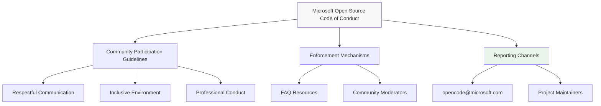
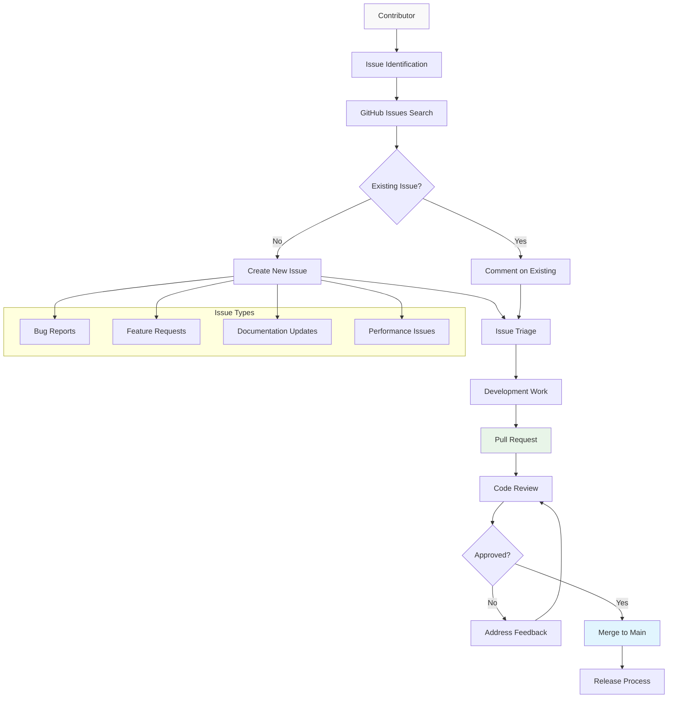
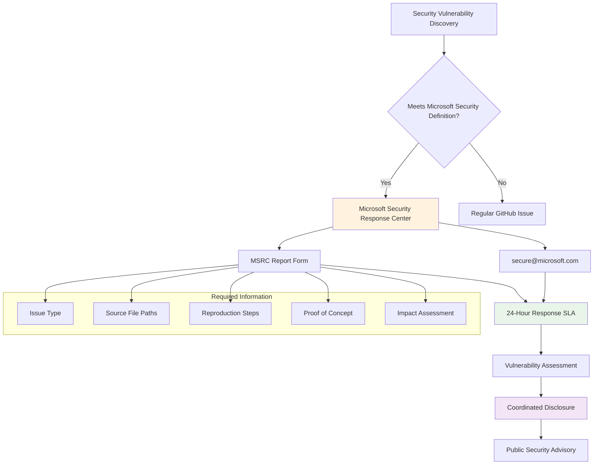

<!-- source: DeepWiki mcp.deepwiki.com · repo microsoft/vidur · page 10 Development and Community · fetched 2026-10-26 -->

# Development and Community

Relevant source files

The following files were used as context for generating this wiki page:

- [CODE_OF_CONDUCT.md](CODE_OF_CONDUCT.md)
- [SECURITY.md](SECURITY.md)
- [SUPPORT.md](SUPPORT.md)

## Purpose and Scope

This section provides guidelines for contributing to the Vidur project, community standards, and development practices. It covers the processes for reporting issues, submitting contributions, and participating in the project community. For detailed information about setting up a development environment and project structure, see [Development Environment](#10.1). For specific community policies and support channels, see [Community Guidelines](#10.2).

## Community Standards

Vidur follows the Microsoft Open Source Code of Conduct, which establishes expectations for participation in Microsoft-sponsored open source communities. All contributors and community members are expected to adhere to these standards.

### Code of Conduct Framework

Sources: [CODE_OF_CONDUCT.md:1-10]()

## Contributing Workflow

The project follows standard open source contribution practices through GitHub, with specific processes for different types of contributions.

### Contribution Process Flow

Sources: [SUPPORT.md:15-17]()

## Issue Reporting and Support

### GitHub Issues Process

The project uses GitHub Issues as the primary mechanism for tracking bugs, feature requests, and other project-related discussions. Contributors should search existing issues before creating new ones to avoid duplicates.

| Issue Type | Description | Required Information |
|------------|-------------|---------------------|
| Bug Report | Software defects or unexpected behavior | Steps to reproduce, expected vs actual behavior, environment details |
| Feature Request | New functionality proposals | Use case description, proposed implementation approach |
| Documentation | Missing or incorrect documentation | Specific sections affected, suggested improvements |
| Performance | Simulation performance issues | Benchmark data, configuration details, profiling information |

### Support Channels

Current support infrastructure is limited to GitHub Issues. The project maintainers are working to establish additional support channels for community assistance.

Sources: [SUPPORT.md:13-21]()

## Security Vulnerability Reporting

Security vulnerabilities require special handling and should not be reported through public GitHub Issues to prevent potential exploitation.

### Security Reporting Process

### Security Contact Information

- **Primary**: [Microsoft Security Response Center](https://msrc.microsoft.com/create-report)
- **Email**: secure@microsoft.com (PGP encryption recommended)
- **Response Time**: 24 hours expected
- **Policy**: Coordinated Vulnerability Disclosure

Sources: [SECURITY.md:9-16](), [SECURITY.md:19-28](), [SECURITY.md:39]()

## Development Practices

### Code Quality Standards

The project maintains code quality through several mechanisms:

- **Type Safety**: Extensive use of Python type hints throughout the codebase
- **Configuration Management**: Structured configuration system using dataclasses
- **Testing**: Comprehensive test coverage for core simulation components
- **Documentation**: Inline documentation and comprehensive wiki

### Project Structure

The Vidur codebase is organized into several key modules that align with the architectural components:

| Module | Purpose | Key Classes |
|--------|---------|-------------|
| `vidur/main.py` | CLI entry point and simulation orchestration | `main()` function |
| `vidur/config/` | Configuration management and dataclass systems | `SimulationConfig`, `FlatClass` |
| `vidur/simulator/` | Core simulation engine | `Simulator`, `BaseGlobalScheduler` |
| `vidur/request_generator/` | Workload generation | `BaseRequestGenerator`, `SyntheticRequestGenerator` |
| `vidur/metrics/` | Performance measurement and analysis | `MetricsStore`, `DataSeries` |

### Development Environment Requirements

For detailed setup instructions and build artifact information, see [Development Environment](#10.1).

## Community Resources

### Communication Channels

- **GitHub Issues**: Primary venue for technical discussions and bug reports
- **GitHub Discussions**: Community Q&A and feature discussions (when enabled)
- **Documentation**: Comprehensive wiki for technical information

### Microsoft Open Source Resources

- [Microsoft Open Source Code of Conduct](https://opensource.microsoft.com/codeofconduct)
- [Code of Conduct FAQ](https://opensource.microsoft.com/codeofconduct/faq)
- [Microsoft Bug Bounty Program](https://aka.ms/security.md/msrc/bounty)

Sources: [CODE_OF_CONDUCT.md:3-9](), [SECURITY.md:31]()

---

