# Page: Overview

# Overview

<details>
<summary>Relevant source files</summary>

The following files were used as context for generating this wiki page:

- [LICENSE](LICENSE)
- [README.md](README.md)
- [assets/chrome_trace.png](assets/chrome_trace.png)

</details>


This document provides a comprehensive introduction to Vidur, an LLM inference system simulator that enables performance analysis, capacity planning, and research experimentation without requiring access to GPU hardware. It covers the system's purpose, key capabilities, architecture, and operational principles.

For detailed setup instructions, see [Getting Started](#2). For in-depth architectural details, see [Core Architecture](#3). For practical usage guidance, see [Running Simulations](#9).

## Purpose and Capabilities

Vidur is a high-fidelity, extensible LLM inference system simulator designed to address critical challenges in deploying and optimizing large language model serving systems. The simulator enables users to study system performance, conduct capacity planning, and test research ideas without the substantial cost and complexity of maintaining GPU infrastructure.

### Primary Use Cases

**Performance Analysis**: Vidur simulates LLM inference workloads to analyze key performance metrics including Time to First Token (TTFT), Time Per Output Token (TPOT), end-to-end request latency, and batch size dynamics. Users can evaluate how different models perform under various workload patterns and system configurations.

**Capacity Planning**: The system helps determine optimal deployment configurations by modeling the relationship between hardware resources, model requirements, and service level objectives. Users can explore trade-offs between cost, performance, and quality of service across different hardware configurations.

**Research and Development**: Vidur provides an extensible platform for testing new scheduling algorithms, optimization techniques like speculative decoding, and novel serving architectures. Researchers can prototype and evaluate ideas rapidly without needing physical hardware.

### Key Technical Capabilities

| Capability | Description |
|------------|-------------|
| **Hardware Independence** | Simulates GPU clusters using profiling data, eliminating need for physical hardware |
| **Multi-Model Support** | Supports major LLM families including Llama, CodeLlama, InternLM, and Qwen models |
| **Parallelism Strategies** | Models tensor parallelism, pipeline parallelism, and hybrid configurations |
| **Realistic Workloads** | Supports both synthetic request generation and trace-based replay of real workloads |
| **Extensible Scheduling** | Pluggable scheduling algorithms at both global and replica levels |
| **Comprehensive Metrics** | Detailed performance analytics with visualization and monitoring capabilities |

Sources: [README.md:1-18]()

## System Architecture

Vidur implements a discrete event-driven simulation architecture that models the complete LLM inference pipeline from request arrival to response completion.

### Core System Components

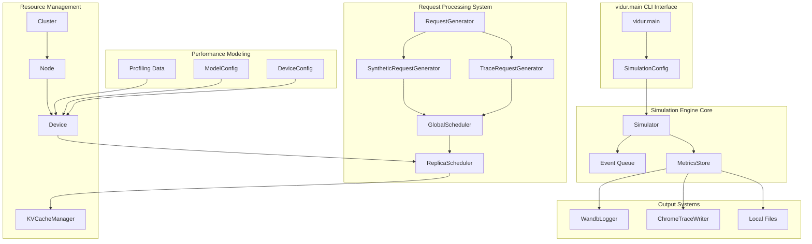

The architecture separates concerns into distinct subsystems that interact through well-defined interfaces. The `Simulator` class serves as the central orchestrator, managing the discrete event queue and coordinating between request processing, resource management, and performance modeling components.

Sources: [README.md:57-85]()

### Simulation Workflow

```mermaid
graph LR
    subgraph "Request Generation Phase"
        WorkloadSpec["Workload Specification"] --> RequestGenerator["RequestGenerator"]
        RequestGenerator --> ArrivalEvent["RequestArrivalEvent"]
    end
    
    subgraph "Scheduling Phase"
        ArrivalEvent --> GlobalScheduler["GlobalScheduler"]
        GlobalScheduler --> ReplicaScheduler["ReplicaScheduler"]
        ReplicaScheduler --> BatchScheduler["Batch Formation"]
    end
    
    subgraph "Execution Simulation"
        BatchScheduler --> PrefillStage["Prefill Stage"]
        PrefillStage --> DecodeStage["Decode Stage"]
        DecodeStage --> ResponseComplete["Response Completion"]
    end
    
    subgraph "Performance Tracking"
        PrefillStage --> MetricsCollection["Metrics Collection"]
        DecodeStage --> MetricsCollection
        ResponseComplete --> MetricsCollection
        MetricsCollection --> Analysis["Performance Analysis"]
    end
```

The simulation workflow processes requests through the complete inference pipeline. Each request undergoes scheduling decisions, resource allocation, and execution simulation using pre-collected profiling data to model realistic hardware performance characteristics.

Sources: [README.md:6-11]()

## Hardware and Model Support

Vidur supports a comprehensive range of hardware configurations and model architectures commonly used in production LLM deployments.

### Supported Hardware Configurations

| Hardware Type | Specifications | Supported Models |
|---------------|----------------|------------------|
| **H100 DGX** | 8x H100 GPUs, NVLink interconnect | All supported models |
| **A100 80GB DGX** | 8x A100 80GB GPUs, NVLink interconnect | All supported models |
| **4xA100 80GB Pairwise** | 4x A100 80GB GPUs, Pairwise NVLink | All supported models |
| **8xA40 Pairwise** | 8x A40 GPUs, Pairwise NVLink | Llama-2, CodeLlama, InternLM, Qwen |

### Model Architecture Support

Vidur includes pre-configured support for major LLM families with varying parameter counts and context lengths:

- **Llama-3 Series**: 8B and 70B parameter models with 16K context length
- **Llama-2 Series**: 7B and 70B parameter models with 4K context length  
- **CodeLlama**: 34B parameter instruction-tuned model
- **InternLM**: 20B parameter model
- **Qwen**: 72B parameter model

The system supports flexible parallelism configurations including tensor parallelism (TP) dimensions that divide evenly into the available GPUs, and pipeline parallelism (PP) dimensions that divide the model's layer count.

Sources: [README.md:21-39]()

## Simulation Without GPUs

Vidur's core innovation is enabling realistic LLM inference simulation without requiring actual GPU hardware. This is achieved through a sophisticated profiling-based performance modeling system.

### Profiling Data Foundation

The system uses pre-collected profiling data that captures the performance characteristics of various hardware configurations running different model architectures. This profiling data includes:

- **Compute Performance**: Execution times for attention mechanisms and MLP operations across different batch sizes and sequence lengths
- **Network Performance**: Communication overhead for tensor parallelism (allreduce operations) and pipeline parallelism (send/receive operations)
- **Memory Characteristics**: Memory allocation patterns and KV cache management behavior

### Performance Model Integration

During simulation, Vidur consults this profiling data to determine realistic execution times for each operation. The `Device` class integrates model configurations with hardware specifications and profiling data to compute expected performance metrics. This approach enables the simulator to model complex interactions between workload characteristics, model architecture, and hardware capabilities without executing actual neural network computations.

The profiling approach allows Vidur to maintain high fidelity while remaining accessible to researchers and practitioners who lack access to expensive GPU infrastructure for experimentation and capacity planning.

Sources: [README.md:18](), [README.md:33]()

---

# Page: Getting Started

# Getting Started

<details>
<summary>Relevant source files</summary>

The following files were used as context for generating this wiki page:

- [LICENSE](LICENSE)
- [README.md](README.md)
- [assets/chrome_trace.png](assets/chrome_trace.png)

</details>


This page provides a step-by-step guide to installing Vidur, configuring your first simulation, and running it successfully. It covers the essential setup process, basic configuration concepts, and how to interpret simulation results.

For detailed information about configuration options, see [Configuration System](#4). For advanced simulation scenarios and parameter tuning, see [Running Simulations](#9).

## Prerequisites

Before installing Vidur, ensure you have:

- Python 3.8 or higher
- Git for repository access
- (Optional) A Weights & Biases account for experiment tracking

## Installation

### Setup Process Flow

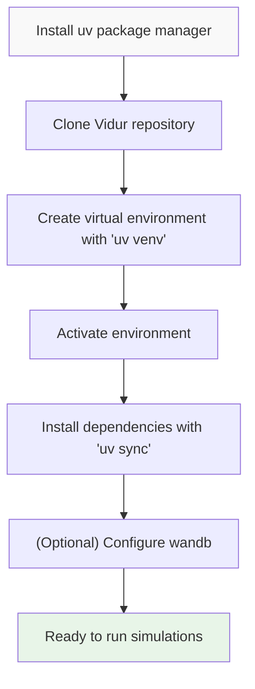

**Installation Steps**

1. **Install uv package manager**
   
   Follow the installation instructions at https://docs.astral.sh/uv/getting-started/installation/

2. **Set up the project environment**
   
   ```bash
   # Clone the repository
   git clone https://github.com/microsoft/vidur
   cd vidur
   
   # Create virtual environment
   uv venv
   
   # Activate environment
   source .venv/bin/activate
   
   # Install dependencies
   uv sync
   ```

3. **Configure Weights & Biases (Optional)**
   
   If you want to use wandb for experiment tracking:
   ```bash
   wandb login --host https://<your-org>.wandb.io
   ```
   
   To disable wandb:
   ```bash
   export WANDB_MODE=disabled
   ```

Sources: [README.md:40-55]()

## Configuration Overview

Vidur uses a hierarchical configuration system where CLI arguments map to specific configuration dataclasses. Understanding this structure helps you customize simulations effectively.

### Configuration Architecture

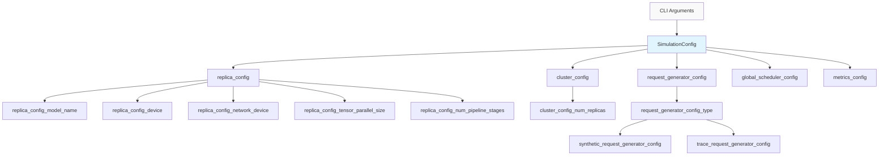

**Key Configuration Categories**

| Category | Purpose | Key Parameters |
|----------|---------|----------------|
| Replica Config | Model and hardware setup | `replica_config_model_name`, `replica_config_device` |
| Cluster Config | Infrastructure scale | `cluster_config_num_replicas` |
| Request Generator | Workload definition | `request_generator_config_type` |
| Scheduler Config | Request scheduling | `global_scheduler_config_type`, `replica_scheduler_config_type` |

Sources: [README.md:62-81]()

## Running Your First Simulation

### Basic Simulation Command

The following command demonstrates a complete simulation setup using the `vidur.main` module:

```bash
python -m vidur.main \
--time_limit 10800 \
--replica_config_model_name meta-llama/Meta-Llama-3-8B \
--replica_config_device h100 \
--replica_config_network_device h100_dgx \
--cluster_config_num_replicas 8 \
--replica_config_tensor_parallel_size 1 \
--replica_config_num_pipeline_stages 1 \
--request_generator_config_type synthetic \
--synthetic_request_generator_config_num_requests 128 \
--length_generator_config_type trace \
--trace_request_length_generator_config_trace_file ./data/processed_traces/mooncake_conversation_trace.csv \
--interval_generator_config_type poisson \
--poisson_request_interval_generator_config_qps 8.0 \
--global_scheduler_config_type round_robin \
--replica_scheduler_config_type vllm_v1 \
--vllm_v1_scheduler_config_chunk_size 512 \
--vllm_v1_scheduler_config_batch_size_cap 512 \
--cache_config_enable_prefix_caching
```

### Simulation Flow

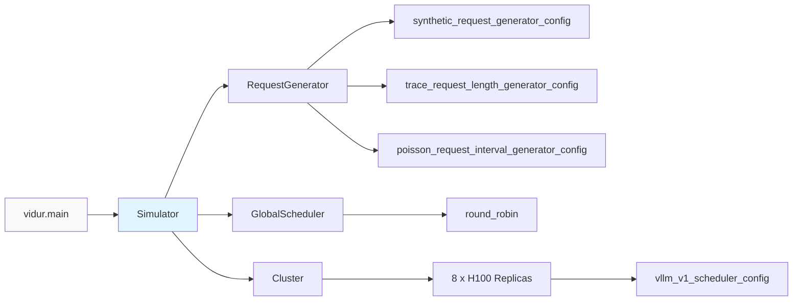

**What This Simulation Does**

- **Hardware**: Simulates 8 H100 GPU replicas in a DGX configuration
- **Model**: Runs Meta-Llama-3-8B with single-GPU tensor parallelism
- **Workload**: Generates 128 synthetic requests at 8 QPS using Poisson distribution
- **Request Lengths**: Uses realistic conversation trace data from `mooncake_conversation_trace.csv`
- **Scheduling**: Uses round-robin global scheduling with vLLM v1 replica scheduler
- **Duration**: Runs for 10,800 seconds (3 hours) or until all requests complete

### Getting Help

To see all available configuration parameters:

```bash
python -m vidur.main -h
```

Sources: [README.md:57-85]()

## Understanding Simulation Output

### Output Structure

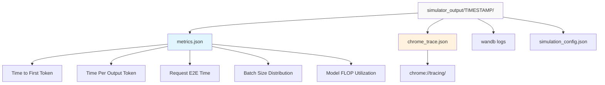

**Key Output Files**

| File | Purpose | Usage |
|------|---------|--------|
| `metrics.json` | Performance measurements | Analysis and capacity planning |
| `chrome_trace.json` | Timeline visualization | Debug scheduling and bottlenecks |
| `simulation_config.json` | Configuration snapshot | Reproduce simulation settings |
| `wandb logs` | Experiment tracking | Compare across simulation runs |

### Key Performance Metrics

The simulation produces several critical performance indicators:

- **TTFT (Time to First Token)**: Prefill latency for interactive responsiveness
- **TPOT (Time Per Output Token)**: Decode throughput for generation speed  
- **Request E2E Time**: Complete request processing duration
- **Batch Size**: Dynamic batching efficiency
- **MFU (Model FLOP Utilization)**: Hardware efficiency measurement

### Visualizing Results

**Chrome Trace Analysis**

1. Navigate to `chrome://tracing/` in your browser
2. Load the `chrome_trace.json` file from your simulation output
3. Examine request timelines, GPU utilization, and scheduling decisions

The trace provides detailed insights into:
- Request queuing and scheduling patterns
- GPU compute and memory utilization
- Batching and preemption behavior
- Performance bottlenecks

Sources: [README.md:87-92]()

## Next Steps

After completing your first simulation:

1. **Explore Configuration Options**: See [Configuration System](#4) for detailed parameter descriptions
2. **Try Different Models**: Check [Hardware and Model Configurations](#4.2) for supported models and hardware
3. **Custom Workloads**: Learn about [Request Generation](#5) for realistic workload simulation
4. **Performance Analysis**: Review [Metrics and Analysis](#8) for in-depth result interpretation
5. **Advanced Scenarios**: See [Running Simulations](#9) for capacity planning and optimization studies

To explore all available parameters and their descriptions:

```bash
python -m vidur.main -h
```

For detailed metric descriptions and analysis guidance, consult the metrics documentation referenced in the simulation output.

Sources: [README.md:85]()

---

# Page: Core Architecture

# Core Architecture

<details>
<summary>Relevant source files</summary>

The following files were used as context for generating this wiki page:

- [vidur/config/config.py](vidur/config/config.py)
- [vidur/request_generator/synthetic_request_generator.py](vidur/request_generator/synthetic_request_generator.py)
- [vidur/simulator.py](vidur/simulator.py)

</details>


This document provides an architectural overview of Vidur's core simulation framework, focusing on the primary components and their relationships. It covers the main orchestration layer, event-driven simulation engine, configuration system, and component interaction patterns.

For information about specific scheduling algorithms and resource management, see [Scheduling and Resource Management](#6). For details about performance modeling and prediction systems, see [Performance Modeling](#7). For comprehensive metrics collection and analysis capabilities, see [Metrics and Analysis](#8).

## System Overview

Vidur implements a discrete event simulation architecture designed to model large language model (LLM) inference systems at scale. The system is built around a central `Simulator` class that orchestrates multiple subsystems through an event-driven execution model.

### Primary System Components

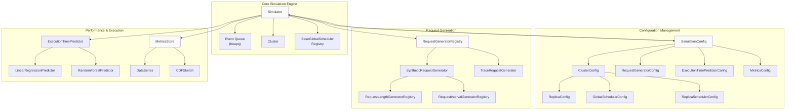

**Sources:** [vidur/simulator.py:17-49](), [vidur/config/config.py:627-656]()

## Core Simulation Engine

The simulation engine centers around the `Simulator` class, which implements a discrete event simulation model using a priority queue for event scheduling and processing.

### Event-Driven Architecture

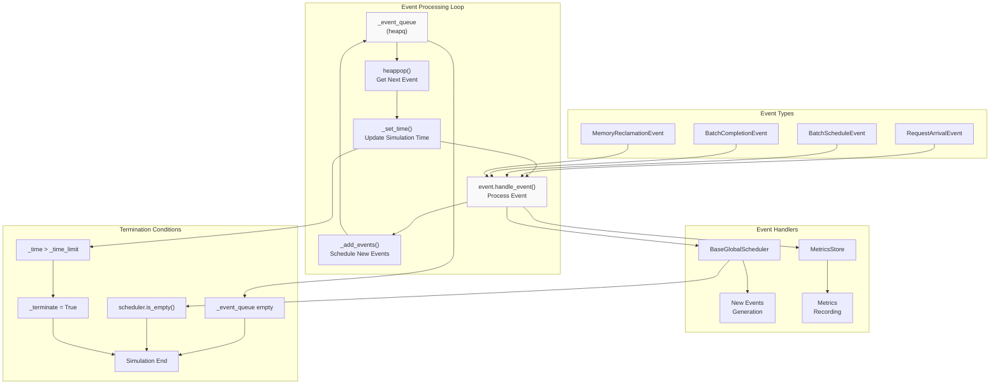

The simulation engine executes through a main event loop in the `run()` method:

- **Event Queue Management**: Uses Python's `heapq` for efficient priority queue operations [vidur/simulator.py:27,64-68]()
- **Time Progression**: Simulation time advances only when processing events [vidur/simulator.py:66,109-116]()
- **Event Generation**: Each event handler can spawn new events, maintaining the simulation flow [vidur/simulator.py:67-68,99-102]()
- **Termination Logic**: Simulation ends when the event queue is empty, time limit is reached, or scheduler reports completion [vidur/simulator.py:64,78,111-115]()

**Sources:** [vidur/simulator.py:59-81](), [vidur/simulator.py:96-116]()

## Configuration Architecture

Vidur implements a sophisticated hierarchical configuration system that supports both programmatic configuration and comprehensive CLI argument generation.

### Configuration Hierarchy

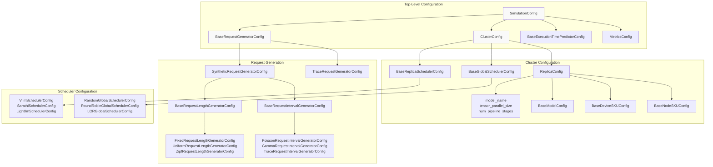

### Polymorphic Configuration System

The configuration system uses `BasePolyConfig` to enable runtime type selection through the `_type` field injection mechanism:

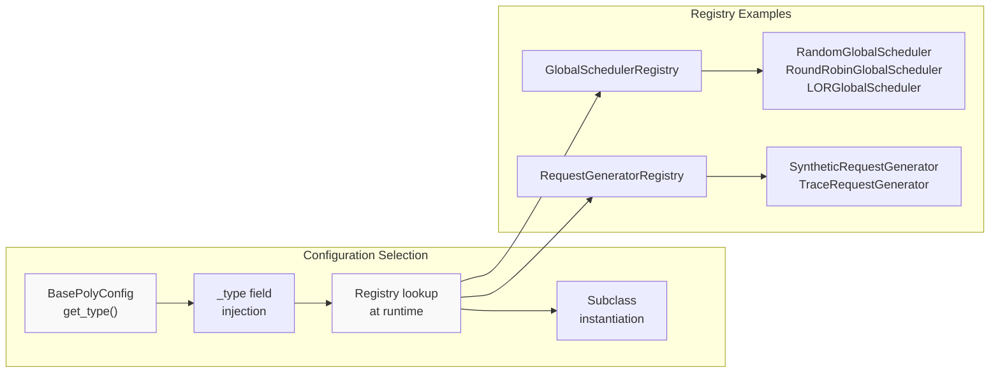

**Sources:** [vidur/config/config.py:8](), [vidur/config/config.py:468-491](), [vidur/config/config.py:255-329]()

## Component Initialization and Orchestration

The `Simulator` class orchestrates component initialization through dependency injection and registry patterns:

### Component Initialization Flow

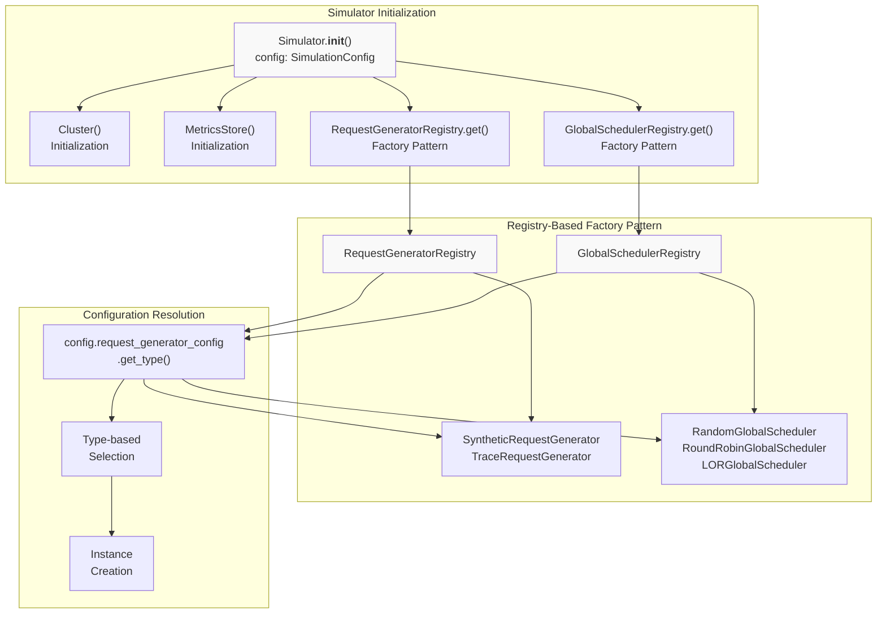

Key initialization patterns:

- **Registry Pattern**: Component types are resolved through registry lookups using `get_type()` methods [vidur/simulator.py:38-46]()
- **Dependency Injection**: The `Simulator` injects dependencies (scheduler, metrics store) into components during creation
- **Configuration Propagation**: Nested configurations are passed down to appropriate subsystems [vidur/simulator.py:32-36]()

**Sources:** [vidur/simulator.py:18-49](), [vidur/request_generator/synthetic_request_generator.py:16-29]()

## Event Processing and State Management  

The simulation maintains state through event processing and component interaction:

### State Flow and Event Handling

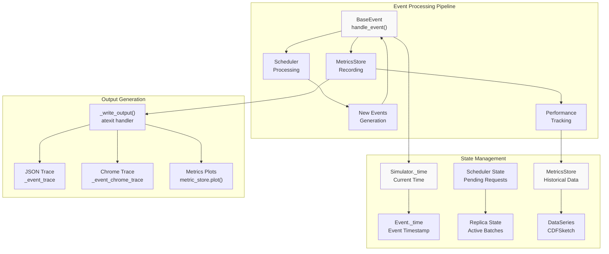

The simulation manages multiple state dimensions:

- **Temporal State**: Simulation time progresses through event timestamps [vidur/simulator.py:66,109-110]()
- **Request State**: Tracking requests from arrival through completion via events and scheduler state
- **Resource State**: GPU memory, batch scheduling, and utilization managed by cluster components
- **Metrics State**: Continuous collection of performance data through the `MetricsStore` [vidur/simulator.py:37]()

**Sources:** [vidur/simulator.py:64-81](), [vidur/simulator.py:82-94](), [vidur/simulator.py:117-128]()

## Request Generation Integration

The request generation subsystem integrates with the core simulation through event scheduling:

### Request Generation Flow

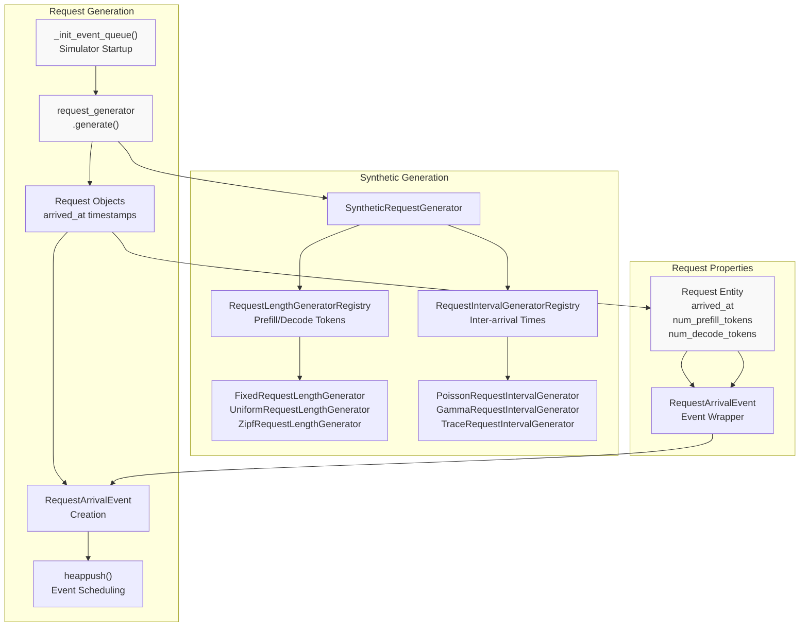

The request generation system demonstrates the modular architecture:

- **Pluggable Generators**: Registry pattern allows different request generation strategies [vidur/simulator.py:38-41]()
- **Statistical Modeling**: Support for various probability distributions for realistic workload modeling [vidur/request_generator/synthetic_request_generator.py:21-28]()
- **Event Integration**: Generated requests are converted to `RequestArrivalEvent` objects for event queue processing [vidur/simulator.py:104-107]()

**Sources:** [vidur/simulator.py:103-108](), [vidur/request_generator/synthetic_request_generator.py:52-82]()

---

# Page: Simulation Engine

# Simulation Engine

<details>
<summary>Relevant source files</summary>

The following files were used as context for generating this wiki page:

- [vidur/config/config.py](vidur/config/config.py)
- [vidur/request_generator/synthetic_request_generator.py](vidur/request_generator/synthetic_request_generator.py)
- [vidur/simulator.py](vidur/simulator.py)

</details>


## Purpose and Scope

The Simulation Engine is the core orchestration component of the Vidur LLM inference simulator. It implements an event-driven discrete simulation system that coordinates request processing across distributed inference replicas. This document covers the `Simulator` class architecture, event queue management, and the main simulation loop that drives the entire system.

For information about request processing within replicas, see [Request Processing Pipeline](#3.2). For configuration of simulation parameters, see [Configuration System](#4).

## Architecture Overview

The `Simulator` class serves as the central orchestrator that integrates all major subsystems. It manages the simulation timeline through a priority-based event queue and coordinates interactions between request generators, schedulers, clusters, and metrics collection systems.

### Core Components Integration

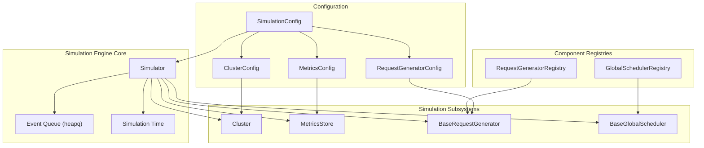

**Component Orchestration Flow**

The `Simulator` constructor orchestrates component initialization in a specific order to ensure proper dependencies. It creates the cluster infrastructure, metrics collection system, request generation pipeline, and global scheduling logic.

Sources: [vidur/simulator.py:17-49]()

### Event-Driven Architecture

The simulation engine operates through a discrete event system where all state changes occur through event processing. Events are scheduled with precise timestamps and processed in chronological order.

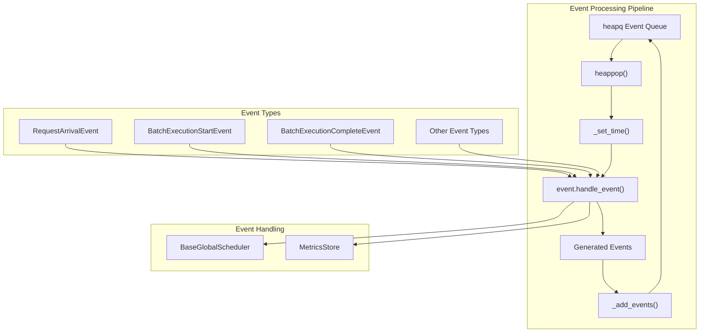

**Priority Queue Implementation**

The event queue uses Python's `heapq` module with events prioritized by timestamp. Each event contains a `_priority_number` field that ensures deterministic ordering for events with identical timestamps.

Sources: [vidur/simulator.py:27-28,96-101]()

## Simulation Loop

The main simulation loop implements the core discrete event simulation algorithm. It processes events chronologically until either the event queue is empty or a time limit is reached.

### Main Loop Algorithm

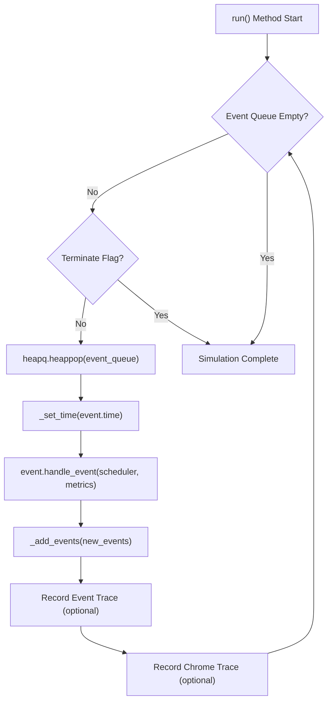

**Event Processing Details**

Each event's `handle_event()` method receives references to the global scheduler and metrics store. Events can generate zero or more new events that are added back to the priority queue. This allows for complex event cascades such as batch completion triggering new batch formation.

Sources: [vidur/simulator.py:64-78]()

### Time Management

The simulator maintains a global simulation time that advances as events are processed. Time limits can be configured to terminate long-running simulations.

```python
# Time management in simulator loop
self._set_time(event._time)

def _set_time(self, time: float) -> None:
    self._time = time
    if self._time > self._time_limit:
        logger.info(f"Time limit reached: {self._time_limit}s terminating the simulation.")
        self._terminate = True
```

Sources: [vidur/simulator.py:109-116]()

## Component Integration

The simulator integrates with major system components through well-defined interfaces, enabling modular replacement of different scheduling algorithms, request generators, and metrics systems.

### Subsystem Access Patterns

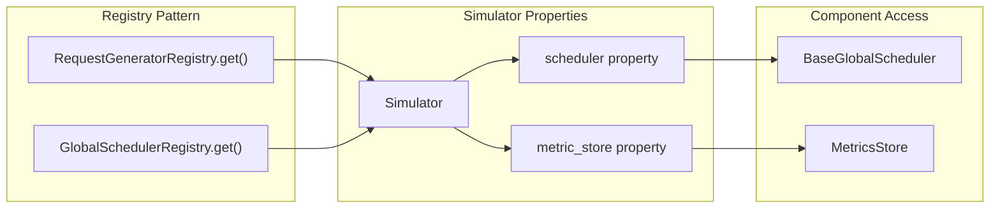

**Component Lifecycle Management**

The simulator manages component lifecycles through initialization, runtime access, and cleanup phases. It registers an `atexit` handler to ensure proper output generation even if the simulation terminates unexpectedly.

Sources: [vidur/simulator.py:49,52-57]()

## Output Generation

The simulation engine supports multiple output formats for analysis and debugging. Output generation occurs both during simulation (for tracing) and at completion (for metrics and final reports).

### Output Types and Configuration

| Output Type | Configuration Flag | File Format | Purpose |
|-------------|-------------------|-------------|---------|
| Metrics | `write_metrics` | JSON/Plots | Performance analysis |
| JSON Event Trace | `write_json_trace` | JSON | Event debugging |
| Chrome Trace | `enable_chrome_trace` | JSON | Timeline visualization |

**Trace Generation Flow**

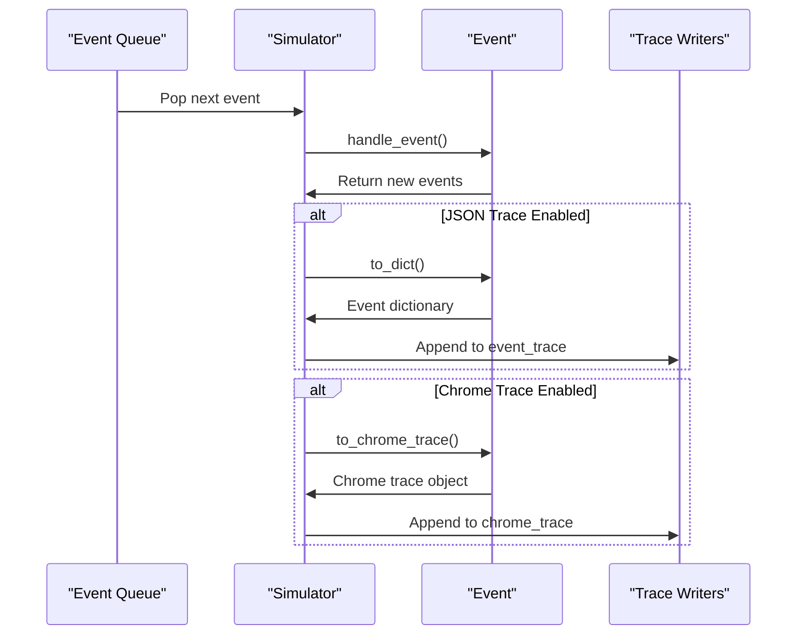

**Output File Generation**

The simulator writes output files through the `_write_output()` method, which is called both at normal completion and via the `atexit` handler for abnormal termination.

Sources: [vidur/simulator.py:82-95,117-128]()

## Initialization Sequence

The simulator follows a specific initialization sequence to establish all dependencies and prepare the event queue with initial events.

### Component Creation Order

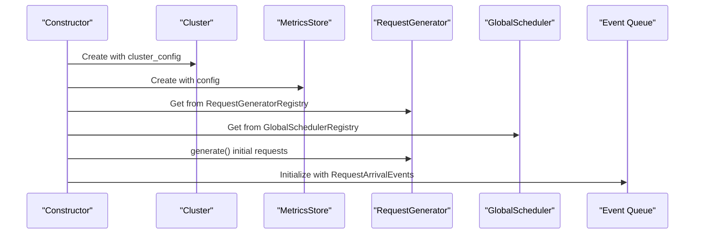

**Request Generation and Queue Seeding**

The initialization process generates all requests upfront through the configured request generator and seeds the event queue with `RequestArrivalEvent` instances. This approach allows the simulator to know the complete workload characteristics before simulation begins.

Sources: [vidur/simulator.py:103-108]()

---

# Page: Request Processing Pipeline

# Request Processing Pipeline

<details>
<summary>Relevant source files</summary>

The following files were used as context for generating this wiki page:

- [assets/batch_size.png](assets/batch_size.png)
- [assets/decode_time_execution_plus_preemption_normalized.png](assets/decode_time_execution_plus_preemption_normalized.png)
- [assets/prefill_e2e_time.png](assets/prefill_e2e_time.png)
- [assets/request_e2e_time.png](assets/request_e2e_time.png)
- [vidur/config/config.py](vidur/config/config.py)
- [vidur/request_generator/synthetic_request_generator.py](vidur/request_generator/synthetic_request_generator.py)
- [vidur/simulator.py](vidur/simulator.py)

</details>


## Purpose and Scope

This document describes how requests flow through the Vidur simulation system from initial arrival to completion. It covers the event-driven processing pipeline, scheduling decisions, and metrics collection that occur during request execution. For information about request generation methods, see [Request Generation](#5). For details about scheduling algorithms and resource management, see [Scheduling and Resource Management](#6). For performance modeling specifics, see [Performance Modeling](#7).

## Request Flow Overview

The request processing pipeline in Vidur follows an event-driven architecture orchestrated by the `Simulator` class. Requests progress through several distinct phases, each handled by specialized components working together to provide accurate LLM inference simulation.

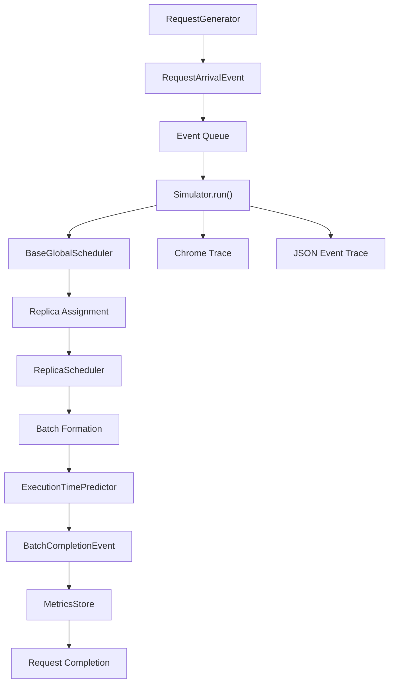

**Request Processing Flow Overview**

Sources: [vidur/simulator.py:1-129](), [vidur/config/config.py:1-678]()

## Event-Driven Architecture

The core of request processing is built around a priority queue-based event system where all operations are scheduled and executed as discrete events in chronological order.

### Simulator Event Loop

The `Simulator` class manages the main event processing loop:

```mermaid
flowchart TD
    A["Simulator.__init__()"] --> B["_init_event_queue()"]
    B --> C["RequestGeneratorRegistry.get()"]
    C --> D["Generate RequestArrivalEvent objects"]
    D --> E["heapq.heappush(event_queue)"]
    E --> F["Simulator.run()"]
    
    F --> G["heapq.heappop(event_queue)"]
    G --> H["event.handle_event(scheduler, metric_store)"]
    H --> I["Generate new events"]
    I --> J["_add_events(new_events)"]
    J --> G
    
    H --> K["Chrome trace logging"]
    H --> L["JSON trace logging"]
```

**Event Loop Processing Architecture**

The event loop continues until either the event queue is empty or the configured time limit is reached. Each event's `handle_event()` method can return new events that get added back to the queue.

Sources: [vidur/simulator.py:59-81](), [vidur/simulator.py:96-108]()

## Request Lifecycle Events

### Request Arrival

Requests enter the system through `RequestArrivalEvent` objects created during initialization:

```mermaid
flowchart TD
    A["Request Generation"] --> B["Request Object"]
    B --> C["RequestArrivalEvent(arrived_at, request)"]
    C --> D["Event Queue"]
    
    E["Request Properties"] --> F["arrived_at: float"]
    E --> G["num_prefill_tokens: int"]
    E --> H["num_decode_tokens: int"]
    
    B --> E
```

**Request Object Structure**

Sources: [vidur/simulator.py:104-107](), [vidur/request_generator/synthetic_request_generator.py:46-50]()

### Scheduling and Assignment

When a `RequestArrivalEvent` is processed, it triggers the global scheduling system:

```mermaid
flowchart TD
    A["RequestArrivalEvent.handle_event()"] --> B["GlobalScheduler"]
    B --> C{"Scheduling Strategy"}
    
    C --> D["RandomGlobalScheduler"]
    C --> E["RoundRobinGlobalScheduler"] 
    C --> F["LORGlobalScheduler"]
    
    D --> G["Random replica selection"]
    E --> H["Round-robin replica selection"]
    F --> I["Least Outstanding Requests"]
    
    G --> J["Replica Assignment"]
    H --> J
    I --> J
    
    J --> K["ReplicaScheduler.add_request()"]
```

**Global Scheduling Decision Flow**

The global scheduler is responsible for selecting which replica should handle each incoming request based on the configured strategy.

Sources: [vidur/config/config.py:472-491](), [vidur/simulator.py:42-46]()

## Replica-Level Processing

### Batch Formation

Once assigned to a replica, requests undergo batching based on the replica's scheduler configuration:

```mermaid
flowchart TD
    A["Request Assignment"] --> B{"ReplicaScheduler Type"}
    
    B --> C["VllmScheduler"]
    B --> D["SarathiScheduler"]
    B --> E["LightllmScheduler"]
    B --> F["OrcaScheduler"]
    
    C --> G["Continuous Batching"]
    D --> H["Chunked Prefill"]
    E --> I["Iteration-based Batching"]
    F --> J["Orca-style Batching"]
    
    G --> K["Batch Object Creation"]
    H --> K
    I --> K
    J --> K
    
    K --> L["ExecutionTimePredictor"]
```

**Replica Scheduling and Batching**

Each replica scheduler implements different batching strategies optimized for specific serving patterns.

Sources: [vidur/config/config.py:276-328]()

### Execution Time Prediction

The system predicts execution times using machine learning models trained on profiling data:

```mermaid
flowchart TD
    A["Batch Created"] --> B["ExecutionTimePredictorConfig"]
    B --> C{"Predictor Type"}
    
    C --> D["RandomForestPredictor"]
    C --> E["LinearRegressionPredictor"]
    
    D --> F["Load ML Model"]
    E --> G["Load Regression Model"]
    
    F --> H["Predict Execution Time"]
    G --> H
    
    H --> I["Consider Hardware Config"]
    I --> J["Apply Profiling Data"]
    J --> K["Generate BatchCompletionEvent"]
    
    L["Profiling Data Sources"] --> M["MLP operations"]
    L --> N["Attention operations"]
    L --> O["Network collectives"]
    L --> P["CPU overheads"]
    
    I --> L
```

**Execution Time Prediction Pipeline**

Sources: [vidur/config/config.py:564-607](), [vidur/config/config.py:494-563]()

## Event Types and Transitions

The system uses several event types to model different phases of request processing:

```mermaid
stateDiagram-v2
    [*] --> RequestArrivalEvent
    RequestArrivalEvent --> SchedulingEvent
    SchedulingEvent --> BatchFormationEvent
    BatchFormationEvent --> ExecutionStartEvent
    ExecutionStartEvent --> BatchCompletionEvent
    BatchCompletionEvent --> TokenCompletionEvent
    TokenCompletionEvent --> TokenCompletionEvent : Decode Phase
    TokenCompletionEvent --> RequestCompletionEvent
    RequestCompletionEvent --> [*]
    
    note right of RequestArrivalEvent
        Initial event created during
        simulation initialization
    end note
    
    note right of BatchCompletionEvent
        Uses ExecutionTimePredictor
        to schedule completion time
    end note
```

**Request Processing State Machine**

Each event type represents a specific phase in request processing and can generate subsequent events to continue the pipeline.

Sources: [vidur/simulator.py:67-68]()

## Metrics Collection Integration

Throughout the request processing pipeline, comprehensive metrics are collected:

```mermaid
flowchart TD
    A["Event Processing"] --> B["MetricsStore"]
    B --> C["Request Metrics"]
    B --> D["Batch Metrics"]
    B --> E["System Metrics"]
    
    C --> F["TTFT (Time to First Token)"]
    C --> G["TPOT (Time per Output Token)"]
    C --> H["E2E Latency"]
    
    D --> I["Batch Size Distribution"]
    D --> J["Processing Times"]
    
    E --> K["Throughput (QPS)"]
    E --> L["GPU Utilization"]
    
    M["Chrome Trace"] --> N["Event Timeline Visualization"]
    O["JSON Trace"] --> P["Structured Event Log"]
    
    B --> M
    B --> O
```

**Metrics Collection Architecture**

The metrics system captures performance data at multiple granularities for comprehensive analysis.

Sources: [vidur/simulator.py:70-76](), [vidur/config/config.py:332-425]()

## Configuration Integration

The request processing pipeline is highly configurable through the hierarchical configuration system:

| Configuration Category | Key Classes | Purpose |
|----------------------|-------------|---------|
| Request Generation | `BaseRequestGeneratorConfig` | Controls request arrival patterns |
| Global Scheduling | `BaseGlobalSchedulerConfig` | Defines replica selection strategy |
| Replica Scheduling | `BaseReplicaSchedulerConfig` | Configures batching behavior |
| Execution Prediction | `BaseExecutionTimePredictorConfig` | Sets performance modeling parameters |
| Hardware Modeling | `ReplicaConfig` | Specifies device and parallelism settings |
| Metrics Collection | `MetricsConfig` | Controls data collection and output |

**Configuration Components Affecting Request Processing**

Sources: [vidur/config/config.py:193-253](), [vidur/config/config.py:428-465](), [vidur/config/config.py:610-624]()

## Processing Pipeline Optimizations

The pipeline includes several optimizations for simulation efficiency:

### Event Prioritization

Events are processed using a priority queue where earlier events (lower timestamps) are handled first:

```python
heapq.heappush(self._event_queue, (event._priority_number, event))
```

### Lazy Event Generation

Events are generated only when needed, avoiding unnecessary computation for events that may not occur due to simulation termination.

### Configurable Tracing

Both Chrome tracing and JSON event logging can be enabled/disabled based on analysis needs to reduce overhead.

Sources: [vidur/simulator.py:96-97](), [vidur/simulator.py:70-76]()

The request processing pipeline forms the core execution engine of Vidur, providing accurate simulation of LLM inference workloads through its event-driven architecture and comprehensive modeling of scheduling, batching, and execution phases.

---

# Page: Configuration System

# Configuration System

<details>
<summary>Relevant source files</summary>

The following files were used as context for generating this wiki page:

- [vidur/config/config.py](vidur/config/config.py)
- [vidur/config/flat_dataclass.py](vidur/config/flat_dataclass.py)
- [vidur/request_generator/synthetic_request_generator.py](vidur/request_generator/synthetic_request_generator.py)
- [vidur/simulator.py](vidur/simulator.py)

</details>


The Configuration System is responsible for managing all simulation parameters in Vidur through a sophisticated hierarchical dataclass architecture that automatically generates command-line interface (CLI) arguments from nested configuration objects. This system enables users to configure complex simulation scenarios while maintaining type safety and supporting polymorphic configuration selection at runtime.

For information about running simulations with these configurations, see [Running Simulations](#9). For details on extending the configuration system with new components, see [Extending Vidur](#11).

## Overview

The configuration system solves the challenge of exposing deeply nested configuration hierarchies as flat CLI arguments while preserving the original nested structure for internal use. It consists of three main components:

- **Flat Dataclass System**: Automatically flattens nested dataclass configurations into CLI-parseable arguments
- **Polymorphic Configuration**: Enables runtime selection of different implementations through `BasePolyConfig`
- **Configuration Hierarchy**: Organizes all simulation parameters into logical groupings

## Configuration Flow Architecture

The following diagram illustrates how configurations flow from CLI arguments to the core simulation components:

```mermaid
flowchart TD
    A["CLI Arguments"] --> B["create_flat_dataclass()"]
    B --> C["FlatClass.create_from_cli_args()"]
    C --> D["ArgumentParser.parse_args()"]
    D --> E["reconstruct_original_dataclass()"]
    E --> F["SimulationConfig"]
    
    F --> G["ClusterConfig"]
    F --> H["BaseRequestGeneratorConfig"]
    F --> I["BaseExecutionTimePredictorConfig"]
    F --> J["MetricsConfig"]
    
    G --> K["ReplicaConfig"]
    G --> L["BaseGlobalSchedulerConfig"]
    G --> M["BaseReplicaSchedulerConfig"]
    
    K --> N["BaseModelConfig"]
    K --> O["BaseDeviceSKUConfig"]
    K --> P["BaseNodeSKUConfig"]
    
    H --> Q["SyntheticRequestGeneratorConfig"]
    H --> R["TraceRequestGeneratorConfig"]
    
    Q --> S["BaseRequestLengthGeneratorConfig"]
    Q --> T["BaseRequestIntervalGeneratorConfig"]
    
    style F fill:#e1f5fe
    style B fill:#fff3e0
    style E fill:#fff3e0
```

**Configuration Flow from CLI to Nested Objects**

Sources: [vidur/config/flat_dataclass.py:139-231](), [vidur/config/config.py:660-665](), [vidur/simulator.py:18-46]()

## Flat Dataclass System

The core innovation of Vidur's configuration system is the automatic flattening of nested dataclass hierarchies into CLI arguments. The `create_flat_dataclass()` function performs this transformation through recursive traversal and topological sorting.

```mermaid
graph TB
    A["SimulationConfig"] --> B["process_dataclass()"]
    B --> C["Field Type Analysis"]
    C --> D{"Field Type?"}
    
    D -->|"BasePolyConfig"| E["Add _type field"]
    D -->|"Nested Dataclass"| F["Recursive Processing"]
    D -->|"Primitive Type"| G["Direct Flattening"]
    
    E --> H["Process All Subclasses"]
    F --> I["Add to Dependencies"]
    G --> J["Add to meta_fields"]
    
    H --> K["topological_sort()"]
    I --> K
    J --> K
    
    K --> L["make_dataclass('FlatClass')"]
    L --> M["Add Helper Methods"]
    M --> N["FlatClass with CLI Support"]
    
    subgraph "Helper Methods"
        O["create_from_cli_args()"]
        P["reconstruct_original_dataclass()"]
    end
    
    M --> O
    M --> P
```

**Flat Dataclass Creation Process**

The flattening process handles three types of fields:

| Field Type | Processing Strategy | Example |
|------------|-------------------|---------|
| Primitive Types | Direct flattening with prefixes | `cluster_config.num_replicas` → `--cluster_config_num_replicas` |
| Nested Dataclasses | Recursive processing with dependencies | `ReplicaConfig` → Process all its fields |
| Polymorphic Configs | Add `_type` field + process all subclasses | `BaseReplicaSchedulerConfig` → `--replica_scheduler_config_type` |

Sources: [vidur/config/flat_dataclass.py:139-231](), [vidur/config/flat_dataclass.py:26-45](), [vidur/config/flat_dataclass.py:151-216]()

## Configuration Hierarchy

The configuration system is organized into a well-defined hierarchy rooted at `SimulationConfig`. Each level manages specific aspects of the simulation:

```mermaid
graph TD
    A["SimulationConfig"] --> B["ClusterConfig"]
    A --> C["BaseRequestGeneratorConfig"]
    A --> D["BaseExecutionTimePredictorConfig"]
    A --> E["MetricsConfig"]
    
    B --> F["ReplicaConfig"]
    B --> G["BaseGlobalSchedulerConfig"]
    B --> H["BaseReplicaSchedulerConfig"]
    
    F --> I["BaseModelConfig"]
    F --> J["BaseDeviceSKUConfig"] 
    F --> K["BaseNodeSKUConfig"]
    
    C --> L["SyntheticRequestGeneratorConfig"]
    C --> M["TraceRequestGeneratorConfig"]
    
    L --> N["BaseRequestLengthGeneratorConfig"]
    L --> O["BaseRequestIntervalGeneratorConfig"]
    
    N --> P["FixedRequestLengthGeneratorConfig"]
    N --> Q["ZipfRequestLengthGeneratorConfig"]
    N --> R["UniformRequestLengthGeneratorConfig"]
    N --> S["TraceRequestLengthGeneratorConfig"]
    
    O --> T["PoissonRequestIntervalGeneratorConfig"]
    O --> U["GammaRequestIntervalGeneratorConfig"]
    O --> V["StaticRequestIntervalGeneratorConfig"]
    O --> W["TraceRequestIntervalGeneratorConfig"]
    
    G --> X["RandomGlobalSchedulerConfig"]
    G --> Y["RoundRobinGlobalSchedulerConfig"]
    G --> Z["LORGlobalSchedulerConfig"]
    
    H --> AA["VllmSchedulerConfig"]
    H --> BB["SarathiSchedulerConfig"]
    H --> CC["LightllmSchedulerConfig"]
    H --> DD["OrcaSchedulerConfig"]
    H --> EE["FasterTransformerSchedulerConfig"]
    
    D --> FF["LinearRegressionExecutionTimePredictorConfig"]
    D --> GG["RandomForrestExecutionTimePredictorConfig"]
```

**Complete Configuration Hierarchy**

### Core Configuration Classes

| Configuration Class | Purpose | Key Fields |
|-------------------|---------|------------|
| `SimulationConfig` | Root configuration object | `seed`, `log_level`, `time_limit` |
| `ClusterConfig` | Cluster-wide settings | `num_replicas`, scheduler configs |
| `ReplicaConfig` | Individual replica settings | `model_name`, `tensor_parallel_size`, `num_pipeline_stages` |
| `MetricsConfig` | Output and monitoring settings | `output_dir`, `wandb_project`, trace flags |

Sources: [vidur/config/config.py:627-656](), [vidur/config/config.py:610-624](), [vidur/config/config.py:428-465](), [vidur/config/config.py:332-425]()

## Polymorphic Configuration System

The `BasePolyConfig` system enables runtime selection of different implementations through a type-safe mechanism. Each polymorphic configuration automatically injects a `_type` field during flattening.

```mermaid
graph TB
    A["BasePolyConfig"] --> B["get_type() Method"]
    B --> C["Type Registration"]
    
    D["BaseReplicaSchedulerConfig"] --> E["VllmSchedulerConfig"]
    D --> F["SarathiSchedulerConfig"] 
    D --> G["LightllmSchedulerConfig"]
    D --> H["OrcaSchedulerConfig"]
    
    E --> I["get_type() -> VLLM"]
    F --> J["get_type() -> SARATHI"]
    G --> K["get_type() -> LIGHTLLM"]
    H --> L["get_type() -> ORCA"]
    
    M["CLI Argument"] --> N["--replica_scheduler_config_type=SARATHI"]
    N --> O["reconstruct_original_dataclass()"]
    O --> P["Match Type to Subclass"]
    P --> Q["Instantiate SarathiSchedulerConfig"]
    
    subgraph "Type Resolution Process"
        R["get_all_subclasses()"]
        S["Find Matching get_type()"]
        T["instances[subclass] = subclass(**args)"]
    end
    
    P --> R
    R --> S
    S --> T
    T --> Q
```

**Polymorphic Configuration Resolution Process**

### Polymorphic Configuration Examples

The system supports multiple polymorphic configuration types:

| Base Class | Subclasses | Selection Method |
|-----------|-----------|-----------------|
| `BaseRequestGeneratorConfig` | `SyntheticRequestGeneratorConfig`, `TraceRequestGeneratorConfig` | `--request_generator_config_type` |
| `BaseReplicaSchedulerConfig` | `VllmSchedulerConfig`, `SarathiSchedulerConfig`, `LightllmSchedulerConfig` | `--replica_scheduler_config_type` |
| `BaseGlobalSchedulerConfig` | `RandomGlobalSchedulerConfig`, `RoundRobinGlobalSchedulerConfig`, `LORGlobalSchedulerConfig` | `--global_scheduler_config_type` |
| `BaseExecutionTimePredictorConfig` | `LinearRegressionExecutionTimePredictorConfig`, `RandomForrestExecutionTimePredictorConfig` | `--execution_time_predictor_config_type` |

Sources: [vidur/config/base_poly_config.py](), [vidur/config/flat_dataclass.py:61-83](), [vidur/config/flat_dataclass.py:166-182]()

## CLI Integration

The configuration system provides seamless CLI integration through automatically generated argument parsers. The `create_from_cli_args()` method handles complex argument types and validation.

### Argument Type Mapping

| Configuration Type | CLI Argument Type | Special Handling |
|------------------|------------------|------------------|
| `bool` | `BooleanOptionalAction` | `--flag` / `--no-flag` syntax |
| `List[primitive]` | `nargs="+"` | Multiple values accepted |
| `Dict` | `json.loads` | JSON string parsing |
| Polymorphic configs | String + validation | Type validation against subclasses |

### CLI Example

```bash
python -m vidur.main \
    --cluster_config_num_replicas 2 \
    --replica_scheduler_config_type SARATHI \
    --sarathi_scheduler_config_chunk_size 512 \
    --request_generator_config_type SYNTHETIC \
    --synthetic_request_generator_config_num_requests 1000 \
    --fixed_request_length_generator_config_prefill_tokens 2048 \
    --poisson_request_interval_generator_config_qps 2.0
```

### Configuration Reconstruction

The `reconstruct_original_dataclass()` function rebuilds the nested configuration structure through topological sorting of dependencies:

1. **Dependency Resolution**: Sort configuration classes based on their dependencies
2. **Instance Creation**: Create instances in reverse topological order
3. **Type Matching**: Match polymorphic `_type` fields to concrete subclasses
4. **Nested Assembly**: Build nested structure from flat arguments

Sources: [vidur/config/flat_dataclass.py:87-137](), [vidur/config/flat_dataclass.py:48-84](), [vidur/config/config.py:660-665]()

---

# Page: Configuration Architecture

# Configuration Architecture

<details>
<summary>Relevant source files</summary>

The following files were used as context for generating this wiki page:

- [vidur/config/flat_dataclass.py](vidur/config/flat_dataclass.py)

</details>


This document covers Vidur's sophisticated configuration system that enables complex nested dataclass configurations to be automatically flattened into command-line arguments while maintaining type safety and supporting polymorphic component selection. 

The flat dataclass system serves as the foundation for Vidur's CLI interface, automatically generating argument parsers from nested configuration hierarchies and providing seamless reconstruction of the original configuration objects. For specific hardware and model configuration details, see [Hardware and Model Configurations](#4.2).

## Core Design Principles

Vidur's configuration architecture is built around three key principles:

1. **Automatic CLI Generation**: Complex nested configurations are automatically flattened into command-line arguments with proper type handling and help text
2. **Type Safety**: Full preservation of dataclass field types, defaults, and validation during the flatten-reconstruct cycle  
3. **Polymorphic Support**: Runtime selection of different implementation classes through type-based configuration fields

The system transforms deeply nested configuration objects like `SimulationConfig` containing `ClusterConfig`, `ModelConfig`, and other sub-configurations into a single flat dataclass that can be easily parsed from command-line arguments.

Sources: [vidur/config/flat_dataclass.py:139-231]()

## Flattening Process Architecture

The flattening process recursively traverses nested dataclass structures and creates a single flat representation suitable for CLI argument parsing.

### Flattening Flow Diagram

```mermaid
flowchart TD
    A["create_flat_dataclass(SimulationConfig)"] --> B["process_dataclass()"]
    B --> C["Iterate through fields"]
    C --> D{"Field Type?"}
    
    D -->|"BasePolyConfig"| E["Add type selector field"]
    D -->|"Nested dataclass"| F["Add to dependencies"]
    D -->|"Primitive type"| G["Add flattened field"]
    
    E --> H["Process all subclasses"]
    F --> I["Recursive process_dataclass()"]
    G --> J["Apply prefix to field name"]
    
    H --> K["Add to dataclass_dependencies"]
    I --> K
    J --> K
    
    K --> L["Create FlatClass with make_dataclass()"]
    L --> M["Attach metadata and helper methods"]
    M --> N["Return FlatClass type"]
```

The flattening process handles three distinct field types:

**Primitive Fields**: Basic types (int, str, bool, list, dict) are prefixed with their parent class name and added directly to the flat structure.

**Nested Dataclass Fields**: Complex nested configurations trigger recursive processing, with field names prefixed by the parent class name converted to snake_case.

**Polymorphic Fields** (`BasePolyConfig` subclasses): Special handling creates a `_type` field for runtime class selection and processes all possible subclass configurations.

Sources: [vidur/config/flat_dataclass.py:139-216]()

### Field Naming and Prefixing

```mermaid
graph TD
    A["SimulationConfig"] --> B["cluster: ClusterConfig"]
    A --> C["request_generator: RequestGeneratorConfig"]
    
    B --> D["replica_config: ReplicaConfig"]
    B --> E["global_scheduler_config: GlobalSchedulerConfig"]
    
    D --> F["device_sku_config: DeviceSKUConfig"]
    D --> G["model_config: ModelConfig"]
    
    H["Flattened Fields"] --> I["cluster_config_replica_config_device_sku_config_sku_name"]
    H --> J["cluster_config_replica_config_model_config_model_name"]
    H --> K["request_generator_config_num_requests"]
    
    F --> I
    G --> J
    C --> K
```

Field names are systematically prefixed using snake_case conversion of parent class names, creating unambiguous flat field names that preserve the original hierarchical structure.

Sources: [vidur/config/flat_dataclass.py:151-215]()

## Reconstruction Process

The reconstruction process reverses the flattening by rebuilding the original nested dataclass hierarchy through topological sorting of dependencies.

### Reconstruction Flow Diagram  

```mermaid
flowchart TD
    A["reconstruct_original_dataclass()"] --> B["topological_sort(dataclass_dependencies)"]
    B --> C["Process classes in reverse topological order"]
    C --> D["For each class"]
    
    D --> E{"Field Type?"}
    E -->|"BasePolyConfig"| F["Read _type field"]
    E -->|"Nested dataclass"| G["Use cached instance"]  
    E -->|"Primitive"| H["Get flattened value"]
    
    F --> I["Find matching subclass"]
    I --> J["Use subclass instance"]
    
    G --> K["Instantiate class"]
    H --> K
    J --> K
    
    K --> L["Cache instance"] 
    L --> M{"More classes?"}
    M -->|"Yes"| D
    M -->|"No"| N["Return root instance"]
```

### Dependency Resolution

The system uses topological sorting to ensure dataclass instances are created in the correct order, with dependencies created before their dependents.

```mermaid
graph TD
    A["SimulationConfig"] --> B["ClusterConfig"]  
    A --> C["RequestGeneratorConfig"]
    
    B --> D["ReplicaConfig"]
    B --> E["GlobalSchedulerConfig"]
    
    D --> F["DeviceSKUConfig"] 
    D --> G["ModelConfig"]
    D --> H["ReplicaSchedulerConfig"]
    
    I["Creation Order"] --> F
    I --> G  
    I --> H
    I --> D
    I --> E
    I --> B
    I --> C
    I --> A
```

The topological sort ensures leaf configurations are instantiated first, followed by their parents, until the root `SimulationConfig` is created.

Sources: [vidur/config/flat_dataclass.py:26-45](), [vidur/config/flat_dataclass.py:48-84]()

## Polymorphic Configuration Support

The system provides sophisticated support for polymorphic configurations through the `BasePolyConfig` mechanism, allowing runtime selection of different implementation classes.

### Polymorphic Type Selection

```mermaid
flowchart TD
    A["BasePolyConfig Field"] --> B["Generate _type selector field"]
    B --> C["Process all subclasses"]
    C --> D["Sarathi Scheduler Config"]
    C --> E["VLLM Scheduler Config"] 
    C --> F["Random Scheduler Config"]
    
    G["CLI Arguments"] --> H["--replica_scheduler_config_type=sarathi"]
    H --> I["Runtime type matching"]
    I --> J["Instantiate SarathiSchedulerConfig"]
    
    D --> K["sarathi_scheduler_config_*"]
    E --> L["vllm_scheduler_config_*"]  
    F --> M["random_scheduler_config_*"]
    
    K --> N["Flattened Fields"]
    L --> N
    M --> N
```

Each `BasePolyConfig` field generates:
- A `_type` selector field for specifying the implementation class
- Flattened configurations for all possible subclass implementations
- Runtime validation ensuring the selected type matches available implementations

The polymorphic system supports scheduler selection, request generator types, device configurations, and other pluggable components.

Sources: [vidur/config/flat_dataclass.py:166-182](), [vidur/config/flat_dataclass.py:61-72]()

## CLI Integration Architecture

The flat dataclass system seamlessly integrates with Python's `argparse` to provide comprehensive command-line interfaces.

### Argument Parser Generation

```mermaid
flowchart TD
    A["create_from_cli_args()"] --> B["ArgumentParser creation"]
    B --> C["Iterate FlatClass fields"]
    C --> D{"Field Type?"}
    
    D -->|"List type"| E["Set nargs='+' or json.loads"]
    D -->|"Dict type"| F["Set type=json.loads"]
    D -->|"Bool type"| G["Set action=BooleanOptionalAction"]
    D -->|"Other"| H["Use field type directly"]
    
    E --> I["Configure argument parameters"]
    F --> I
    G --> I
    H --> I
    
    I --> J["Handle defaults and help text"]
    J --> K["Add argument to parser"]
    K --> L["Parse command line"]
    L --> M["Return FlatClass instance"]
```

### Argument Parameter Handling

The system provides sophisticated parameter handling:

| Field Type | Argument Configuration | Example |
|------------|----------------------|---------|
| `bool` | `BooleanOptionalAction` | `--enable_feature / --no-enable_feature` |
| `List[int]` | `nargs="+"`, `type=int` | `--batch_sizes 32 64 128` |
| `Dict[str, Any]` | `type=json.loads` | `--config_overrides '{"key": "value"}'` |
| `Optional[str]` | Standard with default | `--optional_field default_value` |

Default values and help text are preserved from the original dataclass field metadata, ensuring comprehensive CLI documentation.

Sources: [vidur/config/flat_dataclass.py:87-137]()

## Error Handling and Validation

The configuration system includes robust error handling for type validation and configuration consistency.

### Type Validation Process

```mermaid
flowchart TD
    A["Polymorphic Type Validation"] --> B["Read config_type from _type field"]
    B --> C["Find all subclasses of BasePolyConfig"]
    C --> D{"Type match found?"}
    
    D -->|"Yes"| E["Use matched subclass instance"]
    D -->|"No"| F["Assert error with valid types"]
    
    F --> G["Invalid type {config_type} for {field_name}_type"]
    G --> H["Valid types: [list of subclass types]"]
    
    E --> I["Continue reconstruction"]
```

The system validates that:
- Polymorphic type selectors match available subclass implementations
- All required fields have values or appropriate defaults
- Complex types (lists, dicts) are properly formatted
- Dataclass dependencies can be resolved through topological sorting

Sources: [vidur/config/flat_dataclass.py:61-72]()

## Integration with Core Systems

The configuration architecture serves as the foundation for Vidur's other systems:

- **Simulation Engine**: Receives fully-constructed configuration objects
- **Request Generation**: Uses generator-specific configurations selected via polymorphic fields  
- **Hardware Modeling**: Leverages device and model configurations with type-safe parameter validation
- **Metrics Collection**: Integrates with metrics configuration for output formatting and destinations

The flat dataclass system ensures that complex nested configurations remain manageable through the command-line interface while preserving all the benefits of structured, type-safe configuration objects.

Sources: [vidur/config/flat_dataclass.py:1-231]()

---

# Page: Hardware and Model Configurations

# Hardware and Model Configurations

<details>
<summary>Relevant source files</summary>

The following files were used as context for generating this wiki page:

- [vidur/config/device_sku_config.py](vidur/config/device_sku_config.py)
- [vidur/config/model_config.py](vidur/config/model_config.py)
- [vidur/config/node_sku_config.py](vidur/config/node_sku_config.py)

</details>


This page documents the device SKUs, node configurations, and model definitions supported by Vidur. These configurations provide the foundation for realistic simulation by accurately representing hardware characteristics and model architectures without requiring access to actual GPU hardware. For information on the broader configuration system, see [Configuration System](#4).

## Device SKU Configurations

The Device SKU (Stock Keeping Unit) configuration system defines the hardware characteristics of specific GPU models supported by the simulator. Each device type has specific performance and memory attributes that impact simulation results.

**Device SKU Class Hierarchy**

```mermaid
classDiagram
    class BaseDeviceSKUConfig {
        +int fp16_tflops
        +int total_memory_gb
    }
    
    class A40DeviceSKUConfig {
        +int fp16_tflops = 150
        +int total_memory_gb = 45
        +get_type()$ DeviceSKUType.A40
    }
    
    class A100DeviceSKUConfig {
        +int fp16_tflops = 312
        +int total_memory_gb = 80
        +get_type()$ DeviceSKUType.A100
    }
    
    class H100DeviceSKUConfig {
        +int fp16_tflops = 1000
        +int total_memory_gb = 80
        +get_type()$ DeviceSKUType.H100
    }
    
    BaseDeviceSKUConfig <|-- A40DeviceSKUConfig
    BaseDeviceSKUConfig <|-- A100DeviceSKUConfig
    BaseDeviceSKUConfig <|-- H100DeviceSKUConfig
```

The `BaseDeviceSKUConfig` class defines the common properties for all device SKUs:
- `fp16_tflops`: Integer representing the device's FP16 computational capacity in teraFLOPS
- `total_memory_gb`: Integer representing the device's total memory in gigabytes

Currently, the system supports three device types:

| Device SKU | FP16 TFLOPS | Memory (GB) | Type Enum |
|------------|-------------|-------------|-----------|
| A40        | 150         | 45          | DeviceSKUType.A40 |
| A100       | 312         | 80          | DeviceSKUType.A100 |
| H100       | 1000        | 80          | DeviceSKUType.H100 |

Sources: [vidur/config/device_sku_config.py:10-43]()

## Model Configurations

The Model Configuration system defines the architectural characteristics of various LLM models. These configurations capture the essential parameters needed to accurately simulate model execution.

```mermaid
classDiagram
    class BaseModelConfig {
        +int num_layers
        +int num_q_heads
        +int num_kv_heads
        +int embedding_dim
        +int mlp_hidden_dim
        +int max_position_embeddings
        +bool use_gated_mlp
        +bool use_bias
        +bool use_qkv_bias
        +ActivationType activation
        +NormType norm
        +bool post_attn_norm
        +int vocab_size
        +bool is_neox_style
        +float rope_theta
        +Dict rope_scaling
        +float partial_rotary_factor
        +bool no_tensor_parallel
    }
    
    class Llama2ModelConfig {
        +common Llama2 attributes
        +get_name() String
    }
    
    BaseModelConfig <|-- Llama2ModelConfig
    Llama2ModelConfig <|-- Llama2_7BModelConfig
    Llama2ModelConfig <|-- Llama2_70BModelConfig
    Llama2ModelConfig <|-- Llama3_8BModelConfig
    Llama2ModelConfig <|-- Llama3_70BModelConfig
    Llama2ModelConfig <|-- CodeLlama34BModelConfig
    Llama2ModelConfig <|-- InternLMModelConfig
    Llama2ModelConfig <|-- InternLM2ModelConfig
    Llama2ModelConfig <|-- Phi2ModelConfig
    Llama2ModelConfig <|-- QwenModelConfig
    
    InternLMModelConfig <|-- InternLM_20BModelConfig
    InternLM2ModelConfig <|-- InternLM2_20BModelConfig
    QwenModelConfig <|-- Qwen72BModelConfig
```

The `BaseModelConfig` class defines the common attributes for all model configurations, including:

- Architecture parameters:
  - `num_layers`: Number of transformer layers
  - `num_q_heads`: Number of query attention heads
  - `num_kv_heads`: Number of key-value attention heads
  - `embedding_dim`: Dimension of embeddings
  - `mlp_hidden_dim`: Dimension of MLP hidden layers
  - `max_position_embeddings`: Maximum sequence length
- Implementation details:
  - `use_gated_mlp`: Whether to use gated MLP
  - `use_bias`: Whether to use bias terms in general
  - `use_qkv_bias`: Whether to use bias in QKV projections
  - `activation`: Activation function type (SILU, GELU, etc.)
  - `norm`: Normalization type (RMS_NORM, LAYER_NORM, etc.)
  - `post_attn_norm`: Whether to use post-attention normalization
- Other settings:
  - `vocab_size`: Size of vocabulary
  - `is_neox_style`: Whether using NeoX style architecture
  - `rope_theta`: RoPE theta parameter
  - `rope_scaling`: RoPE scaling configuration
  - `partial_rotary_factor`: Partial rotary factor
  - `no_tensor_parallel`: Whether tensor parallelism is disabled

The system implements model configurations for several model families:

| Model Family | Variants | Key Characteristics |
|--------------|----------|---------------------|
| Llama 2      | 7B, 70B  | RMS normalization, SiLU activation, gated MLP |
| Llama 3      | 8B, 70B  | Similar to Llama 2 with larger vocab size (128K) |
| CodeLlama    | 34B      | Specialized Llama 2 variant for code generation |
| InternLM     | 20B      | Large vocab size (103K) |
| InternLM2    | 20B      | Larger context window (32K), vocab size 92K |
| Phi2         | 2.7B     | Layer normalization, GELU activation, non-gated MLP |
| Qwen         | 72B      | Large vocab size (152K), QKV bias |

Each model configuration provides a `get_name()` method that returns a string identifier corresponding to the model's HuggingFace path or similar identifier.

Sources: [vidur/config/model_config.py:11-214]()

## Node SKU Configurations

The Node SKU configuration system defines clusters of devices with specific interconnect characteristics. Each node represents a server containing multiple GPU devices of a specific type.

**Node SKU Class Hierarchy**

```mermaid
classDiagram
    class BaseNodeSKUConfig {
        +int num_devices_per_node
    }
    
    class A40PairwiseNvlinkNodeSKUConfig {
        +DeviceSKUType device_sku_type = A40
        +int num_devices_per_node = 8
        +get_type()$ A40_PAIRWISE_NVLINK
    }
    
    class A100PairwiseNvlinkNodeSKUConfig {
        +DeviceSKUType device_sku_type = A100
        +int num_devices_per_node = 4
        +get_type()$ A100_PAIRWISE_NVLINK
    }
    
    class H100PairwiseNvlinkNodeSKUConfig {
        +DeviceSKUType device_sku_type = H100
        +int num_devices_per_node = 4
        +get_type()$ H100_PAIRWISE_NVLINK
    }
    
    class A100DgxNodeSKUConfig {
        +DeviceSKUType device_sku_type = A100
        +int num_devices_per_node = 8
        +get_type()$ A100_DGX
    }
    
    class H100DgxNodeSKUConfig {
        +DeviceSKUType device_sku_type = H100
        +int num_devices_per_node = 8
        +get_type()$ H100_DGX
    }
    
    BaseNodeSKUConfig <|-- A40PairwiseNvlinkNodeSKUConfig
    BaseNodeSKUConfig <|-- A100PairwiseNvlinkNodeSKUConfig
    BaseNodeSKUConfig <|-- H100PairwiseNvlinkNodeSKUConfig
    BaseNodeSKUConfig <|-- A100DgxNodeSKUConfig
    BaseNodeSKUConfig <|-- H100DgxNodeSKUConfig
```

The `BaseNodeSKUConfig` class defines common properties for all node SKUs, primarily:
- `num_devices_per_node`: The number of devices (GPUs) in each node

Currently supported node configurations include:

| Node SKU Type | Device Type | Devices Per Node | Node Type Enum |
|---------------|-------------|-----------------|----------------|
| A40 Pairwise NVLink | A40 | 8 | NodeSKUType.A40_PAIRWISE_NVLINK |
| A100 Pairwise NVLink | A100 | 4 | NodeSKUType.A100_PAIRWISE_NVLINK |
| H100 Pairwise NVLink | H100 | 4 | NodeSKUType.H100_PAIRWISE_NVLINK |
| A100 DGX | A100 | 8 | NodeSKUType.A100_DGX |
| H100 DGX | H100 | 8 | NodeSKUType.H100_DGX |

Each configuration specifies the device type and number of devices, as well as providing a `get_type()` method that returns the corresponding `NodeSKUType` enum value.

Sources: [vidur/config/node_sku_config.py:10-62]()

## Configuration Relationships

The Device, Model, and Node configurations work together within the Vidur simulation system to create a realistic inference environment. The following diagram illustrates their relationships and how they integrate into the simulation:

```mermaid
graph TD
    subgraph "Device Configuration"
        BaseDeviceSKU["BaseDeviceSKUConfig\n(fp16_tflops, memory)"]
        A40["A40DeviceSKUConfig"]
        A100["A100DeviceSKUConfig"]
        H100["H100DeviceSKUConfig"]
        
        BaseDeviceSKU --> A40
        BaseDeviceSKU --> A100
        BaseDeviceSKU --> H100
    end
    
    subgraph "Node Configuration"
        BaseNodeSKU["BaseNodeSKUConfig\n(num_devices_per_node)"]
        A40Node["A40PairwiseNvlinkNodeSKUConfig"]
        A100Node["A100PairwiseNvlinkNodeSKUConfig"]
        H100Node["H100PairwiseNvlinkNodeSKUConfig"]
        A100DGX["A100DgxNodeSKUConfig"]
        H100DGX["H100DgxNodeSKUConfig"]
        
        BaseNodeSKU --> A40Node
        BaseNodeSKU --> A100Node
        BaseNodeSKU --> H100Node
        BaseNodeSKU --> A100DGX
        BaseNodeSKU --> H100DGX
    end
    
    subgraph "Model Configuration"
        BaseModel["BaseModelConfig\n(layers, heads, dims, etc.)"]
        Llama2["Llama2ModelConfig"]
        Llama2_7B["Llama2_7BModelConfig"]
        Llama2_70B["Llama2_70BModelConfig"]
        Llama3["Llama3 Variants"]
        InternLM["InternLM Variants"]
        Phi2["Phi2ModelConfig"]
        Qwen["QwenModelConfig"]
        
        BaseModel --> Llama2
        Llama2 --> Llama2_7B
        Llama2 --> Llama2_70B
        Llama2 --> Llama3
        Llama2 --> InternLM
        Llama2 --> Phi2
        Llama2 --> Qwen
    end
    
    ReplicaConfig["ReplicaConfig"] --> BaseModel
    ReplicaConfig --> BaseDeviceSKU
    
    ClusterConfig["ClusterConfig"] --> BaseNodeSKU
    ClusterConfig --> ReplicaConfig
    
    SimulationConfig["SimulationConfig"] --> ClusterConfig
```

In the Vidur simulation system:

1. **Device SKU Configurations** define individual GPU device characteristics
2. **Model Configurations** define LLM architecture parameters
3. **Node SKU Configurations** define servers containing multiple devices

These configurations are combined in a simulation setup:
- A `ReplicaConfig` combines a model configuration with a device SKU to represent a model deployed on a specific hardware
- A `ClusterConfig` combines node SKU configurations with replica configurations to create a complete simulation environment
- The `SimulationConfig` incorporates the cluster configuration along with other simulation parameters

This hierarchy enables detailed and realistic simulation of LLM inference systems by accurately representing both hardware capabilities and model characteristics.

Sources: [vidur/config/device_sku_config.py](), [vidur/config/model_config.py](), [vidur/config/node_sku_config.py]()

## Extending the Configuration System

To add support for new device types or model architectures, you can extend the appropriate base configuration classes:

1. For new device SKUs:
   - Extend `BaseDeviceSKUConfig` with appropriate TFLOPS and memory values
   - Implement a `get_type()` method returning a unique `DeviceSKUType` enum value

2. For new model configurations:
   - Usually extend `Llama2ModelConfig` or `BaseModelConfig` directly
   - Set appropriate architecture parameters (layers, dimensions, etc.)
   - Implement a `get_name()` method returning a model identifier

3. For new node SKUs:
   - Extend `BaseNodeSKUConfig` with appropriate device type and quantity
   - Implement a `get_type()` method returning a unique `NodeSKUType` enum value

This extensible design enables Vidur to support a wide range of hardware and model configurations with minimal code changes.

Sources: [vidur/config/device_sku_config.py](), [vidur/config/model_config.py](), [vidur/config/node_sku_config.py]()

---

# Page: Request Generation

# Request Generation

<details>
<summary>Relevant source files</summary>

The following files were used as context for generating this wiki page:

- [data/processed_traces/splitwise_code.csv](data/processed_traces/splitwise_code.csv)
- [data/processed_traces/splitwise_conv.csv](data/processed_traces/splitwise_conv.csv)
- [vidur/config/config.py](vidur/config/config.py)
- [vidur/request_generator/synthetic_request_generator.py](vidur/request_generator/synthetic_request_generator.py)
- [vidur/request_generator/trace_replay_request_generator.py](vidur/request_generator/trace_replay_request_generator.py)
- [vidur/simulator.py](vidur/simulator.py)

</details>


The Request Generation system in Vidur is responsible for creating and managing simulated LLM requests that feed into the simulator. It provides mechanisms to generate requests with realistic patterns, either synthetically or by replaying traces from real-world data, allowing users to accurately test and evaluate LLM inference systems under various load conditions.

For information about how these requests are scheduled and processed once generated, see [Scheduling System](#5).

## Architecture Overview

The request generation system consists of two main generator types that work together to create requests with specific characteristics:

```mermaid
flowchart TD
    subgraph "Request Generation System"
        A["RequestGeneratorRegistry"] --> B["BaseRequestGenerator"]
        B --> C["SyntheticRequestGenerator"]
        B --> D["TraceReplayRequestGenerator"]
        
        C --> E["RequestLengthGeneratorRegistry"]
        C --> F["RequestIntervalGeneratorRegistry"]
        
        E --> G1["FixedRequestLengthGenerator"]
        E --> G2["UniformRequestLengthGenerator"] 
        E --> G3["ZipfRequestLengthGenerator"]
        E --> G4["TraceRequestLengthGenerator"]
        
        F --> H1["PoissonRequestIntervalGenerator"]
        F --> H2["GammaRequestIntervalGenerator"]
        F --> H3["StaticRequestIntervalGenerator"]
        F --> H4["TraceRequestIntervalGenerator"]
        
        D --> I["CSV Trace File"]
    end
    
    J["Simulator"] --"uses"--> A
    
    K["Request Entity"] <--"creates"-- C
    K <--"creates"-- D
```

Title: Request Generation System Architecture

Sources:
- [vidur/simulator.py:38-41]()
- [vidur/request_generator/synthetic_request_generator.py:16-28]()
- [vidur/request_generator/trace_replay_request_generator.py:13-23]()
- [vidur/config/config.py:193-252]()

The request generation architecture follows a registry pattern, allowing for multiple types of request generators that can be selected at runtime based on configuration. The `SyntheticRequestGenerator` uses configurable sub-generators for statistical request creation, while `TraceReplayRequestGenerator` reads requests directly from CSV trace files.

## Request Entity Model

At the core of the request generation system is the Request entity, which represents an LLM inference request:

```mermaid
classDiagram
    class Request {
        +float arrived_at
        +int num_prefill_tokens
        +int num_decode_tokens
        +list block_hash_ids
        +int block_size
        +str session_id
    }
```

Title: Request Entity Model

Sources:
- [vidur/request_generator/synthetic_request_generator.py:52-61]()

Each request contains:
- `arrived_at`: The simulation time when the request arrives
- `num_prefill_tokens`: Number of tokens in the prompt/context (prefill phase)
- `num_decode_tokens`: Number of tokens to generate as output (decode phase)
- `block_hash_ids`: Identifiers for cached content blocks (for prefix caching)
- `block_size`: Size of cache blocks 
- `session_id`: Identifier for grouping related requests

## Request Generator Types

Vidur uses a `SyntheticRequestGenerator` that supports both synthetic and trace-based request generation through configurable sub-generators:

### Synthetic Request Generator

The `SyntheticRequestGenerator` creates requests using configurable statistical properties and can incorporate trace data:

```mermaid
flowchart TD
    SRG["SyntheticRequestGenerator"]
    SRG --> LG["RequestLengthGenerator"]
    SRG --> IG["RequestIntervalGenerator"]
    
    LG --> |"get_next_num_tokens()"| NT["prefill_tokens, decode_tokens"]
    IG --> |"get_next_inter_request_time()"| RT["inter_request_time"]
    
    NT --> REQ["Request"]
    RT --> REQ
    
    subgraph "Length Generator Types"
        Fixed["FixedRequestLengthGenerator"]
        Uniform["UniformRequestLengthGenerator"]
        Zipf["ZipfRequestLengthGenerator"]
        TraceL["TraceRequestLengthGenerator"]
    end
    
    subgraph "Interval Generator Types"
        Poisson["PoissonRequestIntervalGenerator"]
        Gamma["GammaRequestIntervalGenerator"]
        Static["StaticRequestIntervalGenerator"]
        TraceI["TraceRequestIntervalGenerator"]
    end
    
    LG --- Fixed
    LG --- Uniform
    LG --- Zipf
    LG --- TraceL
    
    IG --- Poisson
    IG --- Gamma
    IG --- Static
    IG --- TraceI
```

Title: Synthetic Request Generator Flow

Sources:
- [vidur/request_generator/synthetic_request_generator.py:16-73]()
- [vidur/config/config.py:233-256]()

The `SyntheticRequestGenerator` works by:
1. Creating a `RequestLengthGeneratorRegistry.get()` and `RequestIntervalGeneratorRegistry.get()` based on configuration
2. Using lazy generation during simulation via `get_next_request_arrival_time()` and `get_next_request()`
3. For each new request in `_generate_next_request()`:
   - Getting the next inter-request time from the interval generator
   - Getting the next token counts (prefill and decode) from the length generator  
   - Creating a Request object with the calculated arrival time and all required fields
4. Continuing until either:
   - The specified duration is reached (`config.duration`)
   - The specified number of requests is generated (`config.num_requests`)

#### Request Length Generation Strategies

Several strategies are available for determining request length:

- **Fixed**: Uses constant values for prefill and decode token counts
- **Uniform**: Selects token counts from a uniform distribution
- **Zipf**: Uses a Zipf distribution to model token counts (power law)
- **Trace**: Reads token counts from a trace file of real-world data

#### Request Interval Generation Strategies

Similarly, several strategies are available for determining the time between requests:

- **Poisson**: Models arrivals as a Poisson process (exponential inter-arrival times)
- **Gamma**: Uses a Gamma distribution for more flexible modeling of inter-arrival times
- **Static**: Uses a constant interval between requests
- **Trace**: Reads inter-arrival times from a trace file

### Trace-Based Request Generation

The `SyntheticRequestGenerator` supports trace-based generation through specialized sub-generators:

```mermaid
flowchart LR
    TRG["TraceRequestGeneratorConfig"]
    CSV["Trace CSV File\n(arrived_at, num_prefill_tokens, num_decode_tokens)"]
    SRG["SyntheticRequestGenerator"]
    REQ["Request"]
    
    CSV --> |"trace_file"| TRG
    TRG --> |"config"| SRG
    TRG --> |"scaling factors"| SRG
    SRG --> |"create requests"| REQ
```

Title: Trace-Based Request Generation Flow

Sources:
- [vidur/config/config.py:260-288]()
- [data/processed_traces/splitwise_code.csv:1-10]()

Trace-based request generation works by:
1. Configuring `TraceRequestGeneratorConfig` with a trace file path
2. Applying scaling factors via `prefill_scale_factor`, `decode_scale_factor`, and `time_scale_factor`
3. Setting limits through `max_tokens` and `num_requests` parameters
4. The `SyntheticRequestGenerator` processes the trace data and creates Request objects
5. Ensuring all token counts are valid and within specified limits

## Integration with the Simulator

The request generation system integrates with the Simulator using on-demand generation:

```mermaid
sequenceDiagram
    participant Simulator
    participant RGR as RequestGeneratorRegistry
    participant RG as RequestGenerator
    participant EQ as EventQueue
    
    Simulator->>RGR: get(config.request_generator_config.get_type(), config)
    RGR->>RG: create SyntheticRequestGenerator
    
    loop Simulation Loop
        Simulator->>RG: get_next_request_arrival_time()
        RG-->>Simulator: next_arrival_time or None
        
        alt next_arrival_time <= current_event_time
            Simulator->>RG: get_next_request()
            RG-->>Simulator: Request object
            Simulator->>EQ: add_event(RequestArrivalEvent(time, request))
        end
    end
```

Title: Request Generation Integration with Simulator

Sources:
- [vidur/simulator.py:45-48]()
- [vidur/simulator.py:61-78]()

During simulation execution:
1. The `RequestGeneratorRegistry.get()` creates the appropriate request generator during initialization
2. In the main simulation loop, the simulator checks `get_next_request_arrival_time()` to see if a new request should arrive
3. When a request should arrive, `get_next_request()` is called to generate the request on-demand
4. The request is immediately converted to a `RequestArrivalEvent` and added to the event queue
5. This lazy generation approach allows for efficient memory usage with large workloads

## Configuration

The request generation system is highly configurable through the following configuration classes:

### Base Request Generator Configuration

Request generator configurations inherit from `BaseRequestGeneratorConfig`:

```mermaid
classDiagram
    class BaseRequestGeneratorConfig {
        +int seed
        +get_type()
    }
    
    class SyntheticRequestGeneratorConfig {
        +BaseRequestLengthGeneratorConfig length_generator_config
        +BaseRequestIntervalGeneratorConfig interval_generator_config
        +int num_requests
        +float duration
        +get_type()
        +__post_init__()
    }
    
    class TraceRequestGeneratorConfig {
        +str trace_file
        +float prefill_scale_factor
        +float decode_scale_factor
        +float time_scale_factor
        +int max_tokens
        +int num_requests
        +get_type()
    }
    
    BaseRequestGeneratorConfig <|-- SyntheticRequestGeneratorConfig
    BaseRequestGeneratorConfig <|-- TraceRequestGeneratorConfig
```

Title: Request Generator Configuration Hierarchy

Sources:
- [vidur/config/config.py:220-288]()

### Length and Interval Generator Configurations

Each length and interval generator has its own configuration:

```mermaid
classDiagram
    class BaseRequestLengthGeneratorConfig {
        +int seed
        +int max_tokens
    }
    
    class FixedRequestLengthGeneratorConfig {
        +int prefill_tokens
        +int decode_tokens
        +get_type()
    }
    
    class UniformRequestLengthGeneratorConfig {
        +int min_tokens
        +float prefill_to_decode_ratio
        +get_type()
    }
    
    class ZipfRequestLengthGeneratorConfig {
        +float theta
        +bool scramble
        +int min_tokens
        +float prefill_to_decode_ratio
        +get_type()
    }
    
    class TraceRequestLengthGeneratorConfig {
        +string trace_file
        +float prefill_scale_factor
        +float decode_scale_factor
        +get_type()
    }
    
    BaseRequestLengthGeneratorConfig <|-- FixedRequestLengthGeneratorConfig
    BaseRequestLengthGeneratorConfig <|-- UniformRequestLengthGeneratorConfig
    BaseRequestLengthGeneratorConfig <|-- ZipfRequestLengthGeneratorConfig
    BaseRequestLengthGeneratorConfig <|-- TraceRequestLengthGeneratorConfig
```

Title: Request Length Generator Configuration Hierarchy

Sources:
- [vidur/config/config.py:26-189](vidur/config/config.py:26-189)

Similarly, there are configurations for the interval generators (not shown for brevity).

## Example Configuration

Here's an example of configuring the request generation system:

| Configuration Option | Description | Example Value |
|----------------------|-------------|--------------|
| `request_generator_config.get_type()` | Type of request generator | `RequestGeneratorType.SYNTHETIC` |
| `length_generator_config.get_type()` | Type of length generator | `RequestLengthGeneratorType.ZIPF` |
| `length_generator_config.theta` | Parameter for Zipf distribution | `0.6` |
| `length_generator_config.min_tokens` | Minimum token count | `1024` |
| `interval_generator_config.get_type()` | Type of interval generator | `RequestIntervalGeneratorType.POISSON` |
| `interval_generator_config.qps` | Queries per second (Poisson rate) | `0.5` |
| `num_requests` | Number of requests to generate | `128` |

Sources:
- [vidur/config/config.py:233-256]()
- [vidur/config/config.py:83-92]()
- [vidur/config/config.py:162-183]()

## Trace File Format

For trace-based request generation, the trace file must be a CSV with the following columns:

| Column | Description |
|--------|-------------|
| `arrived_at` | Time (in seconds) when the request arrives |
| `num_prefill_tokens` | Number of tokens in the prompt/context |
| `num_decode_tokens` | Number of tokens to generate as output |

Example of a trace file entry:
```
arrived_at,num_prefill_tokens,num_decode_tokens
0.0,374,44
4.314579,396,109
4.541877,879,55
```

Sources:
- [data/processed_traces/splitwise_conv.csv:1-5](data/processed_traces/splitwise_conv.csv:1-5)
- [vidur/request_generator/trace_replay_request_generator.py:22-32](vidur/request_generator/trace_replay_request_generator.py:22-32)

## Usage in Simulation

In a typical simulation workflow:

1. The request generator is configured as part of the overall simulation configuration
2. When the simulator starts, it creates the appropriate request generator using the registry
3. The generator creates all requests at the beginning of the simulation
4. The requests are converted to events and added to the event queue
5. The simulator processes these events in order of arrival time, simulating the LLM inference system's behavior

This approach allows Vidur to simulate realistic workloads that closely match either statistical models or real-world trace data, enabling accurate performance assessment of LLM inference systems under various conditions.

Sources:
- [vidur/simulator.py:37-48](vidur/simulator.py:37-48)
- [vidur/simulator.py:59-80](vidur/simulator.py:59-80)
- [vidur/simulator.py:103-107](vidur/simulator.py:103-107)

---

# Page: Synthetic Request Generation

# Synthetic Request Generation

<details>
<summary>Relevant source files</summary>

The following files were used as context for generating this wiki page:

- [vidur/config/config.py](vidur/config/config.py)
- [vidur/request_generator/synthetic_request_generator.py](vidur/request_generator/synthetic_request_generator.py)
- [vidur/simulator.py](vidur/simulator.py)

</details>


This document covers the synthetic request generation system in Vidur, which creates artificial workloads using configurable statistical distributions. For trace-based request generation that replays real workload patterns, see [Trace-Based Request Generation](#5.2).

## Overview

The synthetic request generation system creates artificial LLM inference requests with configurable arrival patterns and request characteristics. This enables controlled experimentation with different workload profiles without requiring real trace data. The system supports multiple statistical distributions for both request timing and token length characteristics.

**Sources:** [vidur/request_generator/synthetic_request_generator.py:1-106](), [vidur/config/config.py:200-225]()

## Architecture Overview

The synthetic request generation system follows a modular architecture with separate components for timing and length generation:

**Synthetic Request Generation Architecture**
```mermaid
graph TD
    A[SyntheticRequestGenerator] --> B[RequestLengthGenerator]
    A --> C[RequestIntervalGenerator]
    
    B --> D[FixedRequestLengthGenerator]
    B --> E[UniformRequestLengthGenerator] 
    B --> F[ZipfRequestLengthGenerator]
    B --> G[TraceRequestLengthGenerator]
    
    C --> H[PoissonRequestIntervalGenerator]
    C --> I[GammaRequestIntervalGenerator]
    C --> J[StaticRequestIntervalGenerator]
    C --> K[TraceRequestIntervalGenerator]
    
    L[SyntheticRequestGeneratorConfig] --> M[BaseRequestLengthGeneratorConfig]
    L --> N[BaseRequestIntervalGeneratorConfig]
    
    M --> O["FixedRequestLengthGeneratorConfig"]
    M --> P["UniformRequestLengthGeneratorConfig"]
    M --> Q["ZipfRequestLengthGeneratorConfig"]
    M --> R["TraceRequestLengthGeneratorConfig"]
    
    N --> S["PoissonRequestIntervalGeneratorConfig"]
    N --> T["GammaRequestIntervalGeneratorConfig"]
    N --> U["StaticRequestIntervalGeneratorConfig"]
    N --> V["TraceRequestIntervalGeneratorConfig"]
    
    style A fill:#e1f5fe
    style L fill:#fff3e0
```

**Sources:** [vidur/request_generator/synthetic_request_generator.py:16-29](), [vidur/config/config.py:200-225]()

## Request Length Generation

Request length generators determine the number of prefill and decode tokens for each request. The system supports multiple distribution types:

| Generator Type | Description | Key Parameters |
|---|---|---|
| `FixedRequestLengthGenerator` | Fixed token counts | `prefill_tokens`, `decode_tokens` |
| `UniformRequestLengthGenerator` | Uniform distribution | `min_tokens`, `max_tokens`, `prefill_to_decode_ratio` |
| `ZipfRequestLengthGenerator` | Zipf distribution | `theta`, `min_tokens`, `max_tokens`, `scramble` |
| `TraceRequestLengthGenerator` | Sample from trace data | `trace_file`, `prefill_scale_factor`, `decode_scale_factor` |

The length generator is accessed through the registry pattern and instantiated based on the configuration type:

```python
self.request_length_generator = RequestLengthGeneratorRegistry.get(
    self.config.length_generator_config.get_type(),
    self.config.length_generator_config,
)
```

**Sources:** [vidur/request_generator/synthetic_request_generator.py:21-24](), [vidur/config/config.py:134-190]()

## Request Interval Generation

Request interval generators control the timing between request arrivals. The system provides several arrival process models:

| Generator Type | Description | Key Parameters |
|---|---|---|
| `PoissonRequestIntervalGenerator` | Poisson arrival process | `qps` (queries per second) |
| `GammaRequestIntervalGenerator` | Gamma distribution arrivals | `qps`, `cv` (coefficient of variation) |
| `StaticRequestIntervalGenerator` | No inter-arrival time variation | None |
| `TraceRequestIntervalGenerator` | Replay timing from traces | `trace_file`, `start_time`, `end_time`, `time_scale_factor` |

The interval generator is similarly accessed through the registry:

```python
self.request_interval_generator = RequestIntervalGeneratorRegistry.get(
    self.config.interval_generator_config.get_type(),
    self.config.interval_generator_config,
)
```

**Sources:** [vidur/request_generator/synthetic_request_generator.py:25-28](), [vidur/config/config.py:48-108]()

## Configuration System

The synthetic request generator uses a hierarchical configuration system with polymorphic type selection:

**Configuration Hierarchy**
```mermaid
graph TD
    A[SyntheticRequestGeneratorConfig] --> B[BaseRequestLengthGeneratorConfig]
    A --> C[BaseRequestIntervalGeneratorConfig]
    A --> D["num_requests: Optional[int]"]
    A --> E["duration: Optional[float]"]
    A --> F["seed: int"]
    
    B --> G[FixedRequestLengthGeneratorConfig]
    B --> H[UniformRequestLengthGeneratorConfig]
    B --> I[ZipfRequestLengthGeneratorConfig]
    B --> J[TraceRequestLengthGeneratorConfig]
    
    C --> K[PoissonRequestIntervalGeneratorConfig]
    C --> L[GammaRequestIntervalGeneratorConfig]
    C --> M[StaticRequestIntervalGeneratorConfig]
    C --> N[TraceRequestIntervalGeneratorConfig]
    
    G --> O["prefill_tokens: int = 2048"]
    G --> P["decode_tokens: int = 512"]
    
    K --> Q["qps: float = 0.5"]
    
    L --> R["qps: float = 0.2"]
    L --> S["cv: float = 0.5"]
```

The configuration supports three generation modes:
- **Duration-based**: Generate requests for a specified time period
- **Count-based**: Generate a fixed number of requests
- **Trace-based**: Generate requests based on trace data exhaustion

**Sources:** [vidur/config/config.py:200-225](), [vidur/config/config.py:177-189](), [vidur/config/config.py:74-82]()

## Generation Process

The request generation process follows a structured workflow:

**Request Generation Process Flow**
```mermaid
flowchart TD
    A[generate_requests] --> B["set_seeds(config.seed)"]
    B --> C[_generate_requests]
    C --> D{"Generation Mode?"}
    
    D -->|Duration-based| E["while current_time < duration"]
    D -->|Count-based| F["for _ in range(num_requests)"]  
    D -->|Trace-based| G["while request is not None"]
    
    E --> H[_generate_next_request]
    F --> H
    G --> H
    
    H --> I["interval_generator.get_next_inter_request_time()"]
    H --> J["length_generator.get_next_num_tokens()"]
    
    I --> K["arrived_at = last_arrived_at + inter_request_time"]
    J --> L["Request(arrived_at, prefill_tokens, decode_tokens)"]
    
    K --> L
    L --> M["requests.append(request)"]
    M --> N["current_time = request.arrived_at"]
    
    N --> O{"Continue?"}
    O -->|Yes| H
    O -->|No| P["requests.sort(key=lambda x: x.arrived_at)"]
    P --> Q["Filter requests > duration (if applicable)"]
    Q --> R[Return requests]
    
    style A fill:#e1f5fe
    style C fill:#fff3e0
    style H fill:#f3e5f5
```

The core generation loop in `_generate_next_request` creates individual requests by:
1. Getting the next inter-request time from the interval generator
2. Getting prefill and decode token counts from the length generator  
3. Creating a `Request` object with the calculated arrival time and token counts

**Sources:** [vidur/request_generator/synthetic_request_generator.py:30-51](), [vidur/request_generator/synthetic_request_generator.py:52-106]()

## Integration with Simulation Engine

The synthetic request generator integrates with the main simulation engine through the request generator registry system:

**Simulation Integration**
```mermaid
flowchart LR
    A[Simulator.__init__] --> B["RequestGeneratorRegistry.get()"]
    B --> C[SyntheticRequestGenerator]
    C --> D[generate_requests]
    D --> E["List[Request]"]
    E --> F[RequestArrivalEvent]
    F --> G[Event Queue]
    
    H[SimulationConfig] --> I[SyntheticRequestGeneratorConfig]
    I --> B
    
    style A fill:#e1f5fe
    style C fill:#fff3e0
    style E fill:#f3e5f5
```

The simulator initializes the request generator during startup and calls `generate_requests()` to populate the initial event queue with `RequestArrivalEvent` objects:

```python
self._request_generator = RequestGeneratorRegistry.get(
    self._config.request_generator_config.get_type(),
    self._config.request_generator_config,
)

# Later in _init_event_queue()
requests = self._request_generator.generate()
for request in requests:
    self._add_event(RequestArrivalEvent(request.arrived_at, request))
```

**Sources:** [vidur/simulator.py:38-41](), [vidur/simulator.py:103-107](), [vidur/request_generator/synthetic_request_generator.py:83-105]()

## Usage Examples

### Basic Poisson Workload
Generate 1000 requests with Poisson arrivals at 2 QPS and fixed request sizes:
```bash
--request_generator_config.interval_generator_config._type poisson \
--request_generator_config.interval_generator_config.qps 2.0 \
--request_generator_config.length_generator_config._type fixed \
--request_generator_config.length_generator_config.prefill_tokens 1024 \
--request_generator_config.length_generator_config.decode_tokens 512 \
--request_generator_config.num_requests 1000
```

### Variable Request Sizes with Zipf Distribution  
Generate requests for 300 seconds with Zipf-distributed token lengths:
```bash
--request_generator_config.duration 300 \
--request_generator_config.length_generator_config._type zipf \
--request_generator_config.length_generator_config.theta 0.8 \
--request_generator_config.length_generator_config.min_tokens 512 \
--request_generator_config.length_generator_config.max_tokens 4096
```

**Sources:** [vidur/config/config.py:200-225](), [vidur/config/config.py:134-156](), [vidur/config/config.py:74-82]()

---

# Page: Trace-Based Request Generation

# Trace-Based Request Generation

<details>
<summary>Relevant source files</summary>

The following files were used as context for generating this wiki page:

- [data/processed_traces/splitwise_code.csv](data/processed_traces/splitwise_code.csv)
- [data/processed_traces/splitwise_conv.csv](data/processed_traces/splitwise_conv.csv)
- [vidur/request_generator/trace_replay_request_generator.py](vidur/request_generator/trace_replay_request_generator.py)

</details>


## Purpose and Scope

This page documents Vidur's trace-based request generation system implemented in the `TraceReplayRequestGenerator` class. This system enables realistic workload simulation by replaying real-world conversation logs and code execution traces with configurable scaling capabilities. The system can adjust token counts and timing patterns to simulate different load conditions while preserving the original workload characteristics.

The trace replay system provides three key scaling mechanisms:
- **Token scaling**: Adjust prefill and decode token counts via `prefill_scale_factor` and `decode_scale_factor`
- **Time scaling**: Modify request arrival patterns via `time_scale_factor` 
- **Token validation**: Enforce model constraints via `max_tokens` limits

For information about synthetic request generation using statistical distributions, see [Synthetic Request Generation](#5.1). For the overall request generation architecture, see [Request Generation](#5).

## Trace File Format

The `TraceReplayRequestGenerator` processes trace data from CSV files using `pandas.read_csv()`. Each trace file contains timestamped request records with token count information.

### Standard Trace Schema

```csv
arrived_at,num_prefill_tokens,num_decode_tokens
0.0,4808,10
0.052,3180,8
0.098189,110,27
```

| Column | Type | Description |
|--------|------|-------------|
| `arrived_at` | float | Request arrival timestamp in seconds from trace start |
| `num_prefill_tokens` | int | Number of input tokens requiring parallel processing |
| `num_decode_tokens` | int | Number of output tokens requiring sequential generation |

The trace format directly maps to LLM inference phases: `num_prefill_tokens` determines the parallel computation workload during the prefill stage, while `num_decode_tokens` controls the sequential token generation workload during decode.

### CSV Loading and Processing

The `TraceReplayRequestGenerator` loads trace data using pandas DataFrame operations:

```python
self.trace_df = pd.read_csv(config.trace_file)
```

After loading, the system applies scaling transformations and validation as described in subsequent sections.

**Sources:** [vidur/request_generator/trace_replay_request_generator.py:23](), [data/processed_traces/splitwise_code.csv:1-10]()

## Trace Data Characteristics

### Request Arrival Patterns

```mermaid
graph LR
    TraceFile["splitwise_code.csv"] --> Parser["CSV Parser"]
    Parser --> Timeline["Request Timeline"]
    Timeline --> ArrivalTimes["arrived_at: 0.0, 0.052, 0.098..."]
    Timeline --> TokenCounts["Prefill: 4808, 3180, 110..."]
    TokenCounts --> DecodeCounts["Decode: 10, 8, 27..."]
```

Real traces exhibit complex temporal patterns including:

- **Bursty arrivals**: Clusters of requests at timestamps like 29.479069, 29.580407, 29.610325
- **Idle periods**: Large gaps between request clusters (e.g., 183.061791 after 39.285966)
- **Variable load**: Request rates varying from seconds to minutes between arrivals

**Sources:** [data/processed_traces/splitwise_code.csv:14-75]()

### Token Distribution Analysis

The trace data reveals realistic token count distributions:

| Metric | Prefill Tokens | Decode Tokens |
|--------|----------------|---------------|
| Range | 6 - 7,437 | 6 - 1,899 |
| Common Values | 1,000-3,000 | 6-30 |
| Large Requests | >7,000 tokens | >100 tokens |

Code execution traces (like `splitwise_code.csv`) typically show:
- High prefill token counts (representing large code contexts)
- Relatively small decode counts (representing code completions)
- Occasional very large decode sequences (representing extensive code generation)

**Sources:** [data/processed_traces/splitwise_code.csv:1-100]()

## TraceReplayRequestGenerator Implementation

### Core Processing Pipeline

```mermaid
graph TB
    subgraph "Trace Loading"
        CSVFile["CSV Trace File"]
        PandasReader["pd.read_csv()"]
        DataFrame["trace_df DataFrame"]
    end
    
    subgraph "Token Scaling"
        PrefillScaling["prefill_scale_factor"]
        DecodeScaling["decode_scale_factor"]
        TokenValidation["Token Validation"]
    end
    
    subgraph "Time Scaling"
        TimeScaling["time_scale_factor"]
        ArrivalTimes["arrived_at column"]
    end
    
    subgraph "Request Generation"
        RequestCreation["Request() objects"]
        RequestList["List[Request]"]
    end
    
    CSVFile --> PandasReader
    PandasReader --> DataFrame
    
    DataFrame --> PrefillScaling
    DataFrame --> DecodeScaling
    DataFrame --> TimeScaling
    
    PrefillScaling --> TokenValidation
    DecodeScaling --> TokenValidation
    TimeScaling --> ArrivalTimes
    
    TokenValidation --> RequestCreation
    ArrivalTimes --> RequestCreation
    RequestCreation --> RequestList
```

The `TraceReplayRequestGenerator` implements a multi-stage pipeline that loads CSV trace data, applies scaling transformations, validates token constraints, and generates `Request` objects for the simulation engine.

### Scaling Transformations

The system applies three types of scaling to modify trace characteristics:

```python
# Token count scaling
self.trace_df["num_prefill_tokens"] = (
    self.trace_df["num_prefill_tokens"] * config.prefill_scale_factor
)
self.trace_df["num_decode_tokens"] = (
    self.trace_df["num_decode_tokens"] * config.decode_scale_factor
)

# Time scaling  
self.trace_df["arrived_at"] = (
    self.trace_df["arrived_at"] * config.time_scale_factor
)
```

**Sources:** [vidur/request_generator/trace_replay_request_generator.py:25-31](), [vidur/request_generator/trace_replay_request_generator.py:64-67]()

### Token Validation and Enforcement

```mermaid
graph TB
    subgraph "Token Validation Pipeline"
        ScaledTokens["Scaled Token Counts"]
        IntConversion["astype(int)"]
        MinClip["clip(lower=1)"]
        MaxEnforce["max_tokens enforcement"]
        ValidatedTokens["Final Token Counts"]
    end
    
    ScaledTokens --> IntConversion
    IntConversion --> MinClip
    MinClip --> MaxEnforce
    MaxEnforce --> ValidatedTokens
```

The system enforces token count constraints through multiple validation steps:

1. **Integer conversion**: Ensures scaled values are integers
2. **Minimum enforcement**: Clips token counts to at least 1
3. **Maximum enforcement**: Adjusts prefill tokens to respect `max_tokens` limits

```python
# Ensure integer token counts
self.trace_df["num_prefill_tokens"] = self.trace_df["num_prefill_tokens"].astype(int)
self.trace_df["num_decode_tokens"] = self.trace_df["num_decode_tokens"].astype(int)

# Enforce minimum of 1 token
self.trace_df["num_prefill_tokens"] = self.trace_df["num_prefill_tokens"].clip(lower=1)
self.trace_df["num_decode_tokens"] = self.trace_df["num_decode_tokens"].clip(lower=1)

# Enforce max_tokens constraint
total_tokens = self.trace_df["num_prefill_tokens"] + self.trace_df["num_decode_tokens"]
diff_tokens = total_tokens - config.max_tokens
diff_tokens = diff_tokens.clip(lower=0)
self.trace_df["num_prefill_tokens"] = self.trace_df["num_prefill_tokens"] - diff_tokens
```

**Sources:** [vidur/request_generator/trace_replay_request_generator.py:33-57]()

## Configuration System

### TraceRequestGeneratorConfig

The `TraceReplayRequestGenerator` is configured through the `TraceRequestGeneratorConfig` class, which extends the base request generator configuration with trace-specific parameters:

| Parameter | Type | Purpose |
|-----------|------|---------|
| `trace_file` | str | Path to CSV trace file |
| `prefill_scale_factor` | float | Multiplier for prefill token counts |
| `decode_scale_factor` | float | Multiplier for decode token counts |
| `time_scale_factor` | float | Multiplier for arrival timestamps |
| `max_tokens` | int | Maximum total tokens per request |

### Request Generation Process

```mermaid
graph TB
    subgraph "TraceReplayRequestGenerator"
        Config["TraceRequestGeneratorConfig"]
        Init["__init__(config)"]
        DataFrame["self.trace_df"]
        GenerateRequests["generate_requests()"]
        RequestList["List[Request]"]
    end
    
    subgraph "Request Creation"
        IterRows["iterrows()"]
        RequestObj["Request(arrived_at, num_prefill_tokens, num_decode_tokens)"]
        Append["requests.append()"]
    end
    
    Config --> Init
    Init --> DataFrame
    DataFrame --> GenerateRequests
    GenerateRequests --> IterRows
    IterRows --> RequestObj
    RequestObj --> Append
    Append --> RequestList
```

The `generate_requests()` method creates `Request` objects by iterating through the processed DataFrame:

```python
def generate_requests(self) -> List[Request]:
    requests = []
    
    for _, row in self.trace_df.iterrows():
        request = Request(
            arrived_at=row["arrived_at"],
            num_prefill_tokens=row["num_prefill_tokens"],
            num_decode_tokens=row["num_decode_tokens"],
        )
        requests.append(request)
    
    return requests
```

**Sources:** [vidur/request_generator/trace_replay_request_generator.py:19](), [vidur/request_generator/trace_replay_request_generator.py:80-92]()

### Integration with BaseRequestGenerator

```mermaid
graph TB
    subgraph "Class Hierarchy"
        BaseRequestGenerator["BaseRequestGenerator"]
        TraceReplayRequestGenerator["TraceReplayRequestGenerator"]
        BaseRequestGenerator --> TraceReplayRequestGenerator
    end
    
    subgraph "Simulation System"
        RequestGeneratorConfig["RequestGeneratorConfig"]
        SimulationEngine["Simulation Engine"]
        EventQueue["Event Queue"]
    end
    
    RequestGeneratorConfig --> TraceReplayRequestGenerator
    TraceReplayRequestGenerator --> EventQueue
    EventQueue --> SimulationEngine
```

The `TraceReplayRequestGenerator` inherits from `BaseRequestGenerator` and integrates with Vidur's simulation system by producing `Request` objects that match the expected interface for discrete-event simulation processing.

**Sources:** [vidur/request_generator/trace_replay_request_generator.py:8](), [vidur/request_generator/trace_replay_request_generator.py:13]()

## Trace Data Analysis and Statistics

### Splitwise Code Trace Characteristics

The `data/processed_traces/splitwise_code.csv` trace demonstrates the system's ability to handle real code completion workloads. The `TraceReplayRequestGenerator` logs statistical analysis during initialization:

```python
# Compute prompt/decode ratio statistics
pd_ratio = (
    self.trace_df["num_prefill_tokens"] / self.trace_df["num_decode_tokens"]
)
logger.debug(
    f"Prompt/decode token ratio stats\n:{pd_ratio.describe(percentiles=[0.25, 0.5, 0.75, 0.9, 0.95, 0.99])}"
)
```

### Token Distribution Patterns

| Metric | Prefill Tokens | Decode Tokens |
|--------|----------------|---------------|
| Range | 6 - 7,437 | 6 - 1,899 |
| Common Values | 1,000-3,000 | 6-30 |
| Large Requests | >7,000 tokens | >100 tokens |

### Temporal Characteristics

Real traces exhibit complex timing patterns captured in the `arrived_at` column:
- **Bursty arrivals**: Clusters at timestamps like 29.479069, 29.580407, 29.610325  
- **Idle periods**: Extended gaps (e.g., 183.061791 after 39.285966)
- **Variable load**: Request rates from seconds to minutes between arrivals

These patterns are preserved during replay but can be scaled via `time_scale_factor` to simulate different load conditions.

**Sources:** [vidur/request_generator/trace_replay_request_generator.py:72-78](), [data/processed_traces/splitwise_code.csv:14-75](), [data/processed_traces/splitwise_code.csv:1-100]()

## Performance Considerations

Trace-based generation provides several advantages over synthetic generation:

- **Realistic Patterns**: Captures actual user behavior and system load characteristics
- **Validation Data**: Enables comparison of simulation results against known system performance
- **Reproducibility**: Identical trace replays ensure consistent simulation results
- **Scenario Testing**: Supports "what-if" analysis using historical workload patterns

The deterministic nature of trace replay makes it particularly valuable for performance regression testing and capacity planning validation.

**Sources:** [data/processed_traces/splitwise_code.csv:1-4967]()

---

# Page: Scheduling and Resource Management

# Scheduling and Resource Management

<details>
<summary>Relevant source files</summary>

The following files were used as context for generating this wiki page:

- [vidur/config/config.py](vidur/config/config.py)
- [vidur/config/device_sku_config.py](vidur/config/device_sku_config.py)
- [vidur/config/model_config.py](vidur/config/model_config.py)
- [vidur/config/node_sku_config.py](vidur/config/node_sku_config.py)
- [vidur/request_generator/synthetic_request_generator.py](vidur/request_generator/synthetic_request_generator.py)
- [vidur/simulator.py](vidur/simulator.py)

</details>


This page covers Vidur's multi-level scheduling system and resource management capabilities. The system employs a hierarchical approach with global schedulers for distributing requests across replicas and replica schedulers for managing local execution within each replica. Resource management encompasses memory allocation, KV cache management, batching strategies, and preemption policies.

For workload generation and request characteristics, see [Request Generation](#5). For performance modeling and execution time prediction, see [Performance Modeling](#7).

## Multi-Level Scheduling Architecture

Vidur implements a two-tier scheduling architecture that separates global load balancing from local resource management. The global scheduler distributes incoming requests across available replicas, while each replica scheduler manages its local request queue and resource allocation.

### Scheduling System Overview

```mermaid
graph TB
    subgraph "Simulator Core"
        Sim["Simulator"] --> EventQ["_event_queue: List[BaseEvent]"]
        Sim --> GlobalSched["_scheduler: BaseGlobalScheduler"]
        Sim --> Cluster["_cluster: Cluster"]
    end
    
    subgraph "Global Scheduling Layer"
        GlobalSched --> RR["RoundRobinGlobalScheduler"]
        GlobalSched --> LOR["LORGlobalScheduler"]
        GlobalSched --> LOP["LOPGlobalScheduler"]
        GlobalSched --> Random["RandomGlobalScheduler"]
    end
    
    subgraph "Replica Management"
        Cluster --> Replicas["replicas: List[Replica]"]
        Replicas --> ReplicaSched["replica_scheduler"]
        ReplicaSched --> VLLM["VllmScheduler"]
        ReplicaSched --> Sarathi["SarathiScheduler"]
        ReplicaSched --> ORCA["OrcaScheduler"]
    end
    
    subgraph "Resource Management"
        ReplicaSched --> BatchMgr["batch_manager"]
        ReplicaSched --> Cache["cache_manager"]
        ReplicaSched --> ReqQueue["request_queue"]
        Cache --> KVCache["kv_cache_manager"]
        Cache --> MemAlloc["memory_allocator"]
    end
```

Sources: [vidur/simulator.py:22-54](), [vidur/config/config.py:605-704](), [vidur/config/config.py:342-416]()

## Global Scheduling Strategies

Global schedulers handle request distribution across replicas in the cluster. Each strategy optimizes for different objectives such as load balancing, minimizing outstanding requests, or maintaining session affinity.

### Global Scheduler Types and Configurations

| Scheduler Type | Configuration Class | Strategy |
|----------------|-------------------|----------|
| `ROUND_ROBIN` | `RoundRobinGlobalSchedulerConfig` | Cyclic request distribution |
| `LOR` | `LORGlobalSchedulerConfig` | Least Outstanding Requests |
| `LOP` | `LOPGlobalSchedulerConfig` | Least Outstanding Pairs |
| `RANDOM` | `RandomGlobalSchedulerConfig` | Random replica selection |
| `STICKY_ROUND_ROBIN` | `StickyRoundRobinGlobalSchedulerConfig` | Session-aware round robin |
| `STICKY_LOR` | `StickyLorGlobalSchedulerConfig` | Session-aware LOR |

Sources: [vidur/config/config.py:619-704]()

### Request Distribution Flow

```mermaid
graph LR
    subgraph "Request Arrival"
        ReqArr["RequestArrivalEvent"] --> GlobalSch["BaseGlobalScheduler"]
    end
    
    subgraph "Scheduling Decision"
        GlobalSch --> SelectReplica["select_replica()"]
        SelectReplica --> LoadMetrics["Outstanding requests/pairs"]
        LoadMetrics --> Decision["Replica selection"]
    end
    
    subgraph "Request Dispatch"
        Decision --> TargetRep["target_replica"]
        TargetRep --> RepQueue["replica.request_queue"]
        RepQueue --> RepSched["replica.scheduler"]
    end
    
    subgraph "Scheduling Variants"
        LORImpl["LOR: min outstanding requests"]
        LOPImpl["LOP: min outstanding prefill/decode pairs"] 
        RRImpl["RoundRobin: cyclic assignment"]
    end
```

Sources: [vidur/events/__init__.py](), [vidur/scheduler/global_scheduler/]()

## Replica Scheduling Algorithms

Replica schedulers manage local request execution, batching, and resource allocation within individual replicas. Each algorithm implements different strategies for optimizing throughput and latency.

### Replica Scheduler Implementations

```mermaid
graph TB
    subgraph "BaseReplicaScheduler Interface"
        BaseRS["BaseReplicaScheduler"] --> Schedule["schedule()"]
        BaseRS --> AddReq["add_request()"]
        BaseRS --> GetBatch["get_next_batch()"]
    end
    
    subgraph "vLLM Schedulers"
        VllmV0["VllmScheduler"] --> BatchSize["max_tokens_in_batch: 4096"]
        VllmV1["VllmV1Scheduler"] --> ChunkSize["chunk_size: 512"]
        VllmV1Disk["VllmV1DiskScheduler"] --> DiskCache["disk_caching"]
    end
    
    subgraph "Specialized Schedulers"
        Sarathi["SarathiScheduler"] --> ChunkedPrefill["chunked_prefill"]
        ORCA["OrcaScheduler"] --> IterativeBatch["iterative_batching"]
        FT["FasterTransformerScheduler"] --> StaticBatch["static_batching"]
    end
    
    BaseRS --> VllmV0
    BaseRS --> VllmV1
    BaseRS --> Sarathi
    BaseRS --> ORCA
```

Sources: [vidur/config/config.py:355-416]()

### Scheduling Configuration Parameters

| Parameter | Description | Impact |
|-----------|-------------|--------|
| `batch_size_cap` | Maximum requests per batch | Memory vs. throughput tradeoff |
| `max_tokens_in_batch` | Token limit for vLLM batches | Controls batch density |
| `chunk_size` | Prefill chunking granularity | Preemption granularity |

Sources: [vidur/config/config.py:343-411]()

## Resource Management

The resource management system handles memory allocation, KV cache management, and batch scheduling to optimize hardware utilization while maintaining performance guarantees.

### Cache and Memory Management

```mermaid
graph TB
    subgraph "CacheConfig"
        CacheConf["CacheConfig"] --> BlockSize["block_size: 16"]
        CacheConf --> NumBlocks["num_blocks: Optional[int]"]
        CacheConf --> Watermark["watermark_blocks_fraction: 0.01"]
        CacheConf --> MemMargin["memory_margin_fraction: 0.1"]
    end
    
    subgraph "Caching Features"
        PrefixCache["enable_prefix_caching: bool"]
        DiskCache["enable_disk_caching: bool"]
        HashAlgo["prefix_caching_hash_algo"]
        PreAlloc["num_preallocate_tokens: 64"]
    end
    
    subgraph "Memory Allocation"
        BlockMgr["BlockManager"] --> KVBlocks["kv_cache_blocks"]
        BlockMgr --> FreeBlocks["free_blocks"]
        BlockMgr --> WatermarkCheck["watermark_check()"]
    end
    
    CacheConf --> PrefixCache
    CacheConf --> DiskCache
    BlockMgr --> CacheConf
```

Sources: [vidur/config/config.py:304-339]()

### Preemption and Batching Strategies

Vidur supports sophisticated preemption mechanisms that allow interrupted requests to resume execution while maintaining state consistency through the KV cache system.

```mermaid
graph LR
    subgraph "Batch Formation"
        ReqQueue["RequestQueue"] --> BatchBuilder["batch_builder"]
        BatchBuilder --> PrefillBatch["prefill_batch"]
        BatchBuilder --> DecodeBatch["decode_batch"]
    end
    
    subgraph "Preemption Logic"
        MemPressure["memory_pressure"] --> PreemptDecision["preempt_decision"]
        PreemptDecision --> SaveState["save_kv_state"]
        SaveState --> FreeBlocks["free_memory_blocks"]
    end
    
    subgraph "Resume Logic"
        MemAvailable["memory_available"] --> LoadState["load_kv_state"]
        LoadState --> RestoreBatch["restore_to_batch"]
        RestoreBatch --> ContinueExec["continue_execution"]
    end
```

Sources: [vidur/config/config.py:304-339]()

## Request Queueing and Prioritization

The system supports multiple queueing disciplines to handle different service level objectives and fairness requirements.

### Queue Types and Implementations

```mermaid
graph TB
    subgraph "BaseRequestQueueConfig"
        BaseQueue["BaseRequestQueueConfig"] --> FCFS["FCFSRequestQueueConfig"]
        BaseQueue --> EDF["EDFRequestQueueConfig"]
    end
    
    subgraph "Queue Behavior"
        FCFS --> FIFOOrder["First Come First Served"]
        EDF --> DeadlineOrder["Earliest Deadline First"]
    end
    
    subgraph "SLO Integration"
        SLOConf["SloConfig"] --> TTFTTarget["prefill_e2e_time_normalized"]
        SLOConf --> TTFTMin["prefill_e2e_time_min"]
        EDF --> SLOConf
    end
```

Sources: [vidur/config/config.py:583-602](), [vidur/config/config.py:292-301]()

## Parallelism and Distributed Execution

Vidur models tensor parallelism and pipeline parallelism to simulate distributed inference workloads across multiple GPUs and nodes.

### Parallelism Configuration

```mermaid
graph TB
    subgraph "ReplicaConfig Parallelism"
        RepConf["ReplicaConfig"] --> TPSize["tensor_parallel_size: 1"]
        RepConf --> PPStages["num_pipeline_stages: 1"] 
        RepConf --> WorldSize["world_size = TP × PP"]
    end
    
    subgraph "Model Sharding"
        ModelConf["model_config"] --> QHeads["num_q_heads"]
        ModelConf --> Layers["num_layers"]
        ModelConf --> EmbedDim["embedding_dim"]
    end
    
    subgraph "Computed Properties"
        QPW["q_heads_per_tensor_parallel_worker"]
        KVPW["kv_heads_per_tensor_parallel_worker"]
        LPP["num_layers_per_pipeline_stage"]
    end
    
    RepConf --> ModelConf
    ModelConf --> QPW
    ModelConf --> KVPW
    ModelConf --> LPP
```

Sources: [vidur/config/config.py:513-580]()

## Configuration System Integration

The scheduling and resource management components are configured through a hierarchical configuration system that allows fine-grained control over system behavior.

### Configuration Hierarchy

```mermaid
graph TB
    subgraph "SimulationConfig"
        SimConf["SimulationConfig"] --> ClusterConf["cluster_config: ClusterConfig"]
    end
    
    subgraph "ClusterConfig Components"
        ClusterConf --> NumReplicas["num_replicas: int"]
        ClusterConf --> RepConf["replica_config: ReplicaConfig"]
        ClusterConf --> CacheConf["cache_config: CacheConfig"]
        ClusterConf --> GlobalSchedConf["global_scheduler_config"]
        ClusterConf --> RepSchedConf["replica_scheduler_config"]
        ClusterConf --> QueueConf["request_queue_config"]
    end
    
    subgraph "Scheduler Polymorphism"
        GlobalSchedConf --> BaseGlobalSched["BaseGlobalSchedulerConfig"]
        RepSchedConf --> BaseRepSched["BaseReplicaSchedulerConfig"]
        QueueConf --> BaseQueue["BaseRequestQueueConfig"]
    end
```

Sources: [vidur/config/config.py:854-876](), [vidur/config/config.py:879-934]()

---

# Page: Performance Modeling

# Performance Modeling

<details>
<summary>Relevant source files</summary>

The following files were used as context for generating this wiki page:

- [data/profiling/compute/a100/meta-llama/Meta-Llama-3-70B/attention.csv](data/profiling/compute/a100/meta-llama/Meta-Llama-3-70B/attention.csv)
- [data/profiling/compute/a100/meta-llama/Meta-Llama-3-70B/mlp.csv](data/profiling/compute/a100/meta-llama/Meta-Llama-3-70B/mlp.csv)
- [data/profiling/compute/a100/meta-llama/Meta-Llama-3-8B/attention.csv](data/profiling/compute/a100/meta-llama/Meta-Llama-3-8B/attention.csv)
- [data/profiling/compute/a100/meta-llama/Meta-Llama-3-8B/mlp.csv](data/profiling/compute/a100/meta-llama/Meta-Llama-3-8B/mlp.csv)
- [docs/metrics.md](docs/metrics.md)
- [docs/profiling.md](docs/profiling.md)
- [vidur/config/config.py](vidur/config/config.py)
- [vidur/request_generator/synthetic_request_generator.py](vidur/request_generator/synthetic_request_generator.py)
- [vidur/simulator.py](vidur/simulator.py)

</details>


Performance Modeling is the foundation of Vidur's simulation system, enabling accurate LLM inference simulation without requiring actual GPU hardware. This page explains how Vidur models hardware performance using profiling data, predicts execution times for various operations, and simulates realistic system behavior.

## Purpose and Overview

Vidur's performance modeling system enables high-fidelity simulation of LLM inference systems by accurately modeling hardware performance characteristics without requiring actual GPU access. This comprehensive approach includes:

- **Execution time prediction** for compute and network operations
- **Resource utilization modeling** including memory usage and throughput
- **Performance metrics collection** that mirrors real-world deployment monitoring
- **Hardware-specific modeling** supporting different GPU types and network configurations

The system uses machine learning models trained on profiling data collected from real hardware to predict execution times for compute operations (MLP and attention mechanisms), network operations (all-reduce and point-to-point communication), and system overheads. This enables:

- Simulation of LLM inference on consumer hardware (like laptops)
- Testing scheduling algorithms without expensive GPU resources
- Capacity planning and performance optimization
- Research on new LLM serving approaches

## Performance Modeling Architecture

The performance modeling system bridges real hardware profiling data with simulation execution through machine learning predictors.

```mermaid
graph TD
    A["BaseExecutionTimePredictorConfig"] -->|"configures"| B["ExecutionTimePredictor"]
    B -->|"predict"| C["operation_execution_times"]
    C -->|"feed_into"| D["Simulator.run()"]
    E["SimulationConfig"] -->|"contains"| A
    
    F["MetricsStore"] -->|"collect"| G["performance_metrics"]
    G --> H1["request_e2e_time_cdf"]
    G --> H2["prefill_time_e2e_cdf"] 
    G --> H3["replica_stage_mfu_weighted_mean"]
    G --> H4["batch_sizes_cdf"]
    
    subgraph "ProfilingDataCollection"
        I["GPU_hardware"] -->|"profile"| J1["mlp.csv"]
        I -->|"profile"| J2["attention.csv"]
        I -->|"profile"| J3["allreduce.csv"]
        I -->|"profile"| J4["send_recv.csv"]
        J1 & J2 & J3 & J4 --> K["profiling_data_directory"]
    end
    
    subgraph "PredictorImplementations"
        L1["RandomForrestExecutionTimePredictorConfig"]
        L2["LinearRegressionExecutionTimePredictorConfig"]
    end
    
    A -.->|"implements"| L1 & L2
    K -->|"train"| B
    D -->|"updates"| F
```

Sources: [vidur/config/config.py:494-606](), [vidur/simulator.py:17-80](), [docs/profiling.md:1-37](), [docs/metrics.md:1-42]()

## Core Components

The performance modeling system consists of several interconnected components:

```mermaid
graph TD
    A["BaseExecutionTimePredictorConfig"] -->|"Configures"| B["ExecutionTimePredictor"]
    B -->|"Predicts"| C["OperationTimes"]
    C -->|"FeedsInto"| D["Simulator"]
    D -->|"Tracks"| E["MetricsStore"]
    
    F["ProfilingData"] -->|"TrainsModels"| B
    F --> F1["ComputeProfiles"]
    F --> F2["NetworkProfiles"] 
    F --> F3["CPUOverheadProfiles"]
    
    F1 --> G1["mlp.csv"]
    F1 --> G2["attention.csv"]
    F2 --> G3["allreduce.csv"]
    F2 --> G4["send_recv.csv"]
    
    subgraph "PredictorImplementations"
        H1["RandomForestExecutionTimePredictor"]
        H2["LinearRegressionExecutionTimePredictor"]
    end
    
    B -.->|"Implements"| H1 & H2
    
    subgraph "PerformanceMetrics"
        I1["request_e2e_time_cdf"]
        I2["prefill_time_e2e_cdf"]
        I3["replica_memory_usage"]
        I4["replica_stage_mfu"]
    end
    
    E -->|"Generates"| I1 & I2 & I3 & I4
```

### Execution Time Predictors

The system provides two main prediction model implementations defined in the configuration system:

1. **`RandomForrestExecutionTimePredictorConfig`**: Uses Random Forest regression with configurable `num_estimators`, `max_depth`, and `min_samples_split` parameters for robust prediction across diverse operation parameters
2. **`LinearRegressionExecutionTimePredictorConfig`**: Uses polynomial features with configurable `polynomial_degree`, `polynomial_include_bias`, and `polynomial_interaction_only` for interpretable predictions

Both inherit from `BaseExecutionTimePredictorConfig` and are selected via the `execution_time_predictor_config` field in `SimulationConfig`.

```mermaid
graph TD
    A["BaseExecutionTimePredictorConfig"] -->|"inherits"| B["RandomForrestExecutionTimePredictorConfig"]
    A -->|"inherits"| C["LinearRegressionExecutionTimePredictorConfig"]
    
    B --> D1["num_estimators: [250, 500, 750]"]
    B --> D2["max_depth: [8, 16, 32]"]
    B --> D3["min_samples_split: [2, 5, 10]"]
    
    C --> E1["polynomial_degree: [1,2,3,4,5]"]
    C --> E2["polynomial_include_bias: [True, False]"]
    C --> E3["polynomial_interaction_only: [True, False]"]
    
    F["SimulationConfig"] -->|"contains"| G["execution_time_predictor_config"]
    G -.->|"can_be"| B
    G -.->|"can_be"| C
```

Sources: [vidur/config/config.py:589-606](), [vidur/config/config.py:565-587](), [vidur/config/config.py:494-563]()

## Profiling Data System

Vidur's performance modeling relies on comprehensive profiling data collected from real hardware. This data captures the performance characteristics of different operations across various configurations.

### Profiling Data Collection Process

```mermaid
graph TD
    A["ProfilingScripts"] -->|"ExecuteOn"| B["RealHardware"]
    B -->|"Measure"| C1["ComputeOperations"]
    B -->|"Measure"| C2["NetworkOperations"]
    B -->|"Measure"| C3["CPUOverheads"]
    
    C1 --> D1["MLPProfiling"]
    C1 --> D2["AttentionProfiling"]
    C2 --> D3["AllReduceProfiling"]
    C2 --> D4["SendRecvProfiling"]
    
    D1 -->|"Generates"| E1["mlp.csv"]
    D2 -->|"Generates"| E2["attention.csv"]
    D3 -->|"Generates"| E3["allreduce.csv"]
    D4 -->|"Generates"| E4["send_recv.csv"]
    
    E1 & E2 & E3 & E4 -->|"TrainModels"| F["ExecutionTimePredictors"]
    
    subgraph "ProfilingParameters"
        G1["batch_size"]
        G2["prefill_chunk_size"]
        G3["kv_cache_size"]
        G4["num_tensor_parallel_workers"]
        G5["n_embd_n_head_params"]
    end
    
    C1 & C2 -->|"VaryParameters"| G1 & G2 & G3 & G4 & G5
```

### Data Organization Structure

The profiling data follows a hierarchical organization that separates hardware-specific and model-specific characteristics:

```
data/profiling/
├── compute/                    # Hardware-dependent compute profiles
│   ├── a100/                  # NVIDIA A100 GPU profiles
│   │   ├── meta-llama/Meta-Llama-3-8B/
│   │   │   ├── mlp.csv       # MLP timing measurements
│   │   │   └── attention.csv # Attention timing measurements
│   │   └── meta-llama/Meta-Llama-3-70B/
│   │       ├── mlp.csv
│   │       └── attention.csv
│   └── h100/                  # NVIDIA H100 GPU profiles
├── network/                   # Network configuration dependent
│   ├── a100_pair_nvlink/     # 4 A100s with pairwise NVLink
│   │   ├── allreduce.csv     # Tensor parallelism communication
│   │   └── send_recv.csv     # Pipeline parallelism communication
│   ├── a100_dgx/             # 8 A100s fully connected
│   └── h100_dgx/             # 8 H100s fully connected
└── cpu_overhead/             # Implementation-specific overheads
```

### Profiling Data Content

Each profiling CSV contains detailed timing statistics with specific column structures. The attention profiling CSV contains:

| Column Pattern | Examples |
|---------------|----------|
| **Timing Statistics** | `time_stats.attn_input_reshape.min`, `time_stats.attn_kv_cache_save.max`, `time_stats.attn_prefill.mean`, `time_stats.attn_decode.median`, `time_stats.attn_output_reshape.std` |
| **Model Architecture** | `n_embd`, `n_q_head`, `n_kv_head`, `block_size` |
| **Execution Parameters** | `batch_size`, `prefill_chunk_size`, `kv_cache_size`, `num_tensor_parallel_workers`, `max_model_len` |
| **Configuration Flags** | `is_prefill`, `attention_backend` |

The MLP profiling CSV follows the same pattern with operations:

| Column Pattern | Examples |
|---------------|----------|
| **Timing Statistics** | `time_stats.emb.min`, `time_stats.input_layernorm.max`, `time_stats.mlp_up_proj.mean`, `time_stats.mlp_act.median`, `time_stats.mlp_down_proj.std`, `time_stats.add.std` |
| **Model Architecture** | `n_head`, `n_kv_head`, `n_embd`, `n_expanded_embd`, `vocab_size`, `use_gated_mlp` |
| **Execution Parameters** | `num_tokens`, `num_tensor_parallel_workers` |

Sources: [data/profiling/compute/a100/meta-llama/Meta-Llama-3-8B/attention.csv:1-2](), [data/profiling/compute/a100/meta-llama/Meta-Llama-3-8B/mlp.csv:1-2](), [data/profiling/compute/a100/meta-llama/Meta-Llama-3-70B/mlp.csv:1-2]()

## Performance Modeling Process

During simulation, the performance modeling system predicts operation durations and tracks comprehensive metrics:

### Execution Time Prediction Flow

The `Simulator` orchestrates performance prediction through its event-driven architecture:

```mermaid
sequenceDiagram
    participant S as "Simulator._event_queue"
    participant R as "Replica"
    participant ETP as "ExecutionTimePredictor" 
    participant MS as "MetricsStore"
    
    S->>R: "process_RequestArrivalEvent"
    R->>ETP: "predict_execution_time(batch_params)"
    Note right of ETP: Uses trained ML models<br/>on profiling CSV data:<br/>batch_size, kv_cache_size,<br/>prefill_chunk_size, etc.
    ETP->>R: "predicted_time_seconds"
    R->>S: "add_CompletionEvent(current_time + predicted_time)"
    S->>MS: "log_operation_start"
    Note over S: heapq.heappop() processes events
    S->>MS: "log_operation_completion"  
    MS->>MS: "update_request_e2e_time_cdf"
```

### Operation Categories

The performance modeling system handles multiple operation types with specialized prediction models:

| Operation Category | Specific Operations | Key Parameters |
|-------------------|-------------------|----------------|
| **Compute - MLP** | `emb`, `input_layernorm`, `mlp_up_proj`, `mlp_act`, `mlp_down_proj` | `batch_size`, `num_tokens`, `n_embd`, `n_expanded_embd` |
| **Compute - Attention** | `attn_input_reshape`, `attn_kv_cache_save`, `attn_prefill`, `attn_decode` | `batch_size`, `prefill_chunk_size`, `kv_cache_size`, `n_q_head`, `n_kv_head` |
| **Network - Tensor Parallel** | `all_reduce` operations | `tensor_size`, `num_tensor_parallel_workers` |
| **Network - Pipeline Parallel** | `send_recv` operations | `message_size`, `pipeline_stage_configuration` |
| **CPU Overheads** | Scheduling, sampling, tokenization | Implementation-specific parameters |

### Performance Metrics Collection

The system tracks comprehensive performance metrics that mirror real-world monitoring:

| Metric Category | Key Metrics | Purpose |
|----------------|-------------|---------|
| **Request Latency** | `request_e2e_time_cdf`, `prefill_time_e2e_cdf`, `decode_time_execution_plus_preemption_normalized_cdf` | End-user experience measurement |
| **Throughput** | `request_completions_time_series`, `prefill_completions_time_series`, `decode_completions_time_series` | System capacity analysis |
| **Resource Utilization** | `replica_memory_usage_weighted_mean`, `replica_stage_busy_time_percent`, `replica_stage_mfu_weighted_mean` | Hardware efficiency tracking |
| **Batch Efficiency** | `batch_sizes_cdf`, `batch_num_tokens_cdf` | Batching strategy effectiveness |

Sources: [data/profiling/compute/a100/meta-llama/Meta-Llama-3-8B/attention.csv:1-2](), [data/profiling/compute/a100/meta-llama/Meta-Llama-3-8B/mlp.csv:1-2](), [docs/metrics.md:17-42]()

## Configuration

The execution time prediction system is highly configurable, allowing you to control various aspects of how predictions are made:

### BaseExecutionTimePredictorConfig Options

The `BaseExecutionTimePredictorConfig` class defines common configuration parameters:

| Parameter | Description | Default |
|-----------|-------------|---------|
| `compute_input_file` | Path template for MLP profiling data | `./data/profiling/compute/{DEVICE}/{MODEL}/mlp.csv` |
| `attention_input_file` | Path template for attention profiling data | `./data/profiling/compute/{DEVICE}/{MODEL}/attention.csv` |
| `all_reduce_input_file` | Path template for tensor parallel communication | `./data/profiling/network/{NETWORK_DEVICE}/all_reduce.csv` |
| `send_recv_input_file` | Path template for pipeline parallel communication | `./data/profiling/network/{NETWORK_DEVICE}/send_recv.csv` |
| `cpu_overhead_input_file` | Path template for implementation overheads | `./data/profiling/cpu_overhead/{NETWORK_DEVICE}/{MODEL}/cpu_overheads.csv` |
| `k_fold_cv_splits` | Cross-validation splits for model training | 10 |
| `kv_cache_prediction_granularity` | KV cache size granularity for prediction | 64 |
| `prediction_max_prefill_chunk_size` | Maximum prefill chunk size for training | 4096 |
| `prediction_max_batch_size` | Maximum batch size for training | 128 |
| `prediction_max_tokens_per_request` | Maximum request length for training | 4096 |
| `skip_cpu_overhead_modeling` | Whether to skip CPU overhead prediction | True |

### Model-Specific Configuration Options

#### RandomForrestExecutionTimePredictorConfig Options

The `RandomForrestExecutionTimePredictorConfig` provides hyperparameter search lists:

| Parameter | Description | Default Search Space |
|-----------|-------------|---------------------|
| `num_estimators` | Number of trees in the Random Forest | [250, 500, 750] |
| `max_depth` | Maximum depth of each tree | [8, 16, 32] |
| `min_samples_split` | Minimum samples required to split internal node | [2, 5, 10] |

The predictor performs grid search over all combinations during training with `k_fold_cv_splits` cross-validation.

#### LinearRegressionExecutionTimePredictorConfig Options

The `LinearRegressionExecutionTimePredictorConfig` provides polynomial feature configuration:

| Parameter | Description | Default Search Space |
|-----------|-------------|---------------------|
| `polynomial_degree` | Degree of polynomial features | [1, 2, 3, 4, 5] |
| `polynomial_include_bias` | Include bias term in polynomial expansion | [True, False] |
| `polynomial_interaction_only` | Only include interaction features (no powers) | [True, False] |
| `fit_intercept` | Fit intercept term in linear regression | [True, False] |

The predictor uses `sklearn.preprocessing.PolynomialFeatures` and `sklearn.linear_model.LinearRegression` with grid search validation.

Sources: [vidur/config/config.py:494-606](vidur/config/config.py:494-606)

## Integration with Simulator

The execution time prediction system is tightly integrated with the `Simulator` class's event-driven architecture:

```mermaid
graph TD
    A["SyntheticRequestGenerator"] -->|"generate_requests()"| B["List[Request]"]
    B -->|"RequestArrivalEvent"| C["Simulator._event_queue"]
    C -->|"heapq.heappop()"| D["Simulator.run()"]
    D -->|"schedules_on"| E["Cluster.replicas"]
    E -->|"calls"| F["ExecutionTimePredictor"]
    F -->|"returns"| G["predicted_execution_time"]
    G -->|"creates"| H["BatchCompletionEvent"]
    H -->|"heapq.heappush()"| C
    
    I["BaseGlobalScheduler"] -->|"schedule_requests"| E
    D -->|"event.handle_event()"| J["MetricsStore.log()"]
```

The performance modeling system integrates at several key points in the simulation:

1. **Request Scheduling**: When `BaseGlobalScheduler` assigns requests to replicas
2. **Prefill/Decode Phases**: During attention and MLP operation execution
3. **Network Operations**: For tensor parallelism (`all_reduce`) and pipeline parallelism (`send_recv`)
4. **Event Timing**: Controls when `BaseEvent` completion events are scheduled in `Simulator._event_queue`

The `Simulator.run()` method processes events via `heapq.heappop()`, where each event's timing is determined by execution time predictions, directly controlling simulation flow.

Sources: [vidur/simulator.py:17-80](), [vidur/simulator.py:96-101](), [vidur/request_generator/synthetic_request_generator.py:83-105]()

## Model Fidelity and Validation

Vidur achieves high-fidelity performance modeling through several key design principles:

### Multi-Dimensional Modeling Approach

```mermaid
graph TD
    A["RealHardwareProfiling"] -->|"Captures"| B["MultipleOperationTypes"]
    B --> C1["ComputeOperations"]
    B --> C2["NetworkOperations"] 
    B --> C3["SystemOverheads"]
    
    C1 -->|"ModeledBy"| D1["MLPPredictor"]
    C1 -->|"ModeledBy"| D2["AttentionPredictor"]
    C2 -->|"ModeledBy"| D3["AllReducePredictor"]
    C2 -->|"ModeledBy"| D4["SendRecvPredictor"]
    C3 -->|"ModeledBy"| D5["CPUOverheadPredictor"]
    
    D1 & D2 & D3 & D4 & D5 -->|"CombinedPredictions"| E["HighFidelitySimulation"]
    
    subgraph "ValidationMethods"
        F1["k_fold_cv_splits"]
        F2["ParameterSweeps"]
        F3["CrossValidation"]
    end
    
    E -->|"ValidatedUsing"| F1 & F2 & F3
```

### Accuracy Factors

1. **Comprehensive Hardware Profiling**: Data collected from actual A100 and H100 GPUs across multiple models and configurations
2. **Specialized ML Models**: Different model types (Random Forest, Linear Regression) optimized for different operation characteristics
3. **Parameter-Aware Predictions**: Models account for batch sizes, sequence lengths, tensor parallel degrees, and hardware configurations
4. **Cross-Validation**: Built-in k-fold cross-validation (default 10 splits) ensures model generalization
5. **Hardware-Specific Modeling**: Separate profiles for different GPU types and network configurations (e.g., `a100_pair_nvlink` vs `a100_dgx`)

### Model Training Configuration

The system provides extensive hyperparameter tuning options:

| Predictor Type | Key Hyperparameters | Default Search Space |
|---------------|-------------------|-------------------|
| **Random Forest** | `num_estimators`, `max_depth`, `min_samples_split` | [250, 500, 750], [8, 16, 32], [2, 5, 10] |
| **Linear Regression** | `polynomial_degree`, `polynomial_include_bias`, `polynomial_interaction_only` | [1, 2, 3, 4, 5], [True, False], [True, False] |

Sources: [vidur/config/config.py:494-606](), [docs/profiling.md:1-121]()

## Adding New Hardware or Models

To add support for predicting execution times for new hardware or models:

1. Collect profiling data for the new hardware/model using the profiling scripts
2. Place the profiling data in the appropriate directory structure
3. Configure the execution time predictor to use the new profiling data

For detailed instructions on collecting profiling data for new models, see [Profiling Data](#6.1).

Sources: [docs/profiling.md:1-121](docs/profiling.md:1-121)

---

# Page: Profiling Data System

# Profiling Data System

<details>
<summary>Relevant source files</summary>

The following files were used as context for generating this wiki page:

- [data/profiling/compute/a100/meta-llama/Meta-Llama-3-70B/attention.csv](data/profiling/compute/a100/meta-llama/Meta-Llama-3-70B/attention.csv)
- [data/profiling/compute/a100/meta-llama/Meta-Llama-3-70B/mlp.csv](data/profiling/compute/a100/meta-llama/Meta-Llama-3-70B/mlp.csv)
- [data/profiling/compute/a100/meta-llama/Meta-Llama-3-8B/attention.csv](data/profiling/compute/a100/meta-llama/Meta-Llama-3-8B/attention.csv)
- [data/profiling/compute/a100/meta-llama/Meta-Llama-3-8B/mlp.csv](data/profiling/compute/a100/meta-llama/Meta-Llama-3-8B/mlp.csv)
- [docs/metrics.md](docs/metrics.md)
- [docs/profiling.md](docs/profiling.md)

</details>


The Profiling Data System stores empirical performance measurements that enable realistic hardware simulation without requiring actual GPUs during execution. The system organizes pre-collected timing data for compute operations (attention and MLP) and network collective communications across different hardware SKUs and model architectures.

This profiling data is consumed by the `ExecutionTimePredictor` and related performance modeling components to provide realistic timing estimates during simulation. For the broader performance modeling architecture, see [Performance Modeling](#7).

## Directory Structure and Organization

The profiling data follows a hierarchical directory structure under `data/profiling/` that separates compute performance (device SKU dependent) from network performance (topology dependent):

**Profiling Data Directory Structure**
```mermaid
graph TB
    root["data/profiling/"]
    
    subgraph "Compute Profiling"
        root --> compute["compute/"]
        compute --> a100["a100/"]
        compute --> h100["h100/"]
        
        a100 --> meta_llama["meta-llama/"]
        a100 --> codellama["codellama/"]
        
        meta_llama --> llama3_8b["Meta-Llama-3-8B/"]
        meta_llama --> llama3_70b["Meta-Llama-3-70B/"]
        codellama --> codellama_34b["CodeLlama-34b-Instruct-hf/"]
        
        llama3_8b --> attention_csv["attention.csv"]
        llama3_8b --> mlp_csv["mlp.csv"]
    end
    
    subgraph "Network Profiling"  
        root --> network["network/"]
        network --> a100_pair["a100_pair_nvlink/"]
        network --> h100_dgx["h100_dgx/"]
        network --> a100_dgx["a100_dgx/"]
        
        a100_pair --> allreduce_csv["allreduce.csv"]
        a100_pair --> sendrecv_csv["send_recv.csv"]
    end
```

The separation allows compute profiling to be shared across different network topologies (since compute performance depends only on the GPU SKU), while network profiling captures topology-specific communication patterns.

Sources: [docs/profiling.md:8-31]()

## Compute Profiling Data

Compute profiling captures timing measurements for individual neural network operations on specific GPU SKUs. Each model has two CSV files containing empirical timing data for different operation types and batch configurations.

**Code Integration with Profiling Data**
```mermaid
graph TB
    subgraph "Profiling Data Files"
        attention_csv["attention.csv"]
        mlp_csv["mlp.csv"]
    end
    
    subgraph "Performance Modeling Components"
        predictor["ExecutionTimePredictor"]
        rf_predictor["RandomForestPredictor"]  
        linear_predictor["LinearPredictor"]
    end
    
    subgraph "Model Configuration"
        device_sku["DeviceSKUConfig"]
        model_config["BaseModelConfig"]
        replica_config["ReplicaConfig"]
    end
    
    subgraph "Simulation Engine"
        simulator["Simulator"]
        scheduler["BaseGlobalScheduler"]
    end
    
    attention_csv --> predictor
    mlp_csv --> predictor
    
    predictor --> rf_predictor
    predictor --> linear_predictor
    
    device_sku --> predictor
    model_config --> predictor
    
    replica_config --> scheduler
    scheduler --> simulator
    
    rf_predictor --> scheduler
    linear_predictor --> scheduler
```

The `ExecutionTimePredictor` loads CSV files based on the `DeviceSKUConfig.sku` and `BaseModelConfig.model_name` to provide timing estimates during simulation.

Sources: [docs/profiling.md:30-31]()

### Attention Profiling Data Schema

The `attention.csv` files contain detailed timing statistics for attention operations with the following column structure:

| Column Pattern | Description | Example Columns |
|----------------|-------------|-----------------|
| `time_stats.attn_prefill.*` | Prefill attention timing (min/max/mean/median/std) | `time_stats.attn_prefill.mean` |
| `time_stats.attn_decode.*` | Decode attention timing statistics | `time_stats.attn_decode.max` |
| `time_stats.attn_kv_cache_save.*` | KV cache save operation timings | `time_stats.attn_kv_cache_save.min` |
| `time_stats.attn_input_reshape.*` | Input tensor reshape operations | `time_stats.attn_input_reshape.mean` |
| `time_stats.attn_output_reshape.*` | Output tensor reshape operations | `time_stats.attn_output_reshape.std` |

**Configuration Parameters:**
- `batch_size`: Number of requests in batch
- `prefill_chunk_size`: Prefill chunk size (64, 128, etc.)
- `kv_cache_size`: Current KV cache occupancy in tokens
- `is_prefill`: Boolean indicating prefill (True) vs decode (False) phase
- `attention_backend`: Backend used (e.g., `AttentionBackend.FLASHINFER`)

### MLP Profiling Data Schema  

The `mlp.csv` files capture timing data for transformer layer operations beyond attention:

| Column Pattern | Description | Example Columns |
|----------------|-------------|-----------------|
| `time_stats.mlp_up_proj.*` | Up projection timing statistics | `time_stats.mlp_up_proj.mean` |
| `time_stats.mlp_down_proj.*` | Down projection timing statistics | `time_stats.mlp_down_proj.min` |  
| `time_stats.mlp_act.*` | Activation function (SiLU/GELU) timing | `time_stats.mlp_act.median` |
| `time_stats.input_layernorm.*` | Pre-attention layer normalization | `time_stats.input_layernorm.std` |
| `time_stats.post_attention_layernorm.*` | Post-attention layer normalization | `time_stats.post_attention_layernorm.max` |
| `time_stats.attn_pre_proj.*` | Attention projection operations | `time_stats.attn_pre_proj.mean` |
| `time_stats.attn_post_proj.*` | Attention output projection | `time_stats.attn_post_proj.median` |

**Model Architecture Parameters:**
- `num_tokens`: Number of tokens processed in the measurement
- `num_tensor_parallel_workers`: Tensor parallelism degree
- `n_head`, `n_kv_head`: Attention head counts
- `n_embd`, `n_expanded_embd`: Embedding dimensions
- `vocab_size`: Vocabulary size
- `use_gated_mlp`: Whether model uses gated MLP (SwiGLU)

Sources: [data/profiling/compute/a100/meta-llama/Meta-Llama-3-8B/attention.csv:1](), [data/profiling/compute/a100/meta-llama/Meta-Llama-3-8B/mlp.csv:1]()

## Network Profiling Data

Network profiling captures collective communication performance for distributed inference patterns. The data is organized by network topology configuration since communication performance depends on specific interconnect arrangements rather than individual GPU characteristics.

**Network Profiling Integration**
```mermaid
graph TB
    subgraph "Network Topology Files"
        allreduce_csv["allreduce.csv"]
        sendrecv_csv["send_recv.csv"]
    end
    
    subgraph "Parallelism Configurations"
        tp_config["Tensor Parallel Config"]
        pp_config["Pipeline Parallel Config"]
    end
    
    subgraph "Code Components"
        node_sku["NodeSKUConfig"]
        cluster_config["ClusterConfig"] 
        replica_config["ReplicaConfig"]
        global_scheduler["BaseGlobalScheduler"]
    end
    
    allreduce_csv --> tp_config
    sendrecv_csv --> pp_config
    
    tp_config --> node_sku
    pp_config --> node_sku
    
    node_sku --> cluster_config
    cluster_config --> replica_config
    replica_config --> global_scheduler
```

### Supported Network Topologies

| Network Configuration | Physical Setup | GPU Configuration | NVLink Pattern |
|----------------------|----------------|-------------------|----------------|
| `a100_pair_nvlink` | Azure Standard_NC96ads_A100_v4 | 4x A100 80GB PCIe | Pair-wise connectivity |
| `h100_pair_nvlink` | Azure H100 NVL VM | 4x H100 80GB NVL | Pair-wise connectivity |
| `a100_dgx` | NVIDIA A100 DGX | 8x A100 80GB SXM | Full NVSwitch mesh |
| `h100_dgx` | NVIDIA H100 DGX | 8x H100 SXM | Full NVSwitch mesh |

The `NodeSKUConfig.network_device` field determines which network profiling data directory to use.

### Collective Communication Files

**AllReduce Operations (`allreduce.csv`)**
- Used for tensor parallelism where tensors must be summed across all GPUs
- Captures timing for different worker counts and data sizes
- Essential for TP configurations where model weights are sharded

**Send/Recv Operations (`send_recv.csv`)**  
- Used for pipeline parallelism where activations pass between pipeline stages
- Measures point-to-point communication latency
- Critical for PP configurations across nodes

Sources: [docs/profiling.md:75-84](), [docs/profiling.md:94-116]()

## Profiling Data Collection Process  

New profiling data is collected using actual GPU hardware with specialized profiling scripts. The process requires physical access to target hardware configurations.

**Profiling Script Execution Flow**
```mermaid
graph TB
    subgraph "Prerequisites"
        gpu_hardware["Physical GPU Hardware"]
        sarathi_env["sarathi-serve Environment"]
        model_yaml["Model Config YAML"]
    end
    
    subgraph "Compute Profiling Scripts"
        mlp_main["vidur/profiling/mlp/main.py"]
        attention_main["vidur/profiling/attention/main.py"]
        mlp_impl["vidur/profiling/mlp/mlp_impl.py"]
    end
    
    subgraph "Network Profiling Scripts"
        ray_setup["Ray Cluster Setup"]
        collectives_main["vidur/profiling/collectives/main.py"]
    end
    
    subgraph "Output Location"
        output_dir["profiling_outputs/"]
        data_dir["data/profiling/"]
    end
    
    gpu_hardware --> mlp_main
    gpu_hardware --> attention_main  
    gpu_hardware --> collectives_main
    
    sarathi_env --> mlp_main
    sarathi_env --> attention_main
    
    model_yaml --> mlp_main
    model_yaml --> attention_main
    
    mlp_main --> mlp_impl
    
    ray_setup --> collectives_main
    
    mlp_main --> output_dir
    attention_main --> output_dir
    collectives_main --> output_dir
    
    output_dir --> data_dir
```

### Compute Profiling Execution

**MLP Profiling:**
```bash
python vidur/profiling/mlp/main.py \
    --models codellama/CodeLlama-34b-Instruct-hf \
    --num_gpus 4
```

**Attention Profiling:**  
```bash
python vidur/profiling/attention/main.py \
    --models codellama/CodeLlama-34b-Instruct-hf \
    --num_gpus 4
```

Output files are generated in `profiling_outputs/{operation}/{timestamp}/` and must be manually copied to the appropriate `data/profiling/compute/{device_sku}/{model_name}/` directory.

### Network Profiling Execution

**Tensor Parallelism (AllReduce):**
```bash
python vidur/profiling/collectives/main.py \
    --num_workers_per_node_combinations 1,2,4,8 \
    --collective all_reduce
```

**Pipeline Parallelism (Send/Recv):**
```bash  
python vidur/profiling/collectives/main.py \
    --num_workers_per_node_combinations 1,2,4,8 \
    --collective send_recv
```

Generated CSV files must be copied to `data/profiling/network/{network_device}/` directories.

Sources: [docs/profiling.md:49-68](), [docs/profiling.md:86-116]()

## Runtime Usage in Simulation

The profiling data is loaded and used by performance modeling components during simulation execution to provide realistic timing estimates without requiring physical GPUs.

**Runtime Profiling Data Flow**
```mermaid
graph TB
    subgraph "Configuration"
        sim_config["SimulationConfig"]
        device_sku_cfg["DeviceSKUConfig.sku"]
        model_cfg["BaseModelConfig.model_name"]
        node_sku_cfg["NodeSKUConfig.network_device"]
    end
    
    subgraph "Data Loading"
        csv_loader["CSV File Loader"]
        interpolator["Data Interpolation"]
    end
    
    subgraph "Profiling Files"
        compute_files["data/profiling/compute/{sku}/{model}/"]
        network_files["data/profiling/network/{network_device}/"]
    end
    
    subgraph "Performance Prediction"
        execution_predictor["ExecutionTimePredictor"]
        rf_predictor["RandomForestPredictor"]
        timing_estimator["Timing Estimator"]
    end
    
    subgraph "Simulation Runtime"
        replica_scheduler["ReplicaScheduler"]
        global_scheduler["BaseGlobalScheduler"]
        simulator["Simulator"]
    end
    
    device_sku_cfg --> csv_loader
    model_cfg --> csv_loader
    node_sku_cfg --> csv_loader
    
    csv_loader --> compute_files
    csv_loader --> network_files
    
    compute_files --> execution_predictor
    network_files --> execution_predictor
    
    execution_predictor --> rf_predictor
    rf_predictor --> timing_estimator
    
    interpolator --> timing_estimator
    
    timing_estimator --> replica_scheduler
    replica_scheduler --> global_scheduler
    global_scheduler --> simulator
```

### Timing Estimation Process

The `ExecutionTimePredictor` performs the following steps during simulation:

1. **File Path Resolution**: Uses `DeviceSKUConfig.sku` and `BaseModelConfig.model_name` to construct file paths like `data/profiling/compute/a100/meta-llama/Meta-Llama-3-8B/attention.csv`

2. **Parameter Matching**: Matches simulation parameters (batch size, sequence length, parallelism degree) against profiling data rows

3. **Interpolation/Extrapolation**: For configurations not directly measured, interpolates between nearby data points or extrapolates based on trends

4. **Timing Prediction**: Returns predicted execution times that feed into the discrete event simulation

The system enables realistic performance modeling across different hardware configurations, model sizes, and parallelism strategies without requiring access to physical GPUs during simulation.

Sources: [docs/profiling.md:35-36]()

## Data File Format Specifications

All profiling data is stored in CSV format with specific column structures:

### Attention CSV Schema
- Timing statistics columns follow pattern: `time_stats.{operation}.{statistic}`
- Configuration columns: `n_embd`, `n_q_head`, `n_kv_head`, `batch_size`, `prefill_chunk_size`
- Metadata columns: `is_prefill`, `attention_backend`, `num_tensor_parallel_workers`

### MLP CSV Schema  
- Timing statistics columns: `time_stats.{operation}.{statistic}` for operations like `mlp_up_proj`, `mlp_down_proj`
- Model configuration: `n_head`, `n_kv_head`, `n_embd`, `n_expanded_embd`, `vocab_size`
- Processing parameters: `num_tokens`, `num_tensor_parallel_workers`, `use_gated_mlp`

### Network CSV Schema
- Collective operation timing data organized by worker count and message sizes
- Separate files for different collective types (`allreduce.csv`, `send_recv.csv`)

Sources: [data/profiling/compute/a100/meta-llama/Meta-Llama-3-8B/attention.csv:1](), [data/profiling/compute/a100/meta-llama/Meta-Llama-3-8B/mlp.csv:1]()

---

# Page: Metrics and Analysis

# Metrics and Analysis

<details>
<summary>Relevant source files</summary>

The following files were used as context for generating this wiki page:

- [assets/batch_size.png](assets/batch_size.png)
- [assets/decode_time_execution_plus_preemption_normalized.png](assets/decode_time_execution_plus_preemption_normalized.png)
- [assets/prefill_e2e_time.png](assets/prefill_e2e_time.png)
- [assets/request_e2e_time.png](assets/request_e2e_time.png)
- [vidur/metrics/metrics_store.py](vidur/metrics/metrics_store.py)

</details>


This document covers Vidur's comprehensive metrics collection, storage, and analysis system. The metrics system provides detailed performance measurements across all simulation components, from individual request latencies to system-wide throughput and hardware utilization statistics. For specific performance indicators tracked by the simulator, see [Performance Metrics](#8.1). For visualization tools and monitoring integrations, see [Visualization and Monitoring](#8.2). For advanced statistical analysis capabilities, see [Advanced Analytics](#8.3).

## Metrics System Architecture

The metrics system in Vidur is built around a centralized `MetricsStore` that collects performance data from all simulation components and provides multiple output formats for analysis.

```mermaid
graph TD
    subgraph "Simulation Components"
        A["Simulator"] --> E["MetricsStore"]
        B["BaseGlobalScheduler"] --> E
        C["ReplicaScheduler"] --> E
        D["Batch Execution"] --> E
    end
    
    subgraph "MetricsStore Core"
        E --> F["DataSeries"]
        E --> G["CDFSketch"] 
        E --> H["SeriesAverageMeter"]
        E --> I["MFUCalculator"]
    end
    
    subgraph "Metric Categories"
        J["RequestMetricsTimeDistributions"] --> F
        K["TokenMetricsTimeDistribution"] --> G
        L["BatchMetricsTimeDistribution"] --> G
        M["OperationMetrics"] --> G
        N["CpuOperationMetrics"] --> G
    end
    
    subgraph "Output Systems"
        F --> O["CSV Files"]
        G --> P["CDF Plots"]
        H --> Q["Time Series Plots"]
        E --> R["WandB Integration"]
        E --> S["Chrome Traces"]
    end
```

**Sources:** [vidur/metrics/metrics_store.py:1-822]()

## MetricsStore Component

The `MetricsStore` class serves as the central hub for all metrics collection in Vidur. It initializes multiple data structures to track different types of performance metrics and provides event-driven interfaces for the simulation engine to record data points.

```mermaid
graph LR
    subgraph "MetricsStore Initialization"
        A["__init__"] --> B["_request_metrics_time_distributions"]
        A --> C["_token_metrics_time_distribution"]
        A --> D["_batch_metrics_count_distribution"] 
        A --> E["_operation_metrics"]
        A --> F["_replica_memory_usage"]
        A --> G["_replica_busy_time"]
        A --> H["_replica_mfu"]
    end
    
    subgraph "Event Handlers"
        I["on_request_arrival"] --> B
        J["on_batch_end"] --> C
        J --> D
        K["on_replica_schedule"] --> F
        L["on_replica_stage_schedule"] --> G
        L --> H
        L --> E
    end
    
    subgraph "Output Methods"
        M["plot"] --> N["_store_request_metrics"]
        M --> O["_store_batch_metrics"]
        M --> P["_store_operation_metrics"]
        M --> Q["_store_utilization_metrics"]
    end
```

**Sources:** [vidur/metrics/metrics_store.py:50-237]()

## Metric Collection Events

The metrics system uses an event-driven architecture where simulation components call specific methods on the `MetricsStore` when significant events occur.

### Request Lifecycle Events

```mermaid
sequenceDiagram
    participant S as Simulator
    participant MS as MetricsStore
    participant DS as DataSeries
    participant CS as CDFSketch
    
    S->>MS: on_request_arrival(time, request)
    MS->>DS: put(request_id, num_tokens)
    
    Note over S,CS: Request processing occurs
    
    S->>MS: on_batch_end(time, batch, replica_id, memory_usage)
    MS->>MS: _on_request_end(time, request)
    MS->>DS: put(request_id, e2e_time)
    MS->>CS: put(decode_token_time)
    MS->>MS: _update_per_token_execution_times(time, request, batch)
```

**Sources:** [vidur/metrics/metrics_store.py:488-821]()

## Metric Categories

The system categorizes metrics into several distinct types, each using appropriate data structures for efficient storage and analysis.

| Metric Category | Data Structure | Examples |
|-----------------|----------------|----------|
| Request Time Distributions | `DataSeries` | `REQUEST_E2E_TIME`, `REQUEST_EXECUTION_TIME` |
| Token Time Distributions | `CDFSketch` | `DECODE_TOKEN_EXECUTION_PLUS_PREMPTION_TIME` |
| Batch Count Distributions | `CDFSketch` | `BATCH_NUM_TOKENS`, `BATCH_SIZE` |
| Operation Metrics | `CDFSketch` | `MLP_UP_PROJ`, `ATTN_PREFILL`, `ATTN_DECODE` |
| CPU Operation Metrics | `CDFSketch` | `SCHEDULE`, `SAMPLER_E2E`, `MODEL_EXECUTION_E2E` |
| Utilization Metrics | `SeriesAverageMeter` | Memory usage, busy time, MFU per replica |

**Sources:** [vidur/metrics/constants.py]() (imported in [vidur/metrics/metrics_store.py:13-23]())

## Data Structures for Metrics Storage

Vidur uses specialized data structures optimized for different types of performance analysis:

```mermaid
graph TD
    subgraph "DataSeries"
        A["Time series data"] --> B["CDF plots"]
        A --> C["Step plots"] 
        A --> D["Histogram plots"]
        A --> E["CSV export"]
    end
    
    subgraph "CDFSketch"
        F["Distribution sketches"] --> G["CDF analysis"]
        F --> H["Percentile queries"]
        F --> I["Memory efficient"]
    end
    
    subgraph "SeriesAverageMeter" 
        J["Running statistics"] --> K["Time-weighted averages"]
        J --> L["Utilization tracking"]
        J --> M["Resource monitoring"]
    end
```

The `DataSeries` class handles time-indexed data with configurable subsampling, while `CDFSketch` provides memory-efficient distribution tracking. `SeriesAverageMeter` calculates running averages for utilization metrics.

**Sources:** [vidur/metrics/data_series.py](), [vidur/metrics/cdf_sketch.py](), [vidur/metrics/series_average_meter.py]() (imported in [vidur/metrics/metrics_store.py:24-25]())

## Hardware Performance Metrics

The system tracks detailed hardware operation timings through the `on_replica_stage_schedule` method, recording execution times for individual GPU operations:

```mermaid
graph TD
    subgraph "Model Layer Operations"
        A["MLP_UP_PROJ"] --> G["OperationMetrics"]
        B["MLP_ACTIVATION"] --> G
        C["MLP_DOWN_PROJ"] --> G
        D["MLP_DOWN_PROJ_ALL_REDUCE"] --> G
    end
    
    subgraph "Attention Operations"
        E["ATTN_PRE_PROJ"] --> G
        F["ATTN_POST_PROJ"] --> G
        H["ATTN_PREFILL"] --> G
        I["ATTN_DECODE"] --> G
        J["ATTN_KV_CACHE_SAVE"] --> G
    end
    
    subgraph "CPU Operations"
        K["SCHEDULE"] --> L["CpuOperationMetrics"]
        M["SAMPLER_E2E"] --> L
        N["MODEL_EXECUTION_E2E"] --> L
        O["RAY_COMM_TIME"] --> L
    end
    
    G --> P["CDFSketch per operation"]
    L --> Q["CDFSketch per CPU operation"]
```

The `MFUCalculator` computes Model FLOPS Utilization (MFU) metrics to measure how efficiently the hardware is being used during model execution.

**Sources:** [vidur/metrics/metrics_store.py:690-813](), [vidur/utils/mfu_calculator.py]() (imported at [vidur/metrics/metrics_store.py:26]())

## Configuration and Output Control

The metrics system behavior is controlled through the `MetricsConfig` which determines what metrics to collect and how to output them:

```mermaid
graph TD
    A["MetricsConfig"] --> B["write_metrics"]
    A --> C["store_request_metrics"] 
    A --> D["store_batch_metrics"]
    A --> E["store_operation_metrics"]
    A --> F["store_utilization_metrics"]
    
    G["Output Configuration"] --> H["wandb_project"]
    G --> I["wandb_group"]
    G --> J["output_dir"]
    G --> K["store_plots"]
    G --> L["save_table_to_wandb"]
    
    B --> M["@if_write_metrics decorator"]
    M --> N["Conditional metric collection"]
```

The `@if_write_metrics` decorator ensures that metric collection only occurs when enabled, preventing performance overhead during runs where metrics are not needed.

**Sources:** [vidur/metrics/metrics_store.py:31-36](), [vidur/metrics/metrics_store.py:52-54]()

---

# Page: Performance Metrics

# Performance Metrics

<details>
<summary>Relevant source files</summary>

The following files were used as context for generating this wiki page:

- [assets/batch_size.png](assets/batch_size.png)
- [assets/decode_time_execution_plus_preemption_normalized.png](assets/decode_time_execution_plus_preemption_normalized.png)
- [assets/prefill_e2e_time.png](assets/prefill_e2e_time.png)
- [assets/request_e2e_time.png](assets/request_e2e_time.png)
- [vidur/metrics/metrics_store.py](vidur/metrics/metrics_store.py)

</details>


This document covers the comprehensive performance measurement system in Vidur that tracks key performance indicators (KPIs) during LLM inference simulations. The metrics system provides detailed timing, throughput, utilization, and resource usage data for analyzing simulation results.

For information about visualization and monitoring tools, see [Visualization and Monitoring](#8.2). For advanced statistical analysis features, see [Advanced Analytics](#8.3).

## Overview

Vidur's metrics system captures performance data at multiple granularities - from individual operations within GPU kernels to end-to-end request latencies. The system is designed to provide insights into both system-level performance characteristics and fine-grained operation timing for optimization analysis.

The metrics collection is event-driven and integrated throughout the simulation pipeline, capturing data as requests flow through scheduling, batching, execution, and completion phases.

## Metrics Architecture

```mermaid
graph TB
    subgraph "Event Sources"
        A["Request Arrivals"]
        B["Batch Processing"]
        C["Replica Scheduling"] 
        D["Memory Sampling"]
        E["Operation Execution"]
    end
    
    subgraph "MetricsStore"
        F["MetricsStore"]
        G["DataSeries"]
        H["CDFSketch"]
        I["SeriesAverageMeter"]
        J["MFUCalculator"]
    end
    
    subgraph "Storage Backends"
        K["CSV Files"]
        L["WandB Tables"]
        M["Chrome Traces"]
        N["Plotly Visualizations"]
    end
    
    A --> F
    B --> F
    C --> F
    D --> F
    E --> F
    
    F --> G
    F --> H
    F --> I
    F --> J
    
    G --> K
    H --> L
    I --> M
    J --> N
```

Sources: [vidur/metrics/metrics_store.py:50-252]()

## Core Data Structures

The metrics system uses specialized data structures for different types of performance measurements:

### DataSeries
Handles time-series data with configurable subsampling for memory efficiency. Used for tracking metrics that change over time, such as completion rates and per-batch measurements.

### CDFSketch  
Provides cumulative distribution function analysis for understanding performance distributions. Used for latency distributions, batch sizes, and operation timing.

### SeriesAverageMeter
Maintains running averages and statistics for continuous metrics like memory utilization and GPU busy time.

### MFUCalculator
Calculates Model FLOPS Utilization (MFU) to measure how efficiently the hardware is being used relative to theoretical peak performance.

Sources: [vidur/metrics/metrics_store.py:24-26](), [vidur/metrics/data_series.py](), [vidur/metrics/cdf_sketch.py](), [vidur/metrics/series_average_meter.py](), [vidur/utils/mfu_calculator.py]()

## Key Performance Indicators

```mermaid
graph TB
    subgraph "Request-Level KPIs"
        A["TTFT (Time To First Token)"]
        B["TPOT (Time Per Output Token)"] 
        C["E2E Latency"]
        D["Execution Time"]
        E["Scheduling Delay"]
        F["Preemption Time"]
    end
    
    subgraph "System-Level KPIs"
        G["Throughput (requests/sec)"]
        H["Token Completion Rate"]
        I["Batch Processing Time"]
        J["Memory Utilization"]
        K["GPU Busy Time"]
        L["Model FLOPS Utilization"]
    end
    
    subgraph "Operation-Level KPIs"
        M["Attention Operations"]
        N["MLP Operations"]
        O["Communication Time"]
        P["Scheduling Overhead"]
        Q["Sampling Time"]
    end
```

### Request Metrics

The system tracks detailed per-request performance metrics stored in `RequestMetricsTimeDistributions` and `RequestMetricsHistogram`:

- **Time to First Token (TTFT)**: `REQUEST_E2E_TIME` minus decode time
- **Time Per Output Token (TPOT)**: Derived from `DECODE_TIME_EXECUTION_PLUS_PREEMPTION_NORMALIZED`  
- **End-to-End Latency**: Total time from request arrival to completion
- **Execution Time**: Actual processing time excluding queuing delays
- **Preemption Time**: Time spent preempted during execution
- **Scheduling Delay**: Time waiting in queue before execution begins

Sources: [vidur/metrics/metrics_store.py:63-95](), [vidur/metrics/metrics_store.py:515-577]()

### Batch Metrics

Batch-level metrics tracked in `BatchMetricsTimeDistribution` and `BatchMetricsCountDistribution`:

- **Batch Execution Time**: Total time to process a batch
- **Batch Size**: Number of requests in each batch
- **Token Counts**: Prefill tokens, decode tokens, and total tokens per batch
- **Memory Utilization**: GPU memory usage during batch processing

Sources: [vidur/metrics/metrics_store.py:96-136](), [vidur/metrics/metrics_store.py:657-680]()

### Operation Metrics

Fine-grained timing for individual GPU operations tracked in `OperationMetrics` and `CpuOperationMetrics`:

**GPU Operations:**
- Attention operations (prefill/decode, pre/post projection)
- MLP operations (up projection, activation, down projection)
- Communication (all-reduce, pipeline parallel)
- Memory operations (KV cache, RoPE)
- Normalization layers

**CPU Operations:**
- Scheduling overhead
- Input preparation
- Output processing  
- Sampling
- Ray communication

Sources: [vidur/metrics/metrics_store.py:706-813](), [vidur/metrics/constants.py]()

## Metrics Collection Flow

```mermaid
sequenceDiagram
    participant R as "Request"
    participant S as "Simulator" 
    participant M as "MetricsStore"
    participant B as "Batch"
    participant RS as "ReplicaScheduler"
    
    R->>M: on_request_arrival()
    S->>RS: schedule_batch()
    RS->>M: on_replica_schedule() 
    RS->>M: on_replica_stage_schedule()
    B->>M: on_batch_end()
    M->>M: on_request_end()
    RS->>M: on_batch_stage_end()
```

The metrics collection follows an event-driven pattern where different components in the simulation pipeline trigger metric recording:

1. **Request Arrival**: Records arrival time and request characteristics
2. **Scheduling Events**: Tracks scheduling delays and resource allocation  
3. **Execution Events**: Captures detailed operation timing and resource usage
4. **Completion Events**: Records final metrics and calculates derived KPIs

Sources: [vidur/metrics/metrics_store.py:488-822]()

## Configuration and Output

The metrics system behavior is controlled through `MetricsConfig` with options for:

- **Selective Collection**: Enable/disable different metric categories
- **Subsampling**: Reduce memory usage for large simulations  
- **Output Formats**: CSV files, WandB integration, Chrome traces
- **Batch Filtering**: Focus analysis on specific batch ranges
- **Visualization**: Automatic plot generation

The `@if_write_metrics` decorator conditionally enables metric collection based on configuration, allowing overhead-free simulation runs when metrics are disabled.

Sources: [vidur/metrics/metrics_store.py:31-36](), [vidur/metrics/metrics_store.py:239-252]()

## Integration Points

The metrics system integrates with external tools for analysis and monitoring:

- **WandB Integration**: Automatic experiment tracking and table upload
- **Chrome Tracing**: Timeline visualization of execution events  
- **CSV Export**: Raw data export for custom analysis
- **Plotly Visualizations**: Automatic CDF plots, histograms, and time series

Output files are organized in a structured directory hierarchy under the configured `output_dir` with separate folders for plots, tables, and traces.

Sources: [vidur/metrics/metrics_store.py:254-303](), [vidur/metrics/metrics_store.py:477-486]()

---

# Page: Visualization and Monitoring

# Visualization and Monitoring

<details>
<summary>Relevant source files</summary>

The following files were used as context for generating this wiki page:

- [LICENSE](LICENSE)
- [README.md](README.md)
- [assets/chrome_trace.png](assets/chrome_trace.png)
- [vidur/metrics/metrics_store.py](vidur/metrics/metrics_store.py)

</details>


This page covers Vidur's comprehensive visualization and monitoring capabilities, including experiment tracking through WandB integration, detailed execution visualization via Chrome traces, and automated plot generation for performance analysis. The system provides multiple output formats including interactive plots, CSV exports, and real-time monitoring dashboards.

For information about the underlying performance metrics being visualized, see [Performance Metrics](#8.1). For advanced statistical analysis tools used in visualization, see [Advanced Analytics](#8.3).

## WandB Integration

Vidur provides seamless integration with Weights & Biases (WandB) for experiment tracking and collaborative analysis. The integration is managed through the `MetricsStore` class and configured via command-line arguments.

### Configuration and Setup

WandB integration is controlled through several configuration parameters:

```mermaid
flowchart TD
    A["CLI Arguments"] --> B["MetricsConfig"]
    B --> C["wandb_project"]
    B --> D["wandb_group"] 
    B --> E["wandb_run_name"]
    B --> F["save_table_to_wandb"]
    
    G["Environment Setup"] --> H["wandb login"]
    G --> I["WANDB_MODE=disabled"]
    
    C --> J["_init_wandb()"]
    D --> J
    E --> J
    F --> K["Table Upload Decision"]
    
    J --> L["wandb.init()"]
    L --> M["Experiment Tracking"]
```

**WandB Integration Architecture**
Sources: [vidur/metrics/metrics_store.py:239-252](), [README.md:77-88]()

The system initializes WandB through the `_init_wandb` method, which creates a new experiment run with the complete simulation configuration uploaded as metadata. Users can opt out by setting environment variables or leaving configuration fields empty.

### Data Logging and Visualization

WandB receives multiple types of visualization data:

| Data Type | Method | Description |
|-----------|--------|-------------|
| Tables | `wandb.Table` | Raw metrics data as interactive tables |
| Bar Plots | `wandb.plot.bar` | Operation runtime breakdowns |
| Time Series | `DataSeries.plot_step` | Request completion rates over time |
| CDF Plots | `CDFSketch.plot_cdf` | Distribution analysis |

**WandB Data Flow**
```mermaid
flowchart LR
    A["MetricsStore"] --> B["_save_as_csv()"]
    A --> C["_store_bar_plot()"]
    
    B --> D["pd.DataFrame"] 
    D --> E["wandb.Table"]
    E --> F["wandb.log()"]
    
    C --> G["wandb.plot.bar"]
    G --> F
    
    H["DataSeries"] --> I["plot_step()"]
    H --> J["plot_cdf()"]
    I --> F
    J --> F
    
    K["CDFSketch"] --> L["plot_cdf()"]
    L --> F
```

Sources: [vidur/metrics/metrics_store.py:254-302](), [vidur/metrics/metrics_store.py:268-270](), [vidur/metrics/metrics_store.py:280-295]()

## Chrome Tracing

Vidur exports detailed Chrome traces that provide microsecond-level visibility into simulation execution. These traces can be opened in Chrome's `chrome://tracing/` interface for interactive analysis.

### Trace Generation System

Chrome traces capture the complete execution timeline with nested events:

```mermaid
flowchart TD
    A["Simulator"] --> B["Event Processing"]
    B --> C["Batch Execution Events"]
    B --> D["Request Lifecycle Events"]
    B --> E["Replica Scheduling Events"]
    
    C --> F["Chrome Trace Writer"]
    D --> F
    E --> F
    
    F --> G["JSON Trace File"]
    G --> H["simulator_output/<timestamp>/"]
    
    I["Chrome Browser"] --> J["chrome://tracing/"]
    J --> K["Load Trace File"]
    K --> L["Interactive Timeline View"]
```

**Chrome Trace Export Flow**
Sources: [README.md:131-133]()

The traces include hierarchical event structures showing:
- Request arrival and completion events
- Batch formation and execution phases  
- Replica scheduling decisions
- Memory utilization changes
- Pipeline stage transitions

## Plot Generation System

The visualization system automatically generates comprehensive plots for performance analysis across multiple categories of metrics.

### Visualization Architecture

```mermaid
graph TB
    A["MetricsStore.plot()"] --> B["_store_request_metrics()"]
    A --> C["_store_batch_metrics()"]
    A --> D["_store_completion_metrics()"]
    A --> E["_store_operation_metrics()"]
    A --> F["_store_utilization_metrics()"]
    
    B --> G["DataSeries.plot_cdf()"]
    B --> H["DataSeries.plot_histogram()"]
    
    C --> I["CDFSketch.plot_cdf()"]
    C --> J["DataSeries.plot_step()"]
    
    D --> K["Time Series Plots"]
    
    E --> L["Operation Runtime CDF"]
    E --> M["Bar Chart: Total Runtimes"]
    
    F --> N["SeriesAverageMeter.print_stats()"]
    
    O["Plot Output"] --> P["simulator_output/<timestamp>/plots/"]
    G --> O
    H --> O
    I --> O
    J --> O
    K --> O
    L --> O
    M --> O
    N --> O
```

**Plot Generation System Overview**
Sources: [vidur/metrics/metrics_store.py:476-485](), [vidur/metrics/metrics_store.py:369-388](), [vidur/metrics/metrics_store.py:390-438]()

### Plot Categories

The system generates several categories of performance visualizations:

**Request Metrics Visualization**
- CDF plots for latency distributions (TTFT, TPOT, E2E time)
- Histograms for request characteristics (token counts, inter-arrival times)
- Normalized timing analysis

**Batch Metrics Visualization**  
- Execution time distributions per batch
- Batch size and token count analysis
- Individual batch performance tracking

**Operation-Level Metrics**
- Fine-grained operation timing (MLP, attention, communication)
- Runtime breakdown bar charts
- Per-batch operation analysis

Sources: [vidur/metrics/metrics_store.py:304-367](), [vidur/metrics/metrics_store.py:384-388](), [vidur/metrics/metrics_store.py:394-403]()

## Data Export Capabilities

Vidur provides comprehensive data export functionality for offline analysis and integration with external tools.

### Export Formats and Methods

```mermaid
flowchart TD
    A["MetricsStore"] --> B["CSV Export"]
    A --> C["WandB Tables"] 
    A --> D["Plot Images"]
    A --> E["Chrome Traces"]
    
    B --> F["_save_as_csv()"]
    F --> G["Pandas DataFrame"]
    G --> H["Merged Multi-metric CSV"]
    H --> I["simulator_output/<timestamp>/"]
    
    C --> J["wandb.Table()"]
    J --> K["Interactive Web Tables"]
    
    D --> L["plotly_express"]
    D --> M["matplotlib backend"]
    L --> N["PNG Image Files"]
    M --> N
    N --> I
    
    E --> O["JSON Timeline Format"]
    O --> I
    
    P["File Categories"] --> Q["request_metrics.csv"]
    P --> R["batch_metrics.csv"]
    P --> S["operation_metrics.csv"]
    P --> T["cpu_operation_metrics.csv"]
```

**Data Export Architecture**
Sources: [vidur/metrics/metrics_store.py:254-270](), [vidur/metrics/metrics_store.py:377-382](), [vidur/metrics/metrics_store.py:434-437]()

### CSV Export Features

The CSV export system provides several advanced capabilities:

- **Multi-metric merging**: Combines related metrics into single files using pandas outer joins
- **Configurable subsampling**: Reduces file sizes for large simulations  
- **Hierarchical organization**: Separates request, batch, and operation-level metrics
- **WandB synchronization**: Automatically uploads CSV data as interactive tables

Sources: [vidur/metrics/metrics_store.py:261-267](), [vidur/metrics/metrics_store.py:343-349](), [vidur/metrics/metrics_store.py:359-367]()

## Configuration and Control

The visualization and monitoring system provides extensive configuration options through the metrics configuration structure.

### Configuration Parameters

| Parameter | Purpose | Default Behavior |
|-----------|---------|------------------|
| `write_metrics` | Global metrics toggle | Controls all metric collection |
| `store_plots` | Plot generation control | Enables/disables plot creation |
| `save_table_to_wandb` | WandB table uploads | Controls CSV-to-table conversion |
| `subsamples` | Data sampling rate | Reduces memory usage for large runs |
| `keep_individual_batch_metrics` | Per-batch tracking | Detailed vs. aggregate analysis |

**Configuration Control Flow**
```mermaid
flowchart LR
    A["CLI Arguments"] --> B["MetricsConfig"]
    B --> C["@if_write_metrics decorator"]
    C --> D["Conditional Execution"]
    
    E["Metric Categories"] --> F["store_request_metrics"]
    E --> G["store_batch_metrics"] 
    E --> H["store_operation_metrics"]
    E --> I["store_utilization_metrics"]
    E --> J["store_token_completion_metrics"]
    
    F --> K["Request Analysis Pipeline"]
    G --> L["Batch Analysis Pipeline"]
    H --> M["Operation Analysis Pipeline"]
    I --> N["Utilization Analysis Pipeline"]
    J --> O["Token Analysis Pipeline"]
```

Sources: [vidur/metrics/metrics_store.py:31-36](), [vidur/metrics/metrics_store.py:52-62](), [vidur/metrics/metrics_store.py:640-643]()

The `@if_write_metrics` decorator provides a clean mechanism to disable all visualization and monitoring overhead when not needed, making the system suitable for performance-critical scenarios where only core simulation results are required.

---

# Page: Advanced Analytics

# Advanced Analytics

<details>
<summary>Relevant source files</summary>

The following files were used as context for generating this wiki page:

- [vidur/metrics/cdf_sketch.py](vidur/metrics/cdf_sketch.py)
- [vidur/metrics/data_series.py](vidur/metrics/data_series.py)
- [vidur/metrics/series_average_meter.py](vidur/metrics/series_average_meter.py)
- [vidur/profiling/common/model_config.py](vidur/profiling/common/model_config.py)

</details>


This document covers Vidur's advanced statistical analysis capabilities, including specialized data structures for quantile computation, time series analysis, and comprehensive performance measurement. These analytics tools provide the foundation for detailed performance characterization beyond basic metrics collection.

For basic performance metrics like TTFT and throughput, see [Performance Metrics](#8.1). For visualization and monitoring integration, see [Visualization and Monitoring](#8.2).

## Core Analytics Components

Vidur implements three specialized statistical data structures that form the backbone of its advanced analytics capabilities:

```mermaid
graph TB
    subgraph "Analytics Data Structures"
        A[CDFSketch] --> B["DDSketch for quantiles"]
        C[DataSeries] --> D["Time series with plotting"]
        E[SeriesAverageMeter] --> F["Weighted/simple averages"]
    end
    
    subgraph "Statistical Capabilities"
        B --> G["Approximate percentiles"]
        B --> H["CDF generation"]
        D --> I["Step plots"]
        D --> J["Histograms"]
        D --> K["Differential analysis"]
        F --> L["Min/max/mean tracking"]
        F --> M["Weighted time averaging"]
    end
    
    subgraph "Output Integration"
        G --> N["WandB logging"]
        H --> N
        I --> N
        J --> N
        K --> N
        L --> N
        M --> N
        
        G --> O["CSV export"]
        H --> O
        I --> O
        J --> O
        K --> O
        L --> P["JSON export"]
        M --> P
        
        N --> Q["Chrome traces"]
        O --> R["Plotly visualizations"]
        P --> R
    end
    
    A --> N
    C --> N
    E --> N
    
    style A fill:#e1f5fe
    style C fill:#fff3e0
    style E fill:#f3e5f5
```

**Sources**: [vidur/metrics/cdf_sketch.py:1-151](), [vidur/metrics/data_series.py:1-339](), [vidur/metrics/series_average_meter.py:1-102]()

## Statistical Data Structures

### CDFSketch

The `CDFSketch` class provides memory-efficient approximate quantile computation using the DDSketch algorithm, enabling accurate percentile analysis of large datasets without storing all individual values.

| Method | Purpose | Statistical Output |
|--------|---------|-------------------|
| `put(data)` | Add single data point | Updates internal sketch |
| `put_delta(delta)` | Incremental update | Adds delta to last value |
| `print_distribution_stats()` | Log percentiles | 25th, 50th, 75th, 95th, 99th, 99.9th |
| `plot_cdf()` | Generate CDF plot | 101-point quantile curve |

The class maintains a `DDSketch` with 0.001 relative accuracy [vidur/metrics/cdf_sketch.py:20]() and automatically logs comprehensive percentile statistics to both console and WandB [vidur/metrics/cdf_sketch.py:63-89]().

**Sources**: [vidur/metrics/cdf_sketch.py:12-151]()

### DataSeries

The `DataSeries` class handles two-dimensional time series data with extensive plotting and analysis capabilities:

```mermaid
graph LR
    subgraph "DataSeries Methods"
        A[put] --> B["Add (x,y) point"]
        C[put_delta] --> D["Incremental y update"]
        E[consolidate] --> F["Average duplicate x values"]
        G[plot_step] --> H["Time series plot"]
        I[plot_cdf] --> J["Cumulative distribution"]
        K[plot_histogram] --> L["Value distribution"]
        M[plot_differential] --> N["Rate of change"]
    end
    
    subgraph "Data Processing"
        B --> O["_data_series list"]
        D --> O
        F --> O
        O --> P["pandas DataFrame"]
        P --> Q["Subsampling for large datasets"]
        Q --> R["Statistical analysis"]
    end
    
    subgraph "Output Formats"
        H --> S["PNG + CSV + WandB"]
        J --> S
        L --> S
        N --> S
        R --> T["Distribution statistics"]
        T --> U["WandB metrics logging"]
    end
    
    style A fill:#e1f5fe
    style O fill:#fff3e0
    style S fill:#f3e5f5
```

Key features include automatic subsampling for large datasets [vidur/metrics/data_series.py:173-182](), comprehensive statistical analysis [vidur/metrics/data_series.py:112-134](), and multiple visualization modes.

**Sources**: [vidur/metrics/data_series.py:14-339]()

### SeriesAverageMeter

The `SeriesAverageMeter` provides time-weighted averaging for metrics that vary over time, supporting both simple and weighted mean calculations:

| Configuration | Behavior | Use Case |
|---------------|----------|----------|
| `use_weighted_mean=True` | Time-weighted integration | Memory utilization over time |
| `use_weighted_mean=False` | Simple arithmetic mean | Event-based metrics |

The weighted mean implementation [vidur/metrics/series_average_meter.py:37-46]() computes the integral of the metric over time, divided by the total time duration, providing accurate time-based averages for continuous metrics.

**Sources**: [vidur/metrics/series_average_meter.py:10-102]()

## Data Collection Pipeline

The analytics components integrate seamlessly into Vidur's event-driven simulation architecture:

```mermaid
flowchart TD
    subgraph "Simulation Events"
        A["Request arrival"] --> B["put() calls"]
        C["Batch completion"] --> D["put_delta() calls"]
        E["Resource updates"] --> F["Continuous sampling"]
    end
    
    subgraph "Analytics Processing"
        B --> G["CDFSketch.put()"]
        D --> H["DataSeries.put_delta()"]
        F --> I["SeriesAverageMeter.put()"]
        
        G --> J["DDSketch updates"]
        H --> K["Time series append"]
        I --> L["Weighted sum updates"]
    end
    
    subgraph "Statistical Analysis"
        J --> M["Quantile computation"]
        K --> N["Distribution analysis"]
        L --> O["Average calculation"]
        
        M --> P["print_distribution_stats()"]
        N --> Q["print_series_stats()"]
        O --> R["print_stats()"]
    end
    
    subgraph "Output Generation"
        P --> S["WandB percentile logs"]
        Q --> T["WandB series plots"]
        R --> U["JSON statistics"]
        
        S --> V["Chrome trace integration"]
        T --> W["CSV data export"]
        U --> X["Plotly visualizations"]
    end
    
    style G fill:#e1f5fe
    style H fill:#fff3e0
    style I fill:#f3e5f5
```

**Sources**: [vidur/metrics/cdf_sketch.py:35-44](), [vidur/metrics/data_series.py:57-74](), [vidur/metrics/series_average_meter.py:49-69]()

## Statistical Capabilities

### Distribution Analysis

The `CDFSketch` provides comprehensive percentile analysis without storing raw data:

- **Memory Efficiency**: Uses DDSketch with configurable accuracy [vidur/metrics/cdf_sketch.py:20]()
- **Percentile Coverage**: 25th, 50th, 75th, 95th, 99th, 99.9th percentiles [vidur/metrics/cdf_sketch.py:69-84]()
- **CDF Generation**: 101-point quantile curves for detailed distribution analysis [vidur/metrics/cdf_sketch.py:93-95]()

### Time Series Analysis

The `DataSeries` class supports multiple analysis modes:

| Analysis Type | Method | Statistical Output |
|---------------|--------|-------------------|
| **Step Plot** | `plot_step()` | Cumulative sum progression |
| **CDF Plot** | `plot_cdf()` | Value distribution percentiles |
| **Histogram** | `plot_histogram()` | 25-bin frequency distribution |
| **Differential** | `plot_differential()` | Rate of change analysis |

Each analysis automatically computes min, max, mean, median, and percentiles [vidur/metrics/data_series.py:112-134]().

**Sources**: [vidur/metrics/data_series.py:149-338]()

## Integration with Monitoring Systems

### WandB Integration

All analytics components provide automatic WandB logging:

- **Table Logging**: Complete datasets as WandB tables [vidur/metrics/cdf_sketch.py:108-110]()
- **Plot Generation**: Interactive line plots and visualizations [vidur/metrics/data_series.py:189-198]()
- **Metrics Logging**: Statistical summaries as scalar metrics [vidur/metrics/series_average_meter.py:93-101]()

### Export Formats

The system supports multiple output formats for offline analysis:

- **CSV Export**: Time series and distribution data [vidur/metrics/data_series.py:140-143]()
- **JSON Export**: Statistical summaries and metadata [vidur/metrics/series_average_meter.py:84-91]()
- **PNG Images**: High-resolution plots using Plotly [vidur/metrics/cdf_sketch.py:141-149]()

**Sources**: [vidur/metrics/cdf_sketch.py:108-150](), [vidur/metrics/data_series.py:139-143](), [vidur/metrics/series_average_meter.py:84-101]()

---

# Page: Running Simulations

# Running Simulations

<details>
<summary>Relevant source files</summary>

The following files were used as context for generating this wiki page:

- [LICENSE](LICENSE)
- [README.md](README.md)
- [assets/chrome_trace.png](assets/chrome_trace.png)
- [vidur/config/flat_dataclass.py](vidur/config/flat_dataclass.py)

</details>


This page provides a practical guide to executing Vidur simulations with various configurations and parameters. It covers the command-line interface, common simulation scenarios, parameter configuration, and result interpretation.

For information about setting up the development environment, see [Development Environment](#10.1). For details about the underlying configuration architecture, see [Configuration System](#4). For information about analyzing simulation results, see [Metrics and Analysis](#8).

## Basic Usage

The Vidur simulator is executed through the `vidur.main` module as a Python package. The simplest way to run a simulation is with default parameters:

```bash
python -m vidur.main
```

This command will run a basic simulation using default configuration values. However, most practical use cases require specific parameters for hardware, models, and workload characteristics.

### Getting Help

To see all available command-line parameters:

```bash
python -m vidur.main -h
```

This displays the comprehensive list of configuration options generated automatically from the configuration system's dataclasses.

**Sources:** [README.md:92-96](), [README.md:122-126]()

## CLI Parameter System

Vidur uses a sophisticated configuration system that flattens nested dataclass configurations into command-line arguments. This allows for precise control over all simulation parameters while maintaining a clean hierarchical structure internally.

### Parameter Structure

The CLI parameters follow a predictable naming pattern based on the configuration hierarchy:

```mermaid
flowchart TD
    A["vidur.main CLI"] --> B["create_flat_dataclass"]
    B --> C["FlatClass with flattened params"]
    C --> D["ArgumentParser generation"]
    D --> E["CLI parameter parsing"]
    E --> F["reconstruct_original_dataclass"]
    F --> G["SimulationConfig hierarchy"]
    
    subgraph "Parameter Categories"
        H["--replica_config_*<br/>Hardware and model settings"]
        I["--cluster_config_*<br/>Multi-replica deployment"]
        J["--request_generator_config_*<br/>Workload generation"]
        K["--*_scheduler_config_*<br/>Scheduling algorithms"]
        L["--metrics_config_*<br/>Output and monitoring"]
    end
    
    C --> H
    C --> I
    C --> J
    C --> K
    C --> L
```

**Parameter Naming Convention**

Parameters are named using the pattern: `--{parent_config}_{field_name}` where nested configurations are flattened with underscores. For example:
- `--replica_config_device` sets the device type (A100, H100, etc.)
- `--replica_config_model_name` specifies the model to simulate
- `--synthetic_request_generator_config_num_requests` controls synthetic workload size

**Sources:** [vidur/config/flat_dataclass.py:139-143](), [vidur/config/flat_dataclass.py:87-136]()

## Common Simulation Scenarios

### Single Replica Basic Simulation

For testing a single model configuration with synthetic load:

```bash
python -m vidur.main \
  --replica_config_device a100 \
  --replica_config_model_name meta-llama/Meta-Llama-3-8B \
  --cluster_config_num_replicas 1 \
  --replica_config_tensor_parallel_size 1 \
  --replica_config_num_pipeline_stages 1 \
  --request_generator_config_type synthetic \
  --synthetic_request_generator_config_num_requests 100
```

### Trace-Based Workload Simulation

For replaying real workload patterns from trace files:

```bash
python -m vidur.main \
  --replica_config_device a100 \
  --replica_config_model_name meta-llama/Meta-Llama-3-8B \
  --request_generator_config_type trace \
  --trace_request_generator_config_trace_file ./data/processed_traces/splitwise_conv.csv \
  --interval_generator_config_type poisson \
  --poisson_request_interval_generator_config_qps 6.45
```

### Multi-GPU Tensor Parallel Simulation

For distributed inference across multiple GPUs:

```bash
python -m vidur.main \
  --replica_config_device a100 \
  --replica_config_model_name meta-llama/Llama-2-70b-hf \
  --replica_config_tensor_parallel_size 4 \
  --replica_config_num_pipeline_stages 1 \
  --cluster_config_num_replicas 1
```

### Advanced Scheduling Configuration

For testing different scheduling algorithms like Sarathi:

```bash
python -m vidur.main \
  --replica_config_device a100 \
  --replica_config_model_name meta-llama/Meta-Llama-3-8B \
  --replica_scheduler_config_type sarathi \
  --sarathi_scheduler_config_batch_size_cap 512 \
  --sarathi_scheduler_config_chunk_size 512
```

**Sources:** [README.md:100-120](), [README.md:25-46]()

## Configuration Flow Diagram

The following diagram shows how CLI parameters flow through the system to create the final simulation configuration:

```mermaid
flowchart TD
    A["CLI Arguments"] --> B["ArgumentParser.parse_args()"]
    B --> C["FlatClass(**vars(args))"]
    C --> D["reconstruct_original_dataclass()"]
    D --> E["SimulationConfig"]
    
    subgraph "Core Configurations"
        F["ClusterConfig<br/>num_replicas, scheduling"]
        G["ReplicaConfig<br/>device, model, parallelism"]
        H["RequestGeneratorConfig<br/>workload patterns"]
        I["MetricsConfig<br/>monitoring and output"]
    end
    
    E --> F
    E --> G  
    E --> H
    E --> I
    
    subgraph "Polymorphic Selection"
        J["BasePolyConfig._type field"]
        K["Runtime subclass selection"]
        L["SarathiScheduler | VLLMScheduler"]
        M["SyntheticGenerator | TraceGenerator"]
    end
    
    G --> J
    H --> J
    J --> K
    K --> L
    K --> M
    
    style C fill:#e8f5e8
    style E fill:#fff3e0
    style J fill:#f3e5f5
```

**Sources:** [vidur/config/flat_dataclass.py:48-85](), [vidur/config/flat_dataclass.py:151-216]()

## Parameter Categories

### Hardware Configuration Parameters

| Parameter | Description | Example Values |
|-----------|-------------|----------------|
| `--replica_config_device` | GPU device type | `a100`, `h100`, `a40` |
| `--replica_config_tensor_parallel_size` | TP dimension | `1`, `2`, `4`, `8` |
| `--replica_config_num_pipeline_stages` | PP dimension | `1`, `2`, `4` |
| `--cluster_config_num_replicas` | Number of replicas | `1`, `2`, `4` |

### Model Configuration Parameters

| Parameter | Description | Example Values |
|-----------|-------------|----------------|
| `--replica_config_model_name` | HuggingFace model name | `meta-llama/Meta-Llama-3-8B` |
| `--random_forrest_execution_time_predictor_config_prediction_max_tokens_per_request` | Max context length | `4096`, `16384` |

### Workload Configuration Parameters

| Parameter | Description | Example Values |
|-----------|-------------|----------------|
| `--request_generator_config_type` | Workload source type | `synthetic`, `trace` |
| `--synthetic_request_generator_config_num_requests` | Request count for synthetic | `100`, `1000`, `10000` |
| `--poisson_request_interval_generator_config_qps` | Queries per second | `1.0`, `6.45`, `10.0` |

**Sources:** [README.md:25-46](), [README.md:35-41]()

## Simulation Execution Flow

```mermaid
sequenceDiagram
    participant CLI as "CLI Parser"
    participant FC as "FlatClass"
    participant Sim as "Simulator"
    participant RG as "RequestGenerator" 
    participant Sched as "ReplicaScheduler"
    participant Metrics as "MetricsStore"
    
    CLI->>FC: parse_args()
    FC->>FC: reconstruct_original_dataclass()
    FC->>Sim: SimulationConfig
    Sim->>RG: initialize workload generator
    Sim->>Sched: initialize scheduling system
    Sim->>Metrics: initialize metrics collection
    
    loop Simulation Loop
        RG->>Sim: generate_request()
        Sim->>Sched: schedule_request()
        Sched->>Sim: execution_events
        Sim->>Metrics: record_metrics()
    end
    
    Sim->>Metrics: finalize_results()
    Metrics->>CLI: output files & wandb
```

**Sources:** [vidur/config/flat_dataclass.py:87-136](), [README.md:92-96]()

## Simulation Output

After running a simulation, Vidur generates several types of output:

### Directory Structure

```
simulator_output/<TIMESTAMP>/
├── chrome_trace.json          # Chrome tracing visualization
├── metrics.json              # Detailed performance metrics
├── config.json               # Full simulation configuration
└── wandb/                    # Weights & Biases integration files
```

### Metrics Files

The simulator outputs comprehensive performance metrics including:
- **Request-level metrics**: Time to First Token (TTFT), Time Per Output Token (TPOT), End-to-end latency
- **System-level metrics**: Throughput, GPU utilization, batch sizes
- **Distribution analysis**: Percentiles, CDFs, histograms

### Chrome Tracing

Vidur exports detailed Chrome traces showing the timeline of request processing, batch formations, and scheduling decisions. These can be viewed by navigating to `chrome://tracing/` and loading the generated JSON file.

**Sources:** [README.md:128-134]()

## Advanced Configuration Examples

### Large Model with Pipeline Parallelism

```bash
python -m vidur.main \
  --replica_config_device a100 \
  --replica_config_model_name meta-llama/Llama-2-70b-hf \
  --replica_config_tensor_parallel_size 2 \
  --replica_config_num_pipeline_stages 2 \
  --cluster_config_num_replicas 1
```

### High QPS Stress Testing

```bash
python -m vidur.main \
  --replica_config_device h100 \
  --replica_config_model_name meta-llama/Meta-Llama-3-8B \
  --poisson_request_interval_generator_config_qps 50.0 \
  --synthetic_request_generator_config_num_requests 5000 \
  --sarathi_scheduler_config_batch_size_cap 1024
```

### Extended Context Length Support

For models supporting longer context lengths like Llama-3:

```bash
python -m vidur.main \
  --replica_config_model_name meta-llama/Meta-Llama-3-8B \
  --random_forrest_execution_time_predictor_config_prediction_max_prefill_chunk_size 16384 \
  --random_forrest_execution_time_predictor_config_prediction_max_batch_size 512 \
  --random_forrest_execution_time_predictor_config_prediction_max_tokens_per_request 16384
```

**Sources:** [README.md:35-41](), [README.md:100-120]()

## Troubleshooting

### Common Issues

**Invalid Model/Device Combinations**: Ensure the model is supported on the specified device SKU by checking the compatibility matrix in the main README.

**Memory Constraints**: Large models may require specific tensor parallel configurations. Refer to the supported model configurations for guidance.

**Trace File Issues**: When using trace-based workloads, ensure the trace file exists and follows the expected CSV format.

**Parameter Validation**: Use the help command (`-h`) to verify parameter names and acceptable values, as the configuration system provides detailed validation.

### Debugging Tips

1. Start with minimal configurations and gradually add complexity
2. Use the Chrome tracing output to visualize scheduling behavior
3. Check the generated `config.json` file to verify parameter parsing
4. Monitor wandb logs for real-time simulation progress

**Sources:** [README.md:122-126](), [README.md:25-34]()

---

# Page: Development and Community

# Development and Community

<details>
<summary>Relevant source files</summary>

The following files were used as context for generating this wiki page:

- [CODE_OF_CONDUCT.md](CODE_OF_CONDUCT.md)
- [SECURITY.md](SECURITY.md)
- [SUPPORT.md](SUPPORT.md)

</details>


## Purpose and Scope

This section provides guidelines for contributing to the Vidur project, community standards, and development practices. It covers the processes for reporting issues, submitting contributions, and participating in the project community. For detailed information about setting up a development environment and project structure, see [Development Environment](#10.1). For specific community policies and support channels, see [Community Guidelines](#10.2).

## Community Standards

Vidur follows the Microsoft Open Source Code of Conduct, which establishes expectations for participation in Microsoft-sponsored open source communities. All contributors and community members are expected to adhere to these standards.

### Code of Conduct Framework

```mermaid
graph TB
    A["Microsoft Open Source Code of Conduct"] --> B["Community Participation Guidelines"]
    A --> C["Enforcement Mechanisms"]
    A --> D["Reporting Channels"]
    
    B --> E["Respectful Communication"]
    B --> F["Inclusive Environment"]
    B --> G["Professional Conduct"]
    
    C --> H["FAQ Resources"]
    C --> I["Community Moderators"]
    
    D --> J["opencode@microsoft.com"]
    D --> K["Project Maintainers"]
    
    style A fill:#f9f9f9
    style D fill:#e8f5e8
```

Sources: [CODE_OF_CONDUCT.md:1-10]()

## Contributing Workflow

The project follows standard open source contribution practices through GitHub, with specific processes for different types of contributions.

### Contribution Process Flow

```mermaid
flowchart TD
    A["Contributor"] --> B["Issue Identification"]
    B --> C["GitHub Issues Search"]
    C --> D{"Existing Issue?"}
    
    D -->|No| E["Create New Issue"]
    D -->|Yes| F["Comment on Existing"]
    
    E --> G["Issue Triage"]
    F --> G
    G --> H["Development Work"]
    
    H --> I["Pull Request"]
    I --> J["Code Review"]
    J --> K{"Approved?"}
    
    K -->|No| L["Address Feedback"]
    K -->|Yes| M["Merge to Main"]
    
    L --> J
    M --> N["Release Process"]
    
    subgraph "Issue Types"
        O["Bug Reports"]
        P["Feature Requests"] 
        Q["Documentation Updates"]
        R["Performance Issues"]
    end
    
    E --> O
    E --> P
    E --> Q
    E --> R
    
    style A fill:#f9f9f9
    style I fill:#e8f5e8
    style M fill:#e1f5fe
```

Sources: [SUPPORT.md:15-17]()

## Issue Reporting and Support

### GitHub Issues Process

The project uses GitHub Issues as the primary mechanism for tracking bugs, feature requests, and other project-related discussions. Contributors should search existing issues before creating new ones to avoid duplicates.

| Issue Type | Description | Required Information |
|------------|-------------|---------------------|
| Bug Report | Software defects or unexpected behavior | Steps to reproduce, expected vs actual behavior, environment details |
| Feature Request | New functionality proposals | Use case description, proposed implementation approach |
| Documentation | Missing or incorrect documentation | Specific sections affected, suggested improvements |
| Performance | Simulation performance issues | Benchmark data, configuration details, profiling information |

### Support Channels

Current support infrastructure is limited to GitHub Issues. The project maintainers are working to establish additional support channels for community assistance.

Sources: [SUPPORT.md:13-21]()

## Security Vulnerability Reporting

Security vulnerabilities require special handling and should not be reported through public GitHub Issues to prevent potential exploitation.

### Security Reporting Process

```mermaid
graph TD
    A["Security Vulnerability Discovery"] --> B{"Meets Microsoft Security Definition?"}
    B -->|Yes| C["Microsoft Security Response Center"]
    B -->|No| D["Regular GitHub Issue"]
    
    C --> E["MSRC Report Form"]
    C --> F["secure@microsoft.com"]
    
    E --> G["24-Hour Response SLA"]
    F --> G
    
    G --> H["Vulnerability Assessment"]
    H --> I["Coordinated Disclosure"]
    I --> J["Public Security Advisory"]
    
    subgraph "Required Information"
        K["Issue Type"]
        L["Source File Paths"]
        M["Reproduction Steps"]
        N["Proof of Concept"]
        O["Impact Assessment"]
    end
    
    E --> K
    E --> L
    E --> M
    E --> N
    E --> O
    
    style C fill:#fff3e0
    style G fill:#e8f5e8
    style I fill:#f3e5f5
```

### Security Contact Information

- **Primary**: [Microsoft Security Response Center](https://msrc.microsoft.com/create-report)
- **Email**: secure@microsoft.com (PGP encryption recommended)
- **Response Time**: 24 hours expected
- **Policy**: Coordinated Vulnerability Disclosure

Sources: [SECURITY.md:9-16](), [SECURITY.md:19-28](), [SECURITY.md:39]()

## Development Practices

### Code Quality Standards

The project maintains code quality through several mechanisms:

- **Type Safety**: Extensive use of Python type hints throughout the codebase
- **Configuration Management**: Structured configuration system using dataclasses
- **Testing**: Comprehensive test coverage for core simulation components
- **Documentation**: Inline documentation and comprehensive wiki

### Project Structure

The Vidur codebase is organized into several key modules that align with the architectural components:

| Module | Purpose | Key Classes |
|--------|---------|-------------|
| `vidur/main.py` | CLI entry point and simulation orchestration | `main()` function |
| `vidur/config/` | Configuration management and dataclass systems | `SimulationConfig`, `FlatClass` |
| `vidur/simulator/` | Core simulation engine | `Simulator`, `BaseGlobalScheduler` |
| `vidur/request_generator/` | Workload generation | `BaseRequestGenerator`, `SyntheticRequestGenerator` |
| `vidur/metrics/` | Performance measurement and analysis | `MetricsStore`, `DataSeries` |

### Development Environment Requirements

For detailed setup instructions and build artifact information, see [Development Environment](#10.1).

## Community Resources

### Communication Channels

- **GitHub Issues**: Primary venue for technical discussions and bug reports
- **GitHub Discussions**: Community Q&A and feature discussions (when enabled)
- **Documentation**: Comprehensive wiki for technical information

### Microsoft Open Source Resources

- [Microsoft Open Source Code of Conduct](https://opensource.microsoft.com/codeofconduct)
- [Code of Conduct FAQ](https://opensource.microsoft.com/codeofconduct/faq)
- [Microsoft Bug Bounty Program](https://aka.ms/security.md/msrc/bounty)

Sources: [CODE_OF_CONDUCT.md:3-9](), [SECURITY.md:31]()

---

# Page: Development Environment

# Development Environment

<details>
<summary>Relevant source files</summary>

The following files were used as context for generating this wiki page:

- [.gitignore](.gitignore)

</details>


This document provides guidance on setting up a development environment for the Vidur LLM inference simulator. It covers the project structure, development setup, dependencies, and build artifacts. For information about contributing to the project and community guidelines, see [Community Guidelines](#10.2).

## Project Overview

Vidur is a Python-based LLM inference simulator with a modular architecture. The development environment is designed to support efficient development, testing, and experimentation with the simulation framework.

```mermaid
graph TD
    subgraph "Vidur Project Structure"
        A["vidur/ (Main Package)"] --> B["vidur/main.py (Entry Point)"]
        A --> C["vidur/simulator/ (Core Engine)"]
        A --> D["vidur/config/ (Configuration System)"]
        A --> E["vidur/request_generator/ (Workload Generation)"]
        A --> F["vidur/scheduler/ (Resource Management)"]
        A --> G["vidur/metrics/ (Performance Analysis)"]
        A --> H["vidur/execution_time_predictor/ (Performance Models)"]
        
        I["experiments/ (Experiment Scripts)"] --> J["experiments/profiling/ (Hardware Profiling)"]
        I --> K["experiments/configs/ (Example Configurations)"]
        
        L["tests/ (Unit Tests)"] --> M["tests/simulator/ (Simulator Tests)"]
        L --> N["tests/config/ (Configuration Tests)"]
        
        O["setup.py (Package Installation)"]
        P["requirements.txt (Dependencies)"]
    end
```

Sources: [.gitignore:1-180]()

## Development Setup

### Prerequisites

To develop for Vidur, you'll need:

1. Python 3.8 or higher
2. Git for version control
3. (Optional) A virtual environment manager (venv, conda, etc.)

### Setting Up the Development Environment

1. Clone the repository:
   ```bash
   git clone https://github.com/microsoft/vidur.git
   cd vidur
   ```

2. Create and activate a virtual environment:
   ```bash
   python -m venv venv
   source venv/bin/activate  # On Windows: venv\Scripts\activate
   ```

3. Install dependencies:
   ```bash
   pip install -r requirements.txt
   pip install -e .  # Install in development mode
   ```

Sources: [.gitignore:122-130]()

## Project Structure

The Vidur codebase is organized into several key directories:

| Directory | Purpose |
|-----------|---------|
| `vidur/` | Main package containing all simulator code |
| `vidur/simulator/` | Core simulation engine and event loop |
| `vidur/config/` | Configuration system and dataclasses |
| `vidur/request_generator/` | Workload generation components |
| `vidur/scheduler/` | Scheduling algorithms and resource management |
| `vidur/metrics/` | Performance metrics collection and analysis |
| `vidur/execution_time_predictor/` | Performance prediction models |
| `experiments/` | Scripts for running experiments and profiling |
| `tests/` | Unit and integration tests |

Sources: [.gitignore:1-180]()

### Code Organization

```mermaid
flowchart TD
    subgraph "Development Workflow"
        A["Edit Code"] --> B["Run Tests"]
        B --> C["Run Local Simulation"]
        C --> D["Analyze Results"]
        D --> A
    end
    
    subgraph "Code Structure"
        E["vidur/main.py (CLI Entry Point)"] --> F["vidur/simulator/simulator.py (Core Engine)"]
        F --> G["vidur/simulator/event_queue.py (Event System)"]
        F --> H["vidur/config/simulation_config.py (Configuration)"]
        F --> I["vidur/request_generator/ (Workload)"]
        F --> J["vidur/scheduler/ (Resource Management)"]
        F --> K["vidur/metrics/ (Analysis)"]
    end
```

Sources: [.gitignore:1-180]()

## Development Artifacts

During development, Vidur generates several artifacts that are excluded from version control:

| Artifact | Description | Location |
|----------|-------------|----------|
| Cache files | Cached prediction models | `cache/`, `cache_random_forrest/`, `cache_linear_regression/` |
| Simulation outputs | Results from simulation runs | `simulator_output/` |
| Profiling data | Hardware profiling results | `profiling_outputs/`, `profiling_outputs_*/` |
| Wandb logs | Weights & Biases experiment tracking | `wandb/` |
| Chrome traces | Execution timeline visualizations | `profiler_traces*/` |
| Python artifacts | Bytecode, package files | `__pycache__/`, `*.py[cod]`, `*.egg-info/` |

Sources: [.gitignore:1-180]()

## Development Workflow

The typical development workflow for Vidur involves:

1. **Code Modification**: Implement new features or fix bugs
2. **Testing**: Run unit tests to verify changes
3. **Local Simulation**: Execute small-scale simulations to validate behavior
4. **Result Analysis**: Analyze performance metrics and simulation outputs
5. **Iteration**: Refine implementation based on results

```mermaid
graph LR
    subgraph "Development Cycle"
        A["Implement Feature"] --> B["Run Tests"]
        B --> C["Execute Simulation"]
        C --> D["Analyze Results"]
        D --> E["Refine Implementation"]
        E --> B
    end
    
    subgraph "Testing Tools"
        F["pytest (Unit Tests)"]
        G["vidur.main (CLI Testing)"]
        H["Experiment Scripts"]
    end
    
    subgraph "Analysis Tools"
        I["Metrics Visualization"]
        J["Chrome Tracing"]
        K["Weights & Biases"]
    end
    
    B --- F
    C --- G
    C --- H
    D --- I
    D --- J
    D --- K
```

Sources: [.gitignore:40-52](), [.gitignore:164-179]()

## Managing Dependencies

Vidur uses standard Python dependency management through `requirements.txt` and `setup.py`. Dependencies are categorized as:

1. **Core dependencies**: Required for basic simulator functionality
2. **Development dependencies**: Tools for testing, linting, and development
3. **Optional dependencies**: Enhanced functionality for specific use cases

When adding new dependencies, ensure they are properly documented in both `requirements.txt` and `setup.py`.

Sources: [.gitignore:9-27]()

## Build Artifacts

When building or packaging Vidur, several artifacts are generated:

| Artifact | Description | Location |
|----------|-------------|----------|
| Distribution packages | Wheel and source distributions | `dist/` |
| Build directories | Temporary build files | `build/`, `*.egg-info/` |
| Compiled extensions | C extension modules | `*.so`, `*.pyd` |

These artifacts are excluded from version control via `.gitignore`.

Sources: [.gitignore:9-27]()

## Environment Management

Vidur supports multiple Python environments for development and testing:

```mermaid
graph TD
    subgraph "Environment Management"
        A["Python Virtual Environments"] --> B["venv/ (Standard venv)"]
        A --> C["env/ (Alternative venv)"]
        A --> D["env_2/ (Secondary environment)"]
        A --> E["env_3/ (Tertiary environment)"]
        
        F["Environment Variables"] --> G[".env (Environment Configuration)"]
        
        H["IDE Integration"] --> I["VSCode Settings"]
        H --> J["PyCharm Settings"]
    end
```

The project supports multiple environments to facilitate testing across different Python versions or dependency configurations.

Sources: [.gitignore:122-130](), [.gitignore:179-180]()

## Recommended Development Tools

For effective development with Vidur, the following tools are recommended:

1. **IDE**: VSCode or PyCharm with Python extensions
2. **Testing**: pytest for unit testing
3. **Linting**: flake8, pylint, or black for code formatting
4. **Debugging**: Python debugger (pdb) or IDE-integrated debugging
5. **Profiling**: Python profilers for performance analysis
6. **Visualization**: Weights & Biases for experiment tracking

Sources: [.gitignore:156-161](), [.gitignore:169-169]()

## Troubleshooting Development Issues

Common development issues and their solutions:

| Issue | Solution |
|-------|----------|
| Cache conflicts | Delete cache directories (`cache/`, `cache_*/`) |
| Stale simulation results | Clear `simulator_output/` directory |
| Environment conflicts | Create a fresh virtual environment |
| Import errors | Ensure package is installed in development mode (`pip install -e .`) |
| Profiling data issues | Remove and regenerate profiling outputs |

Sources: [.gitignore:164-179]()

## Conclusion

This development environment guide provides the foundation for contributing to the Vidur project. By following these setup instructions and understanding the project structure, developers can efficiently work with the codebase and contribute new features or improvements.

For information about community guidelines and contribution processes, see [Community Guidelines](#10.2). For details on extending Vidur with new models, schedulers, or metrics, see [Extending Vidur](#11).

---

# Page: Community Guidelines

# Community Guidelines

<details>
<summary>Relevant source files</summary>

The following files were used as context for generating this wiki page:

- [CODE_OF_CONDUCT.md](CODE_OF_CONDUCT.md)
- [SECURITY.md](SECURITY.md)
- [SUPPORT.md](SUPPORT.md)

</details>


This document outlines the standards, processes, and channels for community engagement with the Vidur project. It covers behavioral expectations, support procedures, and security reporting protocols for contributors, users, and maintainers.

For information about setting up a development environment and contributing code, see [Development Environment](#10.1). For technical details about extending Vidur's functionality, see [Extending Vidur](#11).

## Code of Conduct

The Vidur project operates under the Microsoft Open Source Code of Conduct, which establishes behavioral expectations for all community interactions including GitHub issues, pull requests, discussions, and other project communications.

### Behavioral Standards

The Microsoft Open Source Code of Conduct defines expectations for:
- Respectful and inclusive communication
- Professional behavior in all project interactions
- Constructive feedback and collaboration
- Zero tolerance for harassment or discriminatory behavior

### Enforcement and Contact

Questions or concerns about conduct should be directed to `opencode@microsoft.com`. The code of conduct is enforced by Microsoft's open source team and project maintainers.

**Community Interaction Flow**
```mermaid
graph TD
    subgraph "Community Engagement"
        A["User/Contributor"] --> B["Project Interaction"]
        B --> C["GitHub Issues"]
        B --> D["Pull Requests"] 
        B --> E["Discussions"]
    end
    
    subgraph "Conduct Guidelines"
        F["Microsoft Open Source Code of Conduct"] --> G["Behavioral Standards"]
        G --> H["Respectful Communication"]
        G --> I["Professional Collaboration"]
        G --> J["Inclusive Environment"]
    end
    
    subgraph "Enforcement"
        K["Code of Conduct Violation"] --> L["Report to opencode@microsoft.com"]
        L --> M["Microsoft Open Source Team Review"]
        M --> N["Appropriate Action Taken"]
    end
    
    C --> K
    D --> K
    E --> K
    F --> C
    F --> D
    F --> E
    
    style A fill:#f9f9f9
    style F fill:#e1f5fe
    style K fill:#ffebee
```

Sources: [CODE_OF_CONDUCT.md:1-10]()

## Support Channels

The Vidur project provides multiple channels for users to seek help, report bugs, and request features. The support structure is designed to efficiently route different types of inquiries to appropriate resources.

### GitHub Issues

GitHub Issues serves as the primary channel for:
- **Bug Reports**: Technical issues with simulation accuracy, performance problems, or unexpected behavior
- **Feature Requests**: Proposals for new functionality, schedulers, models, or analysis capabilities
- **Documentation Issues**: Errors or gaps in documentation, wiki pages, or code comments

Before filing new issues, users should search existing issues to avoid duplicates. Each issue should include relevant system information, reproduction steps, and expected vs. actual behavior.

### Issue Categories and Templates

| Issue Type | Purpose | Required Information |
|------------|---------|----------------------|
| Bug Report | Technical problems or incorrect behavior | Environment details, reproduction steps, error logs |
| Feature Request | New functionality proposals | Use case description, proposed implementation approach |
| Documentation | Documentation improvements | Specific pages/sections affected, suggested changes |
| Question | Usage questions and clarifications | Context about simulation goals, configuration details |

**Support Request Processing Flow**
```mermaid
graph TD
    subgraph "User Support Request"
        A["User Question/Issue"] --> B["Search Existing Issues"]
        B --> C{"Issue Found?"}
        C -->|Yes| D["Comment on Existing Issue"]
        C -->|No| E["Create New Issue"]
    end
    
    subgraph "Issue Classification"
        E --> F["GitHub Issue Templates"]
        F --> G["Bug Report Template"]
        F --> H["Feature Request Template"]
        F --> I["Documentation Issue Template"]
    end
    
    subgraph "Community Response"
        G --> J["Maintainer Triage"]
        H --> J
        I --> J
        D --> J
        J --> K["Community Discussion"]
        K --> L["Resolution/Implementation"]
    end
    
    subgraph "Escalation Path"
        M["Complex Technical Issue"] --> N["Maintainer Direct Engagement"]
        N --> O["Microsoft Support Evaluation"]
    end
    
    J --> M
    
    style A fill:#f9f9f9
    style F fill:#e1f5fe
    style M fill:#fff3e0
```

Sources: [SUPPORT.md:13-21]()

## Security Vulnerability Reporting

Security vulnerabilities in Vidur must be reported through Microsoft's Security Response Center (MSRC) rather than public GitHub issues. This ensures proper handling of sensitive security information and coordinated disclosure.

### Reporting Process

**Do not report security vulnerabilities through public GitHub issues.** Instead, use one of these channels:

1. **Primary**: Submit through the Microsoft Security Response Center at `https://msrc.microsoft.com/create-report`
2. **Alternative**: Email `secure@microsoft.com` with vulnerability details
3. **Encrypted**: Use Microsoft's PGP key for encrypted communication

### Required Vulnerability Information

Security reports should include:
- **Issue Type**: Buffer overflow, injection vulnerability, etc.
- **Affected Files**: Full paths to source files involved
- **Source Location**: Specific branch, commit, or tag information
- **Reproduction Steps**: Detailed instructions to reproduce the vulnerability
- **Configuration**: Any special setup required to manifest the issue
- **Proof of Concept**: Exploit code or demonstration (if available)
- **Impact Assessment**: Potential attack vectors and consequences

### Response Timeline

- **Initial Response**: Within 24 hours of submission
- **Follow-up**: If no response received, follow up via email
- **Language**: All communications should be in English
- **Policy**: Microsoft follows Coordinated Vulnerability Disclosure principles

**Security Reporting Workflow**
```mermaid
graph TD
    subgraph "Vulnerability Discovery"
        A["Security Issue Identified"] --> B["Assess Scope and Impact"]
        B --> C{"Public or Private Reporting?"}
    end
    
    subgraph "Private Security Channel"
        C -->|"Security Vulnerability"| D["Microsoft Security Response Center"]
        D --> E["Submit via msrc.microsoft.com"]
        D --> F["Email secure@microsoft.com"]
        D --> G["Use PGP Encryption (Optional)"]
    end
    
    subgraph "Required Information"
        H["Vulnerability Details"] --> I["Issue Type and Location"]
        H --> J["Reproduction Steps"]
        H --> K["Proof of Concept"]
        H --> L["Impact Assessment"]
    end
    
    subgraph "Microsoft Response Process"
        M["MSRC Receives Report"] --> N["24 Hour Response SLA"]
        N --> O["Security Team Triage"]
        O --> P["Coordinated Vulnerability Disclosure"]
        P --> Q["Bug Bounty Evaluation"]
    end
    
    C -->|"General Bug"| R["GitHub Issues"]
    E --> M
    F --> M
    G --> M
    I --> M
    J --> M
    K --> M
    L --> M
    
    style A fill:#f9f9f9
    style D fill:#ffebee
    style M fill:#e1f5fe
    style R fill:#e8f5e8
```

Sources: [SECURITY.md:9-41]()

## Community Standards

The Vidur community operates according to established standards that promote high-quality contributions, constructive collaboration, and sustainable project maintenance.

### Communication Standards

- **Technical Precision**: Use specific terminology, cite code paths, and provide measurable details
- **Constructive Feedback**: Focus on code, design, and implementation rather than personal attributes
- **Documentation**: Maintain clear, accurate documentation for all contributions
- **Reproducibility**: Provide sufficient detail for others to reproduce issues or validate proposals

### Contribution Quality

All community contributions should meet baseline quality standards:
- **Code Quality**: Follow existing patterns in the codebase
- **Testing**: Include appropriate test coverage for new functionality
- **Documentation**: Update relevant wiki pages and code comments
- **Performance**: Consider impact on simulation accuracy and execution time

### Project Maintenance

The community supports project sustainability through:
- **Issue Maintenance**: Regular triage and response to GitHub issues
- **Code Review**: Collaborative review process for pull requests
- **Release Management**: Coordinated releases with proper versioning
- **Backward Compatibility**: Careful consideration of breaking changes

**Community Participation Model**
```mermaid
graph TD
    subgraph "Community Roles"
        A["Users"] --> B["Run Simulations"]
        A --> C["Report Issues"]
        A --> D["Request Features"]
        
        E["Contributors"] --> F["Submit Pull Requests"]
        E --> G["Improve Documentation"]
        E --> H["Add New Models/Schedulers"]
        
        I["Maintainers"] --> J["Code Review"]
        I --> K["Issue Triage"]
        I --> L["Release Management"]
    end
    
    subgraph "Quality Standards"
        M["Code Quality"] --> N["Follow Existing Patterns"]
        M --> O["Include Test Coverage"]
        M --> P["Update Documentation"]
        
        Q["Communication Standards"] --> R["Technical Precision"]
        Q --> S["Constructive Feedback"]
        Q --> T["Reproducible Examples"]
    end
    
    subgraph "Project Health"
        U["Sustainable Maintenance"] --> V["Regular Issue Triage"]
        U --> W["Collaborative Code Review"]
        U --> X["Coordinated Releases"]
        U --> Y["Backward Compatibility"]
    end
    
    F --> J
    G --> K
    H --> L
    B --> C
    C --> K
    D --> K
    
    style A fill:#f9f9f9
    style E fill:#e1f5fe
    style I fill:#fff3e0
    style M fill:#e8f5e8
```

Sources: [SUPPORT.md:15-21](), [CODE_OF_CONDUCT.md:1-10](), [SECURITY.md:35-39]()

---

# Page: Extending Vidur

# Extending Vidur

<details>
<summary>Relevant source files</summary>

The following files were used as context for generating this wiki page:

- [data/profiling/compute/a100/meta-llama/Meta-Llama-3-70B/attention.csv](data/profiling/compute/a100/meta-llama/Meta-Llama-3-70B/attention.csv)
- [data/profiling/compute/a100/meta-llama/Meta-Llama-3-70B/mlp.csv](data/profiling/compute/a100/meta-llama/Meta-Llama-3-70B/mlp.csv)
- [data/profiling/compute/a100/meta-llama/Meta-Llama-3-8B/attention.csv](data/profiling/compute/a100/meta-llama/Meta-Llama-3-8B/attention.csv)
- [data/profiling/compute/a100/meta-llama/Meta-Llama-3-8B/mlp.csv](data/profiling/compute/a100/meta-llama/Meta-Llama-3-8B/mlp.csv)
- [docs/metrics.md](docs/metrics.md)
- [docs/profiling.md](docs/profiling.md)
- [vidur/config/device_sku_config.py](vidur/config/device_sku_config.py)
- [vidur/config/model_config.py](vidur/config/model_config.py)
- [vidur/config/node_sku_config.py](vidur/config/node_sku_config.py)

</details>


This document provides a comprehensive guide for developers who want to extend Vidur with new schedulers, request generators, configuration types, or profiling capabilities. It covers the key extension points in Vidur's architecture and demonstrates how to implement custom components that integrate seamlessly with the existing system.

For information about running simulations with existing components, see [Running Simulations](#9). For details about the core configuration system, see [Configuration System](#4).

## Extension Architecture Overview

Vidur's architecture is designed for extensibility through a combination of polymorphic configuration classes, registry patterns, and modular component interfaces. The system uses three main extension mechanisms:

1. **Polymorphic Configuration System** - Based on `BasePolyConfig` classes with type identification
2. **Component Registries** - Runtime registration of implementations using decorators
3. **Interface-Based Components** - Abstract base classes defining standard interfaces

```mermaid
graph TB
    subgraph "Extension Points"
        ReqGen["RequestGenerator Extensions"]
        GlobalSched["GlobalScheduler Extensions"] 
        ReplicaSched["ReplicaScheduler Extensions"]
        Config["Configuration Extensions"]
        Profiling["Profiling Extensions"]
    end
    
    subgraph "Core Infrastructure"
        BasePolyConfig["BasePolyConfig"]
        Registry["Registry Pattern"]
        Simulator["Simulator"]
    end
    
    subgraph "Implementation Pattern"
        ConfigClass["YourConfig(BasePolyConfig)"]
        ImplClass["YourImplementation(BaseClass)"]
        RegisterDecorator["@register decorator"]
    end
    
    ReqGen --> BasePolyConfig
    GlobalSched --> BasePolyConfig
    ReplicaSched --> BasePolyConfig
    Config --> BasePolyConfig
    
    BasePolyConfig --> ConfigClass
    Registry --> RegisterDecorator
    ConfigClass --> ImplClass
    RegisterDecorator --> ImplClass
    
    Simulator --> Registry
```

Sources: [vidur/simulator.py:45-53](), [vidur/config/config.py:10-27](), [vidur/config/flat_dataclass.py:139-231]()

## Adding New Request Generators

Request generators control workload creation and must implement the `BaseRequestGenerator` interface. The implementation requires both a configuration class and the generator implementation.

### Configuration Class

Create a configuration class extending `BaseRequestGeneratorConfig`:

```mermaid
graph TB
    BaseRequestGeneratorConfig --> YourRequestGeneratorConfig
    YourRequestGeneratorConfig --> get_type["get_type() method"]
    YourRequestGeneratorConfig --> fields["Configuration fields"]
    
    YourRequestGeneratorConfig --> RequestGeneratorRegistry
    RequestGeneratorRegistry --> YourRequestGenerator
    
    YourRequestGenerator --> BaseRequestGenerator
    BaseRequestGenerator --> get_next_request["get_next_request()"]
    BaseRequestGenerator --> get_next_request_arrival_time["get_next_request_arrival_time()"]
```

The configuration class must:
- Extend `BaseRequestGeneratorConfig` from [vidur/config/config.py:220-230]()
- Implement `get_type()` returning a `RequestGeneratorType` enum value
- Include all necessary configuration fields with metadata

### Implementation Class

The generator implementation must:
- Extend `BaseRequestGenerator`
- Implement `get_next_request()` returning `Optional[Request]`
- Implement `get_next_request_arrival_time()` returning `Optional[float]`
- Handle request queue management internally

Example structure based on [vidur/request_generator/synthetic_request_generator.py:15-74]():

```python
class YourRequestGenerator(BaseRequestGenerator):
    def __init__(self, config: YourRequestGeneratorConfig):
        super().__init__(config)
        # Initialize your generator logic
        
    def get_next_request_arrival_time(self) -> Optional[float]:
        # Return next request arrival time or None if no more requests
        
    def get_next_request(self) -> Optional[Request]:
        # Return next request or None if no more requests
```

### Registration

Register your implementation using the registry pattern. The registry system uses the `get_type()` method from your configuration class to map types to implementations.

Sources: [vidur/request_generator/synthetic_request_generator.py:15-74](), [vidur/config/config.py:232-257]()

## Adding New Schedulers

Vidur supports two types of schedulers that can be extended: global schedulers (for request distribution across replicas) and replica schedulers (for request execution within a replica).

### Global Schedulers

Global schedulers distribute incoming requests across available replicas and must implement the `BaseGlobalScheduler` interface.

```mermaid
graph TB
    BaseGlobalSchedulerConfig --> YourGlobalSchedulerConfig
    YourGlobalSchedulerConfig --> GlobalSchedulerRegistry
    GlobalSchedulerRegistry --> YourGlobalScheduler
    
    YourGlobalScheduler --> BaseGlobalScheduler
    BaseGlobalScheduler --> schedule["schedule(request, replicas)"]
    BaseGlobalScheduler --> is_empty["is_empty()"]
    
    Simulator --> GlobalSchedulerRegistry
    GlobalSchedulerRegistry --> get_method["get(type, config, replicas)"]
```

Configuration requirements:
- Extend `BaseGlobalSchedulerConfig` from [vidur/config/config.py:605-617]()
- Implement `get_type()` returning a `GlobalSchedulerType` enum value
- Include scheduler-specific parameters

Implementation requirements:
- Extend `BaseGlobalScheduler` 
- Implement request scheduling logic
- Handle replica state tracking
- Maintain queue state for `is_empty()` checks

### Replica Schedulers

Replica schedulers manage request execution within individual replicas, handling batching, preemption, and resource allocation.

Configuration class pattern:
- Extend `BaseReplicaSchedulerConfig` from [vidur/config/config.py:342-352]()
- Define `batch_size_cap` and scheduler-specific parameters
- Implement `get_type()` returning a `ReplicaSchedulerType` enum value

Examples of existing implementations can be found in [vidur/config/config.py:355-416]() showing various scheduler configurations like `VllmSchedulerConfig`, `SarathiSchedulerConfig`, and others.

Sources: [vidur/config/config.py:605-692](), [vidur/config/config.py:342-416](), [vidur/simulator.py:49-53]()

## Configuration System Extensions

The configuration system uses the flat dataclass pattern to enable CLI argument parsing while maintaining hierarchical configuration structures.

### Polymorphic Configuration Classes

All extensible components use `BasePolyConfig` as their base class:

```mermaid
graph TB
    BasePolyConfig --> get_type_method["get_type() abstract method"]
    BasePolyConfig --> YourConfig["YourConfig class"]
    
    YourConfig --> dataclass_decorator["@dataclass decorator"]
    YourConfig --> field_definitions["field() definitions with metadata"]
    YourConfig --> get_type_impl["get_type() implementation"]
    
    FlatDataclass --> create_flat_dataclass["create_flat_dataclass()"]
    create_flat_dataclass --> CLI_parsing["CLI argument parsing"]
    create_flat_dataclass --> reconstruct["reconstruct_original_dataclass()"]
```

### Implementation Pattern

1. **Define Configuration Class**:
   - Use `@dataclass` decorator
   - Extend appropriate `BasePolyConfig` subclass
   - Define fields with `field()` and metadata for help text
   - Implement `get_type()` returning appropriate enum value

2. **Integrate with Flat Dataclass System**:
   The system automatically handles CLI argument generation through [vidur/config/flat_dataclass.py:87-137]()

3. **Type Registration**:
   Configuration types are discovered through the polymorphic system using [vidur/config/flat_dataclass.py:165-182]()

### Field Definition Best Practices

- Use `field()` with `default` or `default_factory` for optional parameters
- Include helpful metadata: `metadata={"help": "Description for CLI help"}`
- Use appropriate type hints for automatic CLI argument type inference
- Follow existing naming conventions from [vidur/config/config.py]()

Sources: [vidur/config/flat_dataclass.py:139-231](), [vidur/config/config.py:31-54](), [vidur/config/base_poly_config.py]()

## Adding New Models

Adding support for new LLM models requires defining model configurations and collecting profiling data. The process involves creating model configuration classes and gathering empirical performance data.

### Model Configuration Implementation

Model configurations extend `BaseModelConfig` and define architecture parameters:

```mermaid
graph TB
    BaseModelConfig[BaseModelConfig] --> architecture_params["Architecture Parameters"]
    BaseModelConfig --> Llama2ModelConfig["Llama2ModelConfig"]
    BaseModelConfig --> YourModelConfig["YourModelConfig"]
    
    architecture_params --> num_layers["num_layers: int"]
    architecture_params --> num_q_heads["num_q_heads: int"]
    architecture_params --> num_kv_heads["num_kv_heads: int"]
    architecture_params --> embedding_dim["embedding_dim: int"]
    architecture_params --> mlp_hidden_dim["mlp_hidden_dim: int"]
    architecture_params --> vocab_size["vocab_size: int"]
    
    YourModelConfig --> get_name_method["get_name() -> str"]
    get_name_method --> huggingface_id["Return HuggingFace model ID"]
```

Key implementation steps:

1. **Create Model Configuration Class**:
   - Extend `BaseModelConfig` from [vidur/config/model_config.py:11-31]()
   - Define architecture parameters (layers, heads, dimensions)
   - Implement `get_name()` returning HuggingFace model identifier

2. **Define Architecture Parameters** based on [vidur/config/model_config.py:34-94]():
   - `num_layers`: Number of transformer layers
   - `num_q_heads`: Number of query attention heads  
   - `num_kv_heads`: Number of key-value attention heads
   - `embedding_dim`: Model embedding dimension
   - `mlp_hidden_dim`: MLP layer hidden dimension
   - `vocab_size`: Vocabulary size
   - `use_gated_mlp`: Whether MLP uses gating mechanism
   - `activation`: Activation function type (`ActivationType.SILU`, etc.)

3. **Implementation Example** following [vidur/config/model_config.py:69-80]():

```python
@dataclass
class YourModelConfig(BaseModelConfig):
    num_layers: int = 32
    num_q_heads: int = 32
    num_kv_heads: int = 32
    embedding_dim: int = 4096
    mlp_hidden_dim: int = 11008
    # ... other parameters
    
    @staticmethod
    def get_name():
        return "your-org/your-model-name"
```

### Profiling Data Collection

New models require empirical profiling data for accurate performance modeling:

```mermaid
graph TB
    YourModel["Your Model"] --> profiling_setup["Profiling Setup"]
    profiling_setup --> gpu_access["GPU Access Required"]
    profiling_setup --> sarathi_serve["sarathi-serve repo"]
    
    profiling_setup --> compute_profiling["Compute Profiling"]
    profiling_setup --> attention_profiling["Attention Profiling"]
    
    compute_profiling --> mlp_csv["mlp.csv"]
    attention_profiling --> attention_csv["attention.csv"]
    
    mlp_csv --> data_structure["Profiling Data Structure"]
    attention_csv --> data_structure
    
    data_structure --> device_folder["data/profiling/compute/{device}/"]
    device_folder --> model_folder["{model_name}/"]
```

**Profiling Process** following [docs/profiling.md:33-70]():

1. **Setup Requirements**:
   - Clone `sarathi-serve` repository (vidur branch)
   - Access to target GPU hardware
   - Create model YAML config in `data/model_configs/`

2. **MLP Profiling**:
   ```bash
   python vidur/profiling/mlp/main.py --models your-model/name --num_gpus 4
   ```

3. **Attention Profiling**:
   ```bash
   python vidur/profiling/attention/main.py --models your-model/name --num_gpus 4
   ```

4. **Data Organization**:
   - Copy profiling CSVs to `data/profiling/compute/{device}/{model_name}/`
   - Device folder structure: `a100/`, `h100/`, etc.
   - Model folder uses HuggingFace model ID format

**Profiling Data Format** based on [data/profiling/compute/a100/meta-llama/Meta-Llama-3-8B/mlp.csv:1-2]():

| Field | Description |
|-------|-------------|
| `time_stats.mlp_up_proj.*` | MLP up projection timing statistics |
| `time_stats.mlp_down_proj.*` | MLP down projection timing statistics |
| `time_stats.attn_pre_proj.*` | Attention pre-projection timing |
| `num_tokens` | Token batch size |
| `num_tensor_parallel_workers` | Tensor parallelism degree |

Sources: [vidur/config/model_config.py:11-94](), [docs/profiling.md:33-70](), [data/profiling/compute/a100/meta-llama/Meta-Llama-3-8B/mlp.csv:1-2]()

## Adding New Hardware Devices

Hardware device support requires device SKU configurations, node configurations, and profiling data collection.

### Device SKU Configuration

Device SKUs define compute capabilities and memory specifications:

```mermaid
graph TB
    BaseDeviceSKUConfig[BaseDeviceSKUConfig] --> device_params["Device Parameters"]
    BaseDeviceSKUConfig --> A100DeviceSKUConfig["A100DeviceSKUConfig"]
    BaseDeviceSKUConfig --> YourDeviceSKUConfig["YourDeviceSKUConfig"]
    
    device_params --> fp16_tflops["fp16_tflops: int"]
    device_params --> total_memory_gb["total_memory_gb: int"]
    
    YourDeviceSKUConfig --> get_type_method["get_type() -> DeviceSKUType"]
    get_type_method --> device_enum["Return device enum value"]
    
    DeviceSKUType --> A40["DeviceSKUType.A40"]
    DeviceSKUType --> A100["DeviceSKUType.A100"] 
    DeviceSKUType --> H100["DeviceSKUType.H100"]
    DeviceSKUType --> YOUR_DEVICE["DeviceSKUType.YOUR_DEVICE"]
```

**Implementation Steps** based on [vidur/config/device_sku_config.py:16-24]():

1. **Add Device Type Enum**: Extend `DeviceSKUType` enum
2. **Create Device SKU Config**:
   ```python
   @dataclass
   class YourDeviceSKUConfig(BaseDeviceSKUConfig):
       fp16_tflops: int = 500  # FP16 TFLOPS rating
       total_memory_gb: int = 48  # Memory in GB
       
       @staticmethod
       def get_type():
           return DeviceSKUType.YOUR_DEVICE
   ```

### Node SKU Configuration

Node SKUs define multi-device configurations and interconnect topology:

```mermaid
graph TB
    BaseNodeSKUConfig[BaseNodeSKUConfig] --> node_params["Node Parameters"]
    BaseNodeSKUConfig --> H100DgxNodeSKUConfig["H100DgxNodeSKUConfig"]
    BaseNodeSKUConfig --> YourNodeSKUConfig["YourNodeSKUConfig"]
    
    node_params --> device_sku_type["device_sku_type: DeviceSKUType"]
    node_params --> num_devices_per_node["num_devices_per_node: int"]
    
    YourNodeSKUConfig --> get_type_node["get_type() -> NodeSKUType"]
    get_type_node --> node_enum["Return node enum value"]
    
    NodeSKUType --> A100_DGX["NodeSKUType.A100_DGX"]
    NodeSKUType --> H100_DGX["NodeSKUType.H100_DGX"]
    NodeSKUType --> YOUR_NODE["NodeSKUType.YOUR_NODE"]
```

**Implementation Example** from [vidur/config/node_sku_config.py:55-62]():

```python
@dataclass
class YourNodeSKUConfig(BaseNodeSKUConfig):
    device_sku_type: DeviceSKUType = DeviceSKUType.YOUR_DEVICE
    num_devices_per_node: int = 8
    
    @staticmethod
    def get_type():
        return NodeSKUType.YOUR_NODE
```

### Network Profiling

Network profiling captures communication performance for tensor and pipeline parallelism:

**Profiling Requirements** from [docs/profiling.md:73-117]():

1. **Tensor Parallelism**: Profile `all_reduce` operations
   ```bash
   python vidur/profiling/collectives/main.py \
       --num_workers_per_node_combinations 1,2,4,8 \
       --collective all_reduce
   ```

2. **Pipeline Parallelism**: Profile `send_recv` operations  
   ```bash
   python vidur/profiling/collectives/main.py \
       --num_workers_per_node_combinations 1,2,4,8 \
       --collective send_recv
   ```

3. **Data Organization**:
   - Save to `data/profiling/network/{network_device}/`
   - Network device examples: `a100_dgx`, `h100_pairwise_nvlink`
   - Files: `allreduce.csv`, `send_recv.csv`

Sources: [vidur/config/device_sku_config.py:16-43](), [vidur/config/node_sku_config.py:15-62](), [docs/profiling.md:73-117]()

## Extending Performance Modeling

Performance modeling extensions involve execution time predictors and custom profiling approaches.

### Execution Time Predictor Extensions

Execution time predictors model hardware performance using profiling data:

```mermaid
graph TB
    BaseExecutionTimePredictorConfig --> predictor_types["Predictor Types"]
    BaseExecutionTimePredictorConfig --> YourPredictorConfig["YourPredictorConfig"]
    
    predictor_types --> RandomForestExecutionTimePredictorConfig["RandomForestExecutionTimePredictorConfig"]
    predictor_types --> LinearRegressionExecutionTimePredictorConfig["LinearRegressionExecutionTimePredictorConfig"]
    
    YourPredictorConfig --> get_type_predictor["get_type() -> ExecutionTimePredictorType"]
    YourPredictorConfig --> profiling_paths["Profiling data paths"]
    
    profiling_paths --> attention_profiling_path["attention_profiling_path"]
    profiling_paths --> mlp_profiling_path["mlp_profiling_path"]
    profiling_paths --> network_profiling_path["network_profiling_path"]
```

**Implementation Requirements**:

1. **Configuration Class**: Extend `BaseExecutionTimePredictorConfig`
2. **Profiling Data Integration**: Define paths to profiling CSV files
3. **Prediction Model**: Implement performance prediction algorithms
4. **Model Training**: Train prediction models on profiling data

The system supports different predictor types with examples like `RandomForestExecutionTimePredictorConfig` and `LinearRegressionExecutionTimePredictorConfig` for different modeling approaches.

### Custom Metrics Extensions

Metrics extensions allow tracking custom performance indicators beyond standard latency and throughput measures.

**Metrics System Architecture** from [docs/metrics.md:1-27]():

| Metric Category | Description | Examples |
|----------------|-------------|----------|
| Request-level | Per-request performance | TTFT, TPOT, E2E latency |
| System-level | Global performance | Throughput, GPU utilization |
| Distribution | Statistical analysis | CDF analysis, histograms |

**Custom Metrics Implementation**:
- Extend metrics collection in simulation components
- Define new performance indicators
- Integrate with visualization systems (WandB, Chrome tracing)
- Add statistical analysis capabilities

Sources: [vidur/config/config.py:707-851](), [docs/metrics.md:1-27]()

## Registry and Discovery System

Vidur uses a registry pattern for component discovery and instantiation. The system automatically discovers implementations through the polymorphic configuration system.

### Registry Integration Pattern

```mermaid
graph TB
    ComponentRegistry --> get_method["get(type_enum, config, *args)"]
    get_method --> type_lookup["Type-based lookup"]
    type_lookup --> instantiate["Instantiate with config"]
    
    BasePolyConfig --> get_type["get_type() enum value"]
    get_type --> type_lookup
    
    Simulator --> RequestGeneratorRegistry["RequestGeneratorRegistry.get()"]
    Simulator --> GlobalSchedulerRegistry["GlobalSchedulerRegistry.get()"]
    
    RequestGeneratorRegistry --> request_impl["Request Generator Implementation"]
    GlobalSchedulerRegistry --> scheduler_impl["Global Scheduler Implementation"]
```

### Component Lifecycle

1. **Configuration Discovery**: The flat dataclass system discovers all configuration types through [vidur/config/flat_dataclass.py:178-182]()
2. **Type Registration**: Components register their types through `get_type()` implementations
3. **Runtime Instantiation**: Registries instantiate components using the factory pattern
4. **Dependency Injection**: The simulator injects components as dependencies

The registration happens automatically when configuration classes implement `get_type()` and are included in the polymorphic hierarchy, as demonstrated in [vidur/simulator.py:45-53]() where the simulator retrieves components from registries.

Sources: [vidur/simulator.py:45-53](), [vidur/config/flat_dataclass.py:165-182](), [vidur/config/config.py:220-288]()

---

# Page: Performance Results Gallery

# Performance Results Gallery

<details>
<summary>Relevant source files</summary>

The following files were used as context for generating this wiki page:

- [.github/PULL_REQUEST_TEMPLATE.md](.github/PULL_REQUEST_TEMPLATE.md)
- [assets/batch_size.png](assets/batch_size.png)
- [assets/decode_time_execution_plus_preemption_normalized.png](assets/decode_time_execution_plus_preemption_normalized.png)
- [assets/llama70b_Chat1M_ttft_tbt_90_99_2.0_0.2.jpeg](assets/llama70b_Chat1M_ttft_tbt_90_99_2.0_0.2.jpeg)
- [assets/prefill_e2e_time.png](assets/prefill_e2e_time.png)
- [assets/request_e2e_time.png](assets/request_e2e_time.png)
- [data/profiling/compute/a100/Qwen/Qwen-72B/attention.csv](data/profiling/compute/a100/Qwen/Qwen-72B/attention.csv)

</details>


This page showcases example simulation results, performance comparisons, and case studies generated by Vidur's comprehensive performance measurement and analysis system. The gallery demonstrates various types of performance visualizations and provides guidance on interpreting simulation outcomes across different hardware configurations, model architectures, and scheduling strategies.

For information about the underlying metrics collection system and performance indicators, see [Performance Metrics](#8.1). For details on visualization tools and monitoring capabilities, see [Visualization and Monitoring](#8.2).

## Types of Performance Visualizations

Vidur generates several categories of performance charts, each highlighting different aspects of LLM inference performance. These visualizations are produced through the metrics collection pipeline and can be exported in various formats.

### Request-Level Performance Metrics

The simulator tracks comprehensive request-level metrics throughout the inference pipeline, from arrival to completion.

```mermaid
flowchart TD
    A[RequestGenerator] --> B[GlobalScheduler]
    B --> C[ReplicaScheduler]
    C --> D[ExecutionTimePredictor]
    D --> E[MetricsStore]
    
    E --> F["request_e2e_time.png"]
    E --> G["prefill_e2e_time.png"]
    E --> H["ttft_tbt_charts"]
    
    subgraph "Key Metrics"
        I["TTFT (Time To First Token)"]
        J["TPOT (Time Per Output Token)"]
        K["E2E Latency"]
        L["Queue Time"]
    end
    
    E --> I
    E --> J
    E --> K
    E --> L
```

**Sources:** [assets/request_e2e_time.png](), [assets/prefill_e2e_time.png](), [assets/llama70b_Chat1M_ttft_tbt_90_99_2.0_0.2.jpeg]()

### System-Level Performance Analysis

System-level metrics provide insights into resource utilization, throughput characteristics, and scheduling efficiency across different configurations.

```mermaid
flowchart LR
    A[Simulator] --> B[ClusterManager]
    B --> C[ReplicaConfig]
    C --> D[BatchingStrategy]
    
    D --> E[MetricsCollector]
    E --> F[SeriesAverageMeter]
    E --> G[CDFSketch]
    
    F --> H["batch_size.png"]
    G --> I["decode_time_normalized.png"]
    
    subgraph "System Metrics"
        J["Throughput (QPS)"]
        K["GPU Utilization"]
        L["Memory Usage"]
        M["Batch Efficiency"]
    end
    
    E --> J
    E --> K
    E --> L
    E --> M
```

**Sources:** [assets/batch_size.png](), [assets/decode_time_execution_plus_preemption_normalized.png]()

## Chart Interpretation Guide

### End-to-End Request Latency Analysis

Request end-to-end time charts show the complete latency distribution for inference requests, including queueing, prefill, and decode phases.

- **X-axis**: Typically represents time or request sequence
- **Y-axis**: Latency in milliseconds or seconds
- **Key patterns to observe**:
  - Latency spikes indicating system bottlenecks
  - Variance in response times across different request types
  - Impact of batching strategies on individual request performance

### Batch Size Performance Characteristics  

Batch size charts demonstrate the relationship between batching strategies and system throughput/latency trade-offs.

- **Optimal batch sizes** for different hardware configurations
- **Memory utilization** patterns across batch sizes
- **Throughput scaling** behavior with increasing batch sizes
- **Latency degradation** at high batch sizes due to memory constraints

### Prefill vs. Decode Performance

Prefill charts isolate the initial processing phase performance, which has different computational characteristics than autoregressive decode.

- **Prefill latency** scales with input sequence length
- **Memory allocation** patterns during prefill
- **Impact of chunked prefill** strategies on system performance

## Case Studies

### Multi-Model Performance Comparison

The following analysis demonstrates performance characteristics across different model architectures using Vidur's simulation capabilities.

```mermaid
graph TB
    A[ModelConfig] --> B[LlamaConfig]
    A --> C[QwenConfig] 
    A --> D[CodeLlamaConfig]
    
    B --> E[ExecutionTimePredictor]
    C --> E
    D --> E
    
    E --> F[RandomForestPredictor]
    F --> G[ProfilingData]
    
    G --> H["A100 Attention Data"]
    G --> I["H100 MLP Data"]
    G --> J["DGX Network Data"]
    
    subgraph "Performance Results"
        K["Model Comparison Charts"]
        L["Hardware Scaling Analysis"]
        M["Parallelism Strategy Evaluation"]
    end
    
    H --> K
    I --> L
    J --> M
```

**Sources:** [data/profiling/compute/a100/Qwen/Qwen-72B/attention.csv]()

### LLaMA-70B Chat Workload Analysis

The LLaMA-70B chat workload demonstrates performance characteristics under realistic conversational AI scenarios with varying input/output lengths.

Key observations from the simulation:
- **TTFT characteristics**: 90th and 99th percentile response times
- **Token generation rates**: Sustained throughput under chat workloads  
- **Memory scaling**: GPU memory utilization patterns
- **Scheduling efficiency**: Impact of different replica scheduling strategies

### Hardware Configuration Impact

Profiling data collection enables detailed analysis of how different hardware configurations affect performance across model components.

```mermaid
graph LR
    A[DeviceSKUConfig] --> B[A100Config]
    A --> C[H100Config]
    A --> D[A40Config]
    
    B --> E[AttentionProfiler]
    C --> E
    D --> E
    
    E --> F["attention.csv"]
    F --> G[TimeStats]
    
    G --> H["attn_prefill_stats"]
    G --> I["attn_decode_stats"]
    G --> J["attn_reshape_stats"]
    
    subgraph "Analysis Dimensions"
        K["Batch Size Impact"]
        L["Sequence Length Scaling"]
        M["Memory Utilization"]
        N["Tensor Parallel Efficiency"]
    end
    
    H --> K
    I --> L
    J --> M
    E --> N
```

**Sources:** [data/profiling/compute/a100/Qwen/Qwen-72B/attention.csv]()

## Generating Custom Performance Reports

The metrics collection system supports custom analysis through programmatic access to performance data.

### Metrics Collection Pipeline

```mermaid
flowchart TD
    A[SimulationConfig] --> B[MetricsConfig]
    B --> C[MetricsStore]
    
    C --> D[DataSeries]
    C --> E[CDFSketch]
    C --> F[SeriesAverageMeter]
    
    D --> G[WandBLogger]
    E --> H[ChromeTraceExporter]
    F --> I[CSVExporter]
    
    subgraph "Export Formats"
        J["PNG/JPEG Charts"]
        K["Chrome Trace JSON"]
        L["WandB Dashboard"]
        M["Raw CSV Data"]
    end
    
    G --> L
    H --> K
    I --> M
    G --> J
```

### Key Code Components

The performance visualization pipeline involves several key classes:

- `MetricsStore` - Central collection point for all performance metrics
- `DataSeries` - Time series data tracking for continuous metrics
- `CDFSketch` - Distribution analysis for latency percentiles
- `SeriesAverageMeter` - Running statistics computation
- `ChromeTraceExporter` - Detailed execution timeline visualization

**Sources:** [vidur/metrics/](), [vidur/visualization/]()

## Best Practices for Performance Analysis

### Simulation Configuration for Meaningful Results

1. **Hardware modeling accuracy**: Ensure device SKU configurations match target deployment hardware
2. **Workload representativeness**: Use trace-based request generation when available
3. **Statistical significance**: Run sufficient simulation duration for stable metrics
4. **Comparative analysis**: Use consistent configurations when comparing scheduling strategies

### Interpreting Results

1. **Look for patterns**: Consistent trends across multiple runs indicate systematic behavior
2. **Consider context**: Absolute numbers should be interpreted relative to hardware capabilities  
3. **Validate against profiling**: Compare simulation predictions with empirical profiling data
4. **Account for variability**: Use percentile metrics rather than averages for latency analysis

**Sources:** [vidur/config/](), [vidur/profiling/](), [vidur/metrics/]()