# Page: Overview

# Overview

<details>
<summary>Relevant source files</summary>

The following files were used as context for generating this wiki page:

- [.gitignore](.gitignore)
- [LICENSE](LICENSE)
- [Makefile](Makefile)
- [README.md](README.md)
- [README.zh.md](README.zh.md)
- [examples/README.md](examples/README.md)
- [examples/interact/weather_assistant_interact.ipynb](examples/interact/weather_assistant_interact.ipynb)
- [examples/react_agent/build_react_agent.ipynb](examples/react_agent/build_react_agent.ipynb)
- [examples/workflow_agent/build_workflow_agent.ipynb](examples/workflow_agent/build_workflow_agent.ipynb)
- [openjiuwen/core/common/exception/codes.py](openjiuwen/core/common/exception/codes.py)
- [openjiuwen/core/foundation/tool/mcp/client/openapi_client.py](openjiuwen/core/foundation/tool/mcp/client/openapi_client.py)
- [openjiuwen/core/memory/common/base.py](openjiuwen/core/memory/common/base.py)
- [openjiuwen/core/retrieval/__init__.py](openjiuwen/core/retrieval/__init__.py)
- [openjiuwen/core/runner/resources_manager/resource_manager.py](openjiuwen/core/runner/resources_manager/resource_manager.py)
- [openjiuwen/core/runner/resources_manager/tool_manager.py](openjiuwen/core/runner/resources_manager/tool_manager.py)
- [openjiuwen/core/single_agent/__init__.py](openjiuwen/core/single_agent/__init__.py)
- [pyproject.toml](pyproject.toml)
- [tests/system_tests/runner/test_runner.py](tests/system_tests/runner/test_runner.py)
- [tests/system_tests/tune/test_prompt_tune.py](tests/system_tests/tune/test_prompt_tune.py)
- [tests/system_tests/workflow/test_real_workflow.py](tests/system_tests/workflow/test_real_workflow.py)
- [tests/test_logger.py](tests/test_logger.py)
- [tests/unit_tests/agent_teams/observability/test_team_observability_mock_llm.py](tests/unit_tests/agent_teams/observability/test_team_observability_mock_llm.py)
- [tests/unit_tests/core/context_engine/conftest.py](tests/unit_tests/core/context_engine/conftest.py)
- [uv.lock](uv.lock)

</details>


This page introduces the **openJiuwen agent-core** SDK: its purpose as a high-performance Python framework for building LLM-powered agents, its key feature pillars, and a high-level map of its major subsystems.

---

## What Is openJiuwen agent-core?

`openjiuwen` is a feature-rich AI agent SDK designed for developing, running, tuning, and improving AI agents [pyproject.toml:6-8](). It provides a high-performance runtime supporting asynchronous IO, streaming processing, and stateful session management [README.md:7-10]().

The SDK balances flexibility and stability, offering:
- **Agent Framework**: High-level APIs for `ReActAgent`, `WorkflowAgent`, and `DeepAgent` that encapsulate LLM orchestration and tool use [README.md:146-148]().
- **Workflow Engine**: A graph-based engine for composing multi-step LLM pipelines from reusable components like `LLMComponent` and `IntentDetectionComponent` [README.md:11-13]().
- **Autonomous Harness**: The `harness` package provides a coding-agent framework with built-in task loops, safety rails, and workspace management [pyproject.toml:169-170]().
- **Multi-Agent Teams**: Support for hierarchical agent groups and team-based collaboration via `agent_teams` [pyproject.toml:170-171]().
- **Evolution & RL**: Built-in capabilities for skill self-evolution and Reinforcement Learning (PPO/GRPO) to improve agent performance over time [pyproject.toml:107-114]().

The project is published at version `0.1.16` [pyproject.toml:7]().

---

## Key Feature Pillars

| Pillar | Description | Primary Modules |
|---|---|---|
| **Agent Engine** | ReAct intelligent interaction and workflow automatic jumping [README.md:148-149]() | `openjiuwen.core.single_agent`, `openjiuwen.core.application` |
| **Workflow DSL** | Async parallel graph execution with streaming and branching [README.md:13-14]() | `openjiuwen.core.workflow` |
| **DeepAgent & Harness** | Autonomous framework with task loops, safety rails, and CLI [pyproject.toml:169]() | `openjiuwen.harness` |
| **Memory & Retrieval** | Persistent long-term memory and multi-strategy knowledge retrieval [openjiuwen/core/retrieval/__init__.py:3-5]() | `openjiuwen.core.memory`, `openjiuwen.core.retrieval` |
| **Agent Teams** | Multi-agent coordination with leader/teammate roles [pyproject.toml:170]() | `openjiuwen.agent_teams` |
| **Self-Evolution** | Trajectory collection and RL training (JiuwenClaw) [pyproject.toml:107-114]() | `openjiuwen.agent_evolving` |
| **Tool & MCP** | Support for Model Context Protocol (MCP), REST APIs, and local tools [openjiuwen/core/runner/resources_manager/tool_manager.py:13-19]() | `openjiuwen.core.foundation.tool` |
| **System Ops** | Local or sandboxed shell, code, and file system execution [openjiuwen/core/runner/resources_manager/resource_manager.py:32-34]() | `openjiuwen.core.sys_operation` |

Sources: [README.md:7-18](), [pyproject.toml:71-125](), [openjiuwen/core/retrieval/__init__.py:1-88]()

---

## Package Layout

The SDK is organized into several primary namespaces under the `openjiuwen` distribution:

```
openjiuwen/
├── core/               # Base SDK: agents, workflows, LLM, memory, retrieval
│   ├── runner/         # Async runtime & ResourceMgr [openjiuwen/core/runner/resources_manager/resource_manager.py:68]()
│   ├── single_agent/   # ReActAgent [openjiuwen/core/single_agent/__init__.py:24]() and Agent identity
│   ├── application/    # WorkflowAgent [README.md:43]()
│   ├── workflow/       # Graph DSL and built-in components [openjiuwen/core/workflow/workflow.py:35]()
│   ├── foundation/     # LLM clients, Tool primitives, Storage (KV/Object)
│   ├── memory/         # LongTermMemory and context management
│   ├── retrieval/      # KnowledgeBase, VectorStore, Embeddings [openjiuwen/core/retrieval/__init__.py:3-5]()
│   └── sys_operation/  # Shell, Code, and File system operations [openjiuwen/core/sys_operation/registry.py:34]()
├── harness/            # DeepAgent framework: task loops, rails, and tools
├── agent_teams/        # Multi-agent coordination [pyproject.toml:170]()
├── agent_evolving/     # Skill evolution and RL (Offline/Online)
├── dev_tools/          # Prompt builders, optimizers, and evaluators
└── extensions/         # Optional: A2A, Sandbox, Redis/Pulsar adapters [pyproject.toml:162-166]()
```

Sources: [README.md:142-150](), [openjiuwen/core/retrieval/__init__.py:1-88](), [pyproject.toml:162-172]()

---

## Major Subsystems

**High-level subsystem map: code entities by module path**

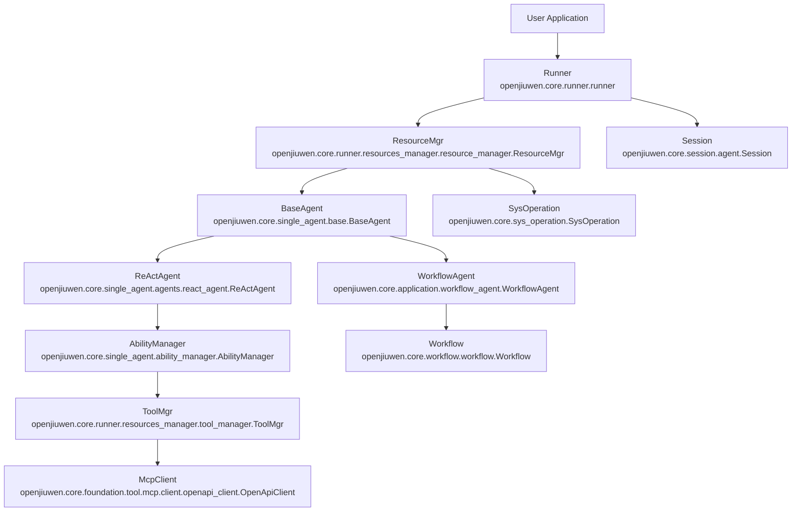

Sources: [openjiuwen/core/runner/resources_manager/resource_manager.py:68-103](), [openjiuwen/core/single_agent/__init__.py:20-27](), [openjiuwen/core/runner/resources_manager/tool_manager.py:39-44](), [openjiuwen/core/foundation/tool/mcp/client/openapi_client.py:52]()

---

## Core Runtime Flow

**Request lifecycle through the Runner to an agent**

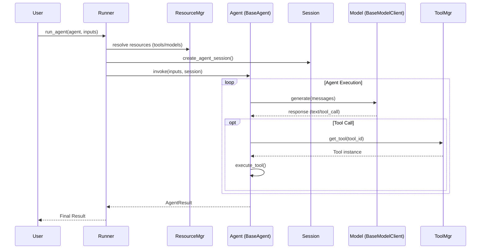

Sources: [README.md:128-131](), [openjiuwen/core/runner/resources_manager/resource_manager.py:97-103](), [openjiuwen/core/runner/resources_manager/tool_manager.py:66-68]()

---

## Optional Dependencies

The core package provides a lean base, with heavy dependencies available as extras in `pyproject.toml` [pyproject.toml:73-125]():

| Extra | Purpose | Key Packages |
|---|---|---|
| `all-mq` | Message queue support | `pulsar-client` |
| `all-storage` | Database & object storage | `sqlalchemy`, `redis`, `aioboto3`, `aiomysql`, `elasticsearch` |
| `all-vector` | Vector database backends | `chromadb`, `pgvector`, `pymilvus` |
| `sandbox` | Remote code execution | `agent-sandbox` |
| `online-rl` | Online RL training loop | `fastapi`, `uvicorn`, `omegaconf` |
| `cli` | Interactive shell and chat | `click`, `rich`, `prompt-toolkit` |

Sources: [pyproject.toml:73-125]()

---

## Subsystem Cross-Reference

For detailed documentation on specific subsystems, please refer to the following child pages:

- **[Getting Started](#1.1)**: Installation via pip, optional extras, and a minimal end-to-end quickstart.
- **[Architecture Overview](#1.2)**: Deep dive into all major subsystems and their interconnections.

| Subsystem | Primary Module Path |
|---|---|
| Runner & Resources | `openjiuwen.core.runner` |
| Agents | `openjiuwen.core.single_agent`, `openjiuwen.core.application` |
| DeepAgent & Harness | `openjiuwen.harness` |
| Workflow Engine | `openjiuwen.core.workflow` |
| LLM Integration | `openjiuwen.core.foundation.llm` |
| Memory System | `openjiuwen.core.memory` |
| Knowledge Retrieval | `openjiuwen.core.retrieval` |
| Tools & Skills | `openjiuwen.core.foundation.tool` |
| Agent Teams | `openjiuwen.agent_teams` |
| Agent Evolving | `openjiuwen.agent_evolving` |
| System Operations | `openjiuwen.core.sys_operation` |

Sources: [README.md:142-150](), [openjiuwen/core/retrieval/__init__.py:1-88](), [pyproject.toml:162-172]()

---

# Page: Getting Started

# Getting Started

<details>
<summary>Relevant source files</summary>

The following files were used as context for generating this wiki page:

- [.gitignore](.gitignore)
- [LICENSE](LICENSE)
- [Makefile](Makefile)
- [README.md](README.md)
- [README.zh.md](README.zh.md)
- [examples/README.md](examples/README.md)
- [examples/interact/weather_assistant_interact.ipynb](examples/interact/weather_assistant_interact.ipynb)
- [examples/react_agent/build_react_agent.ipynb](examples/react_agent/build_react_agent.ipynb)
- [examples/workflow_agent/build_workflow_agent.ipynb](examples/workflow_agent/build_workflow_agent.ipynb)
- [openjiuwen/core/common/exception/codes.py](openjiuwen/core/common/exception/codes.py)
- [openjiuwen/core/foundation/tool/mcp/client/openapi_client.py](openjiuwen/core/foundation/tool/mcp/client/openapi_client.py)
- [openjiuwen/core/memory/common/base.py](openjiuwen/core/memory/common/base.py)
- [openjiuwen/core/retrieval/__init__.py](openjiuwen/core/retrieval/__init__.py)
- [openjiuwen/core/runner/resources_manager/resource_manager.py](openjiuwen/core/runner/resources_manager/resource_manager.py)
- [openjiuwen/core/runner/resources_manager/tool_manager.py](openjiuwen/core/runner/resources_manager/tool_manager.py)
- [openjiuwen/core/single_agent/__init__.py](openjiuwen/core/single_agent/__init__.py)
- [pyproject.toml](pyproject.toml)
- [tests/system_tests/runner/test_runner.py](tests/system_tests/runner/test_runner.py)
- [tests/system_tests/tune/test_prompt_tune.py](tests/system_tests/tune/test_prompt_tune.py)
- [tests/system_tests/workflow/test_real_workflow.py](tests/system_tests/workflow/test_real_workflow.py)
- [tests/test_logger.py](tests/test_logger.py)
- [tests/unit_tests/agent_teams/observability/test_team_observability_mock_llm.py](tests/unit_tests/agent_teams/observability/test_team_observability_mock_llm.py)
- [tests/unit_tests/core/context_engine/conftest.py](tests/unit_tests/core/context_engine/conftest.py)
- [uv.lock](uv.lock)

</details>


This page covers installing the `openjiuwen` package and running a minimal end-to-end example with a `ReActAgent`. It is intended for developers new to the SDK who want to move from zero to a working agent as quickly as possible. For a conceptual overview of all subsystems, see **Architecture Overview (1.2)**. For detailed `ReActAgent` configuration options, see **ReActAgent (2.1)**. For `WorkflowAgent` usage, see **WorkflowAgent (2.3)**.

---

## Prerequisites

| Requirement | Value |
|---|---|
| Python version | `>=3.11`, `<3.14` (3.11.4 recommended) |
| OS | Windows, Linux, macOS |
| Package manager | `pip` or `uv` |

Sources: [pyproject.toml:10-10](), [README.md:23-24]()

---

## Installation

Install the base package from PyPI:

```bash
pip install -U openjiuwen
```

The base install includes core dependencies for HTTP clients (`aiohttp`, `requests`), database ORM (`sqlalchemy`, `sqlmodel`), and primary AI providers (`openai`, `anthropic`, `dashscope`). For the complete list of core dependencies, see [pyproject.toml:21-69]().

### Optional Dependency Extras

Several backend integrations and specialized features are gated behind optional extras. Install them as needed using the bracket syntax.

| Extra group | What it enables | Underlying packages |
|---|---|---|
| `pulsar` | Apache Pulsar message queue | `pulsar-client` |
| `redis` | Redis KV store and checkpointer | `redis` |
| `sqlite` | Async SQLite KV/DB store | `aiosqlite` |
| `mysql` | Async MySQL KV/DB store | `aiomysql` |
| `pgvector` | pgvector vector store support | `pgvector` |
| `chromadb` | Chroma vector store | `chromadb`, `opentelemetry-proto` |
| `obs` | S3-compatible object storage (OBS) | `aioboto3` |
| `online-rl` | Online RL training loop (JiuwenClaw) | `fastapi`, `uvicorn`, `pandas` |
| `all-mq` | All message queue backends | `pulsar` |
| `all-storage` | All storage backends | `sqlite`, `postgres`, `mysql`, `gaussdb`, `redis`, `elasticsearch`, `obs` |
| `all-vector` | All vector store backends | `pgvector`, `chromadb`, `gaussvector` |
| `all` | Comprehensive integration bundle | `all-mq`, `all-storage`, `all-vector`, `all-a2a` |

Sources: [pyproject.toml:73-124]()

Example installations:

```bash
# Install with SQLite and Redis storage support
pip install "openjiuwen[sqlite,redis]"

# Install with all vector store support
pip install "openjiuwen[all-vector]"

# Install with all optional backends
pip install "openjiuwen[all]"
```

---

## Core Concepts Before the Quickstart

The diagram below maps the key runtime objects you will encounter in a minimal example to their Python classes and import paths.

**Key runtime objects and their classes**

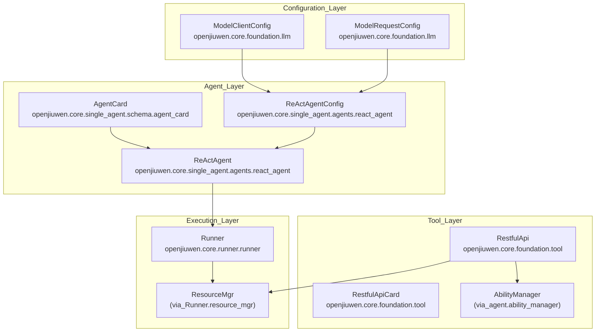

Sources: [openjiuwen/core/single_agent/__init__.py:23-26](), [openjiuwen/core/runner/resources_manager/resource_manager.py:68-81](), [README.md:144-150]()

---

## Quickstart: ReActAgent with a Tool

This example builds a `ReActAgent` that can call an external HTTP tool.

### Step 1 — Configure environment variables

```python
import os

os.environ["API_BASE"]      = "https://your-api-base"
os.environ["API_KEY"]       = "your-api-key"
os.environ["MODEL_NAME"]    = "your-model-name"
os.environ["MODEL_PROVIDER"] = "your-provider"   # e.g. "openai", "dashscope"
os.environ["LLM_SSL_VERIFY"] = "false"
```

Sources: [README.md:48-52]()

### Step 2 — Create model configuration objects

`ModelClientConfig` describes the API endpoint and credentials. `ModelRequestConfig` describes per-request model parameters such as the model name and temperature.

```python
from openjiuwen.core.foundation.llm import ModelRequestConfig, ModelClientConfig

model_client = ModelClientConfig(
    client_provider=os.getenv("MODEL_PROVIDER"),
    api_key=os.getenv("API_KEY"),
    api_base=os.getenv("API_BASE"),
    verify_ssl=os.getenv("LLM_SSL_VERIFY").lower() == "true"
)
model_config = ModelRequestConfig(
    model=os.getenv("MODEL_NAME")
)
```

Sources: [README.md:55-63]()

### Step 3 — Define a tool

In `openjiuwen`, tools are defined using a `ToolCard` (metadata/schema) and a `Tool` implementation. For external APIs, `RestfulApi` is the primary wrapper.

```python
from openjiuwen.core.foundation.tool import RestfulApiCard, RestfulApi

weather_card = RestfulApiCard(
    id="weather_tool",
    name="WeatherReporter",
    description="Query weather for a city and date",
    input_params={
        "type": "object",
        "properties": {
            "location": {"description": "City name", "type": "string"},
            "date":     {"description": "Date (YYYY-MM-DD)", "type": "string"},
        },
        "required": ["location", "date"],
    },
    url="https://your-weather-service/weather",
    method="GET",
)
weather_tool = RestfulApi(card=weather_card)
```

Sources: [openjiuwen/core/runner/resources_manager/resource_manager.py:57-61](), [openjiuwen/core/foundation/tool/__init__.py:1-20]()

### Step 4 — Create and configure the ReActAgent

`AgentCard` is the identity descriptor. `ReActAgentConfig` bundles model configs and the prompt. The agent is registered with the global `Runner.resource_mgr`.

```python
from openjiuwen.core.single_agent import AgentCard, ReActAgentConfig, ReActAgent
from openjiuwen.core.runner import Runner

agent_card = AgentCard(
    id="weather_assistant",
    description="Weather query assistant",
)

react_agent_config = ReActAgentConfig(
    model_client_config=model_client,
    model_config_obj=model_config,
    prompt_template=[{"role": "system", "content": "Use tools to find weather info."}],
)

react_agent = ReActAgent(card=agent_card).configure(react_agent_config)

# Register the tool and expose it to this agent
Runner.resource_mgr.add_tool(weather_tool.card.id, weather_tool)
react_agent.ability_manager.add(weather_tool.card)
```

Sources: [openjiuwen/core/single_agent/__init__.py:24-26](), [openjiuwen/core/runner/resources_manager/resource_manager.py:82-90]()

### Step 5 — Run the agent

`Runner.run_agent` is the primary execution entry point.

```python
import asyncio

async def main():
    await Runner.start()
    result = await Runner.run_agent(
        agent=react_agent,
        inputs={"query": "What's the weather in Paris?"},
    )
    print(result)
    await Runner.stop()

asyncio.run(main())
```

Sources: [openjiuwen/core/runner/runner.py:100-115](), [tests/system_tests/runner/test_runner.py:49-55]()

---

## Execution Flow

The diagram below shows the runtime call sequence from user code through the `Runner` to the `ReActAgent` and its tool integrations.

**ReActAgent invocation sequence**

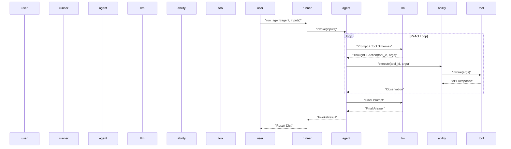

Sources: [openjiuwen/core/single_agent/agents/react_agent.py:1-50](), [openjiuwen/core/single_agent/ability_manager.py:1-30](), [README.md:144-150]()

---

## Optional: WorkflowAgent Quickstart

If your use case follows a fixed multi-step pipeline rather than open-ended reasoning, a `WorkflowAgent` is more appropriate.

**WorkflowAgent setup objects**

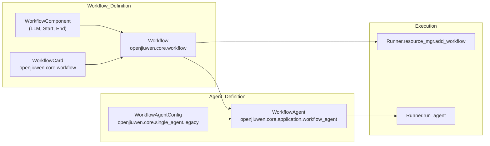

Sources: [README.md:37-133](), [tests/system_tests/runner/test_runner.py:141-205]()

Key steps for a `WorkflowAgent`:
- Define a `Workflow` with components (`Start`, `End`, `LLMComponent`) and connections [README.md:79-110]().
- Register it via `Runner.resource_mgr.add_workflow` [README.md:112-115]().
- Instantiate a `WorkflowAgent` and bind the workflow using `add_workflows([flow])` [README.md:118-124]().
- Execute using `Runner.run_agent` [README.md:129]().

---

## Development Workflow

The `Makefile` at the repository root provides convenience targets for contributors:

| Target | Purpose |
|---|---|
| `make install` | Install dev dependencies via `uv` or `pip` |
| `make test` | Run pytest (supports `TESTFLAGS="..."`) |
| `make format` | Check formatting on staged Python files via `ruff` |
| `make lint` | Lint staged files via `ruff` and `pylint` |
| `make type-check` | Type-check staged files via `mypy` |
| `make fix` | Auto-fix lint and format issues |
| `make flame FLAME=script.py` | Generate a flame graph HTML |
| `make speedscope SPEEDSCOPE=script.py` | Generate a speedscope profile JSON for https://www.speedscope.app |

Pass `COMMITS=N` to check files changed in the last N commits instead of staged files.

Sources: [Makefile:98-166]()

---

# Page: Architecture Overview

# Architecture Overview

<details>
<summary>Relevant source files</summary>

The following files were used as context for generating this wiki page:

- [.gitignore](.gitignore)
- [Makefile](Makefile)
- [openjiuwen/core/common/exception/codes.py](openjiuwen/core/common/exception/codes.py)
- [openjiuwen/core/foundation/tool/mcp/client/openapi_client.py](openjiuwen/core/foundation/tool/mcp/client/openapi_client.py)
- [openjiuwen/core/memory/common/base.py](openjiuwen/core/memory/common/base.py)
- [openjiuwen/core/retrieval/__init__.py](openjiuwen/core/retrieval/__init__.py)
- [openjiuwen/core/runner/resources_manager/resource_manager.py](openjiuwen/core/runner/resources_manager/resource_manager.py)
- [openjiuwen/core/runner/resources_manager/tool_manager.py](openjiuwen/core/runner/resources_manager/tool_manager.py)
- [openjiuwen/core/single_agent/__init__.py](openjiuwen/core/single_agent/__init__.py)
- [openjiuwen/core/single_agent/ability_manager.py](openjiuwen/core/single_agent/ability_manager.py)
- [openjiuwen/core/single_agent/agent_callback_manager.py](openjiuwen/core/single_agent/agent_callback_manager.py)
- [openjiuwen/core/single_agent/agents/react_agent.py](openjiuwen/core/single_agent/agents/react_agent.py)
- [openjiuwen/core/single_agent/base.py](openjiuwen/core/single_agent/base.py)
- [openjiuwen/core/single_agent/rail/__init__.py](openjiuwen/core/single_agent/rail/__init__.py)
- [openjiuwen/core/single_agent/rail/base.py](openjiuwen/core/single_agent/rail/base.py)
- [openjiuwen/harness/deep_agent.py](openjiuwen/harness/deep_agent.py)
- [openjiuwen/harness/factory.py](openjiuwen/harness/factory.py)
- [openjiuwen/harness/prompts/sections/skills.py](openjiuwen/harness/prompts/sections/skills.py)
- [openjiuwen/harness/rails/skills/skill_use_rail.py](openjiuwen/harness/rails/skills/skill_use_rail.py)
- [openjiuwen/harness/rails/subagent/verification_rail.py](openjiuwen/harness/rails/subagent/verification_rail.py)
- [openjiuwen/harness/rails/sys_operation_rail.py](openjiuwen/harness/rails/sys_operation_rail.py)
- [openjiuwen/harness/schema/config.py](openjiuwen/harness/schema/config.py)
- [openjiuwen/harness/tools/worktree/rails.py](openjiuwen/harness/tools/worktree/rails.py)
- [openjiuwen/symphony/README.md](openjiuwen/symphony/README.md)
- [openjiuwen/symphony/__init__.py](openjiuwen/symphony/__init__.py)
- [openjiuwen/symphony/interfaces/__init__.py](openjiuwen/symphony/interfaces/__init__.py)
- [openjiuwen/symphony/orchestration/__init__.py](openjiuwen/symphony/orchestration/__init__.py)
- [openjiuwen/symphony/orchestration/artifacts.py](openjiuwen/symphony/orchestration/artifacts.py)
- [openjiuwen/symphony/orchestration/graph/__init__.py](openjiuwen/symphony/orchestration/graph/__init__.py)
- [openjiuwen/symphony/orchestration/graph/matcher/__init__.py](openjiuwen/symphony/orchestration/graph/matcher/__init__.py)
- [openjiuwen/symphony/orchestration/graph/matcher/cache.py](openjiuwen/symphony/orchestration/graph/matcher/cache.py)
- [openjiuwen/symphony/orchestration/service.py](openjiuwen/symphony/orchestration/service.py)
- [openjiuwen/symphony/runtime.py](openjiuwen/symphony/runtime.py)
- [pyproject.toml](pyproject.toml)
- [tests/system_tests/rail/test_force_finish_rail.py](tests/system_tests/rail/test_force_finish_rail.py)
- [tests/system_tests/runner/test_runner.py](tests/system_tests/runner/test_runner.py)
- [tests/system_tests/tune/test_prompt_tune.py](tests/system_tests/tune/test_prompt_tune.py)
- [tests/system_tests/workflow/test_real_workflow.py](tests/system_tests/workflow/test_real_workflow.py)
- [tests/test_logger.py](tests/test_logger.py)
- [tests/unit_tests/agent/react_agent/test_new_react_agent_mock.py](tests/unit_tests/agent/react_agent/test_new_react_agent_mock.py)
- [tests/unit_tests/agent_teams/observability/test_team_observability_mock_llm.py](tests/unit_tests/agent_teams/observability/test_team_observability_mock_llm.py)
- [tests/unit_tests/core/context_engine/conftest.py](tests/unit_tests/core/context_engine/conftest.py)
- [tests/unit_tests/core/single_agent/rail/test_rail.py](tests/unit_tests/core/single_agent/rail/test_rail.py)
- [tests/unit_tests/core/single_agent/rail/test_rail_init_timing.py](tests/unit_tests/core/single_agent/rail/test_rail_init_timing.py)
- [tests/unit_tests/harness/test_deep_agent.py](tests/unit_tests/harness/test_deep_agent.py)
- [tests/unit_tests/harness/test_filesystem_rail.py](tests/unit_tests/harness/test_filesystem_rail.py)
- [tests/unit_tests/harness/test_skill_rail.py](tests/unit_tests/harness/test_skill_rail.py)
- [tests/unit_tests/symphony/test_models.py](tests/unit_tests/symphony/test_models.py)
- [uv.lock](uv.lock)

</details>


The openjiuwen `agent-core` SDK is a modular framework for building, orchestrating, and evolving LLM-powered agents. It bridges the gap between high-level natural language reasoning and low-level code execution through a layered architecture that supports single-agent workflows, complex multi-agent teams, and autonomous self-evolution.

## System Architecture

The architecture is divided into three primary layers: the **Foundation Layer** (LLM, Tools, Memory, Storage), the **Agentic Layer** (ReAct, DeepAgent, Workflow Engine), and the **Orchestration Layer** (Agent Teams, Evolving, Runner).

### High-Level Component Map

The following diagram illustrates the interconnection between major subsystems and their corresponding code entities.

**Diagram: System Entity Mapping**
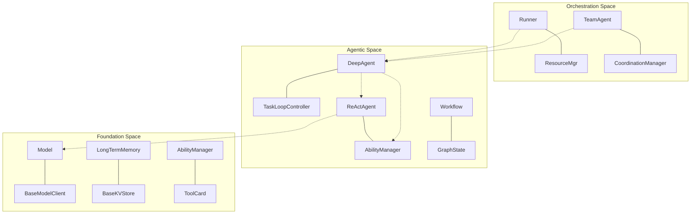
Sources: [openjiuwen/core/runner/resources_manager/resource_manager.py:68-80](), [openjiuwen/harness/deep_agent.py:208-220](), [openjiuwen/core/single_agent/ability_manager.py:87-101]().

---

## Major Subsystems

### 1. Runner and Resource Management
The `Runner` acts as the entry point for the SDK, managing the lifecycle of agents and workflows. It relies on the `ResourceMgr` to handle the registration and retrieval of models, tools, prompts, and agents.
*   **ResourceMgr**: Central registry for all system entities. It supports tag-based isolation, allowing different sessions to access specific subsets of tools or agents [openjiuwen/core/runner/resources_manager/resource_manager.py:68-104]().
*   **Resource Dispatch**: Uses `_dispatch_add` and `_dispatch_get` to route registration requests to specialized registries like `ResourceRegistry` [openjiuwen/core/runner/resources_manager/resource_manager.py:82-104]().
*   **Tag Management**: `TagMgr` enables resource filtering and scoping, ensuring security and organizational boundaries [openjiuwen/core/runner/resources_manager/resource_manager.py:75-75]().

### 2. Agents (ReAct & DeepAgent)
Agents are the core reasoning units.
*   **ReActAgent**: Implements the "Reason + Act" pattern, managing an iterative loop of thought and tool invocation via `AbilityManager` [openjiuwen/core/single_agent/agents/react_agent.py:193-205]().
*   **DeepAgent**: A high-level wrapper around `ReActAgent` that introduces a "Harness" for advanced features like task loops, rails, and workspace management [openjiuwen/harness/deep_agent.py:208-220]().
*   **Harness Rails**: Interceptors (e.g., `DeepAgentRail`, `TaskCompletionRail`, `SkillUseRail`) that hook into the agent's lifecycle via the `AgentCallbackEvent` system to enforce security or manage context [openjiuwen/harness/deep_agent.py:66-76](), [openjiuwen/harness/rails/skills/skill_use_rail.py:36-45]().

### 3. Agent Teams
The `agent_teams` package enables multi-agent collaboration through a leader-teammate hierarchy.
*   **TeamAgent**: A unified implementation that handles team lifecycle, teammate spawning, and session recovery.
*   **Symphony Integration**: Capabilities are orchestrated through `SymphonyRuntime` and `OrchestrationService` for asset discovery and fingerprinting [openjiuwen/symphony/runtime.py:1-20]().

### 4. Workflow Engine
Workflows provide a structured, graph-based execution model.
*   **DSL**: Workflows are defined using `BaseWorkflow` and compiled into a graph of nodes.
*   **Execution**: The engine handles conditional branching and loops, using `GraphState` to maintain execution context.

### 5. LLM Integration
A unified `Model` facade abstracts different providers.
*   **Model**: Wraps `ModelClientConfig` and `ModelRequestConfig` to provide a consistent interface for text and tool generation [openjiuwen/core/single_agent/agents/react_agent.py:32-47]().
*   **ContextEngine**: Manages the `ModelContext`, handling message buffers and window management for LLM requests [openjiuwen/core/single_agent/agents/react_agent.py:36-40]().

### 6. Memory and Retrieval
*   **Long-Term Memory**: A storage system for conversation history and user profiles.
*   **Knowledge Retrieval**: Supports vector search (Milvus, Chroma) and hybrid strategies via `KnowledgeBase` and `BaseRetriever`.

### 7. Tools and Ability Management
*   **AbilityManager**: Manages local function tools, workflows, and remote `McpServerConfig` connections for an agent [openjiuwen/core/single_agent/ability_manager.py:87-111]().
*   **Tool Execution**: Handles ordered execution for specific tools (e.g., filesystem tools) to prevent race conditions during multi-tool LLM turns [openjiuwen/core/single_agent/ability_manager.py:97-100]().

### 8. System Operations
The `SysOperation` layer provides a secure abstraction for interacting with the host system or a sandbox.
*   **Operations**: Includes `ShellOperation`, `CodeOperation`, and `FsOperation` cards [openjiuwen/core/runner/resources_manager/resource_manager.py:32-34]().
*   **Security**: Operations can run in `LOCAL` or `SANDBOX` mode via `OperationMode` [openjiuwen/harness/factory.py:19-19]().

### 9. Rail and Callback Framework
The system uses a sophisticated callback system to intercept agent actions.
*   **AgentCallbackEvent**: Defines lifecycle hooks such as `BEFORE_MODEL_CALL`, `AFTER_TOOL_CALL`, and `AFTER_REACT_ITERATION` [openjiuwen/core/single_agent/rail/base.py:6-12]().
*   **AgentRail**: A base class for implementing logic that reacts to these events, such as `SkillUseRail` or `SysOperationRail` [openjiuwen/core/single_agent/rail/base.py:8-9]().

**Diagram: Agent Lifecycle and Rail Interception**
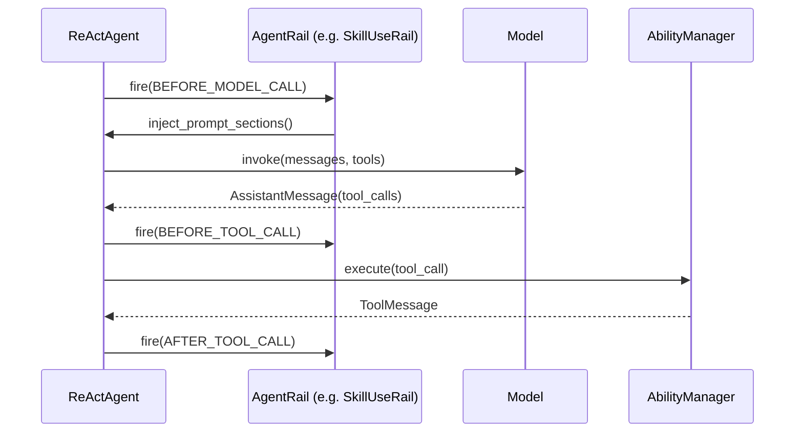
Sources: [openjiuwen/core/single_agent/rail/base.py:152-200](), [openjiuwen/core/single_agent/agents/react_agent.py:66-73](), [openjiuwen/harness/rails/skills/skill_use_rail.py:36-50]().

---

## Subsystem Interconnection Summary

| Subsystem | Key Class | Primary Responsibility |
| :--- | :--- | :--- |
| **Runner** | `Runner` | Entry point, lifecycle management |
| **Agents** | `DeepAgent` | Task-oriented reasoning loop with Harness |
| **Abilities** | `AbilityManager` | Tool discovery and execution logic |
| **Rails** | `AgentRail` | Lifecycle interception and guardrails |
| **LLM** | `Model` | Unified interface for LLM providers |
| **Ops** | `SysOperation` | Secure filesystem and shell execution |
| **Resource** | `ResourceMgr` | Global registry and tag isolation |

Sources: [openjiuwen/core/runner/resources_manager/resource_manager.py:68-104](), [openjiuwen/harness/deep_agent.py:208-220](), [openjiuwen/core/single_agent/ability_manager.py:87-111](), [openjiuwen/core/single_agent/rail/base.py:8-12]().

---

# Page: Agents

# Agents

<details>
<summary>Relevant source files</summary>

The following files were used as context for generating this wiki page:

- [.gitignore](.gitignore)
- [Makefile](Makefile)
- [openjiuwen/core/common/exception/codes.py](openjiuwen/core/common/exception/codes.py)
- [openjiuwen/core/foundation/tool/mcp/client/openapi_client.py](openjiuwen/core/foundation/tool/mcp/client/openapi_client.py)
- [openjiuwen/core/memory/common/base.py](openjiuwen/core/memory/common/base.py)
- [openjiuwen/core/retrieval/__init__.py](openjiuwen/core/retrieval/__init__.py)
- [openjiuwen/core/runner/resources_manager/resource_manager.py](openjiuwen/core/runner/resources_manager/resource_manager.py)
- [openjiuwen/core/runner/resources_manager/tool_manager.py](openjiuwen/core/runner/resources_manager/tool_manager.py)
- [openjiuwen/core/single_agent/__init__.py](openjiuwen/core/single_agent/__init__.py)
- [openjiuwen/core/single_agent/ability_manager.py](openjiuwen/core/single_agent/ability_manager.py)
- [openjiuwen/core/single_agent/agent_callback_manager.py](openjiuwen/core/single_agent/agent_callback_manager.py)
- [openjiuwen/core/single_agent/agents/react_agent.py](openjiuwen/core/single_agent/agents/react_agent.py)
- [openjiuwen/core/single_agent/base.py](openjiuwen/core/single_agent/base.py)
- [openjiuwen/core/single_agent/rail/__init__.py](openjiuwen/core/single_agent/rail/__init__.py)
- [openjiuwen/core/single_agent/rail/base.py](openjiuwen/core/single_agent/rail/base.py)
- [openjiuwen/harness/deep_agent.py](openjiuwen/harness/deep_agent.py)
- [openjiuwen/harness/factory.py](openjiuwen/harness/factory.py)
- [openjiuwen/harness/prompts/sections/skills.py](openjiuwen/harness/prompts/sections/skills.py)
- [openjiuwen/harness/rails/skills/skill_use_rail.py](openjiuwen/harness/rails/skills/skill_use_rail.py)
- [openjiuwen/harness/rails/subagent/verification_rail.py](openjiuwen/harness/rails/subagent/verification_rail.py)
- [openjiuwen/harness/rails/sys_operation_rail.py](openjiuwen/harness/rails/sys_operation_rail.py)
- [openjiuwen/harness/schema/config.py](openjiuwen/harness/schema/config.py)
- [openjiuwen/harness/tools/worktree/rails.py](openjiuwen/harness/tools/worktree/rails.py)
- [pyproject.toml](pyproject.toml)
- [tests/system_tests/rail/test_force_finish_rail.py](tests/system_tests/rail/test_force_finish_rail.py)
- [tests/system_tests/runner/test_runner.py](tests/system_tests/runner/test_runner.py)
- [tests/system_tests/tune/test_prompt_tune.py](tests/system_tests/tune/test_prompt_tune.py)
- [tests/system_tests/workflow/test_real_workflow.py](tests/system_tests/workflow/test_real_workflow.py)
- [tests/test_logger.py](tests/test_logger.py)
- [tests/unit_tests/agent/react_agent/test_new_react_agent_mock.py](tests/unit_tests/agent/react_agent/test_new_react_agent_mock.py)
- [tests/unit_tests/agent_teams/observability/test_team_observability_mock_llm.py](tests/unit_tests/agent_teams/observability/test_team_observability_mock_llm.py)
- [tests/unit_tests/core/context_engine/conftest.py](tests/unit_tests/core/context_engine/conftest.py)
- [tests/unit_tests/core/single_agent/rail/test_rail.py](tests/unit_tests/core/single_agent/rail/test_rail.py)
- [tests/unit_tests/core/single_agent/rail/test_rail_init_timing.py](tests/unit_tests/core/single_agent/rail/test_rail_init_timing.py)
- [tests/unit_tests/harness/test_deep_agent.py](tests/unit_tests/harness/test_deep_agent.py)
- [tests/unit_tests/harness/test_filesystem_rail.py](tests/unit_tests/harness/test_filesystem_rail.py)
- [tests/unit_tests/harness/test_skill_rail.py](tests/unit_tests/harness/test_skill_rail.py)
- [uv.lock](uv.lock)

</details>


This page describes the agent model in `agent-core`: the `BaseAgent` interface, the identity object `AgentCard`, the concrete agent types (`ReActAgent`, `LLMAgent`, `WorkflowAgent`, `TeamAgent`, `DeepAgent`), how agents connect to tools via `AbilityManager`, and the `AgentRail` system for lifecycle hooks.

For detailed documentation on specific agent types and supporting subsystems, see the child pages:
- [ReActAgent](#2.1) — Reasoning + Acting loop with tool execution and session handling.
- [LLMAgent](#2.2) — LLM-driven controller with workflow integration and interrupt/resume patterns.
- [WorkflowAgent](#2.3) — Intent-based routing across multiple compiled workflows.
- [Hierarchical Groups](#2.4) — Multi-agent orchestration and `TeamAgent` coordination.
- [Runner](#2.5) — The lifecycle manager for starting, stopping, and invoking agents.
- [Sessions and Checkpointing](#2.6) — State persistence, `CommitState`, and session isolation.

---

## Agent Model Overview

Every agent in `agent-core` is identified by an `AgentCard` and exposes a consistent async interface (`invoke` / `stream`). The framework uses a "Card + Config" design: the `AgentCard` defines **identity** (who the agent is), while the configuration object defines **behavior** (how the agent runs).

**Available Agent Types**

| Class | Module | Base | Description |
|---|---|---|---|
| `ReActAgent` | `openjiuwen.core.single_agent.agents.react_agent` | `BaseAgent` | Implements the Reasoning + Acting loop directly against an LLM. |
| `LLMAgent` | `openjiuwen.core.application.llm_agent.llm_agent` | `ControllerAgent` | High-level agent wrapping a `LLMController` for complex task loops. |
| `WorkflowAgent` | `openjiuwen.core.application.workflow_agent.workflow_agent` | `ControllerAgent` | Routes requests to compiled `Workflow` instances. |
| `DeepAgent` | `openjiuwen.harness.deep_agent` | `BaseAgent` | High-level agent that delegates to an internal ReActAgent with advanced task loops and rails. |
| `TeamAgent` | `openjiuwen.agent_teams.team_agent` | `BaseAgent` | Orchestrates a team of agents via message bus and shared workspace. |

Sources: [openjiuwen/core/single_agent/base.py:83-107](), [openjiuwen/core/single_agent/agents/react_agent.py:259-270](), [openjiuwen/harness/deep_agent.py:208-210]()

---

## Class Hierarchy and Identity

**Agent Class Hierarchy (Code Entity Space)**

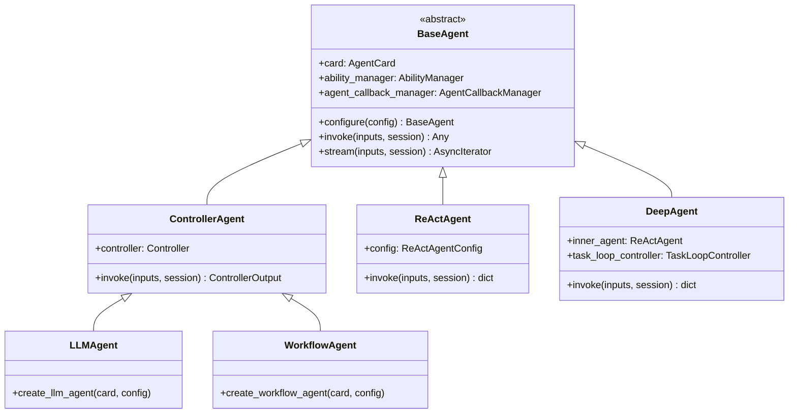

Sources: [openjiuwen/core/single_agent/base.py:83-233](), [openjiuwen/core/single_agent/agents/react_agent.py:259-270](), [openjiuwen/harness/deep_agent.py:208-210]()

### AgentCard
The `AgentCard` ([openjiuwen/core/single_agent/schema/agent_card.py]()) is required for every agent. It contains:
- `id`: A unique identifier (often used as a `tag` in `ResourceMgr`).
- `name`: Human-readable name.
- `description`: Purpose of the agent.

---

## BaseAgent Interface

The `BaseAgent` ([openjiuwen/core/single_agent/base.py:83-233]()) provides the foundation for all agents. It uses a metaclass `_AgentMeta` to automatically wrap `invoke` and `stream` methods with telemetry and callback emission [openjiuwen/core/single_agent/base.py:55-79]().

### Core Methods
- `configure(config)`: Sets the agent's runtime configuration (e.g., `ReActAgentConfig`). Supports chaining [openjiuwen/core/single_agent/base.py:134-137]().
- `invoke(inputs, session)`: Async execution returning a final result.
- `stream(inputs, session)`: Async iterator yielding execution chunks.
- `register_rail(rail)`: Attaches an `AgentRail` to intercept lifecycle events [openjiuwen/core/single_agent/base.py:188-199]().

### AbilityManager
Each agent maintains an `AbilityManager` [openjiuwen/core/single_agent/ability_manager.py:87-95]() to manage its tools, workflows, and sub-agents.
- `add(ability)`: Registers a `ToolCard`, `WorkflowCard`, or `AgentCard` [openjiuwen/core/single_agent/ability_manager.py:191-203]().
- `execute(tool_call, session)`: Dispatches tool calls to the `ResourceMgr` for execution [openjiuwen/core/single_agent/ability_manager.py:284-300]().

Sources: [openjiuwen/core/single_agent/base.py:107-110](), [openjiuwen/core/single_agent/ability_manager.py:87-111]()

---

## Agent Lifecycle Hooks (Rails)

The SDK uses a "Rail" system to provide clean separation between core agent logic and cross-cutting concerns like memory, logging, or security.

**Agent Lifecycle Events (Natural Language to Code Mapping)**

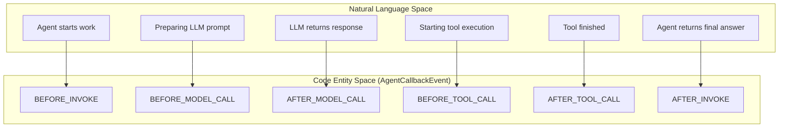

### AgentRail Class
Developers can subclass `AgentRail` to implement these hooks. For example, `SkillUseRail` ([openjiuwen/harness/rails/skills/skill_use_rail.py:36]()) manages skill prompt injection and tool registration during the agent's initialization and invocation lifecycle.

Sources: [openjiuwen/core/single_agent/rail/base.py:23-32](), [openjiuwen/harness/rails/skills/skill_use_rail.py:36-45]()

---

## ReActAgent

`ReActAgent` implements the Reasoning + Acting loop. It iterates until it reaches a final answer or hits `max_iterations` [openjiuwen/core/single_agent/agents/react_agent.py:197]().

### Configuration
`ReActAgentConfig` includes [openjiuwen/core/single_agent/agents/react_agent.py:193-257]():
- `model_name` & `model_provider`: LLM backend details.
- `max_iterations`: Loop limit (default 5).
- `prompt_template`: The system instructions.
- `context_engine_config`: Window management and token limits.

### Invocation and Streaming
- **Invoke**: Returns a result dictionary containing the final output [openjiuwen/core/single_agent/agents/react_agent.py:560-570]().
- **Stream**: Yields execution chunks. It internally runs the ReAct loop and writes LLM tokens and tool call events to the session's stream [openjiuwen/core/single_agent/agents/react_agent.py:572-627]().

Sources: [openjiuwen/core/single_agent/agents/react_agent.py:193-257](), [openjiuwen/core/single_agent/agents/react_agent.py:411-570]()

---

## Registration and Invocation via ResourceMgr

Agents and their resources are managed by the `ResourceMgr` ([openjiuwen/core/runner/resources_manager/resource_manager.py:68]()).

**Invocation Flow via Runner**

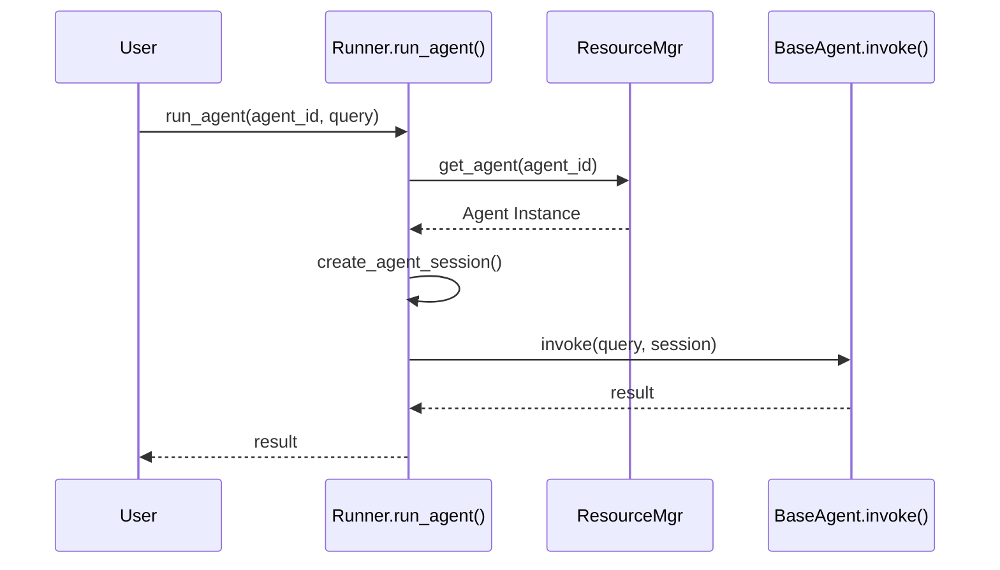

When an agent is registered with `ResourceMgr`, it is stored alongside its `AgentCard`. The `ResourceMgr` also handles registration of `Tool`, `Workflow`, and `SysOperation` instances, which the agent's `AbilityManager` accesses during execution.

Sources: [openjiuwen/core/runner/resources_manager/resource_manager.py:82-90](), [openjiuwen/core/single_agent/ability_manager.py:94-95]()

---

# Page: ReActAgent

# ReActAgent

<details>
<summary>Relevant source files</summary>

The following files were used as context for generating this wiki page:

- [openjiuwen/core/session/tracer/decorator.py](openjiuwen/core/session/tracer/decorator.py)
- [openjiuwen/core/single_agent/ability_manager.py](openjiuwen/core/single_agent/ability_manager.py)
- [openjiuwen/core/single_agent/agent_callback_manager.py](openjiuwen/core/single_agent/agent_callback_manager.py)
- [openjiuwen/core/single_agent/agents/react_agent.py](openjiuwen/core/single_agent/agents/react_agent.py)
- [openjiuwen/core/single_agent/base.py](openjiuwen/core/single_agent/base.py)
- [openjiuwen/core/single_agent/legacy/agent.py](openjiuwen/core/single_agent/legacy/agent.py)
- [openjiuwen/core/single_agent/rail/__init__.py](openjiuwen/core/single_agent/rail/__init__.py)
- [openjiuwen/core/single_agent/rail/base.py](openjiuwen/core/single_agent/rail/base.py)
- [openjiuwen/core/workflow/components/llm/intent_detection_comp.py](openjiuwen/core/workflow/components/llm/intent_detection_comp.py)
- [openjiuwen/core/workflow/components/llm/llm_comp.py](openjiuwen/core/workflow/components/llm/llm_comp.py)
- [openjiuwen/core/workflow/components/llm/questioner_comp.py](openjiuwen/core/workflow/components/llm/questioner_comp.py)
- [openjiuwen/core/workflow/components/tool/tool_comp.py](openjiuwen/core/workflow/components/tool/tool_comp.py)
- [openjiuwen/harness/deep_agent.py](openjiuwen/harness/deep_agent.py)
- [openjiuwen/harness/factory.py](openjiuwen/harness/factory.py)
- [openjiuwen/harness/prompts/sections/skills.py](openjiuwen/harness/prompts/sections/skills.py)
- [openjiuwen/harness/rails/skills/skill_use_rail.py](openjiuwen/harness/rails/skills/skill_use_rail.py)
- [openjiuwen/harness/rails/subagent/verification_rail.py](openjiuwen/harness/rails/subagent/verification_rail.py)
- [openjiuwen/harness/rails/sys_operation_rail.py](openjiuwen/harness/rails/sys_operation_rail.py)
- [openjiuwen/harness/schema/config.py](openjiuwen/harness/schema/config.py)
- [openjiuwen/harness/tools/worktree/rails.py](openjiuwen/harness/tools/worktree/rails.py)
- [tests/system_tests/rail/test_force_finish_rail.py](tests/system_tests/rail/test_force_finish_rail.py)
- [tests/unit_tests/agent/react_agent/test_new_react_agent_mock.py](tests/unit_tests/agent/react_agent/test_new_react_agent_mock.py)
- [tests/unit_tests/core/agent/controller/test_base_controller_conversation_isolation.py](tests/unit_tests/core/agent/controller/test_base_controller_conversation_isolation.py)
- [tests/unit_tests/core/component/test_intent_detection_comp.py](tests/unit_tests/core/component/test_intent_detection_comp.py)
- [tests/unit_tests/core/component/test_llm_comp.py](tests/unit_tests/core/component/test_llm_comp.py)
- [tests/unit_tests/core/component/test_questioner_comp.py](tests/unit_tests/core/component/test_questioner_comp.py)
- [tests/unit_tests/core/component/test_tool_comp.py](tests/unit_tests/core/component/test_tool_comp.py)
- [tests/unit_tests/core/component/test_visualize_workflow.py](tests/unit_tests/core/component/test_visualize_workflow.py)
- [tests/unit_tests/core/runner/test_runner.py](tests/unit_tests/core/runner/test_runner.py)
- [tests/unit_tests/core/session/tracer/test_decorator.py](tests/unit_tests/core/session/tracer/test_decorator.py)
- [tests/unit_tests/core/single_agent/rail/test_rail.py](tests/unit_tests/core/single_agent/rail/test_rail.py)
- [tests/unit_tests/core/single_agent/rail/test_rail_init_timing.py](tests/unit_tests/core/single_agent/rail/test_rail_init_timing.py)
- [tests/unit_tests/harness/test_deep_agent.py](tests/unit_tests/harness/test_deep_agent.py)
- [tests/unit_tests/harness/test_filesystem_rail.py](tests/unit_tests/harness/test_filesystem_rail.py)
- [tests/unit_tests/harness/test_skill_rail.py](tests/unit_tests/harness/test_skill_rail.py)

</details>


This page covers `ReActAgent` and `ReActAgentConfig` — the primary agent implementation in the SDK that follows the ReAct (Reasoning + Acting) paradigm. It documents configuration options, the tool-use loop, session handling, context engine integration, and the callback system.

For the abstract base class that `ReActAgent` extends, see page [2.0]() (Agents overview). For the `LLMAgent`, which wraps a `ControllerAgent` with a ReAct-style loop driven by a Controller, see [2.2](). For the `Runner` that manages agent invocation lifecycle, see [2.5]().

---

## Overview

`ReActAgent` [openjiuwen/core/single_agent/agents/react_agent.py:259-626]() implements a synchronous ReAct loop: at each iteration it calls an LLM, inspects the response for tool calls, executes any requested tools, appends results to the context, and repeats until the model produces a plain-text answer or `max_iterations` is exhausted.

`ReActAgentConfig` [openjiuwen/core/single_agent/agents/react_agent.py:193-256]() is a Pydantic model that carries all configuration for a `ReActAgent` instance. Its setter methods return `self` to enable fluent chaining.

**Class hierarchy:**

```mermaid
classDiagram
    class "BaseAgent" {
        +card: AgentCard
        +ability_manager: AbilityManager
        +agent_callback_manager: AgentCallbackManager
        +configure(config) BaseAgent
        +invoke(inputs, session) Any
        +stream(inputs, session, stream_modes) AsyncIterator
        +register_callback(event, callback, priority)
        +register_rail(rail) BaseAgent
    }
    class "ReActAgent" {
        +context_engine: ContextEngine
        -_config: ReActAgentConfig
        -_llm: Model
        +configure(config) BaseAgent
        +invoke(inputs, session) Dict
        +stream(inputs, session, stream_modes) AsyncIterator
        -_get_llm() Model
        -_call_llm(messages, tools) AssistantMessage
        -_init_context(session) ModelContext
        -_init_memory_scope()
    }
    class "ReActAgentConfig" {
        +model_name: str
        +model_provider: str
        +api_key: str
        +api_base: str
        +prompt_template: List~Dict~
        +max_iterations: int
        +model_client_config: ModelClientConfig
        +model_config_obj: ModelRequestConfig
        +context_engine_config: ContextEngineConfig
        +context_processors: List
        +mem_scope_id: str
        +sys_operation_id: str
        +configure_model_client(...)
        +configure_prompt_template(...)
        +configure_context_engine(...)
        +configure_max_iterations(...)
        +configure_mem_scope(...)
    }
    class "AbilityManager" {
        +add(ability)
        +remove(name)
        +list() List
        +list_tool_info() List~ToolInfo~
        +execute(tool_call, session, tag) List
    }
    class "ContextEngine" {
        +create_context(session, processors, token_counter) ModelContext
        +save_contexts(session)
    }
    class "Model" {
        +invoke(messages, tools) AssistantMessage
    }
    "BaseAgent" <|-- "ReActAgent"
    "ReActAgent" --> "ReActAgentConfig"
    "ReActAgent" --> "AbilityManager"
    "ReActAgent" --> "ContextEngine"
    "ReActAgent" --> "Model"
```

Sources: [openjiuwen/core/single_agent/agents/react_agent.py:193-290](), [openjiuwen/core/single_agent/base.py:85-232](), [openjiuwen/core/single_agent/ability_manager.py:87-112]()

---

## ReActAgentConfig

`ReActAgentConfig` holds all options for a `ReActAgent`. Every field has a default value so the object can be created empty and populated via fluent setter methods.

### Fields

| Field | Type | Default | Description |
|---|---|---|---|
| `model_name` | `str` | `""` | Model name passed to `Model.invoke()` |
| `model_provider` | `str` | `"openai"` | Provider identifier |
| `api_key` | `str` | `""` | API key |
| `api_base` | `str` | `""` | API base URL |
| `prompt_template_name` | `str` | `""` | Named prompt template reference |
| `prompt_template` | `List[Dict]` | `[]` | Inline prompt; each dict has `role` and `content` |
| `max_iterations` | `int` | `5` | Maximum ReAct loop iterations |
| `model_client_config` | `ModelClientConfig \| None` | `None` | Full client config [openjiuwen/core/single_agent/agents/react_agent.py:207-207]() |
| `model_config_obj` | `ModelRequestConfig \| None` | `None` | Per-request model parameters |
| `sys_operation_id` | `str \| None` | `None` | System operation ID for skill utilities |
| `context_engine_config` | `ContextEngineConfig` | `max=None, window=None` | Context management parameters [openjiuwen/core/single_agent/agents/react_agent.py:218-221]() |
| `mem_scope_id` | `str` | `""` | Long-term memory scope identifier |

Sources: [openjiuwen/core/single_agent/agents/react_agent.py:193-225]()

### Configure Methods

All configure methods mutate the config in-place and return `self` [openjiuwen/core/single_agent/agents/react_agent.py:227-256]().

| Method | Key Parameters | Effect |
|---|---|---|
| `configure_model(model_name)` | `model_name: str` | Sets `model_name` |
| `configure_model_provider(provider, api_key, api_base)` | strings | Sets provider/key/base |
| `configure_model_client(provider, api_key, api_base, model_name, verify_ssl)` | strings + bool | Constructs `model_client_config` and `model_config_obj` |
| `configure_prompt(prompt_name)` | `prompt_name: str` | Sets `prompt_template_name` |
| `configure_prompt_template(prompt_template)` | `List[Dict]` | Sets `prompt_template` inline |
| `configure_context_engine(max_context_message_num, default_window_round_num, enable_reload)` | ints + bool | Replaces `context_engine_config` |
| `configure_mem_scope(mem_scope_id)` | `str` | Sets `mem_scope_id` |
| `configure_max_iterations(max_iterations)` | `int` | Sets `max_iterations` |

Sources: [openjiuwen/core/single_agent/agents/react_agent.py:227-256]()

---

## Instantiation and Configuration

`ReActAgent.__init__` requires an `AgentCard` [openjiuwen/core/single_agent/agents/react_agent.py:275-290]():

```python
agent = ReActAgent(card=AgentCard(name="my_agent", description="..."))
agent.configure(config)  # attach ReActAgentConfig after construction
```

`configure()` [openjiuwen/core/single_agent/agents/react_agent.py:306-342]() compares old and new configs and selectively resets LLM clients, context engines, memory scopes, and skill utilities.

**Construction flow:**

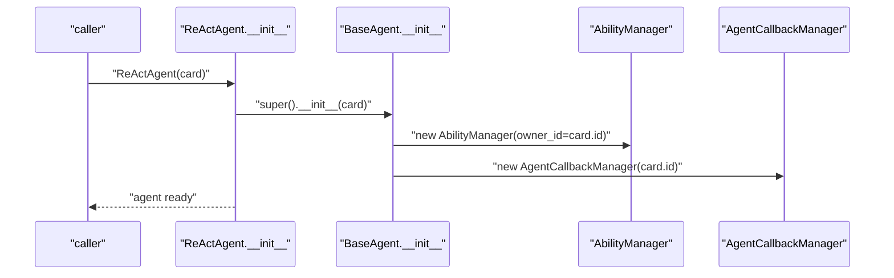

Sources: [openjiuwen/core/single_agent/agents/react_agent.py:275-342](), [openjiuwen/core/single_agent/base.py:100-115]()

---

## Tool Selection and Execution

Tools are managed via the `AbilityManager`. It handles the storage of metadata Cards and the execution of concrete tool instances retrieved from the `ResourceManager` [openjiuwen/core/single_agent/ability_manager.py:87-95]().

### Tool Call Execution
1.  **Normalization**: The agent uses `_normalize_tool_calls` to ensure tool call objects are in a consistent list format [openjiuwen/core/single_agent/ability_manager.py:169-181]().
2.  **Lane Management**: To prevent race conditions (e.g., multiple file writes in one turn), the `AbilityManager` uses `_tool_execution_resource_key` to identify resources that require ordered execution [openjiuwen/core/single_agent/ability_manager.py:183-200]().
3.  **Dispatch**: Execution occurs via `AbilityManager.execute()`, which handles tool timeouts and exception mapping [openjiuwen/core/single_agent/ability_manager.py:246-278]().
4.  **Result Formatting**: The `_build_tool_message_content` helper converts raw tool results into strings suitable for LLM context [openjiuwen/core/single_agent/ability_manager.py:144-163]().

Sources: [openjiuwen/core/single_agent/ability_manager.py:87-278](), [openjiuwen/core/single_agent/agents/react_agent.py:510-541]()

---

## The ReAct Loop: `invoke()` and `stream()`

### `invoke()` patterns
The `invoke` method executes the Reasoning + Acting loop up to `max_iterations` [openjiuwen/core/single_agent/agents/react_agent.py:411-570]().

**Loop execution diagram:**

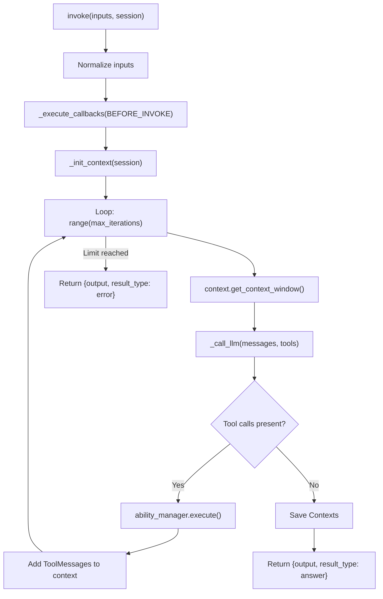

### `stream()` patterns
`stream()` [openjiuwen/core/single_agent/agents/react_agent.py:572-626]() runs the ReAct loop in an async task and yields `OutputSchema` chunks through the session's stream iterator. It utilizes `StreamMode` to determine which types of data (e.g., thoughts, tool calls, final answers) are yielded to the caller.

Sources: [openjiuwen/core/single_agent/agents/react_agent.py:411-626]()

---

## Session Handling and Backward Compatibility

### Session Integration
`ReActAgent` is decorated with `@with_session`, allowing it to access `Session` objects for state persistence [openjiuwen/core/single_agent/agents/react_agent.py:259](). It supports:
- **Interruption State**: Loading and saving `ToolInterruptionState` to handle human-in-the-loop tool confirmations [openjiuwen/core/single_agent/agents/react_agent.py:448-460]().
- **KV Cache Affinity**: Using session IDs to optimize LLM performance via KV cache affinity [openjiuwen/core/single_agent/agents/react_agent.py:48-51]().

### Legacy Interface
The SDK maintains backward compatibility through the `BaseAgent` in the legacy namespace [openjiuwen/core/single_agent/legacy/agent.py:116-176](). This legacy interface provides:
-   `_config_wrapper`: A `Config` object for compatibility with older plugins [openjiuwen/core/single_agent/legacy/agent.py:127-130]().
-   `_create_context_engine()`: Default initialization using `reserved_max_chat_rounds` from legacy config structures [openjiuwen/core/single_agent/legacy/agent.py:162-176]().

Sources: [openjiuwen/core/single_agent/agents/react_agent.py:448-460](), [openjiuwen/core/single_agent/legacy/agent.py:116-176]()

---

# Page: LLMAgent

# LLMAgent

<details>
<summary>Relevant source files</summary>

The following files were used as context for generating this wiki page:

- [examples/workflow_agent/multi_workflow_agent_demo/workflow_event_handler.py](examples/workflow_agent/multi_workflow_agent_demo/workflow_event_handler.py)
- [examples/workflow_agent/multi_workflow_agent_demo/workflow_executor.py](examples/workflow_agent/multi_workflow_agent_demo/workflow_executor.py)
- [openjiuwen/core/application/llm_agent/llm_agent.py](openjiuwen/core/application/llm_agent/llm_agent.py)
- [openjiuwen/core/application/llm_agent/llm_controller.py](openjiuwen/core/application/llm_agent/llm_controller.py)
- [openjiuwen/core/application/workflow_agent/workflow_event_handler.py](openjiuwen/core/application/workflow_agent/workflow_event_handler.py)
- [openjiuwen/core/common/clients/llm_client.py](openjiuwen/core/common/clients/llm_client.py)
- [openjiuwen/core/common/utils/message_utils.py](openjiuwen/core/common/utils/message_utils.py)
- [openjiuwen/core/controller/__init__.py](openjiuwen/core/controller/__init__.py)
- [openjiuwen/core/controller/base.py](openjiuwen/core/controller/base.py)
- [openjiuwen/core/controller/config.py](openjiuwen/core/controller/config.py)
- [openjiuwen/core/controller/legacy/utils.py](openjiuwen/core/controller/legacy/utils.py)
- [openjiuwen/core/controller/modules/__init__.py](openjiuwen/core/controller/modules/__init__.py)
- [openjiuwen/core/controller/modules/event_handler.py](openjiuwen/core/controller/modules/event_handler.py)
- [openjiuwen/core/controller/modules/event_queue.py](openjiuwen/core/controller/modules/event_queue.py)
- [openjiuwen/core/controller/modules/intent_recognizer.py](openjiuwen/core/controller/modules/intent_recognizer.py)
- [openjiuwen/core/controller/modules/task_executor.py](openjiuwen/core/controller/modules/task_executor.py)
- [openjiuwen/core/controller/modules/task_manager.py](openjiuwen/core/controller/modules/task_manager.py)
- [openjiuwen/core/controller/modules/task_scheduler.py](openjiuwen/core/controller/modules/task_scheduler.py)
- [openjiuwen/core/controller/schema/__init__.py](openjiuwen/core/controller/schema/__init__.py)
- [openjiuwen/core/controller/schema/controller_output.py](openjiuwen/core/controller/schema/controller_output.py)
- [openjiuwen/core/controller/schema/dataframe.py](openjiuwen/core/controller/schema/dataframe.py)
- [openjiuwen/core/controller/schema/intent.py](openjiuwen/core/controller/schema/intent.py)
- [openjiuwen/core/controller/schema/task.py](openjiuwen/core/controller/schema/task.py)
- [openjiuwen/core/foundation/llm/headers_helper.py](openjiuwen/core/foundation/llm/headers_helper.py)
- [openjiuwen/core/foundation/llm/model.py](openjiuwen/core/foundation/llm/model.py)
- [openjiuwen/core/foundation/llm/schema/config.py](openjiuwen/core/foundation/llm/schema/config.py)
- [openjiuwen/core/foundation/llm/schema/mode_info.py](openjiuwen/core/foundation/llm/schema/mode_info.py)
- [openjiuwen/core/retrieval/query_rewriter/query_rewriter.py](openjiuwen/core/retrieval/query_rewriter/query_rewriter.py)
- [openjiuwen/core/single_agent/legacy/react_agent.py](openjiuwen/core/single_agent/legacy/react_agent.py)
- [tests/unit_tests/agent/react_agent/test_react_agent_interrupt.py](tests/unit_tests/agent/react_agent/test_react_agent_interrupt.py)
- [tests/unit_tests/agent/react_agent/test_react_agent_streaming.py](tests/unit_tests/agent/react_agent/test_react_agent_streaming.py)
- [tests/unit_tests/agent/react_agent/test_react_agent_workflow_interrupt_mock.py](tests/unit_tests/agent/react_agent/test_react_agent_workflow_interrupt_mock.py)
- [tests/unit_tests/core/common/clients/test_llm_client.py](tests/unit_tests/core/common/clients/test_llm_client.py)
- [tests/unit_tests/core/foundation/llm/test_model_client_config.py](tests/unit_tests/core/foundation/llm/test_model_client_config.py)
- [tests/unit_tests/core/memory/test_session_id_in_memory.py](tests/unit_tests/core/memory/test_session_id_in_memory.py)
- [tests/unit_tests/core/retrieval/query_rewriter/test_query_rewriter.py](tests/unit_tests/core/retrieval/query_rewriter/test_query_rewriter.py)

</details>


This page covers `LLMAgent` and its internal controller `LLMController`: how they are configured, how the ReAct execution loop works, how tools and workflows are invoked, and how interrupt/resume state is managed across turns. For the simpler, lower-level `ReActAgent` (the legacy single-agent without the controller layer), see [ReActAgent](2.1). For the workflow-only agent pattern, see [WorkflowAgent](2.3).

---

## Overview

`LLMAgent` is an application-level agent that implements the ReAct (Reasoning + Acting) paradigm. It wraps a `ControllerAgent` base class and delegates all reasoning and task execution to an `LLMController`. The controller drives a multi-iteration loop: at each step it calls the LLM, parses tool calls from the response, dispatches tasks (plugin calls or workflow runs), and feeds results back into the LLM context for the next reasoning step.

**Class relationship diagram**

```mermaid
classDiagram
    class "ControllerAgent" {
        +invoke(inputs, session)
        +stream(inputs, session)
        +controller
        +context_engine
    }
    class "LLMAgent" {
        +invoke(inputs, session)
        +stream(inputs, session)
        +set_prompt_template(template)
        -_write_messages_to_memory(inputs, result)
        -_enable_memory: bool
        -_memory_scope_id: str
    }
    class "LLMController" {
        +handle_event(event, session)
        -_handle_user_input(event, session)
        -_generate_plan_from_llm(event, session)
        -_execute_react_loop(tasks, session)
        -_execute_task(task, session)
        -_execute_workflow_task(task, session)
        -_execute_plugin_task(task, session)
        -_handle_task_interrupted(state, output)
        -_handle_task_completed(task, result, session)
    }
    class "BaseController" {
        +invoke(inputs, session)
        +interrupt_task(state)
    }
    class "LegacyReActAgentConfig" {
        +id: str
        +model: ModelConfig
        +prompt_template: List~Dict~
        +workflows: List~WorkflowSchema~
        +plugins: List~PluginSchema~
        +constrain: ConstrainConfig
        +memory_scope_id: str
        +agent_memory_config: AgentMemoryConfig
    }
    "ControllerAgent" <|-- "LLMAgent"
    "BaseController" <|-- "LLMController"
    "LLMAgent" --> "LLMController" : "controller"
    "LLMAgent" --> "LegacyReActAgentConfig" : "agent_config"
    "LLMController" --> "LegacyReActAgentConfig" : "config"
```

Sources: [openjiuwen/core/application/llm_agent/llm_agent.py:96-131](), [openjiuwen/core/application/llm_agent/llm_controller.py:60-83]()

---

## Configuration

`LLMAgent` is configured via `LegacyReActAgentConfig` (also exported as `ReActAgentConfig`).

| Field | Type | Default | Description |
|---|---|---|---|
| `id` | `str` | `""` | Agent identifier; used as a resource tag |
| `version` | `str` | `""` | Agent version |
| `description` | `str` | `""` | Human-readable description |
| `controller_type` | `ControllerType` | `ReActController` | Must be `ControllerType.ReActController` |
| `model` | `ModelConfig` | `None` | LLM provider and model info |
| `prompt_template` | `List[Dict]` | `[]` | System/user prompt messages |
| `workflows` | `List[WorkflowSchema]` | `[]` | Workflows exposed to the LLM as tools |
| `plugins` | `List[PluginSchema]` | `[]` | Plugins exposed to the LLM as tools |
| `constrain.max_iteration` | `int` | `5` | Maximum ReAct iterations |
| `constrain.reserved_max_chat_rounds` | `int` | `10` | Chat history window sent to LLM |
| `memory_scope_id` | `str` | `""` | Long-term memory scope; empty disables memory |
| `agent_memory_config` | `AgentMemoryConfig` | — | Controls which memory features are active |

Sources: [openjiuwen/core/single_agent/legacy/react_agent.py:27-29](), [openjiuwen/core/application/llm_agent/llm_agent.py:106-130]()

### Factory functions

Two factory helpers are provided in `openjiuwen/core/application/llm_agent/llm_agent.py`:

- **`create_llm_agent_config(...)`** — assembles a `LegacyReActAgentConfig` from named parameters.
- **`create_llm_agent(agent_config, workflows, tools)`** — constructs an `LLMAgent`, calling `add_workflows()` and `add_tools()` before returning.

```python
# Typical construction
llm_agent_config = create_llm_agent_config(
    agent_id="my_agent",
    agent_version="1.0",
    description="...",
    model=model_config,
    prompt_template=[{"role": "system", "content": "..."}],
    plugins=[],
    workflows=[],
)
llm_agent = create_llm_agent(agent_config=llm_agent_config, workflows=[], tools=[])
```

Sources: [openjiuwen/core/application/llm_agent/llm_agent.py:29-58]()

---

## LLMAgent methods

### `invoke(inputs, session=None)`

Delegates entirely to `ControllerAgent.invoke()`, which calls `LLMController.invoke()`. After the controller returns, if memory is enabled, `_write_messages_to_memory()` is scheduled as a background `asyncio.Task` [openjiuwen/core/application/llm_agent/llm_agent.py:145-150]().

**Input dict keys:**

| Key | Required | Description |
|---|---|---|
| `query` | Yes | User's question |
| `conversation_id` | No | Session ID for multi-turn continuity |
| `user_id` | No | Required for long-term memory writes |

Returns `{"output": "...", "result_type": "answer"}` on success.

Sources: [openjiuwen/core/application/llm_agent/llm_agent.py:132-151]()

### `stream(inputs, session=None)`

Launches `controller.invoke()` as an `asyncio.Task`, then reads chunks from `agent_session.stream_iterator()` and yields each one. Stream chunks are `OutputSchema` objects; the `type` field distinguishes their content [openjiuwen/core/application/llm_agent/llm_agent.py:152-161]().

| `OutputSchema.type` | Content |
|---|---|
| `llm_reasoning` | Chain-of-thought text from the LLM |
| `llm_output` | Regular LLM response text |
| `plugin_final` | Plugin/tool execution result |
| `workflow_final` | Workflow completion result |
| `__interaction__` | Workflow interrupt requiring user input |

When `session` is provided externally (e.g., from `HierarchicalGroup`), the agent skips creating its own stream and yields the final result object directly.

Sources: [openjiuwen/core/application/llm_agent/llm_agent.py:152-227]()

---

## LLMController and the ReAct Loop

`LLMController` owns the multi-step reasoning logic. It extends `BaseController` and overrides `handle_event()`, which is only called with `EventType.USER_INPUT` [openjiuwen/core/application/llm_agent/llm_controller.py:88-102]().

**ReAct execution flow**

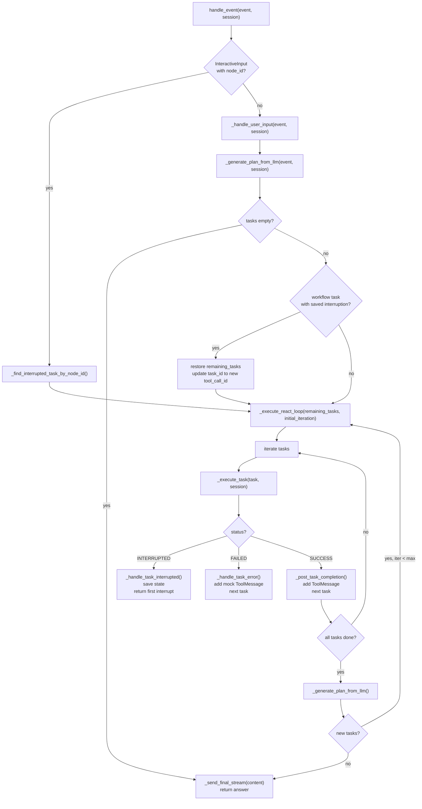

Sources: [openjiuwen/core/application/llm_agent/llm_controller.py:122-160](), [openjiuwen/core/application/llm_agent/llm_controller.py:412-508]()

### Plan generation: `_generate_plan_from_llm()`

1. Loads available tool schemas via `Runner.resource_mgr.get_tool_infos(tag=config.id)` [openjiuwen/core/single_agent/legacy/react_agent.py:123]().
2. Retrieves chat history from `ContextEngine` [openjiuwen/core/single_agent/legacy/react_agent.py:101]().
3. Formats messages via `MessageHandlerUtils.format_llm_inputs()` [openjiuwen/core/controller/legacy/utils.py:34-54]().
4. Streams the LLM response chunk by chunk, writing `llm_reasoning` and `llm_output` frames to the session stream.
5. Parses `tool_calls` from the response via `MessageHandlerUtils.parse_llm_output()` [openjiuwen/core/controller/legacy/utils.py:69-73]().
6. Returns `(List[Task], AssistantMessage)`.

Sources: [openjiuwen/core/application/llm_agent/llm_controller.py:666-711](), [openjiuwen/core/controller/legacy/utils.py:69-146]()

### Task dispatch

`_execute_task()` routes to one of two executors:

| `task.task_type` | Executor | Description |
|---|---|---|
| `TaskType.PLUGIN` | `_execute_plugin_task()` | Fetches tool from `Runner.resource_mgr`, calls `tool.invoke(args)` |
| `TaskType.WORKFLOW` | `_execute_workflow_task()` | Calls `Runner.run_workflow(workflow, inputs, session, context)` |

Sources: [openjiuwen/core/application/llm_agent/llm_controller.py:510-529](), [openjiuwen/core/controller/legacy/utils.py:149-158]()

---

## Interrupt and Resume

When a workflow inside a task raises an `InteractiveInput` interruption, `LLMController` suspends the loop and saves state [openjiuwen/core/application/llm_agent/llm_controller.py:879-959]().

**`TaskInterruptionState` dataclass** groups interruption data:

| Field | Type | Purpose |
|---|---|---|
| `task` | `Task` | The interrupted task |
| `session` | `Session` | Session context |
| `ai_message` | `AssistantMessage` | LLM output that triggered this task |
| `remaining_tasks` | `list[Task]` | Tasks not yet executed |
| `interaction_data` | `list` | Raw interaction frames from the workflow |
| `current_iteration` | `int` | Loop iteration at time of interruption |

Sources: [openjiuwen/core/application/llm_agent/llm_controller.py:34-46]()

**Resume paths:**

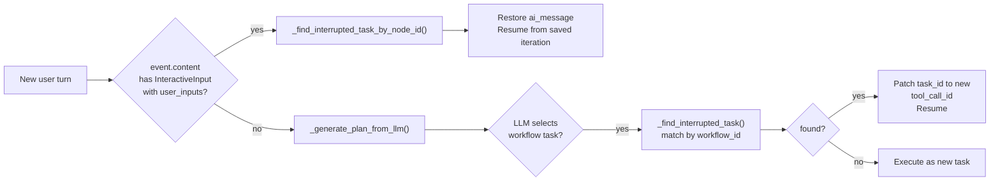

Sources: [openjiuwen/core/application/llm_agent/llm_controller.py:137-150](), [openjiuwen/core/application/llm_agent/llm_controller.py:165-176]()

---

## Code Entity Map

The diagram below ties the high-level conceptual names to the concrete file and class locations.

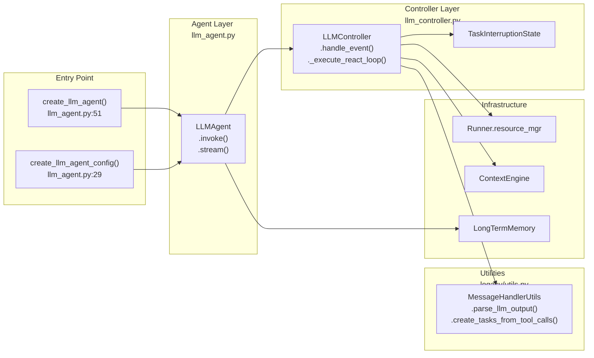

Sources: [openjiuwen/core/application/llm_agent/llm_agent.py](), [openjiuwen/core/application/llm_agent/llm_controller.py](), [openjiuwen/core/controller/legacy/utils.py]()

---

# Page: WorkflowAgent

# WorkflowAgent

<details>
<summary>Relevant source files</summary>

The following files were used as context for generating this wiki page:

- [examples/workflow_agent/multi_workflow_agent_demo/workflow_event_handler.py](examples/workflow_agent/multi_workflow_agent_demo/workflow_event_handler.py)
- [examples/workflow_agent/multi_workflow_agent_demo/workflow_executor.py](examples/workflow_agent/multi_workflow_agent_demo/workflow_executor.py)
- [openjiuwen/core/application/workflow_agent/workflow_controller.py](openjiuwen/core/application/workflow_agent/workflow_controller.py)
- [openjiuwen/core/common/utils/message_utils.py](openjiuwen/core/common/utils/message_utils.py)
- [openjiuwen/core/controller/__init__.py](openjiuwen/core/controller/__init__.py)
- [openjiuwen/core/controller/base.py](openjiuwen/core/controller/base.py)
- [openjiuwen/core/controller/config.py](openjiuwen/core/controller/config.py)
- [openjiuwen/core/controller/legacy/controller.py](openjiuwen/core/controller/legacy/controller.py)
- [openjiuwen/core/controller/legacy/reasoner/intent_detector.py](openjiuwen/core/controller/legacy/reasoner/intent_detector.py)
- [openjiuwen/core/controller/modules/__init__.py](openjiuwen/core/controller/modules/__init__.py)
- [openjiuwen/core/controller/modules/event_handler.py](openjiuwen/core/controller/modules/event_handler.py)
- [openjiuwen/core/controller/modules/event_queue.py](openjiuwen/core/controller/modules/event_queue.py)
- [openjiuwen/core/controller/modules/intent_recognizer.py](openjiuwen/core/controller/modules/intent_recognizer.py)
- [openjiuwen/core/controller/modules/task_executor.py](openjiuwen/core/controller/modules/task_executor.py)
- [openjiuwen/core/controller/modules/task_manager.py](openjiuwen/core/controller/modules/task_manager.py)
- [openjiuwen/core/controller/modules/task_scheduler.py](openjiuwen/core/controller/modules/task_scheduler.py)
- [openjiuwen/core/controller/schema/__init__.py](openjiuwen/core/controller/schema/__init__.py)
- [openjiuwen/core/controller/schema/controller_output.py](openjiuwen/core/controller/schema/controller_output.py)
- [openjiuwen/core/controller/schema/dataframe.py](openjiuwen/core/controller/schema/dataframe.py)
- [openjiuwen/core/controller/schema/intent.py](openjiuwen/core/controller/schema/intent.py)
- [openjiuwen/core/controller/schema/task.py](openjiuwen/core/controller/schema/task.py)
- [tests/unit_tests/agent/llm_agent/test_llm_agent_invoke_with_workflow_interrupt_mock.py](tests/unit_tests/agent/llm_agent/test_llm_agent_invoke_with_workflow_interrupt_mock.py)
- [tests/unit_tests/agent/llm_agent/test_llm_agent_with_interrupt.py](tests/unit_tests/agent/llm_agent/test_llm_agent_with_interrupt.py)
- [tests/unit_tests/agent/react_agent/test_react_agent_interrupt.py](tests/unit_tests/agent/react_agent/test_react_agent_interrupt.py)
- [tests/unit_tests/agent/react_agent/test_react_agent_mock.py](tests/unit_tests/agent/react_agent/test_react_agent_mock.py)
- [tests/unit_tests/agent/react_agent/test_react_agent_streaming.py](tests/unit_tests/agent/react_agent/test_react_agent_streaming.py)
- [tests/unit_tests/agent/react_agent/test_react_agent_workflow_interrupt_mock.py](tests/unit_tests/agent/react_agent/test_react_agent_workflow_interrupt_mock.py)
- [tests/unit_tests/agent/workflow_agent/test_workflow_agent.py](tests/unit_tests/agent/workflow_agent/test_workflow_agent.py)
- [tests/unit_tests/agent/workflow_agent/test_workflow_agent_mock.py](tests/unit_tests/agent/workflow_agent/test_workflow_agent_mock.py)
- [tests/unit_tests/fixtures/__init__.py](tests/unit_tests/fixtures/__init__.py)

</details>


`WorkflowAgent` drives one or more pre-defined workflow graphs directly, without a ReAct planning loop. It handles intent-based routing across multiple registered workflows, executes them as streaming async tasks, and manages the complete interrupt/resume lifecycle when a workflow needs user input mid-execution.

This page covers `WorkflowAgent`, `WorkflowController`, `WorkflowAgentConfig`, multi-workflow registration, intent routing, streaming execution, `InteractiveInput` resumption, and session state management for interrupted workflows.

For the LLM-driven (ReAct) agent that selects workflows at runtime via tool-calling, see [LLMAgent](2.2). For building the workflow graphs that `WorkflowAgent` executes, see [Workflow Engine](4). For session state and checkpointing, see [Sessions and Checkpointing](2.6).

---

## Class Structure

`WorkflowAgent` extends `ControllerAgent` and delegates all routing and execution logic to a `WorkflowController`. `WorkflowController` [[openjiuwen/core/application/workflow_agent/workflow_controller.py:33-40]]() extends `IntentDetectionController` from the legacy controller layer and overrides two hook methods: `intent_detection()` and `exec_task()`.

**WorkflowAgent and WorkflowController class hierarchy**

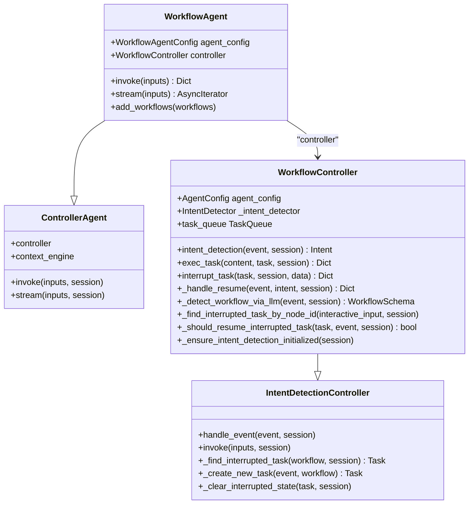

Sources: [[openjiuwen/core/application/workflow_agent/workflow_controller.py:33-80]](), [[openjiuwen/core/controller/base.py:41-58]](), [[openjiuwen/core/controller/modules/task_executor.py:36-48]]()

---

## Configuration

`WorkflowAgentConfig` is defined in `openjiuwen/core/single_agent/legacy/config.py` as an extension of `AgentConfig`.

| Field | Type | Purpose |
|-------|------|---------|
| `id` | `str` | Unique agent identifier |
| `version` | `str` | Agent version |
| `description` | `str` | Human-readable description |
| `workflows` | `List[WorkflowSchema \| WorkflowCard]` | Registered workflow descriptors; usually populated via `add_workflows()` |
| `model` | `Optional[ModelConfig]` | LLM for intent detection — required when more than one workflow is registered |
| `default_response` | (nested) | Text returned when no workflow matches intent |
| `controller_type` | `ControllerType` | Identifies the controller variant |

`WorkflowSchema` carries the per-workflow metadata used during routing:

| Field | Role |
|-------|------|
| `id` | Workflow identifier |
| `version` | Workflow version |
| `name` | Used as fallback intent category label |
| `description` | Preferred intent category label for LLM routing |

Sources: [[openjiuwen/core/application/workflow_agent/workflow_controller.py:638-659]](), [[openjiuwen/core/controller/config.py:1-50]]()

---

## Multi-Workflow Registration

When using a `WorkflowAgent`, workflows are registered with the agent to allow for intent-based routing. `add_workflows()` extracts each `Workflow.card` to produce `WorkflowSchema` entries appended to `config.workflows`, and also registers each `Workflow` instance with `Runner.resource_mgr` so it is retrievable during execution.

Sources: [[openjiuwen/core/application/workflow_agent/workflow_controller.py:101-105]](), [[openjiuwen/core/controller/modules/task_manager.py:108-141]]()

---

## Intent Detection and Routing

`WorkflowController.intent_detection()` [[openjiuwen/core/application/workflow_agent/workflow_controller.py:80-199]]() determines which workflow to run and whether to start fresh or resume an interrupted execution.

**Intent detection routing logic**

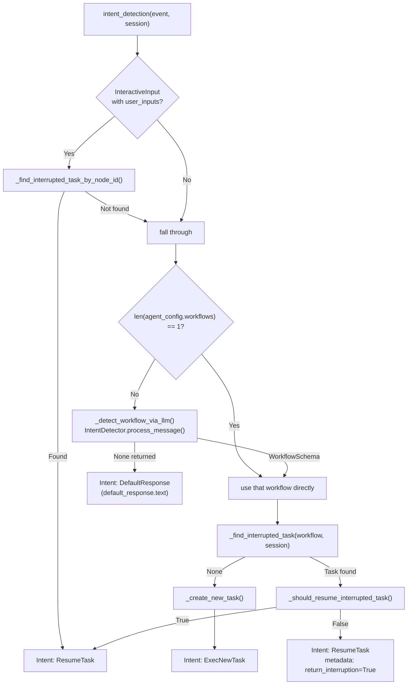

Sources: [[openjiuwen/core/application/workflow_agent/workflow_controller.py:80-199]](), [[openjiuwen/core/controller/modules/intent_recognizer.py:51-186]](), [[openjiuwen/core/controller/legacy/reasoner/intent_detector.py:27-146]]()

### Multi-Workflow LLM Routing

When more than one workflow is registered, `_detect_workflow_via_llm()` [[openjiuwen/core/application/workflow_agent/workflow_controller.py:553-620]]() lazily initializes an `IntentDetector` [[openjiuwen/core/controller/legacy/reasoner/intent_detector.py:27-297]]() via `_ensure_intent_detection_initialized()` [[openjiuwen/core/application/workflow_agent/workflow_controller.py:622-659]]().

The `IntentDetector` is configured with:
- `category_list`: each workflow's `description` if set, else `name`
- `category_info`: newline-joined descriptions
- `enable_history=True`, `enable_input=True`

The LLM returns a category index, which is mapped back to a `WorkflowSchema` by description/name match. If no match, the first workflow is used as a fallback.

### Resume Decision: `_should_resume_interrupted_task()`

[[openjiuwen/core/application/workflow_agent/workflow_controller.py:661-727]]()

| Condition | Decision |
|-----------|----------|
| User provided `InteractiveInput` with `user_inputs` | Always resume |
| `last_interaction_value` is `dict` or `list` (structured component output) | Return the saved interruption again (do not re-execute yet) |
| `last_interaction_value` is `str` (human-readable question text) | Resume execution |
| No saved state found | Resume |

---

## Task Execution

`WorkflowController.exec_task()` [[openjiuwen/core/application/workflow_agent/workflow_controller.py:201-425]]() runs the selected workflow as an async streaming task and handles the result.

**exec_task execution flow**

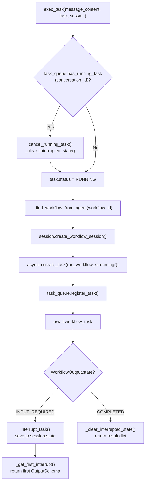

Sources: [[openjiuwen/core/application/workflow_agent/workflow_controller.py:201-425]](), [[openjiuwen/core/controller/modules/task_scheduler.py:84-98]](), [[openjiuwen/core/controller/modules/task_executor.py:72-83]]()

### Streaming Chunk Routing

Inside `run_workflow_streaming()`, each chunk from `Runner.run_workflow_streaming()` is handled:

| Chunk type | Action |
|------------|--------|
| `OutputSchema(type=INTERACTION)` | Set `has_interaction = True`; **not** passed to session (held back) |
| `OutputSchema(type="workflow_final")` | Written to `session.write_stream()`; saved as `final_result` |
| `OutputSchema` (any other type) | Written to `session.write_stream()` |
| `CustomSchema` | Written to `session.write_custom_stream()` |

After iteration: if `has_interaction` is `True` → `WorkflowOutput(state=WorkflowExecutionState.INPUT_REQUIRED)`; otherwise → `WorkflowOutput(state=WorkflowExecutionState.COMPLETED)`.

Sources: [[openjiuwen/core/application/workflow_agent/workflow_controller.py:280-340]]()

---

## InteractiveInput Interruptions

When a workflow component (e.g., `QuestionerComponent`) triggers an interaction, the following two-turn sequence applies:

**Interrupt and resume sequence**

```mermaid
sequenceDiagram
    participant User
    participant WorkflowAgent
    participant WorkflowController
    participant RunnerRunWorkflowStreaming as "Runner.run_workflow_streaming"
    participant Workflow

    User->>WorkflowAgent: "invoke({'query': '...'})"
    WorkflowAgent->>WorkflowController: "intent_detection → ExecNewTask"
    WorkflowController->>RunnerRunWorkflowStreaming: "run_workflow_streaming(workflow, inputs)"
    Workflow-->>WorkflowController: "OutputSchema(type='__interaction__')"
    WorkflowController->>WorkflowController: "interrupt_task() — saves state"
    WorkflowController-->>WorkflowAgent: "first interrupt OutputSchema"
    WorkflowAgent-->>User: "question prompt"

    User->>WorkflowAgent: "invoke({'interactive_input': InteractiveInput(...)})"
    WorkflowAgent->>WorkflowController: "intent_detection"
    WorkflowController->>WorkflowController: "_find_interrupted_task_by_node_id()\nmatches component_id"
    WorkflowController-->>WorkflowController: "Intent: ResumeTask"
    WorkflowController->>RunnerRunWorkflowStreaming: "run_workflow_streaming(workflow, InteractiveInput)"
    Workflow-->>WorkflowController: "OutputSchema(type='workflow_final')"
    WorkflowController->>WorkflowController: "_clear_interrupted_state()"
    WorkflowController-->>WorkflowAgent: "result dict"
    WorkflowAgent-->>User: "final answer"
```

Sources: [[openjiuwen/core/application/workflow_agent/workflow_controller.py:80-199]](), [[openjiuwen/core/application/workflow_agent/workflow_controller.py:492-551]](), [[openjiuwen/core/controller/modules/event_handler.py:122-134]]()

### Interruption State Storage

`interrupt_task()` [[openjiuwen/core/application/workflow_agent/workflow_controller.py:492-551]]() writes to `session.state["workflow_controller"]["interrupted_tasks"][<state_key>]` where `<state_key> = workflow_id.replace('.', '_')`.

Each entry has the shape:

```python
{
    "task": task.model_dump(),          # full serialized Task object
    "component_id": "questioner",       # str (single) or List[str] (parallel interrupts)
    "last_interaction_value": "..."     # str or dict; drives resume vs. re-interrupt decision
}
```

`_find_interrupted_task_by_node_id()` [[openjiuwen/core/application/workflow_agent/workflow_controller.py:729-799]]() matches keys from `InteractiveInput.user_inputs` against stored `component_id` values — supporting both legacy string format and list format for parallel component interrupts.

### `_handle_resume` Override

`WorkflowController._handle_resume()` [[openjiuwen/core/application/workflow_agent/workflow_controller.py:427-490]]() overrides the parent's default. When `intent.metadata["return_interruption"] == True` (structured/dict-type interruption), it reconstructs an `InteractionOutput` from the saved `last_interaction_value` and emits it directly — without re-executing the workflow. This lets the caller see the question again before providing structured input.

---

## Session-Level Task Queue

`WorkflowController` uses an internal `task_queue` to track active `asyncio.Task` objects per `conversation_id`. If a new request arrives while a workflow task is in progress for the same conversation, the in-flight task is cancelled and its interrupted state is cleared before the new task starts.

| Method | Action |
|--------|--------|
| `task_queue.has_running_task(conversation_id)` | Check for active task |
| `task_queue.cancel_running_task(conversation_id)` | Cancel and unregister |
| `task_queue.register_task(conversation_id, task, coroutine, target_id)` | Register new task |
| `task_queue.unregister_task(conversation_id)` | Clean up after completion or cancellation |

Sources: [[openjiuwen/core/application/workflow_agent/workflow_controller.py:225-255]](), [[openjiuwen/core/application/workflow_agent/workflow_controller.py:342-362]]()

---

## Error Handling

The `WorkflowAgent` and its controller utilize the framework's unified exception system defined in `openjiuwen/core/common/exception/errors.py`. Specific error codes for workflows and agents are mapped to appropriate exception classes.

| Error Class | Range | Use Case |
|-------------|-------|----------|
| `WorkflowError` | 100000–100999 | Errors during workflow graph execution |
| `AgentError` | 120000–129999 | Errors specific to agent lifecycle or logic |
| `ValidationError` | N/A | Parameter or configuration mismatches |

Sources: [[openjiuwen/core/common/exception/errors.py:19-51]](), [[openjiuwen/core/common/exception/status_mapping.py:51-61]](), [[openjiuwen/core/common/exception/code_template.py:69-86]]()

---

## Key Code Locations

| Symbol | File | Role |
|--------|------|------|
| `WorkflowAgent` | `openjiuwen/core/application/workflow_agent/` | Top-level agent class |
| `WorkflowController` | `openjiuwen/core/application/workflow_agent/workflow_controller.py` | All routing and execution logic |
| `IntentDetectionController` | `openjiuwen/core/controller/legacy/` | Base controller; provides `invoke()` and hook stubs |
| `IntentDetector` | `openjiuwen/core/controller/legacy/reasoner/intent_detector.py` | LLM-based intent classification |
| `TaskManager` | `openjiuwen/core/controller/modules/task_manager.py` | Manages task state, priorities, and hierarchies |
| `TaskScheduler` | `openjiuwen/core/controller/modules/task_scheduler.py` | Coordinates execution of submitted tasks |
| `BaseError` | `openjiuwen/core/common/exception/errors.py` | Framework unified exception base class |

---

# Page: Hierarchical Groups

# Hierarchical Groups

<details>
<summary>Relevant source files</summary>

The following files were used as context for generating this wiki page:

- [examples/workflow_agent/multi_workflow_agent_demo/workflow_event_handler.py](examples/workflow_agent/multi_workflow_agent_demo/workflow_event_handler.py)
- [examples/workflow_agent/multi_workflow_agent_demo/workflow_executor.py](examples/workflow_agent/multi_workflow_agent_demo/workflow_executor.py)
- [openjiuwen/core/application/llm_agent/llm_agent.py](openjiuwen/core/application/llm_agent/llm_agent.py)
- [openjiuwen/core/application/llm_agent/llm_controller.py](openjiuwen/core/application/llm_agent/llm_controller.py)
- [openjiuwen/core/application/workflow_agent/workflow_event_handler.py](openjiuwen/core/application/workflow_agent/workflow_event_handler.py)
- [openjiuwen/core/common/clients/llm_client.py](openjiuwen/core/common/clients/llm_client.py)
- [openjiuwen/core/common/utils/message_utils.py](openjiuwen/core/common/utils/message_utils.py)
- [openjiuwen/core/controller/__init__.py](openjiuwen/core/controller/__init__.py)
- [openjiuwen/core/controller/base.py](openjiuwen/core/controller/base.py)
- [openjiuwen/core/controller/config.py](openjiuwen/core/controller/config.py)
- [openjiuwen/core/controller/legacy/utils.py](openjiuwen/core/controller/legacy/utils.py)
- [openjiuwen/core/controller/modules/__init__.py](openjiuwen/core/controller/modules/__init__.py)
- [openjiuwen/core/controller/modules/event_handler.py](openjiuwen/core/controller/modules/event_handler.py)
- [openjiuwen/core/controller/modules/event_queue.py](openjiuwen/core/controller/modules/event_queue.py)
- [openjiuwen/core/controller/modules/intent_recognizer.py](openjiuwen/core/controller/modules/intent_recognizer.py)
- [openjiuwen/core/controller/modules/task_executor.py](openjiuwen/core/controller/modules/task_executor.py)
- [openjiuwen/core/controller/modules/task_manager.py](openjiuwen/core/controller/modules/task_manager.py)
- [openjiuwen/core/controller/modules/task_scheduler.py](openjiuwen/core/controller/modules/task_scheduler.py)
- [openjiuwen/core/controller/schema/__init__.py](openjiuwen/core/controller/schema/__init__.py)
- [openjiuwen/core/controller/schema/controller_output.py](openjiuwen/core/controller/schema/controller_output.py)
- [openjiuwen/core/controller/schema/dataframe.py](openjiuwen/core/controller/schema/dataframe.py)
- [openjiuwen/core/controller/schema/intent.py](openjiuwen/core/controller/schema/intent.py)
- [openjiuwen/core/controller/schema/task.py](openjiuwen/core/controller/schema/task.py)
- [openjiuwen/core/foundation/llm/headers_helper.py](openjiuwen/core/foundation/llm/headers_helper.py)
- [openjiuwen/core/foundation/llm/model.py](openjiuwen/core/foundation/llm/model.py)
- [openjiuwen/core/foundation/llm/schema/config.py](openjiuwen/core/foundation/llm/schema/config.py)
- [openjiuwen/core/foundation/llm/schema/mode_info.py](openjiuwen/core/foundation/llm/schema/mode_info.py)
- [openjiuwen/core/retrieval/query_rewriter/query_rewriter.py](openjiuwen/core/retrieval/query_rewriter/query_rewriter.py)
- [openjiuwen/core/single_agent/legacy/react_agent.py](openjiuwen/core/single_agent/legacy/react_agent.py)
- [tests/unit_tests/agent/react_agent/test_react_agent_interrupt.py](tests/unit_tests/agent/react_agent/test_react_agent_interrupt.py)
- [tests/unit_tests/agent/react_agent/test_react_agent_streaming.py](tests/unit_tests/agent/react_agent/test_react_agent_streaming.py)
- [tests/unit_tests/agent/react_agent/test_react_agent_workflow_interrupt_mock.py](tests/unit_tests/agent/react_agent/test_react_agent_workflow_interrupt_mock.py)
- [tests/unit_tests/core/common/clients/test_llm_client.py](tests/unit_tests/core/common/clients/test_llm_client.py)
- [tests/unit_tests/core/foundation/llm/test_model_client_config.py](tests/unit_tests/core/foundation/llm/test_model_client_config.py)
- [tests/unit_tests/core/memory/test_session_id_in_memory.py](tests/unit_tests/core/memory/test_session_id_in_memory.py)
- [tests/unit_tests/core/retrieval/query_rewriter/test_query_rewriter.py](tests/unit_tests/core/retrieval/query_rewriter/test_query_rewriter.py)

</details>


This page documents the orchestration patterns for multi-agent coordination in the openjiuwen SDK. It covers the message-bus driven `HierarchicalTeam`, the `HandoffTeam` for sequential transfers, and the core controllers enabling hierarchical orchestration such as `LLMController` and `HierarchicalMainController`. These structures allow for complex agent topologies including supervisor-worker hierarchies and peer-to-peer handoffs.

---

## Hierarchical Orchestration Controllers

The SDK provides specialized controllers that manage the lifecycle of multi-step reasoning and delegation. The `LLMController` acts as the primary engine for ReAct-style agents, while the `HierarchicalMainController` (often used in legacy groups) focuses on intent detection and routing.

### LLMController: The ReAct Engine
The `LLMController` is responsible for the core ReAct loop: receiving user input, invoking LLM reasoning to generate task plans (tool calls), executing those tasks, and looping until completion [openjiuwen/core/application/llm_agent/llm_controller.py:61-68]().

**Key Features:**
*   **Intent Detection & Routing**: It converts user queries into a sequence of `Task` objects (Workflow or Plugin) based on tool definitions [openjiuwen/core/controller/legacy/utils.py:76-147]().
*   **Interruption Propagation**: It handles `TaskInterruptionState`, allowing agents to pause for `InteractiveInput` and resume once user data is provided [openjiuwen/core/application/llm_agent/llm_controller.py:34-47]().
*   **Session Isolation**: It manages the `Session` context, ensuring that conversation history and memory variables are correctly scoped during delegation [openjiuwen/core/application/llm_agent/llm_controller.py:122-131]().

Sources: [openjiuwen/core/application/llm_agent/llm_controller.py:61-68](), [openjiuwen/core/application/llm_agent/llm_controller.py:133-150](), [openjiuwen/core/controller/legacy/utils.py:76-147]()

---

## HierarchicalTeam (MessageBus Pattern)

`HierarchicalTeam` is a multi-agent coordination structure driven by a **Supervisor Agent**. It utilizes a `TeamRuntime` and a `MessageBus` to facilitate communication between the supervisor and its sub-agents via P2P (Point-to-Point) messaging.

### Architecture and Data Flow

In a `HierarchicalTeam`, the supervisor agent is configured with sub-agents registered as tools. When the supervisor decides to delegate a task, it emits a `ToolCall`. The `P2PAbilityManager` intercepts this call and routes it as a P2P message to the target sub-agent.

**Natural Language to Code Entity Mapping: Hierarchical Team**

```mermaid
flowchart TD
    subgraph "Natural Language Space"
        User["'Analyze medical data'"]
        SupervisorRole["'Research Director'"]
        WorkerRole["'Data Analyst'"]
    end

    subgraph "Code Entity Space"
        LLMA["LLMAgent (llm_agent.py)"]
        LLMC["LLMController (llm_controller.py)"]
        TM["TaskManager (task_manager.py)"]
        TS["TaskScheduler (task_scheduler.py)"]
        TE["TaskExecutor (task_executor.py)"]
        
        LLMA -- "delegates to" --> LLMC
        LLMC -- "manages" --> TM
        LLMC -- "triggers" --> TS
        TS -- "dispatches to" --> TE
    end

    User -- "inputs to" --> LLMA
    SupervisorRole -- "logic in" --> LLMC
    WorkerRole -- "executed via" --> TE
```

Sources: [openjiuwen/core/application/llm_agent/llm_agent.py:96-104](), [openjiuwen/core/application/llm_agent/llm_controller.py:61-68](), [openjiuwen/core/controller/modules/task_scheduler.py:84-91]()

### Parallel Dispatch and Execution
Multi-agent teams often require parallel processing. The `TaskScheduler` and `TaskExecutor` components enable concurrent execution of sub-agent tasks [openjiuwen/core/controller/modules/task_scheduler.py:12-18]().

1.  **Task Registration**: Sub-agents are registered in the `TaskExecutorRegistry` [openjiuwen/core/controller/modules/task_scheduler.py:154-166]().
2.  **Concurrent Execution**: The `TaskScheduler` manages multiple `TaskExecutor` instances to run sub-tasks in parallel while streaming results back to the supervisor [openjiuwen/core/controller/modules/task_scheduler.py:10-18]().
3.  **Status Tracking**: The `TaskManager` maintains the state (Submitted, Running, Interrupted, Completed) of each delegated sub-task [openjiuwen/core/controller/modules/task_manager.py:28-29]().

Sources: [openjiuwen/core/controller/modules/task_scheduler.py:154-166](), [openjiuwen/core/controller/modules/task_scheduler.py:10-18](), [openjiuwen/core/controller/base.py:82-91]()

---

## Handoff Teams (Transfer Pattern)

`HandoffTeam` implements a pattern where agents can "hand off" a conversation to another agent. This is common in customer service scenarios (e.g., Triage -> Technical Support).

### Handoff Signals and Tools

Agents trigger a handoff by calling a specialized tool. The `MessageHandlerUtils` parses these tool calls to determine if a transition to another agent (or a different workflow) is required [openjiuwen/core/controller/legacy/utils.py:83-112]().

**Handoff Execution Sequence**

```mermaid
sequenceDiagram
    participant A as TriageAgent
    participant C as LLMController
    participant TS as TaskScheduler
    participant B as BillingAgent

    A->>C: _handle_user_input()
    C->>C: parse_llm_output()
    Note over C: Detects ToolCall for Billing
    C->>TS: schedule(TaskType.WORKFLOW)
    TS->>B: execute_ability()
    B-->>TS: stream results
    TS-->>C: TaskCompletionEvent
```

Sources: [openjiuwen/core/application/llm_agent/llm_controller.py:122-131](), [openjiuwen/core/controller/legacy/utils.py:76-81](), [openjiuwen/core/controller/modules/task_scheduler.py:89-99]()

---

## Session Isolation and Interruption Propagation

Maintaining state across a hierarchy of agents requires robust session management and interruption handling.

### Session Isolation
Each agent in the hierarchy maintains its own `Session` context [openjiuwen/core/application/llm_agent/llm_agent.py:132-143](). The `LLMController` ensures that when a sub-agent is called, the relevant parts of the parent session (like `conversation_id`) are propagated while keeping the sub-agent's execution environment isolated [openjiuwen/core/application/llm_agent/llm_controller.py:88-101]().

### Interruption Propagation
When a sub-agent requires human intervention (via `InteractiveInput`), the interruption must bubble up to the main controller:
1.  **Detection**: The `TaskScheduler` detects an interaction event from the `TaskExecutor` [openjiuwen/core/controller/modules/task_scheduler.py:30-32]().
2.  **State Preservation**: The `LLMController` saves the `TaskInterruptionState`, including the `AssistantMessage` and `remaining_tasks` [openjiuwen/core/application/llm_agent/llm_controller.py:34-47]().
3.  **Resumption**: When the user responds, the controller identifies the interrupted task by its `node_id` and resumes execution from the saved state [openjiuwen/core/application/llm_agent/llm_controller.py:138-150]().

Sources: [openjiuwen/core/application/llm_agent/llm_controller.py:34-47](), [openjiuwen/core/application/llm_agent/llm_controller.py:138-150](), [openjiuwen/core/controller/modules/task_scheduler.py:30-32](), [openjiuwen/core/application/llm_agent/llm_agent.py:132-143]()

---

# Page: Runner

# Runner

<details>
<summary>Relevant source files</summary>

The following files were used as context for generating this wiki page:

- [.gitignore](.gitignore)
- [Makefile](Makefile)
- [openjiuwen/agent_teams/agent/recovery_manager.py](openjiuwen/agent_teams/agent/recovery_manager.py)
- [openjiuwen/agent_teams/prompts/messages.py](openjiuwen/agent_teams/prompts/messages.py)
- [openjiuwen/agent_teams/runtime/manager.py](openjiuwen/agent_teams/runtime/manager.py)
- [openjiuwen/agent_teams/team_context.py](openjiuwen/agent_teams/team_context.py)
- [openjiuwen/core/common/exception/codes.py](openjiuwen/core/common/exception/codes.py)
- [openjiuwen/core/foundation/tool/mcp/client/openapi_client.py](openjiuwen/core/foundation/tool/mcp/client/openapi_client.py)
- [openjiuwen/core/memory/common/base.py](openjiuwen/core/memory/common/base.py)
- [openjiuwen/core/retrieval/__init__.py](openjiuwen/core/retrieval/__init__.py)
- [openjiuwen/core/runner/callback/decorator.py](openjiuwen/core/runner/callback/decorator.py)
- [openjiuwen/core/runner/callback/framework.py](openjiuwen/core/runner/callback/framework.py)
- [openjiuwen/core/runner/resources_manager/resource_manager.py](openjiuwen/core/runner/resources_manager/resource_manager.py)
- [openjiuwen/core/runner/resources_manager/tool_manager.py](openjiuwen/core/runner/resources_manager/tool_manager.py)
- [openjiuwen/core/runner/runner.py](openjiuwen/core/runner/runner.py)
- [openjiuwen/core/session/__init__.py](openjiuwen/core/session/__init__.py)
- [openjiuwen/core/session/agent.py](openjiuwen/core/session/agent.py)
- [openjiuwen/core/session/internal/workflow.py](openjiuwen/core/session/internal/workflow.py)
- [openjiuwen/core/session/session.py](openjiuwen/core/session/session.py)
- [openjiuwen/core/session/workflow.py](openjiuwen/core/session/workflow.py)
- [openjiuwen/core/single_agent/__init__.py](openjiuwen/core/single_agent/__init__.py)
- [openjiuwen/harness/image_modality_probe.py](openjiuwen/harness/image_modality_probe.py)
- [pyproject.toml](pyproject.toml)
- [tests/conftest.py](tests/conftest.py)
- [tests/system_tests/harness/conftest.py](tests/system_tests/harness/conftest.py)
- [tests/system_tests/runner/test_runner.py](tests/system_tests/runner/test_runner.py)
- [tests/system_tests/tune/test_prompt_tune.py](tests/system_tests/tune/test_prompt_tune.py)
- [tests/system_tests/workflow/test_real_workflow.py](tests/system_tests/workflow/test_real_workflow.py)
- [tests/test_logger.py](tests/test_logger.py)
- [tests/unit_tests/agent_teams/observability/test_team_observability_mock_llm.py](tests/unit_tests/agent_teams/observability/test_team_observability_mock_llm.py)
- [tests/unit_tests/agent_teams/test_runner_team_runtime.py](tests/unit_tests/agent_teams/test_runner_team_runtime.py)
- [tests/unit_tests/core/context_engine/conftest.py](tests/unit_tests/core/context_engine/conftest.py)
- [tests/unit_tests/core/context_engine/test_processor_imports.py](tests/unit_tests/core/context_engine/test_processor_imports.py)
- [tests/unit_tests/core/runner/callback/test_emit_sync.py](tests/unit_tests/core/runner/callback/test_emit_sync.py)
- [tests/unit_tests/core/runner/callback/test_framework_chain_breakdown.py](tests/unit_tests/core/runner/callback/test_framework_chain_breakdown.py)
- [tests/unit_tests/core/runner/callback/test_framework_generators.py](tests/unit_tests/core/runner/callback/test_framework_generators.py)
- [tests/unit_tests/core/runner/callback/test_framework_wrap.py](tests/unit_tests/core/runner/callback/test_framework_wrap.py)
- [tests/unit_tests/core/runner/callback/test_metaclass_callbacks.py](tests/unit_tests/core/runner/callback/test_metaclass_callbacks.py)
- [tests/unit_tests/core/runner/callback/test_runner_callback_framework.py](tests/unit_tests/core/runner/callback/test_runner_callback_framework.py)
- [tests/unit_tests/core/runner/callback/test_transform_io.py](tests/unit_tests/core/runner/callback/test_transform_io.py)
- [tests/unit_tests/harness/conftest.py](tests/unit_tests/harness/conftest.py)
- [uv.lock](uv.lock)

</details>


The `Runner` is the central execution coordinator for the openJiuwen agent-core SDK. It provides a singleton interface for managing the runtime environment lifecycle, registering resources via `ResourceMgr`, and dispatching execution to agents, workflows, and agent teams.

## Architecture

`Runner` is a static proxy class that delegates all calls to a process-level singleton, `GLOBAL_RUNNER`, which is an instance of `_RunnerImpl` [openjiuwen/core/runner/runner.py:657-687](). This design ensures that resource registries, message queues, and callback frameworks are shared across the application without requiring manual dependency injection.

**Runner Entity Mapping**

```mermaid
flowchart TD
    subgraph "Natural Language Space"
        R["Runner"]
        RM["Resource Manager"]
        CB["Callback Framework"]
        TM["Team Runtime Manager"]
    end

    subgraph "Code Entity Space"
        RunnerClass["openjiuwen.core.runner.runner.Runner"]
        ImplClass["openjiuwen.core.runner.runner._RunnerImpl"]
        ResMgrClass["openjiuwen.core.runner.resources_manager.resource_manager.ResourceMgr"]
        CBClass["openjiuwen.core.runner.callback.framework.AsyncCallbackFramework"]
        TeamMgrClass["openjiuwen.agent_teams.runtime.manager.TeamRuntimeManager"]
    end

    RunnerClass -- "proxies to" --> ImplClass
    ImplClass -- "owns" --> ResMgrClass
    ImplClass -- "owns" --> CBClass
    ImplClass -- "owns" --> TeamMgrClass
```
Sources: [openjiuwen/core/runner/runner.py:62-102](), [openjiuwen/core/runner/runner.py:657-687]()

---

## Lifecycle: Start and Stop

The `Runner` lifecycle must be managed to ensure background tasks (like message queue consumers) and resource connections (like MCP servers) are properly initialized and torn down.

### `start()`
`Runner.start()` initializes subsystems in the following order:
1.  **Checkpointer**: If `RunnerConfig.checkpointer_config` is provided, it initializes the persistence layer for session state via `CheckpointerFactory` [openjiuwen/core/runner/runner.py:284-293]().
2.  **Message Queue**: Starts the `LocalMessageQueue`. If `distributed_mode` is enabled, it also initializes the distributed MQ and a `ReplyTopicSubscription` [openjiuwen/core/runner/runner.py:303-330]().
3.  **Root Task Group**: Initializes an `anyio` task group for managing background task lifecycles [openjiuwen/core/runner/runner.py:152-170]().

### `stop()`
`Runner.stop()` performs a graceful shutdown:
1.  **Task Group**: Cancels the root task group and all associated background tasks [openjiuwen/core/runner/runner.py:171-197]().
2.  **Message Queue**: Deactivates MQ subscriptions and stops message queue background tasks [openjiuwen/core/runner/runner.py:335-342]().
3.  **Resource Release**: Calls `ResourceMgr.release()`, which triggers cleanup for all registered resources, including disconnecting MCP clients [openjiuwen/core/runner/runner.py:344-346]().

Sources: [openjiuwen/core/runner/runner.py:274-346](), [openjiuwen/core/runner/runner.py:152-197]()

---

## ResourceMgr

`ResourceMgr` (accessible via `Runner.resource_mgr`) is the registry for all components used by agents. It uses a `ResourceRegistry` for storage and a `TagMgr` for categorization.

### Resource Isolation with Tags
Every resource (Agent, Tool, Model, etc.) can be associated with one or more `Tag` objects. This allows for multi-tenant isolation or agent-specific tool scoping.

| Strategy | Description |
| :--- | :--- |
| `TagMatchStrategy.ALL` | Returns resources that possess **every** specified tag [openjiuwen/core/runner/resources_manager/base.py:23-23](). |
| `TagMatchStrategy.ANY` | Returns resources that possess **at least one** of the specified tags [openjiuwen/core/runner/resources_manager/base.py:24-24](). |

### Tool Management (`ToolMgr`)
The `ResourceMgr` delegates tool-logic to `ToolMgr`. It supports:
*   **Standard Tools**: Registered via `add_tool` [openjiuwen/core/runner/resources_manager/tool_manager.py:61-64]().
*   **MCP Servers**: Added via `add_tool_server`. It serializes registrations for the same `server_id` using `asyncio.Lock` to prevent race conditions during parallel agent initialization [openjiuwen/core/runner/resources_manager/tool_manager.py:104-135]().
*   **System Operations**: Integration with `SysOperationCard` to expose shell, code, or filesystem operations as tools [openjiuwen/core/runner/resources_manager/resource_manager.py:32-34]().

Sources: [openjiuwen/core/runner/resources_manager/resource_manager.py:68-132](), [openjiuwen/core/runner/resources_manager/tool_manager.py:39-135]()

---

## Execution Methods

The `Runner` provides high-level methods to execute agents, workflows, and teams, handling session creation and lifecycle hooks automatically.

### Agent Execution Flow
When `run_agent` or `run_agent_streaming` is called, the following sequence occurs:

```mermaid
sequenceDiagram
    participant App
    participant Runner
    participant ResMgr as ResourceMgr
    participant Session as AgentSession
    participant Agent as BaseAgent

    App->>Runner: run_agent(agent_id, inputs)
    Runner->>ResMgr: get_agent(agent_id)
    ResMgr-->>Runner: agent_instance
    Runner->>Session: create_agent_session(session_id, envs, card)
    Runner->>Agent: invoke(inputs, session)
    Agent-->>Runner: output
    Runner-->>App: output
```
Sources: [openjiuwen/core/runner/runner.py:438-466](), [openjiuwen/core/runner/runner.py:596-618]()

### Workflow Execution
Workflows can be executed via `run_workflow` or `run_workflow_streaming`. A key feature is the ability to pass an existing `AgentSession` into a workflow execution. The `Runner` will automatically convert it into a `WorkflowSession` using `create_workflow_session()`, allowing the workflow to share memory and context with the calling agent [openjiuwen/core/runner/runner.py:404-436]().

### Agent Team Execution
Agent teams are managed via the `TeamRuntimeManager`. The `Runner` dispatches `run_agent_team_streaming` calls which involve:
1.  **Activation**: Resolving the `TeamAgent` and session via `TeamRuntimeManager.activate` [openjiuwen/agent_teams/runtime/manager.py:115-174]().
2.  **Dispatch**: Deciding between `NEW_TEAM`, `COLD_RECOVER`, or `RESUME` actions based on the current session state [openjiuwen/agent_teams/runtime/dispatch.py:52-108]().
3.  **Finalization**: Settling the run cycle (pause vs stop) via `TeamRuntimeManager.finalize` [openjiuwen/agent_teams/runtime/manager.py:176-218]().

Sources: [openjiuwen/core/runner/runner.py:545-594](), [openjiuwen/agent_teams/runtime/manager.py:104-218]()

---

## Async Callback Framework

The `AsyncCallbackFramework` (accessible via `Runner.callback_framework`) is an event system used for observability, guardrails, and runtime modifications.

### Core Features
*   **Priority-based Execution**: Callbacks run based on priority; higher values run first [openjiuwen/core/runner/callback/framework.py:220-230]().
*   **Performance Monitoring**: Automatically logs "slow" callbacks if they exceed `SLOW_CALLBACK_SECONDS` (1.0s) or if the whole chain exceeds `SLOW_CALLBACK_CHAIN_SECONDS` (0.05s) [openjiuwen/core/runner/callback/framework.py:73-80]().
*   **IO Transformation**: Decorators like `transform_io` allow callbacks to modify inputs or outputs dynamically [openjiuwen/core/runner/callback/decorator.py:43-44]().
*   **Signature Matching**: Uses `_narrow_call` to trim arguments to match the specific callback signature, ensuring compatibility across different hook implementations [openjiuwen/core/runner/callback/framework.py:137-181]().

Sources: [openjiuwen/core/runner/callback/framework.py:212-250](), [openjiuwen/core/runner/callback/decorator.py:1-49]()

---

## RunnerConfig

`RunnerConfig` is a Pydantic model that configures the global runtime.

| Field | Type | Description |
| :--- | :--- | :--- |
| `distributed_mode` | `bool` | Whether to enable distributed message queue and remote agents [openjiuwen/core/runner/runner_config.py:34-34](). |
| `checkpointer_config` | `CheckpointerConfig` | Configuration for session state persistence [openjiuwen/core/runner/runner_config.py:37-37](). |
| `distributed_config` | `DistributedConfig` | MQ-specific settings (e.g., Pulsar, Redis) [openjiuwen/core/runner/runner_config.py:35-35](). |

Sources: [openjiuwen/core/runner/runner_config.py:31-40]()

---

# Page: Sessions and Checkpointing

# Sessions and Checkpointing

<details>
<summary>Relevant source files</summary>

The following files were used as context for generating this wiki page:

- [docs/en/2.Development Guide/Advanced Usage/Checkpointer Checkpoint Mechanism.md](docs/en/2.Development Guide/Advanced Usage/Checkpointer Checkpoint Mechanism.md)
- [openjiuwen/agent_teams/agent/recovery_manager.py](openjiuwen/agent_teams/agent/recovery_manager.py)
- [openjiuwen/agent_teams/runtime/manager.py](openjiuwen/agent_teams/runtime/manager.py)
- [openjiuwen/core/runner/callback/utils.py](openjiuwen/core/runner/callback/utils.py)
- [openjiuwen/core/runner/runner.py](openjiuwen/core/runner/runner.py)
- [openjiuwen/core/session/__init__.py](openjiuwen/core/session/__init__.py)
- [openjiuwen/core/session/agent.py](openjiuwen/core/session/agent.py)
- [openjiuwen/core/session/checkpointer/__init__.py](openjiuwen/core/session/checkpointer/__init__.py)
- [openjiuwen/core/session/checkpointer/base.py](openjiuwen/core/session/checkpointer/base.py)
- [openjiuwen/core/session/checkpointer/inmemory.py](openjiuwen/core/session/checkpointer/inmemory.py)
- [openjiuwen/core/session/checkpointer/persistence.py](openjiuwen/core/session/checkpointer/persistence.py)
- [openjiuwen/core/session/internal/workflow.py](openjiuwen/core/session/internal/workflow.py)
- [openjiuwen/core/session/node.py](openjiuwen/core/session/node.py)
- [openjiuwen/core/session/session.py](openjiuwen/core/session/session.py)
- [openjiuwen/core/session/state/agent_state.py](openjiuwen/core/session/state/agent_state.py)
- [openjiuwen/core/session/state/base.py](openjiuwen/core/session/state/base.py)
- [openjiuwen/core/session/state/workflow_state.py](openjiuwen/core/session/state/workflow_state.py)
- [openjiuwen/core/session/utils.py](openjiuwen/core/session/utils.py)
- [openjiuwen/core/session/workflow.py](openjiuwen/core/session/workflow.py)
- [openjiuwen/core/workflow/components/component.py](openjiuwen/core/workflow/components/component.py)
- [openjiuwen/extensions/checkpointer/redis/checkpointer.py](openjiuwen/extensions/checkpointer/redis/checkpointer.py)
- [openjiuwen/extensions/checkpointer/redis/storage.py](openjiuwen/extensions/checkpointer/redis/storage.py)
- [tests/unit_tests/agent_teams/test_runner_team_runtime.py](tests/unit_tests/agent_teams/test_runner_team_runtime.py)
- [tests/unit_tests/core/runner/test_resource_manager.py](tests/unit_tests/core/runner/test_resource_manager.py)
- [tests/unit_tests/core/session/checkpointer/test_inmemory_storage.py](tests/unit_tests/core/session/checkpointer/test_inmemory_storage.py)
- [tests/unit_tests/core/session/checkpointer/test_persistence_storage.py](tests/unit_tests/core/session/checkpointer/test_persistence_storage.py)
- [tests/unit_tests/core/session/test_session.py](tests/unit_tests/core/session/test_session.py)
- [tests/unit_tests/extensions/checkpointer/test_agent_storage.py](tests/unit_tests/extensions/checkpointer/test_agent_storage.py)

</details>


This page documents the `Session` hierarchy available to agents and workflow components, the `CommitState` model governing how workflow state is staged and committed, and the `Checkpointer` subsystem that persists and restores session state across execution boundaries.

For the Runner-level configuration that wires a `Checkpointer` into the execution environment, see [Runner](#2.5). For the graph execution engine's own internal `GraphState` abstraction, see [Graph Execution Engine](#4.4). For the KV-store backends that `PersistenceCheckpointer` sits on top of, see [Key-Value Stores](#12.1).

---

## Session Object Model

Every unit of work in the SDK (an agent invocation, a workflow run, or an individual component execution) operates inside a **session**. Sessions carry configuration, state, streaming writers, tracing, and a reference to the active `Checkpointer`.

### BaseSession — the core interface

`BaseSession` ([openjiuwen/core/session/session.py:17-48]()) is the abstract base class from which all concrete session types derive. It defines the complete surface area visible to the rest of the framework:

| Method | Returns | Role |
|---|---|---|
| `config()` | `Config` | Key/value environment variables for this invocation |
| `state()` | `State` | Read/write access to the session's data store |
| `tracer()` | `Any` | Workflow tracing handle |
| `stream_writer_manager()` | `StreamWriterManager` | Output/custom stream writers |
| `session_id()` | `str` | Unique session identifier |
| `checkpointer()` | `Checkpointer` | Active checkpoint implementation |

`ProxySession` ([openjiuwen/core/session/session.py:49-72]()) is a passthrough decorator over a `BaseSession`; it is used internally when a session reference needs to be swapped at runtime.

Sources: [openjiuwen/core/session/session.py:17-72]()

---

### Concrete Session Types

**Session type hierarchy:**

```mermaid
classDiagram
    class BaseSession {
        <<abstract>>
        +config() Config
        +state() State
        +session_id() str
        +checkpointer() Checkpointer
    }
    class AgentSession {
        -_state: StateCollection
        -_checkpointer: Checkpointer
        +agent_id() str
        +create_workflow_session() WorkflowSession
    }
    class WorkflowSession {
        -_workflow_id: str
        -_state: InMemoryState
        +workflow_id() str
        +workflow_nesting_depth() int
    }
    class NodeSession {
        -_node_id: str
        -_executable_id: str
        +node_id() str
        +executable_id() str
        +parent_id() str
    }
    class SubWorkflowSession {
        -_workflow_nesting_depth: int
        +workflow_nesting_depth() int
    }
    BaseSession <|-- AgentSession
    BaseSession <|-- WorkflowSession
    BaseSession <|-- NodeSession
    NodeSession <|-- SubWorkflowSession
```

Sources: [openjiuwen/core/session/internal/agent.py:1-80](), [openjiuwen/core/session/internal/workflow.py:1-202]()

#### AgentSession

`AgentSession` ([openjiuwen/core/session/internal/agent.py:17-80]()) is the internal session created for each agent invocation. It owns:

- A `StateCollection` for agent-scoped state.
- A `StreamWriterManager` backed by a `StreamEmitter`.
- A `Checkpointer` resolved via `CheckpointerFactory.get_checkpointer()` at construction time (unless overridden).

Agents do not interact with `AgentSession` directly; they use the **public façade** `openjiuwen.core.session.agent.Session` ([openjiuwen/core/session/agent.py:32-163]()) which wraps it.

#### WorkflowSession

`WorkflowSession` ([openjiuwen/core/session/internal/workflow.py:33-97]()) is created by `AgentSession.create_workflow_session()` when an agent launches a workflow. It inherits `session_id` and `config` from the parent `AgentSession` and delegates `checkpointer()` back to it. It carries its own `InMemoryState` and a `workflow_id` string.

#### NodeSession

`NodeSession` ([openjiuwen/core/session/internal/workflow.py:31-31]()) represents execution context for a single graph node. Each node receives a `NodeSession` whose state is scoped to that node's `executable_id`, built as `parent_id + "." + node_id` for nested workflows. Commits to node state propagate to the parent `WorkflowSession` via `commit()`.

#### SubWorkflowSession

`SubWorkflowSession` ([openjiuwen/core/session/internal/workflow.py:32-32]()) extends `NodeSession` with an incremented `workflow_nesting_depth` counter. It is used when a workflow node is itself a workflow, allowing nested graph execution with correct state scoping.

Sources: [openjiuwen/core/session/internal/agent.py:17-80](), [openjiuwen/core/session/internal/workflow.py:31-97]()

---

### Public Session Façades

Components and agents are given higher-level session objects rather than direct `BaseSession` instances:

| Façade class | Module | Wraps | Used by |
|---|---|---|---|
| `agent.Session` | `openjiuwen.core.session.agent` | `AgentSession` | Single agents (`ReActAgent`, `LLMAgent`) |
| `workflow.Session` | `openjiuwen.core.session.workflow` | `BaseSession` (parent) | Workflow runners |

`agent.Session` exposes `get_state` / `update_state` ([openjiuwen/core/session/agent.py:178-182]()), streaming helpers (`write_stream`, `write_custom_stream`) ([openjiuwen/core/session/agent.py:187-192]()), lifecycle hooks (`pre_run`, `post_run`) ([openjiuwen/core/session/agent.py:206-232]()), and an `interact()` method for suspension points ([openjiuwen/core/session/agent.py:237-240]()).

#### Team and Cache Context
`Session` objects also manage KV cache affinity for multi-agent teams. `get_cache_identity` ([openjiuwen/core/session/agent.py:117-163]()) resolves the cache ID based on the session ID, parent session ID, or explicit team member scope set via `set_team_cache_scope` ([openjiuwen/core/session/agent.py:111-115]()).

Sources: [openjiuwen/core/session/agent.py:32-240](), [openjiuwen/core/session/workflow.py:20-20]()

---

### WrappedSession and RouterSession

`WrappedSession` ([openjiuwen/core/session/internal/wrapper.py:37-37]()) is an abstract base for objects that wrap a `BaseSession` and expose a typed surface to workflow component implementations. `RouterSession` ([openjiuwen/core/session/internal/wrapper.py:36-36]()) is used during intent routing where stream writes and state updates are intentionally suppressed.

Sources: [openjiuwen/core/session/internal/wrapper.py:36-37]()

---

## Workflow State and CommitState

State inside a workflow is structured as a two-layer commit model to support the graph execution engine's vertex-by-vertex incremental processing.

**State flow within a WorkflowSession:**

```mermaid
sequenceDiagram
    participant "NodeSession" as node
    participant "InMemoryState" as ws
    participant "CommitState" as cs

    node->>ws: "state().update({key: val})"
    note over ws: "staged in node's local CommitState"
    node->>ws: "state().commit()"
    ws->>cs: "staged changes merged into CommitState"
    note over cs: "visible to downstream nodes via get_global()"
    node->>ws: "state().update_global({key: val})"
    note over cs: "writes directly to CommitState (bypass staging)"
```

- `state().update(data)` ([openjiuwen/core/session/state/workflow_state.py:51-54]()) stages changes into the current node's local state.
- `state().commit()` ([openjiuwen/core/session/state/workflow_state.py:139-144]()) flushes staged changes into the shared `CommitState`.
- `state().update_global(data)` ([openjiuwen/core/session/state/workflow_state.py:43-46]()) writes directly to `CommitState`, bypassing the node's staging area.
- `state().get_global(key)` ([openjiuwen/core/session/state/workflow_state.py:33-41]()) reads from the committed global state visible to all nodes.

`CommitState` ([openjiuwen/core/session/state/workflow_state.py:82-181]()) is the object the graph execution engine serializes and restores at checkpoints. It manages `io_state`, `global_state`, `comp_state`, and `workflow_state` ([openjiuwen/core/session/state/workflow_state.py:85-98]()).

Sources: [openjiuwen/core/session/state/base.py:137-200](), [openjiuwen/core/session/state/workflow_state.py:82-181]()

---

## Checkpointer Subsystem

### Checkpointer Interface

`Checkpointer` ([openjiuwen/core/session/checkpointer/base.py]()) is an abstract class that defines lifecycle hooks for both agent and workflow execution.

**Agent lifecycle hooks:**

| Method | Trigger | Action |
|---|---|---|
| `pre_agent_execute(session, inputs)` | Before agent runs | Restore agent state from storage |
| `post_agent_execute(session)` | Agent completes | Save final agent state |

**Workflow lifecycle hooks:**

| Method | Trigger | Action |
|---|---|---|
| `pre_workflow_execute(session, inputs)` | Before workflow runs | Restore or clear workflow state |
| `post_workflow_execute(session, result, exception)` | Workflow completes/fails/interrupts | Save or clear workflow state |

Sources: [openjiuwen/core/session/checkpointer/base.py](), [openjiuwen/core/session/checkpointer/persistence.py:667-879]()

---

### CheckpointerFactory and CheckpointerConfig

`CheckpointerFactory` ([openjiuwen/core/session/checkpointer/checkpointer.py:60-126]()) is a registry-based factory that maps type names to `CheckpointerProvider` implementations.

`CheckpointerConfig` ([openjiuwen/core/session/checkpointer/checkpointer.py:41-52]()) is a Pydantic model:

```
CheckpointerConfig
  type: str         # "in_memory" | "persistence" | "redis"
  conf: dict        # type-specific configuration
```

Key factory methods:

| Method | Description |
|---|---|
| `CheckpointerFactory.register(name)` | Decorator to register a `CheckpointerProvider` under a name |
| `CheckpointerFactory.create(config)` | Async factory — creates a `Checkpointer` from a `CheckpointerConfig` |
| `CheckpointerFactory.get_checkpointer(store_type=None)` | Retrieve the active checkpointer |

`Runner` ([openjiuwen/core/runner/runner.py:35]()) uses `CheckpointerFactory` to wire the session persistence layer.

Sources: [openjiuwen/core/session/checkpointer/checkpointer.py:41-126](), [openjiuwen/core/runner/runner.py:35]()

---

### Checkpointer Implementations

```mermaid
classDiagram
    class Checkpointer {
        <<abstract>>
        +pre_agent_execute()
        +post_agent_execute()
        +pre_workflow_execute()
        +post_workflow_execute()
        +graph_store() Store
    }
    class InMemoryCheckpointer {
        "stores state in process memory"
    }
    class PersistenceCheckpointer {
        -_agent_storage: AgentStorage
        -_workflow_storage: WorkflowStorage
        -_graph_state: GraphStore
        +graph_store() GraphStore
    }
    class RedisCheckpointer {
        "openjiuwen.extensions.checkpointer.redis"
        "supports cluster mode and TTL"
    }
    Checkpointer <|-- InMemoryCheckpointer
    Checkpointer <|-- PersistenceCheckpointer
    Checkpointer <|-- RedisCheckpointer
```

| Implementation | Module | Storage | Best for |
|---|---|---|---|
| `InMemoryCheckpointer` | `openjiuwen.core.session.checkpointer.inmemory` | Process memory | Development/testing |
| `PersistenceCheckpointer` | `openjiuwen.core.session.checkpointer.persistence` | SQLite or Shelve | Single-machine production |
| `RedisCheckpointer` | `openjiuwen.extensions.checkpointer.redis` | Redis / Redis Cluster | Distributed production |

Sources: [openjiuwen/core/session/checkpointer/inmemory.py:23-30](), [openjiuwen/core/session/checkpointer/persistence.py:667-686](), [openjiuwen/extensions/checkpointer/redis/checkpointer.py]()

---

### PersistenceCheckpointer Internals

`PersistenceCheckpointer` composes internal storage objects, each derived from `BaseStorage` ([openjiuwen/core/session/checkpointer/persistence.py:62-78]()) and backed by a single `BaseKVStore` instance ([openjiuwen/core/foundation/store/kv/base.py]()):

```mermaid
flowchart TD
    P["PersistenceCheckpointer"]
    A["AgentStorage"]
    W["WorkflowStorage"]
    G["GraphStore"]
    KV["BaseKVStore\n(SQLite via DbBasedKVStore\nor ShelveStore)"]

    P --> A
    P --> W
    P --> G
    A --> KV
    W --> KV
    G --> KV
```

Sources: [openjiuwen/core/session/checkpointer/persistence.py:62-686]()

#### Key namespace structure

All keys follow the pattern `session_id:namespace:entity_id:suffix`:

| Namespace constant | Value | Used by |
|---|---|---|
| `SESSION_NAMESPACE_AGENT` | `"agent"` | `AgentStorage` |
| `SESSION_NAMESPACE_WORKFLOW` | `"workflow"` | `WorkflowStorage` |
| `WORKFLOW_NAMESPACE_GRAPH` | `"workflow-graph"` | `GraphStore` |

Sources: [openjiuwen/core/session/checkpointer/persistence.py:53-58]()

#### AgentStorage

`AgentStorage` ([openjiuwen/core/session/checkpointer/persistence.py:114-263]()) serializes agent state using `pickle` into KV keys per (session, agent) pair. Operations use `BaseKVStore.pipeline()` for batched reads/writes ([openjiuwen/core/session/checkpointer/persistence.py:188-192]()).

#### WorkflowStorage

`WorkflowStorage` ([openjiuwen/core/session/checkpointer/persistence.py:266-493]()) saves both the current state snapshot and the pending updates list. The `recover()` method processes `InteractiveInput` ([openjiuwen/core/session/checkpointer/persistence.py:317-332]()).

Sources: [openjiuwen/core/session/checkpointer/persistence.py:114-664]()

---

### Team Runtime and Recovery

For multi-agent teams, the `TeamRuntimeManager` ([openjiuwen/agent_teams/runtime/manager.py:104-113]()) and `RecoveryManager` ([openjiuwen/agent_teams/agent/recovery_manager.py:22-30]()) handle session-scoped persistence for the whole team.

`RecoveryManager.persist_leader_config` ([openjiuwen/agent_teams/agent/recovery_manager.py:79-102]()) snapshots the `TeamAgentSpec`, `TeamRuntimeContext`, and `ModelAllocator` state into the session manifest via `write_team_namespace`.

Sources: [openjiuwen/agent_teams/runtime/manager.py:104-113](), [openjiuwen/agent_teams/agent/recovery_manager.py:22-102]()

---

## Checkpoint Lifecycle

### Agent Checkpoint Flow

```mermaid
sequenceDiagram
    participant "Runner / Agent caller" as caller
    participant "agent.Session" as pub
    participant "Checkpointer" as cp
    participant "AgentStorage" as storage

    caller->>pub: "pre_run(inputs=...)"
    pub->>cp: "pre_agent_execute(inner, inputs)"
    cp->>storage: "recover(session)"
    storage-->>cp: "state restored"
    cp-->>pub: ""

    caller->>pub: "agent.invoke() / stream()"
    note over pub: "agent logic runs"

    pub->>pub: "post_run()"
    pub->>cp: "post_agent_execute(inner)"
    cp->>storage: "save(session)"
```

Sources: [openjiuwen/core/session/agent.py:206-232](), [openjiuwen/core/session/checkpointer/persistence.py:687-720]()

### Workflow Checkpoint Flow

```mermaid
flowchart TD
    A["pre_workflow_execute(session, inputs)"]
    B{"inputs is\nInteractiveInput?"}
    C["WorkflowStorage.recover(session, inputs)"]
    D{"workflow state\nexists?"}
    E["return (no prior state)"]
    F{"FORCE_DEL_WORKFLOW\n_STATE_KEY set?"}
    G["GraphStore.delete + WorkflowStorage.clear"]
    H["raise CHECKPOINTER_PRE\n_WORKFLOW_EXECUTION_ERROR"]
    I["graph engine runs"]
    J["post_workflow_execute(session, result, exception)"]
    K{"exception?"}
    L["WorkflowStorage.save(session)  +  re-raise"]
    M{"TASK_STATUS_INTERRUPT\nin result?"}
    N["GraphStore.delete + WorkflowStorage.clear"]
    O["WorkflowStorage.save(session)"]

    A --> B
    B -- "yes" --> C
    B -- "no" --> D
    D -- "no" --> E
    D -- "yes" --> F
    F -- "yes" --> G
    F -- "no" --> H
    C --> I
    G --> I
    I --> J
    J --> K
    K -- "yes" --> L
    K -- "no" --> M
    M -- "no (completed)" --> N
    M -- "yes (interrupted)" --> O
```

Sources: [openjiuwen/core/session/checkpointer/persistence.py:722-813](), [openjiuwen/core/session/checkpointer/inmemory.py:32-111]()

---

## Session Constants Reference

Key constants exported from `openjiuwen.core.session` that control execution-time behaviour:

| Constant | Purpose |
|---|---|
| `WORKFLOW_EXECUTE_TIMEOUT` | Max seconds a workflow execution may run |
| `WORKFLOW_STREAM_FIRST_FRAME_TIMEOUT` | Max seconds before first stream frame arrives |
| `WORKFLOW_STREAM_FRAME_TIMEOUT` | Max seconds between stream frames |
| `COMP_STREAM_CALL_TIMEOUT_KEY` | Per-component streaming call timeout |
| `LOOP_NUMBER_MAX_LIMIT_KEY` | Maximum iterations for `LoopComp` |
| `FORCE_DEL_WORKFLOW_STATE_KEY` | If truthy, stale workflow state is deleted instead of erroring |

Sources: [openjiuwen/core/session/constants.py:14-26]()

---

# Page: DeepAgent and Harness

# DeepAgent and Harness

<details>
<summary>Relevant source files</summary>

The following files were used as context for generating this wiki page:

- [openjiuwen/agent_teams/harness/manifest/__init__.py](openjiuwen/agent_teams/harness/manifest/__init__.py)
- [openjiuwen/agent_teams/rails/builtin_elements.py](openjiuwen/agent_teams/rails/builtin_elements.py)
- [openjiuwen/agent_teams/rails/registration.py](openjiuwen/agent_teams/rails/registration.py)
- [openjiuwen/agent_teams/rails/subagent_elements.py](openjiuwen/agent_teams/rails/subagent_elements.py)
- [openjiuwen/agent_teams/schema/build_context.py](openjiuwen/agent_teams/schema/build_context.py)
- [openjiuwen/core/single_agent/ability_manager.py](openjiuwen/core/single_agent/ability_manager.py)
- [openjiuwen/core/single_agent/agent_callback_manager.py](openjiuwen/core/single_agent/agent_callback_manager.py)
- [openjiuwen/core/single_agent/agents/react_agent.py](openjiuwen/core/single_agent/agents/react_agent.py)
- [openjiuwen/core/single_agent/base.py](openjiuwen/core/single_agent/base.py)
- [openjiuwen/core/single_agent/rail/__init__.py](openjiuwen/core/single_agent/rail/__init__.py)
- [openjiuwen/core/single_agent/rail/base.py](openjiuwen/core/single_agent/rail/base.py)
- [openjiuwen/harness/deep_agent.py](openjiuwen/harness/deep_agent.py)
- [openjiuwen/harness/factory.py](openjiuwen/harness/factory.py)
- [openjiuwen/harness/prompts/sections/__init__.py](openjiuwen/harness/prompts/sections/__init__.py)
- [openjiuwen/harness/prompts/sections/skills.py](openjiuwen/harness/prompts/sections/skills.py)
- [openjiuwen/harness/prompts/tools/audio.py](openjiuwen/harness/prompts/tools/audio.py)
- [openjiuwen/harness/rails/__init__.py](openjiuwen/harness/rails/__init__.py)
- [openjiuwen/harness/rails/skills/skill_use_rail.py](openjiuwen/harness/rails/skills/skill_use_rail.py)
- [openjiuwen/harness/rails/subagent/verification_rail.py](openjiuwen/harness/rails/subagent/verification_rail.py)
- [openjiuwen/harness/rails/sys_operation_rail.py](openjiuwen/harness/rails/sys_operation_rail.py)
- [openjiuwen/harness/schema/config.py](openjiuwen/harness/schema/config.py)
- [openjiuwen/harness/subagents/__init__.py](openjiuwen/harness/subagents/__init__.py)
- [openjiuwen/harness/subagents/verification_agent.py](openjiuwen/harness/subagents/verification_agent.py)
- [openjiuwen/harness/tools/__init__.py](openjiuwen/harness/tools/__init__.py)
- [openjiuwen/harness/tools/agent_mode_tools.py](openjiuwen/harness/tools/agent_mode_tools.py)
- [openjiuwen/harness/tools/worktree/rails.py](openjiuwen/harness/tools/worktree/rails.py)
- [tests/system_tests/rail/test_force_finish_rail.py](tests/system_tests/rail/test_force_finish_rail.py)
- [tests/unit_tests/agent/react_agent/test_new_react_agent_mock.py](tests/unit_tests/agent/react_agent/test_new_react_agent_mock.py)
- [tests/unit_tests/core/single_agent/rail/test_rail.py](tests/unit_tests/core/single_agent/rail/test_rail.py)
- [tests/unit_tests/core/single_agent/rail/test_rail_init_timing.py](tests/unit_tests/core/single_agent/rail/test_rail_init_timing.py)
- [tests/unit_tests/harness/test_deep_agent.py](tests/unit_tests/harness/test_deep_agent.py)
- [tests/unit_tests/harness/test_filesystem_rail.py](tests/unit_tests/harness/test_filesystem_rail.py)
- [tests/unit_tests/harness/test_skill_rail.py](tests/unit_tests/harness/test_skill_rail.py)
- [tests/unit_tests/harness/test_verification_rail.py](tests/unit_tests/harness/test_verification_rail.py)

</details>


This page provides a high-level overview of the DeepAgent framework, which is built on top of the ReActAgent. It introduces the core components of the `harness` package, including the task loop, the rails system, sub-agents, workspace management, and the command-line interface (CLI). For detailed information on each of these topics, please refer to the linked child pages.

## DeepAgent Core

DeepAgent is a high-level agent that delegates to an internal `ReActAgent` for its core reasoning and action capabilities [openjiuwen/harness/deep_agent.py:208-209](). It extends the functionality of a standard ReActAgent by incorporating advanced features such as a task loop, a flexible rail system, and sub-agent orchestration. The `create_deep_agent` factory function is the primary entry point for constructing DeepAgent instances [openjiuwen/harness/factory.py:187-210](). Similarly, `create_code_agent` is a specialized factory for creating agents pre-configured for coding tasks [openjiuwen/harness/subagents/__init__.py:1-10]().

The behavior of a DeepAgent is governed by its `DeepAgentConfig`, which allows for extensive customization, including model selection, system prompts, tool integration, and sub-agent definitions [openjiuwen/harness/schema/config.py:164-210](). DeepAgent supports a task loop, enabled via `enable_task_loop`, which allows for iterative problem-solving [openjiuwen/harness/schema/config.py:188-189](). It also features a "plan mode" and "normal mode" managed via `AgentMode` to guide its behavior during complex execution phases [openjiuwen/harness/schema/agent_mode.py:1-10](). Sub-agent delegation is facilitated through the `TaskTool`, enabling DeepAgent to orchestrate specialized sub-agents for specific tasks [openjiuwen/harness/tools/__init__.py:51-53](). The `Workspace` abstraction provides a structured environment for file operations and project management [openjiuwen/harness/workspace/workspace.py:1-10]().

For details, see [DeepAgent Core](#3.1).

Sources:
- [openjiuwen/harness/deep_agent.py:208-209]()
- [openjiuwen/harness/factory.py:187-210]()
- [openjiuwen/harness/schema/config.py:164-210]()
- [openjiuwen/harness/schema/config.py:188-189]()
- [openjiuwen/harness/tools/__init__.py:51-53]()

## Harness Rails

The harness rail system provides a powerful mechanism for intercepting and modifying the agent's lifecycle events. `DeepAgentRail` serves as the base class for all rails within the harness [openjiuwen/harness/rails/base.py:25-26](). These rails allow developers to inject custom logic at various stages, such as before or after tool calls, model invocations, or task iterations [openjiuwen/core/single_agent/rail/base.py:6-9]().

The framework includes a comprehensive set of built-in rails designed to handle common agent functionalities:
- `TaskPlanningRail` and `TaskCompletionRail`: Manage the planning and completion phases of tasks [openjiuwen/harness/factory.py:27-28]().
- `SysOperationRail`: Integrates system operations, allowing the agent to interact with the underlying OS [openjiuwen/harness/rails/sys_operation_rail.py:1-10]().
- `SkillUseRail`: Manages skill prompt injection and tool registration from a `skills_dir` [openjiuwen/harness/rails/skills/skill_use_rail.py:36-38]().
- `SecurityRail`: Enforces security policies and manages permissions [openjiuwen/harness/factory.py:23]().
- `EvolutionRail` and `SkillEvolutionRail`: Support the agent's ability to learn and evolve skills over time.
- `AgentModeRail`: Manages the agent's operational mode, such as "plan" or "normal".

These rails intercept various `AgentCallbackEvent`s, such as `BEFORE_INVOKE`, `BEFORE_MODEL_CALL`, and `BEFORE_TOOL_CALL` [openjiuwen/core/single_agent/rail/base.py:152-205]().

For details, see [Harness Rails](#3.2).

Sources:
- [openjiuwen/harness/rails/base.py:25-26]()
- [openjiuwen/core/single_agent/rail/base.py:6-9]()
- [openjiuwen/harness/rails/skills/skill_use_rail.py:36-38]()
- [openjiuwen/core/single_agent/rail/base.py:152-205]()

## Harness Tools

The `harness` package provides a rich set of built-in tools registered with the agent via `ToolCard` entries in `DeepAgentConfig.tools` [openjiuwen/harness/schema/config.py:164-210](). The `SessionToolkit` acts as a registry for session-specific tools [openjiuwen/harness/tools/__init__.py:50]().

Key categories of tools include:
- **Filesystem Tools**: `ReadFileTool`, `WriteFileTool`, `EditFileTool`, `GlobTool`, `ListDirTool`, `GrepTool` [openjiuwen/harness/tools/__init__.py:23-30]().
- **Web Tools**: `WebFetchWebpageTool`, `WebFreeSearchTool`, `WebPaidSearchTool` [openjiuwen/harness/tools/__init__.py:64-68]().
- **Shell/Code Tools**: `BashTool`, `PowerShellTool`, `CodeTool` [openjiuwen/harness/tools/__init__.py:17-42]().
- **Todo/Task Tools**: `TodoTool` and `TaskTool` for managing tasks and sub-agent spawning [openjiuwen/harness/tools/__init__.py:51-60]().
- **HITL**: `AskUserTool` for prompting the user for input [openjiuwen/harness/tools/__init__.py:15]().
- **Multimodal Tools**: `ImageOCRTool`, `VisualQuestionAnsweringTool`, `AudioTranscriptionTool` [openjiuwen/harness/tools/__init__.py:32-41]().

For details, see [Harness Tools](#3.3).

Sources:
- [openjiuwen/harness/tools/__init__.py:15-68]()
- [openjiuwen/harness/tools/__init__.py:50]()

## Sub-Agents and Task Loop

DeepAgent leverages a sub-agent system to handle complex tasks by delegating responsibilities to specialized agents. Key sub-agents include:
- `ExploreAgent`: Designed for initial understanding and exploration.
- `PlanAgent`: Focuses on designing implementation approaches.
- `CodeAgent`: Specializes in translating tasks into runnable code [openjiuwen/harness/subagents/code_agent.py:1-10]().
- `ResearchAgent`: For conducting research and gathering information.

The `TaskLoopController` and `LoopCoordinator` manage the execution flow of tasks [openjiuwen/harness/deep_agent.py:78-86](). The task loop allows DeepAgent to iteratively process tasks, plan, execute, and refine its approach. DeepAgent delegates tasks to sub-agents using the `TaskTool`, which allows it to spawn and manage sub-agent sessions [openjiuwen/harness/tools/__init__.py:51-53]().

For details, see [Sub-Agents and Task Loop](#3.4).

Sources:
- [openjiuwen/harness/deep_agent.py:78-86]()
- [openjiuwen/harness/tools/__init__.py:51-53]()

## CLI and Auto-Harness

The `openjiuwen` command-line interface (CLI) provides a way to interact with agents via commands like `chat` and `run`. The Auto-Harness framework is designed for autonomous optimization of agents, implementing an assess/plan/implement/verify pipeline. It utilizes the `EvolutionStore` to store agent experiences and trajectories for learning [openjiuwen/harness/rails/skills/skill_use_rail.py:28]().

For details, see [CLI and Auto-Harness](#3.5).

Sources:
- [openjiuwen/harness/rails/skills/skill_use_rail.py:28]()

## DeepAgent Architecture Overview

The following diagram illustrates the high-level architecture of DeepAgent and its interaction with various components within the `harness` package.

```mermaid
graph TD
    subgraph "Natural Language Space"
        UserRequest[("User Request")]
    end

    subgraph "Code Entity Space"
        UserRequest --> DeepAgent["DeepAgent (openjiuwen/harness/deep_agent.py)"]

        DeepAgent -- "Configures with" --> DeepAgentConfig["DeepAgentConfig (openjiuwen/harness/schema/config.py)"]
        DeepAgentConfig -- "Defines" --> AgentCard["AgentCard (openjiuwen/core/single_agent/schema/agent_card.py)"]
        DeepAgentConfig -- "Includes" --> Tools["List[Tool | ToolCard]"]
        DeepAgentConfig -- "Includes" --> SubAgents["List[SubAgentConfig]"]
        DeepAgentConfig -- "Includes" --> Rails["List[AgentRail]"]
        DeepAgentConfig -- "Manages" --> Workspace["Workspace (openjiuwen/harness/workspace/workspace.py)"]

        DeepAgent -- "Delegates to" --> ReActAgent["ReActAgent (openjiuwen/core/single_agent/agents/react_agent.py)"]
        DeepAgent -- "Orchestrates" --> TaskLoopController["TaskLoopController (openjiuwen/harness/task_loop/task_loop_controller.py)"]
        DeepAgent -- "Uses" --> LoopCoordinator["LoopCoordinator (openjiuwen/harness/task_loop/loop_coordinator.py)"]

        DeepAgent -- "Interacts with" --> HarnessRails["Harness Rails"]
        HarnessRails -- "Base Class" --> DeepAgentRail["DeepAgentRail (openjiuwen/harness/rails/base.py)"]
        HarnessRails -- "Examples" --> SysOperationRail["SysOperationRail (openjiuwen/harness/rails/sys_operation_rail.py)"]
        HarnessRails -- "Examples" --> SkillUseRail["SkillUseRail (openjiuwen/harness/rails/skills/skill_use_rail.py)"]

        DeepAgent -- "Utilizes" --> HarnessTools["Harness Tools (openjiuwen/harness/tools/__init__.py)"]
        HarnessTools -- "Examples" --> ReadFileTool["ReadFileTool"]
        HarnessTools -- "Examples" --> BashTool["BashTool"]
        HarnessTools -- "Examples" --> TaskTool["TaskTool"]
        HarnessTools -- "Managed by" --> SessionToolkit["SessionToolkit"]

        TaskTool -- "Spawns" --> CodeAgent["CodeAgent (openjiuwen/harness/subagents/code_agent.py)"]
    end
```
Sources:
- [openjiuwen/harness/deep_agent.py:208-209]()
- [openjiuwen/harness/schema/config.py:164-210]()
- [openjiuwen/harness/rails/base.py:25-26]()
- [openjiuwen/harness/tools/__init__.py:1-143]()

## DeepAgent Task Loop and Sub-Agent Delegation

The following diagram illustrates the flow of control and data within the DeepAgent's task loop.

```mermaid
graph TD
    subgraph "Natural Language Space"
        UserQuery[("User Query")]
    end

    subgraph "Code Entity Space"
        UserQuery --> DeepAgent["DeepAgent"]

        DeepAgent -- "Initializes" --> TaskLoopController["TaskLoopController"]
        TaskLoopController -- "Coordinates" --> LoopCoordinator["LoopCoordinator"]

        DeepAgent -- "Registers" --> TaskPlanningRail["TaskPlanningRail"]
        DeepAgent -- "Registers" --> TaskCompletionRail["TaskCompletionRail"]

        LoopCoordinator -- "Triggers" --> TaskPlanningRail
        TaskPlanningRail -- "Generates Plan" --> DeepAgent
        DeepAgent -- "Executes Plan via" --> TaskTool["TaskTool"]

        TaskTool -- "Delegates to" --> CodeAgent["CodeAgent"]
        CodeAgent -- "Returns Results" --> TaskTool
        TaskTool -- "Updates DeepAgent" --> DeepAgent

        DeepAgent -- "Evaluates Progress" --> TaskCompletionRail
        TaskCompletionRail -- "Determines Completion" --> LoopCoordinator

        DeepAgent -- "Manages" --> Workspace["Workspace"]
    end
```
Sources:
- [openjiuwen/harness/deep_agent.py:78-86]()
- [openjiuwen/harness/tools/__init__.py:51-53]()
- [openjiuwen/harness/workspace/workspace.py:1-10]()

---

# Page: DeepAgent Core

# DeepAgent Core

<details>
<summary>Relevant source files</summary>

The following files were used as context for generating this wiki page:

- [openjiuwen/agent_teams/docs/features/F_45_tiny-agent.md](openjiuwen/agent_teams/docs/features/F_45_tiny-agent.md)
- [openjiuwen/agent_teams/schema/__init__.py](openjiuwen/agent_teams/schema/__init__.py)
- [openjiuwen/agent_teams/schema/deep_agent_spec.py](openjiuwen/agent_teams/schema/deep_agent_spec.py)
- [openjiuwen/agent_teams/team_workspace/__init__.py](openjiuwen/agent_teams/team_workspace/__init__.py)
- [openjiuwen/agent_teams/team_workspace/manager.py](openjiuwen/agent_teams/team_workspace/manager.py)
- [openjiuwen/agent_teams/team_workspace/models.py](openjiuwen/agent_teams/team_workspace/models.py)
- [openjiuwen/agent_teams/team_workspace/rails.py](openjiuwen/agent_teams/team_workspace/rails.py)
- [openjiuwen/agent_teams/team_workspace/tools.py](openjiuwen/agent_teams/team_workspace/tools.py)
- [openjiuwen/agent_teams/tiny_agent.py](openjiuwen/agent_teams/tiny_agent.py)
- [openjiuwen/agent_teams/workspace_layout.py](openjiuwen/agent_teams/workspace_layout.py)
- [openjiuwen/core/single_agent/ability_manager.py](openjiuwen/core/single_agent/ability_manager.py)
- [openjiuwen/core/single_agent/agent_callback_manager.py](openjiuwen/core/single_agent/agent_callback_manager.py)
- [openjiuwen/core/single_agent/agents/react_agent.py](openjiuwen/core/single_agent/agents/react_agent.py)
- [openjiuwen/core/single_agent/base.py](openjiuwen/core/single_agent/base.py)
- [openjiuwen/core/single_agent/rail/__init__.py](openjiuwen/core/single_agent/rail/__init__.py)
- [openjiuwen/core/single_agent/rail/base.py](openjiuwen/core/single_agent/rail/base.py)
- [openjiuwen/harness/deep_agent.py](openjiuwen/harness/deep_agent.py)
- [openjiuwen/harness/factory.py](openjiuwen/harness/factory.py)
- [openjiuwen/harness/prompts/sections/skills.py](openjiuwen/harness/prompts/sections/skills.py)
- [openjiuwen/harness/rails/skills/skill_use_rail.py](openjiuwen/harness/rails/skills/skill_use_rail.py)
- [openjiuwen/harness/rails/subagent/verification_rail.py](openjiuwen/harness/rails/subagent/verification_rail.py)
- [openjiuwen/harness/rails/sys_operation_rail.py](openjiuwen/harness/rails/sys_operation_rail.py)
- [openjiuwen/harness/schema/config.py](openjiuwen/harness/schema/config.py)
- [openjiuwen/harness/schema/deep_agent_spec.py](openjiuwen/harness/schema/deep_agent_spec.py)
- [openjiuwen/harness/tools/shell/bash/_semantics.py](openjiuwen/harness/tools/shell/bash/_semantics.py)
- [openjiuwen/harness/tools/worktree/rails.py](openjiuwen/harness/tools/worktree/rails.py)
- [openjiuwen/harness/workspace/workspace.py](openjiuwen/harness/workspace/workspace.py)
- [tests/system_tests/rail/test_force_finish_rail.py](tests/system_tests/rail/test_force_finish_rail.py)
- [tests/unit_tests/agent/react_agent/test_new_react_agent_mock.py](tests/unit_tests/agent/react_agent/test_new_react_agent_mock.py)
- [tests/unit_tests/agent_teams/reliability/__init__.py](tests/unit_tests/agent_teams/reliability/__init__.py)
- [tests/unit_tests/agent_teams/reliability/conftest.py](tests/unit_tests/agent_teams/reliability/conftest.py)
- [tests/unit_tests/agent_teams/reliability/test_detectors.py](tests/unit_tests/agent_teams/reliability/test_detectors.py)
- [tests/unit_tests/agent_teams/reliability/test_handler.py](tests/unit_tests/agent_teams/reliability/test_handler.py)
- [tests/unit_tests/agent_teams/reliability/test_integration.py](tests/unit_tests/agent_teams/reliability/test_integration.py)
- [tests/unit_tests/agent_teams/reliability/test_pingpong.py](tests/unit_tests/agent_teams/reliability/test_pingpong.py)
- [tests/unit_tests/agent_teams/reliability/test_rail.py](tests/unit_tests/agent_teams/reliability/test_rail.py)
- [tests/unit_tests/agent_teams/reliability/test_rail_lifecycle.py](tests/unit_tests/agent_teams/reliability/test_rail_lifecycle.py)
- [tests/unit_tests/agent_teams/reliability/test_remediation.py](tests/unit_tests/agent_teams/reliability/test_remediation.py)
- [tests/unit_tests/agent_teams/reliability/test_reporter.py](tests/unit_tests/agent_teams/reliability/test_reporter.py)
- [tests/unit_tests/agent_teams/reliability/test_window.py](tests/unit_tests/agent_teams/reliability/test_window.py)
- [tests/unit_tests/agent_teams/team_workspace/__init__.py](tests/unit_tests/agent_teams/team_workspace/__init__.py)
- [tests/unit_tests/agent_teams/team_workspace/test_manager.py](tests/unit_tests/agent_teams/team_workspace/test_manager.py)
- [tests/unit_tests/agent_teams/team_workspace/test_models.py](tests/unit_tests/agent_teams/team_workspace/test_models.py)
- [tests/unit_tests/agent_teams/test_paths.py](tests/unit_tests/agent_teams/test_paths.py)
- [tests/unit_tests/agent_teams/test_tiny_agent.py](tests/unit_tests/agent_teams/test_tiny_agent.py)
- [tests/unit_tests/agent_teams/test_workspace_layout.py](tests/unit_tests/agent_teams/test_workspace_layout.py)
- [tests/unit_tests/agent_teams/workflow/test_runner.py](tests/unit_tests/agent_teams/workflow/test_runner.py)
- [tests/unit_tests/core/single_agent/rail/test_rail.py](tests/unit_tests/core/single_agent/rail/test_rail.py)
- [tests/unit_tests/core/single_agent/rail/test_rail_init_timing.py](tests/unit_tests/core/single_agent/rail/test_rail_init_timing.py)
- [tests/unit_tests/harness/test_deep_agent.py](tests/unit_tests/harness/test_deep_agent.py)
- [tests/unit_tests/harness/test_deep_agent_workspace.py](tests/unit_tests/harness/test_deep_agent_workspace.py)
- [tests/unit_tests/harness/test_filesystem_rail.py](tests/unit_tests/harness/test_filesystem_rail.py)
- [tests/unit_tests/harness/test_skill_rail.py](tests/unit_tests/harness/test_skill_rail.py)
- [tests/unit_tests/harness/test_workspace_links.py](tests/unit_tests/harness/test_workspace_links.py)
- [tests/unit_tests/harness/tools/test_bash/test_semantics.py](tests/unit_tests/harness/tools/test_bash/test_semantics.py)

</details>


`DeepAgent` is a high-level agent framework built on top of `ReActAgent`. It introduces an autonomous task loop, sophisticated state management for planning and execution modes, and a robust workspace abstraction. It serves as the primary engine for complex, multi-step reasoning tasks that require tool usage, sub-agent delegation, and persistent environment interaction.

## Overview and Architecture

`DeepAgent` functions by wrapping an internal `ReActAgent` and extending its capabilities through a system of "Rails" and specialized controllers. It manages the transition between high-level task planning and concrete execution.

### Key Components

*   **DeepAgent**: The core class managing the lifecycle of the internal `ReActAgent` [openjiuwen/harness/deep_agent.py:208-212](). It bridges lifecycle events like `BEFORE_MODEL_CALL` and `AFTER_TOOL_CALL` to the inner agent [openjiuwen/harness/deep_agent.py:146-162]().
*   **DeepAgentConfig**: A comprehensive configuration object covering LLM models, identity cards, tools, sub-agents, and operational parameters [openjiuwen/harness/schema/config.py:164-206]().
*   **Task Loop**: Managed by `TaskLoopController` and `LoopCoordinator`, this system handles iterative task execution, event queuing, and goal management [openjiuwen/harness/deep_agent.py:78-86]().
*   **Workspace**: An abstraction for the filesystem environment where the agent operates, including support for memory, skills, and plans [openjiuwen/harness/workspace/workspace.py:82-97]().

### Data Flow: Natural Language to Code Entity

The following diagram illustrates how a natural language request is transformed into code-level executions within the `DeepAgent` ecosystem.

**DeepAgent Execution Flow**
```mermaid
graph TD
    User["User Query"] --> DA["DeepAgent.invoke()"]
    DA --> CE["ContextEngine.get_context()"]
    DA --> Loop["TaskLoopController"]
    Loop --> ReAct["ReActAgent.invoke()"]
    ReAct --> Rail["AgentRail (e.g., SysOperationRail)"]
    Rail --> AbilityMgr["AbilityManager.execute()"]
    AbilityMgr --> Tool["Tool.invoke()"]
    Tool --> Workspace["Workspace (Filesystem)"]
    ReAct --> Sub["TaskTool (Sub-agent Delegation)"]
    Sub --> SubAgent["SubAgentConfig (e.g., CodeAgent)"]
```
Sources: [openjiuwen/harness/deep_agent.py:208-250](), [openjiuwen/core/single_agent/ability_manager.py:87-111](), [openjiuwen/harness/workspace/workspace.py:82-97]()

## Agent Factories

The SDK provides factory functions for instantiating agents with pre-configured behaviors and rails.

### `create_deep_agent`
This factory produces a `DeepAgent` instance by resolving its parts (config, rails, tools). It automatically injects essential rails such as `SecurityRail`, `SysOperationRail`, and `TaskPlanningRail` [openjiuwen/harness/factory.py:187-206]().

### `create_code_agent`
A specialized factory tailored for software engineering. It pre-configures a `DeepAgent` with:
*   **Sub-agents**: Includes `ExploreAgent` and `PlanAgent` for codebase navigation [tests/unit_tests/harness/test_deep_agent.py:47-51]().
*   **Specialized Prompts**: Uses `DEFAULT_CODE_AGENT_SYSTEM_PROMPT` focused on technical implementation [tests/unit_tests/harness/test_deep_agent.py:52-55]().

Sources: [openjiuwen/harness/factory.py:161-206](), [tests/unit_tests/harness/test_deep_agent.py:47-55]()

## Task Loop and Modes

`DeepAgent` supports an extended execution model beyond a single ReAct turn.

### enable_task_loop
When `enable_task_loop` is set to `True` in `DeepAgentConfig`, the agent uses a `TaskLoopController` to manage iterative execution [openjiuwen/harness/schema/config.py:188-189](). This enables the agent to process `FollowUpEvent` and `TaskInteractionEvent` signals [openjiuwen/harness/deep_agent.py:38-41]().

### Plan vs. Normal Mode
The agent operates in distinct modes to separate architectural thinking from implementation.

| Mode | Description | Constraints |
| :--- | :--- | :--- |
| **NORMAL** | Standard execution mode. | Full tool access (read/write). |
| **PLAN** | Planning-only mode. | Restricted toolset; focus on generating plan artifacts. |

**Mode Transition Logic**
```mermaid
stateDiagram-v2
    [*] --> NORMAL
    NORMAL --> PLAN : switch_mode("plan")
    PLAN --> NORMAL : switch_mode("normal")
    PLAN --> [*] : Task Completion
```
Sources: [openjiuwen/harness/deep_agent.py:121-122](), [openjiuwen/harness/rails/task_completion_rail.py:68-70]()

## Sub-agent Delegation via TaskTool

`DeepAgent` can delegate complex sub-tasks to specialized agents using the `TaskTool`.

*   **Delegation**: The parent agent utilizes `SubagentRail` to manage the lifecycle of sub-agents [openjiuwen/harness/factory.py:25-28]().
*   **Configuration**: Sub-agents are defined via `SubAgentConfig`, which includes their own `AgentCard`, `Model`, and specific `tools` or `skills` [openjiuwen/harness/schema/config.py:208-232]().
*   **Execution**: Sub-agents can be spawned synchronously (TaskTool) or asynchronously depending on `enable_async_subagent` [openjiuwen/harness/schema/config.py:190-192]().

Sources: [openjiuwen/harness/schema/config.py:208-232](), [openjiuwen/harness/factory.py:118-158]()

## Workspace Abstraction

The `Workspace` class manages the filesystem environment, providing a structured layout for agent operations [openjiuwen/harness/workspace/workspace.py:82-97]().

### Key Features
*   **Hot-Reloading**: `SkillUseRail` supports reloading skills from `skills_dir` dynamically [openjiuwen/harness/rails/skills/skill_use_rail.py:127-132](). It uses an incremental refresh mechanism to load updated `SKILL.md` files [openjiuwen/harness/rails/skills/skill_use_rail.py:151-153]().
*   **Tool Management**: `AbilityManager` handles the registration and execution of tools, including MCP servers [openjiuwen/core/single_agent/ability_manager.py:87-106](). It supports resource-locking for file operations to prevent race conditions [openjiuwen/core/single_agent/ability_manager.py:184-190]().
*   **Skill Integration**: `SkillUseRail` manages skill prompt injection and tool registration based on `skill_mode` (e.g., `all` or `auto_list`) [openjiuwen/harness/rails/skills/skill_use_rail.py:36-66]().

Sources: [openjiuwen/harness/workspace/workspace.py:82-153](), [openjiuwen/harness/rails/skills/skill_use_rail.py:127-168](), [openjiuwen/core/single_agent/ability_manager.py:87-111]()

---

# Page: Harness Rails

# Harness Rails

<details>
<summary>Relevant source files</summary>

The following files were used as context for generating this wiki page:

- [docs/en/2.Development Guide/Agents/Building LSP Agent en.md](docs/en/2.Development Guide/Agents/Building LSP Agent en.md)
- [examples/lsp/deep_agent_lsp_demo.py](examples/lsp/deep_agent_lsp_demo.py)
- [openjiuwen/agent_evolving/agent_rl/__init__.py](openjiuwen/agent_evolving/agent_rl/__init__.py)
- [openjiuwen/agent_evolving/agent_rl/rl_rail.py](openjiuwen/agent_evolving/agent_rl/rl_rail.py)
- [openjiuwen/agent_teams/prompts/cn/team_plan_agent.md](openjiuwen/agent_teams/prompts/cn/team_plan_agent.md)
- [openjiuwen/agent_teams/prompts/cn/team_plan_mode.md](openjiuwen/agent_teams/prompts/cn/team_plan_mode.md)
- [openjiuwen/agent_teams/prompts/en/team_plan_agent.md](openjiuwen/agent_teams/prompts/en/team_plan_agent.md)
- [openjiuwen/agent_teams/prompts/en/team_plan_mode.md](openjiuwen/agent_teams/prompts/en/team_plan_mode.md)
- [openjiuwen/agent_teams/prompts/team_plan_agent.py](openjiuwen/agent_teams/prompts/team_plan_agent.py)
- [openjiuwen/agent_teams/prompts/team_plan_mode.py](openjiuwen/agent_teams/prompts/team_plan_mode.py)
- [openjiuwen/agent_teams/rails/team_plan_mode_rail.py](openjiuwen/agent_teams/rails/team_plan_mode_rail.py)
- [openjiuwen/core/single_agent/ability_manager.py](openjiuwen/core/single_agent/ability_manager.py)
- [openjiuwen/core/single_agent/agent_callback_manager.py](openjiuwen/core/single_agent/agent_callback_manager.py)
- [openjiuwen/core/single_agent/agents/react_agent.py](openjiuwen/core/single_agent/agents/react_agent.py)
- [openjiuwen/core/single_agent/base.py](openjiuwen/core/single_agent/base.py)
- [openjiuwen/core/single_agent/rail/__init__.py](openjiuwen/core/single_agent/rail/__init__.py)
- [openjiuwen/core/single_agent/rail/base.py](openjiuwen/core/single_agent/rail/base.py)
- [openjiuwen/harness/deep_agent.py](openjiuwen/harness/deep_agent.py)
- [openjiuwen/harness/factory.py](openjiuwen/harness/factory.py)
- [openjiuwen/harness/lsp/__init__.py](openjiuwen/harness/lsp/__init__.py)
- [openjiuwen/harness/lsp/core/client.py](openjiuwen/harness/lsp/core/client.py)
- [openjiuwen/harness/lsp/core/instance.py](openjiuwen/harness/lsp/core/instance.py)
- [openjiuwen/harness/lsp/core/manager.py](openjiuwen/harness/lsp/core/manager.py)
- [openjiuwen/harness/lsp/core/utils/file_uri.py](openjiuwen/harness/lsp/core/utils/file_uri.py)
- [openjiuwen/harness/lsp/servers/registry.py](openjiuwen/harness/lsp/servers/registry.py)
- [openjiuwen/harness/lsp/servers/servers/python.py](openjiuwen/harness/lsp/servers/servers/python.py)
- [openjiuwen/harness/prompts/builder.py](openjiuwen/harness/prompts/builder.py)
- [openjiuwen/harness/prompts/prompt_attachment_manager.py](openjiuwen/harness/prompts/prompt_attachment_manager.py)
- [openjiuwen/harness/prompts/sections/agent_mode.py](openjiuwen/harness/prompts/sections/agent_mode.py)
- [openjiuwen/harness/prompts/sections/context.py](openjiuwen/harness/prompts/sections/context.py)
- [openjiuwen/harness/prompts/sections/heartbeat.py](openjiuwen/harness/prompts/sections/heartbeat.py)
- [openjiuwen/harness/prompts/sections/memory.py](openjiuwen/harness/prompts/sections/memory.py)
- [openjiuwen/harness/prompts/sections/prompt_attachments.py](openjiuwen/harness/prompts/sections/prompt_attachments.py)
- [openjiuwen/harness/prompts/sections/skills.py](openjiuwen/harness/prompts/sections/skills.py)
- [openjiuwen/harness/prompts/sections/task_tool.py](openjiuwen/harness/prompts/sections/task_tool.py)
- [openjiuwen/harness/prompts/sections/todo.py](openjiuwen/harness/prompts/sections/todo.py)
- [openjiuwen/harness/prompts/sections/workspace.py](openjiuwen/harness/prompts/sections/workspace.py)
- [openjiuwen/harness/prompts/tools/agent_mode.py](openjiuwen/harness/prompts/tools/agent_mode.py)
- [openjiuwen/harness/prompts/tools/cron.py](openjiuwen/harness/prompts/tools/cron.py)
- [openjiuwen/harness/prompts/tools/session_tools.py](openjiuwen/harness/prompts/tools/session_tools.py)
- [openjiuwen/harness/prompts/tools/task_tool.py](openjiuwen/harness/prompts/tools/task_tool.py)
- [openjiuwen/harness/prompts/tools/todo.py](openjiuwen/harness/prompts/tools/todo.py)
- [openjiuwen/harness/prompts/workspace_content/cn/AGENT.md](openjiuwen/harness/prompts/workspace_content/cn/AGENT.md)
- [openjiuwen/harness/prompts/workspace_content/en/AGENT.md](openjiuwen/harness/prompts/workspace_content/en/AGENT.md)
- [openjiuwen/harness/prompts/workspace_content/workspace_header.py](openjiuwen/harness/prompts/workspace_content/workspace_header.py)
- [openjiuwen/harness/rails/agent_mode_rail.py](openjiuwen/harness/rails/agent_mode_rail.py)
- [openjiuwen/harness/rails/context_engineer/context_assemble_rail.py](openjiuwen/harness/rails/context_engineer/context_assemble_rail.py)
- [openjiuwen/harness/rails/heartbeat_rail.py](openjiuwen/harness/rails/heartbeat_rail.py)
- [openjiuwen/harness/rails/lsp_rail.py](openjiuwen/harness/rails/lsp_rail.py)
- [openjiuwen/harness/rails/skills/skill_use_rail.py](openjiuwen/harness/rails/skills/skill_use_rail.py)
- [openjiuwen/harness/rails/subagent/__init__.py](openjiuwen/harness/rails/subagent/__init__.py)
- [openjiuwen/harness/rails/subagent/subagent_rail.py](openjiuwen/harness/rails/subagent/subagent_rail.py)
- [openjiuwen/harness/rails/subagent/verification_rail.py](openjiuwen/harness/rails/subagent/verification_rail.py)
- [openjiuwen/harness/rails/sys_operation_rail.py](openjiuwen/harness/rails/sys_operation_rail.py)
- [openjiuwen/harness/rails/task_planning_rail.py](openjiuwen/harness/rails/task_planning_rail.py)
- [openjiuwen/harness/schema/config.py](openjiuwen/harness/schema/config.py)
- [openjiuwen/harness/schema/state.py](openjiuwen/harness/schema/state.py)
- [openjiuwen/harness/schema/task.py](openjiuwen/harness/schema/task.py)
- [openjiuwen/harness/tools/cron.py](openjiuwen/harness/tools/cron.py)
- [openjiuwen/harness/tools/lsp_tool/_formatter.py](openjiuwen/harness/tools/lsp_tool/_formatter.py)
- [openjiuwen/harness/tools/lsp_tool/_tool.py](openjiuwen/harness/tools/lsp_tool/_tool.py)
- [openjiuwen/harness/tools/todo.py](openjiuwen/harness/tools/todo.py)
- [openjiuwen/harness/tools/worktree/rails.py](openjiuwen/harness/tools/worktree/rails.py)
- [tests/system_tests/harness/rail/test_task_planning_rail_system.py](tests/system_tests/harness/rail/test_task_planning_rail_system.py)
- [tests/system_tests/rail/test_force_finish_rail.py](tests/system_tests/rail/test_force_finish_rail.py)
- [tests/unit_tests/agent/react_agent/test_new_react_agent_mock.py](tests/unit_tests/agent/react_agent/test_new_react_agent_mock.py)
- [tests/unit_tests/core/single_agent/rail/test_rail.py](tests/unit_tests/core/single_agent/rail/test_rail.py)
- [tests/unit_tests/core/single_agent/rail/test_rail_init_timing.py](tests/unit_tests/core/single_agent/rail/test_rail_init_timing.py)
- [tests/unit_tests/harness/prompts/test_context_file_cache.py](tests/unit_tests/harness/prompts/test_context_file_cache.py)
- [tests/unit_tests/harness/rails/test_agent_mode_rail.py](tests/unit_tests/harness/rails/test_agent_mode_rail.py)
- [tests/unit_tests/harness/rails/test_lsp_rail.py](tests/unit_tests/harness/rails/test_lsp_rail.py)
- [tests/unit_tests/harness/rails/test_memory_rail.py](tests/unit_tests/harness/rails/test_memory_rail.py)
- [tests/unit_tests/harness/test_context_assemble_rail.py](tests/unit_tests/harness/test_context_assemble_rail.py)
- [tests/unit_tests/harness/test_deep_agent.py](tests/unit_tests/harness/test_deep_agent.py)
- [tests/unit_tests/harness/test_filesystem_rail.py](tests/unit_tests/harness/test_filesystem_rail.py)
- [tests/unit_tests/harness/test_heartbeat_rail.py](tests/unit_tests/harness/test_heartbeat_rail.py)
- [tests/unit_tests/harness/test_prompt_attachment_manager.py](tests/unit_tests/harness/test_prompt_attachment_manager.py)
- [tests/unit_tests/harness/test_security_rail.py](tests/unit_tests/harness/test_security_rail.py)
- [tests/unit_tests/harness/test_skill_rail.py](tests/unit_tests/harness/test_skill_rail.py)
- [tests/unit_tests/harness/test_subagent_rail.py](tests/unit_tests/harness/test_subagent_rail.py)
- [tests/unit_tests/harness/test_task_plan.py](tests/unit_tests/harness/test_task_plan.py)
- [tests/unit_tests/harness/test_task_planning_rail.py](tests/unit_tests/harness/test_task_planning_rail.py)
- [tests/unit_tests/harness/tools/test_lsp_tool.py](tests/unit_tests/harness/tools/test_lsp_tool.py)
- [tests/unit_tests/harness/tools/test_todo.py](tests/unit_tests/harness/tools/test_todo.py)

</details>


The Harness Rail system is a middleware framework designed specifically for `DeepAgent`. It extends the base agent lifecycle by intercepting key events—such as initialization, model calls, and task iterations—to inject system prompts, register domain-specific tools, and manage complex context processing logic.

## DeepAgentRail Base Class

All harness rails inherit from `DeepAgentRail`, which provides the foundation for interacting with the agent's workspace and system operations. Rails are executed based on a `priority` attribute, where higher values indicate earlier execution in the lifecycle hooks.

### Lifecycle Hooks
Rails can implement the following methods to intercept `DeepAgent` events:
- `init(agent)`: Called when the rail is registered or the agent is initialized.
- `before_model_call(ctx)`: Triggered before the LLM is invoked.
- `after_model_call(ctx)`: Triggered after the LLM returns a response.
- `before_tool_call(ctx)`: Triggered before a tool is executed.
- `after_tool_call(ctx)`: Triggered after tool execution.
- `after_task_iteration(ctx)`: Specific to `DeepAgent` task loops, called after each loop cycle.

**Sources:** [openjiuwen/harness/rails/base.py:11-30](), [openjiuwen/harness/deep_agent.py:145-178](), [openjiuwen/core/single_agent/rail/base.py:63-99]()

---

## Built-in Rails

### Task Planning and Completion
These rails manage the transition between the LLM's natural language intent and the structured task management system.

| Rail | Purpose | Key Functionality |
| :--- | :--- | :--- |
| `TaskPlanningRail` | Task orchestration | Registers `TodoTool` (Create, List, Modify, Get). Bridges LLM-created todos into `TaskPlan` objects [openjiuwen/harness/rails/task_planning_rail.py:32-40](). |
| `TaskCompletionRail` | Goal verification | Intercepts the end of a task loop to verify if the global goal has been achieved [openjiuwen/harness/rails/task_completion_rail.py:68-70](). |

#### Task Planning Data Flow
The `TaskPlanningRail` ensures that the agent's internal "To-Do" list is synchronized with the `DeepAgentState`.

```mermaid
graph TD
    subgraph "Natural Language Space"
        UserIntent["User Request"]
        LLMPlan["LLM Generated Steps"]
    end

    subgraph "Code Entity Space"
        TPR["TaskPlanningRail"]
        TT["TodoTool"]
        DP["DeepAgentState.task_plan"]
        WS["Workspace (todo.json)"]
    end

    UserIntent --> TPR
    TPR -->|Registers| TT
    LLMPlan -->|via| TT
    TT -->|Persists| WS
    TPR -->|after_task_iteration| DP
    DP -->|Syncs| WS
```
**Sources:** [openjiuwen/harness/rails/task_planning_rail.py:77-134](), [openjiuwen/harness/tools/todo.py:107-142](), [openjiuwen/harness/schema/state.py:72-76]()

### Context and Workspace Rails
These rails are responsible for assembling the "Working Memory" of the agent by injecting environment details into the system prompt.

*   **`ContextAssembleRail`**: Injects the workspace directory structure, available tools, and relevant context files (like `AGENT.md`, `USER.md`, `IDENTITY.md`) into the `system_prompt_builder` [openjiuwen/harness/rails/context_engineer/context_assemble_rail.py:15-25]().
*   **`ContextProcessorRail`**: Configures `ContextEngine` processors like `MessageSummaryOffloader` and `DialogueCompressor`. It manages token budgets and offloads large tool results to maintain context window efficiency [openjiuwen/harness/rails/context_engineer/context_processor_rail.py:35-45]().

**Sources:** [openjiuwen/harness/prompts/sections/context.py:24-30](), [openjiuwen/harness/rails/context_engineer/context_assemble_rail.py:42-80](), [openjiuwen/harness/rails/context_engineer/context_processor_rail.py:147-185]()

### Memory and Skill Rails
*   **`SkillUseRail`**: Manages skill prompt injection and tool registration. It can expose skills in `all` mode (injecting all into system prompt) or `auto_list` mode (providing a `list_skill` tool) [openjiuwen/harness/rails/skills/skill_use_rail.py:36-62]().
*   **`EvolutionRail` / `SkillEvolutionRail`**: Collects trajectories (success/failure signals) during agent execution to power the self-evolution and skill optimization loops.
*   **`MemoryRail`**: Bootstraps the workspace-based memory system, providing strategies for proactive or passive memory usage [openjiuwen/harness/prompts/sections/memory.py:143-165]().

### System, Security, and Mode Rails
*   **`SysOperationRail`**: Ensures the agent has access to `SysOperation` (Shell, FS, Code) and configures the execution mode (LOCAL vs SANDBOX) [openjiuwen/harness/factory.py:19-28]().
*   **`SecurityRail`**: Intercepts tool calls to perform risk assessment. It can raise `GuardrailError` to block malicious or out-of-scope operations.
*   **`AgentModeRail`**: Injects prompt sections based on the current `AgentMode` (e.g., `PLAN`, `NORMAL`) to guide the agent's behavior [openjiuwen/harness/rails/agent_mode_rail.py:10-30]().
*   **`HeartbeatRail`**: Injects a heartbeat monitoring section into the prompt. It requires the agent to respond with `HEARTBEAT_OK` or process pending background tasks [openjiuwen/harness/rails/heartbeat_rail.py:15-30]().
*   **`LSPRail`**: Provides Language Server Protocol support by registering tools for code intelligence (definition, references, symbols) [openjiuwen/harness/rails/lsp_rail.py:20-40]().

---

## Rail Interception Logic

The following diagram illustrates how rails bridge the gap between the Runner's execution and the Agent's cognitive state.

```mermaid
sequenceDiagram
    participant R as Runner
    participant A as DeepAgent
    participant Rail as ContextProcessorRail
    participant CE as ContextEngine

    R->>A: invoke(UserMessage)
    A->>Rail: before_model_call(ctx)
    activate Rail
    Note over Rail: Check token budget
    Rail->>CE: process_context(messages)
    CE-->>Rail: compressed_messages
    Rail-->>A: updated_ctx
    deactivate Rail
    A->>LLM: call(compressed_messages)
    LLM-->>A: AssistantMessage (ToolCall)
    A->>Rail: before_tool_call(ctx)
    Rail->>A: continue
    A->>Tool: execute()
    Tool-->>A: ToolResult
    A->>Rail: after_tool_call(ctx)
    Note over Rail: Fix incomplete context
```

### Key Functions and Classes
- `init_rail`: Central utility for initializing a rail and recording its setup cost [openjiuwen/core/single_agent/rail/base.py:63-99]().
- `AgentCallbackManager`: The registry within each agent that handles the dispatch of lifecycle events to registered rails [openjiuwen/core/single_agent/agent_callback_manager.py:10-40]().
- `AbilityManager`: Used by rails during `init` to register tools like `TodoTool` or `SkillTool` [openjiuwen/core/single_agent/ability_manager.py:87-111]().
- `PromptAttachmentManager`: Used by rails (like `SkillUseRail`) to dynamically attach content to the system prompt during runtime [openjiuwen/harness/prompts/prompt_attachment_manager.py:15-35]().

**Sources:** [openjiuwen/core/single_agent/rail/base.py:63-99](), [openjiuwen/core/single_agent/base.py:190-202](), [openjiuwen/harness/rails/skills/skill_use_rail.py:100-120](), [openjiuwen/core/single_agent/ability_manager.py:87-111]()

---

# Page: Harness Tools

# Harness Tools

<details>
<summary>Relevant source files</summary>

The following files were used as context for generating this wiki page:

- [docs/en/2.Development Guide/API Docs/openjiuwen.harness/subagents/browser_agent.md](docs/en/2.Development Guide/API Docs/openjiuwen.harness/subagents/browser_agent.md)
- [docs/en/2.Development Guide/API Docs/openjiuwen.harness/subagents/subagents.md](docs/en/2.Development Guide/API Docs/openjiuwen.harness/subagents/subagents.md)
- [docs/en/2.Development Guide/API Docs/openjiuwen.harness/tools/browser_tools.md](docs/en/2.Development Guide/API Docs/openjiuwen.harness/tools/browser_tools.md)
- [docs/en/2.Development Guide/API Docs/openjiuwen.harness/tools/tools.md](docs/en/2.Development Guide/API Docs/openjiuwen.harness/tools/tools.md)
- [examples/harness/deepagent_with_worktree.py](examples/harness/deepagent_with_worktree.py)
- [examples/harness/worktree/__init__.py](examples/harness/worktree/__init__.py)
- [examples/harness/worktree/single_deepagent_e2e.py](examples/harness/worktree/single_deepagent_e2e.py)
- [openjiuwen/core/context_engine/processor/offloader/tool_result_window_processor.py](openjiuwen/core/context_engine/processor/offloader/tool_result_window_processor.py)
- [openjiuwen/harness/manifest/harness_elements.py](openjiuwen/harness/manifest/harness_elements.py)
- [openjiuwen/harness/prompts/sections/reload.py](openjiuwen/harness/prompts/sections/reload.py)
- [openjiuwen/harness/prompts/tools/bash.py](openjiuwen/harness/prompts/tools/bash.py)
- [openjiuwen/harness/prompts/tools/enter_worktree.py](openjiuwen/harness/prompts/tools/enter_worktree.py)
- [openjiuwen/harness/prompts/tools/powershell.py](openjiuwen/harness/prompts/tools/powershell.py)
- [openjiuwen/harness/prompts/tools/web_tools.py](openjiuwen/harness/prompts/tools/web_tools.py)
- [openjiuwen/harness/subagent_lifecycle.py](openjiuwen/harness/subagent_lifecycle.py)
- [openjiuwen/harness/subagents/browser_agent.py](openjiuwen/harness/subagents/browser_agent.py)
- [openjiuwen/harness/tools/browser_move/__init__.py](openjiuwen/harness/tools/browser_move/__init__.py)
- [openjiuwen/harness/tools/browser_move/controllers/__init__.py](openjiuwen/harness/tools/browser_move/controllers/__init__.py)
- [openjiuwen/harness/tools/browser_move/drivers/managed_browser.py](openjiuwen/harness/tools/browser_move/drivers/managed_browser.py)
- [openjiuwen/harness/tools/browser_move/offload_recall.py](openjiuwen/harness/tools/browser_move/offload_recall.py)
- [openjiuwen/harness/tools/browser_move/playwright_runtime/__init__.py](openjiuwen/harness/tools/browser_move/playwright_runtime/__init__.py)
- [openjiuwen/harness/tools/browser_move/playwright_runtime/agents.py](openjiuwen/harness/tools/browser_move/playwright_runtime/agents.py)
- [openjiuwen/harness/tools/browser_move/playwright_runtime/browser_tools.py](openjiuwen/harness/tools/browser_move/playwright_runtime/browser_tools.py)
- [openjiuwen/harness/tools/browser_move/playwright_runtime/config.py](openjiuwen/harness/tools/browser_move/playwright_runtime/config.py)
- [openjiuwen/harness/tools/browser_move/playwright_runtime/probes.py](openjiuwen/harness/tools/browser_move/playwright_runtime/probes.py)
- [openjiuwen/harness/tools/browser_move/playwright_runtime/runtime.py](openjiuwen/harness/tools/browser_move/playwright_runtime/runtime.py)
- [openjiuwen/harness/tools/browser_move/playwright_runtime/runtime_tools.py](openjiuwen/harness/tools/browser_move/playwright_runtime/runtime_tools.py)
- [openjiuwen/harness/tools/browser_move/playwright_runtime/service.py](openjiuwen/harness/tools/browser_move/playwright_runtime/service.py)
- [openjiuwen/harness/tools/browser_move/playwright_runtime/site_profiles.py](openjiuwen/harness/tools/browser_move/playwright_runtime/site_profiles.py)
- [openjiuwen/harness/tools/browser_move/utils/env.py](openjiuwen/harness/tools/browser_move/utils/env.py)
- [openjiuwen/harness/tools/filesystem.py](openjiuwen/harness/tools/filesystem.py)
- [openjiuwen/harness/tools/shell/bash/_output.py](openjiuwen/harness/tools/shell/bash/_output.py)
- [openjiuwen/harness/tools/shell/bash/_security.py](openjiuwen/harness/tools/shell/bash/_security.py)
- [openjiuwen/harness/tools/shell/bash/_tool.py](openjiuwen/harness/tools/shell/bash/_tool.py)
- [openjiuwen/harness/tools/shell/powershell/_output.py](openjiuwen/harness/tools/shell/powershell/_output.py)
- [openjiuwen/harness/tools/shell/powershell/_tool.py](openjiuwen/harness/tools/shell/powershell/_tool.py)
- [openjiuwen/harness/tools/web/__init__.py](openjiuwen/harness/tools/web/__init__.py)
- [openjiuwen/harness/tools/web/_common.py](openjiuwen/harness/tools/web/_common.py)
- [openjiuwen/harness/tools/web/_decode.py](openjiuwen/harness/tools/web/_decode.py)
- [openjiuwen/harness/tools/web/_http.py](openjiuwen/harness/tools/web/_http.py)
- [openjiuwen/harness/tools/web/fetch_webpage.py](openjiuwen/harness/tools/web/fetch_webpage.py)
- [openjiuwen/harness/tools/web/free_search.py](openjiuwen/harness/tools/web/free_search.py)
- [openjiuwen/harness/tools/web/paid_search.py](openjiuwen/harness/tools/web/paid_search.py)
- [openjiuwen/harness/tools/worktree/__init__.py](openjiuwen/harness/tools/worktree/__init__.py)
- [openjiuwen/harness/tools/worktree/backend.py](openjiuwen/harness/tools/worktree/backend.py)
- [openjiuwen/harness/tools/worktree/git.py](openjiuwen/harness/tools/worktree/git.py)
- [openjiuwen/harness/tools/worktree/manager.py](openjiuwen/harness/tools/worktree/manager.py)
- [openjiuwen/harness/tools/worktree/models.py](openjiuwen/harness/tools/worktree/models.py)
- [openjiuwen/harness/tools/worktree/session.py](openjiuwen/harness/tools/worktree/session.py)
- [openjiuwen/harness/tools/worktree/slug.py](openjiuwen/harness/tools/worktree/slug.py)
- [openjiuwen/harness/tools/worktree/tools.py](openjiuwen/harness/tools/worktree/tools.py)
- [tests/system_tests/harness/tools/worktree/conftest.py](tests/system_tests/harness/tools/worktree/conftest.py)
- [tests/unit_tests/core/context_engine/test_tool_result_window_processor.py](tests/unit_tests/core/context_engine/test_tool_result_window_processor.py)
- [tests/unit_tests/harness/tools/browser_move/test_browser_probe_cards.py](tests/unit_tests/harness/tools/browser_move/test_browser_probe_cards.py)
- [tests/unit_tests/harness/tools/browser_move/test_browser_probe_interactives.py](tests/unit_tests/harness/tools/browser_move/test_browser_probe_interactives.py)
- [tests/unit_tests/harness/tools/browser_move/test_browser_runtime_rail.py](tests/unit_tests/harness/tools/browser_move/test_browser_runtime_rail.py)
- [tests/unit_tests/harness/tools/browser_move/test_browser_runtime_tools.py](tests/unit_tests/harness/tools/browser_move/test_browser_runtime_tools.py)
- [tests/unit_tests/harness/tools/browser_move/test_browser_site_profiles.py](tests/unit_tests/harness/tools/browser_move/test_browser_site_profiles.py)
- [tests/unit_tests/harness/tools/browser_move/test_config.py](tests/unit_tests/harness/tools/browser_move/test_config.py)
- [tests/unit_tests/harness/tools/browser_move/test_create_browser_agent.py](tests/unit_tests/harness/tools/browser_move/test_create_browser_agent.py)
- [tests/unit_tests/harness/tools/browser_move/test_heartbeat.py](tests/unit_tests/harness/tools/browser_move/test_heartbeat.py)
- [tests/unit_tests/harness/tools/browser_move/test_managed_browser.py](tests/unit_tests/harness/tools/browser_move/test_managed_browser.py)
- [tests/unit_tests/harness/tools/browser_move/test_service.py](tests/unit_tests/harness/tools/browser_move/test_service.py)
- [tests/unit_tests/harness/tools/test_bash/test_bash_tool.py](tests/unit_tests/harness/tools/test_bash/test_bash_tool.py)
- [tests/unit_tests/harness/tools/test_filesystem_tools.py](tests/unit_tests/harness/tools/test_filesystem_tools.py)
- [tests/unit_tests/harness/tools/test_shell_tools.py](tests/unit_tests/harness/tools/test_shell_tools.py)
- [tests/unit_tests/harness/tools/test_task_tool.py](tests/unit_tests/harness/tools/test_task_tool.py)
- [tests/unit_tests/harness/tools/web/test_web_tools_v2.py](tests/unit_tests/harness/tools/web/test_web_tools_v2.py)
- [tests/unit_tests/harness/tools/worktree/test_manager.py](tests/unit_tests/harness/tools/worktree/test_manager.py)
- [tests/unit_tests/harness/tools/worktree/test_rails.py](tests/unit_tests/harness/tools/worktree/test_rails.py)
- [tests/unit_tests/harness/tools/worktree/test_session.py](tests/unit_tests/harness/tools/worktree/test_session.py)
- [tests/unit_tests/harness/tools/worktree/test_slug.py](tests/unit_tests/harness/tools/worktree/test_slug.py)
- [tests/unit_tests/harness/tools/worktree/test_tools.py](tests/unit_tests/harness/tools/worktree/test_tools.py)

</details>


Harness tools are the built-in functional capabilities provided to `DeepAgent` and other agents within the openjiuwen ecosystem. These tools enable agents to interact with the physical world (filesystem, shell), the digital world (web browsing, search), and internal system states (memory, tasks, sub-agents).

The tool system is built upon the `Tool` base class [openjiuwen/core/foundation/tool/base.py:24-24]() and is managed via the `SessionToolkit` registry.

## Filesystem Tools

Filesystem tools provide secure and structured access to the local or sandboxed environment. A key architectural feature is the `_FILE_READ_REGISTRY`, which enforces a "read-before-edit" policy to prevent data loss or race conditions [openjiuwen/harness/tools/filesystem.py:145-145]().

### Core Tools
| Tool | Class | Purpose |
| :--- | :--- | :--- |
| `read_file` | `ReadFileTool` | Reads text, PDF, or image files with offset/limit support. Supports multimodal image output [openjiuwen/harness/tools/filesystem.py:136-136](). |
| `write_file` | `WriteFileTool` | Creates or overwrites files; requires previous read for existing files to ensure context [openjiuwen/harness/tools/filesystem.py:536-536](). |
| `edit_file` | `EditFileTool` | Performs string replacements; validates file integrity using `mtime_ns` and line ranges [openjiuwen/harness/tools/filesystem.py:633-633](). |
| `list_dir` | `ListDirTool` | Lists directory contents with recursion and depth control [openjiuwen/harness/tools/filesystem.py:840-840](). |
| `grep` | `GrepTool` | Regex search within files using `SysOperation` [openjiuwen/harness/tools/filesystem.py:881-881](). |
| `glob` | `GlobTool` | File search using glob patterns [openjiuwen/harness/tools/filesystem.py:803-803](). |

### Data Flow: File Integrity Protection
The system prevents stale writes by tracking file states in the `_FILE_READ_REGISTRY`. `WriteFileTool` and `EditFileTool` check this registry before execution [openjiuwen/harness/tools/filesystem.py:557-564]().

**File Operation Sequence**
```mermaid
sequenceDiagram
    participant A as Agent
    participant RT as ReadFileTool
    participant REG as _FILE_READ_REGISTRY
    participant WT as WriteFileTool
    participant FS as SysOperation.fs()

    A->>RT: invoke(file_path)
    RT->>FS: read_file()
    FS-->>RT: content + mtime_ns
    RT->>REG: Store _FileReadState(mtime_ns, size, content)
    RT-->>A: file content

    A->>WT: invoke(file_path, new_content)
    WT->>REG: Get _FileReadState
    alt State exists & mtime matches
        WT->>FS: write_file()
        WT-->>A: success
    else State missing or stale
        WT-->>A: error (Read file before writing)
    end
```
**Sources:** [openjiuwen/harness/tools/filesystem.py:39-145](), [openjiuwen/harness/tools/filesystem.py:536-580]()

## Browser and Web Tools

The harness provides sophisticated web interaction through the `BrowserAgent` and associated runtime services.

### Playwright Runtime
The `BrowserService` manages sticky logical sessions and provides a CDP (Chrome DevTools Protocol) endpoint for automation [openjiuwen/harness/tools/browser_move/playwright_runtime/service.py:119-120](). It utilizes a `ManagedBrowserDriver` to launch isolated Chrome instances [openjiuwen/harness/tools/browser_move/drivers/managed_browser.py:169-170]().

*   **`browser_batch_interact`**: Executes multiple actions (click, fill, extract) in a single turn to save tokens and time [openjiuwen/harness/tools/browser_move/playwright_runtime/runtime.py:84-95]().
*   **`browser_probe_cards`**: Specialized tool for identifying repeated structures like product cards or search results [openjiuwen/harness/tools/browser_move/playwright_runtime/runtime.py:42-42]().
*   **`browser_snapshot`**: Captures the accessibility tree and page state [openjiuwen/harness/tools/browser_move/playwright_runtime/runtime.py:102-103]().

### Search and Fetch
*   **`WebFreeSearchTool`**: Uses DuckDuckGo/Bing via scraping [openjiuwen/harness/tools/web/free_search.py]().
*   **`WebPaidSearchTool`**: Integrates with Bocha, Serper, and Perplexity [openjiuwen/harness/tools/web/paid_search.py]().
*   **`WebFetchWebpageTool`**: Converts HTML to Markdown [openjiuwen/harness/tools/web/fetch_webpage.py]().

**Sources:** [openjiuwen/harness/tools/browser_move/playwright_runtime/service.py:119-169](), [openjiuwen/harness/subagents/browser_agent.py:61-125](), [openjiuwen/harness/tools/browser_move/playwright_runtime/runtime.py:152-169]()

## Shell and Code Tools

Execution tools allow agents to run arbitrary logic within the environment defined by the `SysOperation` [openjiuwen/core/sys_operation/__init__.py]().

*   **`BashTool`**: Executes shell commands. Features semantic exit-code interpretation (e.g., `grep` exit code 1 is success with empty output) [openjiuwen/harness/tools/shell/bash/_tool.py:73-74](), [openjiuwen/harness/tools/shell/bash/_semantics.py:38-38]().
*   **`PowerShellTool`**: Similar to `BashTool` but optimized for Windows environments using `powershell` [openjiuwen/harness/tools/shell/powershell/_tool.py:58-59]().
*   **`CodeTool`**: Executes Python code blocks via `SysOperation.code().execute_code()` [openjiuwen/harness/tools/code.py]().

**Sources:** [openjiuwen/harness/tools/shell/bash/_tool.py:73-164](), [openjiuwen/harness/tools/shell/powershell/_tool.py:58-135]()

## Worktree and Workspace Tools

For complex coding tasks, agents use `Worktree` tools to isolate changes in Git.

*   **`EnterWorktreeTool`**: Creates a new Git worktree for a specific task [openjiuwen/harness/tools/worktree/tools.py:24-25]().
*   **`ExitWorktreeTool`**: Finalizes changes, allowing the agent to "keep" (commit) or "discard" changes [openjiuwen/harness/tools/worktree/tools.py:30-31]().

**Entity Mapping: Worktree Management**
```mermaid
graph TD
    subgraph "Natural Language Space"
        NL["'Start working on feature-x in a new branch'"]
    end

    subgraph "Code Entity Space"
        EWT["EnterWorktreeTool [openjiuwen/harness/tools/worktree/tools.py]"]
        WM["WorktreeManager [openjiuwen/harness/tools/worktree/tools.py]"]
        GB["GitBackend [openjiuwen/harness/tools/worktree/git.py]"]
        WS["WorktreeSession [openjiuwen/harness/tools/worktree/tools.py]"]
    end

    NL -->|Tool Call| EWT
    EWT -->|Invoke| WM
    WM -->|Execute Git| GB
    WM -->|Store State| WS
    GB -->|git worktree add| FS["Filesystem"]
```
**Sources:** [openjiuwen/harness/tools/worktree/tools.py:24-40](), [openjiuwen/harness/tools/worktree/git.py:10-20]()

## Memory and Knowledge Tools

Memory tools facilitate the persistence of information across sessions using the workspace filesystem.

*   **`LiteMemory`**: Lightweight file-based memory storage [openjiuwen/harness/tools/memory/lite_memory.py]().
*   **`CodingMemoryTool`**: Specialized memory for managing code snippets and architectural notes [openjiuwen/harness/tools/memory/coding_memory.py]().

**Sources:** [openjiuwen/harness/prompts/sections/memory.py:17-146](), [openjiuwen/harness/tools/memory/lite_memory.py]()

## Task and Session Management

The `SessionToolkit` manages the lifecycle of tasks and sub-agent sessions.

*   **`TodoTool` Suite**: Includes `TodoCreateTool`, `TodoListTool`, and `TodoModifyTool` for managing a local `todo/` directory [openjiuwen/harness/tools/todo.py:21-28]().
*   **`SessionsSpawnTool`**: Used by `DeepAgent` to delegate complex sub-tasks to specialized sub-agents [openjiuwen/harness/tools/agent_control.py:121-121]().
*   **`TaskTool`**: Manages the high-level task plan (PLAN mode), allowing the agent to update its own progress [openjiuwen/harness/tools/agent_control.py:61-61]().

**Sources:** [openjiuwen/harness/tools/todo.py:21-28](), [openjiuwen/harness/tools/agent_control.py:61-123]()

## Tool Registration and Discovery

Tools are grouped and registered through factory functions and the `SessionToolkit`.

| Registry / Factory | Function | Tools Included |
| :--- | :--- | :--- |
| `create_web_tools` | [openjiuwen/harness/tools/web_tools.py:43-43]() | `free_search`, `paid_search`, `fetch_webpage` |
| `build_browser_runtime_tools`| [openjiuwen/harness/tools/browser_move/playwright_runtime/runtime_tools.py:39-41]() | `browser_batch_interact`, `browser_snapshot`, etc. |
| `build_session_tools`| [openjiuwen/harness/tools/agent_control.py:123-123]() | `sessions_list`, `sessions_spawn`, `sessions_cancel` |
| `SearchToolsTool` | [openjiuwen/harness/tools/tool_discovery.py:19-19]() | Dynamic tool discovery via keywords |

**Sources:** [openjiuwen/harness/tools/__init__.py:1-127](), [openjiuwen/harness/tools/browser_move/playwright_runtime/runtime_tools.py:39-41]()

---

# Page: Sub-Agents and Task Loop

# Sub-Agents and Task Loop

<details>
<summary>Relevant source files</summary>

The following files were used as context for generating this wiki page:

- [openjiuwen/agent_teams/agent/member_runtime.py](openjiuwen/agent_teams/agent/member_runtime.py)
- [openjiuwen/agent_teams/harness/__init__.py](openjiuwen/agent_teams/harness/__init__.py)
- [openjiuwen/agent_teams/harness/control.py](openjiuwen/agent_teams/harness/control.py)
- [openjiuwen/agent_teams/harness/native_harness.py](openjiuwen/agent_teams/harness/native_harness.py)
- [openjiuwen/agent_teams/harness/outputs.py](openjiuwen/agent_teams/harness/outputs.py)
- [openjiuwen/agent_teams/harness/protocol.py](openjiuwen/agent_teams/harness/protocol.py)
- [openjiuwen/agent_teams/harness/snapshot_rail.py](openjiuwen/agent_teams/harness/snapshot_rail.py)
- [openjiuwen/agent_teams/harness/state.py](openjiuwen/agent_teams/harness/state.py)
- [openjiuwen/agent_teams/harness/team_harness.py](openjiuwen/agent_teams/harness/team_harness.py)
- [openjiuwen/agent_teams/runtime/metadata.py](openjiuwen/agent_teams/runtime/metadata.py)
- [openjiuwen/core/controller/schema/event.py](openjiuwen/core/controller/schema/event.py)
- [openjiuwen/core/sys_operation/shell_process_registry.py](openjiuwen/core/sys_operation/shell_process_registry.py)
- [openjiuwen/extensions/context_evolver/summary/task/reasoning_bank/update.py](openjiuwen/extensions/context_evolver/summary/task/reasoning_bank/update.py)
- [openjiuwen/harness/__init__.py](openjiuwen/harness/__init__.py)
- [openjiuwen/harness/prompts/sections/task_tool.py](openjiuwen/harness/prompts/sections/task_tool.py)
- [openjiuwen/harness/prompts/sections/todo.py](openjiuwen/harness/prompts/sections/todo.py)
- [openjiuwen/harness/prompts/tools/session_tools.py](openjiuwen/harness/prompts/tools/session_tools.py)
- [openjiuwen/harness/prompts/tools/task_tool.py](openjiuwen/harness/prompts/tools/task_tool.py)
- [openjiuwen/harness/prompts/tools/todo.py](openjiuwen/harness/prompts/tools/todo.py)
- [openjiuwen/harness/rails/subagent/__init__.py](openjiuwen/harness/rails/subagent/__init__.py)
- [openjiuwen/harness/rails/subagent/subagent_rail.py](openjiuwen/harness/rails/subagent/subagent_rail.py)
- [openjiuwen/harness/rails/task_planning_rail.py](openjiuwen/harness/rails/task_planning_rail.py)
- [openjiuwen/harness/schema/agent_mode.py](openjiuwen/harness/schema/agent_mode.py)
- [openjiuwen/harness/schema/task.py](openjiuwen/harness/schema/task.py)
- [openjiuwen/harness/subagents/code_agent.py](openjiuwen/harness/subagents/code_agent.py)
- [openjiuwen/harness/subagents/explore_agent.py](openjiuwen/harness/subagents/explore_agent.py)
- [openjiuwen/harness/subagents/plan_agent.py](openjiuwen/harness/subagents/plan_agent.py)
- [openjiuwen/harness/task_loop/task_loop_controller.py](openjiuwen/harness/task_loop/task_loop_controller.py)
- [openjiuwen/harness/task_loop/task_loop_event_executor.py](openjiuwen/harness/task_loop/task_loop_event_executor.py)
- [openjiuwen/harness/task_loop/task_loop_event_handler.py](openjiuwen/harness/task_loop/task_loop_event_handler.py)
- [openjiuwen/harness/tools/todo.py](openjiuwen/harness/tools/todo.py)
- [tests/system_tests/code_agent/test_code_agent_execute_mode_e2e.py](tests/system_tests/code_agent/test_code_agent_execute_mode_e2e.py)
- [tests/system_tests/harness/rail/test_task_planning_rail_system.py](tests/system_tests/harness/rail/test_task_planning_rail_system.py)
- [tests/unit_tests/agent_teams/harness/__init__.py](tests/unit_tests/agent_teams/harness/__init__.py)
- [tests/unit_tests/core/sys_operation/test_shell_process_registry.py](tests/unit_tests/core/sys_operation/test_shell_process_registry.py)
- [tests/unit_tests/harness/test_code_agent_execution_mode.py](tests/unit_tests/harness/test_code_agent_execution_mode.py)
- [tests/unit_tests/harness/test_explore_agent.py](tests/unit_tests/harness/test_explore_agent.py)
- [tests/unit_tests/harness/test_plan_agent.py](tests/unit_tests/harness/test_plan_agent.py)
- [tests/unit_tests/harness/test_security_rail.py](tests/unit_tests/harness/test_security_rail.py)
- [tests/unit_tests/harness/test_subagent_rail.py](tests/unit_tests/harness/test_subagent_rail.py)
- [tests/unit_tests/harness/test_task_plan.py](tests/unit_tests/harness/test_task_plan.py)
- [tests/unit_tests/harness/test_task_planning_rail.py](tests/unit_tests/harness/test_task_planning_rail.py)
- [tests/unit_tests/harness/tools/test_todo.py](tests/unit_tests/harness/tools/test_todo.py)

</details>


The `DeepAgent` framework utilizes a hierarchical delegation model where complex objectives are decomposed and handled by specialized sub-agents. This orchestration is governed by a robust task loop that manages multi-round execution, completion criteria, and rail-based constraints.

## Specialized Sub-Agents

Sub-agents are pre-configured `DeepAgent` instances or configurations optimized for specific domains such as codebase navigation, architectural planning, or web interaction. They are typically instantiated via factory functions that inject specific system prompts and toolsets.

### ExploreAgent
The `ExploreAgent` is a codebase navigation specialist optimized for speed and read-only inspection. It is designed to locate files and search contents without modifying the repository [openjiuwen/harness/subagents/explore_agent.py:49-50]().

*   **Core Tools**: `bash`, `glob`, `grep`, `list_files`, and `read_file` [openjiuwen/harness/subagents/explore_agent.py:22-26]().
*   **Constraints**: Strictly read-only. The system prompt explicitly forbids writing, editing, deleting, or moving files [openjiuwen/harness/subagents/explore_agent.py:52-60]().
*   **Configuration**: Built using `build_explore_agent_config` which defaults to 25 max iterations and attaches the `SysOperationRail` [openjiuwen/harness/subagents/explore_agent.py:173-179]().

### PlanAgent
The `PlanAgent` serves as an architecture design specialist. It consumes exploration results to produce detailed implementation plans [openjiuwen/harness/subagents/plan_agent.py:27-28]().

*   **Workflow**: 1) Understand requirements, 2) Explore thoroughly, 3) Design solution, 4) Detail the plan [openjiuwen/harness/subagents/plan_agent.py:68-73]().
*   **Output Requirement**: Must conclude with a "Critical Files for Implementation" section listing 3-5 key paths [openjiuwen/harness/subagents/plan_agent.py:78-79]().
*   **Constraints**: Operates in a read-only mode similar to the ExploreAgent to ensure planning does not accidentally mutate the system [openjiuwen/harness/subagents/plan_agent.py:58-67]().

### CodeAgent
The `CodeAgent` is a senior software engineer specialist designed to translate tasks into runnable code and verifiable results [openjiuwen/harness/subagents/code_agent.py:47-50]().

*   **Built-in Delegation**: Automatically injects `explore_agent` and `plan_agent` as sub-agents if they are not already present in the configuration [openjiuwen/harness/subagents/code_agent.py:82-106]().
*   **Rails**: Typically includes `CodingMemoryRail` for persistent coding context and `SysOperationRail` for environment interaction [openjiuwen/harness/subagents/code_agent.py:20-21]().
*   **Memory**: Resolves a specific `coding_memory` directory within the workspace to persist engineering state [openjiuwen/harness/subagents/code_agent.py:58-66]().

### BrowserAgent
The `BrowserAgent` provides autonomous web browsing capabilities using Playwright. It is managed by a dedicated `BrowserService` that handles sticky sessions and state recovery.

*   **Runtime**: Uses `BrowserAgentRuntime` and `BrowserRuntimeRail` to manage the browser lifecycle.
*   **Progress Tracking**: Maintains a `BrowserTaskProgressState` including completed steps, remaining steps, and completion evidence.

Sources: [openjiuwen/harness/subagents/explore_agent.py:22-179](), [openjiuwen/harness/subagents/plan_agent.py:27-79](), [openjiuwen/harness/subagents/code_agent.py:20-106]()

## Task Loop Orchestration

The task loop enables an agent to perform multi-round reasoning. Unlike a standard ReAct loop which stops after a single tool-use cycle, the task loop allows the agent to observe results and issue follow-up actions until a high-level goal is met.

### TaskLoopController and Coordinator
The `TaskLoopController` manages the lifecycle of these rounds. It encapsulates the submission of rounds and the draining of follow-up queues.

*   **`TaskLoopEventExecutor`**: Implements the `TaskExecutor` interface to delegate execution to the inner `ReActAgent`. It fires `BEFORE_TASK_ITERATION` and `AFTER_TASK_ITERATION` events [openjiuwen/harness/task_loop/task_loop_event_executor.py:52-181]().
*   **Steering**: The executor passes a `_steering_queue` to the inner ReAct loop, allowing external control (like user interrupts or guidance) to be injected before model calls [openjiuwen/harness/task_loop/task_loop_event_executor.py:207-214]().
*   **LoopCoordinator**: Tracks the current iteration index and manages the transition between rounds.

### Task Planning Rail and Todo Tools
The `TaskPlanningRail` (priority 90) integrates a task management system directly into the agent's reasoning loop [openjiuwen/harness/rails/task_planning_rail.py:42]().

*   **Tool Registration**: Injects `TodoCreateTool`, `TodoListTool`, `TodoGetTool`, and `TodoModifyTool` into the agent's `AbilityManager` [openjiuwen/harness/rails/task_planning_rail.py:108-133]().
*   **State Sync**: In `after_task_iteration`, the rail synchronizes the internal `TaskPlan` state with the `todo.json` file in the workspace [openjiuwen/harness/rails/task_planning_rail.py:208-212]().
*   **Model Switching**: Can dynamically switch the LLM model used for the next iteration based on the specific task requirements defined in the todo list [openjiuwen/harness/rails/task_planning_rail.py:152-178]().

Sources: [openjiuwen/harness/task_loop/task_loop_event_executor.py:52-214](), [openjiuwen/harness/rails/task_planning_rail.py:31-212](), [openjiuwen/harness/tools/todo.py:184-193]()

## NativeHarness and Concurrent Control

The `NativeHarness` subclasses `DeepAgent` to provide a concurrent-safe interaction layer [openjiuwen/agent_teams/harness/native_harness.py:120-121]().

### Interaction Model
Instead of a self-driving `while` loop, the `NativeHarness` uses a supervisor coroutine to drive one outer round at a time via `submit_round` and `wait_round_completion` [openjiuwen/agent_teams/harness/native_harness.py:9-13]().

*   **Phase Tracking**: Uses `HarnessState` (IDLE, RUNNING, PAUSING, PAUSED, TERMINATED) and `RoundPhase` (BOUNDARY, MODEL, TOOL) to manage safe interruption points [openjiuwen/harness/state.py:22-53]().
*   **Snapshots**: Captures `SafeStateSnapshot` at iteration boundaries to allow for rollback during pauses or aborts [openjiuwen/harness/state.py:56-73]().

### Implementation Mapping

**Harness Task Loop State Machine**
```mermaid
graph TD
    "HarnessState: IDLE" -- "send()" --> "HarnessState: RUNNING"
    "HarnessState: RUNNING" -- "PhaseSnapshotRail" --> "RoundPhase: MODEL"
    "RoundPhase: MODEL" -- "LLM Response" --> "RoundPhase: TOOL"
    "RoundPhase: TOOL" -- "pause()" --> "HarnessState: PAUSING"
    "HarnessState: PAUSING" -- "after_task_iteration" --> "HarnessState: PAUSED"
    "HarnessState: RUNNING" -- "TaskCompletion" --> "HarnessState: IDLE"
```
Sources: [openjiuwen/harness/state.py:22-53](), [openjiuwen/agent_teams/harness/native_harness.py:31-43]()

## Delegation via TaskTool

The `SubagentRail` (priority 95) enables delegation by registering tools that spawn sub-agents [openjiuwen/harness/rails/subagent/subagent_rail.py:39]().

### Tool Variants
*   **`task_tool`**: Synchronous delegation where the parent waits for the sub-agent to complete [openjiuwen/harness/rails/subagent/subagent_rail.py:91-96]().
*   **`sessions_spawn`**: Async delegation (when `enable_async_subagent=True`) allowing background sub-agent tasks managed via a `SessionToolkit` [openjiuwen/harness/rails/subagent/subagent_rail.py:80-89]().

### Code Entity Association

| Concept | Code Entity | Role |
| :--- | :--- | :--- |
| **Sub-Agent Config** | `SubAgentConfig` | Schema defining sub-agent identity and capabilities [openjiuwen/harness/schema/config.py]() |
| **Delegation Rail** | `SubagentRail` | Manages the registration and prompt injection for sub-agent tools [openjiuwen/harness/rails/subagent/subagent_rail.py]() |
| **Task Management** | `TodoTool` | Set of tools for CRUD operations on the task list [openjiuwen/harness/tools/todo.py]() |
| **State Snapshot** | `SafeStateSnapshot` | Immutable record of context and agent state for recovery [openjiuwen/harness/state.py:56-73]() |

**Sub-Agent Delegation Flow**
```mermaid
graph TD
    "DeepAgent" -- "before_model_call" --> "SubagentRail"
    "SubagentRail" -- "inject" --> "TASK_TOOL_DESCRIPTION"
    "DeepAgent" -- "invoke(task_tool)" --> "create_task_tool"
    "create_task_tool" -- "spawn" --> "SubAgent: DeepAgent"
    "SubAgent: DeepAgent" -- "run_task_loop" --> "TaskLoopController"
    "TaskLoopController" -- "execute" --> "TaskLoopEventExecutor"
    "TaskLoopEventExecutor" -- "after_task_iteration" --> "TaskPlanningRail"
```
Sources: [openjiuwen/harness/rails/subagent/subagent_rail.py:140-172](), [openjiuwen/harness/task_loop/task_loop_event_executor.py:52-66](), [openjiuwen/harness/rails/task_planning_rail.py:31-40]()

---

# Page: CLI and Auto-Harness

# CLI and Auto-Harness

<details>
<summary>Relevant source files</summary>

The following files were used as context for generating this wiki page:

- [openjiuwen/core/single_agent/ability_manager.py](openjiuwen/core/single_agent/ability_manager.py)
- [openjiuwen/core/single_agent/agent_callback_manager.py](openjiuwen/core/single_agent/agent_callback_manager.py)
- [openjiuwen/core/single_agent/agents/react_agent.py](openjiuwen/core/single_agent/agents/react_agent.py)
- [openjiuwen/core/single_agent/base.py](openjiuwen/core/single_agent/base.py)
- [openjiuwen/core/single_agent/rail/__init__.py](openjiuwen/core/single_agent/rail/__init__.py)
- [openjiuwen/core/single_agent/rail/base.py](openjiuwen/core/single_agent/rail/base.py)
- [openjiuwen/harness/cli/cli.py](openjiuwen/harness/cli/cli.py)
- [openjiuwen/harness/cli/rails/tool_tracker.py](openjiuwen/harness/cli/rails/tool_tracker.py)
- [openjiuwen/harness/cli/ui/renderer.py](openjiuwen/harness/cli/ui/renderer.py)
- [openjiuwen/harness/cli/ui/repl.py](openjiuwen/harness/cli/ui/repl.py)
- [openjiuwen/harness/cli/ui/todo_render.py](openjiuwen/harness/cli/ui/todo_render.py)
- [openjiuwen/harness/cli/ui/tool_display.py](openjiuwen/harness/cli/ui/tool_display.py)
- [openjiuwen/harness/deep_agent.py](openjiuwen/harness/deep_agent.py)
- [openjiuwen/harness/factory.py](openjiuwen/harness/factory.py)
- [openjiuwen/harness/prompts/sections/skills.py](openjiuwen/harness/prompts/sections/skills.py)
- [openjiuwen/harness/rails/skills/skill_use_rail.py](openjiuwen/harness/rails/skills/skill_use_rail.py)
- [openjiuwen/harness/rails/subagent/verification_rail.py](openjiuwen/harness/rails/subagent/verification_rail.py)
- [openjiuwen/harness/rails/sys_operation_rail.py](openjiuwen/harness/rails/sys_operation_rail.py)
- [openjiuwen/harness/schema/config.py](openjiuwen/harness/schema/config.py)
- [openjiuwen/harness/tools/worktree/rails.py](openjiuwen/harness/tools/worktree/rails.py)
- [tests/cli/e2e/test_auto_harness.py](tests/cli/e2e/test_auto_harness.py)
- [tests/cli/unit/test_renderer.py](tests/cli/unit/test_renderer.py)
- [tests/cli/unit/test_todo_render.py](tests/cli/unit/test_todo_render.py)
- [tests/cli/unit/test_tool_display.py](tests/cli/unit/test_tool_display.py)
- [tests/system_tests/rail/test_force_finish_rail.py](tests/system_tests/rail/test_force_finish_rail.py)
- [tests/unit_tests/agent/react_agent/test_new_react_agent_mock.py](tests/unit_tests/agent/react_agent/test_new_react_agent_mock.py)
- [tests/unit_tests/cli/test_auto_harness_cli.py](tests/unit_tests/cli/test_auto_harness_cli.py)
- [tests/unit_tests/cli/test_auto_harness_repl.py](tests/unit_tests/cli/test_auto_harness_repl.py)
- [tests/unit_tests/core/single_agent/rail/test_rail.py](tests/unit_tests/core/single_agent/rail/test_rail.py)
- [tests/unit_tests/core/single_agent/rail/test_rail_init_timing.py](tests/unit_tests/core/single_agent/rail/test_rail_init_timing.py)
- [tests/unit_tests/harness/test_deep_agent.py](tests/unit_tests/harness/test_deep_agent.py)
- [tests/unit_tests/harness/test_filesystem_rail.py](tests/unit_tests/harness/test_filesystem_rail.py)
- [tests/unit_tests/harness/test_skill_rail.py](tests/unit_tests/harness/test_skill_rail.py)

</details>


This section provides documentation for the OpenJiuWen Command Line Interface (CLI) and the Auto-Harness framework. The CLI serves as the primary user-facing entry point for interacting with agents, while Auto-Harness provides an autonomous pipeline for repository-level code optimization and gap analysis.

## 1. OpenJiuWen CLI

The OpenJiuWen CLI is a terminal-based AI programming assistant built on the `agent-core` SDK. It supports both interactive multi-turn conversations and non-interactive single-task execution [openjiuwen/harness/cli/cli.py:1-7]().

### 1.1 Command Structure
The CLI is implemented using the `click` library and supports the following primary commands:
*   `openjiuwen` / `openjiuwen chat`: Launches the interactive REPL [openjiuwen/harness/cli/cli.py:216-230]().
*   `openjiuwen run <PROMPT>`: Executes a single prompt and exits. Supports piping via `-` and structured output formats like `json` or `stream-json` [openjiuwen/harness/cli/cli.py:6-7]().

### 1.2 Interactive REPL
The REPL is built using `prompt_toolkit` and `rich`, providing a high-fidelity terminal experience with stream rendering and slash commands [openjiuwen/harness/cli/ui/repl.py:1-9]().

**Key Features:**
*   **Interrupt Management**: A three-layer Ctrl+C handler. The first press aborts the current LLM stream, the second warns the user, and the third exits the application [openjiuwen/harness/cli/ui/repl.py:49-80]().
*   **Slash Commands**: Built-in commands for system control:
    *   `/status`: Displays model information and token usage tracked by `TokenTrackingRail` [openjiuwen/harness/cli/ui/repl.py:137-166]().
    *   `/sessions`: Lists saved conversation sessions from the `SessionStore` [openjiuwen/harness/cli/ui/repl.py:101-103]().
    *   `/auto-harness`: Entry point for autonomous optimization tasks [openjiuwen/harness/cli/ui/repl.py:105-107]().
*   **Shell Passthrough**: Commands prefixed with `!` are executed directly in the local shell [openjiuwen/harness/cli/ui/repl.py:108]().

### 1.3 Stream Rendering
The `render_stream` function maps `OutputSchema` chunks from the agent to terminal visuals [openjiuwen/harness/cli/ui/renderer.py:1-13]().

| Chunk Type | Rendering Behavior |
| :--- | :--- |
| `llm_output` | Progressively rendered text accumulated into the final result [openjiuwen/harness/cli/ui/renderer.py:53](). |
| `llm_reasoning` | Hidden by default; shows "thinking" steps if enabled [openjiuwen/harness/cli/ui/renderer.py:54](). |
| `tool_call` | Rendered as a cyan bullet point (●) with arguments [openjiuwen/harness/cli/ui/renderer.py:162-183](). |
| `tool_result` | Rendered as a summary (⎿) under the call [openjiuwen/harness/cli/ui/renderer.py:185-195](). |
| `__interaction__` | Triggers Human-in-the-Loop (HITL) input prompts [openjiuwen/harness/cli/ui/renderer.py:56](). |

**Sources:** [openjiuwen/harness/cli/cli.py:1-230](), [openjiuwen/harness/cli/ui/repl.py:1-166](), [openjiuwen/harness/cli/ui/renderer.py:1-200]().

---

## 2. Auto-Harness Framework

Auto-Harness is an autonomous optimization pipeline designed to assess, plan, and implement code improvements within a repository. It operates using a worktree-isolated environment to ensure safety during destructive operations [openjiuwen/harness/deep_agent.py:143-144]().

### 2.1 The Optimization Pipeline
Auto-Harness follows a multi-stage execution flow managed by the `TaskStage` architecture. The pipeline bridges high-level goals into concrete code changes using a structured workflow.

#### Data Flow: Natural Language to Code Changes
This diagram illustrates how a user's natural language goal is transformed into verified code entities through the Auto-Harness stages.

```mermaid
graph TD
    UserGoal["Natural Language Goal"] --> AssessStage["AssessStage"]
    AssessStage --> GapReport["Gap (schema.py)"]
    GapReport --> PlanStage["PlanStage"]
    PlanStage --> OptTask["OptimizationTask (schema.py)"]
    OptTask --> ImplementStage["ImplementStage"]
    
    subgraph "Code Entity Space"
        ImplementStage --> DeepAgent["DeepAgent.stream()"]
        DeepAgent --> CodeChanges["CodeChangeArtifact"]
        CodeChanges --> VerifyStage["VerifyStage"]
        VerifyStage --> CIGate["CIGateRunner"]
    end
    
    VerifyStage -- "Failure" --> FixLoop["_start_fix_loop"]
    FixLoop --> DeepAgent
    VerifyStage -- "Success" --> CommitStage["CommitStage"]
```

### 2.2 Key Components

#### 1. ExperienceStore and Skill Evolution
Auto-Harness maintains an `ExperienceStore` to persist lessons learned from previous optimization cycles. This is integrated via `EvolutionRail` and `SkillEvolutionRail` [openjiuwen/harness/rails/skills/skill_use_rail.py:28-29]().
*   **Experience Types**: During the `ImplementStage`, related experiences are retrieved and injected into the agent's prompt to avoid repeating past mistakes [openjiuwen/harness/rails/skills/skill_use_rail.py:109-111]().
*   **Skill Scoring**: `SkillExperienceOptimizer` and `ExperienceScorer` evaluate skill effectiveness and utilization [openjiuwen/harness/rails/skills/skill_use_rail.py:79-80]().

#### 2. CI Gate and Fix Loop
The verification process uses a CI gate to run automated tests. If the CI fails, the system enters a fix loop where the agent is provided with the error logs to attempt a self-correction [openjiuwen/harness/deep_agent.py:84-86]().

#### 3. Worktree Isolation
To prevent corrupting the user's active development branch, Auto-Harness utilizes Git worktrees via the `WorktreeRail` and `Workspace` abstraction [openjiuwen/harness/deep_agent.py:143-144]().
*   **`Workspace`**: Manages the root path and provides isolated directories for each optimization run [openjiuwen/harness/deep_agent.py:208-210]().
*   **Edit Scope**: Path restrictions are enforced to ensure the agent only modifies files within the task's declared scope [openjiuwen/harness/rails/sys_operation_rail.py:77-80]().

### 2.3 Auto-Harness Sub-commands
Available via the `/auto-harness` slash command in the REPL [openjiuwen/harness/cli/ui/repl.py:105-107]():
*   `run [--task TOPIC] [--goal TEXT]`: Starts a full optimization cycle.
*   `gap-analyze`: Performs a competitive analysis to identify missing features.
*   `experience search`: Queries the experience vector store.
*   `history`: Displays the status of previous optimization tasks.

**Sources:** [openjiuwen/harness/deep_agent.py:1-210](), [openjiuwen/harness/rails/skills/skill_use_rail.py:1-120](), [openjiuwen/harness/cli/ui/repl.py:1-166]().

---

## 3. Human-in-the-Loop (HITL) Integration

The CLI integrates the `agent-core` HITL mechanism, allowing agents to pause for user confirmation or information through the `InteractiveInput` system [openjiuwen/harness/deep_agent.py:47]().

### 3.1 Interaction Flow
When an agent triggers an interruption, the CLI REPL intercepts the `__interaction__` chunk via the `renderer` [openjiuwen/harness/cli/ui/renderer.py:56]().

```mermaid
graph LR
    Agent["ReActAgent"] -- "ToolCall" --> Rail["ToolInterruptHandler"]
    Rail -- "InterruptRequest" --> Runner["Runner"]
    Runner -- "CHUNK_INTERACTION" --> CLI["CLI Renderer"]
    CLI -- "Prompt User" --> User["User Input"]
    User -- "InteractiveInput" --> Agent
    Agent -- "Resume" --> Tool["Tool Execution"]
```

### 3.2 Data Entities
*   **`ToolInterruptHandler`**: Manages the state of tool interruptions and resumes [openjiuwen/core/single_agent/agents/react_agent.py:59]().
*   **`BaseInterruptionState`**: Persists the interruption state, including the start iteration for resuming [openjiuwen/core/single_agent/agents/react_agent.py:60-65]().
*   **`InteractiveInput`**: The object used to resume the agent with the user's decision, often dispatched via `InputDispatchMode` [openjiuwen/harness/deep_agent.py:104]().

**Sources:** [openjiuwen/core/single_agent/agents/react_agent.py:59-65](), [openjiuwen/harness/cli/ui/renderer.py:52-77](), [openjiuwen/harness/deep_agent.py:47-108]().

---

# Page: Workflow Engine

# Workflow Engine

<details>
<summary>Relevant source files</summary>

The following files were used as context for generating this wiki page:

- [openjiuwen/core/graph/graph.py](openjiuwen/core/graph/graph.py)
- [openjiuwen/core/graph/pregel/builder.py](openjiuwen/core/graph/pregel/builder.py)
- [openjiuwen/core/graph/pregel/channels.py](openjiuwen/core/graph/pregel/channels.py)
- [openjiuwen/core/graph/pregel/engine.py](openjiuwen/core/graph/pregel/engine.py)
- [openjiuwen/core/graph/pregel/task.py](openjiuwen/core/graph/pregel/task.py)
- [openjiuwen/core/graph/stream_actor/base.py](openjiuwen/core/graph/stream_actor/base.py)
- [openjiuwen/core/graph/stream_actor/manager.py](openjiuwen/core/graph/stream_actor/manager.py)
- [openjiuwen/core/graph/vertex.py](openjiuwen/core/graph/vertex.py)
- [openjiuwen/core/workflow/__init__.py](openjiuwen/core/workflow/__init__.py)
- [openjiuwen/core/workflow/_workflow.py](openjiuwen/core/workflow/_workflow.py)
- [openjiuwen/core/workflow/components/flow/branch_comp.py](openjiuwen/core/workflow/components/flow/branch_comp.py)
- [openjiuwen/core/workflow/components/flow/branch_router.py](openjiuwen/core/workflow/components/flow/branch_router.py)
- [openjiuwen/core/workflow/components/flow/end_comp.py](openjiuwen/core/workflow/components/flow/end_comp.py)
- [openjiuwen/core/workflow/workflow.py](openjiuwen/core/workflow/workflow.py)
- [openjiuwen/core/workflow/workflow_config.py](openjiuwen/core/workflow/workflow_config.py)
- [tests/unit_tests/core/graph/test_barrier_cnf.py](tests/unit_tests/core/graph/test_barrier_cnf.py)
- [tests/unit_tests/core/session/tracer/test_workflow_tracer.py](tests/unit_tests/core/session/tracer/test_workflow_tracer.py)
- [tests/unit_tests/core/workflow/test_workflow.py](tests/unit_tests/core/workflow/test_workflow.py)
- [tests/unit_tests/core/workflow/test_workflow_with_comp_stream.py](tests/unit_tests/core/workflow/test_workflow_with_comp_stream.py)

</details>


This page covers the workflow engine: how workflows are defined using the `Workflow` DSL, how the graph is compiled and executed, what connection and component types are available, and how data flows between components at runtime.

For information about the agents that run workflows (e.g. `WorkflowAgent`, `LLMAgent`), see the [Agents](#2) page. For details on specific built-in component implementations, see [Built-in Components](#4.2). For custom component authoring, see [Custom Components](#4.3). For the internal graph execution details, see [Graph Execution Engine](#4.4).

---

## Key Concepts

| Concept | Role |
|---|---|
| `Workflow` | User-facing DSL class; wraps `BaseWorkflow`. [openjiuwen/core/workflow/workflow.py:98-115]() |
| `BaseWorkflow` | Internal orchestration; holds `PregelGraph` and `WorkflowSpec`. [openjiuwen/core/workflow/_workflow.py:143-162]() |
| `PregelGraph` | Directed graph representation compiled into a `Pregel` engine. [openjiuwen/core/graph/graph.py:34-56]() |
| `ComponentAbility` | Enum describing how a node handles batch/streaming I/O (INVOKE, STREAM, COLLECT, TRANSFORM). [openjiuwen/core/workflow/components/base.py:27-31]() |
| `WorkflowSpec` | Structural description of nodes and edges stored in `WorkflowConfig`. [openjiuwen/core/workflow/workflow_config.py:34-54]() |
| `ActorManager` | Manages message routing for stream edges at runtime. [openjiuwen/core/graph/stream_actor/manager.py:27-51]() |

---

## Class Structure

**Workflow engine core classes and their file locations**

```mermaid
classDiagram
    class Workflow["Workflow\nworkflow.py"] {
        +set_start_comp()
        +add_workflow_comp()
        +set_end_comp()
        +add_connection()
        +add_stream_connection()
        +add_conditional_connection()
        +invoke()
        +stream()
    }
    class BaseWorkflow["BaseWorkflow\n_workflow.py"] {
        +_graph: PregelGraph
        +_workflow_config: WorkflowConfig
        +_stream_actor: StreamGraph
        +compile()
        +auto_complete_abilities()
    }
    class WorkflowConfig["WorkflowConfig\nworkflow_config.py"] {
        +card: WorkflowCard
        +spec: WorkflowSpec
        +workflow_max_nesting_depth: int
    }
    class WorkflowSpec["WorkflowSpec\nworkflow_config.py"] {
        +edges: dict
        +stream_edges: dict
        +comp_configs: dict[str, NodeSpec]
        +start_nodes: list
    }
    class NodeSpec["NodeSpec\nworkflow_config.py"] {
        +io_configs: CompIOConfig
        +stream_io_configs: CompIOConfig
        +abilities: list[ComponentAbility]
    }
    class PregelGraph["PregelGraph\ngraph/graph.py"] {
        +nodes: dict[str, Vertex]
        +edges: list
        +branches: dict
        +compile()
    }
    class ComponentExecutable["ComponentExecutable\ncomponents/component.py"] {
        +on_invoke()
        +on_stream()
        +on_collect()
        +on_transform()
    }
    Workflow --> BaseWorkflow : "_internal"
    BaseWorkflow --> PregelGraph : "_graph"
    BaseWorkflow --> WorkflowConfig : "_workflow_config"
    WorkflowConfig --> WorkflowSpec : "spec"
    WorkflowSpec --> NodeSpec : "comp_configs[id]"
    ComponentExecutable <|-- WorkflowComponent
```

Sources: [openjiuwen/core/workflow/workflow.py:42-115](), [openjiuwen/core/workflow/_workflow.py:143-162](), [openjiuwen/core/workflow/workflow_config.py:12-59]()

---

## Defining a Workflow

A `Workflow` is assembled by calling builder methods. Execution occurs via `invoke()` (batch) or `stream()` (streaming). Compilation happens internally when execution begins.

**Typical construction pattern:**

```python
flow = Workflow()
flow.set_start_comp("start", Start(), inputs_schema={"x": "${x}"})
flow.add_workflow_comp("proc", MyComponent(), inputs_schema={"value": "${start.x}"})
flow.set_end_comp("end", End(), inputs_schema={"result": "${proc.output}"})
flow.add_connection("start", "proc")
flow.add_connection("proc", "end")

result = await flow.invoke({"x": 42}, create_workflow_session())
```

### Builder Methods

| Method | Purpose |
|---|---|
| `set_start_comp(id, comp, ...)` | Designates the entry-point component. [openjiuwen/core/workflow/workflow.py:136-163]() |
| `add_workflow_comp(id, comp, ...)` | Adds an intermediate component. [openjiuwen/core/workflow/workflow.py:165-192]() |
| `set_end_comp(id, comp, ...)` | Designates the terminal component. [openjiuwen/core/workflow/workflow.py:255-279]() |
| `add_connection(src, target)` | Adds a regular (batch) edge. [openjiuwen/core/workflow/workflow.py:195-212]() |
| `add_stream_connection(src, target)` | Adds a streaming edge. [openjiuwen/core/workflow/workflow.py:214-230]() |
| `add_conditional_connection(src, router)` | Adds a conditional routing edge. [openjiuwen/core/workflow/workflow.py:232-242]() |

### Input Schema Reference Syntax

`inputs_schema` dicts use `${node_id.field}` to reference outputs from upstream nodes:

| Expression | Meaning |
|---|---|
| `"${start.a}"` | Field `a` from node `start`. [tests/unit_tests/core/workflow/test_workflow.py:105-106]() |
| `"${l.index}"` | Loop variable `index` from loop node `l`. [tests/unit_tests/core/workflow/test_workflow.py:72-72]() |
| `"${a.output}"` | Field `output` from node `a`. [tests/unit_tests/core/workflow/test_workflow_with_comp_stream.py:132-132]() |

Sources: [openjiuwen/core/workflow/workflow.py:136-279](), [tests/unit_tests/core/workflow/test_workflow.py:62-111]()

---

## Connection Types

**Connection types and their data flow semantics**

```mermaid
flowchart LR
    subgraph "add_connection (batch)"
        A1["NodeA"] -->|"dict output"| B1["NodeB"]
    end
    subgraph "add_stream_connection (streaming)"
        A2["NodeA\n(STREAM/TRANSFORM)"] -->|"async frames"| B2["NodeB\n(COLLECT/TRANSFORM)"]
    end
    subgraph "add_conditional_connection (routing)"
        A3["NodeA"] -->|"router(session) -> id"| R["Router"]
        R -->|"branch 'x'"| B3["NodeX"]
        R -->|"branch 'y'"| C3["NodeY"]
    end
```

| Connection | Graph method | Ability implications |
|---|---|---|
| `add_connection` | `PregelGraph.add_edge` | Sets `INVOKE` on target. [openjiuwen/core/workflow/_workflow.py:174-182]() |
| `add_stream_connection` | `PregelGraph.add_edge` | Sets `STREAM` on source, `COLLECT` on target. [openjiuwen/core/workflow/_workflow.py:184-192]() |
| `add_conditional_connection` | `PregelGraph.add_conditional_edges` | Dynamic routing via `Router`. [openjiuwen/core/workflow/_workflow.py:216-224]() |

Sources: [openjiuwen/core/workflow/_workflow.py:137-236](), [openjiuwen/core/workflow/workflow.py:195-242]()

---

## Component Ability Model

The `ComponentAbility` enum describes how a component handles its input and output streams. Abilities are auto-inferred by `BaseWorkflow.auto_complete_abilities()` from the graph topology. [openjiuwen/core/workflow/_workflow.py:238-344]()

**Ability inference from edge topology**

```mermaid
flowchart TD
    Edge["Edge topology\n(source_map, stream_edges)"] --> AI["auto_complete_abilities()"]
    AI --> SN["Stream connection nodes"]
    AI --> IN["Regular connection nodes"]

    SN -->|"regular in + stream out"| STREAM["STREAM"]
    SN -->|"stream in + stream out"| TRANSFORM["TRANSFORM"]
    SN -->|"stream in + regular out"| COLLECT["COLLECT"]
    IN -->|"regular in + regular out"| INVOKE["INVOKE"]
```

| Ability | Input | Output | Interface method |
|---|---|---|---|
| `INVOKE` | batch `dict` | batch `dict` | `on_invoke()` |
| `STREAM` | batch `dict` | `AsyncIterator[dict]` | `on_stream()` |
| `COLLECT` | `AsyncIterator[dict]` | batch `dict` | `on_collect()` |
| `TRANSFORM` | `AsyncIterator[dict]` | `AsyncIterator[dict]` | `on_transform()` |

Sources: [openjiuwen/core/workflow/_workflow.py:238-344](), [openjiuwen/core/graph/vertex.py:94-150](), [openjiuwen/core/workflow/components/base.py:27-31]()

---

## Graph Compilation and Execution

When `invoke()` or `stream()` is called, the graph is compiled into a `Pregel` engine for execution.

**Execution sequence from Workflow call to Pregel loop**

```mermaid
sequenceDiagram
    participant U as "User"
    participant W as "Workflow"
    participant BW as "BaseWorkflow"
    participant PG as "PregelGraph"
    participant PR as "Pregel"
    participant PL as "PregelLoop"
    participant TP as "TaskExecutorPool"

    U->>W: "invoke(inputs, session)"
    W->>BW: "compile(session)"
    BW->>PG: "compile(session)"
    PG-->>BW: "CompiledGraph"
    BW-->>W: "CompiledGraph"
    W->>PR: "run(config)"
    PR->>PL: "init()"
    loop "while run_step() returns True"
        PL->>TP: "submit(node, version)"
        TP->>TP: "wait_all()"
        PL->>PL: "flush messages"
    end
```

### Key Implementation Points

- `BaseWorkflow.compile()` produces a `CompiledGraph` wrapping a `Pregel` instance. [openjiuwen/core/workflow/_workflow.py:194-214]()
- `PregelLoop.run_step()` advances one super-step per iteration. [openjiuwen/core/graph/pregel/engine.py:62-81]()
- Each super-step uses `TaskExecutorPool` to run active nodes concurrently. [openjiuwen/core/graph/pregel/engine.py:138-142]()
- `Vertex.call()` executes the specific `ComponentAbility` logic for a node. [openjiuwen/core/graph/vertex.py:80-150]()

Sources: [openjiuwen/core/graph/pregel/engine.py:23-163](), [openjiuwen/core/graph/vertex.py:80-150](), [openjiuwen/core/workflow/_workflow.py:194-214]()

---

## Streaming Data Flow

The `ActorManager` mediates frame-by-frame delivery from producer nodes to consumer nodes using `StreamActor` and `StreamProcessor`.

**Streaming pipeline between nodes**

```mermaid
flowchart LR
    subgraph "Workflow session"
        AM["ActorManager\n(manager.py)"]
    end

    NodeA["NodeA\n(STREAM ability)"] -->|"produce()"| AM
    AM -->|"actor.send()"| SA["StreamActor\n(base.py)"]
    SA --> SP["StreamProcessor\n(Queue)"]
    SP -->|"AsyncGenerator"| NodeB["NodeB\n(COLLECT/TRANSFORM)"]
```

- `ActorManager.produce()` routes frames to downstream `StreamActor` instances. [openjiuwen/core/graph/stream_actor/manager.py:80-88]()
- `StreamActor.send()` initializes the consumer's `stream_call` if it hasn't started. [openjiuwen/core/graph/stream_actor/base.py:64-101]()
- `StreamProcessor` maintains the queue and provides the generator to the component. [openjiuwen/core/graph/stream_actor/base.py:105-108]()

Sources: [openjiuwen/core/graph/stream_actor/manager.py:27-102](), [openjiuwen/core/graph/stream_actor/base.py:51-108]()

---

## Flow Control Components

Built-in components provide logic for branching and looping. For details, see [Built-in Components](#4.2).

- **Branching**: `BranchComponent` and `BranchRouter` route execution based on conditions. [openjiuwen/core/workflow/components/flow/branch_comp.py:1-50](), [openjiuwen/core/workflow/components/flow/branch_router.py:1-50]()
- **Looping**: `LoopComponent` and `AdvancedLoopComponent` manage iterations with `LoopGroup`. [openjiuwen/core/workflow/components/flow/loop/loop_comp.py:1-100]()
- **Sub-Workflows**: `SubWorkflowComponent` allows nesting workflows as single nodes. [openjiuwen/core/workflow/components/flow/workflow_comp.py:1-50]()

Sources: [openjiuwen/core/workflow/__init__.py:112-124](), [tests/unit_tests/core/workflow/test_workflow.py:62-91]()

---

## Tracing

Workflow execution is traced via `TracerWorkflowUtils`, emitting spans for workflow and component lifecycles. For details, see [Workflow Tracing](#4.5).

Sources: [openjiuwen/core/graph/vertex.py:23-23](), [openjiuwen/core/workflow/workflow.py:53-56]()

---

# Page: Defining Workflows

# Defining Workflows

<details>
<summary>Relevant source files</summary>

The following files were used as context for generating this wiki page:

- [openjiuwen/core/graph/graph.py](openjiuwen/core/graph/graph.py)
- [openjiuwen/core/graph/pregel/builder.py](openjiuwen/core/graph/pregel/builder.py)
- [openjiuwen/core/graph/pregel/channels.py](openjiuwen/core/graph/pregel/channels.py)
- [openjiuwen/core/graph/pregel/engine.py](openjiuwen/core/graph/pregel/engine.py)
- [openjiuwen/core/graph/pregel/task.py](openjiuwen/core/graph/pregel/task.py)
- [openjiuwen/core/graph/stream_actor/base.py](openjiuwen/core/graph/stream_actor/base.py)
- [openjiuwen/core/graph/stream_actor/manager.py](openjiuwen/core/graph/stream_actor/manager.py)
- [openjiuwen/core/graph/vertex.py](openjiuwen/core/graph/vertex.py)
- [openjiuwen/core/runner/callback/utils.py](openjiuwen/core/runner/callback/utils.py)
- [openjiuwen/core/session/node.py](openjiuwen/core/session/node.py)
- [openjiuwen/core/session/state/agent_state.py](openjiuwen/core/session/state/agent_state.py)
- [openjiuwen/core/session/state/base.py](openjiuwen/core/session/state/base.py)
- [openjiuwen/core/session/state/workflow_state.py](openjiuwen/core/session/state/workflow_state.py)
- [openjiuwen/core/session/utils.py](openjiuwen/core/session/utils.py)
- [openjiuwen/core/workflow/__init__.py](openjiuwen/core/workflow/__init__.py)
- [openjiuwen/core/workflow/_workflow.py](openjiuwen/core/workflow/_workflow.py)
- [openjiuwen/core/workflow/components/component.py](openjiuwen/core/workflow/components/component.py)
- [openjiuwen/core/workflow/components/flow/branch_comp.py](openjiuwen/core/workflow/components/flow/branch_comp.py)
- [openjiuwen/core/workflow/components/flow/branch_router.py](openjiuwen/core/workflow/components/flow/branch_router.py)
- [openjiuwen/core/workflow/components/flow/end_comp.py](openjiuwen/core/workflow/components/flow/end_comp.py)
- [openjiuwen/core/workflow/workflow.py](openjiuwen/core/workflow/workflow.py)
- [openjiuwen/core/workflow/workflow_config.py](openjiuwen/core/workflow/workflow_config.py)
- [tests/unit_tests/core/graph/test_barrier_cnf.py](tests/unit_tests/core/graph/test_barrier_cnf.py)
- [tests/unit_tests/core/session/test_session.py](tests/unit_tests/core/session/test_session.py)
- [tests/unit_tests/core/session/tracer/test_workflow_tracer.py](tests/unit_tests/core/session/tracer/test_workflow_tracer.py)
- [tests/unit_tests/core/workflow/test_workflow.py](tests/unit_tests/core/workflow/test_workflow.py)
- [tests/unit_tests/core/workflow/test_workflow_with_comp_stream.py](tests/unit_tests/core/workflow/test_workflow_with_comp_stream.py)

</details>


This page describes how to construct a workflow using the `Workflow` and `BaseWorkflow` DSL classes: registering components, connecting them with batch, stream, or conditional edges, mapping inputs and outputs via schema expressions, and the configuration objects that represent the resulting graph. For information on the built-in components you can place inside a workflow, see **4.2 Built-in Components**. For information on how the graph is executed once compiled, see **4.4 Graph Execution Engine**.

---

## Overview

A workflow is a directed graph of `WorkflowComponent` nodes. You construct one by instantiating `Workflow`, registering components (nodes) with their I/O schemas, and wiring them together with typed edges (connections). Calling `invoke` or `stream` on the workflow compiles the graph and drives it to completion.

**Workflow class hierarchy:**

```mermaid
classDiagram
    class Workflow {
        +set_start_comp(start_comp_id, component, inputs_schema, outputs_schema)
        +add_workflow_comp(comp_id, workflow_comp, ...)
        +set_end_comp(end_comp_id, component, ...)
        +add_connection(src_comp_id, target_comp_id)
        +add_stream_connection(src_comp_id, target_comp_id)
        +add_conditional_connection(src_comp_id, router)
        +invoke(inputs, session, context) WorkflowOutput
        +stream(inputs, session, context) AsyncIterator
        +draw(title, output_format) str|bytes
    }
    class BaseWorkflow {
        +add_workflow_comp(comp_id, workflow_comp, ...)
        +start_comp(start_comp_id)
        +end_comp(end_comp_id)
        +add_connection(src, target)
        +add_stream_connection(src, target)
        +add_conditional_connection(src, router)
        +compile(session, context) ExecutableGraph
        +auto_complete_abilities()
    }
    class PregelGraph {
        +add_node(node_id, node)
        +add_edge(source, target)
        +add_conditional_edges(source, router)
        +compile(session) ExecutableGraph
    }
    Workflow --> BaseWorkflow : "_internal"
    BaseWorkflow --> PregelGraph : "_graph"
```

Sources: [openjiuwen/core/workflow/workflow.py:98-193](), [openjiuwen/core/workflow/_workflow.py:143-214]()

---

## The Workflow Class

`Workflow` ([openjiuwen/core/workflow/workflow.py:98-193]()) is the primary DSL object for end users. It wraps a `BaseWorkflow` instance stored as `_internal` and delegates all graph mutations to it.

`Workflow.__init__` accepts:

| Parameter | Type | Description |
|---|---|---|
| `card` | `WorkflowCard` | Optional identity and metadata for the workflow. If omitted, a UUID-based card is generated. |
| `**kwargs` | any | Forwarded to `WorkflowConfig` (e.g., `workflow_max_nesting_depth`). |

`WorkflowCard` fields used at construction time:

| Field | Purpose |
|---|---|
| `id` | Unique identifier used in session scoping and tracing. |
| `name` | Human-readable name surfaced in logs and traces. |
| `version` | Optional semantic version string. |

Sources: [openjiuwen/core/workflow/workflow.py:106-115](), [openjiuwen/core/workflow/workflow_config.py:73-77]()

---

## Registering Components

### Start component — `set_start_comp`

[openjiuwen/core/workflow/workflow.py:136-163]()

```python
flow.set_start_comp("start", Start(), inputs_schema={"a": "${a}", "b": "${b}"})
```

Marks the component as the graph entry point. Internally calls `add_workflow_comp` with `wait_for_all=False` then `start_comp(id)`, which adds a `START → node` edge in `PregelGraph`.

### Intermediate components — `add_workflow_comp`

[openjiuwen/core/workflow/workflow.py:165-192]()

```python
flow.add_workflow_comp(
    "my_node",
    MyComponent(),
    wait_for_all=False,
    inputs_schema={"x": "${start.x}"},
    stream_inputs_schema=None,
    comp_ability=None
)
```

| Parameter | Type | Default | Description |
|---|---|---|---|
| `comp_id` | `str` | required | Unique node identifier. Must match `[A-Za-z0-9_-]`, max 100 chars. |
| `workflow_comp` | `ComponentComposable` | required | The component instance. |
| `wait_for_all` | `bool` | `None` (→ `False`) | If `True`, node waits until all predecessor edges have data before executing. Required for `COLLECT`/`TRANSFORM` nodes. |
| `inputs_schema` | `dict \| Transformer` | `None` | Maps component input keys to values/expressions. |
| `outputs_schema` | `dict \| Transformer` | `None` | Remaps component output keys before writing to state. |
| `stream_inputs_schema` | `dict \| Transformer` | `None` | Schema for inputs arriving over a stream connection. |
| `stream_outputs_schema` | `dict \| Transformer` | `None` | Schema for outputs emitted via a stream connection. |
| `comp_ability` | `list[ComponentAbility]` | `None` | Explicit execution abilities; auto-inferred if omitted. |

`inputs_schema` and `stream_inputs_schema` must not share keys ([openjiuwen/core/workflow/_workflow.py:180-181]()).

### End component — `set_end_comp`

[openjiuwen/core/workflow/workflow.py:244-302]()

```python
flow.set_end_comp(
    "end",
    End(),
    inputs_schema={"result": "${my_node.output}"},
    response_mode=None          # or "streaming"
)
```

The `response_mode` parameter governs which `ComponentAbility` values are assigned ([openjiuwen/core/workflow/workflow.py:271-302]()):

| `response_mode` | `inputs_schema` present | `stream_inputs_schema` present | Abilities assigned |
|---|---|---|---|
| `None` (default) | yes | no | `[INVOKE]` |
| `None` | no | yes | `[INVOKE, COLLECT]` |
| `"streaming"` | yes | no | `[STREAM]` |
| `"streaming"` | no | yes | `[TRANSFORM]` |
| `"streaming"` | yes | yes | `[STREAM, TRANSFORM]` |

When `COLLECT` or `TRANSFORM` is implied, `wait_for_all` is set to `True` automatically.

Sources: [openjiuwen/core/workflow/workflow.py:271-302]()

---

## Input/Output Schema Syntax

Schemas are `dict` values where each value is either a **reference expression** or a **literal**. The syntax is handled by `is_ref_path` and `extract_origin_key` utilities ([openjiuwen/core/session/utils.py:23-23]()).

| Value form | Meaning |
|---|---|
| `"${node_id.key}"` | Reads `key` from node `node_id`'s output state. |
| `"${node_id}"` | Reads the entire output dict of `node_id`. |
| `"${key}"` | Reads `key` from the workflow's global input dict (available at the start component). |
| `"${l.item}"` | Special loop variable: current array element inside a loop. |
| `"${l.index}"` | Special loop variable: current iteration index. |
| `1` / `[1,2,3]` / `"text"` | Static literal value embedded into the input. |

A `Transformer` callable can be provided instead of a dict for full programmatic control ([openjiuwen/core/session/state/base.py:22-22]()).

Examples from tests:

```python
# Static literal and ref mix
flow.set_start_comp("start", MockStartNode("start"),
    inputs_schema={"a": "${a}", "b": "${b}", "c": 1, "d": [1, 2, 3]})

# Read from predecessor output
flow.add_workflow_comp("a", Node1("a"),
    inputs_schema={"aa": "${start.a}", "ac": "${start.c}"})

# End reads from intermediate node
flow.set_end_comp("end", MockEndNode("end"),
    inputs_schema={"result": "${a.aa}"})
```

Sources: [tests/unit_tests/core/workflow/test_workflow.py:97-111](), [openjiuwen/core/graph/vertex.py:33-62]()

---

## Connection Types

Three kinds of directed edges connect components. They are recorded in `WorkflowSpec.edges` and `WorkflowSpec.stream_edges`, and govern how `ComponentAbility` is inferred.

**Connection type comparison:**

```mermaid
flowchart LR
    subgraph "add_connection (batch)"
        A1["src_comp"] -->|"WorkflowSpec.edges"| B1["target_comp"]
    end
    subgraph "add_stream_connection (streaming)"
        A2["src_comp"] -->|"WorkflowSpec.stream_edges\nStreamGraph consumer"| B2["target_comp"]
    end
    subgraph "add_conditional_connection (router)"
        A3["src_comp"] -->|"BranchRouter / callable\nPregelGraph.branches"| B3["selected_target"]
    end
```

Sources: [openjiuwen/core/workflow/_workflow.py:138-142](), [openjiuwen/core/workflow/workflow_config.py:54-61]()

### `add_connection`

[openjiuwen/core/workflow/workflow.py:304-318]()

Regular (batch) data-flow edge. `src_comp_id` may be a `str` or `list[str]` (fan-in). The edge is stored in `WorkflowSpec.edges` and becomes a `PregelGraph` edge.

```python
flow.add_connection("start", "a")
flow.add_connection(["a", "b"], "end")   # fan-in: both a and b feed into end
```

### `add_stream_connection`

[openjiuwen/core/workflow/workflow.py:320-334]()

Streaming edge. Registers the target as a `StreamConsumer` in `StreamGraph` and records the edge in `WorkflowSpec.stream_edges`. The target must implement `stream`/`transform`/`collect` as appropriate.

```python
flow.add_stream_connection("producer", "end")
```

### `add_conditional_connection`

[openjiuwen/core/workflow/workflow.py:336-351]()

Attaches routing logic to a source node. The `router` argument can be:

- A plain callable `(session: Session) -> str` returning a target component ID.
- A `BranchRouter` instance built with `router.add_branch(condition_expr, target_id)`.

`BranchRouter` conditions use expression syntax like `NumberCondition` or `ArrayCondition` ([openjiuwen/core/workflow/__init__.py:70-74]()).

```python
router = BranchRouter()
router.add_branch(NumberCondition("${start.a}", ">", 10), "node_a")
flow.add_conditional_connection("start", router=router)
```

Sources: [openjiuwen/core/workflow/_workflow.py:160-192](), [tests/unit_tests/core/workflow/test_workflow.py:135-156]()

---

## Configuration Schemas

The build process maintains configuration objects that form a serializable representation of the graph's structure.

```mermaid
classDiagram
    class WorkflowConfig {
        +card: WorkflowCard
        +spec: WorkflowSpec
        +workflow_max_nesting_depth: int
    }
    class WorkflowSpec {
        +edges: Dict[str, list[str]]
        +stream_edges: Dict[str, list[str]]
        +comp_configs: Dict[str, NodeSpec]
        +start_nodes: list[str]
    }
    class NodeSpec {
        +io_configs: CompIOConfig
        +stream_io_configs: CompIOConfig
        +abilities: List[ComponentAbility]
        +max_retries: int
        +timeout: float
    }
    class CompIOConfig {
        +inputs_schema: Dict | Transformer
        +outputs_schema: Dict | Transformer
    }
    class ComponentAbility {
        <<enum>>
        INVOKE
        STREAM
        COLLECT
        TRANSFORM
    }
    WorkflowConfig "1" --> "1" WorkflowSpec
    WorkflowSpec "1" --> "*" NodeSpec : "comp_configs[comp_id]"
    NodeSpec --> CompIOConfig : "io_configs"
    NodeSpec --> CompIOConfig : "stream_io_configs"
    NodeSpec --> ComponentAbility : "abilities[]"
```

Sources: [openjiuwen/core/workflow/workflow_config.py:12-77]()

| Class | File | Purpose |
|---|---|---|
| `WorkflowConfig` | `workflow_config.py` | Top-level config: card identity + spec + nesting depth limit. |
| `WorkflowSpec` | `workflow_config.py` | Graph topology: edges, stream edges, per-node specs, start nodes. |
| `NodeSpec` | `workflow_config.py` | Per-node config: normal I/O schema, streaming I/O schema, abilities list. |
| `CompIOConfig` | `workflow_config.py` | Holds `inputs_schema` and `outputs_schema` as `dict` or `Transformer`. |

---

## Compiling and Executing

### compile()

`BaseWorkflow.compile(session, context)` ([openjiuwen/core/workflow/_workflow.py:194-213]()) converts the DSL calls into an `ExecutableGraph`. It enforces the `workflow_max_nesting_depth` limit (default `5`) for sub-workflows.

### auto_complete_abilities()

Before compilation, `auto_complete_abilities()` ([openjiuwen/core/workflow/_workflow.py:238-247]()) inspects the topology to infer `ComponentAbility` for any node that does not have an explicit `comp_ability` list:

| Topology condition | Inferred ability |
|---|---|
| Incoming regular edge + Outgoing regular edge | `INVOKE` |
| Incoming regular edge + Outgoing stream edge | `STREAM` |
| Incoming stream edge + Outgoing stream edge | `TRANSFORM` |
| Incoming stream edge + Outgoing regular edge | `COLLECT` |

### invoke() and stream()

```mermaid
sequenceDiagram
    participant U as "caller"
    participant W as "Workflow"
    participant S as "WorkflowSession"
    participant CG as "CompiledGraph (Pregel)"
    U->>W: "invoke(inputs, session)"
    W->>S: "create_workflow_session()"
    W->>W: "auto_complete_abilities()"
    W->>CG: "_internal.compile(session)"
    W->>CG: "compiled_graph.invoke(inputs)"
    CG-->>W: "(execution completes)"
    W->>S: "state().get_outputs(end_comp_id)"
    W-->>U: "WorkflowOutput(result, state)"
```

Sources: [openjiuwen/core/workflow/workflow.py:433-532](), [openjiuwen/core/workflow/_workflow.py:194-213]()

---

## Parallel Fan-Out and Fan-In

Components can receive connections from multiple predecessors. The `wait_for_all` flag in `add_workflow_comp` ([openjiuwen/core/workflow/workflow.py:165-192]()) determines execution behavior:

- `wait_for_all=True`: The node waits for all upstream outputs before executing. Required for `COLLECT` and `TRANSFORM` nodes.
- `wait_for_all=False`: The node executes as soon as any predecessor delivers output.

Sources: [openjiuwen/core/workflow/workflow.py:165-192](), [tests/unit_tests/core/workflow/test_workflow.py:122-132]()

---

## Workflow Visualization

`Workflow.draw()` ([openjiuwen/core/workflow/workflow.py:496-524]()) produces diagrams. It is activated by the environment variable `WORKFLOW_DRAWABLE=true`.

| `output_format` | Return type |
|---|---|
| `"mermaid"` | `str` — Mermaid source |
| `"png"` | `bytes` — PNG image |
| `"svg"` | `bytes` — SVG image |

Sources: [openjiuwen/core/workflow/workflow.py:496-524](), [openjiuwen/core/workflow/_workflow.py:219-233]()

---

# Page: Built-in Components

# Built-in Components

<details>
<summary>Relevant source files</summary>

The following files were used as context for generating this wiki page:

- [openjiuwen/core/common/exception/code_template.py](openjiuwen/core/common/exception/code_template.py)
- [openjiuwen/core/common/exception/errors.py](openjiuwen/core/common/exception/errors.py)
- [openjiuwen/core/common/exception/status_mapping.py](openjiuwen/core/common/exception/status_mapping.py)
- [openjiuwen/core/common/security/exception_utils.py](openjiuwen/core/common/security/exception_utils.py)
- [openjiuwen/core/common/security/json_utils.py](openjiuwen/core/common/security/json_utils.py)
- [openjiuwen/core/common/security/ssl_utils.py](openjiuwen/core/common/security/ssl_utils.py)
- [openjiuwen/core/common/security/url_utils.py](openjiuwen/core/common/security/url_utils.py)
- [openjiuwen/core/common/security/user_config.py](openjiuwen/core/common/security/user_config.py)
- [openjiuwen/core/common/task_manager/__init__.py](openjiuwen/core/common/task_manager/__init__.py)
- [openjiuwen/core/common/task_manager/manager.py](openjiuwen/core/common/task_manager/manager.py)
- [openjiuwen/core/common/task_manager/task.py](openjiuwen/core/common/task_manager/task.py)
- [openjiuwen/core/foundation/tool/auth/auth_callback.py](openjiuwen/core/foundation/tool/auth/auth_callback.py)
- [openjiuwen/core/session/tracer/data.py](openjiuwen/core/session/tracer/data.py)
- [openjiuwen/core/session/tracer/decorator.py](openjiuwen/core/session/tracer/decorator.py)
- [openjiuwen/core/single_agent/legacy/__init__.py](openjiuwen/core/single_agent/legacy/__init__.py)
- [openjiuwen/core/single_agent/legacy/agent.py](openjiuwen/core/single_agent/legacy/agent.py)
- [openjiuwen/core/workflow/components/condition/expression.py](openjiuwen/core/workflow/components/condition/expression.py)
- [openjiuwen/core/workflow/components/flow/loop/loop_comp.py](openjiuwen/core/workflow/components/flow/loop/loop_comp.py)
- [openjiuwen/core/workflow/components/flow/workflow_comp.py](openjiuwen/core/workflow/components/flow/workflow_comp.py)
- [openjiuwen/core/workflow/components/llm/intent_detection_comp.py](openjiuwen/core/workflow/components/llm/intent_detection_comp.py)
- [openjiuwen/core/workflow/components/llm/llm_comp.py](openjiuwen/core/workflow/components/llm/llm_comp.py)
- [openjiuwen/core/workflow/components/llm/questioner_comp.py](openjiuwen/core/workflow/components/llm/questioner_comp.py)
- [openjiuwen/core/workflow/components/tool/http/http_request_component.py](openjiuwen/core/workflow/components/tool/http/http_request_component.py)
- [openjiuwen/core/workflow/components/tool/tool_comp.py](openjiuwen/core/workflow/components/tool/tool_comp.py)
- [openjiuwen/dev_tools/tune/chat_agent/chat_agent.py](openjiuwen/dev_tools/tune/chat_agent/chat_agent.py)
- [openjiuwen/symphony/evaluation/__init__.py](openjiuwen/symphony/evaluation/__init__.py)
- [openjiuwen/symphony/evaluation/base.py](openjiuwen/symphony/evaluation/base.py)
- [openjiuwen/symphony/evaluation/evaluators.py](openjiuwen/symphony/evaluation/evaluators.py)
- [openjiuwen/symphony/evaluation/suite.py](openjiuwen/symphony/evaluation/suite.py)
- [openjiuwen/symphony/interfaces/capability.py](openjiuwen/symphony/interfaces/capability.py)
- [openjiuwen/symphony/interfaces/llm.py](openjiuwen/symphony/interfaces/llm.py)
- [tests/unit_tests/agent/test_backward_compatibility.py](tests/unit_tests/agent/test_backward_compatibility.py)
- [tests/unit_tests/core/__init__.py](tests/unit_tests/core/__init__.py)
- [tests/unit_tests/core/agent/controller/test_base_controller_conversation_isolation.py](tests/unit_tests/core/agent/controller/test_base_controller_conversation_isolation.py)
- [tests/unit_tests/core/common/security/test_security_url_utils.py](tests/unit_tests/core/common/security/test_security_url_utils.py)
- [tests/unit_tests/core/common/test_errors.py](tests/unit_tests/core/common/test_errors.py)
- [tests/unit_tests/core/common/test_task_manager.py](tests/unit_tests/core/common/test_task_manager.py)
- [tests/unit_tests/core/component/test_branch_comp.py](tests/unit_tests/core/component/test_branch_comp.py)
- [tests/unit_tests/core/component/test_end.py](tests/unit_tests/core/component/test_end.py)
- [tests/unit_tests/core/component/test_http_component.py](tests/unit_tests/core/component/test_http_component.py)
- [tests/unit_tests/core/component/test_intent_detection_comp.py](tests/unit_tests/core/component/test_intent_detection_comp.py)
- [tests/unit_tests/core/component/test_llm_comp.py](tests/unit_tests/core/component/test_llm_comp.py)
- [tests/unit_tests/core/component/test_loop_comp.py](tests/unit_tests/core/component/test_loop_comp.py)
- [tests/unit_tests/core/component/test_questioner_comp.py](tests/unit_tests/core/component/test_questioner_comp.py)
- [tests/unit_tests/core/component/test_sub_workflow_comp.py](tests/unit_tests/core/component/test_sub_workflow_comp.py)
- [tests/unit_tests/core/component/test_tool_comp.py](tests/unit_tests/core/component/test_tool_comp.py)
- [tests/unit_tests/core/component/test_visualize_workflow.py](tests/unit_tests/core/component/test_visualize_workflow.py)
- [tests/unit_tests/core/condition/test_condition.py](tests/unit_tests/core/condition/test_condition.py)
- [tests/unit_tests/core/foundation/tool/test_auth.py](tests/unit_tests/core/foundation/tool/test_auth.py)
- [tests/unit_tests/core/foundation/tool/test_validation.py](tests/unit_tests/core/foundation/tool/test_validation.py)
- [tests/unit_tests/core/memory/__init__.py](tests/unit_tests/core/memory/__init__.py)
- [tests/unit_tests/core/memory/manage/__init__.py](tests/unit_tests/core/memory/manage/__init__.py)
- [tests/unit_tests/core/memory/test_add_messages_result_and_proactive_memory.py](tests/unit_tests/core/memory/test_add_messages_result_and_proactive_memory.py)
- [tests/unit_tests/core/runner/__init__.py](tests/unit_tests/core/runner/__init__.py)
- [tests/unit_tests/core/runner/callback/test_events_scope.py](tests/unit_tests/core/runner/callback/test_events_scope.py)
- [tests/unit_tests/core/runner/dunner/test_remote_agent.py](tests/unit_tests/core/runner/dunner/test_remote_agent.py)
- [tests/unit_tests/core/runner/test_runner.py](tests/unit_tests/core/runner/test_runner.py)
- [tests/unit_tests/core/session/tracer/test_agent.py](tests/unit_tests/core/session/tracer/test_agent.py)
- [tests/unit_tests/core/session/tracer/test_decorator.py](tests/unit_tests/core/session/tracer/test_decorator.py)
- [tests/unit_tests/core/workflow/__init__.py](tests/unit_tests/core/workflow/__init__.py)
- [tests/unit_tests/core/workflow/mock_nodes.py](tests/unit_tests/core/workflow/mock_nodes.py)
- [tests/unit_tests/core/workflow/test_workflow_with_interrupt.py](tests/unit_tests/core/workflow/test_workflow_with_interrupt.py)
- [tests/unit_tests/dev_tools/tune/test_chat_agent_invoke.py](tests/unit_tests/dev_tools/tune/test_chat_agent_invoke.py)
- [tests/unit_tests/harness/tools/test_file_op_history.py](tests/unit_tests/harness/tools/test_file_op_history.py)

</details>


This page documents every workflow component bundled with the SDK. It covers each component's config class, inputs, outputs, and usage patterns. For information on how to define a workflow graph and wire components together, see [4.1](). For implementing custom components, see [4.3](). For the graph execution model that drives these components, see [4.4]().

---

## Component Catalog

All built-in components implement either `WorkflowComponent` or `ComponentComposable` from [openjiuwen/core/workflow/components/component.py]().

| Component | Config Class | File |
|---|---|---|
| `Start` | — | `components/flow/start_comp.py` |
| `End` | `EndConfig` | `components/flow/end_comp.py` |
| `LLMComponent` | `LLMCompConfig` | `components/llm/llm_comp.py` |
| `QuestionerComponent` | `QuestionerConfig` | `components/llm/questioner_comp.py` |
| `IntentDetectionComponent` | `IntentDetectionCompConfig` | `components/llm/intent_detection_comp.py` |
| `ToolComponent` | `ToolComponentConfig` | `components/tool/tool_comp.py` |
| `HTTPRequestComponent` | `HttpComponentConfig` | `components/tool/http/http_request_component.py` |
| `ReActAgentComponent` | `ReActAgentCompConfig` | `components/llm/react/react_component.py` |
| `BranchComponent` | — | `components/flow/branch_comp.py` |
| `LoopComponent` | — | `components/flow/loop/loop_comp.py` |
| `LoopGroup` | — | `components/flow/loop/loop_comp.py` |
| `LoopSetVariableComponent` | — | `components/flow/loop/loop_comp.py` |
| `LoopBreakComponent` | — | `components/flow/loop/loop_comp.py` |
| `SubWorkflowComponent` | — | `components/flow/workflow_comp.py` |

**Component class hierarchy**

```mermaid
classDiagram
    class WorkflowComponent {
        <<abstract>>
        +invoke()
        +stream()
        +collect()
        +transform()
    }
    class ComponentComposable {
        <<abstract>>
        +to_executable()
        +add_component()
    }
    class Start {
        "components/flow/start_comp.py"
        +invoke()
    }
    class End {
        "components/flow/end_comp.py"
        +invoke()
        +stream()
        +collect()
        +transform()
    }
    class BranchComponent {
        "components/flow/branch_comp.py"
        +add_branch()
    }
    class LoopGroup {
        "loop/loop_comp.py"
        +start_nodes()
        +end_nodes()
        +add_workflow_comp()
    }
    class LLMComponent {
        "components/llm/llm_comp.py"
        +to_executable()
    }
    class HTTPRequestComponent {
        "components/tool/http/http_request_component.py"
        +to_executable()
    }
    WorkflowComponent <|-- Start
    WorkflowComponent <|-- End
    WorkflowComponent <|-- BranchComponent
    ComponentComposable <|-- LLMComponent
    ComponentComposable <|-- HTTPRequestComponent
```

Sources: [openjiuwen/core/workflow/components/component.py:15-16](), [openjiuwen/core/workflow/components/llm/llm_comp.py:14-15](), [openjiuwen/core/workflow/components/tool/http/http_request_component.py:23-24]()

---

## Start and End Components

### Start
**Class:** `Start`  
**File:** `openjiuwen/core/workflow/components/flow/start_comp.py`

The `Start` component is the entry point of the workflow. It receives user inputs and forwards them to downstream nodes based on the `inputs_schema` configured via the workflow builder.

### End
**Class:** `End`  
**Config:** `EndConfig`  
**File:** `openjiuwen/core/workflow/components/flow/end_comp.py`

The `End` component defines the output point. It supports four capabilities: `invoke`, `stream`, `transform`, and `collect`.

- **Template Rendering:** Uses `{{}}` syntax to fill slots from input parameters.
- **Response Mode:** If configured with a `response_template`, it returns a structured `response` field. Otherwise, it returns the raw `output` dictionary.

---

## LLMComponent

**Class:** `LLMComponent` | **Executable:** `LLMExecutable` | **Config:** `LLMCompConfig`

Wraps a single LLM call. Supports text, markdown, and JSON response formats with schema validation.

### Config: `LLMCompConfig`

| Field | Type | Description |
|---|---|---|
| `model_id` | `Optional[str]` | Lookup via `Runner.resource_mgr` |
| `template_content` | `List[Any]` | List of role/content dicts for the prompt |
| `response_format` | `dict` | `{"type": "text" | "json" | "markdown"}` |
| `output_config` | `dict` | Schema for parsing JSON outputs |

**Data Flow in LLMExecutable**

```mermaid
flowchart LR
    IN["Input Dict"] --> PREP["LLMExecutable.invoke"]
    PREP -->|Template Render| PROMPT["Formatted Messages"]
    PROMPT --> MODEL["Model.invoke/stream"]
    MODEL --> RESP["Raw Content"]
    RESP -->|JsonParser/OutputFormatter| OUT["Structured Output"]
```

**Implementation Details:**
- `LLMExecutable` handles the conversion of input variables into the final prompt using `PromptTemplate` [openjiuwen/core/workflow/components/llm/llm_comp.py:20-23]().
- It uses `JsonParser` to clean markdown blocks (e.g., ` ```json `) before parsing structured outputs [openjiuwen/core/workflow/components/llm/llm_comp.py:168-185]().
- Output validation is performed by `ValidationUtils` to ensure the LLM response matches the expected JSON schema [openjiuwen/core/workflow/components/llm/llm_comp.py:68-100]().

Sources: [openjiuwen/core/workflow/components/llm/llm_comp.py:168-185](), [tests/unit_tests/core/component/test_llm_comp.py:137-146]()

---

## QuestionerComponent

**Class:** `QuestionerComponent` | **Executable:** `QuestionerExecutable` | **Config:** `QuestionerConfig`

An interactive component for collecting missing parameters from users via multi-turn dialogue.

- **Interruption:** If required fields (defined in `field_names`) are missing, it uses `QuestionerState` to track progress and can trigger an interactive loop [openjiuwen/core/workflow/components/llm/questioner_comp.py:172-198]().
- **State Management:** `QuestionerState` persists `extracted_key_fields` across turns [openjiuwen/core/workflow/components/llm/questioner_comp.py:172-177]().
- **Language Support:** Supports English and Chinese templates for the internal LLM agent [openjiuwen/core/workflow/components/llm/questioner_comp.py:38-101]().

Sources: [openjiuwen/core/workflow/components/llm/questioner_comp.py:120-143](), [openjiuwen/core/workflow/components/llm/questioner_comp.py:172-198]()

---

## IntentDetectionComponent

**Class:** `IntentDetectionComponent` | **Executable:** `IntentDetectionExecutable` | **Config:** `IntentDetectionCompConfig`

Classifies user input into categories. It automatically configures a `BranchRouter` to drive conditional connections in the workflow [openjiuwen/core/workflow/components/llm/intent_detection_comp.py:185-195]().

- **Prompting:** Uses a default system prompt and user prompt that includes `category_info` and `chat_history` [openjiuwen/core/workflow/components/llm/intent_detection_comp.py:89-132]().
- **Output:** Returns `classification_id`, `category_name`, and `reason` [openjiuwen/core/workflow/components/llm/intent_detection_comp.py:178-181]().
- **Robustness:** Includes a `_refix_llm_output` method to handle common LLM formatting errors in JSON blocks [openjiuwen/core/workflow/components/llm/intent_detection_comp.py:197-198]().

Sources: [openjiuwen/core/workflow/components/llm/intent_detection_comp.py:153-181](), [openjiuwen/core/workflow/components/llm/intent_detection_comp.py:185-195]()

---

## ToolComponent

**Class:** `ToolComponent` | **Executable:** `ToolExecutable` | **Config:** `ToolComponentConfig`

Executes a specific tool by ID. Supports `RestfulApi` and local function tools.

- **Initialization:** Binds a tool from `Runner.resource_mgr` using `tool_id`.
- **Execution:** Validates inputs against tool schema and handles `BaseError` during invocation.

Sources: [openjiuwen/core/workflow/components/tool/tool_comp.py:22-43]()

---

## HTTPRequestComponent

**Class:** `HTTPRequestComponent` | **Executable:** `HTTPRequestExecutable` | **Config:** `HttpComponentConfig`

Performs raw HTTP requests with advanced configuration for auth, retries, and SSL.

### Config: `HttpRequestParamConfig`
| Field | Type | Description |
|---|---|---|
| `url` | `str` | Supports `{{placeholder}}` syntax [openjiuwen/core/workflow/components/tool/http/http_request_component.py:171-176]() |
| `method` | `str` | GET, POST, etc. |
| `authentication` | `HttpAuthConfig` | Basic, Bearer, API Key, AWS Sig [openjiuwen/core/workflow/components/tool/http/http_request_component.py:54-69]() |
| `retry_config` | `HttpRetryConfig` | Max retries and backoff logic [openjiuwen/core/workflow/components/tool/http/http_request_component.py:102-108]() |

**Auth Strategies:**
The component utilizes `AuthStrategyRegistry` to resolve different authentication types like `SSLAuthStrategy` and `HeaderQueryAuthStrategy` [openjiuwen/core/foundation/tool/auth/auth_callback.py:11-17]().

Sources: [openjiuwen/core/workflow/components/tool/http/http_request_component.py:116-133](), [openjiuwen/core/foundation/tool/auth/auth_callback.py:11-17]()

---

## Branch and Loop Components

### Branching
- **BranchComponent:** A dedicated node for multi-path routing.
- **BranchRouter:** Evaluates conditions (DSL strings or callables) to determine the next node.

### Looping
- **LoopComponent:** The entry point for iterations. Configures `loop_type` (number/array).
- **LoopGroup:** A sub-graph container for nodes executed within the loop [openjiuwen/core/workflow/components/flow/loop/loop_comp.py:46-55]().
- **LoopBreakComponent:** Terminates the loop based on a condition [openjiuwen/core/workflow/components/flow/loop/loop_comp.py:79-80]().

**Loop Execution Flow**

```mermaid
flowchart TD
    START["LoopComponent.invoke"] --> COND["Condition Check"]
    COND -->|True| BODY["LoopGroup.on_invoke"]
    BODY --> NEXT["Next Iteration"]
    NEXT --> COND
    COND -->|False| EXIT["End Loop"]
    BODY -->|LoopBreakComponent| EXIT
```

**Key Implementation Logic:**
- `LoopGroup` manages its own internal `SubWorkflowSession` to isolate iteration state [openjiuwen/core/workflow/components/flow/loop/loop_comp.py:118-120]().
- `LoopGroup` ensures that `LoopComponent` cannot be nested directly within another `LoopGroup` to prevent recursion complexity [openjiuwen/core/workflow/components/flow/loop/loop_comp.py:70-74]().

Sources: [openjiuwen/core/workflow/components/flow/loop/loop_comp.py:46-130](), [openjiuwen/core/workflow/components/flow/loop/loop_comp.py:118-120]()

---

# Page: Custom Components

# Custom Components

<details>
<summary>Relevant source files</summary>

The following files were used as context for generating this wiki page:

- [openjiuwen/core/graph/graph.py](openjiuwen/core/graph/graph.py)
- [openjiuwen/core/graph/pregel/builder.py](openjiuwen/core/graph/pregel/builder.py)
- [openjiuwen/core/graph/pregel/channels.py](openjiuwen/core/graph/pregel/channels.py)
- [openjiuwen/core/graph/pregel/engine.py](openjiuwen/core/graph/pregel/engine.py)
- [openjiuwen/core/graph/pregel/task.py](openjiuwen/core/graph/pregel/task.py)
- [openjiuwen/core/graph/stream_actor/base.py](openjiuwen/core/graph/stream_actor/base.py)
- [openjiuwen/core/graph/stream_actor/manager.py](openjiuwen/core/graph/stream_actor/manager.py)
- [openjiuwen/core/graph/vertex.py](openjiuwen/core/graph/vertex.py)
- [openjiuwen/core/runner/callback/utils.py](openjiuwen/core/runner/callback/utils.py)
- [openjiuwen/core/session/node.py](openjiuwen/core/session/node.py)
- [openjiuwen/core/session/state/agent_state.py](openjiuwen/core/session/state/agent_state.py)
- [openjiuwen/core/session/state/base.py](openjiuwen/core/session/state/base.py)
- [openjiuwen/core/session/state/workflow_state.py](openjiuwen/core/session/state/workflow_state.py)
- [openjiuwen/core/session/utils.py](openjiuwen/core/session/utils.py)
- [openjiuwen/core/workflow/__init__.py](openjiuwen/core/workflow/__init__.py)
- [openjiuwen/core/workflow/_workflow.py](openjiuwen/core/workflow/_workflow.py)
- [openjiuwen/core/workflow/components/component.py](openjiuwen/core/workflow/components/component.py)
- [openjiuwen/core/workflow/components/flow/branch_comp.py](openjiuwen/core/workflow/components/flow/branch_comp.py)
- [openjiuwen/core/workflow/components/flow/branch_router.py](openjiuwen/core/workflow/components/flow/branch_router.py)
- [openjiuwen/core/workflow/components/flow/end_comp.py](openjiuwen/core/workflow/components/flow/end_comp.py)
- [openjiuwen/core/workflow/workflow.py](openjiuwen/core/workflow/workflow.py)
- [openjiuwen/core/workflow/workflow_config.py](openjiuwen/core/workflow/workflow_config.py)
- [tests/unit_tests/core/graph/test_barrier_cnf.py](tests/unit_tests/core/graph/test_barrier_cnf.py)
- [tests/unit_tests/core/session/test_session.py](tests/unit_tests/core/session/test_session.py)
- [tests/unit_tests/core/session/tracer/test_workflow_tracer.py](tests/unit_tests/core/session/tracer/test_workflow_tracer.py)
- [tests/unit_tests/core/workflow/test_workflow.py](tests/unit_tests/core/workflow/test_workflow.py)
- [tests/unit_tests/core/workflow/test_workflow_with_comp_stream.py](tests/unit_tests/core/workflow/test_workflow_with_comp_stream.py)

</details>


This page explains how to implement custom `WorkflowComponent` subclasses for use in a workflow graph. It covers the execution interfaces (`ComponentExecutable`, `ComponentComposable`), the four execution methods, how `ComponentAbility` is assigned from graph topology, and how to use the `Session` object inside a component.

For documentation on the built-in components (`LLMComponent`, `BranchComp`, `LoopComp`, etc.), see [4.2](). For the graph execution internals that call these methods, see [4.4](). For workflow construction (`add_workflow_comp`, `add_stream_connection`, etc.), see [4.1]().

---

## Component Architecture

Every component in the workflow system is defined by two separable concerns: **execution logic** and **graph construction**. These are separated into two abstract base classes that `WorkflowComponent` unifies.

**Component class hierarchy diagram**

```mermaid
classDiagram
    class "Executable" {
        +on_invoke(inputs, session)
        +on_stream(inputs, session)
        +on_collect(inputs, session)
        +on_transform(inputs, session)
        +skip_trace() bool
        +graph_invoker() bool
        +post_commit() bool
        +component_type() str
    }

    class "ComponentExecutable" {
        +on_invoke(inputs, session)
        +on_stream(inputs, session)
        +on_collect(inputs, session)
        +on_transform(inputs, session)
        +invoke(inputs, session, context)
        +stream(inputs, session, context)
        +collect(inputs, session, context)
        +transform(inputs, session, context)
    }

    class "ComponentComposable" {
        +add_component(graph, node_id, wait_for_all)
        +to_executable() Executable
    }

    class "WorkflowComponent" {
    }

    "Executable" <|-- "ComponentExecutable"
    "ComponentExecutable" <|-- "WorkflowComponent"
    "ComponentComposable" <|-- "WorkflowComponent"
```

- **`Executable`** [openjiuwen/core/graph/executable.py:15-63]() — the low-level interface the graph engine calls. Its `on_*` methods wrap and delegate to the user-facing methods on `ComponentExecutable`.
- **`ComponentExecutable`** [openjiuwen/core/workflow/components/component.py:77-170]() — defines the four public user-facing methods (`invoke`, `stream`, `collect`, `transform`) and implements the `on_*` delegation. It also integrates with the `lazy_callback_framework` to emit events like `COMPONENT_BATCH_INPUT` and `COMPONENT_STREAM_OUTPUT` [openjiuwen/core/workflow/components/component.py:22-74]().
- **`ComponentComposable`** [openjiuwen/core/workflow/components/component.py:173-219]() — defines `add_component`, which registers the component as a node in the underlying `Graph`, and `to_executable`, which returns the runtime representation.
- **`WorkflowComponent`** [openjiuwen/core/workflow/components/component.py:222-243]() — the standard base class for user-defined components. Subclass this for typical use cases.

Sources: [openjiuwen/core/workflow/components/component.py:22-243](), [openjiuwen/core/graph/executable.py:15-63]()

---

## The Four Execution Methods

The four methods correspond to the four data-flow patterns that can appear in a workflow graph.

| Method | Input | Output | Triggered when |
|---|---|---|---|
| `invoke` | `dict` (batch) | `dict` (batch) | Connected via `add_connection` only |
| `stream` | `dict` (batch) | `AsyncIterator[dict]` | Component is a source on `add_stream_connection` |
| `collect` | `dict` containing `AsyncIterator` | `dict` (batch) | Component is a target on `add_stream_connection` with a regular output edge |
| `transform` | `dict` containing `AsyncIterator` | `AsyncIterator[dict]` | Component is both a target and source on `add_stream_connection` |

All four methods share the same signature pattern:

```python
async def invoke(self, inputs: Input, session: Session, context: ModelContext) -> Output: ...
async def stream(self, inputs: Input, session: Session, context: ModelContext) -> AsyncIterator[Output]: ...
async def collect(self, inputs: Input, session: Session, context: ModelContext) -> Output: ...
async def transform(self, inputs: Input, session: Session, context: ModelContext) -> AsyncIterator[Output]: ...
```

Sources: [openjiuwen/core/workflow/components/component.py:95-170]()

### `invoke`
Receives a `dict` and returns a `dict`. The most common pattern for simple transformations. [openjiuwen/core/workflow/components/component.py:124-146]()

### `stream`
Receives a `dict` and is an `async def` that uses `yield` to emit output chunks. Each yielded value is forwarded downstream as a stream frame. [openjiuwen/core/workflow/components/component.py:148-170]()

### `collect`
Receives a `dict` where values are `AsyncIterator` objects. Iterates the stream and returns a single `dict` when all input is consumed. [openjiuwen/core/workflow/components/component.py:109-114]()

### `transform`
Receives a `dict` where values are `AsyncIterator` objects. Uses `yield` to re-emit transformed chunks. Input and output are both streaming. [openjiuwen/core/workflow/components/component.py:116-122]()

---

## ComponentAbility and Graph Topology Inference

`ComponentAbility` is an enum with four values: `INVOKE`, `STREAM`, `COLLECT`, `TRANSFORM`. [openjiuwen/core/workflow/components/base.py:15-19]() The `Vertex` execution engine reads these abilities from `NodeSpec.abilities` to decide which `on_*` strategy to call at runtime. [openjiuwen/core/graph/vertex.py:93-97]()

**Ability inference from graph topology diagram**

```mermaid
flowchart TD
    A["BaseWorkflow.add_connection(src, tgt)"] --> B["src -> tgt in edges"]
    C["BaseWorkflow.add_stream_connection(src, tgt)"] --> D["src -> tgt in stream_edges"]

    B --> E["auto_complete_abilities()"]
    D --> E

    E --> F["_complete_stream_node_abilities()"]
    E --> G["_complete_invoke_abilities()"]

    F --> I{"node in source_stream_map?"}
    I -- "also in target_map (has regular input)" --> J["assign STREAM"]
    I -- "also in target_stream_map (has stream input)" --> K["assign TRANSFORM"]
    I -- "no other input" --> L["assign STREAM"]

    F --> M{"node in target_stream_map?"}
    M -- "also in source_map (has regular output)" --> N["assign COLLECT"]

    G --> O{"node in target_map AND source_map?"}
    O -- "yes" --> P["assign INVOKE"]
```

`auto_complete_abilities()` [openjiuwen/core/workflow/_workflow.py:238-251]() is called automatically during workflow compilation. If a user provides `comp_ability` explicitly in `add_workflow_comp`, that component is skipped by the auto-complete logic. [openjiuwen/core/workflow/_workflow.py:188-192]()

### Explicit ability override

Pass `comp_ability` to `add_workflow_comp` to bypass inference:

```python
workflow.add_workflow_comp(
    'C',
    MyComponent(),
    inputs_schema={'a': '${B.result}'},
    stream_inputs_schema={'data': '${A.output}'},
    comp_ability=[ComponentAbility.TRANSFORM, ComponentAbility.STREAM]
)
```

**Rule:** Components with `TRANSFORM` or `COLLECT` abilities must set `wait_for_all=True`. The framework enforces this with a validation error. [openjiuwen/core/workflow/_workflow.py:177-178]()

Sources: [openjiuwen/core/workflow/_workflow.py:238-344](), [openjiuwen/core/graph/vertex.py:93-97](), [openjiuwen/core/workflow/components/base.py:15-19]()

---

## The `ComponentComposable` Interface

`ComponentComposable.add_component` [openjiuwen/core/workflow/components/component.py:173-196]() is called by `BaseWorkflow.add_workflow_comp` to register the component into the `Graph`. By default, it calls `graph.add_node(node_id, self.to_executable(), ...)`.

```python
def add_component(self, graph: Graph, node_id: str, wait_for_all: bool = False) -> None:
    graph.add_node(node_id, self.to_executable(), wait_for_all=wait_for_all)
```

`to_executable()` [openjiuwen/core/workflow/components/component.py:198-219]() returns `self` if the component already implements `Executable` (which `WorkflowComponent` does). For composite or wrapping components, this can be overridden to return a different `Executable` instance.

Sources: [openjiuwen/core/workflow/components/component.py:173-219]()

---

## Session Object

The `Session` object (aliased from `openjiuwen.core.session.node.Session`) is passed as the `session` argument to all four execution methods. It provides access to runtime context and state. [openjiuwen/core/session/node.py:17-101]()

**Session API**

| Method | Description |
|---|---|
| `get_workflow_id()` | The workflow's unique ID |
| `get_component_id()` | This component's node ID |
| `get_session_id()` | The user session ID |
| `update_state(data)` | Write to component-local state |
| `get_state(key)` | Read from component-local state |
| `update_global_state(data)` | Write to workflow-global state |
| `get_global_state(key)` | Read from workflow-global state |
| `write_stream(data)` | Emit a stream frame directly to the output writer |
| `interact(value)` | Pause and request user input (emits `INTERACTION` event) |
| `trace(data)` | Emit structured trace data |
| `get_env(key)` | Read a workflow environment variable |

Sources: [openjiuwen/core/session/node.py:17-101](), [openjiuwen/core/workflow/components/component.py:15-17]()

---

## Building a Custom Component

### Minimal `invoke`-only component

```python
from openjiuwen.core.workflow import WorkflowComponent, Input, Output
from openjiuwen.core.workflow.components import Session
from openjiuwen.core.context_engine import ModelContext

class MyTransformComponent(WorkflowComponent):
    async def invoke(self, inputs: Input, session: Session, context: ModelContext) -> Output:
        value = inputs.get("text", "")
        return {"result": value.upper()}
```

### Component with streaming output

```python
class MyStreamComponent(WorkflowComponent):
    async def stream(self, inputs: Input, session: Session, context: ModelContext):
        items = inputs.get("array", [])
        for item in items:
            yield {"chunk": item}
```

Sources: [tests/unit_tests/core/workflow/test_workflow_with_comp_stream.py:33-52](), [tests/unit_tests/core/workflow/test_workflow_with_comp_stream.py:73-82]()

---

## Testing Custom Components

Custom components are tested by constructing a `Workflow` object, registering the component, and calling `invoke` or iterating `stream`. [tests/unit_tests/core/workflow/test_workflow.py:94-113]()

For unit testing individual components without a full workflow graph, the `execute_single_component` utility can be used. [openjiuwen/core/workflow/_workflow.py:55-135]()

**Component Execution Test Pattern diagram**

```mermaid
sequenceDiagram
    participant Test as "pytest"
    participant WF as "Workflow"
    participant V as "Vertex"
    participant Comp as "CustomComponent"

    Test->>WF: invoke(inputs, session)
    WF->>V: call(config)
    V->>Comp: on_invoke(inputs, session)
    Comp->>Comp: invoke(inputs, session)
    Comp-->>V: return result
    V-->>WF: update GraphState
    WF-->>Test: WorkflowOutput
```

```python
from openjiuwen.core.workflow import Workflow, Start, End, create_workflow_session

async def test_my_component():
    wf = Workflow()
    wf.set_start_comp("start", Start())
    wf.add_workflow_comp("node", MyTransformComponent(), inputs_schema={"text": "${start.text}"})
    wf.set_end_comp("end", End(), inputs_schema={"result": "${node.result}"})
    wf.add_connection("start", "node")
    wf.add_connection("node", "end")

    result = await wf.invoke({"text": "hello"}, create_workflow_session())
    assert result.result == {"result": "HELLO"}
```

Sources: [tests/unit_tests/core/workflow/test_workflow.py:94-113](), [openjiuwen/core/workflow/_workflow.py:55-135]()

---

# Page: Graph Execution Engine

# Graph Execution Engine

<details>
<summary>Relevant source files</summary>

The following files were used as context for generating this wiki page:

- [openjiuwen/core/graph/graph.py](openjiuwen/core/graph/graph.py)
- [openjiuwen/core/graph/pregel/builder.py](openjiuwen/core/graph/pregel/builder.py)
- [openjiuwen/core/graph/pregel/channels.py](openjiuwen/core/graph/pregel/channels.py)
- [openjiuwen/core/graph/pregel/engine.py](openjiuwen/core/graph/pregel/engine.py)
- [openjiuwen/core/graph/pregel/task.py](openjiuwen/core/graph/pregel/task.py)
- [openjiuwen/core/graph/stream_actor/base.py](openjiuwen/core/graph/stream_actor/base.py)
- [openjiuwen/core/graph/stream_actor/manager.py](openjiuwen/core/graph/stream_actor/manager.py)
- [openjiuwen/core/graph/vertex.py](openjiuwen/core/graph/vertex.py)
- [openjiuwen/core/runner/callback/utils.py](openjiuwen/core/runner/callback/utils.py)
- [openjiuwen/core/session/node.py](openjiuwen/core/session/node.py)
- [openjiuwen/core/session/state/agent_state.py](openjiuwen/core/session/state/agent_state.py)
- [openjiuwen/core/session/state/base.py](openjiuwen/core/session/state/base.py)
- [openjiuwen/core/session/state/workflow_state.py](openjiuwen/core/session/state/workflow_state.py)
- [openjiuwen/core/session/utils.py](openjiuwen/core/session/utils.py)
- [openjiuwen/core/workflow/__init__.py](openjiuwen/core/workflow/__init__.py)
- [openjiuwen/core/workflow/_workflow.py](openjiuwen/core/workflow/_workflow.py)
- [openjiuwen/core/workflow/components/component.py](openjiuwen/core/workflow/components/component.py)
- [openjiuwen/core/workflow/components/flow/branch_comp.py](openjiuwen/core/workflow/components/flow/branch_comp.py)
- [openjiuwen/core/workflow/components/flow/branch_router.py](openjiuwen/core/workflow/components/flow/branch_router.py)
- [openjiuwen/core/workflow/components/flow/end_comp.py](openjiuwen/core/workflow/components/flow/end_comp.py)
- [openjiuwen/core/workflow/workflow.py](openjiuwen/core/workflow/workflow.py)
- [openjiuwen/core/workflow/workflow_config.py](openjiuwen/core/workflow/workflow_config.py)
- [tests/unit_tests/core/graph/test_barrier_cnf.py](tests/unit_tests/core/graph/test_barrier_cnf.py)
- [tests/unit_tests/core/session/test_session.py](tests/unit_tests/core/session/test_session.py)
- [tests/unit_tests/core/session/tracer/test_workflow_tracer.py](tests/unit_tests/core/session/tracer/test_workflow_tracer.py)
- [tests/unit_tests/core/workflow/test_workflow.py](tests/unit_tests/core/workflow/test_workflow.py)
- [tests/unit_tests/core/workflow/test_workflow_with_comp_stream.py](tests/unit_tests/core/workflow/test_workflow_with_comp_stream.py)

</details>


This page documents the internals of the graph execution engine: the `Vertex` lifecycle, the `Executable` interface, the `ComponentAbility` dispatch model, `GraphState` and `CommitState` structures, streaming data flow between vertices, and sub-workflow execution.

For how to construct workflow graphs using the DSL (adding components and connections), see [4.1 Defining Workflows](). For how `WorkflowComponent` subclasses implement the executable interface from the user's perspective, see [4.3 Custom Components](). For tracing instrumentation added at the vertex level, see [4.5 Workflow Tracing](). For session checkpointing and interrupt/resume, see [2.6 Sessions and Checkpointing]().

---

## Core Abstractions

### Executable Interface

`Executable` [openjiuwen/core/graph/executable.py:16-63]() is the base class for any node that can be placed in a graph. It defines four entry-point methods, one per ability mode:

| Method | Signature | Corresponding Ability |
|---|---|---|
| `on_invoke` | `(inputs, session, **kwargs) → Output` | `INVOKE` |
| `on_stream` | `(inputs, session, **kwargs) → AsyncIterator[Output]` | `STREAM` |
| `on_collect` | `(AsyncIterator[Input], session, **kwargs) → Output` | `COLLECT` |
| `on_transform` | `(AsyncIterator[Input], session, **kwargs) → AsyncIterator[Output]` | `TRANSFORM` |

Metadata methods on `Executable`:

| Method | Default | Effect |
|---|---|---|
| `skip_trace()` | `False` | Suppresses all tracing calls on the vertex when `True` [openjiuwen/core/graph/executable.py:38-46]() |
| `graph_invoker()` | `False` | When `True`, inputs are packaged as `{INPUTS_KEY: …, CONFIG_KEY: …}` (sub-graph mode) [openjiuwen/core/graph/executable.py:48-56]() |
| `post_commit()` | `True` | Routes dispatch through `atomic_invoke` (with commit) vs. `call()` directly [openjiuwen/core/graph/executable.py:58-63]() |

**Sources:** [openjiuwen/core/graph/executable.py:16-63]()

---

### ComponentAbility Enum

`ComponentAbility` [openjiuwen/core/workflow/components/base.py:27-32]() classifies a vertex by how it interacts with the data plane. Abilities are split into two groups by their trigger mechanism:

**Title: ComponentAbility — data flow characteristics**

```mermaid
graph LR
    BatchInput["Batch Input"]
    StreamInput["Stream Input (async queue)"]

    BatchInput --> INVOKE["INVOKE\non_invoke: batch → batch"]
    BatchInput --> STREAM["STREAM\non_stream: batch → AsyncIterator"]

    StreamInput --> COLLECT["COLLECT\non_collect: AsyncIterator → batch"]
    StreamInput --> TRANSFORM["TRANSFORM\non_transform: AsyncIterator → AsyncIterator"]

    INVOKE --> BatchOutput["Batch Output"]
    COLLECT --> BatchOutput
    STREAM --> StreamOutput["Stream Output (async)"]
    TRANSFORM --> StreamOutput
```

A single vertex can hold **multiple** abilities simultaneously. The abilities for a vertex are stored in `NodeSpec.abilities` [openjiuwen/core/workflow/workflow_config.py:42]() and read in `Vertex.init()` [openjiuwen/core/graph/vertex.py:93-95]().

Internally, the vertex partitions abilities into two lists:
- **Batch-in** (`call` path): `[INVOKE, STREAM]`
- **Stream-in** (`stream_call` path): `[COLLECT, TRANSFORM]` — determined by `_stream_abilities()` [openjiuwen/core/graph/vertex.py:484-487]().

**Sources:** [openjiuwen/core/graph/vertex.py:93-97](), [openjiuwen/core/workflow/components/base.py:27-32](), [openjiuwen/core/workflow/workflow_config.py:33-46]()

---

### GraphState

`GraphState` [openjiuwen/core/graph/graph_state.py:17-18]() is the shared state dictionary threaded through the Pregel-style execution loop. It tracks the execution path and allows for data aggregation across parallel branches.

**Sources:** [openjiuwen/core/graph/graph_state.py:17-18]()

---

## Vertex Lifecycle

`Vertex` [openjiuwen/core/graph/vertex.py:65-66]() is the primary execution unit. It extends both `AsyncAtomicNode` (for commit semantics) and `StreamConsumer` (for stream-in routing).

### Initialization

`Vertex.init(session, **kwargs)` [openjiuwen/core/graph/vertex.py:87-112]() is called once before execution begins:

1. Wraps the parent `BaseSession` in a `NodeSession` scoped to this vertex's `node_id` [openjiuwen/core/graph/vertex.py:88-89]().
2. Reads `COMP_STREAM_CALL_TIMEOUT_KEY` from session environment [openjiuwen/core/graph/vertex.py:91]().
3. Reads `abilities` from `NodeConfig` to determine execution modes; defaults to `[INVOKE]` [openjiuwen/core/graph/vertex.py:93-95]().
4. Sets `_has_stream_call` and `_has_call` flags based on the capability split [openjiuwen/core/graph/vertex.py:96-97]().

### Two Entry Points

A vertex has two concurrent entry points that may be triggered simultaneously:

| Entry Point | Method | Triggered by |
|---|---|---|
| Batch-in | `call(config)` | All upstream batch edges have data [openjiuwen/core/graph/vertex.py:179-218]() |
| Stream-in | `stream_call(event, done_callback)` | An upstream stream edge begins emitting [openjiuwen/core/graph/vertex.py:349-373]() |

**Title: Vertex dual-entry-point synchronization via `_stream_done`**

```mermaid
sequenceDiagram
    participant Runner as "PregelLoop"
    participant CallPath as "Vertex.call"
    participant StreamPath as "Vertex.stream_call"
    participant Future as "_stream_done: asyncio.Future"

    Runner->>CallPath: "invoke batch-in"
    Runner->>StreamPath: "invoke stream-in (concurrent)"
    StreamPath->>StreamPath: "_run_executable(COLLECT or TRANSFORM)"
    StreamPath->>Future: "set_result(True)"
    CallPath->>CallPath: "_run_executable(INVOKE or STREAM)"
    CallPath->>Future: "await _stream_done (if _stream_called)"
    Future-->>CallPath: "unblocks"
    CallPath-->>Runner: "return GraphState updates"
```

`_stream_done` [openjiuwen/core/graph/vertex.py:74]() is an `asyncio.Future` reset at the start of each cycle. The batch-in path only awaits it when `_stream_called()` is `True`, i.e., `stream_call_count == call_count + 1` [openjiuwen/core/graph/vertex.py:399-400]().

**Sources:** [openjiuwen/core/graph/vertex.py:65-76](), [openjiuwen/core/graph/vertex.py:179-218](), [openjiuwen/core/graph/vertex.py:349-400]()

---

### Ability Strategy Dispatch

`_run_executable` [openjiuwen/core/graph/vertex.py:114-177]() selects an execution strategy from a dictionary keyed by `ComponentAbility`:

**Title: `_run_executable` — per-ability strategy dispatch**

```mermaid
flowchart TD
    RE["_run_executable(ability)"]
    RE --> S{ability}

    S -- "INVOKE" --> INV["invoke_strategy:\n_pre_invoke() → on_invoke(inputs) → _post_invoke(results)"]
    S -- "STREAM" --> STR["stream_strategy:\n_pre_invoke() → on_stream(inputs) → _post_stream(iter, STREAM)"]
    S -- "COLLECT" --> COL["collect_strategy:\n_pre_stream(COLLECT) → on_collect(iter) → _post_invoke(results)"]
    S -- "TRANSFORM" --> TRF["transform_strategy:\n_pre_stream(TRANSFORM) → on_transform(iter) → _post_stream(iter, TRANSFORM)"]
```

| Ability | Pre-step | Execution call | Post-step |
|---|---|---|---|
| `INVOKE` | `_pre_invoke()` — resolves `inputs_schema` from state [openjiuwen/core/graph/vertex.py:129-130]() | `executable.on_invoke(inputs, session)` [openjiuwen/core/graph/vertex.py:138]() | `_post_invoke(results)` — writes to state [openjiuwen/core/graph/vertex.py:141]() |
| `STREAM` | `_pre_invoke()` | `executable.on_stream(inputs, session)` [openjiuwen/core/graph/vertex.py:155]() | `_post_stream(iter, STREAM)` — emits chunks [openjiuwen/core/graph/vertex.py:156]() |
| `COLLECT` | `_pre_stream(COLLECT)` — consumes queue [openjiuwen/core/graph/vertex.py:160]() | `executable.on_collect(iter, session)` [openjiuwen/core/graph/vertex.py:161]() | `_post_invoke(results)` [openjiuwen/core/graph/vertex.py:162]() |
| `TRANSFORM` | `_pre_stream(TRANSFORM)` [openjiuwen/core/graph/vertex.py:166]() | `executable.on_transform(iter, session)` [openjiuwen/core/graph/vertex.py:167]() | `_post_stream(iter, TRANSFORM)` [openjiuwen/core/graph/vertex.py:168]() |

**Sources:** [openjiuwen/core/graph/vertex.py:114-177]()

---

## State Management

### CommitState

`CommitStateLike` [openjiuwen/core/session/state/base.py:46-70]() is the interface for state objects that support transactional updates. `InMemoryCommitState` [openjiuwen/core/session/state/base.py:137-200]() implements this by wrapping an `InMemoryStateLike` object and tracking pending `_updates`.

| Method | Purpose |
|---|---|
| `update_by_id(node_id, data)` | Stages an update for a specific node in `_updates` [openjiuwen/core/session/state/base.py:145-150]() |
| `commit(node_id)` | Flushes staged updates into the primary `_state` [openjiuwen/core/session/state/base.py:161-173]() |
| `rollback(node_id)` | Clears pending updates for a node [openjiuwen/core/session/state/base.py:175-176]() |

**Title: CommitState internal structure**

```mermaid
graph TD
    CS["InMemoryCommitState\n(session.state())"]
    CS --> state["_state\nInMemoryStateLike\nCommitted Values"]
    CS --> updates["_updates\ndict[node_id, list[dict]]\nStaged Updates"]
    
    state --> get["get(key) / get_by_prefix()"]
    updates --> commit["commit() -> merge into _state"]
```

**Sources:** [openjiuwen/core/session/state/base.py:137-200]()

---

### Atomic Commit via AsyncAtomicNode

`AsyncAtomicNode` [openjiuwen/core/graph/atomic_node.py:15-47]() provides the `atomic_invoke` wrapper. When `Executable.post_commit()` returns `True` (the default), `Vertex.call` routes through `atomic_invoke` [openjiuwen/core/graph/vertex.py:183-186]().

```python
async def atomic_invoke(self, **kwargs):
    result = await self._atomic_invoke(**kwargs)
    self._session.state().commit_cmp()  # Flushes _io_state and _comp_state
    return result
```

**Sources:** [openjiuwen/core/graph/atomic_node.py:38-47](), [openjiuwen/core/graph/vertex.py:179-218]()

---

## Streaming Data Flow

### Producer / Consumer Model

Stream chunks are not sent directly between vertices. Instead, the vertex interacts with the `ActorManager` [openjiuwen/core/graph/stream_actor/manager.py:27-122]():

- **Producer side** (`_post_stream`): calls `actor_manager.produce(node_id, chunk, ability)` [openjiuwen/core/graph/vertex.py:330-333]() for each chunk.
- **Consumer side** (`_pre_stream`): calls `actor_manager.consume(...)` [openjiuwen/core/graph/vertex.py:465-470](), which returns an async iterator.
- **End of stream**: calls `actor_manager.end_message(node_id, ability)` [openjiuwen/core/graph/vertex.py:293-294]() after the last chunk.

**Title: Inter-vertex streaming data path**

```mermaid
flowchart LR
    UP["Upstream Vertex\n_post_stream"]
    AM["ActorManager\nopenjiuwen.core.graph.stream_actor.manager"]
    DW["Downstream Vertex\n_pre_stream"]
    OW["StreamEmitter\noutput_writer"]

    UP -- "produce(node_id, chunk, ability)" --> AM
    AM -- "consume(node_id, ability)" --> DW
    DW -- "end_message(node_id, ability)" --> AM

    UP -. "is_end_node=True" .-> OW
```

**Sources:** [openjiuwen/core/graph/vertex.py:258-343](), [openjiuwen/core/graph/stream_actor/manager.py:27-122]()

---

## Sub-Workflow Support

When `Executable.graph_invoker()` returns `True` [openjiuwen/core/graph/vertex.py:105-106](), the vertex treats its executable as a nested graph. 

`SubWorkflowComponent` [openjiuwen/core/workflow/components/flow/workflow_comp.py:23]() allows embedding a full `Workflow` as a component. During execution, `Vertex` detects if it is running a sub-graph and packages inputs accordingly:

```python
if is_subgraph:
    batch_inputs = {INPUTS_KEY: batch_inputs, CONFIG_KEY: config}
```
[openjiuwen/core/graph/vertex.py:136-137](), [openjiuwen/core/graph/vertex.py:152-153]()

**Sources:** [openjiuwen/core/graph/vertex.py:105-106](), [openjiuwen/core/graph/vertex.py:136-153](), [openjiuwen/core/workflow/components/flow/workflow_comp.py:23]()

---

# Page: Workflow Tracing

# Workflow Tracing

<details>
<summary>Relevant source files</summary>

The following files were used as context for generating this wiki page:

- [openjiuwen/core/graph/graph.py](openjiuwen/core/graph/graph.py)
- [openjiuwen/core/graph/pregel/builder.py](openjiuwen/core/graph/pregel/builder.py)
- [openjiuwen/core/graph/pregel/channels.py](openjiuwen/core/graph/pregel/channels.py)
- [openjiuwen/core/graph/pregel/engine.py](openjiuwen/core/graph/pregel/engine.py)
- [openjiuwen/core/graph/pregel/task.py](openjiuwen/core/graph/pregel/task.py)
- [openjiuwen/core/graph/stream_actor/base.py](openjiuwen/core/graph/stream_actor/base.py)
- [openjiuwen/core/graph/stream_actor/manager.py](openjiuwen/core/graph/stream_actor/manager.py)
- [openjiuwen/core/graph/vertex.py](openjiuwen/core/graph/vertex.py)
- [openjiuwen/core/session/internal/agent.py](openjiuwen/core/session/internal/agent.py)
- [openjiuwen/core/session/internal/agent_team.py](openjiuwen/core/session/internal/agent_team.py)
- [openjiuwen/core/session/tracer/handler.py](openjiuwen/core/session/tracer/handler.py)
- [openjiuwen/core/session/tracer/span.py](openjiuwen/core/session/tracer/span.py)
- [openjiuwen/core/session/tracer/tracer.py](openjiuwen/core/session/tracer/tracer.py)
- [openjiuwen/core/session/tracer/workflow_tracer.py](openjiuwen/core/session/tracer/workflow_tracer.py)
- [openjiuwen/core/workflow/__init__.py](openjiuwen/core/workflow/__init__.py)
- [openjiuwen/core/workflow/_workflow.py](openjiuwen/core/workflow/_workflow.py)
- [openjiuwen/core/workflow/components/flow/branch_comp.py](openjiuwen/core/workflow/components/flow/branch_comp.py)
- [openjiuwen/core/workflow/components/flow/branch_router.py](openjiuwen/core/workflow/components/flow/branch_router.py)
- [openjiuwen/core/workflow/components/flow/end_comp.py](openjiuwen/core/workflow/components/flow/end_comp.py)
- [openjiuwen/core/workflow/workflow.py](openjiuwen/core/workflow/workflow.py)
- [openjiuwen/core/workflow/workflow_config.py](openjiuwen/core/workflow/workflow_config.py)
- [openjiuwen/extensions/tracer_otel/handler.py](openjiuwen/extensions/tracer_otel/handler.py)
- [openjiuwen/extensions/tracer_otel/semconv.py](openjiuwen/extensions/tracer_otel/semconv.py)
- [tests/unit_tests/core/graph/test_barrier_cnf.py](tests/unit_tests/core/graph/test_barrier_cnf.py)
- [tests/unit_tests/core/session/tracer/test_handler_registration.py](tests/unit_tests/core/session/tracer/test_handler_registration.py)
- [tests/unit_tests/core/session/tracer/test_workflow_tracer.py](tests/unit_tests/core/session/tracer/test_workflow_tracer.py)
- [tests/unit_tests/core/workflow/test_workflow.py](tests/unit_tests/core/workflow/test_workflow.py)
- [tests/unit_tests/core/workflow/test_workflow_with_comp_stream.py](tests/unit_tests/core/workflow/test_workflow_with_comp_stream.py)
- [tests/unit_tests/extensions/tracer_otel/test_handler.py](tests/unit_tests/extensions/tracer_otel/test_handler.py)

</details>


This page covers how workflow execution is traced for debugging and observability: the data models for spans, the handler classes that format and emit trace events, the `TracerWorkflowUtils` utility called from graph internals, and the global registry for extending tracing capabilities.

For information on the graph execution engine that calls these tracing hooks, see [Graph Execution Engine](#4.4). For information on the stream output modes that deliver trace data to callers, see [Defining Workflows](#4.1).

---

## Overview

The tracing system provides detailed visibility into both the workflow graph structure and the agent reasoning steps (LLM calls, tool usage). It is built on a "Handler" architecture where events are triggered during execution and processed by registered handlers.

| Subsystem | Handler | Span Type | Triggered by |
|---|---|---|---|
| **Workflow tracing** | `TraceWorkflowHandler` | `TraceWorkflowSpan` | `TracerWorkflowUtils` static calls from `Vertex` and `PregelGraph` |
| **Agent tracing** | `TraceAgentHandler` | `TraceAgentSpan` | Decorator functions wrapping model/tool/workflow instances |

Both built-in handlers write serialized span data into a trace stream writer (`StreamWriterManager.get_trace_writer()`). Callers streaming a workflow with `BaseStreamMode.TRACE` receive `TraceSchema` chunks containing this data.

Sources: [openjiuwen/core/session/tracer/handler.py:23-31](), [openjiuwen/core/session/tracer/workflow_tracer.py:47-50](), [openjiuwen/core/session/tracer/tracer.py:131-140]()

---

## Span Data Models

All span types live in `openjiuwen/core/session/tracer/span.py`. Spans are the fundamental unit of trace data, capturing inputs, outputs, timestamps, and hierarchical relationships.

**Component diagram: span model hierarchy**

```mermaid
classDiagram
    class Span {
        +trace_id: str
        +invoke_id: str
        +parent_invoke_id: str
        +child_invokes_id: list[str]
        +start_time: datetime
        +end_time: datetime
        +inputs: dict
        +outputs: dict
        +error: dict
        +status: str
        +on_invoke_data: list[dict]
        +update(data: dict)
        +append_child_invoke_id(invoke_id)
    }
    class TraceAgentSpan {
        +invoke_type: str
        +name: str
        +elapsed_time: str
        +meta_data: dict
    }
    class TraceWorkflowSpan {
        +workflow_id: str
        +workflow_version: str
        +workflow_name: str
        +component_id: str
        +component_name: str
        +component_type: str
        +loop_node_id: str
        +loop_index: int
        +parent_node_id: str
        +stream_inputs: list
        +stream_outputs: list
        +execution_id: str
        +source_ids: list
        +append_stream_output(chunk)
        +append_stream_inputs(chunk)
    }
    Span <|-- TraceAgentSpan
    Span <|-- TraceWorkflowSpan
```

Sources: [openjiuwen/core/session/tracer/span.py:10-76]()

### SpanManager

`SpanManager` maintains an ordered registry of active spans for a single session. It is created with a `trace_id` and an optional `parent_node_id` (used for sub-workflow span isolation).

| Method | Purpose |
|---|---|
| `create_agent_span(parent_span)` | Creates a `TraceAgentSpan` with a new UUID `invoke_id`, links to parent |
| `create_workflow_span(invoke_id, parent_span)` | Creates a `TraceWorkflowSpan` using the component/workflow ID as `invoke_id` |
| `get_span(invoke_id)` | Retrieves a live span by ID |
| `pop_span(invoke_id)` | Removes span from the registry (used for loop iteration cleanup) |
| `update_span(span, data)` | Applies a dict of updates to a span and re-registers it |

Sources: [openjiuwen/core/session/tracer/span.py:78-139]()

---

## Workflow-Level Tracing

### TracerWorkflowUtils

`TracerWorkflowUtils` is a static utility class. Its methods are called by the `Vertex` class ([openjiuwen/core/graph/vertex.py]()) and the graph engine at defined points in the component lifecycle.

**Workflow tracing call sequence**

```mermaid
sequenceDiagram
    participant "Vertex/Graph" as V
    participant "TracerWorkflowUtils" as U
    participant "Tracer" as T
    participant "TraceWorkflowHandler" as H

    V->>U: trace_workflow_start(session, inputs)
    U->>T: trigger("tracer_workflow", "on_call_start", ...)
    T->>H: on_call_start(invoke_id, ...)
    
    V->>U: trace_component_begin(session, source_ids)
    U->>T: trigger("tracer_workflow", "on_call_start", ...)
    
    V->>U: trace_component_inputs(session, inputs)
    U->>T: trigger("tracer_workflow", "on_pre_invoke", ...)
    
    V->>U: trace(session, data)
    U->>T: trigger("tracer_workflow", "on_invoke", ...)
    
    V->>U: trace_component_done(session)
    U->>T: trigger("tracer_workflow", "on_call_done", ...)
```

Sources: [openjiuwen/core/session/tracer/workflow_tracer.py:47-179](), [openjiuwen/core/graph/vertex.py:25]()

#### Static method reference

| Method | Event triggered | Notes |
|---|---|---|
| `trace_workflow_start` | `on_call_start` | Uses `workflow_id` as `invoke_id`; sets `need_send=True` |
| `trace_component_begin` | `on_call_start` | Uses `executable_id` as `invoke_id`; `need_send=False` |
| `trace_component_inputs` | `on_pre_invoke` | Resolves final inputs after schema transforms |
| `trace_component_stream_input`| `on_pre_stream` | Accumulates incoming stream chunks into `stream_inputs` |
| `trace_component_outputs` | `on_post_invoke` | Records outputs after invoke/collect completes |
| `trace_component_done` | `on_call_done` | Emits final span; calls `pop_workflow_span` for loop nodes |

Sources: [openjiuwen/core/session/tracer/workflow_tracer.py:47-156]()

### TraceWorkflowHandler

`TraceWorkflowHandler` ([openjiuwen/core/session/tracer/handler.py:269-386]()) handles events for the `TRACER_WORKFLOW` handler name.

Key behaviors:
- **Loop Handling**: It detects loop contexts via `LOOP_ID` and `INDEX` in the session state, adding `loop_node_id` and `loop_index` to the span metadata ([openjiuwen/core/session/tracer/workflow_tracer.py:35-44]()).
- **End Node Specialization**: In `on_post_invoke`, it specifically handles `End` components and `Message` types to ensure inputs/outputs are correctly captured for template rendering ([openjiuwen/core/session/tracer/handler.py:351-363]()).
- **Streaming Support**: It implements `on_pre_stream` and `on_post_stream` to capture the full sequence of chunks flowing through a vertex ([openjiuwen/core/session/tracer/handler.py:321-340]()).

Sources: [openjiuwen/core/session/tracer/handler.py:269-386]()

---

## Agent-Level Tracing

### TraceAgentHandler

`TraceAgentHandler` processes events for agent reasoning primitives (LLM, Tools, Retrieval). It uses the `InvokeType` enum to categorize spans.

| InvokeType | Description |
|---|---|
| `llm` | Model inference calls |
| `plugin` | Tool/Skill executions |
| `retriever` | Knowledge base searches |
| `workflow` | Sub-workflow calls from within an agent |
| `chain` | Sequential reasoning steps |

Sources: [openjiuwen/core/session/tracer/data.py:17](), [openjiuwen/core/session/tracer/handler.py:75-266]()

### Tracer Registration and Extension

The system supports external trace handlers (e.g., for OpenTelemetry integration) via the `TracerHandlerRegistry`.

- **`TracerHandlerRegistry`**: A global registry where `TraceExtAgentHandler` or `TraceExtWorkflowHandler` instances can be registered ([openjiuwen/core/session/tracer/tracer.py:16-96]()).
- **`Tracer.init()`**: When a tracer is initialized, it picks up all globally registered extension handlers and injects the current `trace_id` and `session_id` ([openjiuwen/core/session/tracer/tracer.py:108-140]()).
- **Reserved Names**: Built-in handlers use reserved names `tracer_agent` and `tracer_workflow`. Extensions must use unique names ([openjiuwen/core/session/tracer/tracer.py:32-50]()).

Sources: [openjiuwen/core/session/tracer/tracer.py:16-140]()

---

## Data Flow and Observability

Trace data is emitted as `TraceSchema` chunks. This allows real-time debugging of complex graphs.

**Trace Data Flow Diagram**

```mermaid
flowchart TD
    subgraph "Execution Layer"
        V["Vertex.call()"]
        AC["Agent Controller"]
    end

    subgraph "Tracing Utility"
        TWU["TracerWorkflowUtils"]
        DEC["Agent Decorators"]
    end

    subgraph "Tracer Subsystem"
        T["Tracer Instance"]
        THR["TracerHandlerRegistry"]
        TWH["TraceWorkflowHandler"]
        TAH["TraceAgentHandler"]
        EXT["Extension Handlers (OTel)"]
    end

    subgraph "Emission"
        SWM["StreamWriterManager"]
        TW["Trace Writer"]
        CH["TraceSchema Chunk"]
    end

    V --> TWU
    AC --> DEC
    TWU --> T
    DEC --> T
    THR -.-> T
    T --> TWH
    T --> TAH
    T --> EXT
    TWH --> SWM
    TAH --> SWM
    SWM --> TW
    TW --> CH
```

Sources: [openjiuwen/core/session/tracer/tracer.py:131-140](), [openjiuwen/core/session/tracer/handler.py:43-55](), [openjiuwen/core/graph/vertex.py:114-160]()

### Component Session API

Components can manually add data to their execution trace using the `Session` object:

- `session.trace(data: dict)`: Records intermediate execution data into the current span's `on_invoke_data` ([openjiuwen/core/session/node.py:32-35]()).
- `session.trace_error(error: Exception)`: Explicitly records an error in the trace ([openjiuwen/core/session/node.py:37-40]()).

Sources: [openjiuwen/core/session/node.py:32-40](), [openjiuwen/core/session/tracer/workflow_tracer.py:158-171]()

---

# Page: LLM Integration

# LLM Integration

<details>
<summary>Relevant source files</summary>

The following files were used as context for generating this wiki page:

- [docs/en/2.Development Guide/Advanced Usage/IntelliRouter.md](docs/en/2.Development Guide/Advanced Usage/IntelliRouter.md)
- [examples/intelli_router/intelliRouter_demo.py](examples/intelli_router/intelliRouter_demo.py)
- [examples/intelli_router/observability_demo.py](examples/intelli_router/observability_demo.py)
- [openjiuwen/core/application/llm_agent/llm_agent.py](openjiuwen/core/application/llm_agent/llm_agent.py)
- [openjiuwen/core/application/llm_agent/llm_controller.py](openjiuwen/core/application/llm_agent/llm_controller.py)
- [openjiuwen/core/application/workflow_agent/workflow_event_handler.py](openjiuwen/core/application/workflow_agent/workflow_event_handler.py)
- [openjiuwen/core/common/clients/llm_client.py](openjiuwen/core/common/clients/llm_client.py)
- [openjiuwen/core/controller/legacy/utils.py](openjiuwen/core/controller/legacy/utils.py)
- [openjiuwen/core/foundation/llm/headers_helper.py](openjiuwen/core/foundation/llm/headers_helper.py)
- [openjiuwen/core/foundation/llm/model.py](openjiuwen/core/foundation/llm/model.py)
- [openjiuwen/core/foundation/llm/model_clients/base_model_client.py](openjiuwen/core/foundation/llm/model_clients/base_model_client.py)
- [openjiuwen/core/foundation/llm/model_clients/inference_affinity_model_client.py](openjiuwen/core/foundation/llm/model_clients/inference_affinity_model_client.py)
- [openjiuwen/core/foundation/llm/model_clients/intelli_router_model_client.py](openjiuwen/core/foundation/llm/model_clients/intelli_router_model_client.py)
- [openjiuwen/core/foundation/llm/model_clients/openai_model_client.py](openjiuwen/core/foundation/llm/model_clients/openai_model_client.py)
- [openjiuwen/core/foundation/llm/model_clients/siliconflow_model_client.py](openjiuwen/core/foundation/llm/model_clients/siliconflow_model_client.py)
- [openjiuwen/core/foundation/llm/schema/config.py](openjiuwen/core/foundation/llm/schema/config.py)
- [openjiuwen/core/foundation/llm/schema/message.py](openjiuwen/core/foundation/llm/schema/message.py)
- [openjiuwen/core/foundation/llm/schema/mode_info.py](openjiuwen/core/foundation/llm/schema/mode_info.py)
- [openjiuwen/core/retrieval/query_rewriter/query_rewriter.py](openjiuwen/core/retrieval/query_rewriter/query_rewriter.py)
- [openjiuwen/core/single_agent/legacy/react_agent.py](openjiuwen/core/single_agent/legacy/react_agent.py)
- [tests/unit_tests/core/common/clients/test_llm_client.py](tests/unit_tests/core/common/clients/test_llm_client.py)
- [tests/unit_tests/core/foundation/llm/test_intelli_router_model_client.py](tests/unit_tests/core/foundation/llm/test_intelli_router_model_client.py)
- [tests/unit_tests/core/foundation/llm/test_model_client_config.py](tests/unit_tests/core/foundation/llm/test_model_client_config.py)
- [tests/unit_tests/core/foundation/llm/test_model_client_tracer.py](tests/unit_tests/core/foundation/llm/test_model_client_tracer.py)
- [tests/unit_tests/core/foundation/llm/test_model_custom_headers.py](tests/unit_tests/core/foundation/llm/test_model_custom_headers.py)
- [tests/unit_tests/core/foundation/llm/test_model_no_custom_headers.py](tests/unit_tests/core/foundation/llm/test_model_no_custom_headers.py)
- [tests/unit_tests/core/memory/test_session_id_in_memory.py](tests/unit_tests/core/memory/test_session_id_in_memory.py)
- [tests/unit_tests/core/retrieval/query_rewriter/test_query_rewriter.py](tests/unit_tests/core/retrieval/query_rewriter/test_query_rewriter.py)
- [tests/unit_tests/dev_tools/agent_builder/executor/test_executor.py](tests/unit_tests/dev_tools/agent_builder/executor/test_executor.py)

</details>


This page documents the LLM integration layer: the `Model` facade class, the provider client registry, configuration schemas, message types, and multimodal generation capabilities. This layer is the single point of contact for all LLM calls made by agents and workflow components in the SDK.

For details on how concrete model clients are implemented and the specific provider registry, see [Model Clients](#5.1). For details on how context windows are managed and messages are compressed before being sent to the LLM, see [Context Engine](#5.2).

---

## Architecture Overview

The LLM integration layer is organized into three tiers: a user-facing facade (`Model`), a provider registry, and provider-specific client implementations that all extend `BaseModelClient`.

**Class hierarchy and call flow:**

```mermaid
flowchart TD
    A["Model\n(openjiuwen/core/foundation/llm/model.py)"]
    B["get_client_registry()\n(openjiuwen/core/common/clients/client_registry.py)"]
    C["BaseModelClient\n(openjiuwen/core/foundation/llm/model_clients/base_model_client.py)"]
    D["OpenAIModelClient\n(openai_model_client.py)"]
    E["SiliconFlowModelClient\n(siliconflow_model_client.py)"]
    F["IntelliRouterModelClient\n(intelli_router_model_client.py)"]
    G["InferenceAffinityModelClient\n(inference_affinity_model_client.py)"]
    H["ModelClientConfig\n(openjiuwen/core/foundation/llm/schema/config.py)"]
    I["ModelRequestConfig\n(openjiuwen/core/foundation/llm/schema/config.py)"]

    A -->|"looks up provider"| B
    B -->|"instantiates"| C
    C --> D
    C --> E
    C --> F
    C --> G
    A -->|"holds"| H
    A -->|"holds"| I
    D -->|"uses"| H
    D -->|"uses"| I
```

Sources: [openjiuwen/core/foundation/llm/model.py:26-57](), [openjiuwen/core/foundation/llm/model_clients/base_model_client.py:44-80](), [openjiuwen/core/foundation/llm/schema/config.py:39-145]()

---

## The `Model` Facade

`Model`, defined in [openjiuwen/core/foundation/llm/model.py:26-212](), is the single entry point for all LLM interactions. It creates the appropriate provider client at initialization time and delegates all calls to it.

**Constructor:**

```python
Model(
    model_client_config: Optional[ModelClientConfig], # required
    model_config: ModelRequestConfig = None           # optional
)
```

On construction, `Model` calls `create_model_client` [openjiuwen/core/foundation/llm/model.py:57](), which looks up the provider in the registry and instantiates the matching `BaseModelClient` subclass. The `Model` class also wraps the client's `invoke` and `stream` methods with the `Runner.callback_framework` to emit `LLMCallEvents` [openjiuwen/core/foundation/llm/model.py:64-87]().

**Public methods on `Model`:**

| Method | Return type | Description |
|---|---|---|
| `invoke(...)` | `AssistantMessage` | Blocking (async) single-response call [openjiuwen/core/foundation/llm/model.py:93-135]() |
| `stream(...)` | `AsyncIterator[AssistantMessageChunk]` | Streaming call, yields chunks with timeout logic [openjiuwen/core/foundation/llm/model.py:137-212]() |

All methods delegate to the underlying `self._client` instance (a `BaseModelClient` subclass).

Sources: [openjiuwen/core/foundation/llm/model.py:26-212]()

---

## Configuration

Two Pydantic config classes control how `Model` and its clients behave.

### `ModelClientConfig`

Controls the HTTP connection and provider selection [openjiuwen/core/foundation/llm/schema/config.py:39-136]().

| Field | Type | Description |
|---|---|---|
| `client_id` | `str` | Unique identifier for registration in the Runner [openjiuwen/core/foundation/llm/schema/config.py:41]() |
| `client_provider` | `ProviderType \| str` | Provider ID (e.g., `"OpenAI"`, `"SiliconFlow"`, `"intelli_router"`) [openjiuwen/core/foundation/llm/schema/config.py:43]() |
| `api_key` | `str` | API authentication key [openjiuwen/core/foundation/llm/schema/config.py:48]() |
| `api_base` | `str` | Base URL of the provider endpoint [openjiuwen/core/foundation/llm/schema/config.py:49]() |
| `timeout` | `float` | HTTP request timeout in seconds (default 360.0s) [openjiuwen/core/foundation/llm/schema/config.py:50]() |
| `use_shared_llm_http_client` | `bool` | Whether to reuse a process-wide connection pool [openjiuwen/core/foundation/llm/schema/config.py:73]() |
| `verify_ssl` | `bool` | Whether to verify SSL certificates [openjiuwen/core/foundation/llm/schema/config.py:79]() |
| `custom_headers` | `dict \| None` | Developer-provided headers merged per LLM call [openjiuwen/core/foundation/llm/schema/config.py:81]() |

### `ModelRequestConfig`

Controls per-request model sampling parameters [openjiuwen/core/foundation/llm/schema/config.py:138-146]().

| Field | Type | Description |
|---|---|---|
| `model_name` | `str` | Model identifier (alias: `model`, e.g. `"gpt-4"`) [openjiuwen/core/foundation/llm/schema/config.py:140]() |
| `temperature` | `float` | Sampling temperature (default 0.95) [openjiuwen/core/foundation/llm/schema/config.py:141]() |
| `top_p` | `float` | Nucleus sampling parameter (default 0.1) [openjiuwen/core/foundation/llm/schema/config.py:142]() |
| `max_tokens` | `int \| None` | Maximum tokens to generate [openjiuwen/core/foundation/llm/schema/config.py:143]() |
| `stop` | `str \| None` | Stop sequence [openjiuwen/core/foundation/llm/schema/config.py:144]() |

Sources: [openjiuwen/core/foundation/llm/schema/config.py:39-146]()

---

## `BaseModelClient`

Defined in [openjiuwen/core/foundation/llm/model_clients/base_model_client.py:44-196](), this is the abstract base class all provider clients must extend. It uses `__init_subclass__` to automatically register any concrete implementation with the global client registry [openjiuwen/core/foundation/llm/model_clients/base_model_client.py:52-69]().

**Abstract methods:**

- `invoke(...)` → `AssistantMessage`
- `stream(...)` → `AsyncIterator[AssistantMessageChunk]`

**Shared concrete helpers:**

| Method | Description |
|---|---|
| `_extract_cache_tokens(obj)` | Extracts prompt cache hit tokens from provider usage metadata [openjiuwen/core/foundation/llm/model_clients/base_model_client.py:83-146]() |
| `_extract_reasoning_tokens(obj)` | Extracts reasoning/thinking token count from metadata [openjiuwen/core/foundation/llm/model_clients/base_model_client.py:149-196]() |

Sources: [openjiuwen/core/foundation/llm/model_clients/base_model_client.py:44-196]()

---

## Concrete Client Implementations

**Call flow for a non-streaming `invoke` call:**

```mermaid
sequenceDiagram
    participant Caller
    participant Model as "Model (facade)"
    participant Client as "OpenAIModelClient / SiliconFlowModelClient"
    participant Provider as "External LLM Provider"

    Caller->>Model: "await invoke(messages, ...)"
    Model->>Client: "await client.invoke(messages, ...)"
    Client->>Client: "_build_request_params(...)"
    Client->>Provider: "HTTP POST /chat/completions"
    Provider-->>Client: "JSON response"
    Client-->>Model: "AssistantMessage"
    Model-->>Caller: "AssistantMessage"
```

Sources: [openjiuwen/core/foundation/llm/model.py:93-135](), [openjiuwen/core/foundation/llm/model_clients/openai_model_client.py:158-185]()

### `OpenAIModelClient`
File: [openjiuwen/core/foundation/llm/model_clients/openai_model_client.py:56-185]()
Supports GPT models and OpenAI-compatible services. It includes logic to reuse a process-wide `AsyncOpenAI` client via `_client_cache` [openjiuwen/core/foundation/llm/model_clients/openai_model_client.py:68]() and applies model-specific parameter rules (e.g., for MiniMax reasoning) [openjiuwen/core/foundation/llm/model_clients/openai_model_client.py:102-118]().

### `SiliconFlowModelClient`
File: [openjiuwen/core/foundation/llm/model_clients/siliconflow_model_client.py:32-182]()
Directly uses `aiohttp` for requests. It includes a `_sanitize_tool_calls` step to ensure compatibility [openjiuwen/core/foundation/llm/model_clients/siliconflow_model_client.py:68]().

### `InferenceAffinityModelClient`
File: [openjiuwen/core/foundation/llm/model_clients/inference_affinity_model_client.py:31-182]()
Optimized for vLLM backends. It supports **Cache Sharing** by injecting `cache_sharing` and `cache_salt` into the request based on the `session_id` [openjiuwen/core/foundation/llm/model_clients/inference_affinity_model_client.py:71-73]().

### `IntelliRouterModelClient`
File: [openjiuwen/core/foundation/llm/model_clients/intelli_router_model_client.py:96-175]()
Wraps the `ReliableRouter` to provide API pooling, smart routing across multiple deployments, and auto-retry capabilities [openjiuwen/core/foundation/llm/model_clients/intelli_router_model_client.py:100-101]().

---

## Multimodal Generation

The SDK defines specialized response schemas for multimodal generation in [openjiuwen/core/foundation/llm/schema/generation_response.py]().

| Response Type | Fields |
|---|---|
| `ImageGenerationResponse` | `images` (URLs), `images_base64`, `model`, `created` |
| `AudioGenerationResponse` | `audio_url`, `audio_data` (bytes), `duration`, `format` |
| `VideoGenerationResponse` | `video_url`, `video_data`, `duration`, `resolution` |

Sources: [openjiuwen/core/foundation/llm/model_clients/openai_model_client.py:14-15](), [openjiuwen/core/foundation/llm/model_clients/siliconflow_model_client.py:14-15]()

---

## Component Relationships Summary

```mermaid
flowchart LR
    subgraph "Public API"
        M["Model\n(model.py)"]
    end

    subgraph "Registry"
        R["Client Registry\n(client_registry.py)"]
    end

    subgraph "Client Implementations"
        B["BaseModelClient"]
        OA["OpenAIModelClient"]
        SF["SiliconFlowModelClient"]
        IA["InferenceAffinityModelClient"]
        IR["IntelliRouterModelClient"]
    end

    subgraph "Config & Data"
        MCC["ModelClientConfig"]
        MRC["ModelRequestConfig"]
        MSG["BaseMessage / AssistantMessage"]
    end

    M --> R
    R --> B
    B --> OA
    B --> SF
    B --> IA
    B --> IR
    M --> MCC
    M --> MRC
    B --> MSG
```

Sources: [openjiuwen/core/foundation/llm/model.py:26-57](), [openjiuwen/core/foundation/llm/model_clients/base_model_client.py:44-71](), [openjiuwen/core/foundation/llm/schema/config.py:39-146]()

---

# Page: Model Clients

# Model Clients

<details>
<summary>Relevant source files</summary>

The following files were used as context for generating this wiki page:

- [docs/en/2.Development Guide/Advanced Usage/IntelliRouter.md](docs/en/2.Development Guide/Advanced Usage/IntelliRouter.md)
- [examples/intelli_router/intelliRouter_demo.py](examples/intelli_router/intelliRouter_demo.py)
- [examples/intelli_router/observability_demo.py](examples/intelli_router/observability_demo.py)
- [openjiuwen/core/application/llm_agent/llm_agent.py](openjiuwen/core/application/llm_agent/llm_agent.py)
- [openjiuwen/core/application/llm_agent/llm_controller.py](openjiuwen/core/application/llm_agent/llm_controller.py)
- [openjiuwen/core/application/workflow_agent/workflow_event_handler.py](openjiuwen/core/application/workflow_agent/workflow_event_handler.py)
- [openjiuwen/core/common/clients/llm_client.py](openjiuwen/core/common/clients/llm_client.py)
- [openjiuwen/core/controller/legacy/utils.py](openjiuwen/core/controller/legacy/utils.py)
- [openjiuwen/core/foundation/llm/headers_helper.py](openjiuwen/core/foundation/llm/headers_helper.py)
- [openjiuwen/core/foundation/llm/model.py](openjiuwen/core/foundation/llm/model.py)
- [openjiuwen/core/foundation/llm/model_clients/__init__.py](openjiuwen/core/foundation/llm/model_clients/__init__.py)
- [openjiuwen/core/foundation/llm/model_clients/anthropic_model_client.py](openjiuwen/core/foundation/llm/model_clients/anthropic_model_client.py)
- [openjiuwen/core/foundation/llm/model_clients/base_model_client.py](openjiuwen/core/foundation/llm/model_clients/base_model_client.py)
- [openjiuwen/core/foundation/llm/model_clients/inference_affinity_model_client.py](openjiuwen/core/foundation/llm/model_clients/inference_affinity_model_client.py)
- [openjiuwen/core/foundation/llm/model_clients/intelli_router_model_client.py](openjiuwen/core/foundation/llm/model_clients/intelli_router_model_client.py)
- [openjiuwen/core/foundation/llm/model_clients/openai_model_client.py](openjiuwen/core/foundation/llm/model_clients/openai_model_client.py)
- [openjiuwen/core/foundation/llm/model_clients/openrouter_model_client.py](openjiuwen/core/foundation/llm/model_clients/openrouter_model_client.py)
- [openjiuwen/core/foundation/llm/model_clients/siliconflow_model_client.py](openjiuwen/core/foundation/llm/model_clients/siliconflow_model_client.py)
- [openjiuwen/core/foundation/llm/schema/config.py](openjiuwen/core/foundation/llm/schema/config.py)
- [openjiuwen/core/foundation/llm/schema/message.py](openjiuwen/core/foundation/llm/schema/message.py)
- [openjiuwen/core/foundation/llm/schema/mode_info.py](openjiuwen/core/foundation/llm/schema/mode_info.py)
- [openjiuwen/core/retrieval/query_rewriter/query_rewriter.py](openjiuwen/core/retrieval/query_rewriter/query_rewriter.py)
- [openjiuwen/core/single_agent/legacy/react_agent.py](openjiuwen/core/single_agent/legacy/react_agent.py)
- [openjiuwen/harness/rails/llm_retry_rail.py](openjiuwen/harness/rails/llm_retry_rail.py)
- [tests/unit_tests/core/common/clients/test_llm_client.py](tests/unit_tests/core/common/clients/test_llm_client.py)
- [tests/unit_tests/core/foundation/llm/test_anthropic_client_pooling.py](tests/unit_tests/core/foundation/llm/test_anthropic_client_pooling.py)
- [tests/unit_tests/core/foundation/llm/test_anthropic_model_client.py](tests/unit_tests/core/foundation/llm/test_anthropic_model_client.py)
- [tests/unit_tests/core/foundation/llm/test_intelli_router_model_client.py](tests/unit_tests/core/foundation/llm/test_intelli_router_model_client.py)
- [tests/unit_tests/core/foundation/llm/test_model_client_config.py](tests/unit_tests/core/foundation/llm/test_model_client_config.py)
- [tests/unit_tests/core/foundation/llm/test_model_client_tracer.py](tests/unit_tests/core/foundation/llm/test_model_client_tracer.py)
- [tests/unit_tests/core/foundation/llm/test_model_custom_headers.py](tests/unit_tests/core/foundation/llm/test_model_custom_headers.py)
- [tests/unit_tests/core/foundation/llm/test_model_no_custom_headers.py](tests/unit_tests/core/foundation/llm/test_model_no_custom_headers.py)
- [tests/unit_tests/core/foundation/llm/test_openai_client_pooling.py](tests/unit_tests/core/foundation/llm/test_openai_client_pooling.py)
- [tests/unit_tests/core/foundation/llm/test_openrouter_model_client.py](tests/unit_tests/core/foundation/llm/test_openrouter_model_client.py)
- [tests/unit_tests/core/memory/test_session_id_in_memory.py](tests/unit_tests/core/memory/test_session_id_in_memory.py)
- [tests/unit_tests/core/retrieval/query_rewriter/test_query_rewriter.py](tests/unit_tests/core/retrieval/query_rewriter/test_query_rewriter.py)
- [tests/unit_tests/dev_tools/agent_builder/executor/test_executor.py](tests/unit_tests/dev_tools/agent_builder/executor/test_executor.py)
- [tests/unit_tests/harness/test_llm_retry_rail.py](tests/unit_tests/harness/test_llm_retry_rail.py)

</details>


This page covers the LLM provider integration layer: the `BaseModelClient` abstract class, all concrete client implementations, the `Model` facade, and the registration mechanism. These clients handle the transformation of structured messages and tool definitions into provider-specific API calls.

---

## Architecture Overview

The layer follows a provider strategy pattern. `Model` is the public entry point; it resolves a `BaseModelClient` subclass at construction time by looking up `ModelClientConfig.client_provider` in the global registry.

**Client Class Hierarchy**

```mermaid
classDiagram
    class BaseModelClient {
        <<abstract>>
        +model_config ModelRequestConfig
        +model_client_config ModelClientConfig
        +invoke() AssistantMessage
        +stream() AsyncIterator
        +generate_image() ImageGenerationResponse
        +generate_speech() AudioGenerationResponse
        +generate_video() VideoGenerationResponse
        +_build_request_params() dict
        +_validate_config()
    }
    class OpenAIModelClient {
        #_client_cache Dict
        +_apply_model_specific_params()
        +connection_key()
    }
    class AnthropicModelClient {
        +_build_anthropic_params()
    }
    class SiliconFlowModelClient {
        +_apost()
        +_sanitize_tool_calls()
    }
    class InferenceAffinityModelClient {
        +release()
        +_make_async_request()
    }
    class IntelliRouterModelClient {
        -_router ReliableRouter
        +_get_or_create_router()
    }
    BaseModelClient <|-- OpenAIModelClient
    OpenAIModelClient <|-- DeepSeekModelClient
    OpenAIModelClient <|-- DashScopeModelClient
    OpenAIModelClient <|-- OpenRouterModelClient
    BaseModelClient <|-- AnthropicModelClient
    BaseModelClient <|-- SiliconFlowModelClient
    BaseModelClient <|-- InferenceAffinityModelClient
    BaseModelClient <|-- IntelliRouterModelClient
```

Sources: [openjiuwen/core/foundation/llm/model_clients/base_model_client.py:44-51](), [openjiuwen/core/foundation/llm/model_clients/openai_model_client.py:56-68](), [openjiuwen/core/foundation/llm/model_clients/anthropic_model_client.py:34-36](), [openjiuwen/core/foundation/llm/model_clients/intelli_router_model_client.py:96-103]()

---

**`Model` Facade and Registry**

The `Model` class wraps a `BaseModelClient` and injects lifecycle hooks from the `Runner.callback_framework`.

```mermaid
flowchart LR
    ModelInit["Model.__init__(model_client_config)"] --> CreateClient["create_model_client()"]
    CreateClient --> Registry["get_client_registry()"]
    Registry -->|"OpenAI"| OAIClient["OpenAIModelClient"]
    Registry -->|"intelli_router"| IRClient["IntelliRouterModelClient"]
    Registry -->|"Anthropic"| AnthroClient["AnthropicModelClient"]
    
    subgraph "Callback Injection"
        OAIClient -.->|"wrap invoke"| BeforeInvoke["LLMCallEvents.LLM_INVOKE_INPUT"]
        OAIClient -.->|"wrap stream"| BeforeStream["LLMCallEvents.LLM_STREAM_INPUT"]
    end
```

Sources: [openjiuwen/core/foundation/llm/model.py:41-88](), [openjiuwen/core/foundation/llm/model_clients/base_model_client.py:52-69]()

---

## `BaseModelClient`

File: [openjiuwen/core/foundation/llm/model_clients/base_model_client.py]()

The abstract base class defines the interface for all LLM interactions. It includes robust utilities for extracting metadata across different provider formats.

### Key Utilities

*   **Token Extraction**: `_extract_cache_tokens` [openjiuwen/core/foundation/llm/model_clients/base_model_client.py:83-146]() and `_extract_reasoning_tokens` [openjiuwen/core/foundation/llm/model_clients/base_model_client.py:149-204]() normalize usage metadata from various providers (OpenAI, Anthropic, DeepSeek, etc.) to track prompt cache hits and "thinking" tokens.
*   **Request Assembly**: `_build_request_params` [openjiuwen/core/foundation/llm/model_clients/base_model_client.py:218-326]() constructs the standard payload, merging `ModelRequestConfig` with call-site overrides.

Sources: [openjiuwen/core/foundation/llm/model_clients/base_model_client.py:44-326]()

---

## Concrete Client Implementations

### `OpenAIModelClient`
Supports OpenAI and compatible services. It implements a process-wide `_client_cache` [openjiuwen/core/foundation/llm/model_clients/openai_model_client.py:68]() to reuse `AsyncOpenAI` instances and their underlying connection pools, bucketed by `api_key` and `api_base`.
*   **Model Rules**: Uses `ModelParamRule` to inject provider-specific fields (e.g., `reasoning_split` for MiniMax models) [openjiuwen/core/foundation/llm/model_clients/openai_model_client.py:47-53]().

### `AnthropicModelClient`
A standalone client using the `anthropic` SDK. It handles the specific Anthropic message structure and supports `max_tokens` constraints required by the Claude API [openjiuwen/core/foundation/llm/model_clients/anthropic_model_client.py:34-150]().

### `IntelliRouterModelClient`
Wraps the `intelli_router.ReliableRouter` to provide smart routing across multiple deployments.
*   **Smart Routing**: Supports strategies like `simple-shuffle` and priority-based routing [openjiuwen/core/foundation/llm/model_clients/intelli_router_model_client.py:39-50]().
*   **Observability**: Can enable a web dashboard and metrics collection for tracking deployment health [openjiuwen/core/foundation/llm/model_clients/intelli_router_model_client.py:169-180]().

### `SiliconFlowModelClient`
Uses `aiohttp` directly. It includes a `_sanitize_tool_calls` method to ensure that message history containing tool results strictly follows the expected schema (e.g., ensuring `tool_calls` are present in assistant messages preceding tool messages) [openjiuwen/core/foundation/llm/model_clients/siliconflow_model_client.py:67-69]().

### `InferenceAffinityModelClient`
Optimized for vLLM/Ascend environments.
*   **KV Cache Control**: Implements `release()` to call the `/release_kv_cache` endpoint [openjiuwen/core/foundation/llm/model_clients/inference_affinity_model_client.py:256-318]().
*   **Cache Sharing**: Supports `enable_cache_sharing` via a `cache_salt` (usually the `session_id`) [openjiuwen/core/foundation/llm/model_clients/inference_affinity_model_client.py:71-73]().

### `DashScopeModelClient`
Extends `OpenAIModelClient` to support multimodal generation:
*   **Image**: Text-to-image and image-to-image via `wanx-v1` [openjiuwen/core/foundation/llm/model_clients/dashscope_model_client.py:51-243]().
*   **Speech**: Text-to-speech with multiple voice profiles [openjiuwen/core/foundation/llm/model_clients/dashscope_model_client.py:245-390]().
*   **Video**: Video generation tasks [openjiuwen/core/foundation/llm/model_clients/dashscope_model_client.py:392-530]().

Sources: [openjiuwen/core/foundation/llm/model_clients/openai_model_client.py:56-120](), [openjiuwen/core/foundation/llm/model_clients/intelli_router_model_client.py:96-140](), [openjiuwen/core/foundation/llm/model_clients/siliconflow_model_client.py:32-69](), [openjiuwen/core/foundation/llm/model_clients/inference_affinity_model_client.py:31-107](), [openjiuwen/core/foundation/llm/model_clients/dashscope_model_client.py:33-530]()

---

## Prompt Construction

The SDK provides specialized builders to assemble prompts before sending them to the `Model` facade.

### `MetaTemplateBuilder`
Generates complex prompts for specific agent roles (e.g., Planning vs. Execution). It uses meta-templates to structure how tools and history are presented to the model [openjiuwen/dev_tools/prompt_builder/builder/meta_template_builder.py]().

### `BadCasePromptBuilder`
Part of the evolution loop. It analyzes failed trajectories (`EvaluatedCase`) and generates feedback-driven prompt updates to correct model behavior [openjiuwen/dev_tools/prompt_builder/builder/badcase_prompt_builder.py]().

Sources: [openjiuwen/dev_tools/prompt_builder/builder/meta_template_builder.py:1-20](), [openjiuwen/dev_tools/prompt_builder/builder/badcase_prompt_builder.py:1-20]()

---

# Page: Context Engine

# Context Engine

<details>
<summary>Relevant source files</summary>

The following files were used as context for generating this wiki page:

- [openjiuwen/core/context_engine/__init__.py](openjiuwen/core/context_engine/__init__.py)
- [openjiuwen/core/context_engine/base.py](openjiuwen/core/context_engine/base.py)
- [openjiuwen/core/context_engine/content_sanitize.py](openjiuwen/core/context_engine/content_sanitize.py)
- [openjiuwen/core/context_engine/context/context.py](openjiuwen/core/context_engine/context/context.py)
- [openjiuwen/core/context_engine/context/context_utils.py](openjiuwen/core/context_engine/context/context_utils.py)
- [openjiuwen/core/context_engine/context/message_buffer.py](openjiuwen/core/context_engine/context/message_buffer.py)
- [openjiuwen/core/context_engine/context/processor_state_recorder.py](openjiuwen/core/context_engine/context/processor_state_recorder.py)
- [openjiuwen/core/context_engine/context/session_memory_manager.py](openjiuwen/core/context_engine/context/session_memory_manager.py)
- [openjiuwen/core/context_engine/context_engine.py](openjiuwen/core/context_engine/context_engine.py)
- [openjiuwen/core/context_engine/processor/base.py](openjiuwen/core/context_engine/processor/base.py)
- [openjiuwen/core/context_engine/processor/budget_guard.py](openjiuwen/core/context_engine/processor/budget_guard.py)
- [openjiuwen/core/context_engine/processor/compressor/__init__.py](openjiuwen/core/context_engine/processor/compressor/__init__.py)
- [openjiuwen/core/context_engine/processor/compressor/current_round_compressor.py](openjiuwen/core/context_engine/processor/compressor/current_round_compressor.py)
- [openjiuwen/core/context_engine/processor/compressor/dialogue_compressor.py](openjiuwen/core/context_engine/processor/compressor/dialogue_compressor.py)
- [openjiuwen/core/context_engine/processor/compressor/full_compact_processor.py](openjiuwen/core/context_engine/processor/compressor/full_compact_processor.py)
- [openjiuwen/core/context_engine/processor/compressor/micro_compact_processor.py](openjiuwen/core/context_engine/processor/compressor/micro_compact_processor.py)
- [openjiuwen/core/context_engine/processor/compressor/reasoning_tool_loop_compact_processor.py](openjiuwen/core/context_engine/processor/compressor/reasoning_tool_loop_compact_processor.py)
- [openjiuwen/core/context_engine/processor/compressor/round_level_compressor.py](openjiuwen/core/context_engine/processor/compressor/round_level_compressor.py)
- [openjiuwen/core/context_engine/processor/compressor/util.py](openjiuwen/core/context_engine/processor/compressor/util.py)
- [openjiuwen/core/context_engine/processor/forked/compressor/base.py](openjiuwen/core/context_engine/processor/forked/compressor/base.py)
- [openjiuwen/core/context_engine/processor/forked/compressor/recall/archive.py](openjiuwen/core/context_engine/processor/forked/compressor/recall/archive.py)
- [openjiuwen/core/context_engine/processor/forked/compressor/reinjection/builders.py](openjiuwen/core/context_engine/processor/forked/compressor/reinjection/builders.py)
- [openjiuwen/core/context_engine/processor/forked/compressor/session_memory_compressor.py](openjiuwen/core/context_engine/processor/forked/compressor/session_memory_compressor.py)
- [openjiuwen/core/context_engine/processor/forked/compressor/support/util.py](openjiuwen/core/context_engine/processor/forked/compressor/support/util.py)
- [openjiuwen/core/context_engine/processor/forked/offloader/message_offloader.py](openjiuwen/core/context_engine/processor/forked/offloader/message_offloader.py)
- [openjiuwen/core/context_engine/processor/forked/offloader/rule_compression/common.py](openjiuwen/core/context_engine/processor/forked/offloader/rule_compression/common.py)
- [openjiuwen/core/context_engine/processor/forked/offloader/rule_compression/pipeline.py](openjiuwen/core/context_engine/processor/forked/offloader/rule_compression/pipeline.py)
- [openjiuwen/core/context_engine/processor/offloader/__init__.py](openjiuwen/core/context_engine/processor/offloader/__init__.py)
- [openjiuwen/core/context_engine/processor/offloader/message_offloader.py](openjiuwen/core/context_engine/processor/offloader/message_offloader.py)
- [openjiuwen/core/context_engine/processor/offloader/message_summary_offloader.py](openjiuwen/core/context_engine/processor/offloader/message_summary_offloader.py)
- [openjiuwen/core/context_engine/processor/offloader/tool_result_budget_processor.py](openjiuwen/core/context_engine/processor/offloader/tool_result_budget_processor.py)
- [openjiuwen/core/context_engine/schema/__init__.py](openjiuwen/core/context_engine/schema/__init__.py)
- [openjiuwen/core/context_engine/schema/config.py](openjiuwen/core/context_engine/schema/config.py)
- [openjiuwen/core/context_engine/schema/context_state.py](openjiuwen/core/context_engine/schema/context_state.py)
- [openjiuwen/core/context_engine/token/tiktoken_counter.py](openjiuwen/core/context_engine/token/tiktoken_counter.py)
- [openjiuwen/core/runner/callback/__init__.py](openjiuwen/core/runner/callback/__init__.py)
- [openjiuwen/core/runner/callback/events.py](openjiuwen/core/runner/callback/events.py)
- [openjiuwen/harness/rails/context_engineer/context_processor_rail.py](openjiuwen/harness/rails/context_engineer/context_processor_rail.py)
- [openjiuwen/harness/subagents/mobile_gui_agent.py](openjiuwen/harness/subagents/mobile_gui_agent.py)
- [openjiuwen/harness/tools/mobile_gui/tiktoken_multimodal_patch.py](openjiuwen/harness/tools/mobile_gui/tiktoken_multimodal_patch.py)
- [tests/unit_tests/core/context_engine/test_compressor_token_budget.py](tests/unit_tests/core/context_engine/test_compressor_token_budget.py)
- [tests/unit_tests/core/context_engine/test_content_sanitize.py](tests/unit_tests/core/context_engine/test_content_sanitize.py)
- [tests/unit_tests/core/context_engine/test_context_compression_state_stream.py](tests/unit_tests/core/context_engine/test_context_compression_state_stream.py)
- [tests/unit_tests/core/context_engine/test_context_engine.py](tests/unit_tests/core/context_engine/test_context_engine.py)
- [tests/unit_tests/core/context_engine/test_context_model.py](tests/unit_tests/core/context_engine/test_context_model.py)
- [tests/unit_tests/core/context_engine/test_current_round_compressor.py](tests/unit_tests/core/context_engine/test_current_round_compressor.py)
- [tests/unit_tests/core/context_engine/test_dialogue_compressor.py](tests/unit_tests/core/context_engine/test_dialogue_compressor.py)
- [tests/unit_tests/core/context_engine/test_forked_message_offloader.py](tests/unit_tests/core/context_engine/test_forked_message_offloader.py)
- [tests/unit_tests/core/context_engine/test_full_compact_processor.py](tests/unit_tests/core/context_engine/test_full_compact_processor.py)
- [tests/unit_tests/core/context_engine/test_message_offloader.py](tests/unit_tests/core/context_engine/test_message_offloader.py)
- [tests/unit_tests/core/context_engine/test_message_summary_offloader.py](tests/unit_tests/core/context_engine/test_message_summary_offloader.py)
- [tests/unit_tests/core/context_engine/test_micro_compact_processor.py](tests/unit_tests/core/context_engine/test_micro_compact_processor.py)
- [tests/unit_tests/core/context_engine/test_new_message_summary_offloader.py](tests/unit_tests/core/context_engine/test_new_message_summary_offloader.py)
- [tests/unit_tests/core/context_engine/test_reasoning_tool_loop_compact_processor.py](tests/unit_tests/core/context_engine/test_reasoning_tool_loop_compact_processor.py)
- [tests/unit_tests/core/context_engine/test_round_level_compressor.py](tests/unit_tests/core/context_engine/test_round_level_compressor.py)
- [tests/unit_tests/core/context_engine/test_rule_compression_pipeline.py](tests/unit_tests/core/context_engine/test_rule_compression_pipeline.py)
- [tests/unit_tests/core/context_engine/test_session_memory_agent.py](tests/unit_tests/core/context_engine/test_session_memory_agent.py)
- [tests/unit_tests/core/context_engine/test_tiktoken_counter.py](tests/unit_tests/core/context_engine/test_tiktoken_counter.py)
- [tests/unit_tests/core/context_engine/test_tool_result_budget_processor.py](tests/unit_tests/core/context_engine/test_tool_result_budget_processor.py)
- [tests/unit_tests/harness/test_context_processor_rail.py](tests/unit_tests/harness/test_context_processor_rail.py)
- [tests/unit_tests/harness/tools/mobile_gui/test_tiktoken_multimodal_patch.py](tests/unit_tests/harness/tools/mobile_gui/test_tiktoken_multimodal_patch.py)

</details>


The Context Engine is the subsystem responsible for managing the conversational message history sent to LLMs during agent inference. It maintains isolated context stores per session, enforces window limits, runs processor chains that can compress or offload messages to stay within token budgets, and persists context state across agent invocations.

This page covers the `ContextEngine` facade, `SessionModelContext`, `ContextMessageBuffer`, `OffloadMessageBuffer`, and all registered `ContextProcessor` implementations. For how individual model clients consume a `ContextWindow`, see page [5.1](). For the session object that context state is saved into and restored from, see page [2.6]().

---

## Architecture Overview

**High-level component relationships**

```mermaid
graph TD
    CE["ContextEngine\n(context_engine.py)"]
    SMC["SessionModelContext\n(context/context.py)"]
    MC["ModelContext\n(base.py) [abstract]"]
    CMB["ContextMessageBuffer\n(context/message_buffer.py)"]
    OMB["OffloadMessageBuffer\n(context/message_buffer.py)"]
    CW["ContextWindow\n(base.py)"]
    CS["ContextStats\n(base.py)"]
    CP["ContextProcessor\n(processor/base.py) [abstract]"]
    MO["MessageOffloader"]
    MSO["MessageSummaryOffloader"]
    DC["DialogueCompressor"]
    CRC["CurrentRoundCompressor"]
    RLC["RoundLevelCompressor"]
    CFG["ContextEngineConfig\n(schema/config.py)"]
    Session["Session\n(session/agent.py)"]

    CE -- "creates/pools" --> SMC
    CE -- "reads config" --> CFG
    CE -- "saves/loads state via" --> Session
    SMC -- "implements" --> MC
    SMC -- "owns" --> CMB
    SMC -- "owns" --> OMB
    SMC -- "runs chain of" --> CP
    SMC -- "returns" --> CW
    CW -- "contains" --> CS
    CP -- "registered impl" --> MO
    CP -- "registered impl" --> MSO
    CP -- "registered impl" --> DC
    CP -- "registered impl" --> CRC
    CP -- "registered impl" --> RLC
```

Sources: [openjiuwen/core/context_engine/context_engine.py:25-51](), [openjiuwen/core/context_engine/context/context.py:41-117](), [openjiuwen/core/context_engine/base.py:34-178](), [openjiuwen/core/context_engine/schema/config.py:23-109]()

---

## ContextEngine

`ContextEngine` ([openjiuwen/core/context_engine/context_engine.py:25-51]()) is the top-level entry point. It maintains an internal `_context_pool` dict keyed by `"{session_id}_{context_id}"` strings, and it holds the class-level `_PROCESSOR_MAP` that maps string processor type names to their classes.

### Key Methods

| Method | Signature | Description |
|---|---|---|
| `create_context` | `async (context_id, session, *, processors, history_messages, token_counter) → ModelContext` | Creates or retrieves a `SessionModelContext`. Reuses an existing one if the same `(session_id, context_id)` key is already in the pool [openjiuwen/core/context_engine/context_engine.py:68-139](). |
| `get_context` | `(context_id, session_id) → Optional[ModelContext]` | Looks up a context without creating it. Returns `None` if not found [openjiuwen/core/context_engine/context_engine.py:141-158](). |
| `clear_context` | `(context_id=None, session_id=None)` | Removes contexts from the pool. No args = clear all; only `session_id` = clear all for that session; both = clear one specific context [openjiuwen/core/context_engine/context_engine.py:209-233](). |
| `save_contexts` | `async (session, context_ids=None)` | Serializes context state into the `Session` object for checkpointing [openjiuwen/core/context_engine/context_engine.py:235-243](). |
| `register_processor` | `@classmethod` decorator | Registers a `ContextProcessor` subclass into `_PROCESSOR_MAP` by its `processor_type()` string [openjiuwen/core/context_engine/context_engine.py:245-258](). |

The internal context pool key format is `"{session_id}_{context_id}"`, and dots in `context_id` are replaced by underscores ([openjiuwen/core/context_engine/context_engine.py:341-343]()).

### Context Persistence

When `save_contexts` is called, it calls `context.save_state()` on each `SessionModelContext` and writes the result into `session.update_state({"context": states})` ([openjiuwen/core/context_engine/context_engine.py:235-243]()). When `create_context` is called again on a session that already has state, `_load_state_from_session` restores messages and processor states. If `history_messages` is explicitly passed to `create_context`, it takes precedence over any persisted message state ([openjiuwen/core/context_engine/context_engine.py:302-325]()).

Sources: [openjiuwen/core/context_engine/context_engine.py:25-344]()

---

## ContextEngineConfig

Defined in [openjiuwen/core/context_engine/schema/config.py:23-109]().

| Field | Type | Default | Description |
|---|---|---|---|
| `max_context_message_num` | `Optional[int]` | `None` | Hard cap on total messages in `ContextMessageBuffer`. |
| `default_window_message_num` | `Optional[int]` | `None` | Default sliding window size (message count) for `get_context_window`. |
| `default_window_round_num` | `Optional[int]` | `None` | Default number of dialogue rounds to retain. A round = user message → final assistant response. |
| `enable_reload` | `bool` | `False` | Enables automatic reloading of offloaded messages via reload hints like `[[HANDLE:xxx]]`. |
| `context_window_tokens` | `Optional[int]` | `None` | Total context window supported by the model for telemetry. |
| `enable_context_debug` | `bool` | `False` | Enables stage-by-stage persistence of context processing for debugging. |

Sources: [openjiuwen/core/context_engine/schema/config.py:23-109]()

---

## SessionModelContext

`SessionModelContext` ([openjiuwen/core/context_engine/context/context.py:41-117]()) is the concrete implementation of the abstract `ModelContext` interface ([openjiuwen/core/context_engine/base.py:34-178]()).

**Per-instance state:**

| Attribute | Type | Purpose |
|---|---|---|
| `_message_buffer` | `ContextMessageBuffer` | Stores all messages; distinguishes history vs. current-turn messages. |
| `_offload_message_buffer` | `OffloadMessageBuffer` | Stores full content of messages that were offloaded (compressed/replaced). |
| `_processors` | `List[ContextProcessor]` | Ordered chain of processors run on message addition and window retrieval. |
| `_processor_lock` | `asyncio.Lock` | Synchronizes access to processor state during concurrent operations. |
| `_token_counter` | `TokenCounter` | Strategy for counting tokens (defaults to `TiktokenCounter`). |

### Message Operations

**`add_messages(messages)`** (async)

Runs each processor's `trigger_add_messages` check; if it returns `True`, calls `on_add_messages`. Processors may return a modified message list or trigger side effects like offloading. Finally, messages are appended to `_message_buffer` ([openjiuwen/core/context_engine/context/context.py:166-200]()).

**`get_context_window(system_messages, tools, window_size, dialogue_round)`** (async)

Returns a `ContextWindow`. The order of operations is:
1. Slice the buffer by `window_size` and/or `dialogue_round`.
2. Run each processor's `trigger_get_context_window` and `on_get_context_window`.
3. Apply any registered `window_mutators`.
4. If `enable_reload` is on, inject the reload system prompt and tool definition.
5. Compute `ContextStats` and detect `ContextWindowChange` for KV cache management ([openjiuwen/core/context_engine/context/context.py:266-335]()).

**KV Cache Management**: `detect_context_window_change` ([openjiuwen/core/context_engine/context/context.py:337-352]()) calculates the difference between the current window and the last window sent to the LLM. This allows the system to identify the `msg_start` index where the context diverged, enabling efficient KV cache eviction in supported model clients [openjiuwen/core/context_engine/base.py:14-32]().

Sources: [openjiuwen/core/context_engine/context/context.py:41-352](), [openjiuwen/core/context_engine/base.py:14-178]()

---

## Message Buffers

**`add_messages` and `get_context_window` data flow**

```mermaid
sequenceDiagram
    participant "Caller" as caller
    participant "SessionModelContext" as smc
    participant "ContextProcessor[]" as procs
    participant "ContextMessageBuffer" as cmb
    participant "OffloadMessageBuffer" as omb

    caller->>smc: "add_messages(messages)"
    smc->>smc: "acquire _processor_lock"
    loop "for each processor"
        smc->>procs: "on_add_messages(ctx, msgs)"
        procs-->>smc: "(event, modified_msgs)"
    end
    smc->>cmb: "add_back(messages_to_add)"

    caller->>smc: "get_context_window(...)"
    smc->>cmb: "get_back(size, with_history)"
    cmb-->>smc: "context_messages"
    loop "for each processor"
        smc->>procs: "on_get_context_window(ctx, window)"
        procs-->>smc: "(event, modified_window)"
    end
    smc-->>caller: "ContextWindow"
```

Sources: [openjiuwen/core/context_engine/context/context.py:166-335]()

### ContextMessageBuffer

Maintains a single list of messages where a `_history_messages_size` pointer separates initial "history" from "current turn" messages. When `max_buffer_size` is exceeded, it drops the oldest messages to maintain the hard limit [openjiuwen/core/context_engine/context/message_buffer.py:8-77]().

### OffloadMessageBuffer

Stores original messages that were replaced by markers (e.g., during summary offloading). It supports both in-memory storage and filesystem persistence via `SysOperation` and `Workspace` integration [openjiuwen/core/context_engine/context/message_buffer.py:80-117]().

---

## Registered ContextProcessors

Processors are the primary mechanism for managing context budgets.

### Offloaders

*   **`MessageOffloader`**: Triggers when message/token thresholds are met. Replaces large messages with a handle marker `[[OFFLOAD: handle=...]]` and moves the content to the `OffloadMessageBuffer` [openjiuwen/core/context_engine/processor/offloader/message_offloader.py:19-187]().
*   **`MessageSummaryOffloader`**: Extends the offloader by using an LLM to generate a concise summary of the offloaded content. The summary is kept in the active context, while the original is offloaded [openjiuwen/core/context_engine/processor/offloader/message_summary_offloader.py:26-127]().

### Compressors

*   **`CurrentRoundCompressor`**: Compresses the current dialogue round (assistant response + tool results). It uses a specialized prompt to preserve "Task Data Preservation" facts while reducing token count [openjiuwen/core/context_engine/processor/compressor/current_round_compressor.py:47-291]().
*   **`DialogueCompressor`**: Performs sliding-window style compression on older dialogue rounds to stay within token limits [openjiuwen/core/context_engine/processor/compressor/dialogue_compressor.py:12-35]().
*   **`RoundLevelCompressor`**: Compresses context at the granularity of conversation rounds, often used as a fallback when simpler compaction fails [openjiuwen/core/context_engine/processor/compressor/round_level_compressor.py:188-450]().
*   **`ReasoningToolLoopCompactProcessor`**: Specifically targets loops where the agent repeatedly calls the same tools with similar arguments or generates repetitive reasoning steps [openjiuwen/core/context_engine/processor/compressor/reasoning_tool_loop_compact_processor.py:48-107]().

Sources: [openjiuwen/core/context_engine/__init__.py:73-107](), [openjiuwen/harness/rails/context_engineer/context_processor_rail.py:71-133]()

---

# Page: Memory System

# Memory System

<details>
<summary>Relevant source files</summary>

The following files were used as context for generating this wiki page:

- [docs/en/2.Development Guide/API Docs/openjiuwen.core/memory/config.md](docs/en/2.Development Guide/API Docs/openjiuwen.core/memory/config.md)
- [docs/en/2.Development Guide/API Docs/openjiuwen.core/memory/long_term_memory.md](docs/en/2.Development Guide/API Docs/openjiuwen.core/memory/long_term_memory.md)
- [docs/en/2.Development Guide/Advanced Usage/Memory Engine.md](docs/en/2.Development Guide/Advanced Usage/Memory Engine.md)
- [openjiuwen/core/foundation/store/base_memory_index.py](openjiuwen/core/foundation/store/base_memory_index.py)
- [openjiuwen/core/foundation/store/index/simple_memory_index.py](openjiuwen/core/foundation/store/index/simple_memory_index.py)
- [openjiuwen/core/memory/config/config.py](openjiuwen/core/memory/config/config.py)
- [openjiuwen/core/memory/long_term_memory.py](openjiuwen/core/memory/long_term_memory.py)
- [openjiuwen/core/memory/manage/index/base_memory_manager.py](openjiuwen/core/memory/manage/index/base_memory_manager.py)
- [openjiuwen/core/memory/manage/index/fragment_memory_manager.py](openjiuwen/core/memory/manage/index/fragment_memory_manager.py)
- [openjiuwen/core/memory/manage/index/summary_manager.py](openjiuwen/core/memory/manage/index/summary_manager.py)
- [openjiuwen/core/memory/manage/index/variable_manager.py](openjiuwen/core/memory/manage/index/variable_manager.py)
- [openjiuwen/core/memory/manage/index/write_manager.py](openjiuwen/core/memory/manage/index/write_manager.py)
- [openjiuwen/core/memory/manage/mem_model/memory_unit.py](openjiuwen/core/memory/manage/mem_model/memory_unit.py)
- [openjiuwen/core/memory/manage/mem_model/message_manager.py](openjiuwen/core/memory/manage/mem_model/message_manager.py)
- [openjiuwen/core/memory/manage/mem_model/semantic_store.py](openjiuwen/core/memory/manage/mem_model/semantic_store.py)
- [openjiuwen/core/memory/manage/mem_model/sql_db_store.py](openjiuwen/core/memory/manage/mem_model/sql_db_store.py)
- [openjiuwen/core/memory/manage/mem_model/user_mem_store.py](openjiuwen/core/memory/manage/mem_model/user_mem_store.py)
- [openjiuwen/core/memory/manage/search/search_manager.py](openjiuwen/core/memory/manage/search/search_manager.py)
- [openjiuwen/core/memory/process/extract/common.py](openjiuwen/core/memory/process/extract/common.py)
- [openjiuwen/core/memory/process/extract/generation.py](openjiuwen/core/memory/process/extract/generation.py)
- [openjiuwen/core/memory/process/extract/long_term_memory_extractor.py](openjiuwen/core/memory/process/extract/long_term_memory_extractor.py)
- [openjiuwen/core/memory/process/extract/memory_analyzer.py](openjiuwen/core/memory/process/extract/memory_analyzer.py)
- [openjiuwen/core/memory/prompts/fragment_memory_prompt.md](openjiuwen/core/memory/prompts/fragment_memory_prompt.md)
- [openjiuwen/core/memory/prompts/memory_analysis_prompt.md](openjiuwen/core/memory/prompts/memory_analysis_prompt.md)
- [tests/system_tests/memory/test_long_term_memory.py](tests/system_tests/memory/test_long_term_memory.py)
- [tests/unit_tests/core/foundation/store/test_simple_memory_index.py](tests/unit_tests/core/foundation/store/test_simple_memory_index.py)
- [tests/unit_tests/core/memory/manage/test_manage.py](tests/unit_tests/core/memory/manage/test_manage.py)
- [tests/unit_tests/core/memory/test_search_manager.py](tests/unit_tests/core/memory/test_search_manager.py)

</details>


This page provides an overview of the long-term memory subsystem: its purpose, how it is initialized and configured, the memory types it manages, and how they map to underlying storage backends and manager classes.

## Purpose

The memory system provides persistent, cross-session storage for information associated with users and agents. It is designed to outlast individual conversations and accumulate knowledge over time. The core use cases are:

- Storing raw conversation messages for retrieval and auditing.
- Inferring and persisting durable user profile facts from conversation content.
- Tracking named agent variables (key-value pairs).
- Storing conversation history summaries for long-horizon retrieval.
- Managing graph-based entity relationships and lightweight file-based memories.

The system is primarily accessed through the `LongTermMemory` singleton [openjiuwen/core/memory/long_term_memory.py:69-80](), which orchestrates multiple storage backends.

---

## System Architecture

**Figure: LongTermMemory class and its dependencies**

```mermaid
graph TD
    LTM["LongTermMemory\n(Singleton)"]

    subgraph "Storage Backends"
        KV["BaseKVStore\n(kv_store)"]
        VS["BaseVectorStore\n(vector_store)"]
        DB["BaseDbStore\n(db_store)"]
        MSG_STORE["BaseMessageStore\n(message_store)"]
    end

    subgraph "Manager Layer"
        MSG["MessageManager"]
        FMM["FragmentMemoryManager"]
        VM["VariableManager"]
        SM["SummaryManager"]
        WM["WriteManager"]
        SRCH["SearchManager"]
        SUMP["ScopeUserMappingManager"]
    end

    subgraph "Support"
        IDX["BaseMemoryIndex\n(SimpleMemoryIndex)"]
        GEN["Generator"]
        LOCK["DistributedLock"]
        CODEC["AesStorageCodec"]
    end

    LTM --> KV
    LTM --> VS
    LTM --> DB
    LTM --> MSG
    LTM --> WM
    LTM --> SRCH
    LTM --> SUMP
    LTM --> GEN
    LTM --> IDX

    IDX --> VS
    IDX --> KV
    IDX --> CODEC
    
    FMM --> IDX
    SM --> IDX
    VM --> KV
    MSG --> DB
    MSG --> MSG_STORE

    WM --> FMM
    WM --> VM
    WM --> SM
    SRCH --> FMM
    SRCH --> VM
    SRCH --> SM

    LTM --> LOCK
```

Sources: [openjiuwen/core/memory/long_term_memory.py:83-114](), [openjiuwen/core/memory/manage/index/write_manager.py:14-17](), [openjiuwen/core/memory/manage/search/search_manager.py:31-37](), [openjiuwen/core/foundation/store/index/simple_memory_index.py:20-35]()

---

## Initialization Sequence

`LongTermMemory` must be initialized in two steps before use:

1.  **`register_store()`** — Binds the backend instances. `kv_store` is required; `vector_store`, `db_store`, and `message_store` are optional [openjiuwen/core/memory/long_term_memory.py:139-161](). If a `db_store` is provided, database tables are created via `create_tables` [openjiuwen/core/memory/long_term_memory.py:163-164]().
2.  **`set_config()`** — Takes a `MemoryEngineConfig` and instantiates all manager objects. This includes setting up the `WriteManager`, `SearchManager`, and `Generator` [openjiuwen/core/memory/long_term_memory.py:201-279](). It also handles the registration of the `SimpleMemoryIndex` as the default plugin if none is set [openjiuwen/core/memory/long_term_memory.py:228-235]().

Sources: [openjiuwen/core/memory/long_term_memory.py:139-279]()

---

## Memory Types

The system manages several distinct memory types, each handled by a specialized manager. Memory is classified into "fragments" (profiles, semantic, episodic) and other structures like variables and summaries:

| `MemoryType` Value | Manager Class | Storage Interface | Description |
| :--- | :--- | :--- | :--- |
| `MESSAGE` | `MessageManager` | `SqlMessageStore` | Raw conversation turns and message history [openjiuwen/core/memory/manage/mem_model/message_manager.py:21-30](). |
| `USER_PROFILE` | `FragmentMemoryManager` | `BaseMemoryIndex` | Inferred durable facts about a user [openjiuwen/core/memory/manage/index/fragment_memory_manager.py:27-30](). |
| `VARIABLE` | `VariableManager` | `BaseKVStore` | Named agent variables per user/scope [openjiuwen/core/memory/manage/index/variable_manager.py:16-25](). |
| `SUMMARY` | `SummaryManager` | `BaseMemoryIndex` | Conversation history summaries [openjiuwen/core/memory/manage/index/summary_manager.py:16-24](). |
| `SEMANTIC_MEMORY` | `FragmentMemoryManager` | `BaseMemoryIndex` | Fact-based knowledge extracted for semantic retrieval [openjiuwen/core/memory/manage/index/fragment_memory_manager.py:28-30](). |
| `EPISODIC_MEMORY` | `FragmentMemoryManager` | `BaseMemoryIndex` | Event-based knowledge with specific time context [openjiuwen/core/memory/manage/index/fragment_memory_manager.py:29-30](). |

Sources: [openjiuwen/core/memory/manage/mem_model/memory_unit.py](), [openjiuwen/core/memory/manage/index/fragment_memory_manager.py:26-30](), [openjiuwen/core/memory/manage/index/summary_manager.py:16-24](), [openjiuwen/core/memory/manage/index/variable_manager.py:16-25]()

---

## Scoping Model

Every memory operation is scoped by identifiers to ensure isolation:

-   **`scope_id`**: Isolates memory between different agents or applications.
-   **`user_id`**: Isolates memory between users within a scope.
-   **`session_id`**: Used for session-level tracking and message filtering.

`LongTermMemory` manages per-scope configurations (LLM and embedding models) using `MemoryScopeConfig` [openjiuwen/core/memory/config/config.py:37-46](). These are persisted and retrieved using `ScopeUserMappingManager` [openjiuwen/core/memory/long_term_memory.py:281-333]().

Sources: [openjiuwen/core/memory/long_term_memory.py:281-333](), [openjiuwen/core/memory/config/config.py:37-46]()

---

## Public API

The `LongTermMemory` singleton provides a high-level API for agents to interact with memory:

-   **`add_messages()`**: Stores new messages and triggers the `Generator` to extract long-term memory units (profiles, variables, summaries) [openjiuwen/core/memory/long_term_memory.py:399-514]().
-   **`search_user_mem()`**: Performs semantic search across user profiles and semantic memories using the `SearchManager` [openjiuwen/core/memory/long_term_memory.py:734-783]().
-   **`get_variables()`**: Retrieves agent variables by name or prefix [openjiuwen/core/memory/long_term_memory.py:683-732]().
-   **`update_mem_by_id()` / `delete_mem_by_id()`**: Direct CRUD operations on specific memory records via `WriteManager` [openjiuwen/core/memory/long_term_memory.py:592-653]().

Sources: [openjiuwen/core/memory/long_term_memory.py:399-950](), [openjiuwen/core/memory/manage/search/search_manager.py:39-89]()

---

## Memory Extraction and Analysis

The `Generator` class [openjiuwen/core/memory/process/extract/generation.py:26-29]() orchestrates the extraction process using `MemoryAnalyzer` and `LongTermMemoryExtractor`.

-   **`MemoryAnalyzer`**: Uses an LLM to determine if "key information" exists, extracts variables, and generates conversation summaries [openjiuwen/core/memory/process/extract/memory_analyzer.py:13-25]().
-   **`LongTermMemoryExtractor`**: Specifically handles the extraction of "fragment" memories (user profiles, semantic, episodic) using the `fragment_memory_prompt` [openjiuwen/core/memory/process/extract/long_term_memory_extractor.py:19-50]().
-   **Conflict Resolution**: `FragmentMemoryManager` utilizes `MemUpdateChecker` to detect and resolve conflicts between new information and existing memories during the addition process [openjiuwen/core/memory/manage/index/fragment_memory_manager.py:163-178]().

Sources: [openjiuwen/core/memory/process/extract/generation.py:31-158](), [openjiuwen/core/memory/process/extract/long_term_memory_extractor.py:19-50](), [openjiuwen/core/memory/manage/index/fragment_memory_manager.py:132-178]()

---

## Storage Backend Roles

**Figure: Mapping Code Entities to Storage Backends**

```mermaid
graph LR
    subgraph "KV Store (BaseKVStore)"
        KV_IDX["SimpleMemoryIndex\n(MemoryDoc storage)"]
        KV_VAR["VariableManager\n(Agent variables)"]
        KV_SCOPE["LongTermMemory\n(memory_scope_config)"]
    end

    subgraph "Vector Store (BaseVectorStore)"
        VS_IDX["SimpleMemoryIndex\n(Vector embeddings)"]
    end

    subgraph "DB Store (BaseDbStore)"
        DB_MSG["SqlMessageStore\n(user_message table)"]
    end

    FMM["FragmentMemoryManager"] --> IDX["SimpleMemoryIndex"]
    VM["VariableManager"] --> KV_VAR
    SM["SummaryManager"] --> IDX
    LTM["LongTermMemory"] --> KV_SCOPE
    MSG["MessageManager"] --> DB_MSG
    
    IDX --> KV_IDX
    IDX --> VS_IDX
```

Sources: [openjiuwen/core/foundation/store/index/simple_memory_index.py:20-40](), [openjiuwen/core/memory/manage/index/variable_manager.py:16-28](), [openjiuwen/core/memory/manage/mem_model/sql_message_store.py:16-25](), [openjiuwen/core/memory/long_term_memory.py:281-290]()

---

## Encryption

If `MemoryEngineConfig.crypto_key` is provided (32 bytes), the system supports encryption of memory content [openjiuwen/core/memory/config/config.py:13-34]().

-   **`AesStorageCodec`**: Injected into the `BaseMemoryIndex` (e.g., `SimpleMemoryIndex`) to handle transparent encryption/decryption of the `text` field in `MemoryDoc` [openjiuwen/core/memory/long_term_memory.py:218-226]().
-   **Manual Encryption**: `BaseMemoryManager` provides static utilities `encrypt_memory_if_needed` and `decrypt_memory_if_needed` for managers that interact with storage directly [openjiuwen/core/memory/manage/index/base_memory_manager.py:116-155]().
-   **Scope**: Primarily protects the textual content of user profiles, semantic memories, and variables.

Sources: [openjiuwen/core/memory/manage/index/base_memory_manager.py:116-155](), [openjiuwen/core/memory/config/config.py:13-34](), [openjiuwen/core/memory/long_term_memory.py:218-226]()

---

## Child Pages

-   [Long-Term Memory](#6.1) — Detailed documentation of the `LongTermMemory` singleton and its managers.
-   [Memory Configuration](#6.2) — Reference for Pydantic models (`MemoryEngineConfig`, `AgentMemoryConfig`) and distributed locking.
-   [Graph Memory](#6.3) — Documentation of entity-triple graph storage and extraction.
-   [Lite and Coding Memory](#6.4) — Lightweight file-based memory for coding agents.
-   [External Memory Providers](#6.5) — Integration with external services like Mem0 and Lakebase.
-   [Context Evolver Extension](#6.6) — Documentation of the `context_evolver` for advanced task memory strategies.

---

# Page: Long-Term Memory

# Long-Term Memory

<details>
<summary>Relevant source files</summary>

The following files were used as context for generating this wiki page:

- [docs/en/2.Development Guide/API Docs/openjiuwen.core/memory/config.md](docs/en/2.Development Guide/API Docs/openjiuwen.core/memory/config.md)
- [docs/en/2.Development Guide/API Docs/openjiuwen.core/memory/long_term_memory.md](docs/en/2.Development Guide/API Docs/openjiuwen.core/memory/long_term_memory.md)
- [docs/en/2.Development Guide/Advanced Usage/Memory Engine.md](docs/en/2.Development Guide/Advanced Usage/Memory Engine.md)
- [openjiuwen/core/foundation/store/base_memory_index.py](openjiuwen/core/foundation/store/base_memory_index.py)
- [openjiuwen/core/foundation/store/index/simple_memory_index.py](openjiuwen/core/foundation/store/index/simple_memory_index.py)
- [openjiuwen/core/memory/config/config.py](openjiuwen/core/memory/config/config.py)
- [openjiuwen/core/memory/long_term_memory.py](openjiuwen/core/memory/long_term_memory.py)
- [openjiuwen/core/memory/manage/index/base_memory_manager.py](openjiuwen/core/memory/manage/index/base_memory_manager.py)
- [openjiuwen/core/memory/manage/index/fragment_memory_manager.py](openjiuwen/core/memory/manage/index/fragment_memory_manager.py)
- [openjiuwen/core/memory/manage/index/summary_manager.py](openjiuwen/core/memory/manage/index/summary_manager.py)
- [openjiuwen/core/memory/manage/index/variable_manager.py](openjiuwen/core/memory/manage/index/variable_manager.py)
- [openjiuwen/core/memory/manage/index/write_manager.py](openjiuwen/core/memory/manage/index/write_manager.py)
- [openjiuwen/core/memory/manage/mem_model/memory_unit.py](openjiuwen/core/memory/manage/mem_model/memory_unit.py)
- [openjiuwen/core/memory/manage/mem_model/message_manager.py](openjiuwen/core/memory/manage/mem_model/message_manager.py)
- [openjiuwen/core/memory/manage/mem_model/semantic_store.py](openjiuwen/core/memory/manage/mem_model/semantic_store.py)
- [openjiuwen/core/memory/manage/mem_model/sql_db_store.py](openjiuwen/core/memory/manage/mem_model/sql_db_store.py)
- [openjiuwen/core/memory/manage/mem_model/user_mem_store.py](openjiuwen/core/memory/manage/mem_model/user_mem_store.py)
- [openjiuwen/core/memory/manage/search/search_manager.py](openjiuwen/core/memory/manage/search/search_manager.py)
- [openjiuwen/core/memory/manage/update/mem_update_checker.py](openjiuwen/core/memory/manage/update/mem_update_checker.py)
- [openjiuwen/core/memory/process/extract/common.py](openjiuwen/core/memory/process/extract/common.py)
- [openjiuwen/core/memory/process/extract/generation.py](openjiuwen/core/memory/process/extract/generation.py)
- [openjiuwen/core/memory/process/extract/long_term_memory_extractor.py](openjiuwen/core/memory/process/extract/long_term_memory_extractor.py)
- [openjiuwen/core/memory/process/extract/memory_analyzer.py](openjiuwen/core/memory/process/extract/memory_analyzer.py)
- [openjiuwen/core/memory/prompts/__init__.py](openjiuwen/core/memory/prompts/__init__.py)
- [openjiuwen/core/memory/prompts/fragment_memory_prompt.md](openjiuwen/core/memory/prompts/fragment_memory_prompt.md)
- [openjiuwen/core/memory/prompts/memory_analysis_prompt.md](openjiuwen/core/memory/prompts/memory_analysis_prompt.md)
- [openjiuwen/core/memory/prompts/memory_update_check.md](openjiuwen/core/memory/prompts/memory_update_check.md)
- [openjiuwen/core/memory/prompts/prompt_applier.py](openjiuwen/core/memory/prompts/prompt_applier.py)
- [tests/system_tests/memory/__init__.py](tests/system_tests/memory/__init__.py)
- [tests/system_tests/memory/memory_env](tests/system_tests/memory/memory_env)
- [tests/system_tests/memory/test_long_term_memory.py](tests/system_tests/memory/test_long_term_memory.py)
- [tests/system_tests/memory/test_memory_quality.py](tests/system_tests/memory/test_memory_quality.py)
- [tests/unit_tests/core/foundation/store/test_simple_memory_index.py](tests/unit_tests/core/foundation/store/test_simple_memory_index.py)
- [tests/unit_tests/core/memory/manage/test_manage.py](tests/unit_tests/core/memory/manage/test_manage.py)
- [tests/unit_tests/core/memory/manage/test_mem_update_checker.py](tests/unit_tests/core/memory/manage/test_mem_update_checker.py)
- [tests/unit_tests/core/memory/prompt/__init__.py](tests/unit_tests/core/memory/prompt/__init__.py)
- [tests/unit_tests/core/memory/prompt/test_prompt_applier.py](tests/unit_tests/core/memory/prompt/test_prompt_applier.py)
- [tests/unit_tests/core/memory/test_search_manager.py](tests/unit_tests/core/memory/test_search_manager.py)

</details>


This page documents the `LongTermMemory` class and all internal subsystems that implement persistent, cross-session memory for agents. It covers storage backend registration, memory types, the extraction pipeline, conflict resolution, encryption, and the public API.

For configuration schema details (`MemoryEngineConfig`, `MemoryScopeConfig`, `AgentMemoryConfig`), see [Memory Configuration](#6.2). For the storage primitives that back this system (`BaseKVStore`, `BaseVectorStore`, `BaseDbStore`), see [Key-Value Stores](#12.1) and [Vector Stores](#7.1).

---

## Overview

`LongTermMemory` is a process-wide **singleton** that stores and retrieves structured memories extracted from agent conversations. It orchestrates an LLM-driven extraction pipeline to transform raw messages into typed, searchable memory records stored across KV, vector, and relational databases. [openjiuwen/core/memory/long_term_memory.py:69-79]()

### Initialization sequence

`LongTermMemory` must be initialized in explicit steps before use:

| Step | Method | Required Preconditions |
|------|--------|----------------------|
| 1 | `register_store(kv_store, vector_store, db_store, embedding_model, message_store)` | None [openjiuwen/core/memory/long_term_memory.py:139-143]() |
| 2 | `set_config(MemoryEngineConfig)` | `register_store` must have been called [openjiuwen/core/memory/long_term_memory.py:190-213]() |
| 3 (optional, per scope) | `set_scope_config(scope_id, MemoryScopeConfig)` | `set_config` must have been called [openjiuwen/core/memory/long_term_memory.py:253-286]() |

Calling `set_config` before `register_store` raises a `StatusCode.MEMORY_SET_CONFIG_EXECUTION_ERROR`. During `register_store`, the system automatically runs database migrations and creates necessary tables via `create_tables`. [openjiuwen/core/memory/long_term_memory.py:161-188](), [openjiuwen/core/memory/manage/mem_model/db_model.py:24]()

---

## Architecture

**Diagram: LongTermMemory subsystem layout**

```mermaid
graph TD
    subgraph "Public Singleton"
        LTM["LongTermMemory\n(Singleton)"]
    end

    subgraph "Manager Layer"
        WM["WriteManager"]
        SM["SearchManager"]
        MM["MessageManager"]
        FMM["FragmentMemoryManager"]
        VM["VariableManager"]
        SUM["SummaryManager"]
        SUUM["ScopeUserMappingManager"]
    end

    subgraph "Extraction Pipeline"
        GEN["Generator"]
        MA["MemoryAnalyzer"]
        LTME["LongTermMemoryExtractor"]
        MUC["MemUpdateChecker"]
    end

    subgraph "Storage Adapters"
        SMI["SimpleMemoryIndex\n(BaseMemoryIndex)"]
        SMS["SqlMessageStore\n(BaseMessageStore)"]
        SDS["SqlDbStore\n(BaseDbStore)"]
    end

    subgraph "External Stores"
        KV["BaseKVStore"]
        VS["BaseVectorStore"]
        DB["BaseDbStore"]
    end

    LTM --> WM
    LTM --> SM
    LTM --> MM
    LTM --> GEN
    LTM --> SUUM

    WM --> FMM
    WM --> VM
    WM --> SUM
    
    SM --> FMM
    SM --> VM
    SM --> SUM

    FMM --> SMI
    SUM --> SMI
    VM --> KV
    MM --> SMS
    SUUM --> SDS

    GEN --> MA
    GEN --> LTME

    SMI --> KV
    SMI --> VS
    SDS --> DB
    SMS --> DB
```
**Sources:** [openjiuwen/core/memory/long_term_memory.py:83-114](), [openjiuwen/core/memory/manage/search/search_manager.py:28-37](), [openjiuwen/core/memory/manage/index/write_manager.py:18-35]()

---

## Memory Types

`MemoryType` defines the logical categories of stored data. [openjiuwen/core/memory/manage/mem_model/memory_unit.py:14-23]()

| `MemoryType` value | Manager | Description |
|--------------------|---------|-------------|
| `user_profile` | `FragmentMemoryManager` | Explicit user facts (name, job, interests, etc.) |
| `variable` | `VariableManager` | Named key-value pairs defined by the agent author |
| `summary` | `SummaryManager` | Per-turn conversation summaries |
| `semantic_memory` | `FragmentMemoryManager` | Facts without explicit time relation |
| `episodic_memory` | `FragmentMemoryManager` | Facts with clear time relation/events |

### Memory unit dataclasses

All memory units extend `BaseMemoryUnit`:
- `FragmentMemoryUnit`: Used for `user_profile`, `semantic_memory`, and `episodic_memory`. [openjiuwen/core/memory/manage/mem_model/memory_unit.py:53-61]()
- `VariableUnit`: Contains `variable_name` and `variable_mem`. [openjiuwen/core/memory/manage/mem_model/memory_unit.py:44-51]()
- `SummaryUnit`: Contains `summary`, `mem_id`, and `message_mem_id`. [openjiuwen/core/memory/manage/mem_model/memory_unit.py:63-71]()

**Sources:** [openjiuwen/core/memory/manage/mem_model/memory_unit.py:10-90]()

---

## Memory Index and Storage

The system uses `BaseMemoryIndex` (typically `SimpleMemoryIndex`) as the primary abstraction for indexing memory content into KV and Vector stores.

**Diagram: Memory indexing entities**

```mermaid
classDiagram
    class BaseMemoryIndex {
        <<interface>>
        +add_memories(user_id, scope_id, memories)
        +search(user_id, scope_id, query, mem_types)
        +get_by_id(user_id, scope_id, mem_id)
        +delete_memories(user_id, scope_id, ids)
    }

    class SimpleMemoryIndex {
        +kv_store: BaseKVStore
        +vector_store: BaseVectorStore
        +embedding_model: Embedding
        +codec: AesStorageCodec
    }

    class MemoryDoc {
        +id: str
        +text: str
        +type: str
        +timestamp: datetime
        +fields: dict
    }

    BaseMemoryIndex <|-- SimpleMemoryIndex
    SimpleMemoryIndex ..> MemoryDoc : uses
```
**Sources:** [openjiuwen/core/foundation/store/base_memory_index.py:16-104](), [openjiuwen/core/foundation/store/index/simple_memory_index.py:25-45]()

### Encryption
All memory content is encrypted at rest when `MemoryEngineConfig.crypto_key` is provided. The system uses `AesStorageCodec` (AES-GCM) to encrypt the `text` field in `MemoryDoc` before it reaches the `BaseKVStore`. [openjiuwen/core/memory/codec/aes_storage_codec.py:15](), [openjiuwen/core/memory/config/config.py:18-34]()

---

## Memory Managers

Each `MemoryType` has a dedicated manager implementing `BaseMemoryManager`. [openjiuwen/core/memory/manage/index/base_memory_manager.py:16-20]()

### `FragmentMemoryManager` and Conflict Resolution
This manager handles `user_profile`, `semantic_memory`, and `episodic_memory`. It uses `MemUpdateChecker` (LLM-based) to resolve conflicts: [openjiuwen/core/memory/manage/index/fragment_memory_manager.py:53-62]()

1. **Recall**: Queries existing memories using `memory_index.search` for context. [openjiuwen/core/memory/manage/index/fragment_memory_manager.py:149]()
2. **Check**: Invokes `MemUpdateChecker.check()` with new vs old memories. [openjiuwen/core/memory/manage/update/mem_update_checker.py:126-147]()
3. **Resolve**: The checker returns `MemoryActionItem` with status `ADD` or `DELETE`. [openjiuwen/core/memory/manage/update/mem_update_checker.py:37-53]()
4. **Commit**: The manager executes the additions and deletions in the index. [openjiuwen/core/memory/manage/index/fragment_memory_manager.py:171-179]()

### `SearchManager`
Routes search queries to specific managers. If `search_type` is not specified, it traverses all registered managers. [openjiuwen/core/memory/manage/search/search_manager.py:28-85]()

---

## Memory Extraction Pipeline

When `add_messages()` is called, it triggers `Generator.gen_all_memory()`. [openjiuwen/core/memory/long_term_memory.py:410-422]()

### Stage 1: `MemoryAnalyzer`
Analyzes messages to determine if key information exists, extracts pre-defined variables, and generates a turn-based summary using `memory_analysis_prompt.md`. [openjiuwen/core/memory/process/extract/memory_analyzer.py:63-90]()

### Stage 2: `LongTermMemoryExtractor`
If key info exists, it extracts structured facts using `fragment_memory_prompt.md`. This prompt handles **Anaphora Resolution** (replacing "he/she" with entities) and **Temporal Reasoning** (converting "next week" to absolute dates). [openjiuwen/core/memory/prompts/fragment_memory_prompt.md:5-32](), [openjiuwen/core/memory/process/extract/long_term_memory_extractor.py:16-25]()

---

## Public API Reference

| Method | Description |
|--------|-------------|
| `add_messages(...)` | Stores messages and runs extraction pipeline. Uses `DistributedLock` to ensure user-level atomicity. [openjiuwen/core/memory/long_term_memory.py:352-463]() |
| `search_user_mem(...)` | Semantic search across long-term memory types. [openjiuwen/core/memory/long_term_memory.py:650-675]() |
| `get_variables(...)` | Retrieves agent-defined variables. [openjiuwen/core/memory/long_term_memory.py:614-628]() |
| `delete_mem_by_id(...)` | Deletes a specific memory record. [openjiuwen/core/memory/long_term_memory.py:554-573]() |

**Sources:** [openjiuwen/core/memory/long_term_memory.py:352-700](), [openjiuwen/core/memory/manage/search/search_manager.py:39-165]()

---

# Page: Memory Configuration

# Memory Configuration

<details>
<summary>Relevant source files</summary>

The following files were used as context for generating this wiki page:

- [docs/en/2.Development Guide/API Docs/openjiuwen.core/memory/config.md](docs/en/2.Development Guide/API Docs/openjiuwen.core/memory/config.md)
- [docs/en/2.Development Guide/API Docs/openjiuwen.core/memory/long_term_memory.md](docs/en/2.Development Guide/API Docs/openjiuwen.core/memory/long_term_memory.md)
- [docs/en/2.Development Guide/Advanced Usage/Memory Engine.md](docs/en/2.Development Guide/Advanced Usage/Memory Engine.md)
- [openjiuwen/core/foundation/store/base_memory_index.py](openjiuwen/core/foundation/store/base_memory_index.py)
- [openjiuwen/core/foundation/store/index/simple_memory_index.py](openjiuwen/core/foundation/store/index/simple_memory_index.py)
- [openjiuwen/core/memory/config/config.py](openjiuwen/core/memory/config/config.py)
- [openjiuwen/core/memory/long_term_memory.py](openjiuwen/core/memory/long_term_memory.py)
- [openjiuwen/core/memory/manage/index/base_memory_manager.py](openjiuwen/core/memory/manage/index/base_memory_manager.py)
- [openjiuwen/core/memory/manage/index/fragment_memory_manager.py](openjiuwen/core/memory/manage/index/fragment_memory_manager.py)
- [openjiuwen/core/memory/manage/index/summary_manager.py](openjiuwen/core/memory/manage/index/summary_manager.py)
- [openjiuwen/core/memory/manage/index/variable_manager.py](openjiuwen/core/memory/manage/index/variable_manager.py)
- [openjiuwen/core/memory/manage/index/write_manager.py](openjiuwen/core/memory/manage/index/write_manager.py)
- [openjiuwen/core/memory/manage/mem_model/memory_unit.py](openjiuwen/core/memory/manage/mem_model/memory_unit.py)
- [openjiuwen/core/memory/manage/mem_model/message_manager.py](openjiuwen/core/memory/manage/mem_model/message_manager.py)
- [openjiuwen/core/memory/manage/mem_model/semantic_store.py](openjiuwen/core/memory/manage/mem_model/semantic_store.py)
- [openjiuwen/core/memory/manage/mem_model/sql_db_store.py](openjiuwen/core/memory/manage/mem_model/sql_db_store.py)
- [openjiuwen/core/memory/manage/mem_model/user_mem_store.py](openjiuwen/core/memory/manage/mem_model/user_mem_store.py)
- [openjiuwen/core/memory/manage/search/search_manager.py](openjiuwen/core/memory/manage/search/search_manager.py)
- [openjiuwen/core/memory/manage/update/mem_update_checker.py](openjiuwen/core/memory/manage/update/mem_update_checker.py)
- [openjiuwen/core/memory/process/extract/common.py](openjiuwen/core/memory/process/extract/common.py)
- [openjiuwen/core/memory/process/extract/generation.py](openjiuwen/core/memory/process/extract/generation.py)
- [openjiuwen/core/memory/process/extract/long_term_memory_extractor.py](openjiuwen/core/memory/process/extract/long_term_memory_extractor.py)
- [openjiuwen/core/memory/process/extract/memory_analyzer.py](openjiuwen/core/memory/process/extract/memory_analyzer.py)
- [openjiuwen/core/memory/prompts/__init__.py](openjiuwen/core/memory/prompts/__init__.py)
- [openjiuwen/core/memory/prompts/fragment_memory_prompt.md](openjiuwen/core/memory/prompts/fragment_memory_prompt.md)
- [openjiuwen/core/memory/prompts/memory_analysis_prompt.md](openjiuwen/core/memory/prompts/memory_analysis_prompt.md)
- [openjiuwen/core/memory/prompts/memory_update_check.md](openjiuwen/core/memory/prompts/memory_update_check.md)
- [openjiuwen/core/memory/prompts/prompt_applier.py](openjiuwen/core/memory/prompts/prompt_applier.py)
- [tests/system_tests/memory/__init__.py](tests/system_tests/memory/__init__.py)
- [tests/system_tests/memory/memory_env](tests/system_tests/memory/memory_env)
- [tests/system_tests/memory/test_long_term_memory.py](tests/system_tests/memory/test_long_term_memory.py)
- [tests/system_tests/memory/test_memory_quality.py](tests/system_tests/memory/test_memory_quality.py)
- [tests/unit_tests/core/foundation/store/test_simple_memory_index.py](tests/unit_tests/core/foundation/store/test_simple_memory_index.py)
- [tests/unit_tests/core/memory/manage/test_manage.py](tests/unit_tests/core/memory/manage/test_manage.py)
- [tests/unit_tests/core/memory/manage/test_mem_update_checker.py](tests/unit_tests/core/memory/manage/test_mem_update_checker.py)
- [tests/unit_tests/core/memory/prompt/__init__.py](tests/unit_tests/core/memory/prompt/__init__.py)
- [tests/unit_tests/core/memory/prompt/test_prompt_applier.py](tests/unit_tests/core/memory/prompt/test_prompt_applier.py)
- [tests/unit_tests/core/memory/test_search_manager.py](tests/unit_tests/core/memory/test_search_manager.py)

</details>


This page is a reference for the Pydantic configuration models, `UserMemStore`, and `DistributedLock` that control how the long-term memory system is set up and isolated. It covers the data shapes you fill in when registering a memory backend or enabling memory on an agent.

For the runtime behavior that consumes these configs — storage backends, `LongTermMemory`, `MessageManager`, etc. — see the **Long-Term Memory (6.1)** page. For the key-value store implementations that `DistributedLock` and `UserMemStore` sit on top of, see **Key-Value Stores (12.1)**.

---

## Configuration Model Hierarchy

Three Pydantic models cover different layers of the memory system. They compose rather than inherit: `MemoryEngineConfig` holds the system-wide defaults, `MemoryScopeConfig` allows per-scope overrides, and `AgentMemoryConfig` is attached to an individual agent to declare which memory features it needs.

**Configuration model relationships**

```mermaid
classDiagram
    class MemoryEngineConfig {
        +ModelRequestConfig default_model_cfg
        +ModelClientConfig default_model_client_cfg
        +int input_msg_max_len
        +bytes crypto_key
        +int single_turn_history_summary_max_token
        +check_crypto_key(v)
    }
    class MemoryScopeConfig {
        +ModelRequestConfig model_cfg
        +ModelClientConfig model_client_cfg
        +EmbeddingConfig embedding_cfg
        +str user_profile_definition
        +str semantic_memory_definition
        +str episodic_memory_definition
    }
    class AgentMemoryConfig {
        +list~Param~ mem_variables
        +bool enable_long_term_mem
        +bool enable_user_profile
        +bool enable_semantic_memory
        +bool enable_episodic_memory
        +bool enable_summary_memory
    }
    class ModelRequestConfig
    class ModelClientConfig
    class EmbeddingConfig
    class Param

    MemoryEngineConfig --> ModelRequestConfig : "default_model_cfg"
    MemoryEngineConfig --> ModelClientConfig : "default_model_client_cfg"
    MemoryScopeConfig --> ModelRequestConfig : "model_cfg"
    MemoryScopeConfig --> ModelClientConfig : "model_client_cfg"
    MemoryScopeConfig --> EmbeddingConfig : "embedding_cfg"
    AgentMemoryConfig --> Param : "mem_variables[]"
```

Sources: [openjiuwen/core/memory/config/config.py:13-56](), [docs/en/2.Development Guide/Advanced Usage/Memory Engine.md:16-41]()

---

## `MemoryEngineConfig`

Holds system-wide settings for the memory engine. Passed when initializing `LongTermMemory` via `set_config` [openjiuwen/core/memory/long_term_memory.py:160-165]().

| Field | Type | Default | Description |
|---|---|---|---|
| `default_model_cfg` | `ModelRequestConfig` | `None` | Default LLM request config used for summarization and memory writing |
| `default_model_client_cfg` | `ModelClientConfig` | `None` | Default model client (provider/endpoint) for memory operations |
| `forbidden_variables` | `str` | `""` | Comma-separated list of variable names forbidden from extraction |
| `input_msg_max_len` | `int` | `8192` | Maximum character length of an input message before truncation |
| `crypto_key` | `bytes` | `b''` | AES-256-GCM key for encrypting stored memory. Must be 32 bytes or empty |
| `single_turn_history_summary_max_token` | `int` | `128` | Token budget for the per-turn history summary written to memory |

### Crypto key validation

The `check_crypto_key` field validator ([openjiuwen/core/memory/config/config.py:21-34]()) enforces exactly two valid states:

- `b''` — encryption disabled, all memory is stored in plaintext.
- A `bytes` value of length `AES_KEY_LENGTH` (32) — encryption enabled.

Any other length raises a `MEMORY_SET_CONFIG_EXECUTION_ERROR` [openjiuwen/core/memory/config/config.py:30-34]().

Sources: [openjiuwen/core/memory/config/config.py:13-36](), [docs/en/2.Development Guide/Advanced Usage/Memory Engine.md:16-22]()

---

## `MemoryScopeConfig`

Provides per-scope overrides for model and embedding choices, as well as customized extraction rules. A "scope" typically maps to a product or application identifier (a `scope_id`) that partitions user memory.

| Field | Type | Default | Description |
|---|---|---|---|
| `model_cfg` | `ModelRequestConfig` | `None` | Override the engine-level `default_model_cfg` for this scope |
| `model_client_cfg` | `ModelClientConfig` | `None` | Override the engine-level `default_model_client_cfg` for this scope |
| `embedding_cfg` | `EmbeddingConfig` | `None` | Embedding model/provider used for semantic search within this scope |
| `user_profile_definition` | `str` | *(Long String)* | Rule for user profile extraction [openjiuwen/core/memory/config/config.py:42]() |
| `semantic_memory_definition` | `str` | *(Long String)* | Rule for semantic memory extraction [openjiuwen/core/memory/config/config.py:44]() |
| `episodic_memory_definition` | `str` | *(Long String)* | Rule for episodic memory extraction [openjiuwen/core/memory/config/config.py:46]() |

Sources: [openjiuwen/core/memory/config/config.py:37-47](), [docs/en/2.Development Guide/Advanced Usage/Memory Engine.md:24-31]()

---

## `AgentMemoryConfig`

Attached to an agent definition to declare that agent's memory requirements and feature toggles.

| Field | Type | Default | Description |
|---|---|---|---|
| `mem_variables` | `list[Param]` | `[]` | Structured memory variables (e.g., name, age) the agent reads/writes |
| `enable_long_term_mem` | `bool` | `True` | Master switch for long-term memory features |
| `enable_user_profile` | `bool` | `True` | Toggle for extracting user profile information |
| `enable_semantic_memory` | `bool` | `True` | Toggle for semantic (fact-based) memory |
| `enable_episodic_memory` | `bool` | `True` | Toggle for episodic (time-based) memory |
| `enable_summary_memory` | `bool` | `True` | Toggle for conversation summary extraction |

Sources: [openjiuwen/core/memory/config/config.py:49-56](), [docs/en/2.Development Guide/Advanced Usage/Memory Engine.md:33-40]()

---

## `UserMemStore`

`UserMemStore` is a thin wrapper around a `BaseKVStore` instance. It provides structured key-naming conventions for all memory state that belongs to a specific user and scope (profile entries, variable values, metadata indices). 

### Key Functions
- `write`: Persists memory data and updates secondary index keys for `user_ids`, `mem_type`, and `user_profile_topic` [openjiuwen/core/memory/manage/mem_model/user_mem_store.py:37-80]().
- `get_all`: Retrieves all memory units for a specific user and memory type by resolving the ID list stored in the KV store [openjiuwen/core/memory/manage/mem_model/user_mem_store.py:126-136]().
- `batch_get`: Efficiently fetches multiple memory records using the `mget` primitive of the underlying store [openjiuwen/core/memory/manage/mem_model/user_mem_store.py:118-124]().

**Data Flow: Memory Extraction to UserMemStore**

```mermaid
flowchart LR
    subgraph "Extraction Layer"
        G["Generator"]
        MA["MemoryAnalyzer"]
    end

    subgraph "Management Layer"
        WM["WriteManager"]
        VM["VariableManager"]
        SM["SummaryManager"]
    end

    subgraph "Persistence Layer"
        UMS["UserMemStore"]
        KV["BaseKVStore (e.g., DbBasedKVStore)"]
    end

    G -->|MemoryUnits| WM
    WM -->|add_memories| SM
    WM -->|add_memories| VM
    SM -->|write/update| UMS
    VM -->|write/update| UMS
    UMS -->|json.dumps| KV
```

Sources: [openjiuwen/core/memory/process/extract/generation.py:31-158](), [openjiuwen/core/memory/manage/index/write_manager.py:19-37](), [openjiuwen/core/memory/manage/mem_model/user_mem_store.py:37-60]()

---

## `DistributedLock`

An async, multi-process-safe distributed lock implemented on top of any `BaseKVStore` that supports `exclusive_set`. This is critical for preventing race conditions when multiple agent instances attempt to update the same user's memory simultaneously.

### Constructor
```python
DistributedLock(store: BaseKVStore, lock_name: str)
```
- `lock_key`: Prefixed with `_lock/` to avoid collision with actual data [openjiuwen/core/memory/common/distributed_lock.py:15]().
- `ttl`: Defaults to 10 seconds to prevent permanent deadlocks if a process crashes [openjiuwen/core/memory/common/distributed_lock.py:16]().
- `lock_value`: A unique `uuid4` string assigned per acquisition to ensure only the owner can release the lock [openjiuwen/core/memory/common/distributed_lock.py:21]().

### Lock Lifecycle

```mermaid
sequenceDiagram
    participant App as "Application Code"
    participant DL as "DistributedLock"
    participant KV as "BaseKVStore (exclusive_set)"

    App->>DL: "acquire()"
    loop "Polling"
        DL->>KV: "exclusive_set(lock_key, uuid, expiry=10)"
        alt "Success"
            KV-->>DL: "True"
            DL-->>App: "Return True"
        else "Failure"
            KV-->>DL: "False"
            DL->>DL: "asyncio.sleep(0.01)"
        end
    end

    Note over App, KV: "Critical Section Execution"

    App->>DL: "release()"
    DL->>KV: "get(lock_key)"
    KV-->>DL: "uuid"
    alt "UUID Matches"
        DL->>KV: "delete(lock_key)"
    end
```

Sources: [openjiuwen/core/memory/common/distributed_lock.py:9-46](), [openjiuwen/core/foundation/store/base_kv_store.py:101-114]()

---

## Configuration Mapping

This diagram maps how high-level configuration requirements associate with specific code entities and their roles in the memory pipeline.

```mermaid
flowchart TD
    subgraph "Natural Language Space (Requirements)"
        Req1["'Encrypt my memory'"]
        Req2["'Use GPT-4 for Summaries'"]
        Req3["'Enable User Profile'"]
    end

    subgraph "Code Entity Space (Implementation)"
        MEC["MemoryEngineConfig\n(crypto_key: bytes)"]
        MSC["MemoryScopeConfig\n(model_cfg: ModelRequestConfig)"]
        AMC["AgentMemoryConfig\n(enable_user_profile: bool)"]
        
        LTM["LongTermMemory\n(set_config)"]
        GEN["Generator\n(gen_all_memory)"]
        BMM["BaseMemoryManager\n(encrypt_memory_if_needed)"]
    end

    Req1 -.-> MEC
    Req2 -.-> MSC
    Req3 -.-> AMC

    MEC --> LTM
    MSC --> LTM
    AMC --> GEN
    LTM --> BMM
```

Sources: [openjiuwen/core/memory/config/config.py:13-56](), [openjiuwen/core/memory/long_term_memory.py:160-165](), [openjiuwen/core/memory/manage/index/base_memory_manager.py:116-155]()

---

# Page: Graph Memory

# Graph Memory

<details>
<summary>Relevant source files</summary>

The following files were used as context for generating this wiki page:

- [docs/en/2.Development Guide/API Docs/openjiuwen.core/memory/graph/config.md](docs/en/2.Development Guide/API Docs/openjiuwen.core/memory/graph/config.md)
- [openjiuwen/core/foundation/store/graph/base_graph_store.py](openjiuwen/core/foundation/store/graph/base_graph_store.py)
- [openjiuwen/core/foundation/store/graph/milvus/milvus_support.py](openjiuwen/core/foundation/store/graph/milvus/milvus_support.py)
- [openjiuwen/core/foundation/store/graph/result_ranking.py](openjiuwen/core/foundation/store/graph/result_ranking.py)
- [openjiuwen/core/memory/config/graph.py](openjiuwen/core/memory/config/graph.py)
- [openjiuwen/core/memory/graph/extraction/prompts/cn/entity_extraction_document_cn.pr.md](openjiuwen/core/memory/graph/extraction/prompts/cn/entity_extraction_document_cn.pr.md)
- [openjiuwen/core/memory/graph/extraction/prompts/cn/entity_extraction_json_cn.pr.md](openjiuwen/core/memory/graph/extraction/prompts/cn/entity_extraction_json_cn.pr.md)
- [openjiuwen/core/memory/graph/extraction/prompts/en/entity_extraction_document_en.pr.md](openjiuwen/core/memory/graph/extraction/prompts/en/entity_extraction_document_en.pr.md)
- [openjiuwen/core/memory/graph/extraction/prompts/en/entity_extraction_json_en.pr.md](openjiuwen/core/memory/graph/extraction/prompts/en/entity_extraction_json_en.pr.md)
- [openjiuwen/core/memory/graph/graph_memory/base.py](openjiuwen/core/memory/graph/graph_memory/base.py)
- [openjiuwen/core/runner/resources_manager/tag_manager.py](openjiuwen/core/runner/resources_manager/tag_manager.py)
- [openjiuwen/core/runner/resources_manager/thread_safe_dict.py](openjiuwen/core/runner/resources_manager/thread_safe_dict.py)
- [tests/unit_tests/core/foundation/store/graph/milvus/test_milvus_support.py](tests/unit_tests/core/foundation/store/graph/milvus/test_milvus_support.py)
- [tests/unit_tests/core/foundation/store/graph/test_graph_store_utils.py](tests/unit_tests/core/foundation/store/graph/test_graph_store_utils.py)
- [tests/unit_tests/core/foundation/store/graph/test_result_ranking.py](tests/unit_tests/core/foundation/store/graph/test_result_ranking.py)
- [tests/unit_tests/core/memory/graph/graph_memory/test_base.py](tests/unit_tests/core/memory/graph/graph_memory/test_base.py)
- [tests/unit_tests/core/runner/test_tag_manager.py](tests/unit_tests/core/runner/test_tag_manager.py)

</details>


Graph Memory is a sophisticated long-term memory subsystem that maintains a knowledge graph of entities, relations, and episodes extracted from user conversations and documents. It leverages Large Language Models (LLMs) for semantic extraction and utilizes high-performance vector databases like Milvus for storage and retrieval.

## Overview

The `GraphMemory` class [openjiuwen/core/memory/graph/graph_memory/base.py:83-89]() manages the lifecycle of graph-based information. Unlike standard vector memory which stores raw text chunks, Graph Memory decomposes information into:
*   **Entities**: Unique nodes representing people, places, or concepts.
*   **Relations**: Triples (Subject-Predicate-Object) defining the connections between entities.
*   **Episodes**: Contextual containers (conversations or documents) that group related entities and relations.

### Data Flow: Extraction to Storage

The process of adding memory involves several stages: extraction via LLM, deduplication, merging, and finally persistence to the backend.

#### Code-to-Entity Data Flow
The following diagram maps the logical flow of data from raw input to the specific code entities responsible for processing and storing it.

```mermaid
graph TD
    Input["Raw Content (Msg/Doc)"] --> GM_Add["GraphMemory.add_memory()"]
    GM_Add --> Extractor["extraction_prompts & LLM"]
    
    subgraph "Extraction & Processing"
        Extractor --> Entities["EntityDeclaration"]
        Extractor --> Relations["RelationExtraction"]
        Entities --> Merge["EntityMerge Logic"]
        Relations --> RelMerge["MergeRelations Logic"]
    end
    
    subgraph "Persistence Space (MilvusGraphStore)"
        Merge --> EntityCol["ENTITY_COLLECTION"]
        RelMerge --> RelCol["RELATION_COLLECTION"]
        GM_Add --> EpisodeCol["EPISODE_COLLECTION"]
    end

    EntityCol -- "MilvusClient.insert" --> MilvusDB[("Milvus Database")]
    RelCol -- "MilvusClient.insert" --> MilvusDB
    EpisodeCol -- "MilvusClient.insert" --> MilvusDB
```
**Sources:** [openjiuwen/core/memory/graph/graph_memory/base.py:200-250](), [openjiuwen/core/foundation/store/graph/milvus/milvus_support.py:25-30](), [openjiuwen/core/memory/graph/extraction/extraction_models.py:56-61]()

## GraphMemory Configuration

Graph Memory is highly configurable via the `GraphConfig` and `AddMemStrategy` classes.

### GraphMemoryConfig
The configuration controls the underlying storage backend and embedding parameters:
*   **`db_config`**: A `GraphConfig` object defining the URI, token, and database name [openjiuwen/core/foundation/store/graph/milvus/milvus_support.py:40-50]().
*   **`llm_client`**: The `Model` instance used for semantic extraction [openjiuwen/core/memory/graph/graph_memory/base.py:132]().
*   **`language`**: Supports "cn" (Chinese) and "en" (English) for prompt templates, validated against the storage config [openjiuwen/core/memory/graph/graph_memory/base.py:129-130]().

### AddMemStrategy
Defined in `openjiuwen.core.memory.config.graph`, this strategy governs how new information is integrated:
*   **`merge_entities`**: If True, performs LLM-based entity merging to prevent duplicates [openjiuwen/core/memory/config/graph.py:78]().
*   **`recall_episode`**: Strategy for retrieving similar past episodes during the merge phase [openjiuwen/core/memory/config/graph.py:67]().
*   **`recall_entity`**: Uses a `WeightedRankConfig` by default, balancing name and content density [openjiuwen/core/memory/config/graph.py:68-73]().
*   **`summary_target`**: Target word count for generated entity summaries [openjiuwen/core/memory/config/graph.py:75-77]().

**Sources:** [openjiuwen/core/memory/config/graph.py:49-81](), [openjiuwen/core/memory/graph/graph_memory/base.py:91-123]()

## Implementation Detail: Milvus Backend

The primary implementation for graph storage is `MilvusGraphStore`. It organizes data into three distinct collections.

| Collection Name | Code Constant | Data Object |
| :--- | :--- | :--- |
| Entity | `ENTITY_COLLECTION` | `Entity` |
| Relation | `RELATION_COLLECTION` | `Relation` |
| Episode | `EPISODE_COLLECTION` | `Episode` |

### Storage Architecture
The `MilvusGraphStore` handles the creation of these collections and their indices (Dense and Sparse/BM25) via `_build_indices` and `generate_schema_and_index` [openjiuwen/core/foundation/store/graph/milvus/milvus_support.py:59-65]().

```mermaid
classDiagram
    class MilvusGraphStore {
        +client: MilvusClient
        +embedder: Embedding
        +search(query, k, collection)
        +upsert_entities(entities)
        +upsert_relations(relations)
    }
    class GraphMemory {
        +db_backend: GraphStore
        +llm_client: Model
        +add_memory(content, type)
        +search(query, config)
    }
    class Entity {
        +name: str
        +description: str
        +embedding: list[float]
    }
    MilvusGraphStore ..|> GraphStore
    GraphMemory --> MilvusGraphStore : uses
    MilvusGraphStore --> Entity : stores
```
**Sources:** [openjiuwen/core/foundation/store/graph/milvus/milvus_support.py:34-60](), [openjiuwen/core/memory/graph/graph_memory/base.py:130-131](), [openjiuwen/core/foundation/store/graph/constants.py:25-26]()

## Integration with LongTermMemory

`GraphMemory` is integrated into the broader `LongTermMemory` system. When an agent adds messages via `LongTermMemory.add_messages`, the system can trigger graph extraction if `enable_semantic_memory` or `enable_episodic_memory` is enabled in the `AgentMemoryConfig`.

### Retrieval Flow
1.  **Query Processing**: The user query is embedded using the `embedder` attached to the backend [openjiuwen/core/memory/graph/graph_memory/base.py:153-158]().
2.  **Multi-Stage Search**:
    *   Search for relevant **Episodes** using vector similarity [openjiuwen/core/memory/config/graph.py:40-46]().
    *   Search for **Entities** using hybrid search (Dense + BM25) configured via `SearchConfig` [openjiuwen/core/memory/config/graph.py:83-92]().
3.  **Graph Traversal**: Optional BFS (Breadth-First Search) traversal to find neighboring entities and relations based on `bfs_depth` and `bfs_k` [openjiuwen/core/memory/config/graph.py:86-87]().
4.  **Reranking**: If `rerank` is enabled in `SearchConfig`, a cross-encoder `Reranker` is used to sort results for higher precision [openjiuwen/core/memory/graph/graph_memory/base.py:161-169](), [openjiuwen/core/foundation/store/graph/milvus/milvus_support.py:87-102]().

**Sources:** [openjiuwen/core/memory/graph/graph_memory/base.py:151-170](), [openjiuwen/core/memory/config/graph.py:83-92](), [openjiuwen/core/foundation/store/graph/milvus/milvus_support.py:160-170]()

---

# Page: Lite and Coding Memory

# Lite and Coding Memory

<details>
<summary>Relevant source files</summary>

The following files were used as context for generating this wiki page:

- [openjiuwen/core/memory/lite/__init__.py](openjiuwen/core/memory/lite/__init__.py)
- [openjiuwen/core/memory/lite/coding_memory_tool_ops.py](openjiuwen/core/memory/lite/coding_memory_tool_ops.py)
- [openjiuwen/core/memory/lite/coding_memory_tools.py](openjiuwen/core/memory/lite/coding_memory_tools.py)
- [openjiuwen/core/memory/lite/config.py](openjiuwen/core/memory/lite/config.py)
- [openjiuwen/core/memory/lite/conflict_types.py](openjiuwen/core/memory/lite/conflict_types.py)
- [openjiuwen/core/memory/lite/embeddings.py](openjiuwen/core/memory/lite/embeddings.py)
- [openjiuwen/core/memory/lite/frontmatter.py](openjiuwen/core/memory/lite/frontmatter.py)
- [openjiuwen/core/memory/lite/internal.py](openjiuwen/core/memory/lite/internal.py)
- [openjiuwen/core/memory/lite/manager.py](openjiuwen/core/memory/lite/manager.py)
- [openjiuwen/core/memory/lite/memory_tools.py](openjiuwen/core/memory/lite/memory_tools.py)
- [openjiuwen/core/memory/lite/types.py](openjiuwen/core/memory/lite/types.py)
- [openjiuwen/harness/prompts/sections/coding_memory.py](openjiuwen/harness/prompts/sections/coding_memory.py)
- [openjiuwen/harness/prompts/tools/coding_memory.py](openjiuwen/harness/prompts/tools/coding_memory.py)
- [openjiuwen/harness/rails/memory/coding_memory_rail.py](openjiuwen/harness/rails/memory/coding_memory_rail.py)
- [openjiuwen/harness/rails/memory/external_memory_rail.py](openjiuwen/harness/rails/memory/external_memory_rail.py)
- [openjiuwen/harness/rails/memory/memory_rail.py](openjiuwen/harness/rails/memory/memory_rail.py)
- [openjiuwen/harness/rails/progressive_tool_rail.py](openjiuwen/harness/rails/progressive_tool_rail.py)
- [openjiuwen/harness/tools/coding_memory.py](openjiuwen/harness/tools/coding_memory.py)
- [tests/system_tests/memory/test_coding_memory.py](tests/system_tests/memory/test_coding_memory.py)
- [tests/system_tests/memory/test_coding_memory_conflict.py](tests/system_tests/memory/test_coding_memory_conflict.py)
- [tests/unit_tests/core/memory/lite/conftest.py](tests/unit_tests/core/memory/lite/conftest.py)
- [tests/unit_tests/core/memory/lite/test_coding_memory.py](tests/unit_tests/core/memory/lite/test_coding_memory.py)
- [tests/unit_tests/core/memory/lite/test_coding_memory_conflict_detection.py](tests/unit_tests/core/memory/lite/test_coding_memory_conflict_detection.py)
- [tests/unit_tests/core/memory/lite/test_coding_memory_tools.py](tests/unit_tests/core/memory/lite/test_coding_memory_tools.py)
- [tests/unit_tests/harness/rails/test_external_memory_rail.py](tests/unit_tests/harness/rails/test_external_memory_rail.py)

</details>


The lightweight memory system (comprising `LiteMemory` and `CodingMemory`) provides a file-based, human-readable storage mechanism for agents. Unlike vector-only databases, this system prioritizes transparency by storing memories as Markdown files with YAML frontmatter metadata, allowing for easy inspection and manual editing by developers.

## Overview and Purpose

The Lite Memory system is designed for high-precision recall and persistent storage within an agent's workspace. It serves two primary scenarios:
1.  **General Memory**: Storing user preferences, personas, and daily records in a `memory/` directory [openjiuwen/core/memory/lite/memory_tools.py:19-46]().
2.  **Coding Memory**: Specialized for software engineering tasks, storing project architecture, technical debt, and coding standards in a `coding_memory/` directory [openjiuwen/core/memory/lite/coding_memory_tools.py:20-53]().

### Key Features
*   **File-Based Storage**: Memories are saved as `.md` files, making them portable and compatible with standard file operations [openjiuwen/core/memory/lite/internal.py:33-87]().
*   **Frontmatter Metadata**: Every memory file includes a YAML block defining its `name`, `description`, and `type` (e.g., `user`, `project`, `feedback`, `reference`) [openjiuwen/harness/prompts/sections/coding_memory.py:16-21]().
*   **Hybrid Retrieval**: Combines SQLite-based Full-Text Search (FTS5) with vector embeddings for semantic similarity [openjiuwen/core/memory/lite/manager.py:97-99]().
*   **Automatic Recall**: The system automatically retrieves relevant memories (top 5) during each user turn and injects them into the prompt context [openjiuwen/harness/rails/memory/coding_memory_rail.py:45-54]().

---

## Architecture and Data Flow

The memory system bridges the gap between the agent's natural language reasoning and the physical file system through a series of specialized components.

### Memory System Integration Diagram

This diagram illustrates how the `MemoryIndexManager` coordinates between the high-level Agent Rails and the low-level storage.

```mermaid
graph TD
    subgraph "Natural Language Space"
        ["DeepAgent"] -- "invokes" --> ["CodingMemoryRail"]
        ["DeepAgent"] -- "uses" --> ["coding_memory_tools"]
    end

    subgraph "Code Entity Space"
        ["CodingMemoryRail"] -- "initializes" --> ["MemoryIndexManager"]
        ["coding_memory_tools"] -- "calls" --> ["coding_memory_write_with_context"]
        ["coding_memory_tools"] -- "calls" --> ["coding_memory_read_with_context"]
        
        ["MemoryIndexManager"] -- "manages" --> ["sqlite3.Connection"]
        ["MemoryIndexManager"] -- "watches" --> ["Workspace"]
        
        ["coding_memory_write_with_context"] -- "updates" --> ["MEMORY.md"]
        ["coding_memory_write_with_context"] -- "validates" --> ["parse_frontmatter"]
    end

    ["sqlite3.Connection"] -- "FTS/Vector" --> ["chunks_fts / chunks_vec"]
    ["Workspace"] -- "Markdown Files" --> ["coding_memory/*.md"]
```
Sources: [openjiuwen/core/memory/lite/manager.py:142-154](), [openjiuwen/harness/rails/memory/coding_memory_rail.py:116-118](), [openjiuwen/core/memory/lite/coding_memory_tools.py:20-53]()

---

## Implementation Details

### 1. Frontmatter and Metadata
Every memory file must start with a YAML frontmatter block. This is enforced during the write process to ensure the indexer can categorize information correctly. Supported types include `user`, `feedback`, `project`, and `reference` [openjiuwen/harness/prompts/sections/coding_memory.py:16-21]().

| Field | Description | Supported Values |
| :--- | :--- | :--- |
| `name` | Short identifier for the memory | String |
| `description` | Summary of the memory content | String |
| `type` | Categorization for retrieval logic | `user`, `project`, `feedback`, `reference` |

Sources: [openjiuwen/core/memory/lite/frontmatter.py:15-18](), [tests/unit_tests/core/memory/lite/test_coding_memory.py:77-80]()

### 2. MemoryIndexManager
The `MemoryIndexManager` is the core engine responsible for maintaining the relationship between files and their searchable representations.

*   **SQLite Backend**: Uses `chunks_vec` for embeddings and `chunks_fts` for keyword search [openjiuwen/core/memory/lite/manager.py:97-98]().
*   **Hybrid Search**: Merges results from vector and text search using weighted scores [openjiuwen/core/memory/lite/manager.py:188-209]().
*   **Cross-Process Locking**: Uses a file-based lock (`_cross_process_lock`) to serialize index rebuilds across multiple agent processes [openjiuwen/core/memory/lite/manager.py:17-32]().

### 3. Conflict Detection
To handle concurrent operations, the system implements conflict detection during writes. If an agent attempts to write a memory that overlaps with existing records, the system returns `conflict_detected: true` and lists the `conflicting_files` [openjiuwen/harness/prompts/sections/coding_memory.py:56-61]().

---

## Tooling and Harness Integration

The system is exposed to agents via specialized tools and integrated into the `DeepAgent` lifecycle through Rails.

### Coding Memory Tools Entity Mapping

This diagram shows the mapping between the tool functions exposed to the LLM and the underlying Python implementation.

```mermaid
graph LR
    subgraph "LLM Tool Interface"
        ["coding_memory_write"]
        ["coding_memory_read"]
        ["coding_memory_edit"]
    end

    subgraph "Python Implementation (@tool)"
        ["coding_memory_write_with_context"]
        ["coding_memory_read_with_context"]
        ["coding_memory_edit_with_context"]
        ["_upsert_memory_index"]
    end

    subgraph "Storage Entities"
        ["coding_memory/*.md"]
        ["MEMORY.md (Index)"]
    end

    ["coding_memory_write"] --> ["coding_memory_write_with_context"]
    ["coding_memory_read"] --> ["coding_memory_read_with_context"]
    ["coding_memory_edit"] --> ["coding_memory_edit_with_context"]
    ["coding_memory_write_with_context"] -- "Writes Content" --> ["coding_memory/*.md"]
    ["coding_memory_write_with_context"] -- "Updates YAML" --> ["MEMORY.md"]
    ["_upsert_memory_index"] -- "Syncs Index" --> ["MEMORY.md"]
```
Sources: [openjiuwen/core/memory/lite/coding_memory_tool_ops.py:7-14](), [tests/unit_tests/core/memory/lite/test_coding_memory_tools.py:22-34](), [openjiuwen/harness/tools/coding_memory.py:38-40]()

### Integration via CodingMemoryRail
The `CodingMemoryRail` automates the memory lifecycle for Coding Agents:
1.  **Initialization**: Registers `coding_memory_read`, `write`, and `edit` tools to the agent's `ability_manager` [openjiuwen/harness/rails/memory/coding_memory_rail.py:151-180]().
2.  **Auto-Recall**: Initiates a non-blocking prefetch task for each user turn to retrieve the top 5 relevant memories [openjiuwen/harness/rails/memory/coding_memory_rail.py:45-54]().
3.  **Prompt Injection**: Injects a specialized prompt section explaining the memory usage policy and conflict handling [openjiuwen/harness/prompts/sections/coding_memory.py:10-69]().
4.  **Read-Only Mode**: Detects heartbeat or cron tasks to enforce a read-only constraint on memory tools [openjiuwen/harness/prompts/sections/coding_memory.py:63-69]().

### Core Functions Reference

| Function | File | Description |
| :--- | :--- | :--- |
| `init_memory_manager_async` | [openjiuwen/core/memory/lite/coding_memory_tools.py:20-53]() | Entry point for initializing the memory manager with workspace context. |
| `_upsert_memory_index` | [openjiuwen/core/memory/lite/coding_memory_tool_ops.py:9]() | Internal helper to update the `MEMORY.md` index file. |
| `parse_frontmatter` | [openjiuwen/core/memory/lite/frontmatter.py:15]() | Parses the YAML metadata block from Markdown files. |
| `chunk_markdown` | [openjiuwen/core/memory/lite/internal.py:108-158]() | Splits markdown content into tokens for indexing and embedding. |

Sources: [openjiuwen/core/memory/lite/manager.py](), [openjiuwen/harness/rails/memory/coding_memory_rail.py](), [openjiuwen/core/memory/lite/coding_memory_tool_ops.py]()

---

# Page: External Memory Providers

# External Memory Providers

<details>
<summary>Relevant source files</summary>

The following files were used as context for generating this wiki page:

- [openjiuwen/core/memory/external/__init__.py](openjiuwen/core/memory/external/__init__.py)
- [openjiuwen/core/memory/external/agentarts_memory_provider.py](openjiuwen/core/memory/external/agentarts_memory_provider.py)
- [openjiuwen/core/memory/external/jiuwen_memory_provider.py](openjiuwen/core/memory/external/jiuwen_memory_provider.py)
- [openjiuwen/core/memory/external/lakebase_memory_provider.py](openjiuwen/core/memory/external/lakebase_memory_provider.py)
- [openjiuwen/core/memory/external/mem0_provider.py](openjiuwen/core/memory/external/mem0_provider.py)
- [openjiuwen/core/memory/external/openjiuwen_memory_provider.py](openjiuwen/core/memory/external/openjiuwen_memory_provider.py)
- [openjiuwen/core/memory/external/provider.py](openjiuwen/core/memory/external/provider.py)
- [openjiuwen/harness/prompts/sections/external_memory.py](openjiuwen/harness/prompts/sections/external_memory.py)
- [openjiuwen/harness/prompts/sections/goal.py](openjiuwen/harness/prompts/sections/goal.py)
- [openjiuwen/harness/prompts/sections/task_completion.py](openjiuwen/harness/prompts/sections/task_completion.py)
- [openjiuwen/harness/prompts/tools/goal.py](openjiuwen/harness/prompts/tools/goal.py)
- [openjiuwen/harness/rails/evolution/review/subagent.py](openjiuwen/harness/rails/evolution/review/subagent.py)
- [openjiuwen/harness/rails/task_completion_rail.py](openjiuwen/harness/rails/task_completion_rail.py)
- [openjiuwen/harness/schema/interaction.py](openjiuwen/harness/schema/interaction.py)
- [openjiuwen/harness/schema/stop_condition.py](openjiuwen/harness/schema/stop_condition.py)
- [tests/unit_tests/core/memory/external/test_agentarts_memory_provider.py](tests/unit_tests/core/memory/external/test_agentarts_memory_provider.py)
- [tests/unit_tests/core/memory/external/test_jiuwen_memory_provider.py](tests/unit_tests/core/memory/external/test_jiuwen_memory_provider.py)
- [tests/unit_tests/core/memory/external/test_lakebase_memory_provider.py](tests/unit_tests/core/memory/external/test_lakebase_memory_provider.py)
- [tests/unit_tests/core/memory/external/test_mem0_provider.py](tests/unit_tests/core/memory/external/test_mem0_provider.py)
- [tests/unit_tests/core/memory/external/test_openjiuwen_memory_provider.py](tests/unit_tests/core/memory/external/test_openjiuwen_memory_provider.py)
- [tests/unit_tests/harness/prompts/test_external_memory.py](tests/unit_tests/harness/prompts/test_external_memory.py)
- [tests/unit_tests/harness/rails/evolution/test_evolution_review_subagent.py](tests/unit_tests/harness/rails/evolution/test_evolution_review_subagent.py)
- [tests/unit_tests/harness/test_deep_agent_interaction.py](tests/unit_tests/harness/test_deep_agent_interaction.py)
- [tests/unit_tests/harness/test_task_completion_extensions.py](tests/unit_tests/harness/test_task_completion_extensions.py)

</details>


The External Memory subsystem allows the `agent-core` SDK to integrate with diverse long-term memory services. It abstracts the complexities of different memory architectures—ranging from local vector stores and graph databases to third-party SaaS platforms—into a unified interface. This enables agents to maintain persistent user profiles, episodic context, and semantic knowledge across multiple sessions.

## BaseMemoryProvider Interface

All external memory integrations must implement the `MemoryProvider` abstract base class [openjiuwen/core/memory/external/provider.py:10-53](). This interface ensures that the `ExternalMemoryRail` in the harness can interact with any provider regardless of its underlying storage or retrieval logic.

### Key Interface Methods
- **`initialize`**: Sets up connections, initializes clients, and performs health checks. It accepts optional runtime parameters like `user_id` and `session_id` [openjiuwen/core/memory/external/provider.py:22-23]().
- **`prefetch`**: A performance-critical method that retrieves relevant context based on the current user query *before* the LLM is invoked, allowing the context to be injected into the system prompt [openjiuwen/core/memory/external/provider.py:34-35]().
- **`sync_turn`**: Synchronizes the conversation turn (user and assistant messages) to the memory provider for storage or indexing [openjiuwen/core/memory/external/provider.py:38-39]().
- **`get_tool_schemas`**: Returns the JSON schemas for memory-related tools that the agent can call during its execution loop [openjiuwen/core/memory/external/provider.py:26-27]().
- **`handle_tool_call`**: Routes agent tool calls (e.g., `mem2_search`) to the provider's specific implementation [openjiuwen/core/memory/external/provider.py:30-31]().

**Sources:** [openjiuwen/core/memory/external/provider.py:10-53]().

---

## Built-in Providers

### 1. JiuwenMemoryProvider (Mem2)
This is the primary high-performance memory provider, supporting two backend modes: `server` (remote HTTP) and `sdk` (in-process) [openjiuwen/core/memory/external/jiuwen_memory_provider.py:3-35]().

- **Backend Modes**:
    - **`mode="server"`**: Communicates with a remote `JiuwenMemory` service via `POST /v1/<verb>` [openjiuwen/core/memory/external/jiuwen_memory_provider.py:8-11]().
    - **`mode="sdk"`**: Embeds the memory engine directly into the host process for lower latency [openjiuwen/core/memory/external/jiuwen_memory_provider.py:12-16]().
- **Circuit Breaker**: Implements a safety mechanism that opens after 5 consecutive failures, cooling down for 120 seconds to prevent stalling the agent loop [openjiuwen/core/memory/external/jiuwen_memory_provider.py:52-55]().
- **Tools**:
    - `mem2_search`: Hybrid search across keyword (BM25), vector, and graph channels [openjiuwen/core/memory/external/jiuwen_memory_provider.py:65-83]().
    - `mem2_add`: Stores durable facts. Supports `infer=true` for LLM-based extraction and deduplication [openjiuwen/core/memory/external/jiuwen_memory_provider.py:85-108]().

**Sources:** [openjiuwen/core/memory/external/jiuwen_memory_provider.py:3-108]().

### 2. OpenJiuwenMemoryProvider
The native integration for the SDK's internal `LongTermMemory` (LTM) system. It manages memory using local storage backends [openjiuwen/core/memory/external/openjiuwen_memory_provider.py:91-118]().

- **Capabilities**: Directly utilizes `BaseKVStore`, `BaseVectorStore`, and `BaseDbStore` to maintain user profiles and session summaries [openjiuwen/core/memory/external/openjiuwen_memory_provider.py:98-108]().
- **Tools**:
    - `ltm_search`: Searches user profiles and episodic memory [openjiuwen/core/memory/external/openjiuwen_memory_provider.py:63-75]().
    - `ltm_search_summary`: Searches historical session conclusions [openjiuwen/core/memory/external/openjiuwen_memory_provider.py:77-88]().

**Sources:** [openjiuwen/core/memory/external/openjiuwen_memory_provider.py:63-118]().

### 3. AgentArtsMemoryProvider
Integration for Huawei Cloud AgentArts Memory service. It maps agent sessions to AgentArts memory sessions and supports actor/assistant scoping [openjiuwen/core/memory/external/agentarts_memory_provider.py:20-50]().

- **Session Mapping**: Automatically creates and tracks AgentArts session IDs linked to the SDK's `session_id` [tests/unit_tests/core/memory/external/test_agentarts_memory_provider.py:151-182]().
- **Availability**: Requires `api_key` and `space_id` for activation [tests/unit_tests/core/memory/external/test_agentarts_memory_provider.py:136-139]().

**Sources:** [openjiuwen/core/memory/external/agentarts_memory_provider.py:20-50](), [tests/unit_tests/core/memory/external/test_agentarts_memory_provider.py:151-182]().

### 4. Additional Providers
- **Mem0Provider**: Integration for the Mem0 service with circuit breaker support [openjiuwen/core/memory/external/mem0_provider.py:6-26]().
- **OpenVikingMemoryProvider**: A session-based context database integration [openjiuwen/core/memory/external/openviking_memory_provider.py:8-25]().
- **LakeBaseMemoryProvider**: Integration for LakeBase storage backends [openjiuwen/core/memory/external/lakebase_memory_provider.py:9-24]().

---

## Harness Rail Integration

External memory providers are orchestrated via the `ExternalMemoryRail` (and related `MemoryRail`) within the `DeepAgent` harness. The rail intercepts the agent's lifecycle to inject context and synchronize results.

### Natural Language to Code Entity Mapping

| System Concept | Code Entity | Role |
| :--- | :--- | :--- |
| **Memory Interface** | `MemoryProvider` | Base class for all external integrations [openjiuwen/core/memory/external/provider.py:10]() |
| **Memory Tool** | `mem2_search` | Search tool provided by `JiuwenMemoryProvider` [openjiuwen/core/memory/external/jiuwen_memory_provider.py:65]() |
| **Extraction Logic** | `infer=True` | Parameter to trigger LLM fact extraction in Mem2 [openjiuwen/core/memory/external/jiuwen_memory_provider.py:24]() |
| **Circuit Breaker** | `_is_breaker_open` | Method checking if a provider is in cooldown [openjiuwen/core/memory/external/jiuwen_memory_provider.py:169]() |
| **Prompt Section** | `EXTERNAL_MEMORY` | Section identifier in `SystemPromptBuilder` [openjiuwen/harness/prompts/sections/external_memory.py:6]() |

### Memory Provider Data Flow
The following diagram illustrates the lifecycle of a memory operation from the harness to the external service.

**Memory Interaction Flow**
```mermaid
sequenceDiagram
    participant Rail as ExternalMemoryRail
    participant Provider as JiuwenMemoryProvider
    participant Backend as Mem2 Server/SDK
    participant LLM as ModelClient

    Note over Rail, Backend: Pre-Model Execution
    Rail->>Provider: prefetch(query)
    Provider->>Backend: search(query, top_k)
    Backend-->>Provider: [{content, score}]
    Provider-->>Rail: Formatted <memory-context> block
    
    Note over Rail, LLM: Model Iteration
    Rail->>LLM: Prompt + Memory Context
    LLM-->>Rail: Tool Call: mem2_add(content, infer=true)
    Rail->>Provider: handle_tool_call("mem2_add", args)
    Provider->>Backend: add(content, infer=true)
    Backend-->>Provider: {item_id, status}
    Provider-->>Rail: Tool Execution Result

    Note over Rail, Backend: Post-Model Execution
    Rail->>Provider: sync_turn(user_msg, assistant_msg)
    Provider->>Backend: add(turn_content, infer=true)
```
**Sources:** [openjiuwen/core/memory/external/jiuwen_memory_provider.py:116-250](), [openjiuwen/core/memory/external/provider.py:10-53]().

### Prompt Injection
Context retrieved via `prefetch` is wrapped in XML tags to distinguish it from immediate user input:
```text
<memory-context>
[Retrieved memory facts and user preferences]
Note: This is historical context, NOT new user input.
</memory-context>
```
**Sources:** [openjiuwen/core/memory/external/openjiuwen_memory_provider.py:26-61](), [openjiuwen/harness/prompts/sections/external_memory.py:9-16]().

### Provider Comparison Matrix

| Feature | JiuwenMemory (Mem2) | OpenJiuwen (LTM) | AgentArts |
| :--- | :--- | :--- | :--- |
| **Primary Backend** | Remote HTTP / Local SDK | Local KV/Vector/DB | Huawei Cloud SaaS |
| **Search Channels** | BM25 + Vector + Graph | Vector + Summary | Vector Search |
| **Fact Extraction** | Sync LLM Extraction | Manual/Auto Search | Session-based |
| **Safety** | Circuit Breaker | None | Auth/Space ID |
| **Tool Names** | `mem2_search`, `mem2_add` | `ltm_search`, `ltm_search_summary` | Service-specific |

**Sources:** [openjiuwen/core/memory/external/jiuwen_memory_provider.py](), [openjiuwen/core/memory/external/openjiuwen_memory_provider.py](), [openjiuwen/core/memory/external/agentarts_memory_provider.py]().

---

# Page: Context Evolver Extension

# Context Evolver Extension

<details>
<summary>Relevant source files</summary>

The following files were used as context for generating this wiki page:

- [docs/en/2.Development Guide/API Docs/openjiuwen.core/memory/config.md](docs/en/2.Development Guide/API Docs/openjiuwen.core/memory/config.md)
- [docs/en/2.Development Guide/API Docs/openjiuwen.core/memory/long_term_memory.md](docs/en/2.Development Guide/API Docs/openjiuwen.core/memory/long_term_memory.md)
- [docs/en/2.Development Guide/Advanced Usage/Memory Engine.md](docs/en/2.Development Guide/Advanced Usage/Memory Engine.md)
- [openjiuwen/core/context_engine/__init__.py](openjiuwen/core/context_engine/__init__.py)
- [openjiuwen/core/context_engine/base.py](openjiuwen/core/context_engine/base.py)
- [openjiuwen/core/context_engine/context/context.py](openjiuwen/core/context_engine/context/context.py)
- [openjiuwen/core/context_engine/context/context_utils.py](openjiuwen/core/context_engine/context/context_utils.py)
- [openjiuwen/core/context_engine/context/message_buffer.py](openjiuwen/core/context_engine/context/message_buffer.py)
- [openjiuwen/core/context_engine/context/session_memory_manager.py](openjiuwen/core/context_engine/context/session_memory_manager.py)
- [openjiuwen/core/context_engine/context_engine.py](openjiuwen/core/context_engine/context_engine.py)
- [openjiuwen/core/context_engine/processor/compressor/__init__.py](openjiuwen/core/context_engine/processor/compressor/__init__.py)
- [openjiuwen/core/context_engine/processor/compressor/reasoning_tool_loop_compact_processor.py](openjiuwen/core/context_engine/processor/compressor/reasoning_tool_loop_compact_processor.py)
- [openjiuwen/core/context_engine/processor/forked/compressor/base.py](openjiuwen/core/context_engine/processor/forked/compressor/base.py)
- [openjiuwen/core/context_engine/processor/forked/compressor/session_memory_compressor.py](openjiuwen/core/context_engine/processor/forked/compressor/session_memory_compressor.py)
- [openjiuwen/core/context_engine/processor/forked/compressor/support/util.py](openjiuwen/core/context_engine/processor/forked/compressor/support/util.py)
- [openjiuwen/core/context_engine/processor/forked/offloader/message_offloader.py](openjiuwen/core/context_engine/processor/forked/offloader/message_offloader.py)
- [openjiuwen/core/context_engine/processor/forked/offloader/rule_compression/common.py](openjiuwen/core/context_engine/processor/forked/offloader/rule_compression/common.py)
- [openjiuwen/core/context_engine/processor/forked/offloader/rule_compression/pipeline.py](openjiuwen/core/context_engine/processor/forked/offloader/rule_compression/pipeline.py)
- [openjiuwen/core/context_engine/processor/offloader/__init__.py](openjiuwen/core/context_engine/processor/offloader/__init__.py)
- [openjiuwen/core/context_engine/schema/config.py](openjiuwen/core/context_engine/schema/config.py)
- [openjiuwen/core/foundation/store/base_memory_index.py](openjiuwen/core/foundation/store/base_memory_index.py)
- [openjiuwen/core/foundation/store/index/simple_memory_index.py](openjiuwen/core/foundation/store/index/simple_memory_index.py)
- [openjiuwen/core/memory/config/config.py](openjiuwen/core/memory/config/config.py)
- [openjiuwen/core/memory/long_term_memory.py](openjiuwen/core/memory/long_term_memory.py)
- [openjiuwen/core/memory/manage/index/base_memory_manager.py](openjiuwen/core/memory/manage/index/base_memory_manager.py)
- [openjiuwen/core/memory/manage/index/fragment_memory_manager.py](openjiuwen/core/memory/manage/index/fragment_memory_manager.py)
- [openjiuwen/core/memory/manage/index/summary_manager.py](openjiuwen/core/memory/manage/index/summary_manager.py)
- [openjiuwen/core/memory/manage/index/variable_manager.py](openjiuwen/core/memory/manage/index/variable_manager.py)
- [openjiuwen/core/memory/manage/index/write_manager.py](openjiuwen/core/memory/manage/index/write_manager.py)
- [openjiuwen/core/memory/manage/mem_model/memory_unit.py](openjiuwen/core/memory/manage/mem_model/memory_unit.py)
- [openjiuwen/core/memory/manage/mem_model/message_manager.py](openjiuwen/core/memory/manage/mem_model/message_manager.py)
- [openjiuwen/core/memory/manage/mem_model/semantic_store.py](openjiuwen/core/memory/manage/mem_model/semantic_store.py)
- [openjiuwen/core/memory/manage/mem_model/sql_db_store.py](openjiuwen/core/memory/manage/mem_model/sql_db_store.py)
- [openjiuwen/core/memory/manage/mem_model/user_mem_store.py](openjiuwen/core/memory/manage/mem_model/user_mem_store.py)
- [openjiuwen/core/memory/manage/search/search_manager.py](openjiuwen/core/memory/manage/search/search_manager.py)
- [openjiuwen/core/memory/process/extract/common.py](openjiuwen/core/memory/process/extract/common.py)
- [openjiuwen/core/memory/process/extract/generation.py](openjiuwen/core/memory/process/extract/generation.py)
- [openjiuwen/core/memory/process/extract/long_term_memory_extractor.py](openjiuwen/core/memory/process/extract/long_term_memory_extractor.py)
- [openjiuwen/core/memory/process/extract/memory_analyzer.py](openjiuwen/core/memory/process/extract/memory_analyzer.py)
- [openjiuwen/core/memory/prompts/fragment_memory_prompt.md](openjiuwen/core/memory/prompts/fragment_memory_prompt.md)
- [openjiuwen/core/memory/prompts/memory_analysis_prompt.md](openjiuwen/core/memory/prompts/memory_analysis_prompt.md)
- [openjiuwen/harness/rails/context_engineer/context_processor_rail.py](openjiuwen/harness/rails/context_engineer/context_processor_rail.py)
- [tests/system_tests/memory/test_long_term_memory.py](tests/system_tests/memory/test_long_term_memory.py)
- [tests/unit_tests/core/context_engine/test_compressor_token_budget.py](tests/unit_tests/core/context_engine/test_compressor_token_budget.py)
- [tests/unit_tests/core/context_engine/test_context_engine.py](tests/unit_tests/core/context_engine/test_context_engine.py)
- [tests/unit_tests/core/context_engine/test_context_model.py](tests/unit_tests/core/context_engine/test_context_model.py)
- [tests/unit_tests/core/context_engine/test_forked_message_offloader.py](tests/unit_tests/core/context_engine/test_forked_message_offloader.py)
- [tests/unit_tests/core/context_engine/test_reasoning_tool_loop_compact_processor.py](tests/unit_tests/core/context_engine/test_reasoning_tool_loop_compact_processor.py)
- [tests/unit_tests/core/context_engine/test_rule_compression_pipeline.py](tests/unit_tests/core/context_engine/test_rule_compression_pipeline.py)
- [tests/unit_tests/core/context_engine/test_session_memory_agent.py](tests/unit_tests/core/context_engine/test_session_memory_agent.py)
- [tests/unit_tests/core/foundation/store/test_simple_memory_index.py](tests/unit_tests/core/foundation/store/test_simple_memory_index.py)
- [tests/unit_tests/core/memory/manage/test_manage.py](tests/unit_tests/core/memory/manage/test_manage.py)
- [tests/unit_tests/core/memory/test_search_manager.py](tests/unit_tests/core/memory/test_search_manager.py)
- [tests/unit_tests/harness/test_context_processor_rail.py](tests/unit_tests/harness/test_context_processor_rail.py)

</details>


The Context Evolver extension provides advanced task memory management and context optimization strategies for agents. It enables agents to manage long-term trajectories, summarize execution history, and apply sophisticated memory strategies to maintain performance over extended interactions.

## Overview

The extension revolves around the `TaskMemoryService` and the `ContextProcessorRail`, which orchestrate how an agent's context is evolved, compressed, and retrieved. It supports multiple memory strategies including **ACE** (Adaptive Context Evolution), **ReME** (Recursive Memory Evolution), **ReasoningBank**, and **Cognition** to handle different task complexities.

### Key Components

| Component | Role |
| :--- | :--- |
| `TaskMemoryService` | Central service for managing task-specific memory units and trajectory persistence. |
| `ContextProcessorRail` | A harness rail that injects context processing logic into the agent's lifecycle. |
| `SessionModelContext` | Manages the active message buffer and applies processor chains for windowing and compression. |
| `MemoryManagers` | Specialized managers (`FragmentMemoryManager`, `SummaryManager`, `VariableManager`) that handle different memory types. |

Sources: [openjiuwen/core/context_engine/context/context.py:41-55](), [openjiuwen/harness/rails/context_engineer/context_processor_rail.py:71-81](), [openjiuwen/core/memory/long_term_memory.py:98-105]()

## Architecture and Data Flow

The following diagram illustrates how natural language interactions are transformed into structured memory entities and how the system manages the context window.

### Context Evolution Pipeline
```mermaid
graph TD
    User["User Input"] --> Agent["ContextEvolvingReActAgent"]
    Agent --> Rail["ContextProcessorRail"]
    
    subgraph "Context Engine Space"
        Rail --> Engine["ContextEngine"]
        Engine --> SContext["SessionModelContext"]
        SContext --> MBuffer["ContextMessageBuffer"]
        SContext --> PChain["Processor Chain"]
    end

    subgraph "Code Entity Space: Memory Management"
        PChain --> SMComp["SessionMemoryCompressor"]
        SMComp --> SMMgr["SessionMemoryManager"]
        SMMgr --> LTM["LongTermMemory"]
        
        LTM --> FMM["FragmentMemoryManager"]
        LTM --> SUM["SummaryManager"]
        LTM --> VAM["VariableManager"]
    end

    subgraph "Storage Space"
        FMM --> VStore["BaseVectorStore (Milvus/Chroma)"]
        SUM --> VStore
        VAM --> KVStore["BaseKVStore (SQLite/MySQL)"]
    end
```
Sources: [openjiuwen/core/context_engine/context/context.py:84-89](), [openjiuwen/harness/rails/context_engineer/context_processor_rail.py:105-112](), [openjiuwen/core/memory/long_term_memory.py:88-105]()

## Task Memory Service

The `TaskMemoryService` (interfacing through `LongTermMemory`) is responsible for the extraction and storage of task-related information.

### Memory Types
The system distinguishes between several memory categories defined in `MemoryType`:
*   **USER_PROFILE**: Basic identity, preferences, and interpersonal relationships.
*   **SEMANTIC_MEMORY**: Fact-based content or concepts without clear time relationships.
*   **EPISODIC_MEMORY**: Facts or concepts tied to specific temporal events.
*   **SUMMARY**: Trajectory summarizations of past dialogue rounds.

Sources: [openjiuwen/core/memory/manage/mem_model/memory_unit.py:19-20](), [openjiuwen/core/memory/config/config.py:42-46]()

### Memory Processing Logic
The `FragmentMemoryManager` handles the deduplication and conflict resolution of new memories against existing ones using the `MemUpdateChecker`.

1.  **Extraction**: The `Generator` uses LLM prompts to extract memory units from dialogue.
2.  **Related Retrieval**: The system queries the `MemoryVectorStore` for existing memories similar to the new extracts [openjiuwen/core/memory/manage/index/fragment_memory_manager.py:149-150]().
3.  **Conflict Check**: `MemUpdateChecker` analyzes redundancy or contradictions [openjiuwen/core/memory/manage/index/fragment_memory_manager.py:163-168]().
4.  **Persistence**: Validated memories are stored in `BaseMemoryIndex` (e.g., `SimpleMemoryIndex`) [openjiuwen/core/memory/manage/index/fragment_memory_manager.py:158-160]().

Sources: [openjiuwen/core/memory/manage/index/fragment_memory_manager.py:53-170](), [openjiuwen/core/memory/long_term_memory.py:15-21]()

## Context Engine and Processors

The `ContextEngine` manages the `SessionModelContext`, which acts as a sophisticated message buffer with automated compression.

### The Processor Chain
When `get_context_window` is called, the context applies a chain of `ContextProcessor` instances:

| Processor | Class Name | Function |
| :--- | :--- | :--- |
| **Offloader** | `MessageSummaryOffloader` | Replaces old messages with a summary to save tokens. |
| **Memory** | `SessionMemoryCompressor` | Injects relevant long-term memories into the prompt. |
| **Compactor** | `ReasoningToolLoopCompactProcessor` | Detects and collapses repetitive tool-call loops. |
| **Truncator** | `DialogueCompressor` | Enforces hard limits based on message or round count. |

Sources: [openjiuwen/core/context_engine/context_engine.py:108-111](), [openjiuwen/harness/rails/context_engineer/context_processor_rail.py:151-180](), [openjiuwen/core/context_engine/__init__.py:73-107]()

### Reasoning Loop Compaction
The `ReasoningToolLoopCompactProcessor` prevents infinite loops where an agent calls the same tool with identical arguments. It tracks state using `LOOP_COMPACT_BAILOUT_STATE_KEY` and raises an `AbortError` if the threshold is exceeded.

Sources: [openjiuwen/core/context_engine/processor/compressor/reasoning_tool_loop_compact_processor.py:48-53](), [openjiuwen/harness/rails/context_engineer/context_processor_rail.py:54-67]()

## Configuration and Integration

The extension is integrated into agents via the `ContextProcessorRail`.

### Configuration Schema
The `ContextEngineConfig` governs how the engine behaves:
*   `max_context_message_num`: Hard limit on total messages [openjiuwen/core/context_engine/schema/config.py:94]().
*   `default_window_round_num`: Number of conversation rounds to retain [openjiuwen/core/context_engine/schema/config.py:96]().
*   `enable_reload`: Enables automatic restoration of offloaded content via `[[HANDLE:xxx]]` signals [openjiuwen/core/context_engine/schema/config.py:97]().

### Integration Example
To enable advanced context evolution in a `DeepAgent`, the `ContextProcessorRail` is added to the agent's rail list.

```python
from openjiuwen.harness.rails.context_engineer.context_processor_rail import ContextProcessorRail
from openjiuwen.core.context_engine.processor.compressor.dialogue_compressor import DialogueCompressorConfig

# Configure the rail with specific processor overrides
rail = ContextProcessorRail(
    processors=[
        ("DialogueCompressor", DialogueCompressorConfig(messages_threshold=50))
    ]
)
```
Sources: [openjiuwen/harness/rails/context_engineer/context_processor_rail.py:85-112](), [tests/unit_tests/harness/test_context_processor_rail.py:193-202]()

## Memory Vector Store Integration

The `MemoryVectorStore` is implemented as a layer over `BaseVectorStore`. It supports semantic search across different memory types using the `SearchManager`.

### Retrieval Flow
1.  **Query Generation**: `SearchManager` takes a natural language query.
2.  **Vector Search**: Executes search against the `BaseMemoryIndex` [openjiuwen/core/memory/manage/index/summary_manager.py:171-177]().
3.  **Scoring**: Results are returned as `MemResult` objects containing `MemInfo` and a relevance score.

Sources: [openjiuwen/core/memory/long_term_memory.py:49-61](), [openjiuwen/core/memory/manage/search/search_manager.py:21-22](), [openjiuwen/core/memory/manage/index/summary_manager.py:164-180]()

---

# Page: Knowledge Retrieval

# Knowledge Retrieval

<details>
<summary>Relevant source files</summary>

The following files were used as context for generating this wiki page:

- [.gitignore](.gitignore)
- [Makefile](Makefile)
- [openjiuwen/core/common/exception/codes.py](openjiuwen/core/common/exception/codes.py)
- [openjiuwen/core/foundation/tool/mcp/client/openapi_client.py](openjiuwen/core/foundation/tool/mcp/client/openapi_client.py)
- [openjiuwen/core/memory/common/base.py](openjiuwen/core/memory/common/base.py)
- [openjiuwen/core/retrieval/__init__.py](openjiuwen/core/retrieval/__init__.py)
- [openjiuwen/core/retrieval/common/config.py](openjiuwen/core/retrieval/common/config.py)
- [openjiuwen/core/retrieval/graph_knowledge_base.py](openjiuwen/core/retrieval/graph_knowledge_base.py)
- [openjiuwen/core/retrieval/indexing/indexer/chroma_indexer.py](openjiuwen/core/retrieval/indexing/indexer/chroma_indexer.py)
- [openjiuwen/core/retrieval/indexing/indexer/milvus_indexer.py](openjiuwen/core/retrieval/indexing/indexer/milvus_indexer.py)
- [openjiuwen/core/retrieval/knowledge_base.py](openjiuwen/core/retrieval/knowledge_base.py)
- [openjiuwen/core/retrieval/simple_knowledge_base.py](openjiuwen/core/retrieval/simple_knowledge_base.py)
- [openjiuwen/core/retrieval/vector_store/base.py](openjiuwen/core/retrieval/vector_store/base.py)
- [openjiuwen/core/retrieval/vector_store/chroma_store.py](openjiuwen/core/retrieval/vector_store/chroma_store.py)
- [openjiuwen/core/retrieval/vector_store/milvus_store.py](openjiuwen/core/retrieval/vector_store/milvus_store.py)
- [openjiuwen/core/runner/resources_manager/resource_manager.py](openjiuwen/core/runner/resources_manager/resource_manager.py)
- [openjiuwen/core/runner/resources_manager/tool_manager.py](openjiuwen/core/runner/resources_manager/tool_manager.py)
- [openjiuwen/core/single_agent/__init__.py](openjiuwen/core/single_agent/__init__.py)
- [pyproject.toml](pyproject.toml)
- [tests/system_tests/runner/test_runner.py](tests/system_tests/runner/test_runner.py)
- [tests/system_tests/tune/test_prompt_tune.py](tests/system_tests/tune/test_prompt_tune.py)
- [tests/system_tests/workflow/test_real_workflow.py](tests/system_tests/workflow/test_real_workflow.py)
- [tests/test_logger.py](tests/test_logger.py)
- [tests/unit_tests/agent_teams/observability/test_team_observability_mock_llm.py](tests/unit_tests/agent_teams/observability/test_team_observability_mock_llm.py)
- [tests/unit_tests/core/context_engine/conftest.py](tests/unit_tests/core/context_engine/conftest.py)
- [tests/unit_tests/core/retrieval/indexing/indexer/test_chroma_indexer.py](tests/unit_tests/core/retrieval/indexing/indexer/test_chroma_indexer.py)
- [tests/unit_tests/core/retrieval/indexing/indexer/test_milvus_indexer.py](tests/unit_tests/core/retrieval/indexing/indexer/test_milvus_indexer.py)
- [tests/unit_tests/core/retrieval/vector_store/test_base.py](tests/unit_tests/core/retrieval/vector_store/test_base.py)
- [tests/unit_tests/core/retrieval/vector_store/test_chroma_store.py](tests/unit_tests/core/retrieval/vector_store/test_chroma_store.py)
- [tests/unit_tests/core/retrieval/vector_store/test_milvus_store.py](tests/unit_tests/core/retrieval/vector_store/test_milvus_store.py)
- [uv.lock](uv.lock)

</details>


This page covers the architecture and design of the `openjiuwen.core.retrieval` module: its lazy-loading mechanism, configuration model, the indexing pipeline that processes documents into searchable stores, and the retrieval strategies available at query time.

Detailed documentation for each subsystem is split across child pages:
- Vector store implementations → [Vector Stores](#7.1)
- Knowledge base classes and their document operations → [Knowledge Base](#7.2)
- Embedding models and indexers → [Embeddings and Indexing](#7.3)
- Retriever implementations → [Retrievers](#7.4)

---

## Module Design: Lazy Loading

The retrieval module ([openjiuwen/core/retrieval/__init__.py:1-8]()) implements PEP 562 `__getattr__` to defer the import of heavy optional dependencies (`pymilvus`, `chromadb`, etc.) until they are actually accessed.

Classes that depend on these libraries — `MilvusVectorStore`, `ChromaVectorStore`, `MilvusIndexer`, `ChromaIndexer`, `OpenAIEmbedding`, `GraphKnowledgeBase`, `SimpleKnowledgeBase` — are listed in `_LAZY_ATTRIBUTES` and loaded via the `lazy_load` helper only on first access [openjiuwen/core/retrieval/__init__.py:91-120]().

Classes that have no heavy dependencies (`KnowledgeBaseConfig`, `RetrievalConfig`, `VectorStore`, `Retriever`, `Embedding`, text processors, etc.) are listed in `_NON_LAZY_ATTRIBUTES` and are imported eagerly at module load time [openjiuwen/core/retrieval/__init__.py:121-179]().

| Attribute type | Import time | Examples |
|---|---|---|
| `_NON_LAZY_ATTRIBUTES` | Eager (at import) | `KnowledgeBaseConfig`, `Retriever`, `APIEmbedding`, `TextChunker` |
| `_LAZY_ATTRIBUTES` | Lazy (on first access) | `MilvusVectorStore`, `ChromaVectorStore`, `MilvusIndexer`, `ChromaIndexer`, `KnowledgeBase`, `SimpleKnowledgeBase`, `GraphKnowledgeBase` |

This design means installing only `openjiuwen[chromadb]` or `openjiuwen[all-vector]` (defined in [pyproject.toml:85-118]()) controls which lazy attributes become available. Accessing an attribute whose dependency is not installed results in an `ImportError` at that point rather than at package import time.

**Sources:** [openjiuwen/core/retrieval/__init__.py:1-182](), [pyproject.toml:40-118]()

---

## Configuration

All configuration is defined as Pydantic `BaseModel` classes in `openjiuwen.core.retrieval.common.config`.

### `KnowledgeBaseConfig`
Top-level config for a knowledge base instance. It defines the `kb_id`, `index_type` (hybrid, bm25, or vector), and whether to `use_graph` for RAG [openjiuwen/core/retrieval/common/config.py:16-19]().

### `VectorStoreConfig`
Passed to `MilvusVectorStore` or `ChromaVectorStore`. It specifies the `store_provider`, `collection_name`, and `distance_metric` (cosine, euclidean, or dot) [openjiuwen/core/retrieval/common/config.py:22]().

### `RetrievalConfig`
Passed to `KnowledgeBase.retrieve()` to control query-time behavior, such as `top_k`, `score_threshold`, and whether to enable `agentic` iterative retrieval [openjiuwen/core/retrieval/common/config.py:21]().

**Sources:** [openjiuwen/core/retrieval/common/config.py:15-23]()

---

## System Architecture

The diagram below maps the major class names to their roles and dependencies, bridging the conceptual retrieval space with the code entities.

**Retrieval Module: Class Dependency Overview**

```mermaid
graph TD
    subgraph "Config Entities"
        KBC["KnowledgeBaseConfig"]
        RC["RetrievalConfig"]
        VSC["VectorStoreConfig"]
        EC["EmbeddingConfig"]
    end

    subgraph "Core Knowledge Base"
        KB["KnowledgeBase (ABC)"]
        SKB["SimpleKnowledgeBase"]
        GKB["GraphKnowledgeBase"]
    end

    subgraph "Vector Storage Layer"
        VS["VectorStore (ABC)"]
        MVS["MilvusVectorStore"]
        CVS["ChromaVectorStore"]
    end

    subgraph "Indexing & Embedding"
        EM["Embedding (ABC)"]
        AE["APIEmbedding"]
        IDX["Indexer (ABC)"]
        MIDX["MilvusIndexer"]
        CIDX["ChromaIndexer"]
    end

    subgraph "Retrieval Strategies"
        RTR["Retriever (ABC)"]
        VR["VectorRetriever"]
        SR["SparseRetriever"]
        HR["HybridRetriever"]
        GR["GraphRetriever"]
        AR["AgenticRetriever"]
    end

    KB --> SKB
    KB --> GKB
    VS --> MVS
    VS --> CVS
    EM --> AE
    IDX --> MIDX
    IDX --> CIDX
    RTR --> VR
    RTR --> SR
    RTR --> HR
    RTR --> GR
    RTR --> AR

    SKB --> VS
    SKB --> EM
    SKB --> IDX
    GKB --> TE["TripleExtractor"]
    GKB --> GR
    
    MVS --> VSC
    CVS --> VSC
    MIDX --> VSC
    CIDX --> VSC
    AE --> EC
    KB --> KBC
```

**Sources:** [openjiuwen/core/retrieval/knowledge_base.py:27-51](), [openjiuwen/core/retrieval/vector_store/milvus_store.py:32-96](), [openjiuwen/core/retrieval/vector_store/chroma_store.py:33-102](), [openjiuwen/core/retrieval/indexing/indexer/milvus_indexer.py:29-100]()

---

## Indexing Pipeline

Documents pass through a pipeline before vectors are written to the store. The concrete steps depend on the `index_type` configured in `KnowledgeBaseConfig`.

**Indexing Pipeline: File → Vector Store**

```mermaid
flowchart LR
    Files["File paths\n(PDF/TXT/MD/JSON/DOCX)"]
    Parser["Parser.parse()\n(AutoFileParser)"]
    Docs["List[Document]"]
    Chunker["Chunker.chunk_documents()\n(TextChunker)"]
    Chunks["List[TextChunk]"]
    Embed["Embedding.embed_documents()\n(APIEmbedding)"]
    Indexer["Indexer.build_index()\n(MilvusIndexer / ChromaIndexer)"]
    Store["VectorStore.add()\n(MilvusVectorStore / ChromaVectorStore)"]

    Files --> Parser --> Docs --> Chunker --> Chunks
    Chunks --> Embed
    Chunks --> Indexer
    Embed --> Indexer
    Indexer --> Store
```

### Step Details

1.  **Parsing**: `KnowledgeBase.parse_files()` uses a `Parser` to convert raw files into `Document` objects [openjiuwen/core/retrieval/knowledge_base.py:94-128]().
2.  **Chunking**: Documents are broken into `TextChunk` instances using implementations like `TextChunker` or `TokenizerChunker` [openjiuwen/core/retrieval/__init__.py:39-59]().
3.  **Embedding**: For `vector` or `hybrid` indices, the `Indexer` calls `compute_chunk_embeddings` which utilizes an `Embedding` model [openjiuwen/core/retrieval/indexing/indexer/milvus_indexer.py:156-167]().
4.  **Index Building**: `Indexer.build_index()` writes chunks and embeddings to the `VectorStore`. It validates that no duplicate `doc_id` exists before insertion [openjiuwen/core/retrieval/indexing/indexer/milvus_indexer.py:142-153]().

**Sources:** [openjiuwen/core/retrieval/knowledge_base.py:94-128](), [openjiuwen/core/retrieval/indexing/indexer/milvus_indexer.py:111-167](), [openjiuwen/core/retrieval/indexing/indexer/chroma_indexer.py:103-164]()

---

## Retrieval Strategies

All retrievers implement the `Retriever` interface [openjiuwen/core/retrieval/retriever/base.py:74]().

### `VectorRetriever`
Performs dense vector search by embedding the query and calling `vector_store.search()`.

### `SparseRetriever`
Performs keyword-based search using `vector_store.sparse_search()`. In Milvus, this uses native BM25 sparse vectors [openjiuwen/core/retrieval/vector_store/milvus_store.py:6-7]().

### `HybridRetriever`
Combines dense and sparse results. On Milvus, it uses native `hybrid_search` with `RRFRanker` [openjiuwen/core/retrieval/vector_store/milvus_store.py:12](). On Chroma, it performs separate searches and fuses them using `rrf_fusion` [openjiuwen/core/retrieval/vector_store/chroma_store.py:29]().

### `AgenticRetriever`
An LLM-driven iterative retriever that rewrites queries and explores information to find missing context [openjiuwen/core/retrieval/retriever/agentic_retriever.py:73-74]().

**Sources:** [openjiuwen/core/retrieval/retriever/base.py:74](), [openjiuwen/core/retrieval/vector_store/milvus_store.py:6-12](), [openjiuwen/core/retrieval/vector_store/chroma_store.py:29](), [openjiuwen/core/retrieval/retriever/agentic_retriever.py:73-74]()

---

## Vector Store Backends

The `VectorStore` abstract base class defines the interface for all storage backends [openjiuwen/core/retrieval/vector_store/base.py:29-30]().

| Feature | `MilvusVectorStore` | `ChromaVectorStore` |
|---|---|---|
| **Dense Search** | Supported [milvus_store.py:33]() | Supported [chroma_store.py:34]() |
| **Sparse Search** | Native BM25 [milvus_store.py:6]() | Text matching [chroma_store.py:6]() |
| **Hybrid Search** | Native `RRFRanker` [milvus_store.py:12]() | `rrf_fusion` [chroma_store.py:29]() |
| **Persistence** | Remote Server / URI [milvus_store.py:38]() | Local Path [chroma_store.py:39]() |

**Sources:** [openjiuwen/core/retrieval/vector_store/base.py:29](), [openjiuwen/core/retrieval/vector_store/milvus_store.py:6-38](), [openjiuwen/core/retrieval/vector_store/chroma_store.py:6-39]()

---

# Page: Vector Stores

# Vector Stores

<details>
<summary>Relevant source files</summary>

The following files were used as context for generating this wiki page:

- [docs/en/2.Development Guide/API Docs/openjiuwen.core/foundation/store.README.md](docs/en/2.Development Guide/API Docs/openjiuwen.core/foundation/store.README.md)
- [docs/en/2.Development Guide/API Docs/openjiuwen.core/foundation/store/store.md](docs/en/2.Development Guide/API Docs/openjiuwen.core/foundation/store/store.md)
- [openjiuwen/core/foundation/store/__init__.py](openjiuwen/core/foundation/store/__init__.py)
- [openjiuwen/core/foundation/store/base_db_store.py](openjiuwen/core/foundation/store/base_db_store.py)
- [openjiuwen/core/foundation/store/base_kv_store.py](openjiuwen/core/foundation/store/base_kv_store.py)
- [openjiuwen/core/foundation/store/base_vector_store.py](openjiuwen/core/foundation/store/base_vector_store.py)
- [openjiuwen/core/foundation/store/vector/__init__.py](openjiuwen/core/foundation/store/vector/__init__.py)
- [openjiuwen/core/foundation/store/vector/chroma_vector_store.py](openjiuwen/core/foundation/store/vector/chroma_vector_store.py)
- [openjiuwen/core/foundation/store/vector/milvus_vector_store.py](openjiuwen/core/foundation/store/vector/milvus_vector_store.py)
- [openjiuwen/core/foundation/store/vector/utils.py](openjiuwen/core/foundation/store/vector/utils.py)
- [openjiuwen/core/retrieval/common/config.py](openjiuwen/core/retrieval/common/config.py)
- [openjiuwen/core/retrieval/graph_knowledge_base.py](openjiuwen/core/retrieval/graph_knowledge_base.py)
- [openjiuwen/core/retrieval/indexing/indexer/chroma_indexer.py](openjiuwen/core/retrieval/indexing/indexer/chroma_indexer.py)
- [openjiuwen/core/retrieval/indexing/indexer/milvus_indexer.py](openjiuwen/core/retrieval/indexing/indexer/milvus_indexer.py)
- [openjiuwen/core/retrieval/knowledge_base.py](openjiuwen/core/retrieval/knowledge_base.py)
- [openjiuwen/core/retrieval/simple_knowledge_base.py](openjiuwen/core/retrieval/simple_knowledge_base.py)
- [openjiuwen/core/retrieval/vector_store/base.py](openjiuwen/core/retrieval/vector_store/base.py)
- [openjiuwen/core/retrieval/vector_store/chroma_store.py](openjiuwen/core/retrieval/vector_store/chroma_store.py)
- [openjiuwen/core/retrieval/vector_store/milvus_store.py](openjiuwen/core/retrieval/vector_store/milvus_store.py)
- [tests/unit_tests/core/foundation/store/test_chroma_vector_store.py](tests/unit_tests/core/foundation/store/test_chroma_vector_store.py)
- [tests/unit_tests/core/foundation/store/test_milvus_vector_store.py](tests/unit_tests/core/foundation/store/test_milvus_vector_store.py)
- [tests/unit_tests/core/memory/migration/migrator/test_chroma_vec_migrator.py](tests/unit_tests/core/memory/migration/migrator/test_chroma_vec_migrator.py)
- [tests/unit_tests/core/retrieval/indexing/indexer/test_chroma_indexer.py](tests/unit_tests/core/retrieval/indexing/indexer/test_chroma_indexer.py)
- [tests/unit_tests/core/retrieval/indexing/indexer/test_milvus_indexer.py](tests/unit_tests/core/retrieval/indexing/indexer/test_milvus_indexer.py)
- [tests/unit_tests/core/retrieval/vector_store/test_base.py](tests/unit_tests/core/retrieval/vector_store/test_base.py)
- [tests/unit_tests/core/retrieval/vector_store/test_chroma_store.py](tests/unit_tests/core/retrieval/vector_store/test_chroma_store.py)
- [tests/unit_tests/core/retrieval/vector_store/test_milvus_store.py](tests/unit_tests/core/retrieval/vector_store/test_milvus_store.py)

</details>


This page documents the vector store implementations used by the Knowledge Retrieval subsystem: the abstract `VectorStore` interface, `MilvusVectorStore`, `ChromaVectorStore`, and `VectorStoreConfig`. It also describes the foundation-layer `BaseVectorStore` abstraction, which serves the Memory System.

---

## Two-Layer Architecture

There are two separate vector store abstractions in the codebase, serving different consumers. The retrieval layer focuses on high-level RAG capabilities (hybrid search, BM25), while the foundation layer provides a unified interface for low-level storage operations used by memory and distributed locking.

**Diagram: Vector Store Layer Relationships**

```mermaid
graph TD
    subgraph "Retrieval Layer (openjiuwen/core/retrieval)"
        VS["VectorStore (ABC)\nretrieval/vector_store/base.py"]
        MVS["MilvusVectorStore\nvector_store/milvus_store.py"]
        CVS["ChromaVectorStore\nvector_store/chroma_store.py"]
        VS --> MVS
        VS --> CVS
    end

    subgraph "Foundation Layer (openjiuwen/core/foundation/store)"
        BVS["BaseVectorStore (ABC)\nfoundation/store/base_vector_store.py"]
        FMVS["MilvusVectorStore\nfoundation/store/vector/milvus_vector_store.py"]
        FCVS["ChromaVectorStore\nfoundation/store/vector/chroma_vector_store.py"]
        BVS --> FMVS
        BVS --> FCVS
    end

    KB["KnowledgeBase\nretrieval/knowledge_base.py"] --> VS
    Mem["LongTermMemory\nmemory/long_term_memory.py"] --> BVS
```

| Layer | Abstract Base | Consumers |
|---|---|---|
| Retrieval | `VectorStore` | `KnowledgeBase`, `Indexer`, `Retriever` |
| Foundation | `BaseVectorStore` | `LongTermMemory`, memory subsystem |

Sources: [openjiuwen/core/retrieval/vector_store/base.py:29-32](), [openjiuwen/core/foundation/store/base_vector_store.py:14-20](), [openjiuwen/core/retrieval/knowledge_base.py:27-33](), [openjiuwen/core/foundation/store/__init__.py:18-24]()

---

## VectorStoreConfig

`VectorStoreConfig` is a Pydantic model used to configure both `MilvusVectorStore` and `ChromaVectorStore` in the retrieval layer.

| Field | Type | Default | Description |
|---|---|---|---|
| `store_provider` | `StoreType` | required | `"milvus"`, `"chroma"`, or `"pgvector"` |
| `database_name` | `str` | `""` | Database namespace within the backend |
| `collection_name` | `str` | required | Name of the collection/table to use |
| `distance_metric` | `str` | `"cosine"` | Distance metric (mapped to backend-specific names) |

Distance metric name mapping:
- **Milvus:** `"dot"` → `"IP"`, `"euclidean"` → `"L2"`, `"cosine"` → `"COSINE"` [openjiuwen/core/retrieval/vector_store/milvus_store.py:70-70]()
- **Chroma:** `"dot"` → `"ip"`, `"euclidean"` → `"l2"`, `"cosine"` → `"cosine"` [openjiuwen/core/retrieval/vector_store/chroma_store.py:77-77]()

Sources: [openjiuwen/core/retrieval/common/config.py:75-82](), [openjiuwen/core/retrieval/vector_store/milvus_store.py:61-70](), [openjiuwen/core/retrieval/vector_store/chroma_store.py:69-77]()

---

## MilvusVectorStore (Retrieval Layer)

`MilvusVectorStore` in `openjiuwen/core/retrieval/vector_store/milvus_store.py` wraps `pymilvus.MilvusClient` to provide dense, sparse, and hybrid search.

### Initialization and Lifecycle
The constructor initializes the `MilvusClient` and ensures the database exists via `create_client` [openjiuwen/core/retrieval/vector_store/milvus_store.py:108-115](). Collections must be loaded into memory before search; the `_ensure_loaded` helper [openjiuwen/core/retrieval/vector_store/milvus_store.py:504-512]() is called by search and add methods to trigger `client.load_collection`.

### Search Implementation
- **Dense Search:** Uses `client.search` on the primary vector field [openjiuwen/core/retrieval/vector_store/milvus_store.py:198-218]().
- **Sparse Search (BM25):** Uses `client.search` on the `sparse_vector_field` with `metric_type="BM25"` [openjiuwen/core/retrieval/vector_store/milvus_store.py:220-244]().
- **Hybrid Search:** Attempts native Milvus `hybrid_search` using `RRFRanker` [openjiuwen/core/retrieval/vector_store/milvus_store.py:246-292](). If it fails, it falls back to concurrent dense/sparse searches followed by `rrf_fusion` [openjiuwen/core/retrieval/vector_store/milvus_store.py:321-378]().

### Score Normalization
Scores are converted to a standard `[0, 1]` similarity range:
- **L2:** `convert_l2_squared` [openjiuwen/core/foundation/store/vector/utils.py:46-51]()
- **IP:** `convert_ip_similarity` [openjiuwen/core/foundation/store/vector/utils.py:68-73]()
- **Cosine:** `convert_cosine_similarity` [openjiuwen/core/foundation/store/vector/utils.py:54-59]()

Sources: [openjiuwen/core/retrieval/vector_store/milvus_store.py:32-512](), [openjiuwen/core/foundation/store/vector/utils.py:46-73]()

---

## ChromaVectorStore (Retrieval Layer)

`ChromaVectorStore` in `openjiuwen/core/retrieval/vector_store/chroma_store.py` wraps `chromadb.PersistentClient`.

### Key Characteristics
- **Persistence:** Requires a `chroma_path` for persistent storage [openjiuwen/core/retrieval/vector_store/chroma_store.py:63-67]().
- **Sparse Search:** ChromaDB does not have native sparse vectors. Sparse search is implemented as a text-matching query via `collection.query(query_texts=...)` [openjiuwen/core/retrieval/vector_store/chroma_store.py:284-307]().
- **Hybrid Search:** Performed by running dense and sparse searches in parallel and fusing results via `rrf_fusion` [openjiuwen/core/retrieval/utils/fusion.py:28-28]() called in `hybrid_search` [openjiuwen/core/retrieval/vector_store/chroma_store.py:309-370]().
- **Normalization:** Unlike Milvus, Chroma returns distances. These are converted using `convert_cosine_distance`, `convert_l2_squared`, and `convert_ip_distance` [openjiuwen/core/foundation/store/vector/utils.py:11-43]().

Sources: [openjiuwen/core/retrieval/vector_store/chroma_store.py:33-549](), [openjiuwen/core/foundation/store/vector/utils.py:11-43]()

---

## Foundation-Layer BaseVectorStore

The `BaseVectorStore` in `openjiuwen/core/foundation/store/` provides a lower-level abstraction used primarily by the memory system and distributed locking. It is designed for lazy loading via `create_vector_store` [openjiuwen/core/foundation/store/__init__.py:118-136]().

**Diagram: Code Entity Space - Foundation Vector Stores**

```mermaid
classDiagram
    class BaseVectorStore {
        <<interface>>
        +create_collection(name, schema)
        +add(collection, data)
        +search(collection, vector, top_k)
        +delete(collection, filters)
    }
    class MilvusVectorStore_Foundation {
        -AsyncMilvusClient _client
        +client() AsyncMilvusClient
        +create_collection()
    }
    class ChromaVectorStore_Foundation {
        -PersistentClient _client
        +create_collection()
    }
    BaseVectorStore <|-- MilvusVectorStore_Foundation
    BaseVectorStore <|-- ChromaVectorStore_Foundation
    MilvusVectorStore_Foundation ..> AsyncMilvusClient : uses
    ChromaVectorStore_Foundation ..> PersistentClient : uses
```

### Implementation Details
- **Milvus Implementation:** Uses `AsyncMilvusClient` for non-blocking operations [openjiuwen/core/foundation/store/vector/milvus_vector_store.py:8-38](). It supports complex `CollectionSchema` and `FieldSchema` definitions [openjiuwen/core/foundation/store/vector/milvus_vector_store.py:165-183](). It uses a `_task_manager` to handle lazy client creation [openjiuwen/core/foundation/store/vector/milvus_vector_store.py:85-95]().
- **Chroma Implementation:** Uses `chromadb.PersistentClient` [openjiuwen/core/foundation/store/vector/chroma_vector_store.py:40-50](). It maps user-defined schemas to Chroma's internal `ids`, `embeddings`, `documents`, and `metadatas` fields [openjiuwen/core/foundation/store/vector/chroma_vector_store.py:117-127]().

Sources: [openjiuwen/core/foundation/store/base_vector_store.py:1-100](), [openjiuwen/core/foundation/store/vector/milvus_vector_store.py:33-116](), [openjiuwen/core/foundation/store/vector/chroma_vector_store.py:33-161](), [openjiuwen/core/foundation/store/__init__.py:66-78]()

---

## Indexing Pipeline

Indices are managed by `MilvusIndexer` and `ChromaIndexer`. They handle the high-level logic of ensuring collections exist and batch-writing chunks, including embedding generation.

| Feature | `MilvusIndexer` | `ChromaIndexer` |
|---|---|---|
| **Primary Method** | `build_index` | `build_index` |
| **Embedding** | Calls `compute_chunk_embeddings` | Calls `compute_chunk_embeddings` |
| **Duplicate Check** | Queries by `doc_id` before insert [openjiuwen/core/retrieval/indexing/indexer/milvus_indexer.py:143-153]() | Queries by `doc_id` before insert [openjiuwen/core/retrieval/indexing/indexer/chroma_indexer.py:143-154]() |
| **Store Interaction** | Instantiates `MilvusVectorStore` to call `add` [openjiuwen/core/retrieval/indexing/indexer/milvus_indexer.py:175-182]() | Instantiates `ChromaVectorStore` to call `add` [openjiuwen/core/retrieval/indexing/indexer/chroma_indexer.py:131-139]() |

Sources: [openjiuwen/core/retrieval/indexing/indexer/milvus_indexer.py:109-166](), [openjiuwen/core/retrieval/indexing/indexer/chroma_indexer.py:103-165](), [openjiuwen/core/retrieval/indexing/indexer/embed_chunks.py:25-25]()

---

## Comparison Table (Retrieval Layer)

| Feature | MilvusVectorStore | ChromaVectorStore |
|---|---|---|
| **Sparse Vector** | Native BM25 support | Text-matching fallback |
| **Hybrid Search** | Native + RRF Fallback | Manual RRF Fusion |
| **Collection Lifecycle** | Explicit `load`/`release` | Auto-managed |
| **Metric Support** | COSINE, L2, IP (similarities) | cosine, l2, ip (distances) |
| **Client Type** | `pymilvus.MilvusClient` | `chromadb.PersistentClient` |
| **Filter Logic** | Milvus String Expressions | Chroma `where` dicts |

Sources: [openjiuwen/core/retrieval/vector_store/milvus_store.py:12-32](), [openjiuwen/core/retrieval/vector_store/chroma_store.py:14-30](), [openjiuwen/core/retrieval/knowledge_base.py:59-64]()

---

# Page: Knowledge Base

# Knowledge Base

<details>
<summary>Relevant source files</summary>

The following files were used as context for generating this wiki page:

- [openjiuwen/core/retrieval/common/config.py](openjiuwen/core/retrieval/common/config.py)
- [openjiuwen/core/retrieval/graph_knowledge_base.py](openjiuwen/core/retrieval/graph_knowledge_base.py)
- [openjiuwen/core/retrieval/indexing/indexer/chroma_indexer.py](openjiuwen/core/retrieval/indexing/indexer/chroma_indexer.py)
- [openjiuwen/core/retrieval/indexing/indexer/milvus_indexer.py](openjiuwen/core/retrieval/indexing/indexer/milvus_indexer.py)
- [openjiuwen/core/retrieval/knowledge_base.py](openjiuwen/core/retrieval/knowledge_base.py)
- [openjiuwen/core/retrieval/simple_knowledge_base.py](openjiuwen/core/retrieval/simple_knowledge_base.py)
- [openjiuwen/core/retrieval/vector_store/base.py](openjiuwen/core/retrieval/vector_store/base.py)
- [openjiuwen/core/retrieval/vector_store/chroma_store.py](openjiuwen/core/retrieval/vector_store/chroma_store.py)
- [openjiuwen/core/retrieval/vector_store/milvus_store.py](openjiuwen/core/retrieval/vector_store/milvus_store.py)
- [tests/unit_tests/core/retrieval/indexing/indexer/test_chroma_indexer.py](tests/unit_tests/core/retrieval/indexing/indexer/test_chroma_indexer.py)
- [tests/unit_tests/core/retrieval/indexing/indexer/test_milvus_indexer.py](tests/unit_tests/core/retrieval/indexing/indexer/test_milvus_indexer.py)
- [tests/unit_tests/core/retrieval/vector_store/test_base.py](tests/unit_tests/core/retrieval/vector_store/test_base.py)
- [tests/unit_tests/core/retrieval/vector_store/test_chroma_store.py](tests/unit_tests/core/retrieval/vector_store/test_chroma_store.py)
- [tests/unit_tests/core/retrieval/vector_store/test_milvus_store.py](tests/unit_tests/core/retrieval/vector_store/test_milvus_store.py)

</details>


This page documents the Knowledge Base layer of the retrieval module: the `KnowledgeBase` abstract base class, `SimpleKnowledgeBase`, and `GraphKnowledgeBase`. It covers the full document lifecycle — parsing, chunking, indexing, retrieval, update, and deletion — as well as the `KnowledgeBaseConfig` and `RetrievalConfig` schemas.

For the underlying vector store backends that the knowledge base writes to and reads from, see [Vector Stores (7.1)](7.1). For the embedding models, indexers, and chunkers that the knowledge base orchestrates, see [Embeddings and Indexing (7.3)](7.3). For the retriever strategies invoked during `retrieve()`, see [Retrievers (7.4)](7.4).

---

## Class Hierarchy

**Class hierarchy and key responsibilities**

```mermaid
classDiagram
    class KnowledgeBase {
        <<abstract>>
        +config: KnowledgeBaseConfig
        +vector_store: VectorStore
        +embed_model: Embedding
        +parser: Parser
        +chunker: Chunker
        +extractor: Extractor
        +index_manager: Indexer
        +llm_client: Any
        +strict_validation: bool
        +validate_index()
        +delete_collection(collection)
        +parse_files(file_paths)
        +parse_urls(urls)
        +add_documents(documents)*
        +retrieve(query, config)*
        +delete_documents(doc_ids)*
        +update_documents(documents)*
        +get_statistics()*
        +close()
    }
    class SimpleKnowledgeBase {
        +retriever: Retriever
        +add_documents(documents)
        +retrieve(query, config)
        +delete_documents(doc_ids)
        +update_documents(documents)
        +get_statistics()
    }
    class GraphKnowledgeBase {
        +chunk_retriever: Retriever
        +triple_retriever: Retriever
        +graph_retriever: GraphRetriever
        +add_documents(documents)
        +retrieve(query, config)
        +delete_documents(doc_ids)
        +get_statistics()
    }
    KnowledgeBase <|-- SimpleKnowledgeBase
    KnowledgeBase <|-- GraphKnowledgeBase
```

Sources: [openjiuwen/core/retrieval/knowledge_base.py:27-51](), [openjiuwen/core/retrieval/simple_knowledge_base.py:31-72](), [openjiuwen/core/retrieval/graph_knowledge_base.py:33-79]()

---

## Configuration

### KnowledgeBaseConfig

Defined in `openjiuwen/core/retrieval/common/config.py`. This model defines the static properties of a knowledge base instance.

| Field | Type | Default | Description |
|---|---|---|---|
| `kb_id` | `str` | required | Unique identifier for the knowledge base |
| `index_type` | `"hybrid" \| "bm25" \| "vector"` | `"hybrid"` | Index type; determines which retriever is used |
| `use_graph` | `bool` | `False` | Enable graph triple indexing and `GraphRetriever` |
| `chunk_size` | `int` | `512` | Character count per chunk |
| `chunk_overlap` | `int` | `50` | Overlap between consecutive chunks |
| `use_caption_for_images` | `bool` | `False` | Determines if multimodal or text-only embedding is used for images |

Sources: [openjiuwen/core/retrieval/common/config.py:28-40]()

### RetrievalConfig

Passed to `retrieve()` to control query-time behavior.

| Field | Type | Default | Description |
|---|---|---|---|
| `top_k` | `int` | `5` | Maximum number of results to return |
| `score_threshold` | `float \| None` | `None` | Minimum score; results below are dropped |
| `use_graph` | `bool \| None` | `None` | Override `KnowledgeBaseConfig.use_graph` at query time |
| `agentic` | `bool` | `False` | Wrap retriever in `AgenticRetriever` for iterative LLM-driven retrieval |
| `graph_expansion` | `bool` | `False` | Enable graph expansion during `GraphRetriever` execution |
| `filters` | `dict \| None` | `None` | Metadata field filters forwarded to the vector store |

Sources: [openjiuwen/core/retrieval/common/config.py:43-54]()

---

## KnowledgeBase Abstract Base Class

**File:** `openjiuwen/core/retrieval/knowledge_base.py`

`KnowledgeBase` is the top-level interface. It provides common logic for file/URL parsing and validation while delegating indexing and retrieval to subclasses.

### Auto-validation on attribute assignment

`KnowledgeBase.__setattr__` is overridden to perform consistency checks. When both `vector_store` and `index_manager` are assigned, `validate_index()` is automatically called [openjiuwen/core/retrieval/knowledge_base.py:53-58](). 

If a Chroma-based store is detected with `strict_validation=True` and `index_type` is not `"vector"`, a `StatusCode.RETRIEVAL_KB_DATABASE_CONFIG_INVALID` error is raised [openjiuwen/core/retrieval/knowledge_base.py:59-64](). This is because local ChromaDB does not support native sparse or hybrid indexing in the current implementation.

### validate_index()

Checks that the attributes `database_name`, `distance_metric`, and data fields (`text_field`, `vector_field`, `sparse_vector_field`, `metadata_field`, `doc_id_field`) are identical on both `vector_store` and `index_manager` [openjiuwen/core/retrieval/knowledge_base.py:69-81](). It also invokes `check_vector_field()` on the vector store [openjiuwen/core/retrieval/knowledge_base.py:83]().

### Document Parsing (Files and URLs)

`KnowledgeBase` provides concrete implementations for parsing raw sources into `Document` objects:

*   **parse_files**: Iterates through paths, generates a UUID `file_id`, and calls `self.parser.parse()` [openjiuwen/core/retrieval/knowledge_base.py:94-128]().
*   **parse_urls**: Validates URL support via `self.parser.supports()` and routes to the parser (e.g., `AutoParser` for WeChat or generic web) [openjiuwen/core/retrieval/knowledge_base.py:130-156]().

---

## SimpleKnowledgeBase

**File:** `openjiuwen/core/retrieval/simple_knowledge_base.py`

The standard implementation for RAG. It typically manages a single collection named `kb_{kb_id}_chunks`.

### Document Indexing Flow

**Natural Language Space to Code Entity Space: Simple Indexing**

```mermaid
flowchart TD
    A["Document (Text/Image)"] -->|"SimpleKnowledgeBase.add_documents()"| B["Chunker.chunk_documents()"]
    B --> C["List[TextChunk]"]
    C -->|"Indexer.build_index()"| D["compute_chunk_embeddings()"]
    D --> E["VectorStore.add()"]
    E --> F["MilvusVectorStore / ChromaVectorStore"]
```

Sources: [openjiuwen/core/retrieval/simple_knowledge_base.py:74-123](), [openjiuwen/core/retrieval/indexing/indexer/milvus_indexer.py:111-167]()

### Retrieval Strategy Selection

If `self.retriever` is not explicitly set, `retrieve()` auto-initializes one based on `index_type`:
*   `vector` -> `VectorRetriever` [openjiuwen/core/retrieval/simple_knowledge_base.py:141-147]()
*   `bm25` -> `SparseRetriever` [openjiuwen/core/retrieval/simple_knowledge_base.py:148-153]()
*   `hybrid` -> `HybridRetriever` [openjiuwen/core/retrieval/simple_knowledge_base.py:154-160]()

If `config.agentic` is `True`, the retriever is wrapped in an `AgenticRetriever` [openjiuwen/core/retrieval/simple_knowledge_base.py:173-178]().

---

## GraphKnowledgeBase

**File:** `openjiuwen/core/retrieval/graph_knowledge_base.py`

Supports GraphRAG by managing two parallel indices: a chunk index and a triple index.

### Dual-Index Management

**Natural Language Space to Code Entity Space: Graph Indexing**

```mermaid
flowchart TD
    A["Documents"] --> B["Chunker.chunk_documents()"]
    B --> C["Chunks"]
    C --> D["Indexer.build_index('kb_{kb_id}_chunks')"]
    C -->|"extractor.extract(chunks)"| E["Triples (S-P-O)"]
    E --> F["TextChunk (Text = 'S P O')"]
    F --> G["Indexer.build_index('kb_{kb_id}_triples')"]
```

Sources: [openjiuwen/core/retrieval/graph_knowledge_base.py:80-172]()

### Graph Retrieval

When `retrieve()` is called, if `use_graph` is enabled (either in `RetrievalConfig` or `KnowledgeBaseConfig`), it utilizes a `GraphRetriever` [openjiuwen/core/retrieval/graph_knowledge_base.py:230-244](). This retriever queries both the chunk and triple collections to provide context that includes relational knowledge.

---

## Statistics and Maintenance

### Statistics
Both implementations provide `get_statistics()`, which aggregates metadata from the underlying `Indexer` and `VectorStore`.
*   **Simple**: Returns document count and status for the primary chunk collection [openjiuwen/core/retrieval/simple_knowledge_base.py:262-290]().
*   **Graph**: Aggregates statistics from both `chunks` and `triples` collections [openjiuwen/core/retrieval/graph_knowledge_base.py:331-359]().

### Delete and Update
*   **delete_documents**: Removes all entries associated with specific `doc_ids`. In `GraphKnowledgeBase`, this is performed on both the chunk and triple collections [openjiuwen/core/retrieval/graph_knowledge_base.py:275-314]().
*   **update_documents**: Implemented as a `delete_documents` call followed by `add_documents` to refresh content [openjiuwen/core/retrieval/simple_knowledge_base.py:251-260]().

---

## Error Handling Summary

| Scenario | Status Code | File:Line |
|---|---|---|
| Vector store / Indexer config mismatch | `RETRIEVAL_KB_DATABASE_CONFIG_INVALID` | [openjiuwen/core/retrieval/knowledge_base.py:76-81]() |
| Chroma local mode with hybrid/sparse | `RETRIEVAL_KB_DATABASE_CONFIG_INVALID` | [openjiuwen/core/retrieval/knowledge_base.py:61-64]() |
| Missing parser for file/URL operations | `RETRIEVAL_KB_PARSER_NOT_FOUND` | [openjiuwen/core/retrieval/knowledge_base.py:110-113]() |
| Duplicate `doc_id` during indexing | `RETRIEVAL_INDEXING_ADD_DOC_RUNTIME_ERROR` | [openjiuwen/core/retrieval/indexing/indexer/milvus_indexer.py:149-153]() |
| Triple index build failure | `RETRIEVAL_KB_TRIPLE_INDEX_BUILD_EXECUTION_ERROR` | [openjiuwen/core/retrieval/graph_knowledge_base.py:168-171]() |

Sources: [openjiuwen/core/retrieval/knowledge_base.py:13-14](), [openjiuwen/core/retrieval/indexing/indexer/milvus_indexer.py:149-153](), [openjiuwen/core/retrieval/graph_knowledge_base.py:168-171]()

---

# Page: Embeddings and Indexing

# Embeddings and Indexing

<details>
<summary>Relevant source files</summary>

The following files were used as context for generating this wiki page:

- [docs/en/2.Development Guide/API Docs/openjiuwen.core/retrieval/indexing/processor/parser/html_file_parser.md](docs/en/2.Development Guide/API Docs/openjiuwen.core/retrieval/indexing/processor/parser/html_file_parser.md)
- [docs/en/2.Development Guide/API Docs/openjiuwen.core/retrieval/indexing/processor/parser/web_page_parser.md](docs/en/2.Development Guide/API Docs/openjiuwen.core/retrieval/indexing/processor/parser/web_page_parser.md)
- [docs/en/2.Development Guide/API Docs/openjiuwen.core/retrieval/indexing/processor/parser/wechat_article_parser.md](docs/en/2.Development Guide/API Docs/openjiuwen.core/retrieval/indexing/processor/parser/wechat_article_parser.md)
- [docs/en/2.Development Guide/API Docs/openjiuwen.core/retrieval/indexing/processor/parser/word_parser.md](docs/en/2.Development Guide/API Docs/openjiuwen.core/retrieval/indexing/processor/parser/word_parser.md)
- [examples/retrieval/.env.example](examples/retrieval/.env.example)
- [examples/retrieval/configs.py](examples/retrieval/configs.py)
- [examples/retrieval/showcase_dashscope_multimodal_embedding.py](examples/retrieval/showcase_dashscope_multimodal_embedding.py)
- [openjiuwen/core/retrieval/common/document.py](openjiuwen/core/retrieval/common/document.py)
- [openjiuwen/core/retrieval/embedding/api_embedding.py](openjiuwen/core/retrieval/embedding/api_embedding.py)
- [openjiuwen/core/retrieval/embedding/base.py](openjiuwen/core/retrieval/embedding/base.py)
- [openjiuwen/core/retrieval/embedding/dashscope_embedding.py](openjiuwen/core/retrieval/embedding/dashscope_embedding.py)
- [openjiuwen/core/retrieval/embedding/openai_embedding.py](openjiuwen/core/retrieval/embedding/openai_embedding.py)
- [openjiuwen/core/retrieval/embedding/utils.py](openjiuwen/core/retrieval/embedding/utils.py)
- [openjiuwen/core/retrieval/embedding/vllm_embedding.py](openjiuwen/core/retrieval/embedding/vllm_embedding.py)
- [openjiuwen/core/retrieval/indexing/processor/chunker/text_splitter.py](openjiuwen/core/retrieval/indexing/processor/chunker/text_splitter.py)
- [openjiuwen/core/retrieval/indexing/processor/chunker/tokenizer_chunker.py](openjiuwen/core/retrieval/indexing/processor/chunker/tokenizer_chunker.py)
- [openjiuwen/core/retrieval/indexing/processor/parser/__init__.py](openjiuwen/core/retrieval/indexing/processor/parser/__init__.py)
- [openjiuwen/core/retrieval/indexing/processor/parser/auto_file_parser.py](openjiuwen/core/retrieval/indexing/processor/parser/auto_file_parser.py)
- [openjiuwen/core/retrieval/indexing/processor/parser/auto_link_parser.py](openjiuwen/core/retrieval/indexing/processor/parser/auto_link_parser.py)
- [openjiuwen/core/retrieval/indexing/processor/parser/auto_parser.py](openjiuwen/core/retrieval/indexing/processor/parser/auto_parser.py)
- [openjiuwen/core/retrieval/indexing/processor/parser/base.py](openjiuwen/core/retrieval/indexing/processor/parser/base.py)
- [openjiuwen/core/retrieval/indexing/processor/parser/captioner.py](openjiuwen/core/retrieval/indexing/processor/parser/captioner.py)
- [openjiuwen/core/retrieval/indexing/processor/parser/html_file_parser.py](openjiuwen/core/retrieval/indexing/processor/parser/html_file_parser.py)
- [openjiuwen/core/retrieval/indexing/processor/parser/image_parser.py](openjiuwen/core/retrieval/indexing/processor/parser/image_parser.py)
- [openjiuwen/core/retrieval/indexing/processor/parser/json_parser.py](openjiuwen/core/retrieval/indexing/processor/parser/json_parser.py)
- [openjiuwen/core/retrieval/indexing/processor/parser/pdf_parser.py](openjiuwen/core/retrieval/indexing/processor/parser/pdf_parser.py)
- [openjiuwen/core/retrieval/indexing/processor/parser/txt_md_parser.py](openjiuwen/core/retrieval/indexing/processor/parser/txt_md_parser.py)
- [openjiuwen/core/retrieval/indexing/processor/parser/web_page_parser.py](openjiuwen/core/retrieval/indexing/processor/parser/web_page_parser.py)
- [openjiuwen/core/retrieval/indexing/processor/parser/wechat_article_parser.py](openjiuwen/core/retrieval/indexing/processor/parser/wechat_article_parser.py)
- [openjiuwen/core/retrieval/indexing/processor/parser/word_parser.py](openjiuwen/core/retrieval/indexing/processor/parser/word_parser.py)
- [openjiuwen/core/retrieval/indexing/processor/splitter/__init__.py](openjiuwen/core/retrieval/indexing/processor/splitter/__init__.py)
- [openjiuwen/core/retrieval/indexing/processor/splitter/base.py](openjiuwen/core/retrieval/indexing/processor/splitter/base.py)
- [openjiuwen/core/retrieval/indexing/processor/splitter/splitter.py](openjiuwen/core/retrieval/indexing/processor/splitter/splitter.py)
- [openjiuwen/core/retrieval/lazy_load.py](openjiuwen/core/retrieval/lazy_load.py)
- [openjiuwen/core/retrieval/reranker/__init__.py](openjiuwen/core/retrieval/reranker/__init__.py)
- [openjiuwen/core/retrieval/reranker/base.py](openjiuwen/core/retrieval/reranker/base.py)
- [openjiuwen/core/retrieval/reranker/chat_reranker.py](openjiuwen/core/retrieval/reranker/chat_reranker.py)
- [openjiuwen/core/retrieval/reranker/standard_reranker.py](openjiuwen/core/retrieval/reranker/standard_reranker.py)
- [openjiuwen/core/retrieval/utils/api_requests.py](openjiuwen/core/retrieval/utils/api_requests.py)
- [openjiuwen/core/retrieval/vector_store/__init__.py](openjiuwen/core/retrieval/vector_store/__init__.py)
- [tests/unit_tests/core/retrieval/common/test_multimodal_document.py](tests/unit_tests/core/retrieval/common/test_multimodal_document.py)
- [tests/unit_tests/core/retrieval/embedding/test_dashscope_embedding.py](tests/unit_tests/core/retrieval/embedding/test_dashscope_embedding.py)
- [tests/unit_tests/core/retrieval/embedding/test_openai_embedding.py](tests/unit_tests/core/retrieval/embedding/test_openai_embedding.py)
- [tests/unit_tests/core/retrieval/embedding/test_vllm_embedding.py](tests/unit_tests/core/retrieval/embedding/test_vllm_embedding.py)
- [tests/unit_tests/core/retrieval/indexing/processor/chunker/test_text_splitter.py](tests/unit_tests/core/retrieval/indexing/processor/chunker/test_text_splitter.py)
- [tests/unit_tests/core/retrieval/indexing/processor/chunker/test_tokenizer_chunker.py](tests/unit_tests/core/retrieval/indexing/processor/chunker/test_tokenizer_chunker.py)
- [tests/unit_tests/core/retrieval/indexing/processor/parser/test_auto_parser.py](tests/unit_tests/core/retrieval/indexing/processor/parser/test_auto_parser.py)
- [tests/unit_tests/core/retrieval/indexing/processor/parser/test_base.py](tests/unit_tests/core/retrieval/indexing/processor/parser/test_base.py)
- [tests/unit_tests/core/retrieval/indexing/processor/parser/test_html_file_parser.py](tests/unit_tests/core/retrieval/indexing/processor/parser/test_html_file_parser.py)
- [tests/unit_tests/core/retrieval/indexing/processor/parser/test_image_parser.py](tests/unit_tests/core/retrieval/indexing/processor/parser/test_image_parser.py)
- [tests/unit_tests/core/retrieval/indexing/processor/parser/test_pdf_parser.py](tests/unit_tests/core/retrieval/indexing/processor/parser/test_pdf_parser.py)
- [tests/unit_tests/core/retrieval/indexing/processor/parser/test_web_page_parser.py](tests/unit_tests/core/retrieval/indexing/processor/parser/test_web_page_parser.py)
- [tests/unit_tests/core/retrieval/indexing/processor/parser/test_wechat_article_parser.py](tests/unit_tests/core/retrieval/indexing/processor/parser/test_wechat_article_parser.py)
- [tests/unit_tests/core/retrieval/indexing/processor/parser/test_word_parser.py](tests/unit_tests/core/retrieval/indexing/processor/parser/test_word_parser.py)
- [tests/unit_tests/core/retrieval/indexing/processor/splitter/__init__.py](tests/unit_tests/core/retrieval/indexing/processor/splitter/__init__.py)
- [tests/unit_tests/core/retrieval/indexing/processor/splitter/test_base.py](tests/unit_tests/core/retrieval/indexing/processor/splitter/test_base.py)
- [tests/unit_tests/core/retrieval/indexing/processor/splitter/test_splitter.py](tests/unit_tests/core/retrieval/indexing/processor/splitter/test_splitter.py)

</details>


This page covers the embedding model abstractions, the document processing pipeline (parsing, chunking, text preprocessing, triple extraction), and the indexer layer that writes processed chunks into vector stores. Together these components form the ingestion path for knowledge bases.

For how vector stores are structured and queried, see [Vector Stores](#7.1). For how `KnowledgeBase` and `SimpleKnowledgeBase` call this pipeline during `add_documents`, see [Knowledge Base](#7.2). For retriever strategies that consume the resulting index, see [Retrievers](#7.4).

---

## Embedding Models

### Class Hierarchy

**Embedding class hierarchy and primary API**

```mermaid
classDiagram
    class Embedding {
        <<abstract>>
        +embed_query(text) List~float~
        +embed_documents(texts, batch_size) List~List~float~~
        +dimension int
    }
    class APIEmbedding {
        +model_name str
        +api_url str
        +api_key str
        +max_batch_size int
        +max_concurrent int
        +_verify_ssl bool|str
        +_dimension int
        +embed_query(text) List~float~
        +embed_query_sync(text) List~float~
        +embed_documents(texts, batch_size) List~List~float~~
        +embed_documents_sync(texts, batch_size) List~List~float~~
        +_get_embeddings(text) List~List~float~~
        +_get_embeddings_sync(text) List~List~float~~
    }
    class OpenAIEmbedding {
        +async_client AsyncOpenAI
        +client OpenAI
        +matryoshka_dimension bool
        +parse_openai_response(resp) List~List~float~~
        +_get_embeddings(text) List~List~float~~
        +_get_embeddings_sync(text) List~List~float~~
    }
    class OllamaEmbedding {
        <<lazy-loaded>>
    }
    class VLLMEmbedding {
        <<lazy-loaded>>
    }
    Embedding <|-- APIEmbedding
    APIEmbedding <|-- OpenAIEmbedding
    APIEmbedding <|-- OllamaEmbedding
    Embedding <|-- VLLMEmbedding
```

Sources: [openjiuwen/core/foundation/store/base_embedding.py:1-32](), [openjiuwen/core/retrieval/embedding/api_embedding.py:25-47](), [openjiuwen/core/retrieval/embedding/openai_embedding.py:24-40](), [openjiuwen/core/retrieval/lazy_load.py:72-82]()

---

### `Embedding` (Abstract Base)

Defined in [openjiuwen/core/foundation/store/base_embedding.py:21-45]().

| Abstract member | Signature | Description |
|---|---|---|
| `embed_query` | `async (text: str) -> List[float]` | Embed a single query string |
| `embed_documents` | `async (texts, batch_size) -> List[List[float]]` | Batch-embed a list of document strings |
| `dimension` | `property -> int` | Embedding vector dimension |

All concrete implementations must provide both `embed_query` and `embed_documents`. The `embed_query_sync` / `embed_documents_sync` synchronous variants are provided by `APIEmbedding` but are not mandated by the abstract base.

---

### `APIEmbedding`

Defined in [openjiuwen/core/retrieval/embedding/api_embedding.py:25-100]().

Universal HTTP embedding client. Sends a POST to `api_url` with payload `{"model": model_name, "input": text, ...kwargs}` and parses one of three response formats:

| Response key | Structure |
|---|---|
| `embedding` | `[float, ...]` or `[[float, ...], ...]` |
| `embeddings` | `[[float, ...], ...]` |
| `data` | `[{"embedding": [...]}, ...]` (OpenAI-compatible) |

**Batching and concurrency:** `embed_documents` splits texts into batches of at most `max_batch_size`, then launches them concurrently bounded by `asyncio.Semaphore(max_concurrent)` [openjiuwen/core/retrieval/embedding/api_embedding.py:55-180](). The sync variant uses a `ThreadPoolExecutor` [openjiuwen/core/retrieval/embedding/api_embedding.py:117-122]().

**SSL configuration** is read from environment variables at construction time [openjiuwen/core/retrieval/embedding/api_embedding.py:62-85]():

| Env variable | Effect |
|---|---|
| `EMBEDDING_SSL_VERIFY=false` | Disables SSL verification (`verify=False`) |
| `EMBEDDING_SSL_CERT=/path/to/cert` | Uses a custom CA certificate file |
| _(neither set)_ | System default CA certificates |

The resolved `_verify_ssl` value is passed to `requests.post` and forwarded to `httpx` clients in subclasses [openjiuwen/core/retrieval/embedding/openai_embedding.py:74-92]().

---

### `OpenAIEmbedding`

Defined in [openjiuwen/core/retrieval/embedding/openai_embedding.py:24-92]().

Uses the `openai` SDK (`AsyncOpenAI` and `OpenAI`) instead of raw `requests`. Notable differences from `APIEmbedding`:

- Strips the `/embeddings` suffix from `api_url` automatically so that the base URL works with the OpenAI client [openjiuwen/core/retrieval/embedding/openai_embedding.py:71-71]().
- Supports **Matryoshka dimensions**: if `dimension` is passed as an integer constructor argument, it is forwarded to `embeddings.create(dimensions=...)` on every call [openjiuwen/core/retrieval/embedding/openai_embedding.py:134-145]().
- Handles **base64-encoded** embedding responses by calling `parse_base64_embedding` [openjiuwen/core/retrieval/embedding/openai_embedding.py:111-119]().
- Response parsing is factored into the static method `parse_openai_response(resp: CreateEmbeddingResponse)`, which sorts `data` items by `index` before extracting embedding vectors [openjiuwen/core/retrieval/embedding/openai_embedding.py:94-128]().

---

## Document Processing Pipeline

Before text is embedded and indexed, it passes through a staged processing pipeline:

**Document ingestion pipeline**

```mermaid
flowchart LR
    A["Raw file\n(.pdf, .docx, .json, .txt, .md)"] --> B["AutoFileParser\nparse(file_path, doc_id)"]
    B --> C["List[Document]"]
    C --> D["PreprocessingPipeline\n(optional: WhitespaceNormalizer,\nURLEmailRemover)"]
    D --> E["TextSplitter / CharSplitter / IndexSentenceSplitter\nprocess(documents)"]
    E --> F["List[TextChunk]"]
    F --> G["TripleExtractor\n(optional, graph KB only)\nextract(chunks)"]
    G --> H["List[Triple]"]
    F --> I["Indexer.build_index(chunks, config, embed_model)"]
    H --> I
    I --> J["VectorStore\n(Milvus or Chroma)"]
```

Sources: [openjiuwen/core/retrieval/indexing/processor/parser/auto_file_parser.py:49-132](), [openjiuwen/core/retrieval/indexing/processor/chunker/text_splitter.py:26-67](), [openjiuwen/core/retrieval/indexing/processor/extractor/triple_extractor.py:22-128]()

---

### Parsers and `AutoFileParser`

`AutoFileParser` (in [openjiuwen/core/retrieval/indexing/processor/parser/auto_file_parser.py:49-171]()) uses a module-level dict `_PARSER_REGISTRY: Dict[str, Callable[[], Parser]]`. Concrete parser classes register themselves by applying the `@register_parser([".pdf", ".PDF"])` decorator [openjiuwen/core/retrieval/indexing/processor/parser/auto_file_parser.py:24-46]().

**Supported Parsers:**
*   **PDFParser**: Extracts text using `pdfplumber`. It also extracts images from pages, saves them to an `images/` directory, and generates captions using an `ImageCaptioner` (LLM-based) which are appended to the document content [openjiuwen/core/retrieval/indexing/processor/parser/pdf_parser.py:16-100]().
*   **WordParser**: Formats paragraphs and tables from `.docx` files as Markdown. It extracts images from paragraphs and uses `ImageCaptioner` to generate descriptions [openjiuwen/core/retrieval/indexing/processor/parser/word_parser.py:63-171]().
*   **ImageParser**: Generates captions for image files (PNG, JPG, etc.) and stores the original path in the `image_path` metadata field for potential multimodal retrieval [openjiuwen/core/retrieval/indexing/processor/parser/image_parser.py:16-57]().
*   **WebPageParser**: Fetches and parses generic URLs using `httpx` and `BeautifulSoup` [openjiuwen/core/retrieval/indexing/processor/parser/web_page_parser.py:39-184]().
*   **WeChatArticleParser**: Specialized parser for WeChat official account articles, targeting the `js_content` div to extract the main article body [openjiuwen/core/retrieval/indexing/processor/parser/wechat_article_parser.py:34-94]().

Custom parsers can be added at runtime: `AutoFileParser.register_new_parser(".csv", lambda: MyCSVParser())` [openjiuwen/core/retrieval/indexing/processor/parser/auto_file_parser.py:151-161]().

---

### Chunkers and Splitters

The SDK provides multiple strategies for segmenting documents into manageable pieces.

| Class | File | Description |
|---|---|---|
| `CharSplitter` | `text_splitter.py` | Sliding-window character split with overlap. Does not require a tokenizer [openjiuwen/core/retrieval/indexing/processor/chunker/text_splitter.py:34-67](). |
| `IndexSentenceSplitter` | `text_splitter.py` | High-level wrapper that resolves the embedding model's tokenizer and passes it to `SentenceSplitter` [openjiuwen/core/retrieval/indexing/processor/chunker/text_splitter.py:70-115](). |
| `SentenceSplitter` | `splitter.py` | Greedy sentence-level merging using `pysbd`. It packs sentences into chunks up to `chunk_size` tokens [openjiuwen/core/retrieval/indexing/processor/splitter/splitter.py:11-140](). |
| `TokenizerChunker` | `tokenizer_chunker.py` | Chunker that uses token counts for boundaries. |

**Language Detection in `SentenceSplitter`**:
The `_detect_chinese` method [openjiuwen/core/retrieval/indexing/processor/splitter/splitter.py:45-90]() counts CJK Unified Ideographs using `numpy` for efficiency. If ≥10% of characters are Chinese, it selects the `"zh"` segmenter; otherwise, it defaults to `"en"`.

---

### `TripleExtractor`

Defined in [openjiuwen/core/retrieval/indexing/processor/extractor/triple_extractor.py:22-128]().

Used by `GraphKnowledgeBase` to populate a knowledge graph index. It prompts an LLM to extract structured `[subject, predicate, object]` relationships from text chunks. It uses `json_repair` to handle potential syntax errors in LLM output and executes requests concurrently bounded by a semaphore [openjiuwen/core/retrieval/indexing/processor/extractor/triple_extractor.py:86-117]().

---

## Indexers

Indexers receive `List[TextChunk]` and an `Embedding` model to write data into a `VectorStore`.

### Concrete Indexers

`MilvusIndexer` and `ChromaIndexer` are lazy-loaded [openjiuwen/core/retrieval/lazy_load.py:14-23]() and serve as the bridge between the indexing pipeline and storage.

**Indexer–VectorStore wiring**

```mermaid
flowchart TB
    subgraph "Indexing_Layer"
        MI["MilvusIndexer"]
        CI["ChromaIndexer"]
    end
    subgraph "Vector_Store_Layer"
        MV["MilvusVectorStore"]
        CV["ChromaVectorStore"]
    end
    subgraph "Embedding_Layer"
        EM["Embedding_Subclass"]
    end
    MI -- "calls add()" --> MV
    CI -- "calls add()" --> CV
    MI -- "embed_documents()" --> EM
    CI -- "embed_documents()" --> EM
```

Sources: [openjiuwen/core/retrieval/lazy_load.py:84-112](), [openjiuwen/core/retrieval/embedding/api_embedding.py:167-172]()

---

## Lazy Loading

To minimize the initial footprint and avoid dependency conflicts, heavy retrieval components are lazy-loaded via `lazy_load.py` [openjiuwen/core/retrieval/lazy_load.py:1-161]().

| Category | Components | Triggered by |
|---|---|---|
| **Milvus** | `MilvusIndexer`, `MilvusVectorStore` | `_load_milvus()` |
| **Chroma** | `ChromaIndexer`, `ChromaVectorStore` | `_load_chroma()` |
| **OpenAI** | `OpenAIEmbedding`, `VLLMEmbedding` | `_load_openai()` |
| **Parsers** | `AutoFileParser`, `PDFParser`, `WordParser`, `ImageParser`, `WeChatArticleParser` | `_load_parser()` |

Sources: [openjiuwen/core/retrieval/lazy_load.py:50-58](), [openjiuwen/core/retrieval/lazy_load.py:143-161]()

---

# Page: Retrievers

# Retrievers

<details>
<summary>Relevant source files</summary>

The following files were used as context for generating this wiki page:

- [docs/en/2.Development Guide/API Docs/openjiuwen.core/retrieval/indexing/processor/extractor/triple_extractor.md](docs/en/2.Development Guide/API Docs/openjiuwen.core/retrieval/indexing/processor/extractor/triple_extractor.md)
- [openjiuwen/core/retrieval/common/triple_beam.py](openjiuwen/core/retrieval/common/triple_beam.py)
- [openjiuwen/core/retrieval/common/triple_memory.py](openjiuwen/core/retrieval/common/triple_memory.py)
- [openjiuwen/core/retrieval/indexing/processor/chunker/base.py](openjiuwen/core/retrieval/indexing/processor/chunker/base.py)
- [openjiuwen/core/retrieval/indexing/processor/chunker/chunking.py](openjiuwen/core/retrieval/indexing/processor/chunker/chunking.py)
- [openjiuwen/core/retrieval/indexing/processor/extractor/triple_extractor.py](openjiuwen/core/retrieval/indexing/processor/extractor/triple_extractor.py)
- [openjiuwen/core/retrieval/retriever/agentic_retriever.py](openjiuwen/core/retrieval/retriever/agentic_retriever.py)
- [openjiuwen/core/retrieval/retriever/base.py](openjiuwen/core/retrieval/retriever/base.py)
- [openjiuwen/core/retrieval/retriever/graph_retriever.py](openjiuwen/core/retrieval/retriever/graph_retriever.py)
- [openjiuwen/core/retrieval/retriever/hybrid_retriever.py](openjiuwen/core/retrieval/retriever/hybrid_retriever.py)
- [openjiuwen/core/retrieval/retriever/sparse_retriever.py](openjiuwen/core/retrieval/retriever/sparse_retriever.py)
- [openjiuwen/core/retrieval/retriever/vector_retriever.py](openjiuwen/core/retrieval/retriever/vector_retriever.py)
- [openjiuwen/core/retrieval/utils/common.py](openjiuwen/core/retrieval/utils/common.py)
- [tests/unit_tests/core/retrieval/indexing/processor/extractor/test_triple_extractor.py](tests/unit_tests/core/retrieval/indexing/processor/extractor/test_triple_extractor.py)
- [tests/unit_tests/core/retrieval/retriever/test_agentic_retriever.py](tests/unit_tests/core/retrieval/retriever/test_agentic_retriever.py)
- [tests/unit_tests/core/retrieval/retriever/test_graph_retriever.py](tests/unit_tests/core/retrieval/retriever/test_graph_retriever.py)

</details>


This page documents all retrieval strategy implementations in the `openjiuwen.core.retrieval.retriever` package: the `Retriever` base interface, and the five concrete implementations: `VectorRetriever`, `SparseRetriever`, `HybridRetriever`, `GraphRetriever`, and `AgenticRetriever`.

For background on the knowledge base layer that selects and configures these retrievers, see [Knowledge Base](#7.2). For the vector store operations (`search`, `sparse_search`, `hybrid_search`) that retrievers call into, see [Vector Stores](#7.1). For the embedding models that `VectorRetriever` and `HybridRetriever` depend on, see [Embeddings and Indexing](#7.3).

---

## `Retriever` Base Interface

All retrievers extend the abstract base class `Retriever` defined in [openjiuwen/core/retrieval/retriever/base.py]().

**Abstract methods:**

| Method | Signature | Description |
|---|---|---|
| `retrieve` | `(query, top_k=5, score_threshold=None, mode="hybrid", **kwargs) → List[RetrievalResult]` | Retrieve top-k documents for a query |
| `batch_retrieve` | `(queries, top_k=5, **kwargs) → List[List[RetrievalResult]]` | Concurrent batch retrieval across multiple queries |

**Optional methods (with default no-op implementations):**

| Method | Signature | Description |
|---|---|---|
| `retrieve_search_results` | `(query, top_k, mode, **kwargs) → List[SearchResult]` | Returns raw `SearchResult` objects (preserves store IDs) |
| `close` | `() → None` | Release underlying resources |

The `mode` parameter is a literal with three values: `"vector"`, `"sparse"`, `"hybrid"`. Not every retriever supports all three — the concrete classes enforce this at runtime.

Sources: [openjiuwen/core/retrieval/retriever/base.py:19-64]()

---

## Retriever Class Map

**Retriever inheritance and composition:**

```mermaid
classDiagram
    class Retriever {
        <<abstract>>
        +retrieve(query, top_k, score_threshold, mode) List~RetrievalResult~
        +batch_retrieve(queries, top_k) List~List~
        +retrieve_search_results(query, top_k, mode) List~SearchResult~
        +close()
    }

    class VectorRetriever {
        +vector_store VectorStore
        +embed_model Embedding
        +retrieve(mode="vector")
        +retrieve_search_results()
    }

    class SparseRetriever {
        +vector_store VectorStore
        +retrieve(mode="sparse")
        +retrieve_search_results()
    }

    class HybridRetriever {
        +vector_store VectorStore
        +embed_model Embedding
        +alpha float
        +retrieve(mode="hybrid|vector|sparse")
        +retrieve_search_results()
    }

    class GraphRetriever {
        +chunk_retriever Retriever
        +triple_retriever Retriever
        +vector_store VectorStore
        +embed_model Embedding
        +chunk_collection str
        +triple_collection str
        +index_type str
        +get_retriever_for_mode(mode, is_chunk)
        +retrieve()
        +graph_expansion()
    }

    class AgenticRetriever {
        +retriever Retriever
        +llm BaseModelClient
        +max_iter int
        +retrieve()
        +batch_retrieve()
    }

    Retriever <|-- VectorRetriever
    Retriever <|-- SparseRetriever
    Retriever <|-- HybridRetriever
    Retriever <|-- GraphRetriever
    Retriever <|-- AgenticRetriever
    AgenticRetriever --> Retriever : "delegates to"
    GraphRetriever --> VectorRetriever : "creates dynamically"
    GraphRetriever --> SparseRetriever : "creates dynamically"
    GraphRetriever --> HybridRetriever : "creates dynamically"
```

Sources: [openjiuwen/core/retrieval/retriever/base.py:19-64](), [openjiuwen/core/retrieval/retriever/vector_retriever.py:19-21](), [openjiuwen/core/retrieval/retriever/sparse_retriever.py:18-20](), [openjiuwen/core/retrieval/retriever/hybrid_retriever.py:19-21](), [openjiuwen/core/retrieval/retriever/graph_retriever.py:228-230](), [openjiuwen/core/retrieval/retriever/agentic_retriever.py:113-115]()

---

## Mode Compatibility

Each concrete retriever enforces which `mode` values it accepts. Attempting to call `retrieve()` with an unsupported mode raises a `StatusCode.RETRIEVAL_RETRIEVER_MODE_NOT_SUPPORT` error.

| Retriever | `"vector"` | `"sparse"` | `"hybrid"` |
|---|:---:|:---:|:---:|
| `VectorRetriever` | ✓ | ✗ | ✗ |
| `SparseRetriever` | ✗ | ✓ | ✗ |
| `HybridRetriever` | ✓ | ✓ | ✓ |
| `GraphRetriever` | depends on `index_type` | depends on `index_type` | depends on `index_type` |
| `AgenticRetriever` | inherited from `retriever` | inherited | inherited |

`GraphRetriever.index_type` is injected by the `KnowledgeBase` layer and controls allowed modes via `_allowed_modes()`:

| `index_type` | Allowed modes |
|---|---|
| `"vector"` | `{"vector"}` |
| `"bm25"` | `{"sparse"}` |
| `"hybrid"` | `{"vector", "sparse", "hybrid"}` |

Sources: [openjiuwen/core/retrieval/retriever/vector_retriever.py:59-63](), [openjiuwen/core/retrieval/retriever/sparse_retriever.py:55-59](), [openjiuwen/core/retrieval/retriever/hybrid_retriever.py:64-111](), [openjiuwen/core/retrieval/retriever/graph_retriever.py:466-489]()

---

## `VectorRetriever`

File: [openjiuwen/core/retrieval/retriever/vector_retriever.py]()

Performs dense vector search. Requires both a `VectorStore` and an `Embedding` model.

**Constructor:**
```python
VectorRetriever(vector_store, embed_model=None)
```

**Retrieval flow:**
1. Call `embed_model.embed_query(query)` to get a query vector [openjiuwen/core/retrieval/retriever/vector_retriever.py:78]().
2. Call `vector_store.search(query_vector, top_k)` [openjiuwen/core/retrieval/retriever/vector_retriever.py:79]().
3. If that returns nothing, fall back to `vector_store.sparse_search(query_text, top_k)` [openjiuwen/core/retrieval/retriever/vector_retriever.py:85]().
4. Filter results by `score_threshold` if provided [openjiuwen/core/retrieval/retriever/vector_retriever.py:94]().
5. Convert `SearchResult` objects to `RetrievalResult` [openjiuwen/core/retrieval/retriever/vector_retriever.py:97]().

Sources: [openjiuwen/core/retrieval/retriever/vector_retriever.py:22-106]()

---

## `SparseRetriever`

File: [openjiuwen/core/retrieval/retriever/sparse_retriever.py]()

Performs keyword-based (BM25) search by calling `vector_store.sparse_search()`. Does not require an embedding model. `score_threshold` is not supported.

**Constructor:**
```python
SparseRetriever(vector_store)
```

**Retrieval flow:**
1. Call `vector_store.sparse_search(query_text, top_k, filters=None)` [openjiuwen/core/retrieval/retriever/sparse_retriever.py:62]().
2. Map each `SearchResult` to a `RetrievalResult`, populating `chunk_id` from `result.id` [openjiuwen/core/retrieval/retriever/sparse_retriever.py:71-78]().

Sources: [openjiuwen/core/retrieval/retriever/sparse_retriever.py:18-80]()

---

## `HybridRetriever`

File: [openjiuwen/core/retrieval/retriever/hybrid_retriever.py]()

Combines dense and sparse search. The `alpha` parameter controls weighting: `0.0` = pure sparse, `1.0` = pure dense, `0.5` = balanced. The `alpha` can also be overridden per call via `**kwargs`.

**Constructor:**
```python
HybridRetriever(vector_store, embed_model=None, alpha=0.5)
```

**Mode dispatch:**

| `mode` | Operation |
|---|---|
| `"hybrid"` | `vector_store.hybrid_search(query_text, query_vector, top_k, alpha)` |
| `"vector"` | `vector_store.search(query_vector, top_k)` with BM25 fallback |
| `"sparse"` | `vector_store.sparse_search(query_text, top_k)` |

`score_threshold` is only enforced when `mode="vector"`.

Sources: [openjiuwen/core/retrieval/retriever/hybrid_retriever.py:19-130]()

---

## `GraphRetriever`

File: [openjiuwen/core/retrieval/retriever/graph_retriever.py]()

Extends retrieval with knowledge-graph expansion. It maintains two retrieval tracks: one for document chunks (`chunk_collection`) and one for extracted triples (`triple_collection`).

### Construction

```python
GraphRetriever(
    chunk_retriever=None,   # fixed Retriever for chunks
    triple_retriever=None,  # fixed Retriever for triples
    vector_store=None,      # used to build retrievers dynamically
    embed_model=None,
    chunk_collection=None,
    triple_collection=None,
)
```

If `chunk_retriever` / `triple_retriever` are not provided, `get_retriever_for_mode()` creates them on the fly from `vector_store`, `embed_model`, and the appropriate collection name [openjiuwen/core/retrieval/retriever/graph_retriever.py:276-328]().

### `retrieve()` Flow

**GraphRetriever retrieve() + graph_expansion() sequence:**

```mermaid
sequenceDiagram
    participant C as "Caller"
    participant GR as "GraphRetriever.retrieve()"
    participant CR as "chunk_retriever.retrieve()"
    participant GE as "GraphRetriever.graph_expansion()"
    participant FT as "_fetch_triples()"
    participant TBS as "TripleBeamSearch.beam_search()"
    participant FC as "_fetch_chunks()"
    participant RRF as "rrf_fusion()"

    C->>GR: "retrieve(query, top_k, mode)"
    GR->>CR: "retrieve(query, top_k, mode)"
    CR-->>GR: "chunk_results"
    GR->>GE: "graph_expansion(query, chunk_results, topk, mode)"
    GE->>FT: "_fetch_triples(chunk_results, mode)"
    FT-->>GE: "triples (from vector store by chunk_id filter)"
    GE->>TBS: "beam_search(query, triples)"
    TBS-->>GE: "List[TripleBeam]"
    GE->>FC: "_fetch_chunks(expanded_triples, mode)"
    FC-->>GE: "new_chunks"
    GE->>RRF: "rrf_fusion([new_chunks, chunk_results])"
    RRF-->>GE: "fused_results"
    GE-->>GR: "fused_results[:topk]"
    GR-->>C: "List[RetrievalResult]"
```

Sources: [openjiuwen/core/retrieval/retriever/graph_retriever.py:365-418](), [openjiuwen/core/retrieval/retriever/graph_retriever.py:491-576]()

### `TripleBeamSearch`

`TripleBeamSearch` performs iterative beam search over the triple graph to expand context.

**Constructor:**
```python
TripleBeamSearch(retriever, num_beams=10, num_candidates_per_beam=100, max_length=2, encoder_batch_size=256)
```

- `num_beams`: Number of beams to maintain simultaneously.
- `num_candidates_per_beam`: Candidates fetched per beam expansion step.
- `max_length`: Maximum number of hops (must be ≥ 1).

**Algorithm (in `beam_search()`):**
1. Embed all input triples and the query using `embed_model.embed_documents()` [openjiuwen/core/retrieval/retriever/graph_retriever.py:91]().
2. Select top `num_beams` triples by cosine similarity to the query as initial beams [openjiuwen/core/retrieval/retriever/graph_retriever.py:97]().
3. For each remaining hop (up to `max_length - 1`):
   a. For each beam, call `_search_candidates()` which retrieves triples connected to the beam's tail entity [openjiuwen/core/retrieval/retriever/graph_retriever.py:101]().
   b. `_expand_beams()` embeds all candidate extended paths and selects the top `num_beams` by cosine similarity [openjiuwen/core/retrieval/retriever/graph_retriever.py:102]().
4. Return final `List[TripleBeam]`.

`TripleBeam` [openjiuwen/core/retrieval/common/triple_beam.py]() is a container holding an ordered list of `RetrievalResult` triples and a beam score.

Sources: [openjiuwen/core/retrieval/retriever/graph_retriever.py:24-170]()

---

## `AgenticRetriever`

File: [openjiuwen/core/retrieval/retriever/agentic_retriever.py]()

Wraps a `Retriever` and adds an iterative LLM-driven loop that rewrites the query until sufficient evidence is found. When wrapping a `GraphRetriever`, graph-specific features like expansion are enabled [openjiuwen/core/retrieval/retriever/agentic_retriever.py:6-10]().

**Constructor:**
```python
AgenticRetriever(
    retriever,        # required Retriever
    llm_client,       # required BaseModelClient
    max_iter=2,
)
```

### Iteration Loop

**AgenticRetriever.retrieve() loop:**

```mermaid
flowchart TD
    A["retrieve(query, top_k, mode)"] --> B["turn = 1, memory = TripleMemory()"]
    B --> C["retriever.retrieve(current_query)"]
    C --> D{"is_graph_retriever?"}
    D -- "yes" --> E["_read() proximal triples\n_link_triples()\ngraph_retriever.graph_expansion()"]
    D -- "no" --> F["_read(query, chunk_results)\nextract triples via LLM"]
    E --> F
    F --> G["memory.batch_extend_memory(triples)"]
    G --> H{"turn >= max_iter?"}
    H -- "yes" --> I["break"]
    H -- "no" --> J["_rewrite(query, memory.triples_str)\ncall LLM with _REWRITE_PROMPT"]
    J --> K{"sufficient==true\nor next_question==null?"}
    K -- "yes" --> I
    K -- "no" --> L["queries.append(rewritten)\nturn += 1"]
    L --> C
    I --> M["_link_passages(memory.memory)\nfor each triple, retrieve chunks"]
    M --> N["rrf_fusion(linked_results + history_results)[:top_k]"]
    N --> O["return List[RetrievalResult]"]
```

Sources: [openjiuwen/core/retrieval/retriever/agentic_retriever.py:214-301]()

### LLM Prompts

Two prompt templates drive the loop:

| Constant | Used in | Purpose |
|---|---|---|
| `_READ_PROMPT` | `_read()` | Extract `(subject, predicate, object)` triples from retrieved passages [openjiuwen/core/retrieval/retriever/agentic_retriever.py:30-49]() |
| `_REWRITE_PROMPT` | `_rewrite()` | Decide if accumulated triples are sufficient; if not, generate a follow-up question [openjiuwen/core/retrieval/retriever/agentic_retriever.py:51-110]() |

`_rewrite()` returns `None` when the LLM responds with `{"sufficient": true}` or when `next_question` is `null` [openjiuwen/core/retrieval/retriever/agentic_retriever.py:441](). JSON parsing uses `json_repair.repair_json` for robustness [openjiuwen/core/retrieval/retriever/agentic_retriever.py:433]().

Sources: [openjiuwen/core/retrieval/retriever/agentic_retriever.py:30-110](), [openjiuwen/core/retrieval/retriever/agentic_retriever.py:417-452]()

---

## Result Types

Both `SearchResult` and `RetrievalResult` are defined in `openjiuwen/core/retrieval/common/retrieval_result.py`.

| Field | `SearchResult` | `RetrievalResult` |
|---|---|---|
| `id` | ✓ (store-internal ID) | — |
| `text` | ✓ | ✓ |
| `score` | ✓ | ✓ |
| `metadata` | ✓ | ✓ |
| `doc_id` | — | ✓ |
| `chunk_id` | — | ✓ |

`retrieve_search_results()` returns `SearchResult` (preserves the store ID, needed by `AgenticRetriever._link_triples()` for deduplication). The standard `retrieve()` always returns `RetrievalResult`.

Sources: [openjiuwen/core/retrieval/common/retrieval_result.py:16-56](), [openjiuwen/core/retrieval/retriever/base.py:51-53]()

---

## Utility Functions

| Function | Location | Purpose |
|---|---|---|
| `rrf_fusion(result_lists, k=60)` | `openjiuwen/core/retrieval/utils/fusion` | Reciprocal Rank Fusion across multiple retrieval result lists |
| `deduplicate(data, key=...)` | `openjiuwen/core/retrieval/utils/common` | Order-preserving deduplication using a key function |

`rrf_fusion` is used by `GraphRetriever.graph_expansion()` to merge chunk results with graph-expanded chunks [openjiuwen/core/retrieval/retriever/graph_retriever.py:567](), and by `AgenticRetriever.retrieve()` to merge results across all iterations [openjiuwen/core/retrieval/retriever/agentic_retriever.py:293]().

`deduplicate` is used in `AgenticRetriever._link_triples()` to remove duplicate `SearchResult` objects by `result.id` [openjiuwen/core/retrieval/retriever/agentic_retriever.py:381]().

Sources: [openjiuwen/core/retrieval/utils/fusion.py:18-20](), [openjiuwen/core/retrieval/utils/common.py:11-13](), [openjiuwen/core/retrieval/retriever/graph_retriever.py:567](), [openjiuwen/core/retrieval/retriever/agentic_retriever.py:293](), [openjiuwen/core/retrieval/retriever/agentic_retriever.py:381]()

---

# Page: Tools and Skills

# Tools and Skills

<details>
<summary>Relevant source files</summary>

The following files were used as context for generating this wiki page:

- [openjiuwen/core/foundation/tool/__init__.py](openjiuwen/core/foundation/tool/__init__.py)
- [openjiuwen/core/foundation/tool/mcp/base.py](openjiuwen/core/foundation/tool/mcp/base.py)
- [openjiuwen/core/foundation/tool/mcp/client/mcp_client.py](openjiuwen/core/foundation/tool/mcp/client/mcp_client.py)
- [openjiuwen/core/foundation/tool/mcp/client/playwright_client.py](openjiuwen/core/foundation/tool/mcp/client/playwright_client.py)
- [openjiuwen/core/foundation/tool/mcp/client/sse_client.py](openjiuwen/core/foundation/tool/mcp/client/sse_client.py)
- [openjiuwen/core/foundation/tool/mcp/client/stdio_client.py](openjiuwen/core/foundation/tool/mcp/client/stdio_client.py)
- [openjiuwen/core/foundation/tool/mcp/client/streamable_http_client.py](openjiuwen/core/foundation/tool/mcp/client/streamable_http_client.py)
- [openjiuwen/core/single_agent/ability_manager.py](openjiuwen/core/single_agent/ability_manager.py)
- [openjiuwen/core/single_agent/agent_callback_manager.py](openjiuwen/core/single_agent/agent_callback_manager.py)
- [openjiuwen/core/single_agent/agents/react_agent.py](openjiuwen/core/single_agent/agents/react_agent.py)
- [openjiuwen/core/single_agent/base.py](openjiuwen/core/single_agent/base.py)
- [openjiuwen/core/single_agent/rail/__init__.py](openjiuwen/core/single_agent/rail/__init__.py)
- [openjiuwen/core/single_agent/rail/base.py](openjiuwen/core/single_agent/rail/base.py)
- [openjiuwen/harness/deep_agent.py](openjiuwen/harness/deep_agent.py)
- [openjiuwen/harness/factory.py](openjiuwen/harness/factory.py)
- [openjiuwen/harness/prompts/sections/skills.py](openjiuwen/harness/prompts/sections/skills.py)
- [openjiuwen/harness/rails/skills/skill_use_rail.py](openjiuwen/harness/rails/skills/skill_use_rail.py)
- [openjiuwen/harness/rails/subagent/verification_rail.py](openjiuwen/harness/rails/subagent/verification_rail.py)
- [openjiuwen/harness/rails/sys_operation_rail.py](openjiuwen/harness/rails/sys_operation_rail.py)
- [openjiuwen/harness/schema/config.py](openjiuwen/harness/schema/config.py)
- [openjiuwen/harness/tools/worktree/rails.py](openjiuwen/harness/tools/worktree/rails.py)
- [tests/system_tests/rail/test_force_finish_rail.py](tests/system_tests/rail/test_force_finish_rail.py)
- [tests/unit_tests/agent/react_agent/test_multimodal_tool_results.py](tests/unit_tests/agent/react_agent/test_multimodal_tool_results.py)
- [tests/unit_tests/agent/react_agent/test_new_react_agent_mock.py](tests/unit_tests/agent/react_agent/test_new_react_agent_mock.py)
- [tests/unit_tests/core/foundation/tool/test_streamable_http_client.py](tests/unit_tests/core/foundation/tool/test_streamable_http_client.py)
- [tests/unit_tests/core/single_agent/rail/test_rail.py](tests/unit_tests/core/single_agent/rail/test_rail.py)
- [tests/unit_tests/core/single_agent/rail/test_rail_init_timing.py](tests/unit_tests/core/single_agent/rail/test_rail_init_timing.py)
- [tests/unit_tests/harness/test_deep_agent.py](tests/unit_tests/harness/test_deep_agent.py)
- [tests/unit_tests/harness/test_filesystem_rail.py](tests/unit_tests/harness/test_filesystem_rail.py)
- [tests/unit_tests/harness/test_skill_rail.py](tests/unit_tests/harness/test_skill_rail.py)

</details>


This page provides an overview of the tool and skill subsystems: how tools are typed and registered, how the MCP protocol is used to connect external tool servers, how the skills framework packages reusable capabilities, and how `AbilityManager` wires these together for agents.

- For tool registration internals and `ToolMgr`, see [Tool Management](#8.1).
- For MCP client implementations in detail, see [MCP Clients](#8.2).
- For the skills framework and `SkillManager`, see [Skills](#8.3).
- For RESTful API and Function tools, see [RESTful API and Function Tools](#8.4).

---

## Conceptual Model

The tool system has two distinct layers:

| Layer | Class | Responsibility |
|---|---|---|
| **Metadata layer** | `AbilityManager` | Holds descriptor cards; converts them to `ToolInfo` for the LLM [openjiuwen/core/single_agent/ability_manager.py:87-95]() |
| **Instance layer** | `ToolMgr` (via `ResourceMgr`) | Holds callable tool instances; executes them [openjiuwen/core/single_agent/ability_manager.py:94-95]() |

An **ability** is any of the four types the framework can present to an LLM as a callable tool:

```python
Ability = Union[ToolCard, WorkflowCard, AgentCard, McpServerConfig]
```
[openjiuwen/core/single_agent/ability_manager.py:40-40]()

`ToolCard`, `WorkflowCard`, and `AgentCard` are descriptors (name, description, input schema). `McpServerConfig` instructs the runtime to connect to an MCP server and dynamically retrieve tool descriptors from it.

**Skills** are a higher-level construct: a packaged set of tools and a prompt injection, loaded from a local path or a remote Git repository, then registered into the agent's `AbilityManager` [openjiuwen/harness/rails/skills/skill_use_rail.py:36-38]().

---

## Architecture Diagram

**Tool and Skill System: Class and Data Flow**

```mermaid
flowchart TD
    subgraph "Agent Layer"
        A["ReActAgent"]
        AM["AbilityManager"]
    end

    subgraph "Runner Layer"
        RM["ResourceMgr"]
    end

    subgraph "Tool Instances"
        TC["Tool (Concrete Instance)"]
        MCPT["MCPTool"]
        SOP["SysOperation"]
    end

    subgraph "MCP Clients"
        SSE["SseClient"]
        STDIO["StdioClient"]
        PW["PlaywrightClient"]
        SH["StreamableHttpClient"]
    end

    A -->|"ability_manager.add(Ability)"| AM
    AM -->|"list_tool_info() → ToolInfo[]"| A
    A -->|"ability_manager.execute(tool_calls)"| AM
    AM -->|"RM.get_tool(tool_id)"| RM
    RM --> TC
    RM --> MCPT
    RM --> SOP
    MCPT --> SSE
    MCPT --> STDIO
    MCPT --> PW
    MCPT --> SH
```
Sources: [openjiuwen/core/single_agent/ability_manager.py:87-101](), [openjiuwen/core/single_agent/agents/react_agent.py:193-210](), [openjiuwen/core/foundation/tool/mcp/client/sse_client.py:16-25]()

**From Natural Language Space to Code Entity Space**

```mermaid
flowchart LR
    subgraph "Natural Language Space"
        UserQuery["'Calculate 1+1'"]
        SystemPrompt["'You are a math expert...'"]
    end

    subgraph "Code Entity Space"
        RA["ReActAgent"]
        AM["AbilityManager"]
        TC["ToolCard"]
        TI["ToolInfo"]
        LLM["Model.invoke()"]
    end

    UserQuery --> RA
    SystemPrompt --> RA
    RA -->|"registers"| TC
    TC --> AM
    AM -->|"converts to"| TI
    TI --> LLM
    LLM -->|"returns"| ToolCall["ToolCall"]
    ToolCall --> AM
    AM -->|"executes"| ToolInstance["Tool.invoke()"]
```
Sources: [openjiuwen/core/single_agent/agents/react_agent.py:193-210](), [openjiuwen/core/single_agent/ability_manager.py:145-164](), [openjiuwen/core/foundation/tool/tool.py:1-50]()

---

## Tool Types

The SDK supports several categories of tools, each with its own descriptor card and execution logic:

| Ability Descriptor | Instance Type | Transport | Invocation |
|---|---|---|---|
| `ToolCard` | `Tool` | In-process Python call | `tool.invoke(args)` |
| `McpToolCard` | `MCPTool` | MCP protocol | `tool.invoke(args)` → `client.call_tool()` |
| `WorkflowCard` | Workflow instance | Internal engine | `workflow.invoke(args, session)` |
| `AgentCard` | Agent instance | Internal invocation | `agent.invoke(args)` |
| `McpServerConfig` | Multiple `MCPTool`s | Resolved at connect | Discovers multiple tools from server |

Sources: [openjiuwen/core/foundation/tool/tool.py:21-23](), [openjiuwen/core/single_agent/ability_manager.py:40-40](), [openjiuwen/core/foundation/tool/mcp/base.py:24-25]()

---

## AbilityManager

`AbilityManager` is instantiated per agent and acts as the agent's capability registry [openjiuwen/core/single_agent/base.py:110-110](). It does **not** hold live instances—only cards.

### Internal Storage
The manager maintains separate dictionaries for different resource types:
- `_tools`: `Dict[str, ToolCard]`
- `_workflows`: `Dict[str, WorkflowCard]`
- `_agents`: `Dict[str, AgentCard]`
- `_mcp_servers`: `Dict[str, McpServerConfig]`
[openjiuwen/core/single_agent/ability_manager.py:102-106]()

### Key Methods
- `add(ability)`: Registers one or more abilities.
- `execute(tool_call, session)`: Dispatches tool calls to the underlying instances via the resource manager. It includes a default timeout logic via `DEFAULT_TOOL_CALL_TIMEOUT` [openjiuwen/core/single_agent/ability_manager.py:78-84]().

Sources: [openjiuwen/core/single_agent/ability_manager.py:87-112]()

---

## MCP Protocol Support

MCP (Model Context Protocol) allows the SDK to connect to external tool servers dynamically.

### MCP Client Types
All clients implement the `McpClient` interface.

| Client Class | Transport | Use Case |
|---|---|---|
| `SseClient` | HTTP/SSE | Remote servers with Server-Sent Events [openjiuwen/core/foundation/tool/mcp/client/sse_client.py:16-25]() |
| `StdioClient` | Subprocess | Local executable servers via stdin/stdout [openjiuwen/core/foundation/tool/mcp/client/stdio_client.py:1-20]() |
| `StreamableHttpClient` | HTTP | High-performance HTTP transport [openjiuwen/core/foundation/tool/mcp/client/streamable_http_client.py:1-20]() |
| `PlaywrightClient` | Browser | Tools requiring browser automation [openjiuwen/core/foundation/tool/mcp/client/playwright_client.py:1-20]() |

### Tool Registration Flow
When an `McpServerConfig` is added, the system connects to the server and retrieves a list of available tools. These are then converted to `McpToolCard` objects for the LLM to use [openjiuwen/core/foundation/tool/mcp/base.py:1-30]().

Sources: [openjiuwen/core/foundation/tool/mcp/client/sse_client.py:28-53](), [openjiuwen/core/single_agent/ability_manager.py:117-131]()

---

## Skills Framework

Skills are packaged capabilities managed via `SkillUseRail` in the `DeepAgent` framework [openjiuwen/harness/rails/skills/skill_use_rail.py:36-38]().

- **Skill Storage**: Skills are stored as directories containing a `SKILL.md` file with YAML front matter describing the skill [openjiuwen/harness/rails/skills/skill_use_rail.py:30-33]().
- **Modes**:
    - `all`: Injects all enabled skills into the system prompt [openjiuwen/harness/rails/skills/skill_use_rail.py:47-49]().
    - `auto_list`: Adds a `list_skill` tool, letting the model decide when to inspect available skills [openjiuwen/harness/rails/skills/skill_use_rail.py:48-49]().
- **Evolution**: Skills can evolve over time, with experience text stored in an `EvolutionStore` [openjiuwen/harness/rails/skills/skill_use_rail.py:64-65]().

Sources: [openjiuwen/harness/rails/skills/skill_use_rail.py:54-81](), [openjiuwen/core/single_agent/base.py:164-173]()

---

# Page: Tool Management

# Tool Management

<details>
<summary>Relevant source files</summary>

The following files were used as context for generating this wiki page:

- [.gitignore](.gitignore)
- [Makefile](Makefile)
- [openjiuwen/core/common/exception/codes.py](openjiuwen/core/common/exception/codes.py)
- [openjiuwen/core/foundation/tool/mcp/client/openapi_client.py](openjiuwen/core/foundation/tool/mcp/client/openapi_client.py)
- [openjiuwen/core/memory/common/base.py](openjiuwen/core/memory/common/base.py)
- [openjiuwen/core/retrieval/__init__.py](openjiuwen/core/retrieval/__init__.py)
- [openjiuwen/core/runner/resources_manager/resource_manager.py](openjiuwen/core/runner/resources_manager/resource_manager.py)
- [openjiuwen/core/runner/resources_manager/tool_manager.py](openjiuwen/core/runner/resources_manager/tool_manager.py)
- [openjiuwen/core/single_agent/__init__.py](openjiuwen/core/single_agent/__init__.py)
- [openjiuwen/core/single_agent/ability_manager.py](openjiuwen/core/single_agent/ability_manager.py)
- [openjiuwen/core/single_agent/agent_callback_manager.py](openjiuwen/core/single_agent/agent_callback_manager.py)
- [openjiuwen/core/single_agent/agents/react_agent.py](openjiuwen/core/single_agent/agents/react_agent.py)
- [openjiuwen/core/single_agent/base.py](openjiuwen/core/single_agent/base.py)
- [openjiuwen/core/single_agent/rail/__init__.py](openjiuwen/core/single_agent/rail/__init__.py)
- [openjiuwen/core/single_agent/rail/base.py](openjiuwen/core/single_agent/rail/base.py)
- [openjiuwen/harness/deep_agent.py](openjiuwen/harness/deep_agent.py)
- [openjiuwen/harness/factory.py](openjiuwen/harness/factory.py)
- [openjiuwen/harness/prompts/sections/skills.py](openjiuwen/harness/prompts/sections/skills.py)
- [openjiuwen/harness/rails/skills/skill_use_rail.py](openjiuwen/harness/rails/skills/skill_use_rail.py)
- [openjiuwen/harness/rails/subagent/verification_rail.py](openjiuwen/harness/rails/subagent/verification_rail.py)
- [openjiuwen/harness/rails/sys_operation_rail.py](openjiuwen/harness/rails/sys_operation_rail.py)
- [openjiuwen/harness/schema/config.py](openjiuwen/harness/schema/config.py)
- [openjiuwen/harness/tools/worktree/rails.py](openjiuwen/harness/tools/worktree/rails.py)
- [pyproject.toml](pyproject.toml)
- [tests/system_tests/rail/test_force_finish_rail.py](tests/system_tests/rail/test_force_finish_rail.py)
- [tests/system_tests/runner/test_runner.py](tests/system_tests/runner/test_runner.py)
- [tests/system_tests/tune/test_prompt_tune.py](tests/system_tests/tune/test_prompt_tune.py)
- [tests/system_tests/workflow/test_real_workflow.py](tests/system_tests/workflow/test_real_workflow.py)
- [tests/test_logger.py](tests/test_logger.py)
- [tests/unit_tests/agent/react_agent/test_new_react_agent_mock.py](tests/unit_tests/agent/react_agent/test_new_react_agent_mock.py)
- [tests/unit_tests/agent_teams/observability/test_team_observability_mock_llm.py](tests/unit_tests/agent_teams/observability/test_team_observability_mock_llm.py)
- [tests/unit_tests/core/context_engine/conftest.py](tests/unit_tests/core/context_engine/conftest.py)
- [tests/unit_tests/core/single_agent/rail/test_rail.py](tests/unit_tests/core/single_agent/rail/test_rail.py)
- [tests/unit_tests/core/single_agent/rail/test_rail_init_timing.py](tests/unit_tests/core/single_agent/rail/test_rail_init_timing.py)
- [tests/unit_tests/harness/test_deep_agent.py](tests/unit_tests/harness/test_deep_agent.py)
- [tests/unit_tests/harness/test_filesystem_rail.py](tests/unit_tests/harness/test_filesystem_rail.py)
- [tests/unit_tests/harness/test_skill_rail.py](tests/unit_tests/harness/test_skill_rail.py)
- [uv.lock](uv.lock)

</details>


This page covers the internals of how tools are registered, scoped, and executed within the agent-core SDK. It focuses on two distinct but complementary classes: `ToolMgr` (the process-wide resource store at the `Runner` level) and `AbilityManager` (the per-agent metadata index).

---

## Conceptual Split: Instances vs. Cards

The tool system separates two concerns:

| Layer | Class | Location | Holds |
|---|---|---|---|
| Resource registry | `ToolMgr` | [openjiuwen/core/runner/resources_manager/tool_manager.py:36-37]() | Live `Tool` instances, keyed by `tool_id` |
| Agent ability index | `AbilityManager` | [openjiuwen/core/single_agent/ability_manager.py:87-111]() | Metadata cards (`ToolCard`, `WorkflowCard`, `AgentCard`, `McpServerConfig`) |

When an agent executes a tool call, `AbilityManager` looks up the card by name and retrieves the live instance from `ResourceMgr` (which wraps `ToolMgr`). This ensures that tool instances are shared across the process while each agent maintains its own visible capability set.

**Architecture Overview**

```mermaid
graph TD
    subgraph "Runner (process-wide)"
        RM["ResourceMgr\nopenjiuwen/core/runner/resources_manager/resource_manager.py"]
        TM["ToolMgr\n_tools, _mcp_server_resources\n_sys_op_resources"]
        RM --> TM
    end

    subgraph "Agent (per-instance)"
        AM["AbilityManager\n_tools: Dict[str, ToolCard]\n_workflows: Dict[str, WorkflowCard]\n_agents: Dict[str, AgentCard]\n_mcp_servers: Dict[str, McpServerConfig]"]
    end

    AM -->|"ResourceMgr.get_tool(tool_id, session)"| RM
    AM -->|"list() → List[Ability]"| AM

    RA["ReActAgent\nopenjiuwen/core/single_agent/agents/react_agent.py"] --> AM
```

Sources: [openjiuwen/core/runner/resources_manager/resource_manager.py:68-76](), [openjiuwen/core/single_agent/ability_manager.py:102-111](), [openjiuwen/core/single_agent/agents/react_agent.py:230-240]()

---

## ToolMgr

`ToolMgr` is instantiated inside the `ResourceMgr` and is the authoritative store for all live `Tool` instances.

### Internal State

```python
self._tools: dict[str, Tool]                         # tool_id → Tool instance
self._mcp_server_name_to_ids: dict[str, list[str]]   # server_name → [server_id]
self._mcp_server_resources: dict[str, McpServerResource]  # server_id → resource
self._sys_op_resources: dict[str, SysOpToolResource] # sys_op_id → resource
```

Sources: [openjiuwen/core/runner/resources_manager/tool_manager.py:38-41]()

### Adding and Removing Plain Tools

| Method | Behavior |
|---|---|
| `add_tool(tool_id, tool)` | Registers a `Tool` instance; raises `ValueError` if `tool_id` already exists [openjiuwen/core/runner/resources_manager/tool_manager.py:43-46]() |
| `get_tool(tool_id, session)` | Returns the tool wrapped with `decorate_tool_with_trace(tool, session)` [openjiuwen/core/runner/resources_manager/tool_manager.py:48-50]() |
| `remove_tool(tool_id)` | Removes and returns the tool, or `None` [openjiuwen/core/runner/resources_manager/tool_manager.py:79-80]() |

### MCP Server Lifecycle

**Tool ID format:** `ToolMgr.generate_mcp_tool_id` produces `"{server_id}.{server_name}.{tool_name}"` as the canonical key for every MCP-sourced tool [openjiuwen/core/runner/resources_manager/tool_manager.py:82-84]().

**MCP Server Lifecycle**

```mermaid
sequenceDiagram
    participant C as "Caller"
    participant TM as "ToolMgr"
    participant CL as "McpClient\n(Sse/Stdio/Playwright/OpenApi)"

    C->>TM: "add_tool_server(server_config, expiry_time)"
    TM->>TM: "_create_client(server_config)"
    TM->>CL: "client.connect()"
    CL-->>TM: "bool (connected)"
    TM->>TM: "_inner_refresh_mcp_tools(client, server_config)"
    TM->>CL: "client.list_tools()"
    CL-->>TM: "List[McpToolCard]"
    TM->>TM: "generate_mcp_tool_id()\nadd_tool(tool_id, MCPTool(...))"
    TM-->>C: "List[McpToolCard]"

    C->>TM: "remove_tool_server(server_id)"
    TM->>CL: "client.disconnect()"
    TM->>TM: "_inner_remove_mcp_tools(tool_ids)"
```

Sources: [openjiuwen/core/runner/resources_manager/tool_manager.py:86-102](), [openjiuwen/core/runner/resources_manager/tool_manager.py:131-150](), [openjiuwen/core/runner/resources_manager/tool_manager.py:193-210]()

#### `McpServerConfig` Fields

`McpServerConfig` is defined in [openjiuwen/core/foundation/tool/mcp/base.py](). It contains:

| Field | Type | Description |
|---|---|---|
| `server_id` | `str` | Unique identifier for the server instance |
| `server_name` | `str` | Human-readable name used in tool ID generation |
| `client_type` | `str` | `"sse"`, `"stdio"`, `"playwright"`, `"openapi"`, or `"streamable-http"` |
| `server_path` | `str` | URL (SSE/OpenAPI) or command (stdio) |
| `auth_headers` | `Dict[str, str]` | HTTP headers injected at auth time |

Sources: [openjiuwen/core/single_agent/ability_manager.py:23]()

---

## AbilityManager

`AbilityManager` is instantiated once per agent (inside `BaseAgent` [openjiuwen/core/single_agent/base.py:107]()). It stores metadata cards; live instances are fetched from `ResourceMgr` at execution time.

### Ability Type

```python
Ability = Union[ToolCard, WorkflowCard, AgentCard, McpServerConfig]
```

Sources: [openjiuwen/core/single_agent/ability_manager.py:40]()

### Add and Remove

`add(ability)` dispatches on type and inserts the card into the matching dictionary [openjiuwen/core/single_agent/ability_manager.py:191-235]():

| Ability type | Stored in |
|---|---|
| `ToolCard` | `self._tools[card.name]` |
| `WorkflowCard` | `self._workflows[card.name]` |
| `AgentCard` | `self._agents[card.name]` |
| `McpServerConfig` | `self._mcp_servers[config.server_name]` |

`remove(name)` searches each dict in order and pops the first match [openjiuwen/core/single_agent/ability_manager.py:244-258]().

### execute — Dispatching Tool Calls

`execute(tool_call, session)` accepts a single `ToolCall` or a list and runs them concurrently [openjiuwen/core/single_agent/ability_manager.py:334-365](). It handles `ToolInterruptException` for Human-in-the-loop (HITL) scenarios [openjiuwen/core/single_agent/ability_manager.py:355]().

**Tool Call Dispatch**

```mermaid
flowchart TD
    A["AbilityManager.execute(tool_call, session)"]
    A --> B{"tool_name in\n_tools?"}
    B -->|"Yes"| C["ResourceMgr.get_tool(tool_id, session)\ntool.invoke(tool_args)"]
    B -->|"No"| D{"tool_name in\n_workflows?"}
    D -->|"Yes"| E["ResourceMgr.get_workflow(workflow_id, session)\nworkflow.invoke(tool_args)"]
    D -->|"No"| F{"tool_name in\n_agents?"}
    F -->|"Yes"| G["ResourceMgr.get_agent(agent_id, session)\nagent.invoke(tool_args)"]
    C --> K["return (result, ToolMessage)"]
    E --> K
    G --> K
```

Sources: [openjiuwen/core/single_agent/ability_manager.py:334-428]()

---

## Tag-Based Scoping and Per-Agent Isolation

Resources in the `ResourceMgr` can be tagged to provide isolation. When a `ReActAgent` is initialized, it uses its `AgentCard.id` as a default context for resource lookup.

The `ResourceMgr` uses a `TagMgr` to filter resources [openjiuwen/core/runner/resources_manager/resource_manager.py:75](). When `add_agent_team` or other add methods are called, tags are validated and associated with the resource [openjiuwen/core/runner/resources_manager/resource_manager.py:126-132]().

---

## Tool Execution Flow in ReActAgent

The `ReActAgent` loop handles tool calls by delegating to its `AbilityManager`.

**ReActAgent Tool Loop**

```mermaid
sequenceDiagram
    participant RA as "ReActAgent\n_invoke_loop()"
    participant AM as "AbilityManager\nexecute()"
    participant RM as "ResourceMgr\nget_tool()"
    participant T as "Tool instance\ninvoke()"

    RA->>RA: "LLM returns tool_calls"
    RA->>AM: "execute(tool_calls, session)"
    AM->>RM: "get_tool(tool_id, session)"
    RM-->>AM: "Tool instance"
    AM->>T: "tool.invoke(arguments)"
    T-->>AM: "result"
    AM-->>RA: "List[Tuple[Any, ToolMessage]]"
    RA->>RA: "Append ToolMessages to context"
```

Sources: [openjiuwen/core/single_agent/agents/react_agent.py:463-510](), [openjiuwen/core/single_agent/ability_manager.py:334-365](), [openjiuwen/core/runner/resources_manager/resource_manager.py:97-103]()

---

## Summary of Key Classes and Their Files

| Class | File | Role |
|---|---|---|
| `ToolMgr` | [openjiuwen/core/runner/resources_manager/tool_manager.py:36]() | Process-wide `Tool` instance store; manages MCP lifecycles. |
| `AbilityManager` | [openjiuwen/core/single_agent/ability_manager.py:87]() | Per-agent card registry; dispatches execution to `ResourceMgr`. |
| `ResourceMgr` | [openjiuwen/core/runner/resources_manager/resource_manager.py:68]() | Unified manager for agents, tools, and workflows with tag support. |
| `McpServerConfig` | [openjiuwen/core/foundation/tool/mcp/base.py:23]() | Configuration for MCP server connection and client type. |
| `ToolCard` | [openjiuwen/core/foundation/tool/base.py:22]() | Metadata descriptor for a single tool including schema. |
| `OpenApiClient` | [openjiuwen/core/foundation/tool/mcp/client/openapi_client.py:52]() | MCP client that translates OpenAPI specs into tools. |

---

# Page: MCP Clients

# MCP Clients

<details>
<summary>Relevant source files</summary>

The following files were used as context for generating this wiki page:

- [.gitignore](.gitignore)
- [Makefile](Makefile)
- [openjiuwen/core/common/exception/codes.py](openjiuwen/core/common/exception/codes.py)
- [openjiuwen/core/foundation/tool/__init__.py](openjiuwen/core/foundation/tool/__init__.py)
- [openjiuwen/core/foundation/tool/mcp/base.py](openjiuwen/core/foundation/tool/mcp/base.py)
- [openjiuwen/core/foundation/tool/mcp/client/mcp_client.py](openjiuwen/core/foundation/tool/mcp/client/mcp_client.py)
- [openjiuwen/core/foundation/tool/mcp/client/openapi_client.py](openjiuwen/core/foundation/tool/mcp/client/openapi_client.py)
- [openjiuwen/core/foundation/tool/mcp/client/playwright_client.py](openjiuwen/core/foundation/tool/mcp/client/playwright_client.py)
- [openjiuwen/core/foundation/tool/mcp/client/sse_client.py](openjiuwen/core/foundation/tool/mcp/client/sse_client.py)
- [openjiuwen/core/foundation/tool/mcp/client/stdio_client.py](openjiuwen/core/foundation/tool/mcp/client/stdio_client.py)
- [openjiuwen/core/foundation/tool/mcp/client/streamable_http_client.py](openjiuwen/core/foundation/tool/mcp/client/streamable_http_client.py)
- [openjiuwen/core/memory/common/base.py](openjiuwen/core/memory/common/base.py)
- [openjiuwen/core/retrieval/__init__.py](openjiuwen/core/retrieval/__init__.py)
- [openjiuwen/core/runner/resources_manager/resource_manager.py](openjiuwen/core/runner/resources_manager/resource_manager.py)
- [openjiuwen/core/runner/resources_manager/tool_manager.py](openjiuwen/core/runner/resources_manager/tool_manager.py)
- [openjiuwen/core/single_agent/__init__.py](openjiuwen/core/single_agent/__init__.py)
- [pyproject.toml](pyproject.toml)
- [tests/system_tests/runner/test_runner.py](tests/system_tests/runner/test_runner.py)
- [tests/system_tests/tune/test_prompt_tune.py](tests/system_tests/tune/test_prompt_tune.py)
- [tests/system_tests/workflow/test_real_workflow.py](tests/system_tests/workflow/test_real_workflow.py)
- [tests/test_logger.py](tests/test_logger.py)
- [tests/unit_tests/agent/react_agent/test_multimodal_tool_results.py](tests/unit_tests/agent/react_agent/test_multimodal_tool_results.py)
- [tests/unit_tests/agent_teams/observability/test_team_observability_mock_llm.py](tests/unit_tests/agent_teams/observability/test_team_observability_mock_llm.py)
- [tests/unit_tests/core/context_engine/conftest.py](tests/unit_tests/core/context_engine/conftest.py)
- [tests/unit_tests/core/foundation/tool/test_streamable_http_client.py](tests/unit_tests/core/foundation/tool/test_streamable_http_client.py)
- [uv.lock](uv.lock)

</details>


This page documents the MCP client implementations used to connect agents to external tool servers via the Model Context Protocol (MCP). It covers the common `McpClient` interface, the concrete transport clients (`SseClient`, `StdioClient`, `PlaywrightClient`, `OpenApiClient`, `StreamableHttpClient`), their lifecycle methods, and how `ToolMgr` selects and manages them.

---

## Architecture Overview

All MCP clients share a common abstract base class and a standardized interface. `ToolMgr` acts as the factory and lifecycle manager, selecting the appropriate client based on the `client_type` field in `McpServerConfig`.

**MCP Client Class Hierarchy**

```mermaid
classDiagram
    class McpClient {
        <<abstract>>
        +connect(timeout) bool
        +disconnect(timeout) bool
        +list_tools(timeout) List~McpToolCard~
        +call_tool(tool_name, arguments, timeout) Any
        +get_tool_info(tool_name, timeout) Any
        +list_resources(timeout) List
        +read_resource(uri, timeout) Any
    }
    class SseClient {
        -_auth_headers dict
        -_auth_query_params dict
        -_session ClientSession
        +connect()
        +disconnect()
    }
    class StdioClient {
        -_params dict
        -_session ClientSession
        +connect()
        +disconnect()
    }
    class StreamableHttpClient {
        -_auth_headers dict
        -_auth_query_params dict
        -_session ClientSession
        +connect()
        +disconnect()
    }
    class OpenApiClient {
        -_tool_manager ToolManager
        -_client httpx.AsyncClient
        +connect()
        +list_tools()
        +call_tool()
    }
    class PlaywrightClient {
        -_session ClientSession
        +connect()
    }

    McpClient <|-- SseClient
    McpClient <|-- StdioClient
    McpClient <|-- StreamableHttpClient
    McpClient <|-- OpenApiClient
    McpClient <|-- PlaywrightClient
```

Sources: [openjiuwen/core/foundation/tool/mcp/client/mcp_client.py:10-44](), [openjiuwen/core/foundation/tool/mcp/client/sse_client.py:16-25](), [openjiuwen/core/foundation/tool/mcp/client/stdio_client.py:13-15](), [openjiuwen/core/foundation/tool/mcp/client/streamable_http_client.py:16-18](), [openjiuwen/core/foundation/tool/mcp/client/openapi_client.py:52-74](), [openjiuwen/core/foundation/tool/mcp/client/playwright_client.py:13-15]()

---

## Client Selection and Lifecycle

`ToolMgr._create_client()` is the factory method that instantiates the correct client based on `McpServerConfig.client_type` [openjiuwen/core/runner/resources_manager/tool_manager.py:138-148]().

**Transport Type to Client Class Mapping**

| `client_type` value | Client class | Transport |
|---|---|---|
| `"sse"` | `SseClient` | HTTP/SSE |
| `"stdio"` | `StdioClient` | subprocess stdin/stdout |
| `"streamable-http"` | `StreamableHttpClient` | Streamable HTTP |
| `"playwright"` | `PlaywrightClient` | SSE or stdio (auto-detected) |
| `"openapi"` | `OpenApiClient` | HTTP (direct routing from spec) |

Sources: [openjiuwen/core/runner/resources_manager/tool_manager.py:138-148](), [openjiuwen/core/foundation/tool/__init__.py:10-15]()

**Client Registration Flow**

```mermaid
flowchart TD
    A["ToolMgr.add_tool_server(McpServerConfig)"]
    B["ToolMgr._create_client(config)"]
    C{"config.client_type"}
    D["SseClient"]
    E["StdioClient"]
    F["StreamableHttpClient"]
    G["OpenApiClient"]
    H["client.connect()"]
    I["_inner_refresh_mcp_tools()"]
    J["client.list_tools()"]
    K["McpServerResource stored"]

    A --> B
    B --> C
    C -- "sse" --> D
    C -- "stdio" --> E
    C -- "streamable-http" --> F
    C -- "openapi" --> G
    D & E & F & G --> H
    H --> I
    I --> J
    J --> K
```

Sources: [openjiuwen/core/runner/resources_manager/tool_manager.py:104-136](), [openjiuwen/core/runner/resources_manager/tool_manager.py:138-148]()

---

## Concrete Implementations

### SseClient and StreamableHttpClient
Both clients use HTTP-based transports and support authentication via a callback framework.
- **Owner Task Pattern**: `SseClient` uses an internal `_owner_loop` and `_cmd_queue` to ensure lifecycle operations like `connect` and `disconnect` run on a dedicated task, satisfying anyio cancel-scope invariants [openjiuwen/core/foundation/tool/mcp/client/sse_client.py:19-25](), [openjiuwen/core/foundation/tool/mcp/client/sse_client.py:83-105]().
- **Authentication**: They trigger `ToolCallEvents.TOOL_AUTH` to obtain credentials or an `auth_provider` [openjiuwen/core/foundation/tool/mcp/client/sse_client.py:129-141]().
- **Lifecycle**: `_do_connect()` initializes a `ClientSession` on top of the SSE transport [openjiuwen/core/foundation/tool/mcp/client/sse_client.py:117-156]().
- **Tool Result**: They use `extract_mcp_tool_result_content` to parse the MCP response into a format the SDK can consume [openjiuwen/core/foundation/tool/mcp/base.py:29-103]().

### StdioClient
Used for local tools running as subprocesses.
- **Parameters**: Communicates with local binaries via standard input and output.
- **Transport**: Communicates via the `stdio_client` context manager from the underlying `mcp` library.

### OpenApiClient
`OpenApiClient` is unique as it does not use the MCP wire protocol. It parses OpenAPI specs (JSON/YAML) and converts them into tools [openjiuwen/core/foundation/tool/mcp/client/openapi_client.py:52-74]().
- **Parsing**: Loads specs from `server_path` and uses `parse_openapi_to_http_routes` to generate routes [openjiuwen/core/foundation/tool/mcp/client/openapi_client.py:157-185]().
- **Execution**: Uses a `ToolManager` to map tool names to `OpenAPITool` instances, executing them via `httpx.AsyncClient` [openjiuwen/core/foundation/tool/mcp/client/openapi_client.py:26-50]().

### PlaywrightClient
A specialized client for browser automation. It auto-detects the transport:
- Uses `stdio_client` for local playwright instances.
- Uses `sse_client` if the server path is a URL.

---

## Core Interface Methods

Every `McpClient` must implement the following interface defined in `McpClient` [openjiuwen/core/foundation/tool/mcp/client/mcp_client.py:10-44]():

| Method | Signature | Description |
|---|---|---|
| `connect` | `async connect(*, timeout) -> bool` | Establishes the connection to the MCP server [openjiuwen/core/foundation/tool/mcp/client/mcp_client.py:18](). |
| `disconnect` | `async disconnect(*, timeout) -> bool` | Closes the connection and releases resources [openjiuwen/core/foundation/tool/mcp/client/mcp_client.py:22](). |
| `list_tools` | `async list_tools(*, timeout) -> List[McpToolCard]` | Returns a list of tools provided by the server [openjiuwen/core/foundation/tool/mcp/client/mcp_client.py:26](). |
| `call_tool` | `async call_tool(tool_name, arguments, *, timeout) -> Any` | Executes a specific tool with the given arguments [openjiuwen/core/foundation/tool/mcp/client/mcp_client.py:30](). |
| `get_tool_info` | `async get_tool_info(tool_name, *, timeout) -> Optional[Any]` | Retrieves metadata for a specific tool [openjiuwen/core/foundation/tool/mcp/client/mcp_client.py:34](). |

Sources: [openjiuwen/core/foundation/tool/mcp/client/mcp_client.py:10-44](), [openjiuwen/core/foundation/tool/mcp/client/sse_client.py:107-116](), [openjiuwen/core/foundation/tool/mcp/client/openapi_client.py:157-185](), [openjiuwen/core/foundation/tool/mcp/client/openapi_client.py:191-203]()

---

# Page: Skills

# Skills

<details>
<summary>Relevant source files</summary>

The following files were used as context for generating this wiki page:

- [examples/skill_use/multimodal_skill_use.py](examples/skill_use/multimodal_skill_use.py)
- [examples/skill_use/skill_use.py](examples/skill_use/skill_use.py)
- [openjiuwen/core/single_agent/skills/__init__.py](openjiuwen/core/single_agent/skills/__init__.py)
- [openjiuwen/core/single_agent/skills/skill_manager.py](openjiuwen/core/single_agent/skills/skill_manager.py)
- [openjiuwen/core/single_agent/skills/skill_util.py](openjiuwen/core/single_agent/skills/skill_util.py)
- [openjiuwen/harness/prompts/tools/skill_tool.py](openjiuwen/harness/prompts/tools/skill_tool.py)
- [openjiuwen/harness/rails/skills/skill_create_rail.py](openjiuwen/harness/rails/skills/skill_create_rail.py)
- [openjiuwen/harness/rails/skills/team_skill_create_rail.py](openjiuwen/harness/rails/skills/team_skill_create_rail.py)
- [openjiuwen/harness/tools/skills/list_skill.py](openjiuwen/harness/tools/skills/list_skill.py)
- [openjiuwen/harness/tools/skills/markdown_media.py](openjiuwen/harness/tools/skills/markdown_media.py)
- [openjiuwen/harness/tools/skills/skill_tool.py](openjiuwen/harness/tools/skills/skill_tool.py)
- [tests/system_tests/agent/skill/test_skill_real_system.py](tests/system_tests/agent/skill/test_skill_real_system.py)
- [tests/system_tests/harness/rail/test_team_skill_rails_system.py](tests/system_tests/harness/rail/test_team_skill_rails_system.py)
- [tests/unit_tests/agent/skill/test_skill_remote.py](tests/unit_tests/agent/skill/test_skill_remote.py)
- [tests/unit_tests/agent/skill/test_skill_system_mock.py](tests/unit_tests/agent/skill/test_skill_system_mock.py)
- [tests/unit_tests/harness/test_skill_create_rail.py](tests/unit_tests/harness/test_skill_create_rail.py)
- [tests/unit_tests/harness/test_team_skill_create_rail.py](tests/unit_tests/harness/test_team_skill_create_rail.py)
- [tests/unit_tests/harness/tools/test_skill_tool.py](tests/unit_tests/harness/tools/test_skill_tool.py)

</details>


This page documents the skills framework: how skills are defined, structured, registered, and loaded by agents. It covers the `SkillManager`, `SkillUtil`, the `SkillTool` for interactive skill exploration, and the evolution rails that suggest skill creation during agent execution.

---

## What Are Skills?

A **skill** is a directory of structured documentation and resources that extends an agent's capabilities in a specific domain. Unlike tool-calling via JSON schemas, skills provide the agent with written instructions and reference materials that are injected into its context.

Skills follow a **progressive disclosure** pattern to minimize context usage:
1. **Metadata**: Only the skill's name and description are always present in the system prompt. [openjiuwen/core/single_agent/skills/skill_util.py:104-111]()
2. **On-Demand Loading**: The agent is instructed to use the `read_file` tool or the specialized `skill_tool` to access the full `SKILL.md` body and any referenced files only when it determines the skill is relevant to the task. [openjiuwen/core/single_agent/skills/skill_util.py:101-103]()

Sources: [openjiuwen/core/single_agent/skills/skill_util.py:12-17](), [openjiuwen/core/single_agent/skills/skill_util.py:99-113]()

---

## Skill Directory Structure

Every skill is a directory containing a required `SKILL.md` file.

```text
skill-name/
├── SKILL.md          # Required. Frontmatter + instructions.
├── scripts/          # Optional. Executable code.
├── references/       # Optional. Supplementary documentation.
└── assets/           # Optional. Templates or static files.
```

### `SKILL.md` Format
`SKILL.md` uses YAML frontmatter followed by a Markdown body. The `SkillManager` specifically parses the `description` field to inform the agent of the skill's purpose. [openjiuwen/core/single_agent/skills/skill_manager.py:97-100]()

```markdown
---
name: skill_name
description: Trigger description for the LLM.
kind: team-skill  # Optional: used by TeamSkillRail
---

# Skill Instructions
Detailed workflow for the agent to follow...
```

Sources: [openjiuwen/core/single_agent/skills/skill_manager.py:78-81](), [openjiuwen/core/single_agent/skills/skill_manager.py:112-116]()

---

## Architecture and Data Flow

The skill system bridges natural language instructions with code entities by using the `SkillManager` to scan the filesystem and the `SkillUtil` to format these into agent prompts.

**Skill System Component Map:**

```mermaid
flowchart TD
    subgraph "Code Entity Space"
        ReActAgent["ReActAgent\n(agents/react_agent.py)"]
        SkillUtil["SkillUtil\n(skills/skill_util.py)"]
        SkillManager["SkillManager\n(skills/skill_manager.py)"]
        SkillTool["SkillTool\n(harness/tools/skills/skill_tool.py)"]
        SysOp["SysOperation\n(sys_operation/sys_operation.py)"]
    end

    subgraph "Natural Language Space"
        UserQuery["User Query"]
        SkillPrompt["Skill System Prompt\n(SKILL_PROMPT_CONTENT)"]
        SkillMD["SKILL.md\n(Description & Body)"]
        MediaHint["Media Hint\n(SKILL_TOOL_MARKDOWN_IMAGES_HINT)"]
    end

    ReActAgent -- "uses" --> SkillUtil
    SkillUtil -- "delegates to" --> SkillManager
    SkillTool -- "queries" --> SkillManager
    SkillManager -- "reads files via" --> SysOp
    SkillManager -- "parses" --> SkillMD
    SkillUtil -- "generates" --> SkillPrompt
    SkillTool -- "injects" --> MediaHint
    SkillPrompt -- "guides" --> UserQuery
```

Sources: [openjiuwen/core/single_agent/skills/skill_util.py:20-34](), [openjiuwen/core/single_agent/skills/skill_manager.py:39-57](), [openjiuwen/harness/tools/skills/skill_tool.py:31-48]()

---

## The SkillTool

The `SkillTool` provides a specialized interface for agents to explore and consume skills. Unlike generic `read_file` calls, it provides structured metadata about the skill's internal structure.

### Key Features
*   **ASCII Tree Generation**: Automatically builds a directory tree of the skill root to help the agent navigate sub-files. [openjiuwen/harness/tools/skills/skill_tool.py:164-195]()
*   **Media Handling**: Detects images and videos in the skill content and injects specific "hints" to the agent on how to consume them (e.g., using `visual_question_answering`). [openjiuwen/harness/tools/skills/skill_tool.py:31-48](), [openjiuwen/harness/tools/skills/skill_tool.py:68-86]()
*   **Nested Skill Discovery**: Automatically identifies subdirectories that contain their own `SKILL.md` and reports them as `discovered_skill_names`. [openjiuwen/harness/tools/skills/skill_tool.py:198-220]()

### Multimodal Modes
The tool supports different `multimodal_skill_mode` settings:
*   **`hint`**: Injects text reminders about how to handle media links. [openjiuwen/harness/tools/skills/skill_tool.py:68-86]()
*   **`branch`**: Optimized for video consumption where the agent should not read large binary data in the main loop. [openjiuwen/harness/tools/skills/skill_tool.py:44-48]()

Sources: [openjiuwen/harness/tools/skills/skill_tool.py:10-48](), [openjiuwen/harness/prompts/tools/skill_tool.py:12-26]()

---

## Skill Evolution Rails

The framework includes rails that monitor agent performance and suggest when new skills should be "captured" or "evolved."

### SkillCreateRail
Monitors single-agent execution. If the agent performs complex tool-calling sequences or achieves a significant milestone, this rail enqueues a "follow-up" task for the agent to self-reflect on whether a new skill should be created. [openjiuwen/harness/rails/skills/skill_create_rail.py:48-53](), [openjiuwen/harness/rails/skills/skill_create_rail.py:106-136]()

### TeamSkillCreateRail
Specifically designed for multi-agent collaboration. It triggers when a team collaboration threshold is met (e.g., `spawn_member` is called multiple times). [openjiuwen/harness/rails/skills/team_skill_create_rail.py:46-51](), [openjiuwen/harness/rails/skills/team_skill_create_rail.py:124-149]()

**Evolution Flow:**
```mermaid
sequenceDiagram
    participant Agent
    participant Rail as SkillCreateRail
    participant Controller as LoopController
    
    Agent->>Rail: after_tool_call()
    Rail->>Rail: detect(signals)
    alt Strong Signals Detected
        Rail->>Controller: enqueue_follow_up(creation_prompt)
        Controller->>Agent: Run Self-Check Round
        Agent->>Agent: Propose Skill Creation to User
    end
```

Sources: [openjiuwen/harness/rails/skills/skill_create_rail.py:102-136](), [openjiuwen/harness/rails/skills/team_skill_create_rail.py:98-123]()

---

## Registering Skills

### Local Registration
The `SkillManager` scans directories for `SKILL.md`. It can handle single paths or lists of paths. [openjiuwen/core/single_agent/skills/skill_manager.py:159-176]()

```python
# Registration logic
await skill_manager.register(Path("/path/to/skills"), overwrite=True)
```

### Remote Registration
Remote skills are fetched from GitHub using `GitHubTree` configurations. The `RemoteSkillUtil` handles downloading the files and placing them in a local directory before the `SkillManager` registers them. [openjiuwen/core/single_agent/skills/skill_util.py:77-82]()

Sources: [openjiuwen/core/single_agent/skills/skill_manager.py:159-185](), [openjiuwen/core/single_agent/skills/skill_util.py:77-82]()

---

## Key Class Reference

| Class | File Path | Responsibility |
|---|---|---|
| `Skill` | `openjiuwen/core/single_agent/skills/skill_manager.py` | Data model for a skill (name, description, path). |
| `SkillManager` | `openjiuwen/core/single_agent/skills/skill_manager.py` | Registry for local skills; handles YAML parsing and scanning. |
| `SkillUtil` | `openjiuwen/core/single_agent/skills/skill_util.py` | High-level facade for agents to register and prompt skills. |
| `SkillTool` | `openjiuwen/harness/tools/skills/skill_tool.py` | Tool for agents to read and explore skill directories. |
| `SkillCreateRail` | `openjiuwen/harness/rails/skills/skill_create_rail.py` | Triggers skill creation suggestions based on execution signals. |

Sources: [openjiuwen/core/single_agent/skills/skill_manager.py:11-38](), [openjiuwen/core/single_agent/skills/skill_util.py:20-34](), [openjiuwen/harness/rails/skills/skill_create_rail.py:48-53]()

---

# Page: RESTful API and Function Tools

# RESTful API and Function Tools

<details>
<summary>Relevant source files</summary>

The following files were used as context for generating this wiki page:

- [docs/en/2.Development Guide/API Docs/openjiuwen.core/foundation/tool.README.md](docs/en/2.Development Guide/API Docs/openjiuwen.core/foundation/tool.README.md)
- [docs/en/2.Development Guide/API Docs/openjiuwen.core/foundation/tool/form_handler/form_handler.md](docs/en/2.Development Guide/API Docs/openjiuwen.core/foundation/tool/form_handler/form_handler.md)
- [docs/en/2.Development Guide/API Docs/openjiuwen.core/foundation/tool/tool.md](docs/en/2.Development Guide/API Docs/openjiuwen.core/foundation/tool/tool.md)
- [openjiuwen/core/common/utils/schema_utils.py](openjiuwen/core/common/utils/schema_utils.py)
- [openjiuwen/core/foundation/tool/base.py](openjiuwen/core/foundation/tool/base.py)
- [openjiuwen/core/foundation/tool/form_handler/__init__.py](openjiuwen/core/foundation/tool/form_handler/__init__.py)
- [openjiuwen/core/foundation/tool/form_handler/form_handler_manager.py](openjiuwen/core/foundation/tool/form_handler/form_handler_manager.py)
- [openjiuwen/core/foundation/tool/function/function.py](openjiuwen/core/foundation/tool/function/function.py)
- [openjiuwen/core/foundation/tool/schema.py](openjiuwen/core/foundation/tool/schema.py)
- [openjiuwen/core/foundation/tool/service_api/api_param_mapper.py](openjiuwen/core/foundation/tool/service_api/api_param_mapper.py)
- [openjiuwen/core/foundation/tool/service_api/response_parser.py](openjiuwen/core/foundation/tool/service_api/response_parser.py)
- [openjiuwen/core/foundation/tool/service_api/restful_api.py](openjiuwen/core/foundation/tool/service_api/restful_api.py)
- [openjiuwen/core/foundation/tool/utils/callable_schema_extractor.py](openjiuwen/core/foundation/tool/utils/callable_schema_extractor.py)
- [openjiuwen/core/foundation/tool/utils/type_schema_extractor.py](openjiuwen/core/foundation/tool/utils/type_schema_extractor.py)
- [openjiuwen/harness/prompts/tools/__init__.py](openjiuwen/harness/prompts/tools/__init__.py)
- [openjiuwen/harness/prompts/tools/base.py](openjiuwen/harness/prompts/tools/base.py)
- [openjiuwen/harness/rails/tool_call_resilience_rail.py](openjiuwen/harness/rails/tool_call_resilience_rail.py)
- [tests/unit_tests/core/common/utils/test_schema_utils.py](tests/unit_tests/core/common/utils/test_schema_utils.py)
- [tests/unit_tests/core/foundation/tool/test_api_param_mapper.py](tests/unit_tests/core/foundation/tool/test_api_param_mapper.py)
- [tests/unit_tests/core/foundation/tool/test_response_parser.py](tests/unit_tests/core/foundation/tool/test_response_parser.py)
- [tests/unit_tests/core/foundation/tool/test_restfulapi.py](tests/unit_tests/core/foundation/tool/test_restfulapi.py)
- [tests/unit_tests/core/foundation/tool/test_tool_decorator.py](tests/unit_tests/core/foundation/tool/test_tool_decorator.py)

</details>


This page documents the tool integration layer of the openjiuwen agent-core SDK, specifically focusing on the mechanisms for executing RESTful APIs and Python functions as LLM-callable tools. It covers the schema extraction utilities, parameter mapping logic, authentication callbacks, form handling, and response parsing infrastructure.

## 1. Tool Execution Framework

The SDK provides a unified `Tool` interface for both local functions and remote services. Tools are defined by a `ToolCard` which contains the metadata and schema required for LLM tool-calling.

### Core Tool Hierarchy
The following diagram illustrates how natural language tool descriptions are mapped to code entities and executed.

**Tool Entity Mapping**
```mermaid
graph TD
    subgraph "Natural Language Space"
        NL_TOOL["LLM Tool Definition (Name, Desc, Schema)"]
    end

    subgraph "Code Entity Space"
        TC["ToolCard (base.py)"]
        T["Tool (base.py)"]
        LF["LocalFunction (function.py)"]
        RA["RestfulApi (restful_api.py)"]
        SU["SchemaUtils (schema_utils.py)"]
        TM["_ToolMeta (base.py)"]
    end

    NL_TOOL -- "Defines" --> TC
    TC -- "Configures" --> T
    T <|-- LF
    T <|-- RA
    LF -- "Uses" --> SU
    RA -- "Uses" --> SU
    T -- "Lifecycle Managed by" --> TM
```
Sources: [openjiuwen/core/foundation/tool/base.py:20-53](), [openjiuwen/core/foundation/tool/base.py:139-160](), [openjiuwen/core/foundation/tool/function/function.py:48-50](), [openjiuwen/core/foundation/tool/service_api/restful_api.py:112-117](), [openjiuwen/core/common/utils/schema_utils.py:14-21]()

## 2. Function Tools (@tool)

The `@tool` decorator is the primary interface for converting Python callables into `LocalFunction` instances. It supports automatic schema extraction from type hints and docstrings.

### Schema Extraction and Execution
When a function is decorated with `@tool`, the system:
1.  **Extracts Metadata**: Uses `CallableSchemaExtractor` and `TypeSchemaExtractor` to generate JSON Schema from function signatures [openjiuwen/core/foundation/tool/tool.py:162-187]().
2.  **Wraps Execution**: Handles both synchronous and asynchronous functions, as well as generators for streaming [openjiuwen/core/foundation/tool/function/function.py:65-110]().
3.  **Variadic Support**: The `support_args_param` utility allows LLMs to pass list-based arguments to functions using `*args` by mapping them to a specific parameter name in the input dictionary [openjiuwen/core/foundation/tool/function/function.py:15-45]().
4.  **Input Validation**: `LocalFunction.invoke` uses `SchemaUtils.format_with_schema` to validate and format raw inputs against the `ToolCard.input_params` before execution [openjiuwen/core/foundation/tool/function/function.py:65-78]().

Sources: [openjiuwen/core/foundation/tool/function/function.py:15-110](), [openjiuwen/core/foundation/tool/tool.py:162-187](), [openjiuwen/core/common/utils/schema_utils.py:24-43]()

## 3. RESTful API Tools

The `RestfulApi` class implements the OpenAPI-based HTTP tool. It uses `RestfulApiCard` for configuration, which includes the URL, HTTP method, and parameter locations.

### Parameter Mapping (ApiParamMapper)
The `APIParamMapper` is responsible for distributing LLM-provided inputs into the correct HTTP request segments: `query`, `path`, `body`, `header`, or `form` [openjiuwen/core/foundation/tool/service_api/api_param_mapper.py:20-25]().

| Location | Description | Code Constant |
| :--- | :--- | :--- |
| **Query** | URL parameters (e.g., `?id=123`) | `APIParamLocation.QUERY` |
| **Path** | URL placeholders (e.g., `/users/{id}`) | `APIParamLocation.PATH` |
| **Body** | JSON payload in the request body | `APIParamLocation.BODY` |
| **Header** | HTTP headers | `APIParamLocation.HEADER` |
| **Form** | Multipart or URL-encoded form data | `APIParamLocation.FORM` |

**RESTful Request Flow**
```mermaid
sequenceDiagram
    participant LLM as LLM Controller
    participant RA as RestfulApi
    participant PM as APIParamMapper
    participant FH as FormHandlerManager
    participant AC as AuthStrategyRegistry
    participant HTTP as aiohttp/ClientSession

    LLM->>RA: invoke(inputs)
    RA->>PM: map(inputs)
    PM-->>RA: mapped_params (Path, Query, Body, Form)
    alt is Form Data
        RA->>FH: handle(form_params)
        FH-->>RA: FormData/Payload
    end
    RA->>AC: trigger(TOOL_AUTH)
    AC-->>RA: ToolAuthResult (Connector/Headers)
    RA->>HTTP: request(url, method, **mapped_params)
    HTTP-->>RA: Response
    RA->>RA: ParserRegistry.parse()
    RA-->>LLM: Output
```
Sources: [openjiuwen/core/foundation/tool/service_api/restful_api.py:112-160](), [openjiuwen/core/foundation/tool/service_api/api_param_mapper.py:11-17](), [openjiuwen/core/foundation/tool/service_api/restful_api.py:220-250]()

## 4. Authentication and Security

Tool execution is protected by a callback-based authentication system.

### Auth Strategies
The `AuthStrategyRegistry` manages different authentication methods [openjiuwen/core/foundation/tool/auth/auth_callback.py:87-95]():
*   **SSLAuthStrategy**: Configures `aiohttp.TCPConnector` with custom certificates and verification settings [openjiuwen/core/foundation/tool/auth/auth_callback.py:33-63]().
*   **HeaderQueryAuthStrategy**: Injects static or dynamic credentials into HTTP headers or query strings via `AuthHeaderAndQueryProvider` [openjiuwen/core/foundation/tool/auth/auth_callback.py:66-84]().

### Security Utilities
*   **URL Validation**: `UrlUtils.check_url_is_valid` is used during `RestfulApiCard` initialization to prevent SSRF and invalid pathing [openjiuwen/core/foundation/tool/service_api/restful_api.py:51-60]().
*   **Path Param Validation**: `RestfulApiCard.model_post_init` validates that all `{param}` placeholders in the URL are defined in the schema with `location: path` [openjiuwen/core/foundation/tool/service_api/restful_api.py:62-101]().
*   **SSL Context**: `SslUtils` creates strict SSL contexts for secure communication [openjiuwen/core/foundation/tool/auth/auth_callback.py:48-50]().

Sources: [openjiuwen/core/foundation/tool/auth/auth_callback.py:19-119](), [openjiuwen/core/foundation/tool/service_api/restful_api.py:51-101]()

## 5. Response Parsing

The `ParserRegistry` handles the transformation of raw HTTP response bytes into structured Python objects.

### Supported Parsers
| Parser | Content-Type Patterns | Output Type |
| :--- | :--- | :--- |
| `JsonResponseParser` | `application/json`, `*+json`, `text/json`, `application/javascript` | `dict` |
| `TextResponseParser` | `text/plain`, `text/html`, `text/xml`, `application/xml` | `str` |

### Decompression
The system automatically handles compressed responses using:
*   **GzipDecompressor**: Supports `gzip` and `x-gzip` [openjiuwen/core/foundation/tool/service_api/response_parser.py:192-205]().
*   **DeflateDecompressor**: Supports `deflate` encoding [openjiuwen/core/foundation/tool/service_api/response_parser.py:212-225]().

Sources: [openjiuwen/core/foundation/tool/service_api/response_parser.py:62-106](), [openjiuwen/core/foundation/tool/service_api/response_parser.py:137-174](), [openjiuwen/core/foundation/tool/service_api/response_parser.py:192-225]()

## 6. Schema Utilities

The `SchemaUtils` class provides the foundation for data validation and formatting across all tool types.

*   **Bidirectional Conversion**: Converts between Pydantic `BaseModel` and JSON Schema dictionaries [openjiuwen/core/common/utils/schema_utils.py:144-178]().
*   **Data Formatting**: `format_with_schema` populates default values and ensures data types match the expected schema before tool execution [openjiuwen/core/common/utils/schema_utils.py:24-63]().
*   **Cleaning**: `remove_none_values` recursively strips `None` entries to prevent validation errors with strict schemas [openjiuwen/core/common/utils/schema_utils.py:66-113]().
*   **Alias Handling**: Correctly handles fields with leading underscores (e.g., `_id`) by creating sanitized aliases for Pydantic compatibility while preserving original names for serialization [openjiuwen/core/common/utils/schema_utils.py:212-230]().

Sources: [openjiuwen/core/common/utils/schema_utils.py:24-230]()

---

# Page: Agent Teams

# Agent Teams

<details>
<summary>Relevant source files</summary>

The following files were used as context for generating this wiki page:

- [openjiuwen/agent_teams/agent/team_agent.py](openjiuwen/agent_teams/agent/team_agent.py)
- [openjiuwen/agent_teams/docs/features/F_22_external-cli-spawn-member-and-mcp-injection.md](openjiuwen/agent_teams/docs/features/F_22_external-cli-spawn-member-and-mcp-injection.md)
- [openjiuwen/agent_teams/external/cli_agent/session_cleanup.py](openjiuwen/agent_teams/external/cli_agent/session_cleanup.py)
- [openjiuwen/agent_teams/external/client.py](openjiuwen/agent_teams/external/client.py)
- [openjiuwen/agent_teams/external/descriptor.py](openjiuwen/agent_teams/external/descriptor.py)
- [openjiuwen/agent_teams/mcp/server.py](openjiuwen/agent_teams/mcp/server.py)
- [openjiuwen/agent_teams/schema/blueprint.py](openjiuwen/agent_teams/schema/blueprint.py)
- [openjiuwen/agent_teams/schema/team.py](openjiuwen/agent_teams/schema/team.py)
- [openjiuwen/agent_teams/tools/database/member_dao.py](openjiuwen/agent_teams/tools/database/member_dao.py)
- [openjiuwen/agent_teams/tools/locales/cn.py](openjiuwen/agent_teams/tools/locales/cn.py)
- [openjiuwen/agent_teams/tools/locales/descs/cn/send_message.md](openjiuwen/agent_teams/tools/locales/descs/cn/send_message.md)
- [openjiuwen/agent_teams/tools/locales/descs/en/send_message.md](openjiuwen/agent_teams/tools/locales/descs/en/send_message.md)
- [openjiuwen/agent_teams/tools/locales/en.py](openjiuwen/agent_teams/tools/locales/en.py)
- [openjiuwen/agent_teams/tools/member_options.py](openjiuwen/agent_teams/tools/member_options.py)
- [openjiuwen/agent_teams/tools/models.py](openjiuwen/agent_teams/tools/models.py)
- [openjiuwen/agent_teams/tools/team.py](openjiuwen/agent_teams/tools/team.py)
- [openjiuwen/agent_teams/tools/team_tools.py](openjiuwen/agent_teams/tools/team_tools.py)
- [openjiuwen/agent_teams/tools/tool_message.py](openjiuwen/agent_teams/tools/tool_message.py)
- [tests/system_tests/agent_swarm/agent_team_external_cli_e2e.py](tests/system_tests/agent_swarm/agent_team_external_cli_e2e.py)
- [tests/unit_tests/agent_teams/external/conftest.py](tests/unit_tests/agent_teams/external/conftest.py)
- [tests/unit_tests/agent_teams/external/test_cli.py](tests/unit_tests/agent_teams/external/test_cli.py)
- [tests/unit_tests/agent_teams/external/test_client.py](tests/unit_tests/agent_teams/external/test_client.py)
- [tests/unit_tests/agent_teams/external/test_descriptor.py](tests/unit_tests/agent_teams/external/test_descriptor.py)
- [tests/unit_tests/agent_teams/external/test_external_cli_spawn.py](tests/unit_tests/agent_teams/external/test_external_cli_spawn.py)
- [tests/unit_tests/agent_teams/external/test_mcp_server.py](tests/unit_tests/agent_teams/external/test_mcp_server.py)
- [tests/unit_tests/agent_teams/external/test_ssh_spawn.py](tests/unit_tests/agent_teams/external/test_ssh_spawn.py)
- [tests/unit_tests/agent_teams/test_database.py](tests/unit_tests/agent_teams/test_database.py)
- [tests/unit_tests/agent_teams/test_hitt.py](tests/unit_tests/agent_teams/test_hitt.py)
- [tests/unit_tests/agent_teams/test_policy.py](tests/unit_tests/agent_teams/test_policy.py)
- [tests/unit_tests/agent_teams/test_predefined_team.py](tests/unit_tests/agent_teams/test_predefined_team.py)
- [tests/unit_tests/agent_teams/test_team_agent.py](tests/unit_tests/agent_teams/test_team_agent.py)
- [tests/unit_tests/agent_teams/test_team_agent_coordination.py](tests/unit_tests/agent_teams/test_team_agent_coordination.py)
- [tests/unit_tests/agent_teams/test_team_agent_tools.py](tests/unit_tests/agent_teams/test_team_agent_tools.py)
- [tests/unit_tests/agent_teams/test_team_tools.py](tests/unit_tests/agent_teams/test_team_tools.py)
- [tests/unit_tests/agent_teams/tools/test_tool_message.py](tests/unit_tests/agent_teams/tools/test_tool_message.py)

</details>


The `agent_teams` package provides a multi-agent collaboration framework designed to solve complex tasks through coordinated work between a **Leader** and one or more **Teammates**. It extends the core agent capabilities with specialized coordination, task management, and communication layers.

## High-Level Overview

The framework follows a hierarchical structure where a `TeamAgent` can act as either a Leader or a Teammate [openjiuwen/agent_teams/agent/team_agent.py:62-68](). It uses composition to wrap an internal `DeepAgent` instance and delegates specific team behaviors to specialized managers for configuration, streaming, spawning, and session management [openjiuwen/agent_teams/agent/team_agent.py:75-98]().

### Team Roles and Collaboration Space

The team operates in a shared environment defined by a `TeamSpec` and a `TeamRuntimeContext` [openjiuwen/agent_teams/schema/team.py:42-50]().

| Role | Responsibility | Code Entity |
| :--- | :--- | :--- |
| **Leader** | Task decomposition, member lifecycle management, and user routing. | `TeamRole.LEADER` |
| **Teammate** | Domain-specific execution and reporting. | `TeamRole.TEAMMATE` |
| **Human (HITT)** | Human-in-the-Team collaborator for feedback and steering via an inbox. | `TeamRole.HUMAN_AGENT` |
| **Bridge** | Local teammate paired with a remote agent via pure-text protocols. | `TeamRole.BRIDGE_AGENT` |
| **Worker** | Single-shot, stateless member for Swarmflow execution. | `TeamRole.WORKER` |

Sources: [openjiuwen/agent_teams/schema/team.py:81-106](), [openjiuwen/agent_teams/agent/team_agent.py:62-68]()

### Conceptual Architecture: Natural Language to Code Entity

The following diagram bridges the high-level collaboration concepts to the underlying code entities.

**Team Architecture Mapping**
```mermaid
graph TD
    subgraph "Natural Language Space"
        UserQuery["User Task / Query"]
        TeamGoal["Team Goal & Context"]
        Coordination["Coordination & Messaging"]
    end

    subgraph "Code Entity Space"
        TA["TeamAgent (Leader)"]
        TM["TeamAgent (Teammate)"]
        HITT["HumanAgent (HITT)"]
        
        TASpec["TeamAgentSpec"]
        TSpec["TeamSpec"]
        
        TBM["TeamBackend"]
        TTM["TeamTaskManager"]
        TMM["TeamMessageManager"]
        
        DB["TeamDatabase"]
        Transport["Messager (pyzmq/inprocess)"]
    end

    UserQuery --> TA
    TeamGoal --> TASpec
    TASpec -- "build()" --> TA
    TA -- "spawn_member" --> TM
    
    TA -- "manages" --> TTM
    TM -- "claims" --> TTM
    
    TA -- "broadcast" --> TMM
    TM -- "sends" --> TMM
    
    TMM -- "uses" --> Transport
    TTM -- "persists" --> DB
    TBM -- "wraps" --> TTM
    TBM -- "wraps" --> TMM
```
Sources: [openjiuwen/agent_teams/agent/team_agent.py:75-98](), [openjiuwen/agent_teams/schema/blueprint.py:159-200](), [openjiuwen/agent_teams/tools/team.py:85-122]()

---

## 9.1 TeamAgent and Blueprint

A team is declaratively defined using a `TeamAgentSpec`. This specification is JSON-serializable and can be materialized into a live `TeamAgent` instance.

- **Materialization Pipeline**: The `TeamAgentSpec` defines the `LeaderSpec`, `predefined_members`, and infrastructure requirements like `TransportSpec` and `StorageSpec` [openjiuwen/agent_teams/schema/blueprint.py:100-136]().
- **Model Allocation**: To avoid rate-limit contention, a `ModelAllocator` (e.g., `RoundRobinModelAllocator`) distributes LLM endpoints from a pool across team members [openjiuwen/agent_teams/schema/blueprint.py:35-39]().
- **Tiny Agents**: Teams can declare `TinyAgentSpec` entries for lightweight, specialized agents (e.g., for summarization) that are lazily built and cached on the team infrastructure [openjiuwen/agent_teams/agent/team_agent.py:143-164]().

For details, see [TeamAgent and Blueprint](#9.1).

Sources: [openjiuwen/agent_teams/schema/blueprint.py:159-200](), [openjiuwen/agent_teams/agent/team_agent.py:143-164]()

---

## 9.2 Team Coordination and Event Dispatch

The coordination layer manages the lifecycle of teammates and the flow of information between them via an event-driven kernel.

- **Event System**: Communication is driven by a `CoordinationKernel` and an `EventBus` [openjiuwen/agent_teams/agent/team_agent.py:19-22](). It handles events like `MemberSpawnedEvent`, `TaskClaimedEvent`, and `MessageEvent` [tests/unit_tests/agent_teams/test_team_agent_coordination.py:36-60]().
- **Lifecycle Management**: Teams support `TEMPORARY` and `PERSISTENT` lifecycles [openjiuwen/agent_teams/schema/team.py:74-79](). The `SpawnManager` and `RecoveryManager` ensure members can be restored after process restarts [openjiuwen/agent_teams/agent/team_agent.py:75-83]().
- **Human-in-the-Team (HITT)**: When `enable_hitt` is active, users interact as `HUMAN_AGENT` members, enqueuing input into a `HumanAgentInbox` which is consumed by the coordination loop [tests/unit_tests/agent_teams/test_team_agent_coordination.py:206-225]().

For details, see [Team Coordination and Event Dispatch](#9.2).

Sources: [openjiuwen/agent_teams/agent/team_agent.py:98](), [openjiuwen/agent_teams/schema/team.py:81-106](), [tests/unit_tests/agent_teams/test_team_agent_coordination.py:36-60]()

---

## 9.3 Team Database and Task Management

Shared state is maintained through a unified storage layer and a structured task system.

- **Storage Backends**: `TeamDatabase` supports `sqlite`, `postgresql`, and `mysql`. It uses session-specific dynamic tables (e.g., `team_task_<hash>`) to isolate data between different team runs [openjiuwen/agent_teams/tools/models.py:23-29]().
- **Task Manager**: The `TeamTaskManager` handles the lifecycle of tasks: creation, dependency management, claiming, and verification [openjiuwen/agent_teams/tools/team.py:64](). Tasks can be assigned `reviewer` roles, requiring a `IN_REVIEW` phase before completion [openjiuwen/agent_teams/tools/models.py:132-138]().
- **Static vs Dynamic**: Core team and member info live in static tables (`team_info`, `team_member`), while tasks and messages live in dynamic tables to allow for easy session cleanup [openjiuwen/agent_teams/tools/models.py:30-45]().

**Task State Machine**
```mermaid
stateDiagram-v2
    [*] --> PENDING: TaskCreateTool
    PENDING --> IN_PROGRESS: ClaimTaskTool
    IN_PROGRESS --> IN_REVIEW: MemberCompleteTaskTool (if reviewers)
    IN_REVIEW --> COMPLETED: ApprovePlanTool
    IN_PROGRESS --> COMPLETED: MemberCompleteTaskTool (no reviewers)
    IN_PROGRESS --> IN_PROGRESS: UpdateTaskTool
    PENDING --> CANCELLED: UpdateTaskTool(status='cancelled')
```
Sources: [openjiuwen/agent_teams/tools/models.py:103-148](), [openjiuwen/agent_teams/tools/team_tools.py:39-47]()

For details, see [Team Database and Task Management](#9.3).

---

## 9.4 Team Workspace and Worktree

Multi-agent collaboration often requires shared or isolated file access managed via the `TeamWorkspaceConfig`.

- **Shared Workspace**: A `TeamWorkspaceManager` provides a common directory for team-wide files [openjiuwen/agent_teams/schema/blueprint.py:52]().
- **Isolated Worktrees**: For coding tasks, the `WorktreeManager` allows each member to operate in an isolated Git worktree, preventing concurrent file modification conflicts [openjiuwen/agent_teams/schema/blueprint.py:54]().
- **Permissions**: Teammate tool permissions can be narrowed at spawn time (e.g., denying `bash` or requiring `ask` for `write_file`) [openjiuwen/agent_teams/tools/locales/en.py:82-86]().

For details, see [Team Workspace and Worktree](#9.4).

Sources: [openjiuwen/agent_teams/schema/blueprint.py:52-54](), [openjiuwen/agent_teams/tools/locales/en.py:82-86]()

---

## 9.5 External CLI Agents and Swarmflow

The framework supports integrating third-party CLI agents (e.g., `claude-code`) and structured swarm workflows.

- **External CLI**: The `SpawnExternalCliTool` allows the team to pull in external agents, injecting MCP servers and specific work directories [openjiuwen/agent_teams/tools/locales/en.py:142-146]().
- **Bridge Agents**: `BRIDGE_AGENT` roles allow a local `DeepAgent` to act as a scheduler/relay for a remote agent reachable via pure-text protocols [openjiuwen/agent_teams/schema/team.py:87-91]().
- **Swarmflow**: A high-concurrency engine for structured multi-agent workflows, utilizing `WORKER` roles for single-shot, stateless execution [openjiuwen/agent_teams/schema/team.py:93-99]().

For details, see [External CLI Agents and Swarmflow](#9.5).

Sources: [openjiuwen/agent_teams/schema/team.py:87-106](), [openjiuwen/agent_teams/tools/locales/en.py:142-146]()

---

# Page: TeamAgent and Blueprint

# TeamAgent and Blueprint

<details>
<summary>Relevant source files</summary>

The following files were used as context for generating this wiki page:

- [openjiuwen/agent_teams/agent/team_agent.py](openjiuwen/agent_teams/agent/team_agent.py)
- [openjiuwen/agent_teams/docs/features/F_22_external-cli-spawn-member-and-mcp-injection.md](openjiuwen/agent_teams/docs/features/F_22_external-cli-spawn-member-and-mcp-injection.md)
- [openjiuwen/agent_teams/docs/features/F_67_intelli-router-allocation-strategy.md](openjiuwen/agent_teams/docs/features/F_67_intelli-router-allocation-strategy.md)
- [openjiuwen/agent_teams/docs/specs/S_11_models-pool-and-allocation.md](openjiuwen/agent_teams/docs/specs/S_11_models-pool-and-allocation.md)
- [openjiuwen/agent_teams/external/cli_agent/session_cleanup.py](openjiuwen/agent_teams/external/cli_agent/session_cleanup.py)
- [openjiuwen/agent_teams/external/client.py](openjiuwen/agent_teams/external/client.py)
- [openjiuwen/agent_teams/external/descriptor.py](openjiuwen/agent_teams/external/descriptor.py)
- [openjiuwen/agent_teams/mcp/server.py](openjiuwen/agent_teams/mcp/server.py)
- [openjiuwen/agent_teams/models/__init__.py](openjiuwen/agent_teams/models/__init__.py)
- [openjiuwen/agent_teams/models/allocator.py](openjiuwen/agent_teams/models/allocator.py)
- [openjiuwen/agent_teams/models/pool.py](openjiuwen/agent_teams/models/pool.py)
- [openjiuwen/agent_teams/schema/blueprint.py](openjiuwen/agent_teams/schema/blueprint.py)
- [openjiuwen/agent_teams/schema/team.py](openjiuwen/agent_teams/schema/team.py)
- [openjiuwen/agent_teams/tools/database/member_dao.py](openjiuwen/agent_teams/tools/database/member_dao.py)
- [openjiuwen/agent_teams/tools/locales/cn.py](openjiuwen/agent_teams/tools/locales/cn.py)
- [openjiuwen/agent_teams/tools/locales/descs/cn/send_message.md](openjiuwen/agent_teams/tools/locales/descs/cn/send_message.md)
- [openjiuwen/agent_teams/tools/locales/descs/en/send_message.md](openjiuwen/agent_teams/tools/locales/descs/en/send_message.md)
- [openjiuwen/agent_teams/tools/locales/en.py](openjiuwen/agent_teams/tools/locales/en.py)
- [openjiuwen/agent_teams/tools/member_options.py](openjiuwen/agent_teams/tools/member_options.py)
- [openjiuwen/agent_teams/tools/models.py](openjiuwen/agent_teams/tools/models.py)
- [openjiuwen/agent_teams/tools/team.py](openjiuwen/agent_teams/tools/team.py)
- [openjiuwen/agent_teams/tools/team_tools.py](openjiuwen/agent_teams/tools/team_tools.py)
- [openjiuwen/agent_teams/tools/tool_message.py](openjiuwen/agent_teams/tools/tool_message.py)
- [tests/system_tests/agent_swarm/agent_team_external_cli_e2e.py](tests/system_tests/agent_swarm/agent_team_external_cli_e2e.py)
- [tests/system_tests/agent_swarm/agent_team_intelli_router_e2e.py](tests/system_tests/agent_swarm/agent_team_intelli_router_e2e.py)
- [tests/system_tests/agent_swarm/config_intelli_router.yaml](tests/system_tests/agent_swarm/config_intelli_router.yaml)
- [tests/system_tests/config_llm_local.example.yaml](tests/system_tests/config_llm_local.example.yaml)
- [tests/system_tests/llm_config.py](tests/system_tests/llm_config.py)
- [tests/unit_tests/agent_teams/external/conftest.py](tests/unit_tests/agent_teams/external/conftest.py)
- [tests/unit_tests/agent_teams/external/test_cli.py](tests/unit_tests/agent_teams/external/test_cli.py)
- [tests/unit_tests/agent_teams/external/test_client.py](tests/unit_tests/agent_teams/external/test_client.py)
- [tests/unit_tests/agent_teams/external/test_descriptor.py](tests/unit_tests/agent_teams/external/test_descriptor.py)
- [tests/unit_tests/agent_teams/external/test_external_cli_spawn.py](tests/unit_tests/agent_teams/external/test_external_cli_spawn.py)
- [tests/unit_tests/agent_teams/external/test_mcp_server.py](tests/unit_tests/agent_teams/external/test_mcp_server.py)
- [tests/unit_tests/agent_teams/external/test_ssh_spawn.py](tests/unit_tests/agent_teams/external/test_ssh_spawn.py)
- [tests/unit_tests/agent_teams/models/test_allocator.py](tests/unit_tests/agent_teams/models/test_allocator.py)
- [tests/unit_tests/agent_teams/test_database.py](tests/unit_tests/agent_teams/test_database.py)
- [tests/unit_tests/agent_teams/test_hitt.py](tests/unit_tests/agent_teams/test_hitt.py)
- [tests/unit_tests/agent_teams/test_policy.py](tests/unit_tests/agent_teams/test_policy.py)
- [tests/unit_tests/agent_teams/test_predefined_team.py](tests/unit_tests/agent_teams/test_predefined_team.py)
- [tests/unit_tests/agent_teams/test_team_agent.py](tests/unit_tests/agent_teams/test_team_agent.py)
- [tests/unit_tests/agent_teams/test_team_agent_coordination.py](tests/unit_tests/agent_teams/test_team_agent_coordination.py)
- [tests/unit_tests/agent_teams/test_team_agent_tools.py](tests/unit_tests/agent_teams/test_team_agent_tools.py)
- [tests/unit_tests/agent_teams/test_team_tools.py](tests/unit_tests/agent_teams/test_team_tools.py)
- [tests/unit_tests/agent_teams/tools/test_tool_message.py](tests/unit_tests/agent_teams/tools/test_tool_message.py)

</details>


The `TeamAgent` is the central orchestration entity for multi-agent collaboration within the `agent-core` SDK. It implements the `BaseAgent` interface and can function as either a **Leader** or a **Teammate** depending on its configuration. It leverages a composition-based architecture, wrapping a `DeepAgent` instance and delegating specialized logic to various managers for spawning, recovery, and session state.

## TeamAgent Core

`TeamAgent` acts as a unified implementation for all team roles [openjiuwen/agent_teams/agent/team_agent.py:62-68](). It manages the lifecycle of a team, from initial materialization via a `Blueprint` to runtime execution and eventual recovery.

### Key Components and Managers
The `TeamAgent` delegates its internal logic to several specialized managers:
*   **AgentConfigurator**: Handles the resolution of `DeepAgent` configurations and tool registrations [openjiuwen/agent_teams/agent/team_agent.py:72]().
*   **SpawnManager**: Manages the creation of teammate agents (either as sub-processes or in-process coroutines) [openjiuwen/agent_teams/agent/team_agent.py:75-79]().
*   **RecoveryManager**: Handles team restoration after process restarts or session interruptions [openjiuwen/agent_teams/agent/team_agent.py:80-83]().
*   **SessionManager**: Manages the `session_id` and coordinates state persistence with the `RecoveryManager` [openjiuwen/agent_teams/agent/team_agent.py:84-88]().
*   **StreamController**: Orchestrates the streaming of events and messages from the underlying `DeepAgent` to the team transport [openjiuwen/agent_teams/agent/team_agent.py:89-97]().
*   **CoordinationKernel**: The internal event loop driver that manages the `EventBus` and message routing [openjiuwen/agent_teams/agent/team_agent.py:98]().

### TeamAgent Lifecycle Methods
| Method | Description |
| :--- | :--- |
| `configure(spec, context)` | Materializes the agent's internal state and initializes the `DeepAgent` harness [openjiuwen/agent_teams/agent/team_agent.py:270-280](). |
| `invoke(input)` | Executes a blocking call to the agent. If it's a leader, it starts the coordination loop [openjiuwen/agent_teams/agent/team_agent.py:388-400](). |
| `stream(input)` | Provides an async iterator for real-time updates from the agent's execution [openjiuwen/agent_teams/agent/team_agent.py:440-450](). |
| `spawn_teammate(...)` | Dynamically creates a new team member at runtime via the `SpawnManager` [openjiuwen/agent_teams/agent/team_agent.py:1260](). |
| `from_spawn_payload(...)` | Reconstructs a `TeamAgent` instance from a payload received during a spawn event [openjiuwen/agent_teams/agent/team_agent.py:220-230](). |

**Sources:** [openjiuwen/agent_teams/agent/team_agent.py:62-101](), [openjiuwen/agent_teams/agent/team_agent.py:270-450]()

---

## TeamAgentSpec and Materialization

The `TeamAgentSpec` (Blueprint) is a JSON-serializable specification used to construct a `TeamAgent`. It defines the roles, models, transport, and storage layers for the team.

### Materialization Pipeline
The `build()` method in `TeamAgentSpec` triggers the materialization pipeline:
1.  **Infrastructure Resolution**: Resolves pluggable `TransportSpec` and `StorageSpec` via registries (e.g., `pyzmq`, `sqlite`, `memory`) [openjiuwen/agent_teams/schema/blueprint.py:110-135]().
2.  **Model Allocation**: If a `model_pool` is defined, a `ModelAllocator` is built to distribute LLM endpoints [openjiuwen/agent_teams/schema/blueprint.py:250-260]().
3.  **Context Construction**: A `TeamRuntimeContext` is created to hold the resolved `TeamSpec`, `DatabaseConfig`, and `ModelAllocator` [openjiuwen/agent_teams/schema/blueprint.py:261-274]().
4.  **Agent Instantiation**: The `TeamAgent` is instantiated with an `AgentCard` containing the materialized context [openjiuwen/agent_teams/schema/blueprint.py:275-280]().

### Natural Language to Code Entity Space: Blueprint Materialization
This diagram illustrates how a declarative specification is transformed into concrete code objects.

Title: TeamAgent Materialization Flow
```mermaid
graph TD
    subgraph "Natural Language Space (Declarative Spec)"
        A["TeamAgentSpec (JSON/Pydantic)"]
        B["LeaderSpec / PredefinedMemberSpec"]
    end

    subgraph "Code Entity Space (Runtime Objects)"
        C["TeamAgentSpec.build()"]
        D["ModelAllocator (RoundRobin/ByModelName)"]
        E["TeamRuntimeContext"]
        F["TeamAgent Instance"]
        G["TeamBackend (Interaction Layer)"]
    end

    A --> C
    B --> C
    C --> D
    C --> E
    E --> F
    F --> G
```
**Sources:** [openjiuwen/agent_teams/schema/blueprint.py:100-280](), [openjiuwen/agent_teams/schema/team.py:140-165]()

---

## Model Allocation and Pool Management

The `ModelAllocator` governs how LLM endpoints from a `model_pool` are distributed among team members. This prevents rate-limiting contention by spreading requests across multiple credentials.

### Allocation Strategies
1.  **RoundRobinModelAllocator**: Linearly rotates through every entry in the pool, ignoring model names. Best for interchangeable endpoints.
2.  **ByModelNameAllocator**: Groups pool entries by their `model_name` and performs round-robin within those specific groups.
3.  **IntelliRouter**: An advanced strategy that uses unified routing (e.g., `*` entries) to resolve model requests [openjiuwen/agent_teams/schema/blueprint.py:36-39]().

### Model Pool and Credential Rotation
Each `ModelPoolEntry` contains credentials (`api_key`, `api_base_url`) and a `model_id`.
*   **Persistence**: The database stores a lightweight reference in the `options` column of the `team_member` table, specifically `model_ref: {model_name, model_index}` [openjiuwen/agent_teams/tools/models.py:90-94]().
*   **Credential Rotation**: The allocator maintains internal counters. When a new member is spawned, the `TeamBackend` calls the allocator to get a unique `Allocation`, ensuring that two members spawned sequentially don't hit the same credential immediately [openjiuwen/agent_teams/tools/team.py:107-108]().

**Sources:** [openjiuwen/agent_teams/models/pool.py:1-50](), [openjiuwen/agent_teams/tools/models.py:86-94](), [openjiuwen/agent_teams/tools/team.py:100-110]()

---

## TeamRuntimeContext

The `TeamRuntimeContext` is the shared state carrier for a `TeamAgent`. It encapsulates the team's identity, its members, and the underlying infrastructure.

### Data Flow and Interaction
The context is populated during the `TeamAgentSpec.build()` process and is passed to `TeamAgent.configure()`.

Title: TeamRuntimeContext Data Flow
```mermaid
graph LR
    subgraph "Input Configuration"
        TS["TeamSpec"]
        MA["ModelAllocator"]
        DC["DatabaseConfig"]
        TR["TeamRole (LEADER/TEAMMATE)"]
    end

    subgraph "TeamRuntimeContext"
        CTX["TeamRuntimeContext Object"]
    end

    subgraph "Agent Subsystems"
        TA["TeamAgent"]
        TB["TeamBackend"]
        SM["SpawnManager"]
    end

    TS --> CTX
    MA --> CTX
    DC --> CTX
    TR --> CTX
    
    CTX --> TA
    CTX --> TB
    CTX --> SM
```

### Context Attributes
*   **role**: The role of the current agent instance (e.g., `TeamRole.LEADER`) [openjiuwen/agent_teams/schema/team.py:102]().
*   **member_name**: The unique identifier for this member in the roster [openjiuwen/agent_teams/schema/team.py:65]().
*   **team_spec**: The `TeamSpec` containing metadata like `team_name` [openjiuwen/agent_teams/schema/team.py:42]().
*   **db_config**: The `DatabaseConfig` defining the storage backend (SQLite/MySQL/PostgreSQL) [openjiuwen/agent_teams/tools/database.py:26-29]().

**Sources:** [openjiuwen/agent_teams/schema/team.py:36-55](), [openjiuwen/agent_teams/tools/models.py:38-59]()

---

## Spawning and Recovery

### Spawning Teammates
The `SpawnManager` handles the creation of teammates via the `spawn_teammate` tool.
*   **Payload Generation**: When `spawn_teammate` is called, the manager generates a `SpawnPayload` containing the `AgentCard`, `TeamRuntimeContext`, and `SpawnConfig` [openjiuwen/agent_teams/agent/spawn_manager.py:29-40]().
*   **Member Types**: Supports spawning `TEAMMATE`, `HUMAN_AGENT` (HITT), `BRIDGE_AGENT` (remote protocols), and `EXTERNAL_CLI` (e.g., Claude CLI) [openjiuwen/agent_teams/tools/team_tools.py:20-29]().

### Recovery from Session
The `RecoveryManager` allows a `TeamAgent` to reconstruct its state from a persisted database session.
*   **Cold Recovery**: Rebuilds the leader backend from the `TeamAgentSpec` and re-attaches to the existing `TeamDatabase` [openjiuwen/agent_teams/agent/team_agent.py:80-83]().
*   **Status Restoration**: Re-fetches member statuses (READY, SHUTDOWN, etc.) and task states from the static and dynamic tables [openjiuwen/agent_teams/tools/models.py:38-148]().

**Sources:** [openjiuwen/agent_teams/agent/spawn_manager.py:20-50](), [openjiuwen/agent_teams/agent/recovery_manager.py:20-40](), [openjiuwen/agent_teams/tools/team.py:126-176]()

---

# Page: Team Coordination and Event Dispatch

# Team Coordination and Event Dispatch

<details>
<summary>Relevant source files</summary>

The following files were used as context for generating this wiki page:

- [openjiuwen/agent_teams/AGENTS.md](openjiuwen/agent_teams/AGENTS.md)
- [openjiuwen/agent_teams/agent/coordination/AGENTS.md](openjiuwen/agent_teams/agent/coordination/AGENTS.md)
- [openjiuwen/agent_teams/agent/coordination/CLAUDE.md](openjiuwen/agent_teams/agent/coordination/CLAUDE.md)
- [openjiuwen/agent_teams/agent/coordination/dispatcher.py](openjiuwen/agent_teams/agent/coordination/dispatcher.py)
- [openjiuwen/agent_teams/agent/coordination/event_bus.py](openjiuwen/agent_teams/agent/coordination/event_bus.py)
- [openjiuwen/agent_teams/agent/coordination/handlers/member.py](openjiuwen/agent_teams/agent/coordination/handlers/member.py)
- [openjiuwen/agent_teams/agent/coordination/handlers/message.py](openjiuwen/agent_teams/agent/coordination/handlers/message.py)
- [openjiuwen/agent_teams/agent/coordination/handlers/stale_task.py](openjiuwen/agent_teams/agent/coordination/handlers/stale_task.py)
- [openjiuwen/agent_teams/agent/coordination/handlers/task_board.py](openjiuwen/agent_teams/agent/coordination/handlers/task_board.py)
- [openjiuwen/agent_teams/agent/coordination/handlers/team_completion.py](openjiuwen/agent_teams/agent/coordination/handlers/team_completion.py)
- [openjiuwen/agent_teams/agent/coordination/kernel.py](openjiuwen/agent_teams/agent/coordination/kernel.py)
- [openjiuwen/agent_teams/agent/session_manager.py](openjiuwen/agent_teams/agent/session_manager.py)
- [openjiuwen/agent_teams/agent/state.py](openjiuwen/agent_teams/agent/state.py)
- [openjiuwen/agent_teams/agent/stream_controller.py](openjiuwen/agent_teams/agent/stream_controller.py)
- [openjiuwen/agent_teams/docs/designs/architecture_cn.md](openjiuwen/agent_teams/docs/designs/architecture_cn.md)
- [openjiuwen/agent_teams/docs/features/F_02_member-attributed-streaming.md](openjiuwen/agent_teams/docs/features/F_02_member-attributed-streaming.md)
- [openjiuwen/agent_teams/docs/features/F_07_team-completion-events.md](openjiuwen/agent_teams/docs/features/F_07_team-completion-events.md)
- [openjiuwen/agent_teams/docs/features/F_21_team-completion-auto-pause.md](openjiuwen/agent_teams/docs/features/F_21_team-completion-auto-pause.md)
- [openjiuwen/agent_teams/docs/features/F_29_reliability-framework.md](openjiuwen/agent_teams/docs/features/F_29_reliability-framework.md)
- [openjiuwen/agent_teams/docs/features/F_30_reliability-self-monitor-and-result-aware-repeat.md](openjiuwen/agent_teams/docs/features/F_30_reliability-self-monitor-and-result-aware-repeat.md)
- [openjiuwen/agent_teams/docs/features/F_46_info-layering-attachment-and-inbound-xml.md](openjiuwen/agent_teams/docs/features/F_46_info-layering-attachment-and-inbound-xml.md)
- [openjiuwen/agent_teams/docs/features/F_49_member-desc-prompt-split-and-spec-unification.md](openjiuwen/agent_teams/docs/features/F_49_member-desc-prompt-split-and-spec-unification.md)
- [openjiuwen/agent_teams/docs/features/F_57_tool-variants-and-templated-descriptions.md](openjiuwen/agent_teams/docs/features/F_57_tool-variants-and-templated-descriptions.md)
- [openjiuwen/agent_teams/docs/features/F_59_condition-named-task-state-machine-with-verify-gate.md](openjiuwen/agent_teams/docs/features/F_59_condition-named-task-state-machine-with-verify-gate.md)
- [openjiuwen/agent_teams/docs/features/F_65_runtime-idle-clock-stall-nudge.md](openjiuwen/agent_teams/docs/features/F_65_runtime-idle-clock-stall-nudge.md)
- [openjiuwen/agent_teams/docs/features/F_69_stale-sweep-covers-assigned-unstarted-tasks.md](openjiuwen/agent_teams/docs/features/F_69_stale-sweep-covers-assigned-unstarted-tasks.md)
- [openjiuwen/agent_teams/docs/features/F_70_team-context-into-history.md](openjiuwen/agent_teams/docs/features/F_70_team-context-into-history.md)
- [openjiuwen/agent_teams/docs/features/F_71_input-batch-hook-and-superseded-board-drop.md](openjiuwen/agent_teams/docs/features/F_71_input-batch-hook-and-superseded-board-drop.md)
- [openjiuwen/agent_teams/docs/features/F_72_nested-team-note-inside-annotated-block.md](openjiuwen/agent_teams/docs/features/F_72_nested-team-note-inside-annotated-block.md)
- [openjiuwen/agent_teams/docs/specs/S_03_coordination-protocol.md](openjiuwen/agent_teams/docs/specs/S_03_coordination-protocol.md)
- [openjiuwen/agent_teams/docs/specs/S_08_team-tools-contract.md](openjiuwen/agent_teams/docs/specs/S_08_team-tools-contract.md)
- [openjiuwen/agent_teams/docs/specs/S_09_prompts-and-rails.md](openjiuwen/agent_teams/docs/specs/S_09_prompts-and-rails.md)
- [openjiuwen/agent_teams/docs/specs/S_12_schema-data-models.md](openjiuwen/agent_teams/docs/specs/S_12_schema-data-models.md)
- [openjiuwen/agent_teams/docs/specs/S_19_reliability-framework.md](openjiuwen/agent_teams/docs/specs/S_19_reliability-framework.md)
- [openjiuwen/agent_teams/i18n.py](openjiuwen/agent_teams/i18n.py)
- [openjiuwen/agent_teams/inbound_render.py](openjiuwen/agent_teams/inbound_render.py)
- [openjiuwen/agent_teams/interaction/__init__.py](openjiuwen/agent_teams/interaction/__init__.py)
- [openjiuwen/agent_teams/interaction/human_agent_inbox.py](openjiuwen/agent_teams/interaction/human_agent_inbox.py)
- [openjiuwen/agent_teams/prompts/AGENTS.md](openjiuwen/agent_teams/prompts/AGENTS.md)
- [openjiuwen/agent_teams/prompts/__init__.py](openjiuwen/agent_teams/prompts/__init__.py)
- [openjiuwen/agent_teams/prompts/cn/hitt_human_agent.md](openjiuwen/agent_teams/prompts/cn/hitt_human_agent.md)
- [openjiuwen/agent_teams/prompts/cn/inbound_tags.md](openjiuwen/agent_teams/prompts/cn/inbound_tags.md)
- [openjiuwen/agent_teams/prompts/en/hitt_human_agent.md](openjiuwen/agent_teams/prompts/en/hitt_human_agent.md)
- [openjiuwen/agent_teams/prompts/en/inbound_tags.md](openjiuwen/agent_teams/prompts/en/inbound_tags.md)
- [openjiuwen/agent_teams/prompts/sections.py](openjiuwen/agent_teams/prompts/sections.py)
- [openjiuwen/agent_teams/rails/team_policy_rail.py](openjiuwen/agent_teams/rails/team_policy_rail.py)
- [openjiuwen/agent_teams/schema/stream.py](openjiuwen/agent_teams/schema/stream.py)
- [openjiuwen/agent_teams/spawn/inprocess_handle.py](openjiuwen/agent_teams/spawn/inprocess_handle.py)
- [openjiuwen/agent_teams/spawn/inprocess_spawn.py](openjiuwen/agent_teams/spawn/inprocess_spawn.py)
- [openjiuwen/agent_teams/tools/AGENTS.md](openjiuwen/agent_teams/tools/AGENTS.md)
- [openjiuwen/agent_teams/tools/database/message_dao.py](openjiuwen/agent_teams/tools/database/message_dao.py)
- [openjiuwen/agent_teams/tools/message_manager.py](openjiuwen/agent_teams/tools/message_manager.py)
- [tests/unit_tests/agent_teams/agent/test_human_agent_setup.py](tests/unit_tests/agent_teams/agent/test_human_agent_setup.py)
- [tests/unit_tests/agent_teams/external/test_cli_runtime_team_context.py](tests/unit_tests/agent_teams/external/test_cli_runtime_team_context.py)
- [tests/unit_tests/agent_teams/interaction/test_human_agent_inbox.py](tests/unit_tests/agent_teams/interaction/test_human_agent_inbox.py)
- [tests/unit_tests/agent_teams/prompts/test_member_system_prompt.py](tests/unit_tests/agent_teams/prompts/test_member_system_prompt.py)
- [tests/unit_tests/agent_teams/prompts/test_team_messages.py](tests/unit_tests/agent_teams/prompts/test_team_messages.py)
- [tests/unit_tests/agent_teams/runtime/test_dispatch_payload.py](tests/unit_tests/agent_teams/runtime/test_dispatch_payload.py)
- [tests/unit_tests/agent_teams/test_coordination_lifecycle.py](tests/unit_tests/agent_teams/test_coordination_lifecycle.py)
- [tests/unit_tests/agent_teams/test_coordination_loop.py](tests/unit_tests/agent_teams/test_coordination_loop.py)
- [tests/unit_tests/agent_teams/test_harness.py](tests/unit_tests/agent_teams/test_harness.py)
- [tests/unit_tests/agent_teams/test_human_agent_role_restore.py](tests/unit_tests/agent_teams/test_human_agent_role_restore.py)
- [tests/unit_tests/agent_teams/test_inbound_render.py](tests/unit_tests/agent_teams/test_inbound_render.py)
- [tests/unit_tests/agent_teams/test_message_handler_render.py](tests/unit_tests/agent_teams/test_message_handler_render.py)
- [tests/unit_tests/agent_teams/test_message_manager.py](tests/unit_tests/agent_teams/test_message_manager.py)
- [tests/unit_tests/agent_teams/test_persistent_team.py](tests/unit_tests/agent_teams/test_persistent_team.py)
- [tests/unit_tests/agent_teams/test_spawn_manager_chunk_forward.py](tests/unit_tests/agent_teams/test_spawn_manager_chunk_forward.py)
- [tests/unit_tests/agent_teams/test_stream_controller.py](tests/unit_tests/agent_teams/test_stream_controller.py)
- [tests/unit_tests/agent_teams/test_team.py](tests/unit_tests/agent_teams/test_team.py)
- [tests/unit_tests/agent_teams/test_team_agent_retry.py](tests/unit_tests/agent_teams/test_team_agent_retry.py)
- [tests/unit_tests/agent_teams/test_team_policy_rail.py](tests/unit_tests/agent_teams/test_team_policy_rail.py)
- [tests/unit_tests/core/single_agent/rail/test_on_user_message.py](tests/unit_tests/core/single_agent/rail/test_on_user_message.py)

</details>


The coordination layer of the `agent_teams` package manages the lifecycle, event routing, and execution state of agents within a multi-agent team. It bridges the gap between the persistent storage (`TeamDatabase`), the message transport, and the underlying LLM execution engine (`DeepAgent`).

## Coordination Architecture

The coordination system is centered around the `CoordinationKernel`, which serves as the assembly point for the event bus, dispatcher, and scheduling engines [openjiuwen/agent_teams/agent/coordination/kernel.py:33-45](). The system adopts a decoupled handler-based approach to process both internal signals and team-wide messages.

### Key Components

| Class | Responsibility |
| :--- | :--- |
| `CoordinationKernel` | Owns the lifecycle state machine (`idle` -> `running` -> `paused` -> `stopped`) and wires transport to the dispatcher [openjiuwen/agent_teams/agent/coordination/kernel.py:56-61](). |
| `EventBus` | Provides the internal queue for `InnerEventMessage` and manages the asynchronous poll loop [openjiuwen/agent_teams/agent/coordination/event_bus.py:15-19](). |
| `EventDispatcher` | Orchestrates the fan-out of events to registered handlers based on stable priority sorting [openjiuwen/agent_teams/agent/coordination/dispatcher.py:81-89](). |
| `StreamController` | Adapts a `MemberRuntime` output stream, stamps chunks with member metadata, and manages transient retry logic [openjiuwen/agent_teams/agent/stream_controller.py:84-91](). |
| `TeamPolicyRail` | Injects team-specific system prompt sections and manages the delivery of "Team Context" (roster, identity) into conversation history [openjiuwen/agent_teams/rails/team_policy_rail.py:94-94](). |

### System Entity Map: Coordination Flow

The following diagram maps the relationship between coordination classes and the flow of an event from the transport layer to the execution engine.

**Diagram: "Coordination Entity Map"**
```mermaid
graph TD
    subgraph "Transport Space"
        A["TeamBackend (ZMQ/InProcess)"] -- "TeamEvent" --> B["EventBus"]
    end

    subgraph "Coordination Space"
        B -- "poll/wake" --> C["EventDispatcher"]
        C -- "fan-out" --> D["BaseCoordinationHandler"]
        D -- "deliver_input" --> E["MemberRuntime"]
        E -- "manage phase" --> F["StreamController"]
    end

    subgraph "Execution Space"
        F -- "observes" --> G["NativeHarness (Supervisor)"]
        G -- "executes" --> H["DeepAgent (Harness)"]
        H -- "OutputSchema" --> F
    end

    C -- "kernel.stop()" --> I["CoordinationKernel"]
    F -- "tag_chunk" --> J["TeamOutputSchema"]
```
Sources: [openjiuwen/agent_teams/agent/coordination/kernel.py:33-45](), [openjiuwen/agent_teams/agent/coordination/dispatcher.py:81-89](), [openjiuwen/agent_teams/agent/stream_controller.py:84-91]()

## Event Dispatching and Handlers

The `EventDispatcher` processes three categories of events:
1.  **InnerEvent**: Local signals like `POLL_TASK`, `POLL_MAILBOX`, or `INTERACT` [openjiuwen/agent_teams/agent/coordination/event_bus.py:17-19]().
2.  **TransportEvent**: Team-wide broadcast or direct messages (e.g., `TASK_CREATED`, `MESSAGE`) [openjiuwen/agent_teams/docs/specs/S_12_schema-data-models.md:34-35]().
3.  **LifecycleEvent**: Infrastructure signals like `SHUTDOWN` [openjiuwen/agent_teams/agent/coordination/kernel.py:56-61]().

### Coordination Handlers
The dispatcher delegates logic to specialized handlers. The fan-out order is critical for correctness and is hardcoded:
*   `AgentLifecycleHandler`: Manages round starts and HITL interrupt resumes [openjiuwen/agent_teams/docs/specs/S_03_coordination-protocol.md:43-43]().
*   `MessageHandler`: Handles unicast and broadcast messaging, including `@mention` routing [openjiuwen/agent_teams/docs/specs/S_03_coordination-protocol.md:21-21]().
*   `TaskBoardHandler`: Monitors the task board for new assignments [openjiuwen/agent_teams/docs/specs/S_03_coordination-protocol.md:21-21]().
*   `StaleTaskHandler`: Executes "Nudge" logic for idle or neglected tasks [openjiuwen/agent_teams/agent/coordination/handlers/stale_task.py:1-10]().

### Stale Claim Nudging
To prevent deadlocks, the `StaleTaskHandler` implements two tiers of nudges:
*   **Self-Nudge**: If a member holds an active task (`PLANNING`, `IN_PROGRESS`) but stays idle for a configurable window, the dispatcher injects a steering nudge [openjiuwen/agent_teams/docs/specs/S_03_coordination-protocol.md:46-46]().
*   **Escalation**: If self-nudges fail repeatedly, the handler sends a message to the Leader reporting the stall [openjiuwen/agent_teams/i18n.py:84-88]().

## Team Context and History Injection

Unlike static system prompts, dynamic team state (identity, team metadata, and roster updates) is injected directly into the conversation history.

### The Team Context Tracker
The `TeamContextTracker` (driven by `TeamPolicyRail`) ensures members are aware of their surroundings without polluting the KV cache prefix [openjiuwen/agent_teams/docs/specs/S_09_prompts-and-rails.md:40-42]().
*   **Identity**: Injected once; includes `member_name`, `display_name`, and private workspace paths [openjiuwen/agent_teams/docs/specs/S_09_prompts-and-rails.md:67-67]().
*   **Roster Deltas**: Roster changes are delivered as incremental `<team-event kind="roster-change">` tags rather than full snapshots [openjiuwen/agent_teams/docs/specs/S_09_prompts-and-rails.md:60-61]().
*   **Superseded Dropping**: In the `on_user_message` hook, the rail can drop superseded task-board snapshots from a pending input batch to reduce token noise [openjiuwen/agent_teams/agent_teams/inbound_render.py:38-38]().

Sources: [openjiuwen/agent_teams/docs/specs/S_09_prompts-and-rails.md:60-70](), [openjiuwen/agent_teams/rails/team_policy_rail.py:94-94]()

## Execution and Streaming

The `StreamController` wraps the `MemberRuntime` (e.g., `NativeHarness`) and manages the flow of output chunks.

### Chunk Tagging and Observation
Every chunk produced by an agent is tagged as a `TeamOutputSchema`, which adds `source_member` and `role` metadata [openjiuwen/agent_teams/agent/stream_controller.py:151-167](). The `SpawnManager` uses `ChunkObserver` to forward chunks from in-process teammates into the Leader's stream [openjiuwen/agent_teams/agent/stream_controller.py:46-49]().

### Transient Retry Logic
The controller intercepts `task_failed` chunks. If the error code matches `_RETRYABLE_ERROR_CODES` (e.g., `181001`), the controller swallows the failed round's remaining chunks and re-drives the round automatically up to 10 times [openjiuwen/agent_teams/agent/stream_controller.py:51-60]().

**Diagram: "Execution Round Flow"**
```mermaid
sequenceDiagram
    participant D as EventDispatcher
    participant S as StreamController
    participant R as MemberRuntime
    participant RA as TeamPolicyRail

    D->>R: deliver_input(query)
    R->>S: lifecycle(PHASE_CHANGE)
    S->>S: update_status(BUSY)
    loop Round Loop
        R->>S: yield OutputSchema
        S->>S: tag_chunk(member_name)
        S-->>D: forward to stream_queue
        alt Retryable Error [181001]
            S->>R: retry(RETRY_QUERY)
        end
    end
    S->>S: update_status(IDLE)
    RA->>RA: commit_context_baseline()
```
Sources: [openjiuwen/agent_teams/agent/stream_controller.py:84-126](), [openjiuwen/agent_teams/docs/specs/S_03_coordination-protocol.md:50-52]()

## Lifecycle and Spawning

### Persistence Modes
*   **Temporary**: The team is dissolved (`clean_team`) automatically once the Leader completes the primary objective [openjiuwen/agent_teams/prompts/AGENTS.md:31-31]().
*   **Persistent**: Members enter a `STANDBY` state after completion, allowing for future session resumption [openjiuwen/agent_teams/prompts/AGENTS.md:30-30]().

### In-Process Spawning
The `inprocess_spawn.py` handles the instantiation of `TeamAgent` objects within the same Python process. The `SpawnManager` maintains a registry of these handles and manages their `stream_queue` forwarding to the Leader [openjiuwen/agent_teams/spawn/inprocess_spawn.py:1-10]().

### Recovery
Upon startup, the `CoordinationKernel` and associated managers restore state from the `TeamAgentSession`. The `TeamContextTracker` uses values persisted in the child session (e.g., `roster_mtime`) to decide which context messages need to be re-sent vs. what is already in history [openjiuwen/agent_teams/docs/specs/S_09_prompts-and-rails.md:68-68]().

Sources: [openjiuwen/agent_teams/agent/coordination/kernel.py:133-168](), [openjiuwen/agent_teams/spawn/inprocess_spawn.py:1-10](), [openjiuwen/agent_teams/docs/specs/S_12_schema-data-models.md:158-166]()

---

# Page: Team Database and Task Management

# Team Database and Task Management

<details>
<summary>Relevant source files</summary>

The following files were used as context for generating this wiki page:

- [openjiuwen/agent_teams/agent/team_agent.py](openjiuwen/agent_teams/agent/team_agent.py)
- [openjiuwen/agent_teams/external/cli_agent/session_cleanup.py](openjiuwen/agent_teams/external/cli_agent/session_cleanup.py)
- [openjiuwen/agent_teams/schema/task.py](openjiuwen/agent_teams/schema/task.py)
- [openjiuwen/agent_teams/tools/database/__init__.py](openjiuwen/agent_teams/tools/database/__init__.py)
- [openjiuwen/agent_teams/tools/database/config.py](openjiuwen/agent_teams/tools/database/config.py)
- [openjiuwen/agent_teams/tools/database/engine.py](openjiuwen/agent_teams/tools/database/engine.py)
- [openjiuwen/agent_teams/tools/database/member_dao.py](openjiuwen/agent_teams/tools/database/member_dao.py)
- [openjiuwen/agent_teams/tools/database/task_dao.py](openjiuwen/agent_teams/tools/database/task_dao.py)
- [openjiuwen/agent_teams/tools/database/team_dao.py](openjiuwen/agent_teams/tools/database/team_dao.py)
- [openjiuwen/agent_teams/tools/locales/cn.py](openjiuwen/agent_teams/tools/locales/cn.py)
- [openjiuwen/agent_teams/tools/locales/descs/cn/send_message.md](openjiuwen/agent_teams/tools/locales/descs/cn/send_message.md)
- [openjiuwen/agent_teams/tools/locales/descs/en/send_message.md](openjiuwen/agent_teams/tools/locales/descs/en/send_message.md)
- [openjiuwen/agent_teams/tools/locales/en.py](openjiuwen/agent_teams/tools/locales/en.py)
- [openjiuwen/agent_teams/tools/member_options.py](openjiuwen/agent_teams/tools/member_options.py)
- [openjiuwen/agent_teams/tools/models.py](openjiuwen/agent_teams/tools/models.py)
- [openjiuwen/agent_teams/tools/task_manager.py](openjiuwen/agent_teams/tools/task_manager.py)
- [openjiuwen/agent_teams/tools/team.py](openjiuwen/agent_teams/tools/team.py)
- [openjiuwen/agent_teams/tools/team_tools.py](openjiuwen/agent_teams/tools/team_tools.py)
- [openjiuwen/agent_teams/tools/tool_message.py](openjiuwen/agent_teams/tools/tool_message.py)
- [openjiuwen/agent_teams/tools/tool_task.py](openjiuwen/agent_teams/tools/tool_task.py)
- [tests/system_tests/agent_swarm/agent_team_tools_db_stress_e2e.py](tests/system_tests/agent_swarm/agent_team_tools_db_stress_e2e.py)
- [tests/system_tests/agent_swarm/team_db_perf_optimizations.md](tests/system_tests/agent_swarm/team_db_perf_optimizations.md)
- [tests/unit_tests/agent_teams/test_database.py](tests/unit_tests/agent_teams/test_database.py)
- [tests/unit_tests/agent_teams/test_database_concurrency.py](tests/unit_tests/agent_teams/test_database_concurrency.py)
- [tests/unit_tests/agent_teams/test_hitt.py](tests/unit_tests/agent_teams/test_hitt.py)
- [tests/unit_tests/agent_teams/test_policy.py](tests/unit_tests/agent_teams/test_policy.py)
- [tests/unit_tests/agent_teams/test_predefined_team.py](tests/unit_tests/agent_teams/test_predefined_team.py)
- [tests/unit_tests/agent_teams/test_task_manager.py](tests/unit_tests/agent_teams/test_task_manager.py)
- [tests/unit_tests/agent_teams/test_team_agent.py](tests/unit_tests/agent_teams/test_team_agent.py)
- [tests/unit_tests/agent_teams/test_team_agent_coordination.py](tests/unit_tests/agent_teams/test_team_agent_coordination.py)
- [tests/unit_tests/agent_teams/test_team_agent_tools.py](tests/unit_tests/agent_teams/test_team_agent_tools.py)
- [tests/unit_tests/agent_teams/test_team_tools.py](tests/unit_tests/agent_teams/test_team_tools.py)
- [tests/unit_tests/agent_teams/tools/test_tool_message.py](tests/unit_tests/agent_teams/tools/test_tool_message.py)

</details>


The agent-core SDK provides a robust persistence and coordination layer for multi-agent teams. This system manages the lifecycle of teams, their members, and a complex DAG-based task dependency graph. It supports high-performance SQL backends for distributed production environments and uses session-specific table partitioning to ensure isolation.

## Team Database Architecture

The `TeamDatabase` serves as the central data access layer. It distinguishes between **static tables**, which persist across the lifetime of a team, and **dynamic tables**, which are partitioned per session to ensure isolation and performance.

### Static vs. Dynamic Storage
*   **Static Tables**: `team_info` and `team_member` store the foundational identity, roster, and configuration (such as `dispatch_mode`) of a team [openjiuwen/agent_teams/tools/models.py:38-100]().
*   **Dynamic Tables**: Tables for tasks (`team_task_`), dependencies (`team_task_dependency_`), messages (`team_message_`), and review votes (`team_review_vote_`) are created dynamically per session [openjiuwen/agent_teams/tools/models.py:23-29]().

### Session Partitioning and Table Naming
To prevent cross-session data leakage, dynamic table names are suffixed with a sanitized version of the `session_id`. The system uses a `blake2s` hash (8-byte digest) to generate a 16-character hex suffix that is SQL-safe and collision-resistant [openjiuwen/agent_teams/tools/models.py:175-185]().

### Write Serialization and Retries
For SQLite backends, `DbSessions` provides process-wide write serialization using an `asyncio.Lock` to prevent database locks [openjiuwen/agent_teams/tools/database/engine.py:64-92](). Additionally, `retry_on_locked` implements an exponential back-off strategy for transient "database is locked" errors [openjiuwen/agent_teams/tools/database/engine.py:141-168]().

**Team Storage Entity Mapping**

```mermaid
graph TD
    subgraph "Natural Language Space"
        A["'The Team'"]
        B["'Team Member'"]
        C["'Session Tasks'"]
        D["'Task Review'"]
    end

    subgraph "Code Entity Space (SQLModel)"
        A --> Team["Team (team_info)"]
        B --> TeamMember["TeamMember (team_member)"]
        C --> TeamTaskBase["TeamTaskBase (team_task_{hash})"]
        C --> TeamTaskDep["TeamTaskDependencyBase (team_task_dependency_{hash})"]
        D --> ReviewVote["TeamTaskReviewVoteBase (team_review_vote_{hash})"]
    end

    TeamTaskBase -.-> TaskStatus["TaskStatus Enum"]
    TeamMember -.-> MemberStatus["MemberStatus Enum"]
    TeamMember -.-> MemberOptions["MemberOptions (JSON)"]
```
Sources: [openjiuwen/agent_teams/tools/models.py:38-150](), [openjiuwen/agent_teams/schema/status.py:40-47]()

---

## Task Management and DAG Coordination

The `TeamTaskManager` orchestrates the creation, assignment, and completion of tasks. It manages a Directed Acyclic Graph (DAG) where tasks can depend on the completion of others.

### Task Status State Machine
Tasks transition through a strictly defined state machine managed by `TASK_TRANSITIONS` [openjiuwen/agent_teams/schema/status.py:44-49]().

| Status | Description |
| :--- | :--- |
| `PENDING` | Ready to be claimed or assigned. |
| `BLOCKED` | Waiting on unresolved dependencies. |
| `IN_PROGRESS` | Currently being worked on (claimed or started) [openjiuwen/agent_teams/tools/database/engine.py:194-196](). |
| `IN_REVIEW` | Submitted for verification (requires `reviewer` list) [openjiuwen/agent_teams/tools/models.py:132-138](). |
| `COMPLETED` | Successfully finished; triggers downstream unblocking. |
| `CANCELLED` | Aborted; resolves dependencies to prevent deadlocks. |

### Dependency Management and Cycle Detection
When tasks are added via `add_graph`, the system processes a batch of `TaskGraphSpec` objects atomically [openjiuwen/agent_teams/tools/task_manager.py:174-183]().
1.  **Atomic Insertion**: Uses `mutate_dependency_graph` to land the whole batch or rollback on failure [openjiuwen/agent_teams/tools/task_manager.py:206-215]().
2.  **Cycle Detection**: Rejects batches that would introduce circular dependencies, surfacing a `TaskOpResult` with the failure reason [openjiuwen/agent_teams/tools/task_manager.py:218-222]().
3.  **Status Propagation**: When a task is completed, the system re-evaluates downstream `BLOCKED` tasks. If all their dependencies are satisfied, they are flipped to `PENDING` [openjiuwen/agent_teams/tools/task_manager.py:644-655]().

### Priority and Scheduling
*   **Priority**: `add_with_priority` allows injecting urgent work. It sets a higher `priority` value in the DB, influencing how agents perceive the task list [openjiuwen/agent_teams/tools/task_manager.py:246-260]().
*   **Dispatch Modes**: Supports `autonomous` (agents claim tasks) and `scheduled` (leader assigns tasks via `spec.assignee`) [openjiuwen/agent_teams/tools/task_manager.py:119-120]().

**Task Lifecycle and Messaging Flow**

```mermaid
sequenceDiagram
    participant L as Leader/Member
    participant TM as TeamTaskManager
    participant DB as SQL Database
    participant BUS as Messager

    L->>TM: add_graph(TaskGraphSpec)
    TM->>DB: mutate_dependency_graph()
    DB-->>DB: Check Cycles & Status
    DB-->>TM: Commit Transaction
    TM->>BUS: publish(TaskCreatedEvent)
    Note over BUS: Broadcast via TeamTopic.TASK
    
    participant M as Assignee/Member
    M->>TM: claim(task_id)
    TM->>DB: update status to IN_PROGRESS
    TM->>BUS: publish(TaskClaimedEvent)
    
    M->>TM: complete(task_id)
    TM->>DB: update status to COMPLETED
    DB-->>DB: Unblock Downstream Tasks
    TM->>BUS: publish(TaskCompletedEvent)
```
Sources: [openjiuwen/agent_teams/tools/task_manager.py:174-230](), [openjiuwen/agent_teams/tools/task_manager.py:465-510](), [openjiuwen/agent_teams/tools/task_manager.py:612-660]()

---

## Team Messaging

Communication within a team is handled by the `TeamMessageManager`, supporting broadcast and direct routing.

### Message Routing
*   **Broadcast**: Messages sent with `to_member_name=None` are visible to all members. Read status is tracked via a high-water mark timestamp [openjiuwen/agent_teams/tools/models.py:26-27]().
*   **Direct**: Messages targeting a specific `member_name`.
*   **Event Bus**: The `EventBus` handles `InnerEventMessage` types (e.g., `USER_INPUT`, `MEMBER_SPAWNED`) for internal coordination [openjiuwen/agent_teams/agent/coordination/event_bus.py:20-23]().

### Message Persistence
Messages are stored in session-specific `team_message_{hash}` tables. Each message includes metadata such as `sender_name`, `receiver_name`, and `content` [openjiuwen/agent_teams/tools/models.py:114-124]().

## Key Classes Reference

### TeamDatabase
*   `initialize()`: Sets up the SQLAlchemy engine, performs schema migrations (e.g., backfilling `role` and `options` columns), and creates static tables [openjiuwen/agent_teams/tools/database/engine.py:1-35]().
*   `create_cur_session_tables()`: Generates dynamic tables using the `blake2s` hashed suffix for the current session [openjiuwen/agent_teams/tools/models.py:175-185]().

### TeamTaskManager
*   `add_graph(specs)`: Atomic creation of multiple tasks with inter-dependencies [openjiuwen/agent_teams/tools/task_manager.py:174-183]().
*   `claim(task_id)`: Transitions a task to `IN_PROGRESS` and assigns the caller as the `assignee` [openjiuwen/agent_teams/tools/task_manager.py:465-475]().
*   `complete(task_id)`: Marks completion and triggers dependency resolution for downstream tasks [openjiuwen/agent_teams/tools/task_manager.py:612-620]().

### TeamBackend
*   `spawn_member(...)`: Registers a new member in `team_member` and publishes a `MemberSpawnedEvent` [openjiuwen/agent_teams/tools/team.py:341-360]().
*   `shutdown_member(...)`: Updates member status to `SHUTDOWN_REQUESTED` to initiate teardown [openjiuwen/agent_teams/tools/team.py:550-565]().

Sources: [openjiuwen/agent_teams/tools/task_manager.py:96-145](), [openjiuwen/agent_teams/tools/models.py:103-150](), [openjiuwen/agent_teams/tools/team.py:85-120]()

---

# Page: Team Workspace and Worktree

# Team Workspace and Worktree

<details>
<summary>Relevant source files</summary>

The following files were used as context for generating this wiki page:

- [examples/harness/deepagent_with_worktree.py](examples/harness/deepagent_with_worktree.py)
- [examples/harness/worktree/__init__.py](examples/harness/worktree/__init__.py)
- [examples/harness/worktree/single_deepagent_e2e.py](examples/harness/worktree/single_deepagent_e2e.py)
- [openjiuwen/agent_teams/schema/__init__.py](openjiuwen/agent_teams/schema/__init__.py)
- [openjiuwen/agent_teams/schema/deep_agent_spec.py](openjiuwen/agent_teams/schema/deep_agent_spec.py)
- [openjiuwen/agent_teams/team_workspace/__init__.py](openjiuwen/agent_teams/team_workspace/__init__.py)
- [openjiuwen/agent_teams/team_workspace/manager.py](openjiuwen/agent_teams/team_workspace/manager.py)
- [openjiuwen/agent_teams/team_workspace/models.py](openjiuwen/agent_teams/team_workspace/models.py)
- [openjiuwen/agent_teams/team_workspace/rails.py](openjiuwen/agent_teams/team_workspace/rails.py)
- [openjiuwen/agent_teams/team_workspace/tools.py](openjiuwen/agent_teams/team_workspace/tools.py)
- [openjiuwen/agent_teams/workflow/worktree.py](openjiuwen/agent_teams/workflow/worktree.py)
- [openjiuwen/agent_teams/workspace_layout.py](openjiuwen/agent_teams/workspace_layout.py)
- [openjiuwen/agent_teams/worktree/__init__.py](openjiuwen/agent_teams/worktree/__init__.py)
- [openjiuwen/agent_teams/worktree/lifecycle.py](openjiuwen/agent_teams/worktree/lifecycle.py)
- [openjiuwen/agent_teams/worktree/member_state.py](openjiuwen/agent_teams/worktree/member_state.py)
- [openjiuwen/agent_teams/worktree/naming.py](openjiuwen/agent_teams/worktree/naming.py)
- [openjiuwen/agent_teams/worktree/session_scope.py](openjiuwen/agent_teams/worktree/session_scope.py)
- [openjiuwen/harness/prompts/tools/enter_worktree.py](openjiuwen/harness/prompts/tools/enter_worktree.py)
- [openjiuwen/harness/tools/shell/bash/_semantics.py](openjiuwen/harness/tools/shell/bash/_semantics.py)
- [openjiuwen/harness/tools/worktree/__init__.py](openjiuwen/harness/tools/worktree/__init__.py)
- [openjiuwen/harness/tools/worktree/backend.py](openjiuwen/harness/tools/worktree/backend.py)
- [openjiuwen/harness/tools/worktree/git.py](openjiuwen/harness/tools/worktree/git.py)
- [openjiuwen/harness/tools/worktree/manager.py](openjiuwen/harness/tools/worktree/manager.py)
- [openjiuwen/harness/tools/worktree/models.py](openjiuwen/harness/tools/worktree/models.py)
- [openjiuwen/harness/tools/worktree/session.py](openjiuwen/harness/tools/worktree/session.py)
- [openjiuwen/harness/tools/worktree/slug.py](openjiuwen/harness/tools/worktree/slug.py)
- [openjiuwen/harness/tools/worktree/tools.py](openjiuwen/harness/tools/worktree/tools.py)
- [openjiuwen/harness/workspace/workspace.py](openjiuwen/harness/workspace/workspace.py)
- [tests/system_tests/harness/tools/worktree/conftest.py](tests/system_tests/harness/tools/worktree/conftest.py)
- [tests/unit_tests/agent_teams/team_workspace/__init__.py](tests/unit_tests/agent_teams/team_workspace/__init__.py)
- [tests/unit_tests/agent_teams/team_workspace/test_manager.py](tests/unit_tests/agent_teams/team_workspace/test_manager.py)
- [tests/unit_tests/agent_teams/team_workspace/test_models.py](tests/unit_tests/agent_teams/team_workspace/test_models.py)
- [tests/unit_tests/agent_teams/test_paths.py](tests/unit_tests/agent_teams/test_paths.py)
- [tests/unit_tests/agent_teams/test_spawn_manager_worktree.py](tests/unit_tests/agent_teams/test_spawn_manager_worktree.py)
- [tests/unit_tests/agent_teams/test_workspace_layout.py](tests/unit_tests/agent_teams/test_workspace_layout.py)
- [tests/unit_tests/agent_teams/test_worktree_naming.py](tests/unit_tests/agent_teams/test_worktree_naming.py)
- [tests/unit_tests/agent_teams/workflow/test_runner.py](tests/unit_tests/agent_teams/workflow/test_runner.py)
- [tests/unit_tests/harness/test_deep_agent_workspace.py](tests/unit_tests/harness/test_deep_agent_workspace.py)
- [tests/unit_tests/harness/test_workspace_links.py](tests/unit_tests/harness/test_workspace_links.py)
- [tests/unit_tests/harness/tools/test_bash/test_semantics.py](tests/unit_tests/harness/tools/test_bash/test_semantics.py)
- [tests/unit_tests/harness/tools/worktree/test_manager.py](tests/unit_tests/harness/tools/worktree/test_manager.py)
- [tests/unit_tests/harness/tools/worktree/test_rails.py](tests/unit_tests/harness/tools/worktree/test_rails.py)
- [tests/unit_tests/harness/tools/worktree/test_session.py](tests/unit_tests/harness/tools/worktree/test_session.py)
- [tests/unit_tests/harness/tools/worktree/test_slug.py](tests/unit_tests/harness/tools/worktree/test_slug.py)
- [tests/unit_tests/harness/tools/worktree/test_tools.py](tests/unit_tests/harness/tools/worktree/test_tools.py)

</details>


The `agent_teams` package provides a dual-layer filesystem management system designed for multi-agent collaboration. It distinguishes between a **Shared Team Workspace** for persistent artifacts/coordination and **Git Worktrees** for isolated code development.

## Team Workspace Management

The `TeamWorkspaceManager` [openjiuwen/agent_teams/team_workspace/manager.py:49-58]() handles the lifecycle of a shared directory accessible by all team members. This workspace serves as a central repository for shared skills, artifacts, and memory.

### Operating Modes
The workspace operates in two distinct modes defined by `WorkspaceMode` [openjiuwen/agent_teams/team_workspace/models.py:33-37]():
1.  **LOCAL**: Uses a single directory on a shared filesystem. Members access it via symlinks. Locks are managed in-memory [openjiuwen/agent_teams/team_workspace/manager.py:56-56]().
2.  **DISTRIBUTED**: Each node maintains a clone. Synchronization is handled via Git push/pull, and locks are coordinated by the team leader via a messaging bus [openjiuwen/agent_teams/team_workspace/manager.py:57-58]().

### Conflict Resolution and Locking
Members can request file-level locks to prevent concurrent modification. The `TeamWorkspaceManager` tracks these via `WorkspaceFileLock` [openjiuwen/agent_teams/team_workspace/models.py:35-35](). In distributed mode, lock requests are broadcast as `WorkspaceLockRequestEvent` and confirmed via `WorkspaceLockResponseEvent` [openjiuwen/agent_teams/schema/events.py:30-32]().

### Workspace Path Mapping
The `TeamWorkspaceManager` exposes the shared workspace to individual agents by mounting it into their local agent workspace using the `_mount_directory` method [openjiuwen/agent_teams/team_workspace/manager.py:161-172](). 
*   **Linux/macOS**: Uses standard symlinks [openjiuwen/agent_teams/team_workspace/manager.py:174-174]().
*   **Windows**: If symlink privileges (`ERROR_PRIVILEGE_NOT_HELD`) are missing, it falls back to directory junctions (`mklink /J`) [openjiuwen/agent_teams/team_workspace/manager.py:176-181]().
*   **Fallback**: If all link methods fail, it performs a physical directory copy to ensure availability [openjiuwen/agent_teams/team_workspace/manager.py:182-187]().

**Workspace Data Flow: Shared Workspace to Agent Tools**
```mermaid
graph TD
    subgraph "Shared_Space"
        TWM["TeamWorkspaceManager"]
        SW["Shared_Workspace_Dir"]
    end

    subgraph "Agent_Local_Workspace"
        Mount[".team/{team_name}_Symlink"]
        Tool["SysOperation_Tools"]
    end

    TWM -- "mount_into_workspace()" --> Mount
    Mount -- "points_to" --> SW
    Tool -- "File_I/O" --> Mount
```
Sources: [openjiuwen/agent_teams/team_workspace/manager.py:49-80](), [openjiuwen/agent_teams/team_workspace/manager.py:161-187](), [openjiuwen/agent_teams/team_workspace/models.py:33-37]()

## Git Worktree Isolation

While the Team Workspace is for shared state, the `WorktreeManager` [openjiuwen/harness/tools/worktree/manager.py:59-69]() provides isolation for code modifications. Each member can enter a private worktree to work on specific tasks without interfering with the main repository or other agents.

### Worktree Lifecycle
The lifecycle is managed through the `EnterWorktreeTool` and `ExitWorktreeTool`:
*   **EnterWorktreeTool**: Resolves a unique slug (name) for the worktree. If the name is omitted, it generates a random one like "swift-fox-a3b1" [openjiuwen/harness/tools/worktree/tools.py:48-61](). It then creates or recovers a git worktree and switches the session's Working Directory (CWD) into it [openjiuwen/harness/tools/worktree/tools.py:165-181]().
*   **ExitWorktreeTool**: Allows the agent to leave the worktree. It can either "keep" the worktree for future sessions or "remove" it [openjiuwen/harness/prompts/tools/enter_worktree.py:60-60]().

### Teammate Worktree Automation
For `TeamAgent` deployments, the `TeammateWorktreeLifecycle` class [openjiuwen/agent_teams/worktree/lifecycle.py:74-80]() automates the creation of session-scoped worktrees for teammates. 
*   **Isolation**: It ensures teammates operate in directories like `.worktrees/{slug}` [openjiuwen/harness/prompts/tools/enter_worktree.py:49-51]().
*   **Clean-up**: Upon task completion, the leader checks for contributions. If no files were changed (excluding team runtime files like `AGENT.md` or `.team/`), the worktree is automatically removed to save space [openjiuwen/agent_teams/worktree/lifecycle.py:141-146]().

**Worktree Entity Mapping: Logic to Code**
```mermaid
graph LR
    subgraph "Natural_Language_Command"
        CMD["'Modify code in a new worktree'"]
    end

    subgraph "Code_Entity_Space"
        Manager["WorktreeManager"]
        Session["WorktreeSession"]
        Lifecycle["TeammateWorktreeLifecycle"]
        Tool["EnterWorktreeTool"]
    end

    CMD --> Tool
    Tool -- "uses" --> Manager
    Manager -- "manages" --> Session
    Lifecycle -- "coordinates" --> Manager
```
Sources: [openjiuwen/harness/tools/worktree/tools.py:107-130](), [openjiuwen/agent_teams/worktree/lifecycle.py:74-115](), [openjiuwen/harness/tools/worktree/models.py:17-30]()

## Path Management

The `openjiuwen.agent_teams.paths` module provides a centralized source of truth for the on-disk layout of team resources.

| Function | Path Pattern | Purpose |
| :--- | :--- | :--- |
| `get_openjiuwen_home` | `~/.openjiuwen` | Global SDK home directory [openjiuwen/agent_teams/paths.py:17-23]() |
| `get_agent_teams_home` | `~/.openjiuwen/.agent_teams` | Root for all team-specific data [openjiuwen/agent_teams/paths.py:39-41]() |
| `team_session_worktrees_dir`| `.../sessions/{id}/worktrees` | Root for session-isolated worktrees [openjiuwen/agent_teams/paths.py:136-136]() |
| `independent_member_workspace`| `~/.openjiuwen/{member}_workspace` | Persistent workspace for standalone agents [openjiuwen/agent_teams/paths.py:72-86]() |

Sources: [openjiuwen/agent_teams/paths.py:1-140]()

## Swarmflow Worker Worktrees

For high-concurrency multi-agent workflows (Swarmflow), the `SwarmflowWorkerWorktrees` class [openjiuwen/agent_teams/workflow/worktree.py:20-22]() handles ephemeral worktree management.
*   **Dynamic Creation**: Triggered when an agent is called with `options={'isolation': 'worktree'}` [openjiuwen/agent_teams/workflow/worktree.py:40-42]().
*   **Hash-based Naming**: Uses `project_worktree_hash` to ensure agents working on the same project version share or distinguish worktrees correctly [openjiuwen/agent_teams/workflow/worktree.py:71-75]().
*   **Automatic Finalization**: After the worker finishes, the `finalize` method [openjiuwen/agent_teams/workflow/worktree.py:110-112]() uses `WorktreeChangeSummary` to decide if the worktree is "clean" and safe to delete [openjiuwen/agent_teams/workflow/worktree.py:143-168]().

Sources: [openjiuwen/agent_teams/workflow/worktree.py:20-170](), [openjiuwen/agent_teams/paths.py:142-155]()

---

# Page: External CLI Agents and Swarmflow

# External CLI Agents and Swarmflow

<details>
<summary>Relevant source files</summary>

The following files were used as context for generating this wiki page:

- [openjiuwen/agent_teams/agent/coordination/handlers/AGENTS.md](openjiuwen/agent_teams/agent/coordination/handlers/AGENTS.md)
- [openjiuwen/agent_teams/agent/coordination/handlers/CLAUDE.md](openjiuwen/agent_teams/agent/coordination/handlers/CLAUDE.md)
- [openjiuwen/agent_teams/agent/spawn_manager.py](openjiuwen/agent_teams/agent/spawn_manager.py)
- [openjiuwen/agent_teams/cli/CLAUDE.md](openjiuwen/agent_teams/cli/CLAUDE.md)
- [openjiuwen/agent_teams/docs/AGENTS.md](openjiuwen/agent_teams/docs/AGENTS.md)
- [openjiuwen/agent_teams/docs/features/F_21_external-agent-access.md](openjiuwen/agent_teams/docs/features/F_21_external-agent-access.md)
- [openjiuwen/agent_teams/docs/features/F_22_external-cli-spawn-member-and-mcp-injection.md](openjiuwen/agent_teams/docs/features/F_22_external-cli-spawn-member-and-mcp-injection.md)
- [openjiuwen/agent_teams/docs/features/F_37_swarmflow-stateful-sessions-and-human.md](openjiuwen/agent_teams/docs/features/F_37_swarmflow-stateful-sessions-and-human.md)
- [openjiuwen/agent_teams/docs/features/F_39_swarmflow-e2e-hardening.md](openjiuwen/agent_teams/docs/features/F_39_swarmflow-e2e-hardening.md)
- [openjiuwen/agent_teams/docs/features/F_41_async-tool-control-and-spill.md](openjiuwen/agent_teams/docs/features/F_41_async-tool-control-and-spill.md)
- [openjiuwen/agent_teams/docs/features/F_42_swarmflow-tool-claude-code-alignment.md](openjiuwen/agent_teams/docs/features/F_42_swarmflow-tool-claude-code-alignment.md)
- [openjiuwen/agent_teams/docs/features/F_43_swarmflow-pause-resume.md](openjiuwen/agent_teams/docs/features/F_43_swarmflow-pause-resume.md)
- [openjiuwen/agent_teams/docs/features/F_44_swarmflow-worker-not-teammate-no-db.md](openjiuwen/agent_teams/docs/features/F_44_swarmflow-worker-not-teammate-no-db.md)
- [openjiuwen/agent_teams/docs/features/F_48_swarmflow-inline-script-execution.md](openjiuwen/agent_teams/docs/features/F_48_swarmflow-inline-script-execution.md)
- [openjiuwen/agent_teams/docs/features/F_60_native-harness-pause-abort-resume.md](openjiuwen/agent_teams/docs/features/F_60_native-harness-pause-abort-resume.md)
- [openjiuwen/agent_teams/docs/features/F_61_cold-resume-across-stop-start.md](openjiuwen/agent_teams/docs/features/F_61_cold-resume-across-stop-start.md)
- [openjiuwen/agent_teams/docs/features/F_66_swarmflow-real-token-budget-enforcement.md](openjiuwen/agent_teams/docs/features/F_66_swarmflow-real-token-budget-enforcement.md)
- [openjiuwen/agent_teams/docs/specs/S_18_harness-interaction-contract.md](openjiuwen/agent_teams/docs/specs/S_18_harness-interaction-contract.md)
- [openjiuwen/agent_teams/docs/specs/S_18_swarmflow-engine-and-worker.md](openjiuwen/agent_teams/docs/specs/S_18_swarmflow-engine-and-worker.md)
- [openjiuwen/agent_teams/docs/specs/S_20_native-harness-async-tool-framework.md](openjiuwen/agent_teams/docs/specs/S_20_native-harness-async-tool-framework.md)
- [openjiuwen/agent_teams/docs/specs/S_21_swarmflow-concurrency-governor.md](openjiuwen/agent_teams/docs/specs/S_21_swarmflow-concurrency-governor.md)
- [openjiuwen/agent_teams/external/cli_agent/adapters.py](openjiuwen/agent_teams/external/cli_agent/adapters.py)
- [openjiuwen/agent_teams/external/cli_agent/claude/__init__.py](openjiuwen/agent_teams/external/cli_agent/claude/__init__.py)
- [openjiuwen/agent_teams/external/cli_agent/claude/options.py](openjiuwen/agent_teams/external/cli_agent/claude/options.py)
- [openjiuwen/agent_teams/external/cli_agent/claude/runtime.py](openjiuwen/agent_teams/external/cli_agent/claude/runtime.py)
- [openjiuwen/agent_teams/external/cli_agent/claude/sdk_mcp.py](openjiuwen/agent_teams/external/cli_agent/claude/sdk_mcp.py)
- [openjiuwen/agent_teams/external/cli_agent/claude/ssh_transport.py](openjiuwen/agent_teams/external/cli_agent/claude/ssh_transport.py)
- [openjiuwen/agent_teams/external/cli_agent/codex/options.py](openjiuwen/agent_teams/external/cli_agent/codex/options.py)
- [openjiuwen/agent_teams/external/cli_agent/codex/runtime.py](openjiuwen/agent_teams/external/cli_agent/codex/runtime.py)
- [openjiuwen/agent_teams/external/cli_agent/spawn.py](openjiuwen/agent_teams/external/cli_agent/spawn.py)
- [openjiuwen/agent_teams/external/client.py](openjiuwen/agent_teams/external/client.py)
- [openjiuwen/agent_teams/external/descriptor.py](openjiuwen/agent_teams/external/descriptor.py)
- [openjiuwen/agent_teams/external/runtime.py](openjiuwen/agent_teams/external/runtime.py)
- [openjiuwen/agent_teams/harness/AGENTS.md](openjiuwen/agent_teams/harness/AGENTS.md)
- [openjiuwen/agent_teams/mcp/server.py](openjiuwen/agent_teams/mcp/server.py)
- [openjiuwen/agent_teams/observability/claude/__init__.py](openjiuwen/agent_teams/observability/claude/__init__.py)
- [openjiuwen/agent_teams/observability/claude/bridge.py](openjiuwen/agent_teams/observability/claude/bridge.py)
- [openjiuwen/agent_teams/observability/codex/__init__.py](openjiuwen/agent_teams/observability/codex/__init__.py)
- [openjiuwen/agent_teams/observability/codex/bridge.py](openjiuwen/agent_teams/observability/codex/bridge.py)
- [openjiuwen/agent_teams/observability/codex/otel_receiver.py](openjiuwen/agent_teams/observability/codex/otel_receiver.py)
- [openjiuwen/agent_teams/observability/codex/rollout_trace.py](openjiuwen/agent_teams/observability/codex/rollout_trace.py)
- [openjiuwen/agent_teams/runtime/AGENTS.md](openjiuwen/agent_teams/runtime/AGENTS.md)
- [openjiuwen/agent_teams/schema/blueprint.py](openjiuwen/agent_teams/schema/blueprint.py)
- [openjiuwen/agent_teams/schema/events.py](openjiuwen/agent_teams/schema/events.py)
- [openjiuwen/agent_teams/schema/team.py](openjiuwen/agent_teams/schema/team.py)
- [openjiuwen/agent_teams/spawn/external_cli_spawn.py](openjiuwen/agent_teams/spawn/external_cli_spawn.py)
- [openjiuwen/agent_teams/tools/structured_output_tool.py](openjiuwen/agent_teams/tools/structured_output_tool.py)
- [openjiuwen/agent_teams/workflow/AGENTS.md](openjiuwen/agent_teams/workflow/AGENTS.md)
- [openjiuwen/agent_teams/workflow/backends/avatar_session_backend.py](openjiuwen/agent_teams/workflow/backends/avatar_session_backend.py)
- [openjiuwen/agent_teams/workflow/backends/team_worker_backend.py](openjiuwen/agent_teams/workflow/backends/team_worker_backend.py)
- [openjiuwen/agent_teams/workflow/engine/primitives.py](openjiuwen/agent_teams/workflow/engine/primitives.py)
- [openjiuwen/agent_teams/workflow/engine/progress.py](openjiuwen/agent_teams/workflow/engine/progress.py)
- [openjiuwen/agent_teams/workflow/engine/runner.py](openjiuwen/agent_teams/workflow/engine/runner.py)
- [openjiuwen/agent_teams/workflow/engine/runtime.py](openjiuwen/agent_teams/workflow/engine/runtime.py)
- [openjiuwen/agent_teams/workflow/runner.py](openjiuwen/agent_teams/workflow/runner.py)
- [openjiuwen/agent_teams/workflow/tool_swarmflow.py](openjiuwen/agent_teams/workflow/tool_swarmflow.py)
- [tests/system_tests/agent_swarm/agent_team_external_cli_e2e.py](tests/system_tests/agent_swarm/agent_team_external_cli_e2e.py)
- [tests/system_tests/agent_swarm/agent_team_external_cli_pause_resume_e2e.py](tests/system_tests/agent_swarm/agent_team_external_cli_pause_resume_e2e.py)
- [tests/unit_tests/agent_teams/agent/test_worktree_context_isolation.py](tests/unit_tests/agent_teams/agent/test_worktree_context_isolation.py)
- [tests/unit_tests/agent_teams/external/conftest.py](tests/unit_tests/agent_teams/external/conftest.py)
- [tests/unit_tests/agent_teams/external/test_claude_sdk_runtime.py](tests/unit_tests/agent_teams/external/test_claude_sdk_runtime.py)
- [tests/unit_tests/agent_teams/external/test_cli.py](tests/unit_tests/agent_teams/external/test_cli.py)
- [tests/unit_tests/agent_teams/external/test_cli_adapter_injection.py](tests/unit_tests/agent_teams/external/test_cli_adapter_injection.py)
- [tests/unit_tests/agent_teams/external/test_cli_agent.py](tests/unit_tests/agent_teams/external/test_cli_agent.py)
- [tests/unit_tests/agent_teams/external/test_client.py](tests/unit_tests/agent_teams/external/test_client.py)
- [tests/unit_tests/agent_teams/external/test_codex_sdk_options.py](tests/unit_tests/agent_teams/external/test_codex_sdk_options.py)
- [tests/unit_tests/agent_teams/external/test_codex_sdk_runtime.py](tests/unit_tests/agent_teams/external/test_codex_sdk_runtime.py)
- [tests/unit_tests/agent_teams/external/test_descriptor.py](tests/unit_tests/agent_teams/external/test_descriptor.py)
- [tests/unit_tests/agent_teams/external/test_external_cli_spawn.py](tests/unit_tests/agent_teams/external/test_external_cli_spawn.py)
- [tests/unit_tests/agent_teams/external/test_external_cli_spawn_wrapper.py](tests/unit_tests/agent_teams/external/test_external_cli_spawn_wrapper.py)
- [tests/unit_tests/agent_teams/external/test_mcp_server.py](tests/unit_tests/agent_teams/external/test_mcp_server.py)
- [tests/unit_tests/agent_teams/external/test_ssh_spawn.py](tests/unit_tests/agent_teams/external/test_ssh_spawn.py)
- [tests/unit_tests/agent_teams/observability/test_claude_bridge.py](tests/unit_tests/agent_teams/observability/test_claude_bridge.py)
- [tests/unit_tests/agent_teams/runtime/test_background_task_controller.py](tests/unit_tests/agent_teams/runtime/test_background_task_controller.py)
- [tests/unit_tests/agent_teams/tools/test_structured_output_tool.py](tests/unit_tests/agent_teams/tools/test_structured_output_tool.py)
- [tests/unit_tests/agent_teams/workflow/test_avatar_session_backend.py](tests/unit_tests/agent_teams/workflow/test_avatar_session_backend.py)
- [tests/unit_tests/agent_teams/workflow/test_budget.py](tests/unit_tests/agent_teams/workflow/test_budget.py)
- [tests/unit_tests/agent_teams/workflow/test_correlation_id.py](tests/unit_tests/agent_teams/workflow/test_correlation_id.py)
- [tests/unit_tests/agent_teams/workflow/test_engine.py](tests/unit_tests/agent_teams/workflow/test_engine.py)
- [tests/unit_tests/agent_teams/workflow/test_session_primitives.py](tests/unit_tests/agent_teams/workflow/test_session_primitives.py)
- [tests/unit_tests/agent_teams/workflow/test_swarmflow_human_routing.py](tests/unit_tests/agent_teams/workflow/test_swarmflow_human_routing.py)
- [tests/unit_tests/agent_teams/workflow/test_swarmflow_leader.py](tests/unit_tests/agent_teams/workflow/test_swarmflow_leader.py)
- [tests/unit_tests/agent_teams/workflow/test_worker_backend.py](tests/unit_tests/agent_teams/workflow/test_worker_backend.py)

</details>


This section documents the integration of third-party CLI agents (such as Claude Code, Codex, and Gemini) into the multi-agent team framework, alongside the **Swarmflow** engine—a structured, Python-native workflow system for orchestrating agent swarms with strict concurrency and budget controls.

## External CLI Agent Integration

External CLI agents allow third-party autonomous binaries to participate as first-class members of a `TeamAgent` team. Instead of driving a local `DeepAgent`, the framework spawns a subprocess and wraps it in a `MemberRuntime` implementation [openjiuwen/agent_teams/external/runtime.py:4-17]().

### CLI Runtimes and Adapters

The framework provides two primary runtime flavors to accommodate different CLI execution patterns:

| Runtime Class | Execution Pattern | Description |
| :--- | :--- | :--- |
| `ExternalCliRuntime` | **Streaming** | One long-lived subprocess. Inbound text is delivered to `stdin`, and `stdout` is read until an adapter signals turn completion. Supports mid-turn steering [openjiuwen/agent_teams/external/runtime.py:10-12](). |
| `ReinvokeCliRuntime` | **One-shot** | A fresh subprocess per turn. Prompt is passed via `argv`, and `stdout` is read to EOF. Used for CLIs like OpenClaw or Hermes that exit after one task [openjiuwen/agent_teams/external/runtime.py:13-17](). |
| `ClaudeSdkRuntime` | **SDK-based** | A specialized runtime that drives the `Claude Agent SDK` directly rather than through a raw subprocess, supporting advanced features like thinking blocks [openjiuwen/agent_teams/external/cli_agent/claude/runtime.py:34-48](). |

### The TeamJoinDescriptor and MCP Injection

To allow an external CLI to interact with the team (e.g., sending messages or claiming tasks), the framework injects team capabilities via the **Model Context Protocol (MCP)**.

1.  **Descriptor Construction**: The `descriptor_from_context` function builds a `TeamJoinDescriptor` containing the `session_id`, `transport_config`, and `db_config` [openjiuwen/agent_teams/external/cli_agent/spawn.py:42-101]().
2.  **Environment Injection**: This descriptor is serialized into the environment variables of the spawned process [openjiuwen/agent_teams/external/cli_agent/spawn.py:6-9]().
3.  **MCP Server Launch**: The CLI (or the framework's `StdinPipeInjector`) starts a team MCP server. This server uses the descriptor to connect to the team's message bus and database, exposing team tools (like `send_message`) to the external agent [openjiuwen/agent_teams/external/cli_agent/spawn.py:10-12]().

### Data Flow: External Agent Spawning

The following diagram illustrates how an external CLI is bridged into the team coordination space.

**Diagram: External CLI Bridging Logic**
```mermaid
graph TD
    subgraph "Code Entity Space: Local Process"
        A["external_cli_spawn()"] --> B["build_cli_runtime()"]
        B --> C["TeamJoinDescriptor"]
        C --> D["ExternalCliRuntime"]
        D --> E["asyncio.create_subprocess_exec"]
    end

    subgraph "External Process (CLI)"
        E -- "Env: TEAM_DESCRIPTOR" --> F["CLI Binary (e.g. Claude Code)"]
        F -- "Spawns" --> G["Team MCP Server"]
    end

    subgraph "Natural Language Space: Team Interaction"
        G -- "RPC" --> H["Team Tools (send_message, claim_task)"]
        H -- "ZMQ/DB" --> I["Team Coordination Bus"]
    end
```
**Sources:** [openjiuwen/agent_teams/external/cli_agent/spawn.py:6-13](), [openjiuwen/agent_teams/agent/spawn_manager.py:126-143](), [openjiuwen/agent_teams/external/descriptor.py:1-20]()

---

## Swarmflow Engine

Swarmflow is a Python-native DSL and execution engine designed for structured multi-agent workflows. It provides primitives for parallel execution, pipelining, and nested workflows while maintaining strict resource boundaries [openjiuwen/agent_teams/workflow/engine/primitives.py:4-35]().

### Core Primitives

Swarmflow scripts are valid Python modules containing an `async def run(args)` entry point and a `META` dictionary [openjiuwen/agent_teams/workflow/docs/specs/S_18_swarmflow-engine-and-worker.md:33-35]().

*   **`agent(prompt, ...)`**: The fundamental unit of work. It invokes a `TeamWorkerBackend` which spawns a stateless, single-shot `WORKER` agent [openjiuwen/agent_teams/workflow/docs/specs/S_18_swarmflow-engine-and-worker.md:72-73]().
*   **`parallel(thunks)`**: A fork-join barrier. It runs multiple thunks concurrently using `asyncio.gather`. If one thunk fails, it returns `None` rather than cancelling siblings [openjiuwen/agent_teams/workflow/engine/primitives.py:19-22]().
*   **`pipeline(items, stage_fn)`**: A streaming concurrency primitive where items move through stages independently without a global barrier [openjiuwen/agent_teams/workflow/engine/primitives.py:22-25]().
*   **`workflow(script_path, ...)`**: Executes a sub-workflow. The engine enforces a `_MAX_WORKFLOW_DEPTH` (default 1) to prevent infinite recursion [openjiuwen/agent_teams/workflow/engine/primitives.py:60-69]().

### Resource Governance

Swarmflow implements two critical enforcement layers for large-scale swarms:

1.  **Concurrency Governor**: Managed via `ConcurrencyLimits`, it controls the number of active `agent()` calls across the entire team to prevent resource exhaustion [openjiuwen/agent_teams/agent_teams/schema/blueprint.py:55]().
2.  **Budget Enforcement**: The `BudgetLedger` tracks token usage across all workers in a run.
    *   **Rail Enforcement**: The `SwarmflowBudgetRail` intercepts model calls. If the budget is exhausted, it triggers `request_force_finish` to terminate the current round gracefully [openjiuwen/agent_teams/workflow/docs/specs/S_18_swarmflow-engine-and-worker.md:59-60]().
    *   **Engine Enforcement**: The engine checks `rt.budget.exhausted` at every `agent()` entry and raises `BudgetExhausted` [openjiuwen/agent_teams/workflow/docs/specs/S_18_swarmflow-engine-and-worker.md:60-61]().

### Worker Backend (TeamWorkerBackend)

When a Swarmflow script calls `agent()`, the `TeamWorkerBackend` materializes a `TeamRole.WORKER` [openjiuwen/agent_teams/schema/team.py:106]().

*   **Statelessness**: Workers are "use-and-toss" (用完即弃). They do not subscribe to the message bus or persist context between calls [openjiuwen/agent_teams/schema/team.py:93-99]().
*   **Structured Output**: If a `schema` is provided to `agent()`, the backend injects a `StructuredOutputTool`. The worker must call this tool to return data, or the engine will treat the call as failed [openjiuwen/agent_teams/workflow/docs/specs/S_18_swarmflow-engine-and-worker.md:17-18]().

### Swarmflow Execution Model

The following diagram maps the Swarmflow DSL entities to their underlying runtime components.

**Diagram: Swarmflow DSL to Runtime Mapping**
```mermaid
graph LR
    subgraph "Natural Language Space: Swarmflow DSL"
        DSL["swarmflow script"]
        DSL -- "calls" --> P1["parallel()"]
        DSL -- "calls" --> P2["agent(schema=...)"]
    end

    subgraph "Code Entity Space: Swarmflow Engine"
        P1 --> GATH["asyncio.gather"]
        P2 --> BE["TeamWorkerBackend.run()"]
        BE --> HW["TeamHarness(role=WORKER)"]
        HW --> RT["SwarmflowBudgetRail"]
        RT -- "updates" --> BL["BudgetLedger"]
    end

    subgraph "Infrastructure"
        BL -- "shared" --> GOV["ConcurrencyGovernor"]
        HW -- "calls" --> SOT["StructuredOutputTool"]
    end
```
**Sources:** [openjiuwen/agent_teams/workflow/engine/primitives.py:19-25](), [openjiuwen/agent_teams/workflow/docs/specs/S_18_swarmflow-engine-and-worker.md:53-63](), [openjiuwen/agent_teams/workflow/backends/team_worker_backend.py:1-20]()

### Pause and Resume

Swarmflow supports stateful persistence via a **Journal**.
*   **Journaling**: Every successful `agent()` call is recorded in a journal.
*   **Resume**: When a workflow is restarted with a `resume_id`, the engine re-executes the script but skips `agent()` calls that have matching signatures in the journal, returning the cached result instead [openjiuwen/agent_teams/workflow/docs/specs/S_18_swarmflow-engine-and-worker.md:21-22]().
*   **Human-in-the-Loop**: The `human()` primitive pauses execution and waits for external input, effectively creating a checkpoint in the journal [openjiuwen/agent_teams/workflow/docs/features/F_37_swarmflow-stateful-sessions-and-human.md:1-20]().

**Sources:**
- `openjiuwen/agent_teams/external/runtime.py`
- `openjiuwen/agent_teams/external/cli_agent/spawn.py`
- `openjiuwen/agent_teams/workflow/engine/primitives.py`
- `openjiuwen/agent_teams/workflow/docs/specs/S_18_swarmflow-engine-and-worker.md`
- `openjiuwen/agent_teams/workflow/tool_swarmflow.py`
- `openjiuwen/agent_teams/schema/team.py`
- `openjiuwen/agent_teams/agent/spawn_manager.py`

---

# Page: Team Runtime and Observability

# Team Runtime and Observability

<details>
<summary>Relevant source files</summary>

The following files were used as context for generating this wiki page:

- [deploy/observability/README.md](deploy/observability/README.md)
- [deploy/observability/docker-compose.yml](deploy/observability/docker-compose.yml)
- [deploy/observability/otel-collector-config.yaml](deploy/observability/otel-collector-config.yaml)
- [openjiuwen/agent_teams/agent/recovery_manager.py](openjiuwen/agent_teams/agent/recovery_manager.py)
- [openjiuwen/agent_teams/docs/features/F_09_team-stream-logging.md](openjiuwen/agent_teams/docs/features/F_09_team-stream-logging.md)
- [openjiuwen/agent_teams/docs/features/F_19_monitor-hide-dm-switch.md](openjiuwen/agent_teams/docs/features/F_19_monitor-hide-dm-switch.md)
- [openjiuwen/agent_teams/docs/features/F_37_observability-otel-trace.md](openjiuwen/agent_teams/docs/features/F_37_observability-otel-trace.md)
- [openjiuwen/agent_teams/docs/specs/S_14_monitor-and-observability.md](openjiuwen/agent_teams/docs/specs/S_14_monitor-and-observability.md)
- [openjiuwen/agent_teams/monitor/__init__.py](openjiuwen/agent_teams/monitor/__init__.py)
- [openjiuwen/agent_teams/monitor/models.py](openjiuwen/agent_teams/monitor/models.py)
- [openjiuwen/agent_teams/monitor/stream_logger.py](openjiuwen/agent_teams/monitor/stream_logger.py)
- [openjiuwen/agent_teams/monitor/team_monitor.py](openjiuwen/agent_teams/monitor/team_monitor.py)
- [openjiuwen/agent_teams/observability/__init__.py](openjiuwen/agent_teams/observability/__init__.py)
- [openjiuwen/agent_teams/observability/callback_handler.py](openjiuwen/agent_teams/observability/callback_handler.py)
- [openjiuwen/agent_teams/observability/config.py](openjiuwen/agent_teams/observability/config.py)
- [openjiuwen/agent_teams/observability/monitor_handler.py](openjiuwen/agent_teams/observability/monitor_handler.py)
- [openjiuwen/agent_teams/observability/rail.py](openjiuwen/agent_teams/observability/rail.py)
- [openjiuwen/agent_teams/observability/semconv.py](openjiuwen/agent_teams/observability/semconv.py)
- [openjiuwen/agent_teams/observability/setup.py](openjiuwen/agent_teams/observability/setup.py)
- [openjiuwen/agent_teams/observability/span_context.py](openjiuwen/agent_teams/observability/span_context.py)
- [openjiuwen/agent_teams/runtime/manager.py](openjiuwen/agent_teams/runtime/manager.py)
- [openjiuwen/core/runner/runner.py](openjiuwen/core/runner/runner.py)
- [openjiuwen/core/runner/team_runner.py](openjiuwen/core/runner/team_runner.py)
- [openjiuwen/core/session/__init__.py](openjiuwen/core/session/__init__.py)
- [openjiuwen/core/session/agent.py](openjiuwen/core/session/agent.py)
- [openjiuwen/core/session/internal/workflow.py](openjiuwen/core/session/internal/workflow.py)
- [openjiuwen/core/session/session.py](openjiuwen/core/session/session.py)
- [openjiuwen/core/session/workflow.py](openjiuwen/core/session/workflow.py)
- [tests/unit_tests/agent_teams/monitor/__init__.py](tests/unit_tests/agent_teams/monitor/__init__.py)
- [tests/unit_tests/agent_teams/monitor/test_models.py](tests/unit_tests/agent_teams/monitor/test_models.py)
- [tests/unit_tests/agent_teams/monitor/test_stream_logger.py](tests/unit_tests/agent_teams/monitor/test_stream_logger.py)
- [tests/unit_tests/agent_teams/observability/test_observability.py](tests/unit_tests/agent_teams/observability/test_observability.py)
- [tests/unit_tests/agent_teams/test_runner_team_runtime.py](tests/unit_tests/agent_teams/test_runner_team_runtime.py)

</details>


The **Team Runtime and Observability** subsystem manages the execution lifecycle of multi-agent teams and provides comprehensive monitoring and tracing capabilities. It ensures robust team activation, recovery, and session management while integrating with OpenTelemetry for deep visibility into agent interactions.

## Team Runtime Management

The `TeamRuntimeManager` is the central coordinator for team execution within a `Runner` instance [openjiuwen/agent_teams/runtime/manager.py:104-106](). It maintains a `TeamRuntimePool` that tracks active `TeamAgent` instances and handles the logic for starting, pausing, and recovering teams [openjiuwen/agent_teams/runtime/manager.py:8-12]().

### Team Activation and Dispatch

When `Runner.run_agent_team_streaming` is called, the manager uses `decide_run_action` to determine how to handle the request based on the current state of the pool and the database [openjiuwen/agent_teams/runtime/manager.py:150-157]().

| Action Kind | Description |
| :--- | :--- |
| `COLD_START` | Brand new team; no existing state in DB or pool. |
| `COLD_RECOVER` | Team exists in DB but not in pool; requires full reconstruction from checkpoint. |
| `WARM_START` | Team is already in pool and ready for a new round. |
| `REJECT_RUNNING` | Call rejected because the team is already busy in an active run. |
| `REJECT_ORPHANED` | Team is in the pool but the session has become inconsistent. |

**Sources:** [openjiuwen/agent_teams/runtime/manager.py:49-65](), [openjiuwen/core/runner/team_runner.py:90-104]()

### Session Switching and Cold Recovery

The runtime enforces strict session isolation. If a request arrives for an active team but targeting a different `session_id`, the manager performs a "stop + remove + cold-rebuild" cycle [openjiuwen/agent_teams/runtime/manager.py:133-144](). This prevents context leakage between sessions.

Cold recovery involves:
1. Reading the `TeamAgentSpec` and `TeamRuntimeContext` from the session manifest [openjiuwen/agent_teams/runtime/metadata.py:54-59]().
2. Re-spawning teammates via the `SpawnManager` [openjiuwen/agent_teams/agent/recovery_manager.py:74-75]().
3. Restoring the `ModelAllocator` state and team roster from the `TeamDatabase` [openjiuwen/agent_teams/agent/recovery_manager.py:47-49]().

**Sources:** [openjiuwen/agent_teams/runtime/manager.py:126-149](), [openjiuwen/agent_teams/agent/recovery_manager.py:40-77]()

### Runtime Entity Mapping

The following diagram bridges the high-level runtime concepts to the specific code entities implementing them.

**Diagram: Runtime Entity Mapping**
```mermaid
graph TD
    subgraph "Natural Language Space"
        A["Team Request"]
        B["Runtime Pool"]
        C["Active Team"]
        D["Session State"]
    end

    subgraph "Code Entity Space"
        A --> Runner["Runner.run_agent_team_streaming()"]
        Runner --> TRM["TeamRuntimeManager.activate()"]
        TRM --> Pool["TeamRuntimePool"]
        Pool --> AT["ActiveTeam (dataclass)"]
        AT --> TA["TeamAgent (instance)"]
        TA --> DB["TeamDatabase"]
        TA --> SM["SpawnManager"]
    end

    style Runner stroke-dasharray: 5 5
    style TRM stroke-dasharray: 5 5
```
**Sources:** [openjiuwen/core/runner/runner.py:62-101](), [openjiuwen/agent_teams/runtime/manager.py:104-113](), [openjiuwen/agent_teams/runtime/pool.py:60-65]()

## Team Observability

Observability is divided into two distinct paths: **Monitoring** (read-only views of current state) and **Telemetry** (distributed tracing via OpenTelemetry).

### TeamMonitor and Interaction Gate

The `TeamMonitor` provides a read-only observation surface for the leader `TeamAgent` [openjiuwen/agent_teams/monitor/team_monitor.py:43-56](). It allows external callers to query the team roster, task statuses, and message history without interfering with the coordination logic [openjiuwen/agent_teams/docs/specs/S_14_monitor-and-observability.md:42-43]().

*   **GodViewMessage Routing:** The monitor captures `EventMessage` objects from the leader's internal bus and flattens them into `MonitorEvent` objects for external consumption [openjiuwen/agent_teams/monitor/models.py:187-218]().
*   **InteractGate:** Interactions (like human-in-the-loop prompts) are routed through `InteractPayload` and `HumanAgentInbox` mechanisms, allowing the `TeamRuntimeManager` to deliver results back to the waiting agent [openjiuwen/agent_teams/runtime/manager.py:28-39]().

**Sources:** [openjiuwen/agent_teams/monitor/team_monitor.py:142-210](), [openjiuwen/agent_teams/docs/specs/S_14_monitor-and-observability.md:59-94]()

### OpenTelemetry Integration

The system uses OpenTelemetry (OTel) to trace the full lifecycle of a team run.

1.  **ObservabilityRail:** Intercepts agent lifecycle events (e.g., `before_task_iteration`) to manage `AgentSpanScope` [openjiuwen/agent_teams/docs/specs/S_14_monitor-and-observability.md:22-23]().
2.  **OtelCallbackHandler:** Manages spans for LLM calls and tool executions. It automatically captures metadata such as `gen_ai.request.model`, token usage, and Time-to-First-Token (TTFT) [openjiuwen/agent_teams/observability/callback_handler.py:134-136](), [openjiuwen/agent_teams/observability/callback_handler.py:201-213]().
3.  **OtelTeamMonitorHandler:** Specifically handles team-level events like task creation, member spawning, and message broadcasting, ensuring they are linked to the correct trace context [openjiuwen/agent_teams/observability/monitor_handler.py:32-35]().

**Sources:** [openjiuwen/agent_teams/observability/callback_handler.py:33-70](), [openjiuwen/agent_teams/docs/specs/S_14_monitor-and-observability.md:19-29]()

### Stream Logging

`TeamStreamLogger` provides aggregated diagnostic logging for streaming outputs [openjiuwen/agent_teams/monitor/stream_logger.py:8-13](). Unlike standard logs, it buffers tokens **per source** (member/role) to ensure that interleaved chunks from different agents are rendered as coherent blocks in the output file [openjiuwen/agent_teams/monitor/stream_logger.py:15-20]().

**Diagram: Observability Data Flow**
```mermaid
graph LR
    subgraph "Execution Layer"
        TA["TeamAgent"]
        Tools["ToolComponent"]
        LLM["ModelClient"]
    end

    subgraph "Observability Layer"
        OR["ObservabilityRail"]
        OCH["OtelCallbackHandler"]
        TSL["TeamStreamLogger"]
        TM["TeamMonitor"]
    end

    subgraph "Sinks"
        OTel["OTel Collector"]
        File["Log File"]
        UI["UI / CLI"]
    end

    TA --> OR
    Tools --> OCH
    LLM --> OCH
    OCH --> OTel
    OR --> OTel
    
    TA -- "OutputSchema" --> TSL
    TSL --> File
    
    TA -- "EventMessage" --> TM
    TM --> UI
```
**Sources:** [openjiuwen/agent_teams/docs/specs/S_14_monitor-and-observability.md:16-27](), [openjiuwen/agent_teams/monitor/stream_logger.py:31-40](), [openjiuwen/agent_teams/monitor/team_monitor.py:101-107]()

### Observability Semantic Conventions

The SDK follows standardized semantic conventions for AI observability [openjiuwen/agent_teams/observability/semconv.py:1-5]():

| Attribute Key | Description |
| :--- | :--- |
| `gen_ai.system` | The name of the agent system (default: "openjiuwen") |
| `gen_ai.request.model` | The specific model requested for completion |
| `gen_ai.usage.total_tokens` | Total tokens consumed by the request |
| `at.session_id` | The team session identifier |
| `at.member_name` | The name of the specific team member involved |

**Sources:** [openjiuwen/agent_teams/observability/semconv.py:33-70](), [openjiuwen/agent_teams/observability/callback_handler.py:33-70]()

---

# Page: Agent Evolving

# Agent Evolving

<details>
<summary>Relevant source files</summary>

The following files were used as context for generating this wiki page:

- [docs/en/2.Development Guide/API Docs/openjiuwen.harness/rails/evolution/skill_evolution_rail.md](docs/en/2.Development Guide/API Docs/openjiuwen.harness/rails/evolution/skill_evolution_rail.md)
- [docs/en/2.Development Guide/API Docs/openjiuwen.harness/rails/evolution/team_skill_evolution_rail.md](docs/en/2.Development Guide/API Docs/openjiuwen.harness/rails/evolution/team_skill_evolution_rail.md)
- [docs/en/2.Development Guide/Agent Teams/Team Skill Evolution.md](docs/en/2.Development Guide/Agent Teams/Team Skill Evolution.md)
- [openjiuwen/agent_evolving/checkpointing/__init__.py](openjiuwen/agent_evolving/checkpointing/__init__.py)
- [openjiuwen/agent_evolving/checkpointing/evolution_store.py](openjiuwen/agent_evolving/checkpointing/evolution_store.py)
- [openjiuwen/agent_evolving/checkpointing/manager.py](openjiuwen/agent_evolving/checkpointing/manager.py)
- [openjiuwen/agent_evolving/checkpointing/store_file.py](openjiuwen/agent_evolving/checkpointing/store_file.py)
- [openjiuwen/agent_evolving/checkpointing/store_records.py](openjiuwen/agent_evolving/checkpointing/store_records.py)
- [openjiuwen/agent_evolving/checkpointing/types.py](openjiuwen/agent_evolving/checkpointing/types.py)
- [openjiuwen/agent_evolving/experience/online_orchestrator.py](openjiuwen/agent_evolving/experience/online_orchestrator.py)
- [openjiuwen/agent_evolving/experience/scorer.py](openjiuwen/agent_evolving/experience/scorer.py)
- [openjiuwen/agent_evolving/experience/tracker.py](openjiuwen/agent_evolving/experience/tracker.py)
- [openjiuwen/agent_evolving/experience/types.py](openjiuwen/agent_evolving/experience/types.py)
- [openjiuwen/agent_evolving/optimizer/skill_call/__init__.py](openjiuwen/agent_evolving/optimizer/skill_call/__init__.py)
- [openjiuwen/agent_evolving/optimizer/skill_call/experience_optimizer.py](openjiuwen/agent_evolving/optimizer/skill_call/experience_optimizer.py)
- [openjiuwen/agent_evolving/optimizer/skill_call/templates.py](openjiuwen/agent_evolving/optimizer/skill_call/templates.py)
- [openjiuwen/agent_evolving/optimizer/skill_call/tool_call_chain.py](openjiuwen/agent_evolving/optimizer/skill_call/tool_call_chain.py)
- [openjiuwen/harness/rails/evolution/evolution_rail.py](openjiuwen/harness/rails/evolution/evolution_rail.py)
- [openjiuwen/harness/rails/evolution/skill_evolution_rail.py](openjiuwen/harness/rails/evolution/skill_evolution_rail.py)
- [openjiuwen/harness/rails/evolution/team_skill_evolution_rail.py](openjiuwen/harness/rails/evolution/team_skill_evolution_rail.py)
- [tests/system_tests/agent_evolving/test_online_evolution_e2e.py](tests/system_tests/agent_evolving/test_online_evolution_e2e.py)
- [tests/unit_tests/agent_evolving/checkpointing/test_evolution_store.py](tests/unit_tests/agent_evolving/checkpointing/test_evolution_store.py)
- [tests/unit_tests/agent_evolving/experience/test_pending_commit.py](tests/unit_tests/agent_evolving/experience/test_pending_commit.py)
- [tests/unit_tests/agent_evolving/optimizer/skill_call/test_experience_optimizer.py](tests/unit_tests/agent_evolving/optimizer/skill_call/test_experience_optimizer.py)
- [tests/unit_tests/agent_evolving/optimizer/test_team_skill_optimizer.py](tests/unit_tests/agent_evolving/optimizer/test_team_skill_optimizer.py)
- [tests/unit_tests/agent_evolving/sharing/test_sharing_module.py](tests/unit_tests/agent_evolving/sharing/test_sharing_module.py)
- [tests/unit_tests/harness/rails/evolution/test_skill_evolution_rail.py](tests/unit_tests/harness/rails/evolution/test_skill_evolution_rail.py)
- [tests/unit_tests/harness/rails/evolution/test_team_skill_rail.py](tests/unit_tests/harness/rails/evolution/test_team_skill_rail.py)

</details>


The `agent_evolving` package provides a comprehensive framework for self-improving agents. It bridges the gap between raw execution logs and optimized agent behavior through two primary mechanisms: **Skill Evolution** (discrete knowledge/instruction updates) and **Reinforcement Learning** (continuous policy optimization).

## Overview

The evolution system is built around the concept of a **Trajectory**—a structured trace of an agent's execution including LLM calls, tool invocations, and environment feedback [openjiuwen/harness/rails/evolution/evolution_rail.py:26-35](). These trajectories are processed by the `EvolutionRail` system to detect signals for improvement, such as execution failures, user corrections, or inefficient patterns [openjiuwen/agent_evolving/optimizer/skill_call/experience_optimizer.py:43-49]().

### Core Components
*   **EvolutionRail**: The base class for intercepting agent lifecycle events to collect trajectories and trigger evolution logic [openjiuwen/harness/rails/evolution/evolution_rail.py:171-184]().
*   **Trajectory Store**: Persistence layer for execution traces, supporting both `InMemoryTrajectoryStore` and persistent backends [openjiuwen/harness/rails/evolution/evolution_rail.py:27-35]().
*   **Optimizers**: LLM-driven components like `SkillExperienceOptimizer` that analyze trajectories to generate "patches" (updates) for agent skills [openjiuwen/agent_evolving/optimizer/skill_call/experience_optimizer.py:27-33]().
*   **EvolutionStore**: Manages the persistence, versioning, and projection of evolution records and skill markdown files [openjiuwen/agent_evolving/checkpointing/evolution_store.py:41-52]().

## System Architecture: From Execution to Evolution

The following diagram illustrates how execution data in the "Code Entity Space" (Rails, Trajectories) is transformed into "Natural Language Space" (Skill updates, Experience).

### Evolution Data Flow
```mermaid
graph TD
    subgraph "Code Entity Space (Execution)"
        A["DeepAgent"] -- "invoke()" --> B["EvolutionRail"]
        B -- "capture" --> C["TrajectoryBuilder"]
        C -- "save" --> D["TrajectoryStore"]
    end

    subgraph "Evolution Processing"
        D -- "analyze" --> E["SignalDetector"]
        E -- "EvolutionSignal" --> F["SkillExperienceOptimizer"]
        F -- "generate" --> G["EvolutionRecord"]
    end

    subgraph "Natural Language Space (Knowledge)"
        G -- "EvolutionPatch" --> H["SKILL.md / Instruction Updates"]
        H -- "load" --> A
    end
```
**Sources:** [openjiuwen/harness/rails/evolution/evolution_rail.py:171-184](), [openjiuwen/agent_evolving/optimizer/skill_call/experience_optimizer.py:11-15](), [openjiuwen/agent_evolving/checkpointing/evolution_store.py:130-148]()

## Skill Evolution

Skill evolution is the process of refining an agent's "skills" (markdown-based instruction sets) based on real-world performance. This is primarily managed by the `SkillEvolutionRail` and `TeamSkillRail`.

*   **Signal Detection**: The system identifies `execution_failure`, `user_intent`, and `conversation_review` as triggers for evolution [openjiuwen/agent_evolving/optimizer/skill_call/experience_optimizer.py:43-49]().
*   **Evolution Orchestration**: The `OnlineEvolutionOrchestrator` coordinates between the `ExperienceManager` and `SkillExperienceOptimizer` to stage updates [openjiuwen/harness/rails/evolution/skill_evolution_rail.py:113-119]().
*   **Team Evolution**: `TeamSkillEvolutionRail` specializes in multi-agent collaboration patterns, tracking `spawn_member` calls and coordination gaps [openjiuwen/harness/rails/evolution/team_skill_evolution_rail.py:138-145]().
*   **Human-in-the-Loop**: Evolution typically requires manual approval via `EvolutionApprovalRuntime`, which generates approval events for the user [openjiuwen/harness/rails/evolution/skill_evolution_rail.py:109-112]().

For details, see [Skill Evolution](#10.1).

**Sources:** [openjiuwen/harness/rails/evolution/skill_evolution_rail.py:142-165](), [openjiuwen/harness/rails/evolution/team_skill_evolution_rail.py:138-152](), [openjiuwen/agent_evolving/optimizer/skill_call/experience_optimizer.py:43-49]()

## RL Training Loops

Beyond discrete skill updates, the framework supports Reinforcement Learning (RL) to optimize the underlying model policy via the JiuwenClaw system.

### RL Evolution Pipeline
```mermaid
graph LR
    subgraph "Training Pipeline"
        direction TB
        RLR["RLRail"] -- "capture" --> RLS["TrajectoryStore"]
        RLS -- "batch" --> OPT["OfflineRLOptimizer"]
        OPT -- "PPO/GRPO" --> VRL["VerlTrainingExecutor"]
        VRL -- "update" --> MP["Model Weights / LoRA"]
    end

    subgraph "Entity Mapping"
        RLR --> RL["openjiuwen.harness.rails.evolution.RLRail"]
        OPT --> ORO["openjiuwen.agent_evolving.optimizer.RLOptimizer"]
        VRL --> MT["openjiuwen.agent_evolving.trainer.MainTrainer"]
    end
```

### Offline RL Training
The `OfflineRLOptimizer` handles the batch processing of trajectories to perform policy updates using algorithms like PPO or GRPO. It uses `RLConfig` to manage training, rollout, and runtime parameters.

For details, see [Offline RL Training](#10.2).

### Online RL Loop (JiuwenClaw)
The JiuwenClaw system provides a real-time feedback loop. This includes high-performance trajectory capture in Redis and hot-loading LoRA weights into inference servers like vLLM.

For details, see [Online RL Loop (JiuwenClaw)](#10.3).

## Checkpointing and Evolution Store

The `EvolutionStore` ensures that the evolution process is robust and persistent.
*   **EvolutionRecord**: A structured object containing the `EvolutionPatch` (the change), its source, and its current score [openjiuwen/agent_evolving/checkpointing/types.py:115-127]().
*   **EvolutionPatch**: Defines specific actions like `append` or `replace` targeting specific sections of a skill's documentation [openjiuwen/agent_evolving/checkpointing/types.py:54-67]().
*   **Persistence**: `EvolutionStore` manages `evolutions.json` files within skill directories to track the history of improvements [openjiuwen/agent_evolving/checkpointing/evolution_store.py:32-42]().

For details, see [Skill Evolution](#10.1).

**Sources:** [openjiuwen/agent_evolving/checkpointing/types.py:54-67](), [openjiuwen/agent_evolving/checkpointing/evolution_store.py:41-52](), [openjiuwen/agent_evolving/checkpointing/evolution_store.py:130-148]()

---

# Page: Skill Evolution

# Skill Evolution

<details>
<summary>Relevant source files</summary>

The following files were used as context for generating this wiki page:

- [docs/en/2.Development Guide/API Docs/openjiuwen.harness/rails/evolution/skill_evolution_rail.md](docs/en/2.Development Guide/API Docs/openjiuwen.harness/rails/evolution/skill_evolution_rail.md)
- [docs/en/2.Development Guide/API Docs/openjiuwen.harness/rails/evolution/team_skill_evolution_rail.md](docs/en/2.Development Guide/API Docs/openjiuwen.harness/rails/evolution/team_skill_evolution_rail.md)
- [docs/en/2.Development Guide/Agent Teams/Team Skill Evolution.md](docs/en/2.Development Guide/Agent Teams/Team Skill Evolution.md)
- [openjiuwen/agent_evolving/checkpointing/__init__.py](openjiuwen/agent_evolving/checkpointing/__init__.py)
- [openjiuwen/agent_evolving/checkpointing/evolution_store.py](openjiuwen/agent_evolving/checkpointing/evolution_store.py)
- [openjiuwen/agent_evolving/checkpointing/manager.py](openjiuwen/agent_evolving/checkpointing/manager.py)
- [openjiuwen/agent_evolving/checkpointing/store_file.py](openjiuwen/agent_evolving/checkpointing/store_file.py)
- [openjiuwen/agent_evolving/checkpointing/store_records.py](openjiuwen/agent_evolving/checkpointing/store_records.py)
- [openjiuwen/agent_evolving/checkpointing/types.py](openjiuwen/agent_evolving/checkpointing/types.py)
- [openjiuwen/agent_evolving/experience/online_orchestrator.py](openjiuwen/agent_evolving/experience/online_orchestrator.py)
- [openjiuwen/agent_evolving/experience/scorer.py](openjiuwen/agent_evolving/experience/scorer.py)
- [openjiuwen/agent_evolving/experience/tracker.py](openjiuwen/agent_evolving/experience/tracker.py)
- [openjiuwen/agent_evolving/experience/types.py](openjiuwen/agent_evolving/experience/types.py)
- [openjiuwen/agent_evolving/optimizer/skill_call/__init__.py](openjiuwen/agent_evolving/optimizer/skill_call/__init__.py)
- [openjiuwen/agent_evolving/optimizer/skill_call/experience_optimizer.py](openjiuwen/agent_evolving/optimizer/skill_call/experience_optimizer.py)
- [openjiuwen/agent_evolving/optimizer/skill_call/templates.py](openjiuwen/agent_evolving/optimizer/skill_call/templates.py)
- [openjiuwen/agent_evolving/optimizer/skill_call/tool_call_chain.py](openjiuwen/agent_evolving/optimizer/skill_call/tool_call_chain.py)
- [openjiuwen/harness/rails/evolution/evolution_rail.py](openjiuwen/harness/rails/evolution/evolution_rail.py)
- [openjiuwen/harness/rails/evolution/skill_evolution_rail.py](openjiuwen/harness/rails/evolution/skill_evolution_rail.py)
- [openjiuwen/harness/rails/evolution/team_skill_evolution_rail.py](openjiuwen/harness/rails/evolution/team_skill_evolution_rail.py)
- [tests/system_tests/agent_evolving/test_online_evolution_e2e.py](tests/system_tests/agent_evolving/test_online_evolution_e2e.py)
- [tests/unit_tests/agent_evolving/checkpointing/test_evolution_store.py](tests/unit_tests/agent_evolving/checkpointing/test_evolution_store.py)
- [tests/unit_tests/agent_evolving/experience/test_pending_commit.py](tests/unit_tests/agent_evolving/experience/test_pending_commit.py)
- [tests/unit_tests/agent_evolving/optimizer/skill_call/test_experience_optimizer.py](tests/unit_tests/agent_evolving/optimizer/skill_call/test_experience_optimizer.py)
- [tests/unit_tests/agent_evolving/optimizer/test_team_skill_optimizer.py](tests/unit_tests/agent_evolving/optimizer/test_team_skill_optimizer.py)
- [tests/unit_tests/agent_evolving/sharing/test_sharing_module.py](tests/unit_tests/agent_evolving/sharing/test_sharing_module.py)
- [tests/unit_tests/harness/rails/evolution/test_skill_evolution_rail.py](tests/unit_tests/harness/rails/evolution/test_skill_evolution_rail.py)
- [tests/unit_tests/harness/rails/evolution/test_team_skill_rail.py](tests/unit_tests/harness/rails/evolution/test_team_skill_rail.py)

</details>


The Skill Evolution framework provides a self-optimization loop for agents, enabling them to refine their capabilities based on real-world execution. It encompasses trajectory collection, signal detection, experience optimization, and a structured approval flow to update agent skills and team collaboration patterns.

## Evolution Architecture

The framework is built around the `EvolutionRail` base class, which intercepts agent execution to collect data and trigger evolution logic.

### Core Evolution Rails
*   **`EvolutionRail`**: The base class providing automatic trajectory collection and lifecycle hooks `[_on_before_invoke, _on_after_model_call, _on_after_tool_call, _on_after_invoke, _on_after_task_iteration]` [openjiuwen/harness/rails/evolution/evolution_rail.py:171-184]().
*   **`SkillEvolutionRail`**: Specialized for individual agent skills. It monitors for failures or user corrections and manages the `ExperienceManager` to stage improvements [openjiuwen/harness/rails/evolution/skill_evolution_rail.py:142-152]().
*   **`TeamSkillEvolutionRail`** (aliased as `TeamSkillRail`): Focused on multi-agent collaboration. It analyzes coordination patterns and `spawn_member` calls to propose updates to team skills [openjiuwen/harness/rails/evolution/team_skill_evolution_rail.py:138-145]().

### Trajectory Collection
Trajectories represent the "execution history" of an agent. The `EvolutionRail` automatically records `TrajectoryStep` objects for every LLM and tool call [openjiuwen/harness/rails/evolution/evolution_rail.py:174-180]().

| Step Component | Description | Code Entity |
| :--- | :--- | :--- |
| **LLM Call** | Captures messages, responses, and token usage | `LLMCallDetail` [openjiuwen/agent_evolving/trajectory/types.py:28-32]() |
| **Tool Call** | Captures tool name, arguments, and results | `ToolCallDetail` [openjiuwen/agent_evolving/trajectory/types.py:33-37]() |
| **Metadata** | Timestamps, execution IDs, and session context | `Trajectory` [openjiuwen/agent_evolving/trajectory/types.py:41-47]() |

**Sources:** [openjiuwen/harness/rails/evolution/evolution_rail.py:171-200](), [openjiuwen/harness/rails/evolution/evolution_rail.py:26-40]().

---

## Signal Detection

Evolution is triggered by specific signals detected during or after an agent's execution by the `SignalDetector`.

### Detection Mechanisms
1.  **`execution_failure`**: Detected when a tool call returns an error or an LLM call fails to meet expectations. Initial score: `0.65` [openjiuwen/agent_evolving/optimizer/skill_call/experience_optimizer.py:45-45]().
2.  **`user_intent`**: High-priority signals detected when a user provides explicit feedback or requests optimization. Initial score: `0.70` [openjiuwen/agent_evolving/optimizer/skill_call/experience_optimizer.py:46-46]().
3.  **`conversation_review`**: A passive analysis of the dialogue history to find inefficiencies. Initial score: `0.50` [openjiuwen/agent_evolving/optimizer/skill_call/experience_optimizer.py:48-48]().
4.  **`script_artifact`**: Detection of reusable code snippets that can be promoted to skill tools. Initial score: `0.60` [openjiuwen/agent_evolving/optimizer/skill_call/experience_optimizer.py:47-47]().

**Sources:** [openjiuwen/agent_evolving/optimizer/skill_call/experience_optimizer.py:43-49](), [openjiuwen/agent_evolving/signal/base.py:26-30]().

---

## Experience Optimization

The optimization layer converts raw trajectories and signals into structured `EvolutionRecord` objects.

### SkillExperienceOptimizer
This component uses LLM policies (e.g., `GENERATE_RECORDS_LLM_POLICY`) to analyze conversation snippets and propose patches to the `SKILL.md` file [openjiuwen/agent_evolving/optimizer/skill_call/experience_optimizer.py:51-55]().

*   **Targets**: Patches can target the `BODY` (instructions) or `DESCRIPTION` (metadata) [openjiuwen/agent_evolving/checkpointing/types.py:60-60]().
*   **Actions**: Valid actions include `append`, `replace`, `merge`, `delete`, or `skip` [openjiuwen/agent_evolving/checkpointing/types.py:58-58]().

### ExperienceScorer (E/U/F)
The `ExperienceScorer` maintains the quality of the evolution store by scoring records using three metrics [openjiuwen/agent_evolving/experience/scorer.py:22-26]():

1.  **Effectiveness (E)**: Bayesian-smoothed ratio of positive vs. negative outcomes when the experience was used [openjiuwen/agent_evolving/checkpointing/types.py:17-26]().
2.  **Utilization (U)**: How often the agent actually adopts the experience when it is presented in the context [openjiuwen/agent_evolving/checkpointing/types.py:21-22]().
3.  **Freshness (F)**: Exponential time decay combined with version staleness penalties [openjiuwen/agent_evolving/checkpointing/types.py:25-26]().

**Sources:** [openjiuwen/agent_evolving/experience/scorer.py:21-26](), [openjiuwen/agent_evolving/checkpointing/types.py:17-50]().

---

## Data Flow and Persistence

The `EvolutionStore` manages the lifecycle of evolution data on the filesystem, typically targeting a `skills/` directory containing `SKILL.md` files and `evolutions.json` logs [openjiuwen/agent_evolving/checkpointing/evolution_store.py:41-52]().

### Code Space to Natural Language Space
The following diagram illustrates how code entities like `EvolutionRecord` translate into updates within the human-readable `SKILL.md` files.

Title: Skill Evolution Data Flow
```mermaid
graph TD
    subgraph "Code_Entity_Space"
        A["TrajectoryBuilder"] -- "captures" --> B["Trajectory"]
        C["SignalDetector"] -- "identifies" --> D["EvolutionSignal"]
        E["SkillExperienceOptimizer"] -- "analyzes_B_D" --> F["EvolutionRecord"]
        G["EvolutionStore"] -- "manages" --> F
    end

    subgraph "Natural_Language_Space_(Filesystem)"
        H["SKILL.md_Frontmatter"]
        I["SKILL.md_Markdown_Body"]
        J["evolutions.json"]
    end

    F -- "serialized_to" --> J
    F -- "target=DESCRIPTION" --> H
    F -- "target=BODY" --> I
    
    K["OnlineEvolutionOrchestrator"] -- "applies_patches" --> I
```
**Sources:** [openjiuwen/agent_evolving/checkpointing/evolution_store.py:41-52](), [openjiuwen/agent_evolving/checkpointing/types.py:115-127](), [openjiuwen/harness/rails/evolution/skill_evolution_rail.py:143-152]().

### EvolutionStore Operations
*   **`read_skill_content`**: Reads the `SKILL.md` for a specific skill [openjiuwen/agent_evolving/checkpointing/evolution_store.py:130-148]().
*   **`append_record`**: Persists a new `EvolutionRecord` to the `evolutions.json` log [openjiuwen/agent_evolving/checkpointing/evolution_store.py:162-164]().
*   **`merge_records`**: Simplifies the evolution log by merging multiple records into a single consolidated entry [openjiuwen/agent_evolving/checkpointing/evolution_store.py:178-186]().

---

## Evolution Lifecycle

The evolution process follows a strict flow from detection to user approval.

### Approval/Rejection Flow
By default, evolution proposals are held in a pending state for human-in-the-loop (HITL) verification unless `auto_save` is enabled [openjiuwen/harness/rails/evolution/skill_evolution_rail.py:165-165]().

1.  **Generation**: `run_evolution` creates an `ExperienceProposal` [openjiuwen/agent_evolving/experience/types.py:31-31]().
2.  **Notification**: The rail emits an approval event (e.g., `build_skill_approval_event`) [openjiuwen/harness/rails/evolution/approval_events.py:60-60]().
3.  **Approval**: If approved, the `ExperienceManager` transitions the record to `applied=True` [openjiuwen/agent_evolving/checkpointing/types.py:123-123]().
4.  **Simplification**: Periodic maintenance using `SIMPLIFY_LLM_POLICY` merges similar experiences to reduce context overhead [openjiuwen/agent_evolving/experience/scorer.py:24-24]().

Title: Evolution Approval State Machine
```mermaid
graph TD
    Start["[*]"] --> Pending["Pending_Signal_Detection"]
    Pending -- "Signal_Triggered" --> Proposal["ExperienceProposal_Generated"]
    Proposal -- "Emit_Approval_Event" --> UserReview["User_Review_Stage"]
    UserReview -- "on_approve" --> Applied["EvolutionRecord_Applied"]
    UserReview -- "on_reject" --> Rejected["[*]"]
    Applied -- "Score_Scrutiny" --> Simplify["Skill_Simplification_Flow"]
    Simplify -- "Merge/Delete" --> Final["Durable_SKILL.md_Update"]
```

**Sources:** [openjiuwen/harness/rails/evolution/skill_evolution_rail.py:143-152](), [openjiuwen/harness/rails/evolution/approval_events.py:57-62](), [openjiuwen/agent_evolving/checkpointing/types.py:188-190]().

---

# Page: Offline RL Training

# Offline RL Training

<details>
<summary>Relevant source files</summary>

The following files were used as context for generating this wiki page:

- [openjiuwen/agent_evolving/agent_rl/offline/coordinator/encoding.py](openjiuwen/agent_evolving/agent_rl/offline/coordinator/encoding.py)
- [openjiuwen/agent_evolving/agent_rl/offline/runtime/agent_factory.py](openjiuwen/agent_evolving/agent_rl/offline/runtime/agent_factory.py)
- [openjiuwen/agent_evolving/agent_rl/online/gateway/trajectory/judge_dispatcher.py](openjiuwen/agent_evolving/agent_rl/online/gateway/trajectory/judge_dispatcher.py)
- [openjiuwen/agent_evolving/agent_rl/online/rail/converter.py](openjiuwen/agent_evolving/agent_rl/online/rail/converter.py)
- [openjiuwen/agent_evolving/agent_rl/online/rail/online_rail.py](openjiuwen/agent_evolving/agent_rl/online/rail/online_rail.py)
- [openjiuwen/agent_evolving/agent_rl/schemas.py](openjiuwen/agent_evolving/agent_rl/schemas.py)
- [openjiuwen/agent_evolving/checkpointing/__init__.py](openjiuwen/agent_evolving/checkpointing/__init__.py)
- [openjiuwen/agent_evolving/checkpointing/evolution_store.py](openjiuwen/agent_evolving/checkpointing/evolution_store.py)
- [openjiuwen/agent_evolving/checkpointing/manager.py](openjiuwen/agent_evolving/checkpointing/manager.py)
- [openjiuwen/agent_evolving/checkpointing/store_file.py](openjiuwen/agent_evolving/checkpointing/store_file.py)
- [openjiuwen/agent_evolving/checkpointing/store_records.py](openjiuwen/agent_evolving/checkpointing/store_records.py)
- [openjiuwen/agent_evolving/checkpointing/types.py](openjiuwen/agent_evolving/checkpointing/types.py)
- [openjiuwen/agent_evolving/optimizer/skill_call/experience_optimizer.py](openjiuwen/agent_evolving/optimizer/skill_call/experience_optimizer.py)
- [openjiuwen/agent_evolving/trajectory/__init__.py](openjiuwen/agent_evolving/trajectory/__init__.py)
- [openjiuwen/agent_evolving/trajectory/builder.py](openjiuwen/agent_evolving/trajectory/builder.py)
- [openjiuwen/agent_evolving/trajectory/extractor.py](openjiuwen/agent_evolving/trajectory/extractor.py)
- [openjiuwen/agent_evolving/trajectory/operation.py](openjiuwen/agent_evolving/trajectory/operation.py)
- [openjiuwen/agent_evolving/trajectory/store.py](openjiuwen/agent_evolving/trajectory/store.py)
- [openjiuwen/agent_evolving/trajectory/types.py](openjiuwen/agent_evolving/trajectory/types.py)
- [openjiuwen/core/foundation/llm/schema/message_chunk.py](openjiuwen/core/foundation/llm/schema/message_chunk.py)
- [tests/unit_tests/agent_evolving/agent_rl/online/test_rl_online_rail.py](tests/unit_tests/agent_evolving/agent_rl/online/test_rl_online_rail.py)
- [tests/unit_tests/agent_evolving/checkpointing/test_evolution_store.py](tests/unit_tests/agent_evolving/checkpointing/test_evolution_store.py)
- [tests/unit_tests/agent_evolving/experience/test_pending_commit.py](tests/unit_tests/agent_evolving/experience/test_pending_commit.py)
- [tests/unit_tests/agent_evolving/optimizer/skill_call/test_experience_optimizer.py](tests/unit_tests/agent_evolving/optimizer/skill_call/test_experience_optimizer.py)
- [tests/unit_tests/agent_evolving/optimizer/test_team_skill_optimizer.py](tests/unit_tests/agent_evolving/optimizer/test_team_skill_optimizer.py)
- [tests/unit_tests/agent_evolving/sharing/test_sharing_module.py](tests/unit_tests/agent_evolving/sharing/test_sharing_module.py)
- [tests/unit_tests/agent_evolving/trajectory/__init__.py](tests/unit_tests/agent_evolving/trajectory/__init__.py)
- [tests/unit_tests/agent_evolving/trajectory/test_builder.py](tests/unit_tests/agent_evolving/trajectory/test_builder.py)
- [tests/unit_tests/agent_evolving/trajectory/test_extractor.py](tests/unit_tests/agent_evolving/trajectory/test_extractor.py)
- [tests/unit_tests/agent_evolving/trajectory/test_store.py](tests/unit_tests/agent_evolving/trajectory/test_store.py)
- [tests/unit_tests/agent_evolving/trajectory/test_types.py](tests/unit_tests/agent_evolving/trajectory/test_types.py)
- [tests/unit_tests/core/foundation/llm/test_message_chunk.py](tests/unit_tests/core/foundation/llm/test_message_chunk.py)

</details>


The Offline RL Training pipeline in the `agent-core` SDK provides a structured framework for optimizing `DeepAgent` performance using Reinforcement Learning (RL) algorithms like PPO and GRPO. It automates the cycle of task rollout, trajectory collection, reward scoring, and policy updates using the **verl** and **vLLM** backends.

## Architecture Overview

The offline RL system is centered around the `OfflineRLOptimizer`, which orchestrates the training loop across distributed compute resources (typically managed via the **OpenYuanrong** or **Ray** frameworks).

### Core Training Flow
1.  **Data Loading**: Tasks are loaded from Parquet datasets and converted into `RLTask` objects.
2.  **Rollout**: The `MainTrainer` uses an `AgentFactory` to spawn `DeepAgent` instances that execute tasks.
3.  **Trajectory Capture**: The `RLRail` (integrated via `DeepAgent`) captures every LLM call and tool interaction into a `Trajectory` [openjiuwen/agent_evolving/trajectory/types.py:40-57]().
4.  **Reward Scoring**: A user-defined `reward_fn` evaluates the final outcome of the trajectory.
5.  **Encoding**: The `RolloutEncoder` transforms raw trajectories into token-level samples (per-turn or whole-trajectory) [openjiuwen/agent_evolving/agent_rl/offline/coordinator/encoding.py:21-32]().
6.  **Optimization**: The `VerlTrainingExecutor` triggers the actual model update using the collected samples.

### System Components Diagram

```mermaid
graph TD
    subgraph "Training Coordination"
        ["OfflineRLOptimizer"] -- "manages" --> ["MainTrainer"]
        ["MainTrainer"] -- "uses" --> ["AgentFactory"]
        ["MainTrainer"] -- "triggers" --> ["VerlTrainingExecutor"]
    end

    subgraph "Execution Runtime"
        ["AgentFactory"] -- "creates" --> ["DeepAgent"]
        ["DeepAgent"] -- "contains" --> ["RLRail"]
        ["RLRail"] -- "captures" --> ["Trajectory"]
    end

    subgraph "Data & Storage"
        ["Trajectory"] -- "stored in" --> ["FileRolloutStore"]
        ["FileRolloutStore"] -- "provides samples to" --> ["RolloutEncoder"]
        ["RolloutEncoder"] -- "tokenized data" --> ["VerlTrainingExecutor"]
    end

    ["BackendProxy"] -- "proxies LLM calls" --> ["vLLM/Inference"]
    ["DeepAgent"] -- "calls" --> ["BackendProxy"]
```
Sources: `[openjiuwen/agent_evolving/agent_rl/offline/runtime/agent_factory.py:20-45]()`, `[openjiuwen/agent_evolving/agent_rl/offline/coordinator/encoding.py:21-32]()`

---

## Configuration (`RLConfig`)

The training process is governed by a hierarchical configuration structure.

| Config Class | Responsibility | Key Fields |
| :--- | :--- | :--- |
| `TrainingConfig` | High-level training parameters | `model_path`, `save_path`, `algorithm` (PPO/GRPO) |
| `RolloutConfig` | Controls how trajectories are generated | `n_rollouts_per_task`, `max_parallel_tasks`, `temperature` |
| `AgentRuntimeConfig` | Environment for the agent | `system_prompt`, `tools`, `max_new_tokens`, `max_iterations` |

Sources: `[openjiuwen/agent_evolving/agent_rl/schemas.py:10-50]()`

---

## Trajectory Collection and Encoding

### Trajectory Data Model
Trajectories represent the ground truth of an agent's execution. Each `Trajectory` consists of multiple `TrajectoryStep` objects [openjiuwen/agent_evolving/trajectory/types.py:41-42]().

*   **Step Kinds**: `llm` (LLM generation) or `tool` (external tool execution) [openjiuwen/agent_evolving/trajectory/types.py:55-55]().
*   **Token Lifting**: For RL training, `RLRail` extracts `prompt_token_ids`, `completion_token_ids`, and `logprobs` directly from the model response to avoid redundant tokenization during training [openjiuwen/agent_evolving/agent_rl/online/rail/converter.py:170-172]().

Sources: `[openjiuwen/agent_evolving/trajectory/types.py:40-57]()`, `[openjiuwen/agent_evolving/agent_rl/online/rail/converter.py:162-175]()`

### Rollout Encoding Modes
The `RolloutEncoder` prepares data for the training executor in two distinct modes:

1.  **Per-Turn Mode**: Each dialogue turn (User -> Assistant) is treated as an independent training sample. This is the default for standard PPO [openjiuwen/agent_evolving/agent_rl/offline/coordinator/encoding.py:21-29]().
2.  **Whole-Trajectory Mode**: The entire multi-turn conversation is treated as a single sample. A `loss_mask` is applied to ensure the model only learns from `assistant` tokens while treating `tool` outputs and `user` prompts as environment context [openjiuwen/agent_evolving/agent_rl/offline/coordinator/encoding.py:162-171]().

Sources: `[openjiuwen/agent_evolving/agent_rl/offline/coordinator/encoding.py:21-29]()`, `[openjiuwen/agent_evolving/agent_rl/offline/coordinator/encoding.py:162-171]()`

---

## Agent Factory and Runtime

The `AgentFactory` is responsible for materializing `DeepAgent` instances in the training environment [openjiuwen/agent_evolving/agent_rl/offline/runtime/agent_factory.py:20-25](). It ensures that agents are correctly hooked into the `BackendProxy`.

### Key Initialization Steps:
1.  **Model Configuration**: Configures a `Model` object pointing to the local `BackendProxy` (usually `localhost:port/v1`) using the OpenAI-compatible client [openjiuwen/agent_evolving/agent_rl/offline/runtime/agent_factory.py:47-60]().
2.  **Tool Registration**: Reconstructs `LocalFunction` instances for tools. This is critical because serialization can break tool closures; `AgentFactory` ensures tools are freshly bound in the worker process [openjiuwen/agent_evolving/agent_rl/offline/runtime/agent_factory.py:116-130]().
3.  **RL Hooks**: Sets `llm_return_token_ids = True` on the underlying `ReActAgent` to enable the capture of token-level data required for policy gradients [openjiuwen/agent_evolving/agent_rl/offline/runtime/agent_factory.py:80-90]().

Sources: `[openjiuwen/agent_evolving/agent_rl/offline/runtime/agent_factory.py:47-114]()`, `[openjiuwen/agent_evolving/agent_rl/offline/runtime/agent_factory.py:116-157]()`

---

## Implementation Diagram: Task to Token Space

This diagram illustrates how a high-level `RLTask` is transformed through the agent runtime into the token-level samples used by the `VerlTrainingExecutor`.

```mermaid
sequenceDiagram
    participant T as "RLTask (Data)"
    participant AF as "AgentFactory"
    participant DA as "DeepAgent (Harness)"
    participant RR as "RLRail"
    participant RE as "RolloutEncoder"
    participant VTE as "VerlTrainingExecutor"

    T->>AF: Provides query & ground_truth
    AF->>DA: Create(agent_card, model_config)
    DA->>DA: execute_task_loop()
    DA->>RR: Capture LLMCallDetail & ToolCallDetail
    RR->>RR: Lift prompt_token_ids & logprobs
    DA-->>T: Final Result
    T->>RE: Trajectory + Reward
    RE->>RE: apply_chat_template()
    RE->>VTE: RolloutWithReward (Token IDs)
```
Sources: `[openjiuwen/agent_evolving/agent_rl/offline/runtime/agent_factory.py:47-114]()`, `[openjiuwen/agent_evolving/agent_rl/offline/coordinator/encoding.py:118-137]()`, `[openjiuwen/agent_evolving/trajectory/types.py:40-57]()`

---

## Reward Functions

The reward function is a critical component that defines the "objective" for the RL agent. It typically compares the agent's final output or intermediate steps against a `ground_truth` provided in the dataset.

In an NL2SQL scenario, the reward function typically:
1.  Extracts the SQL query from the agent's response.
2.  Executes both the `pred_sql` and the `gold_sql` against a database.
3.  Returns `1.0` if the result sets match, and `0.0` otherwise.

---

## Infrastructure and Distributed Execution

Offline training requires a distributed backend to handle the high VRAM requirements of LLM training and parallel rollouts.

*   **BackendProxy**: Acts as a gateway between the `DeepAgent` (acting as a client) and the `vLLM` inference engine used during rollouts [openjiuwen/agent_evolving/agent_rl/offline/runtime/agent_factory.py:58-63]().
*   **FileRolloutStore**: A persistent storage layer (often on shared FS like NFS) where trajectories are saved before being batched for the trainer [openjiuwen/agent_evolving/trajectory/store.py:65-80]().
*   **Distributed Environment**: Uses environment variables like `VLLM_DP_MASTER_IP` to coordinate multi-node GPU training.

Sources: `[openjiuwen/agent_evolving/agent_rl/offline/runtime/agent_factory.py:58-63]()`, `[openjiuwen/agent_evolving/trajectory/store.py:65-80]()`

---

# Page: Online RL Loop (JiuwenClaw)

# Online RL Loop (JiuwenClaw)

<details>
<summary>Relevant source files</summary>

The following files were used as context for generating this wiki page:

- [docs/en/2.Development Guide/API Docs/openjiuwen.agent_evolving/agent_rl/agent_rl.README.md](docs/en/2.Development Guide/API Docs/openjiuwen.agent_evolving/agent_rl/agent_rl.README.md)
- [docs/en/2.Development Guide/API Docs/openjiuwen.agent_evolving/agent_rl/online/gateway.md](docs/en/2.Development Guide/API Docs/openjiuwen.agent_evolving/agent_rl/online/gateway.md)
- [docs/en/2.Development Guide/API Docs/openjiuwen.agent_evolving/agent_rl/online/inference.md](docs/en/2.Development Guide/API Docs/openjiuwen.agent_evolving/agent_rl/online/inference.md)
- [docs/en/2.Development Guide/API Docs/openjiuwen.agent_evolving/agent_rl/online/judge.md](docs/en/2.Development Guide/API Docs/openjiuwen.agent_evolving/agent_rl/online/judge.md)
- [docs/en/2.Development Guide/API Docs/openjiuwen.agent_evolving/agent_rl/online/launcher.md](docs/en/2.Development Guide/API Docs/openjiuwen.agent_evolving/agent_rl/online/launcher.md)
- [docs/en/2.Development Guide/API Docs/openjiuwen.agent_evolving/agent_rl/online/rail.md](docs/en/2.Development Guide/API Docs/openjiuwen.agent_evolving/agent_rl/online/rail.md)
- [docs/en/2.Development Guide/API Docs/openjiuwen.agent_evolving/agent_rl/online/scheduler.md](docs/en/2.Development Guide/API Docs/openjiuwen.agent_evolving/agent_rl/online/scheduler.md)
- [openjiuwen/agent_evolving/agent_rl/config/online_config.py](openjiuwen/agent_evolving/agent_rl/config/online_config.py)
- [openjiuwen/agent_evolving/agent_rl/online/gateway/app/bootstrap.py](openjiuwen/agent_evolving/agent_rl/online/gateway/app/bootstrap.py)
- [openjiuwen/agent_evolving/agent_rl/online/gateway/app/server.py](openjiuwen/agent_evolving/agent_rl/online/gateway/app/server.py)
- [openjiuwen/agent_evolving/agent_rl/online/gateway/config.py](openjiuwen/agent_evolving/agent_rl/online/gateway/config.py)
- [openjiuwen/agent_evolving/agent_rl/online/gateway/trajectory/persistence.py](openjiuwen/agent_evolving/agent_rl/online/gateway/trajectory/persistence.py)
- [openjiuwen/agent_evolving/agent_rl/online/launcher/cli.py](openjiuwen/agent_evolving/agent_rl/online/launcher/cli.py)
- [openjiuwen/agent_evolving/agent_rl/online/launcher/runner.py](openjiuwen/agent_evolving/agent_rl/online/launcher/runner.py)
- [openjiuwen/agent_evolving/agent_rl/online/launcher/services.py](openjiuwen/agent_evolving/agent_rl/online/launcher/services.py)
- [openjiuwen/agent_evolving/agent_rl/online/rail/factory.py](openjiuwen/agent_evolving/agent_rl/online/rail/factory.py)
- [openjiuwen/agent_evolving/agent_rl/online/scheduler/online_training_scheduler.py](openjiuwen/agent_evolving/agent_rl/online/scheduler/online_training_scheduler.py)
- [tests/unit_tests/agent_evolving/agent_rl/online/gateway/test_processor_components.py](tests/unit_tests/agent_evolving/agent_rl/online/gateway/test_processor_components.py)
- [tests/unit_tests/agent_evolving/agent_rl/online/test_gateway_support.py](tests/unit_tests/agent_evolving/agent_rl/online/test_gateway_support.py)

</details>


The JiuwenClaw Online RL system provides a complete, automated loop for improving LLM-powered agents through interaction. It orchestrates real-time trajectory collection, automated reward scoring via a "Judge" model, PPO training using the `verl` framework, and hot-loading of trained LoRA adapters back into the inference engine.

## System Architecture

The online RL loop is managed by a centralized launcher that coordinates multiple distributed services. The data flow follows a "Sense-Think-Act-Learn" pattern where agent interactions are captured as trajectories, stored in Redis, and periodically consumed by a training scheduler.

### Orchestration and Services

The system orchestration is handled by the `run_online_rl_loop` function [openjiuwen/agent_evolving/agent_rl/online/launcher/runner.py:111-116](), which manages the lifecycle of the following components:

1.  **vLLM Inference**: Hosts the base model with LoRA support enabled via `VLLM_ALLOW_RUNTIME_LORA_UPDATING` [openjiuwen/agent_evolving/agent_rl/online/launcher/services.py:128-132]().
2.  **vLLM Judge**: A separate (or shared) instance hosting a model dedicated to scoring trajectories [openjiuwen/agent_evolving/agent_rl/online/launcher/services.py:171-178]().
3.  **Gateway**: Acts as an OpenAI-compatible proxy that intercepts requests to inject trajectory capture logic [openjiuwen/agent_evolving/agent_rl/online/launcher/services.py:163-174]().
4.  **OnlineTrainingScheduler**: A background service that monitors trajectory counts in Redis and triggers PPO training jobs [openjiuwen/agent_evolving/agent_rl/online/launcher/services.py:204-209]().
5.  **JiuwenClaw App/Web**: The frontend and agent server where user interactions occur [openjiuwen/agent_evolving/agent_rl/online/launcher/runner.py:221-233]().

### Service Orchestration Flow

The diagram below illustrates the service dependencies and the "Natural Language Space" (User/Judge) to "Code Entity Space" mapping.

**Service Orchestration and Data Flow**
```mermaid
graph TD
    User["User Interaction"] -- "HTTP Request" --> Gateway["Gateway (uvicorn)"]
    Gateway -- "Intercepts" --> Rail["RLOnlineRail / RailBatchIngestor"]
    Rail -- "Capture Trajectory" --> Redis["RedisTrajectoryStore"]
    
    subgraph Inference_Layer ["Inference Layer"]
        vLLM["vLLM Inference Server"]
        JudgeVLLM["vLLM Judge Server"]
    end
    
    Gateway -- "Forward Prompt" --> vLLM
    
    subgraph Training_Loop ["Training Loop"]
        Scheduler["OnlineTrainingScheduler"]
        Verl["PPOTrainingExecutor (verl)"]
        Notifier["InferenceNotifier"]
    end
    
    Redis -- "Threshold Reached" --> Scheduler
    Scheduler -- "Trigger" --> Verl
    Verl -- "Save LoRA" --> LoRARepo["LoRARepository"]
    Verl -- "Done" --> Notifier
    Notifier -- "POST /v1/load_lora_adapter" --> vLLM
    
    subgraph Judge_Process ["Scoring Process"]
        Scorer["JudgeScorer"]
        Dispatcher["JudgeDispatcher"]
    end
    
    Rail -- "Queue for Scoring" --> Dispatcher
    Dispatcher -- "Score" --> Scorer
    Scorer -- "Prompt" --> JudgeVLLM
    Scorer -- "Reward" --> Redis
```
Sources: [openjiuwen/agent_evolving/agent_rl/online/launcher/runner.py:111-233](), [openjiuwen/agent_evolving/agent_rl/online/launcher/services.py:163-211](), [openjiuwen/agent_evolving/agent_rl/online/gateway/trajectory/persistence.py:55-65](), [openjiuwen/agent_evolving/agent_rl/online/gateway/app/bootstrap.py:121-130]()

---

## Trajectory Capture and Storage

### RedisTrajectoryStore
Trajectories are stored in Redis to allow for distributed collection and decoupled training. The system uses Redis hashes and sorted sets to manage the state of trajectories (e.g., `pending`, `training`).

*   **Trajectory Storage**: Trajectories are ingested via `RailBatchIngestor` and persisted using `GatewayTrajectoryRuntime` which wraps the underlying store [openjiuwen/agent_evolving/agent_rl/online/gateway/trajectory/persistence.py:67-73]().
*   **State Management**: The `_FakeRedis` implementation in tests reveals the underlying Lua-like logic used to move samples from `pending_key` to `training_key` once a threshold is met [tests/unit_tests/agent_evolving/agent_rl/online/test_gateway_support.py:61-74]().

### RLOnlineRail and Ingestion
The `RLOnlineRail` (part of the `gateway` package) intercepts OpenAI-compatible API calls. 
*   **Ingestion**: `RailBatchIngestor` handles the conversion of incoming rail-v1 protocol data into stored samples [openjiuwen/agent_evolving/agent_rl/online/gateway/trajectory/persistence.py:78-86]().
*   **Payload Construction**: `build_sample` creates the standardized dictionary containing prompt text, prompt IDs, response text, response IDs, and logprobs [tests/unit_tests/agent_evolving/agent_rl/online/gateway/test_processor_components.py:190-211]().

---

## Reward Scoring (Judge vLLM)

The `JudgeScorer` is responsible for evaluating the quality of captured trajectories. It sends the trajectory details to a dedicated Judge LLM.

*   **Parsing Logic**: The `JudgeScorer._parse_scores` method extracts scores from JSON blocks or specific tags in the LLM's response [tests/unit_tests/agent_evolving/agent_rl/online/test_gateway_support.py:163-179]().
*   **Scoring Metrics**: It typically looks for keys like `task_completion_score`, `tool_usage_score`, and `response_quality` to calculate an `overall` reward [tests/unit_tests/agent_evolving/agent_rl/online/test_gateway_support.py:172-178]().
*   **Retries**: If the Judge model hits a length limit or provides malformed output, the system supports retries with sanitized prompts [tests/unit_tests/agent_evolving/agent_rl/online/test_gateway_support.py:208-222]().

---

## Training and Hot-Loading

### PPO Training via verl
When the `OnlineTrainingScheduler` detects that the number of scored trajectories for a user exceeds the `threshold` [openjiuwen/agent_evolving/agent_rl/online/launcher/cli.py:110](), it invokes a PPO training job.

*   **Config Composition**: The training configuration is built using `compose_online_ppo_config`, which merges the base `verl` PPO trainer config with the `ONLINE_PPO_VERL_HYDRA_OVERLAY` [openjiuwen/agent_evolving/agent_rl/online/scheduler/ppo_config.py:86-102]().
*   **Executor Lifecycle**: `PPOTrainingExecutor` manages the Ray runner, triggering `train_batch` to perform the actual PPO steps [docs/en/2.Development Guide/API Docs/openjiuwen.agent_evolving/agent_rl/online/scheduler.md:104-140]().
*   **Resource Allocation**: Training is constrained to specific GPUs defined in `training.gpu_ids` [openjiuwen/agent_evolving/agent_rl/online/launcher/cli.py:112]().

### LoRA Hot-loading
Once training completes, the new LoRA weights are saved to the `lora_repo` [openjiuwen/agent_evolving/agent_rl/online/launcher/services.py:44](). The `InferenceNotifier` then sends a request to the vLLM server to load the new adapter without restarting the service.

*   **Notifier Implementation**: `InferenceNotifier.notify_update` calls the `/v1/load_lora_adapter` endpoint with `load_inplace=True` [tests/unit_tests/agent_evolving/agent_rl/online/test_gateway_support.py:183-202]().

**Training and Hot-Loading Sequence**
```mermaid
sequenceDiagram
    participant S as OnlineTrainingScheduler
    participant R as RedisTrajectoryStore
    participant T as PPOTrainingExecutor
    participant V as vLLM Inference
    participant N as InferenceNotifier

    S->>R: ZCARD pending_trajectories
    Note over S,R: Wait for threshold (e.g., 32 samples)
    S->>T: train_batch(user_id, samples)
    T->>T: Ray/verl PPO Training
    T->>T: Save LoRA to lora_repo/
    T-->>S: Training Complete
    S->>N: notify_update(user_id, lora_path)
    N->>V: POST /v1/load_lora_adapter {lora_name, lora_path}
    V-->>N: 200 OK (LoRA Loaded)
```
Sources: [openjiuwen/agent_evolving/agent_rl/online/launcher/runner.py:204-209](), [tests/unit_tests/agent_evolving/agent_rl/online/test_gateway_support.py:183-202](), [docs/en/2.Development Guide/API Docs/openjiuwen.agent_evolving/agent_rl/online/scheduler.md:140-150]()

---

## CLI Launcher

The system is launched via a unified CLI defined in `openjiuwen.agent_evolving.agent_rl.online.launcher.cli`.

### Key Arguments
| Argument | Config Path | Description |
| :--- | :--- | :--- |
| `--model-path` | `inference.model_path` | Path to the base model for inference. |
| `--vllm-gpu` | `inference.gpu_ids` | GPUs dedicated to vLLM inference. |
| `--judge-gpu` | `judge.gpu_ids` | GPUs dedicated to the Judge model. |
| `--threshold` | `training.threshold` | Samples needed to trigger training. |
| `--redis-url` | `gateway.redis_url` | Connection string for Redis storage. |
| `--lora-repo` | `training.lora_repo` | Directory for LoRA storage. |
| `--skip-jiuwen` | `jiuwen.enabled=False` | Skip launching the web frontend. |

Sources: [openjiuwen/agent_evolving/agent_rl/online/launcher/cli.py:71-151](), [openjiuwen/agent_evolving/agent_rl/online/launcher/cli.py:22-57]()

### Implementation Detail: `resolve_launch_runtime`
The `resolve_launch_runtime` function [openjiuwen/agent_evolving/agent_rl/online/launcher/services.py:42]() determines if the Judge should reuse the inference vLLM instance (if `reuse_inference_if_same_model` is true) or launch a dedicated process. It also validates that all required ports are free before starting [openjiuwen/agent_evolving/agent_rl/online/launcher/runner.py:82-87]().

---

# Page: System Operations

# System Operations

<details>
<summary>Relevant source files</summary>

The following files were used as context for generating this wiki page:

- [docs/en/2.Development Guide/API Docs/openjiuwen.core/sys_operation/sys_operation.md](docs/en/2.Development Guide/API Docs/openjiuwen.core/sys_operation/sys_operation.md)
- [docs/en/2.Development Guide/Advanced Usage/System Operation.md](docs/en/2.Development Guide/Advanced Usage/System Operation.md)
- [openjiuwen/core/session/stream/base.py](openjiuwen/core/session/stream/base.py)
- [openjiuwen/core/sys_operation/__init__.py](openjiuwen/core/sys_operation/__init__.py)
- [openjiuwen/core/sys_operation/base.py](openjiuwen/core/sys_operation/base.py)
- [openjiuwen/core/sys_operation/code.py](openjiuwen/core/sys_operation/code.py)
- [openjiuwen/core/sys_operation/config.py](openjiuwen/core/sys_operation/config.py)
- [openjiuwen/core/sys_operation/fs.py](openjiuwen/core/sys_operation/fs.py)
- [openjiuwen/core/sys_operation/local/CLAUDE.md](openjiuwen/core/sys_operation/local/CLAUDE.md)
- [openjiuwen/core/sys_operation/local/_async_read_write_lock.py](openjiuwen/core/sys_operation/local/_async_read_write_lock.py)
- [openjiuwen/core/sys_operation/local/_rw_lock_manager.py](openjiuwen/core/sys_operation/local/_rw_lock_manager.py)
- [openjiuwen/core/sys_operation/local/code_operation.py](openjiuwen/core/sys_operation/local/code_operation.py)
- [openjiuwen/core/sys_operation/local/fs_operation.py](openjiuwen/core/sys_operation/local/fs_operation.py)
- [openjiuwen/core/sys_operation/local/shell_operation.py](openjiuwen/core/sys_operation/local/shell_operation.py)
- [openjiuwen/core/sys_operation/local/utils.py](openjiuwen/core/sys_operation/local/utils.py)
- [openjiuwen/core/sys_operation/registry.py](openjiuwen/core/sys_operation/registry.py)
- [openjiuwen/core/sys_operation/result/__init__.py](openjiuwen/core/sys_operation/result/__init__.py)
- [openjiuwen/core/sys_operation/result/base_result.py](openjiuwen/core/sys_operation/result/base_result.py)
- [openjiuwen/core/sys_operation/result/code_operation_result.py](openjiuwen/core/sys_operation/result/code_operation_result.py)
- [openjiuwen/core/sys_operation/result/fs_operation_result.py](openjiuwen/core/sys_operation/result/fs_operation_result.py)
- [openjiuwen/core/sys_operation/result/shell_operation_result.py](openjiuwen/core/sys_operation/result/shell_operation_result.py)
- [openjiuwen/core/sys_operation/sandbox/code_operation.py](openjiuwen/core/sys_operation/sandbox/code_operation.py)
- [openjiuwen/core/sys_operation/sandbox/fs_operation.py](openjiuwen/core/sys_operation/sandbox/fs_operation.py)
- [openjiuwen/core/sys_operation/shell.py](openjiuwen/core/sys_operation/shell.py)
- [openjiuwen/core/sys_operation/sys_operation.py](openjiuwen/core/sys_operation/sys_operation.py)
- [tests/unit_tests/agent_teams/CLAUDE.md](tests/unit_tests/agent_teams/CLAUDE.md)
- [tests/unit_tests/agent_teams/docs/test_design.md](tests/unit_tests/agent_teams/docs/test_design.md)
- [tests/unit_tests/core/sys_operation/local/test_code_operation.py](tests/unit_tests/core/sys_operation/local/test_code_operation.py)
- [tests/unit_tests/core/sys_operation/local/test_custom_operation_extension.py](tests/unit_tests/core/sys_operation/local/test_custom_operation_extension.py)
- [tests/unit_tests/core/sys_operation/local/test_fs_operation.py](tests/unit_tests/core/sys_operation/local/test_fs_operation.py)
- [tests/unit_tests/core/sys_operation/local/test_operation_as_tool.py](tests/unit_tests/core/sys_operation/local/test_operation_as_tool.py)
- [tests/unit_tests/core/sys_operation/local/test_shell_operation.py](tests/unit_tests/core/sys_operation/local/test_shell_operation.py)

</details>


The System Operations module provides a unified, mode-switchable abstraction layer for three categories of OS-level capabilities: file system access (`fs`), shell command execution (`shell`), and code execution (`code`). It is configured through `SysOperationCard`, managed by `ResourceMgr`, and exposes each operation method as a callable `LocalFunction` tool that agents can use directly.

This page covers the abstractions, configuration, registration, and tool-exposure mechanism. For detailed documentation of individual sub-operations, see [Shell and Code Execution](#11.1) and [File System Operations](#11.2). For sandbox-specific providers and gateway details, see [Sandbox Providers](#11.3).

---

## Core Abstractions

**Class hierarchy:**

```mermaid
classDiagram
    class BaseOperation {
        +name: str
        +mode: OperationMode
        +description: str
        +_run_config: Union[LocalWorkConfig, SandboxRunConfig]
        +list_tools() List[ToolCard]
        +_create_sys_operation_event(...)
    }
    class BaseShellOperation {
        +execute_cmd(command, ...) ExecuteCmdResult
        +execute_cmd_stream(command, ...) AsyncIterator
    }
    class BaseFsOperation {
        +read_file(path, ...) ReadFileResult
        +write_file(path, content, ...) WriteFileResult
        +upload_file(...) UploadFileResult
        +download_file(...) DownloadFileResult
        +list_files(...) ListFilesResult
        +list_directories(...) ListDirsResult
        +search_files(...) SearchFilesResult
    }
    class BaseCodeOperation {
        +execute_code(code, language, ...) ExecuteCodeResult
        +execute_code_stream(code, ...) AsyncIterator
    }
    class ShellOperation {
        <<LOCAL>>
    }
    class FsOperation {
        <<LOCAL>>
    }
    class CodeOperation {
        <<LOCAL>>
    }
    BaseOperation <|-- BaseShellOperation
    BaseOperation <|-- BaseFsOperation
    BaseOperation <|-- BaseCodeOperation
    BaseShellOperation <|-- ShellOperation
    BaseFsOperation <|-- FsOperation
    BaseCodeOperation <|-- CodeOperation
```

Sources: [openjiuwen/core/sys_operation/local/shell_operation.py:20-22](), [openjiuwen/core/sys_operation/local/fs_operation.py:132-133](), [openjiuwen/core/sys_operation/local/code_operation.py:24-26](), [openjiuwen/core/sys_operation/sys_operation.py:167-168]()

---

### `SysOperationCard`

`SysOperationCard` ([openjiuwen/core/sys_operation/sys_operation.py:83-110]()) is a Pydantic `BaseCard` subclass that defines the configuration for a single SysOperation instance.

| Field | Type | Default | Description |
|---|---|---|---|
| `id` | `str` | required | Unique identifier for this instance |
| `mode` | `OperationMode` | `LOCAL` | Execution mode: `LOCAL` or `SANDBOX` |
| `work_config` | `LocalWorkConfig` | `None` | Required when `mode=LOCAL` |
| `gateway_config` | `SandboxGatewayConfig` | `None` | Required when `mode=SANDBOX` |

**`OperationMode`** is a `str` enum defined in [openjiuwen/core/sys_operation/base.py:1-10]() (referenced in [openjiuwen/core/sys_operation/__init__.py:4]()):

| Value | Meaning |
|---|---|
| `LOCAL` | Operations run in the current process environment |
| `SANDBOX` | Operations run in an isolated remote container/sandbox |

**`LocalWorkConfig`** fields ([openjiuwen/core/sys_operation/config.py:10-40]()):

| Field | Default | Description |
|---|---|---|
| `shell_allowlist` | Built-in list | Permitted shell command prefixes; `None` allows all (insecure) |
| `sandbox_root` | `None` | Security boundary for FS operations; fallback to workspace/project root |
| `restrict_to_sandbox` | `False` | When `True`, rejects paths outside `sandbox_root` |
| `dangerous_patterns` | `None` | Regex patterns for dangerous commands to block (e.g., `rm -rf`) |

The default `shell_allowlist` includes common utilities like `echo`, `ls`, `python`, `git`, `curl`, etc. [openjiuwen/core/sys_operation/config.py:17-21]().

---

### `SysOperation`

`SysOperation` ([openjiuwen/core/sys_operation/sys_operation.py:167-195]()) is the runtime entry point. It is constructed from a `SysOperationCard` and instantiates sub-operations lazily.

```python
# Access sub-operations
sys_op.fs()     # -> BaseFsOperation
sys_op.shell()  # -> BaseShellOperation
sys_op.code()   # -> BaseCodeOperation
```

If `mode=SANDBOX`, the `SysOperation` initializes a `SandboxRunConfig` and uses a `generate_isolation_key_template` helper to manage container lifecycle and routing [openjiuwen/core/sys_operation/sys_operation.py:177-184]().

---

### `ToolIdProxy`

`ToolIdProxy` ([openjiuwen/core/sys_operation/sys_operation.py:67-80]()) generates tool IDs via attribute access. `SysOperationCard` properties (`fs`, `shell`, `code`) and `__getattr__` return `ToolIdProxy` instances.

**Tool ID format:** `{card_id}.{op_type}.{method_name}`

```python
card = SysOperationCard(id="my_sys_op")
card.fs.read_file           # -> "my_sys_op.fs.read_file"
card.shell.execute_cmd      # -> "my_sys_op.shell.execute_cmd"
```

Sources: [openjiuwen/core/sys_operation/sys_operation.py:159-164]()

---

## Operation Registry

`OperationRegistry` ([openjiuwen/core/sys_operation/registry.py:1-150]()) maps `(OperationMode, name)` pairs to concrete `BaseOperation` subclasses. Built-in operations (`fs`, `shell`, `code`) are auto-discovered using the `@operation` decorator.

**Registration via `@operation` decorator:**

```python
@operation(name="shell", mode=OperationMode.LOCAL, description="local shell operation")
class ShellOperation(BaseShellOperation):
    ...
```

Sources: [openjiuwen/core/sys_operation/local/shell_operation.py:22](), [openjiuwen/core/sys_operation/local/fs_operation.py:131](), [openjiuwen/core/sys_operation/local/code_operation.py:24]()

---

## Registration with `ResourceMgr`

**Registration and tool-exposure flow:**

```mermaid
sequenceDiagram
    participant "Caller" as caller
    participant "ResourceMgr" as rm
    participant "SysOperation" as sysop
    participant "SysOperationToolAdapter" as adapter
    participant "ResourceRegistry(tool)" as toolreg

    caller->>rm: "add_sys_operation(SysOperationCard)"
    rm->>rm: "_inner_validate_resource_card(card)"
    rm->>sysop: "SysOperation(card)"
    rm->>rm: "_inner_add_resource(sys_operation)"
    rm->>adapter: "SysOperationToolAdapter.extract_tools(card, instance)"
    adapter-->>rm: "List[(tool_id, LocalFunction)]"
    loop "for each method tool"
        rm->>toolreg: "_inner_add_resource(tool_id, local_func)"
    end
    rm-->>caller: "Result[SysOperationCard, Exception]"
```

Sources: [openjiuwen/core/sys_operation/sys_operation.py:99-109](), [tests/unit_tests/core/sys_operation/local/test_shell_operation.py:42-45]()

---

## Component and Data Flow

**How a SysOperationCard connects to callable tools:**

```mermaid
flowchart TD
    A["SysOperationCard\n(id, mode, work_config)"]
    B["ResourceMgr.add_sys_operation()"]
    C["SysOperation\n(_instances: dict)"]
    D["OperationRegistry\n_repository[mode][name]"]
    E1["FsOperation\n(LOCAL/SANDBOX)"]
    E2["ShellOperation\n(LOCAL/SANDBOX)"]
    F["SysOperationToolAdapter.extract_tools()"]
    G["LocalFunction tools\n(card_id.fs.read_file, ...)"]
    H["ResourceRegistry tool store"]

    A -->|"passed to"| B
    B -->|"creates"| C
    C -->|"lazy-init via OperationRegistry"| D
    D --> E1
    D --> E2
    B -->|"calls"| F
    E1 -->|"list_tools()"| F
    E2 -->|"list_tools()"| F
    F --> G
    G --> H
```

Sources: [openjiuwen/core/sys_operation/sys_operation.py:167-195](), [openjiuwen/core/sys_operation/registry.py:1-50](), [tests/unit_tests/core/sys_operation/local/test_operation_as_tool.py:47-63]()

---

## Result Types

All operation methods return subclasses of `BaseResult[T]` ([openjiuwen/core/sys_operation/result/base_result.py:1-40]()):

| Field | Type | Description |
|---|---|---|
| `code` | `int` | `0` = success; non-zero = failure |
| `message` | `str` | Status or error message |
| `data` | `Optional[T]` | Payload on success |

**Result type map:**

| Operation | Non-streaming | Streaming |
|---|---|---|
| `shell.execute_cmd` | `ExecuteCmdResult` | `ExecuteCmdStreamResult` |
| `code.execute_code` | `ExecuteCodeResult` | `ExecuteCodeStreamResult` |
| `fs.read_file` | `ReadFileResult` | `ReadFileStreamResult` |

Sources: [openjiuwen/core/sys_operation/result/shell_operation_result.py:1-56](), [openjiuwen/core/sys_operation/result/code_operation_result.py:1-30](), [openjiuwen/core/sys_operation/result/fs_operation_result.py:1-100]()

---

## Async Process Handling

The `AsyncProcessHandler` class ([openjiuwen/core/sys_operation/local/utils.py:77-112]()) underpins local shell and code execution. It wraps an `asyncio.subprocess.Process` and provides:

- **`invoke()`**: Collects all stdout/stderr by draining streams and waiting for the process. It handles timeouts and cancellations safely by killing the process tree [openjiuwen/core/sys_operation/local/utils.py:113-200]().
- **`stream()`**: An async generator yielding `StreamEvent` (STDOUT, STDERR, EXIT, ERROR) chunks for real-time output monitoring [openjiuwen/core/sys_operation/local/utils.py:202-270]().

It enforces an `overall_timeout` (default 300s) and uses `_kill_process_tree()` to clean up subprocesses on expiry or cancellation [openjiuwen/core/sys_operation/local/utils.py:92-111]().

Sources: [openjiuwen/core/sys_operation/local/utils.py:1-270]()

---

## Usage Summary

**Register a `SysOperation`:**

```python
from openjiuwen.core.runner import Runner
from openjiuwen.core.sys_operation import SysOperationCard, OperationMode, LocalWorkConfig

card = SysOperationCard(
    id="my_sys_op",
    mode=OperationMode.LOCAL,
    work_config=LocalWorkConfig(shell_allowlist=["echo", "ls"])
)
Runner.resource_mgr.add_sys_operation(card)
```

**Via tool ID (agent usage):**

```python
# Retrieve registered tool
tool_id = SysOperationCard.generate_tool_id("my_sys_op", "fs", "read_file")
read_tool = Runner.resource_mgr.get_tool(tool_id)
result = await read_tool.invoke({"path": "config.json"})
```

Sources: [openjiuwen/core/sys_operation/sys_operation.py:102-110](), [tests/unit_tests/core/sys_operation/local/test_operation_as_tool.py:99-105]()

---

# Page: Shell and Code Execution

# Shell and Code Execution

<details>
<summary>Relevant source files</summary>

The following files were used as context for generating this wiki page:

- [docs/en/2.Development Guide/API Docs/openjiuwen.core/sys_operation/sys_operation.md](docs/en/2.Development Guide/API Docs/openjiuwen.core/sys_operation/sys_operation.md)
- [docs/en/2.Development Guide/Advanced Usage/System Operation.md](docs/en/2.Development Guide/Advanced Usage/System Operation.md)
- [openjiuwen/core/session/stream/base.py](openjiuwen/core/session/stream/base.py)
- [openjiuwen/core/sys_operation/__init__.py](openjiuwen/core/sys_operation/__init__.py)
- [openjiuwen/core/sys_operation/config.py](openjiuwen/core/sys_operation/config.py)
- [openjiuwen/core/sys_operation/local/shell_operation.py](openjiuwen/core/sys_operation/local/shell_operation.py)
- [openjiuwen/core/sys_operation/local/utils.py](openjiuwen/core/sys_operation/local/utils.py)
- [openjiuwen/core/sys_operation/result/__init__.py](openjiuwen/core/sys_operation/result/__init__.py)
- [openjiuwen/core/sys_operation/result/base_result.py](openjiuwen/core/sys_operation/result/base_result.py)
- [openjiuwen/core/sys_operation/result/code_operation_result.py](openjiuwen/core/sys_operation/result/code_operation_result.py)
- [openjiuwen/core/sys_operation/result/fs_operation_result.py](openjiuwen/core/sys_operation/result/fs_operation_result.py)
- [openjiuwen/core/sys_operation/result/shell_operation_result.py](openjiuwen/core/sys_operation/result/shell_operation_result.py)
- [openjiuwen/core/sys_operation/shell.py](openjiuwen/core/sys_operation/shell.py)
- [openjiuwen/core/sys_operation/sys_operation.py](openjiuwen/core/sys_operation/sys_operation.py)
- [tests/unit_tests/core/sys_operation/local/test_operation_as_tool.py](tests/unit_tests/core/sys_operation/local/test_operation_as_tool.py)
- [tests/unit_tests/core/sys_operation/local/test_shell_operation.py](tests/unit_tests/core/sys_operation/local/test_shell_operation.py)

</details>


This page documents the `ShellOperation` and `CodeOperation` subsystems: their interfaces, result types, internal subprocess management, and configuration options. Both are accessed via a `SysOperation` instance and operate under the `OperationMode.LOCAL` mode. For the parent abstraction that registers and exposes these operations, see [System Operations](#11). For file system operations, see [File System Operations](#11.2).

---

## Conceptual Model

Both operations share a common execution model:

1. A caller invokes a method on a sub-operation object (e.g., `sys_op.shell().execute_cmd(...)`).
2. The method creates an `asyncio` subprocess.
3. An `AsyncProcessHandler` wraps the subprocess and either collects all output at once (`invoke`) or streams it chunk by chunk (`stream`).
4. Results are returned as typed Pydantic models — either a single result or an `AsyncIterator` of chunk results.

**Class Hierarchy**

```mermaid
classDiagram
    class BaseOperation {
        +name: str
        +mode: OperationMode
        +list_tools() List~ToolCard~
        +_generate_tool_cards(method_names)
    }
    class BaseShellOperation {
        <<abstract>>
        +execute_cmd()*
        +execute_cmd_stream()*
        +execute_cmd_background()*
    }
    class BaseCodeOperation {
        <<abstract>>
        +execute_code()*
        +execute_code_stream()*
    }
    class ShellOperation {
        +execute_cmd()
        +execute_cmd_stream()
        +execute_cmd_background()
        -_check_allowlist()
        -_resolve_cwd()
        -_resolve_execution_plan()
    }
    class CodeOperation {
        +execute_code()
        +execute_code_stream()
        -_build_subprocess_cmd()
        -_get_default_cmd_limit()
    }

    BaseOperation <|-- BaseShellOperation
    BaseOperation <|-- BaseCodeOperation
    BaseShellOperation <|-- ShellOperation
    BaseCodeOperation <|-- CodeOperation
```

Sources: [openjiuwen/core/sys_operation/shell.py:29-117](), [openjiuwen/core/sys_operation/local/shell_operation.py:168-303](), [openjiuwen/core/sys_operation/local/code_operation.py:79-380](), [openjiuwen/core/sys_operation/sys_operation.py:167-185]()

---

## ShellOperation

`ShellOperation` is registered under the key `"shell"` in `OperationMode.LOCAL` via the `@operation` decorator. It is accessed through `sys_op.shell()`.

[openjiuwen/core/sys_operation/local/shell_operation.py:22-22](), [openjiuwen/core/sys_operation/sys_operation.py:143-144]()

### Methods

| Method | Return Type | Description |
|---|---|---|
| `execute_cmd(...)` | `ExecuteCmdResult` | Runs a shell command, waits for completion, returns full stdout/stderr. |
| `execute_cmd_stream(...)` | `AsyncIterator[ExecuteCmdStreamResult]` | Runs a shell command and streams stdout/stderr in real time. |
| `execute_cmd_background(...)` | `ExecuteCmdBackgroundResult` | Launches a command in the background and returns the PID. |

Sources: [openjiuwen/core/sys_operation/shell.py:41-116](), [openjiuwen/core/sys_operation/local/shell_operation.py:168-303]()

### Working Directory Resolution

`_resolve_cwd` determines the effective working directory. If a `cwd` is provided in the method call, it is used. If not, it defaults to the `work_dir` configured in the `LocalWorkConfig`. If neither is available, it falls back to the current process directory.

[openjiuwen/core/sys_operation/local/shell_operation.py:315-332]()

### Shell Selection and Execution Plan

The system uses `_resolve_execution_plan` to decide whether to use `create_subprocess_shell` or `create_subprocess_exec` based on the requested `ShellType` (AUTO, CMD, POWERSHELL, BASH, SH).

- **Windows**: Detects PowerShell syntax (e.g., `$env:`, `Get-ChildItem`) to automatically switch from CMD to PowerShell. It also handles unwrapping nested PowerShell commands to avoid profile-loading overhead. [openjiuwen/core/sys_operation/local/shell_operation.py:34-80](), [openjiuwen/core/sys_operation/local/shell_operation.py:165-181]()
- **Unix**: Defaults to `sh` or `bash` depending on configuration.

Sources: [openjiuwen/core/sys_operation/local/shell_operation.py:83-157](), [tests/unit_tests/core/sys_operation/local/test_shell_operation.py:54-130]()

### Shell Allowlist

If `LocalWorkConfig.shell_allowlist` is set, only commands whose first token matches an entry in the list are permitted. The default allowlist includes common tools like `echo`, `ls`, `python`, `git`, and `pip`.

[openjiuwen/core/sys_operation/config.py:17-21](), [openjiuwen/core/sys_operation/local/shell_operation.py:306-313]()

---

## CodeOperation

`CodeOperation` is registered under the key `"code"` in `OperationMode.LOCAL`. It is accessed through `sys_op.code()`.

[openjiuwen/core/sys_operation/local/code_operation.py:24-25](), [openjiuwen/core/sys_operation/sys_operation.py:147-148]()

### Supported Languages

The SDK currently supports `"python"` and `"javascript"` (Node.js).

- **Python**: Uses `sys.executable` with `-u` for unbuffered output. [openjiuwen/core/sys_operation/local/code_operation.py:29-34]()
- **JavaScript**: Uses `node` or `node.exe`. [openjiuwen/core/sys_operation/local/code_operation.py:36-40]()

### CLI vs. File Execution

For short code snippets, the command is executed directly via CLI flags (e.g., `python -c`). If the code length exceeds platform limits (8,000 chars on Windows, 100,000 on Unix), it is written to a temporary file for execution.

[openjiuwen/core/sys_operation/local/code_operation.py:27-77]()

---

## Subprocess Execution Engine

Subprocess management is delegated to `AsyncProcessHandler`.

**AsyncProcessHandler Data Flow**

```mermaid
flowchart TD
    subgraph "Natural Language Space"
        NL["User Request: 'Execute python script'"]
    end

    subgraph "Code Entity Space"
        OP["ShellOperation / CodeOperation"]
        UTIL["OperationUtils.create_handler"]
        HAND["AsyncProcessHandler"]
        PROC["asyncio.subprocess.Process"]
    end

    NL --> OP
    OP -- "creates" --> PROC
    OP -- "initializes" --> UTIL
    UTIL -- "returns" --> HAND
    HAND -- "manages" --> PROC
    HAND -- "invoke()" --> RES["InvokeData"]
    HAND -- "stream()" --> GEN["AsyncGenerator[StreamEvent]"]
```

Sources: [openjiuwen/core/sys_operation/local/utils.py:77-111](), [openjiuwen/core/sys_operation/local/shell_operation.py:195-215]()

### AsyncProcessHandler Internals

- **invoke()**: Drains `stdout` and `stderr` into buffers. It uses `asyncio.wait_for` to enforce timeouts. If a timeout occurs, it kills the process tree and returns partial output. [openjiuwen/core/sys_operation/local/utils.py:113-193]()
- **stream()**: Uses an `asyncio.Queue` to yield `StreamEvent` objects (STDOUT, STDERR, EXIT, ERROR) in real-time. [openjiuwen/core/sys_operation/local/utils.py:195-288]()
- **Process Cleanup**: `_kill_process_tree` handles cross-platform process termination, using `os.killpg` on Unix and `process.kill()` on Windows. [openjiuwen/core/sys_operation/local/utils.py:92-111]()

### Result Types

| Result Class | Data Model | Key Fields |
|---|---|---|
| `ExecuteCmdResult` | `ExecuteCmdData` | `command`, `stdout`, `stderr`, `exit_code` |
| `ExecuteCmdStreamResult` | `ExecuteCmdChunkData` | `text`, `type` (stdout/stderr), `chunk_index` |
| `ExecuteCodeResult` | `ExecuteCodeData` | `code_content`, `language`, `stdout`, `exit_code` |

Sources: [openjiuwen/core/sys_operation/result/shell_operation_result.py:10-56](), [openjiuwen/core/sys_operation/result/code_operation_result.py:10-40]()

---

## Configuration and Security

### LocalWorkConfig

`LocalWorkConfig` controls the security boundary:
- `shell_allowlist`: List of allowed command prefixes. [openjiuwen/core/sys_operation/config.py:17-21]()
- `dangerous_patterns`: Regex patterns used to block malicious commands (e.g., `rm -rf`). [openjiuwen/core/sys_operation/config.py:36-39]()

### Environment and Encoding

- **Environment**: Custom variables are merged with the system environment via `OperationUtils.prepare_environment`. [openjiuwen/core/sys_operation/local/utils.py:328-341]()
- **Encoding**: Default is `utf-8`. Python execution specifically sets `PYTHONIOENCODING=utf-8` and `PYTHONUTF8=1` to prevent encoding issues in different locales. [openjiuwen/core/sys_operation/local/code_operation.py:151-152]()

Sources: [openjiuwen/core/sys_operation/config.py:10-40](), [openjiuwen/core/sys_operation/local/shell_operation.py:334-338]()

---

# Page: File System Operations

# File System Operations

<details>
<summary>Relevant source files</summary>

The following files were used as context for generating this wiki page:

- [openjiuwen/core/sys_operation/base.py](openjiuwen/core/sys_operation/base.py)
- [openjiuwen/core/sys_operation/code.py](openjiuwen/core/sys_operation/code.py)
- [openjiuwen/core/sys_operation/fs.py](openjiuwen/core/sys_operation/fs.py)
- [openjiuwen/core/sys_operation/local/CLAUDE.md](openjiuwen/core/sys_operation/local/CLAUDE.md)
- [openjiuwen/core/sys_operation/local/_async_read_write_lock.py](openjiuwen/core/sys_operation/local/_async_read_write_lock.py)
- [openjiuwen/core/sys_operation/local/_rw_lock_manager.py](openjiuwen/core/sys_operation/local/_rw_lock_manager.py)
- [openjiuwen/core/sys_operation/local/code_operation.py](openjiuwen/core/sys_operation/local/code_operation.py)
- [openjiuwen/core/sys_operation/local/fs_operation.py](openjiuwen/core/sys_operation/local/fs_operation.py)
- [openjiuwen/core/sys_operation/registry.py](openjiuwen/core/sys_operation/registry.py)
- [openjiuwen/core/sys_operation/sandbox/code_operation.py](openjiuwen/core/sys_operation/sandbox/code_operation.py)
- [openjiuwen/core/sys_operation/sandbox/fs_operation.py](openjiuwen/core/sys_operation/sandbox/fs_operation.py)
- [tests/unit_tests/agent_teams/CLAUDE.md](tests/unit_tests/agent_teams/CLAUDE.md)
- [tests/unit_tests/agent_teams/docs/test_design.md](tests/unit_tests/agent_teams/docs/test_design.md)
- [tests/unit_tests/core/sys_operation/local/test_code_operation.py](tests/unit_tests/core/sys_operation/local/test_code_operation.py)
- [tests/unit_tests/core/sys_operation/local/test_custom_operation_extension.py](tests/unit_tests/core/sys_operation/local/test_custom_operation_extension.py)
- [tests/unit_tests/core/sys_operation/local/test_fs_operation.py](tests/unit_tests/core/sys_operation/local/test_fs_operation.py)

</details>


This page documents `FsOperation` — the file system component of the `SysOperation` abstraction layer. It covers the methods provided by `BaseFsOperation` and their local implementation in `FsOperation`, result and data types, streaming behavior, path resolution, and the differences between `LOCAL` and `SANDBOX` modes.

For the broader `SysOperation` framework (registration, modes, tool-ID format), see [openjiuwen/core/sys_operation/base.py](). For shell and code execution operations, see **11.1. Shell and Code Execution**.

---

## Overview

`FsOperation` is the file system sub-operation accessible via `SysOperation.fs()`. It is registered under the name `"fs"` and provides async methods for reading, writing, uploading, downloading, listing, and searching files within a configured working directory.

**Class hierarchy:**

```mermaid
classDiagram
    direction TB
    class "BaseOperation"["BaseOperation (openjiuwen/core/sys_operation/base.py)"] {
        +name: str
        +mode: OperationMode
        +description: str
        +_run_config: LocalWorkConfig | SandboxGatewayConfig
        +list_tools() List~ToolCard~
    }
    class "BaseFsOperation"["BaseFsOperation (openjiuwen/core/sys_operation/fs.py)"] {
        <<abstract>>
        +read_file()
        +read_file_stream()
        +write_file()
        +upload_file()
        +list_files()
        +list_directories()
        +search_files()
    }
    class "FsOperation_LOCAL"["FsOperation (openjiuwen/core/sys_operation/local/fs_operation.py)"] {
        +_file_lock()
        +_resolve_path() 
        +_transfer_file()
        +_apply_permissions()
    }
    class "FsOperation_SANDBOX"["FsOperation (openjiuwen/core/sys_operation/sandbox/fs_operation.py)"] {
        +invoke()
        +invoke_stream()
    }
    BaseOperation <|-- BaseFsOperation
    BaseFsOperation <|-- FsOperation_LOCAL
    BaseFsOperation <|-- FsOperation_SANDBOX
```

Sources: [openjiuwen/core/sys_operation/fs.py:25-41](), [openjiuwen/core/sys_operation/local/fs_operation.py:131-133](), [openjiuwen/core/sys_operation/sandbox/fs_operation.py:21-22](), [openjiuwen/core/sys_operation/base.py:78-91]()

The local implementation lives in [openjiuwen/core/sys_operation/local/fs_operation.py](). The class is decorated with `@operation(name="fs", mode=OperationMode.LOCAL, ...)`, which registers it automatically in `OperationRegistry`.

Sources: [openjiuwen/core/sys_operation/local/fs_operation.py:131-132]()

---

## Concurrency and Locking

The local `FsOperation` implementation provides cross-process file synchronization using a hybrid async read-write lock system. This ensures data integrity when multiple agent instances or external processes access same files.

### `ReadWriteLockManager`
The `ReadWriteLockManager` handles the lifecycle of cross-process locks using SQLite-based lock databases stored in a machine-local temporary directory (`openjiuwen-fs-rwlocks`). 

- **Readers/Writer Rules**: Multiple concurrent readers are allowed, but a writer requires exclusive access. [openjiuwen/core/sys_operation/local/CLAUDE.md:48-51]()
- **Deterministic Locking**: Lock database paths are a stable SHA-256 hash of the normalized target file path. [openjiuwen/core/sys_operation/local/_rw_lock_manager.py:56-60]()
- **Idle Cleanup**: Lock singletons are evicted after 2 minutes of inactivity. [openjiuwen/core/sys_operation/local/_rw_lock_manager.py:38-39]()
- **Deadlock Prevention**: For operations touching multiple files (e.g., `upload_file` reading source and writing destination), `_ordered_file_locks` acquires locks in sorted path order. [openjiuwen/core/sys_operation/local/fs_operation.py:172-180]()

Sources: [openjiuwen/core/sys_operation/local/_rw_lock_manager.py:29-68](), [openjiuwen/core/sys_operation/local/CLAUDE.md:44-56]()

---

## Method Reference

### Method-to-Result Type Map

**Non-streaming methods:**

| Method | Returns | Data type on `.data` |
|---|---|---|
| `read_file` | `ReadFileResult` | `ReadFileData` |
| `write_file` | `WriteFileResult` | `WriteFileData` |
| `upload_file` | `UploadFileResult` | `UploadFileData` |
| `download_file` | `DownloadFileResult` | `DownloadFileData` |
| `list_files` | `ListFilesResult` | `FileSystemData` |
| `list_directories` | `ListDirsResult` | `FileSystemData` |
| `search_files` | `SearchFilesResult` | `SearchFilesData` |

**Streaming methods:**

| Method | Yields | Chunk data type |
|---|---|---|
| `read_file_stream` | `ReadFileStreamResult` | `ReadFileChunkData` |
| `upload_file_stream` | `UploadFileStreamResult` | `UploadFileChunkData` |
| `download_file_stream` | `DownloadFileStreamResult` | `DownloadFileChunkData` |

Sources: [openjiuwen/core/sys_operation/result/__init__.py]()

---

### `read_file` and `read_file_stream`

Reads a file with support for line-based subsetting (`head`, `tail`, `line_range`) and binary/text modes.

**Signature Highlights:**
- `mode`: `'text'` (default) or `'bytes'`.
- `head`/`tail`/`line_range`: Mutually exclusive; only available in `text` mode. [openjiuwen/core/sys_operation/local/fs_operation.py:113-119]()
- `chunk_size`: Defaults to `0` (unlimited) for standard reads, and `8192` (8KB) for streaming. [openjiuwen/core/sys_operation/fs.py:16-21]()

**Streaming Behavior**: In text mode, `read_file_stream` yields line-by-line. In binary mode, it yields chunks of `chunk_size`. It uses a peek-ahead pattern to correctly set the `is_last_chunk` flag. [openjiuwen/core/sys_operation/local/CLAUDE.md:79-81]()

Sources: [openjiuwen/core/sys_operation/local/fs_operation.py:190-223](), [openjiuwen/core/sys_operation/local/fs_operation.py:225-308]()

---

### `write_file`

Writes content to a path. Supports prepending/appending newlines for text content.

- **Atomic Locking**: Acquires an exclusive write lock via `_file_lock`. [openjiuwen/core/sys_operation/local/fs_operation.py:381-382]()
- **Permissions**: Best-effort permission application on Unix via `os.chmod`; ignored on Windows. [openjiuwen/core/sys_operation/local/fs_operation.py:365-369]()

Sources: [openjiuwen/core/sys_operation/local/fs_operation.py:310-391]()

---

### `upload_file` and `download_file`

Handles file movement between the local host and the agent workspace.

- **Path Safety**: Source and destination are resolved and validated for sandbox escape if `restrict_to_sandbox` is enabled. [openjiuwen/core/sys_operation/local/CLAUDE.md:65-71]()
- **Progress Tracking**: Both operations provide streaming versions that yield progress chunks with `chunk_index` and `is_last_chunk`. [openjiuwen/core/sys_operation/local/CLAUDE.md:79-81]()

Sources: [openjiuwen/core/sys_operation/local/fs_operation.py:393-539](), [openjiuwen/core/sys_operation/local/fs_operation.py:541-640]()

---

## LOCAL vs SANDBOX Modes

The operation behavior differs significantly based on the `OperationMode`:

### LOCAL Mode
- **Implementation**: `openjiuwen.core.sys_operation.local.fs_operation.FsOperation`.
- **Direct I/O**: Uses `aiofiles` and `pathlib` for direct system access.
- **Locking**: Uses the local SQLite lock databases for cross-process synchronization. [openjiuwen/core/sys_operation/local/CLAUDE.md:46-47]()
- **Sandbox**: Enforced via path prefix checks against `sandbox_root`. [openjiuwen/core/sys_operation/local/CLAUDE.md:68-71]()

### SANDBOX Mode
- **Implementation**: `openjiuwen.core.sys_operation.sandbox.fs_operation.FsOperation`.
- **Gateway Routing**: Delegates all calls to a `BaseSandboxMixin`-provided `invoke` or `invoke_stream` method, which routes requests to a remote sandbox gateway. [openjiuwen/core/sys_operation/sandbox/fs_operation.py:43-46]()
- **Concurrency**: Relies on the sandbox gateway to manage its own file access controls; parameters like `only_read` (lock-waiving) are accepted for parity but usually ignored. [openjiuwen/core/sys_operation/sandbox/fs_operation.py:39-42]()

Sources: [openjiuwen/core/sys_operation/local/fs_operation.py:131-132](), [openjiuwen/core/sys_operation/sandbox/fs_operation.py:21-22](), [openjiuwen/core/sys_operation/sandbox/sandbox_mixin.py]()

---

## Entity Mapping: Natural Language to Code

The following diagram maps high-level file system concepts to the specific code modules and classes.

```mermaid
graph TD
    subgraph "Natural Language Space"
        NLS1["'Read/Write File'"]
        NLS2["'Cross-process Lock'"]
        NLS3["'Path Safety / Sandbox'"]
        NLS4["'Remote Execution'"]
    end

    subgraph "Code Entity Space"
        CE1["FsOperation (local)"]
        CE2["ReadWriteLockManager"]
        CE3["_resolve_path()"]
        CE4["FsOperation (sandbox)"]
        CE5["_ReadParams (validation)"]
    end

    NLS1 --> CE1
    NLS1 --> CE5
    NLS2 --> CE2
    NLS3 --> CE3
    NLS4 --> CE4

    CE1 -- uses --- CE5
    CE1 -- uses --- CE2
    CE1 -- uses --- CE3
    CE4 -- delegates to --- Gateway["Sandbox Gateway"]
```

Sources: [openjiuwen/core/sys_operation/local/fs_operation.py](), [openjiuwen/core/sys_operation/local/_rw_lock_manager.py](), [openjiuwen/core/sys_operation/sandbox/fs_operation.py]()

---

# Page: Sandbox Providers

# Sandbox Providers

<details>
<summary>Relevant source files</summary>

The following files were used as context for generating this wiki page:

- [openjiuwen/core/sys_operation/sandbox/gateway/gateway.py](openjiuwen/core/sys_operation/sandbox/gateway/gateway.py)
- [openjiuwen/core/sys_operation/sandbox/launchers/base.py](openjiuwen/core/sys_operation/sandbox/launchers/base.py)
- [openjiuwen/core/sys_operation/sandbox/launchers/pre_deployment_launcher.py](openjiuwen/core/sys_operation/sandbox/launchers/pre_deployment_launcher.py)
- [openjiuwen/extensions/sys_operation/sandbox/providers/__init__.py](openjiuwen/extensions/sys_operation/sandbox/providers/__init__.py)
- [openjiuwen/extensions/sys_operation/sandbox/providers/jiuwenbox.py](openjiuwen/extensions/sys_operation/sandbox/providers/jiuwenbox.py)
- [openjiuwen/extensions/sys_operation/sandbox/providers/yuanrong.py](openjiuwen/extensions/sys_operation/sandbox/providers/yuanrong.py)
- [tests/unit_tests/extensions/sys_operation/sandbox/__init__.py](tests/unit_tests/extensions/sys_operation/sandbox/__init__.py)
- [tests/unit_tests/extensions/sys_operation/sandbox/test_jiuwenbox.py](tests/unit_tests/extensions/sys_operation/sandbox/test_jiuwenbox.py)
- [tests/unit_tests/extensions/sys_operation/sandbox/test_jiuwenbox_code_operation.py](tests/unit_tests/extensions/sys_operation/sandbox/test_jiuwenbox_code_operation.py)
- [tests/unit_tests/extensions/sys_operation/sandbox/test_jiuwenbox_exec_delivered.py](tests/unit_tests/extensions/sys_operation/sandbox/test_jiuwenbox_exec_delivered.py)
- [tests/unit_tests/extensions/sys_operation/sandbox/test_jiuwenbox_fs_operation.py](tests/unit_tests/extensions/sys_operation/sandbox/test_jiuwenbox_fs_operation.py)
- [tests/unit_tests/extensions/sys_operation/sandbox/test_jiuwenbox_shell_operation.py](tests/unit_tests/extensions/sys_operation/sandbox/test_jiuwenbox_shell_operation.py)
- [tests/unit_tests/extensions/sys_operation/sandbox/test_yuanrong.py](tests/unit_tests/extensions/sys_operation/sandbox/test_yuanrong.py)
- [tests/unit_tests/extensions/sys_operation/sandbox/test_yuanrong_code_operation.py](tests/unit_tests/extensions/sys_operation/sandbox/test_yuanrong_code_operation.py)
- [tests/unit_tests/extensions/sys_operation/sandbox/test_yuanrong_fs_operation.py](tests/unit_tests/extensions/sys_operation/sandbox/test_yuanrong_fs_operation.py)
- [tests/unit_tests/extensions/sys_operation/sandbox/test_yuanrong_shell_operation.py](tests/unit_tests/extensions/sys_operation/sandbox/test_yuanrong_shell_operation.py)

</details>


Sandbox Providers implement the execution logic for shell commands, code snippets, and filesystem operations within isolated environments. They abstract the communication with various sandbox backends (e.g., Docker containers, remote execution services) from the high-level `SysOperation` interface.

## Sandbox Architecture and Data Flow

The sandbox system follows a gateway-provider pattern. The `SandboxGateway` acts as a central router, resolving sandbox endpoints and instantiating the appropriate providers based on the configuration provided in a `SysOperationCard`.

### Sandbox Execution Flow
The following diagram illustrates how a request from a `SysOperation` instance is routed through the `SandboxGateway` to a specific provider implementation.

**Sandbox Routing and Execution**
```mermaid
graph TD
    subgraph "Natural Language Space"
        User["User/Agent Intent"]
    end

    subgraph "Code Entity Space"
        SysOp["SysOperation (id='sandbox_op')"]
        Gateway["SandboxGateway (singleton)"]
        Registry["SandboxRegistry"]
        Provider["BaseProvider Implementation"]
        Backend["Sandbox Backend (e.g., JiuwenBox/YuanRong)"]

        User -->|Calls| SysOp
        SysOp -->|handle_request| Gateway
        Gateway -->|lookup| Registry
        Registry -->|instantiate| Provider
        Provider -->|HTTP/gRPC| Backend
    end
```
Sources: `[openjiuwen/core/sys_operation/sandbox/gateway/gateway.py:84-101]()`, `[openjiuwen/core/sys_operation/sandbox/sandbox_registry.py:13-55]()`.

## Sandbox Gateway

The `SandboxGateway` is a singleton class responsible for managing the lifecycle of sandbox providers and routing requests.

### Key Functions
- `handle_request`: Resolves the `SandboxEndpoint`, selects the provider, and executes the requested method (e.g., `read_file`, `execute_cmd`) `[openjiuwen/core/sys_operation/sandbox/gateway/gateway.py:84-101]()`.
- `handle_stream_request`: Similar to `handle_request` but returns an `AsyncIterator` for streaming operations like command output `[openjiuwen/core/sys_operation/sandbox/gateway/gateway.py:103-115]()`.
- `_get_or_create_provider`: Manages a `_provider_cache` to reuse provider instances for the same isolation key and operation type `[openjiuwen/core/sys_operation/sandbox/gateway/gateway.py:117-136]()`.
- `release_sandbox`: Evicts cached providers and triggers the launcher to delete or pause the sandbox `[openjiuwen/core/sys_operation/sandbox/gateway/gateway.py:158-172]()`.

Sources: `[openjiuwen/core/sys_operation/sandbox/gateway/gateway.py:53-172]()`.

## Sandbox Providers

Providers are categorized by their capability: `BaseFSProvider`, `BaseShellProvider`, and `BaseCodeProvider`. Concrete implementations are registered in the `SandboxRegistry`.

### JiuwenBox Provider
The `JiuwenBoxProvider` implementation communicates with the Jiuwen sandbox service via HTTP.

- **Shell Operations**: Implements `execute_cmd` and `execute_cmd_stream` by sending requests to the sandbox endpoint `[openjiuwen/extensions/sys_operation/sandbox/providers/jiuwenbox.py:469-520]()`.
- **Code Operations**: Executes code snippets, supporting multiple languages and environment variables `[openjiuwen/extensions/sys_operation/sandbox/providers/jiuwenbox.py:540-580]()`.
- **FS Operations**: Handles file reads (including `head`, `tail`, and `line_range` parameters), writes, and directory listing `[openjiuwen/extensions/sys_operation/sandbox/providers/jiuwenbox.py:270-450]()`.
- **Error Handling**: Uses specialized builders like `_build_fs_error_result` to map HTTP errors to `StatusCode` values `[openjiuwen/extensions/sys_operation/sandbox/providers/jiuwenbox.py:81-105]()`.

### YuanRong Provider
The `YuanRongProvider` integrates with the `yr` actor SDK. It supports two execution modes: `default` (standard sandbox) and `docker` (custom container images) `[openjiuwen/extensions/sys_operation/sandbox/providers/yuanrong.py:5-15]()`.

- **Shared Instances**: Uses a `_shared_instances` dictionary to cache SDK client instances per endpoint/isolation key `[openjiuwen/extensions/sys_operation/sandbox/providers/yuanrong.py:254-270]()`.
- **FS Mapping**: Maps native SDK calls like `read_file` and `list_files` to the provider interface `[openjiuwen/extensions/sys_operation/sandbox/providers/yuanrong.py:270-430]()`.

### AIO Provider
The `AIOProvider` wraps the `agent_sandbox` SDK. It includes parameter validation to ensure that text-mode features like `line_range` are not applied to binary reads `[openjiuwen/extensions/sys_operation/sandbox/providers/aio.py:101-121]()`.

Sources: `[openjiuwen/extensions/sys_operation/sandbox/providers/jiuwenbox.py:56-580]()`, `[openjiuwen/extensions/sys_operation/sandbox/providers/yuanrong.py:16-430]()`, `[openjiuwen/extensions/sys_operation/sandbox/providers/aio.py:199-250]()`.

## Operations in Sandbox Mode

When a `SysOperation` is configured with `OperationMode.SANDBOX`, its sub-operations delegate all calls to the `SandboxGateway`.

| Operation Type | Implementation Class | Key Methods |
| :--- | :--- | :--- |
| **Shell** | `ShellOperation` | `execute_cmd`, `execute_cmd_stream` |
| **Code** | `CodeOperation` | `execute_code`, `execute_code_stream` |
| **File System** | `FsOperation` | `read_file`, `write_file`, `list_files`, `upload_file` |

**Code Entity Mapping: Operations to Providers**
```mermaid
classDiagram
    class SysOperation {
        +shell() ShellOperation
        +code() CodeOperation
        +fs() FsOperation
    }
    class SandboxGateway {
        +handle_request(config, request)
    }
    class BaseShellProvider {
        <<interface>>
        +execute_cmd(command)
    }
    class JiuwenBoxShellProvider {
        +execute_cmd(command)
    }
    class YuanRongShellProvider {
        +execute_cmd(command)
    }

    SysOperation ..> SandboxGateway : delegates
    SandboxGateway --> BaseShellProvider : routes to
    BaseShellProvider <|-- JiuwenBoxShellProvider
    BaseShellProvider <|-- YuanRongShellProvider
```
Sources: `[openjiuwen/core/sys_operation/sandbox/gateway/gateway.py:84-115]()`, `[openjiuwen/core/sys_operation/sandbox/providers/base_provider.py:1-100]()`.

## Configuration and Extension

### Configuration
Sandbox behavior is controlled via `SandboxGatewayConfig`:
- `launcher_config`: Specifies the `sandbox_type` (e.g., "jiuwenbox", "yuanrong") and the `base_url` `[openjiuwen/core/sys_operation/config.py:72-80]()`.
- `isolation`: Defines the `container_scope` (SYSTEM, SESSION, or CUSTOM) and the `custom_id` `[openjiuwen/core/sys_operation/config.py:47-55]()`.

### Launchers
Launchers manage the physical creation and deletion of sandboxes. The `PreDeploymentLauncher` is a built-in launcher that handles sandboxes already deployed or managed by external services like JiuwenBox or YuanRong `[openjiuwen/core/sys_operation/sandbox/launchers/pre_deployment_launcher.py:7-12]()`.

### Extending Providers
To add a new sandbox provider:
1. Inherit from `BaseFSProvider`, `BaseShellProvider`, or `BaseCodeProvider`.
2. Implement the abstract methods.
3. Register the class using `SandboxRegistry.provider` `[openjiuwen/core/sys_operation/sandbox/sandbox_registry.py:57-65]()`.

Sources: `[openjiuwen/core/sys_operation/config.py:47-80]()`, `[openjiuwen/core/sys_operation/sandbox/launchers/pre_deployment_launcher.py:7-51]()`, `[openjiuwen/core/sys_operation/sandbox/sandbox_registry.py:57-82]()`.

---

# Page: Storage Backends

# Storage Backends

<details>
<summary>Relevant source files</summary>

The following files were used as context for generating this wiki page:

- [docs/en/2.Development Guide/API Docs/openjiuwen.core/foundation/store.README.md](docs/en/2.Development Guide/API Docs/openjiuwen.core/foundation/store.README.md)
- [docs/en/2.Development Guide/API Docs/openjiuwen.core/foundation/store/store.md](docs/en/2.Development Guide/API Docs/openjiuwen.core/foundation/store/store.md)
- [openjiuwen/core/foundation/store/__init__.py](openjiuwen/core/foundation/store/__init__.py)
- [openjiuwen/core/foundation/store/base_db_store.py](openjiuwen/core/foundation/store/base_db_store.py)
- [openjiuwen/core/foundation/store/base_kv_store.py](openjiuwen/core/foundation/store/base_kv_store.py)
- [openjiuwen/core/foundation/store/base_vector_store.py](openjiuwen/core/foundation/store/base_vector_store.py)
- [openjiuwen/core/foundation/store/vector/__init__.py](openjiuwen/core/foundation/store/vector/__init__.py)
- [openjiuwen/core/foundation/store/vector/chroma_vector_store.py](openjiuwen/core/foundation/store/vector/chroma_vector_store.py)
- [openjiuwen/core/foundation/store/vector/milvus_vector_store.py](openjiuwen/core/foundation/store/vector/milvus_vector_store.py)
- [openjiuwen/core/foundation/store/vector/utils.py](openjiuwen/core/foundation/store/vector/utils.py)
- [tests/unit_tests/core/foundation/store/test_chroma_vector_store.py](tests/unit_tests/core/foundation/store/test_chroma_vector_store.py)
- [tests/unit_tests/core/foundation/store/test_milvus_vector_store.py](tests/unit_tests/core/foundation/store/test_milvus_vector_store.py)
- [tests/unit_tests/core/memory/migration/migrator/test_chroma_vec_migrator.py](tests/unit_tests/core/memory/migration/migrator/test_chroma_vec_migrator.py)

</details>


This page describes the storage abstraction layer in `openjiuwen-agent-core`: the key-value store hierarchy, the vector store factory, and the object storage client hierarchy. These components are infrastructure-level building blocks used by memory, session management, and retrieval systems.

- For detailed documentation on `BaseKVStore` implementations (SQLite, MySQL, InMemory), see [Key-Value Stores](#12.1).
- For documentation on the S3-compatible `BaseObjectStorageClient`, see [Object Storage](#12.2).
- For documentation on specialized backends like GaussDB, Elasticsearch, and Redis, see [Extension Stores](#12.3).

---

## Architecture Overview

The storage layer provides a unified interface for three primary data patterns: unstructured blobs (Object Storage), structured key-value pairs (KV Store), and high-dimensional embeddings (Vector Store).

**Storage Backends — Class Hierarchy**

```mermaid
classDiagram
    class BaseKVStore {
        <<abstract>>
        +set(key, value)
        +exclusive_set(key, value, expiry) bool
        +get(key) str|bytes|None
        +exists(key) bool
        +delete(key)
        +get_by_prefix(prefix) dict
        +mget(keys) list
        +pipeline() BasedKVStorePipeline
    }
    class BaseVectorStore {
        <<abstract>>
        +create_collection(name, schema)
        +add_docs(collection_name, docs)
        +search(collection_name, query_vector, limit)
        +delete(collection_name, expr)
    }
    class BaseObjectStorageClient {
        <<abstract>>
        +upload_file(bucket, object, path) bool
        +download_file(bucket, object, path) bool
        +delete_object(bucket, object) bool
        +list_objects(bucket, prefix) list
    }
    class DbBasedKVStore {
        +engine: AsyncEngine
    }
    class BaseDbStore {
        <<abstract>>
        +get_async_engine() AsyncEngine
    }

    BaseKVStore <|-- DbBasedKVStore
    BaseKVStore <|-- InMemoryKVStore
    BaseVectorStore <|-- ChromaVectorStore
    BaseVectorStore <|-- MilvusVectorStore
    BaseObjectStorageClient <|-- AioBotoClient
    BaseDbStore <|-- DefaultDbStore
```

Sources: [openjiuwen/core/foundation/store/base_kv_store.py:16-161](), [openjiuwen/core/foundation/store/base_vector_store.py:228-348](), [openjiuwen/core/foundation/store/base_db_store.py:7-28](), [openjiuwen/core/foundation/store/object/base_storage_client.py:7-82]()

---

## Consumers of Storage Backends

Storage abstractions decouple the core framework logic from specific database implementations. The framework utilizes lazy-loading via `__getattr__` to avoid unnecessary imports of heavy dependencies like SQLAlchemy [openjiuwen/core/foundation/store/__init__.py:7-12]().

**How storage backends are consumed**

```mermaid
flowchart TD
    subgraph "KV Stores"
        KVBase["BaseKVStore\nopenjiuwen/core/foundation/store/base_kv_store.py"]
        DbKV["DbBasedKVStore\n(SQLAlchemy)"]
        MemKV["InMemoryKVStore"]
        KVBase --> DbKV
        KVBase --> MemKV
    end

    subgraph "Vector Stores"
        VecBase["BaseVectorStore\nopenjiuwen/core/foundation/store/base_vector_store.py"]
        Milvus["MilvusVectorStore\nopenjiuwen/core/foundation/store/vector/milvus_vector_store.py"]
        Chroma["ChromaVectorStore\nopenjiuwen/core/foundation/store/vector/chroma_vector_store.py"]
        VecBase --> Milvus
        VecBase --> Chroma
    end

    subgraph "Object Storage"
        ObjBase["BaseObjectStorageClient\nopenjiuwen/core/foundation/store/object/base_storage_client.py"]
        AioBot["AioBotoClient\n(S3/OBS)"]
        ObjBase --> AioBot
    end

    subgraph "System Pillars"
        Mem["LongTermMemory\n(MessageManager)"]
        Retrieval["KnowledgeBase\n(Retrievers)"]
        Check["Checkpointer\n(Session State)"]
        Ops["FsOperation\n(File Tools)"]
    end

    KVBase --> Mem
    KVBase --> Check
    VecBase --> Retrieval
    ObjBase --> Ops
```

Sources: [openjiuwen/core/foundation/store/__init__.py:117-134](), [docs/en/2.Development Guide/API Docs/openjiuwen.core/foundation/store/store.md:1-12]()

---

## Key-Value Stores

The `BaseKVStore` ([openjiuwen/core/foundation/store/base_kv_store.py:16-161]()) provides the foundation for session checkpointing and memory management. 

### Core Implementations
- **`DbBasedKVStore`**: Uses SQLAlchemy to support SQLite and MySQL. It automatically manages a `kv_store` table [docs/en/2.Development Guide/API Docs/openjiuwen.core/foundation/store/store.md:192-215]().
- **`InMemoryKVStore`**: A thread-safe dictionary-based store for testing or ephemeral state [openjiuwen/core/foundation/store/kv/in_memory_kv_store.py:25-26]().
- **`BasedKVStorePipeline`**: Provides a pipeline-like interface for batch operations to reduce network round-trips [openjiuwen/core/foundation/store/base_kv_store.py:164-215]().

For implementation details and distributed locking primitives, see [Key-Value Stores](#12.1).

---

## Vector Stores

The vector store layer handles high-dimensional search for RAG (Retrieval-Augmented Generation). It uses `VectorDataType` to define field types such as `VARCHAR`, `FLOAT_VECTOR`, and `JSON` [openjiuwen/core/foundation/store/base_vector_store.py:16-30]().

### Vector Store Factory
The `create_vector_store` function resolves backends in the following order:
1. **Built-in**: `chroma`, `milvus`, `gaussvector` [openjiuwen/core/foundation/store/__init__.py:35](), [openjiuwen/core/foundation/store/__init__.py:65-77]().
2. **Programmatic**: Via `register_vector_store()` [openjiuwen/core/foundation/store/__init__.py:42-63]().
3. **Plugins**: Via `openjiuwen.vector_stores` entry points [openjiuwen/core/foundation/store/__init__.py:81-115]().

### Implementations
- **`MilvusVectorStore`**: Supports complex schemas and lazy client initialization [openjiuwen/core/foundation/store/vector/milvus_vector_store.py:33-101]().
- **`ChromaVectorStore`**: Supports persistent or in-memory storage with HNSW indexing [openjiuwen/core/foundation/store/vector/chroma_vector_store.py:33-162]().

For detailed configuration of retrieval strategies, see [Vector Stores](#7.1).

---

## Object Storage

`BaseObjectStorageClient` ([openjiuwen/core/foundation/store/object/base_storage_client.py:7-82]()) defines the interface for file-based operations. 

- **`AioBotoClient`**: The primary implementation using `aioboto3`. It supports S3-compatible services like Huawei Cloud OBS and AWS S3.
- **Functionality**: Includes `upload_file`, `download_file`, `delete_object`, and `list_objects`.

For detailed client usage and bucket management, see [Object Storage](#12.2).

---

## Extension Stores

The framework supports advanced storage extensions:
- **Relational Access**: `BaseDbStore` provides raw access to an `AsyncEngine` for complex SQL operations [openjiuwen/core/foundation/store/base_db_store.py:7-28]().
- **Schema Migration**: `VectorMigrator` and associated operations (e.g., `AddScalarFieldOperation`) allow evolving vector store schemas without data loss [openjiuwen/core/memory/migration/migrator/vector_migrator.py:15-15]() (implied), [openjiuwen/core/foundation/store/vector/utils.py:139-172]().

For details on GaussDB, Redis checkpointers, and remote A2A clients, see [Extension Stores](#12.3).

---

# Page: Key-Value Stores

# Key-Value Stores

<details>
<summary>Relevant source files</summary>

The following files were used as context for generating this wiki page:

- [docs/en/2.Development Guide/API Docs/openjiuwen.core/foundation/store.README.md](docs/en/2.Development Guide/API Docs/openjiuwen.core/foundation/store.README.md)
- [docs/en/2.Development Guide/API Docs/openjiuwen.core/foundation/store/store.md](docs/en/2.Development Guide/API Docs/openjiuwen.core/foundation/store/store.md)
- [docs/en/2.Development Guide/Advanced Usage/Checkpointer Checkpoint Mechanism.md](docs/en/2.Development Guide/Advanced Usage/Checkpointer Checkpoint Mechanism.md)
- [openjiuwen/core/foundation/store/__init__.py](openjiuwen/core/foundation/store/__init__.py)
- [openjiuwen/core/foundation/store/base_db_store.py](openjiuwen/core/foundation/store/base_db_store.py)
- [openjiuwen/core/foundation/store/base_kv_store.py](openjiuwen/core/foundation/store/base_kv_store.py)
- [openjiuwen/core/foundation/store/base_vector_store.py](openjiuwen/core/foundation/store/base_vector_store.py)
- [openjiuwen/core/foundation/store/vector/__init__.py](openjiuwen/core/foundation/store/vector/__init__.py)
- [openjiuwen/core/foundation/store/vector/chroma_vector_store.py](openjiuwen/core/foundation/store/vector/chroma_vector_store.py)
- [openjiuwen/core/foundation/store/vector/milvus_vector_store.py](openjiuwen/core/foundation/store/vector/milvus_vector_store.py)
- [openjiuwen/core/foundation/store/vector/utils.py](openjiuwen/core/foundation/store/vector/utils.py)
- [openjiuwen/core/session/checkpointer/__init__.py](openjiuwen/core/session/checkpointer/__init__.py)
- [openjiuwen/core/session/checkpointer/base.py](openjiuwen/core/session/checkpointer/base.py)
- [openjiuwen/core/session/checkpointer/inmemory.py](openjiuwen/core/session/checkpointer/inmemory.py)
- [openjiuwen/core/session/checkpointer/persistence.py](openjiuwen/core/session/checkpointer/persistence.py)
- [openjiuwen/extensions/checkpointer/redis/checkpointer.py](openjiuwen/extensions/checkpointer/redis/checkpointer.py)
- [openjiuwen/extensions/checkpointer/redis/storage.py](openjiuwen/extensions/checkpointer/redis/storage.py)
- [tests/unit_tests/core/foundation/store/test_chroma_vector_store.py](tests/unit_tests/core/foundation/store/test_chroma_vector_store.py)
- [tests/unit_tests/core/foundation/store/test_milvus_vector_store.py](tests/unit_tests/core/foundation/store/test_milvus_vector_store.py)
- [tests/unit_tests/core/memory/migration/migrator/test_chroma_vec_migrator.py](tests/unit_tests/core/memory/migration/migrator/test_chroma_vec_migrator.py)
- [tests/unit_tests/core/runner/test_resource_manager.py](tests/unit_tests/core/runner/test_resource_manager.py)
- [tests/unit_tests/core/session/checkpointer/test_inmemory_storage.py](tests/unit_tests/core/session/checkpointer/test_inmemory_storage.py)
- [tests/unit_tests/core/session/checkpointer/test_persistence_storage.py](tests/unit_tests/core/session/checkpointer/test_persistence_storage.py)
- [tests/unit_tests/extensions/checkpointer/test_agent_storage.py](tests/unit_tests/extensions/checkpointer/test_agent_storage.py)

</details>


This page covers the `BaseKVStore` abstraction and all concrete implementations shipped with the SDK: `DbBasedKVStore` (SQLite and MySQL via SQLAlchemy), `ShelveStore`, and `InMemoryKVStore`. It also documents the `BasedKVStorePipeline` helper for batching operations, and the `DistributedLock` primitive that is built on top of the KV interface.

For how KV stores are wired into the memory system (registration, scope configuration, `UserMemStore`), see [Memory Configuration](#6.2). For session checkpointing that also consumes a KV backend, see [Sessions and Checkpointing](#2.6). For object (blob) storage, see [Object Storage](#12.2).

---

## `BaseKVStore` Interface

All KV implementations share the contract defined in `BaseKVStore` [openjiuwen/core/foundation/store/base_kv_store.py:16-162](). This interface provides a unified way to interact with different storage backends, ranging from in-memory dictionaries to relational databases.

**Class hierarchy diagram**

```mermaid
classDiagram
    class BaseKVStore {
        <<abstract>>
        +set(key, value)
        +exclusive_set(key, value, expiry) bool
        +get(key) str|bytes|None
        +exists(key) bool
        +delete(key)
        +get_by_prefix(prefix) dict
        +delete_by_prefix(prefix, batch_size)
        +mget(keys) list
        +batch_delete(keys, batch_size) int
        +pipeline() BasedKVStorePipeline
    }
    class DbBasedKVStore {
        -engine: AsyncEngine
        -table_created: bool
    }
    class ShelveStore {
        -_db_path: str
        +_run_in_thread(func)
    }
    class InMemoryKVStore {
        -_store: dict
        -_lock: asyncio.Lock
    }
    class BasedKVStorePipeline {
        -_func: Callable
        -_operations: list
        +set(key, value, ttl)
        +get(key)
        +exists(key)
        +execute() list
    }
    BaseKVStore <|-- DbBasedKVStore
    BaseKVStore <|-- ShelveStore
    BaseKVStore <|-- InMemoryKVStore
    BaseKVStore ..> BasedKVStorePipeline : "pipeline() returns"
```

Sources: [openjiuwen/core/foundation/store/base_kv_store.py:16-162](), [openjiuwen/core/foundation/store/kv/in_memory_kv_store.py:1-189](), [openjiuwen/core/foundation/store/kv/db_based_kv_store.py:1-201]()

### Method reference

| Method | Signature | Description |
|---|---|---|
| `set` | `(key: str, value: str\|bytes)` | Unconditional upsert of a key-value pair [openjiuwen/core/foundation/store/base_kv_store.py:31-39](). |
| `exclusive_set` | `(key, value, expiry: int\|None) → bool` | Atomic set-if-absent with optional TTL. Returns `False` if key exists and has not expired [openjiuwen/core/foundation/store/base_kv_store.py:42-54](). |
| `get` | `(key: str) → str\|bytes\|None` | Single key lookup; returns `None` if the key is absent or expired [openjiuwen/core/foundation/store/base_kv_store.py:57-67](). |
| `exists` | `(key: str) → bool` | Presence check [openjiuwen/core/foundation/store/base_kv_store.py:70-80](). |
| `delete` | `(key: str)` | Delete one key; no-op if absent [openjiuwen/core/foundation/store/base_kv_store.py:83-90](). |
| `get_by_prefix` | `(prefix: str) → dict` | Returns all `{key: value}` pairs where the key starts with the prefix [openjiuwen/core/foundation/store/base_kv_store.py:93-103](). |
| `delete_by_prefix` | `(prefix, batch_size=None)` | Deletes all keys matching the prefix, optionally in batches [openjiuwen/core/foundation/store/base_kv_store.py:106-115](). |
| `mget` | `(keys: List[str]) → List` | Bulk read in input order; missing keys result in `None` [openjiuwen/core/foundation/store/base_kv_store.py:118-129](). |
| `batch_delete` | `(keys, batch_size=None) → int` | Bulk delete; returns count of deleted keys [openjiuwen/core/foundation/store/base_kv_store.py:132-144](). |
| `pipeline` | `() → BasedKVStorePipeline` | Returns a pipeline for batching operations [openjiuwen/core/foundation/store/base_kv_store.py:147-162](). |

Sources: [openjiuwen/core/foundation/store/base_kv_store.py:30-162]()

---

## Concrete Implementations

**Implementation comparison**

```mermaid
flowchart LR
    subgraph "openjiuwen/core/foundation/store/kv/"
        DbBasedKVStore["DbBasedKVStore\n(db_based_kv_store.py)"]
        ShelveStore["ShelveStore\n(shelve_store.py)"]
        InMemoryKVStore["InMemoryKVStore\n(in_memory_kv_store.py)"]
    end
    subgraph "Backends"
        SQLite["SQLite\n(aiosqlite)"]
        MySQL["MySQL\n(aiomysql)"]
        ShelveFile["shelve file\n(stdlib)"]
        InProc["in-process dict"]
    end
    DbBasedKVStore --> SQLite
    DbBasedKVStore --> MySQL
    ShelveStore --> ShelveFile
    InMemoryKVStore --> InProc
```

Sources: [openjiuwen/core/foundation/store/kv/in_memory_kv_store.py:25-189](), [tests/unit_tests/core/foundation/store/test_db_based_kv_store.py:14-57]()

| Implementation | Backend | Async model | TTL support via `exclusive_set` | Persistence |
|---|---|---|---|---|
| `DbBasedKVStore` | SQLite or MySQL (SQLAlchemy) | Native async (aiosqlite / aiomysql) | Yes (via JSON payload) | Yes |
| `ShelveStore` | Python `shelve` (file) | Thread pool (`run_in_executor`) | No (ignored) | Yes |
| `InMemoryKVStore` | In-process `dict` | Synchronous with `asyncio.Lock` | Yes (timestamp check) | No |

---

## `DbBasedKVStore`

`DbBasedKVStore` leverages SQLAlchemy's `AsyncEngine` to provide a persistent KV store using a relational database table named `kv_store` [openjiuwen/core/foundation/store/kv/db_based_kv_store.py:11-201]().

**SQLite engine construction** (from the test fixture):

```python
# uses aiosqlite for async SQLite access
engine = create_async_engine(
    f"sqlite+aiosqlite:///{kv_path}",
    pool_pre_ping=True,
    echo=False,
)
kv_store = DbBasedKVStore(engine)
```

**MySQL engine construction:**

```python
# uses aiomysql for async MySQL access
engine = create_async_engine(
    f"mysql+aiomysql://{user}:{password}@{host}:{port}/{db}?charset=utf8mb4",
    pool_size=20,
    max_overflow=20,
)
kv_store = DbBasedKVStore(engine)
```

Sources: [tests/unit_tests/core/foundation/store/test_db_based_kv_store.py:14-57]()

### `exclusive_set` and expiry

`exclusive_set` implements a compare-and-set logic. In `DbBasedKVStore`, expiration is managed by storing a JSON object containing both the value and an expiry timestamp within the database column [docs/en/2.Development Guide/API Docs/openjiuwen.core/foundation/store/store.md:214-215]().

```python
# Atomic check: only sets if key is missing or expired
success = await kv_store.exclusive_set("exclusive_key", "value", expiry=1)
# returns True

# Immediate call returns False
success = await kv_store.exclusive_set("exclusive_key", "new_value")
# returns False

# After 1s, the key can be claimed again
await asyncio.sleep(1)
success = await kv_store.exclusive_set("exclusive_key", "new_value")
# returns True
```

Sources: [tests/unit_tests/core/foundation/store/test_db_based_kv_store.py:83-90]()

---

## `ShelveStore`

`ShelveStore` wraps the Python standard library `shelve` module. Since `shelve` is synchronous, the class uses `run_in_executor` to prevent blocking the async event loop during I/O operations [openjiuwen/core/foundation/store/kv/shelve_store.py:25-52]().

Key implementation details:
- **Initialization**: Automatically creates parent directories for the database file [openjiuwen/core/foundation/store/kv/shelve_store.py:35-37]().
- **Concurrency**: Each operation opens the shelf file with `flag='c'` (create/open) and ensures `db.sync()` is called after writes [openjiuwen/core/foundation/store/kv/shelve_store.py:54-217]().
- **Limitations**: `exclusive_set` does not support `expiry` logic; the parameter is accepted for interface compatibility but ignored [openjiuwen/core/foundation/store/kv/shelve_store.py:75-80]().

Sources: [openjiuwen/core/foundation/store/kv/shelve_store.py:33-217]()

---

## `BasedKVStorePipeline`

`BasedKVStorePipeline` is a helper class that allows batching multiple `set`, `get`, and `exists` operations into a single execution round-trip to the backend [openjiuwen/core/foundation/store/base_kv_store.py:164-215]().

**Pipeline flow diagram**

```mermaid
sequenceDiagram
    participant C as "caller"
    participant P as "BasedKVStorePipeline"
    participant S as "BaseKVStore backend"
    C->>P: "await pipeline.set(k, v)"
    Note over P: "appends ('set', k, v) to _operations"
    C->>P: "await pipeline.get(k2)"
    Note over P: "appends ('get', k2) to _operations"
    C->>P: "await pipeline.execute()"
    P->>S: "_func(_operations) – batch execution"
    S-->>P: "results list"
    P-->>C: "results list; _operations cleared"
```

Sources: [openjiuwen/core/foundation/store/base_kv_store.py:164-215]()

---

## `DistributedLock`

`DistributedLock` provides a multiprocess-safe lock mechanism. It is implemented using the `exclusive_set` method of a `BaseKVStore`, ensuring that only one client can hold the lock at a time [openjiuwen/core/memory/common/distributed_lock.py:9-46]().

**Mechanism diagram**

```mermaid
flowchart TD
    A["DistributedLock.acquire()"] --> B["generate uuid → lock_value"]
    B --> C["exclusive_set(_lock/lock_name, lock_value, expiry=10)"]
    C -->|"True"| D["lock acquired → return"]
    C -->|"False"| E["asyncio.sleep(0.01)"]
    E --> C
    F["DistributedLock.release()"] --> G["get(_lock/lock_name)"]
    G -->|"== lock_value"| H["delete(_lock/lock_name)"]
    G -->|"!= lock_value"| I["no-op (lock expired or stolen)"]
```

### Parameters and Usage

| Attribute | Default | Description |
|---|---|---|
| `lock_key` | `"_lock/" + name` | The key used in the KV store to represent the lock [openjiuwen/core/memory/common/distributed_lock.py:15](). |
| `ttl` | `10` | Time-to-live in seconds to prevent permanent deadlocks [openjiuwen/core/memory/common/distributed_lock.py:16](). |
| `retry_delay` | `0.01` | Polling interval for acquisition retries [openjiuwen/core/memory/common/distributed_lock.py:17](). |

The lock supports the async context manager protocol:
```python
async with DistributedLock(store, "my_resource_lock"):
    # Critical section
    await do_work()
```

Sources: [openjiuwen/core/memory/common/distributed_lock.py:9-46]()

---

## System Integration

KV stores serve as the foundational storage layer for several high-level subsystems.

```mermaid
flowchart LR
    subgraph "High-Level Consumers"
        LTM["LongTermMemory\n(Conversation/Variables)"]
        DL["DistributedLock\n(Resource Sync)"]
        CP["Checkpointer\n(Workflow State)"]
    end
    subgraph "BaseKVStore implementations"
        DB["DbBasedKVStore\n(SQLAlchemy)"]
        SH["ShelveStore\n(Local File)"]
        IM["InMemoryKVStore\n(Volatile)"]
    end
    LTM --> DB
    LTM --> SH
    DL -->|"exclusive_set"| DB
    DL -->|"exclusive_set"| SH
    CP --> DB
    CP --> SH
```

Sources: [openjiuwen/core/foundation/store/__init__.py:170-192](), [docs/en/2.Development Guide/API Docs/openjiuwen.core/foundation/store/store.md:3-9](), [openjiuwen/core/memory/common/distributed_lock.py:1-46]()

---

# Page: Object Storage

# Object Storage

<details>
<summary>Relevant source files</summary>

The following files were used as context for generating this wiki page:

- [docs/en/2.Development Guide/API Docs/openjiuwen.core/foundation/store.README.md](docs/en/2.Development Guide/API Docs/openjiuwen.core/foundation/store.README.md)
- [docs/en/2.Development Guide/API Docs/openjiuwen.core/foundation/store/store.md](docs/en/2.Development Guide/API Docs/openjiuwen.core/foundation/store/store.md)
- [openjiuwen/core/foundation/store/__init__.py](openjiuwen/core/foundation/store/__init__.py)
- [openjiuwen/core/foundation/store/base_db_store.py](openjiuwen/core/foundation/store/base_db_store.py)
- [openjiuwen/core/foundation/store/base_kv_store.py](openjiuwen/core/foundation/store/base_kv_store.py)
- [openjiuwen/core/foundation/store/base_vector_store.py](openjiuwen/core/foundation/store/base_vector_store.py)
- [openjiuwen/core/foundation/store/vector/__init__.py](openjiuwen/core/foundation/store/vector/__init__.py)
- [openjiuwen/core/foundation/store/vector/chroma_vector_store.py](openjiuwen/core/foundation/store/vector/chroma_vector_store.py)
- [openjiuwen/core/foundation/store/vector/milvus_vector_store.py](openjiuwen/core/foundation/store/vector/milvus_vector_store.py)
- [openjiuwen/core/foundation/store/vector/utils.py](openjiuwen/core/foundation/store/vector/utils.py)
- [tests/unit_tests/core/foundation/store/test_chroma_vector_store.py](tests/unit_tests/core/foundation/store/test_chroma_vector_store.py)
- [tests/unit_tests/core/foundation/store/test_milvus_vector_store.py](tests/unit_tests/core/foundation/store/test_milvus_vector_store.py)
- [tests/unit_tests/core/memory/migration/migrator/test_chroma_vec_migrator.py](tests/unit_tests/core/memory/migration/migrator/test_chroma_vec_migrator.py)

</details>


This page covers the object storage abstraction layer in `openjiuwen/core/foundation/store/object/`. It documents the `BaseObjectStorageClient` interface and the `AioBotoClient` S3-compatible implementation. For key-value storage (used for memory, session state, and distributed locking), see [12.1 Key-Value Stores]().

---

## Overview

The object storage module provides an async interface for storing and retrieving binary blobs — files — against an S3-compatible bucket-based storage service such as Huawei Cloud OBS. It is used primarily by file system operations (see [11.2 File System Operations]()) when running in a mode that requires remote storage.

The design follows a two-layer pattern: an abstract base class that defines the interface, and a concrete implementation backed by `aioboto3`.

**Class hierarchy:**

Title: Object Storage Class Hierarchy
```mermaid
classDiagram
    class BaseObjectStorageClient {
        <<abstract>>
        +upload_file(bucket_name, object_name, file_path) bool
        +download_file(bucket_name, object_name, file_path) bool
        +delete_object(bucket_name, object_name) bool
        +create_bucket(bucket_name, location) bool
        +delete_bucket(bucket_name) bool
        +list_objects(bucket_name, object_prefix, max_objects) list~dict~
    }

    class AioBotoClient {
        -_session: aioboto3.Session
        -_client_kwargs: dict
        +create_client()
        +upload_file(bucket_name, object_name, file_path) bool
        +download_file(bucket_name, object_name, file_path) bool
        +delete_object(bucket_name, object_name) bool
        +create_bucket(bucket_name, location) bool
        +delete_bucket(bucket_name) bool
        +list_objects(bucket_name, object_prefix, max_objects) list~dict~
    }

    BaseObjectStorageClient <|-- AioBotoClient
```

**Sources:** [docs/en/2.Development Guide/API Docs/openjiuwen.core/foundation/store.README.md:14-18](), [openjiuwen/core/foundation/store/__init__.py:155-155]()

---

## BaseObjectStorageClient

`BaseObjectStorageClient` is an abstract base class (`ABC`) that establishes the contract for all object storage backends. All six methods are `@abstractmethod` and are `async`.

| Method | Parameters | Returns | Description |
|---|---|---|---|
| `upload_file` | `bucket_name`, `object_name`, `file_path` | `bool` | Upload a local file to a bucket |
| `download_file` | `bucket_name`, `object_name`, `file_path: str\|Path` | `bool` | Download an object to a local path |
| `delete_object` | `bucket_name`, `object_name` | `bool` | Delete a single object from a bucket |
| `create_bucket` | `bucket_name`, `location` | `bool` | Create a bucket in a given region |
| `delete_bucket` | `bucket_name` | `bool` | Delete an existing bucket |
| `list_objects` | `bucket_name`, `object_prefix`, `max_objects=100` | `list[dict]\|None` | List objects under a prefix, up to `max_objects` |

All methods return `True` on success and `False` on failure. `list_objects` returns `None` on error instead of raising.

**Sources:** [docs/en/2.Development Guide/API Docs/openjiuwen.core/foundation/store.README.md:14-14]()

---

## AioBotoClient

`AioBotoClient` is the production implementation. It wraps `aioboto3` to make all S3 API calls fully async.

### Configuration

`AioBotoClient` accepts credentials either as constructor arguments or from environment variables. Environment variables take effect when the corresponding constructor argument is `None` (the default).

| Constructor Argument | Environment Variable | Description |
|---|---|---|
| `server` | `OBS_SERVER` | Endpoint URL (e.g., `https://obs.r.com`) |
| `access_key_id` | `OBS_ACCESS_KEY_ID` | AWS/OBS access key ID |
| `secret_access_key` | `OBS_SECRET_ACCESS_KEY` | AWS/OBS secret access key |
| `region_name` | `OBS_REGION` | Region name |

The client is configured with `signature_version` set to `s3v4`, `addressing_style` to `virtual`, and `payload_signing_enabled` to `False`.

**Sources:** [docs/en/2.Development Guide/API Docs/openjiuwen.core/foundation/store.README.md:18-18]()

### Client Lifecycle

Each operation method creates a fresh S3 client via `create_client()`, used as an async context manager. `create_client` calls `self._session.client(**self._client_kwargs)`, which returns a context manager from `aioboto3.Session`.

**Request flow per operation:**

Title: AioBotoClient Request Flow
```mermaid
sequenceDiagram
    participant "Caller" as caller
    participant "AioBotoClient" as abc
    participant "aioboto3.Session" as session
    participant "S3/OBS Service" as obs

    caller->>abc: "await upload_file(...)"
    abc->>session: "create_client()"
    session-->>abc: "s3 context manager"
    abc->>obs: "await s3.upload_fileobj(...)"
    obs-->>abc: "response"
    abc-->>caller: "True / False"
```

**Sources:** [docs/en/2.Development Guide/API Docs/openjiuwen.core/foundation/store.README.md:18-18]()

### Method Details

*   **`upload_file`**: Opens the specified `file_path` in binary read mode and calls `s3.upload_fileobj`. The `object_name` is used as the S3 `Key`.
*   **`download_file`**: Opens the specified `file_path` in binary write mode and calls `s3.download_fileobj`. The file is created/overwritten at the given path.
*   **`delete_object`**: Calls `s3.delete_object(Bucket=..., Key=...)`. Returns `True` even if the object did not previously exist, as S3 treats that as a successful no-op.
*   **`create_bucket`**: Calls `s3.create_bucket` with a `CreateBucketConfiguration` specifying `LocationConstraint`. Requires appropriate IAM/OBS permissions.
*   **`delete_bucket`**: Calls `s3.delete_bucket`. The bucket must be empty before deletion; attempting to delete a non-empty bucket will result in a service error.
*   **`list_objects`**: Calls `s3.list_objects_v2` with `Prefix=object_prefix` and `MaxKeys=max_objects`. Returns the `Contents` list from the response, or `None` on error. Each item in the list is a `dict` with at least a `Key` field.

**Sources:** [docs/en/2.Development Guide/API Docs/openjiuwen.core/foundation/store.README.md:14-18]()

---

## Error Handling

All methods catch service-level client errors and handle them uniformly:

1.  Log an error message via the SDK logger (e.g., `'Upload "obj" failed: ...'`).
2.  Return `False` (or `None` for `list_objects`).
3.  Do **not** re-raise the exception.

This means callers must always check the return value. No exception propagates out of `AioBotoClient` for service-level errors.

Title: Object Storage Error Handling Flow
```mermaid
flowchart TD
    A["await s3.operation(...)"] --> B{"ClientError raised?"}
    B -- "No" --> C["logger.info(...)"]
    C --> D["return True"]
    B -- "Yes" --> E["logger.error(...)"]
    E --> F["return False (or None)"]
```

**Sources:** [docs/en/2.Development Guide/API Docs/openjiuwen.core/foundation/store.README.md:14-18]()

---

## Module Structure

Title: Object Storage Module Structure
```mermaid
graph TD
    subgraph "openjiuwen/core/foundation/store/object/"
        base["base_storage_client.py\nBaseObjectStorageClient (ABC)"]
        impl["aioboto_storage_client.py\nAioBotoClient"]
        init["__init__.py"]
    end

    subgraph "External Dependencies"
        aioboto3["aioboto3.Session"]
        botocore["botocore.config.Config\nbotocore.exceptions.ClientError"]
    end

    impl --> base
    impl --> aioboto3
    impl --> botocore
```

**Sources:** [openjiuwen/core/foundation/store/__init__.py:155-155](), [docs/en/2.Development Guide/API Docs/openjiuwen.core/foundation/store.README.md:14-18]()

---

## Implementing a Custom Backend

To use a different storage backend (e.g., Azure Blob, GCS), subclass `BaseObjectStorageClient` and implement all six abstract methods. The return convention (`True`/`False` and `list[dict]|None`) must be preserved.

Title: Custom Object Storage Implementation
```mermaid
classDiagram
    class BaseObjectStorageClient {
        <<abstract>>
        +upload_file() bool
        +download_file() bool
        +delete_object() bool
        +create_bucket() bool
        +delete_bucket() bool
        +list_objects() list~dict~
    }
    class AioBotoClient {
        "uses aioboto3 + S3/OBS"
    }
    class CustomClient {
        "your implementation"
    }
    BaseObjectStorageClient <|-- AioBotoClient
    BaseObjectStorageClient <|-- CustomClient
```

**Sources:** [docs/en/2.Development Guide/API Docs/openjiuwen.core/foundation/store.README.md:14-14]()

---

# Page: Extension Stores

# Extension Stores

<details>
<summary>Relevant source files</summary>

The following files were used as context for generating this wiki page:

- [docs/en/2.Development Guide/Advanced Usage/Checkpointer Checkpoint Mechanism.md](docs/en/2.Development Guide/Advanced Usage/Checkpointer Checkpoint Mechanism.md)
- [openjiuwen/core/common/background_tasks.py](openjiuwen/core/common/background_tasks.py)
- [openjiuwen/core/runner/__init__.py](openjiuwen/core/runner/__init__.py)
- [openjiuwen/core/runner/callback/chain.py](openjiuwen/core/runner/callback/chain.py)
- [openjiuwen/core/runner/drunner/dmessage_queue/dsubscription/reply_topic_subscription.py](openjiuwen/core/runner/drunner/dmessage_queue/dsubscription/reply_topic_subscription.py)
- [openjiuwen/core/runner/drunner/dmessage_queue/dsubscription/response_collector.py](openjiuwen/core/runner/drunner/dmessage_queue/dsubscription/response_collector.py)
- [openjiuwen/core/runner/drunner/dmessage_queue/message_queue_fake.py](openjiuwen/core/runner/drunner/dmessage_queue/message_queue_fake.py)
- [openjiuwen/core/runner/drunner/dmessage_queue/message_serializer.py](openjiuwen/core/runner/drunner/dmessage_queue/message_serializer.py)
- [openjiuwen/core/runner/message_queue_base.py](openjiuwen/core/runner/message_queue_base.py)
- [openjiuwen/core/runner/message_queue_inmemory.py](openjiuwen/core/runner/message_queue_inmemory.py)
- [openjiuwen/core/runner/resources_manager/agent_manager.py](openjiuwen/core/runner/resources_manager/agent_manager.py)
- [openjiuwen/core/runner/spawn/process_manager.py](openjiuwen/core/runner/spawn/process_manager.py)
- [openjiuwen/core/session/checkpointer/__init__.py](openjiuwen/core/session/checkpointer/__init__.py)
- [openjiuwen/core/session/checkpointer/base.py](openjiuwen/core/session/checkpointer/base.py)
- [openjiuwen/core/session/checkpointer/inmemory.py](openjiuwen/core/session/checkpointer/inmemory.py)
- [openjiuwen/core/session/checkpointer/persistence.py](openjiuwen/core/session/checkpointer/persistence.py)
- [openjiuwen/extensions/checkpointer/redis/checkpointer.py](openjiuwen/extensions/checkpointer/redis/checkpointer.py)
- [openjiuwen/extensions/checkpointer/redis/storage.py](openjiuwen/extensions/checkpointer/redis/storage.py)
- [openjiuwen/extensions/message_queue/message_queue_pulsar.py](openjiuwen/extensions/message_queue/message_queue_pulsar.py)
- [tests/unit_tests/core/runner/test_message_queue.py](tests/unit_tests/core/runner/test_message_queue.py)
- [tests/unit_tests/core/runner/test_resource_manager.py](tests/unit_tests/core/runner/test_resource_manager.py)
- [tests/unit_tests/core/session/checkpointer/test_inmemory_storage.py](tests/unit_tests/core/session/checkpointer/test_inmemory_storage.py)
- [tests/unit_tests/core/session/checkpointer/test_persistence_storage.py](tests/unit_tests/core/session/checkpointer/test_persistence_storage.py)
- [tests/unit_tests/extensions/checkpointer/test_agent_storage.py](tests/unit_tests/extensions/checkpointer/test_agent_storage.py)
- [tests/unit_tests/extensions/message_queue/__init__.py](tests/unit_tests/extensions/message_queue/__init__.py)
- [tests/unit_tests/extensions/message_queue/test_drain.py](tests/unit_tests/extensions/message_queue/test_drain.py)
- [tests/unit_tests/extensions/message_queue/test_start_with_retry.py](tests/unit_tests/extensions/message_queue/test_start_with_retry.py)
- [tests/unit_tests/extensions/message_queue/test_unsubscribe_all.py](tests/unit_tests/extensions/message_queue/test_unsubscribe_all.py)

</details>


The `openjiuwen` SDK provides a suite of extension storage backends designed to support high-performance, distributed, and enterprise-grade agentic workflows. These extensions cover relational databases (GaussDB), vector search (Elasticsearch), session persistence (Redis), and distributed communication (A2A Remote Client).

## GaussDB Dialect for SQLAlchemy

The SDK extends SQLAlchemy to support **GaussDB** through a custom dialect implementation. This dialect allows `DbBasedKVStore` and other database-reliant components to operate seamlessly on GaussDB.

### Implementation Details
- **Async Driver**: Uses `async_gaussdb` to provide asynchronous database connectivity.
- **SQL Patching**: Includes a listener for the `before_cursor_execute` event to patch reflection SQL. Specifically, it replaces `pg_type.typcollation` subqueries with `NULL` to ensure compatibility with GaussDB's metadata schema.
- **Type Handling**: Implements `GaussString`, which ensures that non-string data types (like `datetime`) are explicitly cast to strings before being passed to the driver.
- **Compiler Overrides**: Provides `GaussCompiler` to handle specific clause syntax, such as `FOR UPDATE`.

### Registration
The dialect is registered under the names `gaussdb` and `gaussdb.async_gaussdb` within the SQLAlchemy registry.

**Sources:**
- `openjiuwen/core/foundation/store/kv/db.py` (referenced for `DbBasedKVStore` integration)
- `openjiuwen/core/session/checkpointer/persistence.py:20-33`

---

## Elasticsearch Vector Store

The `EsVectorStore` provides a scalable alternative to Milvus or Chroma by utilizing Elasticsearch's `dense_vector` field type and k-NN search capabilities.

### Features
- **Similarity Search**: Implements the `BaseVectorStore` interface using `AsyncElasticsearch` for CRUD operations and similarity queries.
- **Integration**: Designed for use within the `KnowledgeBase` and `LongTermMemory` systems for high-throughput retrieval tasks.

---

## Redis Checkpointer

The Redis Checkpointer provides a distributed state management solution for agents and workflows, allowing session data to persist across multiple service instances.

### Implementation: `BaseRedisStorage`
The storage layer interacts with a `RedisStore` instance [openjiuwen/extensions/checkpointer/redis/storage.py:34]() and uses a `Serializer` (defaulting to `pickle`) to handle complex Python objects [openjiuwen/extensions/checkpointer/redis/storage.py:57]().

| Feature | Description |
| :--- | :--- |
| **TTL Management** | Supports configurable `ttl_seconds` and `refresh_on_read` logic [openjiuwen/extensions/checkpointer/redis/storage.py:58-63](). |
| **Pipelining** | Uses Redis pipelines to ensure atomic updates of state blobs and metadata [openjiuwen/extensions/checkpointer/redis/storage.py:159-164](). |
| **Namespacing** | Organizes keys using namespaces for `AGENT`, `AGENT_TEAM`, and `WORKFLOW` [openjiuwen/extensions/checkpointer/redis/storage.py:25-33](). |

### Data Flow: Save and Recover
The `BaseSingleStateStorage` handles the serialization and persistence logic [openjiuwen/extensions/checkpointer/redis/storage.py:103-146]().

**Redis Checkpoint Data Flow**
```mermaid
sequenceDiagram
    participant S as "BaseSingleStateStorage"
    participant P as "RedisStore.Pipeline"
    participant R as "Redis Server"

    S->>S: "_serialize_state(state)"
    S->>P: "set(dump_type_key, dump_type, ttl)"
    S->>P: "set(blob_key, blob, ttl)"
    P->>R: "execute()"
    
    Note over S, R: Recovery Process [openjiuwen/extensions/checkpointer/redis/storage.py:170-198]
    S->>P: "get(dump_type_key)"
    S->>P: "get(blob_key)"
    P->>R: "execute()"
    R-->>S: "return (dump_type, blob)"
    S->>S: "_deserialize_state()"
    S->>S: "_restore_state(session, state)"
```

**Sources:**
- [openjiuwen/extensions/checkpointer/redis/storage.py:41-200]()
- [openjiuwen/core/session/checkpointer/persistence.py:62-112]()

---

## A2A Remote Client

The **Agent-to-Agent (A2A)** remote client enables distributed communication between agents. It allows a `Runner` to execute an agent hosted on a remote server via `interface_url` [openjiuwen/core/runner/resources_manager/agent_manager.py:34-47]().

### Components
1. **`RemoteAgent`**: A class representing an agent located on a remote node [openjiuwen/core/runner/resources_manager/agent_manager.py:7]().
2. **`AgentAdapter`**: Adapts local agents to be accessible via the message queue in distributed mode [openjiuwen/core/runner/resources_manager/agent_manager.py:42-46]().
3. **`ResourceMgr` Integration**: The `ResourceMgr.add_agent` method accepts an `interface_url` which is passed to the underlying `AgentMgr` to establish remote connectivity [tests/unit_tests/core/runner/test_resource_manager.py:131-141]().

### Code Entity Mapping
The diagram below bridges the natural language concept of "Remote Execution" to specific code entities.

**Distributed Agent Communication Architecture**
```mermaid
graph TD
    subgraph "Runner_Node"
        RM["ResourceMgr"] -->|"add_agent(interface_url)"| AM["AgentMgr"]
        AM -->|"creates"| RA["RemoteAgent"]
    end

    subgraph "Distributed_Transport"
        RA -->|"produce_message()"| MQ["MessageQueueBase"]
        MQ -->|"SubscriptionBase"| AA["AgentAdapter"]
    end

    subgraph "Target_Node"
        AA -->|"invokes"| LA["LocalAgentInstance"]
    end
```

### Protocol Handling
The `AgentMgr` checks if the `distributed_mode` is enabled in `RunnerConfig` [openjiuwen/core/runner/resources_manager/agent_manager.py:36](). If so, it wraps the agent provider in an `AgentAdapter` to facilitate remote invocation [openjiuwen/core/runner/resources_manager/agent_manager.py:42]().

**Sources:**
- [openjiuwen/core/runner/resources_manager/agent_manager.py:27-69]()
- [openjiuwen/core/runner/message_queue_base.py:71-91]()
- [tests/unit_tests/core/runner/test_resource_manager.py:119-142]()
- [openjiuwen/core/session/checkpointer/persistence.py:48-58]()

---

# Page: Error Handling and Security

# Error Handling and Security

<details>
<summary>Relevant source files</summary>

The following files were used as context for generating this wiki page:

- [openjiuwen/core/common/exception/code_template.py](openjiuwen/core/common/exception/code_template.py)
- [openjiuwen/core/common/exception/errors.py](openjiuwen/core/common/exception/errors.py)
- [openjiuwen/core/common/exception/status_mapping.py](openjiuwen/core/common/exception/status_mapping.py)
- [openjiuwen/core/workflow/components/flow/loop/loop_comp.py](openjiuwen/core/workflow/components/flow/loop/loop_comp.py)
- [openjiuwen/harness/prompts/sections/safety.py](openjiuwen/harness/prompts/sections/safety.py)
- [openjiuwen/harness/rails/interrupt/confirm_rail.py](openjiuwen/harness/rails/interrupt/confirm_rail.py)
- [openjiuwen/harness/rails/security/tool_security_rail.py](openjiuwen/harness/rails/security/tool_security_rail.py)
- [openjiuwen/harness/security/__init__.py](openjiuwen/harness/security/__init__.py)
- [openjiuwen/harness/security/checker.py](openjiuwen/harness/security/checker.py)
- [openjiuwen/harness/security/core.py](openjiuwen/harness/security/core.py)
- [openjiuwen/harness/security/file_guard.py](openjiuwen/harness/security/file_guard.py)
- [openjiuwen/harness/security/files/__init__.py](openjiuwen/harness/security/files/__init__.py)
- [openjiuwen/harness/security/files/extract.py](openjiuwen/harness/security/files/extract.py)
- [openjiuwen/harness/security/files/registry.py](openjiuwen/harness/security/files/registry.py)
- [openjiuwen/harness/security/models.py](openjiuwen/harness/security/models.py)
- [openjiuwen/harness/security/patterns.py](openjiuwen/harness/security/patterns.py)
- [openjiuwen/harness/security/tiered_policy.py](openjiuwen/harness/security/tiered_policy.py)
- [openjiuwen/symphony/evaluation/__init__.py](openjiuwen/symphony/evaluation/__init__.py)
- [openjiuwen/symphony/evaluation/base.py](openjiuwen/symphony/evaluation/base.py)
- [openjiuwen/symphony/evaluation/evaluators.py](openjiuwen/symphony/evaluation/evaluators.py)
- [openjiuwen/symphony/evaluation/suite.py](openjiuwen/symphony/evaluation/suite.py)
- [openjiuwen/symphony/interfaces/capability.py](openjiuwen/symphony/interfaces/capability.py)
- [openjiuwen/symphony/interfaces/llm.py](openjiuwen/symphony/interfaces/llm.py)
- [tests/unit_tests/core/__init__.py](tests/unit_tests/core/__init__.py)
- [tests/unit_tests/core/common/test_errors.py](tests/unit_tests/core/common/test_errors.py)
- [tests/unit_tests/core/component/test_loop_comp.py](tests/unit_tests/core/component/test_loop_comp.py)
- [tests/unit_tests/core/workflow/__init__.py](tests/unit_tests/core/workflow/__init__.py)
- [tests/unit_tests/core/workflow/mock_nodes.py](tests/unit_tests/core/workflow/mock_nodes.py)
- [tests/unit_tests/core/workflow/test_workflow_with_interrupt.py](tests/unit_tests/core/workflow/test_workflow_with_interrupt.py)
- [tests/unit_tests/harness/security/test_permission_merge_after_auto_confirm.py](tests/unit_tests/harness/security/test_permission_merge_after_auto_confirm.py)

</details>


This page provides an overview of the two cross-cutting systems that deal with failure handling and content safety in agent-core: the **exception framework** and the **security guardrail system**. Both systems are used throughout every layer of the SDK — agents, workflows, tools, storage, and retrieval.

For detailed reference on the exception class hierarchy and utilities, see [Exception System](#13.1). For detailed reference on guardrail configuration and the detection callback flow, see [Security Guardrails](#13.2).

---

## Two Cooperating Systems

The exception framework and the guardrail system are independent but cooperate at one specific point: a guardrail that detects a security risk raises a `GuardrailError`, which is a subclass of `ValidationError` defined in the exception hierarchy [openjiuwen/core/common/exception/errors.py:263-270]().

**Exception framework** — defined in `openjiuwen/core/common/exception/` — provides:
- A single `StatusCode` enum that catalogs every named error condition across the entire SDK [openjiuwen/core/common/exception/codes.py:7-12]().
- A base exception class (`BaseError`) and a typed subclass hierarchy [openjiuwen/core/common/exception/errors.py:23-31]().
- Factory utilities (`build_error`, `raise_error`, `system_error`) that map a `StatusCode` to the correct exception type automatically [openjiuwen/core/common/exception/errors.py:276-325]().

**Security Guardrails** — defined in `openjiuwen/harness/security/` — provides:
- A multi-pipeline engine (`PermissionEngine`) for assessing tool calls and filesystem operations [openjiuwen/harness/security/core.py:42-65]().
- A rail-based interception layer (`PermissionInterruptRail`) that triggers Human-in-the-Loop (HITL) interrupts for high-risk actions [openjiuwen/harness/rails/security/tool_security_rail.py:51-63]().
- A policy evaluation framework supporting `allow`, `ask`, and `deny` levels [openjiuwen/harness/security/models.py:19-29]().

---

## High-Level Interaction

**Diagram: System Overview — How the Two Subsystems Relate**

```mermaid
flowchart TD
    subgraph "Agent Execution Layer"
        A["Agent / Workflow / Tool"]
    end

    subgraph "Exception Framework\nopenjiuwen/core/common/exception/"
        SC["StatusCode enum\n(codes.py)"]
        BE["BaseError\n(errors.py)"]
        MP["STATUS_TO_EXCEPTION map\n(status_mapping.py)"]
        SC --> MP
        MP --> BE
    end

    subgraph "Security Guardrails\nopenjiuwen/harness/security/"
        PE["PermissionEngine\n(core.py)"]
        PR["PermissionInterruptRail\n(tool_security_rail.py)"]
        FG["FileGuardChecker\n(file_guard.py)"]
        GE["GuardrailError\n(errors.py)"]
        PR --> PE
        PE --> FG
        PE -->|"Risk detected"| GE
    end

    subgraph "Callback Framework"
        CF["AgentCallbackContext"]
    end

    A -->|"raise_error(StatusCode.X)"| BE
    PR -->|"before_tool_call"| CF
    CF -->|"intercepts"| A
    GE -->|"subclass of ValidationError"| BE
```

Sources: [openjiuwen/core/common/exception/errors.py:263-270](), [openjiuwen/harness/security/core.py:11-16](), [openjiuwen/harness/rails/security/tool_security_rail.py:174-184]()

---

## Exception Framework Overview

Every named error condition in the SDK is identified by a member of the `StatusCode` enum. Each member is a `(int_code, message_template)` tuple, organized by subsystem numeric range [openjiuwen/core/common/exception/codes.py:22-132]().

| Code Range | Subsystem |
|---|---|
| 100000–119999 | Workflow validation and execution |
| 120000–129999 | Agent orchestration |
| 130000–139999 | Runner, distributed resources |
| 140000–149999 | Graph execution engine |
| 150000–159999 | Context, Memory, and Retrieval |
| 160000–179999 | Toolchain and optimization |
| 180000–189999 | Common utilities and Model providers |
| 190000–198999 | Session management |
| 199000–199999 | SysOperation (Shell/FS) |

The exception class for a given `StatusCode` is resolved automatically using rules defined in `status_mapping.py` [openjiuwen/core/common/exception/status_mapping.py:103-125]():

1. **Manual Overrides**: Explicit mappings for legacy or specific cases (e.g., `TOOL_EXECUTION_ERROR` → `ToolError`) [openjiuwen/core/common/exception/status_mapping.py:65-80]().
2. **Keyword Matching**: Matches names like `TIMEOUT` to `ExecutionError` or `CONFIG` to `ValidationError` [openjiuwen/core/common/exception/status_mapping.py:42-50]().
3. **Numeric Range**: Falls back to range-based mapping (e.g., `120000-129999` → `AgentError`) [openjiuwen/core/common/exception/status_mapping.py:52-62]().

**Diagram: Exception Class Hierarchy and Code Entities**

```mermaid
classDiagram
    class BaseError {
        +StatusCode status
        +int code
        +dict params
        +bool recoverable
        +bool fatal
        +to_dict() dict
    }
    class FrameworkError {
        +recoverable = False
        +fatal = True
    }
    class ValidationError {
        +recoverable = False
        +fatal = False
    }
    class ExecutionError {
        +recoverable = True
        +fatal = False
    }
    class Termination {
        +recoverable = False
        +fatal = False
    }
    class GuardrailError
    class ToolError {
        +BaseCard card
    }

    BaseError <|-- FrameworkError
    BaseError <|-- ValidationError
    BaseError <|-- ExecutionError
    BaseError <|-- Termination
    ValidationError <|-- GuardrailError
    ExecutionError <|-- ToolError
    ExecutionError <|-- AgentError
    ExecutionError <|-- WorkflowError
```

Sources: [openjiuwen/core/common/exception/errors.py:137-270](), [openjiuwen/core/common/exception/status_mapping.py:14-39]()

---

## Security Guardrail Overview

The security system centers on the `PermissionEngine`, which evaluates tool calls against configured `PermissionsSection` rules [openjiuwen/harness/security/core.py:42-52](). It employs a dual-pipeline check:

1. **Pipeline A (Tiered Policy)**: Evaluates tool-level and parameter-level rules (e.g., allow `read_file` but ask for `write_file`) [openjiuwen/harness/security/core.py:202-207]().
2. **Pipeline B (File Guard)**: Provides path-based protection for filesystem operations, preventing unauthorized access outside the workspace [openjiuwen/harness/security/core.py:214-222]().

### Interception and HITL
The `PermissionInterruptRail` intercepts tool calls before execution [openjiuwen/harness/rails/security/tool_security_rail.py:174-180](). If a risk level of `ASK` is returned, it triggers a `ConfirmInterruptRail` flow, allowing the user to approve the action once, for the session, or permanently [openjiuwen/harness/security/models.py:52-61]().

**Diagram: Tool Permission Assessment Flow**

```mermaid
sequenceDiagram
    participant Agent as ReActAgent
    participant Rail as PermissionInterruptRail
    participant Eng as PermissionEngine
    participant Pol as evaluate_tiered_policy
    participant FG as FileGuardChecker

    Agent->>Rail: before_tool_call(ctx)
    Rail->>Eng: check_permission(tool, args)
    Eng->>Pol: evaluate_tiered_policy()
    Pol-->>Eng: Tool-level Result
    Eng->>FG: evaluate(tool, args)
    FG-->>Eng: Path-level Result
    Eng-->>Rail: Strictest PermissionResult
    alt Result == ASK
        Rail->>Agent: InterruptRequest (HITL)
    else Result == DENY
        Rail->>Agent: raise GuardrailError
    end
```

Sources: [openjiuwen/harness/security/core.py:11-16](), [openjiuwen/harness/rails/security/tool_security_rail.py:51-63](), [openjiuwen/harness/security/tiered_policy.py:32-37]()

### The `StatusCodeTemplate` Utility
Consistency in error reporting is maintained via `StatusCodeTemplate`, which generates naming and message patterns for new status codes based on their scope (e.g., `WORKFLOW`, `AGENT`) and failure type (e.g., `TIMEOUT`, `INVALID`) [openjiuwen/core/common/exception/code_template.py:54-59, 89-95]().

---

## How the Two Systems Work Together

The `PermissionEngine` acts as the detector, while the `BaseError` hierarchy provides the enforcement mechanism. When the engine identifies a terminal risk (Level: `DENY`), it raises a `GuardrailError` [openjiuwen/core/common/exception/errors.py:263-270](). This error is caught by the `Runner` or `Workflow` engine, ensuring that security violations are treated as non-recoverable validation failures [openjiuwen/core/common/exception/status_mapping.py:27]().

Sources: [openjiuwen/core/common/exception/errors.py:263-270](), [openjiuwen/harness/security/core.py:161-165]()

---

# Page: Exception System

# Exception System

<details>
<summary>Relevant source files</summary>

The following files were used as context for generating this wiki page:

- [.gitignore](.gitignore)
- [Makefile](Makefile)
- [openjiuwen/core/common/exception/code_template.py](openjiuwen/core/common/exception/code_template.py)
- [openjiuwen/core/common/exception/codes.py](openjiuwen/core/common/exception/codes.py)
- [openjiuwen/core/common/exception/errors.py](openjiuwen/core/common/exception/errors.py)
- [openjiuwen/core/common/exception/status_mapping.py](openjiuwen/core/common/exception/status_mapping.py)
- [openjiuwen/core/foundation/tool/mcp/client/openapi_client.py](openjiuwen/core/foundation/tool/mcp/client/openapi_client.py)
- [openjiuwen/core/memory/common/base.py](openjiuwen/core/memory/common/base.py)
- [openjiuwen/core/retrieval/__init__.py](openjiuwen/core/retrieval/__init__.py)
- [openjiuwen/core/runner/resources_manager/resource_manager.py](openjiuwen/core/runner/resources_manager/resource_manager.py)
- [openjiuwen/core/runner/resources_manager/tool_manager.py](openjiuwen/core/runner/resources_manager/tool_manager.py)
- [openjiuwen/core/single_agent/__init__.py](openjiuwen/core/single_agent/__init__.py)
- [openjiuwen/core/workflow/components/flow/loop/loop_comp.py](openjiuwen/core/workflow/components/flow/loop/loop_comp.py)
- [openjiuwen/symphony/evaluation/__init__.py](openjiuwen/symphony/evaluation/__init__.py)
- [openjiuwen/symphony/evaluation/base.py](openjiuwen/symphony/evaluation/base.py)
- [openjiuwen/symphony/evaluation/evaluators.py](openjiuwen/symphony/evaluation/evaluators.py)
- [openjiuwen/symphony/evaluation/suite.py](openjiuwen/symphony/evaluation/suite.py)
- [openjiuwen/symphony/interfaces/capability.py](openjiuwen/symphony/interfaces/capability.py)
- [openjiuwen/symphony/interfaces/llm.py](openjiuwen/symphony/interfaces/llm.py)
- [pyproject.toml](pyproject.toml)
- [tests/system_tests/runner/test_runner.py](tests/system_tests/runner/test_runner.py)
- [tests/system_tests/tune/test_prompt_tune.py](tests/system_tests/tune/test_prompt_tune.py)
- [tests/system_tests/workflow/test_real_workflow.py](tests/system_tests/workflow/test_real_workflow.py)
- [tests/test_logger.py](tests/test_logger.py)
- [tests/unit_tests/agent_teams/observability/test_team_observability_mock_llm.py](tests/unit_tests/agent_teams/observability/test_team_observability_mock_llm.py)
- [tests/unit_tests/core/__init__.py](tests/unit_tests/core/__init__.py)
- [tests/unit_tests/core/common/test_errors.py](tests/unit_tests/core/common/test_errors.py)
- [tests/unit_tests/core/component/test_loop_comp.py](tests/unit_tests/core/component/test_loop_comp.py)
- [tests/unit_tests/core/context_engine/conftest.py](tests/unit_tests/core/context_engine/conftest.py)
- [tests/unit_tests/core/workflow/__init__.py](tests/unit_tests/core/workflow/__init__.py)
- [tests/unit_tests/core/workflow/mock_nodes.py](tests/unit_tests/core/workflow/mock_nodes.py)
- [tests/unit_tests/core/workflow/test_workflow_with_interrupt.py](tests/unit_tests/core/workflow/test_workflow_with_interrupt.py)
- [uv.lock](uv.lock)

</details>


This page documents the unified exception framework used throughout the agent-core SDK: the `StatusCode` enum, the `BaseError` class hierarchy, the `STATUS_TO_EXCEPTION` mapping mechanism, and the utility functions (`build_error`, `raise_error`, `system_error`) that all modules use for error handling. For documentation of the security guardrail integration — which raises `GuardrailError` — see [Security Guardrails](#13.2).

---

## Overview

All errors in the codebase share a common structure: a `StatusCode` enum value that carries a numeric code and a message template, paired with an exception class that encodes the recovery semantics. The pairing is resolved automatically by `STATUS_TO_EXCEPTION`, which applies a prioritised rule set so callers never need to choose an exception class manually.

**Key files:**

| File | Role |
|---|---|
| `openjiuwen/core/common/exception/codes.py` | `StatusCode` enum — all numeric codes and message templates |
| `openjiuwen/core/common/exception/errors.py` | `BaseError` hierarchy + utility functions |
| `openjiuwen/core/common/exception/status_mapping.py` | `StatusCode → exception class` resolution rules |
| `openjiuwen/core/common/exception/code_template.py` | `StatusCodeTemplate` helper for generating new codes |

Sources: [openjiuwen/core/common/exception/codes.py:7-8](), [openjiuwen/core/common/exception/errors.py:23-31](), [openjiuwen/core/common/exception/status_mapping.py:1-131](), [openjiuwen/core/common/exception/code_template.py:53-58]()

---

## StatusCode Enum

`StatusCode` ([openjiuwen/core/common/exception/codes.py:7-668]()) is a single Python `Enum` that owns every error code in the system. Each member is a `(int, str)` tuple.

```python
WORKFLOW_EXECUTION_TIMEOUT = (
    100101,
    "workflow execution exceeded time limit of {timeout} seconds, workflow='{workflow}'")
```

Two properties expose the tuple fields:

| Property | Type | Description |
|---|---|---|
| `.code` | `int` | Unique numeric code |
| `.errmsg` | `str` | Message template (Python `str.format` placeholders) |

### Numeric Ranges

Codes are partitioned by subsystem. The ranges are used by the mapping engine described below.

| Range | Subsystem |
|---|---|
| 100000 – 100999 | Workflow validation & execution |
| 101000 – 119999 | Built-in workflow components |
| 120000 – 129999 | Agent orchestration |
| 130000 – 139999 | Runner / distributed / message queue |
| 140000 – 149999 | Graph engine |
| 150000 – 154999 | Context engine |
| 155000 – 157999 | Knowledge base retrieval |
| 158000 – 159999 | Memory engine |
| 160000 – 179999 | Optimization toolchain |
| 180000 – 180999 | Prompt |
| 181000 – 181999 | Model |
| 182000 – 182999 | Tool |
| 188000 – 188999 | Common |
| 190000 – 198999 | Session |
| 199000 – 199999 | SysOperation |

Sources: [openjiuwen/core/common/exception/codes.py:14-645](), [openjiuwen/core/common/exception/status_mapping.py:51-61]()

---

## Exception Class Hierarchy

**Exception hierarchy diagram**

```mermaid
classDiagram
    class BaseError {
        +StatusCode status
        +int code
        +dict params
        +Any details
        +BaseException cause
        +bool recoverable
        +bool fatal
        +_render_message() str
        +to_dict() dict
        +to_json() str
    }
    class FrameworkError {
        +recoverable = False
        +fatal = True
    }
    class ConfigurationError
    class ValidationError {
        +recoverable = False
        +fatal = False
    }
    class GuardrailError
    class ExecutionError {
        +recoverable = True
        +fatal = False
    }
    class ApplicationError
    class ExternalServiceError
    class ExternalDataError
    class Termination {
        +recoverable = False
        +fatal = False
    }
    class RunnerTermination {
        +reason
    }
    class WorkflowError
    class ComponentError
    class AgentError
    class RunnerError
    class GraphError
    class ModelError
    class ToolError {
        +card()
    }
    class ContextError
    class ToolchainError
    class SessionError
    class SysOperationError

    BaseError <|-- FrameworkError
    BaseError <|-- ValidationError
    BaseError <|-- ExecutionError
    BaseError <|-- Termination
    FrameworkError <|-- ConfigurationError
    ValidationError <|-- GuardrailError
    ExecutionError <|-- ApplicationError
    ExecutionError <|-- ExternalServiceError
    ExecutionError <|-- ExternalDataError
    ExecutionError <|-- WorkflowError
    ExecutionError <|-- ComponentError
    ExecutionError <|-- AgentError
    ExecutionError <|-- RunnerError
    ExecutionError <|-- GraphError
    ExecutionError <|-- ModelError
    ExecutionError <|-- ToolError
    ExecutionError <|-- ContextError
    ExecutionError <|-- ToolchainError
    ExecutionError <|-- SessionError
    ExecutionError <|-- SysOperationError
    Termination <|-- RunnerTermination
```

Sources: [openjiuwen/core/common/exception/errors.py:23-270]()

### Class Semantics

| Class | `recoverable` | `fatal` | Intended use |
|---|---|---|---|
| `FrameworkError` | `False` | `True` | Infrastructure / dependency failures that must abort execution [openjiuwen/core/common/exception/errors.py:137-143]() |
| `ConfigurationError` | `False` | `True` | Sub-type of `FrameworkError` for config problems [openjiuwen/core/common/exception/errors.py:146-147]() |
| `ValidationError` | `False` | `False` | Schema, parameter, or constraint violations; should not retry [openjiuwen/core/common/exception/errors.py:150-156]() |
| `GuardrailError` | `False` | `False` | Security risk detected; sub-type of `ValidationError` [openjiuwen/core/common/exception/errors.py:263-270]() |
| `ExecutionError` | `True` | `False` | Runtime failures that are typically retryable / replannable [openjiuwen/core/common/exception/errors.py:159-165]() |
| `Termination` | `False` | `False` | Non-error control-flow stop (cancellation, completion) [openjiuwen/core/common/exception/errors.py:180-186]() |
| `RunnerTermination` | `False` | `False` | Runner lifecycle termination; carries a `reason` string [openjiuwen/core/common/exception/errors.py:193-197]() |

### BaseError Constructor

[openjiuwen/core/common/exception/errors.py:37-55]()

```python
BaseError(
    status: StatusCode,
    *,
    msg: str | None,      # overrides the rendered template message
    details: Any,         # structured payload for callers
    cause: BaseException, # sets __cause__ for chaining
    **kwargs: dict[str, Any], # template substitution params (e.g. workflow="my_flow")
)
```

The message template from `status.errmsg` is rendered by `_format_template` with `kwargs` as substitution variables [openjiuwen/core/common/exception/errors.py:57-66](). Missing template keys produce `<missing:KEY>` rather than raising a `KeyError` [openjiuwen/core/common/exception/errors.py:106-108](). If `msg` is provided, it replaces the rendered template message in `self.message` but the template render is still stored in `self._template_message` [openjiuwen/core/common/exception/errors.py:53-54]().

### ToolError

`ToolError` ([openjiuwen/core/common/exception/errors.py:224-245]()) adds optional `card` handling: when constructed with a `card=` keyword argument, it deep-copies the `BaseCard` instance and stores it, exposing it via `.card()`.

Sources: [openjiuwen/core/common/exception/errors.py:224-245]()

---

## STATUS_TO_EXCEPTION Mapping

The dict `STATUS_TO_EXCEPTION` ([openjiuwen/core/common/exception/errors.py:277]()) maps every `StatusCode` member to an exception class. It is computed once at module import time by `build_status_exception_map()` ([openjiuwen/core/common/exception/status_mapping.py:123-131]()).

### Resolution Priority

**Status-to-exception resolution flowchart**

```mermaid
flowchart TD
    A["StatusCode member"] --> B{"In MANUAL_OVERRIDES?"}
    B -- yes --> Z["Use override class"]
    B -- no --> C{"Keyword match<br/>on status.name?"}
    C -- yes --> Z
    C -- no --> D{"Code in<br/>numeric range?"}
    D -- yes --> Z
    D -- no --> E["ExecutionError (fallback)"]
```

Sources: [openjiuwen/core/common/exception/status_mapping.py:92-114]()

#### Keyword Rules

Applied against the `StatusCode` member **name** (e.g. `WORKFLOW_EXECUTION_TIMEOUT`):

| Keywords that match | Mapped class |
|---|---|
| `INVALID`, `VALIDATE`, `NOT_SUPPORTED`, `PARAM`, `MISSING`, `DUPLICATED` | `ValidationError` |
| `CONFIG`, `SCHEMA`, `FORMAT`, `TEMPLATE` | `ValidationError` |
| `INIT`, `CONNECT`, `SERVICE`, `QUEUE`, `PROVIDER` | `FrameworkError` |
| `CALL`, `INVOKE_LLM`, `MODEL`, `REMOTE` | `FrameworkError` |
| `TIMEOUT`, `EXECUTE`, `EXECUTION`, `RUNTIME`, `PROCESS`, `STREAM`, `RESPONSE` | `ExecutionError` |

Sources: [openjiuwen/core/common/exception/status_mapping.py:41-49]()

#### Range Rules

Applied against the numeric `status.code`:

| Range | Mapped class |
|---|---|
| 100000 – 119999 | `WorkflowError` |
| 120000 – 129999 | `AgentError` |
| 130000 – 139999 | `RunnerError` |
| 140000 – 149999 | `GraphError` |
| 150000 – 159999 | `ContextError` |
| 160000 – 179999 | `ToolchainError` |
| 180000 – 189999 | `FrameworkError` |
| 190000 – 198999 | `SessionError` |
| 199000 – 199999 | `SysOperationError` |

Sources: [openjiuwen/core/common/exception/status_mapping.py:51-61]()

#### Manual Overrides

[openjiuwen/core/common/exception/status_mapping.py:64-75]()

A small explicit table takes priority over all rules:

| StatusCode name | Forced class |
|---|---|
| `CONTROLLER_INVOKE_LLM_FAILED` | `FrameworkError` |
| `TOOL_EXECUTION_ERROR` | `ToolError` |
| `TOOL_NOT_FOUND_ERROR` | `ValidationError` |
| `AGENT_TEAM_EXECUTION_ERROR` | `AgentError` |
| `STORE_GRAPH_BACKEND_ALREADY_EXISTS` | `ValidationError` |
| `STORE_GRAPH_PROTOCOL_NOT_IMPLEMENTED` | `ValidationError` |
| `STORE_GRAPH_BACKEND_NOT_FOUND` | `ValidationError` |
| `AGENT_RL_PROXY_SERVER_START_FAILED` | `FrameworkError` |
| `AGENT_RL_PROCESSOR_NOT_FOUND` | `ValidationError` |
| `AGENT_RL_REWARD_NOT_FOUND` | `ValidationError` |

Sources: [openjiuwen/core/common/exception/status_mapping.py:64-75]()

---

## Utility Functions

**Utility function call diagram**

```mermaid
flowchart LR
    caller["caller code"]
    build_error["build_error(status, ...)"]
    raise_error["raise_error(status, ...)"]
    system_error["system_error(status, ...)"]
    validate_error["validate_error(status, ...)"]
    terminate["terminate(status, ...)"]
    STATUS_TO_EXCEPTION["STATUS_TO_EXCEPTION[status]"]
    exc_cls["exc_cls(status, msg, details, cause, **kwargs)"]
    FrameworkError["FrameworkError(status, ...)"]
    ValidationError["ValidationError(status, ...)"]
    Termination["Termination(status, ...)"]

    caller --> build_error
    caller --> raise_error
    caller --> system_error
    caller --> validate_error
    caller --> terminate

    build_error --> STATUS_TO_EXCEPTION
    STATUS_TO_EXCEPTION --> exc_cls
    exc_cls --> build_error

    raise_error --> build_error
    system_error --> FrameworkError
    validate_error --> ValidationError
    terminate --> Termination
```

Sources: [openjiuwen/core/common/exception/errors.py:280-325]()

| Function | Raises | Notes |
|---|---|---|
| `build_error(status, *, msg, details, cause, **kwargs)` | — | Returns a `BaseError` instance without raising; uses `STATUS_TO_EXCEPTION` to pick the class [openjiuwen/core/common/exception/errors.py:280-292]() |
| `raise_error(status, *, msg, details, cause, **kwargs)` | Yes | Calls `build_error` then raises [openjiuwen/core/common/exception/errors.py:295-299]() |
| `system_error(status, *, cause, **kwargs)` | Yes | Always raises `FrameworkError`; bypasses mapping [openjiuwen/core/common/exception/errors.py:302-306]() |
| `validate_error(status, *, cause, **kwargs)` | Yes | Always raises `ValidationError`; bypasses mapping [openjiuwen/core/common/exception/errors.py:309-313]() |
| `terminate(status, **kwargs)` | Yes | Always raises `Termination` [openjiuwen/core/common/exception/errors.py:316-320]() |

All functions accept arbitrary `**kwargs` forwarded to the exception constructor as template substitution parameters.

Sources: [openjiuwen/core/common/exception/errors.py:280-325]()

---

## Message Template Rendering

`_format_template` ([openjiuwen/core/common/exception/errors.py:111-131]()) renders `status.errmsg` using `format_map` against a `_SafeDict`. Missing keys fall back to the placeholder string `<missing:KEY>` instead of raising `KeyError` [openjiuwen/core/common/exception/errors.py:106-108](). This means a partially-specified template always produces a readable string.

Example for `StatusCode.WORKFLOW_EXECUTION_ERROR` ([openjiuwen/core/common/exception/codes.py:54-56]()) (`errmsg = "workflow execution has error, error='{reason}', workflow='{workflow}'"`):

```python
raise_error(StatusCode.WORKFLOW_EXECUTION_ERROR, reason="timeout", workflow="my_flow")
# produces: "[100102] workflow execution has error, error='timeout', workflow='my_flow'"
```

Calling with no kwargs:

```python
_format_template(StatusCode.WORKFLOW_EXECUTION_ERROR.errmsg, params=None)
# produces: "workflow execution has error, error='<missing:reason>', workflow='<missing:workflow>'"
```

Sources: [openjiuwen/core/common/exception/errors.py:111-131](), [openjiuwen/core/common/exception/codes.py:54-56]()

---

## StatusCodeTemplate — Generating New Codes

`StatusCodeTemplate` ([openjiuwen/core/common/exception/code_template.py:53-58]()) is a frozen dataclass that acts as a helper for developers adding new `StatusCode` entries. It is not used at runtime; it exists to enforce naming conventions.

The `generate_status_code(scope, subject, failure_type, detail)` function ([openjiuwen/core/common/exception/code_template.py:89-114]()) returns a `StatusCodeTemplate` with:

- A suggested `StatusCode` **name** assembled from `scope_detail_subject_failure_type` parts.
- A **code range suggestion** for the given scope.
- A rendered **message template** with standard phrasing.
- The **exception semantic** (`ValidationError`, `FrameworkError`, or `ExecutionError`) inferred from `failure_type`.

### Allowed Scopes

`ALLOWED_SCOPES` ([openjiuwen/core/common/exception/code_template.py:12-28]()) = `WORKFLOW`, `COMPONENT`, `AGENT`, `TOOL`, `MODEL`, `SESSION`, `GRAPH`, `CONTROLLER`, `RUNNER`, `PROMPT`, `COMMON`, `CONTEXT`, `TOOLCHAIN`, `MEMORY`, `RETRIEVAL`, `SYS_OPERATION`.

### Allowed Failure Types

| Category | Types |
|---|---|
| Validation | `INVALID`, `NOT_FOUND`, `NOT_SUPPORTED`, `CONFIG_ERROR`, `PARAM_ERROR`, `TYPE_ERROR` |
| Framework | `INIT_FAILED`, `CALL_FAILED` |
| Execution | `EXECUTION_ERROR`, `RUNTIME_ERROR`, `PROCESS_ERROR`, `TIMEOUT`, `INTERRUPTED` |

Sources: [openjiuwen/core/common/exception/code_template.py:12-219]()

---

## Serialization and Pickling

`BaseError.to_dict()` ([openjiuwen/core/common/exception/errors.py:68-79]()) returns a plain `dict` suitable for logging or API responses:

```python
{
    "code": int,           # status.code
    "status": str,         # status.name
    "message": str,        # rendered template
    "params": dict,        # kwargs passed at construction
    "raw_message": str,    # msg override if provided
    "details": Any,
}
```

`to_json()` ([openjiuwen/core/common/exception/errors.py:81-82]()) is a convenience wrapper around `to_dict()` that returns a JSON string.

`BaseError.__reduce__` ([openjiuwen/core/common/exception/errors.py:92-97]()) implements pickling support so that exceptions survive serialization in distributed / multiprocessing contexts via `_reconstruct`.

Sources: [openjiuwen/core/common/exception/errors.py:68-97]()

---

## End-to-End Flow

**Full error-raising flow from code to exception**

```mermaid
sequenceDiagram
    participant C as "caller"
    participant RE as "raise_error()"
    participant BE as "build_error()"
    participant MAP as "STATUS_TO_EXCEPTION"
    participant EC as "exc_cls.__init__"
    participant FT as "_format_template()"

    C->>RE: "raise_error(WORKFLOW_EXECUTION_ERROR, reason='x', workflow='w')"
    RE->>BE: "build_error(status, **kwargs)"
    BE->>MAP: "STATUS_TO_EXCEPTION.get(status)"
    MAP-->>BE: "WorkflowError"
    BE->>EC: "WorkflowError(status, reason='x', workflow='w')"
    EC->>FT: "_format_template(status.errmsg, params)"
    FT-->>EC: "rendered string"
    EC-->>BE: "exception instance"
    BE-->>RE: "exception instance"
    RE->>C: "raise WorkflowError"
```

Sources: [openjiuwen/core/common/exception/errors.py:280-299](), [openjiuwen/core/common/exception/status_mapping.py:92-124]()

---

# Page: Security Guardrails

# Security Guardrails

<details>
<summary>Relevant source files</summary>

The following files were used as context for generating this wiki page:

- [openjiuwen/agent_teams/docs/features/F_38_team-permission-system.md](openjiuwen/agent_teams/docs/features/F_38_team-permission-system.md)
- [openjiuwen/agent_teams/rails/confirm_payload.py](openjiuwen/agent_teams/rails/confirm_payload.py)
- [openjiuwen/agent_teams/rails/team_permission_rail.py](openjiuwen/agent_teams/rails/team_permission_rail.py)
- [openjiuwen/agent_teams/security/__init__.py](openjiuwen/agent_teams/security/__init__.py)
- [openjiuwen/agent_teams/security/narrowing.py](openjiuwen/agent_teams/security/narrowing.py)
- [openjiuwen/core/single_agent/interrupt/handler.py](openjiuwen/core/single_agent/interrupt/handler.py)
- [openjiuwen/core/single_agent/interrupt/response.py](openjiuwen/core/single_agent/interrupt/response.py)
- [openjiuwen/core/single_agent/interrupt/state.py](openjiuwen/core/single_agent/interrupt/state.py)
- [openjiuwen/harness/prompts/sections/safety.py](openjiuwen/harness/prompts/sections/safety.py)
- [openjiuwen/harness/rails/evolution/evolution_interrupt_rail.py](openjiuwen/harness/rails/evolution/evolution_interrupt_rail.py)
- [openjiuwen/harness/rails/interrupt/confirm_rail.py](openjiuwen/harness/rails/interrupt/confirm_rail.py)
- [openjiuwen/harness/rails/security/tool_security_rail.py](openjiuwen/harness/rails/security/tool_security_rail.py)
- [openjiuwen/harness/security/__init__.py](openjiuwen/harness/security/__init__.py)
- [openjiuwen/harness/security/checker.py](openjiuwen/harness/security/checker.py)
- [openjiuwen/harness/security/core.py](openjiuwen/harness/security/core.py)
- [openjiuwen/harness/security/file_guard.py](openjiuwen/harness/security/file_guard.py)
- [openjiuwen/harness/security/files/__init__.py](openjiuwen/harness/security/files/__init__.py)
- [openjiuwen/harness/security/files/extract.py](openjiuwen/harness/security/files/extract.py)
- [openjiuwen/harness/security/files/registry.py](openjiuwen/harness/security/files/registry.py)
- [openjiuwen/harness/security/models.py](openjiuwen/harness/security/models.py)
- [openjiuwen/harness/security/patterns.py](openjiuwen/harness/security/patterns.py)
- [openjiuwen/harness/security/tiered_policy.py](openjiuwen/harness/security/tiered_policy.py)
- [tests/system_tests/agent/react_agent/interrupt/test_fine_grained_auto_confirm.py](tests/system_tests/agent/react_agent/interrupt/test_fine_grained_auto_confirm.py)
- [tests/unit_tests/agent/react_agent/interrupt/test_fine_grained_auto_confirm.py](tests/unit_tests/agent/react_agent/interrupt/test_fine_grained_auto_confirm.py)
- [tests/unit_tests/agent/react_agent/interrupt/test_interrupt_resume_routing.py](tests/unit_tests/agent/react_agent/interrupt/test_interrupt_resume_routing.py)
- [tests/unit_tests/harness/rails/evolution/test_evolution_configuration.py](tests/unit_tests/harness/rails/evolution/test_evolution_configuration.py)
- [tests/unit_tests/harness/rails/evolution/test_evolution_interrupt_rail.py](tests/unit_tests/harness/rails/evolution/test_evolution_interrupt_rail.py)
- [tests/unit_tests/harness/security/test_permission_merge_after_auto_confirm.py](tests/unit_tests/harness/security/test_permission_merge_after_auto_confirm.py)

</details>


AI agents are capable of autonomous planning and invoking tools, expanding the attack surface for threats like task hijacking and data leakage. The security system in `agent-core` provides a dual-layer defense: a hook-based **Guardrail** system for content inspection and a robust **Permission Engine** for fine-grained tool and file access control.

---

## Overview

The security framework consists of two primary subsystems:
1.  **Detection Guardrails**: Hook-based inspection that subscribes to events (e.g., `llm_invoke_input`) to block malicious content by raising a `GuardrailError`.
2.  **Tool Permission Rails**: Logic that evaluates tool calls against a `PermissionsSection` config, supporting `ALLOW`, `DENY`, and `ASK` (Human-in-the-loop) levels. [openjiuwen/harness/security/models.py:19-29]()

---

## Tool Permission Engine

The `PermissionEngine` is the core evaluator for tool-related security. It processes configurations defined in the agent's YAML under the `permissions` section. [openjiuwen/harness/security/core.py:42-65]()

### Permission Levels
-   **ALLOW**: Execute tool immediately.
-   **ASK**: Trigger an interrupt to request user confirmation.
-   **DENY**: Block execution and return a security error. [openjiuwen/harness/security/models.py:19-28]()

### Evaluation Pipeline
When `check_permission` is called, the engine runs two parallel checks:
1.  **Tiered Policy**: Evaluates tool names and specific argument patterns (e.g., shell commands) using `evaluate_tiered_policy`. [openjiuwen/harness/security/core.py:203-207]()
2.  **File Guard**: A specialized checker (`FileGuardChecker`) that inspects path-based arguments against allowed/denied directories. [openjiuwen/harness/security/core.py:214-222]()

The engine then selects the **strictest** result between the two. [openjiuwen/harness/security/core.py:228-233]()

**Sources:** [openjiuwen/harness/security/core.py:161-240](), [openjiuwen/harness/security/models.py:19-29](), [openjiuwen/harness/security/tiered_policy.py:1-50]()

---

## Permission Interrupt Flow

When the engine returns `ASK`, the system utilizes the `AsyncCallbackFramework` and the `InterruptHandler` to pause execution and wait for user input.

### PermissionInterruptRail
This rail implements the `before_tool_call` callback. If the engine decides `ASK`, the rail raises a `ToolInterruptException`, which is caught by the `ToolInterruptHandler` to save the session state and emit an `InterruptRequest`. [openjiuwen/harness/rails/security/tool_security_rail.py:174-200](), [openjiuwen/core/single_agent/interrupt/handler.py:144-167]()

**Code Entity Space Mapping**

```mermaid
graph TD
    subgraph "Natural Language Space"
        A["'Is this command safe?'"]
        B["'User approves'"]
    end

    subgraph "Code Entity Space"
        Engine["PermissionEngine.check_permission()"]
        Rail["PermissionInterruptRail.before_tool_call()"]
        Handler["ToolInterruptHandler.build_interrupt_state()"]
        State["ToolInterruptionState"]
        Response["PermissionConfirmResponse"]
    end

    A --> Engine
    Engine -- "Level: ASK" --> Rail
    Rail -- "Raise ToolInterruptException" --> Handler
    Handler --> State
    B --> Response
    Response -- "Resume Agent" --> Rail
```
**Sources:** [openjiuwen/harness/security/core.py:161-170](), [openjiuwen/harness/rails/security/tool_security_rail.py:174-190](), [openjiuwen/core/single_agent/interrupt/handler.py:59-83]()

---

## Pattern Matching and Persistence

The system supports wildcard matching for commands and paths to allow for flexible yet secure rules.

### Pattern Matchers
-   **`match_wildcard`**: Supports `*` and `?` while escaping shell metacharacters (`;`, `|`, `&`, etc.) to prevent injection. [openjiuwen/harness/security/patterns.py:122-158]()
-   **`PathMatcher`**: Normalizes path separators and checks parent directory hierarchies. [openjiuwen/harness/security/patterns.py:176-200]()

### Auto-Confirm and Persistence
Users can choose to "Always Allow" a specific pattern.
1.  **Session-Level**: Stored in the session state under `INTERRUPT_AUTO_CONFIRM_KEY`. [openjiuwen/harness/rails/security/tool_security_rail.py:61-63]()
2.  **Disk Persistence**: The rail can merge the new allow rule into the agent's YAML config via `merge_permission_allow_rule_into_permissions` and `write_permissions_section_to_agent_config_yaml`. [openjiuwen/harness/security/patterns.py:38-71](), [openjiuwen/harness/rails/security/tool_security_rail.py:230-245]()

**Sources:** [openjiuwen/harness/security/patterns.py:122-205](), [openjiuwen/harness/rails/security/tool_security_rail.py:210-250](), [tests/unit_tests/harness/security/test_permission_merge_after_auto_confirm.py:41-70]()

---

## Team Security Guardrails

In multi-agent environments, permissions are mediated by the team leader.

### TeamPermissionRail
A subclass of `PermissionInterruptRail` that overrides the persistence logic.
-   **Session Scoped**: Leader approvals are never persisted to disk (`_persist_allow_always` returns `False`) to prevent polluting shared team configurations. [openjiuwen/agent_teams/rails/team_permission_rail.py:120-126]()
-   **Leader Mediation**: Uses `TeamApprovalOrchestrator` to send a message to the leader member when a teammate hits an `ASK` result. [openjiuwen/agent_teams/rails/team_permission_rail.py:43-63]()

**Sequence: Team Tool Approval**

```mermaid
sequenceDiagram
    participant T as Teammate Agent
    participant R as TeamPermissionRail
    participant O as TeamApprovalOrchestrator
    participant L as Leader Agent

    T->>R: before_tool_call(cmd="rm -rf tmp")
    R->>O: handle_approval_request(request)
    O->>L: send_message("Approval needed for rm -rf tmp")
    O-->>R: return "interrupt"
    R-->>T: raise ToolInterruptException (Teammate Paused)
    Note over L: Leader calls approve_tool
    L->>T: Resume with PermissionConfirmResponse
    T->>R: resolve_interrupt(approved=True)
    R-->>T: Execution Continued
```
**Sources:** [openjiuwen/agent_teams/rails/team_permission_rail.py:43-107](), [openjiuwen/agent_teams/rails/team_permission_rail.py:109-147]()

---

## Data Models Reference

| Class | Purpose | Key Fields |
| :--- | :--- | :--- |
| `PermissionResult` | Result of a security check. | `permission`, `matched_rule`, `reason` [openjiuwen/harness/security/models.py:32-36]() |
| `PermissionConfirmResponse` | User feedback to an `ASK`. | `approved`, `auto_confirm`, `persist_allow` [openjiuwen/harness/security/models.py:52-67]() |
| `InterruptRequest` | Payload sent to UI for HITL. | `message`, `payload_schema`, `auto_confirm_key` [openjiuwen/core/single_agent/interrupt/response.py:9-17]() |
| `PermissionsSection` | Schema for agent YAML config. | `enabled`, `tools`, `rules`, `file_guard` [openjiuwen/harness/security/models.py:111-152]() |

**Sources:** [openjiuwen/harness/security/models.py:1-163](), [openjiuwen/core/single_agent/interrupt/response.py:9-54]()

---

# Page: Observability and Logging

# Observability and Logging

<details>
<summary>Relevant source files</summary>

The following files were used as context for generating this wiki page:

- [openjiuwen/core/common/logging/__init__.py](openjiuwen/core/common/logging/__init__.py)
- [openjiuwen/core/common/logging/base_impl.py](openjiuwen/core/common/logging/base_impl.py)
- [openjiuwen/core/common/logging/config_manager.py](openjiuwen/core/common/logging/config_manager.py)
- [openjiuwen/core/common/logging/default/__init__.py](openjiuwen/core/common/logging/default/__init__.py)
- [openjiuwen/core/common/logging/default/config_provider.py](openjiuwen/core/common/logging/default/config_provider.py)
- [openjiuwen/core/common/logging/default/constant.py](openjiuwen/core/common/logging/default/constant.py)
- [openjiuwen/core/common/logging/default/default_impl.py](openjiuwen/core/common/logging/default/default_impl.py)
- [openjiuwen/core/common/logging/events.py](openjiuwen/core/common/logging/events.py)
- [openjiuwen/core/common/logging/log_config.py](openjiuwen/core/common/logging/log_config.py)
- [openjiuwen/core/common/logging/log_levels.py](openjiuwen/core/common/logging/log_levels.py)
- [openjiuwen/core/common/logging/loguru/__init__.py](openjiuwen/core/common/logging/loguru/__init__.py)
- [openjiuwen/core/common/logging/loguru/config_provider.py](openjiuwen/core/common/logging/loguru/config_provider.py)
- [openjiuwen/core/common/logging/loguru/loguru_impl.py](openjiuwen/core/common/logging/loguru/loguru_impl.py)
- [openjiuwen/core/common/logging/manager.py](openjiuwen/core/common/logging/manager.py)
- [openjiuwen/core/common/logging/protocol.py](openjiuwen/core/common/logging/protocol.py)
- [openjiuwen/core/common/logging/utils.py](openjiuwen/core/common/logging/utils.py)
- [openjiuwen/core/foundation/tool/tool.py](openjiuwen/core/foundation/tool/tool.py)
- [openjiuwen/core/runner/spawn/child_process.py](openjiuwen/core/runner/spawn/child_process.py)
- [openjiuwen/core/session/internal/agent.py](openjiuwen/core/session/internal/agent.py)
- [openjiuwen/core/session/internal/agent_team.py](openjiuwen/core/session/internal/agent_team.py)
- [openjiuwen/core/session/tracer/handler.py](openjiuwen/core/session/tracer/handler.py)
- [openjiuwen/core/session/tracer/span.py](openjiuwen/core/session/tracer/span.py)
- [openjiuwen/core/session/tracer/tracer.py](openjiuwen/core/session/tracer/tracer.py)
- [openjiuwen/core/session/tracer/workflow_tracer.py](openjiuwen/core/session/tracer/workflow_tracer.py)
- [openjiuwen/extensions/tracer_otel/handler.py](openjiuwen/extensions/tracer_otel/handler.py)
- [openjiuwen/extensions/tracer_otel/semconv.py](openjiuwen/extensions/tracer_otel/semconv.py)
- [tests/unit_tests/core/common/log/app_config.yaml](tests/unit_tests/core/common/log/app_config.yaml)
- [tests/unit_tests/core/common/log/test_auto_format.py](tests/unit_tests/core/common/log/test_auto_format.py)
- [tests/unit_tests/core/common/log/test_logger.py](tests/unit_tests/core/common/log/test_logger.py)
- [tests/unit_tests/core/common/log/test_loguru_backend.py](tests/unit_tests/core/common/log/test_loguru_backend.py)
- [tests/unit_tests/core/common/log/test_structured_log.py](tests/unit_tests/core/common/log/test_structured_log.py)
- [tests/unit_tests/core/session/tracer/test_handler_registration.py](tests/unit_tests/core/session/tracer/test_handler_registration.py)
- [tests/unit_tests/extensions/tracer_otel/test_handler.py](tests/unit_tests/extensions/tracer_otel/test_handler.py)

</details>


This page documents the structured logging system in `agent-core`: the event type taxonomy, domain-specific event dataclasses, the `create_log_event` factory, the `EVENT_CLASS_MAP` dispatch table, dynamic event registration, the `sanitize_event_for_logging` utility, the `LogManager`/`DefaultLogger` runtime, and pre-defined per-module loggers.

For workflow-level distributed tracing (spans emitted during graph execution), see the Workflow Tracing page ([Workflow Tracing]()). For the exception hierarchy that populates `error_code` and `error_message` fields in events, see [Exception System]().

---

## Architecture Overview

**Logging system component map**

```mermaid
graph TD
    AppCode["Application / Framework Code"]
    ModuleLoggers["Module Loggers\n(agent_logger, llm_logger, ...)"]
    LazyLogger["LazyLogger\n(openjiuwen/core/common/logging/__init__.py)"]
    LogManager["LogManager\n(openjiuwen/core/common/logging/manager.py)"]
    LoggerProtocol["LoggerProtocol\n(openjiuwen/core/common/logging/protocol.py)"]
    DefaultLogger["DefaultLogger\n(openjiuwen/core/common/logging/default/default_impl.py)"]
    LogConfig["LogConfig\n(openjiuwen/core/common/logging/log_config.py)"]
    YAMLConfig["YAML Config File\n(tests/unit_tests/core/common/log/app_config.yaml)"]
    ContextFilter["ContextFilter\n(openjiuwen/core/common/logging/default/default_impl.py)"]
    SafeHandler["SafeRotatingFileHandler\n(openjiuwen/core/common/logging/default/default_impl.py)"]
    CreateLogEvent["create_log_event()\n(openjiuwen/core/common/logging/events.py)"]
    EventClassMap["EVENT_CLASS_MAP\n(openjiuwen/core/common/logging/events.py)"]
    CustomEventMap["_CUSTOM_EVENT_CLASS_MAP\n(openjiuwen/core/common/logging/events.py)"]
    BaseLogEvent["BaseLogEvent\n(openjiuwen/core/common/logging/events.py)"]
    ContextVar["_trace_id_context\ncontextvars.ContextVar\n(openjiuwen/core/common/logging/utils.py)"]

    AppCode -->|Uses logger variables| ModuleLoggers
    ModuleLoggers -->|Wrap with| LazyLogger
    LazyLogger --> LogManager
    LogManager --> DefaultLogger
    DefaultLogger -.implements.-> LoggerProtocol
    DefaultLogger --> CreateLogEvent
    DefaultLogger --> SafeHandler
    DefaultLogger --> ContextFilter
    LogManager --> LogConfig
    LogConfig --> YAMLConfig
    CreateLogEvent --> EventClassMap
    CreateLogEvent --> CustomEventMap
    EventClassMap --> BaseLogEvent
    ContextFilter --> ContextVar
```

This structure supports modular and extensible logging per subsystem, with contextual enrichments like trace IDs for distributed correlation.

Sources:  
[openjiuwen/core/common/logging/__init__.py:1-228](), [openjiuwen/core/common/logging/manager.py:1-158](), [openjiuwen/core/common/logging/default/default_impl.py:1-627](), [openjiuwen/core/common/logging/events.py:1-937](), [openjiuwen/core/common/logging/utils.py:1-128]()

---

## Structured Log Events

All structured log data is modeled as Python dataclasses rooted at `BaseLogEvent`, defined in [openjiuwen/core/common/logging/events.py]().

### Supporting Enumerations

| Enum | Values | Purpose |
|------|--------|---------|
| `LogEventType` | ~140 members | Identifies the action being logged. Examples: `AGENT_START`, `LLM_CALL_START`, `TOOL_CALL_END`, etc. |
| `LogLevel` | `DEBUG`, `INFO`, `WARNING`, `ERROR`, `CRITICAL` | Severity of the log entry |
| `ModuleType` | `AGENT`, `WORKFLOW`, `LLM`, `TOOL`, `STORE`, `MEMORY`, `SESSION`, `CONTEXT`, `RETRIEVAL`, `SYSTEM`, `USER`, `SYS_OPERATION` | Indicates the subsystem originating the event |
| `EventStatus` | `SUCCESS`, `FAILURE`, `PENDING`, `TIMEOUT`, `CANCELLED` | Outcome of the recorded operation |

Sources:  
[openjiuwen/core/common/logging/events.py:41-219]()

---

### `LogEventType` Categories

`LogEventType` has members grouped by subsystem [openjiuwen/core/common/logging/events.py:41-181]():

| Category | Notable Members | Description |
|----------|-----------------|-------------|
| **Agent** | `AGENT_START`, `AGENT_END`, `AGENT_INVOKE`, `AGENT_RESPONSE`, `AGENT_ERROR` | Lifecycle and interaction of agents |
| **Workflow** | `WORKFLOW_EXECUTE_START`, `WORKFLOW_EXECUTE_END`, `WORKFLOW_COMPONENT_START` | Workflow engine execution and component states |
| **LLM** | `LLM_CALL_START`, `LLM_CALL_END`, `LLM_CALL_ERROR`, `LLM_STREAM_CHUNK` | LLM invocation and streaming chunks |
| **Tool** | `TOOL_CALL_START`, `TOOL_CALL_END`, `TOOL_CALL_ERROR` | Tool execution phases |
| **Store** | `STORE_ADD`, `STORE_DELETE`, `STORE_UPDATE`, `STORE_RETRIEVE` | Data storage operations |
| **Memory** | `MEMORY_INIT`, `MEMORY_STORE`, `MEMORY_RETRIEVE`, `MEMORY_UPDATE` | Memory subsystem events |
| **Session** | `SESSION_CREATE`, `SESSION_UPDATE`, `SESSION_DELETE` | Session management events |
| **Context** | `CONTEXT_ADD_MESSAGE`, `CONTEXT_CLEAR`, `CONTEXT_RETRIEVE`, `CONTEXT_SAVE` | Context lifecycle events |
| **Retrieval** | `RETRIEVAL_START`, `RETRIEVAL_END`, `RETRIEVAL_ERROR` | Retrieval process events |
| **SysOperation** | `SYS_OP_START`, `SYS_OP_END`, `SYS_OP_ERROR`, `SYS_OP_STREAM` | System operation calls |
| **Graph** | `GRAPH_START`, `GRAPH_END`, `GRAPH_VERTEX_INIT`, `GRAPH_SUPER_STEP_START` | Detailed graph execution and Pregel-based events |
| **Runner** | `RUNNER_START`, `RUNNER_STOP`, `RESOURCE_MGR_ADD_RESOURCE` | Runner lifecycle and resource management |

---

### `BaseLogEvent` Fields

The central dataclass for structured logging is `BaseLogEvent` [openjiuwen/core/common/logging/events.py:222-315]():

| Field | Type | Description |
|-------|------|-------------|
| `event_id` | `str` | Auto-generated UUID for unique event identity |
| `event_type` | `LogEventType \| str` | Event type, e.g., `AGENT_START` |
| `log_level` | `LogLevel` | Log severity level (default `INFO`) |
| `timestamp` | `datetime` | UTC timestamp of event creation |
| `module_type` | `ModuleType` | Subsystem classification, set by subclasses |
| `module_id` | `Optional[str]` | E.g. agent ID, workflow ID, tool name |
| `session_id` | `Optional[str]` | Session context identifier |
| `trace_id` | `Optional[str]` | Distributed trace identifier for correlation |
| `status` | `EventStatus` | Outcome status, default `SUCCESS` |
| `error_code` | `Optional[str]` | Populated if an error occurs |
| `error_message` | `Optional[str]` | Error message text |
| `metadata` | `Dict[str, Any]` | Open map for any additional fields |

The `to_dict()` method returns a dictionary suitable for JSON serialization, converting enums to `.value` and timestamps to ISO8601 strings [openjiuwen/core/common/logging/events.py:284-315]().

---

### Domain-Specific Event Subclasses

Specialized event dataclasses inherit from `BaseLogEvent` and add domain-specific fields [openjiuwen/core/common/logging/events.py:318-596]().

```mermaid
classDiagram
    direction TB
    class BaseLogEvent {
        +event_id: str
        +event_type: LogEventType | str
        +log_level: LogLevel
        +timestamp: datetime
        +module_type: ModuleType
        +session_id: Optional[str]
        +trace_id: Optional[str]
        +status: EventStatus
        +to_dict(): Dict
    }
    class AgentEvent {
        +agent_type: str
        +agent_config: Dict
        +input_data: Dict
        +output_data: Dict
        +execution_time_ms: float
    }
    class WorkflowEvent {
        +workflow_id: str
        +component_id: str
        +component_type_str: str
        +execution_time_ms: float
    }
    class LLMEvent {
        +model_name: str
        +model_provider: str
        +query: str
        +messages: List
        +response_content: str
        +usage: Dict
        +latency_ms: float
    }
    class ToolEvent {
        +tool_name: str
        +arguments: Dict
        +result: Any
        +execution_time_ms: float
    }
    class GraphEvent {
        +graph_id: str
        +node_id: str
        +inputs: Any
        +outputs: Any
    }
    BaseLogEvent <|-- AgentEvent
    BaseLogEvent <|-- WorkflowEvent
    BaseLogEvent <|-- LLMEvent
    BaseLogEvent <|-- ToolEvent
    BaseLogEvent <|-- GraphEvent
```

Sources:  
[openjiuwen/core/common/logging/events.py:318-596]()

---

## `EVENT_CLASS_MAP` and the `create_log_event` Factory

### `EVENT_CLASS_MAP`
`EVENT_CLASS_MAP` is a dictionary mapping `LogEventType` enum values to their corresponding event dataclass types [openjiuwen/core/common/logging/events.py:602-711]().

### `create_log_event`
The `create_log_event` factory [openjiuwen/core/common/logging/events.py:829-872]() produces an event instance for a given `event_type` and additional keyword arguments.

1.  **Resolution:** Checks `_CUSTOM_EVENT_CLASS_MAP` first, then `EVENT_CLASS_MAP`, falling back to `BaseLogEvent`.
2.  **Filtering:** It automatically filters `kwargs` to match the fields defined in the resolved dataclass, logging a warning for ignored fields.
3.  **Special Handling:** If `event_class` is `StreamEvent` but contains workflow-specific fields, it upgrades the instance to `WorkflowStreamEvent`.

Sources:  
[openjiuwen/core/common/logging/events.py:829-872]()

---

## Dynamic Event Registration

The system allows external extensions to register custom event types [openjiuwen/core/common/logging/events.py:732-826]():

-   `register_event_class(event_type: str, event_class: type[BaseLogEvent])`: Registers a custom event class. String keys are used to avoid enum conflicts.
-   `unregister_event_class(event_type: str)`: Removes a custom registration.

---

## `sanitize_event_for_logging`

This utility [openjiuwen/core/common/logging/events.py:903-936]() redacts sensitive content before output. Default redacted fields include `messages`, `response_content`, `input_data`, `output_data`, and `tool_calls`. Redacted values are replaced with `"<REDACTED>"`.

---

## Logger Runtime

### `DefaultLogger` Implementation
The `DefaultLogger` [openjiuwen/core/common/logging/default/default_impl.py:221-626]() implements the `LoggerProtocol`. It manages both standard string-based logging and structured event-based logging.

**Message Processing Logic [openjiuwen/core/common/logging/default/default_impl.py:366-443]():**
1.  If an `event` object is provided, it is used directly.
2.  If an `event_type` is provided, `create_log_event` is called to wrap the log message and metadata.
3.  The final payload is serialized (JSON by default) and passed to the underlying Python `logging.Logger`.

### `SafeRotatingFileHandler`
A specialized handler [openjiuwen/core/common/logging/default/default_impl.py:46-181]() that ensures:
-   Secure file permissions (`0o640` for logs, `0o440` for backups).
-   Automatic directory creation.
-   Support for filename patterns (e.g., including `{pid}` or `{timestamp}`).

### Context Propagation
The system uses `contextvars` to propagate IDs across async boundaries [openjiuwen/core/common/logging/utils.py:24-64]():
-   `_trace_id_context`: Stores the current session/trace ID.
-   `_member_id_context`: Stores the current agent member ID in team scenarios.

A `ContextFilter` [openjiuwen/core/common/logging/default/default_impl.py:184-218]() automatically injects these IDs into every log record.

Sources:  
[openjiuwen/core/common/logging/default/default_impl.py:1-627](), [openjiuwen/core/common/logging/utils.py:1-128]()

---

## Distributed Tracing (Tracer)

The `Tracer` system [openjiuwen/core/session/tracer/tracer.py:98-208]() provides a higher-level abstraction for observing complex operations.

```mermaid
sequenceDiagram
    participant Agent as ReActAgent
    participant Tracer as Tracer
    participant Handler as TraceAgentHandler
    participant Log as agent_logger

    Agent->>Tracer: trigger("on_llm_start", span, inputs)
    Tracer->>Handler: on_llm_start(...)
    Handler->>Log: info("LLM call start", event_type=LLM_CALL_START)
```

**Key Components:**
-   `Tracer`: Manages `SpanManager` instances and triggers registered handlers [openjiuwen/core/session/tracer/tracer.py:98]().
-   `TracerHandlerRegistry`: Global registry for extension handlers like OpenTelemetry [openjiuwen/core/session/tracer/tracer.py:16]().
-   `SpanManager`: Tracks active spans and parent-child relationships [openjiuwen/core/session/tracer/span.py]().

Sources:  
[openjiuwen/core/session/tracer/tracer.py:1-208](), [openjiuwen/core/session/tracer/handler.py:1-212]()

---

## Pre-Defined Module Loggers

The SDK provides specialized loggers for major subsystems [openjiuwen/core/common/logging/__init__.py:112-187]():

| Logger Variable | Manager Key | Purpose |
| :--- | :--- | :--- |
| `agent_logger` | `"agent"` | Single agent lifecycle and logic |
| `workflow_logger` | `"workflow"` | Graph execution and component logic |
| `llm_logger` | `"llm"` | Model requests and responses |
| `tool_logger` | `"tool"` | Tool/Plugin execution |
| `memory_logger` | `"memory"` | Long-term memory operations |
| `runner_logger` | `"runner"` | Runner lifecycle and spawn process logs |
| `team_logger` | `"team"` | Multi-agent team coordination |

Sources:  
[openjiuwen/core/common/logging/__init__.py:109-188]()

---

# Page: Development Tools

# Development Tools

<details>
<summary>Relevant source files</summary>

The following files were used as context for generating this wiki page:

- [openjiuwen/core/foundation/llm/model_clients/dashscope_model_client.py](openjiuwen/core/foundation/llm/model_clients/dashscope_model_client.py)
- [openjiuwen/core/foundation/prompt/assemble/assembler.py](openjiuwen/core/foundation/prompt/assemble/assembler.py)
- [openjiuwen/core/foundation/prompt/assemble/variables/dictable.py](openjiuwen/core/foundation/prompt/assemble/variables/dictable.py)
- [openjiuwen/core/foundation/prompt/assemble/variables/textable.py](openjiuwen/core/foundation/prompt/assemble/variables/textable.py)
- [openjiuwen/core/foundation/prompt/template.py](openjiuwen/core/foundation/prompt/template.py)
- [openjiuwen/dev_tools/prompt_builder/builder/badcase_prompt_builder.py](openjiuwen/dev_tools/prompt_builder/builder/badcase_prompt_builder.py)
- [openjiuwen/dev_tools/prompt_builder/builder/feedback_prompt_builder.py](openjiuwen/dev_tools/prompt_builder/builder/feedback_prompt_builder.py)
- [openjiuwen/dev_tools/prompt_builder/builder/meta_template_builder.py](openjiuwen/dev_tools/prompt_builder/builder/meta_template_builder.py)
- [openjiuwen/dev_tools/prompt_builder/builder/utils.py](openjiuwen/dev_tools/prompt_builder/builder/utils.py)
- [openjiuwen/dev_tools/tune/evaluator/evaluator.py](openjiuwen/dev_tools/tune/evaluator/evaluator.py)
- [openjiuwen/dev_tools/tune/optimizer/adopt/adopt_optimizer.py](openjiuwen/dev_tools/tune/optimizer/adopt/adopt_optimizer.py)
- [openjiuwen/dev_tools/tune/optimizer/base.py](openjiuwen/dev_tools/tune/optimizer/base.py)
- [openjiuwen/dev_tools/tune/optimizer/example_optimizer.py](openjiuwen/dev_tools/tune/optimizer/example_optimizer.py)
- [openjiuwen/dev_tools/tune/trainer/trainer.py](openjiuwen/dev_tools/tune/trainer/trainer.py)
- [openjiuwen/dev_tools/tune/utils.py](openjiuwen/dev_tools/tune/utils.py)
- [tests/system_tests/foundation/llm/test_dashscope_multimodal_generation.py](tests/system_tests/foundation/llm/test_dashscope_multimodal_generation.py)
- [tests/unit_tests/agent_builder/prompt_builder/test_badcase_prompt_builder.py](tests/unit_tests/agent_builder/prompt_builder/test_badcase_prompt_builder.py)
- [tests/unit_tests/agent_builder/prompt_builder/test_feedback_prompt_builder.py](tests/unit_tests/agent_builder/prompt_builder/test_feedback_prompt_builder.py)
- [tests/unit_tests/agent_builder/prompt_builder/test_meta_template_builder.py](tests/unit_tests/agent_builder/prompt_builder/test_meta_template_builder.py)
- [tests/unit_tests/core/foundation/prompt/test_template_assemble.py](tests/unit_tests/core/foundation/prompt/test_template_assemble.py)
- [tests/unit_tests/dev_tools/agent_builder/conftest.py](tests/unit_tests/dev_tools/agent_builder/conftest.py)

</details>


The `dev_tools` package provides tooling for iterative quality improvement of agents. This covers two concerns: **prompt authoring** (prompt builders that call an LLM to write or refine a prompt) and **automated training** (an evaluate–optimize–update loop that adjusts agent parameters against a labelled dataset).

Details on specific classes are split across child pages: see [Prompt Builders](#15.1) for `MetaTemplateBuilder`, `FeedbackPromptBuilder`, and `BadCasePromptBuilder`; see [Optimizers and Trainers](#15.2) for the optimizer and trainer implementations.

---

## Package Layout

The `dev_tools` package is the primary location for these tools.

**Module layout — `dev_tools`**

```
openjiuwen/dev_tools/
├── prompt_builder/
│   ├── base.py                  # BasePromptBuilder
│   └── builder/
│       ├── meta_template_builder.py    # MetaTemplateBuilder
│       ├── feedback_prompt_builder.py  # FeedbackPromptBuilder
│       ├── badcase_prompt_builder.py   # BadCasePromptBuilder
│       ├── prompt_zh.py               # Chinese prompt templates
│       ├── prompt_en.py               # English prompt templates
│       └── utils.py                   # select_template, get_string_prompt
└── tune/
    ├── base.py                  # Case, EvaluatedCase, TuneConstant
    ├── utils.py                 # TuneUtils
    ├── dataset/
    │   └── case_loader.py       # CaseLoader
    ├── evaluator/
    │   └── evaluator.py         # BaseEvaluator, DefaultEvaluator
    ├── optimizer/
    │   ├── base.py              # BaseOptimizer, TextualParameter, TraceNode, OptimizeHistory
    │   ├── example_optimizer.py # ExampleOptimizer
    │   ├── instruction_optimizer.py  # InstructionOptimizer
    │   └── adopt/
    │       └── adopt_optimizer.py    # AdoptOptimizer, PartialOptimizer
    └── trainer/
        ├── base.py              # Progress, Callbacks
        └── trainer.py           # Trainer, ParameterSearcher
```

Sources: [openjiuwen/dev_tools/tune/optimizer/base.py:1-205](), [openjiuwen/dev_tools/prompt_builder/builder/meta_template_builder.py:1-147]()

---

## Component Map

The following diagram maps the major named components to the files and class names they correspond to in the codebase.

**Diagram: Component-to-code map for `dev_tools`**

```mermaid
graph TD
    subgraph "openjiuwen/dev_tools/prompt_builder"
        PB["BasePromptBuilder\nbase.py"]
        MTB["MetaTemplateBuilder\nbuilder/meta_template_builder.py"]
        FPB["FeedbackPromptBuilder\nbuilder/feedback_prompt_builder.py"]
        BCPB["BadCasePromptBuilder\nbuilder/badcase_prompt_builder.py"]
        PB --> MTB
        PB --> FPB
        PB --> BCPB
    end

    subgraph "openjiuwen/dev_tools/tune"
        CASE["Case / EvaluatedCase\nbase.py"]
        CL["CaseLoader\ndataset/case_loader.py"]
        BEVAL["BaseEvaluator\nevaluator/evaluator.py"]
        DEVAL["DefaultEvaluator\nevaluator/evaluator.py"]
        BOPT["BaseOptimizer\noptimizer/base.py"]
        TPARAM["TextualParameter\noptimizer/base.py"]
        AOPT["AdoptOptimizer\noptimizer/adopt/adopt_optimizer.py"]
        EOPT["ExampleOptimizer\noptimizer/example_optimizer.py"]
        TRAINER_OLD["Trainer\ntrainer/trainer.py"]
        BEVAL --> DEVAL
        BOPT --> AOPT
        BOPT --> EOPT
        BOPT --> TPARAM
    end
```

Sources: [openjiuwen/dev_tools/tune/optimizer/base.py:1-50](), [openjiuwen/dev_tools/tune/trainer/trainer.py:31-90]()

---

## Shared Data Model: `Case` and `EvaluatedCase`

The `dev_tools` package defines the core data models for evaluation and optimization.

| Field | Type | Description |
|---|---|---|
| `Case.inputs` | `Dict` | Keyword arguments passed to `agent.invoke` |
| `Case.label` | `Dict` | Expected output to score against |
| `Case.case_id` | `str` | Unique identifier (auto-generated if omitted) |
| `EvaluatedCase.case` | `Case` | Reference to the original case |
| `EvaluatedCase.answer` | `Dict` | Actual output from agent |
| `EvaluatedCase.score` | `float` | 0.0 (fail) or 1.0 (pass); fractional for `MetricEvaluator` |
| `EvaluatedCase.reason` | `str` | Text explanation from LLM judge |
| `EvaluatedCase.per_metric` | `Dict[str, float]` | Per-metric scores (`MetricEvaluator` only) |

A `CaseLoader` wraps a `List[Case]` and exposes `get_cases()`, `size()`, and `split(ratio)` helpers.

Sources: [openjiuwen/dev_tools/tune/base.py:21-43]()

---

## Prompt Builders

The three prompt builders in `openjiuwen/dev_tools/prompt_builder/` are LLM-assisted tools for writing and refining agent system prompts. They all extend `BasePromptBuilder` and accept `ModelRequestConfig` + `ModelClientConfig` at construction time.

| Class | File | Use case |
|---|---|---|
| `MetaTemplateBuilder` | `builder/meta_template_builder.py` | Generate a structured prompt from a short description using a meta-template |
| `FeedbackPromptBuilder` | `builder/feedback_prompt_builder.py` | Revise an existing prompt given natural-language feedback (general / insert / select modes) |
| `BadCasePromptBuilder` | `builder/badcase_prompt_builder.py` | Rewrite a prompt guided by a list of `EvaluatedCase` failures |

All three expose a coroutine `build(...)` for single-shot output and an async generator `stream_build(...)` for streaming. Language selection (`zh-CN` or `en-US`) is handled via `select_template()` in [openjiuwen/dev_tools/prompt_builder/builder/utils.py:17-18](), which dispatches to either `prompt_zh` or `prompt_en` module.

For details, see [Prompt Builders](#15.1).

Sources: [openjiuwen/dev_tools/prompt_builder/builder/meta_template_builder.py:19-73](), [openjiuwen/dev_tools/prompt_builder/builder/feedback_prompt_builder.py:22-60](), [openjiuwen/dev_tools/prompt_builder/builder/badcase_prompt_builder.py:24-45](), [openjiuwen/dev_tools/prompt_builder/builder/utils.py:17-18]()

---

## Self-Evolving Training Loop

The `dev_tools/tune/trainer/trainer.py` module implements the core training loop.

**Diagram: `Trainer.train` execution flow**

```mermaid
sequenceDiagram
    participant U as "caller"
    participant T as "Trainer\ntrainer.py"
    participant A as "BaseAgent"
    participant E as "BaseEvaluator"
    participant O as "BaseOptimizer"

    U->>T: "train(agent, train_cases, val_cases, num_iterations)"
    T->>T: "_pre_train()"
    T->>O: "bind_parameter(agent.get_llm_calls())"
    T->>A: "invoke() × val_cases [predict()]"
    T->>E: "batch_evaluate(cases, predicts)"
    T-->>U: "callbacks.on_train_begin()"
    loop "epoch in Progress.run_epoch()"
        T-->>U: "callbacks.on_train_epoch_begin()"
        T->>O: "__enter__()"
        T->>A: "invoke() × train_cases [predict()]"
        T->>E: "batch_evaluate()"
        T->>O: "__exit__()"
        T->>O: "backward(cur_evaluated_cases)"
        T->>O: "update()"
        T->>T: "ParameterSearcher.search_best()"
        T->>T: "_update_agent()"
        T-->>U: "callbacks.on_train_epoch_end()"
        alt "early_stop_score reached"
            break
        end
    end
    T-->>U: "callbacks.on_train_end()"
    T-->>U: "agent (updated)"
```

Sources: [openjiuwen/dev_tools/tune/trainer/trainer.py:44-104]()

### `Trainer` constructor parameters

| Parameter | Default | Description |
|---|---|---|
| `optimizer` | required | `BaseOptimizer` instance |
| `evaluator` | required | `BaseEvaluator` instance |
| `num_parallel` | `TuneConstant.DEFAULT_PARALLEL_NUM` | Concurrency for `agent.invoke` |
| `early_stop_score` | `TuneConstant.DEFAULT_EARLY_STOP_SCORE` | Stop when val score reaches this |
| `callbacks` | `Callbacks()` | Lifecycle hooks |

Sources: [openjiuwen/dev_tools/tune/trainer/trainer.py:26-42]()

### `Progress` and `Callbacks`

`Progress` ([openjiuwen/dev_tools/tune/trainer/base.py:15-47]()) is a Pydantic model tracking epoch counts and scores. Its `run_epoch()` method is a generator that yields each epoch index and updates `current_epoch`.

`Callbacks` ([openjiuwen/dev_tools/tune/trainer/base.py:50-67]()) is a base class with four no-op hooks:

| Hook | When called |
|---|---|
| `on_train_begin(agent, progress, eval_info)` | After validation baseline, before epoch loop |
| `on_train_epoch_begin(agent, progress)` | Start of each epoch |
| `on_train_epoch_end(agent, progress, eval_info)` | End of each epoch, after writeback |
| `on_train_end(agent, progress, eval_info)` | After all epochs complete |

Subclass `Callbacks` to attach custom logging, metric export, or early-stopping logic.

Sources: [openjiuwen/dev_tools/tune/trainer/base.py:15-67]()

---

## Evaluators

**Diagram: Evaluator class hierarchy and `evaluate()` contract**

```mermaid
classDiagram
    class BaseEvaluator {
        +evaluate(case, predict) EvaluatedCase
        +batch_evaluate(cases, predicts, num_parallel) List~EvaluatedCase~
    }
    class DefaultEvaluator {
        -_model: Model
        -_metric_template: PromptTemplate
        +evaluate(case, predict) EvaluatedCase
        -_is_pass_result(result) bool
        -_extract_evaluate_result(response, case, predict) Dict
    }
    BaseEvaluator <|-- DefaultEvaluator
```

`DefaultEvaluator` calls the LLM as a judge: it submits the question, expected answer, and model answer against `LLM_METRIC_TEMPLATE`, then parses a `{"result": true/false, "reason": "..."}` JSON response. If parsing fails it retries via `LLM_METRIC_RETRY_TEMPLATE`. The `score` field is set to `1.0` on pass and `0.0` on fail.

For details, see [Optimizers and Trainers](#15.2).

Sources: [openjiuwen/dev_tools/tune/evaluator/evaluator.py:20-170]()

---

## Optimizers

The `dev_tools/tune/optimizer/base.py` module defines the `BaseOptimizer` pattern. The key concept is a **`TextualParameter`**, which wraps an `LLMCall` (an operator) and accumulates computed *gradients* (strings describing desired prompt changes).

### `BaseOptimizer` lifecycle

1.  **`bind_parameter(parameters: Dict[str, LLMCall])`** — associates named `LLMCall` operators with the optimizer, wrapping each in a `TextualParameter`. [openjiuwen/dev_tools/tune/optimizer/base.py:45-56]()
2.  **Context manager** (`__enter__`/`__exit__`) — installs `trace_callback` on each operator to record `TraceNode` entries into `OptimizeHistory` during a forward pass. [openjiuwen/dev_tools/tune/optimizer/base.py:31-44]()
3.  **`backward(evaluated_cases)`** — computes textual gradients from `EvaluatedCase` results. Implemented by each concrete subclass. [openjiuwen/dev_tools/tune/optimizer/base.py:58-73]()
4.  **`update()`** — applies the gradients to rewrite the prompt in-place via `LLMCall.update_system_prompt` / `update_user_prompt`. [openjiuwen/dev_tools/tune/optimizer/base.py:75-105]()

| Class | Location | Strategy |
|---|---|---|
| `InstructionOptimizer` | `optimizer/instruction_optimizer.py` | Uses LLM to suggest prompt improvements from bad cases |
| `ExampleOptimizer` | `optimizer/example_optimizer.py` | Adds few-shot examples to the prompt |
| `AdoptOptimizer` | `optimizer/adopt/adopt_optimizer.py` | Multi-step: global gradient → per-node partial gradient → apply |

For details, see [Optimizers and Trainers](#15.2).

Sources: [openjiuwen/dev_tools/tune/optimizer/base.py:21-205](), [openjiuwen/dev_tools/tune/optimizer/adopt/adopt_optimizer.py:28-115]()

### `OptimizeHistory` and `TraceNode`

`OptimizeHistory` ([openjiuwen/dev_tools/tune/optimizer/base.py:178-205]()) is a thread-safe in-memory store mapping `case_id → List[TraceNode]`. A `TraceNode` captures:
- `case_id`, `llm_call_id` — identifiers
- `inputs: Dict[str, Any]` — the prompt variables for one forward call
- `outputs: str` — the model's response
- `history: List[BaseMessage]`, `tools: List[ToolInfo]` — full context

The optimizer uses this history during `backward()` to determine what the model produced for each bad case.

Sources: [openjiuwen/dev_tools/tune/optimizer/base.py:178-205](), [openjiuwen/dev_tools/tune/optimizer/base.py:169-176]()

---

## `TuneConstant`

`TuneConstant` ([openjiuwen/dev_tools/tune/base.py:46-53]()) is a class defining default values and allowed ranges for hyperparameters used throughout the training framework.

| Constant | Default | Bound |
|---|---|---|
| `DEFAULT_ITERATION_NUM` | 3 | 1–20 |
| `DEFAULT_PARALLEL_NUM` | 1 | 1–20 |
| `DEFAULT_EARLY_STOP_SCORE` | 1.0 | — |
| `DEFAULT_EXAMPLE_NUM` | 1 | 0–20 |
| `MAX_CASES_SAMPLE_NUM` | 10 | — |

Sources: [openjiuwen/dev_tools/tune/base.py:46-53]()

---

## Integration with the Agent Model

Agents used in training must implement `get_llm_calls() → Dict[str, LLMCall]`. The `Trainer` discovers `LLMCall` instances via this method and binds the `Optimizer` to them.

For information about agent configuration and invocation, see [Agents](#2) and [ReActAgent](#2.1).

Sources: [openjiuwen/dev_tools/tune/trainer/trainer.py:148-149]()

---

# Page: Prompt Builders

# Prompt Builders

<details>
<summary>Relevant source files</summary>

The following files were used as context for generating this wiki page:

- [openjiuwen/core/foundation/llm/model_clients/dashscope_model_client.py](openjiuwen/core/foundation/llm/model_clients/dashscope_model_client.py)
- [openjiuwen/core/foundation/prompt/assemble/assembler.py](openjiuwen/core/foundation/prompt/assemble/assembler.py)
- [openjiuwen/core/foundation/prompt/assemble/variables/dictable.py](openjiuwen/core/foundation/prompt/assemble/variables/dictable.py)
- [openjiuwen/core/foundation/prompt/assemble/variables/textable.py](openjiuwen/core/foundation/prompt/assemble/variables/textable.py)
- [openjiuwen/core/foundation/prompt/template.py](openjiuwen/core/foundation/prompt/template.py)
- [openjiuwen/dev_tools/prompt_builder/builder/badcase_prompt_builder.py](openjiuwen/dev_tools/prompt_builder/builder/badcase_prompt_builder.py)
- [openjiuwen/dev_tools/prompt_builder/builder/feedback_prompt_builder.py](openjiuwen/dev_tools/prompt_builder/builder/feedback_prompt_builder.py)
- [openjiuwen/dev_tools/prompt_builder/builder/meta_template_builder.py](openjiuwen/dev_tools/prompt_builder/builder/meta_template_builder.py)
- [openjiuwen/dev_tools/prompt_builder/builder/utils.py](openjiuwen/dev_tools/prompt_builder/builder/utils.py)
- [openjiuwen/dev_tools/tune/evaluator/evaluator.py](openjiuwen/dev_tools/tune/evaluator/evaluator.py)
- [openjiuwen/dev_tools/tune/optimizer/adopt/adopt_optimizer.py](openjiuwen/dev_tools/tune/optimizer/adopt/adopt_optimizer.py)
- [openjiuwen/dev_tools/tune/optimizer/base.py](openjiuwen/dev_tools/tune/optimizer/base.py)
- [openjiuwen/dev_tools/tune/optimizer/example_optimizer.py](openjiuwen/dev_tools/tune/optimizer/example_optimizer.py)
- [openjiuwen/dev_tools/tune/trainer/trainer.py](openjiuwen/dev_tools/tune/trainer/trainer.py)
- [openjiuwen/dev_tools/tune/utils.py](openjiuwen/dev_tools/tune/utils.py)
- [tests/system_tests/foundation/llm/test_dashscope_multimodal_generation.py](tests/system_tests/foundation/llm/test_dashscope_multimodal_generation.py)
- [tests/unit_tests/agent_builder/prompt_builder/test_badcase_prompt_builder.py](tests/unit_tests/agent_builder/prompt_builder/test_badcase_prompt_builder.py)
- [tests/unit_tests/agent_builder/prompt_builder/test_feedback_prompt_builder.py](tests/unit_tests/agent_builder/prompt_builder/test_feedback_prompt_builder.py)
- [tests/unit_tests/agent_builder/prompt_builder/test_meta_template_builder.py](tests/unit_tests/agent_builder/prompt_builder/test_meta_template_builder.py)
- [tests/unit_tests/core/foundation/prompt/test_template_assemble.py](tests/unit_tests/core/foundation/prompt/test_template_assemble.py)
- [tests/unit_tests/dev_tools/agent_builder/conftest.py](tests/unit_tests/dev_tools/agent_builder/conftest.py)

</details>


This page covers the three prompt builder classes in the `dev_tools` package: `MetaTemplateBuilder`, `FeedbackPromptBuilder`, and `BadCasePromptBuilder`. These builders use an LLM to help construct or refine agent system prompts during development. They are part of the broader iterative improvement toolkit; for the optimizer and training loop that consumes their output, see [Object Storage](#12.2).

---

## Overview

All three builders are subclasses of `BasePromptBuilder` (defined in `openjiuwen/dev_tools/prompt_builder/base.py`) and share the same constructor signature: they accept a `ModelRequestConfig` and a `ModelClientConfig` to configure the LLM used for prompt generation. Each builder exposes two public methods:

| Method | Return type | Description |
|---|---|---|
| `build(...)` | `Optional[str]` | Awaitable; returns the complete generated prompt string |
| `stream_build(...)` | `AsyncGenerator` | Yields prompt text chunks as they are generated |

### Class Hierarchy and Association

The following diagram associates the logical builder components with their code entities and shows the relationship between natural language prompt requirements and the internal builder logic.

```mermaid
classDiagram
    class BasePromptBuilder {
        <<Abstract>>
        +ModelRequestConfig model_config
        +ModelClientConfig model_client_config
        +build()*
        +stream_build()*
    }
    class MetaTemplateBuilder {
        -dict _meta_template_manager
        +register_meta_template(name, meta_template)
        +get_meta_template(template_name)
        +pop_meta_template(template_name)
        +build(prompt, tools, template_type, custom_template_name, language)
    }
    class FeedbackPromptBuilder {
        +build(prompt, feedback, mode, start_pos, end_pos, language)
    }
    class BadCasePromptBuilder {
        +build(prompt, cases, language)
    }
    BasePromptBuilder <|-- MetaTemplateBuilder
    BasePromptBuilder <|-- FeedbackPromptBuilder
    BasePromptBuilder <|-- BadCasePromptBuilder

    %% Natural Language Space to Code Entity Association
    MetaTemplateBuilder ..> "PROMPT_BUILD_GENERAL_META_SYSTEM_TEMPLATE" : uses
    FeedbackPromptBuilder ..> "PROMPT_FEEDBACK_INTENT_TEMPLATE" : uses
    BadCasePromptBuilder ..> "PROMPT_BAD_CASE_ANALYZE_TEMPLATE" : uses
```

Sources: [openjiuwen/dev_tools/prompt_builder/builder/meta_template_builder.py:19-147](), [openjiuwen/dev_tools/prompt_builder/builder/feedback_prompt_builder.py:22-239](), [openjiuwen/dev_tools/prompt_builder/builder/badcase_prompt_builder.py:19-119]()

---

## MetaTemplateBuilder

`MetaTemplateBuilder` generates a structured, high-quality system prompt from a rough instruction string. It expands a short description into a complete prompt using a *meta-template* — a prompt-about-a-prompt that guides the LLM.

### Template types

The `build` and `stream_build` methods accept a `template_type` argument:

| `template_type` | Predefined template (system) | Predefined template (user) |
|---|---|---|
| `"general"` (default) | `PROMPT_BUILD_GENERAL_META_SYSTEM_TEMPLATE` | `PROMPT_BUILD_GENERAL_META_USER_TEMPLATE` |
| `"plan"` | `PROMPT_BUILD_PLAN_META_SYSTEM_TEMPLATE` | `PROMPT_BUILD_PLAN_META_USER_TEMPLATE` |
| `"other"` | Custom — looked up by `custom_template_name` | *(same custom template)* |

The language-specific template constants live in `openjiuwen/dev_tools/prompt_builder/builder/prompt_zh.py` (Chinese, default) and `openjiuwen/dev_tools/prompt_builder/builder/prompt_en.py` (English).

**MetaTemplateBuilder build flow**

```mermaid
flowchart TD
    A["build(prompt, template_type, custom_template_name, language)"]
    B["select_template(language)"]
    C["get_string_prompt(prompt)"]
    D["_is_valid_prompt(prompt, tools)"]
    E{"template_type"}
    F["_format_predefined_meta_template\n(general or plan)"]
    G["_format_custom_meta_template\n(looks up _meta_template_manager)"]
    H["Model.invoke(messages)"]
    I["return response.content"]

    A --> B --> C --> D --> E
    E -- "general or plan" --> F
    E -- "other" --> G
    F --> H
    G --> H
    H --> I
```

Sources: [openjiuwen/dev_tools/prompt_builder/builder/meta_template_builder.py:44-58](), [openjiuwen/dev_tools/prompt_builder/builder/meta_template_builder.py:74-129]()

### Custom meta-template registration

Custom templates can be registered at runtime and used by passing `template_type="other"` and the registered name as `custom_template_name`:

```python
builder.register_meta_template("custom_general", "your template string")
result = await builder.build(prompt="...", template_type="other", custom_template_name="custom_general")
```

Internally, all registered names are prefixed with `META_TEMPLATE_NAME_PREFIX` (`"META_TEMPLATE_"`) before being stored in `_meta_template_manager` [openjiuwen/dev_tools/prompt_builder/builder/meta_template_builder.py:32]().

`register_meta_template` accepts either a raw `str` (automatically wrapped in a `PromptTemplate`) or a `PromptTemplate` instance. Any other type raises `TOOLCHAIN_META_TEMPLATE_EXECUTION_ERROR` [openjiuwen/dev_tools/prompt_builder/builder/meta_template_builder.py:38-41]().

Sources: [openjiuwen/dev_tools/prompt_builder/builder/meta_template_builder.py:25-43](), [openjiuwen/dev_tools/prompt_builder/builder/meta_template_builder.py:110-129](), [tests/unit_tests/agent_builder/prompt_builder/test_meta_template_builder.py:120-143]()

---

## FeedbackPromptBuilder

`FeedbackPromptBuilder` refines an existing prompt using a natural-language `feedback` string. It supports three editing modes that determine how the feedback is applied.

### Modes

| Mode constant | Value | Behavior |
|---|---|---|
| `MODE_GENERAL` | `"general"` | Applies feedback globally to the whole prompt |
| `MODE_INSERT` | `"insert"` | Inserts new content at `start_pos` character offset |
| `MODE_SELECT` | `"select"` | Rewrites the substring `prompt[start_pos:end_pos]` |

**FeedbackPromptBuilder internal flow**

```mermaid
flowchart TD
    A["build(prompt, feedback, mode, start_pos, end_pos, language)"]
    B["select_template(language)"]
    C["get_string_prompt(prompt)"]
    D["_is_valid_prompt(prompt, feedback)"]
    E["_format_feedback_template(prompt, feedback, mode, ...)"]
    F{"mode"}
    G["_format_feedback_template_general\nPROMPT_FEEDBACK_GENERAL_TEMPLATE"]
    H["_is_index_within_bounds(INSERT)\n_is_feedback_valid()\n_insert_sting(prompt, start_pos)\nPROMPT_FEEDBACK_INSERT_TEMPLATE"]
    I["_is_index_within_bounds(SELECT)\n_is_feedback_valid()\nprompt[start_pos:end_pos]\nPROMPT_FEEDBACK_SELECT_TEMPLATE"]
    J["Model.invoke(messages)"]
    K["return response.content"]

    A --> B --> C --> D --> E --> F
    F -- "general" --> G
    F -- "insert" --> H
    F -- "select" --> I
    G --> J
    H --> J
    I --> J
    J --> K
```

Sources: [openjiuwen/dev_tools/prompt_builder/builder/feedback_prompt_builder.py:61-127]()

### Feedback intent validation

For `"insert"` and `"select"` modes, the raw `feedback` string is first passed through `_is_feedback_valid`, which calls the LLM using `PROMPT_FEEDBACK_INTENT_TEMPLATE` [openjiuwen/dev_tools/prompt_builder/builder/feedback_prompt_builder.py:139](). The LLM returns a JSON block:

```json
{"intent": true, "optimized_feedback": "..."}
```

`_extract_intent_from_responses` parses this via a regex match for `r"```json(.*?)```"` [openjiuwen/dev_tools/prompt_builder/builder/feedback_prompt_builder.py:155](). If intent is `true` and `optimized_feedback` is non-empty, the refined feedback text replaces the original. On parse failure, the original `feedback` is used as a fallback [openjiuwen/dev_tools/prompt_builder/builder/feedback_prompt_builder.py:149-153]().

Sources: [openjiuwen/dev_tools/prompt_builder/builder/feedback_prompt_builder.py:135-162]()

### Position validation

For `"insert"` mode, `start_pos` must satisfy `0 <= start_pos <= len(prompt)`.  
For `"select"` mode, `start_pos` and `end_pos` must both be provided as `int` and satisfy `0 <= start_pos < end_pos <= len(prompt)`.  
Violations raise `TOOLCHAIN_FEEDBACK_TEMPLATE_EXECUTION_ERROR` [openjiuwen/dev_tools/prompt_builder/builder/feedback_prompt_builder.py:184-208]().

The insertion marker `INSERT_STR = "[用户要插入的位置]"` is embedded in the tagged prompt string passed to the LLM in `"insert"` mode [openjiuwen/dev_tools/prompt_builder/builder/feedback_prompt_builder.py:15]().

Sources: [openjiuwen/dev_tools/prompt_builder/builder/feedback_prompt_builder.py:129-195]()

---

## BadCasePromptBuilder

`BadCasePromptBuilder` takes a list of `EvaluatedCase` objects (failed test cases) and uses them to diagnose weaknesses in a prompt and produce an improved version. This is a two-step LLM call.

### Input

The `build` method signature is:
`build(prompt: str | PromptTemplate, cases: List[EvaluatedCase], language: str) -> Optional[str]` [openjiuwen/dev_tools/prompt_builder/builder/badcase_prompt_builder.py:27-33]().

`EvaluatedCase` is defined in `openjiuwen/dev_tools/tune/base.py` and carries: `case.inputs`, `case.label`, `answer`, `score`, and `reason` [openjiuwen/dev_tools/tune/base.py]().

Input limits are enforced: `cases` cannot be empty and cannot exceed `MAX_CASES_LIMIT = 10` [openjiuwen/dev_tools/prompt_builder/builder/badcase_prompt_builder.py:114-118]().

### Two-step build process

**BadCase Analysis and Optimization Sequence**

```mermaid
sequenceDiagram
    participant User as "User Application"
    participant BCPB as "BadCasePromptBuilder"
    participant LLM as "LLM (Model.invoke)"

    User->>BCPB: build(prompt, cases)
    BCPB->>BCPB: _validate_input()
    BCPB->>BCPB: _build_bad_case_string(cases)
    BCPB->>LLM: invoke(PROMPT_BAD_CASE_ANALYZE_TEMPLATE)
    LLM-->>BCPB: Analysis Response (with <summary> tags)
    BCPB->>BCPB: _parse_feedback_summary()
    BCPB->>LLM: invoke(PROMPT_BAD_CASE_OPTIMIZE_TEMPLATE)
    LLM-->>BCPB: Optimized Prompt content
    BCPB-->>User: Final Prompt String
```

Sources: [openjiuwen/dev_tools/prompt_builder/builder/badcase_prompt_builder.py:46-96]()

**Step 1 — Analysis:** `_get_feedback_from_bad_case` formats each `EvaluatedCase` using `FORMAT_BAD_CASE_TEMPLATE` (question, label, answer, reason) and sends the result to the LLM via `PROMPT_BAD_CASE_ANALYZE_TEMPLATE` [openjiuwen/dev_tools/prompt_builder/builder/badcase_prompt_builder.py:59-82](). The response is expected to contain `<summary>...</summary>` XML tags; `_parse_feedback_summary` extracts the last `<summary>` block using `re.findall` [openjiuwen/dev_tools/prompt_builder/builder/badcase_prompt_builder.py:89-96]().

**Step 2 — Optimization:** The extracted summary is passed to `PROMPT_BAD_CASE_OPTIMIZE_TEMPLATE` along with the original prompt [openjiuwen/dev_tools/prompt_builder/builder/badcase_prompt_builder.py:53-57](). The LLM returns a revised prompt.

Sources: [openjiuwen/dev_tools/prompt_builder/builder/badcase_prompt_builder.py:59-96]()

---

## Language support

All three builders accept a `language` parameter on `build` and `stream_build`. The `select_template` utility in `openjiuwen/dev_tools/prompt_builder/builder/utils.py` maps this to the appropriate template module:

| `language` value | Template module |
|---|---|
| `"zh-CN"` (default) | `openjiuwen.dev_tools.prompt_builder.builder.prompt_zh` |
| `"en-US"` | `openjiuwen.dev_tools.prompt_builder.builder.prompt_en` |

Unknown language codes fall back to `TEMPLATE_ZH` (Chinese) [openjiuwen/dev_tools/prompt_builder/builder/utils.py:11-18]().

Sources: [openjiuwen/dev_tools/prompt_builder/builder/utils.py:11-18]()

---

## Prompt input normalization

All three builders normalize their `prompt` argument through `get_string_prompt` before use:

| Input type | Behavior |
|---|---|
| `str` | Passed through as-is |
| `PromptTemplate` with `str` content | Returns `content` directly |
| `PromptTemplate` with `List[BaseMessage]` content | Joins `msg.content` with `"\n"` |
| `PromptTemplate` with `List[dict]` content | Joins dict values with `"\n"` |
| Any other type | Raises `TOOLCHAIN_AGENT_PARAM_ERROR` |

Sources: [openjiuwen/dev_tools/prompt_builder/builder/utils.py:21-33]()

---

## Error codes

| Status code | Raised by |
|---|---|
| `TOOLCHAIN_META_TEMPLATE_EXECUTION_ERROR` | `MetaTemplateBuilder` — invalid template type, missing custom template, None/empty prompt |
| `TOOLCHAIN_FEEDBACK_TEMPLATE_EXECUTION_ERROR` | `FeedbackPromptBuilder` — None/empty prompt or feedback, invalid position bounds |
| `TOOLCHAIN_BAD_CASE_TEMPLATE_EXECUTION_ERROR` | `BadCasePromptBuilder` — empty prompt, empty cases list, exceeding `MAX_CASES_LIMIT` |
| `TOOLCHAIN_AGENT_PARAM_ERROR` | `get_string_prompt` — unsupported prompt type |

Sources: [openjiuwen/dev_tools/prompt_builder/builder/meta_template_builder.py:131-146](), [openjiuwen/dev_tools/prompt_builder/builder/feedback_prompt_builder.py:164-208](), [openjiuwen/dev_tools/prompt_builder/builder/badcase_prompt_builder.py:98-118]()

---

# Page: Optimizers and Trainers

# Optimizers and Trainers

<details>
<summary>Relevant source files</summary>

The following files were used as context for generating this wiki page:

- [openjiuwen/core/foundation/llm/model_clients/dashscope_model_client.py](openjiuwen/core/foundation/llm/model_clients/dashscope_model_client.py)
- [openjiuwen/core/foundation/prompt/assemble/assembler.py](openjiuwen/core/foundation/prompt/assemble/assembler.py)
- [openjiuwen/core/foundation/prompt/assemble/variables/dictable.py](openjiuwen/core/foundation/prompt/assemble/variables/dictable.py)
- [openjiuwen/core/foundation/prompt/assemble/variables/textable.py](openjiuwen/core/foundation/prompt/assemble/variables/textable.py)
- [openjiuwen/core/foundation/prompt/template.py](openjiuwen/core/foundation/prompt/template.py)
- [openjiuwen/dev_tools/prompt_builder/builder/badcase_prompt_builder.py](openjiuwen/dev_tools/prompt_builder/builder/badcase_prompt_builder.py)
- [openjiuwen/dev_tools/prompt_builder/builder/feedback_prompt_builder.py](openjiuwen/dev_tools/prompt_builder/builder/feedback_prompt_builder.py)
- [openjiuwen/dev_tools/prompt_builder/builder/meta_template_builder.py](openjiuwen/dev_tools/prompt_builder/builder/meta_template_builder.py)
- [openjiuwen/dev_tools/prompt_builder/builder/utils.py](openjiuwen/dev_tools/prompt_builder/builder/utils.py)
- [openjiuwen/dev_tools/tune/evaluator/evaluator.py](openjiuwen/dev_tools/tune/evaluator/evaluator.py)
- [openjiuwen/dev_tools/tune/optimizer/adopt/adopt_optimizer.py](openjiuwen/dev_tools/tune/optimizer/adopt/adopt_optimizer.py)
- [openjiuwen/dev_tools/tune/optimizer/base.py](openjiuwen/dev_tools/tune/optimizer/base.py)
- [openjiuwen/dev_tools/tune/optimizer/example_optimizer.py](openjiuwen/dev_tools/tune/optimizer/example_optimizer.py)
- [openjiuwen/dev_tools/tune/trainer/trainer.py](openjiuwen/dev_tools/tune/trainer/trainer.py)
- [openjiuwen/dev_tools/tune/utils.py](openjiuwen/dev_tools/tune/utils.py)
- [tests/system_tests/foundation/llm/test_dashscope_multimodal_generation.py](tests/system_tests/foundation/llm/test_dashscope_multimodal_generation.py)
- [tests/unit_tests/agent_builder/prompt_builder/test_badcase_prompt_builder.py](tests/unit_tests/agent_builder/prompt_builder/test_badcase_prompt_builder.py)
- [tests/unit_tests/agent_builder/prompt_builder/test_feedback_prompt_builder.py](tests/unit_tests/agent_builder/prompt_builder/test_feedback_prompt_builder.py)
- [tests/unit_tests/agent_builder/prompt_builder/test_meta_template_builder.py](tests/unit_tests/agent_builder/prompt_builder/test_meta_template_builder.py)
- [tests/unit_tests/core/foundation/prompt/test_template_assemble.py](tests/unit_tests/core/foundation/prompt/test_template_assemble.py)
- [tests/unit_tests/dev_tools/agent_builder/conftest.py](tests/unit_tests/dev_tools/agent_builder/conftest.py)

</details>


This page covers the self-evolving training infrastructure: the optimizer classes that generate prompt improvements, the evaluators that score agent outputs, and the `Trainer` that orchestrates the iterative improvement loop. The components described here live in two packages:

- **`openjiuwen.agent_evolving`** — the current, primary system (exported public API).
- **`openjiuwen.dev_tools.tune`** — the optimization toolkit, providing prompt optimization logic.

---

## Core Data Structures

The training pipeline passes data between layers through a small set of shared types.

| Type | Location | Description |
|------|----------|-------------|
| `Case` | [openjiuwen/dev_tools/tune/base.py:1-117]() | Input–label pair; `inputs: Dict`, `label: Dict`, `case_id: str`. |
| `EvaluatedCase` | [openjiuwen/dev_tools/tune/base.py:1-117]() | `Case` + `answer: Dict` + `score: float` + `reason: str`. |
| `TextualParameter` | [openjiuwen/dev_tools/tune/optimizer/base.py:150-167]() | Wraps an `LLMCall`; holds computed `gradients: Dict[str, str]` and a `description`. |
| `TraceNode` | [openjiuwen/dev_tools/tune/optimizer/base.py:169-175]() | Per-invocation record: `case_id`, `llm_call_id`, `inputs`, `outputs`, `history`, `tools`. |
| `OptimizeHistory` | [openjiuwen/dev_tools/tune/optimizer/base.py:178-204]() | Thread-safe `Dict[case_id, List[TraceNode]]`; populated during forward tracing. |
| `Trajectory` | `openjiuwen/agent_evolving/trajectory` | Execution trace extracted from a `Session` after `agent.invoke()`. |
| `Updates` | `openjiuwen/agent_evolving/trajectory` | `Dict[(operator_id, target), value]` — the patch set applied to operators. |
| `Progress` | [openjiuwen/dev_tools/tune/trainer/base.py:15-47]() | Pydantic model tracking `current_epoch`, `best_score`, etc. |

**Optimizer Data Flow Diagram**

```mermaid
flowchart TD
    A["CaseLoader"]
    B["agent.invoke()"]
    C["TraceNode / Trajectory"]
    D["EvaluatedCase\n(score, reason)"]
    E["BaseOptimizer.backward()"]
    F["TextualParameter.gradients"]
    G["BaseOptimizer.update()"]
    H["LLMCall prompt updated"]

    A -->|"cases"| B
    B -->|"invocation recorded"| C
    B -->|"predict output"| D
    C -->|"OptimizeHistory"| E
    D -->|"bad_cases"| E
    E -->|"textual gradient"| F
    F -->|"gradient"| G
    G -->|"new prompt text"| H
```

Sources: [openjiuwen/dev_tools/tune/optimizer/base.py:1-205](), [openjiuwen/dev_tools/tune/base.py:1-117]()

---

## Evaluators

Evaluators convert a `(Case, prediction)` pair into an `EvaluatedCase` with a numeric score.

### `BaseEvaluator`

Abstract base defined in `openjiuwen/dev_tools/tune/evaluator/evaluator.py`.

```python
evaluate(case: Case, predict: Dict) -> EvaluatedCase   # must implement
batch_evaluate(cases, predicts, num_parallel) -> List[EvaluatedCase]  # uses ThreadPoolExecutor
```

Sources: [openjiuwen/dev_tools/tune/evaluator/evaluator.py:29-79]()

### `DefaultEvaluator`

Uses an LLM as a judge. Constructs a prompt from `LLM_METRIC_TEMPLATE` containing the question, expected answer, and model answer, then parses the JSON result for a `result: true/false` field. Binary score: 1.0 for pass, 0.0 for fail.

Sources: [openjiuwen/dev_tools/tune/evaluator/evaluator.py:82-175]()

---

## Optimizers

**Optimizer class hierarchy diagram**

```mermaid
classDiagram
    class BaseOptimizer {
        +_parameters: Dict_str_TextualParameter
        +_history: OptimizeHistory
        +_bad_cases: List_EvaluatedCase
        +bind_parameter(parameters)
        +backward(evaluated_cases)
        +update()
        +trace_callback(llm_call_id, node_input, output, session)
        #_backward(evaluated_cases)*
        #_update()*
    }

    class TextualParameter {
        +llm_call: LLMCall
        +gradients: Dict_str_str
        +description: str
        +set_gradient(name, gradient)
        +get_gradient(name)
        +set_description(description)
    }

    class InstructionOptimizer {
        +_model: Model
        +_model_name: str
        #_backward(evaluated_cases)
        #_update()
    }

    class AdoptOptimizer {
        +_agent_description: str
        +_constrain: str
        +_external_knowledge: str
        +_good_cases: List
        #_backward(evaluated_cases)
        #_update()
        -_conclude_job_for_each_node()
        -_calculate_global_gradient()
        -_calculate_partial_gradients(global_gradient)
    }

    class ExampleOptimizer {
        +_num_examples: int
        +init_examples(evaluated_cases)
        #_backward(evaluated_cases)
        #_update()
        -_select_best_examples(...)
    }

    BaseOptimizer <|-- InstructionOptimizer
    BaseOptimizer <|-- AdoptOptimizer
    BaseOptimizer <|-- ExampleOptimizer
    BaseOptimizer "1" o-- "many" TextualParameter
```

Sources: [openjiuwen/dev_tools/tune/optimizer/base.py:21-147](), [openjiuwen/dev_tools/tune/optimizer/adopt/adopt_optimizer.py:28-314](), [openjiuwen/dev_tools/tune/optimizer/example_optimizer.py:46-229]()

### `BaseOptimizer`

Defined in `openjiuwen/dev_tools/tune/optimizer/base.py`. The core contract:

- **`bind_parameter(parameters: Dict[str, LLMCall])`**: Wraps each `LLMCall` in a `TextualParameter` and stores it in `_parameters`. [openjiuwen/dev_tools/tune/optimizer/base.py:45-56]()
- **`backward(evaluated_cases)`**: Filters bad cases (score == 0), then calls `_backward()`. [openjiuwen/dev_tools/tune/optimizer/base.py:58-73]()
- **`update()`**: Calls `_update()`, logs updated prompts, and clears `OptimizeHistory`. [openjiuwen/dev_tools/tune/optimizer/base.py:75-105]()
- **`trace_callback`**: Records a `TraceNode` into `_history` for every LLM call during a session. [openjiuwen/dev_tools/tune/optimizer/base.py:119-131]()

### `AdoptOptimizer`

The `AdoptOptimizer` implements a multi-step "backward" pass using root-cause analysis.

1. **Root Cause Analysis**: For each bad case, it invokes the model to perform differential analysis between the current output and the ground truth. [openjiuwen/dev_tools/tune/optimizer/adopt/adopt_optimizer.py:115-139]()
2. **Partial Gradient Calculation**: It translates global errors into specific textual modifications (gradients) for each individual LLM call node. [openjiuwen/dev_tools/tune/optimizer/adopt/adopt_optimizer.py:147-150]()
3. **Retry Mechanism**: Uses a `ModelWithRetry` wrapper to handle transient LLM failures during optimization. [openjiuwen/dev_tools/tune/optimizer/adopt/adopt_optimizer.py:38-71]()

Sources: [openjiuwen/dev_tools/tune/optimizer/adopt/adopt_optimizer.py:28-256]()

### `ExampleOptimizer`

Optimizes prompts by selecting representative few-shot examples from a dataset.

- **`_backward`**: Uses an LLM (`EXAMPLE_SELECTION_TEMPLATE`) to select the most representative examples from error cases and representative good cases. [openjiuwen/dev_tools/tune/optimizer/example_optimizer.py:79-94](), [openjiuwen/dev_tools/tune/optimizer/example_optimizer.py:23-43]()
- **`_update`**: Formats the selected examples and appends them to the instruction template. [openjiuwen/dev_tools/tune/optimizer/example_optimizer.py:96-107]()

Sources: [openjiuwen/dev_tools/tune/optimizer/example_optimizer.py:46-229]()

---

## Trainers

### `Trainer` (Legacy)

Located at `openjiuwen/dev_tools/tune/trainer/trainer.py`. It orchestrates the training loop for `LegacyBaseAgent`.

**Training loop:**

```mermaid
flowchart TD
    A["Trainer.train(agent, train_cases, val_cases)"]
    B["_pre_train: bind_parameter to agent.get_llm_calls()"]
    C["evaluate val_cases → baseline score"]
    D["for epoch in progress.run_epoch()"]
    E["with optimizer: evaluate train_cases\n(activates trace_callback)"]
    F["optimizer.backward(evaluated_cases)"]
    G["optimizer.update()"]
    H["ParameterSearcher.search_best(agent, candidates)"]
    I["best_score improved?"]
    J["_update_agent(agent, best_parameters)"]

    A --> B --> C --> D --> E --> F --> G --> H --> I
    I -->|"yes"| J --> D
```

Sources: [openjiuwen/dev_tools/tune/trainer/trainer.py:26-176]()

**`ParameterSearcher`**: Generates Cartesian-product combinations of updated parameters and evaluates them on a validation set to select the best configuration. [openjiuwen/dev_tools/tune/trainer/trainer.py:179-232]()

---

## Prompt Builders

Prompt builders are specialized utilities used within the optimization loop to generate or refine instruction text.

### `MetaTemplateBuilder`
Generates a complete prompt template from a short instruction or description using meta-templates.
- **`register_meta_template`**: Allows adding custom templates like "general" or "plan". [openjiuwen/dev_tools/prompt_builder/builder/meta_template_builder.py:31-42]()
- **`build`**: Invokes an LLM to expand the instruction into a structured prompt. [openjiuwen/dev_tools/prompt_builder/builder/meta_template_builder.py:44-58]()

### `FeedbackPromptBuilder`
Refines existing prompts based on natural language feedback.
- **Modes**: Supports `general` (global refinement), `insert` (adding at a specific position), and `select` (replacing a specific span). [openjiuwen/dev_tools/prompt_builder/builder/feedback_prompt_builder.py:69-81]()
- **Intent Recognition**: First validates if the feedback is actionable via `PROMPT_FEEDBACK_INTENT_TEMPLATE`. [openjiuwen/dev_tools/prompt_builder/builder/feedback_prompt_builder.py:135-147]()

### `BadCasePromptBuilder`
Analyzes a set of `EvaluatedCase` objects to identify failure patterns and suggest prompt improvements.
- **`build`**: Aggregates bad cases and generates an optimized prompt that addresses the observed failures. [tests/unit_tests/agent_builder/prompt_builder/test_badcase_prompt_builder.py:117-142]()

Sources: [openjiuwen/dev_tools/prompt_builder/builder/meta_template_builder.py:19-147](), [openjiuwen/dev_tools/prompt_builder/builder/feedback_prompt_builder.py:22-127]()

---

## System-Level Interaction

**Natural Language Space to Code Entity Space**

| Natural Language Concept | Code Entity | File Path |
|--------------------------|-------------|-----------|
| **Instruction Gradient** | `TextualParameter.gradients` | [openjiuwen/dev_tools/tune/optimizer/base.py:153]() |
| **Execution Trace** | `TraceNode` | [openjiuwen/dev_tools/tune/optimizer/base.py:169]() |
| **LLM Judge** | `DefaultEvaluator` | [openjiuwen/dev_tools/tune/evaluator/evaluator.py:82]() |
| **Candidate Selection** | `ParameterSearcher` | [openjiuwen/dev_tools/tune/trainer/trainer.py:179]() |
| **Optimization History** | `OptimizeHistory` | [openjiuwen/dev_tools/tune/optimizer/base.py:178]() |

```mermaid
graph LR
    subgraph "Natural Language Space"
        NL_F["Feedback: 'Make it more concise'"]
        NL_G["Root Cause: 'The agent failed to parse JSON'"]
    end

    subgraph "Code Entity Space"
        CE_FB["FeedbackPromptBuilder"]
        CE_AD["AdoptOptimizer._calculate_global_gradient"]
        CE_TP["TextualParameter.gradients"]
    end

    NL_F --> CE_FB
    NL_G --> CE_AD
    CE_AD --> CE_TP
```

Sources: [openjiuwen/dev_tools/prompt_builder/builder/feedback_prompt_builder.py:22-127](), [openjiuwen/dev_tools/tune/optimizer/adopt/adopt_optimizer.py:114-145](), [openjiuwen/dev_tools/tune/optimizer/base.py:150-167]()

---

# Page: Symphony — Capability Orchestration

# Symphony — Capability Orchestration

<details>
<summary>Relevant source files</summary>

The following files were used as context for generating this wiki page:

- [openjiuwen/symphony/README.md](openjiuwen/symphony/README.md)
- [openjiuwen/symphony/__init__.py](openjiuwen/symphony/__init__.py)
- [openjiuwen/symphony/experience/API.md](openjiuwen/symphony/experience/API.md)
- [openjiuwen/symphony/experience/__init__.py](openjiuwen/symphony/experience/__init__.py)
- [openjiuwen/symphony/experience/bank.py](openjiuwen/symphony/experience/bank.py)
- [openjiuwen/symphony/experience/cluster.py](openjiuwen/symphony/experience/cluster.py)
- [openjiuwen/symphony/experience/collector.py](openjiuwen/symphony/experience/collector.py)
- [openjiuwen/symphony/experience/distiller.py](openjiuwen/symphony/experience/distiller.py)
- [openjiuwen/symphony/experience/embed.py](openjiuwen/symphony/experience/embed.py)
- [openjiuwen/symphony/experience/evaluator.py](openjiuwen/symphony/experience/evaluator.py)
- [openjiuwen/symphony/experience/models.py](openjiuwen/symphony/experience/models.py)
- [openjiuwen/symphony/experience/retriever.py](openjiuwen/symphony/experience/retriever.py)
- [openjiuwen/symphony/experience/trace/__init__.py](openjiuwen/symphony/experience/trace/__init__.py)
- [openjiuwen/symphony/experience/trace/parser.py](openjiuwen/symphony/experience/trace/parser.py)
- [openjiuwen/symphony/interfaces/__init__.py](openjiuwen/symphony/interfaces/__init__.py)
- [openjiuwen/symphony/orchestration/__init__.py](openjiuwen/symphony/orchestration/__init__.py)
- [openjiuwen/symphony/orchestration/artifacts.py](openjiuwen/symphony/orchestration/artifacts.py)
- [openjiuwen/symphony/orchestration/graph/__init__.py](openjiuwen/symphony/orchestration/graph/__init__.py)
- [openjiuwen/symphony/orchestration/graph/matcher/__init__.py](openjiuwen/symphony/orchestration/graph/matcher/__init__.py)
- [openjiuwen/symphony/orchestration/graph/matcher/cache.py](openjiuwen/symphony/orchestration/graph/matcher/cache.py)
- [openjiuwen/symphony/orchestration/service.py](openjiuwen/symphony/orchestration/service.py)
- [openjiuwen/symphony/runtime.py](openjiuwen/symphony/runtime.py)
- [tests/unit_tests/symphony/test_models.py](tests/unit_tests/symphony/test_models.py)

</details>


The `openjiuwen.symphony` module is the domain-specific framework within the openJiuwen SDK for discovery, fingerprinting, evaluation, retrieval, orchestration, and experience distillation of capability assets [openjiuwen/symphony/README.md:3-4](). It organizes various capability types—such as skills and agents—into a standardized structure that allows for automated planning and quality assurance [openjiuwen/symphony/README.md:8-13]().

Symphony operates on a "Tree for Retrieval, Graph for Orchestration" architecture [openjiuwen/symphony/README.md:58-60](). It extracts semantic profiles from assets to create fingerprints, which are then used to build relationship graphs for execution planning or experience banks for learning from past trajectories [openjiuwen/symphony/README.md:81-86]().

## System Architecture

The following diagram illustrates how Symphony bridges high-level natural language requirements to specific code entities and capability assets.

**Symphony Asset to Code Mapping**
```mermaid
graph TD
    subgraph "Natural Language Space"
        UserQuery["User Query / Task"]
        Experience["Distilled Experience Pattern"]
    end

    subgraph "Symphony Orchestration (Code Space)"
        Runtime["SymphonyRuntime"]
        OrchService["OrchestrationService"]
        FingerService["FingerprintService"]
        Plan["OrchestrationPlan"]
        Graph["CapabilityGraph"]
    end

    subgraph "Capability Asset Space"
        SkillAsset["Skill Folder / Manifest"]
        AgentAsset["AgentCard / Identity"]
        Fingerprint["CapabilityFingerprint (JSON)"]
    end

    UserQuery --> OrchService
    OrchService --> Plan
    Plan --> Graph
    Graph --> Fingerprint
    Fingerprint --> FingerService
    FingerService -- "Scans" --> SkillAsset
    Experience -- "Retrieves" --> Fingerprint
    Runtime --> OrchService
```
Sources: [openjiuwen/symphony/README.md:58-79](), [openjiuwen/symphony/runtime.py:14-39](), [openjiuwen/symphony/orchestration/service.py:56-80]()

## Core Modules

### Capability Fingerprinting
The `FingerprintService` is responsible for extracting semantic profiles, normalized I/O schemas, and capability labels from assets [openjiuwen/symphony/README.md:8](). It uses `SkillFolderScanner` to scan directories and `SkillManifestParser` to interpret metadata, ultimately publishing atomic `FingerprintArtifact` objects [openjiuwen/symphony/__init__.py:47-57](). This process ensures that the LLM-based planner has a consistent understanding of what each capability can perform.

For details, see [Symphony Core — Fingerprinting and Orchestration](#16.1).

### Orchestration and Planning
The `OrchestrationService` manages the lifecycle of the capability graph and generates execution plans [openjiuwen/symphony/orchestration/service.py:57-58](). It supports two primary planning modes:
*   **Fast Mode**: Uses `FastOneShotPlanner` for low-latency, single-turn graph generation [openjiuwen/symphony/orchestration/service.py:48]().
*   **Beam Mode**: Uses `BidirectionalBeamPlanner` for complex tasks requiring multi-step reasoning and optimal pathfinding [openjiuwen/symphony/orchestration/service.py:47]().

The service persists these relationships in a versioned `graph.json` artifact [openjiuwen/symphony/orchestration/service.py:163-164]().

For details, see [Symphony Core — Fingerprinting and Orchestration](#16.1).

### Experience Distillation
The `experience` sub-module converts session trajectories into reusable knowledge [openjiuwen/symphony/README.md:11](). It parses logs into `TraceRecord` objects, clusters them by success patterns, and distills them into an `ExperienceBank` [openjiuwen/symphony/experience/collector.py:21-25](). This allows agents to "remember" which combination of capabilities worked for specific types of queries in the past.

**Experience Pipeline Flow**
```mermaid
graph LR
    Trace["Session History (history.json)"]
    Parser["parser.py (parse_session)"]
    Evaluator["TraceEvaluator (LLM)"]
    Cluster["cluster_traces (FAISS)"]
    Distiller["TraceDistiller (LLM)"]
    Bank["ExperienceBank (FAISS Index)"]

    Trace --> Parser
    Parser --> Evaluator
    Evaluator -- "Success Traces" --> Cluster
    Cluster --> Distiller
    Distiller --> Bank
```
Sources: [openjiuwen/symphony/experience/trace/parser.py:136-141](), [openjiuwen/symphony/experience/evaluator.py:123-134](), [openjiuwen/symphony/experience/collector.py:57-65](), [openjiuwen/symphony/experience/bank.py:97-111]()

For details, see [Symphony Experience and Evaluation](#16.2).

### Evaluation Suite
`EvaluationSuite` provides a framework for assessing the quality of capability selections and orchestrations [openjiuwen/symphony/__init__.py:10](). It tracks metrics such as success rate, latency, and selection accuracy, providing detailed `MetricResult` objects that include evidence, failure reasons, and improvement suggestions [openjiuwen/symphony/__init__.py:16-34]().

For details, see [Symphony Experience and Evaluation](#16.2).

## Runtime Integration

The `SymphonyRuntime` acts as the primary facade for applications, composing the orchestration service and providing access to the planning APIs [openjiuwen/symphony/runtime.py:14-15]().

### Usage Example
```python
from openjiuwen.symphony import SymphonyRuntime, OrchestrationConfig

symphony = SymphonyRuntime(
    graph_artifact_root=".artifacts/symphony-graph",
    capability_provider=list_capabilities,
    model=llm_model,
    orchestration_config=OrchestrationConfig(mode="fast")
)

# Build the capability graph
await symphony.orchestration.build()

# Generate an execution plan for a user query
plan = await symphony.orchestration.plan(
    query="Extract text from the PDF and summarize it",
    candidate_ids=["pdf-extractor", "summarizer"]
)
```
Sources: [openjiuwen/symphony/README.md:182-199](), [openjiuwen/symphony/runtime.py:17-38]()

## Key Code Entities

| Class | File Path | Role |
| :--- | :--- | :--- |
| `SymphonyRuntime` | [openjiuwen/symphony/runtime.py:14]() | Top-level facade for managing orchestration and planning. |
| `OrchestrationService` | [openjiuwen/symphony/orchestration/service.py:56]() | Manages graph lifecycle, building, and online planning. |
| `FingerprintService` | [openjiuwen/symphony/shared/fingerprint.py:50]() | Extracts and publishes standardized capability fingerprints. |
| `ExperienceBank` | [openjiuwen/symphony/experience/bank.py:97]() | Persistent storage and FAISS-based retrieval for distilled experience. |
| `TraceEvaluator` | [openjiuwen/symphony/experience/evaluator.py:123]() | LLM-driven judge for validating capability selection correctness. |
| `EvaluationSuite` | [openjiuwen/symphony/evaluation/__init__.py:10]() | Orchestrates multi-metric assessment of agent performance. |

Sources: [openjiuwen/symphony/__init__.py:10-57]()

---

# Page: Symphony Core — Fingerprinting and Orchestration

# Symphony Core — Fingerprinting and Orchestration

<details>
<summary>Relevant source files</summary>

The following files were used as context for generating this wiki page:

- [openjiuwen/symphony/README.md](openjiuwen/symphony/README.md)
- [openjiuwen/symphony/__init__.py](openjiuwen/symphony/__init__.py)
- [openjiuwen/symphony/interfaces/__init__.py](openjiuwen/symphony/interfaces/__init__.py)
- [openjiuwen/symphony/orchestration/__init__.py](openjiuwen/symphony/orchestration/__init__.py)
- [openjiuwen/symphony/orchestration/artifacts.py](openjiuwen/symphony/orchestration/artifacts.py)
- [openjiuwen/symphony/orchestration/graph/__init__.py](openjiuwen/symphony/orchestration/graph/__init__.py)
- [openjiuwen/symphony/orchestration/graph/matcher/__init__.py](openjiuwen/symphony/orchestration/graph/matcher/__init__.py)
- [openjiuwen/symphony/orchestration/graph/matcher/cache.py](openjiuwen/symphony/orchestration/graph/matcher/cache.py)
- [openjiuwen/symphony/orchestration/service.py](openjiuwen/symphony/orchestration/service.py)
- [openjiuwen/symphony/runtime.py](openjiuwen/symphony/runtime.py)
- [tests/unit_tests/symphony/test_models.py](tests/unit_tests/symphony/test_models.py)

</details>


The `openjiuwen.symphony` module provides a specialized framework for capability asset discovery, semantic fingerprinting, and automated orchestration of agent skills and tools [openjiuwen/symphony/README.md:1-5](). It organizes capabilities into two primary structures: a **Tree** for progressive retrieval and a **Graph** for execution planning [openjiuwen/symphony/README.md:58-60]().

## 1. Symphony Runtime Architecture

The `SymphonyRuntime` serves as the top-level composition layer that integrates orchestration services for application runtimes [openjiuwen/symphony/runtime.py:14-15](). It acts as a facade for the `OrchestrationService`, which manages the lifecycle of capability graphs and generates execution plans [openjiuwen/symphony/orchestration/service.py:56-58]().

### Component Mapping: Natural Language to Code Entities

| System Concept | Code Entity | Implementation Role |
| :--- | :--- | :--- |
| **Runtime Facade** | `SymphonyRuntime` | Orchestrates service initialization and injection [openjiuwen/symphony/runtime.py:14-15](). |
| **Orchestrator** | `OrchestrationService` | Handles `build()` and `plan()` APIs for capability graphs [openjiuwen/symphony/orchestration/service.py:56-58](). |
| **Artifact Store** | `GraphArtifactStore` | Manages versioned persistence of graph JSON files [openjiuwen/symphony/orchestration/artifacts.py:35-37](). |
| **Planner** | `FastOneShotPlanner` | Provides low-latency, single-pass plan generation [openjiuwen/symphony/orchestration/service.py:48-48](). |
| **Advanced Planner** | `BidirectionalBeamPlanner` | Provides high-accuracy plans via beam search [openjiuwen/symphony/orchestration/service.py:47-47](). |

### Orchestration Data Flow

```mermaid
graph TD
    subgraph "Natural Language Space"
        UserQuery["'Extract and summarize this document'"]
    end

    subgraph "Code Entity Space (openjiuwen.symphony)"
        SR["SymphonyRuntime"]
        OS["OrchestrationService"]
        Planner["FastOneShotPlanner / BidirectionalBeamPlanner"]
        GAS["GraphArtifactStore"]
        
        SR -->|delegates| OS
        OS -->|load artifact| GAS
        OS -->|execute planning| Planner
        Planner -->|returns| Plan["OrchestrationPlan"]
    end

    UserQuery -.->|input to plan()| SR
    Plan -.->|output| UserQuery
```
**Sources:** [openjiuwen/symphony/runtime.py:29-38](), [openjiuwen/symphony/orchestration/service.py:189-199](), [openjiuwen/symphony/orchestration/artifacts.py:60-69]()

---

## 2. Capability Fingerprinting

Fingerprinting is the process of extracting semantic profiles and I/O schemas from raw capability assets (like skills or agents) to create a standardized view for the orchestrator [openjiuwen/symphony/README.md:8-8]().

### Core Models
*   **`CapabilityFingerprint`**: The standardized semantic portrait of a capability, including its ID, type, and content hash [openjiuwen/symphony/models.py:19-19](), [openjiuwen/symphony/shared/fingerprint.py:26-26]().
*   **`CapabilityIO`**: Defines the name and type of inputs and outputs for a capability [openjiuwen/symphony/models.py:20-20]().
*   **`SourceSnapshot`**: An atomic marker used to detect changes in the underlying capability inventory during the build process [openjiuwen/symphony/models.py:32-32]().

### Fingerprint Service and Scanning
The `FingerprintService` coordinates the scanning of local folders via `SkillFolderScanner` [openjiuwen/symphony/shared/fingerprint.py:50-55](). It ensures that the published `fingerprint.json` artifact is versioned and includes a `content_hash` to track changes [openjiuwen/symphony/README.md:22-22](), [tests/unit_tests/symphony/test_models.py:61-72]().

**Sources:** [openjiuwen/symphony/README.md:81-81](), [openjiuwen/symphony/shared/fingerprint.py:47-57](), [tests/unit_tests/symphony/test_models.py:29-47]()

---

## 3. Orchestration Service

The `OrchestrationService` manages the capability graph lifecycle through two primary phases: `build()` and `plan()`.

### The Build Pipeline (`build()`)
Building a graph involves resolving relationships between capabilities based on their semantic profiles and I/O compatibility.

1.  **Capability Discovery**: Fetches capabilities via the `capability_provider` [openjiuwen/symphony/orchestration/service.py:113-113]().
2.  **Ontology Matching**: Uses `OntologyMatcher` (LLM-driven) to identify potential links between capabilities [openjiuwen/symphony/orchestration/service.py:39-44]().
3.  **Candidate Generation**: `CandidateGenerator` creates potential edges between nodes based on I/O port mappings [openjiuwen/symphony/orchestration/service.py:144-148]().
4.  **Artifact Publication**: The resulting graph is saved as a versioned artifact in the `versions/` directory [openjiuwen/symphony/orchestration/artifacts.py:71-85]().

### The Planning API (`plan()`)
The `plan()` method generates an execution route for a specific user query.
*   **Fast Mode**: Uses `FastOneShotPlanner` for rapid generation [openjiuwen/symphony/orchestration/service.py:48-48]().
*   **Beam Mode**: Uses `BidirectionalBeamPlanner` for complex multi-step reasoning [openjiuwen/symphony/orchestration/service.py:47-47]().
*   **Dynamic Overlay**: Supports `candidate_ids` to filter the active graph for a specific request [openjiuwen/symphony/orchestration/service.py:196-196]().

**Sources:** [openjiuwen/symphony/orchestration/service.py:96-155](), [openjiuwen/symphony/orchestration/service.py:194-200](), [openjiuwen/symphony/orchestration/config.py:3-22]()

---

## 4. Graph Artifact Lifecycle

Symphony uses an atomic, versioned file structure to store graph metadata and relationships.

### Directory Structure
```text
.artifacts/symphony-graph/
├── current.json           # Pointer to the active version
├── versions/
│   └── <version_id>/
│       └── graph.json     # Full capability graph and metadata
└── cache/                 # Persistent cache for LLM ontology matching
```
[openjiuwen/symphony/README.md:61-79](), [openjiuwen/symphony/orchestration/artifacts.py:74-85]()

### Implementation Details
*   **`current.json`**: Contains the `schema_version`, `version` string, and a path to the active `graph.json` [openjiuwen/symphony/orchestration/artifacts.py:97-102]().
*   **Atomic Updates**: The `GraphArtifactStore` uses `os.replace` for atomic publication, ensuring the runtime never reads a partially written graph [openjiuwen/symphony/orchestration/artifacts.py:85-85](), [openjiuwen/symphony/orchestration/artifacts.py:103-103]().
*   **Relation Cache**: `RelationMatchCache` stores LLM-based ontology matches to avoid redundant expensive calls during builds [openjiuwen/symphony/orchestration/graph/matcher/cache.py:34-43]().

### Entity Association Diagram

```mermaid
classDiagram
    class OrchestrationService {
        +build(force, progress)
        +plan(query, candidate_ids)
        +read(version)
    }
    class GraphArtifactStore {
        +stage(payload, version)
        +activate(artifact)
        +publish(payload, version)
    }
    class CapabilityGraph {
        +nodes: List
        +edges: List
    }
    class RelationMatchCache {
        +load(candidate)
        +store(candidate, matches)
        +flush()
    }

    OrchestrationService *-- GraphArtifactStore : manages
    OrchestrationService ..> CapabilityGraph : produces
    GraphArtifactStore ..> "current.json" : writes
    GraphArtifactStore ..> "graph.json" : writes
    RelationMatchCache --|> "relation-match-cache.json" : persists
```
**Sources:** [openjiuwen/symphony/orchestration/service.py:56-80](), [openjiuwen/symphony/orchestration/artifacts.py:35-109](), [openjiuwen/symphony/orchestration/graph/matcher/cache.py:34-95]()

---

## 5. Configuration Knobs

The orchestration behavior is controlled via `OrchestrationConfig` and `graph_config` dictionaries.

| Parameter | Type | Description |
| :--- | :--- | :--- |
| `mode` | `Literal["fast", "beam"]` | Selects the planning algorithm [openjiuwen/symphony/orchestration/config.py:3-22](). |
| `max_candidates_per_skill_relation` | `int` | Limits the fan-out of edges during graph build [openjiuwen/symphony/orchestration/service.py:145-145](). |
| `max_port_mappings_per_candidate` | `int` | Limits how many I/O pairs are matched per edge [openjiuwen/symphony/orchestration/service.py:146-146](). |
| `language` | `str` | Sets the planning and reasoning language (e.g., "en", "zh") [openjiuwen/symphony/orchestration/service.py:197-197](). |

**Sources:** [openjiuwen/symphony/orchestration/config.py:3-22](), [openjiuwen/symphony/orchestration/service.py:144-148]()

---

# Page: Symphony Experience and Evaluation

# Symphony Experience and Evaluation

<details>
<summary>Relevant source files</summary>

The following files were used as context for generating this wiki page:

- [openjiuwen/symphony/README.md](openjiuwen/symphony/README.md)
- [openjiuwen/symphony/__init__.py](openjiuwen/symphony/__init__.py)
- [openjiuwen/symphony/experience/API.md](openjiuwen/symphony/experience/API.md)
- [openjiuwen/symphony/experience/__init__.py](openjiuwen/symphony/experience/__init__.py)
- [openjiuwen/symphony/experience/bank.py](openjiuwen/symphony/experience/bank.py)
- [openjiuwen/symphony/experience/cluster.py](openjiuwen/symphony/experience/cluster.py)
- [openjiuwen/symphony/experience/collector.py](openjiuwen/symphony/experience/collector.py)
- [openjiuwen/symphony/experience/distiller.py](openjiuwen/symphony/experience/distiller.py)
- [openjiuwen/symphony/experience/embed.py](openjiuwen/symphony/experience/embed.py)
- [openjiuwen/symphony/experience/evaluator.py](openjiuwen/symphony/experience/evaluator.py)
- [openjiuwen/symphony/experience/models.py](openjiuwen/symphony/experience/models.py)
- [openjiuwen/symphony/experience/retriever.py](openjiuwen/symphony/experience/retriever.py)
- [openjiuwen/symphony/experience/trace/__init__.py](openjiuwen/symphony/experience/trace/__init__.py)
- [openjiuwen/symphony/experience/trace/parser.py](openjiuwen/symphony/experience/trace/parser.py)
- [openjiuwen/symphony/interfaces/__init__.py](openjiuwen/symphony/interfaces/__init__.py)
- [openjiuwen/symphony/orchestration/__init__.py](openjiuwen/symphony/orchestration/__init__.py)
- [openjiuwen/symphony/orchestration/artifacts.py](openjiuwen/symphony/orchestration/artifacts.py)
- [openjiuwen/symphony/orchestration/graph/__init__.py](openjiuwen/symphony/orchestration/graph/__init__.py)
- [openjiuwen/symphony/orchestration/graph/matcher/__init__.py](openjiuwen/symphony/orchestration/graph/matcher/__init__.py)
- [openjiuwen/symphony/orchestration/graph/matcher/cache.py](openjiuwen/symphony/orchestration/graph/matcher/cache.py)
- [openjiuwen/symphony/orchestration/service.py](openjiuwen/symphony/orchestration/service.py)
- [openjiuwen/symphony/runtime.py](openjiuwen/symphony/runtime.py)
- [tests/unit_tests/symphony/test_models.py](tests/unit_tests/symphony/test_models.py)

</details>


The `openjiuwen.symphony` module provides comprehensive capabilities for asset discovery, fingerprinting, orchestration, and evaluation. Specifically, the **Experience** sub-module focuses on distilling reusable patterns from agent execution trajectories, while the **Evaluation** sub-module provides metrics for assessing capability quality and orchestration effectiveness [openjiuwen/symphony/README.md:3-13]().

## 1. Experience System Architecture

The experience system is designed to transform raw session traces into a searchable knowledge base of "Experience Items." These items allow agents to retrieve successful capability selection patterns based on semantic similarity to a user's current query [openjiuwen/symphony/experience/API.md:3-12]().

### Data Flow: Trace to Experience
The following diagram illustrates the transformation of raw session data into distilled experience patterns.

**Trace Distillation Pipeline**
```mermaid
graph TD
    subgraph "Natural Language Space"
        UserQuery["User Query"]
        SessionLogs["Session Logs (history.json)"]
    end

    subgraph "Code Entity Space"
        Parser["parser.parse_session()"]
        Evaluator["TraceEvaluator.evaluate()"]
        Builder["ExperienceBaseBuilder.build()"]
        Cluster["cluster_traces()"]
        Distiller["TraceDistiller.run()"]
        Bank["ExperienceBank.add_batch()"]
    end

    SessionLogs --> Parser
    Parser --> TraceRecord["TraceRecord (Pydantic Model)"]
    TraceRecord --> Evaluator
    Evaluator -->|success=True| Builder
    
    Builder --> Cluster
    Cluster -->|FAISS Clustering| Distiller
    Distiller -->|LLM Generalization| DistilledPattern["DistilledPattern"]
    DistilledPattern --> Bank
    Bank -->|FAISS Index| ExperienceItem["ExperienceItem (Vector Store)"]
    
    UserQuery -.->|Semantic Search| Bank
```
**Sources:** [openjiuwen/symphony/experience/trace/parser.py:136-161](), [openjiuwen/symphony/experience/collector.py:57-127](), [openjiuwen/symphony/experience/API.md:3-12]()

### Key Components

*   **TraceRecord**: The fundamental data structure representing a single interaction segment, including the `query`, `skills` used, `messages` history, and `result` [openjiuwen/symphony/experience/API.md:72-88]().
*   **TraceEvaluator**: An LLM-driven component that judges if the skills selected in a trace were appropriate for the task. It assigns a `success` boolean and categorizes errors (e.g., `wrong_skill`, `skill_error`, `refusal`) [openjiuwen/symphony/experience/evaluator.py:123-142]().
*   **ExperienceBank**: A persistent knowledge base using **FAISS** for vector indexing. It stores `ExperienceItem` objects, which map generalized query patterns to specific `skill_ids` [openjiuwen/symphony/experience/bank.py:97-111]().
*   **ExperienceBaseBuilder**: Orchestrates the `cluster -> distill -> persist` pipeline. It groups similar successful traces using FAISS clustering before using an LLM to distill them into a single generalized pattern [openjiuwen/symphony/experience/collector.py:21-55]().

## 2. Capability Evaluation

The evaluation framework provides a standardized schema for assessing the quality of capabilities and the accuracy of the orchestration planner.

### Evaluation Schema
Evaluation results are structured to provide not just a score, but actionable evidence and suggestions for improvement.

| Class | Purpose | Key Fields |
| :--- | :--- | :--- |
| `MetricResult` | Represents a single metric calculation. | `name`, `status` (MetricStatus), `score`, `reason` |
| `QualityResult` | Aggregates metrics for a capability. | `confidence`, `metrics`, `evidence`, `suggestions` |
| `FailureReason` | Detailed diagnostic for a failure. | `category`, `severity`, `evidence_ref` |
| `ImprovementSuggestion` | Actionable feedback for developers. | `priority`, `description`, `target_artifact` |

**Sources:** [openjiuwen/symphony/__init__.py:16-34](), [openjiuwen/symphony/models.py]()

### Evaluation Metrics
The `EvaluationSuite` supports two primary categories of metrics:
1.  **Static Metrics**: Derived from capability fingerprints (e.g., documentation completeness, IO schema validity).
2.  **Trajectory Metrics**: Derived from `CapabilityCall` records in session traces:
    *   **Success Rate**: Ratio of successful executions.
    *   **Latency**: Time taken for capability resolution and execution.
    *   **Selection Accuracy**: Correctness of the planner in choosing the capability for a given intent.

## 3. Implementation Details

### Trace Parsing
The `parse_session` function processes session directories, extracting `request_id` as the `trace_id`. It specifically recognizes `skill_tool` and `symphony_compose_graph` tool calls to identify which capabilities were invoked [openjiuwen/symphony/experience/trace/parser.py:58-114]().

### Experience Retrieval
During runtime, the `ExperienceRetriever` (or `ExperienceBank.search_by_embedding`) allows the agent to find relevant past experiences.

```python
# Example Retrieval Flow
results = bank.search_by_embedding(
    query="Help me book a flight",
    top_k=1,
    threshold=0.85
)
# Returns list[tuple[similarity_score, ExperienceItem]]
```
**Sources:** [openjiuwen/symphony/experience/bank.py:190-204](), [openjiuwen/symphony/experience/API.md:203-215]()

### Storage Layout
The `ExperienceBank` maintains a structured directory for persistence:
*   `meta.json`: Integrity manifest and versioning [openjiuwen/symphony/experience/bank.py:21-28]().
*   `scalar/metadata.jsonl`: JSONL storage of non-vector metadata [openjiuwen/symphony/experience/bank.py:105]().
*   `vector/faiss_index.bin`: The binary FAISS index for similarity search [openjiuwen/symphony/experience/bank.py:107]().
*   `vector/embeddings.npy`: The raw NumPy matrix of embeddings [openjiuwen/symphony/experience/bank.py:108]().

## 4. Integration with Symphony Runtime

While `ExperienceBank` and `EvaluationSuite` can be used independently, they are designed to be integrated into the `SymphonyRuntime` [openjiuwen/symphony/README.md:90-93]().

**Symphony Runtime Composition**
```mermaid
classDiagram
    class SymphonyRuntime {
        +OrchestrationService orchestration
        +FingerprintService fingerprinting
    }
    class OrchestrationService {
        +plan(query, candidate_ids)
        +build(force)
    }
    class ExperienceBank {
        +add_batch(items)
        +search_by_embedding(query)
    }
    class EvaluationSuite {
        +evaluate_capability(cap_id)
        +evaluate_trajectory(trace)
    }

    SymphonyRuntime *-- OrchestrationService
    OrchestrationService ..> ExperienceBank : "Uses for plan optimization"
    SymphonyRuntime ..> EvaluationSuite : "Assesses quality"
```
**Sources:** [openjiuwen/symphony/runtime.py:14-38](), [openjiuwen/symphony/orchestration/service.py:56-79](), [openjiuwen/symphony/README.md:81-88]()

### Planned Features
*   **Agent Toolkit Integration**: A unified entry point for agents to perform combined retrieval and orchestration [openjiuwen/symphony/README.md:106]().
*   **Dynamic Experience Injection**: Automatically injecting retrieved experiences into the LLM prompt during the `orchestration.plan()` phase to improve few-shot selection accuracy.

---

# Page: Project Configuration

# Project Configuration

<details>
<summary>Relevant source files</summary>

The following files were used as context for generating this wiki page:

- [.gitignore](.gitignore)
- [Makefile](Makefile)
- [openjiuwen/core/common/exception/codes.py](openjiuwen/core/common/exception/codes.py)
- [openjiuwen/core/foundation/tool/mcp/client/openapi_client.py](openjiuwen/core/foundation/tool/mcp/client/openapi_client.py)
- [openjiuwen/core/memory/common/base.py](openjiuwen/core/memory/common/base.py)
- [openjiuwen/core/retrieval/__init__.py](openjiuwen/core/retrieval/__init__.py)
- [openjiuwen/core/runner/resources_manager/resource_manager.py](openjiuwen/core/runner/resources_manager/resource_manager.py)
- [openjiuwen/core/runner/resources_manager/tool_manager.py](openjiuwen/core/runner/resources_manager/tool_manager.py)
- [openjiuwen/core/single_agent/__init__.py](openjiuwen/core/single_agent/__init__.py)
- [pyproject.toml](pyproject.toml)
- [tests/system_tests/runner/test_runner.py](tests/system_tests/runner/test_runner.py)
- [tests/system_tests/tune/test_prompt_tune.py](tests/system_tests/tune/test_prompt_tune.py)
- [tests/system_tests/workflow/test_real_workflow.py](tests/system_tests/workflow/test_real_workflow.py)
- [tests/test_logger.py](tests/test_logger.py)
- [tests/unit_tests/agent_teams/observability/test_team_observability_mock_llm.py](tests/unit_tests/agent_teams/observability/test_team_observability_mock_llm.py)
- [tests/unit_tests/core/context_engine/conftest.py](tests/unit_tests/core/context_engine/conftest.py)
- [uv.lock](uv.lock)

</details>


This page covers the build system and development tooling configuration for the `openjiuwen` package: the `pyproject.toml` structure, optional dependency groups, tool settings for linting, formatting, and type checking, and the `Makefile` targets used in the development workflow. For documentation of the SDK's runtime configuration objects (e.g. `RunnerConfig`, `ReActAgentConfig`, `ModelClientConfig`), see the subsystem pages such as [Agents](#2) and [Workflow Engine](#4).

---

## Package Metadata

The project is defined entirely in [pyproject.toml:1-20]().

| Field | Value |
|---|---|
| `name` | `openjiuwen` |
| `version` | `0.1.16` |
| `requires-python` | `>=3.11, <3.14` |
| `Development Status` | Beta (classifier `4 - Beta`) |
| Supported CPython | 3.11, 3.12, 3.13 |

The package index is pinned to the Aliyun mirror by default via the `[tool.uv]` section [pyproject.toml:182-185]().

Sources: [pyproject.toml:1-20](), [pyproject.toml:182-185]()

---

## Core Dependencies

Core (always-installed) dependencies are declared in [pyproject.toml:21-69]() and grouped by function:

| Category | Packages |
|---|---|
| HTTP clients | `aiohttp`, `requests` |
| Date & time | `python-dateutil` |
| File & locking | `filelock`, `portalocker`, `aiofiles` |
| Database ORM | `sqlalchemy[asyncio]`, `sqlmodel` |
| AI / LLM | `anthropic`, `openai`, `transformers`, `tiktoken`, `dashscope` |
| Vector database | `pymilvus` (pinned `<2.6.10`) |
| MCP server | `fastmcp`, `mcp` |
| Document processing | `beautifulsoup4`, `trafilatura`, `docx2txt`, `python-docx`, `pdfplumber`, `openpyxl` |
| Utilities | `numpy`, `cacheout`, `mermaid-py`, `pycryptodome`, `charset-normalizer`, `pysbd`, `oauthlib`, `python-dotenv`, `json-repair`, `PyYAML`, `tenacity`, `alembic`, `anyio`, `loguru`, `gitcode-api`, `pyoxigraph` |

Sources: [pyproject.toml:21-69]()

---

## Optional Dependency Extras

Optional extras allow consumers to install only the backends they need. Extras are installed with `pip install openjiuwen[<extra>]` or `uv add openjiuwen[<extra>]`.

### Individual Extras

Defined in [pyproject.toml:73-120]():

| Extra | Package | Purpose |
|---|---|---|
| `all-a2a` | `a2a-sdk[http-server]==1.0.0` | Agent-to-Agent communication [pyproject.toml:75]() |
| `pulsar` | `pulsar-client>=3.5.0` | Apache Pulsar message queue |
| `elasticsearch` | `elasticsearch[async]>=8.0.0` | Elasticsearch integration |
| `redis` | `redis>=7.1.0` | Redis KV store |
| `sqlite` | `aiosqlite>=0.22.1` | Async SQLite support |
| `postgres` | `asyncpg>=0.30.0` | Async PostgreSQL support |
| `mysql` | `aiomysql>=0.3.2` | Async MySQL support |
| `gaussdb` | `async-gaussdb~=0.30.0`, `asyncpg>=0.29.0` | GaussDB integration |
| `pgvector` | `pgvector>=0.2.0` | PostgreSQL vector store |
| `gaussvector` | `psycopg2-binary>=2.9.10` | GaussDB vector store |
| `chromadb` | `chromadb>=1.5.4`, `opentelemetry-proto>=1.33.0`, `protobuf>=5.0,<7.0` | ChromaDB vector store |
| `obs` | `aioboto3>=11.0.0` | S3-compatible object storage |
| `sandbox` | `agent-sandbox>=0.0.26` | Agent sandbox environment |
| `mem0` | `mem0ai>=1.0.0` | Mem0 memory provider |
| `jiuwen-memory` | `JiuwenMemory>=0.1.0`, `httpx>=0.24` | OpenJiuwen specialized memory |
| `agentarts` | `agentarts-sdk>=0.1.2,<0.2` | AgentArts integration |
| `mobile-gui` | `uiautomator2`, `pillow` | Mobile UI automation tools |
| `online-rl` | `fastapi`, `uvicorn[standard]`, `httpx`, `pandas`, `pyarrow`, `omegaconf` | Online RL training pipeline [pyproject.toml:107-114]() |
| `cli` | `click`, `rich`, `prompt-toolkit` | Command Line Interface tools |

### Meta-Extras (Convenience Bundles)

Defined in [pyproject.toml:116-124]():

| Meta-Extra | Includes |
|---|---|
| `all-mq` | `pulsar` |
| `all-storage` | `sqlite`, `postgres`, `mysql`, `gaussdb`, `redis`, `elasticsearch`, `obs` |
| `all-vector` | `pgvector`, `chromadb`, `gaussvector` |
| `all` | `all-mq`, `all-storage`, `all-vector`, `all-a2a` |

**Diagram: Optional extra dependency tree**

```mermaid
graph TD
    all["all"]
    all_mq["all-mq"]
    all_storage["all-storage"]
    all_vector["all-vector"]
    all_a2a["all-a2a"]

    pulsar["pulsar\n(pulsar-client)"]
    elasticsearch["elasticsearch\n(elasticsearch)"]
    redis["redis\n(redis)"]
    sqlite["sqlite\n(aiosqlite)"]
    postgres["postgres\n(asyncpg)"]
    mysql["mysql\n(aiomysql)"]
    gaussdb["gaussdb\n(async-gaussdb, asyncpg)"]
    pgvector["pgvector\n(pgvector)"]
    chromadb["chromadb\n(chromadb, opentelemetry-proto, protobuf)"]
    gaussvector["gaussvector\n(psycopg2-binary)"]
    obs["obs\n(aioboto3)"]
    a2a["a2a\n(a2a-sdk)"]
    sandbox["sandbox\n(agent-sandbox)"]
    online_rl["online-rl\n(fastapi, uvicorn, httpx, pandas, pyarrow, omegaconf)"]
    cli["cli\n(click, rich, prompt-toolkit)"]

    all --> all_mq
    all --> all_storage
    all --> all_vector
    all --> all_a2a

    all_mq --> pulsar
    all_storage --> sqlite
    all_storage --> postgres
    all_storage --> mysql
    all_storage --> gaussdb
    all_storage --> redis
    all_storage --> elasticsearch
    all_storage --> obs
    all_vector --> pgvector
    all_vector --> chromadb
    all_vector --> gaussvector
    all_a2a --> a2a
```

Sources: [pyproject.toml:73-124]()

---

## Development Dependency Groups

Development dependencies use PEP 735 `[dependency-groups]`, defined in [pyproject.toml:126-157]():

| Group | Packages | Purpose |
|---|---|---|
| `test` | `pytest`, `pytest-asyncio`, `pytest-html`, `pytest-mock`, `pytest-cov`, `coverage`, `fastapi`, `uvicorn`, `sse-starlette`, `a2a-sdk[http-server]`, `aiosqlite` | Test execution and coverage [pyproject.toml:128-141]() |
| `lint` | `ruff`, `pylint`, `mypy`, `codespell`, `types-PyYAML`, `httpx` | Formatting, linting, type checking [pyproject.toml:144-151]() |
| `docs` | `autodoc-pydantic` | API documentation generation |
| `dev` | includes `test` + `lint` + `docs` | Full developer setup [pyproject.toml:157]() |

The `[tool.uv]` section sets `default-groups = ['dev']`, so `uv sync` installs all dev tools automatically [pyproject.toml:179-180]().

Sources: [pyproject.toml:126-180]()

---

## Tool Configurations

### pytest

Configured in [pyproject.toml:208-217]():

| Setting | Value | Effect |
|---|---|---|
| `asyncio_default_fixture_loop_scope` | `function` | Each test gets its own event loop |
| `testpaths` | `["tests"]` | Test discovery root |
| `pythonpath` | `["jiuwen"]` | Added to `sys.path` for imports |
| `addopts` | `-v --html=report/index.html --self-contained-html --ignore=build` | Verbose output + HTML report |

### Coverage

Configured in [pyproject.toml:205-206]():
- `omit = ["tests/*"]` — test files are excluded from coverage measurement.

### Ruff (Formatting & Fast Linting)

Configured in [pyproject.toml:220-227]():

| Setting | Value |
|---|---|
| `line-length` | 120 |
| `target-version` | `py311` |

Ruff is used for both formatting and import sorting (select `I`) [Makefile:178-179]().

### Mypy (Type Checking)

Mypy is configured to target Python 3.11 and includes stubs for YAML [pyproject.toml:147-149]().

Sources: [pyproject.toml:147-227](), [Makefile:178-179]()

---

## Makefile Targets

The `Makefile` provides a cross-platform developer workflow. It auto-detects whether `uv` is available and adjusts commands accordingly [Makefile:88-96]().

**Diagram: Makefile target dependency and grouping**

```mermaid
graph TD
    check["check"]
    fix["fix"]
    has_staged["has-staged-changes"]

    format["format"]
    lint["lint"]
    pylint["pylint"]
    spelling["spelling"]
    type_check["type-check"]
    fix_format["fix-format"]
    fix_lint["fix-lint"]

    test["test"]
    install["install"]
    update["update"]
    dep["dep"]
    flame["flame"]
    speedscope["speedscope"]

    check --> format
    check --> spelling
    check --> lint
    check --> pylint

    fix --> fix_lint
    fix --> fix_format

    format --> has_staged
    lint --> has_staged
    pylint --> has_staged
    spelling --> has_staged
    fix_format --> has_staged
    fix_lint --> has_staged
    type_check --> has_staged
```

Sources: [Makefile:1-221]()

### Target Reference

| Target | Command Invoked | Description |
|---|---|---|
| `install` | `uv pip install` or `pip install` | Installs dev tool dependencies (`ruff`, `pylint`, `mypy`, `codespell`, `pipdeptree`, `pyinstrument`) [Makefile:133-143]() |
| `update` | `curl` | Downloads the latest `Makefile` from the repository [Makefile:145-149]() |
| `test` | `pytest $(TESTFLAGS)` | Runs the test suite; pass extra args with `TESTFLAGS="..."` [Makefile:162-165]() |
| `format` | `ruff check --select I`, `ruff format --check` | Checks import ordering and code formatting [Makefile:177-179]() |
| `lint` | `ruff check --show-fixes` | Reports ruff lint violations [Makefile:181-182]() |
| `pylint` | `pylint` | Runs deep pylint analysis [Makefile:184-185]() |
| `spelling` | `codespell` | Checks for spelling errors in source files [Makefile:187-188]() |
| `fix-format` | `ruff check --select I --fix`, `ruff format` | Auto-fixes import order and formatting [Makefile:190-192]() |
| `fix-lint` | `ruff check --fix` | Auto-fixes ruff lint violations [Makefile:194-195]() |
| `type-check` | `mypy` | Runs mypy type checking [Makefile:197-198]() |
| `check` | runs `format`, `spelling`, `lint`, `pylint` | All read-only checks [Makefile:125]() |
| `fix` | runs `fix-lint`, `fix-format` | All auto-fixable issues [Makefile:126]() |
| `dep` | `pipdeptree --reverse --package $(DEP)` | Shows reverse dependency tree for a package [Makefile:129-131]() |
| `flame` | `pyinstrument -r html` | Generates an HTML flame graph for a script [Makefile:151-154]() |
| `speedscope` | `pyinstrument -r speedscope` | Generates a speedscope JSON profile [Makefile:156-160]() |

Sources: [Makefile:98-221]()

### File Scoping

Check and fix targets operate only on **staged Python files** by default, or on files changed in the last `N` commits when `COMMITS=N` is specified [Makefile:46-81]():

```bash
# Check staged files (default)
make check

# Check files changed in last 3 commits
make check COMMITS=3
```

The staged-file detection uses `git diff` filtered via a Python one-liner to identify `.py` and `.pyi` files [Makefile:56-61]().

Sources: [Makefile:46-81](), [Makefile:88-96]()

---

## Development Workflow Overview

**Diagram: Tool invocation flow from pyproject.toml and Makefile**

```mermaid
flowchart TD
    dev["Developer workstation"]

    subgraph "Makefile targets"
        install_target["install"]
        test_target["test"]
        check_target["check\n(format + spelling + lint + pylint)"]
        fix_target["fix\n(fix-lint + fix-format)"]
        typecheck_target["type-check"]
        flame_target["flame / speedscope"]
    end

    subgraph "Tool backends"
        ruff["ruff\n(pyproject.toml [tool.ruff])"]
        pylint_tool["pylint\n(pyproject.toml [tool.pylint.*])"]
        mypy_tool["mypy\n(pyproject.toml [tool.mypy])"]
        pytest_tool["pytest\n(pyproject.toml [tool.pytest.ini_options])"]
        codespell_tool["codespell"]
        pyinstrument_tool["pyinstrument"]
        coverage_tool["coverage\n(pyproject.toml [tool.coverage.run])"]
    end

    dev --> install_target
    dev --> test_target
    dev --> check_target
    dev --> fix_target
    dev --> typecheck_target
    dev --> flame_target

    install_target --> ruff
    install_target --> pylint_tool
    install_target --> mypy_tool
    install_target --> codespell_tool

    test_target --> pytest_tool
    test_target --> coverage_tool

    check_target --> ruff
    check_target --> pylint_tool
    check_target --> codespell_tool

    fix_target --> ruff

    typecheck_target --> mypy_tool

    flame_target --> pyinstrument_tool
```

Sources: [pyproject.toml:126-227](), [Makefile:1-221]()

---

# Page: Glossary

# Glossary

<details>
<summary>Relevant source files</summary>

The following files were used as context for generating this wiki page:

- [.gitignore](.gitignore)
- [Makefile](Makefile)
- [openjiuwen/agent_teams/agent/coordination/handlers/AGENTS.md](openjiuwen/agent_teams/agent/coordination/handlers/AGENTS.md)
- [openjiuwen/agent_teams/agent/coordination/handlers/CLAUDE.md](openjiuwen/agent_teams/agent/coordination/handlers/CLAUDE.md)
- [openjiuwen/agent_teams/cli/CLAUDE.md](openjiuwen/agent_teams/cli/CLAUDE.md)
- [openjiuwen/agent_teams/docs/AGENTS.md](openjiuwen/agent_teams/docs/AGENTS.md)
- [openjiuwen/agent_teams/docs/features/F_37_swarmflow-stateful-sessions-and-human.md](openjiuwen/agent_teams/docs/features/F_37_swarmflow-stateful-sessions-and-human.md)
- [openjiuwen/agent_teams/docs/features/F_39_swarmflow-e2e-hardening.md](openjiuwen/agent_teams/docs/features/F_39_swarmflow-e2e-hardening.md)
- [openjiuwen/agent_teams/docs/features/F_41_async-tool-control-and-spill.md](openjiuwen/agent_teams/docs/features/F_41_async-tool-control-and-spill.md)
- [openjiuwen/agent_teams/docs/features/F_42_swarmflow-tool-claude-code-alignment.md](openjiuwen/agent_teams/docs/features/F_42_swarmflow-tool-claude-code-alignment.md)
- [openjiuwen/agent_teams/docs/features/F_43_swarmflow-pause-resume.md](openjiuwen/agent_teams/docs/features/F_43_swarmflow-pause-resume.md)
- [openjiuwen/agent_teams/docs/features/F_44_swarmflow-worker-not-teammate-no-db.md](openjiuwen/agent_teams/docs/features/F_44_swarmflow-worker-not-teammate-no-db.md)
- [openjiuwen/agent_teams/docs/features/F_48_swarmflow-inline-script-execution.md](openjiuwen/agent_teams/docs/features/F_48_swarmflow-inline-script-execution.md)
- [openjiuwen/agent_teams/docs/features/F_60_native-harness-pause-abort-resume.md](openjiuwen/agent_teams/docs/features/F_60_native-harness-pause-abort-resume.md)
- [openjiuwen/agent_teams/docs/features/F_61_cold-resume-across-stop-start.md](openjiuwen/agent_teams/docs/features/F_61_cold-resume-across-stop-start.md)
- [openjiuwen/agent_teams/docs/features/F_66_swarmflow-real-token-budget-enforcement.md](openjiuwen/agent_teams/docs/features/F_66_swarmflow-real-token-budget-enforcement.md)
- [openjiuwen/agent_teams/docs/specs/S_18_harness-interaction-contract.md](openjiuwen/agent_teams/docs/specs/S_18_harness-interaction-contract.md)
- [openjiuwen/agent_teams/docs/specs/S_18_swarmflow-engine-and-worker.md](openjiuwen/agent_teams/docs/specs/S_18_swarmflow-engine-and-worker.md)
- [openjiuwen/agent_teams/docs/specs/S_20_native-harness-async-tool-framework.md](openjiuwen/agent_teams/docs/specs/S_20_native-harness-async-tool-framework.md)
- [openjiuwen/agent_teams/docs/specs/S_21_swarmflow-concurrency-governor.md](openjiuwen/agent_teams/docs/specs/S_21_swarmflow-concurrency-governor.md)
- [openjiuwen/agent_teams/harness/AGENTS.md](openjiuwen/agent_teams/harness/AGENTS.md)
- [openjiuwen/agent_teams/runtime/AGENTS.md](openjiuwen/agent_teams/runtime/AGENTS.md)
- [openjiuwen/agent_teams/tools/structured_output_tool.py](openjiuwen/agent_teams/tools/structured_output_tool.py)
- [openjiuwen/agent_teams/workflow/AGENTS.md](openjiuwen/agent_teams/workflow/AGENTS.md)
- [openjiuwen/core/common/exception/codes.py](openjiuwen/core/common/exception/codes.py)
- [openjiuwen/core/foundation/tool/mcp/client/openapi_client.py](openjiuwen/core/foundation/tool/mcp/client/openapi_client.py)
- [openjiuwen/core/memory/common/base.py](openjiuwen/core/memory/common/base.py)
- [openjiuwen/core/retrieval/__init__.py](openjiuwen/core/retrieval/__init__.py)
- [openjiuwen/core/runner/resources_manager/resource_manager.py](openjiuwen/core/runner/resources_manager/resource_manager.py)
- [openjiuwen/core/runner/resources_manager/tool_manager.py](openjiuwen/core/runner/resources_manager/tool_manager.py)
- [openjiuwen/core/single_agent/__init__.py](openjiuwen/core/single_agent/__init__.py)
- [openjiuwen/core/single_agent/ability_manager.py](openjiuwen/core/single_agent/ability_manager.py)
- [openjiuwen/core/single_agent/agent_callback_manager.py](openjiuwen/core/single_agent/agent_callback_manager.py)
- [openjiuwen/core/single_agent/agents/react_agent.py](openjiuwen/core/single_agent/agents/react_agent.py)
- [openjiuwen/core/single_agent/base.py](openjiuwen/core/single_agent/base.py)
- [openjiuwen/core/single_agent/rail/__init__.py](openjiuwen/core/single_agent/rail/__init__.py)
- [openjiuwen/core/single_agent/rail/base.py](openjiuwen/core/single_agent/rail/base.py)
- [openjiuwen/harness/deep_agent.py](openjiuwen/harness/deep_agent.py)
- [openjiuwen/harness/factory.py](openjiuwen/harness/factory.py)
- [openjiuwen/harness/prompts/sections/skills.py](openjiuwen/harness/prompts/sections/skills.py)
- [openjiuwen/harness/rails/skills/skill_use_rail.py](openjiuwen/harness/rails/skills/skill_use_rail.py)
- [openjiuwen/harness/rails/subagent/verification_rail.py](openjiuwen/harness/rails/subagent/verification_rail.py)
- [openjiuwen/harness/rails/sys_operation_rail.py](openjiuwen/harness/rails/sys_operation_rail.py)
- [openjiuwen/harness/schema/config.py](openjiuwen/harness/schema/config.py)
- [openjiuwen/harness/tools/worktree/rails.py](openjiuwen/harness/tools/worktree/rails.py)
- [openjiuwen/symphony/README.md](openjiuwen/symphony/README.md)
- [openjiuwen/symphony/__init__.py](openjiuwen/symphony/__init__.py)
- [openjiuwen/symphony/interfaces/__init__.py](openjiuwen/symphony/interfaces/__init__.py)
- [openjiuwen/symphony/orchestration/__init__.py](openjiuwen/symphony/orchestration/__init__.py)
- [openjiuwen/symphony/orchestration/artifacts.py](openjiuwen/symphony/orchestration/artifacts.py)
- [openjiuwen/symphony/orchestration/graph/__init__.py](openjiuwen/symphony/orchestration/graph/__init__.py)
- [openjiuwen/symphony/orchestration/graph/matcher/__init__.py](openjiuwen/symphony/orchestration/graph/matcher/__init__.py)
- [openjiuwen/symphony/orchestration/graph/matcher/cache.py](openjiuwen/symphony/orchestration/graph/matcher/cache.py)
- [openjiuwen/symphony/orchestration/service.py](openjiuwen/symphony/orchestration/service.py)
- [openjiuwen/symphony/runtime.py](openjiuwen/symphony/runtime.py)
- [pyproject.toml](pyproject.toml)
- [tests/system_tests/rail/test_force_finish_rail.py](tests/system_tests/rail/test_force_finish_rail.py)
- [tests/system_tests/runner/test_runner.py](tests/system_tests/runner/test_runner.py)
- [tests/system_tests/tune/test_prompt_tune.py](tests/system_tests/tune/test_prompt_tune.py)
- [tests/system_tests/workflow/test_real_workflow.py](tests/system_tests/workflow/test_real_workflow.py)
- [tests/test_logger.py](tests/test_logger.py)
- [tests/unit_tests/agent/react_agent/test_new_react_agent_mock.py](tests/unit_tests/agent/react_agent/test_new_react_agent_mock.py)
- [tests/unit_tests/agent_teams/observability/test_team_observability_mock_llm.py](tests/unit_tests/agent_teams/observability/test_team_observability_mock_llm.py)
- [tests/unit_tests/agent_teams/tools/test_structured_output_tool.py](tests/unit_tests/agent_teams/tools/test_structured_output_tool.py)
- [tests/unit_tests/agent_teams/workflow/test_budget.py](tests/unit_tests/agent_teams/workflow/test_budget.py)
- [tests/unit_tests/agent_teams/workflow/test_correlation_id.py](tests/unit_tests/agent_teams/workflow/test_correlation_id.py)
- [tests/unit_tests/core/context_engine/conftest.py](tests/unit_tests/core/context_engine/conftest.py)
- [tests/unit_tests/core/single_agent/rail/test_rail.py](tests/unit_tests/core/single_agent/rail/test_rail.py)
- [tests/unit_tests/core/single_agent/rail/test_rail_init_timing.py](tests/unit_tests/core/single_agent/rail/test_rail_init_timing.py)
- [tests/unit_tests/harness/test_deep_agent.py](tests/unit_tests/harness/test_deep_agent.py)
- [tests/unit_tests/harness/test_filesystem_rail.py](tests/unit_tests/harness/test_filesystem_rail.py)
- [tests/unit_tests/harness/test_skill_rail.py](tests/unit_tests/harness/test_skill_rail.py)
- [tests/unit_tests/symphony/test_models.py](tests/unit_tests/symphony/test_models.py)
- [uv.lock](uv.lock)

</details>


This glossary defines technical terms, domain-specific jargon, and architectural concepts used within the `agent-core` SDK. It serves as a reference for onboarding engineers to bridge the gap between high-level agentic concepts and their specific implementations in the codebase.

## Core Agent Concepts

### ReAct (Reasoning and Acting)
A prompting technique and execution loop where the agent interleaves reasoning traces ("Thought") with task-specific actions ("Action"). In this SDK, `ReActAgent` implements this via a controller loop that parses LLM output for tool calls, executes them, and feeds the "Observation" back into the prompt.
*   **Implementation:** `ReActAgent` [openjiuwen/core/single_agent/agents/react_agent.py:208-208]()
*   **Configuration:** `ReActAgentConfig` [openjiuwen/core/single_agent/agents/react_agent.py:193-206]()

### Rail
A modular interceptor system used by `DeepAgent` to inject logic into different stages of the agent's lifecycle (e.g., before planning, after tool execution). Rails are used for safety guardrails, memory management, and specialized reasoning.
*   **Base Class:** `AgentRail` [openjiuwen/core/single_agent/rail/base.py:63-63]()
*   **Harness Base:** `DeepAgentRail` [openjiuwen/harness/deep_agent.py:66-66]()

### DeepAgent
A high-level agent framework that extends the base `ReActAgent` with a structured "Task Loop," a workspace filesystem, and a comprehensive suite of "Rails" for complex autonomous operations.
*   **Implementation:** `DeepAgent` [openjiuwen/harness/deep_agent.py:208-208]()
*   **Configuration:** `DeepAgentConfig` [openjiuwen/harness/schema/config.py:100-100]()

### TeamAgent
A unified implementation that can act as either a **Leader** or a **Teammate** within a multi-agent collaboration. It wraps a `DeepAgent` instance and delegates coordination to specialized managers.
*   **Implementation:** `TeamAgent` [openjiuwen/agent_teams/agent/team_agent.py:62-68]()
*   **Key Property:** `role` (Leader vs Teammate) [openjiuwen/agent_teams/agent/team_agent.py:130-131]()

### HITT (Human-in-the-Team)
A mode where a human collaborator is treated as a first-class member of an agent team. The human has a `HUMAN_AGENT` role and interacts primarily via the `send_message` tool.
*   **Role Definition:** `TeamRole.HUMAN_AGENT` [openjiuwen/agent_teams/schema/team.py:63-63]()
*   **Tool Access:** `HUMAN_AGENT_TOOLS` [openjiuwen/agent_teams/tools/team_tools.py:134-136]()

---

## Workflow and Graph Execution

### Pregel
A graph processing model (inspired by Google's Pregel) used for iterative graph execution. The workflow engine uses a Pregel-like engine to manage state transitions and interruptions across vertices.
*   **Engine:** `PregelEngine` [openjiuwen/core/workflow/engine/pregel/engine.py]()
*   **Interrupts:** `GraphInterrupt` [openjiuwen/core/workflow/engine/pregel/vertex.py:24-24]()

### ComponentAbility
An enumeration defining the execution modes a workflow component supports. A single component can support multiple abilities (e.g., both batch invocation and streaming).
*   **Values:** `INVOKE`, `STREAM`, `COLLECT`, `TRANSFORM`.
*   **Definition:** `ComponentAbility` [openjiuwen/core/workflow/components/base.py:10-10]()
*   **Usage in Vertex:** [openjiuwen/core/workflow/engine/pregel/vertex.py:59-62]()

### Trajectory
A serialized record of an agent's execution path, including thoughts, tool calls, and observations. Trajectories are used for Reinforcement Learning (RL) and skill evolution.
*   **Usage:** Collected via `EvolutionRail` [openjiuwen/harness/rails/evolution/evolution_rail.py]()

### Data Flow: Workflow Execution
The following diagram shows how a `Workflow` translates into `Vertex` execution.

**Diagram: Workflow to Vertex Mapping**
```mermaid
graph TD
    subgraph "Natural Language / DSL Space"
        W["Workflow Definition (BaseWorkflow)"]
        C["Component (LLMComponent)"]
    end

    subgraph "Code Entity Space"
        W -->|"compile()"| G["PregelEngine (openjiuwen/core/workflow/engine/pregel/engine.py)"]
        C -->|"wraps"| V["Vertex (openjiuwen/core/workflow/engine/pregel/vertex.py)"]
        V -->|"executes"| E["Executable (openjiuwen/core/workflow/engine/pregel/executable.py)"]
        G -->|"manages"| V
    end
```
Sources: [openjiuwen/core/workflow/engine/pregel/vertex.py:31-35](), [openjiuwen/core/workflow/workflow.py]()

---

## LLM and Context Management

### ContextEngine
The subsystem responsible for managing the LLM's conversation history, token counting, and windowing logic.
*   **Implementation:** `ContextEngine` [openjiuwen/core/context_engine/context_engine.py:37-37]()
*   **Configuration:** `ContextEngineConfig` [openjiuwen/core/context_engine/schema/config.py:10-10]()

### ContextWindow
The sliding window of messages actually sent to the LLM. It is constrained by `context_window_tokens`.
*   **Configuration:** `ContextEngineConfig.context_window_tokens` [openjiuwen/core/context_engine/schema/config.py:20-20]()

### KV Cache
Key-Value Cache used by inference backends to speed up generation. The SDK includes a `KVCacheManager` to release or manage these resources.
*   **Manager:** `KVCacheManager` [openjiuwen/core/context_engine/context/kv_cache_manager.py:24-24]()
*   **Affinity Config:** `KVCacheAffinityConfig` [openjiuwen/core/foundation/kv_cache.py:50-50]()

### Offload Marker
A placeholder (e.g., `[[OFFLOAD: handle=<id>]]`) inserted into the context when messages are removed from the active window to save tokens. The agent can use a "Reloader Tool" to fetch them back.
*   **Marker Definition:** `_RELOADER_SYSTEM_PROMPT` [openjiuwen/core/context_engine/context/context.py:29-38]()
*   **Reloader Tool:** `reload_original_context_messages` [openjiuwen/core/context_engine/context/context.py:92-117]()

---

## Agent Teams and Infrastructure

### ModelAllocator
A strategy-based component that distributes LLM endpoints from a `ModelPool` to different team members to avoid rate-limiting.
*   **Strategies:** `RoundRobinModelAllocator`, `ByModelNameAllocator`.
*   **Implementation:** [openjiuwen/agent_teams/agent/model_allocator.py]()
*   **Factory:** `build_model_allocator` [tests/unit_tests/agent_teams/test_model_allocator.py:20-20]()

### SpawnManager
Handles the lifecycle of teammate agents, including creating their processes and initializing their configurations.
*   **Implementation:** `SpawnManager` [openjiuwen/agent_teams/agent/spawn_manager.py:29-29]()

### Worktree
A Git-based isolation mechanism where each team member works in a separate directory (worktree) to prevent file conflicts during parallel code generation or editing.
*   **Config:** `WorktreeConfig` [openjiuwen/agent_teams/schema/blueprint.py:40-40]()
*   **Manager:** `WorktreeManager` [openjiuwen/agent_teams/worktree/manager.py]()

### Swarmflow
A structured multi-agent workflow engine designed for orchestrating complex tasks among agent teams. It provides primitives for parallel execution, pipelines, and stateful sessions, with features like concurrency governance and budget enforcement.
*   **Engine Contract:** [openjiuwen/agent_teams/docs/specs/S_18_swarmflow-engine-and-worker.md:31-31]()
*   **Budget Enforcement:** `BudgetLedger` [openjiuwen/agent_teams/docs/specs/S_18_swarmflow-engine-and-worker.md:53-53]()

### TeamBackend to Code Mapping
The following diagram bridges the concept of a "Team" to its underlying database and messaging implementation.

**Diagram: Team Infrastructure Mapping**
```mermaid
graph LR
    subgraph "Logical Team"
        T["Team (TeamBackend)"]
    end

    subgraph "Code Entities (Infrastructure)"
        T -->|"persists to"| DB["TeamDatabase (openjiuwen/agent_teams/tools/database.py)"]
        T -->|"coordinates via"| CM["CoordinationManager (openjiuwen/agent_teams/agent/coordination_manager.py)"]
        T -->|"communicates via"| MSG["Messager (openjiuwen/agent_teams/messager/base.py)"]
        DB -->|"tables"| TBL["Team / TeamMember / TeamTask"]
    end
```
Sources: [openjiuwen/agent_teams/tools/team.py:57-68](), [openjiuwen/agent_teams/agent/team_agent.py:101-101]()

---

## Evolution and Learning

### EvolutionRail
A specialized rail that detects "signals" (e.g., success, failure, user correction) to trigger the optimization of an agent's skills or prompts.
*   **Implementation:** `EvolutionRail` [openjiuwen/harness/rails/evolution/evolution_rail.py]()

### EvolutionRecord
A data structure stored in the `EvolutionStore` representing a single improvement step (e.g., a new version of a tool or prompt).
*   **Logic:** `SkillExperienceOptimizer` [openjiuwen/agent_evolving/optimizer/skill_call/experience_optimizer.py]()

### LoRA (Low-Rank Adaptation)
A parameter-efficient fine-tuning technique for large language models, used in the online RL system (`JiuwenClaw`) for hot-loading updated policies.
*   **Usage:** Mentioned in `JiuwenClaw` description [openjiuwen/agent_evolving/agent_rl/online/README.md]()

### PPO / GRPO
Reinforcement Learning algorithms (Proximal Policy Optimization / Group Relative Policy Optimization) used for fine-tuning agents based on collected trajectories.
*   **Trainer:** `MainTrainer` in `openjiuwen/agent_evolving/agent_rl/rl_trainer.py`.

### RRF (Reciprocal Rank Fusion)
A method for combining results from multiple retrieval systems, often used in knowledge retrieval to improve ranking.
*   **Usage:** Typically found in retrieval modules, e.g., `openjiuwen/core/retrieval/retriever/hybrid_retriever.py` (though not explicitly defined in provided files, it's a common technique in the domain).

### TaskMemoryService
A service within the `context_evolver` extension responsible for managing task-specific memories, including summarization and retrieval.
*   **Implementation:** `TaskMemoryService` [openjiuwen/extensions/context_evolver/task_memory_service.py]()

### ContextEvolver
An extension that enhances an agent's ability to manage and evolve its context, often by summarizing past interactions or adapting its memory strategies.
*   **Agent:** `ContextEvolvingReActAgent` [openjiuwen/extensions/context_evolver/context_evolving_agent.py]()

---

## Utility and Status

### StatusCode
A unified enumeration of error and success codes used across the framework to ensure consistent error handling.
*   **Definition:** `StatusCode` [openjiuwen/core/common/exception/codes.py:7-8]()
*   **Example:** `WORKFLOW_EXECUTION_ERROR` (100102) [openjiuwen/core/common/exception/codes.py:54-56]()

### ToolCard / AgentCard / WorkflowCard
Standardized Pydantic models used to define the identity, metadata, and interface of tools, agents, and workflows respectively.
*   **ToolCard:** [openjiuwen/core/foundation/tool/base.py:10-10]()
*   **AgentCard:** [openjiuwen/core/single_agent/schema/agent_card.py:10-10]()
*   **WorkflowCard:** [openjiuwen/core/workflow/workflow.py:10-10]()

### McpServerConfig
Configuration for an MCP (Multi-Agent Communication Protocol) server, defining its endpoint and capabilities. Used by `AbilityManager` to register and manage tools provided by external MCP servers.
*   **Definition:** `McpServerConfig` [openjiuwen/core/foundation/tool/mcp/base.py:10-10]()
*   **Usage:** `AbilityManager` [openjiuwen/core/single_agent/ability_manager.py:40-40]()

### AutoHarness
An autonomous framework that uses a DeepAgent to "harness" itself—automatically assessing its own performance and implementing fixes or improvements.
*   **CLI Entry:** `openjiuwen/harness/cli/cli.py` (sub-commands for auto-harness).

### Symphony
The `openjiuwen.symphony` module focuses on capability orchestration, including asset discovery, fingerprinting, and evaluation. It aims to manage and optimize the use of various agent capabilities.
*   **Module Root:** `openjiuwen/symphony/__init__.py`

### CapabilityFingerprint
A unique identifier or descriptor for a specific capability (e.g., a tool, skill, or agent). Used by the Symphony module for discovery and matching.
*   **Concept:** `CapabilityFingerprint` [openjiuwen/symphony/interfaces/__init__.py]() (conceptual, specific implementation details might be in submodules like `fingerprint/`)

---
**Sources:**
*   [openjiuwen/agent_teams/agent/model_allocator.py]()
*   [openjiuwen/agent_teams/agent/spawn_manager.py]()
*   [openjiuwen/agent_teams/agent/team_agent.py]()
*   [openjiuwen/agent_teams/docs/specs/S_18_swarmflow-engine-and-worker.md]()
*   [openjiuwen/agent_teams/schema/blueprint.py]()
*   [openjiuwen/agent_teams/schema/team.py]()
*   [openjiuwen/agent_teams/tools/team.py]()
*   [openjiuwen/agent_teams/tools/team_tools.py]()
*   [openjiuwen/agent_teams/worktree/manager.py]()
*   [openjiuwen/core/common/exception/codes.py]()
*   [openjiuwen/core/context_engine/context/context.py]()
*   [openjiuwen/core/context_engine/context/kv_cache_manager.py]()
*   [openjiuwen/core/context_engine/context_engine.py]()
*   [openjiuwen/core/context_engine/schema/config.py]()
*   [openjiuwen/core/foundation/kv_cache.py]()
*   [openjiuwen/core/foundation/tool/base.py]()
*   [openjiuwen/core/foundation/tool/mcp/base.py]()
*   [openjiuwen/core/single_agent/ability_manager.py]()
*   [openjiuwen/core/single_agent/agents/react_agent.py]()
*   [openjiuwen/core/single_agent/rail/base.py]()
*   [openjiuwen/core/single_agent/schema/agent_card.py]()
*   [openjiuwen/core/workflow/components/base.py]()
*   [openjiuwen/core/workflow/engine/pregel/engine.py]()
*   [openjiuwen/core/workflow/engine/pregel/executable.py]()
*   [openjiuwen/core/workflow/engine/pregel/vertex.py]()
*   [openjiuwen/core/workflow/workflow.py]()
*   [openjiuwen/extensions/context_evolver/context_evolving_agent.py]()
*   [openjiuwen/extensions/context_evolver/task_memory_service.py]()
*   [openjiuwen/harness/cli/cli.py]()
*   [openjiuwen/harness/deep_agent.py]()
*   [openjiuwen/harness/rails/evolution/evolution_rail.py]()
*   [openjiuwen/harness/schema/config.py]()
*   [openjiuwen/symphony/__init__.py]()
*   [openjiuwen/symphony/interfaces/__init__.py]()
*   [tests/unit_tests/agent_teams/test_model_allocator.py]()