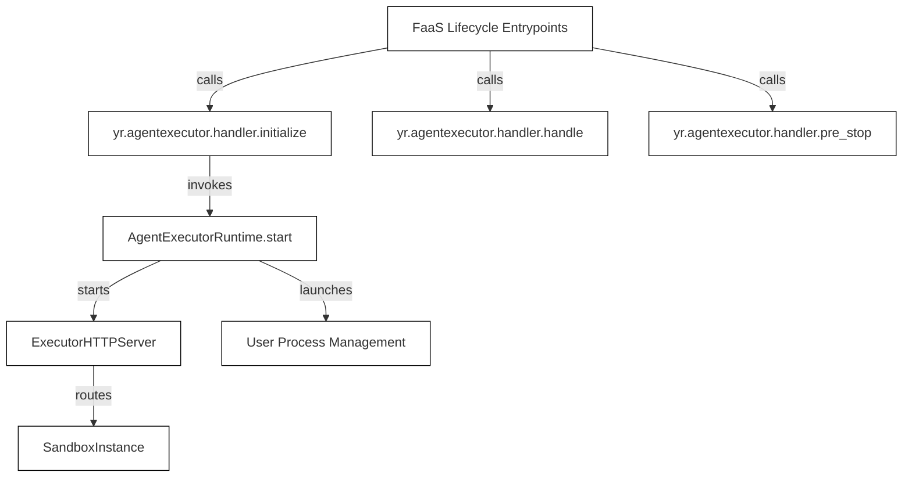
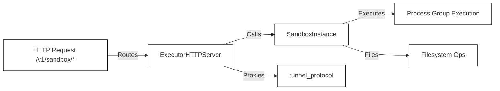

<!-- source: DeepWiki mcp.deepwiki.com · repo openJiuwen-ai/agent-dx · page 3 Agent Executor (executor) · fetched 2026-11-02 -->

# Agent Executor (executor)

Relevant source files

The following files were used as context for generating this wiki page:

- [executor/README.md](executor/README.md)
- [executor/README.zh.md](executor/README.zh.md)
- [executor/setup.py](executor/setup.py)
- [executor/src/yr/agentexecutor/__init__.py](executor/src/yr/agentexecutor/__init__.py)
- [executor/src/yr/agentexecutor/handler.py](executor/src/yr/agentexecutor/handler.py)

## Purpose and Scope

The `executor/` package provides a platform-owned FaaS code package installed into custom-image Agent base images [executor/README.md:5-8](). It initializes the runtime, HTTP server, and user processes through standard openYuanRong FaaS hooks [executor/README.md:5-6]() without depending on the `yr` package or the Python Agent SDK [executor/README.md:10](). 

The package is installed into the Python environment used by the runtime [executor/README.md:14]() and serves as image infrastructure rather than a user-facing SDK [executor/README.md:7-15]().

Sources: [executor/src/yr/agentexecutor/handler.py:22-31](), [executor/README.md:33-40]()

---

## 3.1 Runtime Lifecycle and FaaS Handlers

The FaaS entrypoints bridge the openYuanRong runtime lifecycle to the `AgentExecutorRuntime` singleton. These hooks handle container initialization, status inspection, and pre-stop cleanup [executor/README.md:30-36]().

For details, see [Runtime Lifecycle and FaaS Handlers](#3.1).

### 3.1.1 Health Probes
Startup gates and liveness aggregation states parse `ProbeSpec` definitions and evaluate tcp, http, or exec actions to ensure container health.

For details, see [Health Probes](#3.1.1).

### 3.1.2 User Process Management
User processes are initialized using `YR_RUNTIME_BOOTSTRAP_CMD` configuration with best-effort semantics, process group isolation, unified `.std` logging under `${GLOG_log_dir}`, and `SIGTERM`/`SIGKILL` signal handling [executor/README.md:72-86]().

For details, see [User Process Management](#3.1.2).

Sources: [executor/README.md:30-36](), [executor/README.md:72-86](), [executor/src/yr/agentexecutor/handler.py:22-31]()

---

## 3.2 Executor HTTP Server and APIs

The `ExecutorHTTPServer` routes internal requests over a loopback interface, enforcing concurrency caps (maximum 64 concurrent requests) [executor/README.md:60](), strict size limits (512 MiB default JSON body limits) [executor/README.md:63](), request tracing, and payload stream parsing.

For details, see [Executor HTTP Server and APIs](#3.2).

### 3.2.1 File Management API
Management-plane file transfers are handled via `/v1/files/upload`, `/v1/files/download` (supporting `Range` headers), listing, directory creation, and the underlying `FileHandler` implementation [executor/README.md:68-70]().

For details, see [File Management API](#3.2.1).

Sources: [executor/README.md:42-70]()

---

## 3.3 Sandbox Subsystem

The sandbox subsystem instantiates a process-local `SandboxInstance` [executor/README.md:38]() providing isolated execution and file operations through `/v1/sandbox/*` REST endpoints [executor/README.md:42-48]() without requiring remote `@yr.instance` actors [executor/README.md:34]().

For details, see [Sandbox Subsystem](#3.3).

### 3.3.1 Tunnel Protocol and Proxying
Port proxying and stream framing are managed by `tunnel_protocol` primitives, `tunnel_client`, and `tunnel_server` to route upstream traffic securely into sandboxed environments.

For details, see [Tunnel Protocol and Proxying](#3.3.1).

Sources: [executor/README.md:33-56]()

---

