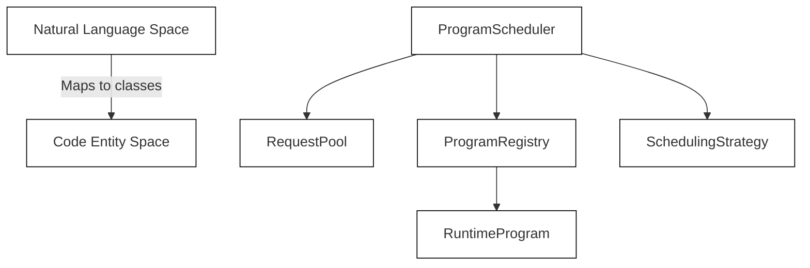
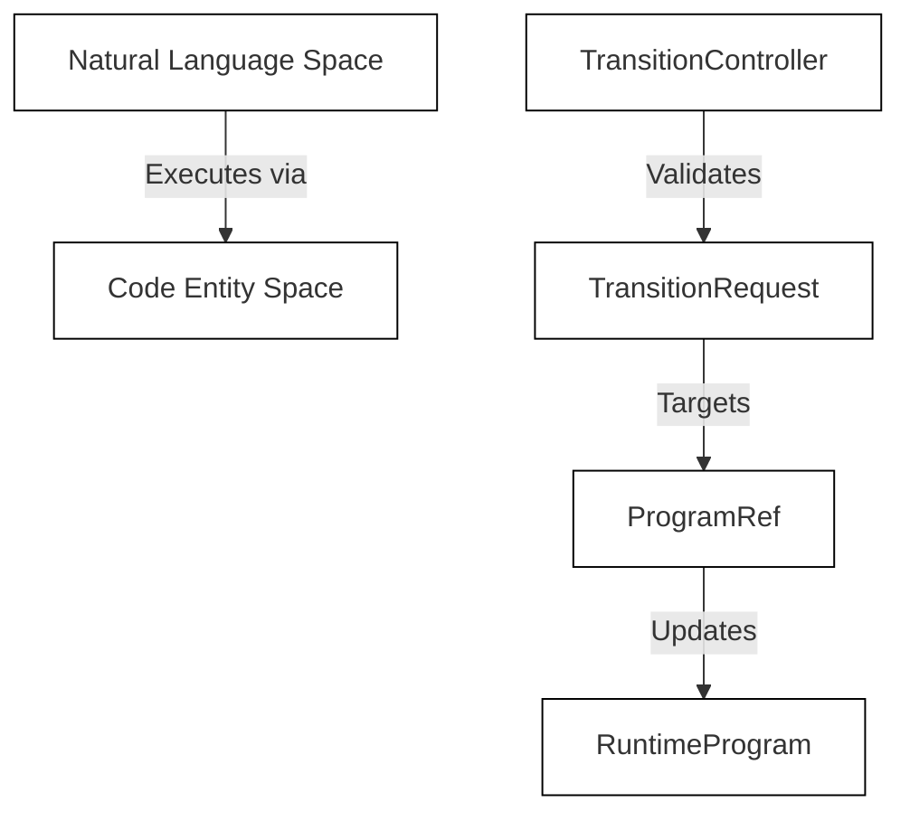

<!-- source: DeepWiki mcp.deepwiki.com · repo openJiuwen-ai/agent-infer · page 2 Scheduling Core (agentinfer.scheduling) · fetched 2026-11-02 -->

# Scheduling Core (agentinfer.scheduling)

Relevant source files

The following files were used as context for generating this wiki page:

- [agentinfer/agentcache/core/vllm_logging.py](agentinfer/agentcache/core/vllm_logging.py)
- [agentinfer/scheduling/__init__.py](agentinfer/scheduling/__init__.py)
- [agentinfer/scheduling/observability.py](agentinfer/scheduling/observability.py)
- [agentinfer/scheduling/program_registry.py](agentinfer/scheduling/program_registry.py)
- [agentinfer/scheduling/program_runtime.py](agentinfer/scheduling/program_runtime.py)
- [agentinfer/scheduling/request_pool.py](agentinfer/scheduling/request_pool.py)
- [agentinfer/scheduling/runtime.py](agentinfer/scheduling/runtime.py)
- [agentinfer/scheduling/transitions.py](agentinfer/scheduling/transitions.py)
- [tests/scheduling/test_progress_ttl_runtime.py](tests/scheduling/test_progress_ttl_runtime.py)
- [tests/scheduling/test_strategy_contracts.py](tests/scheduling/test_strategy_contracts.py)

The `agentinfer.scheduling` package provides an environment-neutral core engine for agent-aware caching and request scheduling. It decouples agent execution states, token tracking, capacity management, and scheduling policies from concrete inference runtimes like vLLM. The scheduling core manages request retention, session-to-program bindings, transactional state transitions, and pluggable strategies.

For a comprehensive tour of the bilingual documentation tree, see [Documentation Map (docs/ en & zh)](../../../../README.md).

---

## 1. Architecture and Component Overview

The scheduling subsystem is organized around clean boundaries separating the runtime state container, the request retention pool, the program registry, and strategy-driven decision logic. Host adapters feed normalized requests into `ProgramScheduler`, which evaluates them against backend capacity using a `SchedulingStrategy`.

*Figure 1: Bridging scheduling architecture concepts to classes in `agentinfer.scheduling`.*

Sources: [agentinfer/scheduling/runtime.py:69-101](), [agentinfer/scheduling/request_pool.py:49-55](), [agentinfer/scheduling/program_registry.py:31-44]()

---

## 2. Scheduling Contracts and Domain Model

The domain model establishes robust type contracts for identities, tokens, backend topologies, and immutable snapshots. Objects such as `ProgramRef` provide generation safety to prevent stale async updates from mutating superseded program contexts. Backend information is encapsulated via `BackendPoolInfo` and `DpRankInfo`, tracking data-parallel worker topology and HBM KV memory availability.

For detailed documentation on program identity, token observation sources, lifecycle events, and admission outcomes, see [Scheduling Contracts and Domain Model](#2.1).

Sources: [agentinfer/scheduling/domain.py:1-25](), [agentinfer/scheduling/backend.py:1-30]()

---

## 3. ProgramScheduler Runtime and Transitions

`ProgramScheduler` acts as the primary synchronization boundary, maintaining request retention, periodic check schedules, and prefix-cache observation refreshes. The scheduler uses `RequestPool` to retain incoming attempts before admission and `ProgramRegistry` to track active or paused program generations.

*Figure 2: Execution flow for strategy-driven transitions using runtime classes.*

Strategies interact with the runtime via `TransitionController`, issuing typed requests such as `ADMIT`, `QUEUE`, `PAUSE`, `RESUME`, or `RELEASE`. For complete details on the request-arrival flow, retention mechanics, schedule cycles, and transition semantics, see [ProgramScheduler Runtime](#2.2) and its sub-section [Transitions and Strategy Interface](#2.2.1).

Sources: [agentinfer/scheduling/runtime.py:69-128](), [agentinfer/scheduling/transitions.py:100-123]()

---

## 4. Progress-TTL Policy Framework

The `Progress-TTL` strategy family implements advanced agent-aware scheduling policies, balancing continuous-growth reserves, segment tenures, and lognormal time-to-live (TTL) distributions. It dynamically manages program priorities, privilege handoffs, and capacity repairs based on rolling statistics and configuration parameters.

For in-depth coverage of configuration validation, factor calculation, rolling statistics, decision logic, and TTL fitting, see [Progress-TTL Policy](#2.3), [ProgressTTLStrategy Decision Logic](#2.3.1), and [Configuration, Factors and Rolling Statistics](#2.3.2).

Sources: [agentinfer/scheduling/progress_ttl.py:1-50]()

---

## 5. Observability and Metrics

Observability in `agentinfer.scheduling` is governed by `SchedulerObservabilityConfig`, which allows opt-in event logging and periodic strategy diagnostic emissions without altering decision semantics. Diagnostics integrate smoothly with upstream logging architectures such as vLLM logging hooks and Prometheus metric exposers.

For details on scheduling observability hooks, diagnostics emission, and metrics exposure, see [Observability and Metrics](#2.4).

Sources: [agentinfer/scheduling/observability.py:11-28]()

---

