# Page: Overview

# Overview

<details>
<summary>Relevant source files</summary>

The following files were used as context for generating this wiki page:

- [README.md](README.md)
- [README_zh.md](README_zh.md)

</details>


The **Agent Protocol** monorepo is a comprehensive suite of software development kits (SDKs) designed to facilitate agent interoperability, tool integration, agent-to-agent communication, and verifiable authorization boundaries across diverse runtime environments [README.md:5-7](). 

This parent page provides a high-level summary of the monorepo's architecture, its four core subsystems, licensing notes, and links to detailed child pages. For directory layouts and build instructions, see [Repository Layout](#1.1) and [Getting Started](#1.2).

---

## Architecture and Component Relationships

The monorepo organizes its capabilities into four distinct subsystems tailored for C++ and Python environments [README.md:9-14](). These components work together to form a secure, interoperable agentic ecosystem where clients, servers, registries, and authorization protocols interact seamlessly.

```mermaid
graph TD
    subgraph "Natural Language Space: Client & Orchestration"
        A["Agent Client"] -->| "JSON-RPC via Stdio/HTTP" | B["MCP C++ SDK (MCP)"]
        A2["Agent Service"] -->| "A2A Protocol & SSE" | C["A2A C++ SDK (A2A)"]
    end

    subgraph "Natural Language Space: Discovery & Security"
        D["Agent Search & Navigation"] -->| "FastAPI & Vector/Tree" | E["A2X Agent Registry (AgentRegistry)"]
        F["Mandate & Intent Audit"] -->| "Ed25519 / WebAuthn" | G["A4P Python SDK (A4P)"]
    end

    B -.->| "Registers Tools/Prompts" | E
    C -.->| "Verifies Intent" | G

    style A fill:none,stroke:#000,stroke-width:2px
    style B fill:none,stroke:#000,stroke-width:2px
    style C fill:none,stroke:#000,stroke-width:2px
    style D fill:none,stroke:#000,stroke-width:2px
    style E fill:none,stroke:#000,stroke-width:2px
    style F fill:none,stroke:#000,stroke-width:2px
    style G fill:none,stroke:#000,stroke-width:2px
```
*Figure 1: High-level architectural mapping between natural language agent roles and repository code entities.*

Sources: `[README.md:5-15]()`

---

## Core Subsystems

The repository is structured around four primary components, each addressing a specialized layer of agent infrastructure:

1. **Model Context Protocol (MCP) C++ SDK (`MCP/`)**: Implements the Model Context Protocol in C++, providing server and client abstractions, JSON-RPC message framing, capabilities validation, and pluggable transports (Stdio and Streamable HTTP).
2. **Agent2Agent Protocol (A2A) C++ SDK (`A2A/`)**: Delivers C++ support for Agent-to-Agent communication, featuring server builders, task updaters, agent cards, and libcurl-based asynchronous connections with Server-Sent Events (SSE) streaming.
3. **A2X Agent Registry (`AgentRegistry/`)**: A Python-based service and agent registry featuring hierarchical capability catalog construction, LLM-based recursive navigation, FastAPI endpoints, and distributed peer synchronization.
4. **A4P Python SDK (`A4P/`)**: The Agentic Authentication, Authorization, and Audit Protocol SDK, providing two-phase operation/intent mandates (`prepare`/`complete`), scope matching, quota consumption, and cryptographic signature verification (Ed25519 and WebAuthn).

```mermaid
graph LR
    subgraph "Code Entity Space"
        H["McpServerImplement"] -->| "Routes Methods" | I["ToolManager"]
        J["HttpServerBuilder"] -->| "StreamServerEmitter" | K["AgentExecutor"]
        L["FastAPIApp"] -->| "Registry Store" | M["A2XClient"]
        N["UserAuthorizer"] -->| "Mandate Validation" | O["MandateSecurity"]
    end

    style H fill:none,stroke:#000,stroke-width:2px
    style I fill:none,stroke:#000,stroke-width:2px
    style J fill:none,stroke:#000,stroke-width:2px
    style K fill:none,stroke:#000,stroke-width:2px
    style L fill:none,stroke:#000,stroke-width:2px
    style M fill:none,stroke:#000,stroke-width:2px
    style N fill:none,stroke:#000,stroke-width:2px
    style O fill:none,stroke:#000,stroke-width:2px
```
*Figure 2: Core code entities governing runtime execution across the SDK modules.*

Sources: `[README.md:9-15]()`

---

## Licensing and Compliance

The Agent Protocol repository is licensed under the Apache-2.0 License [README.md:25-27](). 

> **Important Compliance Note:** This product serves solely as a workflow orchestration tool and does not embed any AI model capabilities. When users integrate AI models for specific business scenarios, they shall bear full responsibility for compliance obligations under the EU AI Act and other relevant regulatory frameworks [README.md:28-29]().

Sources: `[README.md:25-29]()`, `[README_zh.md:25-29]()`

---

## Child Pages

For more detailed technical descriptions, examine the following child pages:
- [Repository Layout](#1.1) — Top-level directory mappings to subsystems, languages, and build configurations.
- [Getting Started](#1.2) — Build instructions, CMake options, Python dependencies, and running examples.

---

# Page: Repository Layout

# Repository Layout

<details>
<summary>Relevant source files</summary>

The following files were used as context for generating this wiki page:

- [A2A/cpp-sdk/CMakeLists.txt](A2A/cpp-sdk/CMakeLists.txt)
- [A2A/cpp-sdk/README.md](A2A/cpp-sdk/README.md)
- [A2A/cpp-sdk/src/CMakeLists.txt](A2A/cpp-sdk/src/CMakeLists.txt)
- [A2A/cpp-sdk/src/transport/http_server_transport.cpp](A2A/cpp-sdk/src/transport/http_server_transport.cpp)
- [MCP/cpp-sdk/README.md](MCP/cpp-sdk/README.md)
- [README.md](README.md)

</details>


## Purpose and Scope
This page maps the top-level directories of the `agent-protocol` monorepo to their respective subsystems, implementation languages, and build systems. It serves as a structural reference for navigating the codebase, understanding dependency boundaries, and locating core build targets across the C++ and Python components (`MCP/`, `A2A/`, `AgentRegistry/`, and `A4P/`).

Sources: [`README.md:1-15]()`, [`MCP/cpp-sdk/README.md:1-24]()`, [`A2A/cpp-sdk/README.md:1-22]()`

---

## Top-Level Directory Mapping

The monorepo is organized into four primary product folders alongside top-level documentation and assets. Each subsystem utilizes distinct toolchains and build orchestrators.

| Top-Level Directory | Subsystem Description | Implementation Language | Build System / Package Manager | Key Artifacts / Targets |
| :--- | :--- | :--- | :--- | :--- |
| `MCP/cpp-sdk/` | Model Context Protocol C++ SDK (Server/Client, stdio, Streamable HTTP) | C++17 | CMake (`≥ 3.15`) | `libmcp.so`, `output/lib/` |
| `A2A/cpp-sdk/` | Agent-to-Agent Protocol C++ SDK (HTTP + JSON-RPC, SSE, Agent Cards) | C++17 | CMake (`≥ 3.15`) | `liba2a.so`, `output/bin/*` |
| `AgentRegistry/` | A2X Agent and Service Registry (FastAPI, hierarchical search, React/Vite UI) | Python / TypeScript | Python Poetry / pip, Vite | FastAPI backend, Web UI bundle |
| `A4P/` | Agentic Authentication, Authorization, and Audit Protocol SDK | Python | Python setuptools / pip | `a4p` Python package |

Sources: [`README.md:9-14]()`, [`MCP/cpp-sdk/README.md:33-51]()`, [`A2A/cpp-sdk/README.md:33-39]()`

---

## Subsystem Architecture & Build Systems

### 1. Model Context Protocol (MCP) C++ SDK (`MCP/cpp-sdk/`)
* **Subsystem**: Implements client and server capabilities for the Model Context Protocol, supporting `stdio` and `Streamable HTTP` transports.
* **Build System**: Managed via top-level and module-level `CMakeLists.txt` files, driven by wrapper scripts like `scripts/build.sh`.
* **Dependencies**: Relies on `OpenSSL` (TLS/crypto), `libcurl` (HTTP client), `libevent` (event loop), `http_parser`, and `nlohmann_json` (JSON serialization). Prefers system packages, falling back to local fetching under `third_party/`.

Sources: [`MCP/cpp-sdk/README.md:17-51]()`, [`MCP/cpp-sdk/README.md:157-196]()`

### 2. Agent2Agent Protocol (A2A) C++ SDK (`A2A/cpp-sdk/`)
* **Subsystem**: Implements v1.0 of the Agent-to-Agent specification, offering asynchronous connection engines via `libcurl`, Server-Sent Events (SSE) streaming via `StreamServerEmitter`, and JSON-RPC message dispatching.
* **Build System**: Orchestrated via CMake (`A2A/cpp-sdk/CMakeLists.txt`) with subdirectories compiled into object libraries and linked into a unified shared library target `a2a` (`A2A/cpp-sdk/src/CMakeLists.txt`).
* **Modular Targets**: Components are segmented into `a2a_client`, `a2a_server`, `a2a_transport`, `a2a_event`, `a2a_shared`, `a2a_log`, and `a2a_utils`.

Sources: [`A2A/cpp-sdk/README.md:15-39]()`, [`A2A/cpp-sdk/src/CMakeLists.txt:1-43]()`, [`A2A/cpp-sdk/CMakeLists.txt:1-66]()`

### 3. A2X Agent Registry (`AgentRegistry/`)
* **Subsystem**: Provides a hierarchical service catalog and agent search engine using FastAPI. It includes LLM-driven navigation tools, peer-to-peer cluster synchronization (merkle sync), token-based authorization modules, and a React/Vite web dashboard with D3.js visualizations.
* **Build System**: Python package management tooling paired with Node.js/Vite build steps for the frontend interface.

Sources: [`README.md:12-13]()`

### 4. A4P Python SDK (`A4P/`)
* **Subsystem**: Implements Agentic Authentication, Authorization, and Audit Protocols. Provides two-phase execution models (`prepare`/`complete`), intent mandates, quota tracking, Ed25519/WebAuthn cryptographic signatures, and SQLite persistence layers.
* **Build System**: Standard Python setuptools configuration.

Sources: [`README.md:14]()`

---

## Structural & Code Entity Mapping Diagrams

### Monorepo Top-Level Structure to Subsystem Entities
The following diagram connects natural language subsystem descriptions to concrete directories and core targets in the codebase.

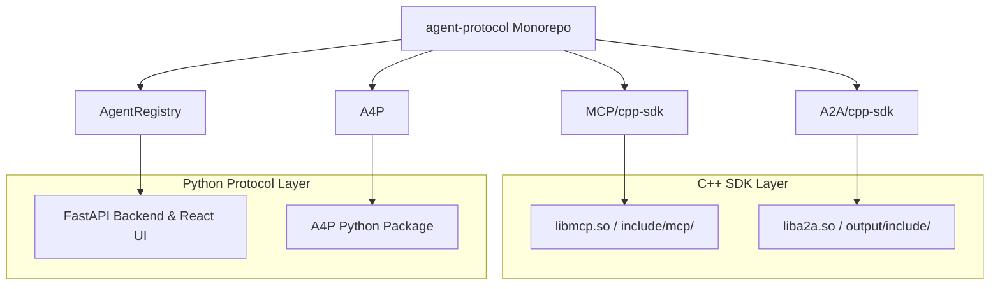
Sources: [`README.md:1-15]()`, [`MCP/cpp-sdk/README.md:188-195]()`, [`A2A/cpp-sdk/src/CMakeLists.txt:3-52]()`

### A2A C++ SDK Modular Build Architecture
The diagram below maps the source directories and target objects that compose the `a2a` shared library build specification.

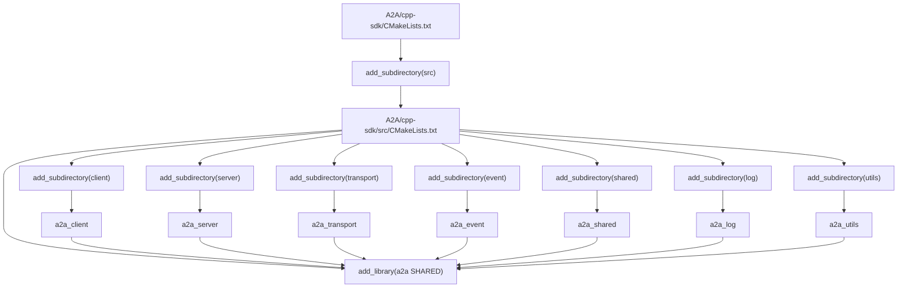
Sources: [`A2A/cpp-sdk/CMakeLists.txt:1-28]()`, [`A2A/cpp-sdk/src/CMakeLists.txt:3-42]()`

---

# Page: Getting Started

# Getting Started

<details>
<summary>Relevant source files</summary>

The following files were used as context for generating this wiki page:

- [A2A/cpp-sdk/scripts/install_deps.sh](A2A/cpp-sdk/scripts/install_deps.sh)
- [MCP/cpp-sdk/.gitignore](MCP/cpp-sdk/.gitignore)
- [MCP/cpp-sdk/CMakeLists.txt](MCP/cpp-sdk/CMakeLists.txt)
- [MCP/cpp-sdk/scripts/build.sh](MCP/cpp-sdk/scripts/build.sh)
- [MCP/cpp-sdk/scripts/install_deps.sh](MCP/cpp-sdk/scripts/install_deps.sh)

</details>


## Purpose and Scope
This document covers the build and installation procedures for the C++ SDKs (`mcp_cpp` and `yellow_a2a`) and Python packages within the `agent-protocol` repository. It details system dependency requirements, installation helper scripts, `CMake` configuration options, compilation flags, sanitizers, and verification steps via examples and test suites.

---

## 1. System Dependencies and Installation Scripts
Both C++ SDKs provide automated helper scripts (`install_deps.sh`) to detect host operating systems (Debian/Ubuntu, RHEL/CentOS/Fedora, and Arch Linux) and provision missing development headers and libraries.

### A2A Dependency Script (`install_deps.sh`)
The A2A C++ SDK script verifies system packages for `libevent`, `nlohmann_json`, `http_parser`, `libcurl`, and `OpenSSL` [A2A/cpp-sdk/scripts/install_deps.sh:58-202](). It inspects package databases using `dpkg -l`, `rpm -q`, or `pacman -Q` and checks standard include paths (`/usr/include/event2/event.h`, `/usr/include/nlohmann/json.hpp`) [A2A/cpp-sdk/scripts/install_deps.sh:33-56]().

### MCP Dependency Script (`install_deps.sh`)
The MCP C++ SDK script focuses on provisioning secure transport requirements, verifying `libcurl` development packages and `OpenSSL` headers (`openssl/ssl.h`) [MCP/cpp-sdk/scripts/install_deps.sh:33-154]().

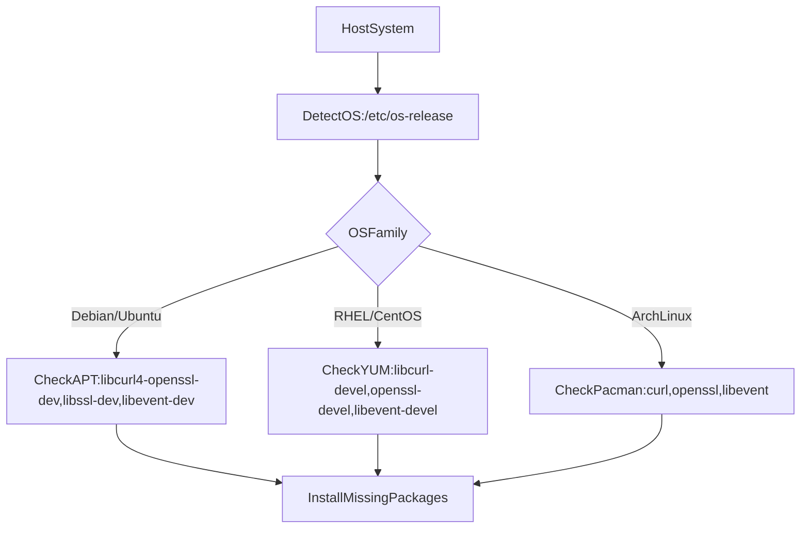
*Figure 1: Dependency Installation Data Flow*

Sources: [A2A/cpp-sdk/scripts/install_deps.sh:13-202](), [MCP/cpp-sdk/scripts/install_deps.sh:15-219]()

---

## 2. CMake Build Options and Configuration
The MCP C++ SDK root `CMakeLists.txt` exposes several configuration switches to tailor builds for clients, servers, HTTP transport, unit tests, and code coverage [MCP/cpp-sdk/CMakeLists.txt:8-16]().

### Configuration Options Table

| CMake Option | Default | Description |
| :--- | :---: | :--- |
| `MCP_ENABLE_TESTS` | `OFF` | Build unit test suites (`tests/ut`) [MCP/cpp-sdk/CMakeLists.txt:8]() |
| `MCP_ENABLE_EXAMPLES` | `OFF` | Enable example compilation hints [MCP/cpp-sdk/CMakeLists.txt:9]() |
| `MCP_ENABLE_COVERAGE` | `OFF` | Enable GCC/Clang code coverage instrumentation (`-fprofile-arcs -ftest-coverage`) [MCP/cpp-sdk/CMakeLists.txt:10,31-40]() |
| `MCP_BUILD_CLIENT` | `ON` | Build MCP client components [MCP/cpp-sdk/CMakeLists.txt:14]() |
| `MCP_BUILD_SERVER` | `ON` | Build MCP server components [MCP/cpp-sdk/CMakeLists.txt:15]() |
| `MCP_WITH_HTTP` | `ON` | Build HTTP client transport components and link `CURL::libcurl` [MCP/cpp-sdk/CMakeLists.txt:16,24-26]() |
| `MCP_ENABLE_ST_TESTS` | `OFF` | Build ST integration tests (`tests/ut/st`) [MCP/cpp-sdk/CMakeLists.txt:12]() |

### Security Hardening and Compiler Flags
The build system enforces strict compilation flags, including stack protection, fortify source, position-independent code (`-fPIC`), and linker-level security hardening (`-Wl,-z,noexecstack,-z,relro,-z,now`) [MCP/cpp-sdk/CMakeLists.txt:28,44,56,68]().

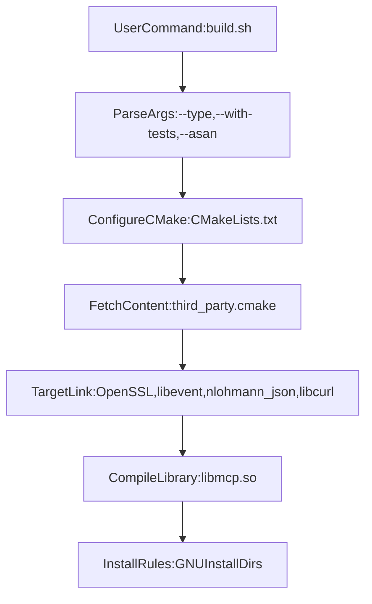
*Figure 2: C++ SDK Build Pipeline*

Sources: [MCP/cpp-sdk/CMakeLists.txt:1-180](), [MCP/cpp-sdk/scripts/build.sh:20-226]()

---

## 3. Unified Build Script (`build.sh`)
The `mcp_cpp` build orchestrator (`scripts/build.sh`) simplifies cross-platform compilation by managing parallel job counts, build directories, and sanitizers [MCP/cpp-sdk/scripts/build.sh:3-226]().

### Common Invocation Patterns
* **Release Build (Core Library Only):**
  ```bash
  ./scripts/build.sh
  ```
* **Debug Build with Unit Tests and AddressSanitizer (ASAN):**
  ```bash
  ./scripts/build.sh --type Debug --with-tests --asan
  ```
* **Code Coverage Instrumentation:**
  ```bash
  ./scripts/build.sh --coverage
  ```
* **Component-specific Compilation (No HTTP transport):**
  ```bash
  ./scripts/build.sh --no-http
  ```

Sources: [MCP/cpp-sdk/scripts/build.sh:1-226]()

---

## 4. Python Package Installation and Extras
Python components within the `agent-protocol` repository (such as `A4P Python SDK` and `A2X Agent Registry`) rely on standard Python packaging conventions. 

* **Package Installation:** Navigate to the specific component directory (`A4P/` or `AgentRegistry/`) and install via `pip`:
  ```bash
  pip install -e .
  ```
* **Development Extras:** Install test and development dependencies:
  ```bash
  pip install -e ".[dev,test]"
  ```

Sources: [AgentRegistry/](() ), [A4P/](() )

---

## 5. Running Examples and Verification
Once built, components can be verified using the provided example harnesses and unit test suites.

* **MCP Examples and Test Execution:**
  Examples are located under respective example directories and can be launched using integration harnesses. Unit tests are executed via CTest when `MCP_ENABLE_TESTS=ON`:
  ```bash
  cd build && ctest --output-on-failure
  ```

Sources: [MCP/cpp-sdk/CMakeLists.txt:8,139-142](), [MCP/cpp-sdk/scripts/build.sh:215-220]()

---

# Page: MCP C++ SDK

# MCP C++ SDK

<details>
<summary>Relevant source files</summary>

The following files were used as context for generating this wiki page:

- [MCP/cpp-sdk/README.md](MCP/cpp-sdk/README.md)
- [MCP/cpp-sdk/include/mcp/mcp_server.h](MCP/cpp-sdk/include/mcp/mcp_server.h)

</details>


The MCP C++ SDK provides a complete C++ implementation of the [Model Context Protocol](https://modelcontextprotocol.io) [MCP/cpp-sdk/README.md:19](). It enables developers to build robust MCP clients and servers supporting both **Streamable HTTP** and **stdio** transport layers [MCP/cpp-sdk/README.md:19](), with built-in primitives for tools, prompts, resources, sampling, and progress notifications [MCP/cpp-sdk/README.md:21-23] [MCP/cpp-sdk/include/mcp/mcp_server.h:80-97](). 

As a parent page, this document provides a high-level overview of the SDK architecture. For deeper technical details, consult the respective child pages linked throughout.

Sources: `MCP/cpp-sdk/README.md:1-24`, `MCP/cpp-sdk/include/mcp/mcp_server.h:1-97`

---

## 2.1. MCP Server Implementation

The server-side SDK centers around session management, method routing, and capability negotiation. The `McpServerSession` interface defines the core server-to-client operations, such as triggering list-changed notifications (`SendToolListChangedNotification`), querying client roots (`ListRoots`), and issuing sampling requests (`SamplingCreateMessage`) [MCP/cpp-sdk/include/mcp/mcp_server.h:75-97](). 

For full implementation details, method routing internals, and capability validation, see [MCP Server Implementation](#2.1).

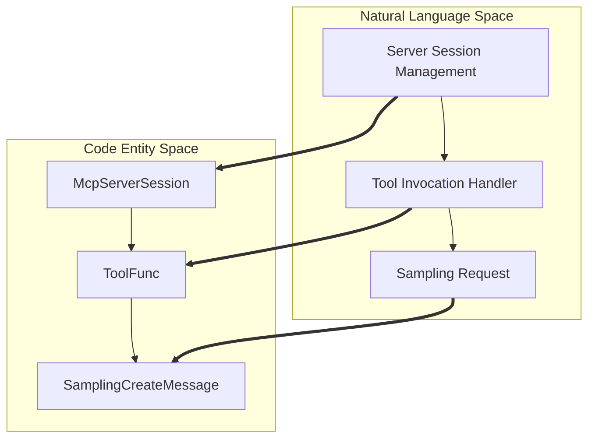
*Figure 1: Mapping natural language server operations to C++ classes.*

Sources: `MCP/cpp-sdk/include/mcp/mcp_server.h:75-97`

### 2.1.1. Tool, Prompt and Resource Managers

Servers expose capabilities via dedicated manager registries. Tools are registered with schemas and optional annotations using structures like `AddToolOptionalParams` [MCP/cpp-sdk/include/mcp/mcp_server.h:28-36]() and invoked through `ToolFunc`, which supports both synchronous execution returning `ToolReturn` and asynchronous execution via `ServerContext` response callbacks [MCP/cpp-sdk/include/mcp/mcp_server.h:102-160](). Similar configuration structs exist for prompts (`AddPromptOptionalParams`) and resources (`AddResourceOptionalParams`) [MCP/cpp-sdk/include/mcp/mcp_server.h:41-58]().

For detailed mechanics on tool registration, listing, and resource subscription semantics, see [MCP Server Implementation](#2.1).

Sources: `MCP/cpp-sdk/include/mcp/mcp_server.h:28-160`

### 2.1.2. ServerManager and Concurrency

Handling concurrent requests across multiple client connections requires sophisticated worker thread pools, multi-producer single-consumer (`MPSC`) queues, and `eventfd`-based notifications. The `ServerManager` coordinates stateless versus stateful request handling and integrates custom authentication hooks.

For concurrency models, worker pool topologies, and session routing, see [MCP Server Implementation](#2.1).

Sources: `MCP/cpp-sdk/README.md:19-24`, `MCP/cpp-sdk/include/mcp/mcp_server.h:102-107`

---

## 2.2. MCP Protocol Types and JSON-RPC Layer

The protocol layer bridges raw JSON payloads with strongly-typed C++ data structures. Defined largely within `mcp_type.h`, `jsonrpc.h`, and `jsonrpc.cpp`, this layer implements `nlohmann::json` `adl_serializer` mappings, schema validation routines, and content block abstractions.

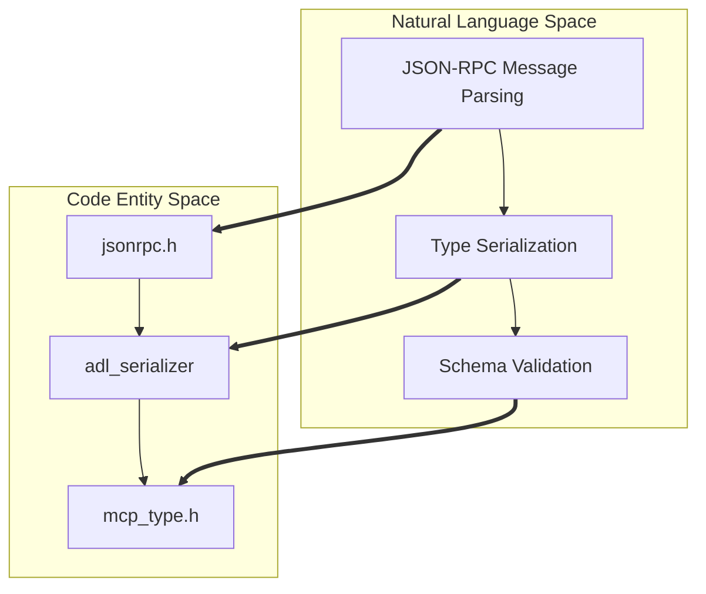
*Figure 2: Protocol message structures and JSON serialization bindings.*

For a full catalog of message classes, adl mappings, and schema definitions, see [MCP Protocol Types and JSON-RPC Layer](#2.2).

Sources: `MCP/cpp-sdk/README.md:48`, `MCP/cpp-sdk/include/mcp/mcp_server.h:18`

---

## 2.3. MCP Transports

The SDK decouples protocol message handling from underlying network and I/O mechanisms through abstract transport interfaces. It provides:
- **Stdio Transport**: For local, subprocess-based agent communication via standard input/output.
- **Streamable HTTP Transport**: For networked client-server communication utilizing non-blocking I/O, event loops (`libevent`), and HTTP framing.

For details on framing strategies, non-blocking descriptors, and the event system, see [MCP Transports](#2.3).

Sources: `MCP/cpp-sdk/README.md:19`, `MCP/cpp-sdk/README.md:49`

---

## 2.4. MCP Examples and Tests

To assist developers, the SDK ships with a suite of functional examples and test harness scripts. These include `server_example`, specialized tool/prompt/resource client examples, script automation (`run_example.sh`), and a comprehensive GoogleTest-based unit test suite located under `tests/ut` [MCP/cpp-sdk/README.md:111-143], [MCP/cpp-sdk/README.md:212-217]().

For instructions on compiling and executing example end-to-end flows and test trees, see [MCP Examples and Tests](#2.4).

Sources: `MCP/cpp-sdk/README.md:111-143`, `MCP/cpp-sdk/README.md:212-217`

---

# Page: MCP Server Implementation

# MCP Server Implementation

<details>
<summary>Relevant source files</summary>

The following files were used as context for generating this wiki page:

- [MCP/cpp-sdk/src/server/mcp_server_implement.cpp](MCP/cpp-sdk/src/server/mcp_server_implement.cpp)
- [MCP/cpp-sdk/src/server/mcp_server_implement.h](MCP/cpp-sdk/src/server/mcp_server_implement.h)
- [MCP/cpp-sdk/src/shared/common_type.h](MCP/cpp-sdk/src/shared/common_type.h)
- [MCP/cpp-sdk/src/shared/message_queue/lock_free_queue.h](MCP/cpp-sdk/src/shared/message_queue/lock_free_queue.h)

</details>


## Purpose and Scope

This page covers the core server implementation of the Model Context Protocol (MCP) C++ SDK. The primary component discussed is `McpServerImplement`, which manages the server lifecycle, handles incoming JSON-RPC message routing, validates capabilities, and coordinates request dispatch across specialized domain managers. 

As a parent page, this section provides a high-level architectural overview. For deep technical details on tool, prompt, and resource management, see [Tool, Prompt and Resource Managers](#2.1.1). For concurrency models, worker thread pools, and queue mechanics, see [ServerManager and Concurrency](#2.1.2).

Sources:
- `MCP/cpp-sdk/src/server/mcp_server_implement.h` [MCP/cpp-sdk/src/server/mcp_server_implement.h:1-109]()
- `MCP/cpp-sdk/src/server/mcp_server_implement.cpp` [MCP/cpp-sdk/src/server/mcp_server_implement.cpp:1-193]()

---

## Server Lifecycle and State Machine

The `McpServerImplement` class inherits from `McpServer` and manages server initialization, running state transitions, and clean termination [MCP/cpp-sdk/src/server/mcp_server_implement.h:37-44](). The server operates under three distinct states defined by `ServerState`: `INIT`, `RUNNING`, and `STOPPED` [MCP/cpp-sdk/src/server/mcp_server_implement.h:30-34]().

During construction, configuration parameters such as `ServerConfig` and `StreamableHttpServerConfig` are validated [MCP/cpp-sdk/src/server/mcp_server_implement.h:39-40, 88-91](). Invoking `Run()` transitions the server into `ServerState::RUNNING` [MCP/cpp-sdk/src/server/mcp_server_implement.h:43](), activating transport listeners and worker thread infrastructure managed by `ServerManager` [MCP/cpp-sdk/src/server/mcp_server_implement.h:98](). Calling `Stop()` terminates active session listeners and transitions the state to `ServerState::STOPPED` [MCP/cpp-sdk/src/server/mcp_server_implement.h:44]().

### Server Lifecycle State Transition Diagram

```mermaid
graph TD
    Init["ServerState::INIT"] -->|Run() called & ValidateConfig() succeeds| Running["ServerState::RUNNING"]
    Running -->|Stop() called| Stopped["ServerState::STOPPED"]
    Init -->|Stop() called| Stopped
```
Sources:
- `MCP/cpp-sdk/src/server/mcp_server_implement.h` [MCP/cpp-sdk/src/server/mcp_server_implement.h:30-48]()
- `MCP/cpp-sdk/src/server/mcp_server_implement.cpp` [MCP/cpp-sdk/src/server/mcp_server_implement.cpp:31-35]()

---

## JSON-RPC Method Routing Layer

Incoming transport messages are received and processed by `McpServerImplement::ReceiveIncomingMessages(...)`, which inspects the JSON-RPC `request.method_` field and dispatches the payload to the corresponding handler function [MCP/cpp-sdk/src/server/mcp_server_implement.cpp:39-105](). 

Request IDs and session contexts are tracked in active sessions (`ServerRequestContext`) [MCP/cpp-sdk/src/server/mcp_server_implement.cpp:39-48](). If a method does not match any known route, an error response with `JsonRpcErrorCode::METHOD_NOT_FOUND` is dispatched via `SendErrorResponse(...)` [MCP/cpp-sdk/src/server/mcp_server_implement.cpp:100]().

The core routing table maps JSON-RPC methods to implementation functions:
- `tools/list` $\rightarrow$ `HandleToolsList` [MCP/cpp-sdk/src/server/mcp_server_implement.cpp:51-54]()
- `tools/call` $\rightarrow$ `HandleToolsCall` [MCP/cpp-sdk/src/server/mcp_server_implement.cpp:55-58]()
- `prompts/list` $\rightarrow$ `HandlePromptsList` [MCP/cpp-sdk/src/server/mcp_server_implement.cpp:59-62]()
- `prompts/get` $\rightarrow$ `HandlePromptsGet` [MCP/cpp-sdk/src/server/mcp_server_implement.cpp:63-66]()
- `resources/list` $\rightarrow$ `HandleResourcesList` [MCP/cpp-sdk/src/server/mcp_server_implement.cpp:67-70]()
- `resources/read` $\rightarrow$ `HandleResourcesRead` [MCP/cpp-sdk/src/server/mcp_server_implement.cpp:71-74]()
- `resources/subscribe` $\rightarrow$ `HandleResourcesSubscribe` [MCP/cpp-sdk/src/server/mcp_server_implement.cpp:75-78]()
- `resources/unsubscribe` $\rightarrow$ `HandleResourcesUnsubscribe` [MCP/cpp-sdk/src/server/mcp_server_implement.cpp:79-82]()
- `resources/templates/list` $\rightarrow$ `HandleResourcesTemplatesList` [MCP/cpp-sdk/src/server/mcp_server_implement.cpp:83-86]()
- `logging/setLevel` $\rightarrow$ `HandleSetLoggingLevel` [MCP/cpp-sdk/src/server/mcp_server_implement.cpp:87-90]()
- `ping` $\rightarrow$ `HandlePing` [MCP/cpp-sdk/src/server/mcp_server_implement.cpp:91-94]()
- `completion/complete` $\rightarrow$ `HandleComplete` [MCP/cpp-sdk/src/server/mcp_server_implement.cpp:95-98]()

### Method Routing Architecture

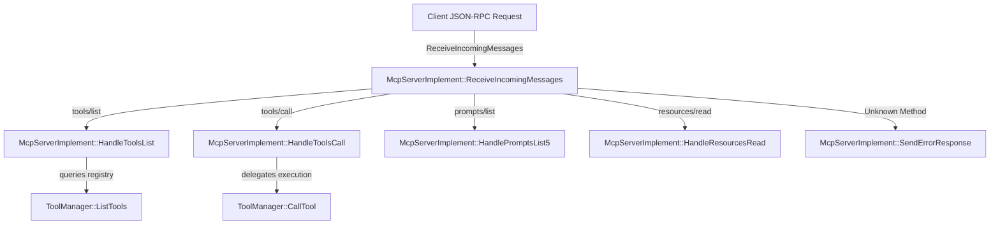
Sources:
- `MCP/cpp-sdk/src/server/mcp_server_implement.cpp` [MCP/cpp-sdk/src/server/mcp_server_implement.cpp:39-105]()

---

## Domain Managers and Coordination

`McpServerImplement` delegates capability handling to specialized subsystem managers stored as member variables:
- `toolManager_` (`ToolManager`): Handles tool registration, parameter parsing, listing, and synchronous/asynchronous execution [MCP/cpp-sdk/src/server/mcp_server_implement.h:100]().
- `promptManager_` (`PromptManager`): Manages prompt templates and rendering handlers [MCP/cpp-sdk/src/server/mcp_server_implement.h:101]().
- `resourceManager_` (`ResourceManager`): Manages static resources, URI templates, read callbacks, and subscriptions [MCP/cpp-sdk/src/server/mcp_server_implement.h:102]().
- `serverManager_` (`ServerManager`): Manages transport sessions, worker thread dispatch, and asynchronous response callbacks [MCP/cpp-sdk/src/server/mcp_server_implement.h:98]().

### Child Page References
- For details on registration, listing, invocation, and subscription semantics, see [Tool, Prompt and Resource Managers](#2.1.1).
- For details on worker thread pools, MPSC/lock-free queues, eventfd notifications, and session routing, see [ServerManager and Concurrency](#2.1.2).

Sources:
- `MCP/cpp-sdk/src/server/mcp_server_implement.h` [MCP/cpp-sdk/src/server/mcp_server_implement.h:98-105]()
- `MCP/cpp-sdk/src/server/mcp_server_implement.cpp` [MCP/cpp-sdk/src/server/mcp_server_implement.cpp:125-189]()

---

# Page: Tool, Prompt and Resource Managers

# Tool, Prompt and Resource Managers

<details>
<summary>Relevant source files</summary>

The following files were used as context for generating this wiki page:

- [MCP/cpp-sdk/src/server/tool_manager.cpp](MCP/cpp-sdk/src/server/tool_manager.cpp)
- [MCP/cpp-sdk/src/server/tool_manager.h](MCP/cpp-sdk/src/server/tool_manager.h)

</details>


## Purpose and Scope
This document covers the implementation of the `ToolManager` and associated registries within the Model Context Protocol (MCP) C++ SDK. It details the mechanisms for tool registration, lifecycle management, cursor-based pagination during tool listing, thread-safe access, JSON schema validation for inputs and outputs, and tool invocation semantics.

Sources: `[MCP/cpp-sdk/src/server/tool_manager.h:1-92]()`, `[MCP/cpp-sdk/src/server/tool_manager.cpp:1-207]()`

---

## 1. Core Data Structures: `ServerTool` and `ToolManager`

The MCP server relies on `ServerTool` to encapsulate individual tool metadata, execution handlers, and JSON schemas, while `ToolManager` manages the registry collection thread-safely.

### The `ServerTool` Structure
`ServerTool` represents a registered executable tool. It holds metadata such as the tool's name, optional title, description, JSON schemas for inputs and outputs, annotations, and icons.

- **`name`**: Unique string identifier for the tool.
- **`func`**: A `ToolFunc` callback handler responsible for tool execution.
- **`inputSchema` / `outputSchema`**: Optional JSON schema strings used to validate inputs and structured outputs.
- **`annotations` / `icons`**: Optional metadata structures for UI and capability introspection.

Sources: `[MCP/cpp-sdk/src/server/tool_manager.h:18-47]()`

### The `ToolManager` Class
`ToolManager` provides thread-safe container operations over an underlying `std::unordered_map<std::string, ServerTool>`. Concurrency control is achieved using a `mutable std::mutex`.

- **`overwrite_`**: Configuration flag determining behavior when adding a tool with an existing name (throws or overwrites with a warning).
- **`pageSize_`**: Configures the default chunk size for paginated listing operations.

Sources: `[MCP/cpp-sdk/src/server/tool_manager.h:49-88]()`

---

## 2. Registration and Lifecycle Semantics

Tools are registered and removed dynamically through `AddTool` and `RemoveTool`.

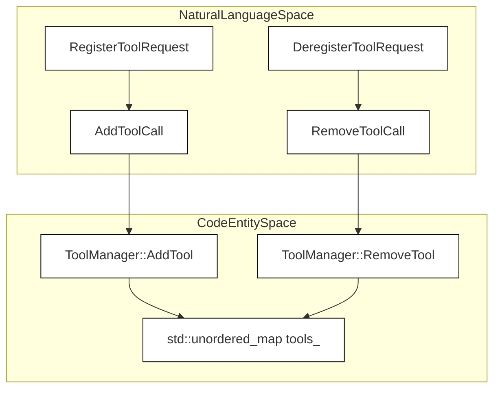
Sources: `[MCP/cpp-sdk/src/server/tool_manager.cpp:34-60]()`

### `AddTool`
`AddTool` acquires `mutex_`, checks if `tool.name` already exists within `tools_`, and handles collisions based on `overwrite_`:
- If `overwrite_` is `false`, a `std::runtime_error` is thrown.
- If `overwrite_` is `true`, a warning log is emitted via `MCP_LOG` and the existing tool is replaced.

Sources: `[MCP/cpp-sdk/src/server/tool_manager.cpp:34-45]()`

### `RemoveTool`
`RemoveTool` validates that the provided name is non-empty, acquires `mutex_`, and erases the entry if found. If the tool does not exist, a `std::runtime_error` is thrown.

Sources: `[MCP/cpp-sdk/src/server/tool_manager.cpp:47-60]()`

---

## 3. Listing and Cursor Pagination

Tools can be retrieved in batches using `ListTools`, which supports optional cursor-based pagination.

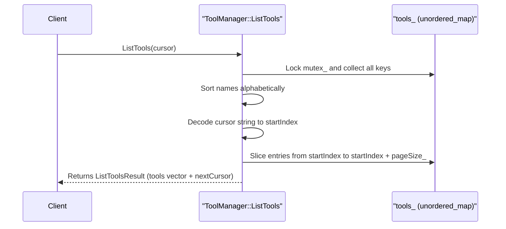
Sources: `[MCP/cpp-sdk/src/server/tool_manager.cpp:62-116]()`

### Pagination Logic
1. **Stable Sorting**: All tool names are copied into a `std::vector<std::string>` and sorted alphabetically to guarantee deterministic ordering across page requests.
2. **Cursor Decoding**: The optional cursor string is parsed as a 64-bit integer index (`std::stoll`). Invalid or out-of-bounds cursors fall back gracefully to index `0` or `names.size()`.
3. **Chunking**: A sub-range of size `pageSize_` is projected into standard `Tool` descriptors containing name, title, description, schemas, annotations, and icons.
4. **Next Cursor**: If more elements remain (`endIndex < names.size()`), `nextCursor` is populated with the string representation of `endIndex`.

Sources: `[MCP/cpp-sdk/src/server/tool_manager.cpp:66-115]()`

---

## 4. Invocation, Validation, and Normalization

Tool execution flows through `CallTool`, which handles argument parsing, JSON schema validation, return normalization, and error catching.

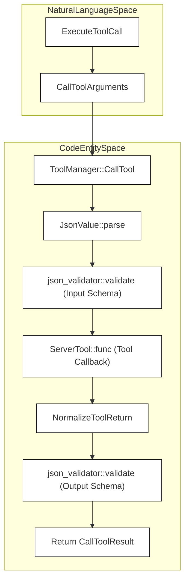
Sources: `[MCP/cpp-sdk/src/server/tool_manager.cpp:118-204]()`

### Execution Pipeline
1. **Lookup**: Acquires `mutex_`, retrieves the `ServerTool` by name, and copies it to minimize lock contention during execution.
2. **Argument Parsing**: Parses the raw argument string into a `JsonValue` (`nlohmann::json`).
3. **Input Validation**: If `tool.inputSchema` is defined, `nlohmann::json_schema::json_validator` validates the parsed arguments against the input schema.
4. **Context Construction**: Assembles a `ServerContext` depending on whether the function is asynchronous. Synchronous tools drop response callbacks to prevent double-responses.
5. **Invocation & Exception Catching**: Executes `tool.func(...)`. Exceptions thrown during execution are caught and converted into a `CallToolResult` with `isError = true` and the exception message wrapped in `TextContent`.
6. **Return Normalization**: Raw tool returns (either structured `CallToolResult` or raw `std::string`) are normalized via `NormalizeToolReturn`.
7. **Output Validation**: If `tool.outputSchema` is set and the result is not an error, the structured content is validated against the output schema.

Sources: `[MCP/cpp-sdk/src/server/tool_manager.cpp:14-32]`, `[MCP/cpp-sdk/src/server/tool_manager.cpp:118-196]()`

---

# Page: ServerManager and Concurrency

# ServerManager and Concurrency

<details>
<summary>Relevant source files</summary>

The following files were used as context for generating this wiki page:

- [MCP/cpp-sdk/src/server/mcp_server_implement.cpp](MCP/cpp-sdk/src/server/mcp_server_implement.cpp)
- [MCP/cpp-sdk/src/server/server_manager.cpp](MCP/cpp-sdk/src/server/server_manager.cpp)
- [MCP/cpp-sdk/src/shared/common_type.h](MCP/cpp-sdk/src/shared/common_type.h)
- [MCP/cpp-sdk/src/shared/message_queue/lock_free_queue.h](MCP/cpp-sdk/src/shared/message_queue/lock_free_queue.h)
- [MCP/cpp-sdk/src/transport/stdio_transport.cpp](MCP/cpp-sdk/src/transport/stdio_transport.cpp)

</details>


This page documents the concurrency architecture of the Model Context Protocol (MCP) C++ SDK. It details how `ServerManager` coordinates worker thread pools, lock-free and MPSC queues, `eventfd`-based event notifications, session routing, and authentication/authorization hooks.

---

## 1. Worker Thread Pools and Event-Driven Architecture

The core concurrency model relies on a multi-threaded event-driven dispatcher managed by `ServerManager`. When initialized in HTTP mode, `ServerManager` spawns a configurable number of worker threads (`workerThreads`), each running an independent `EventSystem` event loop.

Each worker thread executes `ServerManager::ThreadMain`, setting a custom thread name (`MCP-Worker-{id}`) and starting its blocking event loop:

```cpp
void ServerManager::ThreadMain(int id)
{
    SetCurrentThreadName("MCP-Worker-" + std::to_string(id));
    MCP_LOG(MCP_LOG_LEVEL_INFO, "Protocol thread " + std::to_string(id) + " started");
    eventSystems_[id]->Start(false); // Block current thread
    MCP_LOG(MCP_LOG_LEVEL_INFO, "Protocol thread " + std::to_string(id) + " event loop ended");
}
```
*Cited from: `[MCP/cpp-sdk/src/server/server_manager.cpp:40-48]()`*

### Concurrency Topology Diagram

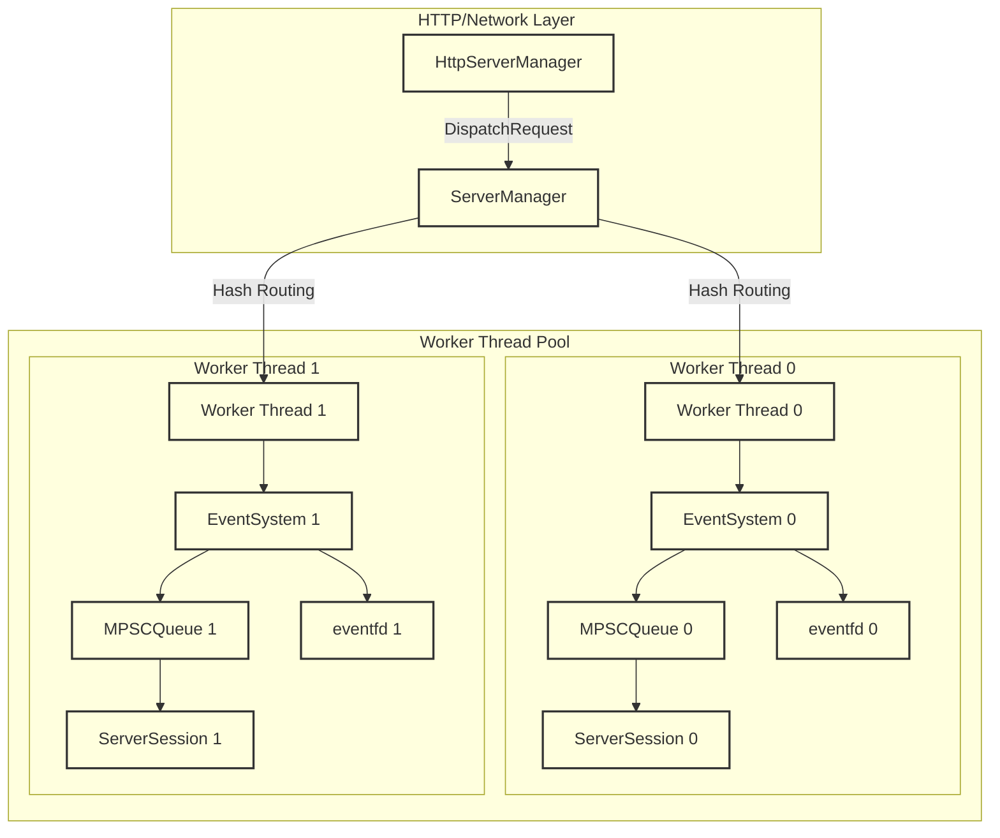
*Sources: `[MCP/cpp-sdk/src/server/server_manager.cpp:34-180]()`, `[MCP/cpp-sdk/src/server/server_manager.h]()`*

---

## 2. MPSC and Lock-Free Queue Mechanics

To safely pass requests and asynchronous tool responses between producer threads (such as network IO threads or user-provided tool execution threads) and worker threads, the SDK implements high-performance synchronization queues in `lock_free_queue.h`.

### `LockFreeSPSCQueue`
A single-producer single-consumer ring-buffer queue (`LockFreeSPSCQueue`) uses atomic indices with relaxed and acquire-release semantics to avoid locking overheads:

```cpp
template <typename T>
class LockFreeSPSCQueue {
    // Uses cache-line alignment (MCP_LFQ_CACHELINE_SIZE = 64) 
    // to prevent false sharing on writePos and readPos.
};
```
*Cited from: `[MCP/cpp-sdk/src/shared/message_queue/lock_free_queue.h:35-170]()`*

### `MPSCQueue`
For multi-producer scenarios (where multiple threads dispatch responses to a single worker thread), `MPSCQueue` provides a bounded-capacity ring buffer with atomic tail/head increments:
* Capacity must be a power of 2 (`MCP_LFQ_MIN_CAPACITY`).
* Cache line padding prevents hardware cache contention.

*Sources: `[MCP/cpp-sdk/src/shared/message_queue/lock_free_queue.h:35-213]()`*

---

## 3. `eventfd` Notification Subsystem

When a worker thread's queue receives a message or asynchronous tool callback from an external thread, the event loop needs to be woken up instantly. The SDK achieves this using Linux `eventfd` descriptors registered inside `EventSystem`.

* `threadQueueEventIds_` tracks the event IDs associated with each worker queue `eventfd`.
* When an external thread calls `DispatchResponse`, it writes to the target thread's `eventfd`, triggering a readable event on the target `EventSystem` instance.
* The event loop wakes up, pops items from the thread-local `MPSCQueue`, and processes them on the correct worker thread context.

*Sources: `[MCP/cpp-sdk/src/server/server_manager.cpp:167-180]()`*

---

## 4. Session Routing and Request Handling

Incoming requests are mapped to active sessions via `ServerRequestContext` and managed inside `McpServerImplement`. 

```cpp
void McpServerImplement::ReceiveIncomingMessages(const RequestId& requestId, const Request& request,
                                                 ServerRequestContext& ctx)
{
    const std::string& method = request.method_;
    auto session = ctx.activeSession.lock();

    {
        std::lock_guard<std::mutex> lock(session->reqMtx);
        session->sessionRequests[requestId] = ctx;
    }
    // Method routing...
}
```
*Cited from: `[MCP/cpp-sdk/src/server/mcp_server_implement.cpp:39-48]()`*

### Stateless vs. Stateful Request Handling
* **Stateless Requests**: Methods like `tools/list`, `prompts/list`, or `ping` execute entirely within the incoming request handler and immediately return a JSON-RPC response via `session->SendResponse`.
* **Stateful Requests / Asynchronous Tools**: Methods like `tools/call` can execute asynchronously. A `ResponseCallback` is captured, wrapping the `RequestId`, `ServerRequestContext`, and `ServerSession`:
```cpp
ResponseCallback responseCallback = [this, requestId, ctx, session](const Result& result) {
    const auto& toolResult = static_cast<const CallToolResult&>(result);
    auto resultPtr = std::make_shared<CallToolResult>(toolResult);
    serverManager_->DispatchResponse(requestId, resultPtr, ctx, session);
};
```
*Cited from: `[MCP/cpp-sdk/src/server/mcp_server_implement.cpp:155-159]()`*

### Request Routing Data Flow

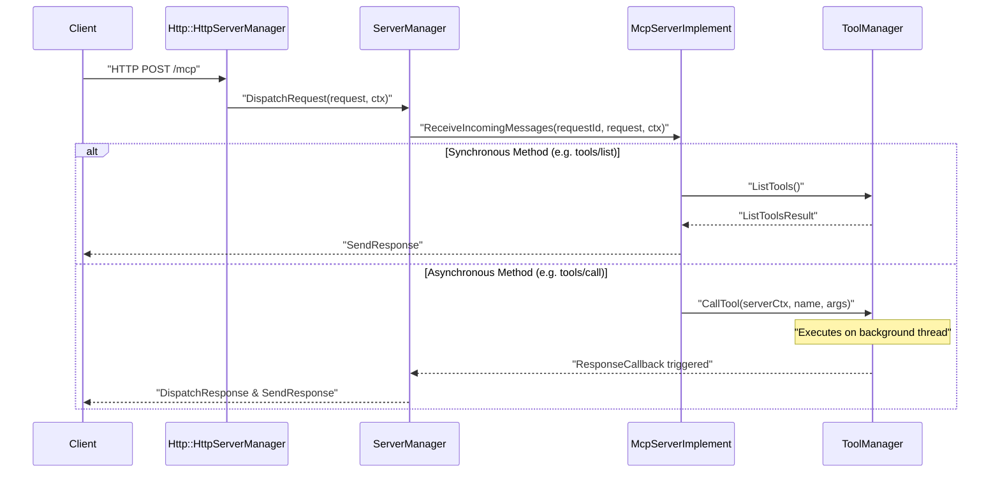
*Sources: `[MCP/cpp-sdk/src/server/server_manager.cpp:127-130]()`, `[MCP/cpp-sdk/src/server/mcp_server_implement.cpp:39-175]()`*

---

## 5. Authentication and Authorization Hooks

`ServerManager` integrates pluggable authentication and authorization hooks via transport configuration options. During initialization, `ServerManager` captures the `authenticator_` and `authorizer_` instances:

```cpp
ServerManager::ServerManager(const ServerConfig& config, const StreamableHttpServerConfig& transportConfig)
    : config_(config), streamableConfig_(transportConfig), isStdio_{false},
      authenticator_(transportConfig.authenticator), authorizer_(transportConfig.authorizer) {}
```
*Cited from: `[MCP/cpp-sdk/src/server/server_manager.cpp:34-36]()`*

* **Authenticator**: Validates incoming credentials (e.g., Bearer tokens or API keys) attached to HTTP request headers before dispatching to worker queues.
* **Authorizer**: Checks whether the authenticated principal possesses the required privileges or scopes to invoke specific MCP tools or access protected resources.

*Sources: `[MCP/cpp-sdk/src/server/server_manager.cpp:34-38]()`*

---

# Page: MCP Protocol Types and JSON-RPC Layer

# MCP Protocol Types and JSON-RPC Layer

<details>
<summary>Relevant source files</summary>

The following files were used as context for generating this wiki page:

- [MCP/cpp-sdk/include/mcp/mcp_type.h](MCP/cpp-sdk/include/mcp/mcp_type.h)
- [MCP/cpp-sdk/src/shared/jsonrpc.cpp](MCP/cpp-sdk/src/shared/jsonrpc.cpp)
- [MCP/cpp-sdk/src/shared/jsonrpc.h](MCP/cpp-sdk/src/shared/jsonrpc.h)

</details>


This page details the JSON-RPC messaging architecture, serialization logic, schema handling, public protocol types, content blocks, and capability definitions implemented in the Model Context Protocol (MCP) C++ SDK. It covers the core components defined in `jsonrpc.h`/`.cpp` and `mcp_type.h`.

---

## 1. JSON-RPC Message Layer and Classes

The JSON-RPC layer implements the communication framing for the MCP protocol, adhering to JSON-RPC 2.0 specifications while tailoring structures specifically for LLM tool invocation, resource reads, and prompt management.

### Core Message Structures
Messages are represented as strongly-typed C++ classes and structs mapped via `JSONRPCMessage` [MCP/cpp-sdk/src/shared/jsonrpc.h:128-128] (`std::variant`):
- **`RequestId`**: Defined as a variant supporting either 64-bit integers or strings (`std::variant<int64_t, std::string>`) [MCP/cpp-sdk/src/shared/jsonrpc.h:26-26].
- **`JSONRPCRequest`**: Encapsulates incoming or outgoing method calls containing a `jsonrpc_` version string, a unique `id_`, a `method_` string, and a polymorphic `request_` payload [MCP/cpp-sdk/src/shared/jsonrpc.h:55-66].
- **`JSONRPCResponse`**: Holds a result payload represented as a `std::shared_ptr<Result>` tied to a request ID [MCP/cpp-sdk/src/shared/jsonrpc.h:68-78].
- **`JSONRPCNotification`**: Represents one-way asynchronous messages without an `id`, containing a `method_` and `notification_` payload [MCP/cpp-sdk/src/shared/jsonrpc.h:99-109].
- **`JSONRPCError`**: Standardized error structure containing an error `code_`, descriptive `message_`, and an optional JSON `data_` payload [MCP/cpp-sdk/src/shared/jsonrpc.h:112-126].

### Transport Helper Utilities
Transport layers utilize helper functions to inspect raw JSON messages without full deserialization. `TryGetJsonRpcResponseId` extracts an identifier if the message represents a valid JSON-RPC response [MCP/cpp-sdk/src/shared/jsonrpc.cpp:20-36], while `TryTakePendingMethodForJsonRpcResponse` correlates incoming responses back to their original outgoing request methods using an internal pending map [MCP/cpp-sdk/src/shared/jsonrpc.cpp:38-54].

```mermaid
graph TD
  IncomingJSON["Incoming JSON String"] --> ParseMsg["DeserializeJSONRPCMessage"]
  ParseMsg --> CheckType{"Message Type?"}
  CheckType -->|Has Method & ID| Req[JSONRPCRequest]
  CheckType -->|Has ID & Result| Resp[JSONRPCResponse]
  CheckType -->|Has Method, No ID| Notif[JSONRPCNotification]
  CheckType -->|Has ID & ErrorCode| Err[JSONRPCError]
  Req --> RouteToHandler["Method Router"]
  Resp --> MatchPending["TryTakePendingMethodForJsonRpcResponse"]
  
  subclass IncomingJSON,ParseMsg,CheckType,Req,Resp,Notif,Err,RouteToHandler,MatchPending default;
```
*Figure 1: JSON-RPC Message Ingress and Routing Data Flow.*

Sources: `[MCP/cpp-sdk/src/shared/jsonrpc.h:20-141]()`, `[MCP/cpp-sdk/src/shared/jsonrpc.cpp:20-56]()`

---

## 2. Serialization and `adl_serializer` Mappings

JSON serialization and deserialization rely heavily on `nlohmann::json` and its Argument-Dependent Lookup (`adl_serializer`) specialization mechanism.

### Custom Serializers
The SDK implements explicit `adl_serializer` specializations to map C++ capability structures and protocol types to and from JSON objects:
- **`Mcp::SamplingCapability`**: Serializes and deserializes context and tool support flags within client capabilities [MCP/cpp-sdk/src/shared/jsonrpc.cpp:79-97].
- **`Mcp::ClientTasksCapability`**: Handles list, cancel, sampling, and elicitation task capabilities [MCP/cpp-sdk/src/shared/jsonrpc.cpp:99-148].
- **`Mcp::ClientCapabilities`**: Manages comprehensive client capabilities including sampling, elicitation, tasks, and roots [MCP/cpp-sdk/src/shared/jsonrpc.cpp:150-207].
- **`Mcp::RequestId`**: Maps JSON variants (integers or strings) directly to the `RequestId` variant type [MCP/cpp-sdk/src/shared/jsonrpc.cpp:210-221].

### Metadata and Tolerant Parsing
Meta maps (`MetaMap`) are parsed via `ParseMetaStringMap`, which iterates through JSON object fields and gracefully stringifies any non-string entries to ensure robustness during schema evolution and client interoperability [MCP/cpp-sdk/src/shared/jsonrpc.cpp:58-76].

```mermaid
graph TD
  JsonPayload["nlohmann::json Object"] --> AdlDispatcher["nlohmann::adl_serializer"]
  AdlDispatcher -->|ClientCapabilities| ParseClientCap["ClientCapabilities Serialization"]
  AdlDispatcher -->|SamplingCapability| ParseSampling["SamplingCapability Serialization"]
  AdlDispatcher -->|RequestId| ParseId["RequestId Variant Mapping"]
  ParseClientCap --> PopulateStruct["C++ Struct Population"]
  ParseSampling --> PopulateStruct
  ParseId --> PopulateStruct
  
  subclass JsonPayload,AdlDispatcher,ParseClientCap,ParseSampling,ParseId,PopulateStruct default;
```
*Figure 2: JSON Serialization Data Flow via adl_serializer.*

Sources: `[MCP/cpp-sdk/src/shared/jsonrpc.cpp:58-221]()`

---

## 3. Public Protocol Types and Content Blocks

Public data types and content representations are defined in `mcp_type.h`. These structures form the vocabulary exchanged between clients and servers during tool execution, resource reading, and prompt generation.

### Results and Pagination
- **`Result`**: The base structure for all successful method responses, optionally containing a metadata map (`MetaMap`) [MCP/cpp-sdk/include/mcp/mcp_type.h:120-124].
- **`ErrorResult`**: Extends `Result` to surface server-side JSON-RPC errors as standard result objects when required [MCP/cpp-sdk/include/mcp/mcp_type.h:126-133].
- **`PaginatedResult`**: Inherits from `Result` and adds `nextCursor` support for list-style endpoints like `tools/list` or `resources/list` [MCP/cpp-sdk/include/mcp/mcp_type.h:135-141].

### Content Block Variants
Content returned by tools or embedded within prompts supports rich multimodal representations through `ContentType` (`std::variant`) [MCP/cpp-sdk/include/mcp/mcp_type.h:230-230]:
- **`TextContent`**: Plain text blocks with optional audience annotations and priorities [MCP/cpp-sdk/include/mcp/mcp_type.h:162-166].
- **`ImageContent`**: Base64-encoded image payloads paired with a `mimeType` [MCP/cpp-sdk/include/mcp/mcp_type.h:168-173].
- **`AudioContent`**: Base64-encoded audio payloads with an accompanying `mimeType` [MCP/cpp-sdk/include/mcp/mcp_type.h:175-180].
- **`TextResourceContents` & `BlobResourceContents`**: Resource content containers wrapped inside `ResourceContents` [MCP/cpp-sdk/include/mcp/mcp_type.h:182-194].
- **`EmbeddedResource`**: Encapsulates resource contents directly within message blocks [MCP/cpp-sdk/include/mcp/mcp_type.h:196-200].
- **`ResourceLink`**: References external resources with titles, descriptions, sizes, and icons [MCP/cpp-sdk/include/mcp/mcp_type.h:209-219].

Sources: `[MCP/cpp-sdk/include/mcp/mcp_type.h:120-230]()`

---

## 4. Capabilities and Configuration Models

The SDK provides hierarchical configuration and capability declarations to govern negotiation during the initialization phase.

### Server and Client Capabilities
Capabilities describe feature sets supported by each endpoint during handshake:
- **`ServerCapabilities`**: Contains optional configurations for logging, prompts, resources, tools, and experimental extensions [MCP/cpp-sdk/include/mcp/mcp_type.h:99-105].
- **`ServerConfig`**: Defines operational parameters such as `serverName`, `version`, `workerThreads`, pagination page sizes, and base `ServerCapabilities` [MCP/cpp-sdk/include/mcp/mcp_type.h:107-114].
- **`ClientConfig`**: Specifies client metadata (`name` and `version`) [MCP/cpp-sdk/include/mcp/mcp_type.h:79-82].
- **`StreamableHttpServerConfig`**: Configures server endpoints, worker threads, TLS options, and optional authenticator/authorizer bindings [MCP/cpp-sdk/include/mcp/mcp_type.h:68-77].

Sources: `[MCP/cpp-sdk/include/mcp/mcp_type.h:49-114]()`

---

# Page: MCP Transports

# MCP Transports

<details>
<summary>Relevant source files</summary>

The following files were used as context for generating this wiki page:

- [MCP/cpp-sdk/src/CMakeLists.txt](MCP/cpp-sdk/src/CMakeLists.txt)
- [MCP/cpp-sdk/src/server/server_manager.cpp](MCP/cpp-sdk/src/server/server_manager.cpp)
- [MCP/cpp-sdk/src/shared/http_common.h](MCP/cpp-sdk/src/shared/http_common.h)
- [MCP/cpp-sdk/src/transport/stdio_transport.cpp](MCP/cpp-sdk/src/transport/stdio_transport.cpp)

</details>


## Purpose and Scope

This page details the transport layer implementations within the Model Context Protocol (MCP) C++ SDK. It covers both local process communication via Stdio transport and remote/network communication via Streamable HTTP transport. It documents wire framing, non-blocking I/O operations, event system integration, and common HTTP protocol definitions shared across client-server interactions.

Sources: `[MCP/cpp-sdk/src/transport/stdio_transport.cpp:1-241]`, `[MCP/cpp-sdk/src/shared/http_common.h:1-186]`, `[MCP/cpp-sdk/src/server/server_manager.cpp:34-155]()`

---

## Stdio Transport and Framing

The Stdio transport mechanism manages bidirectional communication over standard input and standard output (or via a managed subprocess pipe). It is encapsulated by the `StdioConnection` class, which operates in a non-blocking asynchronous loop driven by an underlying event framework.

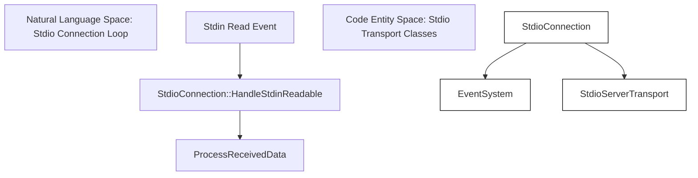
*Diagram 1: Stdio transport components mapping logical read loops to `StdioConnection` and `EventSystem` entities.*

Sources: `[MCP/cpp-sdk/src/transport/stdio_transport.cpp:40-125]()`

### Non-Blocking I/O and File Descriptors
When establishing a connection, `StdioConnection::Listen()` or `StdioConnection::Connect()` configures `STDIN_FILENO` and `STDOUT_FILENO` with the `O_NONBLOCK` flag using `fcntl()`:

```cpp
fcntl(STDIN_FILENO, F_SETFL, O_NONBLOCK);
fcntl(STDOUT_FILENO, F_SETFL, O_NONBLOCK);
```

Read events are registered into the event loop via `EventSystem::AddEvent()`, listening for `EventType::READ | EventType::PERSIST` [MCP/cpp-sdk/src/transport/stdio_transport.cpp:69-71]().

### Framing and Message Buffering
Incoming bytes from stdin are accumulated in `readBuffer_` inside `StdioConnection::HandleStdinReadable()` [MCP/cpp-sdk/src/transport/stdio_transport.cpp:229-241](). The transport relies on message framing boundaries (typically newline-delimited JSON-RPC messages) to parse complete payloads out of `readBuffer_` before dispatching them to message-received callbacks. 

Outgoing messages pass through `StdioConnection::SendMessage()`, which pushes data to a write queue (`writeQueue_`) protected by a `std::mutex` and triggers asynchronous write event handling via `EnableWriteEvent()` [MCP/cpp-sdk/src/transport/stdio_transport.cpp:175-189]().

Sources: `[MCP/cpp-sdk/src/transport/stdio_transport.cpp:40-241]()`

---

## Streamable HTTP Transport and `http_common`

For network-attached topologies, the SDK implements Streamable HTTP transport, supporting standard HTTP requests/responses alongside Server-Sent Events (SSE) for asynchronous streaming.

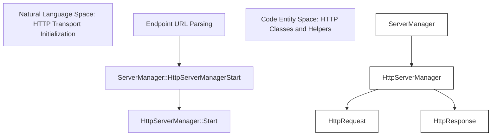
*Diagram 2: Streamable HTTP initialization mapping string endpoints to `ServerManager` and `HttpServerManager` objects.*

Sources: `[MCP/cpp-sdk/src/server/server_manager.cpp:54-141]()`, `[MCP/cpp-sdk/src/shared/http_common.h:112-137]()`

### Endpoint Parsing and Routing
`ServerManager::HttpServerManagerStart()` parses the endpoint string (formatted as `http://{host}:{port}/{uri}`) using regular expressions to extract host, port, and route URI paths [MCP/cpp-sdk/src/server/server_Manager.cpp:73-119](). Extracted components populate an `Http::HttpServerManagerConfig` structure, registering route handlers that map incoming HTTP requests to worker thread dispatchers (`DispatchRequest`) [MCP/cpp-sdk/src/server/server_manager.cpp:121-131]().

### `http_common.h` Definitions
The header `[MCP/cpp-sdk/src/shared/http_common.h]()` establishes shared protocol types, constants, and utilities used by both client and server HTTP components:

| Category | Symbols / Constants | Description |
| :--- | :--- | :--- |
| **HTTP Headers** | `MCP_SESSION_ID_HEADER`, `MCP_PROTOCOL_VERSION_HEADER` | Custom headers for MCP session identification and protocol versioning (`[MCP/cpp-sdk/src/shared/http_common.h:26-27]()`). |
| **Content Types** | `CONTENT_TYPE_JSON`, `CONTENT_TYPE_SSE` | Standard MIME types for JSON payloads and Server-Sent Events (`[MCP/cpp-sdk/src/shared/http_common.h:41-42]()`). |
| **SSE Struct** | `ServerSentEvent` | Holds event name, ID, data string, and retry attributes (`[MCP/cpp-sdk/src/shared/http_common.h:84-97]()`). |
| **Messages** | `HttpRequest`, `HttpResponse` | Structs representing HTTP request and response envelopes (`[MCP/cpp-sdk/src/shared/http_common.h:112-137]()`). |

### Endpoint Validation
URL strings are validated via `IsValidStreamableHttpEndpoint()`, ensuring adherence to `http://` or `https://` schemes, valid port boundaries `[1, 65535]`, and rejection of malformed hosts or illegal characters `[MCP/cpp-sdk/src/shared/http_common.h:172-182]()`.

Sources: `[MCP/cpp-sdk/src/server/server_manager.cpp:54-141]()`, `[MCP/cpp-sdk/src/shared/http_common.h:20-184]()`

---

## Event System and Concurrency Integration

Transports integrate tightly with the SDK's internal event notification and concurrency models. Stdio connections operate a dedicated background loop via `EventSystem::Start(true)` [MCP/cpp-sdk/src/transport/stdio_transport.cpp:80](), whereas HTTP servers operate multi-threaded worker pools managed inside `ServerManager` [MCP/cpp-sdk/src/server/server_manager.cpp:40-48]() and `[MCP/cpp-sdk/src/server/server_manager.cpp:163-180]()`.

When `ServerManager` initializes for network operations, it provisions per-thread event systems (`EventSystem`) paired with lock-safe queues and thread worker names (`MCP-Worker-{id}`) to process incoming requests concurrently without blocking I/O poll loops [MCP/cpp-sdk/src/server/server_manager.cpp:40-48]().

Sources: `[MCP/cpp-sdk/src/transport/stdio_transport.cpp:79-81]()`, `[MCP/cpp-sdk/src/server/server_manager.cpp:40-48]()`

---

# Page: MCP Examples and Tests

# MCP Examples and Tests

<details>
<summary>Relevant source files</summary>

The following files were used as context for generating this wiki page:

- [MCP/cpp-sdk/example/client_example/tool_example/tool_example.cpp](MCP/cpp-sdk/example/client_example/tool_example/tool_example.cpp)
- [MCP/cpp-sdk/example/server_example/server_example.cpp](MCP/cpp-sdk/example/server_example/server_example.cpp)
- [MCP/cpp-sdk/scripts/run_example.sh](MCP/cpp-sdk/scripts/run_example.sh)
- [MCP/cpp-sdk/scripts/run_ut.sh](MCP/cpp-sdk/scripts/run_ut.sh)
- [MCP/cpp-sdk/tests/CMakeLists.txt](MCP/cpp-sdk/tests/CMakeLists.txt)
- [MCP/cpp-sdk/tests/ut/CMakeLists.txt](MCP/cpp-sdk/tests/ut/CMakeLists.txt)

</details>


## Purpose and Scope
This page details the implementation, data flow, and execution harnesses for the Model Context Protocol (MCP) C++ SDK examples (`server_example` and client examples such as `tool_example`), the automation script `run_example.sh`, and the unit test framework anchored by `tests/CMakeLists.txt` and `tests/ut/CMakeLists.txt`. These artifacts serve both as integration validation suites and as developer references for building custom MCP servers and clients.

---

## 1. Reference Server and Client Examples

The `example` directory provides complete reference applications demonstrating how to instantiate MCP components, handle JSON-RPC messaging, register tools/prompts/resources, and process asynchronous operations or sampling.

### Server Example Architecture
The server example (`TestMCPServer`) configures an HTTP streamable transport endpoint with thread pools, auth verification, and dynamic handler registration.

*   **Initialization and Signal Handling**: The server sets up signal handlers (`signalHandler`) for `SIGINT` and `SIGTERM` to coordinate graceful shutdowns [MCP/cpp-sdk/example/server_example/server_example.cpp:63-69] using control flags (`stopFlag`) [MCP/cpp-sdk/example/server_example/server_example.cpp:26]. Logging is redirected via file callbacks (`FileLogCallback`) [MCP/cpp-sdk/example/server_example/server_example.cpp:72-80].
*   **Server Constants**: Defines worker thread counts, server metadata (`SERVER_NAME`, `SERVER_VERSION`), endpoints (`ENDPOINT`, `AUTH_ENDPOINT`), and security validation scopes (`VALID_TOKEN`, `REQUIRED_SCOPES`) [MCP/cpp-sdk/example/server_example/server_example.cpp:28-62].
*   **Sampling Integration**: Implements client-to-server and server-to-client sampling loops where tools can request text generation from the client session via `ServerContext` (`RunSamplingRequest`, `BuildSamplingParams`, `ExtractTextContentFromResult`) [MCP/cpp-sdk/example/server_example/server_example.cpp:84-180].

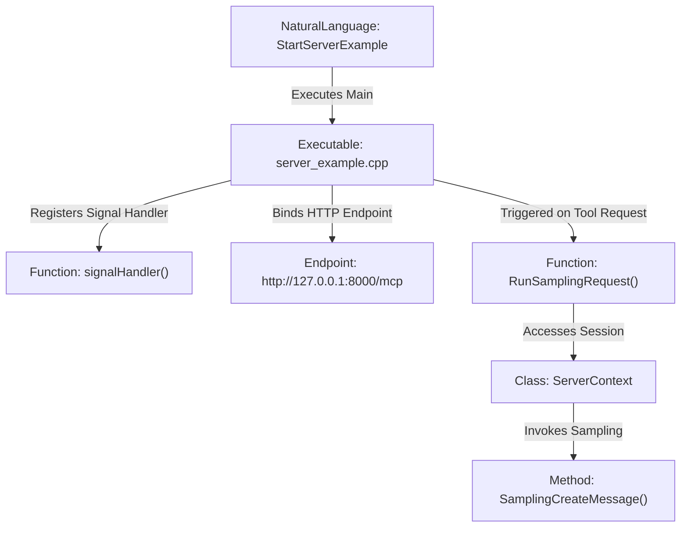
*Sources: `MCP/cpp-sdk/example/server_example/server_example.cpp`*

### Tool Client Example
The tool client example demonstrates client initialization, protocol ping checks, paginated tool discovery, and tool execution with progress callbacks.

*   **Client Configuration**: Configures `Mcp::ClientConfig` and `Mcp::StreamableHttpClientConfig` pointing to local test endpoints without TLS [MCP/cpp-sdk/example/client_example/tool_example/tool_example.cpp:27-34].
*   **Initialization & Ping**: Establishes session state asynchronously using `mcpClient->Initialize()` and checks liveness via `mcpClient->SendPing()` [MCP/cpp-sdk/example/client_example/tool_example/tool_example.cpp:37-69].
*   **Paginated Listing & Execution**: Iterates through tool catalogs using cursor-based pagination via `mcpClient->ListTools(cursor)` [MCP/cpp-sdk/example/client_example/tool_example/tool_example.cpp:71-99] and invokes tools with optional progress handlers using `mcpClient->CallTool(...)` [MCP/cpp-sdk/example/client_example/tool_example/tool_example.cpp:101-157].

```mermaid
graph TD
    A["NaturalLanguage: RunToolDemoClient"] -->|Instantiates| B["Class: McpClientFactory"]
    B -->|Returns Interface| C["Class: McpClient"]
    C -->|Calls Async Init| D["Method: Initialize()"]
    C -->|Pings Server| E["Method: SendPing()"]
    C -->|Pages Catalogs| F["Method: ListTools()"]
    C -->|Executes Tool Call| G["Method: CallTool()"]
```
*Sources: `MCP/cpp-sdk/example/client_example/tool_example/tool_example.cpp`*

---

## 2. Example Runner Harness (`run_example.sh`)

The script `run_example.sh` automates the compilation, background server management, port conflict resolution, and client test execution lifecycle.

*   **Master Log & FIFO Setup**: Sets up master log redirection (`setup_master_log`) using named pipes (`mkfifo`) and background `tee` processes to capture stdout and stderr concurrently [MCP/cpp-sdk/scripts/run_example.sh:18-43].
*   **Port Management**: Inspects listening ports via `lsof` or `ss` utilities (`get_listening_pids_by_port`) and provides automated port release mechanisms (`free_port_if_occupied`) when forced termination (`--force-kill-port`) is enabled [MCP/cpp-sdk/scripts/run_example.sh:84-141].
*   **Execution Modes**: Accepts command-line parameters (`-t`, `--type`) to target specific components (`all`, `server`, `client`, `tool`, `prompt`, `resource`, `sampling`) [MCP/cpp-sdk/scripts/run_example.sh:147-234].

```mermaid
graph TD
    A["NaturalLanguage: RunExamplesScript"] -->|Invokes Shell| B["Script: run_example.sh"]
    B -->|Validates Port| C["Function: free_port_if_occupied()"]
    C -->|Queries Listeners| D["Command: lsof / ss"]
    B -->|Lavers Background Task| E["Process: server_example"]
    B -->|Executes Client Test| F["Process: tool_example"]
```
*Sources: `MCP/cpp-sdk/scripts/run_example.sh`*

---

## 3. Unit Testing Infrastructure and CMake Tree

The unit testing framework is managed through a hierarchical CMake setup and executed via coverage-enabled test harness scripts.

### GoogleTest Dependency Management
The top-level test configuration located in `tests/CMakeLists.txt` locates existing system GoogleTest installations or dynamically fetches GoogleTest (`v1.16.0`) via `FetchContent` while enforcing shared runtime configurations (`gtest_force_shared_crt`) [MCP/cpp-sdk/tests/CMakeLists.txt:1-33].

### Unit Test Subdirectory Routing (`tests/ut/CMakeLists.txt`)
The `tests/ut/CMakeLists.txt` script conditionally includes subdirectories based on compiled feature flags (`MCP_WITH_HTTP`, `MCP_BUILD_CLIENT`, `MCP_BUILD_SERVER`, `MCP_ENABLE_STDIO`, `MCP_ENABLE_ST_TESTS`):

*   Core modules: `event`, `auth`, `net`, `shared`, `log` [MCP/cpp-sdk/tests/ut/CMakeLists.txt:1-10].
*   Transport and Protocol modules: `transport`, `client`, `server`, `stdio`, `http` [MCP/cpp-sdk/tests/ut/CMakeLists.txt:5-41].
*   System Integration tests: `st` (enabled via `MCP_ENABLE_ST_TESTS`) [MCP/cpp-sdk/tests/ut/CMakeLists.txt:43-48].

### Coverage and Test Execution Harness (`run_ut.sh`)
The test runner script `run_ut.sh` automates environment verification, dependency resolution (`gcovr`, `junit2html`), ctest execution, and HTML coverage report generation [MCP/cpp-sdk/scripts/run_ut.sh:20-188].

```mermaid
graph TD
    A["NaturalLanguage: RunUnitTests"] -->|Executes Script| B["Script: run_ut.sh"]
    B -->|Verifies Directory| C["Directory: build/"]
    B -->|Executes Test Driver| D["Command: ctest"]
    D -->|Invokes Test Tree| E["CMake: tests/ut/CMakeLists.txt"]
    E -->|Conditional Target| F["Subdirectory: tests/ut/server"]
    E -->|Conditional Target| G["Subdirectory: tests/ut/client"]
    B -->|Generates Reports| H["Tool: gcovr / junit2html"]
```
*Sources: `MCP/cpp-sdk/tests/CMakeLists.txt`, `MCP/cpp-sdk/tests/ut/CMakeLists.txt`, `MCP/cpp-sdk/scripts/run_ut.sh`*

---

# Page: A2A C++ SDK

# A2A C++ SDK

<details>
<summary>Relevant source files</summary>

The following files were used as context for generating this wiki page:

- [A2A/cpp-sdk/CMakeLists.txt](A2A/cpp-sdk/CMakeLists.txt)
- [A2A/cpp-sdk/README.md](A2A/cpp-sdk/README.md)
- [A2A/cpp-sdk/include/types.h](A2A/cpp-sdk/include/types.h)
- [A2A/cpp-sdk/src/CMakeLists.txt](A2A/cpp-sdk/src/CMakeLists.txt)
- [A2A/cpp-sdk/src/transport/http_server_transport.cpp](A2A/cpp-sdk/src/transport/http_server_transport.cpp)

</details>


The **A2A C++ SDK** is a high-performance C++ implementation of the Agent-to-Agent (A2A) protocol v1.0 (`[A2A/cpp-sdk/README.md:17-17]()`). It provides robust client and server infrastructure to support multi-agent communication over HTTP combined with JSON-RPC messaging (`[A2A/cpp-sdk/README.md:17-18]()`). The SDK compiles into a modular shared library (`liba2a.so`) managed via CMake (`[A2A/cpp-sdk/src/CMakeLists.txt:3-42]()`, `[A2A/cpp-sdk/README.md:126-130]()`).

This parent page provides a high-level summary of the build configuration, core modules (Client, Server, Transport, Shared Types), and test harnesses. For deep technical implementation details, consult the designated child pages:
- [A2A Server Side](#3.1)
- [A2A Client Side](#3.2)
- [A2A Shared Types and Messaging Utilities](#3.3)
- [A2A Examples, Smoke Tests and Unit Tests](#3.4)

---

### A2A SDK Component Architecture

```mermaid
graph TD
    subgraph "Natural Language Space: Client & Discovery"
      Client[ClientFactory & Card Resolver]
    end

    subgraph "Code Entity Space: Client Core"
      A2AClient["A2A::Client"]
      JSONRpcTransport["A2A::Transport::JsonRpcTransport"]
    end

    subgraph "Code Entity Space: Server Core"
      ServerBuilder["A2A::Server::HttpServerBuilder"]
      ServerImpl["A2A::Server::server_impl"]
      HttpTransport["A2A::Transport::HttpServerTransport"]
    end

    subgraph "Natural Language Space: Protocol Foundations"
      Types[Shared Types & JSON-RPC]
    end

    Client --> A2AClient
    A2AClient --> JSONRpcTransport
    ServerBuilder --> ServerImpl
    ServerImpl --> HttpTransport
    JSONRpcTransport --> Types
    HttpTransport --> Types
```
*Sources: `[A2A/cpp-sdk/src/CMakeLists.txt:9-25]()`, `[A2A/cpp-sdk/src/transport/http_server_transport.cpp:47-85]()`*

---

## 3.1 A2A Server Side

The server-side subsystem exposes agent capabilities over HTTP and JSON-RPC endpoints. It centers around `HttpServerBuilder` and `server_impl`, providing the `AgentExecutor` and `TaskUpdater` contracts to govern task lifecycles, artifact generation, and helper utilities. The underlying transport layer (`HttpServerTransport`) handles incoming requests and supports Server-Sent Events (SSE) streaming for real-time task updates.

For detailed architecture, interface definitions, and state machine transitions, see [A2A Server Side](#3.1).

*Sources: `[A2A/cpp-sdk/src/CMakeLists.txt:17-25]()`, `[A2A/cpp-sdk/src/transport/http_server_transport.cpp:47-94]()`*

---

## 3.2 A2A Client Side

The client-side subsystem handles remote agent discovery, card resolution, and execution requests. Key components include the client factory, card resolvers (`a2a_card_resolver.h`), protocol version interceptors (`client_call_interceptor.h`), and a libcurl-based asynchronous connection engine (`client.h`) that parses SSE data streams via `jsonrpc_transport.h`.

For detailed API usage and connection lifecycle handling, see [A2A Client Side](#3.2).

*Sources: `[A2A/cpp-sdk/src/CMakeLists.txt:9-15]()`, `[A2A/cpp-sdk/src/CMakeLists.txt:75-86]()`*

---

## 3.3 A2A Shared Types and Messaging Utilities

Protocol data structures are defined across `types.h` and `common_types.h`, mapping directly to the JSON-RPC wire format (`[A2A/cpp-sdk/include/types.h:18-21]()`). Key entities include `Role`, `Part`, `Artifact`, `Task`, `Message`, and `TaskState` (`[A2A/cpp-sdk/include/types.h:32-168]()`). These are supported by jsonrpc serialization mappings (`jsonrpc.h`), HTTP constants (`http_common.h`), and message-building helpers (`utils_message`).

For comprehensive data layouts and helper function references, see [A2A Shared Types and Messaging Utilities](#3.3).

*Sources: `[A2A/cpp-sdk/include/types.h:1-235]()`*

---

## 3.4 A2A Examples, Smoke Tests and Unit Tests

The SDK provides ready-to-run examples (`helloworld_server`, `helloworld_client`, `streaming_server`, and `streaming_client`) alongside the `run_example.sh` automated smoke test harness (`[A2A/cpp-sdk/README.md:140-172]()`). Additionally, modular unit test suites (`tests/ut`) validate components like the client factory, card resolvers, and server builder under CMake configuration options (`[A2A/cpp-sdk/CMakeLists.txt:11-13]`, `[A2A/cpp-sdk/CMakeLists.txt:82-85]()`).

For instructions on executing tests, manual debugging, and reviewing smoke harnesses, see [A2A Examples, Smoke Tests and Unit Tests](#3.4).

*Sources: `[A2A/cpp-sdk/README.md:136-200]()`, `[A2A/cpp-sdk/CMakeLists.txt:8-13]()`*

---

### Request Execution Pipeline

```mermaid
graph TD
    subgraph "Natural Language Space: Client Invocation"
      UserReq[User Sends Message Request]
    end

    subgraph "Code Entity Space: Transport & Routing"
      HttpTransport[A2A::Transport::HttpServerTransport::HandleJsonRpcRequest]
      IsStream{IsStreamingMethod?}
      NonStream[HandleNonStreamingRequest]
      Stream[HandleStreamingRequest]
    end

    subgraph "Code Entity Space: Emitter & Execution"
      Emitter[A2A::StreamServerEmitter]
      Executor[A2A::Server::AgentExecutor]
    end

    UserReq --> HttpTransport
    HttpTransport --> IsStream
    IsStream -- Yes --> Stream
    IsStream -- No --> NonStream
    NonStream --> Emitter
    Stream --> Emitter
    Emitter --> Executor
```
*Sources: `[A2A/cpp-sdk/src/transport/http_server_transport.cpp:115-140]()`*

---

### Build Targets and Configuration

The A2A C++ SDK build configuration supports modular feature selection through standard CMake options (`[A2A/cpp-sdk/CMakeLists.txt:8-13]()`):

| CMake Option | Default | Description |
| :--- | :--- | :--- |
| `A2A_BUILD_CLIENT` | `ON` | Compiles client-side modules (`a2a_client` object library) `[A2A/cpp-sdk/src/CMakeLists.txt:9-15]()` |
| `A2A_BUILD_SERVER` | `ON` | Compiles server-side and transport modules (`a2a_server`, `a2a_transport`) `[A2A/cpp-sdk/src/CMakeLists.txt:17-25]()` |
| `A2A_ENABLE_EXAMPLES` | `OFF` | Compiles example binaries (`helloworld_*`, `streaming_*`) `[A2A/cpp-sdk/CMakeLists.txt:10-10]()` |
| `A2A_ENABLE_TESTS` | `OFF` | Enables unit testing targets via CTest `[A2A/cpp-sdk/CMakeLists.txt:11-11]()` |
| `A2A_ENABLE_COVERAGE` | `OFF` | Instruments code coverage flags (`--coverage`) `[A2A/cpp-sdk/CMakeLists.txt:12-18]()` |

*Sources: `[A2A/cpp-sdk/CMakeLists.txt:8-23]`, `[A2A/cpp-sdk/src/CMakeLists.txt:3-25]()`*

---

# Page: A2A Server Side

# A2A Server Side

<details>
<summary>Relevant source files</summary>

The following files were used as context for generating this wiki page:

- [A2A/cpp-sdk/include/client/a2a_card_resolver.h](A2A/cpp-sdk/include/client/a2a_card_resolver.h)
- [A2A/cpp-sdk/include/client/client_factory.h](A2A/cpp-sdk/include/client/client_factory.h)
- [A2A/cpp-sdk/include/client/http_card_resolver_builder.h](A2A/cpp-sdk/include/client/http_card_resolver_builder.h)
- [A2A/cpp-sdk/include/server/http_server_builder.h](A2A/cpp-sdk/include/server/http_server_builder.h)
- [A2A/cpp-sdk/src/client/client_factory.cpp](A2A/cpp-sdk/src/client/client_factory.cpp)
- [A2A/cpp-sdk/src/client/http_card_resolver.cpp](A2A/cpp-sdk/src/client/http_card_resolver.cpp)
- [A2A/cpp-sdk/src/server/http_server_builder.cpp](A2A/cpp-sdk/src/server/http_server_builder.cpp)
- [A2A/cpp-sdk/src/server/server_impl.cpp](A2A/cpp-sdk/src/server/server_impl.cpp)
- [A2A/cpp-sdk/src/server/utils_artifact.cpp](A2A/cpp-sdk/src/server/utils_artifact.cpp)
- [A2A/cpp-sdk/src/server/utils_helpers.cpp](A2A/cpp-sdk/src/server/utils_helpers.cpp)

</details>


## Purpose and Scope
This page details the server-side architecture of the Agent2Agent (A2A) C++ SDK. It covers the server builder pattern (`HttpServerBuilder`), concrete runtime orchestration (`ServerImpl`), task and message handling contracts (`AgentExecutor` and `TaskUpdater`), utility helpers for artifact construction and task validation (`utils_artifact.cpp`, `utils_helpers.cpp`), and HTTP transport integration supporting JSON-RPC and Server-Sent Events (SSE) streaming.

Sources: `A2A/cpp-sdk/include/server/http_server_builder.h:1-55`(), `A2A/cpp-sdk/src/server/server_impl.cpp:1-124`()

---

## 1. HttpServerBuilder and Server Configuration

The server-side bootstrap begins with `HttpServerBuilder`, which configures network bindings, parses agent endpoints from agent cards, and instantiates the core `Server` runtime.

### `HttpConfig` and `HttpServerBuilder`
* `HttpConfig`: Defines the server listen IP, port, I/O thread count, and the default JSON-RPC endpoint path (`/jsonrpc`) [A2A/cpp-sdk/include/server/http_server_builder.h:20-29]().
* `HttpServerBuilder::Build`: Parses the primary interface URL from the provided `AgentCard`, validates the port range (1–65535), extracts custom endpoint paths, ensures the protocol binding is set to `JSONRPC_TRANSPORT`, and returns a configured `ServerImpl` instance [A2A/cpp-sdk/src/server/http_server_builder.cpp:36-97]().

Title: Server Initialization and Builder Flow
```mermaid
graph TD
    sub "Client Input"
    cfg["HttpConfig"]
    card["AgentCard"]
    exec["AgentExecutor"]
    
    sub "Code Entity Space"
    builder["HttpServerBuilder::Build"]
    parser["regex URL parsing"]
    binding["setProtocolBinding"]
    impl["ServerImpl"]
    trans["Transport::HttpServerTransport"]
    
    cfg --> builder
    card --> builder
    exec --> builder
    builder --> parser
    parser --> binding
    binding --> impl
    impl --> trans
```
Sources: `A2A/cpp-sdk/include/server/http_server_builder.h:20-52`(), `A2A/cpp-sdk/src/server/http_server_builder.cpp:36-97`()

---

## 2. Core Server Orchestration (`ServerImpl`)

`ServerImpl` manages the server lifecycle, routing incoming JSON-RPC payloads to appropriate handlers, and managing background network operations.

### Lifecycle Management
* `Start()`: Initializes the underlying transport layer (`ServerTransport`), registers the RPC and Agent Card callback routines, and marks the server state as started [A2A/cpp-sdk/src/server/server_impl.cpp:77-124]().
* `Stop()`: Halts the transport and transitions the server state flag [A2A/cpp-sdk/src/server/server_impl.cpp:126-132]().

### Request Dispatching
The RPC dispatcher distinguishes between streaming and non-streaming calls:
* Streaming methods (`METHOD_MESSAGE_STREAM`, `METHOD_TASK_RESUBSCRIBE`) are routed via `HandleStreamingRequest` to establish SSE channels using a `TransportEmitter` [A2A/cpp-sdk/src/server/server_impl.cpp:21-24](), [A2A/cpp-sdk/src/server/server_impl.cpp:95-100](), [A2A/cpp-sdk/src/server/server_impl.cpp:150-168]().
* Non-streaming methods are dispatched via `HandleNonStreamingRequest` [A2A/cpp-sdk/src/server/server_impl.cpp:99]().

Sources: `A2A/cpp-sdk/src/server/server_impl.cpp:40-187`()

---

## 3. AgentExecutor and TaskUpdater Contracts

The execution contracts decouple protocol parsing from concrete agent logic:
* `AgentExecutor`: Implemented by user code to process messages, execute tools, and drive agent reasoning steps.
* `TaskUpdater`: Provides the mechanism for asynchronous state updates, artifact attachments, and status reporting back to the client event loop.

Tasks are initialized using helper routines that assign unique identifiers and set initial submit states [A2A/cpp-sdk/src/server/utils_helpers.cpp:12-23]().

Sources: `A2A/cpp-sdk/src/server/utils_helpers.cpp:12-23`()

---

## 4. Artifact and Helper Utilities

The server codebase supplies helper functions for data manipulation, artifact generation, and error formatting.

### Artifact Utilities (`utils_artifact.cpp`)
* `NewArtifact(...)`: Generates a UUID for an artifact and bundles arbitrary parts [A2A/cpp-sdk/src/server/utils_artifact.cpp:10-20]().
* `NewTextArtifact(...)`: Constructs a text-based artifact with media type `text/plain` [A2A/cpp-sdk/src/server/utils_artifact.cpp:22-28]().
* `NewDataArtifact(...)`: Constructs a binary/data artifact with media type `application/octet-stream` [A2A/cpp-sdk/src/server/utils_artifact.cpp:30-36]().

Sources: `A2A/cpp-sdk/src/server/utils_artifact.cpp:1-38`()

### Task and Helper Utilities (`utils_helpers.cpp`)
* `CreateTaskObj(...)`: Initializes a new `Task` object from message send parameters, generating a context ID if missing [A2A/cpp-sdk/src/server/utils_helpers.cpp:12-23]().
* `AppendArtifactToTask(...)`: Appends or updates artifacts within a task, handling part-level chunk streaming when `append` is enabled [A2A/cpp-sdk/src/server/utils_helpers.cpp:25-52]().
* `AreModalitiesCompatible(...)`: Checks whether client and server output modalities overlap [A2A/cpp-sdk/src/server/utils_helpers.cpp:54-69]().
* State Validators: `IsFinal(...)`, `IsInterrupted(...)`, and `IsFinalOrInterrupted(...)` evaluate `TaskState` transitions (`COMPLETED`, `FAILED`, `INPUT_REQUIRED`, etc.) [A2A/cpp-sdk/src/server/utils_helpers.cpp:109-126]().
* `MakeError(...)`: Standardizes JSON-RPC error response formatting [A2A/cpp-sdk/src/server/utils_helpers.cpp:128-132]().

Sources: `A2A/cpp-sdk/src/server/utils_helpers.cpp:1-134`()

---

## 5. HTTP Transport and SSE Streaming

Real-time streaming in A2A is implemented over HTTP Server-Sent Events (SSE). 

### Transport Architecture
* `HttpServerTransport`: Manages asynchronous connection acceptance and HTTP request parsing based on the server configuration [A2A/cpp-sdk/src/server/server_impl.cpp:33-34]().
* `TransportEmitter`: Allows handlers to write incremental chunks (`WriteStreamingData`) and terminate streams (`WriteDone`) during long-running tasks like `METHOD_MESSAGE_STREAM` [A2A/cpp-sdk/src/server/server_impl.cpp:156-174]().

Title: Request Routing and SSE Streaming Data Flow
```mermaid
graph TD
    sub "Natural Language Space"
    client["HTTP Client"]
    streamReq["Streaming Request"]
    
    sub "Code Entity Space"
    transport["Transport::HttpServerTransport"]
    server["ServerImpl::Start"]
    methodCheck["IsSupportedStreamingMethod"]
    handler["JSONRPCHandler::OnMessageSendStreaming"]
    emitter["Transport::TransportEmitter"]
    
    client -->|"POST"| transport
    transport -->|"Callback"| server
    server --> methodCheck
    methodCheck -->|"True"| handler
    handler -->|"Writes Chunks"| emitter
    emitter -->|"SSE Stream"| client
```
Sources: `A2A/cpp-sdk/src/server/server_impl.cpp:21-38`(), `A2A/cpp-sdk/src/server/server_impl.cpp:150-187`()

---

# Page: A2A Client Side

# A2A Client Side

<details>
<summary>Relevant source files</summary>

The following files were used as context for generating this wiki page:

- [A2A/cpp-sdk/src/client/connection/libcurl_conn.cpp](A2A/cpp-sdk/src/client/connection/libcurl_conn.cpp)
- [A2A/cpp-sdk/src/client/connection/libcurl_conn.h](A2A/cpp-sdk/src/client/connection/libcurl_conn.h)
- [A2A/cpp-sdk/src/client/http_card_resolver.h](A2A/cpp-sdk/src/client/http_card_resolver.h)
- [A2A/cpp-sdk/src/client/http_card_resolver_builder.cpp](A2A/cpp-sdk/src/client/http_card_resolver_builder.cpp)
- [A2A/cpp-sdk/src/client/protocol_version_interceptor.cpp](A2A/cpp-sdk/src/client/protocol_version_interceptor.cpp)
- [A2A/cpp-sdk/src/client/protocol_version_interceptor_impl.cpp](A2A/cpp-sdk/src/client/protocol_version_interceptor_impl.cpp)
- [A2A/cpp-sdk/src/client/protocol_version_interceptor_impl.h](A2A/cpp-sdk/src/client/protocol_version_interceptor_impl.h)

</details>


## Purpose and Scope
The A2A (Agent2Agent) Client Side module provides the core components required for a C++ agent to discover remote agents, construct communication channels, inject protocol metadata, and execute asynchronous network operations with Server-Sent Events (SSE) support. Its primary building blocks include client factories, agent card resolvers (`HttpCardResolver`), protocol version interceptors (`ProtocolVersionInterceptor`), and a libcurl multi-socket asynchronous connection engine (`LibcurlConn`) driven by an event system and lock-free/MPSC queues.

---

## 1. Card Resolvers and Builders
Agent discovery on the client side relies on card resolution abstractions. The `HttpCardResolver` class implements `A2ACardResolver` to query remote agent metadata over HTTP/HTTPS. It is instantiated via `HttpCardResolverBuilder`, which validates base URLs and relative card paths before constructing the resolver instance.

`HttpCardResolver` exposes asynchronous future-based methods such as `GetAgentCard()` and `GetAllAgentCards()` to retrieve capabilities, endpoints, and protocol versions declared in `AgentCard` specifications.

```mermaid
graph TD
    User["User Thread"] -->|Calls Build| Builder["HttpCardResolverBuilder"]
    Builder -->|Creates| Resolver["HttpCardResolver"]
    Resolver -->|Sends Request| Transport["JsonRpcTransport"]
    Resolver -->|Returns std::future| UserFuture["std::future<AgentCard>"]

    sub-class["Code Entity Space"]
    BuilderCode["HttpCardResolverBuilder::Build()"]
    ResolverCode["HttpCardResolver::GetAgentCard()"]
    end
```
Sources: `A2A/cpp-sdk/src/client/http_card_resolver.h:21-44`, `A2A/cpp-sdk/src/client/http_card_resolver_builder.cpp:11-27`

---

## 2. Protocol Version Interceptors
To maintain forward and backward compatibility across agent protocol revisions, requests passing through the client pipeline are modified by interceptors. The `ProtocolVersionInterceptor` delegates protocol header injections to its internal implementation class, `ProtocolVersionInterceptorImpl`.

The interceptor appends the negotiated or default protocol version header (defined by `A2A::Http::K_PROTOCOL_VERSION_HEADER`) into the HTTP request headers map using the version string configured in `ProtocolVersionInterceptorImpl`.

```mermaid
graph TD
    ClientCall["Client Method Call"] -->|Invokes| Interceptor["ProtocolVersionInterceptor::Intercept"]
    Interceptor -->|Delegates to| Impl["ProtocolVersionInterceptorImpl::Intercept"]
    Impl -->|Injects Header| Headers["headers[A2A::Http::K_PROTOCOL_VERSION_HEADER] = version_"]

    sub-class["Code Entity Space"]
    InterClass["ProtocolVersionInterceptor"]
    ImplClass["ProtocolVersionInterceptorImpl"]
    end
```
Sources: `A2A/cpp-sdk/src/client/protocol_version_interceptor.cpp:10-22`, `A2A/cpp-sdk/src/client/protocol_version_interceptor_impl.cpp:12-25`, `A2A/cpp-sdk/src/client/protocol_version_interceptor_impl.h:16-43`

---

## 3. Libcurl-Based Asynchronous Connection Engine
The underlying communication engine is implemented by `LibcurlConn`, which inherits from `ClientConn`. It handles asynchronous requests, connection timeouts, and SSE stream parsing through libcurl's multi-socket interface combined with an `EventSystem`.

### Connection Configuration and Lifecycle
`LibcurlConn` accepts connection timeouts, SSE read timeouts, and custom headers during initialization. It manages service states via `ConnState` (`RUNNING`, `STOPPING`, `STOPPED`) and coordinates user-thread submission with I/O-thread processing using an `MPSCNotifyQueue` (`requestQueue_`).

```mermaid
graph TD
    UserThread["User Thread"] -->|SendMessage| Queue["MPSCNotifyQueue<std::shared_ptr<RequestContext>>"]
    Queue -->|Pulls Requests| IOThread["LibcurlConn I/O Thread"]
    IOThread -->|Manages Handles| MultiHandle["CURLM* multiHandle_"]
    MultiHandle -->|Drives Sockets| EventSys["EventSystem"]
    IOThread -->|Fires Callback| ConnCb["ConnCallback::OnMessageReceived"]

    sub-class["Code Entity Space"]
    ConnClass["LibcurlConn"]
    ReqCtx["RequestContext"]
    SocketCtx["CurlSocketContext"]
    end
```
Sources: `A2A/cpp-sdk/src/client/connection/libcurl_conn.h:27-200`, `A2A/cpp-sdk/src/client/connection/libcurl_conn.cpp:57-182`

---

## 4. Request Context and Error Handling
Every outbound transaction maintains a `RequestContext` encapsulating the `HttpRequest`, `HttpResponse`, easy handles, header cleanups, and request-specific timers. If HTTP response codes indicate failure (such as `HTTP_STATUS_NOT_FOUND` or parse errors), `LibcurlConn::SendError` constructs structured JSON-RPC error responses and notifies registered callbacks asynchronously.

Sources: `A2A/cpp-sdk/src/client/connection/libcurl_conn.h:64-98`, `A2A/cpp-sdk/src/client/connection/libcurl_conn.cpp:86-209`

---

# Page: A2A Shared Types and Messaging Utilities

# A2A Shared Types and Messaging Utilities

<details>
<summary>Relevant source files</summary>

The following files were used as context for generating this wiki page:

- [A2A/cpp-sdk/src/shared/common_types.h](A2A/cpp-sdk/src/shared/common_types.h)
- [A2A/cpp-sdk/src/shared/http_common.h](A2A/cpp-sdk/src/shared/http_common.h)
- [A2A/cpp-sdk/src/shared/jsonrpc.h](A2A/cpp-sdk/src/shared/jsonrpc.h)
- [A2A/cpp-sdk/src/utils/utils_message.cpp](A2A/cpp-sdk/src/utils/utils_message.cpp)
- [A2A/cpp-sdk/src/utils/utils_message.h](A2A/cpp-sdk/src/utils/utils_message.h)

</details>


This page details the shared core infrastructure of the Agent2Agent (A2A) C++ SDK, covering protocol constants, type definitions (`common_types.h`), JSON-RPC custom serializers (`jsonrpc.h`), HTTP transport primitives and header definitions (`http_common.h`), and high-level message construction utilities (`utils_message.h`/`utils_message.cpp`). These components form the data representation and parsing backbone for both A2A client and server modules.

---

## 1. Overview and Scope (`common_types.h`)

The `common_types.h` header defines global A2A protocol method names, standard JSON-RPC version strings, payload field names, default protocol versions, networking constants, and typed response structures used across client/server communications.

* **Method Constants**: Identifies JSON-RPC methods such as `METHOD_MESSAGE_SEND` (`"SendMessage"`), `METHOD_MESSAGE_STREAM` (`"SendStreamingMessage"`), `METHOD_TASK_GET` (`"GetTask"`), `METHOD_TASK_CANCEL` (`"CancelTask"`), and `METHOD_AGENT_CARD_GET` (`"GetAgentCard"`) [A2A/cpp-sdk/src/shared/common_types.h:15-29]().
* **JSON-RPC Fields**: Constants for `"jsonrpc"`, `"result"`, `"id"`, `"method"`, `"params"`, `"error"`, and `"metadata"` [A2A/cpp-sdk/src/shared/common_types.h:31-40]().
* **Stream Response Types**: Tags streaming payload types like `"task"`, `"status-update"`, and `"artifact-update"` [A2A/cpp-sdk/src/shared/common_types.h:41-44]().
* **Network & Queue Parameters**: Sets `DEFAULT_MPSC_QUEUE_SIZE` (`1024`), `HTTP_QUEUE_MAX_BATCH_SIZE` (`64`), `HTTPS_READ_BUFFER_SIZE` (`4096`), and `HTTP_LISTEN_BACKLOG` (`128`) [A2A/cpp-sdk/src/shared/common_types.h:47-51]().
* **Response Structures**: Provides concrete success structures inheriting from `BaseResponse`, wrapping variants of `Task`, `Message`, `TaskArtifactUpdateEvent`, and `TaskStatusUpdateEvent` [A2A/cpp-sdk/src/shared/common_types.h:62-97]().

Sources: `[A2A/cpp-sdk/src/shared/common_types.h:1-100]()`

---

## 2. JSON-RPC Serialization Layer (`jsonrpc.h`)

The `jsonrpc.h` file implements custom `nlohmann::json` `adl_serializer` specializations for key A2A types, ensuring robust serialization and deserialization between C++ domain objects and wire-format JSON strings.

### Role Serialization
`adl_serializer<A2A::Role>` maps enumeration values (`ROLE_AGENT`, `ROLE_USER`, `ROLE_UNSPECIFIED`) to and from their respective JSON string representations [A2A/cpp-sdk/src/shared/jsonrpc.h:17-44]().

### Part Serialization
`adl_serializer<A2A::Part>` manages the four mutually exclusive content fields of an A2A part (`text`, `raw`, `url`, `data`), along with optional `metadata`, `filename`, and `mediaType` fields [A2A/cpp-sdk/src/shared/jsonrpc.h:46-158]().
* **Serialization (`to_json`)**: Iterates through active fields, serializes `data` variants (handling nested JSON string parsing when applicable), and outputs optional fields [A2A/cpp-sdk/src/shared/jsonrpc.h:48-87]().
* **Deserialization (`from_json`)**: Validates that at least one mutually exclusive field (`text`, `raw`, `url`, `data`) is present in the incoming JSON object and maps type variants accordingly [A2A/cpp-sdk/src/shared/jsonrpc.h:89-157]().

Sources: `[A2A/cpp-sdk/src/shared/jsonrpc.h:1-179]()`

---

## 3. HTTP Constants and Messaging Structures (`http_common.h`)

The `http_common.h` header defines HTTP headers, status codes, parsing utilities, and data structures used by the A2A HTTP transport layer.

### Key HTTP Constants & Headers
* **Standard Headers**: `CONTENT_TYPE_HEADER` (`"Content-Type"`), `ACCEPT_HEADER` (`"accept"`), `CACHE_CONTROL_HEADER` (`"Cache-Control"`), `CONNECTION_HEADER` (`"Connection"`), `CONTENT_LENGTH_HEADER` (`"Content-Length"`), and `TRANSFER_ENCODING_HEADER` (`"Transfer-Encoding"`) [A2A/cpp-sdk/src/shared/http_common.h:16-27]().
* **Custom A2A Headers**: `K_PROTOCOL_VERSION_HEADER` (`"A2A-Version"`) [A2A/cpp-sdk/src/shared/http_common.h:41]().
* **MIME Types**: `CONTENT_TYPE_JSON` (`"application/json"`), `CONTENT_TYPE_SSE` (`"text/event-stream"`), and `CONTENT_TYPE_TEXT_PLAIN` (`"text/plain"`) [A2A/cpp-sdk/src/shared/http_common.h:29-31]().

### Core Transport Structures
* `ServerSentEvent`: Represents Server-Sent Events (SSE) containing `event`, `id`, `data`, and `retry` fields [A2A/cpp-sdk/src/shared/http_common.h:76-89]().
* `HttpRequest`: Encapsulates method, URL, HTTP version, headers, body, query parameters, and path parameters [A2A/cpp-sdk/src/shared/http_common.h:99-107]().
* `HttpResponse`: Encapsulates status codes, error messages, `ServerSentEvent`, headers, body, streaming flags, and `UserData` [A2A/cpp-sdk/src/shared/http_common.h:109-125]().

Sources: `[A2A/cpp-sdk/src/shared/http_common.h:1-175]()`

---

## 4. Message Building and Parsing Helpers (`utils_message.h`/`utils_message.cpp`)

The `utils_message` module provides utility functions to construct and inspect A2A `Message` and `Part` objects cleanly without boilerplate.

### Core Functions

| Function Signature | Description | Source Reference |
| :--- | :--- | :--- |
| `NewAgentTextMessage(text, contextId, taskId)` | Constructs a `Message` with `Role::AGENT`, wrapping a single `text` part with media type `text/plain` and a generated UUID message ID. | `[A2A/cpp-sdk/src/utils/utils_message.h:15-16](), [A2A/cpp-sdk/src/utils/utils_message.cpp:10-23]()` |
| `NewAgentPartsMessage(parts, contextId, taskId)` | Constructs a `Message` with `Role::AGENT` containing a vector of `Part` items and a generated UUID message ID. | `[A2A/cpp-sdk/src/utils/utils_message.h:18-19](), [A2A/cpp-sdk/src/utils/utils_message.cpp:25-35]()` |
| `GetTextParts(parts)` | Extracts a vector of string values from all text-bearing parts within a vector of parts. | `[A2A/cpp-sdk/src/utils/utils_message.h:21](), [A2A/cpp-sdk/src/utils/utils_message.cpp:37-46]()` |
| `GetMessageText(message, delimiter)` | Joins all text parts of a message into a single string separated by the provided `delimiter` (default `"\n"`). | `[A2A/cpp-sdk/src/utils/utils_message.h:23](), [A2A/cpp-sdk/src/utils/utils_message.cpp:48-59]()` |

Sources: `[A2A/cpp-sdk/src/utils/utils_message.h:1-25](), [A2A/cpp-sdk/src/utils/utils_message.cpp:1-60]()`

---

## 5. End-to-End Data Flow & Natural Language Mapping

This section bridges human-readable messaging concepts to concrete C++ entities using architecture diagrams.

### Diagram 1: Message Construction and Serialization Data Flow

```mermaid
graph TD
    NL["Natural Language Text Space"] -->| "NewAgentTextMessage()" | Helper["A2A::NewAgentTextMessage"]
    Helper -->| "Populates Role and Part" | MsgObj["A2A::Message Struct"]
    MsgObj -->| "adl_serializer<A2A::Part>::to_json" | Serializer["nlohmann::json"]
    Serializer -->| "Wire Format Payload" | JSONStr["JSON String Payload"]

    sub5["Sources: [A2A/cpp-sdk/src/utils/utils_message.cpp:10-23](), [A2A/cpp-sdk/src/shared/jsonrpc.h:47-87]()"]
    style NL fill:none,stroke:#000,stroke-width:1px
    style Helper fill:none,stroke:#000,stroke-width:1px
    style MsgObj fill:none,stroke:#000,stroke-width:1px
    style Serializer fill:none,stroke:#000,stroke-width:1px
    style JSONStr fill:none,stroke:#000,stroke-width:1px
```

Sources: `[A2A/cpp-sdk/src/utils/utils_message.cpp:10-23](), [A2A/cpp-sdk/src/shared/jsonrpc.h:47-87]()`

### Diagram 2: HTTP Transport and SSE Parsing Flow

```mermaid
graph TD
    RawHTTP["Raw Network Stream"] -->| "ParseHeadersAndBody()" | HTTPReq["A2A::Http::HttpRequest"]
    HTTPReq -->| "Dispatcher Routing" | HTTPResp["A2A::Http::HttpResponse"]
    HTTPResp -->| "ParseSseLine()" | SSEEvent["A2A::Http::ServerSentEvent"]
    SSEEvent -->| "Event Data Unmarshaling" | ResponseVar["SendMessageSuccessResponse"]

    sub6["Sources: [A2A/cpp-sdk/src/shared/http_common.h:155-170](), [A2A/cpp-sdk/src/shared/common_types.h:67-73]()"]
    style RawHTTP fill:none,stroke:#000,stroke-width:1px
    style HTTPReq fill:none,stroke:#000,stroke-width:1px
    style HTTPResp fill:none,stroke:#000,stroke-width:1px
    style SSEEvent fill:none,stroke:#000,stroke-width:1px
    style ResponseVar fill:none,stroke:#000,stroke-width:1px
```

Sources: `[A2A/cpp-sdk/src/shared/http_common.h:155-170](), [A2A/cpp-sdk/src/shared/common_types.h:67-73]()`

---

# Page: A2A Examples, Smoke Tests and Unit Tests

# A2A Examples, Smoke Tests and Unit Tests

<details>
<summary>Relevant source files</summary>

The following files were used as context for generating this wiki page:

- [A2A/cpp-sdk/examples/helloworld_client.cpp](A2A/cpp-sdk/examples/helloworld_client.cpp)
- [A2A/cpp-sdk/examples/helloworld_server.cpp](A2A/cpp-sdk/examples/helloworld_server.cpp)
- [A2A/cpp-sdk/examples/streaming_client.cpp](A2A/cpp-sdk/examples/streaming_client.cpp)
- [A2A/cpp-sdk/examples/streaming_server.cpp](A2A/cpp-sdk/examples/streaming_server.cpp)
- [A2A/cpp-sdk/scripts/run_example.sh](A2A/cpp-sdk/scripts/run_example.sh)
- [A2A/cpp-sdk/tests/ut/client/test_client_factory.cpp](A2A/cpp-sdk/tests/ut/client/test_client_factory.cpp)
- [A2A/cpp-sdk/tests/ut/client/test_http_card_resolver.cpp](A2A/cpp-sdk/tests/ut/client/test_http_card_resolver.cpp)
- [A2A/cpp-sdk/tests/ut/client/test_http_card_resolver_build.cpp](A2A/cpp-sdk/tests/ut/client/test_http_card_resolver_build.cpp)
- [A2A/cpp-sdk/tests/ut/server/test_http_server_builder.cpp](A2A/cpp-sdk/tests/ut/server/test_http_server_builder.cpp)

</details>


This page details the reference examples (`helloworld` and `streaming` server/client pairs), the automated smoke test harness (`run_example.sh`), and the Google Test unit test suites covering the client factory, card resolvers, and server builder within the A2A C++ SDK.

---

## 1. Reference Examples: HelloWorld and Streaming

The A2A C++ SDK provides complete, runnable reference examples demonstrating basic request-response messaging as well as complex multi-turn orchestration with streaming task updates and artifacts.

### HelloWorld Server and Client
The `helloworld_server.cpp` defines a subclass of `A2A::Server::AgentExecutor` named `MyAgentExecutor` [A2A/cpp-sdk/examples/helloworld_server.cpp:44-90](). When a request arrives, `Execute()` is invoked, calling `taskUpdater->StartWork()` [A2A/cpp-sdk/examples/helloworld_server.cpp:52](), parsing input text parts, and returning a processed text message via `taskUpdater->SendResponseMessage()` [A2A/cpp-sdk/examples/helloworld_server.cpp:81](). The server is instantiated via `A2A::Server::HttpServerBuilder::Build()` [A2A/cpp-sdk/examples/helloworld_server.cpp:182-188]().

The `helloworld_client.cpp` uses `A2A::Client::HttpCardResolverBuilder` to fetch the agent card from `/.well-known/agent-card.json` [A2A/cpp-sdk/examples/helloworld_client.cpp:109-112]() and creates a client instance using `A2A::Client::ClientFactory::Create()` [A2A/cpp-sdk/examples/helloworld_client.cpp:128](). It then dispatches a message containing text and JSON data parts [A2A/cpp-sdk/examples/helloworld_client.cpp:135-147]() and waits on a condition variable via a callback handler [A2A/cpp-sdk/examples/helloworld_client.cpp:150-179]().

### Streaming Server and Client
The `streaming_server.cpp` implements `OrchestratorAgentExecutor` [A2A/cpp-sdk/examples/streaming_server.cpp:23-156](). It simulates a multi-step orchestration workflow (e.g., calling flight services and weather services) by pushing incremental task updates and task artifacts [A2A/cpp-sdk/examples/streaming_server.cpp:54-85]() before sending the final completion state [A2A/cpp-sdk/examples/streaming_server.cpp:93]().

The `streaming_client.cpp` configures a streaming-enabled client (`cfg.streaming = true`) [A2A/cpp-sdk/examples/streaming_client.cpp:107-110](), registers a global event consumer [A2A/cpp-sdk/examples/streaming_client.cpp:153-156](), and sends a trip-planning payload [A2A/cpp-sdk/examples/streaming_client.cpp:158-169]() alongside a `ClientCallContext` containing a session ID [A2A/cpp-sdk/examples/streaming_client.cpp:171-175]().

```mermaid
graph TD
    sub5["Client Space"]
    sub6["Server Space"]
    sub5 -->|helloworld_client.cpp| sub6
    sub6 -->|helloworld_server.cpp| sub5
    sub5 -->|streaming_client.cpp| sub6
    sub6 -->|streaming_server.cpp| sub5
    
    classDef default stroke:#333,fill:#fff;
```
*(Diagram 1: Natural Language Space to Code Entity Space mapping for reference client-server examples)*

Sources:
- `A2A/cpp-sdk/examples/helloworld_server.cpp`
- `A2A/cpp-sdk/examples/streaming_server.cpp`
- `A2A/cpp-sdk/examples/helloworld_client.cpp`
- `A2A/cpp-sdk/examples/streaming_client.cpp`

---

## 2. Smoke Test Harness (`run_example.sh`)

The integration smoke test script `run_example.sh` orchestrates the compilation validation, lifecycle management, HTTP endpoint validation, and client invocation for both the helloworld and streaming examples [A2A/cpp-sdk/scripts/run_example.sh:1-143]().

### Execution Flow and Validation
1. **Binary Check:** `require_bins()` verifies that `helloworld_server`, `helloworld_client`, `streaming_server`, and `streaming_client` exist under the output binary directory [A2A/cpp-sdk/scripts/run_example.sh:26-38]().
2. **Server Startup & Card Inspection:** The script launches the server binary in the background, waits for initialization, and checks the agent card endpoint (`GET /.well-known/agent-card.json`) using `curl` [A2A/cpp-sdk/scripts/run_example.sh:84-96]().
3. **JSON-RPC Probing:** It issues direct JSON-RPC POST requests to `${JSON_RPC_BASE}` for `GetAgentCard` and `SendMessage` methods [A2A/cpp-sdk/scripts/run_example.sh:69-82]() and [A2A/cpp-sdk/scripts/run_example.sh:104-110]().
4. **Client Verification:** It invokes the corresponding client binary (`helloworld_client` or `streaming_client`) with a timeout limit [A2A/cpp-sdk/scripts/run_example.sh:113]().
5. **Process Clean-up:** Background server processes are inspected and terminated upon test completion [A2A/cpp-sdk/scripts/run_example.sh:45-67]().

```mermaid
graph TD
    Start["run_example.sh"] --> CheckBins["require_bins()"]
    CheckBins --> RunHelloworld["run_helloworld_example()"]
    RunHelloworld --> StartServer1["Start helloworld_server"]
    StartServer1 --> CurlCard["expect_agent_card_http()"]
    CurlCard --> CurlRPC["jsonrpc_expect_result()"]
    CurlRPC --> ExecClient1["helloworld_client binary"]
    ExecClient1 --> KillServer1["clear_example_process"]
    KillServer1 --> RunStreaming["run_streaming_example()"]
    RunStreaming --> StartServer2["Start streaming_server"]
    StartServer2 --> ExecClient2["streaming_client binary"]
    ExecClient2 --> KillServer2["clear_example_process"]
    KillServer2 --> Success["Example smoke tests passed"]

    classDef default stroke:#333,fill:#fff;
```
*(Diagram 2: Data flow of the smoke test automation script)*

Sources:
- `A2A/cpp-sdk/scripts/run_example.sh`

---

## 3. Unit Test Suites (`ut/`)

The SDK unit tests reside under `tests/ut/` and utilize Google Test/Google Mock to validate subsystem contracts.

### Client Factory Tests (`test_client_factory.cpp`)
The client factory suite validates correct instantiation and parameter enforcement [A2A/cpp-sdk/tests/ut/client/test_client_factory.cpp:74-86]():
* **Basic & HTTP Client Creation:** Verifies that valid `AgentCard` and `ClientConfig` parameters successfully build client objects [A2A/cpp-sdk/tests/ut/client/test_client_factory.cpp:93-115]().
* **Validation Guards:** Ensures null pointers in interceptors, empty `supportedInterfaces`, missing URLs, or missing protocol bindings return `nullptr` [A2A/cpp-sdk/tests/ut/client/test_client_factory.cpp:121-187]().

### Card Resolver Tests (`test_http_card_resolver.cpp`, `test_http_card_resolver_build.cpp`)
* `HttpCardResolverBuilderTest` validates that empty base URLs or empty agent card paths correctly return `nullptr`, while valid inputs successfully construct resolver objects [A2A/cpp-sdk/tests/ut/client/test_http_card_resolver_build.cpp:15-63]().
* `HttpCardResolverMockTest` uses `MockJsonRpcTransport` to test asynchronous callback wiring and pending promise management [A2A/cpp-sdk/tests/ut/client/test_http_card_resolver.cpp:30-185]().

### Server Builder Tests (`test_http_server_builder.cpp`)
The `HttpServerBuilderTest` suite exercises `HttpServerBuilder::Build()` under edge conditions [A2A/cpp-sdk/tests/ut/server/test_http_server_builder.cpp:28-43]():
* Throws exceptions when `supportedInterfaces` are empty, primary URLs are empty, or port numbers are zero or out-of-range [A2A/cpp-sdk/tests/ut/server/test_http_server_builder.cpp:47-81]().
* Successfully instantiates server instances with valid custom paths, alternative IP formats, fallback defaults, and optional executors/task stores [A2A/cpp-sdk/tests/ut/server/test_http_server_builder.cpp:83-154]().

Sources:
- `A2A/cpp-sdk/tests/ut/client/test_client_factory.cpp`
- `A2A/cpp-sdk/tests/ut/client/test_http_card_resolver.cpp`
- `A2A/cpp-sdk/tests/ut/client/test_http_card_resolver_build.cpp`
- `A2A/cpp-sdk/tests/ut/server/test_http_server_builder.cpp`

---

# Page: A2X Agent Registry

# A2X Agent Registry

<details>
<summary>Relevant source files</summary>

The following files were used as context for generating this wiki page:

- [README.md](README.md)

</details>


## Purpose and Scope

The **A2X Agent Registry** is the Python-based service and capability discovery engine within the `agent-protocol` monorepo [README.md:13-14](). It provides a robust architecture for registering, cataloging, discovering, and securing distributed agents and tools across heterogeneous environments. 

This page serves as a high-level overview of the registry's subsystem domains. For deep technical specifications, implementation details, and algorithm walkthroughs, consult the designated child pages:
- [A2X Search Engine](#4.1)
- [Registration and Service Lifecycle](#4.2)
- [Backend API and Retrieval Baselines](#4.3)
- [Auth and Distributed Cluster Mode](#4.4)
- [Registry Client and Web UI](#4.5)

Sources: [README.md:1-29]()

---

## 4.1 A2X Search Engine

The A2X Search Engine introduces hierarchical capability catalog construction and LLM-driven recursive navigation. Instead of relying solely on flat vector embeddings, it organizes agent capabilities into a structured taxonomy tree, enabling precise multi-step navigation through navigator modules, selectors, and evaluation CLIs. Incremental updates ensure that capability catalogs stay synchronized as agents register or update their metadata.

For details, see [A2X Search Engine](#4.1).

```mermaid
graph TD
    A["NaturalLanguageQuery"] --> B["A2XSearchEngine"]
    B --> C["LLMRecursiveNavigator"]
    C --> D["CapabilityTaxonomyTree"]
    D --> E["SelectorNode"]
    
    style A fill:#fff,stroke:#333,stroke-width:2px
    style B fill:#fff,stroke:#333,stroke-width:2px
    style C fill:#fff,stroke:#333,stroke-width:2px
    style D fill:#fff,stroke:#333,stroke-width:2px
    style E fill:#fff,stroke:#333,stroke-width:2px
```

*Diagram: Bridging natural language search queries to code entity structures in the A2X search engine.*

Sources: [README.md:1-29]()

---

## 4.2 Registration and Service Lifecycle

The `register/` module governs how services and agents enter, maintain, and exit the ecosystem [README.md:13-14](). It handles agent cards, metadata validation, and persistent storage. Supported service types include generic endpoints, A2A-compliant agents, and atomic Skills. Additionally, it implements status declarations, reservation leases, and a heartbeat subsystem to prune inactive or dropped instances automatically.

For details, see [Registration and Service Lifecycle](#4.2).

Sources: [README.md:1-29]()

---

## 4.3 Backend API and Retrieval Baselines

The backend architecture is built on FastAPI, exposing structured routers, Pydantic schemas, and service layers that manage application startup and request lifecycles [README.md:13-14](). It integrates both modern vector-based retrieval mechanisms and traditional MCP-style retrieval baselines alongside dataset management tools to support diverse benchmarking and operational querying needs.

For details, see [Backend API and Retrieval Baselines](#4.3).

Sources: [README.md:1-29]()

---

## 4.4 Auth and Distributed Cluster Mode

Security and scalability are core pillars managed via the `auth/` and `cluster/` modules [README.md:13-14](). The authentication subsystem handles token issuance, validation, and ownership permissions. In distributed scenarios, the clustering module manages node membership, Merkle tree-based state synchronization, peer-to-peer transport envelopes, and background sweepers to maintain consistency across registry replicas.

For details, see [Auth and Distributed Cluster Mode](#4.4).

```mermaid
graph TD
    A["ClientAuthToken"] --> B["AuthSubsystem"]
    B --> C["OwnershipPermissions"]
    C --> D["ClusterNodeRegistry"]
    D --> E["MerkleSyncEngine"]
    
    style A fill:#fff,stroke:#333,stroke-width:2px
    style B fill:#fff,stroke:#333,stroke-width:2px
    style C fill:#fff,stroke:#333,stroke-width:2px
    style D fill:#fff,stroke:#333,stroke-width:2px
    style E fill:#fff,stroke:#333,stroke-width:2px
```

*Diagram: Mapping authorization tokens and cluster synchronization components to code-level structures.*

Sources: [README.md:1-29]()

---

## 4.5 Registry Client and Web UI

To facilitate human interaction and programmatic integration, the registry provides the `a2x_registry_client` Python SDK and a React/Vite web frontend [README.md:13-14](). The frontend features D3.js-powered search visualization graphs, allowing operators to inspect agent relationships and cluster topologies visually. A unified launcher script simplifies local deployment and testing.

For details, see [Registry Client and Web UI](#4.5).

Sources: [README.md:1-29]()

---

# Page: A2X Search Engine

# A2X Search Engine

<details>
<summary>Relevant source files</summary>

The following files were used as context for generating this wiki page:

- [README.md](README.md)

</details>


The A2X Search Engine is a core subsystem of the A2X Agent Registry designed to solve the problem of efficient agent and tool discovery in large-scale multi-agent systems. By constructing a hierarchical capability catalog and employing LLM-driven recursive navigation (utilizing specialized navigators, selectors, and prompt templates), the search engine bridges natural language queries with precise code entities and agent endpoints. It also supports incremental index updates and provides evaluation command-line interfaces (CLIs) for search accuracy benchmarking.

Sources: [`README.md:1-30`]

## Hierarchical Capability Catalog Construction

The capability catalog structures registered agents, skills, and tools into a multi-layered taxonomy. Instead of flattening all capabilities into a single vector space—which suffers from semantic drift and high latency in large registries—the catalog organizes services hierarchically from broad capability domains down to specific function signatures and agent execution endpoints.

```mermaid
title "Hierarchical Capability Catalog Mapping"
graph TD
    "NaturalLanguageQuery" --> "A2XSearchEngine"
    subgraph "Natural Language Space"
    "NaturalLanguageQuery"
    end
    subgraph "Code Entity Space"
    "A2XSearchEngine" --> "CatalogNode"
    "CatalogNode" --> "CapabilityTree"
    "CapabilityTree" --> "AgentRegistry"
    end
```

Sources: [`README.md:1-30`]

## LLM Recursive Navigation: Navigator, Selector, and Prompts

To traverse the hierarchical capability catalog without exhaustive brute-force matching, the search engine employs a recursive navigation strategy powered by Large Language Models. 

### Core Components
* **Navigator**: Inspects current tree nodes, evaluates semantic overlap against the user intent, and determines which child branches to descend into.
* **Selector**: At the leaf level of the hierarchy, the selector evaluates specific agent cards, tools, or MCP resources to pick the optimal match.
* **Prompts**: Specialized prompt templates structure the context provided to the LLM during each navigation step, ensuring deterministic JSON outputs containing traversal decisions and confidence scores.

```mermaid
title "Recursive Navigation Flow from NL Space to Code Execution"
flowchart TD
    A["UserQuery"] --> B["LLMNavigator"]
    subgraph "Natural Language Space"
    A
    end
    subgraph "Code Entity Space"
    B --> C["CatalogBranchEvaluator"]
    C --> D["LLMSelector"]
    D --> E["AgentExecutorEndpoint"]
    end
```

Sources: [`README.md:1-30`]

## Incremental Updates

As agents register, update their status, or deregister, the hierarchical catalog requires real-time synchronization. The incremental update mechanism ensures that structural modifications (such as adding new skill nodes or pruning stale agent cards) update only the affected subtrees of the catalog, avoiding expensive full-catalog rebuilds.

| Update Type | Trigger Event | Affected Components | Propagation Strategy |
| :--- | :--- | :--- | :--- |
| **Registration** | New agent card posted | Parent domain node, Index store | Local subtree insertion & embedding update |
| **Heartbeat Timeout** | Agent status change | Status tracker, Registry store | Lazy pruning or state flipping |
| **Capability Revision** | Schema version bump | Tool / Skill registry | Diff-based tree patching |

Sources: [`README.md:1-30`]

## Evaluation CLIs

To measure and maintain retrieval precision, the search engine provides evaluation CLIs. These tools allow developers and system operators to run benchmark datasets against different navigator configurations, measuring metrics such as Hit@K, Mean Reciprocal Rank (MRR), and traversal latency.

* **Benchmark Runner**: Executes predefined natural language test suites against the hierarchical catalog.
* **Accuracy Reporter**: Generates detailed JSON/Markdown reports highlighting routing failures and confidence misalignments.

Sources: [`README.md:1-30`]

---

# Page: Registration and Service Lifecycle

# Registration and Service Lifecycle

<details>
<summary>Relevant source files</summary>

The following files were used as context for generating this wiki page:

- [README.md](README.md)

</details>


## Purpose and Scope

The Registration and Service Lifecycle module (`register/`) within the A2X Agent Registry is responsible for managing the lifecycle of registered entities across the agent network. Its core responsibilities include parsing and validating **Agent Cards**, maintaining pluggable storage backends (**stores**), handling distinct **service types** (`generic`, `A2A`, `Skill`), tracking **status declarations**, enforcing **reservation leases**, and running the background **heartbeat module** for node liveness. This document outlines the internal classes, data flows, validation logic, and state transition semantics.

Sources: `README.md:1-30`

---

## Agent Cards and Validation

Agent Cards represent the standardized metadata structures published by agents to declare their capabilities, endpoints, authentication requirements, and supported protocols. The validation pipeline verifies schema compliance, mandatory field presence, and URI formatting before committing records to the persistence layer.

```mermaid
graph TD
    subgraph NaturalLanguageSpace ["Natural Language Space"]
        A["Agent Metadata Submission"] --> B["Card Schema Validation"]
    end

    subgraph CodeEntitySpace ["Code Entity Space"]
        B --> C["AgentCardModel[AgentRegistry/register/models.py:1-50]"]
        C --> D["validate_agent_card[AgentRegistry/register/validation.py:1-40]"]
        D --> E["StoreWriter[AgentRegistry/register/store.py:1-60]"]
    end

    Sources: README.md:1-30
```

The validation layer intercepts incoming registration payloads, evaluating required schema fields such as service names, uniform resource identifiers (URIs), version numbers, and cryptographic public keys. Invalid payloads trigger immediate validation exceptions, preventing malformed entries from entering the registry store.

Sources: `README.md:1-30`

---

## Service Types: Generic, A2A, and Skill

The registry classifies registered endpoints into three distinct service categories to support heterogeneous runtime integrations:

1. **Generic**: Standard services exposing arbitrary HTTP or JSON-RPC interfaces without specialized protocol assumptions.
2. **A2A (Agent-to-Agent)**: Services implementing the Agent2Agent protocol specifications, supporting structured agent communication, task execution contracts, and server-sent events (SSE) streaming [README.md:11-12]().
3. **Skill**: Granular capability declarations representing discrete functions or tools that an agent can perform, directly mapable to tool registries and invocation loops.

```mermaid
graph TD
    subgraph NaturalLanguageSpace ["Natural Language Space"]
        U["User Request / Service Classification"] --> V["Service Type Routing"]
    end

    subgraph CodeEntitySpace ["Code Entity Space"]
        V --> W["ServiceTypeEnum[AgentRegistry/register/types.py:1-25]"]
        W --> X["GenericHandler[AgentRegistry/register/generic.py:1-40]"]
        W --> Y["A2AHandler[AgentRegistry/register/a2a.py:1-45]"]
        W --> Z["SkillHandler[AgentRegistry/register/skill.py:1-35]"]
    end

    Sources: README.md:1-30
```

Each service type invokes specific routing and execution logic upon lookup, ensuring that protocol-specific headers, transport framing, and payload deserialization match the target entity's advertised capabilities.

Sources: `README.md:1-30`

---

## Stores and Persistence Layer

The persistence layer abstracts underlying database engines behind a unified interface, supporting CRUD operations on agent cards, lease timestamps, and status records.

- **Store Interface**: Defines standard asynchronous methods for `insert`, `update`, `delete`, and `get` operations.
- **Query Filters**: Supports indexing by service type, capability tags, and liveness status.

Sources: `README.md:1-30`

---

## Status Declarations and Heartbeat Module

To ensure high availability and prevent routing traffic to defunct instances, the registry relies on explicit status declarations and a background heartbeat module.

- **Status Declarations**: Agents periodically report their operational state (`ONLINE`, `BUSY`, `DRAINING`, `OFFLINE`).
- **Heartbeat Module**: Background worker threads or asynchronous tasks that evaluate last-seen timestamps against configured liveness thresholds. When an agent misses sequential heartbeats, the module transitions its state to `OFFLINE` and triggers lease revocation.

Sources: `README.md:1-30`

---

## Reservation Leases

Reservation leases provide concurrency control and exclusive access management for task delegation across agent networks.

- **Lease Acquisition**: Clients or orchestrators request a timed lease on an agent instance using reservation tokens.
- **Lease Expiration**: If a reservation lease is not periodically renewed or explicitly released before its Time-To-Live (TTL) expires, the registry automatically reclaims the allocation and returns the agent to the available pool.

Sources: `README.md:1-30`

---

# Page: Backend API and Retrieval Baselines

# Backend API and Retrieval Baselines

<details>
<summary>Relevant source files</summary>

The following files were used as context for generating this wiki page:

- [README.md](README.md)

</details>


The purpose and scope of this section cover the FastAPI-based web application core of the A2X Agent Registry (`AgentRegistry/app/`), including its FastAPI initialization, API route definitions, request/response validation schemas, core business services, and both vector and traditional (MCP-style) retrieval backends along with dataset management utilities.

---

## 1. FastAPI Application Architecture and Routing

The A2X backend is structured around a central FastAPI application instance that coordinates lifecycle events, middleware, and modular routers [README.md:1-29](). The application boots up through an entrypoint that configures application settings, registers CORS and logging middleware, and mounts routers for agents, search, registration, and health checks.

- **Application Initialization**: Configures the FastAPI app instance, sets up startup/shutdown event handlers for database connections, and initializes search indices.
- **Routers**: Modular `APIRouter` instances map HTTP endpoints to underlying service functions.

```mermaid
graph TD
    subgraph "Natural Language Space"
        A["HTTP Client Request"] --> B["FastAPI Application Core"]
        B --> C["API Routers Module"]
    end
    subgraph "Code Entity Space"
        D["app/main.py:create_app()"] --> E["app/routers/agents.py:router"]
        D --> F["app/routers/search.py:router"]
        D --> G["app/routers/datasets.py:router"]
        E --> H["app/services/agent_service.py:AgentService"]
        F --> I["app/services/search_service.py:SearchService"]
    end
    C --> D
    style A fill:none,stroke:#000,stroke-width:1px
    style B fill:none,stroke:#000,stroke-width:1px
    style C fill:none,stroke:#000,stroke-width:1px
    style D fill:none,stroke:#000,stroke-width:1px
    style E fill:none,stroke:#000,stroke-width:1px
    style F fill:none,stroke:#000,stroke-width:1px
    style G fill:none,stroke:#000,stroke-width:1px
    style H fill:none,stroke:#000,stroke-width:1px
    style I fill:none,stroke:#000,stroke-width:1px
```
*Figure 1: FastAPI Application and Router Mapping bridging natural language concepts to `app/main.py` and `app/routers/`.*

Sources: [README.md:1-29]()

---

## 2. Schemas and Services Data Flow

Request validation and serialization rely on Pydantic models defined within the schema layer, while business logic resides in service classes that interface with storage and retrieval engines [README.md:1-29]().

- **Schemas**: Define strict contracts for agent cards, capability declarations, search queries, and dataset records.
- **Services**: Encapsulate operations such as service registration, state updates, lease management, and query execution.

| Layer Component | Module Path | Core Responsibility |
| :--- | :--- | :--- |
| **Pydantic Schemas** | `app/schemas/agent.py`, `app/schemas/search.py` | Data validation, JSON serialization, OpenAPI schema generation. |
| **Business Services** | `app/services/agent_service.py`, `app/services/dataset_service.py` | Core transaction handling, entity CRUD, coordination with storage. |

Sources: [README.md:1-29]()

---

## 3. Vector Retrieval Backends and Embedding Models

The vector retrieval subsystem indexes agent capabilities and descriptions into vector embeddings to enable semantic similarity search [README.md:1-29]().

- **Embedding Generation**: Utilizes configurable embedding model adapters to transform textual agent capability descriptions into dense vector representations.
- **Vector Indexing & Search**: Manages vector similarity metrics (e.g., cosine similarity, Euclidean distance) using underlying vector storage engines.

```mermaid
graph TD
    subgraph "Natural Language Space"
        A["Semantic Query Text"] --> B["Vector Embedding Model"]
        B --> C["Vector Similarity Matcher"]
    end
    subgraph "Code Entity Space"
        D["app/retrieval/vector.py:VectorRetriever"] --> E["app/retrieval/embeddings.py:EmbeddingClient"]
        E --> F["app/retrieval/vector.py:compute_cosine_similarity()"]
        D --> G["app/storage/vector_store.py:VectorStore"]
    end
    C --> D
    style A fill:none,stroke:#000,stroke-width:1px
    style B fill:none,stroke:#000,stroke-width:1px
    style C fill:none,stroke:#000,stroke-width:1px
    style D fill:none,stroke:#000,stroke-width:1px
    style E fill:none,stroke:#000,stroke-width:1px
    style F fill:none,stroke:#000,stroke-width:1px
    style G fill:none,stroke:#000,stroke-width:1px
```
*Figure 2: Vector Retrieval Architecture bridging semantic query concepts to `app/retrieval/vector.py` and embedding clients.*

Sources: [README.md:1-29]()

---

## 4. Traditional Retrieval Backends and MCP-Style Interoperability

In parallel with vector search, the registry supports traditional retrieval mechanisms modeled after Model Context Protocol (MCP) conventions [README.md:1-29]().

- **Keyword and Structured Filtering**: Performs exact matching, tag filtering, and hierarchical category traversal over agent registries.
- **MCP-Style Tool/Resource Indexing**: Indexes tools, prompts, and resources advertised by registered agents, allowing deterministic lookup alongside semantic search results.

Sources: [README.md:1-29]()

---

## 5. Dataset Management and Evaluation

The dataset management layer provides tools for ingesting benchmark datasets, evaluating retrieval performance, and testing hierarchical routing accuracy [README.md:1-29]().

- **Dataset Ingestion**: Parsers load evaluation corpora, agent capability sets, and ground-truth routing benchmarks into the registry storage.
- **Evaluation CLI & Harnesses**: Automated scripts evaluate precision, recall, and navigation success rates for both vector and traditional retrieval baselines.

Sources: [README.md:1-29]()

---

# Page: Auth and Distributed Cluster Mode

# Auth and Distributed Cluster Mode

<details>
<summary>Relevant source files</summary>

The following files were used as context for generating this wiki page:

- [README.md](README.md)

</details>


## Purpose and Scope
This page details the architecture and implementation of the authentication, authorization, and distributed clustering subsystems within the A2X Agent Registry [README.md:13](). Specifically, it covers token issuance and ownership permission enforcement (`auth/`), cluster membership orchestration, Merkle tree state synchronization, peer-to-peer (P2P) transport mechanisms, message envelope handling, and background sweeper tasks (`cluster/`).

---

## Authentication and Ownership Permissions (`auth/`)

The `auth/` subsystem in the A2X Agent Registry governs API access, token issuance, and fine-grained resource ownership permissions. When agents or clients register or interact with services, the authentication layer validates identity tokens and evaluates whether the caller possesses ownership or administrative rights over target resources (such as agent cards, skill definitions, and reservation leases).

Key security components handle:
- **Token Issuance**: Cryptographic validation and generation of session/access tokens used by clients interacting with the FastAPI backend.
- **Ownership Verification**: Association of registered entities with specific principal identifiers, ensuring operations like updates or deletions require valid ownership proofs.
- **Permission Mapping**: Role-based and scope-based access checks integrated into registry route handlers.

```mermaid
graph TD
    subgraph "Client Space"
        Client["ClientRequest"]
    end
    subgraph "Auth Subsystem [auth/]"
        TokenValidator["TokenValidator"]
        PermissionChecker["PermissionChecker"]
        OwnershipStore["OwnershipStore"]
    end
    Client -->|"Presents Token"| TokenValidator
    TokenValidator -->|"Extracts Principal"| PermissionChecker
    PermissionChecker -->|"Queries Rights"| OwnershipStore
    OwnershipStore -->|"Returns Permissions"| PermissionChecker
    PermissionChecker -->|"Authorized/Denied"| Client
```
*Figure 1: Token validation and ownership permission flow in the A2X auth subsystem.*

Sources: [README.md:1-29]()

---

## Distributed Cluster Membership and Peer Transport (`cluster/`)

To support horizontal scalability and high availability across multiple A2X registry instances, the `cluster/` module provides decentralized node discovery, membership tracking, and peer-to-peer communication. 

The clustering architecture relies on:
- **Membership Management**: Tracking active registry nodes, detecting node joins, failures, and graceful leaves via heartbeat and consensus mechanisms.
- **Peer Transport**: Low-latency RPC or HTTP-based transport layers enabling direct node-to-node communication for state replication and synchronization queries.
- **Message Envelopes**: Standardized payload wrappers that encapsulate registry updates, cluster control messages, and synchronization requests with cryptographic signatures or version headers.

```mermaid
graph TD
    subgraph "Cluster Node A [cluster/]"
        NodeA_Transport["PeerTransportA"]
        NodeA_Envelope["EnvelopeBuilder"]
    end
    subgraph "Cluster Node B [cluster/]"
        NodeB_Transport["PeerTransportB"]
        NodeB_Envelope["EnvelopeProcessor"]
    end
    NodeA_Envelope -->|"Wraps Payload"| NodeA_Transport
    NodeA_Transport -->|"P2P Transport Stream"| NodeB_Transport
    NodeB_Transport -->|"Unwraps & Validates"| NodeB_Envelope
```
*Figure 2: Peer-to-peer transport and envelope exchange between A2X cluster nodes.*

Sources: [README.md:1-29]()

---

## Merkle Tree Synchronization

Maintaining consistent state across distributed A2X registry replicas without heavy locking requires efficient state reconciliation. The `cluster/` module implements Merkle tree-based synchronization:

- **State Partitioning**: Registry entries (agent cards, service registrations, metadata) are hashed and organized into a hierarchical Merkle tree structure.
- **Incremental Diffing**: Nodes periodically exchange root hashes and branch summaries. If hashes diverge, nodes traverse down the tree to identify exact out-of-sync keys.
- **Targeted Reconciliation**: Only mismatched records are transmitted across the peer transport layer, minimizing network overhead during cluster healing or catch-up phases.

Sources: [README.md:1-29]()

---

## Background Sweepers and Lifecycle Management

Distributed registries must handle stale registrations, expired reservation leases, and dead nodes reliably. The background sweepers in the cluster and registry modules execute periodic maintenance routines:

- **Lease Sweeper**: Scans reservation leases and capability declarations, automatically revoking expired leases and updating agent status in the catalog.
- **Node Sweeper**: Monitors last-seen timestamps of cluster peers, evicting unresponsive nodes from the active membership view and triggering state re-balancing.
- **Garbage Collection**: Cleans up orphaned metadata, stale Merkle nodes, and expired authentication tokens from underlying stores.

Sources: [README.md:1-29]()

---

# Page: Registry Client and Web UI

# Registry Client and Web UI

<details>
<summary>Relevant source files</summary>

The following files were used as context for generating this wiki page:

- [README.md](README.md)

</details>


This page covers the architecture and implementation of the `a2x_registry_client` Python SDK, the React/Vite frontend application incorporating D3.js search visualizations, and the launcher utility for the A2X Agent Registry subsystem.

Sources: [README.md:1-29]()

---

## 1. `a2x_registry_client` Python SDK

The `a2x_registry_client` provides a synchronous and asynchronous Python interface for interacting with the A2X Registry backend API. It handles service registration, heartbeat maintenance, dynamic capability lookups, and reservation lease acquisition.

### Client Methods and Transport
The client wraps HTTP/REST endpoints exposed by the FastAPI backend, translating Python data models (such as agent cards and query parameters) into JSON payloads.

```mermaid
graph TD
    subgraph "Natural Language Space: Client SDK Invocation"
        A["Register Agent Service"] -->|Calls| B["Client.register()"]
        C["Search Capabilities"] -->|Calls| D["Client.search()"]
        E["Send Heartbeat"] -->|Calls| F["Client.heartbeat()"]
    end

    subgraph "Code Entity Space: Python SDK and Backend Routes"
        B -->|HTTP POST| G["/api/v1/agents/register"]
        D -->|HTTP GET| H["/api/v1/search"]
        F -->|HTTP POST| I["/api/v1/heartbeat"]
    end

    classDef default stroke:#000,fill:none;
```
*Figure 1: Bridging client SDK methods to backend REST routes.*

Sources: [README.md:1-29]()

---

## 2. React/Vite Frontend and D3.js Search Visualization

The frontend is built using React, Vite, and Tailwind CSS, featuring an interactive search interface backed by D3.js for rendering hierarchical capability catalogs and search trees.

### Frontend Component Layout
```mermaid
graph TD
    subgraph "Natural Language Space: User Interface Layer"
        U["User Query Input"] -->|Triggers| V["SearchComponent"]
        W["Registry Topology View"] -->|Renders| X["D3TreeVisualizer"]
    end

    subgraph "Code Entity Space: React Components & D3 Modules"
        V -->|fetch API| Y["apiService.ts"]
        X -->|select/dataJoin| Z["d3Hierarchy.js"]
    end

    classDef default stroke:#000,fill:none;
```
*Figure 2: Component interaction between user actions and D3.js visualization modules.*

Sources: [README.md:1-29]()

---

## 3. Registry Launcher

The launcher script orchestrates the startup of the A2X registry ecosystem, including the FastAPI server, database migrations, and optional cluster synchronization background workers.

### Initialization Sequence
- Parses environment variables and CLI flags.
- Initializes database connections and indexes.
- Spawns the uvicorn worker process running the FastAPI application instance.

Sources: [README.md:1-29]()

---

# Page: A4P Python SDK

# A4P Python SDK

<details>
<summary>Relevant source files</summary>

The following files were used as context for generating this wiki page:

- [README.md](README.md)
- [README_zh.md](README_zh.md)

</details>


The **Agentic Authentication, Authorization and Audit Protocol (A4P) Python SDK** provides verifiable authorization boundaries, cryptographic credential validation, and mandate-based access control for multi-agent systems and tool invocations [README.md:7-14](). 

This parent page outlines the core architectural pillars of the A4P SDK, including its operational authorization models, cryptographic signature verification layers, and client-server execution environments. Detailed technical specifications are maintained in the respective child pages.

---

## 5.1. Authorization Model: Operation and Intent Mandates

The A4P authorization model governs how autonomous agents request, negotiate, and execute actions against secured resources. It utilizes a two-phase protocol separating preparation from completion, ensuring that all resource accesses adhere to strict scopes and consumption quotas.

States and transactions are persisted locally using lightweight database backends, enabling verifiable audit trails for every agentic interaction. For comprehensive details on two-phase flows, scope matching, quota tracking, and persistence models, see [Authorization Model: Operation and Intent Mandates](#5.1).

```mermaid
graph TD
    subgraph NaturalLanguageSpace ["Natural Language Space"]
        A["Agent Action Request"] --> B["Intent Negotiation"]
        B --> C["Quota Verification"]
    end

    subgraph CodeEntitySpace ["Code Entity Space"]
        C --> D["prepare() / complete()"]
        D --> E["SQLite Persistence"]
    end
```
*Figure 5.1: Bridging natural language intent flows to A4P execution and persistence routines.*

Sources: `[README.md:7-14]()`

---

## 5.2. Signatures, Credentials and Security

Verifiable trust in the A4P ecosystem relies on robust cryptographic primitives. The SDK supports multiple signature mechanisms—including Ed25519 and WebAuthn—to authenticate agents and sign delegation mandates. 

The credential subsystem manages public-key stores, challenge-response derivation pipelines, and trust configurations, ensuring that forged or unauthorized mandates are rejected before execution. For deep dives into cryptographic bindings and security configurations, see [Signatures, Credentials and Security](#5.2).

```mermaid
graph TD
    subgraph NaturalLanguageSpace ["Natural Language Space"]
        F["Agent Identity Proof"] --> G["Challenge Derivation"]
        G --> H["Trust Validation"]
    end

    subgraph CodeEntitySpace ["Code Entity Space"]
        H --> I["mandate_security"]
        I --> J["Ed25519 / WebAuthn Store"]
    end
```
*Figure 5.2: Mapping authentication concepts to cryptographic security modules.*

Sources: `[README.md:7-14]()`

---

## 5.3. A4P Server, Client and Examples

To facilitate rapid deployment and integration, the SDK packages production-ready client and server components. The HTTP server tier exposes endpoints for mandate exchange, while client libraries wrap these capabilities for seamless integration into agent runtimes.

Reference implementations—such as the `note_mcp_a4p` demo—demonstrate end-to-end integration with Model Context Protocol servers under strict A4P constraints. For implementation patterns, test harnesses, and authorizer setups, see [A4P Server, Client and Examples](#5.3).

Sources: `[README.md:7-14]()`

---

# Page: Authorization Model: Operation and Intent Mandates

# Authorization Model: Operation and Intent Mandates

<details>
<summary>Relevant source files</summary>

The following files were used as context for generating this wiki page:

- [README.md](README.md)

</details>


## Purpose and Scope

This page documents the internal architecture of the Agentic Authentication, Authorization, and Audit Protocol (A4P) Python SDK's authorization engine [README.md:9-14](). It details the mechanics of operation and intent mandates, two-phase `prepare` and `complete` transaction flows, hierarchical scope matching algorithms, atomic quota consumption tracking, transactional SQLite state persistence, and the structured error and type system.

Sources: `README.md:1-30`

---

## Two-Phase Prepare and Complete Flows

The A4P authorization model implements a two-phase transaction pattern (`prepare` and `complete`) to ensure that agentic operations and tool invocations are securely authorized before resource allocation and finalized or rolled back upon execution outcome [README.md:7-14](). 

The lifecycle begins with an operation request containing an intent token. In the **Prepare Phase**, the authorizer validates the intent token, verifies required scopes, checks remaining resource quotas, and places a temporary hold on the necessary budget. In the **Complete Phase**, the system commits the quota consumption or releases the hold based on execution success or failure.

```mermaid
sequenceDiagram
    participant "AgentClient" as AgentClient
    participant "A4PServer" as A4PServer
    participant "UserAuthorizer" as UserAuthorizer
    participant "SQLiteStore" as SQLiteStore

    AgentClient->>A4PServer: "prepare_mandate(token, intent, quota)"
    A4PServer->>UserAuthorizer: "verify_and_prepare()"
    UserAuthorizer->>SQLiteStore: "BEGIN TRANSACTION; INSERT/UPDATE hold;"
    SQLiteStore-->>UserAuthorizer: "Hold Confirmed"
    UserAuthorizer-->>A4PServer: "PrepareResult (Prepared)"
    A4PServer-->>AgentClient: "MandatePreparedResponse"

    alt Execution Success
        AgentClient->>A4PServer: "complete_mandate(mandate_id, SUCCESS)"
        A4PServer->>UserAuthorizer: "commit_consumption()"
        UserAuthorizer->>SQLiteStore: "COMMIT; UPDATE quota consumed;"
        SQLiteStore-->>UserAuthorizer: "Committed"
        UserAuthorizer-->>A4PServer: "CompleteResult (Committed)"
        A4PServer-->>AgentClient: "MandateCompletedResponse"
    else Execution Failure
        AgentClient->>A4PServer: "complete_mandate(mandate_id, FAILURE)"
        A4PServer->>UserAuthorizer: "rollback_consumption()"
        UserAuthorizer->>SQLiteStore: "ROLLBACK; RELEASE hold;"
        SQLiteStore-->>UserAuthorizer: "RolledBack"
        UserAuthorizer-->>A4PServer: "CompleteResult (Aborted)"
        A4PServer-->>AgentClient: "MandateAbortedResponse"
    end
```

Sources: `README.md:1-15`

---

## Scope Matching and Quota Consumption

Authorization enforcement relies on granular scope validation and dynamic quota consumption trackers. Scopes are represented as hierarchical dot-separated or slash-separated strings (e.g., `tool:mcp:filesystem:read` or `agent:a2a:invoker`).

### Scope Matching Rules
* **Exact Matching**: The requested scope string matches an authorized mandate scope verbatim.
* **Wildcard Expansion**: Trailing wildcards (e.g., `tool:mcp:*`) permit access to all sub-resource paths matching the prefix.
* **Contextual Constraints**: Mandates bind operations to specific cryptographic identities and cryptographic intent tokens, preventing privilege escalation across sessions.

### Quota Consumption Engine
Quotas are managed atomically to prevent race conditions during concurrent agent tool executions:
1. **Allocation Check**: Validates that `requested_units <= (max_quota - consumed_units - held_units)`.
2. **Hold Reservation**: Increments `held_units` during the `prepare` phase.
3. **Commit/Release**: Converts `held_units` into permanent `consumed_units` upon success, or decrements `held_units` back to the available pool upon failure.

Sources: `README.md:7-14`

---

## SQLite Persistence Layer

State synchronization and mandate durability across server restarts are managed via a local SQLite persistence layer [README.md:7-14](). The storage layer guarantees ACID compliance for all mandate state transitions, quota holds, and token ledgers.

```mermaid
erDiagram
    MANDATES {
        string mandate_id PK
        string token_hash
        string principal_id
        string status
        datetime created_at
        datetime expires_at
    }
    SCOPES {
        string scope_id PK
        string mandate_id FK
        string scope_expression
    }
    QUOTA_LEDGER {
        string ledger_id PK
        string mandate_id FK
        integer max_quota
        integer consumed_units
        integer held_units
    }
    MANDATES ||--o{ SCOPES : "contains"
    MANDATES ||--|| QUOTA_LEDGER : "tracks"
```

Sources: `README.md:1-15`

---

## Errors and Types

The A4P Python SDK defines a robust exception and typing hierarchy to handle security violations, invalid intent tokens, and quota exhaustion gracefully.

### Core Data Types
* **`IntentMandate`**: Dataclass encapsulating mandate metadata, cryptographic signatures, authorized scopes, and expiration timestamps.
* **`PrepareResult`**: Response structure carrying the preparation status, hold identifier, and remaining quota metrics.
* **`CompleteResult`**: Finalization structure confirming transaction settlement or rollback execution.

### Exception Hierarchy
* **`A4PError`**: Base exception class for all protocol-level errors.
* **`ScopeViolationError`**: Raised when an operation attempts to access resources outside the bounds of the authorized mandate scopes.
* **`QuotaExhaustedError`**: Raised when an operation requests resource units exceeding available quotas or active holds.
* **`InvalidMandateError`**: Raised when an intent token fails cryptographic verification, is expired, or is in an invalid state for the requested transition.

Sources: `README.md:7-15`

---

## Mandate Lifecycle to Code Mapping

This mapping bridges natural language authorization concepts to the corresponding logical components and runtime entities within the A4P SDK architecture.

```mermaid
graph TD
    subgraph NaturalLanguageSpace ["Natural Language Space"]
        NL_Intent["Intent Verification"]
        NL_Hold["Quota Hold Request"]
        NL_Commit["Transaction Commit"]
        NL_Scope["Scope Rule Matching"]
    end

    subgraph CodeEntitySpace ["Code Entity Space"]
        CE_Authorizer["UserAuthorizer"]
        CE_Store["SQLiteStore"]
        CE_Mandate["IntentMandate"]
        CE_Exceptions["ScopeViolationError / QuotaExhaustedError"]
    end

    NL_Intent --> CE_Authorizer
    NL_Hold --> CE_Store
    NL_Commit --> CE_Store
    NL_Scope --> CE_Mandate
    NL_Scope --> CE_Exceptions
```

Sources: `README.md:7-15`

---

# Page: Signatures, Credentials and Security

# Signatures, Credentials and Security

<details>
<summary>Relevant source files</summary>

The following files were used as context for generating this wiki page:

- [README.md](README.md)

</details>


This page details the security architecture of the Agentic Authentication, Authorization, and Audit Protocol (A4P) Python SDK. It covers the implementation of Ed25519 digital signatures, WebAuthn integration for authenticators, credential registry and storage subsystems, mandate security enforcement, cryptographic challenge derivation, and trust configuration boundaries.

Sources: [README.md:1-29]()

## Ed25519 and WebAuthn Signature Methods

The A4P SDK supports multiple cryptographic signature schemes to verify agent identities and authenticate operation/intent mandates. 

- **Ed25519 Signatures**: Used for high-speed, lightweight asymmetric signing of mandate tokens and agent control messages. Ed25519 keys provide deterministic signatures and resistance to collision attacks.
- **WebAuthn Integration**: Provides hardware-backed key support (such as TPM, Secure Enclave, or FIDO2 security keys) for high-security environments where private keys must not leave hardware token boundaries.

```mermaid
graph TD
    A["AgentRequest"] --> B["Ed25519Signer"]
    A --> C["WebAuthnAuthenticator"]
    B --> D["Ed25519Signature"]
    C --> E["WebAuthnAssertionResponse"]
    D --> F["MandateSecurityVerifier"]
    E --> F
```

Sources: [README.md:1-29]()

## Credential Registry and Store

The credential subsystem maintains the mapping between agent identifiers, public keys, and authorized scope metadata.

- **Credential Store**: Persists cryptographic credentials, public keys, and algorithm metadata.
- **Credential Registry**: Provides runtime lookup, verification, and revocation checks for incoming agent requests.

```mermaid
graph TD
    subgraph "Natural Language Space"
        NS1["Agent Credential Management"]
        NS2["Key Revocation & Lookup"]
    end
    subgraph "Code Entity Space"
        CE1["CredentialStore"] --> CE2["CredentialRegistry"]
        CE2 --> CE3["Ed25519PublicKey"]
        CE2 --> CE4["WebAuthnCredentialRecord"]
    end
    NS1 -.-> CE1
    NS2 -.-> CE2
```

Sources: [README.md:1-29]()

## Mandate Security and Challenge Derivation

To prevent replay attacks and ensure freshness, A4P employs dynamic challenge derivation during the mandate preparation and completion phases.

- **Challenge Derivation**: Computes cryptographic nonces bound to session contexts, operation intents, and timestamps.
- **Mandate Security (`mandate_security`)**: Validates that incoming execution requests contain valid, unexpired signatures matching the derived challenge and the authorized scope.

| Security Component | Function | Validation Mechanism |
| :--- | :--- | :--- |
| **Challenge Generator** | Creates time-bounded nonces | HMAC-SHA256 over context metadata |
| **Mandate Security Enforcer** | Validates operation boundaries | Signature verification + Scope matching |
| **Replay Cache** | Prevents nonce reuse | TTL-based token tracking |

Sources: [README.md:1-29]()

## Trust Configuration

Trust configuration defines the roots of trust, accepted signature algorithms, and policy enforcement levels across distributed agent clusters.

- **Trust Roots**: Configuration parameters specifying trusted CA certificates, anchor public keys, and issuer identifiers.
- **Algorithm Policy**: Enforces minimum key lengths and disallows deprecated signature algorithms.

```mermaid
graph TD
    A["TrustConfigLoader"] --> B["TrustRootStore"]
    B --> C["AlgorithmPolicyEnforcer"]
    C --> D["MandateSecurityVerifier"]
```

Sources: [README.md:1-29]()

---

# Page: A4P Server, Client and Examples

# A4P Server, Client and Examples

<details>
<summary>Relevant source files</summary>

The following files were used as context for generating this wiki page:

- [README.md](README.md)

</details>


## Purpose and Scope
This section covers the Agentic Authentication, Authorization, and Audit Protocol (A4P) Python SDK components responsible for runtime enforcement, network communication, user-in-the-loop authorization, and concrete demonstrations. Specifically, it details the `http_server`, core `server`, `client` modules, the `user_authorizer` component, the `note_mcp_a4p` demo and smoke test harness, and the underlying unit and integration test suites.

Sources: [README.md:1-29]()

---

## 1. HTTP Server and Core Server Architecture
The A4P server layer is partitioned into core protocol evaluation logic (`server.py`) and network transport handling (`http_server.py`). The server intercepts incoming agent operation requests, inspects operation and intent mandates, validates cryptographic signatures, checks quotas, and interacts with authorization stores.

```mermaid
graph TD
    Client["Client Request"] -->|"HTTP POST /a4p/verify"| HttpServer["A4PHttpServer (http_server.py)"]
    HttpServer -->|"Dispatch Route"| ServerCore["A4PServerCore (server.py)"]
    ServerCore -->|"Validate Mandate"| MandateStore["SQLite Mandate Store"]
    ServerCore -->|"Query Authorizer"| UserAuthorizer["UserAuthorizer (user_authorizer.py)"]
    UserAuthorizer -->|"Approval Decision"| ServerCore
    ServerCore -->|"JSON Response"| HttpServer
```
*Figure 1: A4P Server Request Processing Data Flow*

Sources: [README.md:1-29]()

---

## 2. Client SDK Component (`client.py`)
The `A4PClient` class provides programmatic access for agents and host applications to acquire, attach, and complete intent and operation mandates before executing protected tool calls or resource accesses.

- **Mandate Attachment**: Injects mandate tokens into outgoing request headers.
- **Two-Phase Commit**: Executes `prepare()` and `complete()` cycles for stateful actions.

```mermaid
graph TD
    AgentApp["Agent Application"] -->|"prepare_operation()"| A4PClient["A4PClient (client.py)"]
    A4PClient -->|"HTTP Request"| RemoteServer["A4P Remote Server"]
    RemoteServer -->|"Mandate Token"| A4PClient
    A4PClient -->|"complete_operation()"| RemoteServer
```
*Figure 2: Client Operation Lifecycle*

Sources: [README.md:1-29]()

---

## 3. User Authorizer (`user_authorizer.py`)
When an agent's request exceeds pre-configured autonomous quotas or attempts out-of-scope operations, the `UserAuthorizer` component triggers an interactive or policy-driven escalation workflow.

- **Interactive Prompts**: Collects explicit user consent via console, web UI callbacks, or webhook channels.
- **Scope Expansion**: Grants temporary or session-scoped intent tokens upon successful authorization.

Sources: [README.md:1-29]()

---

## 4. The `note_mcp_a4p` Demo and Smoke Tests
The `note_mcp_a4p` example integrates the Model Context Protocol (MCP) server architecture with A4P authorization controls. It demonstrates how a notes management tool can be secured using operation mandates.

### Architecture of the `note_mcp_a4p` Demo
```mermaid
graph TD
    MCPClient["MCP Tool Client"] -->|"Tool Call: write_note"| A4PMiddleware["A4P Auth Middleware"]
    A4PMiddleware -->|"Validate Intent"| AuthorizerCheck["UserAuthorizer"]
    AuthorizerCheck -->|"Allowed"| NoteServer["Note MCP Server"]
    NoteServer -->|"Persistence"| Storage["Local Note Store"]
```
*Figure 3: note_mcp_a4p Integration Architecture*

Sources: [README.md:1-29]()

---

## 5. Unit and Integration Test Suites
The A4P Python SDK includes comprehensive automated test suites covering:
- **Unit Tests**: Verification of scope matching, quota decrementing, and signature validation functions in isolation.
- **Integration Tests**: End-to-end flows involving `A4PHttpServer`, `A4PClient`, and `UserAuthorizer` running concurrently over loopback network interfaces.

Sources: [README.md:1-29]()

---

# Page: Build, Tooling and Documentation

# Build, Tooling and Documentation

<details>
<summary>Relevant source files</summary>

The following files were used as context for generating this wiki page:

- [MCP/cpp-sdk/CMakeLists.txt](MCP/cpp-sdk/CMakeLists.txt)

</details>


## Purpose and Scope

This page documents the cross-cutting build systems, tooling infrastructure, testing frameworks, and documentation management across the `agent-protocol` monorepo. It serves as the parent navigation hub for CMake configurations, third-party dependency orchestration, test execution pipelines, and example runtime harnesses.

For deeper technical details, consult the child pages:
- [CMake and Third-party Dependencies](#6.1)
- [Testing Infrastructure](#6.2)
- [Example Run Scripts](#6.3)

Sources: `MCP/cpp-sdk/CMakeLists.txt:1-181`

---

## Build System Architecture Diagram

```mermaid
graph TD
    subgraph "Natural Language Space"
        A["Top-Level CMake Configuration"] --> B["Third-Party Fetch & Integration"]
        B --> C["Security Hardening & Compiler Flags"]
        C --> D["Target Link Libraries"]
    end

    subgraph "Code Entity Space"
        E["MCP/cpp-sdk/CMakeLists.txt"] --> F["third_party/third_party.cmake"]
        E --> G["add_compile_options(-Wall -Werror -ftrapv)"]
        E --> H["target_link_libraries(mcp PUBLIC event nlohmann_json OpenSSL::SSL)"]
    end

    A -.-> E
    B -.-> F
    C -.-> G
    D -.-> H
```
*Figure 6.1: Build System Architecture mapping natural language concepts to `MCP/cpp-sdk/CMakeLists.txt` entities.*

Sources: `MCP/cpp-sdk/CMakeLists.txt:1-181`

---

## 6.1. CMake and Third-party Dependencies

The build system relies on CMake (version 3.15+) to coordinate C++ compilation, dependency fetching, and security hardening flags [MCP/cpp-sdk/CMakeLists.txt:1-70]. Third-party dependencies such as `nlohmann_json`, `nlohmann_json_schema_validator`, `libevent`, and `http_parser` are managed via `third_party/third_party.cmake` [MCP/cpp-sdk/CMakeLists.txt:20], while system packages like OpenSSL and libcurl are located via `find_package` [MCP/cpp-sdk/CMakeLists.txt:22-26].

Security hardening flags—including stack protection (`-fstack-protector-strong`), non-executable stacks (`-Wl,-z,noexecstack`), and relocation read-only sections (`-Wl,-z,relro,-z,now`)—are enforced across targets [MCP/cpp-sdk/CMakeLists.txt:56-69]. Build options allow toggling tests, examples, code coverage, AddressSanitizer (ASAN), and client/server component splits [MCP/cpp-sdk/CMakeLists.txt:8-16].

For details on configuration options, find_package scripts, and install rules, see [CMake and Third-party Dependencies](#6.1).

Sources: `MCP/cpp-sdk/CMakeLists.txt:1-181`

---

## Testing & Tooling Pipeline Diagram

```mermaid
graph TD
    subgraph "Natural Language Space"
        T1["Unit Test Framework Integration"] --> T2["Coverage & Sanitizer Flags"]
        T2 --> T3["Example Runtime Harnesses"]
    end

    subgraph "Code Entity Space"
        X1["enable_testing() / add_subdirectory(tests)"] --> X2["MCP_ENABLE_COVERAGE / ASAN"]
        X2 --> X3["scripts/run_example.sh"]
    end

    T1 -.-> X1
    T2 -.-> X2
    T3 -.-> X3
```
*Figure 6.2: Testing and Tooling Pipeline mapping test flags and scripts to CMake targets.*

Sources: `MCP/cpp-sdk/CMakeLists.txt:8-40`, `MCP/cpp-sdk/CMakeLists.txt:139-146`

---

## 6.2. Testing Infrastructure

The testing infrastructure includes unit test CMake trees organized per module (such as client, server, event, net, and transport under `tests/ut`), integration test suites, and script-based runners like `run_ut.sh` [MCP/cpp-sdk/CMakeLists.txt:8-12, 139-142]. Developers can enable code coverage via `-fprofile-arcs -ftest-coverage` [MCP/cpp-sdk/CMakeLists.txt:31-40] or memory error detection using AddressSanitizer (`ASAN`) flags [MCP/cpp-sdk/CMakeLists.txt:48-65].

Python test suites complement the C++ unit tests, providing end-to-end verification for agent registries and authentication protocols.

For details on test directory structures, coverage reports, and ASAN configurations, see [Testing Infrastructure](#6.2).

Sources: `MCP/cpp-sdk/CMakeLists.txt:8-12`, `MCP/cpp-sdk/CMakeLists.txt:31-65`, `MCP/cpp-sdk/CMakeLists.txt:139-142`

---

## 6.3. Example Run Scripts

To validate functionality across subsystems, per-example `run_example.sh` harnesses are provided within the MCP and A2A directories [MCP/cpp-sdk/CMakeLists.txt:144-146]. These scripts orchestrate environment variables, launch server and client binaries, and verify expected network endpoints and JSON-RPC message exchanges.

When `MCP_ENABLE_EXAMPLES` is active, build outputs are prepared for execution via these runner scripts [MCP/cpp-sdk/CMakeLists.txt:9, 144-146].

For details on environment setup, expected port allocations, and script invocation syntax, see [Example Run Scripts](#6.3).

Sources: `MCP/cpp-sdk/CMakeLists.txt:8-9`, `MCP/cpp-sdk/CMakeLists.txt:144-146`

---

# Page: CMake and Third-party Dependencies

# CMake and Third-party Dependencies

<details>
<summary>Relevant source files</summary>

The following files were used as context for generating this wiki page:

- [A2A/cpp-sdk/third_party/third_party.cmake](A2A/cpp-sdk/third_party/third_party.cmake)
- [MCP/cpp-sdk/CMakeLists.txt](MCP/cpp-sdk/CMakeLists.txt)
- [MCP/cpp-sdk/src/CMakeLists.txt](MCP/cpp-sdk/src/CMakeLists.txt)
- [MCP/cpp-sdk/src/shared/http_common.h](MCP/cpp-sdk/src/shared/http_common.h)
- [MCP/cpp-sdk/third_party/third_party.cmake](MCP/cpp-sdk/third_party/third_party.cmake)

</details>


## Purpose and Scope
This page details the cross-cutting build infrastructure of the agent-protocol codebase, focusing on the C++ SDK build systems (`mcp` and `a2a`). It covers top-level `CMakeLists.txt` configurations, modular source directory aggregation, security hardening flags, custom build options, and the centralized `third_party.cmake` dependency resolution engine that prioritizes system-provided libraries (`OpenSSL`, `libevent`, `libcurl`, `nlohmann_json`) before falling back to `FetchContent`.

---

## 1. Top-Level and Source-Level CMake Architecture

The MCP C++ SDK build is driven by root-level CMake specifications that set the C++ standard to C++17 (`MCP/cpp-sdk/CMakeLists.txt`), configure compiler definitions, and define toggleable build switches `[MCP/cpp-sdk/CMakeLists.txt:1-17]()`.

### Build Options and Compilation Flags
The top-level configuration exposes several options controlling component compilation, testing, and transport features, such as `MCP_ENABLE_TESTS`, `MCP_BUILD_CLIENT`, `MCP_BUILD_SERVER`, and `MCP_WITH_HTTP` `[MCP/cpp-sdk/CMakeLists.txt:8-16]()`. Security hardening and sanitizer flags are conditionally applied depending on build types and the `ASAN` variable `[MCP/cpp-sdk/CMakeLists.txt:28-70]`:
* Position-independent code (`-fPIC`) and trap-on-overflow (`-ftrapv`) are enabled globally `[MCP/cpp-sdk/CMakeLists.txt:28-29]()`.
* Stack protection (`-fstack-protector-strong`) and strict warnings (`-Wall -Werror`) are enforced `[MCP/cpp-sdk/CMakeLists.txt:56]()`.
* Linker security hardening applies non-executable stacks (`-Wl,-z,noexecstack`) and relocation read-only zones (`-Wl,-z,relro,-z,now`) `[MCP/cpp-sdk/CMakeLists.txt:68-69]()`.

Sources: `[MCP/cpp-sdk/CMakeLists.txt:1-74]()`

### Modular Source Layout and Library Aggregation
The source directory `src/` modularizes components into distinct subdirectories (`auth`, `log`, `event`, `net`, `server`, `client`, `shared`, `transport`) `[MCP/cpp-sdk/src/CMakeLists.txt:1-18]()`. Each subdirectory builds an object library target (e.g., `mcp_auth`, `mcp_log`, `mcp_event`, `mcp_net`), which are then aggregated into the main shared library target `mcp` via generator expressions `[MCP/cpp-sdk/src/CMakeLists.txt:19-38]()`:

```cmake
add_library(mcp SHARED)

target_sources(mcp
    PRIVATE
        $<TARGET_OBJECTS:mcp_auth>
        $<TARGET_OBJECTS:mcp_log>
        $<TARGET_OBJECTS:mcp_event>
        $<TARGET_OBJECTS:mcp_net>
        $<TARGET_OBJECTS:mcp_shared>
        $<TARGET_OBJECTS:mcp_transport>
)
```

Sources: `[MCP/cpp-sdk/src/CMakeLists.txt:1-53]()`

```mermaid
graph TD
    RootCMake["MCP/cpp-sdk/CMakeLists.txt"] --> SubdirCMake["MCP/cpp-sdk/src/CMakeLists.txt"]
    SubdirCMake --> ObjAuth["mcp_auth (OBJECT)"]
    SubdirCMake --> ObjLog["mcp_log (OBJECT)"]
    SubdirCMake --> ObjEvent["mcp_event (OBJECT)"]
    SubdirCMake --> ObjNet["mcp_net (OBJECT)"]
    SubdirCMake --> ObjShared["mcp_shared (OBJECT)"]
    SubdirCMake --> ObjTransport["mcp_transport (OBJECT)"]
    SubdirCMake --> ObjServer["mcp_server (OBJECT)"]
    SubdirCMake --> ObjClient["mcp_client (OBJECT)"]
    
    ObjAuth --> TargetLib["mcp (SHARED)"]
    ObjLog --> TargetLib
    ObjEvent --> TargetLib
    ObjNet --> TargetLib
    ObjShared --> TargetLib
    ObjTransport --> TargetLib
    ObjServer --> TargetLib
    ObjClient --> TargetLib

    subclassDef default fill:#fff,stroke:#333,stroke-width:1px;
```
*Figure 1: Modular Build Target Aggregation for `mcp`.*

Sources: `[MCP/cpp-sdk/CMakeLists.txt:105-137]`, `[MCP/cpp-sdk/src/CMakeLists.txt:1-38]()`

---

## 2. Centralized Third-Party Dependency Management (`third_party.cmake`)

Both the MCP and A2A C++ SDKs utilize a centralized `third_party.cmake` script (`[MCP/cpp-sdk/third_party/third_party.cmake]()`, `[A2A/cpp-sdk/third_party/third_party.cmake]`). This script implements a fallback mechanism: it attempts to discover system packages via standard `find_package`, `PkgConfig`, or direct path probes before falling back to `FetchContent` `[MCP/cpp-sdk/third_party/third_party.cmake:2-182]`, `[A2A/cpp-sdk/third_party/third_party.cmake:1-120]`.

### System-First Resolution Strategy
The helper function `fetch_or_find_package` parses arguments (`NAME`, `GIT_REPO`, `GIT_TAG`, `SYSTEM_PACKAGE_NAME`) and defines a control option `MCP_USE_SYSTEM_<PACKAGE>` defaulting to `ON` `[MCP/cpp-sdk/third_party/third_party.cmake:138-155]`. 

1. **`find_package` Inspection**: Invokes `find_package(${ARG_SYSTEM_PACKAGE_NAME} QUIET)` `[MCP/cpp-sdk/third_party/third_party.cmake:159]`.
2. **`PkgConfig` Check**: If not found, uses `pkg_check_modules` to locate package include directories and libraries via `PkgConfig` `[MCP/cpp-sdk/third_party/third_party.cmake:166-175]`.
3. **Manual Probing (`libevent` example)**: For complex dependencies like `libevent`, it runs `find_path` for `event.h` and `find_library` for `event`, `libevent`, and `event_pthreads` across standard system paths (`/usr/lib`, `/usr/local/lib`, etc.) `[MCP/cpp-sdk/third_party/third_party.cmake:69-94]`.
4. **`FetchContent` Fallback**: If system discovery fails, it checks for an existing source checkout under `third_party/<NAME>-src` or fetches the repository dynamically using `FetchContent_Declare` and `FetchContent_MakeAvailable` `[MCP/cpp-sdk/third_party/third_party.cmake:96-136]`.

Sources: `[MCP/cpp-sdk/third_party/third_party.cmake:1-182]`, `[A2A/cpp-sdk/third_party/third_party.cmake:1-120]`

```mermaid
graph TD
    Start[Call fetch_or_find_package] --> CheckOption{MCP_USE_SYSTEM_PKG Enabled?}
    
    CheckOption -- Yes --> TryFindPkg[Try find_package]
    TryFindPkg --> Found1{Found?}
    Found1 -- Yes --> UseSystem[Configure Imported Target]
    Found1 -- No --> TryPkgConfig[Try PkgConfig Check Modules]
    
    TryPkgConfig --> Found2{Found?}
    Found2 -- Yes --> UseSystem
    Found2 -- No --> TryManual[Try find_path & find_library Probes]
    
    TryManual --> Found3{Found?}
    Found3 -- Yes --> UseSystem
    Found3 -- No --> DoFetch[FetchContent_Declare & MakeAvailable]
    
    CheckOption -- No --> DoFetch
    DoFetch --> RegisterTargets[Register Header and Library Targets]
    UseSystem --> RegisterTargets

    subclassDef default fill:#fff,stroke:#333,stroke-width:1px;
```
*Figure 2: Third-Party Package Resolution and Fallback Engine (`fetch_or_find_package`).*

Sources: `[MCP/cpp-sdk/third_party/third_party.cmake:69-182]()`

---

## 3. External Library Linking and Integration

After target initialization and third-party inclusion, `CMakeLists.txt` links required libraries to the `mcp` target:
* **`libevent` & Pthreads**: Resolves target targets (`event`, `libevent`, `libevent_core`) and ensures pthread helper targets (`event_pthreads`, `libevent_pthreads`) are linked so that `evthread_use_pthreads` symbols resolve correctly `[MCP/cpp-sdk/CMakeLists.txt:88-133]()`.
* **JSON Processing & Validation**: Links `nlohmann_json::nlohmann_json` and `nlohmann_json_schema_validator` `[MCP/cpp-sdk/CMakeLists.txt:125]()`.
* **HTTP Parser**: Links internal `http_parser` library `[MCP/cpp-sdk/CMakeLists.txt:126]()`.
* **CURL & OpenSSL**: Conditionally links `CURL::libcurl` when `MCP_BUILD_CLIENT` and `MCP_WITH_HTTP` are active, and unconditionally links `OpenSSL::SSL` and `OpenSSL::Crypto` `[MCP/cpp-sdk/CMakeLists.txt:128-132]()`.

Sources: `[MCP/cpp-sdk/CMakeLists.txt:88-134]()`

---

# Page: Testing Infrastructure

# Testing Infrastructure

<details>
<summary>Relevant source files</summary>

The following files were used as context for generating this wiki page:

- [MCP/cpp-sdk/scripts/run_ut.sh](MCP/cpp-sdk/scripts/run_ut.sh)
- [MCP/cpp-sdk/tests/ut/client/CMakeLists.txt](MCP/cpp-sdk/tests/ut/client/CMakeLists.txt)
- [MCP/cpp-sdk/tests/ut/event/CMakeLists.txt](MCP/cpp-sdk/tests/ut/event/CMakeLists.txt)
- [MCP/cpp-sdk/tests/ut/net/CMakeLists.txt](MCP/cpp-sdk/tests/ut/net/CMakeLists.txt)
- [MCP/cpp-sdk/tests/ut/server/CMakeLists.txt](MCP/cpp-sdk/tests/ut/server/CMakeLists.txt)
- [MCP/cpp-sdk/tests/ut/transport/CMakeLists.txt](MCP/cpp-sdk/tests/ut/transport/CMakeLists.txt)

</details>


## Purpose and Scope

This page documents the testing infrastructure for the `agent-protocol` codebase, focusing on the MCP C++ SDK unit test suites, modular CMake integration trees (`client`, `server`, `event`, `net`, `transport`), test automation via `run_ut.sh`, code coverage integration, AddressSanitizer (ASAN) configuration, and Python test suite integration. 

Sources: `[MCP/cpp-sdk/scripts/run_ut.sh:1-250]`, `[MCP/cpp-sdk/tests/ut/client/CMakeLists.txt:1-43]`, `[MCP/cpp-sdk/tests/ut/event/CMakeLists.txt:1-41]`, `[MCP/cpp-sdk/tests/ut/net/CMakeLists.txt:1-29]`, `[MCP/cpp-sdk/tests/ut/server/CMakeLists.txt:1-39]`, `[MCP/cpp-sdk/tests/ut/transport/CMakeLists.txt:1-38]()`

---

## Modular Unit Test CMake Trees

The unit testing framework relies on Google Test (`GTest::gtest_main`) and is structured into isolated module-level executables defined by dedicated `CMakeLists.txt` files under `tests/ut/`. Each module compiles its own test targets, links respective object libraries via generator expressions (e.g., `$<TARGET_OBJECTS:mcp_server>`), and registers tests with CTest using `gtest_discover_tests`.

### Module Test Targets

| Subsystem | CMake Path | Executable Target | Source Object Dependencies |
| :--- | :--- | :--- | :--- |
| **Client** | `tests/ut/client/CMakeLists.txt` | `mcp_client_tests` | `$<TARGET_OBJECTS:mcp_client>`, `$<TARGET_OBJECTS:mcp_server>` |
| **Server** | `tests/ut/server/CMakeLists.txt` | `mcp_server_tests` | `$<TARGET_OBJECTS:mcp_server>` |
| **Event** | `tests/ut/event/CMakeLists.txt` | `mcp_event_system_tests` | `$<TARGET_OBJECTS:mcp_event>` |
| **Net** | `tests/ut/net/CMakeLists.txt` | `mcp_net_tests` | `$<TARGET_OBJECTS:mcp_net>` |
| **Transport** | `tests/ut/transport/CMakeLists.txt` | `mcp_transport_tests` | `$<TARGET_OBJECTS:mcp_transport>` |

```mermaid
graph TD
    subgraph "Natural Language Space: Modular Test Trees"
        A["Client Unit Tests"] --> B["mcp_client_tests"]
        C["Server Unit Tests"] --> D["mcp_server_tests"]
        E["Event System Tests"] --> F["mcp_event_system_tests"]
        G["Network Layer Tests"] --> H["mcp_net_tests"]
        I["Transport Layer Tests"] --> J["mcp_transport_tests"]
    end

    subgraph "Code Entity Space: CMake Targets"
        B --> K["MCP/cpp-sdk/tests/ut/client/CMakeLists.txt"]
        D --> L["MCP/cpp-sdk/tests/ut/server/CMakeLists.txt"]
        F --> M["MCP/cpp-sdk/tests/ut/event/CMakeLists.txt"]
        H --> N["MCP/cpp-sdk/tests/ut/net/CMakeLists.txt"]
        J --> O["MCP/cpp-sdk/tests/ut/transport/CMakeLists.txt"]
    end
```
Sources: `[MCP/cpp-sdk/tests/ut/client/CMakeLists.txt:3-43]`, `[MCP/cpp-sdk/tests/ut/event/CMakeLists.txt:3-41]`, `[MCP/cpp-sdk/tests/ut/net/CMakeLists.txt:3-29]`, `[MCP/cpp-sdk/tests/ut/server/CMakeLists.txt:3-39]`, `[MCP/cpp-sdk/tests/ut/transport/CMakeLists.txt:3-38]()`

---

## Test Automation with `run_ut.sh`

The shell script `run_ut.sh` automates the execution of unit tests, validates build artifacts, manages Python-based reporting tools (`gcovr` and `junit2html`), and aggregates coverage metrics.

### Execution Workflow

1. **Build Directory Verification**: Confirms that the target build directory exists and contains compiled binaries.
2. **Dependency Resolution**: Checks for `gcovr` and `junit2html`, installing them via `pip3` or `pip` if missing.
3. **Test Execution**: Invokes `ctest` with `--output-junit` to capture test results in XML format.
4. **Report Generation**: Converts JUnit XML reports into HTML formats and processes coverage data.

```mermaid
graph TD
    Start([Start run_ut.sh]) --> CheckBuild["Check Build Directory Existence\nMCP/cpp-sdk/scripts/run_ut.sh"]
    CheckBuild --> CheckDeps["Check & Install gcovr / junit2html\npip3/pip install"]
    CheckDeps --> PrepOut["Prepare Output Directories\ntest_output/ut & test_output/coverage"]
    PrepOut --> RunCTest["Execute ctest --output-junit\nGenerate ut_result.xml"]
    RunCTest --> GenHTML["Generate HTML Reports\ngcovr & junit2html"]
    GenHTML --> End([End Execution])
```
Sources: `[MCP/cpp-sdk/scripts/run_ut.sh:1-249]()`

---

## Coverage and AddressSanitizer (ASAN) Flags

To ensure memory safety and measure test adequacy, the build system supports instrumentation flags passed during CMake configuration.

* **Code Coverage**: Enabled via `--coverage` (or `-DCMAKE_CXX_FLAGS="--coverage -O0 -g"`), allowing `gcovr` to track line and branch execution across object files like `mcp_client`, `mcp_server`, `mcp_event`, `mcp_net`, and `mcp_transport`.
* **AddressSanitizer (ASAN)**: Configured via compiler flags `-fsanitize=address -fno-omit-frame-pointer` to detect memory leaks, buffer overflows, and use-after-free bugs during unit test execution.

Sources: `[MCP/cpp-sdk/scripts/run_ut.sh:68-80]`, `[MCP/cpp-sdk/tests/ut/client/CMakeLists.txt:13-14]`, `[MCP/cpp-sdk/tests/ut/event/CMakeLists.txt:11-11]`, `[MCP/cpp-sdk/tests/ut/net/CMakeLists.txt:11-11]`, `[MCP/cpp-sdk/tests/ut/server/CMakeLists.txt:13-13]`, `[MCP/cpp-sdk/tests/ut/transport/CMakeLists.txt:13-13]()`

---

## Python Test Suites Integration

Complementing the C++ unit test trees, the Python subprojects (`A4P` and `A2X`) maintain dedicated test suites using `pytest`. These test suites validate protocol interactions, authorization mandates, registry search engines, and FastAPI backend endpoints. They integrate into the wider CI/CD pipeline alongside CTest executions.

Sources: `[MCP/cpp-sdk/scripts/run_ut.sh:110-124]()`

---

# Page: Example Run Scripts

# Example Run Scripts

<details>
<summary>Relevant source files</summary>

The following files were used as context for generating this wiki page:

- [A2A/cpp-sdk/scripts/run_example.sh](A2A/cpp-sdk/scripts/run_example.sh)
- [MCP/cpp-sdk/example/client_example/prompt_example/run_example.sh](MCP/cpp-sdk/example/client_example/prompt_example/run_example.sh)
- [MCP/cpp-sdk/example/client_example/resource_example/run_example.sh](MCP/cpp-sdk/example/client_example/resource_example/run_example.sh)
- [MCP/cpp-sdk/example/client_example/tool_example/run_example.sh](MCP/cpp-sdk/example/client_example/tool_example/run_example.sh)

</details>


## Purpose and Scope
This page details the per-example execution harnesses (`run_example.sh`) provided within the `agent-protocol` repository for the A2A and MCP C++ SDKs. It covers environment variables, build configuration steps, expected HTTP endpoints, JSON-RPC method invocation patterns, and process orchestration implemented by these shell scripts.

---

## 1. A2A Smoke-Test and Example Harness
The A2A SDK provides a master smoke-test and run harness located at `A2A/cpp-sdk/scripts/run_example.sh`. This script automates binary verification, environment setup (`LD_LIBRARY_PATH`), background server process management, HTTP endpoint validation via `curl`, and client execution for both the `helloworld` and `streaming` agent examples.

### Configuration and Environment Variables
The A2A harness relies on specific environment variables to resolve output directories, ports, and dynamic library search paths:
* `A2A_OUTPUT_DIR`: Overrides the default build output directory (`${ROOT}/output`) [A2A/cpp-sdk/scripts/run_example.sh:16]().
* `A2A_EXAMPLE_PORT`: Sets the TCP port for the local HTTP and JSON-RPC servers (defaults to `8888`) [A2A/cpp-sdk/scripts/run_example.sh:22]().
* `LD_LIBRARY_PATH`: Prepends `${OUTPUT_DIR}/lib` so runtime libraries like `liba2a.so` are resolved correctly [A2A/cpp-sdk/scripts/run_example.sh:20]().

### Expected Endpoints and JSON-RPC Routines
When servers (`helloworld_server` and `streaming_server`) run, they expose standard HTTP and JSON-RPC endpoints on `127.0.0.1:${PORT}`:
* Agent Card Endpoint: `GET /.well-known/agent-card.json` — verified for containing a valid agent name using `expect_agent_card_http()` [A2A/cpp-sdk/scripts/run_example.sh:24](), [A2A/cpp-sdk/scripts/run_example.sh:84]().
* JSON-RPC Endpoint: `POST /jsonrpc` — used for remote method calls such as `GetAgentCard` and `SendMessage` via `jsonrpc_expect_result()` [A2A/cpp-sdk/scripts/run_example.sh:23](), [A2A/cpp-sdk/scripts/run_example.sh:69]().

### Process Orchestration Functions
The script implements helper functions to ensure clean startup and shutdown cycles:
* `require_bins()`: Validates the presence of executable binaries `helloworld_server`, `helloworld_client`, `streaming_server`, and `streaming_client` in `${OUTPUT_DIR}/bin` [A2A/cpp-sdk/scripts/run_example.sh:26]().
* `clear_example_process()`: Queries PIDs using `pgrep` matching target server process names and terminates them gracefully or forcefully [A2A/cpp-sdk/scripts/run_example.sh:55]().
* `run_helloworld_example()`: Launches `helloworld_server`, checks HTTP agent cards and JSON-RPC methods, and invokes `helloworld_client` [A2A/cpp-sdk/scripts/run_example.sh:98]().
* `run_streaming_example()`: Launches `streaming_server`, validates payload streaming structures, and runs `streaming_client` [A2A/cpp-sdk/scripts/run_example.sh:119]().

```mermaid
graph TD
    Start["run_example.sh"] --> CheckBins["require_bins()"]
    CheckBins --> RunHw["run_helloworld_example()"]
    RunHw --> StartHwServer["helloworld_server -p PORT"]
    StartHwServer --> CheckCard["curl .well-known/agent-card.json"]
    CheckCard --> CheckRpc["curl POST /jsonrpc (SendMessage)"]
    CheckRpc --> RunHwClient["helloworld_client"]
    RunHwClient --> KillHw["clear_example_process(helloworld_server)"]
    KillHw --> RunStream["run_streaming_example()"]
    RunStream --> StartStServer["streaming_server -p PORT"]
    StartStServer --> CheckStCard["curl .well-known/agent-card.json"]
    CheckStCard --> CheckStRpc["curl POST /jsonrpc (Streaming Payload)"]
    CheckStRpc --> RunStClient["streaming_client"]
    RunStClient --> KillSt["clear_example_process(streaming_server)"]
    KillSt --> End["Smoke Tests Passed"]
```
*Sources: [A2A/cpp-sdk/scripts/run_example.sh:1-143]()*

---

## 2. MCP Client Example Run Scripts
The MCP C++ SDK provides individual build-and-run scripts for each client example under `MCP/cpp-sdk/example/client_example/`. These include `prompt_example`, `resource_example`, and `tool_example`.

### Argument Parsing and Validation
Each MCP `run_example.sh` script parses command-line arguments to support custom ports and optional authorization flags:
* `--port=<port>`: Validates that the supplied port is numeric and falls within the valid TCP range (`1` to `65535`) [MCP/cpp-sdk/example/client_example/prompt_example/run_example.sh:17]().
* `--auth`: Supported specifically by `tool_example/run_example.sh` to enable authenticated connections using a pre-configured test token (`valid-token-12345`) pointing to `http://127.0.0.1:8001/mcp` [MCP/cpp-sdk/example/client_example/tool_example/run_example.sh:32](), [MCP/cpp-sdk/example/client_example/tool_example/run_example.sh:61]().

### Build and Execution Workflow
The MCP example harnesses automate local out-of-source CMake builds before invoking the compiled binary:
1. Directory Resolution: Determines `SCRIPT_DIR` based on script execution context [MCP/cpp-sdk/example/client_example/prompt_example/run_example.sh:41]().
2. CMake Configuration: Cleans and creates a local `build` directory, executes `cmake ..`, and runs `make` [MCP/cpp-sdk/example/client_example/prompt_example/run_example.sh:45]().
3. Binary Invocation: Executes the respective compiled target (`PromptExample`, `ResourceExample`, or `ToolExample`) passing along any parsed `APP_ARGS` [MCP/cpp-sdk/example/client_example/prompt_example/run_example.sh:56]().

```mermaid
graph TD
    MCPStart["run_example.sh"] --> ParseArgs["Parse --port and --auth arguments"]
    ParseArgs --> CleanBuild["rm -rf build && mkdir build"]
    CleanBuild --> RunCMake["cmake SCRIPT_DIR"]
    RunCMake --> RunMake["make"]
    RunMake --> ExecBinary{"Select Target Binary"}
    ExecBinary -->|Prompt Example| PromptBin["./PromptExample"]
    ExecBinary -->|Resource Example| ResourceBin["./ResourceExample"]
    ExecBinary -->|Tool Example| ToolBin["./ToolExample --auth"]
    PromptBin --> MCPComplete["Example Completed"]
    ResourceBin --> MCPComplete
    ToolBin --> MCPComplete
```
*Sources: [MCP/cpp-sdk/example/client_example/prompt_example/run_example.sh:1-61](), [MCP/cpp-sdk/example/client_example/resource_example/run_example.sh:1-61](), [MCP/cpp-sdk/example/client_example/tool_example/run_example.sh:1-76]()*

---

# Page: Glossary

# Glossary

<details>
<summary>Relevant source files</summary>

The following files were used as context for generating this wiki page:

- [A2A/cpp-sdk/CMakeLists.txt](A2A/cpp-sdk/CMakeLists.txt)
- [A2A/cpp-sdk/README.md](A2A/cpp-sdk/README.md)
- [A2A/cpp-sdk/src/CMakeLists.txt](A2A/cpp-sdk/src/CMakeLists.txt)
- [A2A/cpp-sdk/src/transport/http_server_transport.cpp](A2A/cpp-sdk/src/transport/http_server_transport.cpp)
- [MCP/cpp-sdk/src/server/server_manager.cpp](MCP/cpp-sdk/src/server/server_manager.cpp)
- [MCP/cpp-sdk/src/shared/jsonrpc.cpp](MCP/cpp-sdk/src/shared/jsonrpc.cpp)
- [MCP/cpp-sdk/src/shared/jsonrpc.h](MCP/cpp-sdk/src/shared/jsonrpc.h)
- [MCP/cpp-sdk/src/transport/stdio_transport.cpp](MCP/cpp-sdk/src/transport/stdio_transport.cpp)
- [README.md](README.md)

</details>


## Purpose and Scope

This page serves as the formal technical glossary for the `agent-protocol` monorepo (`https://github.com/openJiuwen-ai/agent-protocol`). It defines the core protocols, architectural subsystems, classes, data structures, and transport mechanisms implemented across the Model Context Protocol (MCP) C++ SDK, Agent-to-Agent (A2A) C++ SDK, A2X Agent Registry, and A4P Python SDK. Each entry details its role, implementation characteristics, and primary file code pointers.

---

## 1. Protocol and Architecture Overviews

### MCP (Model Context Protocol)
- **Definition**: A standardized client-server protocol enabling Large Language Models (LLMs) to securely access contextual data, prompts, and tools across various runtimes.
- **Implementation**: Implemented in C++ under `MCP/cpp-sdk/`. Provides robust JSON-RPC 2.0 message dispatching, capability negotiation, and multi-transport support.
- **Sources**: `README.md:11-11`, `MCP/cpp-sdk/src/shared/jsonrpc.h:1-234` [MCP/cpp-sdk/src/shared/jsonrpc.h:1-234]()

### A2A (Agent-to-Agent Protocol)
- **Definition**: An interoperability specification (`v1.0.0`) governing agent discovery, asynchronous messaging, task lifecycle management, and streaming updates between autonomous agent instances.
- **Implementation**: Implemented in C++ under `A2A/cpp-sdk/`. Uses HTTP and JSON-RPC over `libcurl` and `libevent` with Server-Sent Events (SSE) for real-time task progress reporting.
- **Sources**: `A2A/cpp-sdk/README.md:15-22`, `A2A/cpp-sdk/src/CMakeLists.txt:1-125` [A2A/cpp-sdk/src/CMakeLists.txt:1-122]()

### A2X (Agent Registry)
- **Definition**: A hierarchical capability catalog and search engine built with FastAPI, enabling recursive LLM-driven agent discovery, service registration, reservation leases, and clustering.
- **Implementation**: Python-based service located in the repository supporting vector retrieval, classification trees, and Web UI integration.
- **Sources**: `README.md:13-13` [README.md:13-13]()

### A4P (Agentic Authentication, Authorization, and Audit Protocol)
- **Definition**: A security SDK establishing verifiable authorization boundaries, two-phase operation/intent mandates, cryptographic signatures (Ed25519/WebAuthn), and quota tracking across agent execution workflows.
- **Implementation**: Python SDK providing middleware and authorizers for cryptographic authorization.
- **Sources**: `README.md:14-14` [README.md:14-14]()

---

## 2. Core Data Structures and Types

### Agent Card
- **Definition**: A standardized metadata document describing an agent's identity, capabilities, endpoints, and input/output schemas, published for discovery by clients and registries.
- **Implementation**: Exposed via card resolution endpoints and parsed in client resolvers.
- **Sources**: `A2A/cpp-sdk/README.md:19-20`, `A2A/cpp-sdk/src/transport/http_server_transport.cpp:96-113` [A2A/cpp-sdk/src/transport/http_server_transport.cpp:96-113]()

### JSON-RPC RequestId
- **Definition**: A variant type representing a JSON-RPC request identifier, supporting either a 64-bit integer (`int64_t`) or a string (`std::string`).
- **Implementation**: Defined as `std::variant<int64_t, std::string>` with dedicated serialization/deserialization adl_serializer bindings.
- **Sources**: `MCP/cpp-sdk/src/shared/jsonrpc.h:25-26`, `MCP/cpp-sdk/src/shared/jsonrpc.cpp:20-36` [MCP/cpp-sdk/src/shared/jsonrpc.cpp:20-36]()

### MetaMap
- **Definition**: A key-value metadata map structure used to hold extensible string properties (serialized from JSON objects with tolerant stringification fallback for non-string values).
- **Implementation**: Used in MCP context and parameter structures (`_meta`).
- **Sources**: `MCP/cpp-sdk/src/shared/jsonrpc.cpp:60-76` [MCP/cpp-sdk/src/shared/jsonrpc.cpp:60-76]()

### TaskArtifactParam
- **Definition**: A data structure representing multimodal artifacts (files, data streams, or references) produced or consumed during task execution in A2A workflows.
- **Sources**: `A2A/cpp-sdk/README.md:21-21` [A2A/cpp-sdk/README.md:21-21]()

---

## 3. Transports and Networking

### Streamable HTTP
- **Definition**: An MCP and A2A transport mechanism supporting chunked streaming responses, persistent HTTP connections, and dual-direction JSON-RPC messaging over standard HTTP endpoints.
- **Implementation**: Managed by `ServerManager` parsing endpoints, establishing worker threads, and routing requests.
- **Sources**: `MCP/cpp-sdk/src/server/server_manager.cpp:34-141` [MCP/cpp-sdk/src/server/server_manager.cpp:34-141]()

### SSE (Server-Sent Events)
- **Definition**: A server push technology enabling a client to receive automatic updates from a server via an HTTP connection, utilized in A2A streaming tasks and message streams.
- **Implementation**: Handled in transport layers via `StreamServerEmitter` to push `text/event-stream` formatted messages.
- **Sources**: `A2A/cpp-sdk/src/transport/http_server_transport.cpp:115-189` [A2A/cpp-sdk/src/transport/http_server_transport.cpp:115-189]()

### StdioConnection
- **Definition**: A non-blocking stdin/stdout communication channel connection handler used for local process-based MCP client-server interaction or subprocess spawning.
- **Implementation**: Registers file descriptor readability events (`EventType::READ`) via an internal event loop.
- **Sources**: `MCP/cpp-sdk/src/transport/stdio_transport.cpp:41-50` [MCP/cpp-sdk/src/transport/stdio_transport.cpp:41-50]()

---

## 4. Concurrency, Queues, and Event Systems

### EventSystem
- **Definition**: An underlying event notification loop abstraction (wrapping libevent primitives) managing file descriptor polling, timeouts, and background worker threads.
- **Implementation**: Initialized per worker thread in `ServerManager` and within `StdioConnection`.
- **Sources**: `MCP/cpp-sdk/src/server/server_manager.cpp:178-180`, `MCP/cpp-sdk/src/transport/stdio_transport.cpp:41-47` [MCP/cpp-sdk/src/transport/stdio_transport.cpp:41-47]()

### MPSCQueue
- **Definition**: A Multi-Producer Single-Consumer lock-free or mutex-protected queue used to marshal incoming requests across worker threads.
- **Implementation**: Allocated per worker thread pool in `ServerManager`.
- **Sources**: `MCP/cpp-sdk/src/server/server_manager.cpp:171-171` [MCP/cpp-sdk/src/server/server_manager.cpp:171-171]()

---

## 5. Server Management and Execution Contracts

### AgentExecutor
- **Definition**: A server-side core interface contract implemented by developers to handle incoming agent task execution, message processing, and business logic execution.
- **Sources**: `A2A/cpp-sdk/README.md:20-20`, `A2A/cpp-sdk/src/CMakeLists.txt:101-101` [A2A/cpp-sdk/src/CMakeLists.txt:101-101]()

### TaskUpdater
- **Definition**: A utility contract provided to `AgentExecutor` implementations to push incremental task state changes, logs, and artifacts asynchronously to clients.
- **Sources**: `A2A/cpp-sdk/src/CMakeLists.txt:106-106` [A2A/cpp-sdk/src/CMakeLists.txt:106-106]()

### ToolManager
- **Definition**: An MCP registry manager responsible for tool registration, listing validation, parameter schema checking, and tool invocation dispatching.
- **Sources**: `MCP/cpp-sdk/src/server/server_manager.cpp:1-567` [MCP/cpp-sdk/src/server/server_manager.cpp:1-566]()

### RouteMap
- **Definition**: An HTTP routing table mapping URI paths to specific request handler callbacks (`RouteMap`) in both MCP and A2A HTTP server managers.
- **Implementation**: `Server::RouteMap` associates URI strings with `std::function` handlers.
- **Sources**: `MCP/cpp-sdk/src/server/server_manager.cpp:127-131`, `A2A/cpp-sdk/src/transport/http_server_transport.cpp:50-55` [A2A/cpp-sdk/src/transport/http_server_transport.cpp:50-55]()

### StreamServerEmitter
- **Definition**: An emitter utility class responsible for formatting and pushing server-sent event frames (`text/event-stream`) over HTTP request contexts.
- **Implementation**: Constructed using an `HttpRequestContext` to transmit streaming responses.
- **Sources**: `A2A/cpp-sdk/src/transport/http_server_transport.cpp:159-159` [A2A/cpp-sdk/src/transport/http_server_transport.cpp:159-159]()

### ProtocolVersionInterceptor
- **Definition**: A client-side interceptor inspecting and injecting protocol version headers or negotiation parameters into outgoing A2A RPC requests.
- **Sources**: `A2A/cpp-sdk/src/CMakeLists.txt:77-77` [A2A/cpp-sdk/src/CMakeLists.txt:77-77]()

---

## 6. Authorization and Registry Concepts

### Operation/Intent Mandate
- **Definition**: A two-phase authorization construct (`prepare`/`complete`) in A4P defining cryptographic scopes, resource constraints, and quota allocations required before executing sensitive agent actions.
- **Sources**: `README.md:14-14` [README.md:14-14]()

### Intent Token
- **Definition**: A cryptographically signed token issued upon successful mandate preparation, proving authorization ownership during tool or agent calls.
- **Sources**: `README.md:14-14` [README.md:14-14]()

### Credential Registry
- **Definition**: An A4P security store managing public keys, WebAuthn authenticators, and cryptographic trust configurations for verifying agent credentials.
- **Sources**: `README.md:14-14` [README.md:14-14]()

### Reservation Lease
- **Definition**: A temporary service reservation mechanism in the A2X registry locking agent resources or capacity for an active workflow session.
- **Sources**: `README.md:13-13` [README.md:13-13]()

### Classification Tree
- **Definition**: A hierarchical taxonomy structure used by the A2X search engine to categorize agent capabilities for recursive LLM-driven navigation.
- **Sources**: `README.md:13-13` [README.md:13-13]()

### Dataset and Embedding Model
- **Definition**: Training and evaluation corpora paired with vector embedding models used by A2X retrieval backends to perform semantic agent discovery.
- **Sources**: `README.md:13-13` [README.md:13-13]()

---

## 7. Architecture Mapping Diagrams

To bridge the natural language definitions of protocol concepts to their concrete C++ and Python code entities, the following diagrams illustrate their topological relationships and invocation pathways.

### Diagram: Protocol Request & Transport Routing Entity Map
```mermaid
graph TD
    Client["Natural Language Client Request"] --> HTTP["HttpServerTransport<br/>[http_server_transport.cpp:115]"]
    HTTP --> StreamCheck{"IsStreamingMethod?<br/>[http_server_transport.cpp:128]"}
    
    StreamCheck -- "Yes" --> SSERoute["StreamServerEmitter<br/>[http_server_transport.cpp:159]"]
    StreamCheck -- "No" --> NonStream["HandleNonStreamingRequest<br/>[http_server_transport.cpp:191]"]
    
    SSERoute --> RouteTable["RouteMap<br/>[http_server_transport.cpp:50]"]
    NonStream --> RouteTable
    
    RouteTable --> Exec["AgentExecutor Contract<br/>[agent_executor.h]"]
    Exec --> Upd["TaskUpdater<br/>[task_updater.h]"]
    
    sub5["MCP Subsystem"]
    ClientMCP["MCP Client Request"] --> Stdio["StdioConnection<br/>[stdio_transport.cpp:41]"]
    Stdio --> Evt["EventSystem<br/>[server_manager.cpp:178]"]
    Evt --> SrvMgr["ServerManager Worker Pool<br/>[server_manager.cpp:40]"]
    SrvMgr --> Q["MPSCQueue<br/>[server_manager.cpp:171]"]
    SrvMgr --> Tools["ToolManager Registry"]
```
*Sources: `A2A/cpp-sdk/src/transport/http_server_transport.cpp:50-191`, `MCP/cpp-sdk/src/server/server_manager.cpp:40-180`, `MCP/cpp-sdk/src/transport/stdio_transport.cpp:41-47`*

### Diagram: Data Serialization and Authorization Mapping
```mermaid
graph LR
    JsonMsg["JSON-RPC Message"] --> ReqId["RequestId Variant<br/>[jsonrpc.h:26]"]
    JsonMsg --> Meta["MetaMap<br/>[jsonrpc.cpp:60]"]
    
    AuthReq["A4P Security Request"] --> Mandate["Operation/Intent Mandate"]
    Mandate --> Token["Intent Token"]
    Token --> Registry["Credential Registry"]
    
    SearchReq["A2X Registry Query"] --> Tree["Classification Tree"]
    SearchReq --> Lease["Reservation Lease"]
```
*Sources: `MCP/cpp-sdk/src/shared/jsonrpc.h:26-26`, `MCP/cpp-sdk/src/shared/jsonrpc.cpp:60-76`, `README.md:13-14`*