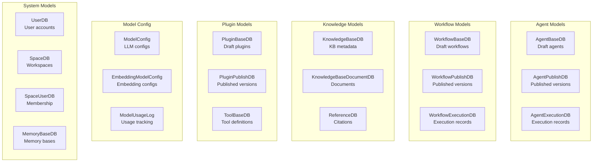
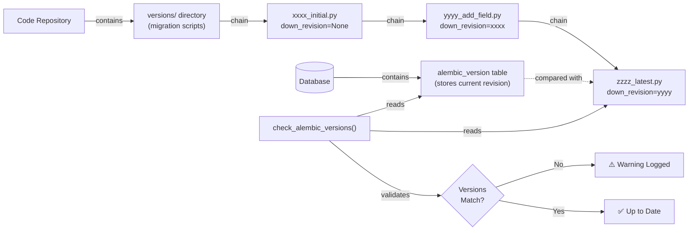
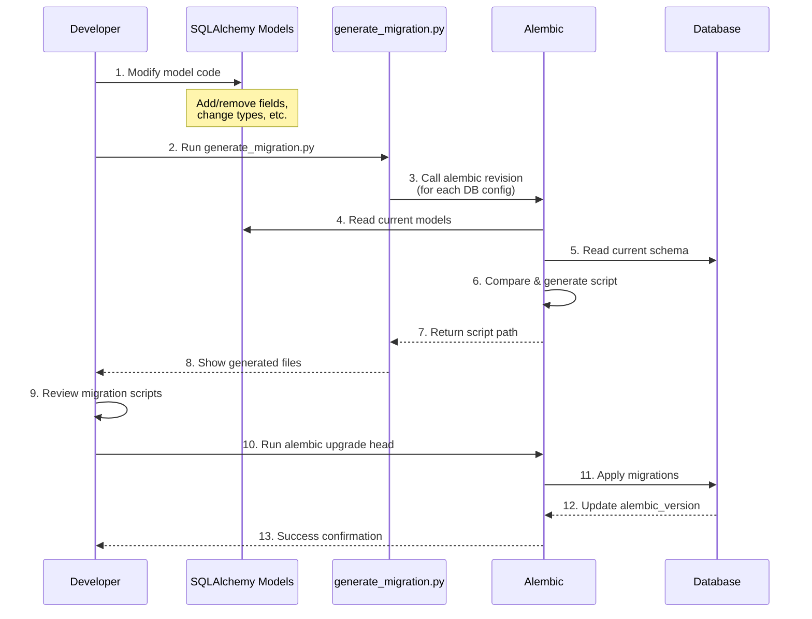
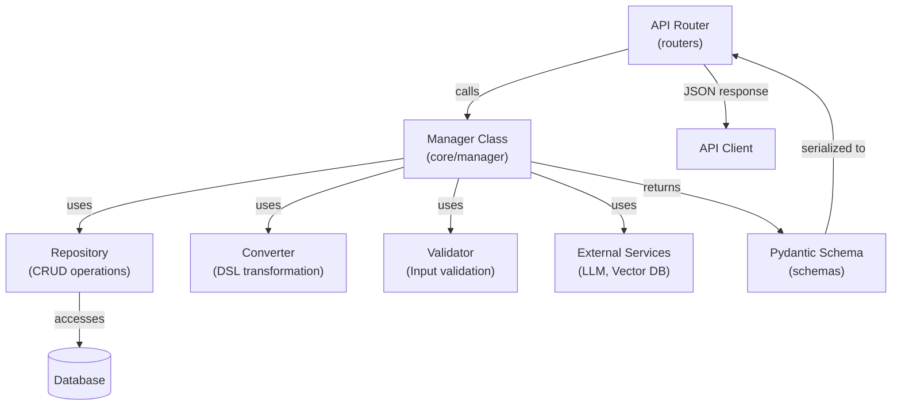
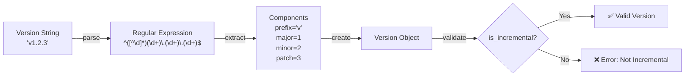
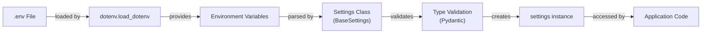
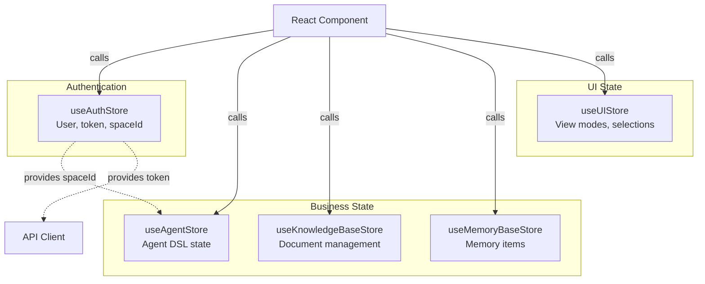
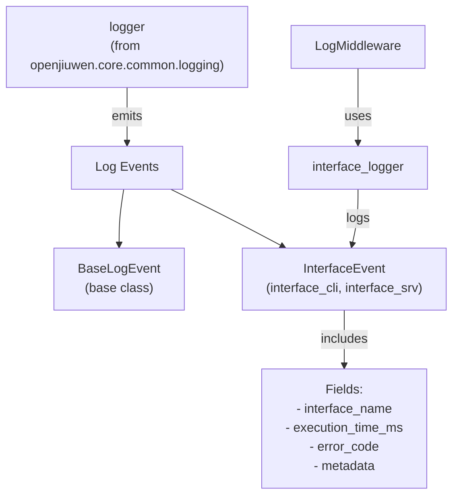

<!-- source: DeepWiki mcp.deepwiki.com · repo openJiuwen-ai/agent-studio · page 6 Developer Guide · fetched 2026-11-02 -->

# Developer Guide

<details>
<summary>Relevant source files</summary>

The following files were used as context for generating this wiki page:

- [.env.example](.env.example)
- [backend/DATABASE_MIGRATION_DEVELOPMENT_GUIDE_EN.md](backend/DATABASE_MIGRATION_DEVELOPMENT_GUIDE_EN.md)
- [backend/GENERATE_MIGRATION_USAGE_EN.md](backend/GENERATE_MIGRATION_USAGE_EN.md)
- [backend/openjiuwen_studio/core/common/logging/__init__.py](backend/openjiuwen_studio/core/common/logging/__init__.py)
- [backend/openjiuwen_studio/core/common/logging/events.py](backend/openjiuwen_studio/core/common/logging/events.py)
- [backend/openjiuwen_studio/core/config.py](backend/openjiuwen_studio/core/config.py)
- [backend/openjiuwen_studio/core/manager/convertor/components/sub_workflow.py](backend/openjiuwen_studio/core/manager/convertor/components/sub_workflow.py)
- [backend/openjiuwen_studio/core/manager/email_manager/__init__.py](backend/openjiuwen_studio/core/manager/email_manager/__init__.py)
- [backend/openjiuwen_studio/core/manager/email_manager/email_template.py](backend/openjiuwen_studio/core/manager/email_manager/email_template.py)
- [backend/openjiuwen_studio/core/manager/email_manager/email_utils.py](backend/openjiuwen_studio/core/manager/email_manager/email_utils.py)
- [backend/openjiuwen_studio/core/manager/redis_manager/__init__.py](backend/openjiuwen_studio/core/manager/redis_manager/__init__.py)
- [backend/openjiuwen_studio/core/manager/utils/utils.py](backend/openjiuwen_studio/core/manager/utils/utils.py)
- [backend/openjiuwen_studio/main.py](backend/openjiuwen_studio/main.py)
- [docs/en/2.Installation Guide/Local Installation/Linux_Installation.md](docs/en/2.Installation Guide/Local Installation/Linux_Installation.md)
- [docs/en/2.Installation Guide/Local Installation/MacOS_Installation.md](docs/en/2.Installation Guide/Local Installation/MacOS_Installation.md)
- [docs/en/2.Installation Guide/Local Installation/Windows_Installation.md](docs/en/2.Installation Guide/Local Installation/Windows_Installation.md)

</details>


This guide provides essential information for developers who want to contribute to or extend OpenJiuwen Agent Studio. It covers development environment setup, code organization, database migrations, backend and frontend development patterns, and testing strategies.

**Related Pages:**
- For architecture details, see [System Architecture](#5.1)
- For deployment information, see [Docker Deployment](#7.1)
- For API specifications, see [API Reference](#8)

---

## Development Environment Setup

### Prerequisites

Before starting development, ensure you have the following tools installed:

| Tool | Minimum Version | Purpose |
|------|----------------|---------|
| Python | 3.11 | Backend runtime |
| uv | 0.5.0 | Python package manager |
| Node.js | 20.0 | Frontend runtime |
| npm | 10.0 | Frontend package manager |
| Git | 2.40 | Version control |
| MySQL | 8.0 (optional) | Production database |

### Local Development Setup

**Backend Setup:**

```bash
# Navigate to backend directory
cd backend

# Create virtual environment
uv venv

# Install dependencies
uv sync

# Activate virtual environment (Linux/macOS)
source .venv/bin/activate

# Activate virtual environment (Windows PowerShell)
.\.venv\Scripts\Activate.ps1

# Create log directories
mkdir -p logs/run

# Start backend in development mode
python main.py
```

The backend server will start on port 8000 by default (configurable via `BACKEND_PORT` in `.env`).

**Frontend Setup:**

```bash
# Navigate to frontend directory
cd frontend

# Install dependencies
npm install

# Start development server with hot reload
npm run dev
```

The frontend development server will start on port 5173 with hot module replacement enabled.

### Environment Configuration

Create a `.env` file by copying `.env.example`:

```bash
cp .env.example .env
```

Key configuration variables for development:

| Variable | Default | Description |
|----------|---------|-------------|
| `DEBUG` | `false` | Enable debug logging |
| `DB_TYPE` | `sqlite` | Database type: `sqlite` or `mysql` |
| `BACKEND_PORT` | `8000` | Backend server port |
| `FRONTEND_PORT` | `3000` | Frontend server port |
| `VITE_API_BASE_URL` | `/api/v1` | API endpoint for frontend |
| `INDEX_MANAGER_TYPE` | `chroma` | Vector DB: `chroma` or `milvus` |

**Sources:** [.env.example:1-196](), [backend/openjiuwen_studio/core/config.py:1-105]()

---

## Project Structure Overview

```mermaid
graph TB
    subgraph "Repository Root"
        Backend["backend/<br/>FastAPI Application"]
        Frontend["frontend/<br/>React + Vite Application"]
        Sandbox["sandbox_server/<br/>Code Execution Sandbox"]
        Plugin["plugin_server/<br/>Plugin Services"]
        Scripts["scripts/<br/>Utility Scripts"]
        Docs["docs/<br/>Documentation"]
    end
    
    subgraph "Backend Structure"
        Main["main.py<br/>Entry Point"]
        Models["models/<br/>SQLAlchemy Models"]
        Routers["routers/<br/>API Endpoints"]
        Managers["core/manager/<br/>Business Logic"]
        Schemas["schemas/<br/>Pydantic Schemas"]
        Upgrade["upgrade/<br/>Alembic Migrations"]
    end
    
    subgraph "Frontend Structure"
        FrontMain["src/main.tsx<br/>Entry Point"]
        Pages["src/pages/<br/>Route Pages"]
        Components["src/components/<br/>UI Components"]
        Stores["src/stores/<br/>Zustand State"]
        Services["src/services/<br/>API Clients"]
    end
    
    Backend --> Main
    Backend --> Models
    Backend --> Routers
    Backend --> Managers
    Backend --> Schemas
    Backend --> Upgrade
    
    Frontend --> FrontMain
    Frontend --> Pages
    Frontend --> Components
    Frontend --> Stores
    Frontend --> Services
```



**Sources:** Repository structure visible across all installation guides

---

## Code Organization

### Backend Entry Point and Initialization

The application starts in `main.py` with a FastAPI application lifecycle:

**Application Startup Sequence:**

```mermaid
graph LR
    Start["Application Start"] --> LoadEnv["Load .env<br/>dotenv.load_dotenv"]
    LoadEnv --> Lifespan["lifespan_func<br/>@asynccontextmanager"]
    Lifespan --> RenameIdx["Rename SQLite Indexes<br/>(avoid duplicates)"]
    RenameIdx --> CreateTables["Base.metadata.create_all<br/>(target_tables)"]
    CreateTables --> InitMemory["MemoryEngineManager.init"]
    InitMemory --> CheckAlembic["check_alembic_versions"]
    CheckAlembic --> InitPrompt["create_database_tables<br/>(ops tables)"]
    InitPrompt --> ConfigRunner["Configure Runner<br/>(if Redis enabled)"]
    ConfigRunner --> StartRunner["Runner.start"]
    StartRunner --> Ready["Application Ready"]
    
    Ready --> Shutdown["Shutdown Signal"]
    Shutdown --> StopRunner["Runner Cleanup"]
```



Key initialization steps in [backend/openjiuwen_studio/main.py:54-146]():

1. **Environment Loading** - Loads `.env` from project root
2. **Database Table Creation** - Creates tables using SQLAlchemy's `create_all` with `checkfirst=True`
3. **Index Renaming** (SQLite only) - Renames duplicate indexes to avoid conflicts
4. **Alembic Version Check** - Validates database schema version matches code
5. **Memory Engine** - Initializes vector database connection
6. **Runner Configuration** - Sets up workflow execution engine with optional Redis checkpointing

**Sources:** [backend/openjiuwen_studio/main.py:54-146]()

### Database Model Organization

Database models are defined in `backend/openjiuwen_studio/models/` using SQLAlchemy ORM:

**Core Model Categories:**



All models inherit from `Base` defined in `backend/openjiuwen_studio/models/db_fun_base.py`.

**Sources:** [backend/openjiuwen_studio/main.py:28-33](), [backend/openjiuwen_studio/main.py:59-92]()

---

## Database Migrations

OpenJiuwen uses **Alembic** for database schema versioning and migrations. The system supports both MySQL and SQLite with separate migration paths.

### Multi-Database Architecture

The project maintains **four independent Alembic configurations**:

| Configuration Name | Database Type | Purpose | Migration Path |
|-------------------|---------------|---------|----------------|
| `alembic_mysql_agent` | MySQL | Agent, workflows, plugins, KB | `backend/upgrade/mysql/alembic_agent/` |
| `alembic_mysql_ops` | MySQL | Prompt templates, ops data | `backend/upgrade/mysql/alembic_ops/` |
| `alembic_sqlite_agent` | SQLite | Agent, workflows, plugins, KB | `backend/upgrade/sqlite/alembic_agent/` |
| `alembic_sqlite_ops` | SQLite | Prompt templates, ops data | `backend/upgrade/sqlite/alembic_ops/` |

**Migration Version Tracking:**



### Generating Migration Scripts

**Automatic Generation (Recommended):**

Use the unified migration script generator to create migrations for all databases simultaneously:

```bash
cd backend

# Auto-generate migrations for all databases
python generate_migration.py --autogenerate -m "feat: add user status field"

# Generate for specific databases only
python generate_migration.py --autogenerate -d mysql_agent -d sqlite_agent -m "feat: update schema"
```

This tool:
1. Dynamically injects the correct `DB_TYPE` environment variable for each database
2. Calls `alembic revision --autogenerate` for each configuration
3. Generates migration scripts in the appropriate `versions/` directories

**Manual Generation (Legacy Method):**

```bash
# Generate for specific database configuration
alembic -n alembic_sqlite_agent revision --autogenerate -m "feat: add new column"
```

**Sources:** [backend/GENERATE_MIGRATION_USAGE_EN.md:1-403](), [backend/DATABASE_MIGRATION_DEVELOPMENT_GUIDE_EN.md:1-15]()

### Migration Workflow

**Standard Development Workflow:**



**Applying Migrations:**

```bash
# Upgrade to latest version
alembic -n alembic_sqlite_agent upgrade head

# Downgrade one revision
alembic -n alembic_sqlite_agent downgrade -1

# View current version
alembic -n alembic_sqlite_agent current

# View migration history
alembic -n alembic_sqlite_agent history
```

### Writing Idempotent Migrations

For MySQL compatibility (DDL operations are not transactional), migrations should be idempotent using helper functions:

```python
from openjiuwen_studio.core.database.migration_utils import table_exists, column_exists, index_exists

def upgrade() -> None:
    # Check before creating table
    if not table_exists('my_new_table'):
        op.create_table('my_new_table', ...)
    
    # Check before adding column
    if not column_exists('users', 'new_column'):
        op.add_column('users', sa.Column('new_column', sa.String(100)))
    
    # Check before creating index
    if not index_exists('users', 'idx_user_email'):
        op.create_index('idx_user_email', 'users', ['email'])
```

**Sources:** [backend/DATABASE_MIGRATION_DEVELOPMENT_GUIDE_EN.md:225-251]()

### Handling Existing Databases

For databases created before Alembic was introduced, use the `stamp` command to tag the version without running migrations:

```bash
# Stamp database with baseline version (v0.1.2)
alembic -n alembic_sqlite_agent stamp f458c7fb17a5

# Verify stamping
alembic -n alembic_sqlite_agent current
# Output: f458c7fb17a5

# Now run normal upgrades
alembic -n alembic_sqlite_agent upgrade head
```

**Version Baseline Table:**

| Database Type | Component | v0.1.2 Revision | v0.1.3 Revision | v0.1.4 Revision |
|---------------|-----------|-----------------|-----------------|-----------------|
| MySQL | Agent | `54351e123cf0` | `06a1f79bce8b` | `072ac1293a02` |
| MySQL | Ops | `80f110f929fc` | `13377a900fe2` | `13377a900fe2` |
| SQLite | Agent | `f458c7fb17a5` | `031b34b4dd30` | `8f4846812221` |
| SQLite | Ops | `b4f4c6589bc5` | `f6e49cd8c97d` | `f6e49cd8c97d` |

**Sources:** [backend/DATABASE_MIGRATION_DEVELOPMENT_GUIDE_EN.md:363-428]()

---

## Backend Development Patterns

### Manager Pattern

Business logic is organized in manager classes located in `backend/openjiuwen_studio/core/manager/`:

**Manager Responsibilities:**



Example manager structure:

- `AgentManager` - Agent CRUD and conversion
- `WorkflowManager` - Workflow operations and execution
- `KnowledgeBaseManager` - Document processing and retrieval
- `PluginManager` - Plugin management and tool execution
- `ModelManager` - LLM and embedding model configuration

**Sources:** High-level architecture diagrams, system description

### Version Control Utilities

The `Version` class in `backend/openjiuwen_studio/core/manager/utils/utils.py` provides semantic versioning support:

**Version Validation:**



Key functions:
- `Version.string_to_object(version_str)` - Parse version string [backend/openjiuwen_studio/core/manager/utils/utils.py:22-57]()
- `check_version(latest, current)` - Validate version increment [backend/openjiuwen_studio/core/manager/utils/utils.py:74-88]()
- `get_current_project_version()` - Read version from `pyproject.toml` [backend/openjiuwen_studio/core/manager/utils/utils.py:125-146]()

**Sources:** [backend/openjiuwen_studio/core/manager/utils/utils.py:1-146]()

### Adding New API Endpoints

**Step-by-step Process:**

1. **Define Pydantic schemas** in `backend/openjiuwen_studio/schemas/`
2. **Create database model** in `backend/openjiuwen_studio/models/` (if needed)
3. **Generate migration** using `generate_migration.py`
4. **Implement manager logic** in `backend/openjiuwen_studio/core/manager/`
5. **Create API router** in `backend/openjiuwen_studio/routers/`
6. **Register router** in `backend/openjiuwen_studio/routers/register.py`

Example router registration pattern:

```python
# In routers/register.py
from routers import my_new_router

def router_register(app: FastAPI):
    # Register with prefix and tags
    app.include_router(
        my_new_router.router,
        prefix="/api/v1/my-resource",
        tags=["My Resource"]
    )
```

**Sources:** [backend/openjiuwen_studio/main.py:244]()

### Configuration Management

Application settings are centralized in `Settings` class using Pydantic:

**Configuration Loading:**



Key settings groups in [backend/openjiuwen_studio/core/config.py:7-105]():

- **Application:** `app_name`, `app_version`, `debug`
- **Database:** `db_type`, `db_host`, `db_port`, `sqlite_db_path`
- **Security:** `secret_key`, `algorithm`, `access_token_expire_minutes`
- **External Services:** `redis_host`, `minio_host`, `smtp_host`
- **Feature Flags:** `enable_redis_checkpoint`, `enable_new_auth`

**Sources:** [backend/openjiuwen_studio/core/config.py:1-105](), [backend/openjiuwen_studio/main.py:17-19]()

---

## Frontend Development Patterns

### State Management

The frontend uses Zustand for global state management with stores located in `frontend/src/stores/`:

**Store Organization:**



**Sources:** High-level frontend architecture diagram

### API Communication

The frontend uses a typed API client (`@test-agentstudio/api-client`) with three communication patterns:

1. **React Query Hooks** - For standard CRUD operations with caching
2. **Direct Service Calls** - For imperative operations
3. **Server-Sent Events (SSE)** - For real-time streaming (prompt debug, workflow execution)

**Sources:** High-level frontend-backend integration diagram

### Adding New Pages

Frontend pages follow React Router structure in `frontend/src/pages/`:

**Typical Page Structure:**

```
frontend/src/pages/
├── AgentPage/
│   ├── AgentListPage.tsx       # List view
│   ├── AgentCreatePage.tsx     # Create form
│   ├── AgentEditPage.tsx       # Edit form
│   └── components/             # Page-specific components
│       ├── AgentCard.tsx
│       └── AgentForm.tsx
```

**Sources:** Installation guides mentioning frontend structure

---

## Logging and Error Handling

### Structured Logging

The system uses a custom logging framework in `backend/openjiuwen/core/common/logging/`:

**Log Event Types:**



Example usage in [backend/openjiuwen_studio/main.py:166-221]():

```python
interface_logger.info(
    "",
    event_type=CustomLogEventType.INTERFACE_SRV.value,
    interface_name=endpoint_name,
    execution_time_ms=round((time.perf_counter() - start_time) * 1000),
    error_code=str(response.status_code),
    metadata={"route_path": route_path}
)
```

**Sources:** [backend/openjiuwen_studio/core/common/logging/events.py:1-50](), [backend/openjiuwen_studio/main.py:166-221]()

---

## Testing Strategies

### Local Testing Setup

**Backend Testing:**

```bash
# Activate virtual environment
source .venv/bin/activate

# Run with hot reload for development
python main.py

# Access API documentation
open http://localhost:8000/api/docs
```

**Frontend Testing:**

```bash
# Start development server
npm run dev

# Open in browser
open http://localhost:5173
```

### Testing Database Migrations

**Migration Testing Workflow:**

```bash
# 1. Create test database
# (Use SQLite for quick testing)

# 2. Apply migrations
alembic -n alembic_sqlite_agent upgrade head

# 3. Test downgrade
alembic -n alembic_sqlite_agent downgrade -1

# 4. Re-apply migration
alembic -n alembic_sqlite_agent upgrade head

# 5. Verify data integrity
# (Check tables, constraints, data)
```

**Sources:** [backend/DATABASE_MIGRATION_DEVELOPMENT_GUIDE_EN.md:256-276]()

### Debugging Tips

**Backend Debugging:**

1. **Enable Debug Mode:** Set `DEBUG=true` in `.env`
2. **Check Logs:** Logs are written to `backend/logs/run/`
3. **Database Version Check:** Run `alembic -n <config> current` to verify schema version
4. **API Inspection:** Use `/api/docs` for interactive API testing

**Frontend Debugging:**

1. **Browser DevTools:** Use React DevTools extension
2. **Network Inspection:** Check API calls in Network tab
3. **State Inspection:** Log Zustand store state
4. **Vite HMR:** Hot module replacement for instant updates

**Sources:** Installation guides, [backend/openjiuwen_studio/main.py:248-267]()

---

## Development Checklist

Before submitting code changes, ensure:

- [ ] Database migrations generated for all database types (if schema changed)
- [ ] Migration scripts are idempotent (use `table_exists`, `column_exists`, etc.)
- [ ] Local database upgraded to latest version (`alembic upgrade head`)
- [ ] Application starts without version mismatch warnings
- [ ] API endpoints tested via `/api/docs`
- [ ] Frontend builds without errors (`npm run build`)
- [ ] Code follows existing patterns (manager pattern, Pydantic schemas)
- [ ] Environment variables documented in `.env.example`
- [ ] Sensitive data encrypted using `SecurityUtils` if applicable

**Sources:** [backend/DATABASE_MIGRATION_DEVELOPMENT_GUIDE_EN.md:344-352]()

---

## Common Development Tasks

### Task: Add a New Field to Existing Table

```bash
# 1. Modify SQLAlchemy model
vim backend/openjiuwen_studio/models/agent.py

# 2. Generate migration
cd backend
python generate_migration.py --autogenerate -m "feat: add agent description field"

# 3. Review generated scripts
ls upgrade/*/alembic_*/versions/*add_agent_description*

# 4. Apply migration
alembic -n alembic_sqlite_agent upgrade head

# 5. Update Pydantic schemas
vim backend/openjiuwen_studio/schemas/agent.py

# 6. Test API endpoint
python main.py
# Visit http://localhost:8000/api/docs
```

### Task: Add a New API Endpoint

```bash
# 1. Define request/response schemas
# backend/openjiuwen_studio/schemas/my_resource.py

# 2. Create manager class
# backend/openjiuwen_studio/core/manager/my_resource_manager.py

# 3. Create router
# backend/openjiuwen_studio/routers/my_resource.py

# 4. Register router in register.py
vim backend/openjiuwen_studio/routers/register.py

# 5. Test endpoint
python main.py
curl http://localhost:8000/api/v1/my-resource
```

### Task: Configure Email Service

The system supports email notifications for user registration and password reset:

**Email Configuration in `.env`:**

```bash
SMTP_HOST=smtp.example.com
SMTP_PORT=465
SMTP_USER=your-email@example.com
SMTP_PASSWORD=your-app-password
SMTP_ALIAS=openJiuwen
```

Email templates are managed in `EmailTemplates` class with methods:
- `get_register_template(code)` - Registration verification email
- `get_reset_password_template(code)` - Password reset email

**Sources:** [backend/openjiuwen_studio/core/manager/email_manager/email_template.py:1-86](), [backend/openjiuwen_studio/core/manager/email_manager/email_utils.py:1-67]()

---

This guide covers the essential development workflows for OpenJiuwen Agent Studio. For specific subsystem details, refer to the child pages of this guide (6.1-6.7) or related architecture documentation.

---

