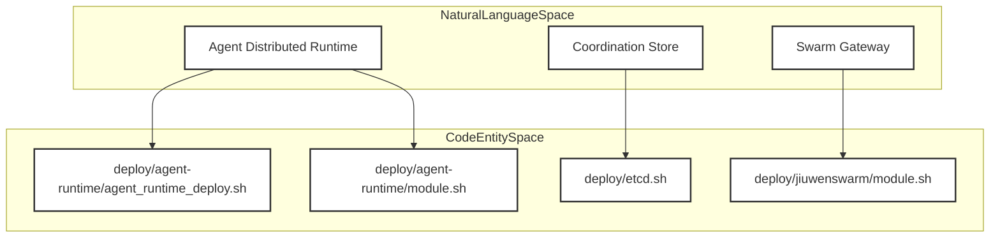
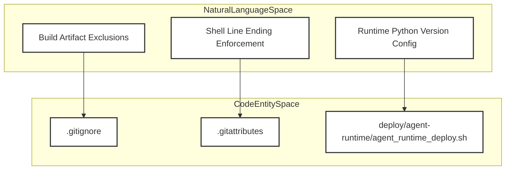

<!-- source: DeepWiki mcp.deepwiki.com · repo openJiuwen-ai/agentos-enterprise · page 1.2 Repository Layout and Submodules · fetched 2026-11-02 -->

# Repository Layout and Submodules

<details>
<summary>Relevant source files</summary>

The following files were used as context for generating this wiki page:

- [.gitattributes](.gitattributes)
- [.gitignore](.gitignore)
- [deploy/agent-runtime/agent_runtime_deploy.sh](deploy/agent-runtime/agent_runtime_deploy.sh)
- [deploy/agent-runtime/module.sh](deploy/agent-runtime/module.sh)

</details>


This page details the structural organization of the `agentos-enterprise` repository. It covers the top-level directory layout, the integration of core git submodules (`jiuwenswarm`, `conch`, `agent-protocol`, `agent-dx`, `yuanrong`), and repository-level conventions defined in `.gitignore` and `.gitattributes`.

Sources: [.gitignore:1-10](), [.gitattributes:1-3]()

---

## Top-Level Directory Structure

The repository root is organized into functional areas separating deployment orchestration, runtime components, container images, testing frameworks, and documentation.

```
agentos-enterprise/
├── agent-gateway/         # A2X Registry and API gateway components
├── ci/                    # Continuous integration pipelines and runners
├── deploy/                # Orchestration scripts and per-component modules
│   ├── agent-runtime/     # Distributed runtime integration (OpenYuanRong)
│   ├── etcd.sh            # etcd coordination lifecycle management
│   └── ...                # Other module deployment scripts
├── docs/                  # Bilingual user and developer documentation
├── images/                # Container definitions (e.g. sandbox runtime)
├── tests/                 # Unit (ut) and system (st) test suites
├── .gitignore             # Ignored build artifacts and local caches
└── .gitattributes         # Git normalization rules for text/binary assets
```

### Key Subdirectories
- **`deploy/`**: Houses the main orchestration script `agentos.sh` alongside modular deployment scripts (`module.sh`) for platform services such as etcd, MooseFS, JiuwenSwarm, JiuwenBox, and Agent Runtime [deploy/agent-runtime/module.sh:1-42]().
- **`agent-gateway/`**: Manages the A2X registry, service discovery, and mTLS/TLS verification.
- **`images/`**: Contains container images such as `images/Dockerfile` for the ppt-pipeline-swarm execution sandbox.
- **`tests/` and `ci/`**: Contain validation logic, unit test scripts (`tests/ut/test_build.sh`), and CI pipelines (`ci/run_ci.sh`).

Sources: [.gitignore:1-10](), [.gitattributes:1-3](), [deploy/agent-runtime/module.sh:1-42]()

---

## Git Submodules

`agentos-enterprise` integrates several external and core subsystems as git submodules to decouple development lifecycles while maintaining unified distribution packaging.

| Submodule Name | Target Directory | Primary Role in AgentOS |
|----------------|------------------|-------------------------|
| `jiuwenswarm` | `jiuwenswarm/` | Swarm intelligence coordination and multi-agent workflow gateway |
| `conch` | `conch/` | Virtualization and storage utilities for agent state management |
| `agent-protocol` | `agent-protocol/` | Standardized communication contracts between agents and tools |
| `agent-dx` | `agent-dx/` | Developer experience tools and CLI extensions |
| `yuanrong` | `yuanrong/` (or `openyuanrong/`) | Distributed underlying execution engine (OpenYuanRong runtime) managed via `deploy/agent-runtime/` |

Sources: [deploy/agent-runtime/agent_runtime_deploy.sh:5-7](), [deploy/agent-runtime/module.sh:1-6]()

---

## Repository Conventions: `.gitignore` and `.gitattributes`

### Exclusion Rules (`.gitignore`)
The root `.gitignore` file prevents temporary build outputs, Python compilation caches, IDE configurations, and local database files from being tracked in version control.

```
build/dist/
.vscode/
node_modules/
dist/
.vite/
**/node_modules/.vite/
__pycache__/
.mimocode/
*.db
```
Sources: [.gitignore:1-10]()

### Normalization and LFS (`.gitattributes`)
The `.gitattributes` file guarantees cross-platform consistency by enforcing LF line endings on shell scripts and delegating large binary files (such as TrueType fonts) to Git LFS.

```
*.sh text eol=lf
**/*.ttf filter=lfs diff=lfs merge=lfs -text
```
Sources: [.gitattributes:1-3]()

---

## Natural Language Space to Code Entity Mapping

To bridge conceptual repository components with their concrete implementations, the following diagrams associate system names with their corresponding code entities, directories, and entrypoint functions.

### Subsystem Deployment Mapping

Sources: [deploy/agent-runtime/agent_runtime_deploy.sh:1-174](), [deploy/agent-runtime/module.sh:1-42]()

### Build and Ignore Convention Mapping

Sources: [.gitignore:1-10](), [.gitattributes:1-3](), [deploy/agent-runtime/agent_runtime_deploy.sh:17-18]()

---

