# Page: Overview

# Overview

<details>
<summary>Relevant source files</summary>

The following files were used as context for generating this wiki page:

- [README.md](README.md)
- [README.zh.md](README.zh.md)
- [docs/en/explanation/architecture.md](docs/en/explanation/architecture.md)
- [docs/zh/explanation/architecture.md](docs/zh/explanation/architecture.md)

</details>


AgentOS Enterprise functions as a one-stop integration and delivery distribution repository for the openJiuwen agent infrastructure [README.md:1-5](). It aggregates four primary openJiuwen subsystems—the distributed agent runtime (`agent-runtime`), the work/coding agent gateway and frontend (`jiuwenswarm`), the sandbox engine (`Conch`), and the A2X protocol registry (`agent-protocol`)—using Git submodules [README.md:5-9](), [docs/en/explanation/architecture.md:7-14](). Rather than implementing core AI logic directly, AgentOS provides a unified build pipeline and a modular cluster deployment orchestrator [README.md:5-13]().

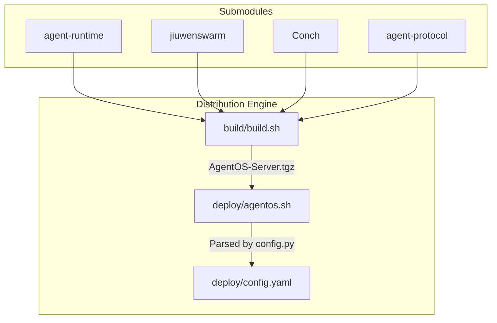
Sources: [README.md:5-11](), [docs/en/explanation/architecture.md:7-16]()

---

## High-Level Architecture & Lifecycle

AgentOS decouples its operations into three distinct architectural layers to separate software packaging, cluster initialization, and service execution [docs/en/explanation/architecture.md:46-54](). 

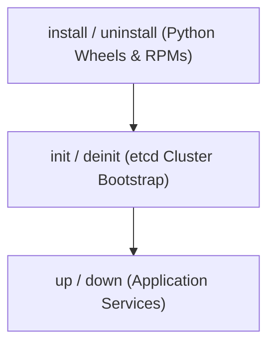
Sources: [docs/en/explanation/architecture.md:46-55]()

The deployment orchestrator `deploy/agentos.sh` manages these lifecycle states by executing pluggable hook functions defined within each component's module directory [docs/en/explanation/architecture.md:34-39](). Multi-node clusters are coordinated via `deploy/config.yaml`, which assigns roles such as etcd nodes, master nodes, and the network-layer ingress virtual IP [README.md:12](), [docs/en/explanation/architecture.md:56-62]().

Sources: [README.md:11-13](), [docs/en/explanation/architecture.md:34-62]()

---

## Child Pages

For detailed instructions and lower-level specifications, refer to the following child pages:

- [Quick Start (Single Node)](#1.1) — Walkthrough of first install/up on a single node using `examples/single-node-up.sh` and tutorial documentation.
- [Repository Layout and Submodules](#1.2) — Top-level directories, Git submodules (`jiuwenswarm`, `Conch`, `agent-protocol`, `agent-dx`, `openyuanrong`), and repository conventions.
- [Documentation Set and Contributing](#1.3) — Structure of the `docs/` directory, contribution workflows, and licensing notices.

Sources: [README.md:15-20](), [docs/en/explanation/architecture.md:7-14]()

---

# Page: Quick Start (Single Node)

# Quick Start (Single Node)

<details>
<summary>Relevant source files</summary>

The following files were used as context for generating this wiki page:

- [docs/en/tutorial/01-quick-start.md](docs/en/tutorial/01-quick-start.md)
- [docs/zh/tutorial/01-quick-start.md](docs/zh/tutorial/01-quick-start.md)
- [examples/README.zh.md](examples/README.zh.md)
- [examples/single-node-up.sh](examples/single-node-up.sh)

</details>


This page provides a technical walkthrough for setting up AgentOS Enterprise on a single Linux server. It covers prerequisites, automated single-node deployment via `examples/single-node-up.sh`, manual execution steps using `deploy/agentos.sh`, cluster configuration, verification, and teardown procedures.

Sources: `docs/en/tutorial/01-quick-start.md:1-4`, `examples/README.zh.md:1-8`

---

## Prerequisites and System Requirements

Before initiating deployment, verify that the host machine satisfies the following hardware, OS, and software constraints. Deployment must be executed with `root` privileges because it interacts with `systemd`, system logs, and administrative filesystem paths.

| Category | Requirement |
|----------|-------------|
| Server OS | openEuler 22.03 / 24.03-LTS (x86_64 / aarch64) or Ubuntu 22.04 / 24.04 with active internet access |
| Account | `root` user `[docs/en/tutorial/01-quick-start.md:10-18]()` |
| Python | Python 3.11 (`python3.11 --version`) `[docs/en/tutorial/01-quick-start.md:10-18]()` |
| Disk Space | Minimum 20 GB free space `[docs/en/tutorial/01-quick-start.md:10-18]()` |

Sources: `docs/en/tutorial/01-quick-start.md:10-18`

---

## Deployment Architecture and Data Flow

The following diagrams map natural language deployment concepts to the actual script execution flow and runtime components defined in the codebase.

### Automation and Script Execution Flow

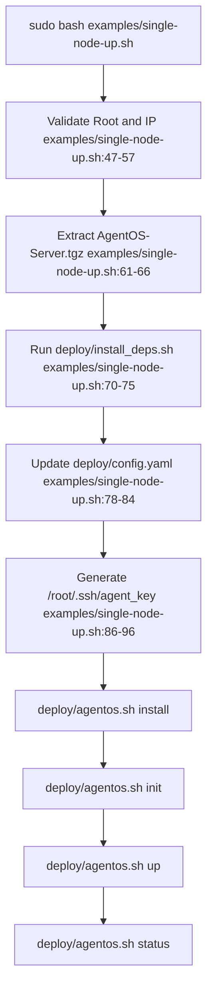
Sources: `examples/single-node-up.sh:1-110`

### Runtime Component Topology

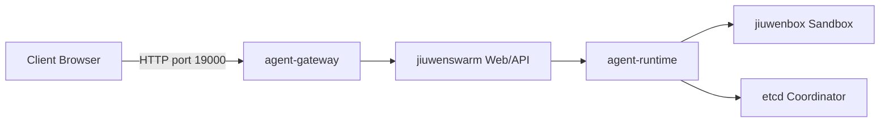
Sources: `docs/en/tutorial/01-quick-start.md:7-8`

---

## Step-by-Step Manual Deployment Guide

If you prefer not to use the automated wrapper script (`examples/single-node-up.sh`), you can execute the lifecycle commands manually.

### Step 1: Package Acquisition
Obtain the distribution archive via direct download or local build `[docs/en/tutorial/01-quick-start.md:21-30]`:
```bash
wget https://openjiuwen-ci.obs.cn-north-4.myhuaweicloud.com/agent-os/package/release/dist/20260715/x86_64/AgentOS-Server.tgz
```
Sources: `docs/en/tutorial/01-quick-start.md:21-30`

### Step 2: Unpack and Install System Dependencies
Extract the package and execute the dependency installation script `[docs/en/tutorial/01-quick-start.md:31-39]`:
```bash
tar -xzf AgentOS-Server.tgz && cd AgentOS-Server
bash deploy/install_deps.sh
```
`deploy/install_deps.sh` installs Python 3.11, network utilities, `fuse3`, `bwrap`, MooseFS RPM packages, and required Python libraries `[docs/en/tutorial/01-quick-start.md:38]`.
Sources: `docs/en/tutorial/01-quick-start.md:31-39`

### Step 3: Configure Cluster Topology
Edit `deploy/config.yaml` to specify the local node IP. **Do not use `127.0.0.1`**, as it binds services exclusively to the loopback interface `[docs/en/tutorial/01-quick-start.md:40-54]`:
```yaml
cluster:
  etcd_nodes:
    - "192.168.100.1"                  # Replace with local machine IP
  master_nodes:
    - "192.168.100.1"                  # Replace with local machine IP
  ingress_virtual_ip: "192.168.100.1"  # Replace with local machine IP
```
Sources: `docs/en/tutorial/01-quick-start.md:40-54`

### Step 4: Generate Agent SSH Key Pair
Generate the direct connection SSH key pair required by agents `[docs/en/tutorial/01-quick-start.md:55-64]`:
```bash
ssh-keygen -t ed25519 -N '' -f /root/.ssh/agent_key
mkdir -p /root/.ssh/agent_pub
cp /root/.ssh/agent_key.pub /root/.ssh/agent_pub/authorized_keys
chmod 644 /root/.ssh/agent_pub/authorized_keys && chmod 755 /root/.ssh/agent_pub
```
Sources: `docs/en/tutorial/01-quick-start.md:55-64`

### Step 5: Install, Initialize, and Start Components
Execute the orchestration script `deploy/agentos.sh` to manage component lifecycles `[docs/en/tutorial/01-quick-start.md:66-75]`:
```bash
bash deploy/agentos.sh install    # Installs Python wheels, persisting deploy state to ~/.agentos/
bash deploy/agentos.sh init       # Boots etcd (preserves existing key-value data)
bash deploy/agentos.sh up         # Starts application modules in dependency order
```
Sources: `docs/en/tutorial/01-quick-start.md:66-75`

### Step 6: Verify Deployment Status
Probe the health and runtime status of all managed services `[docs/en/tutorial/01-quick-start.md:76-83]`:
```bash
bash deploy/agentos.sh status
```
When all modules report a `running` status, access the `jiuwenswarm` web frontend via `http://<machine-IP>:19000` `[docs/en/tutorial/01-quick-start.md:82]`.
Sources: `docs/en/tutorial/01-quick-start.md:76-83`

---

## Automated Single-Node Deployment Script

For rapid prototyping, `examples/single-node-up.sh` automates the entire manual sequence into a single command `[examples/README.zh.md:5-8]`:

```bash
sudo bash examples/single-node-up.sh --package /path/to/AgentOS-Server.tgz
```

For multi-NIC environments, explicitly specify the reachable interface IP `[examples/single-node-up.sh:36-45]`:
```bash
sudo bash examples/single-node-up.sh --package /path/to/AgentOS-Server.tgz --ip 192.168.100.1
```
Sources: `examples/single-node-up.sh:1-110`, `examples/README.zh.md:1-26`

---

## Teardown and Cleanup Procedures

To stop services or completely remove AgentOS binaries from the node, use the corresponding `agentos.sh` subcommands `[docs/en/tutorial/01-quick-start.md:84-90]`:

```bash
bash deploy/agentos.sh down       # Stops application components while leaving etcd operational
bash deploy/agentos.sh deinit     # Stops etcd and preserves persistent data store
bash deploy/agentos.sh uninstall  # Removes installed Python wheel packages
```
Sources: `docs/en/tutorial/01-quick-start.md:84-90`

---

# Page: Repository Layout and Submodules

# Repository Layout and Submodules

<details>
<summary>Relevant source files</summary>

The following files were used as context for generating this wiki page:

- [.gitattributes](.gitattributes)
- [.gitignore](.gitignore)
- [deploy/agent-runtime/agent_runtime_deploy.sh](deploy/agent-runtime/agent_runtime_deploy.sh)
- [deploy/agent-runtime/module.sh](deploy/agent-runtime/module.sh)

</details>


This page details the structural organization of the `agentos-enterprise` repository. It covers the top-level directory layout, the integration of core git submodules (`jiuwenswarm`, `conch`, `agent-protocol`, `agent-dx`, `yuanrong`), and repository-level conventions defined in `.gitignore` and `.gitattributes`.

Sources: [.gitignore:1-10](), [.gitattributes:1-3]()

---

## Top-Level Directory Structure

The repository root is organized into functional areas separating deployment orchestration, runtime components, container images, testing frameworks, and documentation.

```
agentos-enterprise/
├── agent-gateway/         # A2X Registry and API gateway components
├── ci/                    # Continuous integration pipelines and runners
├── deploy/                # Orchestration scripts and per-component modules
│   ├── agent-runtime/     # Distributed runtime integration (OpenYuanRong)
│   ├── etcd.sh            # etcd coordination lifecycle management
│   └── ...                # Other module deployment scripts
├── docs/                  # Bilingual user and developer documentation
├── images/                # Container definitions (e.g. sandbox runtime)
├── tests/                 # Unit (ut) and system (st) test suites
├── .gitignore             # Ignored build artifacts and local caches
└── .gitattributes         # Git normalization rules for text/binary assets
```

### Key Subdirectories
- **`deploy/`**: Houses the main orchestration script `agentos.sh` alongside modular deployment scripts (`module.sh`) for platform services such as etcd, MooseFS, JiuwenSwarm, JiuwenBox, and Agent Runtime [deploy/agent-runtime/module.sh:1-42]().
- **`agent-gateway/`**: Manages the A2X registry, service discovery, and mTLS/TLS verification.
- **`images/`**: Contains container images such as `images/Dockerfile` for the ppt-pipeline-swarm execution sandbox.
- **`tests/` and `ci/`**: Contain validation logic, unit test scripts (`tests/ut/test_build.sh`), and CI pipelines (`ci/run_ci.sh`).

Sources: [.gitignore:1-10](), [.gitattributes:1-3](), [deploy/agent-runtime/module.sh:1-42]()

---

## Git Submodules

`agentos-enterprise` integrates several external and core subsystems as git submodules to decouple development lifecycles while maintaining unified distribution packaging.

| Submodule Name | Target Directory | Primary Role in AgentOS |
|----------------|------------------|-------------------------|
| `jiuwenswarm` | `jiuwenswarm/` | Swarm intelligence coordination and multi-agent workflow gateway |
| `conch` | `conch/` | Virtualization and storage utilities for agent state management |
| `agent-protocol` | `agent-protocol/` | Standardized communication contracts between agents and tools |
| `agent-dx` | `agent-dx/` | Developer experience tools and CLI extensions |
| `yuanrong` | `yuanrong/` (or `openyuanrong/`) | Distributed underlying execution engine (OpenYuanRong runtime) managed via `deploy/agent-runtime/` |

Sources: [deploy/agent-runtime/agent_runtime_deploy.sh:5-7](), [deploy/agent-runtime/module.sh:1-6]()

---

## Repository Conventions: `.gitignore` and `.gitattributes`

### Exclusion Rules (`.gitignore`)
The root `.gitignore` file prevents temporary build outputs, Python compilation caches, IDE configurations, and local database files from being tracked in version control.

```
build/dist/
.vscode/
node_modules/
dist/
.vite/
**/node_modules/.vite/
__pycache__/
.mimocode/
*.db
```
Sources: [.gitignore:1-10]()

### Normalization and LFS (`.gitattributes`)
The `.gitattributes` file guarantees cross-platform consistency by enforcing LF line endings on shell scripts and delegating large binary files (such as TrueType fonts) to Git LFS.

```
*.sh text eol=lf
**/*.ttf filter=lfs diff=lfs merge=lfs -text
```
Sources: [.gitattributes:1-3]()

---

## Natural Language Space to Code Entity Mapping

To bridge conceptual repository components with their concrete implementations, the following diagrams associate system names with their corresponding code entities, directories, and entrypoint functions.

### Subsystem Deployment Mapping
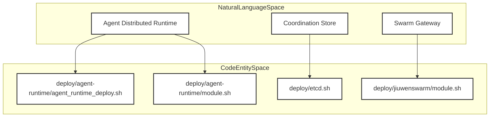
Sources: [deploy/agent-runtime/agent_runtime_deploy.sh:1-174](), [deploy/agent-runtime/module.sh:1-42]()

### Build and Ignore Convention Mapping
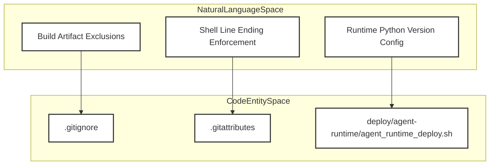
Sources: [.gitignore:1-10](), [.gitattributes:1-3](), [deploy/agent-runtime/agent_runtime_deploy.sh:17-18]()

---

# Page: Documentation Set and Contributing

# Documentation Set and Contributing

<details>
<summary>Relevant source files</summary>

The following files were used as context for generating this wiki page:

- [CONTRIBUTING.md](CONTRIBUTING.md)
- [LICENSE](LICENSE)
- [OPEN_SOURCE_SOFTWARE_NOTICE.md](OPEN_SOURCE_SOFTWARE_NOTICE.md)
- [deploy/check-ingress-master.sh](deploy/check-ingress-master.sh)
- [deploy/conch/module.sh](deploy/conch/module.sh)
- [docs/README.zh.md](docs/README.zh.md)
- [docs/en/how-to/add-deploy-module.md](docs/en/how-to/add-deploy-module.md)
- [docs/zh/how-to/add-deploy-module.md](docs/zh/how-to/add-deploy-module.md)

</details>


## Purpose and Scope

This page details the organization of the AgentOS Enterprise documentation set (`docs/`), the contribution workflow, code standards, and the licensing and open-source notices governing the repository. It targets developers and technical writers looking to understand how documentation is structured using the Diátaxis framework, how to contribute code and documentation updates, and how third-party software components are licensed.

Sources: [docs/README.zh.md:1-26](), [CONTRIBUTING.md:1-39](), [LICENSE:1-25]()

---

## Documentation Set Organization (`docs/`)

AgentOS Enterprise organizes its user and technical documentation using the **Diátaxis** framework, dividing content into four distinct categories based on user needs. The documentation maintains an authoritative Chinese source tree under `docs/zh/` and a structurally symmetric English translation tree under `docs/en/`. Top-level module docs also reside alongside their respective deployment scripts or submodules [docs/README.zh.md:1-8].

### The Four Diátaxis Quadrants

1. **Tutorial (`tutorial/`)**: Learning-oriented, step-by-step guides ("follow me through a task") designed with numeric prefixes to enforce a recommended reading sequence (e.g., single-node quick starts) [docs/README.zh.md:21-23].
2. **How-to Guides (`how-to/`)**: Task-oriented guides addressing specific operational goals ("how do I accomplish X?", such as building packages or deploying multi-node clusters) [docs/README.zh.md:21-24].
3. **Reference (`reference/`)**: Information-oriented, factual descriptions of commands, scripts, and configuration schemas designed for quick lookup [docs/README.zh.md:21-25].
4. **Explanation (`explanation/`)**: Understanding-oriented discussions clarifying design rationale, architecture choices, and background context [docs/README.zh.md:21-26].

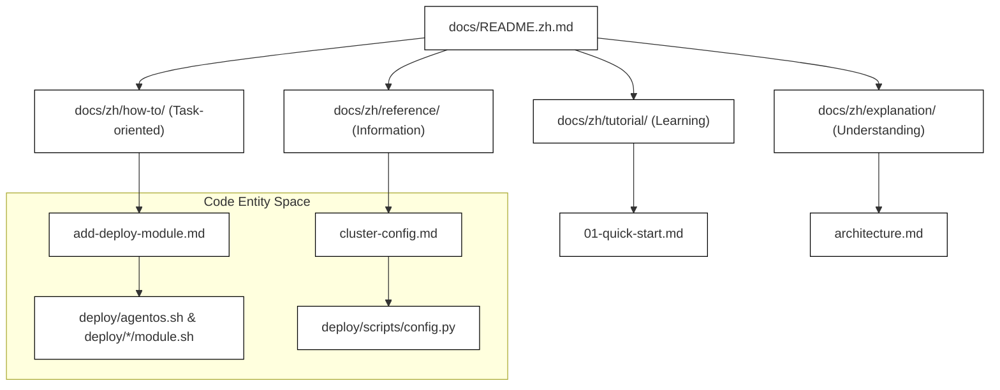
*Diagram 1: Documentation Navigation mapped to codebase entities via Diátaxis categories.*

Sources: [docs/README.zh.md:1-26](), [docs/zh/how-to/add-deploy-module.md:1-84]()

---

## Contribution Workflow

Contributing changes to AgentOS Enterprise requires adherence to specific Git branching, self-testing, and coding conventions outlined in `CONTRIBUTING.md` [CONTRIBUTING.md:1-40].

### Step-by-Step Contribution Pipeline

1. **Fork and Branch**: Fork the main repository and create a feature or bugfix branch using descriptive `kebab-case` naming (e.g., `feat/my-feature` or `fix/my-bugfix`) [CONTRIBUTING.md:5-7].
2. **Development & Self-Test**: Implement changes following shell script standards (`#!/usr/bin/env bash` with `set -euo pipefail`) and verify using the CI test harness [CONTRIBUTING.md:12-29]:
   ```bash
   ./ci/run_ci.sh                 # Run all UT and ST tests
   ./ci/run_ci.sh --type=ut       # Run Unit Tests only
   ./ci/run_ci.sh --type=st       # Run System Tests only
   ```
3. **Documentation Sync**: Any feature modification or new deployment module requires updating the corresponding documentation (`docs/`, `README`, and script help texts) symmetrically across Chinese and English sets [CONTRIBUTING.md:30-34].
4. **Pull Request**: Submit a PR to the main repository detailing the background, scope of changes, and validation results [CONTRIBUTING.md:8-10].

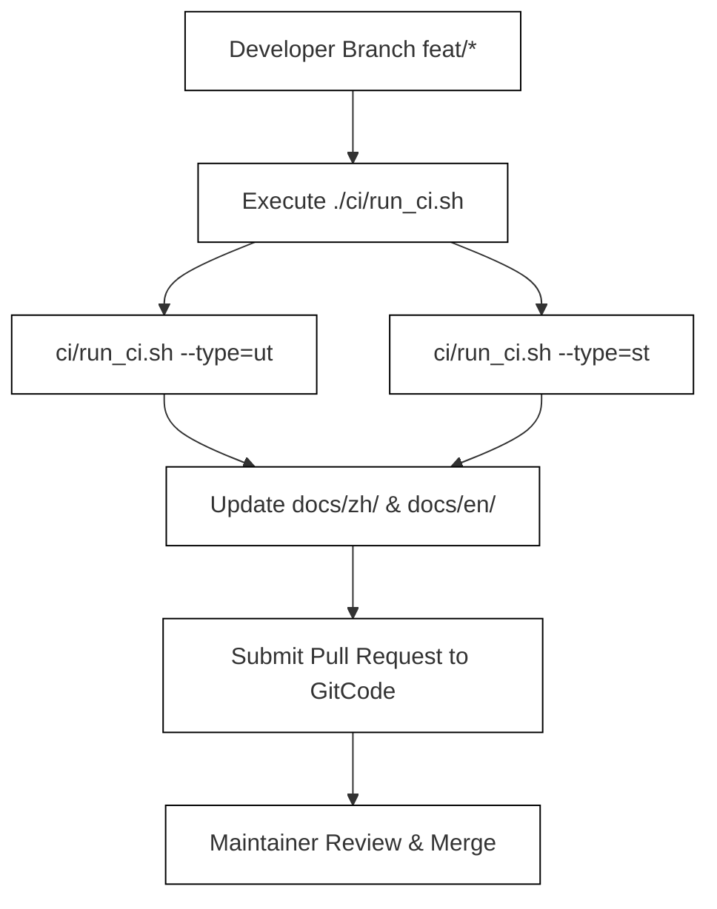
*Diagram 2: Contribution lifecycle from local development to code review.*

Sources: [CONTRIBUTING.md:1-39](), [docs/README.zh.md:1-8]()

---

## Code Standards and Module Integration

When extending AgentOS Enterprise—especially within the `deploy/` subsystem—contributors must implement modular hooks that conform to the orchestrator's expectations [docs/zh/how-to/add-deploy-module.md:1-85]:

- **Module Layout**: Each component resides in `deploy/<module>/` containing a `module.sh` script implementing standard hooks: `<module>_up`, `<module>_down`, `<module>_install`, `<module>_uninstall`, and `<module>_status` [docs/zh/how-to/add-deploy-module.md:5-40].
- **Orchestrator Registration**: The module name must be appended to the `MODULES` array inside `deploy/agentos.sh` to participate in automated initialization and lifecycle scheduling [docs/zh/how-to/add-deploy-module.md:42-51].

Sources: [docs/zh/how-to/add-deploy-module.md:1-51](), [deploy/conch/module.sh:1-36]()

---

## Licensing and Open Source Notices

AgentOS Enterprise is licensed under the terms of the **Apache License, Version 2.0** [LICENSE:1-5]. Redistribution and modification must respect terms regarding copyright retention, license inclusion, and notice propagation [LICENSE:89-125].

### Third-Party Software and Submodules

The project integrates several submodules and deployment-time third-party dependencies governed by their respective licenses [OPEN_SOURCE_SOFTWARE_NOTICE.md:1-38]:

| Component Name | Provenance | License Type | Description |
|---|---|---|---|
| `yuanrong` | `https://gitcode.com/openeuler/yuanrong.git` | Apache-2.0 | Core open-source execution runtime |
| `jiuwenswarm` | `https://gitcode.com/openJiuwen/jiuwenswarm.git` | Apache-2.0 | Multi-agent swarm orchestration layer |
| `agent-protocol` | `https://gitcode.com/openJiuwen/agent-protocol.git` | Apache-2.0 | Inter-agent communication protocols |
| `Conch` | `https://gitcode.com/openeuler/Conch.git` | MulanPSL-2.0 | Virtualization and storage utility runtime |
| `MooseFS` | `https://repository.moosefs.com` | GPL-2.0 | Distributed cluster file system |

Sources: [LICENSE:1-125](), [OPEN_SOURCE_SOFTWARE_NOTICE.md:1-50]()

---

# Page: Build System

# Build System

<details>
<summary>Relevant source files</summary>

The following files were used as context for generating this wiki page:

- [.gitmodules](.gitmodules)
- [build/README.zh.md](build/README.zh.md)
- [build/build.sh](build/build.sh)

</details>


The build system of AgentOS Enterprise is responsible for fetching, assembling, and packaging all necessary runtime components, SDKs, and deployment scripts into unified distribution tarballs: `AgentOS-Client.tgz` and `AgentOS-Server-ARCH.tgz` [build/build.sh:7-8](), [build/README.zh.md:160-171](). It orchestrates downloads from Huawei Cloud OBS and GitCode repositories, handles parallel fetching of Python wheels and RPMs, and packages the workspace for single-node and multi-node enterprise deployments [build/README.zh.md:7-14, 141-145]().

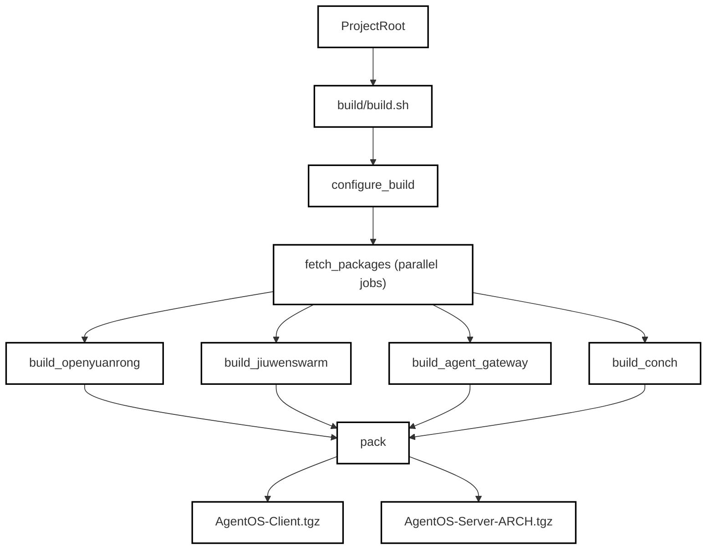
*Sources: [build/build.sh:1-594](), [build/README.zh.md:61-72]()*, [build/README.zh.md:160-179]()

---

## 2.1. build.sh: Modes, Downloads, Packaging

The primary build entrypoint is `build/build.sh`, which supports two execution modes: `daily` (fetching latest builds from OBS daily indices) and `release` (pulling pinned versions from GitCode and OBS release paths) [build/build.sh:56-58](), [build/README.zh.md:7-8](). It provides options for ABI tags, parallel download limits (`--download-jobs`), and specific component versions [build/README.zh.md:45-58]().

For a comprehensive deep dive into daily versus release modes, OBS/GitCode sources, parallel download logic (`wait -n`), component build functions (`build_openyuanrong`, `build_jiuwenswarm`, `build_agent_gateway`, `build_conch`), and the final packaging directory layout, see [build.sh: Modes, Downloads, Packaging](#2.1).

*Sources: [build/build.sh:1-185](), [build/README.zh.md:1-180]()*, [.gitmodules:1-16]()

---

## 2.2. build-v2.sh

The repository also includes next-generation build tooling via `build-v2.sh`, designed to streamline and modernize the artifact generation pipeline. While `build.sh` handles script-driven procedural tarball creation [build/README.zh.md:61-72](), `build-v2.sh` provides alternative iteration logic and modular packaging enhancements.

For details on how `build-v2.sh` differs from the legacy `build.sh` script, see [build-v2.sh](#2.2).

*Sources: [build/build.sh:1-594](), [build/README.zh.md:1-41]()*, [.gitmodules:1-16]()

---

## 2.3. Runtime Sandbox Container Image

Container image definitions are maintained under the `images/` directory to support isolated execution environments. Specifically, `images/Dockerfile` provisions the `ppt-pipeline-swarm` runtime environment, which includes system font packages, Node.js `html2pptx` dependencies, Playwright browser automation binaries, and specialized Python runtime packages.

For details on the container image configuration, dependency layering, and runtime sandbox preparation, see [Runtime Sandbox Container Image](#2.3).

*Sources: [build/build.sh:7-8](), [build/README.zh.md:160-171]()*, [.gitmodules:1-16]()

---

# Page: build.sh: Modes, Downloads, Packaging

# build.sh: Modes, Downloads, Packaging

<details>
<summary>Relevant source files</summary>

The following files were used as context for generating this wiki page:

- [.gitmodules](.gitmodules)
- [build/build.sh](build/build.sh)
- [docs/en/how-to/build-package.md](docs/en/how-to/build-package.md)
- [docs/zh/how-to/build-package.md](docs/zh/how-to/build-package.md)

</details>


## Purpose and Scope

This document provides a deep technical dive into `build/build.sh`, the primary packaging script for the AgentOS Enterprise distribution. It covers script execution modes (`daily` vs `release`), remote artifact acquisition from Huawei Cloud OBS and GitCode via `.gitmodules`, parallel download execution control, component version mapping (`openyuanrong`, `jiuwenswarm`, `conch`, `stratovirt`, `erofs`), and the final tarball generation layout (`AgentOS-Client.tgz` and `AgentOS-Server-<arch>.tgz`).

Sources: `[build/build.sh:1-209]`, `[docs/en/how-to/build-package.md:1-73]()`

---

## 1. Build Modes and Argument Parsing

The script `build/build.sh` initiates execution by setting strict error handling (`set -e`) and resolving absolute paths for `SCRIPT_DIR`, `PROJECT_ROOT`, and `BUILD_DIR` [build/build.sh:1-10](). 

The `parse_args` function processes positional arguments and command-line flags to configure the build environment [build/build.sh:85-185](). The two primary execution modes are:
* **`daily`**: Automatically queries the OpenYuanRong daily build index on Huawei Cloud OBS to retrieve the latest matching snapshot.
* **`release`**: Relies on explicitly pinned component versions and tags for official production releases.

### Key Configuration Parameters

| Parameter Variable | Default Value | CLI Flag | Description |
|-------------------|---------------|----------|-------------|
| `BUILD_MODE` | `daily` | `daily` / `release` | Execution mode (positional argument) |
| `CP_TAG` | `cp311` | `--cp-tag` | Python ABI tag for Yuanrong wheel packages |
| `OPENYUANRONG_RELEASE_VERSION` | `0.9.0` | `--yuanrong-release-version` | Yuanrong version for release mode |
| `JIUWENSWARM_RELEASE_VERSION` | `0.2.3` | `--jiuwenswarm-release-version` | JiuwenSwarm wheel version |
| `JIUWENSWARM_RELEASE_GIT_TAG` | `release_0.2.3` | `--jiuwenswarm-release-git-tag` | JiuwenSwarm git release tag |
| `AGENT_INFER_RELEASE_VERSION` | `0.1.0` | `--agent-infer-release-version` | Agent Infer component version |
| `DOWNLOAD_JOBS` | `3` | `--download-jobs` | Maximum concurrent background download workers |

Sources: `[build/build.sh:11-83]`, `[docs/en/how-to/build-package.md:25-35]()`

---

## 2. Source Repositories and Artifact Retrieval

External dependencies span GitCode repositories and Huawei Cloud OBS object storage. Git submodules configured in `.gitmodules` define the source tree structure for development and source-based component inclusion.

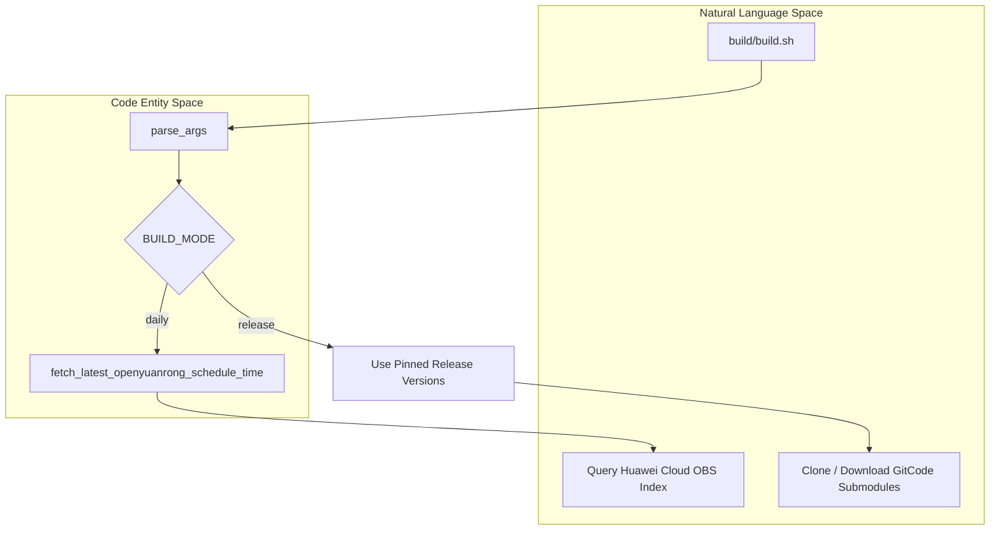
*Diagram 1: Control flow from script invocation to daily/release mode resolution.*

Sources: `[build/build.sh:85-209]`, `[.gitmodules:1-16]()`

---

## 3. Parallel Download Infrastructure

To accelerate artifact acquisition, `build/build.sh` implements concurrency controls via the `DOWNLOAD_JOBS` variable [build/build.sh:21](). Downloads use `curl` or `wget` with built-in retry logic [build/build.sh:192-200](). 

When downloading large binary wheels, RPM packages (`conch`, `stratovirt`, `erofs`), and tarballs, the script regulates parallel execution slots to prevent network throttling or broken socket connections (`curl: (18) transfer closed`) on unstable uplinks [docs/en/how-to/build-package.md:70-71]().

Sources: `[build/build.sh:181-184]`, `[docs/en/how-to/build-package.md:70-72]()`

---

## 4. Component Builds and Version Mapping

The distribution bundles several core subsystems. Each component has strict version bindings defined at the top of the build script:

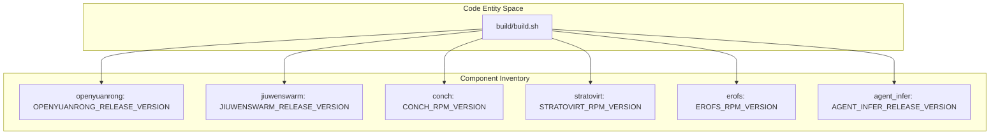
*Diagram 2: Component version bindings managed within `build/build.sh`.*

### Component Overview
* **OpenYuanRong**: Core execution engine runtime wheels tagged with `--cp-tag` (`cp311`) [build/build.sh:13]().
* **JiuwenSwarm**: Multi-agent framework components and TUI client wheels [build/build.sh:16-17]().
* **Conch, StratoVirt, and EROFS**: Virtualization and lightweight storage utilities provided as RPM packages (`Conch` wheel is embedded inside the Conch RPM) [build/build.sh:26-29]().
* **Agent Infer & Gateway**: Inference routing and service registration plugins [build/build.sh:22-25]().

Sources: `[build/build.sh:11-30]`, `[docs/en/how-to/build-package.md:63-66]()`

---

## 5. Packaging Layout and Output Generation

Once all components are downloaded, verified, and assembled, the build script packs them into two primary distributable archives inside `build/dist/`:

| Archive Name | Target Audience / Contents |
|--------------|----------------------------|
| `AgentOS-Client.tgz` | All-platform `jiuwenswarm_tui` wheels supporting macOS, Windows, Linux (`x86_64`, `aarch64`) [docs/en/how-to/build-package.md:64]() |
| `AgentOS-Server-<arch>.tgz` | Server-side wheel packages, RPMs (`conch`, `stratovirt`, `erofs`), and the complete orchestration directory (`deploy/`) [docs/en/how-to/build-package.md:65]() |

Every build cycle initializes by wiping `build/dist/` to prevent contamination from stale build artifacts [docs/en/how-to/build-package.md:71]().

Sources: `[build/build.sh:7]`, `[docs/en/how-to/build-package.md:58-67]()`

---

# Page: build-v2.sh

# build-v2.sh

<details>
<summary>Relevant source files</summary>

The following files were used as context for generating this wiki page:

- [build/README-v2.zh.md](build/README-v2.zh.md)
- [build/build-v2.sh](build/build-v2.sh)

</details>


The purpose of this page is to document `build/build-v2.sh`, the next-generation distribution build script for AgentOS Enterprise. It outlines how distribution tarballs (`AgentOS-Client.tgz`, `AgentOS-Server-${ARCH}.tgz`, and `AgentOS-Buildinfo.tgz`) are produced, details how it decouples component versioning through Object Storage Service (OBS) `last_successful_build` endpoints, and explains its architecture compared to the legacy `build.sh`.

## 1. Overview and Design Objectives

`build/build-v2.sh` is designed to assemble AgentOS Enterprise delivery bundles (`b050` product line and onward). Unlike the legacy script, `build-v2.sh` eliminates complex local compilation, multi-package Git cloning, hourly polling loops, and hardcoded version strings [build/README-v2.zh.md:99-113]. 

Instead, it relies entirely on pre-compiled component archives fetched from OBS via standardized `last_successful_build` paths [build/README-v2.zh.md:17-20].

```
Natural Language Space                         Code Entity Space (build/build-v2.sh)
======================                         ====================================
"Parse Arguments"                   -------->  parse_args() [build/build-v2.sh:54-91]
"Configure Daily/Release Bases"     -------->  configure_daily() [build/build-v2.sh:93-100] & configure_release() [build/build-v2.sh:102-109]
"Download Artifact with Retries"    -------->  download_file() [build/build-v2.sh:122-175]
"Build JiuwenSwarm Components"      -------->  build_jiuwenswarm() [build/build-v2.sh:177-199]
"Assemble Client & Server Tarballs" -------->  pack() [build/README-v2.zh.md:128]
```

Sources: [build/build-v2.sh:54-199](), [build/README-v2.zh.md:17-128]()

---

## 2. Command-Line Interface and Parameters

The script enforces a strict `--key=value` CLI structure [build/README-v2.zh.md:70]. Positional arguments or space-separated key-value forms are rejected.

| Parameter | Description |
|-----------|-------------|
| `--build-type=` | Mandatory. Specifies `daily` or `release` [build/build-v2.sh:42, build/README-v2.zh.md:76]. |
| `--build-target=` | Mandatory. Specifies the delivery product line branch (e.g., `agentos_b050`) [build/build-v2.sh:43, build/README-v2.zh.md:77]. |
| `-h, --help` | Displays usage instructions [build/build-v2.sh:44, build/README-v2.zh.md:78]. |

Additionally, the target architecture can be overridden using the `ARCH` environment variable (defaulting to `uname -m`) [build/build-v2.sh:18, build/README-v2.zh.md:95].

Sources: [build/build-v2.sh:37-91](), [build/README-v2.zh.md:68-91]()

---

## 3. OBS Integration and Component Acquisition

`build-v2.sh` configures download URLs dynamically based on the `BUILD_TYPE` and `BUILD_TARGET` variables [build/build-v2.sh:93-120]. All subsystems publish their compilation outputs to specific OBS buckets utilizing a `last_successful_build/archive.tar.gz` convention [build/README-v2.zh.md:21-28].

```
+--------------------------------------------------------------------------+
|                        build-v2.sh Main Workflow                         |
+--------------------------------------------------------------------------+
      |
      v
[parse_args()] ---> Validate `--build-type` & `--build-target`
      |
      v
[configure_build()] ---> Setup OBS URLs for `jiuwenswarm`, `openyuanrong`,
                         `agent-protocol`, `conch`, and `credential_router`
      |
      v
[download_file()] ---> Robust curl/wget retrieval with retry and .part staging
      |
      v
[Extraction & Staging] ---> Unpack archives, isolate platform wheels/RPMs
      |
      v
[pack()] ---> Assemble AgentOS-Client.tgz and AgentOS-Server-${ARCH}.tgz
```

Sources: [build/build-v2.sh:54-175](), [build/README-v2.zh.md:21-67]()

### Component Archive Layouts

During the extraction and packaging steps, `build-v2.sh` inspects the structure of each downloaded archive:

* **jiuwenswarm archive**: Extracts platform-independent python wheels (`archive/jiuwenswarm-*-py3-none-any.whl`), cross-platform TUI wheels from `x86_64/` and `aarch64/` directories for the client package, and `deploy.tar.gz` for server runtime setup [build/README-v2.zh.md:37-42].
* **openyuanrong archive**: Extracts platform-specific wheels from architecture subfolders and platform-independent `agent_dx_executor` wheels [build/README-v2.zh.md:44-48].
* **agent-protocol archive**: Retrieves `a2x_registry` wheels (`a2x_registry-*-py3-none-any.whl`) [build/README-v2.zh.md:50-53].
* **conch archive**: Collects architecture-specific and platform-agnostic RPM packages for the sandbox manager [build/README-v2.zh.md:55-59].
* **credential_router archive**: Pulls platform-dependent `credential-router*.tar.gz` files [build/build-v2.sh:34-36, build/README-v2.zh.md:112].

Sources: [build/README-v2.zh.md:33-60]()

---

## 4. Robust Download Mechanism

The helper function `download_file()` [build/build-v2.sh:122-175] guarantees reliable retrieval over unstable network connections. It implements the following logic:
1. **Existence Check**: Skips download if the destination file already exists [build/build-v2.sh:128-131].
2. **Resumable Downloads**: Uses `curl -C -` or `wget -c` writing to a temporary `.part` file [build/build-v2.sh:136, 141, 148].
3. **Retry Strategy**: Up to 5 attempts with an exponential backoff delay (`sleep $((attempt * 3))`) [build/build-v2.sh:125, 138, 158].
4. **Integrity Validation**: Verifies that the resulting file is non-empty before moving it into place [build/build-v2.sh:167-174].

Sources: [build/build-v2.sh:122-175]()

---

## 5. Delivery Artifacts

The execution of `build-v2.sh` generates three primary tarballs under `build/dist/` [build/README-v2.zh.md:7-13]:

| Artifact Name | Contents & Architecture Scope |
|-----------------------------|---------------------------------------------------------------------------------|
| `AgentOS-Client.tgz` | Contains all cross-platform `jiuwenswarm_tui` wheels (`macosx`, `win`, `linux_aarch64`, `linux_x86_64`). Architecture-agnostic [build/README-v2.zh.md:11, 61]. |
| `AgentOS-Server-${ARCH}.tgz` | Server bundle containing `deploy/`, `jiuwenswarm`, `openyuanrong`, `a2x_registry`, `conch`, and `credential_router` binaries for the specified `${ARCH}` [build/README-v2.zh.md:12]. |
| `AgentOS-Buildinfo.tgz` | Bundles metadata files containing the keyword `buildinfo` from all component archives alongside root-level build info files [build/README-v2.zh.md:13, 129-131]. |

Sources: [build/README-v2.zh.md:5-15]()

---

## 6. Key Differences: `build.sh` vs `build-v2.sh`

| Feature / Aspect | Legacy `build.sh` | Next-Gen `build-v2.sh` |
|------------------|-------------------|------------------------|
| **Component Acquisition** | Git clone, source compilation, and individual package downloads [build/README-v2.zh.md:19, 101]. | Pre-compiled OBS archives via `last_successful_build` [build/README-v2.zh.md:17-20]. |
| **Versioning Logic** | Complex version strings, git tags, and hourly polling schedules [build/README-v2.zh.md:19, 103]. | Decoupled via CI pipeline OBS integration; no version parsing scripts needed [build/README-v2.zh.md:19, 101-105]. |
| **Parameter Parsing** | Mixed position and flag arguments with hardcoded arrays [build/README-v2.zh.md:104]. | Strict `--key=value` interface [build/README-v2.zh.md:70, 107]. |
| **Client TUI Packaging** | Tied to target architecture suffixes (`-TUI_${ARCH}`) [build/README-v2.zh.md:106]. | Unified multi-platform `AgentOS-Client.tgz` containing all supported platforms [build/README-v2.zh.md:11, 61, 106]. |
| **Sandbox and Routing** | Omitted or handled in separate scripts. | Integrates `conch` RPMs and `credential_router` archives natively [build/README-v2.zh.md:111-112]. |

Sources: [build/README-v2.zh.md:99-113]()

---

Sources:
- [build/build-v2.sh:1-199]()
- [build/README-v2.zh.md:1-147]()

---

# Page: Runtime Sandbox Container Image

# Runtime Sandbox Container Image

<details>
<summary>Relevant source files</summary>

The following files were used as context for generating this wiki page:

- [images/Dockerfile](images/Dockerfile)
- [images/download_playwright_browsers.py](images/download_playwright_browsers.py)
- [images/package-lock.json](images/package-lock.json)
- [images/package.json](images/package.json)

</details>


## Purpose and Scope
This page documents the technical implementation of the `ppt-pipeline-swarm` runtime sandbox container image defined in `images/Dockerfile` [images/Dockerfile:1-67]() and provisioned via helper scripts such as `images/download_playwright_browsers.py` [images/download_playwright_browsers.py:1-69](). This container image bundles system-level dependencies, Chinese fonts for WPS/PPT rendering, Node.js packages for the `html2pptx` conversion engine, dual-revision Playwright browser instances, and a comprehensive Python data-processing and AI pipeline package stack.

Sources: `images/Dockerfile` [images/Dockerfile:1-67](), `images/download_playwright_browsers.py` [images/download_playwright_browsers.py:1-69]()

---

## Base Image and Build Environment
The container builds upon an openEuler ARM64 base distribution equipped with Python 3.11, designated as `yr-runtime-sandbox:latest` hosted on Huawei Cloud SWR [images/Dockerfile:4-9](). 

During the container build phase, specific environment variables are injected to bypass internal corporate self-signed certificate constraints and establish standard browser paths [images/Dockerfile:11-13]():
* `GIT_SSL_NO_VERIFY=true`: Disables SSL verification for Git operations.
* `PLAYWRIGHT_BROWSERS_PATH=/tmp/ms-playwright`: Directs Playwright executions to look for browser binaries inside the `/tmp/ms-playwright` directory.

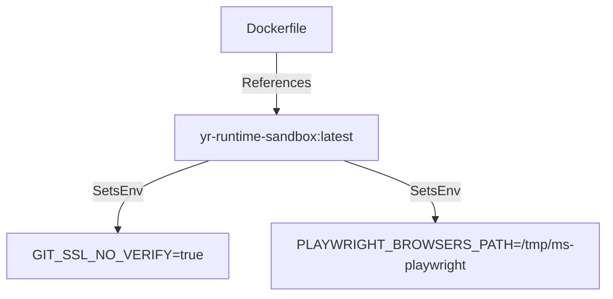
Sources: `images/Dockerfile` [images/Dockerfile:1-14]()

---

## System Dependencies and CJK Font Provisioning
To support headless rendering, document generation, and parsing utilities, the container installs core system libraries via `dnf`. DNF configuration is explicitly modified to disable SSL verification (`sslverify=0`) to accommodate internal mirror repositories [images/Dockerfile:16-23]().

Furthermore, Chinese typography rendering is enabled by provisioning `google-noto-sans-cjk-sc-fonts` and refreshing the font cache with `fc-cache -f` [images/Dockerfile:25-32](). Font availability is validated during build time using `fc-list` [images/Dockerfile:34-36]().

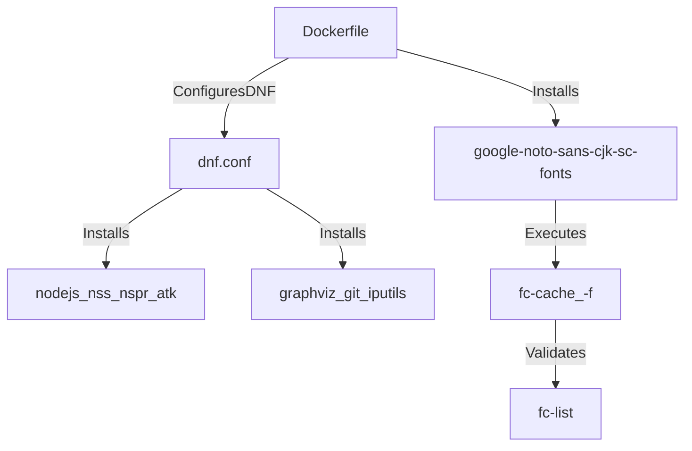
Sources: `images/Dockerfile` [images/Dockerfile:15-37]()

---

## Node.js Engine and Dependency Management
The `html2pptx` conversion engine relies on a Node.js CommonJS environment established under `/opt/html2pptx` [images/Dockerfile:39-40](). 

The container copies `package.json` [images/package.json:1-20]() and `package-lock.json` [images/package-lock.json:1-185](), then executes an exact dependency installation utilizing the Huawei Cloud npm mirror [images/Dockerfile:38-46]():
* Core dependencies defined in `package.json` [images/package.json:13-19]() include `fast-glob`, `minimist`, `playwright` (`^1.57.0`), `pptxgenjs` (`^4.0.1`), and `sharp` (`^0.34.5`).
* Additional auxiliary packages (`katex@0.18.4` and `docx@9.7.1`) are explicitly installed via `--no-save` [images/Dockerfile:45-45]().
* `NODE_PATH` is set to `/opt/html2pptx/node_modules` to ensure module resolution paths are globally accessible [images/Dockerfile:40-40]().

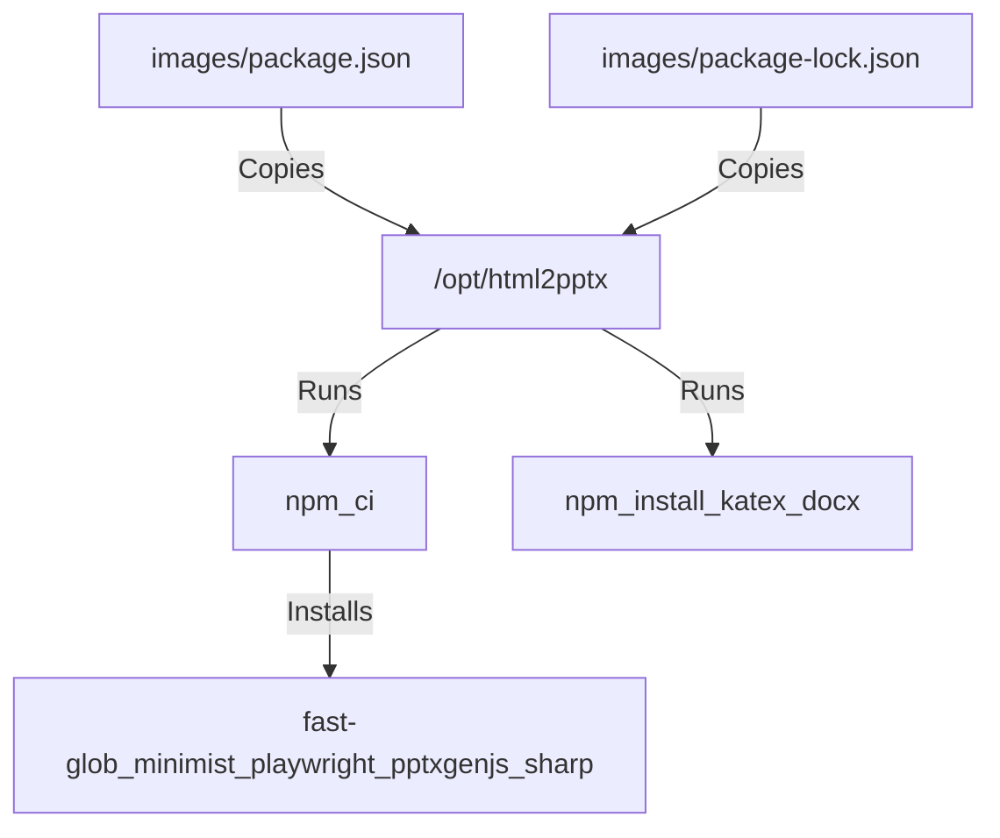
Sources: `images/Dockerfile` [images/Dockerfile:38-47](), `images/package.json` [images/package.json:1-20](), `images/package-lock.json` [images/package-lock.json:1-185]()

---

## Playwright Browser Provisioning
To avoid version mismatches between the Node.js runtime and Python-side quality control (QC) rendering, the container provisions two distinct revisions of Chromium using a dedicated python helper script, `images/download_playwright_browsers.py` [images/download_playwright_browsers.py:1-69]().

### Revision Isolation Strategy
* **Revision 1200**: Associated with the Node.js side Playwright 1.57.0 engine utilized by `html2pptx` [images/download_playwright_browsers.py:20-20]().
* **Revision 1234**: Associated with the Python-side Playwright/Patchright QC rendering engine [images/download_playwright_browsers.py:21-21]().

The script `download_playwright_browsers.py` downloads Linux ARM64 builds (`chromium-linux-arm64.zip` and `chromium-headless-shell-linux-arm64.zip`) from `cdn.npmmirror.com`, extracts them into isolated revision subfolders under `/tmp/ms-playwright/`, and updates binary execution permissions (`+x`) [images/download_playwright_browsers.py:35-64]().

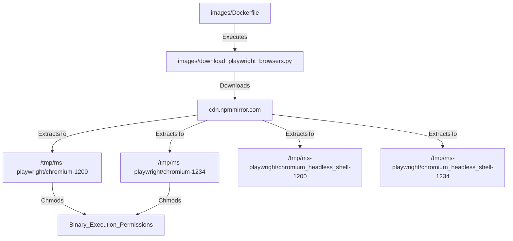
Sources: `images/Dockerfile` [images/Dockerfile:48-51](), `images/download_playwright_browsers.py` [images/download_playwright_browsers.py:1-69]()

---

## Python Runtime Packages
Python dependencies are installed via `pip3` configured to use the Huawei Cloud PyPI mirror index [images/Dockerfile:53-64](). The pinned packages cover document processing, web parsing, PDF manipulation, rendering, and scientific plotting:
* Document and PDF libraries: `python-pptx`, `pypdf`, `pdfplumber`, `pymupdf`, `markitdown`, `PyPDF2`, `python-docx`, `openpyxl`, `reportlab`, `pdfkit` [images/Dockerfile:55-61]().
* Automation and Scraping: `requests`, `firecrawl-anydoc`, `playwright==1.62.0`, `patchright==1.62.3`, `scrapling[rag]==0.4.15`, `fake-useragent`, `imapclient`, `PySocks` [images/Dockerfile:55-62]().
* Markdown, Math, and Graphing: `markdown-it-py`, `markdown`, `matplotlib==3.11.1`, `pandas==3.0.5`, `graphviz==0.21`, `latex2mathml==3.81.0`, `Pillow` [images/Dockerfile:56-62]().

Following installation, the pip cache is purged to optimize container image footprint [images/Dockerfile:63-63]().

Sources: `images/Dockerfile` [images/Dockerfile:53-65]()

---

# Page: Deployment Orchestration

# Deployment Orchestration

<details>
<summary>Relevant source files</summary>

The following files were used as context for generating this wiki page:

- [deploy/README.zh.md](deploy/README.zh.md)
- [deploy/agentos.sh](deploy/agentos.sh)

</details>


This page provides an overview of the deployment orchestration layer located in `deploy/`. The orchestrator is built around a pluggable architecture driven by `deploy/agentos.sh` [deploy/agentos.sh:6-15](), managing module lifecycles, configuration parsing via Python utilities, dependency provisioning, and multi-node coordination. 

For deep technical details on individual aspects, refer to the child pages:
- [agentos.sh CLI and Hook Dispatch](#3.1)
- [Cluster Configuration](#3.2)
- [Host Dependency Installation](#3.3)
- [Multi-Node Deployment](#3.4)
- [Writing a New Deploy Module](#3.5)

---

## agentos.sh CLI and Hook Dispatch

The core entry point for orchestrating the platform is `deploy/agentos.sh` [deploy/agentos.sh:1-27](). It implements a pluggable hook architecture where each component registers itself in the `MODULES` array [deploy/agentos.sh:36-36](). The script loads each module's `module.sh` script via `load_modules()` [deploy/agentos.sh:103-114]() and delegates commands (`up`, `down`, `install`, `uninstall`, `init`, `deinit`, `status`) to individual hook functions.

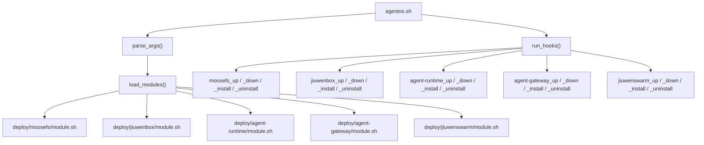
*Figure 1: Orchestration Flow and Hook Dispatch Architecture*

Sources: [deploy/agentos.sh:36-168](), [deploy/README.zh.md:51-78]()

For details on command line arguments, ordering semantics, pre-flight checks, and status reporting, see [agentos.sh CLI and Hook Dispatch](#3.1).

---

## Cluster Configuration

Cluster-wide topology is defined in `deploy/config.yaml` [deploy/README.zh.md:25-25]() and parsed through helper utilities in `deploy/scripts/config.py` [deploy/README.zh.md:47-48](). The configuration specifies `etcd_nodes`, `master_nodes`, and the `ingress_virtual_ip` [deploy/README.zh.md:108-119](). 

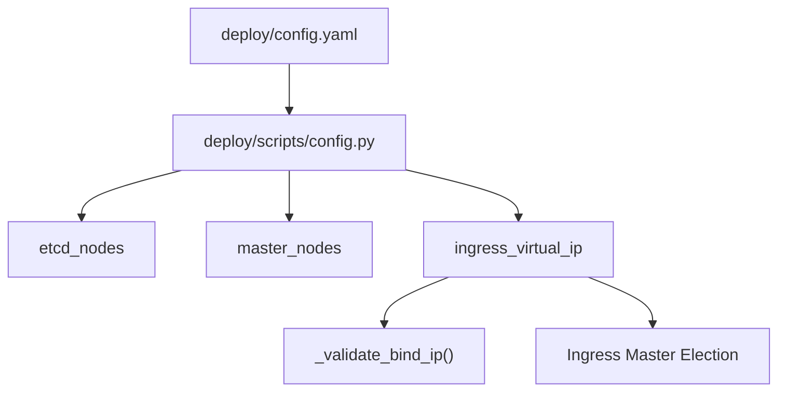
*Figure 2: Configuration Parsing and Ingress Master Resolution*

Sources: [deploy/agentos.sh:87-100](), [deploy/README.zh.md:101-147]()

For details on the `config.yaml` schema, python parser logic, bind IP validation, and ingress master election mechanics, see [Cluster Configuration](#3.2).

---

## Host Dependency Installation

Before executing module installation hooks, host environments must satisfy operating system, network, and package dependencies. The installation helper scripts inspect the target OS architecture (openEuler/Ubuntu), provision required RPMs/DEBs, set up MooseFS repositories, and configure runtime Python virtual environments.

Sources: [deploy/README.zh.md:83-91]()

For details on OS detection, package provisioning, and dependency scripts, see [Host Dependency Installation](#3.3).

---

## Multi-Node Deployment

Deploying across multiple nodes requires coordinating shared states, distributing SSH direct-connection keys [deploy/README.zh.md:148-160](), aligning etcd consensus topologies [deploy/README.zh.md:125-128](), and managing virtual IP (VIP) failover for ingress master nodes [deploy/README.zh.md:134-136]().

Sources: [deploy/README.zh.md:121-160]()

For step-by-step procedures, considerations for multi-node setups, and HA routing rules, see [Multi-Node Deployment](#3.4).

---

## Writing a New Deploy Module

Extending AgentOS with a new component follows a strict contract. A developer must create a new subdirectory under `deploy/` containing a `module.sh` file that implements the mandatory hook functions (`_install`, `_up`, `_down`, `_uninstall`, `_status`) and register the module name in the `MODULES` array [deploy/agentos.sh:12-15]().

Sources: [deploy/agentos.sh:5-15](), [deploy/README.zh.md:5-17]()

For instructions on creating and testing custom deploy modules, see [Writing a New Deploy Module](#3.5).

---

# Page: agentos.sh CLI and Hook Dispatch

# agentos.sh CLI and Hook Dispatch

<details>
<summary>Relevant source files</summary>

The following files were used as context for generating this wiki page:

- [deploy/agentos.sh](deploy/agentos.sh)
- [docs/en/reference/agentos-commands.md](docs/en/reference/agentos-commands.md)
- [docs/zh/reference/agentos-commands.md](docs/zh/reference/agentos-commands.md)

</details>


## Purpose and Scope

This page documents `deploy/agentos.sh`, the unified deployment orchestrator for AgentOS Enterprise. It details the command-line interface (CLI) commands, the pluggable module hook contract, execution ordering (forward vs. reverse), pre-flight network validation, and status rendering.

`deploy/agentos.sh` loads component module definitions from `deploy/<module>/module.sh` and coordinates their lifecycles according to a declared sequence [deploy/agentos.sh:5-15].

Sources: `deploy/agentos.sh:1-215` [deploy/agentos.sh:1-215]

---

## CLI Commands and Lifecycle Architecture

The orchestrator structures operations into three nested pairs of inverse commands, operating similarly to brackets [docs/en/reference/agentos-commands.md:5-13]:

```
install  ↔  uninstall     (outermost: Python wheel provisioning)
  init   ↔  deinit        (middle: etcd metadata store bootstrap/teardown)
    up   ↔  down          (innermost: application service processes)
```

The CLI supports the following commands processed by `parse_args()` [deploy/agentos.sh:174-206]:

| Command | Description | Code / Delegation |
| :--- | :--- | :--- |
| `install` | Installs all component wheels and persists the deployment directory to `~/.agentos/` [docs/en/reference/agentos-commands.md:25]. | `_persist_deploy_dir()` [deploy/agentos.sh:211-215] |
| `init` | Bootstraps etcd metadata storage [docs/en/reference/agentos-commands.md:26]. | Delegates to `etcd.sh up` [deploy/agentos.sh:32-33] |
| `up` | Deploys all application components in declaration order [docs/en/reference/agentos-commands.md:27]. | `run_hooks "up"` [deploy/agentos.sh:131-168] |
| `down` | Stops all application components in reverse order [docs/en/reference/agentos-commands.md:28]. | `run_hooks "down"` [deploy/agentos.sh:131-168] |
| `restart` | Restarts application components (`down` followed by `up`) [docs/en/reference/agentos-commands.md:29]. | Composite command |
| `status` | Probes running status across all modules and etcd [docs/en/reference/agentos-commands.md:30]. | Module `status` probes |
| `deinit` | Stops etcd and removes its systemd unit [docs/en/reference/agentos-commands.md:31]. | Delegates to `etcd.sh down` [deploy/agentos.sh:32-33] |
| `uninstall` | Uninstalls component wheels, aggregating failures [docs/en/reference/agentos-commands.md:32]. | `run_hooks "uninstall"` [deploy/agentos.sh:131-168] |

```mermaid
graph TD
  User["User CLI Command"] --> parse_args["parse_args()"]
  parse_args -->|install| InstallWhels["Install Python Wheels & _persist_deploy_dir()"]
  parse_args -->|init| InitEtcd["etcd.sh up"]
  parse_args -->|up| RunUp["run_hooks up"]
  parse_args -->|down| RunDown["run_hooks down"]
  parse_args -->|restart| RunRestart["down followed by up"]
  parse_args -->|status| RunStatus["Query Module Status Probes"]
  parse_args -->|deinit| DeinitEtcd["etcd.sh down"]
  parse_args -->|uninstall| RunUninstall["run_hooks uninstall"]

  subgraph CodeEntitySpace["Code Entity Space"]
    parse_args
    InstallWhels
    InitEtcd
    RunUp
    RunDown
    RunStatus
    DeinitEtcd
    RunUninstall
  end
  
  subgraph NaturalLanguageSpace["Natural Language Space"]
    User
  end

  Sources: deploy/agentos.sh:131-215, docs/en/reference/agentos-commands.md:17-33
```
Sources: `deploy/agentos.sh:174-215`, `docs/en/reference/agentos-commands.md:5-33` [deploy/agentos.sh:174-215, docs/en/reference/agentos-commands.md:5-33]

---

## Module Ordering and Hook Dispatch Mechanics

Component modules are registered statically in the `MODULES` array [deploy/agentos.sh:36]:

```bash
MODULES=("moosefs" "jiuwenbox" "agent-runtime" "agent-gateway" "jiuwenswarm")
```

The function `load_modules()` iterates through `MODULES`, sourcing each module's `module.sh` configuration [deploy/agentos.sh:103-114]:
* **Forward Dispatch (`install`, `up`)**: Executes modules in forward declaration order [deploy/agentos.sh:16-19].
* **Reverse Dispatch (`down`, `uninstall`)**: Reverses the module array via `reverse_modules()` to ensure clean teardown (innermost components stopped before storage/infrastructure) [deploy/agentos.sh:16-20, 117-124].

```mermaid
graph TD
  Start["run_hooks hook"] --> CheckHook{"hook == down or uninstall?"}
  CheckHook -->|Yes| Rev["reverse_modules()"]
  CheckHook -->|No| Fwd["MODULES array"]
  Rev --> Loop["Iterate over module list"]
  Fwd --> Loop
  Loop --> CheckFn["declare -f mod_hook"]
  CheckFn -->|Exists| Exec["Execute mod_hook EXTRA_ARGS"]
  CheckFn -->|Not Found| Skip["Warning & Skip"]
  Exec --> SuccessCheck{"Success?"}
  SuccessCheck -->|Yes| Next["Proceed to next module"]
  SuccessCheck -->|No & Uninstall| RecordErr["error_noexit & HOOK_FAILED_MODULES"]
  SuccessCheck -->|No & Other Hooks| Fail["error and exit"]

  Sources: deploy/agentos.sh:36, deploy/agentos.sh:103-168
```
Sources: `deploy/agentos.sh:36`, `deploy/agentos.sh:103-168` [deploy/agentos.sh:36, deploy/agentos.sh:103-168]

---

## Pre-flight Checks and Network Binding (`--ip`)

When deploying across multi-NIC hosts, `agentos.sh` accepts a `--ip` parameter to anchor all component binding configurations [deploy/agentos.sh:41-45]:
1. **IP Validation (`_validate_bind_ip`)**: Verifies that the specified `BIND_IP` matches one of the local interface addresses discovered by `_get_local_ips()` [deploy/agentos.sh:62-100].
2. **Fallback Logic**: `_get_local_ips()` probes `hostname -I`, `ip -4 addr show`, `/etc/hosts`, and `ifconfig` sequentially [deploy/agentos.sh:62-84].
3. **Environment Propagation**: Once validated, `BIND_IP` is exported to the environment, enabling all sub-components to read the uniform IP address without re-validation [deploy/agentos.sh:41-45, 184-192].

Sources: `deploy/agentos.sh:41-100`, `deploy/agentos.sh:184-192` [deploy/agentos.sh:41-100, deploy/agentos.sh:184-192]

---

## Status Table Rendering and Error Resilience

* **Error Resilience in Uninstall**: Unlike `up` or `install` which abort immediately upon encountering an error, `uninstall` executes with `error_noexit()` to attempt unloading all modules [deploy/agentos.sh:57-58, 127-166]. Failed modules are collected into `HOOK_FAILED_MODULES` and reported at the end [deploy/agentos.sh:129-162].
* **State Persistence**: During `install`, `_persist_deploy_dir()` copies the entire `deploy/` directory to `~/.agentos/deploy` so that subsequent management operations (`up`, `down`, `uninstall`) function correctly even if the original extraction directory is removed [deploy/agentos.sh:208-215].

Sources: `deploy/agentos.sh:57-58`, `deploy/agentos.sh:127-215` [deploy/agentos.sh:57-58, deploy/agentos.sh:127-215]

---

# Page: Cluster Configuration

# Cluster Configuration

<details>
<summary>Relevant source files</summary>

The following files were used as context for generating this wiki page:

- [OPEN_SOURCE_SOFTWARE_NOTICE.md](OPEN_SOURCE_SOFTWARE_NOTICE.md)
- [deploy/check-ingress-master.sh](deploy/check-ingress-master.sh)
- [deploy/conch/conch_deploy.sh](deploy/conch/conch_deploy.sh)
- [deploy/conch/module.sh](deploy/conch/module.sh)
- [deploy/config.yaml](deploy/config.yaml)
- [deploy/scripts/config.py](deploy/scripts/config.py)
- [docs/en/reference/cluster-config.md](docs/en/reference/cluster-config.md)
- [docs/zh/reference/cluster-config.md](docs/zh/reference/cluster-config.md)

</details>


## Purpose and Scope

This page details the cluster configuration architecture of AgentOS Enterprise. It covers the schema and semantics of `deploy/config.yaml`, the implementation details of the configuration parser and node role resolver (`deploy/scripts/config.py`), local IP binding mechanics, and the ingress master election gating mechanism implemented by `deploy/check-ingress-master.sh`.

---

## 1. Cluster Configuration Schema (`deploy/config.yaml`)

The AgentOS cluster topology is declared in `deploy/config.yaml` and is persisted to `~/.agentos/deploy/config.yaml` during the `install` phase `[docs/en/reference/cluster-config.md:5-7]()`. It defines three core topological fields under the `cluster` root section `[deploy/config.yaml:11-21]()`:

- `etcd_nodes`: A list of strings representing IP addresses of the etcd consensus store nodes. In a single-node deployment, this contains a single entry (`127.0.0.1` or a LAN IP); high-availability (HA) setups typically use 3 nodes to maintain Raft quorum `[docs/en/reference/cluster-config.md:9-11]`.
- `master_nodes`: A list of IP addresses designated as master nodes (1 for single-node, 2 for HA setups) `[docs/en/reference/cluster-config.md:12]()`. Core management and ingress components run exclusively on nodes holding the virtual IP.
- `ingress_virtual_ip`: A unified virtual IP (VIP) address that external-facing components (such as the agent gateway, registry, and web server) bind to `[docs/en/reference/cluster-config.md:13]()`.

All configured items must be reachable network addresses; using `127.0.0.1` restricts access to the local host, while `0.0.0.0` is explicitly disallowed `[docs/en/reference/cluster-config.md:15]()`.

```yaml
cluster:
  etcd_nodes:
    - "127.0.0.1"
  master_nodes:
    - "127.0.0.1"
  ingress_virtual_ip: "127.0.0.1"
```

Sources: [deploy/config.yaml:1-21](), [docs/en/reference/cluster-config.md:1-27]()

---

## 2. Configuration Parser and Role Derivation (`deploy/scripts/config.py`)

The `deploy/scripts/config.py` module acts as the single source of truth for loading cluster configurations, probing local network interfaces, and deriving node roles (`is_etcd_node` and `is_function_master`) for deployment scripts and systemd unit generators `[deploy/scripts/config.py:1-11]`.

### Key Functions and Classes

- `load_config(config_path: Path) -> dict`: Loads and validates the YAML configuration file `[deploy/scripts/config.py:117-141]()`. It attempts to use the standard `yaml` module (`PyYAML`), falling back to an internal two-stage line-based parser (`_parse_yaml_v2`) if PyYAML is unavailable `[deploy/scripts/config.py:48-130]()`. It validates the presence of `cluster`, `etcd_nodes`, `master_nodes`, and `ingress_virtual_ip` `[deploy/scripts/config.py:131-141]()`.
- `get_local_ip() -> str`: Determines the primary outbound IP address of the current node. It uses a multi-stage heuristic:
  1. Opens a UDP socket connected to an external routable address (`8.8.8.8:80`) to query the local socket name `[deploy/scripts/config.py:152-158]()`.
  2. Falls back to hostname-based lookup via `socket.gethostbyname(socket.gethostname())` `[deploy/scripts/config.py:161-164]()`.
  3. Defaults to `127.0.0.1` if all probes fail `[deploy/scripts/config.py:167]()`.
- `find_local_match_index(local_ip: str, ip_list: list) -> int`: Matches the local IP against a provided list, checking first for exact matches and then falling back to wildcard IPs (`127.0.0.1` and `0.0.0.0` defined in `WILDCARD_IPS`) to support single-node development profiles `[deploy/scripts/config.py:38-39]`, `[deploy/scripts/config.py:178-191]()`.
- `is_etcd_node(local_ip: str, cluster: dict) -> bool` and `is_function_master(local_ip: str, cluster: dict) -> bool`: Wrappers that evaluate whether the local node participates in the etcd cluster or acts as a function master based on matching indices `[deploy/scripts/config.py:194-200]()`.

```mermaid
graph TD
    sub5[""deploy/scripts/config.py""]
    A[""load_config()""] --> B[""yaml.safe_load()""]
    B --> C{""PyYAML Available?""}
    C -->|No| D[""_parse_yaml_v2()""]
    C -->|Yes| E[""Return Cluster Dict""]
    D --> E
    F[""get_local_ip()""] --> G[""UDP Socket Probe 8.8.8.8""]
    G --> H{""Success?""}
    H -->|No| I[""hostname Lookup""]
    H -->|Yes| J[""Return IP""]
    I --> J
    E --> K[""find_local_match_index()""]
    J --> K
    K --> L[""is_etcd_node() / is_function_master()""]
```
*Figure 1: Configuration Loading and Role Derivation Flow*

Sources: [deploy/scripts/config.py:1-203]()

---

## 3. Ingress Master Election and Gating (`deploy/check-ingress-master.sh`)

In distributed deployments, master-only components (such as `agent-gateway`) must only execute on the node currently holding the `ingress_virtual_ip`. AgentOS enforces this via `deploy/check-ingress-master.sh`, which is installed to `/usr/local/bin/agentos-check-ingress-master` and invoked as a systemd `ExecStartPre` directive `[deploy/check-ingress-master.sh:1-6]()`.

### Execution Flow and Logic

1. **Config Discovery**: Locates `~/.agentos/deploy/config.yaml`. If missing, execution succeeds to maintain backward compatibility with single-node installations `[deploy/scripts/config.py:12-18]()`.
2. **YAML Extraction**: Invokes Python with PyYAML to extract `cluster.ingress_virtual_ip`. If Python is unavailable, it falls back to a safe `grep` and `sed` pipeline that strips comments and whitespace `[deploy/check-ingress-master.sh:20-48]()`.
3. **Validation**: Validates that the parsed VIP conforms to standard IPv4 dot-decimal notation `[deploy/check-ingress-master.sh:56-60]()`.
4. **Interface Probing**: Checks whether the local network stack owns the VIP by inspecting `hostname -I` and `ip addr show` output `[deploy/check-ingress-master.sh:62-70]()`.
5. **Gating Result**: Exits with status `0` if the node holds the VIP (allowing the service to start); otherwise, exits with status `1` to abort systemd service startup `[deploy/check-ingress-master.sh:63-73]()`.

```mermaid
graph TD
    sub6[""deploy/check-ingress-master.sh""]
    A[""Systemd ExecStartPre""] --> B[""Check ~/.agentos/deploy/config.yaml""]
    B --> C{""File Exists?""}
    C -->|No| D[""Allow Start (Single-Node Compat)""]
    C -->|Yes| E[""Extract ingress_virtual_ip via Python/YAML""]
    E --> F{""VIP Configured?""}
    F -->|No| G[""Allow Start""]
    F -->|Yes| H[""Validate IPv4 Format""]
    H --> I{""Valid Format?""}
    I -->|No| J[""Refuse Start exit 1""]
    I -->|Yes| K[""Check hostname -I / ip addr show""]
    K --> L{""Node Holds VIP?""}
    L -->|Yes| M[""Allow Start exit 0""]
    L -->|No| J
```
*Figure 2: Ingress Master Election Gating Mechanism*

Sources: [deploy/check-ingress-master.sh:1-73]()

---

# Page: Host Dependency Installation

# Host Dependency Installation

<details>
<summary>Relevant source files</summary>

The following files were used as context for generating this wiki page:

- [deploy/install_deps.sh](deploy/install_deps.sh)
- [deploy/jiuwenbox/module.sh](deploy/jiuwenbox/module.sh)
- [deploy/jiuwenswarm/module.sh](deploy/jiuwenswarm/module.sh)
- [deploy/requirements.txt](deploy/requirements.txt)

</details>


This page covers the technical implementation of host dependency provisioning in AgentOS Enterprise, centered on `deploy/install_deps.sh`. The script ensures that target nodes running openEuler or Ubuntu are prepared with the required system utilities, kernel capabilities, MooseFS distributed storage components, and Python runtime packages before any AgentOS modules are deployed.

---

## 1. Operating System and Architecture Detection

Before provisioning packages, `install_deps.sh` executes pre-flight checks to determine the host operating system family, version code name, package manager (`dnf`, `yum`, or `apt-get`), and CPU architecture (`x86_64` or `aarch64`).

The detection process is managed by `detect_os()`, `parse_os_info()`, and `detect_arch()` functions. `/etc/os-release` is parsed as the primary source of truth, falling back to `/etc/openEuler-release` or `/etc/lsb-release` if necessary.

```mermaid
graph TD
    A["Start detect_os"] --> B{[/etc/os-release exists?]}
    B -- Yes --> C["Extract ID, VERSION_ID, VERSION_CODENAME"]
    B -- No --> D{[/etc/openEuler-release exists?]}
    D -- Yes --> E["Set os_type=openEuler, parse version"]
    D -- No --> F{[/etc/lsb-release exists?]}
    F -- Yes --> G["Set os_type=ubuntu, parse release/codename"]
    
    C --> H["Determine Package Manager (dnf/yum/apt)"]
    E --> H
    G --> H
    
    H --> I{Validate OS Support}
    I --> J["detect_arch (uname -m)"]
    J --> K["Return os_type|os_version|os_codename|pkg_mgr"]
```
*Diagram 1: OS and architecture detection flow mapping natural language environment attributes to shell functions.*

Sources: `[deploy/install_deps.sh:45-142]()`

---

## 2. System Package Provisioning

Once the environment is categorized, the script provisions baseline system utilities required by runtime components like `jiuwenbox` (sandbox isolation) and `agent-runtime` (JSON parsing and networking).

### openEuler Provisioning (`install_system_openeuler`)
On openEuler (specifically tested against versions 22.03 and 24.03), `install_system_openeuler()` installs:
* `iptables` and `curl`
* `fuse3` (for MooseFS and runtime mounts)
* `iproute` (providing the `ip` command)
* `bubblewrap` (or fallback `bwrap` for containerless sandboxing in `jiuwenbox`)
* `jq` (for parsing `session.json` and agent manifests)
* Python 3.11 (`python3.11`) and `ensurepip`

Sources: `[deploy/install_deps.sh:147-197]()`

### Ubuntu Provisioning (`install_system_ubuntu`)
On Ubuntu (versions 22.04 and 24.04), corresponding DEB packages are provisioned using `apt-get`, utilizing non-interactive frontend flags to suppress prompt dialogs during `tzdata` or system library updates.

Sources: `[deploy/install_deps.sh:200-260]()`

---

## 3. MooseFS Repository and Client Integration

AgentOS leverages MooseFS for distributed storage across cluster nodes. The dependency script configures the official MooseFS repository (pinning `MOOSEFS_VERSION="4.59.2"`) and installs client-side or server-side packages depending on the node's assigned role in `config.yaml`.

```mermaid
graph TD
    subgraph "Code Entity Space"
    A["install_deps.sh"] --> B["detect_os()"]
    B --> C["install_system_openeuler() / install_system_ubuntu()"]
    C --> D["install_moosefs()"]
    D --> E["install_python_deps()"]
    end

    subgraph "System Component Space"
    C -.-> S1["System Packages (bwrap, fuse3, jq, iproute)"]
    D -.-> S2["MooseFS Repos & moosefs-client"]
    E -.-> S3["Python Environment (requirements.txt)"]
    end
```
*Diagram 2: Bridging deployment orchestration steps in `install_deps.sh` to target system components.*

Sources: `[deploy/install_deps.sh:27-34](), [deploy/install_deps.sh:261-350]()`

---

## 4. Python Virtual Environment and Requirements Installation

AgentOS applications and services rely on a locked set of Python packages defined in `deploy/requirements.txt`. The `install_python_deps()` function ensures that `python${YR_PYTHON_VERSION}` (defaulting to version `3.11`) is active and populates dependencies via `pip`.

The `requirements.txt` file enumerates over 200 pinned packages including framework SDKs, agent toolkits, and telemetry exporters:

```text
a2a-sdk==1.1.2
fastapi==0.139.2
openjiuwen==0.1.16.post11
pydantic==2.13.4
uvicorn==0.51.0
...
```

Sources: `[deploy/requirements.txt:1-238](), [deploy/install_deps.sh:351-420]()`

---

## 5. Execution Flags and CLI Options

`install_deps.sh` supports selective execution flags to bypass specific installation phases during iterative testing or minimal deployments:

| Flag | Effect | Code Reference |
| :--- | :--- | :--- |
| `--skip-system` | Bypasses operating system package installation | `[deploy/install_deps.sh:32]()` |
| `--skip-moosefs` | Skips MooseFS repository configuration and client installation | `[deploy/install_deps.sh:33]()` |
| `--skip-python` | Skips updating or installing packages from `requirements.txt` | `[deploy/install_deps.sh:34]()` |

Sources: `[deploy/install_deps.sh:16-18](), [deploy/install_deps.sh:31-35]()`

---

# Page: Multi-Node Deployment

# Multi-Node Deployment

<details>
<summary>Relevant source files</summary>

The following files were used as context for generating this wiki page:

- [deploy/etcd.sh](deploy/etcd.sh)
- [docs/en/how-to/deploy-multi-node.md](docs/en/how-to/deploy-multi-node.md)
- [docs/zh/how-to/deploy-multi-node.md](docs/zh/how-to/deploy-multi-node.md)

</details>


This page details the procedures, architecture considerations, and lifecycle management for deploying AgentOS Enterprise across multiple nodes in a High Availability (HA) configuration. It covers topology planning, etcd consensus distribution, ingress Virtual IP (VIP) master election, and cross-node orchestration sequences.

## 1. Topology Planning and Cluster Roles

A multi-node AgentOS cluster distributes its workload across three specialized node classifications defined in the cluster configuration schema:

*   **etcd Nodes**: Must be configured with an odd number of nodes (recommended: 3) to ensure Raft consensus stability [docs/en/how-to/deploy-multi-node.md:7-9](). These nodes host the distributed coordination store managed by `deploy/etcd.sh` [deploy/etcd.sh:9-10]().
*   **Master Nodes**: Configured as primary/backup pairs (recommended: 2 nodes) [docs/en/how-to/deploy-multi-node.md:10](). Only the specific master node currently holding the `ingress_virtual_ip` initializes and runs the API gateway, registry, and web console.
*   **Worker/Agent Nodes**: All other components (such as `jiuwenbox` sandboxes and agent runtimes) run symmetrically across every node without primary/backup distinction [docs/en/how-to/deploy-multi-node.md:13]().

```mermaid
graph TD
    subgraph "ClusterConfiguration"
        Config["deploy/scripts/config.py"]
    end
    subgraph "NodeRoles"
        EtcdNode["etcd_nodes (Raft Consensus)"]
        MasterNode["master_nodes (Primary/Backup)"]
        VIP["ingress_virtual_ip"]
    end
    subgraph "ExecutionScripts"
        EtcdScript["deploy/etcd.sh"]
        AgentOS["deploy/agentos.sh"]
    end
    Config --> EtcdNode
    Config --> MasterNode
    Config --> VIP
    EtcdNode --> EtcdScript
    MasterNode --> AgentOS
    VIP --> MasterNode
```
*Sources: [deploy/etcd.sh:9-16](), [docs/en/how-to/deploy-multi-node.md:7-13]()*

---

## 2. Environment Preparation and Key Distribution

Before executing deployment scripts, all nodes require identical foundational environments and a shared SSH key pair for agent-to-agent communication.

1.  **System Dependencies**: Execute `deploy/install_deps.sh` on every node to provision OS packages and Python runtime environments [docs/en/how-to/deploy-multi-node.md:19-21]().
2.  **SSH Key Generation**: Generate a unified Ed25519 key pair on a primary machine and distribute it to `/root/.ssh/` on all target cluster nodes [docs/en/how-to/deploy-multi-node.md:23-37]():
    ```bash
    ssh-keygen -t ed25519 -N '' -f /root/.ssh/agent_key
    cp /root/.ssh/agent_key.pub /root/.ssh/agent_pub/authorized_keys
    ```

*Sources: [docs/en/how-to/deploy-multi-node.md:15-38]()*

---

## 3. Ingress VIP and Master Election Data Flow

High availability for external entrypoints relies on an `ingress_virtual_ip` bound directly to the active master node's network interface [docs/en/how-to/deploy-multi-node.md:10-11]().

```mermaid
sequenceDiagram
    participant Admin as "Administrator"
    participant NIC as "Master NIC (eth0)"
    participant AgentOS as "deploy/agentos.sh"
    participant Registry as "Agent Gateway / Registry"

    Admin->>NIC: ip addr add 192.168.100.200/24 dev eth0
    Note over NIC: Local interface holds VIP -> Ingress Master Elected
    Admin->>AgentOS: bash deploy/agentos.sh up
    AgentOS->>NIC: Check if local IP/NIC matches ingress_virtual_ip
    alt NIC holds VIP
        AgentOS->>Registry: Start gateway, registry, and web services
    else NIC does NOT hold VIP
        AgentOS->>Registry: Skip ingress services (status: n/a standby)
    end
```
*Sources: [docs/en/how-to/deploy-multi-node.md:40-49]()*

---

## 4. etcd Topology and Raft Consensus Implementation

The etcd coordination subsystem is managed independently via `deploy/etcd.sh` [deploy/etcd.sh:6-10](). It parses cluster configurations and generates systemd units dynamically on designated etcd nodes.

### Unit Generation and State Management
The function `_yr_generate_etcd_unit()` detects whether the local data directory [deploy/etcd.sh:26]() contains existing WAL logs (`/member`) [deploy/etcd.sh:134](). It then sets the `--initial-cluster-state` flag accordingly [deploy/etcd.sh:124-140]():
*   If `${AGENT_RUNTIME_ETCD_DATA_DIR}/member` exists, `cluster_state="existing"` is used to preserve data across restarts [deploy/etcd.sh:134-136]().
*   If the directory is empty, `cluster_state="new"` triggers a clean bootstrap [deploy/etcd.sh:137-140]().

Key network parameters injected into `/etc/systemd/system/agentos-etcd.service` [deploy/etcd.sh:24-25]() include:
*   Client URL Listener: `http://0.0.0.0:32379` (Advertised via node-specific IP) [deploy/etcd.sh:163-164]()
*   Peer URL Listener: `http://0.0.0.0:32380` [deploy/etcd.sh:165-166]()

```mermaid
flowchart TD
    Start([etcd.sh up]) --> CheckBin["_yr_etcd_bin_path()"]
    CheckBin --> DeriveCfg["_yr_cfg etcd-name / initial-cluster"]
    DeriveCfg --> CheckData{Exists /member?}
    CheckData -- Yes --> StateExisting["Set cluster-state=existing"]
    CheckData -- No --> StateNew["Set cluster-state=new"]
    StateExisting --> GenUnit["Generate /etc/systemd/system/agentos-etcd.service"]
    StateNew --> GenUnit
    GenUnit --> Systemd["systemctl enable --now agentos-etcd"]
    Systemd --> HealthCheck["Probe client port 32379"]
```
*Sources: [deploy/etcd.sh:59-178]()*, [docs/en/how-to/deploy-multi-node.md:9]*

---

## 5. Step-by-Step Execution Lifecycle

Multi-node deployment requires strict sequencing across nodes to satisfy etcd consensus and ingress master dependencies before orchestrating service startup [docs/en/how-to/deploy-multi-node.md:66-80]().

1.  **Installation**: Run `bash deploy/agentos.sh install` on all cluster nodes [docs/en/how-to/deploy-multi-node.md:71]().
2.  **Coordination Initialization**: Execute `bash deploy/agentos.sh init` on all etcd nodes. Do not proceed until the entire etcd ring reaches consensus [docs/en/how-to/deploy-multi-node.md:73-74]().
3.  **Service Startup (`up`)**:
    *   Start the primary master node holding the VIP first: `bash deploy/agentos.sh up --ip <master-ip>` [docs/en/how-to/deploy-multi-node.md:76-77]().
    *   Start remaining agent and backup nodes sequentially [docs/en/how-to/deploy-multi-node.md:76-77]().
4.  **Teardown**: Perform the reverse order (`down` on agent nodes, then master nodes; `deinit` on etcd nodes; `uninstall` cluster-wide) [docs/en/how-to/deploy-multi-node.md:86-93]().

*Sources: [docs/en/how-to/deploy-multi-node.md:66-93]()*

---

# Page: Writing a New Deploy Module

# Writing a New Deploy Module

<details>
<summary>Relevant source files</summary>

The following files were used as context for generating this wiki page:

- [CONTRIBUTING.md](CONTRIBUTING.md)
- [deploy/moosefs/module.sh](deploy/moosefs/module.sh)
- [docs/en/how-to/add-deploy-module.md](docs/en/how-to/add-deploy-module.md)
- [docs/zh/how-to/add-deploy-module.md](docs/zh/how-to/add-deploy-module.md)

</details>


This page details the module hook convention (`_install`, `_up`, `_down`, `_uninstall`, `_status`) implemented in `deploy/agentos.sh` and outlines the exact steps required to integrate a new component into the AgentOS Enterprise deployment framework [docs/zh/how-to/add-deploy-module.md:1-3]().

---

## 1. Architectural Overview of Deploy Modules

AgentOS Enterprise relies on a "module registration + hook functions + scheduling engine" design pattern located inside `deploy/agentos.sh` [docs/zh/how-to/add-deploy-module.md:3](). Under this architecture, the central orchestrator requires zero modification when adding or removing secondary subsystems. Each distinct component provides an isolated directory containing a standard `module.sh` interface script [docs/zh/how-to/add-deploy-module.md:7]().

The orchestrator discovers these modules by sourcing each component's `module.sh` file and querying or executing its hook functions in a strict, deterministic sequence:
- **Forward execution order** (`install`, `up`): Modules are initialized from the first element in the registration array to the last [docs/zh/how-to/add-deploy-module.md:12-28,46-50]().
- **Reverse execution order** (`uninstall`, `down`): Modules are stopped and uninstalled from the last element down to the first [docs/zh/how-to/add-deploy-module.md:17-34,50]().

```mermaid
graph TD
    A["agentos.sh CLI"] --> B["Module Orchestrator Engine"]
    B --> C["Load MODULES Array from agentos.sh"]
    C --> D["Source deploy/mymodule/module.sh"]
    
    subgraph "Forward Flow (up / install)"
        D --> E["mymodule_install()"]
        E --> F["mymodule_up()"]
    end

    subgraph "Reverse Flow (down / uninstall)"
        D --> G["mymodule_down()"]
        G --> H["mymodule_uninstall()"]
    end

    classDef default stroke:#333,fill:#fff;
```
*Sources: [docs/zh/how-to/add-deploy-module.md:3-50](), [deploy/moosefs/module.sh:1-36]()*

---

## 2. Step-by-Step Integration Procedure

Adding a new component involves two primary tasks: creating the module definition structure and registering the module name with the orchestration array [docs/zh/how-to/add-deploy-module.md:3]().

### Step 1: Create the Module Directory and `module.sh`

Create a new directory under the `deploy/` path named with kebab-case (e.g., `deploy/mymodule/`), and place a `module.sh` file inside it [CONTRIBUTING.md:27](), [docs/zh/how-to/add-deploy-module.md:7](). 

The module must implement a subset of standard hook functions matching the naming convention `<module_name>_<hook>` [docs/zh/how-to/add-deploy-module.md:81](). Below is a fully realized reference implementation:

```bash
# deploy/mymodule/module.sh

# Internal helper pattern
_mymodule_run() {
    local script="${SCRIPT_DIR}/mymodule/deploy_mymodule.sh"
    if [ ! -f "${script}" ]; then
        error "deploy script not found: ${script}"
    fi
    bash "${script}" "$@"
}

# Start lifecycle hook (called in declaration order on up / restart)
mymodule_up() {
    _mymodule_run up "$@"
}

# Stop lifecycle hook (called in reverse order on down / restart)
mymodule_down() {
    _mymodule_run down "$@"
}

# Python package installation hook (called on install)
mymodule_install() {
    local found_whl
    found_whl=$(ls "${AGENTOS_ROOT}"/mymodule-*.whl 2>/dev/null || true)
    if [ -n "${found_whl}" ]; then
        bash -c "python${YR_PYTHON_VERSION} -m pip install '${found_whl}' --quiet"
    fi
}

# Python package uninstallation hook (called in reverse order on uninstall)
mymodule_uninstall() {
    bash -c "python${YR_PYTHON_VERSION} -m pip uninstall -y mymodule 2>/dev/null" || true
}

# Read-only status probe hook (returns pipe-delimited data for status tables)
mymodule_status() {
    echo "mymodule|mymodule.service|running|active"
}
```
*Sources: [docs/zh/how-to/add-deploy-module.md:9-40](), [deploy/moosefs/module.sh:1-36]()*

### Step 2: Register in the `MODULES` Array

Open `deploy/agentos.sh` and append your module string to the global `MODULES` array in the desired dependency order [docs/zh/how-to/add-deploy-module.md:42-48](). 

```bash
# Inside deploy/agentos.sh
MODULES=("moosefs" "jiuwenbox" "yuanrong" "agent-gateway" "jiuwenswarm" "mymodule")
```
*Sources: [docs/zh/how-to/add-deploy-module.md:46-48]()*

---

## 3. Hook Convention Contract

Every hook function operates under strict interface contracts. If a hook function is omitted, the framework gracefully skips it with a warning message without aborting execution—except for `status`, which falls back to a `"not supported"` placeholder row [docs/zh/how-to/add-deploy-module.md:62]().

| Hook Function | Invocation Trigger | Direction | Argument Handling | Primary Responsibility |
| :--- | :--- | :--- | :--- | :--- |
| `<module>_up` | `agentos.sh up` / `restart` | Forward | Passed through | Initialize resources, start systemd units or processes [docs/zh/how-to/add-deploy-module.md:56](). |
| `<module>_down` | `agentos.sh down` / `restart` | Reverse | Passed through | Gracefully stop processes and tear down volatile resources [docs/zh/how-to/add-deploy-module.md:57](). |
| `<module>_install` | `agentos.sh install` | Forward | Passed through | Discover and pip-install `.whl` files from the root package distribution [docs/zh/how-to/add-deploy-module.md:58](). |
| `<module>_uninstall`| `agentos.sh uninstall` | Reverse | Passed through | Remove installed Python assets and clean local configuration [docs/zh/how-to/add-deploy-module.md:59](). |
| `<module>_status` | `agentos.sh status` | Forward | None | Echo status string format: `module|service|state|detail` [docs/zh/how-to/add-deploy-module.md:60](). |

*Sources: [docs/zh/how-to/add-deploy-module.md:52-62]()*

### Status Output Formatting Contract
The `_status` hook must write a single formatted string to stdout [docs/zh/how-to/add-deploy-module.md:36](). The orchestrator parses this pipeline-delimited output to render the administrative summary table:

```
<module_name>|<service_identifier>|<state_keyword>|<detail_message>
```
Where `<state_keyword>` must evaluate to one of: `running`, `stopped`, `failed`, `disabled`, or `N/A` [docs/zh/how-to/add-deploy-module.md:60]().

---

## 4. Execution Data Flow and Context Variables

When `agentos.sh` executes a hook, it injects a set of pre-configured global variables and helper functions into the shell environment. These can be consumed directly inside `module.sh` or its associated shell scripts [docs/zh/how-to/add-deploy-module.md:64-67]().

```mermaid
sequenceDiagram
    participant CLI as agentos.sh
    participant MOD as deploy/mymodule/module.sh
    participant SCRIPT as deploy_mymodule.sh

    Note over CLI,MOD: Sourced with global context (AGENTOS_ROOT, SCRIPT_DIR, etc.)
    CLI->>MOD: mymodule_up(extra_args)
    activate MOD
    MOD->>SCRIPT: bash deploy_mymodule.sh up extra_args
    activate SCRIPT
    Note over SCRIPT: Performs mounts, starts services, logs via info/error
    SCRIPT-->>MOD: Exit code 0 / non-zero
    deactivate SCRIPT
    MOD-->>CLI: Return execution status
    deactivate MOD
```
*Sources: [docs/zh/how-to/add-deploy-module.md:12-40,64-77]*

### Environment Context Variables

- `SCRIPT_DIR`: Absolute path pointing directly to the `deploy/` workspace directory [docs/zh/how-to/add-deploy-module.md:70]().
- `AGENTOS_ROOT`: Absolute path of the main agentos distribution root, used for locating binary or wheel dependencies [docs/zh/how-to/add-deploy-module.md:71]().
- `YR_PYTHON_VERSION`: Target Python runtime version string (defaults to `3.11`) [docs/zh/how-to/add-deploy-module.md:72]().
- `BIND_IP`: Local binding IP address specified via `--ip` for multi-NIC environments (empty if dynamic auto-detection is preferred) [docs/zh/how-to/add-deploy-module.md:73]().
- `AGENTOS_SSH_KEY`: File path to the secure agent shell connection private key (defaults to `/root/.ssh/agent_key`) [docs/zh/how-to/add-deploy-module.md:74]().
- `AGENTOS_SSH_BACKEND_PUBLIC_DIR`: Directory path storing agent SSH public keys (defaults to `/root/.ssh/agent_pub`) [docs/zh/how-to/add-deploy-module.md:75]().
- Logging functions available in scope: `info`, `success`, `warning`, `error` [docs/zh/how-to/add-deploy-module.md:76]().

---

## 5. Development and Naming Conventions

To keep modules clean and maintainable, adhere to the following repository standards:

1. **Naming Conventions**:
   - Module folder names must use lowercase alphanumeric characters and hyphens (`kebab-case`, e.g., `agent-gateway`, `mymodule`) [CONTRIBUTING.md:27](), [docs/zh/how-to/add-deploy-module.md:80]().
   - Hook functions must be strictly prefixed with the module name: `<module_name>_<hook>` [docs/zh/how-to/add-deploy-module.md:81]().
   - Internal helper routines inside `module.sh` should be prefixed with an underscore (`_`) to prevent namespace collisions with other modules [docs/zh/how-to/add-deploy-module.md:82]().

2. **Shell Script Safety**:
   - All scripts should begin with `#!/usr/bin/env bash` and enforce strict error control options (`set -euo pipefail`) [CONTRIBUTING.md:26]().

3. **Validation**:
   - Before submitting changes, run system checks via `./ci/run_ci.sh` and perform a clean single-node deployment test [CONTRIBUTING.md:14-22]().

*Sources: [CONTRIBUTING.md:14-29](), [docs/zh/how-to/add-deploy-module.md:80-84]()*

---

# Page: Platform Components

# Platform Components

<details>
<summary>Relevant source files</summary>

The following files were used as context for generating this wiki page:

- [deploy/agentos.sh](deploy/agentos.sh)

</details>


This section provides a high-level overview of the deployed subsystems and architectural components that comprise AgentOS Enterprise. The platform follows a modular, pluggable architecture orchestrated by the deployment framework (`[deploy/agentos.sh:1-37]()`). Each component is managed via independent lifecycle scripts and systemd integrations.

For detailed technical references, configuration parameters, and deep dives, refer to the respective child pages:
- [etcd Coordination Store](#4.1)
- [MooseFS Distributed Storage](#4.2)
- [JiuwenSwarm Gateway and Web](#4.3)
- [JiuwenBox Sandbox Runtime](#4.4)
- [Agent Gateway (A2X Registry)](#4.5)
- [Agent Runtime and Conch](#4.6)

---

## 4.1 etcd Coordination Store

The etcd coordination store acts as the distributed key-value backbone for cluster state, service discovery, and configuration synchronization across AgentOS nodes. It is managed independently via `[deploy/etcd.sh]()`, which handles binary lifecycle management, systemd unit generation, health verification, and data cleanup routines.

For details, see [etcd Coordination Store](#4.1).

Sources: `[deploy/agentos.sh:32-33]()`, `[deploy/etcd.sh:1-50]()`

---

## 4.2 MooseFS Distributed Storage

MooseFS provides the distributed network file system layer required for shared agent state, file artifacts, and distributed workspace persistence. Deployed via `[deploy/moosefs_deploy.sh]()` and configured via `[deploy/moosefs.conf]()`, the subsystem provisions master, chunkserver, and client roles, establishing FUSE mounts and health monitoring timers.

For details, see [MooseFS Distributed Storage](#4.2).

Sources: `[deploy/agentos.sh:36]()`, `[deploy/moosefs_deploy.sh:1-40]()`

---

## 4.3 JiuwenSwarm Gateway and Web

JiuwenSwarm delivers the core multi-agent execution framework, management web interface, and workflow gateway. It is governed by `[deploy/jiuwenswarm/module.sh]()`, handling Python wheel installations, systemd services, tool sandbox prerequisites, and status probing.

For details, see [JiuwenSwarm Gateway and Web](#4.3).

Sources: `[deploy/agentos.sh:36]()`, `[deploy/jiuwenswarm/module.sh:1-50]()`

---

## 4.4 JiuwenBox Sandbox Runtime

JiuwenBox provides secure, isolated execution environments for agent-driven code and tool invocation. Managed via `[deploy/jiuwenbox/module.sh]()` and `[deploy/jiuwenbox_deploy.sh]()`, the runtime configures listener modes (UDS/HTTP), systemd drop-ins, and strict container or bubblewrap security policies.

For details, see [JiuwenBox Sandbox Runtime](#4.4).

Sources: `[deploy/agentos.sh:36]()`, `[deploy/jiuwenbox/module.sh:1-40]()`

---

## 4.5 Agent Gateway (A2X Registry)

The Agent Gateway (`a2x-registry`) handles agent routing, external protocol translation, and ingress master gating. Orchestrated by `[deploy/agent-gateway/module.sh]()`, it integrates with etcd for service discovery and enforces TLS/mTLS security validation.

For details, see [Agent Gateway (A2X Registry)](#4.5).

Sources: `[deploy/agentos.sh:36]()`, `[deploy/agent-gateway/module.sh:1-40]()`

---

## 4.6 Agent Runtime and Conch

The Agent Runtime component deploys the OpenYuanRong runtime environment required for agent reasoning and execution loops. Coupled with the Conch virtualization and storage utility modules, it is managed via `[deploy/agent-runtime/module.sh]()`.

For details, see [Agent Runtime and Conch](#4.6).

Sources: `[deploy/agentos.sh:36]()`, `[deploy/agent-runtime/module.sh:1-40]()`

---

## Subsystem Relationships and Architecture

The platform components interact in a structured sequence during orchestration. The orchestrator script `[deploy/agentos.sh]()` defines the execution order via the `MODULES` array: MooseFS storage initialization, JiuwenBox sandbox provisioning, Agent Runtime setup, Agent Gateway registration, and JiuwenSwarm deployment (`[deploy/agentos.sh:36]()`).

Title: "AgentOS Platform Component Relationships and Code Entities"
```mermaid
graph TD
    subgraph "Orchestration Layer"
        AgentOS["agentos.sh"] --> Etcd["etcd.sh"]
        AgentOS --> LoadModules["load_modules()"]
    end

    subgraph "Subsystem Modules"
        LoadModules --> MooseFS["moosefs/module.sh"]
        LoadModules --> JiuwenBox["jiuwenbox/module.sh"]
        LoadModules --> AgentRuntime["agent-runtime/module.sh"]
        LoadModules --> AgentGateway["agent-gateway/module.sh"]
        LoadModules --> JiuwenSwarm["jiuwenswarm/module.sh"]
    end

    subgraph "Runtime & Storage Entities"
        MooseFS --> MFSClient["FUSE Mounts"]
        JiuwenBox --> Sandbox["JiuwenBox Runtime"]
        AgentRuntime --> YuanRong["OpenYuanRong Core"]
        AgentGateway --> Registry["a2x-registry"]
        JiuwenSwarm --> Gateway["Swarm Gateway"]
    end

    Etcd -.-> Registry
    Registry -.-> Gateway
    Sandbox -.-> YuanRong
```
Sources: `[deploy/agentos.sh:32-37]()`, `[deploy/agentos.sh:103-114]()`

---

# Page: etcd Coordination Store

# etcd Coordination Store

<details>
<summary>Relevant source files</summary>

The following files were used as context for generating this wiki page:

- [deploy/etcd.sh](deploy/etcd.sh)

</details>


## Purpose and Scope
The etcd Coordination Store subsystem manages the deployment, lifecycle, health monitoring, and cleanup of the distributed coordination store (`agentos-etcd`) used across AgentOS Enterprise `[deploy/etcd.sh:1-18]()`. It serves as the primary backbone for service discovery, leader election, and distributed metadata coordination for Jiuwen agent components `[deploy/etcd.sh:6-11]()`.

Sources: `[deploy/etcd.sh:1-18]()`

## etcd Script Lifecycle and Commands
The standalone script `deploy/etcd.sh` controls the etcd service lifecycle through explicit subcommands: `up`, `down`, `check`, and `clean` `[deploy/etcd.sh:13-18]()`. It determines node roles by querying cluster definitions parsed via `deploy/scripts/config.py` `[deploy/etcd.sh:10-10]()`, `[deploy/etcd.sh:23-23]()`.

```mermaid
graph TD
    subgraph "NaturalLanguageSpace"
        A["AgentOSOrchestrator"] --> B["EtcdLifecycleManager"]
    end
    subgraph "CodeEntitySpace"
        C["etcd_up()"] --> D["_yr_generate_etcd_unit()"]
        D --> E["_yr_etcd_bin_path()"]
        D --> F["_yr_cfg()"]
        F --> G["deploy/scripts/config.py"]
    end
    B --> C
    
    classDef default fill:#fff,stroke:#333,stroke-width:2px;
```
*Figure 4.1-1: Lifecycle Control Flow and Code Mapping*

Sources: `[deploy/etcd.sh:1-18]`, `[deploy/etcd.sh:20-55]()`

## Binary Detection and Configuration Resolution
Before generating systemd units, `deploy/etcd.sh` resolves python interpreters, configuration wrappers, and etcd binaries:
- Python Interpreter (`_yr_python`): Locates `python3.11` or falls back to `python3` `[deploy/etcd.sh:41-45]()`.
- Configuration Wrapper (`_yr_cfg`): Invokes `deploy/scripts/config.py` with optional `BIND_IP` overrides `[deploy/etcd.sh:47-55]()`.
- etcd Binary Discovery (`_yr_etcd_bin_path`): Inspects `yr config dump` for `values.etcd.bin_path`, falling back to the python package's `third_party/etcd/etcd` path `[deploy/etcd.sh:57-82]()`.
- etcdctl Discovery (`_yr_etcdctl_path`): Resolves `etcdctl` via `PATH`, sibling directories to the etcd binary, or `third_party/etcd/etcdctl` `[deploy/etcd.sh:84-110]()`.

```mermaid
sequenceDiagram
    participant S as "etcd.sh"
    participant C as "_yr_cfg()"
    participant P as "deploy/scripts/config.py"
    participant B as "_yr_etcd_bin_path()"

    S->>C: "Request node topology and cluster parameters"
    C->>P: "Execute python parser with BIND_IP"
    P-->>C: "Return cluster topology values"
    C-->>S: "Return parameters"
    S->>B: "Locate etcd binary path"
    B-->>S: "Return absolute path to etcd executable"
    
    classDef default fill:#fff,stroke:#333,stroke-width:2px;
```
*Figure 4.1-2: Configuration and Binary Resolution Sequence*

Sources: `[deploy/etcd.sh:41-110]()`

## Systemd Unit Generation
On nodes designated within `etcd_nodes`, `_yr_generate_etcd_unit()` dynamically constructs `/etc/systemd/system/agentos-etcd.service` `[deploy/etcd.sh:9-10]()`, `[deploy/etcd.sh:24-25]()`, `[deploy/etcd.sh:124-178]()`. 

The unit generation logic checks whether `${AGENT_RUNTIME_ETCD_DATA_DIR}/member` exists to determine the `--initial-cluster-state` dynamically `[deploy/etcd.sh:134-140]()`:
- If `member/` exists, state is set to `existing` to enable smooth WAL recovery without data loss `[deploy/etcd.sh:134-136]()`.
- If absent, state is set to `new` for a clean cluster bootstrap `[deploy/etcd.sh:137-140]()`.

Key parameters injected into `ExecStart`:
- Client Listen URL: `http://0.0.0.0:32379` `[deploy/etcd.sh:163-163]()`
- Peer Listen URL: `http://0.0.0.0:32380` `[deploy/etcd.sh:165-165]()`
- Resource Quota: `--quota-backend-bytes=8589934592` (8GB) `[deploy/etcd.sh:157-157]()`
- Auto-compaction: revision-based with retention of 100,000 revisions `[deploy/etcd.sh:155-156]()`

Sources: `[deploy/etcd.sh:9-10]`, `[deploy/etcd.sh:24-25]`, `[deploy/etcd.sh:124-178]()`

## Health Checks and Data Cleaning
The subsystem defines operational hooks for cluster health verification and targeted data purging:
- Business Data Prefix Purging: When cleaning or tearing down without resetting cluster raft metadata, keys matching prefixes such as `"/datasystem/"`, `"/scheduler/"`, `"/sn/"`, and `"/yr/"` are cleared `[deploy/etcd.sh:112-116]()`.
- Health Probing: `_yr_health_check_retries` defaults to 30 attempts to verify reachability during startup `[deploy/etcd.sh:28-28]()`.

Sources: `[deploy/etcd.sh:28-28]`, `[deploy/etcd.sh:112-116]()`

---

# Page: MooseFS Distributed Storage

# MooseFS Distributed Storage

<details>
<summary>Relevant source files</summary>

The following files were used as context for generating this wiki page:

- [deploy/moosefs/README.zh.md](deploy/moosefs/README.zh.md)
- [deploy/moosefs/module.sh](deploy/moosefs/module.sh)
- [deploy/moosefs/moosefs.conf](deploy/moosefs/moosefs.conf)
- [deploy/moosefs/moosefs_deploy.sh](deploy/moosefs/moosefs_deploy.sh)

</details>


## Purpose and Scope

This section details the MooseFS distributed storage subsystem within AgentOS Enterprise, providing scalable shared storage across cluster nodes for user data, logs, and artifacts. The subsystem is managed via the orchestration script `deploy/moosefs/moosefs_deploy.sh`, configured through `deploy/moosefs/moosefs.conf`, and integrated into the broader deployment framework via `deploy/moosefs/module.sh` [deploy/moosefs/moosefs_deploy.sh:1-13](), [deploy/moosefs/moosefs.conf:1-70](), [deploy/moosefs/module.sh:1-36]().

---

## Component Roles and Cluster Architecture

MooseFS operates across three primary roles within the AgentOS cluster architecture:
1. **Master (`mfsmaster`)**: Manages file system metadata, directory trees, access control, and chunk locations. The master host address is dynamically resolved from `deploy/config.yaml` or defined via `MOOSEFS_MASTER_HOST` [deploy/moosefs/moosefs_deploy.sh:115-153](), [deploy/moosefs/moosefs.conf:7-10]().
2. **Chunkserver (`mfschunkserver`)**: Stores physical file blocks (chunks) on local disks under directories like `MFS_CHUNK_DIR` and listens on `MFS_CHUNK_PORT` (`9422`) [deploy/moosefs/moosefs.conf:26-33]().
3. **Client (`mfsmount`)**: Mounts the distributed namespace locally via FUSE at `MFS_MOUNT_POINT` (`/home/agentos/users`), communicating with the master on `MFS_MASTER_PORT` (`9420`) and client ports (`9421`) [deploy/moosefs/moosefs.conf:23-36]().

```mermaid
graph TD
    subgraph "NaturalLanguageSpace"
      A["MasterMetadataServer"] -->|"TracksChunks"| B["ChunkServerNodes"]
      C["ClientNodes"] -->|"FUSEMount"| D["SharedStoragePath"]
    end
    subgraph "CodeEntitySpace"
      E["_mfs_load_config_yaml"] -->|"ResolvesMasterIP"| F["MOOSEFS_MASTER_HOST"]
      G["MFS_CHUNK_DIR"] -->|"StoresData"| H["mfschunkserver"]
      I["MFS_MOUNT_POINT"] -->|"MountsAt"| J["mfsmount"]
    end
    A -.-> E
    B -.-> G
    C -.-> I
```
*Figure 1: MooseFS Architecture Mapping from Conceptual Roles to Configuration Entities.*

**Sources:** [deploy/moosefs/moosefs_deploy.sh:115-153](), [deploy/moosefs/moosefs.conf:7-36]()

---

## Configuration and Tuning (`moosefs.conf`)

The configuration parameters defined in `deploy/moosefs/moosefs.conf` govern network bindings, data directories, replication goals, and performance tuning flags [deploy/moosefs/moosefs.conf:1-70](). 

Key configuration keys parsed during initialization:
* `MOOSEFS_ENABLED`: Controls whether the distributed file system is enabled (`auto`/`yes`/`no`) [deploy/moosefs/moosefs.conf:12-15]().
* `MOOSEFS_USE_SYSTEMD`: Determines systemd service integration mode (`auto`/`yes`/`no`) [deploy/moosefs/moosefs.conf:17-21]().
* `MFS_GOAL`: Defines the default file replication factor (default `2` for multi-node, `1` for single-node) [deploy/moosefs/moosefs.conf:64-65]().
* `MFS_META_CACHE`: Enables FUSE metadata caching to reduce master RPC roundtrips under high concurrency [deploy/moosefs/moosefs.conf:38-43]().
* `MFS_FSYNC_MIN_TIME`: Minimum interval (seconds) between forced `fsync` operations on file close to optimize small-file write throughput [deploy/moosefs/moosefs.conf:48-53]().
* `MFS_WRITE_CACHE_SIZE`: Write cache buffer size in MiB [deploy/moosefs/moosefs.conf:55-58]().
* `MFS_MAX_IDLE_THREADS`: Upper bound for FUSE idle worker threads [deploy/moosefs/moosefs.conf:60-62]().

**Sources:** [deploy/moosefs/moosefs.conf:1-70]()

---

## Lifecycle Management (`moosefs_deploy.sh` & `module.sh`)

The lifecycle of the MooseFS subsystem is governed by `deploy/moosefs/moosefs_deploy.sh`, which exposes standard command actions: `install`, `up`, `down`, `uninstall`, and `status` [deploy/moosefs/moosefs_deploy.sh:8-13](). 

These commands are abstracted by `deploy/moosefs/module.sh`, allowing the higher-level AgentOS orchestrator (`agentos.sh`) to invoke module hooks such as `moosefs_up`, `moosefs_down`, `moosefs_install`, `moosefs_uninstall`, and `moosefs_status` [deploy/moosefs/module.sh:1-36]().

```mermaid
graph TD
    subgraph "NaturalLanguageSpace"
      U["UserOrchestrator"] -->|"TriggerInstall"| V["ModuleHookScript"]
      V -->|"ExecuteCommand"| W["DeploymentManager"]
    end
    subgraph "CodeEntitySpace"
      X["agentos.sh"] -->|"CallsHook"| Y["moosefs_install"]
      Y -->|"InvokesFunction"| Z["_moosefs_run"]
      Z -->|"ExecutesScript"| AA["moosefs_deploy.sh"]
    end
    U -.-> X
    V -.-> Y
    W -.-> AA
```
*Figure 2: Execution Flow from Orchestrator Hook Dispatch to Deployment Script.*

During startup configuration loading (`_mfs_load_config`), the script preserves explicit environment overrides while falling back to `deploy/config.yaml` parsing (`_mfs_load_config_yaml`) and `moosefs.conf` values [deploy/moosefs/moosefs_deploy.sh:115-200]().

**Sources:** [deploy/moosefs/moosefs_deploy.sh:8-13](), [deploy/moosefs/moosefs_deploy.sh:115-200](), [deploy/moosefs/module.sh:1-36]()

---

## Package Provisioning and Dependencies

MooseFS relies on native OS packages (`moosefs-master`, `moosefs-chunkserver`, `moosefs-client`) and the `fuse3` library (`libfuse3.so.3`) [deploy/moosefs/README.zh.md:1-23](). 

According to `deploy/moosefs/README.zh.md`, supported distributions include:
* **openEuler** (22.03-LTS-SP1/SP4, 24.03-LTS-SP1/SP4) using RPM packages from the official MooseFS EL9 repository [deploy/moosefs/README.zh.md:5-10](), [deploy/moosefs/README.zh.md:30-43]().
* **Ubuntu** (22.04 Jammy, 24.04 Noble) using DEB packages from the official MooseFS APT repository [deploy/moosefs/README.zh.md:5-12](), [deploy/moosefs/README.zh.md:111-131]().

The deployment script assumes these packages have been pre-installed via package managers (e.g., `dnf` or `apt-get`) before executing `moosefs_deploy.sh install` [deploy/moosefs/README.zh.md:1-4]().

**Sources:** [deploy/moosefs/README.zh.md:1-231]()

---

# Page: JiuwenSwarm Gateway and Web

# JiuwenSwarm Gateway and Web

<details>
<summary>Relevant source files</summary>

The following files were used as context for generating this wiki page:

- [deploy/jiuwenbox/default-policy.yaml](deploy/jiuwenbox/default-policy.yaml)
- [deploy/jiuwenswarm/.env.custom](deploy/jiuwenswarm/.env.custom)
- [deploy/jiuwenswarm/module.sh](deploy/jiuwenswarm/module.sh)
- [deploy/requirements.txt](deploy/requirements.txt)

</details>


## Purpose and Scope

This page provides a high-level overview of the **JiuwenSwarm Gateway and Web** module within AgentOS Enterprise. The module encapsulates the JiuwenSwarm function runtime, API gateway, and frontend web server. It manages the component lifecycle through the `module.sh` orchestrator hook contract, handles Python wheel package installation, enforces tool sandbox prerequisites, configures systemd services, and handles status probing.

For detailed reference on environment variables, port configurations, concurrency settings, and manager resource allocations, see [JiuwenSwarm Environment Configuration](#4.3.1).

---

## 1. Module Lifecycle and Hook Dispatch

The JiuwenSwarm deployment integration relies on a set of standardized shell hooks defined in `deploy/jiuwenswarm/module.sh`. The orchestrator interacts with JiuwenSwarm by invoking hooks such as `jiuwenswarm_install`, `jiuwenswarm_up`, `jiuwenswarm_down`, `jiuwenswarm_status`, and `jiuwenswarm_uninstall`. 

Operations like `up` and `down` delegate execution to the internal deployment script (`deploy.sh`) located inside the unpacked submodule directory `deploy/jiuwenswarm/` [deploy/jiuwenswarm/module.sh:13-39](). Conversely, package registration and cleanup routines are executed directly on the host node.

```mermaid
graph TD
    subgraph "Natural Language Space: Orchestrator CLI"
        A["AgentOS Orchestrator"]
    end

    subgraph "Code Entity Space: deploy/jiuwenswarm/module.sh"
        B["jiuwenswarm_install"]
        C["jiuwenswarm_up"]
        D["jiuwenswarm_down"]
        E["jiuwenswarm_uninstall"]
        F["jiuwenswarm_status"]
        
        G["_jiuwenswarm_check_sandbox_image"]
        H["jiuwenswarm_run_deploy"]
        I["jiuwenswarm_disable_systemd"]
    end

    A -->|"Install Request"| B
    A -->|"Startup Request"| C
    A -->|"Teardown Request"| D
    A -->|"Uninstall Request"| E
    A -->|"Status Probe"| F

    B --> G
    C --> H
    D --> H
    E --> I
```
*Figure 1: JiuwenSwarm module hook dispatch mapping orchestrator actions to internal shell routines.*

Sources: [deploy/jiuwenswarm/module.sh:1-168]()

---

## 2. Wheel Package Installation and Python Environment

During the installation phase (`jiuwenswarm_install`), the module searches the root installation directory (`${AGENTOS_ROOT}`) for the pre-built JiuwenSwarm distribution package (`jiuwenswarm-*-py3-none-any.whl`) [deploy/jiuwenswarm/module.sh:52-53](). 

If found, the wheel—which bundles both the core agent functions and the API gateway—is installed into the target Python environment specified by `YR_PYTHON_VERSION` with SSH extras enabled [deploy/jiuwenswarm/module.sh:57](). A verification check via `pip show` ensures the package has been correctly registered before concluding [deploy/jiuwenswarm/module.sh:58-63]().

Sources: [deploy/jiuwenswarm/module.sh:43-71]()

---

## 3. Tool Sandbox Prerequisites and Fail-Fast Validation

To secure tool execution, JiuwenSwarm supports an isolated execution backend governed by tool sandbox settings. Before any installation or deployment steps proceed, `_jiuwenswarm_check_sandbox_image` performs a strict fail-fast validation when `TOOL_SANDBOX_ENABLE=true` [deploy/jiuwenswarm/module.sh:89-111]().

```mermaid
graph TD
    subgraph "Code Entity Space: Pre-Flight Validation"
        A["jiuwenswarm_install"] --> B["_jiuwenswarm_check_sandbox_image"]
        B --> C{"TOOL_SANDBOX_ENABLE=true?"}
        C -->|No| D["Proceed to Wheel Install"]
        C -->|Yes| E{"command -v docker"}
        E -->|Not Found| F["Abort: Missing Docker"]
        E -->|Found| G{"docker info check"}
        G -->|Daemon Unreachable| H["Abort: Docker Unreachable"]
        G -->|Reachable| I{"docker image inspect"}
        I -->|Missing Image| J["Abort: Image Not Found (Pull Required)"]
        I -->|Image Present| K["Success: Proceed to Install"]
    end
```
*Figure 2: Pre-flight tool sandbox image validation workflow implemented prior to package installation.*

Sources: [deploy/jiuwenswarm/module.sh:89-140](), [deploy/jiuwenswarm/.env.custom:43-52]()

---

## 4. Systemd Services and Status Probing

JiuwenSwarm provisions and manages persistent systemd unit files on the host to maintain high availability for both the API gateway and the web frontend console. 

- **Gateway Service**: Listens on ports configured via environment parameters (e.g., `GATEWAY_PORT`) to route agent invocations [deploy/jiuwenswarm/.env.custom:35]().
- **Web Frontend Service**: Serves the user interface static assets and interacts with the gateway backend [deploy/jiuwenswarm/.env.custom:36-39]().

During uninstallation or teardown routines, `jiuwenswarm_disable_systemd` gracefully stops active services, disables autostart entries, purges temporary drop-in configurations, and reloads the systemd manager daemon [deploy/jiuwenswarm/module.sh:144-165]().

Sources: [deploy/jiuwenswarm/module.sh:144-165](), [deploy/jiuwenswarm/.env.custom:32-41]()

---

## 5. JiuwenSwarm Environment Configuration

All runtime parameters—including bind addresses, Python versions, concurrency throttles, manager resource limits (`MGR_CPU`, `MGR_MEMORY`), and tool sandbox image tags—are centrally defined in the `.env.custom` configuration file.

For the comprehensive reference of available variables and tuning guidelines, see the child page:
- **[JiuwenSwarm Environment Configuration](#4.3.1)**

Sources: [deploy/jiuwenswarm/.env.custom:1-52]()

---

# Page: JiuwenSwarm Environment Configuration

# JiuwenSwarm Environment Configuration

<details>
<summary>Relevant source files</summary>

The following files were used as context for generating this wiki page:

- [deploy/jiuwenbox/default-policy.yaml](deploy/jiuwenbox/default-policy.yaml)
- [deploy/jiuwenswarm/.env.custom](deploy/jiuwenswarm/.env.custom)

</details>


## Purpose and Scope
This page serves as the technical reference for the JiuwenSwarm deployment environment configuration file, `.env.custom`. It governs runtime parameters, network binding, service ports, concurrency limits, manager resource allocations, etcd endpoints, and tool sandbox settings utilized during the deployment and execution of the JiuwenSwarm subsystem within AgentOS Enterprise.

Sources: `deploy/jiuwenswarm/.env.custom:1-53`()

---

## Environment Variable Reference

The `.env.custom` configuration file is partitioned into functional blocks controlling networking, gateway performance, model integration, coordinator endpoints, and tool execution isolation.

### Networking and Port Bindings

| Variable | Default / Example | Description |
| :--- | :--- | :--- |
| `BIND_IP` | `""` | Local IP address for multi-nic binding. Auto-detected if empty; overridden by CLI `--ip` flag. [deploy/jiuwenswarm/.env.custom:1-3]() |
| `MASTER_NODE_IP` | `""` | IP address of the master node in a clustered deployment setup. [deploy/jiuwenswarm/.env.custom:24-24]() |
| `GATEWAY_PORT` | `"19001"` | Listen port for the JiuwenSwarm gateway process (`app_gateway.py`). [deploy/jiuwenswarm/.env.custom:35-35]() |
| `WEB_PORT` | `"19000"` | Alternative port handled by gateway processes. [deploy/jiuwenswarm/.env.custom:36-36]() |
| `FRONTEND_HOST` | `"0.0.0.0"` | Bind address for the web frontend static server (`app_web.py`). [deploy/jiuwenswarm/.env.custom:38-38]() |
| `WEB_STATIC_PORT` | `"5173"` | Static asset server listen port for the UI frontend. [deploy/jiuwenswarm/.env.custom:39-39]() |
| `WEB_ENABLED` | `"yes"` | Toggle (`yes`/`no`) to control whether the web frontend starts during the `up` orchestration phase. [deploy/jiuwenswarm/.env.custom:40-41]() |

Sources: `deploy/jiuwenswarm/.env.custom:1-42`()

### Manager Resources and Concurrency

| Variable | Default / Example | Description |
| :--- | :--- | :--- |
| `GATEWAY_CONCURRENCY` | `1` | Concurrency worker multiplier or limit for gateway operations. [deploy/jiuwenswarm/.env.custom:7-7]() |
| `GATEWAY_INVOKE_TIMEOUT`| `60` | Execution timeout (in seconds) for remote procedure or gateway invocations. [deploy/jiuwenswarm/.env.custom:8-8]() |
| `GATEWAY_SESSION_MAP_SCOPE`| `"per_chat_bot_user"`| Scope granularity for session mapping (e.g., `per_chat_bot_user`). [deploy/jiuwenswarm/.env.custom:9-9]() |
| `MGR_CPU` | `300` | CPU allocation for the agent manager in millicores (`1000 = 1` core). [deploy/jiuwenswarm/.env.custom:12-12]() |
| `MGR_MEMORY` | `600` | Memory allocation limit (in MB) for the agent manager instance. [deploy/jiuwenswarm/.env.custom:13-13]() |
| `MGR_MIN_INSTANCE` | `1` | Minimum scaling boundary for manager replicas. [deploy/jiuwenswarm/.env.custom:14-14]() |
| `MGR_MAX_INSTANCE` | `10` | Maximum scaling boundary for manager replicas. [deploy/jiuwenswarm/.env.custom:15-15]() |
| `MGR_CONCURRENT_NUM` | `10` | Maximum concurrent tasks handled per manager instance. [deploy/jiuwenswarm/.env.custom:16-16]() |

Sources: `deploy/jiuwenswarm/.env.custom:7-16`()

### Model Provider and LLM Configuration

| Variable | Default / Example | Description |
| :--- | :--- | :--- |
| `MODEL_PROVIDER` | `""` | LLM inference provider identifier (e.g., OpenAI, YuanRong backend). [deploy/jiuwenswarm/.env.custom:17-17]() |
| `MODEL_NAME` | `""` | Specific model model name or deployment tag to target. [deploy/jiuwenswarm/.env.custom:18-18]() |
| `API_BASE` | `""` | Base URL endpoint for chat/completion API requests. [deploy/jiuwenswarm/.env.custom:19-19]() |
| `API_KEY` | `""` | Authentication key credential for the primary model provider API. [deploy/jiuwenswarm/.env.custom:20-20]() |
| `EMBED_API_KEY` | `""` | Dedicated API credential key for embedding model providers. [deploy/jiuwenswarm/.env.custom:21-21]() |
| `EMBED_API_BASE` | `""` | Base URL endpoint for embedding model API requests. [deploy/jiuwenswarm/.env.custom:22-22]() |
| `EMBED_MODEL` | `""` | Target model name used for vector embeddings. [deploy/jiuwenswarm/.env.custom:23-23]() |

Sources: `deploy/jiuwenswarm/.env.custom:17-23`()

### Runtime, Coordination, and Tool Sandbox Settings

| Variable | Default / Example | Description |
| :--- | :--- | :--- |
| `YR_PYTHON_VERSION` | `"3.11"` | Python interpreter version targeted by the YuanRong runtime environment. [deploy/jiuwenswarm/.env.custom:4-4]() |
| `ETCD_ENDPOINTS` | `""` | Comma-separated etcd cluster endpoints. If empty, populated automatically from `config.yaml`. [deploy/jiuwenswarm/.env.custom:28-30]() |
| `SANDBOX_TYPE` | `"supervisor"` | Core execution sandbox mechanism (e.g., `supervisor`). [deploy/jiuwenswarm/.env.custom:27-27]() |
| `TOOL_SANDBOX_ENABLE`| `"true"` | Boolean flag controlling whether tool execution uses isolated sandboxing. [deploy/jiuwenswarm/.env.custom:44-44]() |
| `TOOL_SANDBOX_TYPE` | `"yuanrong"` | Sandbox implementation backend for tools (e.g., `yuanrong`). [deploy/jiuwenswarm/.env.custom:43-43]() |
| `TOOL_SANDBOX_IMAGE` | `swr.cn-southwest-2...` | Container image reference for the isolated tool sandbox container. [deploy/jiuwenswarm/.env.custom:45-45]() |
| `TOOL_SANDBOX_EXECUTOR`| `"docker"` | Container runtime executor command interface (e.g., `docker`). [deploy/jiuwenswarm/.env.custom:46-46]() |
| `TOOL_SANDBOX_CPU` | `2000` | CPU limit for the tool sandbox container in millicores. [deploy/jiuwenswarm/.env.custom:47-48]() |
| `TOOL_SANDBOX_MEMORY` | `4096` | Memory limit for the tool sandbox in megabytes (MB). [deploy/jiuwenswarm/.env.custom:49-50]() |
| `TOOL_SANDBOX_USER` | `"agentos"` | System username assigned inside the tool sandbox environment. [deploy/jiuwenswarm/.env.custom:51-51]() |
| `TOOL_SANDBOX_GROUP` | `"agentos"` | System group identity assigned inside the tool sandbox environment. [deploy/jiuwenswarm/.env.custom:52-52]() |

Sources: `deploy/jiuwenswarm/.env.custom:4-30`, `deploy/jiuwenswarm/.env.custom:43-52`()

---

## Configuration Data Flow & Processing

The environment variables defined in `.env.custom` are ingested during module initialization scripts and parsed into process parameters consumed by python gateway components (`app_gateway.py` and `app_web.py`).

```mermaid
graph TD
    subgraph "Natural Language Space"
        EnvFile["DotEnvCustomFile"]
        DeployScript["DeploymentOrchestrator"]
    end

    subgraph "Code Entity Space"
        ConfigParser["deploy/scripts/config.py"]
        AppGateway["app_gateway.py"]
        AppWeb["app_web.py"]
    end

    EnvFile -->|"reads variables like GATEWAY_PORT"| DeployScript
    DeployScript -->|"parses BIND_IP & ETCD_ENDPOINTS"| ConfigParser
    ConfigParser -->|"injects environment context"| AppGateway
    ConfigParser -->|"binds FRONTEND_HOST & WEB_STATIC_PORT"| AppWeb

    classDef default stroke:#000,fill:none;
```

Sources: `deploy/jiuwenswarm/.env.custom:1-53`()

---

## Tool Sandbox Mapping & Security Policy

Tool execution parameters declared in `.env.custom` directly interface with runtime policy files such as `default-policy.yaml`. These configuration bindings determine resource constraints, isolation level, namespace options, and mount definitions enforced by the container or bubblewrap execution layers.

```mermaid
graph TD
    subgraph "Natural Language Space"
        ToolConfig["ToolSandboxEnvironmentSettings"]
        SecurityPolicy["SandboxSecurityPolicy"]
    end

    subgraph "Code Entity Space"
        EnvCustom["deploy/jiuwenswarm/.env.custom"]
        DefaultPolicy["deploy/jiuwenbox/default-policy.yaml"]
        BwrapExec["bubblewrap_runtime_engine"]
    end

    ToolConfig -->|"sets TOOL_SANDBOX_CPU & TOOL_SANDBOX_MEMORY"| EnvCustom
    SecurityPolicy -->|"defines filesystem_policy read_write & read_only"| DefaultPolicy
    EnvCustom -->|"passes configuration to"| BwrapExec
    DefaultPolicy -->|"enforces constraints in"| BwrapExec

    classDef default stroke:#000,fill:none;
```

Sources: `deploy/jiuwenswarm/.env.custom:43-53`(), `deploy/jiuwenbox/default-policy.yaml:40-55`()

---

# Page: JiuwenBox Sandbox Runtime

# JiuwenBox Sandbox Runtime

<details>
<summary>Relevant source files</summary>

The following files were used as context for generating this wiki page:

- [deploy/install_deps.sh](deploy/install_deps.sh)
- [deploy/jiuwenbox/jiuwenbox_deploy.sh](deploy/jiuwenbox/jiuwenbox_deploy.sh)
- [deploy/jiuwenbox/module.sh](deploy/jiuwenbox/module.sh)

</details>


## Purpose and Scope

JiuwenBox is the isolated execution environment responsible for running agent tools, code snippets, and pipelines securely within AgentOS Enterprise. Managed via `deploy/jiuwenbox/module.sh` [deploy/jiuwenbox/module.sh:1-40]() and orchestrated by `deploy/jiuwenbox/jiuwenbox_deploy.sh` [deploy/jiuwenbox/jiuwenbox_deploy.sh:1-889](), JiuwenBox leverages system primitives like bubblewrap, Landlock, and seccomp to enforce strict containment.

This is a parent page covering deployment orchestration, prerequisites, process supervision, listener modes, and systemd integration. For deep dives into filesystem mounts, namespaces, capabilities, and syscall filtering, see [Sandbox Security Policy](#4.4.1).

---

## 1. Module Lifecycle and Hook Conventions

The JiuwenBox subsystem integrates with the AgentOS deployment framework through standard module hook functions defined in `deploy/jiuwenbox/module.sh` [deploy/jiuwenbox/module.sh:1-40](). These hooks wrap `jiuwenbox_deploy.sh` [deploy/jiuwenbox/jiuwenbox_deploy.sh:1-889]() to manage the installation, startup, teardown, and status probing of the sandbox daemon.

```mermaid
graph TD
    A["AgentOS Orchestrator"] --> B["jiuwenbox_up()"]
    A --> C["jiuwenbox_down()"]
    A --> D["jiuwenbox_status()"]
    B --> E["_jiuwenbox_run()"]
    C --> E
    D --> E
    E --> F["jiuwenbox_deploy.sh"]
    F --> G["systemd / systemctl"]
    F --> H["jiuwenbox-server"]

    subgraph "Code Entity Space"
        B
        C
        D
        E
        F
        H
    end

    subgraph "Natural Language Space"
        A
        G
    end
```
*Figure 4.4.1: JiuwenBox Hook Dispatch Architecture.*

Sources: `deploy/jiuwenbox/module.sh:14-40` [deploy/jiuwenbox/module.sh:14-40](), `deploy/jiuwenbox/jiuwenbox_deploy.sh:51-83` [deploy/jiuwenbox/jiuwenbox_deploy.sh:51-83]()

---

## 2. Prerequisites and Environment Setup

Before launching JiuwenBox, host systems must provision necessary packages via `deploy/install_deps.sh` [deploy/install_deps.sh:1-544](). The runtime depends on:
- **Python >= 3.11**: Validated dynamically by `require_python()` in `jiuwenbox_deploy.sh` [deploy/jiuwenbox/jiuwenbox_deploy.sh:167-179]().
- **Sandbox Utilities**: `bubblewrap` (or `bwrap`), `fuse3`, and `iptables` [deploy/install_deps.sh:157-164]().
- **State & Run Directories**: Ephemeral runtime files reside in `/tmp/jiuwenbox`, persistent states in `/var/lib/jiuwenbox`, and logs in `/var/log/agentos` [deploy/jiuwenbox/jiuwenbox_deploy.sh:21-42]().

```mermaid
graph LR
    A["install_deps.sh"] --> B["bubblewrap / bwrap"]
    A --> C["fuse3"]
    A --> D["python3.11"]
    D --> E["require_python()"]
    E --> F["jiuwenbox_deploy.sh"]

    subgraph "Code Entity Space"
        A
        E
        F
    end

    subgraph "Natural Language Space"
        B
        C
        D
    end
```
*Figure 4.4.2: Dependency Provisioning Flow.*

Sources: `deploy/install_deps.sh:157-164` [deploy/install_deps.sh:157-164](), `deploy/jiuwenbox/jiuwenbox_deploy.sh:21-42` [deploy/jiuwenbox/jiuwenbox_deploy.sh:21-42](), `deploy/jiuwenbox/jiuwenbox_deploy.sh:167-179` [deploy/jiuwenbox/jiuwenbox_deploy.sh:167-179]()

---

## 3. Listener Modes and Process Management

JiuwenBox supports dual listener communication modes configured via `JIUWENBOX_LISTEN` [deploy/jiuwenbox/jiuwenbox_deploy.sh:24-28]():
- **Unix Domain Socket (UDS)**: Default mode (`unix:///run/jiuwenbox/jiuwenbox.sock`) optimized for local inter-process communication [deploy/jiuwenbox/jiuwenbox_deploy.sh:24-25](). Stale sockets are automatically cleaned up if no server process holds the PID [deploy/jiuwenbox/jiuwenbox_deploy.sh:213-221]().
- **HTTP Mode**: Enabled via `http://` URIs for TCP-based transport [deploy/jiuwenbox/jiuwenbox_deploy.sh:203-204]().

Process supervision follows a preferred-systemd pattern:
1. **Systemd Integration**: Generates `/etc/systemd/system/jiuwenbox.service` with `Restart=on-failure` and environmental drop-ins located at `/etc/systemd/system/jiuwenbox.service.d/env.conf` [deploy/jiuwenbox/jiuwenbox_deploy.sh:34-42]().
2. **Fallback Mode**: If systemd is unavailable, falls back to background execution via `nohup` [deploy/jiuwenbox/jiuwenbox_deploy.sh:7-75]().

Sources: `deploy/jiuwenbox/jiuwenbox_deploy.sh:24-42` [deploy/jiuwenbox/jiuwenbox_deploy.sh:24-42](), `deploy/jiuwenbox/jiuwenbox_deploy.sh:73-75` [deploy/jiuwenbox/jiuwenbox_deploy.sh:73-75](), `deploy/jiuwenbox/jiuwenbox_deploy.sh:199-221` [deploy/jiuwenbox/jiuwenbox_deploy.sh:199-221]()

---

## 4. Policy Generation

JiuwenBox initializes security profiles from `default-policy.yaml` during deployment setup [deploy/jiuwenbox/jiuwenbox_deploy.sh:19](). Because runtime directories like `/tmp/jiuwenbox` are volatile, policies are persisted to `/var/lib/jiuwenbox` to ensure correct application across system reboots [deploy/jiuwenbox/jiuwenbox_deploy.sh:39-42]().

For detailed information on how security policies restrict filesystems, network interfaces, and system calls, see [Sandbox Security Policy](#4.4.1).

Sources: `deploy/jiuwenbox/jiuwenbox_deploy.sh:19-42` [deploy/jiuwenbox/jiuwenbox_deploy.sh:19-42]()

---

# Page: Sandbox Security Policy

# Sandbox Security Policy

<details>
<summary>Relevant source files</summary>

The following files were used as context for generating this wiki page:

- [deploy/jiuwenbox/default-policy.yaml](deploy/jiuwenbox/default-policy.yaml)
- [deploy/jiuwenbox/jiuwenbox_deploy.sh](deploy/jiuwenbox/jiuwenbox_deploy.sh)
- [deploy/jiuwenswarm/.env.custom](deploy/jiuwenswarm/.env.custom)

</details>


## Purpose and Scope

This section provides a deep dive into the default security and isolation policy configuration used by the JiuwenBox sandbox runtime within AgentOS Enterprise. Specifically, it analyzes `deploy/jiuwenbox/default-policy.yaml` and its orchestration via `deploy/jiuwenbox/jiuwenbox_deploy.sh`. JiuwenBox uses Bubblewrap (`bwrap`), Linux namespaces, Landlock LSM, and Seccomp filters to enforce strict multi-tenant isolation, process containment, and capability stripping for agent tool executions.

Sources: `deploy/jiuwenbox/default-policy.yaml:1-207`, `deploy/jiuwenbox/jiuwenbox_deploy.sh:1-50`

---

## Filesystem and Mount Policies

The filesystem policy governs sandbox-visible absolute paths, specifying what directories and files are dynamically provisioned, mounted read-only or read-write, or mapped from host devices. 

According to `deploy/jiuwenbox/default-policy.yaml`, the filesystem policy structure contains:
- **`directories` and `files`**: Empty by default in the static template (`[]`), populated dynamically by the server or runtime initialization logic for lifecycle tracking.
- **`read_only`**: Grants read permission within the sandbox, defaulting to the root `/` path [deploy/jiuwenbox/default-policy.yaml:36-37] along with dynamic OS directories populated by `generate_policy` [deploy/jiuwenbox/default-policy.yaml:38].
- **`read_write`**: Explicitly permits read-write access to specific internal paths, such as `/home/agentos/.jiuwenswarm/logs` [deploy/jiuwenbox/default-policy.yaml:40-43].
- **`bind_mounts`**: Integrates host paths into the sandbox view. It evaluates `__DYNAMIC_BIND_MOUNTS__` and maps `__JIUWENSWARM_EXTENSIONS_DIR__` as a read-only bind mount (`mode: "ro"`) [deploy/jiuwenbox/default-policy.yaml:51-55].
- **`device`**: Exposes essential minimal device nodes into the sandbox via `bwrap --dev-bind`, specifically `/dev/urandom` and `/dev/null` [deploy/jiuwenbox/default-policy.yaml:56-64].

```mermaid
graph TD
    subgraph "Host Environment"
        HostRoot["Host Filesystem"]
        ExtDir["__JIUWENSWARM_EXTENSIONS_DIR__"]
        DevNodes["/dev/urandom & /dev/null"]
    end

    subgraph "JiuwenBox Sandbox View"
        SandboxRoot["Sandbox Root / (RO)"]
        SandboxLogs["/home/agentos/.jiuwenswarm/logs (RW)"]
        SandboxExt["Extension Mount (RO)"]
        SandboxDev["Device Nodes"]
    end

    HostRoot -->|Landlock / Read-Only| SandboxRoot
    HostRoot -->|Read-Write Path| SandboxLogs
    ExtDir -->|Bind Mount ro| SandboxExt
    DevNodes -->|Dev Bind| SandboxDev

    classDef default fill:none,stroke:#333,stroke-width:2px;
```

Sources: `deploy/jiuwenbox/default-policy.yaml:11-65`, `deploy/jiuwenbox/jiuwenbox_deploy.sh:224-227`

---

## Process Identity and Namespace Isolation

JiuwenBox isolates the execution environment by configuring unprivileged execution identities and Linux kernel namespaces via Bubblewrap (`bwrap`).

### Process Identity
Processes inside the sandbox do not run as root. The policy explicitly defines the runtime user and group binding:
- `run_as_user`: `agentos` [deploy/jiuwenbox/default-policy.yaml:69]
- `run_as_group`: `agentos` [deploy/jiuwenbox/default-policy.yaml:72]
If these cannot be resolved, the runtime falls back to unprivileged `nobody`-style IDs.

### Namespace Isolation
The `namespace` block dictates which isolation boundaries are created [deploy/jiuwenbox/default-policy.yaml:75-99]:
- **`user`**: `false` (reuses the current user namespace) [deploy/jiuwenbox/default-policy.yaml:79]
- **`pid`**: `true` (creates a new PID namespace so sandbox processes cannot view host processes) [deploy/jiuwenbox/default-policy.yaml:84]
- **`ipc`**: `true` (isolates System V IPC and POSIX message queues) [deploy/jiuwenbox/default-policy.yaml:89]
- **`cgroup`**: `true` (isolates cgroup root view) [deploy/jiuwenbox/default-policy.yaml:94]
- **`uts`**: `true` (isolates hostname and NIS domain name) [deploy/jiuwenbox/default-policy.yaml:99]

Sources: `deploy/jiuwenbox/default-policy.yaml:66-100`

---

## Capabilities and Landlock Integration

To harden the execution runtime against privilege escalation, JiuwenBox combines capability dropping/addition rules with Landlock Linux Security Module (LSM) policies.

### Linux Capabilities
- **`add`**: Empty by default (`[]`), restricting any elevated capabilities [deploy/jiuwenbox/default-policy.yaml:104].
- **`drop`**: Configured to drop sensitive capabilities when supported [deploy/jiuwenbox/default-policy.yaml:107].

### Landlock Enforcement
Landlock LSM provides unprivileged access control. The policy defines:
- **`compatibility`**: Set to `best_effort`, meaning Landlock rules are applied when kernel support is present, while allowing startup to continue if unavailable [deploy/jiuwenbox/default-policy.yaml:110-115].

```mermaid
graph TD
    subgraph "Sandbox Initialization"
        Start["jiuwenbox_deploy.sh up"] --> ReadPolicy["Read default-policy.yaml"]
        ReadPolicy --> ParseNS["Configure Namespaces (pid, ipc, cgroup, uts)"]
        ParseNS --> ApplyCaps["Apply Capability Drop Rules"]
        ApplyCaps --> ApplyLandlock["Landlock LSM (compatibility: best_effort)"]
        ApplyLandlock --> LaunchBwrap["Launch bwrap Container Process"]
    end

    classDef default fill:none,stroke:#333,stroke-width:2px;
```

Sources: `deploy/jiuwenbox/default-policy.yaml:101-116`, `deploy/jiuwenbox/jiuwenbox_deploy.sh:1-25`

---

## Seccomp Syscall Filters

JiuwenBox blocks high-risk system calls across both `x86_64` and `arm64` (`aarch64`) architectures to prevent kernel-level exploits, container escapes, module injections, and host manipulation.

The blocked system call list includes:
- **Execution & System Control**: `kexec_load`, `kexec_file_load`, `reboot`, `pivot_root` [deploy/jiuwenbox/default-policy.yaml:122-125, 153-156]
- **Swap & Storage Management**: `swapon`, `swapoff`, `nfsservctl`, `mount`, `umount2` [deploy/jiuwenbox/default-policy.yaml:126-128, 131-132, 157-159, 162-163]
- **Debugging & Tracing**: `ptrace`, `perf_event_open` [deploy/jiuwenbox/default-policy.yaml:130, 136, 161, 167]
- **Namespaces & BPF**: `unshare`, `setns`, `userfaultfd`, `bpf` [deploy/jiuwenbox/default-policy.yaml:133-137, 164-168]
- **Key Management**: `add_key`, `request_key`, `keyctl` [deploy/jiuwenbox/default-policy.yaml:138-140, 169-171]
- **Async IO & Handles**: `io_uring_setup`, `io_uring_enter`, `io_uring_register`, `open_by_handle_at`, `name_to_handle_at` [deploy/jiuwenbox/default-policy.yaml:141-145, 172-176]
- **Kernel Modules**: `init_module`, `finit_module`, `delete_module`, `acct` [deploy/jiuwenbox/default-policy.yaml:146-149, 177-180]

Sources: `deploy/jiuwenbox/default-policy.yaml:117-181`

---

## Network Policy and Isolation

Network connectivity within the sandbox is controlled via dedicated network namespace policies.

- **`mode`**: Configured as `isolated`, which creates a dedicated network namespace and applies firewall and routing restrictions [deploy/jiuwenbox/default-policy.yaml:183-187].
- **`egress`**: Outbound traffic control defaults to `allow` unless restricted by rules in `allowed_domains`, `allowed_ips`, or `blocked_ports` [deploy/jiuwenbox/default-policy.yaml:189-199].
- **`ingress`**: Inbound traffic control defaults to `allow` [deploy/jiuwenbox/default-policy.yaml:201-207].

Sources: `deploy/jiuwenbox/default-policy.yaml:182-207`

---

## Integration with Deployment Orchestration

The deployment script `deploy/jiuwenbox/jiuwenbox_deploy.sh` manages state directories, logging paths, Unix Domain Socket (UDS) / HTTP listening options, and ensures Python >= 3.11 requirements are met before initializing the sandbox engine referencing `default-policy.yaml` [deploy/jiuwenbox/jiuwenbox_deploy.sh:17-42, 167-179].

```mermaid
sequenceDiagram
    participant CLI as jiuwenbox_deploy.sh
    participant Py as Python Runtime
    participant Policy as default-policy.yaml
    participant Bwrap as Bubblewrap Runtime

    CLI->>Py: require_python() (Verify >= 3.11)
    Py-->>CLI: Python Version OK
    CLI->>Policy: Load POLICY_TEMPLATE
    Policy-->>CLI: Parse Namespaces, Seccomp, Mounts
    CLI->>Bwrap: Execute bwrap with security constraints
    Bwrap-->>CLI: Sandbox Active (UDS/HTTP listener)
```

Sources: `deploy/jiuwenbox/jiuwenbox_deploy.sh:14-42, 167-179`, `deploy/jiuwenbox/default-policy.yaml:1-207`

---

# Page: Agent Gateway (A2X Registry)

# Agent Gateway (A2X Registry)

<details>
<summary>Relevant source files</summary>

The following files were used as context for generating this wiki page:

- [OPEN_SOURCE_SOFTWARE_NOTICE.md](OPEN_SOURCE_SOFTWARE_NOTICE.md)
- [deploy/agent-gateway/module.sh](deploy/agent-gateway/module.sh)
- [deploy/check-ingress-master.sh](deploy/check-ingress-master.sh)
- [deploy/conch/module.sh](deploy/conch/module.sh)

</details>


## Purpose and Scope
The Agent Gateway module (`deploy/agent-gateway/module.sh`) provisions, configures, and manages the A2X Registry service within AgentOS Enterprise. The A2X Registry acts as a coordination and registration service backed exclusively by `etcd`. This page details its implementation, including etcd service discovery, client and backend TLS/mTLS validation, ingress master gating (`deploy/check-ingress-master.sh`), and runtime health check mechanics.

---

## 1. Module Architecture and Configuration
The agent-gateway module defines core environment variables, ports, storage parameters, and systemd service descriptors. By default, the service listens on port `4003` (`A2X_REGISTRY_PORT`) and uses `/var/run/agentos` for runtime state and `/var/log/agentos` for logging [deploy/agent-gateway/module.sh:10-50]().

The binding address is determined dynamically via `_agentregistry_bind()`, which prioritizes explicit command-line flags (`BIND_IP`), falls back to the cluster `ingress_virtual_ip` parsed from `config.yaml`, and finally resorts to local interface probing (`hostname -I` or `ip route`) [deploy/agent-gateway/module.sh:95-124]().

```mermaid
graph TD
    A["User Input / BIND_IP"] -->|"Explicitly Set"| B["_agentregistry_bind()"]
    C["~/.agentos/deploy/config.yaml"] -->|"Parse ingress_virtual_ip"| B
    D["hostname -I / ip route"] -->|"Fallback Interface IP"| B
    B --> E["A2X_REGISTRY_BIND Addr"]
    E --> F["A2X_REGISTRY_PORT (4003)"]
```
*Diagram 1: Binding Address Resolution Flow*

Sources: `deploy/agent-gateway/module.sh:10-124`

---

## 2. Etcd Discovery and Validation
Because `etcd` serves as the sole storage backend for the A2X Registry, the module requires an active etcd cluster before starting [deploy/agent-gateway/module.sh:17-21](). 

The discovery function `_agentregistry_detect_etcd()` reads `cluster.etcd_nodes` from `~/.agentos/deploy/config.yaml` using Python's YAML parser and performs a TCP connection test against each node using `AGENTREGISTRY_ETCD_CLIENT_PORT` (default `32379`) [deploy/agent-gateway/module.sh:130-169](). Once a reachable etcd node is identified, `A2X_REGISTRY_DB_ENDPOINT` is automatically constructed [deploy/agent-gateway/module.sh:156-168]().

The validation function `_agentregistry_validate_etcd()` ensures that:
- `A2X_REGISTRY_DB_ENDPOINT` is explicitly set [deploy/agent-gateway/module.sh:68-69]().
- Etcd TLS certificates are either completely provided or entirely omitted (partial configurations trigger an error) [deploy/agent-gateway/module.sh:71-75]().
- The endpoint URL scheme matches the TLS state (`https://` if etcd mTLS is enabled; `http://` otherwise) [deploy/agent-gateway/module.sh:76-87]().

```mermaid
graph TD
    A["_agentregistry_detect_etcd()"] -->|"Read config.yaml"| B["Extract etcd_nodes"]
    B --> C["TCP Probe AGENTREGISTRY_ETCD_CLIENT_PORT (32379)"]
    C -->|"Reachable Found"| D["Set A2X_REGISTRY_DB_ENDPOINT"]
    D --> E["_agentregistry_validate_etcd()"]
    E -->|"Check Scheme & TLS"| F["Ready for Startup"]
```
*Diagram 2: Etcd Discovery and Validation Workflow*

Sources: `deploy/agent-gateway/module.sh:67-88, 130-169`

---

## 3. TLS and mTLS Validation
The module supports dual-layer security: client-facing TLS on the registry API, and backend mTLS connecting to `etcd`.

- **Client TLS Validation**: `_agentregistry_tls_enabled()` verifies that `A2X_REGISTRY_TLS_CERTFILE`, `A2X_REGISTRY_TLS_KEYFILE`, and `A2X_REGISTRY_TLS_CA_CERTS` are all non-empty [deploy/agent-gateway/module.sh:57-60](). If all three are present, bi-directional TLS is activated; otherwise, plain HTTP is used [deploy/agent-gateway/module.sh:12]().
- **Etcd mTLS Validation**: `_agentregistry_etcd_tls_enabled()` checks `A2X_REGISTRY_ETCD_TLS_CA`, `A2X_REGISTRY_ETCD_TLS_CERT`, and `A2X_REGISTRY_ETCD_TLS_KEY` [deploy/agent-gateway/module.sh:63-65]().

Sources: `deploy/agent-gateway/module.sh:57-65`

---

## 4. Ingress Master Gating
To prevent split-brain scenarios or redundant gateway instances across a multi-node cluster, the agent-gateway systemd unit relies on an execution pre-check script: `deploy/check-ingress-master.sh` (installed to `/usr/local/bin/agentos-check-ingress-master`) [deploy/check-ingress-master.sh:1-73]().

When systemd attempts to start `agent-registry.service`, it invokes `ExecStartPre=agentos-check-ingress-master`. The script:
1. Parses `cluster.ingress_virtual_ip` from `~/.agentos/deploy/config.yaml` [deploy/check-ingress-master.sh:12-48]().
2. Bypasses checks (allows startup) if no VIP is configured, ensuring single-node backward compatibility [deploy/check-ingress-master.sh:14-18, 50-54]().
3. Validates IPv4 formatting of the VIP [deploy/check-ingress-master.sh:56-60]().
4. Queries local interfaces via `hostname -I` or `ip addr show` to verify whether the current node owns the VIP [deploy/check-ingress-master.sh:62-70]().
5. Exits with status `0` (allowing start) if the node is the master, or `1` (aborting start) if it is not [deploy/check-ingress-master.sh:63, 72]().

Sources: `deploy/check-ingress-master.sh:1-74`

---

## 5. Health Checks and Lifecycle Management
The module detects systemd availability via `_agentgw_has_systemd()` (checking for both `systemctl` and `/run/systemd/system`) [deploy/agent-gateway/module.sh:53-55](). 

It exposes standard deployment hooks used by `agentos.sh`:
- `agent-gateway_install`: Provisions directories, systemd service units, and copies `deploy/check-ingress-master.sh` to `/usr/local/bin/agentos-check-ingress-master`.
- `agent-gateway_up`: Invokes etcd discovery (`_agentregistry_detect_etcd`), validates configurations, and starts the service under systemd or `nohup`.
- `agent-gateway_down`: Stops the running registry process.
- `agent-gateway_uninstall`: Removes systemd unit files and binaries.
- `agent-gateway_status`: Probes process liveness and reports health metrics.

Sources: `deploy/agent-gateway/module.sh:4-6, 53-55`

---

# Page: Agent Runtime and Conch

# Agent Runtime and Conch

<details>
<summary>Relevant source files</summary>

The following files were used as context for generating this wiki page:

- [deploy/agent-runtime/agent_runtime_deploy.sh](deploy/agent-runtime/agent_runtime_deploy.sh)
- [deploy/agent-runtime/module.sh](deploy/agent-runtime/module.sh)
- [deploy/conch/conch_deploy.sh](deploy/conch/conch_deploy.sh)
- [deploy/scripts/config.py](deploy/scripts/config.py)

</details>


This page details the implementation and operational mechanics of the Agent Runtime subsystem (OpenYuanRong cluster deployment) and the Conch virtualization and storage utilities module within AgentOS Enterprise. These components form the distributed execution backbone for agent workflows, tool execution sandboxes, and low-level virtualization utilities.

---

## 1. Conch Virtualization and Storage Utilities Module

The Conch module manages the installation, lifecycle, and socket communication of the `conchd` daemon, which supplies virtualization and storage utilities for the agent platform [deploy/conch/conch_deploy.sh:5-24]().

### Installation and Wheel Packaging
Conch is distributed via RPM packages containing a bundled Python wheel [deploy/conch/conch_deploy.sh:32-51](). The installation procedure checks if the system RPM is present, extracts the embedded Python wheel, and installs it into the target Python environment (`python3.11` by default) [deploy/conch/conch_deploy.sh:34-64]():

* `install_rpm()`: Validates whether the `conch` RPM is registered via `rpm -q` and executes `rpm -ivh` if missing [deploy/conch/conch_deploy.sh:32-43]().
* `install_conch_wheel()`: Locates the wheel path inside the RPM file list, copies it to `AGENTOS_ROOT`, and installs it via `pip install` [deploy/conch/conch_deploy.sh:45-64]().

```bash
# Example wheel extraction and pip installation flow inside install_conch_wheel()
wheel_source=$(rpm -ql conch 2>/dev/null | awk '/\/wheels\/conch-[^/]+\.whl$/ { print; exit }')
python_bin="python${YR_PYTHON_VERSION:-3.11}"
"${python_bin}" -m pip install "${wheel_dest}" --quiet
```

### Service Lifecycle and Socket Management
`conch_deploy.sh` supports systemd-managed services with a fallback to direct background processes [deploy/conch/conch_deploy.sh:7-12](). 

* **Startup (`up`)**: Cleans up existing UNIX domain sockets (`/var/run/conch/conchd.sock`), checks process IDs via `find_conch_pids()`, and starts `conchd` either via `systemctl enable --now conchd.service` or by spawning a direct background job with output redirected to `/var/log/conchd.log` [deploy/conch/conch_deploy.sh:143-182]().
* **Readiness Probe**: Polls the UNIX socket file existence (`-S ${CONCH_SOCKET}`) up to `CONCH_READY_TIMEOUT` (default 300 seconds) at intervals defined by `CONCH_READY_POLL_INTERVAL` [deploy/conch/conch_deploy.sh:18-19, 183-197]().

Sources: [deploy/conch/conch_deploy.sh:1-198]()

---

## 2. Agent Runtime (OpenYuanRong Cluster) Deploy Scripts

The agent runtime module orchestrates the OpenYuanRong (`yr`) distributed runtime ecosystem [deploy/agent-runtime/agent_runtime_deploy.sh:5-13](). It controls cluster master nodes, executors, frontend endpoints, session logs, and tool sandbox containers.

### Component Architecture and Configuration
OpenYuanRong relies on fixed frontend port policies to guarantee deterministic endpoint registration with the Agent Gateway [deploy/agent-runtime/agent_runtime_deploy.sh:34-37]():
* `FRONTEND_PORT`: Defaults to `8888`. Enforces `--port-policy FIX` so startup fails fast on port conflicts rather than dynamically switching ports, preventing gateway routing breakages [deploy/agent-runtime/agent_runtime_deploy.sh:35-37]().
* `YR_LOG_DIR_PREFIX`: Defaults to `/var/log/agentos/yr_sessions`. Centralizes session directories, `latest` symlinks, `session.json`, `yr_current_master_info`, and component logs [deploy/agent-runtime/agent_runtime_deploy.sh:56-60]().

### SSH Key Management and Tool Sandbox Recovery
* **SSH Integration**: Uses shared keys (`AGENTOS_SSH_KEY`) for frontend host keys, backend nodes, and external clients [deploy/agent-runtime/agent_runtime_deploy.sh:42-53](). Public keys are injected into `/run/openyuanrong/ssh` with strict permission validation (`0644` for `authorized_keys`, `0755` for directories) to satisfy OpenSSH `StrictModes` [deploy/agent-runtime/agent_runtime_deploy.sh:48-53]().
* **Sandbox Container Cleanup (`_yr_tool_sandbox_image`)**: Because `yr stop --force` terminates runtime processes abruptly, Docker executor tool sandboxes can leak and continuously poll file systems [deploy/agent-runtime/agent_runtime_deploy.sh:73-77](). During `down` or `uninstall` routines, the script reads `TOOL_SANDBOX_IMAGE` from environment variables or `deploy/jiuwenswarm/.env.custom` to clean up dangling containers [deploy/agent-runtime/agent_runtime_deploy.sh:92-107]().

### Log Rotation and Global LRU Expiration
To prevent disk exhaustion on heavy workloads, the runtime deployment includes automated log maintenance loops:
* `RUNTIME_LOG_ROTATE_ENABLE`: Rotates log files exceeding `RUNTIME_LOG_ROTATE_MAX_SIZE_MB` (default 5MB) using `logrotate` copytruncate semantics up to `RUNTIME_LOG_ROTATE_MAX_FILES` archives [deploy/agent-runtime/agent_runtime_deploy.sh:63-68]().
* `LOG_EXPIRATION_ENABLE`: Global LRU file eviction bounded by `LOG_EXPIRATION_MAX_FILE_COUNT` (default 512 files) driven by `LOG_EXPIRATION_CLEANUP_INTERVAL` (default 15 seconds) [deploy/agent-runtime/agent_runtime_deploy.sh:69-71]().

Sources: [deploy/agent-runtime/agent_runtime_deploy.sh:1-174]()

---

## 3. Module Hook Conventions (`deploy/agent-runtime/module.sh`)

The agent-runtime subsystem exposes a standardized hook interface consumed by the `agentos.sh` orchestrator [deploy/agent-runtime/module.sh:1-6]().

### Hook Operations
The module wrapper (`deploy/agent-runtime/module.sh`) routes orchestrator requests directly to `agent_runtime_deploy.sh`:

| Hook Function | Underlying Action | Description |
| :--- | :--- | :--- |
| `agent-runtime_up` | `agent_runtime_deploy.sh up` | Initializes or starts the OpenYuanRong runtime nodes [deploy/agent-runtime/module.sh:19-21]() |
| `agent-runtime_down` | `agent_runtime_deploy.sh down` | Stops runtime components and reclaims sandbox resources [deploy/agent-runtime/module.sh:23-25]() |
| `agent-runtime_status` | `agent_runtime_deploy.sh status` | Probes active PIDs, port listeners, and systemd units [deploy/agent-runtime/module.sh:27-29]() |
| `agent-runtime_install` | `agent_runtime_deploy.sh install` | Sets up `YR_PKG_BASE` and installs distribution components [deploy/agent-runtime/module.sh:31-38]() |
| `agent-runtime_uninstall`| `agent_runtime_deploy.sh uninstall`| Purges packages and removes runtime state files [deploy/agent-runtime/module.sh:40-42]() |

Sources: [deploy/agent-runtime/module.sh:1-42]()

---

## 4. Architecture & Data Flow Diagrams

### Diagram 1: Deployment and Lifecycle Orchestration Flow
The following diagram illustrates how the `agentos.sh` orchestrator interacts with configuration utilities (`config.py`), module hooks (`module.sh`), and the underlying runtime/Conch deployment scripts.

```mermaid
graph TD
    A["agentos.sh"] --> B["deploy/scripts/config.py"]
    B --> C["load_config() / is_etcd_node()"]
    A --> D["deploy/agent-runtime/module.sh"]
    A --> E["deploy/conch/conch_deploy.sh"]
    D --> F["agent_runtime_deploy.sh up/down"]
    E --> G["conch_deploy.sh up/down"]
    F --> H["OpenYuanRong Cluster (yr start)"]
    G --> I["conchd Daemon (/var/run/conch/conchd.sock)"]

    subgraph "Configuration Layer"
        B
        C
    end

    subgraph "Module Hook Layer"
        D
        E
    end

    subgraph "Execution Layer"
        F
        G
        H
        I
    end
```
Sources: [deploy/scripts/config.py:117-203](), [deploy/conch/conch_deploy.sh:1-24](), [deploy/agent-runtime/module.sh:1-42]()

### Diagram 2: Code Entity Space Mapping for Runtime & Conch
This diagram links high-level subsystem concepts to concrete class/function identifiers present in the codebase.

```mermaid
graph LR
    subgraph "Natural Language Space"
        N1["Conch Wheel Installation"]
        N2["Conch Daemon Lifecycle"]
        N3["OpenYuanRong Runtime Start"]
        N4["Tool Sandbox Cleanup"]
        N5["Cluster Configuration Parsing"]
    end

    subgraph "Code Entity Space"
        C1["install_conch_wheel() in deploy/conch/conch_deploy.sh"]
        C2["start_on_this_host() / find_conch_pids() in deploy/conch/conch_deploy.sh"]
        C3["_agent_runtime_run() in deploy/agent-runtime/module.sh"]
        C4["_yr_tool_sandbox_image() in deploy/agent-runtime/agent_runtime_deploy.sh"]
        C5["load_config() in deploy/scripts/config.py"]
    end

    N1 --> C1
    N2 --> C2
    N3 --> C3
    N4 --> C4
    N5 --> C5
```
Sources: [deploy/conch/conch_deploy.sh:45-64](), [deploy/conch/conch_deploy.sh:143-198](), [deploy/agent-runtime/module.sh:11-17](), [deploy/agent-runtime/agent_runtime_deploy.sh:92-107](), [deploy/scripts/config.py:117-141]()

---

# Page: Testing and CI

# Testing and CI

<details>
<summary>Relevant source files</summary>

The following files were used as context for generating this wiki page:

- [ci/run_ci.sh](ci/run_ci.sh)
- [tests/st/test_pipeline.sh](tests/st/test_pipeline.sh)
- [tests/ut/test_build.sh](tests/ut/test_build.sh)

</details>


This page provides an overview of the validation tooling, unit tests, system tests, and continuous integration (CI) workflows located in the `tests/` and `ci/` directories of AgentOS Enterprise.

The validation subsystem ensures that the build scripts, core components, and distribution packages adhere to expected standards before deployment.

For details on unit and system test assertions and execution, see [Unit and System Tests](#5.1).
For details on the CI entrypoint and stage chaining, see [CI Pipeline](#5.2).

```
+-------------------------------------------------------------------+
-                         Testing & CI Architecture                 -
+-------------------------------------------------------------------+
        |
        +---> [ci/run_ci.sh] (CI Pipeline Entrypoint)
        |         |
        |         +---> type=ut ---> [tests/ut/test_build.sh] (Unit Tests)
        |         |
        |         +---> type=st ---> [tests/st/test_pipeline.sh] (System Tests)
        |
        +---> [build/build.sh] (Build Pipeline Validated by ST)
```

Sources: `ci/run_ci.sh` [ci/run_ci.sh:1-63](), `tests/ut/test_build.sh` [tests/ut/test_build.sh:1-13](), `tests/st/test_pipeline.sh` [tests/st/test_pipeline.sh:1-14]()

---

## 5.1. Unit and System Tests

Unit tests (`tests/ut/`) and system tests (`tests/st/`) are written as shell scripts that validate script constants, environment values, and full build pipeline outputs.

- **Unit Tests (`tests/ut/test_build.sh`)**: Sources `build/build.sh` to verify core version strings and package counts (such as `JIUWENSWARM_VERSION`, `OPENYUANRONG_VERSION`, `JIUWENSWARM_PACKAGES`, and `OPENYUANRONG_PACKAGES`).
- **System Tests (`tests/st/test_pipeline.sh`)**: Executes `build/build.sh` and asserts the existence of distribution tarballs (`AgentOS-Client.tgz` and `AgentOS-Server.tgz`) under `build/dist/`.

For full instructions on running tests locally and assertion details, see [Unit and System Tests](#5.1).

Sources: `tests/ut/test_build.sh` [tests/ut/test_build.sh:1-13](), `tests/st/test_pipeline.sh` [tests/st/test_pipeline.sh:1-14]()

---

## 5.2. CI Pipeline

The continuous integration orchestrator `ci/run_ci.sh` provides a unified entrypoint for developers to execute tests locally or in pipeline runners. It supports options to select test types (`--type=ut`, `--type=st`, or `all`) and environment configuration (`--skip_build`).

```
+-------------------------------------------------------------+
-                   ci/run_ci.sh Execution Flow               -
+-------------------------------------------------------------+
   [CLI Input] ---> parse args (--type, --skip_build)
                         |
                         +---> switch (${TEST_TYPE})
                                 |
                                 +---> "ut" ---> run_ut() ---> [tests/ut/test_build.sh]
                                 |
                                 +---> "st" ---> run_st() ---> [tests/st/test_pipeline.sh]
                                 |
                                 +---> "all" ---> run_ut() & run_st()
```

For details on the CI stage chaining and environment initialization, see [CI Pipeline](#5.2).

Sources: `ci/run_ci.sh` [ci/run_ci.sh:1-63]()

---

# Page: Unit and System Tests

# Unit and System Tests

<details>
<summary>Relevant source files</summary>

The following files were used as context for generating this wiki page:

- [ci/run_ci.sh](ci/run_ci.sh)
- [tests/st/test_pipeline.sh](tests/st/test_pipeline.sh)
- [tests/ut/test_build.sh](tests/ut/test_build.sh)

</details>


## Purpose and Scope

The AgentOS Enterprise testing framework validates the build system configuration and ensures that packaging pipelines produce the expected deployment artifacts (`AgentOS-Client.tgz` and `AgentOS-Server.tgz`). Testing is divided into two main categories located under the `tests/` directory:
- **Unit Tests (UT)**: Lightweight static validation of core build constants, versions, and array structures defined in `build/build.sh`. Implemented in `tests/ut/test_build.sh`.
- **System Tests (ST)**: End-to-end integration checks that execute the complete build pipeline and verify the presence and integrity of final distribution tarballs. Implemented in `tests/st/test_pipeline.sh`.

Execution of both test suites is orchestrated locally or within continuous integration using `ci/run_ci.sh`.

Sources: `tests/ut/test_build.sh:1-14` [tests/ut/test_build.sh](), `tests/st/test_pipeline.sh:1-15` [tests/st/test_pipeline.sh](), `ci/run_ci.sh:1-64` [ci/run_ci.sh]()

---

## Unit Tests: `tests/ut/test_build.sh`

The unit test script `tests/ut/test_build.sh` sources the primary build script `build/build.sh` under a suppressed output stream to load environment variables, version strings, and dependency arrays into the test shell context. It then runs explicit assertions against these constants.

### Assertions Breakdown

The test suite asserts the following conditions:
1. **Component Version Checks**: Verifies that `JIUWENSWARM_VERSION` matches `0.2.2` and `OPENYUANRONG_VERSION` matches `0.8.0`.
2. **Dependency Array Lengths**: Ensures that packaging lists maintain the expected component count—specifically, `JIUWENSWARM_PACKAGES` contains exactly 3 packages, and `OPENYUANRONG_PACKAGES` contains exactly 5 packages.

```bash
# Sourcing build script to load constants
source "$(cd "$(dirname "${BASH_SOURCE[0]}")/../.." && pwd)/build/build.sh" >/dev/null 2>&1

[ "${JIUWENSWARM_VERSION}" = "0.2.2" ]   && echo "[PASS] JIUWENSWARM_VERSION"   || { echo "[FAIL] JIUWENSWARM_VERSION"; exit 1; }
[ "${OPENYUANRONG_VERSION}" = "0.8.0" ]  && echo "[PASS] OPENYUANRONG_VERSION" || { echo "[FAIL] OPENYUANRONG_VERSION"; exit 1; }
[ "${#JIUWENSWARM_PACKAGES[@]}" -eq 3 ]  && echo "[PASS] JIUWENSWARM_PACKAGES" || { echo "[FAIL] JIUWENSWARM_PACKAGES"; exit 1; }
[ "${#OPENYUANRONG_PACKAGES[@]}" -eq 5 ] && echo "[PASS] OPENYUANRONG_PACKAGES"|| { echo "[FAIL] OPENYUANRONG_PACKAGES"; exit 1; }
```

### Unit Test Data Flow Diagram

```mermaid
graph TD
    A["test_ut_test_build.sh"] -->|"sources"| B["build_build.sh"]
    B -->|"defines"| C["JIUWENSWARM_VERSION=0.2.2"]
    B -->|"defines"| D["OPENYUANRONG_VERSION=0.8.0"]
    B -->|"defines"| E["JIUWENSWARM_PACKAGES count=3"]
    B -->|"defines"| F["OPENYUANRONG_PACKAGES count=5"]
    A -->|"asserts"| C
    A -->|"asserts"| D
    A -->|"asserts"| E
    A -->|"asserts"| F
```
Sources: `tests/ut/test_build.sh:1-14` [tests/ut/test_build.sh]()

---

## System Tests: `tests/st/test_pipeline.sh`

The system test script `tests/st/test_pipeline.sh` validates the end-to-end packaging pipeline. It invokes the master build script directly and inspects the output directory `build/dist/` to confirm that required enterprise distribution archives are successfully generated.

### Execution Flow and Assertions

1. **Pipeline Execution**: Runs `bash "${PROJECT_ROOT}/build/build.sh"` to execute component compilation and tarball assembly.
2. **Artifact Verification**: Checks for the existence of:
   - `${DIST}/AgentOS-Client.tgz`
   - `${DIST}/AgentOS-Server.tgz`
3. **Error Handling**: If any target file is missing, the test logs `[FAIL]` and terminates immediately with exit code `1`.

```bash
PROJECT_ROOT="$(cd "$(dirname "${BASH_SOURCE[0]}")/../.." && pwd)"
DIST="${PROJECT_ROOT}/build/dist"

bash "${PROJECT_ROOT}/build/build.sh"

[ -f "${DIST}/AgentOS-Client.tgz" ] && echo "[PASS] AgentOS-Client.tgz" || { echo "[FAIL] AgentOS-Client.tgz"; exit 1; }
[ -f "${DIST}/AgentOS-Server.tgz" ] && echo "[PASS] AgentOS-Server.tgz" || { echo "[FAIL] AgentOS-Server.tgz"; exit 1; }
```

### System Test Pipeline Diagram

```mermaid
graph TD
    S["tests_st_test_pipeline.sh"] -->|"invokes"| B["build_build.sh"]
    B -->|"produces"| D["build_dist_directory"]
    D -->|"checks file"| C1["AgentOS-Client.tgz"]
    D -->|"checks file"| C2["AgentOS-Server.tgz"]
    C1 -->|"assert [ -f ]"| P1["PASS or FAIL exit 1"]
    C2 -->|"assert [ -f ]"| P2["PASS or FAIL exit 1"]
```
Sources: `tests/st/test_pipeline.sh:1-15` [tests/st/test_pipeline.sh]()

---

## Test Execution and CI Integration (`ci/run_ci.sh`)

To simplify developer workflows and continuous integration pipelines, `ci/run_ci.sh` serves as the primary test runner script. It processes command-line parameters to target specific testing scopes and configures execution parameters.

### CLI Options

| Option | Argument | Description |
| :--- | :--- | :--- |
| `--type` | `all`, `ut`, `st` | Specifies whether to run all tests, unit tests only, or system tests only. Default is `all`. |
| `--skip_build` | `0`, `1` | Controls whether environment build steps are skipped. Default is `1`. |

### Runner Implementation Details

The script resolves the workspace root, parses input arguments in a loop, and dispatches execution to `run_ut()` or `run_st()` based on the selected `--type`:

```bash
run_ut() {
  echo "==> UT"
  bash tests/ut/test_build.sh
}

run_st() {
  echo "==> ST"
  bash tests/st/test_pipeline.sh
}
```

### Usage Examples

```bash
# Run all tests (Unit + System Tests)
./ci/run_ci.sh

# Run unit tests exclusively
./ci/run_ci.sh --type=ut

# Run system tests exclusively
./ci/run_ci.sh --type=st
```

Sources: `ci/run_ci.sh:1-64` [ci/run_ci.sh]()

---

# Page: CI Pipeline

# CI Pipeline

<details>
<summary>Relevant source files</summary>

The following files were used as context for generating this wiki page:

- [ci/run_ci.sh](ci/run_ci.sh)
- [tests/st/test_pipeline.sh](tests/st/test_pipeline.sh)
- [tests/ut/test_build.sh](tests/ut/test_build.sh)

</details>


## Purpose and Scope
The CI pipeline infrastructure provides automated developer self-testing and validation capabilities for AgentOS Enterprise. The entrypoint script `ci/run_ci.sh` coordinates test execution, supporting selective execution of unit tests (UT) and system tests (ST) [ci/run_ci.sh:1-63]().

Sources: [ci/run_ci.sh:1-63]()

---

## 1. CI Entrypoint (`ci/run_ci.sh`)
The `ci/run_ci.sh` script initializes the test environment, parses command-line arguments to configure execution parameters, and dispatches the appropriate testing routines [ci/run_ci.sh:1-61]().

### Argument Parsing and Initialization
The script supports two primary parameters:
- `--type=<all|ut|st>`: Determines which test stage to execute. Defaults to `all` [ci/run_ci.sh:14]().
- `--skip_build=<0|1>`: Controls whether build pre-checks or environment setup steps are bypassed. Defaults to `1` (skipped) [ci/run_ci.sh:15]().

Parameters are parsed iteratively through a loop over `*`:
```bash
for para in $*; do
  if [[ $para == --type* ]]; then
    TEST_TYPE=$(echo "${para#*=}")
  elif [[ $para == --skip_build* ]]; then
    SKIP_BUILD=$(echo "${para#*=}")
  fi
done
```
[ci/run_ci.sh:16-22]()

Sources: [ci/run_ci.sh:1-63]()

---

## 2. Test Stages and Execution Chaining
The pipeline defines two main execution functions: `run_ut()` and `run_st()`, dispatched via a `case` block based on `TEST_TYPE` [ci/run_ci.sh:36-61]().

| Stage Name | Function | Target Script | Description |
| :--- | :--- | :--- | :--- |
| **Unit Test (UT)** | `run_ut()` | `tests/ut/test_build.sh` | Validates build configuration constants and array sizes [tests/ut/test_build.sh:1-13](), [ci/run_ci.sh:36-39]() |
| **System Test (ST)** | `run_st()` | `tests/st/test_pipeline.sh` | Executes `build.sh` and verifies tarball outputs [tests/st/test_pipeline.sh:1-14](), [ci/run_ci.sh:41-44]() |

```mermaid
graph TD
    A["run_ci.sh Entrypoint"] --> B{TEST_TYPE Value}
    B -->|"all"| C["run_ut()"]
    B -->|"all"| D["run_st()"]
    B -->|"ut"| C
    B -->|"st"| D
    C --> E["tests/ut/test_build.sh"]
    D --> F["tests/st/test_pipeline.sh"]

    subcode1["ci/run_ci.sh:36-61"]
    subcode2["tests/ut/test_build.sh:1-13"]
    subcode3["tests/st/test_pipeline.sh:1-15"]
```
*Figure 1: Control Flow and Test Stage Dispatch in `ci/run_ci.sh`.*

Sources: [ci/run_ci.sh:36-61](), [tests/ut/test_build.sh:1-13](), [tests/st/test_pipeline.sh:1-14]()

---

## 3. Validation Scripts Implementation
The pipeline relies on two underlying test validation scripts.

### Unit Test: `tests/ut/test_build.sh`
The unit test script sources `build/build.sh` to load global configuration constants into the shell environment [tests/ut/test_build.sh:6](). It asserts specific version strings and array lengths:
- `JIUWENSWARM_VERSION` equals `0.2.2` [tests/ut/test_build.sh:8]()
- `OPENYUANRONG_VERSION` equals `0.8.0` [tests/ut/test_build.sh:9]()
- Length of `JIUWENSWARM_PACKAGES` equals `3` [tests/ut/test_build.sh:10]()
- Length of `OPENYUANRONG_PACKAGES` equals `5` [tests/ut/test_build.sh:11]()

### System Test: `tests/st/test_pipeline.sh`
The system test script invokes the main build process (`build/build.sh`) and checks for the existence of required distribution artifacts under `build/dist/` [tests/st/test_pipeline.sh:7-12]():
- `AgentOS-Client.tgz` [tests/st/test_pipeline.sh:11]()
- `AgentOS-Server.tgz` [tests/st/test_pipeline.sh:12]()

```mermaid
graph TD
    A["run_ci.sh"] --> B["run_ut"]
    A --> C["run_st"]
    B --> D["test_build.sh"]
    C --> E["test_pipeline.sh"]
    D --> F["build.sh (sourced)"]
    E --> G["build.sh (executed)"]
    G --> H["build/dist/AgentOS-Client.tgz"]
    G --> I["build/dist/AgentOS-Server.tgz"]

    subcodeA["ci/run_ci.sh:36-44"]
    subcodeD["tests/ut/test_build.sh:6-11"]
    subcodeE["tests/st/test_pipeline.sh:9-12"]
```
*Figure 2: Architectural relationship between `ci/run_ci.sh`, test scripts, and build artifacts.*

Sources: [tests/ut/test_build.sh:1-13](), [tests/st/test_pipeline.sh:1-14]()

---

# Page: Glossary

# Glossary

<details>
<summary>Relevant source files</summary>

The following files were used as context for generating this wiki page:

- [.gitmodules](.gitmodules)
- [README.md](README.md)
- [build/build.sh](build/build.sh)
- [deploy/agentos.sh](deploy/agentos.sh)
- [deploy/jiuwenbox/default-policy.yaml](deploy/jiuwenbox/default-policy.yaml)
- [deploy/jiuwenswarm/.env.custom](deploy/jiuwenswarm/.env.custom)

</details>


## Purpose and Scope

This document provides definitive technical definitions for key terms, subsystems, environment variables, and configuration flags specific to **AgentOS Enterprise**. It maps high-level architectural concepts (Natural Language Space) directly to their implementation artifacts, configuration files, and code entry points (Code Entity Space) across the repository.

Sources: `README.md:1-10`

---

## Core System Terms

### AgentOS
**AgentOS** is the top-level integration and delivery distribution repository for the openJiuwen agent infrastructure. It aggregates distributed runtimes, gateways, sandbox engines, and storage layers via Git submodules, providing a unified build script (`build/build.sh`) and a pluggable deployment orchestrator (`deploy/agentos.sh`).
- **Code Entity**: `README.md:1-14`, `deploy/agentos.sh:1-37`

Sources: `README.md:1-14`, `deploy/agentos.sh:1-37`

### JiuwenSwarm
**JiuwenSwarm** is the multi-agent orchestration gateway, web interface, and workflow engine in AgentOS. It handles agent scheduling, tool execution, session mapping, and exposes frontend/backend ports for users and clients.
- **Code Entity**: `jiuwenswarm` submodule, `deploy/jiuwenswarm/.env.custom:1-53`, `deploy/agentos.sh:36`

Sources: `README.md:9-9`, `.gitmodules:1-3`, `deploy/jiuwenswarm/.env.custom:1-53`

### JiuwenBox
**JiuwenBox** is the secure sandbox runtime orchestrator used by AgentOS to execute untrusted agent tools and code. It wraps execution using namespaces, seccomp filters, and Landlock filesystem rules derived from policy files.
- **Code Entity**: `deploy/jiuwenbox/default-policy.yaml:1-207`, `deploy/agentos.sh:36`

Sources: `deploy/jiuwenbox/default-policy.yaml:1-207`, `deploy/agentos.sh:36`

### OpenYuanRong
**OpenYuanRong** is the core distributed agent runtime (`agent-runtime/yuanrong`) that provides actor-based computation, function service routing, and lifecycle management for agent workloads.
- **Code Entity**: `agent-runtime/yuanrong` (`.gitmodules:14-16`), `build/build.sh:15-20`

Sources: `build/build.sh:15-20`, `.gitmodules:14-16`

### Conch
**Conch** is a secure lightweight virtualization and storage utility suite (`conch` submodule, Stratovirt, EROFS RPMs) integrated into AgentOS for container/sandbox backing and isolation.
- **Code Entity**: `conch` (`.gitmodules:4-6`), `build/build.sh:26-29`

Sources: `.gitmodules:4-6`, `build/build.sh:26-29`

### a2x_registry (Agent Gateway)
**a2x_registry** is the agent protocol and access gateway component (`agent-protocol` submodule) responsible for service discovery via `etcd`, TLS/mTLS validation, and ingress routing.
- **Code Entity**: `agent-protocol` (`.gitmodules:7-10`), `deploy/agent-gateway` (referenced in `deploy/agentos.sh:36`)

Sources: `README.md:9-9`, `.gitmodules:7-10`, `deploy/agentos.sh:36`

### MooseFS
**MooseFS** is the distributed network file system used in multi-node AgentOS deployments to share state across master, chunkserver, and client roles via FUSE mounts.
- **Code Entity**: `deploy/moosefs` (referenced in `deploy/agentos.sh:36`), `README.md:33-33`

Sources: `README.md:33-33`, `deploy/agentos.sh:36`

---

## Architectural Mapping Diagrams

The following diagrams bridge Natural Language Space concepts to Code Entity Space files and variables.

```mermaid
graph TD
    subgraph NaturalLanguage["Natural Language Space"]
        A["AgentOS Distribution"]
        B["Agent Runtime Core"]
        C["Agent Gateway & Protocol"]
        D["Multi-Agent Swarm Engine"]
        E["Sandbox & Isolation Engine"]
    end

    subgraph CodeSpace["Code Entity Space"]
        F["deploy/agentos.sh"]
        G["agent-runtime/yuanrong"]
        H["agent-protocol"]
        I["jiuwenswarm"]
        J["deploy/jiuwenbox/default-policy.yaml"]
    end

    A --> F
    B --> G
    C --> H
    D --> I
    E --> J
```
Sources: `README.md:1-14`, `deploy/agentos.sh:36`, `.gitmodules:1-16`, `deploy/jiuwenbox/default-policy.yaml:1-5`

```mermaid
graph TD
    subgraph RuntimeTerms["Runtime Concepts"]
        K["Bubblewrap Namespace Isolation"]
        L["Landlock Filesystem Enforcement"]
        M["Ingress Master Routing"]
        N["Environment Customization"]
        O["Deployment Persistence"]
    end

    subgraph ImplementationCode["Code Artifacts & Variables"]
        P["namespace:user/pid/ipc/uts in default-policy.yaml"]
        Q["landlock:compatibility in default-policy.yaml"]
        R["BIND_IP & INGRESS_VIP in config.yaml / agentos.sh"]
        S["deploy/jiuwenswarm/.env.custom"]
        T["_persist_deploy_dir in deploy/agentos.sh"]
    end

    K --> P
    L --> Q
    M --> R
    N --> S
    O --> T
```
Sources: `deploy/agentos.sh:39-45`, `deploy/jiuwenswarm/.env.custom:1-53`, `deploy/jiuwenbox/default-policy.yaml:74-115`, `deploy/agentos.sh:211-215`

---

## Security and Sandbox Terms

### bubblewrap
**bubblewrap** (`bwrap`) is a low-level unprivileged sandboxing tool used by JiuwenBox to create isolated Linux namespaces (user, PID, IPC, cgroup, UTS) and bind mounts for executing agent tools.
- **Code Entity**: `deploy/jiuwenbox/default-policy.yaml:74-100`, `README.md:31-31`

Sources: `README.md:31-31`, `deploy/jiuwenbox/default-policy.yaml:74-100`

### Landlock
**Landlock** is a Linux security module (LSM) sandbox feature enforced within JiuwenBox policies to restrict filesystem access (read-only and read-write paths) independently of traditional file permissions.
- **Code Entity**: `deploy/jiuwenbox/default-policy.yaml:110-115`

Sources: `deploy/jiuwenbox/default-policy.yaml:110-115`

---

## Configuration and Deployment Terms

### Ingress Master
The **Ingress Master** designates the primary node in a cluster deployment assigned to host the virtual IP (VIP) and route incoming client traffic to internal component ports.
- **Code Entity**: `deploy/agentos.sh:42-45`, `deploy/jiuwenswarm/.env.custom:34-36`

Sources: `README.md:12-12`, `deploy/agentos.sh:42-45`, `deploy/jiuwenswarm/.env.custom:34-36`

### Daily / Release Mode
**Daily Mode** vs **Release Mode** represent the two compilation and packaging strategies in `build/build.sh`. Daily mode fetches nightly artifacts from OBS indexes, whereas release mode pulls tagged git commits and release packages.
- **Code Entity**: `build/build.sh:12-25`, `build/build.sh:56-59`

Sources: `build/build.sh:12-25`, `build/build.sh:56-59`

### OBS (Huawei Cloud OBS)
**OBS** (Object Storage Service) is the remote object storage provider hosting precompiled AgentOS distribution tarballs, Python wheels, and Yuanrong daily/release binary artifacts.
- **Code Entity**: `build/build.sh:32-32`, `README.md:30-33`

Sources: `build/build.sh:32-32`, `README.md:30-33`

### YR_PYTHON_VERSION
**YR_PYTHON_VERSION** is an environment variable specifying the target Python runtime version (default `3.11`) required for compiling and executing all Yuanrong and AgentOS Python components.
- **Code Entity**: `deploy/agentos.sh:39-39`, `deploy/jiuwenswarm/.env.custom:4-4`, `README.md:28-28`

Sources: `deploy/agentos.sh:39-39`, `deploy/jiuwenswarm/.env.custom:4-4`, `README.md:28-28`

### .env.custom
**.env.custom** is the local configuration file for JiuwenSwarm defining instance names, concurrency levels, ports (`GATEWAY_PORT="19001"`, `WEB_PORT="19000"`), LLM API endpoints, and tool sandbox parameters.
- **Code Entity**: `deploy/jiuwenswarm/.env.custom:1-53`

Sources: `deploy/jiuwenswarm/.env.custom:1-53`

### PERSIST_DEPLOY_DIR (`_persist_deploy_dir`)
**PERSIST_DEPLOY_DIR** refers to the internal deployment state preservation routine (`_persist_deploy_dir`) in `deploy/agentos.sh` that copies the active `deploy/` directory to `~/.agentos/deploy` during installation so that subsequent cluster operations (`up`, `down`, `uninstall`) function after source packages are cleaned up.
- **Code Entity**: `deploy/agentos.sh:211-215`

Sources: `deploy/agentos.sh:211-215`