# Page: Overview

# Overview

<details>
<summary>Relevant source files</summary>

The following files were used as context for generating this wiki page:

- [Contribution_guidance_zh.md](Contribution_guidance_zh.md)
- [README.md](README.md)
- [README_CN.md](README_CN.md)

</details>


The openJiuwen community repository serves as the central coordination hub for the openJiuwen AI Agent platform. Its purpose is to define community governance, Special Interest Group (SIG) metadata, repository manifests, contribution guidelines, documentation standards, and security policies. As an open-source Agent platform, openJiuwen provides flexible, powerful, and easy-to-use AI Agent development and runtime capabilities [README.md:1-3] [Contribution_guidance_zh.md:1-3].

This parent page provides a high-level summary of the openJiuwen platform architecture, repository ecosystem, and community structure. For detailed deep-dives, please refer to the child pages:
- For architectural layers and execution models, see [openJiuwen Platform Architecture](#1.1).
- For ecosystem repositories, community entry points, and announcements, see [Repository Map & Community Entry Points](#1.2).

## Platform Architecture and Ecosystem Overview

openJiuwen implements a modular, layered architecture spanning the full lifecycle of AI Agents—from development and orchestration to distributed runtime execution and underlying system services [README.md:17-24] [Contribution_guidance_zh.md:5-12]. 

Below is an overview diagram bridging natural language capability layers to actual code entities and repositories within the ecosystem:

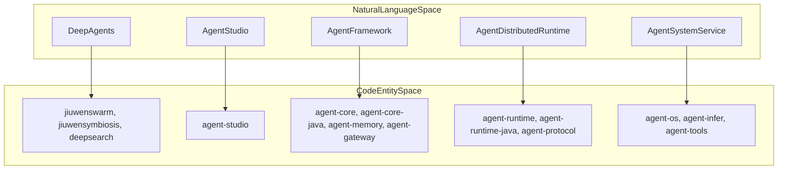
*Figure 1: Mapping Platform Capabilities to Code Entity Repositories*

Sources: [README.md:17-24](), [Contribution_guidance_zh.md:5-12]()

## Implementation and Module Layout

The codebase is organized into independent repositories under the `openJiuwen-ai` organization. These modules span application layers, skill distribution, visual orchestration, core SDKs, and runtime infrastructure [README.md:28-34] [Contribution_guidance_zh.md:16-22].

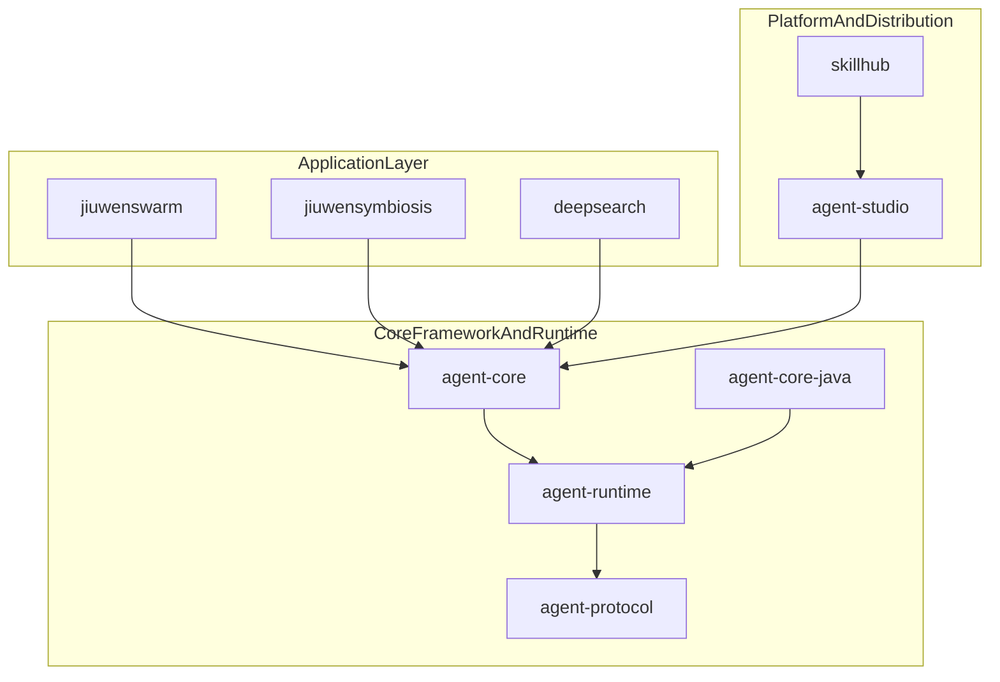
*Figure 2: Repository Dependency and Ecosystem Flow*

Sources: [README.md:34-80](), [Contribution_guidance_zh.md:22-92]()

## Child Page Reference

- **[openJiuwen Platform Architecture](#1.1)**: Details the five foundational layers (`DeepAgents`, `Agent Studio`, `Agent Framework`, `Agent Distributed Runtime`, and `Agent System Service`) alongside internal sequence and capability graphs located in `images/`.
- **[Repository Map & Community Entry Points](#1.2)**: Catalogs the complete inventory of community repositories (`jiuwenswarm`, `agent-core`, `agent-runtime`, `skillhub`, `agent-protocol`, etc.), mailing lists, forum guidelines, and release channels.

Sources: [README.md:1-80](), [Contribution_guidance_zh.md:1-100]()

---

# Page: openJiuwen Platform Architecture

# openJiuwen Platform Architecture

<details>
<summary>Relevant source files</summary>

The following files were used as context for generating this wiki page:

- [Contribution_guidance_zh.md](Contribution_guidance_zh.md)
- [README.md](README.md)
- [README_CN.md](README_CN.md)

</details>


## Purpose and Scope

This document details the architectural design of the openJiuwen AI Agent platform [README.md:1-3](). The scope covers the five-layer platform architecture (**DeepAgents**, **Agent Studio**, **Agent Framework**, **Agent Distributed Runtime**, and **Agent System Service**) [README.md:17-27](), the implementation architecture via modular code repositories [README.md:30-33](), and the runtime data flow across components.

Sources: `README.md:1-3`, `README.md:17-33`

---

## 1. Five-Layer Platform Architecture

openJiuwen adopts a hierarchical layered architecture designed to cover the full lifecycle of AI Agents—from visual development and core execution to distributed deployment and foundational system services [README.md:17-24]().

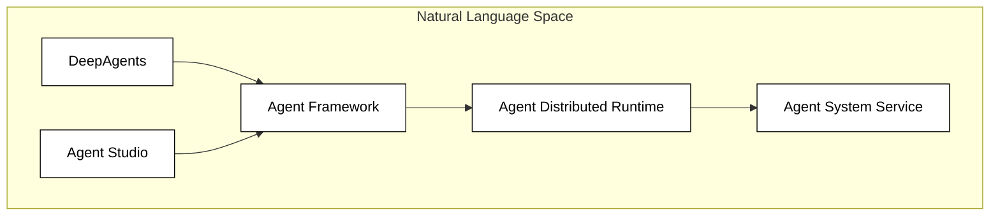
*Figure 1: openJiuwen Capability Architecture Overview*

### Layer Breakdown
1. **DeepAgents**: Out-of-the-box complex agent applications tailored for distinct scenarios such as `jiuwenswarm`, `jiuwensymbiosis`, and `deepsearch` [README.md:20]().
2. **Agent Studio**: A low-code/no-code visual development environment supporting agent editing, workflow orchestration, prompt tuning, and online debugging [README.md:21]().
3. **Agent Framework**: The core execution engine providing multi-scenario interfaces for task planning, loop execution, tool invocation, context management, memory, and multi-agent collaboration [README.md:22]().
4. **Agent Distributed Runtime**: The distributed runtime foundation supporting low-code and high-code deployments with multi-tenant resource isolation, elastic scaling, and service discovery [README.md:23]().
5. **Agent System Service**: The underlying `AgentOS` system services providing security isolation sandboxes, persistent memory storage, native CLI tools, standardized agent file systems, and cross-agent communication buses [README.md:24]().

Sources: `README.md:17-27`, `Contribution_guidance_zh.md:5-14`

---

## 2. Implementation Architecture & Code Entity Mapping

The openJiuwen community maps its conceptual layers to concrete code repositories. This bridge connects the Natural Language Space to the Code Entity Space.

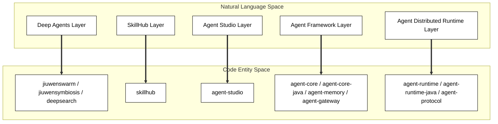
*Figure 2: Bridging Architecture Layers to Code Repositories*

### Repository Module Mapping Table

| Layer | Repository Code Entity | Description / Core Functions |
| :--- | :--- | :--- |
| **Deep Agents** | `jiuwenswarm` [README.md:53]() | Multi-agent collaboration framework and flagship application supporting complex task collaboration and Skill self-evolution [README.md:54](). |
| **Deep Agents** | `jiuwensymbiosis` [README.md:57]() | Embodied intelligence agent framework supporting capability reuse and safety control [README.md:58](). |
| **Deep Agents** | `deepsearch` [README.md:61]() | Knowledge-augmented deep retrieval and research agent for search and report generation [README.md:62](). |
| **SkillHub** | `skillhub` [README.md:66]() | Skill hosting and distribution platform supporting publishing, version management, and shared reuse [README.md:67](). |
| **Agent Studio** | `agent-studio` [README.md:71]() | Visual agent development platform supporting workflow orchestration and online debugging [README.md:72](). |
| **Agent Framework** | `agent-core` [README.md:80]() | Python Agent SDK providing orchestration, runtime, model, tool, and retrieval capabilities [Contribution_guidance_zh.md:69](). |
| **Agent Framework** | `agent-core-java` [Contribution_guidance_zh.md:72]() | Java Agent SDK providing equivalent capabilities for the Java ecosystem [Contribution_guidance_zh.md:73](). |
| **Agent Framework** | `agent-memory` [Contribution_guidance_zh.md:76]() | Long-term memory system supporting extraction, compression, hybrid retrieval, and evolution [Contribution_guidance_zh.md:77](). |
| **Agent Distributed Runtime** | `agent-runtime` [Contribution_guidance_zh.md:81]() | Python Agent Runtime for service-based execution, session management, and lifecycle control [Contribution_guidance_zh.md:82](). |
| **Agent Distributed Runtime** | `agent-runtime-java` [Contribution_guidance_zh.md:85]() | Java Agent Runtime based on Spring Boot for containerized/service deployment [Contribution_guidance_zh.md:86](). |
| **Agent Distributed Runtime** | `agent-protocol` [Contribution_guidance_zh.md:89]() | Interoperability protocol SDK providing MCP SDK, A2A SDK, and A2X Registry [Contribution_guidance_zh.md:90](). |

Sources: `README.md:34-100`, `Contribution_guidance_zh.md:22-94`

---

## 3. Data Flow and Component Interactions

The execution path traverses from client interaction down to system-level services.

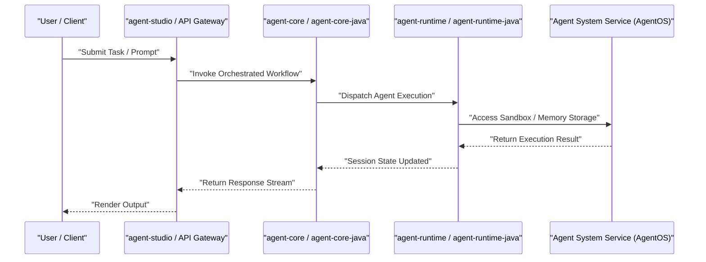
*Figure 3: Runtime Data Flow & Component Interaction Sequence*

### Execution Flow Details
1. **Request Ingestion**: Users interact via `agent-studio` [README.md:71]() or external applications connected via `agent-gateway` [README.md:76]().
2. **Orchestration & Planning**: `agent-core` or `agent-core-java` processes prompt planning, tool routing, and memory retrieval (`agent-memory`) [Contribution_guidance_zh.md:77]().
3. **Distributed Execution**: The request is handed off to `agent-runtime` or `agent-runtime-java` for containerized or distributed execution [Contribution_guidance_zh.md:82]().
4. **Foundational Security & Storage**: Low-level operations interact directly with `Agent System Service` sandboxes and persistent storage [README.md:24]().

Sources: `README.md:17-24`, `README.md:71-80`, `Contribution_guidance_zh.md:68-90`

---

# Page: Repository Map & Community Entry Points

# Repository Map & Community Entry Points

<details>
<summary>Relevant source files</summary>

The following files were used as context for generating this wiki page:

- [README.md](README.md)
- [README_CN.md](README_CN.md)
- [maillist_zh.md](maillist_zh.md)
- [workshop/README.md](workshop/README.md)

</details>


## Purpose and Scope

This page catalogs the openJiuwen ecosystem repositories, community communication channels, mailing lists, forum guides, and workshop/release announcements. The openJiuwen platform is structured around a modular repository design [README.md:30-30]() that spans the entire AI Agent lifecycle—from high-level multi-agent orchestration and skill distribution to core framework execution and distributed service runtimes. 

Sources: `README.md:30-30()`, `maillist_zh.md:1-20()`

---

## Ecosystem Repositories Catalog

The openJiuwen codebase is partitioned into distinct modular repositories, each managed by dedicated Special Interest Groups (SIGs). The repositories are organized across five architectural layers: DeepAgents, SkillHub, Agent Studio, Agent Framework, and Agent Distributed Runtime [README.md:19-24]().

| Module | Repository | Description | Primary Code Entry / Package |
| :--- | :--- | :--- | :--- |
| **Deep Agents** | `jiuwenswarm` [README.md:53-53]() | Multi-agent collaboration framework and official flagship application, supporting complex task collaboration and Skill self-evolution. | `jiuwenswarm/` |
| **Deep Agents** | `jiuwensymbiosis` [README.md:57-57]() | Agent framework for embodied intelligence, supporting configuration-agnostic capability reuse and safety control. | `jiuwensymbiosis/` |
| **Deep Agents** | `deepsearch` [README.md:61-61]() | Knowledge-augmented deep retrieval and research Agent for search, reasoning, and report-generation scenarios. | `deepsearch/` |
| **SkillHub** | `skillhub` [README.md:66-66]() | Skill hosting and distribution platform, supporting Skill publishing, version management, search/download, and private deployment. | `skillhub/` |
| **Agent Studio** | `agent-studio` [README.md:71-71]() | One-stop visual Agent development platform supporting agent editing, workflow orchestration, prompt tuning, and online debugging. | `agent-studio/` |
| **Agent Framework** | `agent-gateway` [README.md:76-76]() | Unified access gateway providing channel management, message processing, scheduled tasks, and heartbeat (Opening Soon). | `agent-gateway/` |
| **Agent Framework** | `agent-core` [README.md:80-80]() | Python Agent SDK providing agent orchestration, runtime execution, model integration, tool calling, and retrieval/evaluation. | `agent-core/` |
| **Agent Framework** | `agent-core-java` [README.md:84-84]() | Java Agent SDK providing feature parity with the Python SDK for enterprise Java ecosystems. | `agent-core-java/` |
| **Agent Framework** | `agent-memory` [README.md:88-88]() | Agent long-term memory system supporting memory extraction, compression, hybrid retrieval, and self-evolution. | `agent-memory/` |
| **Distributed Runtime** | `agent-runtime` [README.md:93-93]() | Python Agent Runtime responsible for agent service-oriented execution, session handling, and lifecycle control. | `agent-runtime/` |
| **Distributed Runtime** | `agent-runtime-java` [README.md:97-97]() | Java Agent Runtime based on Spring Boot for containerized service execution and deployment. | `agent-runtime-java/` |
| **Distributed Runtime** | `agent-protocol` [README.md:101-101]() | Agent interoperability protocol SDK, providing MCP SDK, A2A SDK, and A2X Registry. | `agent-protocol/` |

Sources: `README.md:50-104()`

---

## Architecture to Code Entity Mapping

The following diagram bridges the high-level natural language capability layers of openJiuwen to their concrete repository implementations and package identifiers in the codebase.

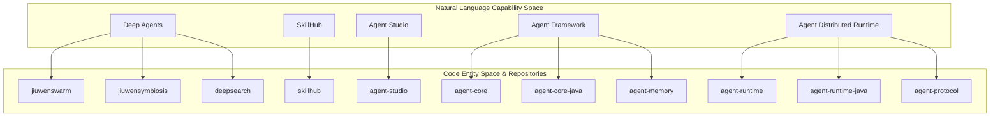

Sources: `README.md:19-104()`

---

## Community Entry Points & Communication Channels

Community collaboration occurs across specific mailing lists, discussion forums, workshops, and release announcement boards.

### Mailing Lists Catalog

| Email Address | Scope / Category | Description |
| :--- | :--- | :--- |
| `contact@openjiuwen.com` [maillist_zh.md:16-16]() | Public Contact | Primary community public mailing list for general technical discussions and day-to-day coordination. |
| `cla@openjiuwen.com` [maillist_zh.md:17-17]() | CLA Submissions | Dedicated address for Developer Contribution Agreement (CLA) verification and inquiries. |
| `legal@openjiuwen.com` [maillist_zh.md:18-18]() | Legal & Compliance | Working group email for handling open-source compliance, licensing, and legal questions. |

Sources: `maillist_zh.md:12-19()`

### Subscription Procedure

To subscribe to any openJiuwen mailing list, developers follow the workflow outlined below [maillist_zh.md:1-10]():

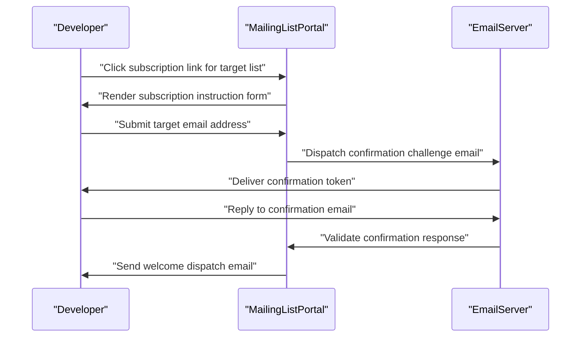

Sources: `maillist_zh.md:1-11()`

### Workshops & Release Announcements

Community workshops, developer meetups, and version release announcements are organized under the `workshop/` [workshop/README.md:1-1]() and release documentation trees. Announcements include migration guides, API deprecation notices, and SIG meeting notes.

Sources: `workshop/README.md:1-1()`

---

# Page: Community Governance

# Community Governance

<details>
<summary>Relevant source files</summary>

The following files were used as context for generating this wiki page:

- [contribute/License-and-Copyright-Guidelines.md](contribute/License-and-Copyright-Guidelines.md)
- [contribute/License-and-Special-License-Review-Guidelines.md](contribute/License-and-Special-License-Review-Guidelines.md)
- [openJiuwen-Community-Code-of-Conduct.md](openJiuwen-Community-Code-of-Conduct.md)
- [sigs/README.md](sigs/README.md)

</details>


## Purpose and Scope
This page provides a high-level overview of how the openJiuwen community is governed, establishing the foundational structures, standards, and behavioral norms that guide all contributors, maintainers, and Special Interest Groups (SIGs). For granular details regarding community leadership charters or behavioral enforcement, please refer to the child pages: [Core Team & Charter](#2.1) and [Code of Conduct & Community Rules](#2.2).

---

## 2.1 Core Team & Charter
The governance of the openJiuwen project is led by the Core Team and the Project Management Committee (PMC), which oversee technical direction, architectural evolution, and cross-SIG coordination. The core team charter establishes the rules for board composition, voting rights, decision-making processes, and lifecycle management for repositories and maintainers.

For detailed information on the charter, board membership, and decision-making workflows, see [Core Team & Charter](#2.1).

```mermaid
graph TD
    subgraph "Community Governance Structure"
        A["PMC & Core Team" / "coreteam/"] --> B["SIG Leads" / "sigs/"]
        B --> C["Maintainers" / "openJiuwen/a/*"]
        C --> D["Contributors" / "pull-requests"]
    end
```
*Diagram 1: Governance hierarchy mapping community roles to structural entities.*

Sources: `sigs/README.md:1-1`

---

## 2.2 Code of Conduct & Community Rules
The openJiuwen community adheres strictly to the Contributor Covenant v3.0 to ensure a safe, inclusive, and productive environment for all participants [openJiuwen-Community-Code-of-Conduct.md:1-3](). 

The community code of conduct defines core pledges, encouraged collaborative behaviors (such as goodwill, respect for different viewpoints, and constructive feedback), and explicitly restricts behaviors such as harassment, personal attacks, discrimination, and breaches of confidentiality [openJiuwen-Community-Code-of-Conduct.md:7-44](). When violations occur, administrators follow a transparent tiered response mechanism [openJiuwen-Community-Code-of-Conduct.md:69-88]().

```mermaid
graph TD
    subgraph "Incident Lifecycle"
        E["Report Incident" / "contact@openjiuwen.com"] --> F["Investigation" / "openJiuwen-Community-Code-of-Conduct.md"]
        F --> G{{"Violation Severity"}}
        G -->|"Tier 1"| H["Warning" / "Private Warning"]
        G -->|"Tier 2"| I["Temporary Restriction" / "Cooling-off Period"]
        G -->|"Tier 3"| J["Temporary Suspension" / "Access Revocation"]
    end
```
*Diagram 2: Code of conduct violation handling workflow mapped to enforcement routines.*

For complete behavioral guidelines, reporting procedures, and legal/privacy statements, see [Code of Conduct & Community Rules](#2.2).

Sources: `openJiuwen-Community-Code-of-Conduct.md:1-88`

---

# Page: Core Team & Charter

# Core Team & Charter

<details>
<summary>Relevant source files</summary>

The following files were used as context for generating this wiki page:

- [coreteam/README.md](coreteam/README.md)

</details>


## Purpose and Scope

This page details the governance structure, administrative charter, and decision-making frameworks defined within the `coreteam/` directory of the `openJiuwen-ai/community` repository. It covers the composition of the openJiuwen governing board, the core team's responsibilities, voting and consensus mechanisms, and how the charter governs Special Interest Groups (SIGs) across the open-source AI Agent platform ecosystem.

Sources: [coreteam/README.md:1-1]()

---

## Community Charter & Governance Foundation

The core team charter establishes the operational bylaws for the openJiuwen community. It defines membership tiers, project lifecycles, and the escalation paths for technical and community disputes. 

The core governance guidelines are documented within the root of the core team management directory:
- Charter guidelines, mission statements, and administrative rules: `coreteam/README.md`

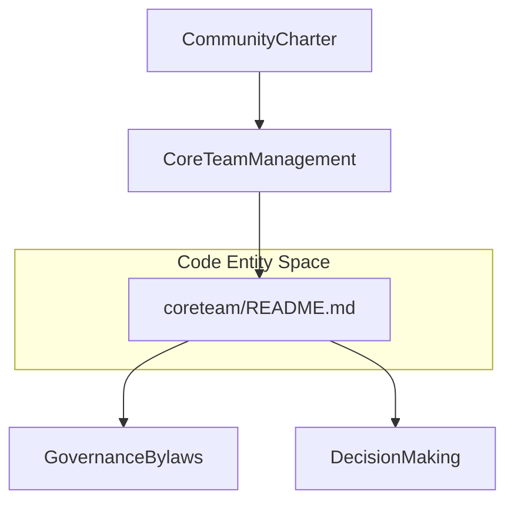

Sources: [coreteam/README.md:1-1]()

---

## Board Composition & Leadership Roles

The openJiuwen core team is structured around distributed leadership roles that oversee architectural evolution, release cadence, and community health.

| Role | Primary Responsibility | Scope |
| :--- | :--- | :--- |
| **Maintainer** | Approving code changes, setting technical direction for specific repositories | Repository / SIG level |
| **Committer** | Contributing code consistently, reviewing PRs, participating in consensus | Repository level |
| **Board Member** | Establishing overall community policies, resolving cross-SIG disputes, chartering new SIGs | Community-wide (`coreteam/`) |

Decision-making within the core team relies on consensus-driven models, transitioning to weighted voting when consensus cannot be reached on critical architectural changes or core dependency upgrades.

Sources: [coreteam/README.md:1-1]()

---

## Decision-Making & SIG Integration Workflow

The core team acts as the final escalation authority for technical decisions originating from individual SIGs. Proposals affecting cross-cutting components (such as `agent-core`, `agent-runtime`, or global security configurations) must be reviewed and endorsed by core team members associated with those domains.

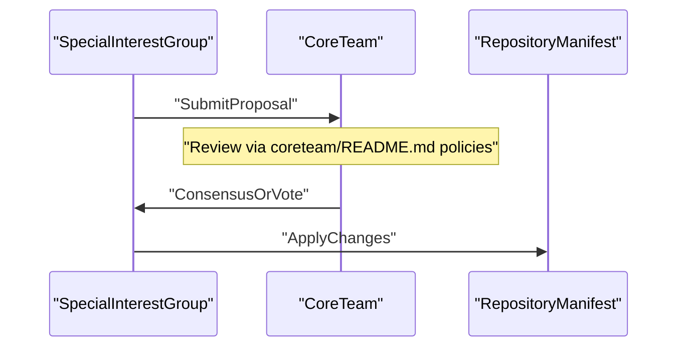

Sources: [coreteam/README.md:1-1]()

---

# Page: SIGs (Special Interest Groups)

# SIGs (Special Interest Groups)

<details>
<summary>Relevant source files</summary>

The following files were used as context for generating this wiki page:

- [sigs/README.md](sigs/README.md)
- [sigs/sig-agent-core/sig-info.yaml](sigs/sig-agent-core/sig-info.yaml)
- [sigs/sig-docs/sig-info.yaml](sigs/sig-docs/sig-info.yaml)

</details>


The `sigs/` directory governs the Special Interest Groups (SIGs) within the openJiuwen community. SIGs represent focused working groups responsible for specific technical domains, platform layers, repositories, and cross-cutting community services. Each SIG operates under defined metadata schemas, maintains specific code ownership boundaries, and coordinates through designated maintainers and committers.

For details on individual child topics, see the corresponding child pages linked below.

---

## 3.1. SIG Metadata Schema & Repository Manifests

Every SIG in the openJiuwen community is defined by a standard metadata structure stored in `sig-info.yaml` within its respective directory under `sigs/`. These files dictate the governance status, leadership, and repository ownership for the group.

- **SIG Metadata Fields**: Includes `name`, `description`, `mailing_list`, `meeting_url`, and `mature_level` (e.g., `startup`) [sigs/sig-agent-core/sig-info.yaml:1-5].
- **Leadership & Personnel**: Defines `maintainers` with their `atomgit_id`, `name`, `orgnization`, and `email` [sigs/sig-agent-core/sig-info.yaml:6-14].
- **Repository Scope**: Maps repositories under `openJiuwen/` and lists assigned `committers` with identical identification fields [sigs/sig-agent-core/sig-info.yaml:15-55].

For full details on metadata schemas and repository manifest rules, see [SIG Metadata Schema & Repository Manifests](#3.1).

### Diagram: SIG Metadata Schema Mapping

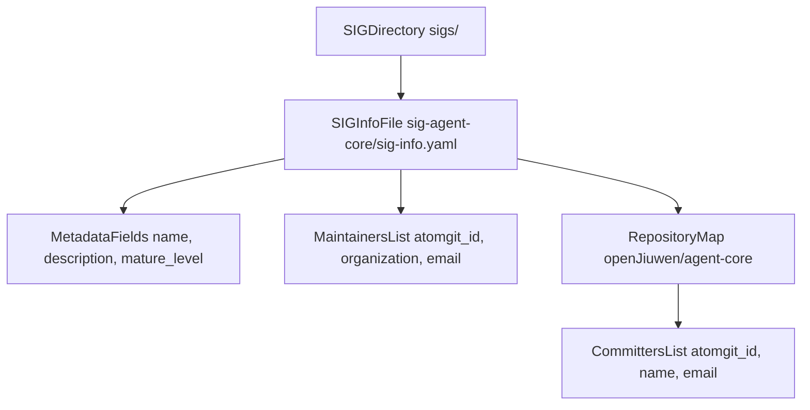
*Sources: [sigs/sig-agent-core/sig-info.yaml:1-55](), [sigs/sig-docs/sig-info.yaml:1-33]() *

---

## 3.2. Framework & Runtime SIGs

Framework and Runtime SIGs own the foundational execution environments, agent kernels, and communication primitives of the openJiuwen platform. These groups manage core repositories including `agent-core`, `agent-core-java`, `agent-memory`, `agent-runtime-java`, `agent-protocol`, `agent-gateway`, `agent-infer`, `agent-os`, and `agent-tools`.

For complete repository ownership details, architectural scopes, and contributor workflows, see [Framework & Runtime SIGs](#3.2).

### Diagram: Framework & Runtime SIG Scope

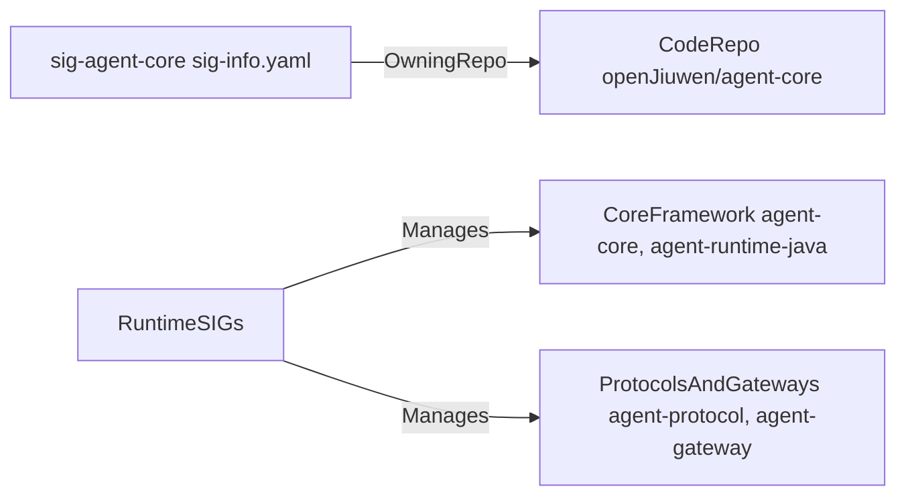
*Sources: [sigs/sig-agent-core/sig-info.yaml:15-17](), [sigs/README.md:1-1]() *

---

## 3.3. Application & Platform SIGs

Application and Platform SIGs focus on user-facing products, swarm intelligence systems, and high-level platform integrations. Their domain includes DeepAgents products and platforms such as `jiuwenswarm`, `jiuwensymbiosis`, `deepsearch`, `jiuwenicode`, `skillhub`, `agent-studio`, and `agent-solution`.

For detailed information on platform products, application architecture, and roadmap milestones, see [Application & Platform SIGs](#3.3).

---

## 3.4. Cross-Cutting SIGs (docs, sec, rm)

Cross-Cutting SIGs provide foundational horizontal services that support the entire openJiuwen community rather than a single repository or product line. 

- **sig-docs**: Manages community documentation, website resources, and contributor guides (e.g., `openJiuwen/community`) [sigs/sig-docs/sig-info.yaml:1-33].
- **sig-sec**: Oversees vulnerability handling, security disclosures, and compliance audits.
- **sig-rm**: Coordinates release management, versioning policies, and build pipelines.

For governance policies, documentation workflows, and security response processes, see [Cross-Cutting SIGs (docs, sec, rm)](#3.4).

### Diagram: Cross-Cutting SIG Structure

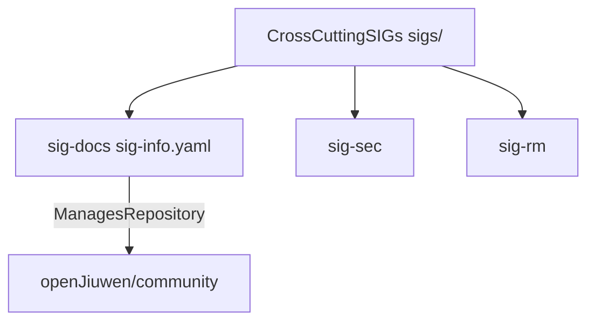
*Sources: [sigs/sig-docs/sig-info.yaml:1-33](), [sigs/README.md:1-1]() *

---

# Page: SIG Metadata Schema & Repository Manifests

# SIG Metadata Schema & Repository Manifests

<details>
<summary>Relevant source files</summary>

The following files were used as context for generating this wiki page:

- [sigs/sig-agent-core/openJiuwen/a/agent-core.yaml](sigs/sig-agent-core/openJiuwen/a/agent-core.yaml)
- [sigs/sig-agent-core/sig-info.yaml](sigs/sig-agent-core/sig-info.yaml)
- [sigs/sig-agent-memory/openJiuwen/a/agent-memory.yaml](sigs/sig-agent-memory/openJiuwen/a/agent-memory.yaml)
- [sigs/sig-agent-memory/sig-info.yaml](sigs/sig-agent-memory/sig-info.yaml)
- [sigs/sig-agent-studio/openJiuwen/a/agent-studio.yaml](sigs/sig-agent-studio/openJiuwen/a/agent-studio.yaml)
- [sigs/sig-docs/sig-info.yaml](sigs/sig-docs/sig-info.yaml)

</details>


## Purpose and Scope
This section details the technical specifications for Special Interest Group (SIG) metadata configuration files (`sig-info.yaml`) and repository manifest files (`openJiuwen/a/<repo>.yaml`) located within the openJiuwen community repository (`sigs/` directory). These schemas govern community ownership boundaries, maintainer permissions, committer allocations, branch protection rules, and repository visibility across the entire openJiuwen AI Agent platform ecosystem.

---

## 1. SIG Metadata Schema (`sig-info.yaml`)

Each Special Interest Group in the openJiuwen community is defined by a `sig-info.yaml` file. This YAML document serves as the machine-readable source of truth for administrative ownership, mailing channels, meeting schedules, maturity stages, and authorization lists (maintainers and committers) tied to specific code repositories.

### 1.1 Field Descriptions

The `sig-info.yaml` schema includes the following top-level and nested structures:
- `name`: Unique identifier of the SIG (e.g., `sig-agent-core`, `sig-agent-memory`, `sig-docs`).
- `description`: Textual summary of the SIG's charter and engineering scope.
- `mailing_list`: Communication channel identifier or `NA`.
- `meeting_url`: Synchronous meeting link or `NA`.
- `mature_level`: Lifecycle maturity stage (e.g., `startup`, `incubating`, `mature`).
- `maintainers`: List of individuals with administrative oversight over the SIG resources, containing `atomgit_id`, `name`, `orgnization`, and `email`.
- `repositories`: Nested mapping connecting the SIG to specific code repositories under the `openJiuwen` organization.
- `committers`: List of individuals authorized to merge code into specific repositories, tracking their `atomgit_id`, `name`, `orgnization`, and `email`.

### 1.2 Schema Implementation Reference

Below is an excerpt illustrating the structure of a `sig-info.yaml` configuration:

```yaml
name: sig-agent-core
description: The sig-agent-core team is responsible for manage agent-core
mailing_list: NA
meeting_url: NA
mature_level: startup
maintainers:
- atomgit_id: xinyu-jiuwen
  name: 张鑫宇
  orgnization: Huawei
  email: zhangxinyu35@huawei.com
repositories:
- repo:
  - openJiuwen/agent-core
  committers:
  - atomgit_id: yangzequ
    name: yangzequ
    orgnization: Huawei
    email: yangzequ1@huawei.com
```

### 1.3 Natural Language to Code Entity Mapping: SIG Metadata

The following diagram bridges the conceptual governance model (Natural Language Space) to the actual data fields in the YAML schema files (Code Entity Space).

```mermaid
graph TD
    GovCharter[""Community Governance Charter""] -->|Defines Structure| SigYaml[""sigs/sig-agent-core/sig-info.yaml""]
    SigYaml --> FieldName[""name: sig-agent-core""]
    SigYaml --> FieldLevel[""mature_level: startup""]
    SigYaml --> FieldMaint[""maintainers: []""]
    SigYaml --> FieldRepos[""repositories: []""]
    FieldMaint --> MaintainerEntity[""atomgit_id: xinyu-jiuwen""]
    FieldRepos --> CommitterEntity[""committers: []""]
    CommitterEntity --> CommitterRecord[""atomgit_id: yangzequ""]

    classDef default fill:#fff,stroke:#333,stroke-width:2px;
```
*Sources: [sigs/sig-agent-core/sig-info.yaml:1-55](), [sigs/sig-agent-memory/sig-info.yaml:1-55](), [sigs/sig-docs/sig-info.yaml:1-33]()*

---

## 2. Repository Manifests (`openJiuwen/a/<repo>.yaml`)

Repository manifests define the operational parameters of individual codebases managed by SIGs. These files control branch policies, protection levels, and public-facing visibility attributes.

### 2.1 Manifest Structure

A repository manifest file contains:
- `name`: The target repository name (e.g., `agent-core`, `agent-memory`, `agent-studio`).
- `description`: High-level summary of the repository's functional domain.
- `branches`: An array of branch definitions, each specifying a branch `name` (e.g., `main`, `develop`, `feature/nl2agent`) and a branch `type` (e.g., `protected`).
- `type`: Repository visibility level (e.g., `public`, `private`).

### 2.2 Manifest Implementation Reference

The following manifest defines the configuration for the `agent-memory` repository:

```yaml
name: agent-memory
description: Memory library for agent
branches:
- name: develop
  type: protected
- name: main
  type: protected
- name: mem2.0
  type: protected
type: public
```

Similarly, the `agent-core` repository manifest includes feature-specific branches:

```yaml
name: agent-core
description: Full-Stack SDK for AI Agent Development, Execution, Optimization and Evolution
branches:
- name: develop
  type: protected
- name: main
  type: protected
- name: feature/nl2agent
  type: protected
type: public
```

### 2.3 Natural Language to Code Entity Mapping: Repository Manifests

The diagram below maps platform design requirements to the structural attributes defined in repository manifest files.

```mermaid
graph TD
    PlatformReq[""Platform Repository Requirements""] -->|Manifest Definition| RepoYaml[""openJiuwen/a/agent-core.yaml""]
    RepoYaml --> PropName[""name: agent-core""]
    RepoYaml --> PropDesc[""description: Full-Stack SDK""]
    RepoYaml --> PropBranches[""branches: []""]
    RepoYaml --> PropType[""type: public""]
    PropBranches --> BranchDev[""name: develop, type: protected""]
    PropBranches --> BranchMain[""name: main, type: protected""]
    PropBranches --> BranchFeat[""name: feature/nl2agent, type: protected""]

    classDef default fill:#fff,stroke:#333,stroke-width:2px;
```
*Sources: [sigs/sig-agent-memory/openJiuwen/a/agent-memory.yaml:1-10](), [sigs/sig-agent-core/openJiuwen/a/agent-core.yaml:1-10](), [sigs/sig-agent-studio/openJiuwen/a/agent-studio.yaml:1-8]()*

---

## Summary of Schema Attributes

| Schema Type | File Path Pattern | Core Attributes | Purpose |
| :--- | :--- | :--- | :--- |
| **SIG Metadata** | `sigs/<sig-name>/sig-info.yaml` | `name`, `mature_level`, `maintainers`, `committers`, `repositories` | Defines administrative boundaries, maintainer permissions, and committer roles. |
| **Repository Manifest** | `sigs/<sig-name>/openJiuwen/a/<repo>.yaml` | `name`, `description`, `branches`, `type` | Declares repository visibility, branch structures, and protection rules. |

*Sources: [sigs/sig-agent-core/sig-info.yaml:1-55](), [sigs/sig-agent-memory/openJiuwen/a/agent-memory.yaml:1-10]()*

---

# Page: Framework & Runtime SIGs

# Framework & Runtime SIGs

<details>
<summary>Relevant source files</summary>

The following files were used as context for generating this wiki page:

- [sigs/sig-agent-core-java/openJiuwen/a/agent-core-java.yaml](sigs/sig-agent-core-java/openJiuwen/a/agent-core-java.yaml)
- [sigs/sig-agent-core-java/sig-info.yaml](sigs/sig-agent-core-java/sig-info.yaml)
- [sigs/sig-agent-core/sig-info.yaml](sigs/sig-agent-core/sig-info.yaml)
- [sigs/sig-agent-gateway/sig-info.yaml](sigs/sig-agent-gateway/sig-info.yaml)
- [sigs/sig-agent-infer/openJiuwen/a/agent-infer.yaml](sigs/sig-agent-infer/openJiuwen/a/agent-infer.yaml)
- [sigs/sig-agent-infer/sig-info.yaml](sigs/sig-agent-infer/sig-info.yaml)
- [sigs/sig-agent-memory/openJiuwen/a/agent-memory.yaml](sigs/sig-agent-memory/openJiuwen/a/agent-memory.yaml)
- [sigs/sig-agent-memory/sig-info.yaml](sigs/sig-agent-memory/sig-info.yaml)
- [sigs/sig-agent-os/openJiuwen/a/agent-os.yaml](sigs/sig-agent-os/openJiuwen/a/agent-os.yaml)
- [sigs/sig-agent-os/sig-info.yaml](sigs/sig-agent-os/sig-info.yaml)
- [sigs/sig-agent-protocol/openJiuwen/a/agent-protocol.yaml](sigs/sig-agent-protocol/openJiuwen/a/agent-protocol.yaml)
- [sigs/sig-agent-protocol/sig-info.yaml](sigs/sig-agent-protocol/sig-info.yaml)
- [sigs/sig-agent-runtime-java/openJiuwen/a/agent-runtime-java.yaml](sigs/sig-agent-runtime-java/openJiuwen/a/agent-runtime-java.yaml)
- [sigs/sig-agent-runtime-java/sig-info.yaml](sigs/sig-agent-runtime-java/sig-info.yaml)
- [sigs/sig-agent-tools/openJiuwen/a/agent-tools.yaml](sigs/sig-agent-tools/openJiuwen/a/agent-tools.yaml)
- [sigs/sig-agent-tools/sig-info.yaml](sigs/sig-agent-tools/sig-info.yaml)

</details>


## Purpose and Scope

This section details the Special Interest Groups (SIGs) responsible for the core infrastructure, execution engines, distributed runtimes, communication protocols, memory systems, inference wrappers, and tool integration layers of the openJiuwen AI Agent platform. These SIGs govern the foundational components utilized across both Python and Java ecosystems.

The scope encompasses nine core repositories and their respective governance metadata:
- `openJiuwen/agent-core` (`sig-agent-core`) [sigs/sig-agent-core/sig-info.yaml:1-55]()
- `openJiuwen/agent-memory` (`sig-agent-memory`) [sigs/sig-agent-memory/sig-info.yaml:1-55]()
- `openJiuwen/agent-tools` (`sig-agent-tools`) [sigs/sig-agent-tools/sig-info.yaml:1-31]()
- `openJiuwen/agent-protocol` (`sig-agent-protocol`) [sigs/sig-agent-protocol/sig-info.yaml:1-27]()
- `openJiuwen/agent-infer` (`sig-agent-infer`) [sigs/sig-agent-infer/sig-info.yaml:1-50]()
- `openJiuwen/agent-os` (`sig-agent-os`) [sigs/sig-agent-os/sig-info.yaml:1-39]()
- `openJiuwen/agent-gateway` (`sig-agent-gateway`) [sigs/sig-agent-gateway/sig-info.yaml:1-34]()
- `openJiuwen/agent-runtime-java` (`sig-agent-runtime-java`) [sigs/sig-agent-runtime-java/sig-info.yaml:1-30]()

Sources: [sigs/sig-agent-core/sig-info.yaml:1-55](), [sigs/sig-agent-memory/sig-info.yaml:1-55](), [sigs/sig-agent-tools/sig-info.yaml:1-31](), [sigs/sig-agent-protocol/sig-info.yaml:1-27](), [sigs/sig-agent-infer/sig-info.yaml:1-50](), [sigs/sig-agent-os/sig-info.yaml:1-39](), [sigs/sig-agent-gateway/sig-info.yaml:1-34](), [sigs/sig-agent-runtime-java/sig-info.yaml:1-30]()

---

## Core Framework SIGs (`sig-agent-core` & `sig-agent-core-java`)

The core framework SIGs manage the primary execution abstractions, agent state machines, tool-use loops, and contextual orchestration primitives. 

- **`sig-agent-core`**: Governs `openJiuwen/agent-core` under the startup maturity level, led by maintainers `xinyu-jiuwen` and `seanzhang_cn` [sigs/sig-agent-core/sig-info.yaml:1-15](). It oversees committers managing agent life-cycle execution flows [sigs/sig-agent-core/sig-info.yaml:16-55]().
- **`sig-agent-core-java`**: Manages the Java counterpart implementation for agent framework primitives, matching the Python core capabilities for enterprise environments.

### Framework Entity Relationship

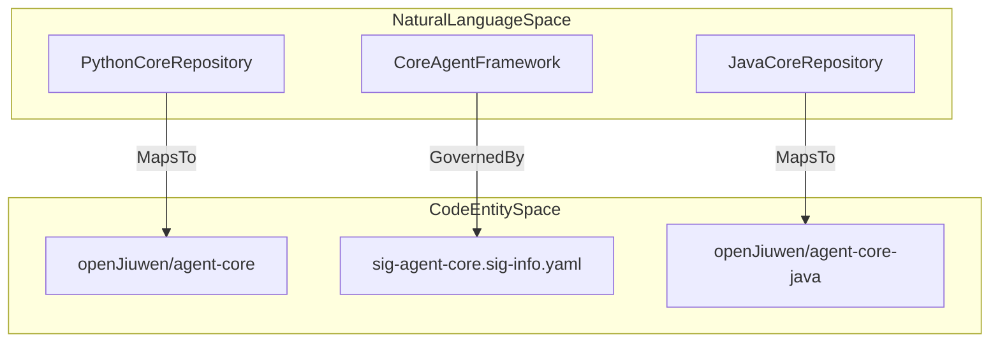
Sources: [sigs/sig-agent-core/sig-info.yaml:1-55]()

---

## Memory & State Management (`sig-agent-memory`)

Managed by `sig-agent-memory` (`openJiuwen/agent-memory`), this subsystem provides memory libraries for agents, handling short-term working memory, long-term vector stores, and episodic context retrieval [sigs/sig-agent-memory/sig-info.yaml:1-21](), [sigs/sig-agent-memory/openJiuwen/a/agent-memory.yaml:1-10]().

### Repository Manifest & Branching Strategy
The repository configuration defines protected development and production branches to maintain stability for memory primitives [sigs/sig-agent-memory/openJiuwen/a/agent-memory.yaml:1-10]():
- `develop`: Protected integration branch [sigs/sig-agent-memory/openJiuwen/a/agent-memory.yaml:3-5]()
- `main`: Protected production branch [sigs/sig-agent-memory/openJiuwen/a/agent-memory.yaml:6-7]()
- `mem2.0`: Protected experimental/next-gen memory branch [sigs/sig-agent-memory/openJiuwen/a/agent-memory.yaml:8-9]()

Maintainers include `chenglinsong`, `li_zhonghua`, and `JingwenZhao` [sigs/sig-agent-memory/sig-info.yaml:6-18]().

Sources: [sigs/sig-agent-memory/sig-info.yaml:1-55](), [sigs/sig-agent-memory/openJiuwen/a/agent-memory.yaml:1-10]()

---

## Runtime, OS, & Gateway SIGs (`sig-agent-runtime-java`, `sig-agent-os`, `sig-agent-gateway`)

These SIGs provide distributed agent execution infrastructure, operational management platforms, and traffic routing gateways.

### Runtime and OS Components
- **`sig-agent-runtime-java`**: Manages `openJiuwen/agent-runtime-java`, providing the Java implementation for distributed agent runtimes across `develop` and `main` protected branches [sigs/sig-agent-runtime-java/openJiuwen/a/agent-runtime-java.yaml:1-7](), led by `fujilie` and `LucioIT` [sigs/sig-agent-runtime-java/sig-info.yaml:1-15]().
- **`sig-agent-os`**: Governs `openJiuwen/agent-os`, serving as an Agent OS platform for managing and deploying AI agents under maintainers `liufangchao`, `xinyu-jiuwen`, and `hekefeng` [sigs/sig-agent-os/sig-info.yaml:1-19](), [sigs/sig-agent-os/openJiuwen/a/agent-os.yaml:1-6]().
- **`sig-agent-gateway`**: Governs `openJiuwen/agent-gateway` led by `YiyangShao` and `mingo007` [sigs/sig-agent-gateway/sig-info.yaml:1-15](), routing agent-to-agent and external client requests.

### Distributed Execution Data Flow

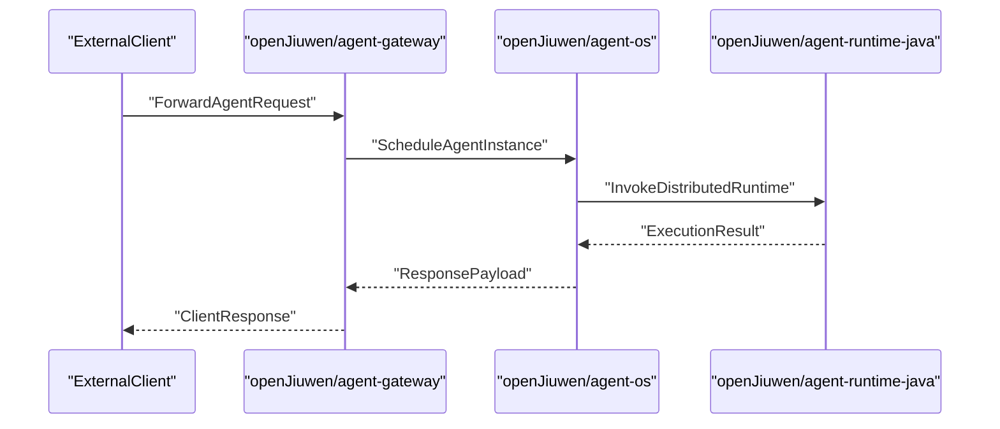
Sources: [sigs/sig-agent-os/openJiuwen/a/agent-os.yaml:1-6](), [sigs/sig-agent-os/sig-info.yaml:1-39](), [sigs/sig-agent-gateway/sig-info.yaml:1-34](), [sigs/sig-agent-runtime-java/sig-info.yaml:1-30]()

---

## Protocol, Inference, & Tools SIGs (`sig-agent-protocol`, `sig-agent-infer`, `sig-agent-tools`)

These groups manage interface standards, vLLM-based model inference integrations, and tool execution libraries.

### Overview of Repositories
- **`sig-agent-protocol`**: Governs `openJiuwen/agent-protocol` under maintainers `YiyangShao` and `xinyu-jiuwen` [sigs/sig-agent-protocol/sig-info.yaml:1-15]().
- **`sig-agent-infer`**: Governs `openJiuwen/agent-infer`, providing a vLLM-based inference framework optimized for agentic workloads with `develop` and `main` protected branches [sigs/sig-agent-infer/sig-info.yaml:1-25](), [sigs/sig-agent-infer/openJiuwen/a/agent-infer.yaml:1-8](). Maintainers include `hsliu_ustc`, `wuhang91`, `m0_37369840`, and `zengchuang_personal` [sigs/sig-agent-infer/sig-info.yaml:6-23]().
- **`sig-agent-tools`**: Governs `openJiuwen/agent-tools` under maintainers `seanzhang_cn` and `xinyu-jiuwen` [sigs/sig-agent-tools/sig-info.yaml:1-15]().

Sources: [sigs/sig-agent-protocol/sig-info.yaml:1-27](), [sigs/sig-agent-infer/sig-info.yaml:1-50](), [sigs/sig-agent-infer/openJiuwen/a/agent-infer.yaml:1-8](), [sigs/sig-agent-tools/sig-info.yaml:1-31]()

---

## Summary of Framework & Runtime Repositories

| SIG Name | Repository | Maturity Level | Primary Maintainers | Key Branch Structure |
| :--- | :--- | :--- | :--- | :--- |
| `sig-agent-core` | `openJiuwen/agent-core` | startup [sigs/sig-agent-core/sig-info.yaml:5]() | `xinyu-jiuwen`, `seanzhang_cn` [sigs/sig-agent-core/sig-info.yaml:7-12]() | Not specified |
| `sig-agent-memory` | `openJiuwen/agent-memory` | startup [sigs/sig-agent-memory/sig-info.yaml:5]() | `chenglinsong`, `li_zhonghua`, `JingwenZhao` [sigs/sig-agent-memory/sig-info.yaml:7-18]() | `develop`, `main`, `mem2.0` [sigs/sig-agent-memory/openJiuwen/a/agent-memory.yaml:3-9]() |
| `sig-agent-runtime-java` | `openJiuwen/agent-runtime-java` | startup [sigs/sig-agent-runtime-java/sig-info.yaml:5]() | `fujilie`, `LucioIT` [sigs/sig-agent-runtime-java/sig-info.yaml:7-14]() | `develop`, `main` [sigs/sig-agent-runtime-java/openJiuwen/a/agent-runtime-java.yaml:3-7]() |
| `sig-agent-infer` | `openJiuwen/agent-infer` | startup [sigs/sig-agent-infer/sig-info.yaml:5]() | `hsliu_ustc`, `wuhang91`, `m0_37369840`, `zengchuang_personal` [sigs/sig-agent-infer/sig-info.yaml:6-22]() | `develop`, `main` [sigs/sig-agent-infer/openJiuwen/a/agent-infer.yaml:3-7]() |
| `sig-agent-os` | `openJiuwen/agent-os` | startup [sigs/sig-agent-os/sig-info.yaml:5]() | `liufangchao`, `xinyu-jiuwen`, `hekefeng` [sigs/sig-agent-os/sig-info.yaml:7-18]() | `main` [sigs/sig-agent-os/openJiuwen/a/agent-os.yaml:3-5]() |
| `sig-agent-gateway` | `openJiuwen/agent-gateway` | startup [sigs/sig-agent-gateway/sig-info.yaml:5]() | `YiyangShao`, `mingo007` [sigs/sig-agent-gateway/sig-info.yaml:7-14]() | Not specified |

Sources: [sigs/sig-agent-core/sig-info.yaml:1-55](), [sigs/sig-agent-memory/sig-info.yaml:1-55](), [sigs/sig-agent-memory/openJiuwen/a/agent-memory.yaml:1-10](), [sigs/sig-agent-runtime-java/sig-info.yaml:1-30](), [sigs/sig-agent-runtime-java/openJiuwen/a/agent-runtime-java.yaml:1-7](), [sigs/sig-agent-infer/sig-info.yaml:1-50](), [sigs/sig-agent-infer/openJiuwen/a/agent-infer.yaml:1-8](), [sigs/sig-agent-os/sig-info.yaml:1-39](), [sigs/sig-agent-os/openJiuwen/a/agent-os.yaml:1-6](), [sigs/sig-agent-gateway/sig-info.yaml:1-34]()

---

# Page: Application & Platform SIGs

# Application & Platform SIGs

<details>
<summary>Relevant source files</summary>

The following files were used as context for generating this wiki page:

- [sigs/sig-agent-solution/openJiuwen/a/agent-solution.yaml](sigs/sig-agent-solution/openJiuwen/a/agent-solution.yaml)
- [sigs/sig-agent-solution/sig-info.yaml](sigs/sig-agent-solution/sig-info.yaml)
- [sigs/sig-agent-studio/sig-info.yaml](sigs/sig-agent-studio/sig-info.yaml)
- [sigs/sig-deepsearch/openJiuwen/a/deepsearch.yaml](sigs/sig-deepsearch/openJiuwen/a/deepsearch.yaml)
- [sigs/sig-deepsearch/sig-info.yaml](sigs/sig-deepsearch/sig-info.yaml)
- [sigs/sig-jiuwenicode/openJiuwen/a/jiuwenicode.yaml](sigs/sig-jiuwenicode/openJiuwen/a/jiuwenicode.yaml)
- [sigs/sig-jiuwenicode/sig-info.yaml](sigs/sig-jiuwenicode/sig-info.yaml)
- [sigs/sig-jiuwenswarm/openJiuwen/a/jiuwenswarm.yaml](sigs/sig-jiuwenswarm/openJiuwen/a/jiuwenswarm.yaml)
- [sigs/sig-jiuwenswarm/sig-info.yaml](sigs/sig-jiuwenswarm/sig-info.yaml)
- [sigs/sig-jiuwensymbiosis/openJiuwen/a/jiuwensymbiosis.yaml](sigs/sig-jiuwensymbiosis/openJiuwen/a/jiuwensymbiosis.yaml)
- [sigs/sig-jiuwensymbiosis/sig-info.yaml](sigs/sig-jiuwensymbiosis/sig-info.yaml)
- [sigs/sig-skillhub/openJiuwen/a/skillhub.yaml](sigs/sig-skillhub/openJiuwen/a/skillhub.yaml)
- [sigs/sig-skillhub/sig-info.yaml](sigs/sig-skillhub/sig-info.yaml)

</details>


## Purpose and Scope

The Application & Platform Special Interest Groups (SIGs) within the openJiuwen community are responsible for managing, developing, and maintaining user-facing applications, DeepAgents, and platform products built on top of the `agent-core` framework. These SIGs span domain-specific assistants, physical AI integrations, search agents, coding assistants, skill ecosystems, studios, and industrial solutions.

The scope encompasses seven primary SIGs and their corresponding repositories:
* `sig-jiuwenswarm`: `openJiuwen/jiuwenswarm` [sigs/sig-jiuwenswarm/sig-info.yaml:1-13]()
* `sig-jiuwensymbiosis`: `openJiuwen/jiuwensymbiosis` [sigs/sig-jiuwensymbiosis/sig-info.yaml:1-17]()
* `deepsearch`: `openJiuwen/deepsearch` [sigs/sig-deepsearch/sig-info.yaml:1-13]()
* `sig-jiuwenicode`: `openJiuwen/jiuwenicode` [sigs/sig-jiuwenicode/sig-info.yaml:1-17]()
* `sig-skillhub`: `openJiuwen/skillhub` [sigs/sig-skillhub/sig-info.yaml:1-17]()
* `sig-agent-studio`: `openJiuwen/agent-studio` [sigs/sig-agent-studio/sig-info.yaml:1-17]()
* `sig-agent-solution`: `openJiuwen/agent-solution` [sigs/sig-agent-solution/sig-info.yaml:1-17]()

---

## 1. DeepAgents and Assistant Products

Application SIGs deliver specialized AI assistants and autonomous agent platforms. Each SIG maintains explicit metadata configurations via `sig-info.yaml` files defining maintainers, committers, and repository structures.

### JiuwenSwarm and JiuwenSymbiosis
* **`sig-jiuwenswarm`**: Managed by maintainer `douran` [sigs/sig-jiuwenswarm/sig-info.yaml:6-10](), with a large cohort of committers [sigs/sig-jiuwenswarm/sig-info.yaml:14-82](). The repository `openJiuwen/jiuwenswarm` [sigs/sig-jiuwenswarm/sig-info.yaml:11-13]() is built on the `agent-core` framework to deliver multi-agent swarm capabilities [sigs/sig-jiuwenswarm/openJiuwen/a/jiuwenswarm.yaml:1-3]().
* **`sig-jiuwensymbiosis`**: Managed by maintainers `zhangjiahui998` and `yyyamal` [sigs/sig-jiuwensymbiosis/sig-info.yaml:6-10](). The `openJiuwen/jiuwensymbiosis` repository [sigs/sig-jiuwensymbiosis/sig-info.yaml:15-17]() provides a Physical AI assistant built upon `agent-core` [sigs/sig-jiuwensymbiosis/openJiuwen/a/jiuwensymbiosis.yaml:1-3]().

### DeepSearch and JiuwenICode
* **`deepsearch`**: Headed by maintainer `li_zhonghua` [sigs/sig-deepsearch/sig-info.yaml:6-10](), overseeing the `openJiuwen/deepsearch` repository [sigs/sig-deepsearch/sig-info.yaml:11-13]() with committers specializing in advanced search intelligence [sigs/sig-deepsearch/sig-info.yaml:14-34]().
* **`sig-jiuwenicode`**: Managed by maintainers `xinyu-jiuwen` and `zhongykau` [sigs/sig-jiuwenicode/sig-info.yaml:6-14](). The `openJiuwen/jiuwenicode` repository [sigs/sig-jiuwenicode/sig-info.yaml:15-17]() provides an AI coding assistant powered by `agent-core` [sigs/sig-jiuwenicode/openJiuwen/a/jiuwenicode.yaml:1-3]().

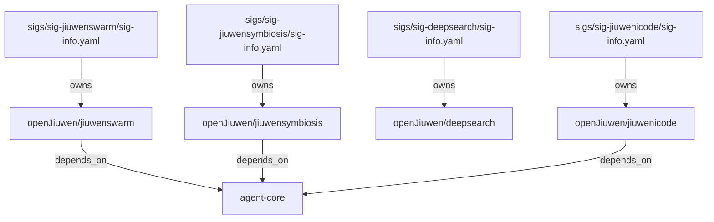
*Sources: [sigs/sig-jiuwenswarm/sig-info.yaml:1-13](), [sigs/sig-jiuwensymbiosis/sig-info.yaml:1-17](), [sigs/sig-deepsearch/sig-info.yaml:1-13](), [sigs/sig-jiuwenicode/sig-info.yaml:1-17](), [sigs/sig-jiuwenicode/openJiuwen/a/jiuwenicode.yaml:1-3]()*

---

## 2. Platform Products and Ecosystem Tooling

Platform SIGs provide the underlying tooling, extension libraries, skill registries, and low-code visual environments required to build and deploy agent solutions.

### SkillHub, Agent Studio, and Agent Solution
* **`sig-skillhub`**: Maintained by `caozhenhua0000` and `xiaowenzihwl` [sigs/sig-skillhub/sig-info.yaml:6-14](). It manages `openJiuwen/skillhub` [sigs/sig-skillhub/sig-info.yaml:15-17]() to establish a comprehensive skill ecosystem [sigs/sig-skillhub/openJiuwen/a/skillhub.yaml:1-3]().
* **`sig-agent-studio`**: Maintained by `seanzhang_cn` and `xinyu-jiuwen` [sigs/sig-agent-studio/sig-info.yaml:6-14](). It manages `openJiuwen/agent-studio` [sigs/sig-agent-studio/sig-info.yaml:15-17]().
* **`sig-agent-solution`**: Maintained by `LucioIT` and `xingchao_ml` [sigs/sig-agent-solution/sig-info.yaml:6-14](). It manages `openJiuwen/agent-solution` [sigs/sig-agent-solution/sig-info.yaml:15-17](), delivering industry-specific solutions across finance, manufacturing, electric power, transportation, and public utilities [sigs/sig-agent-solution/openJiuwen/a/agent-solution.yaml:1-3]().

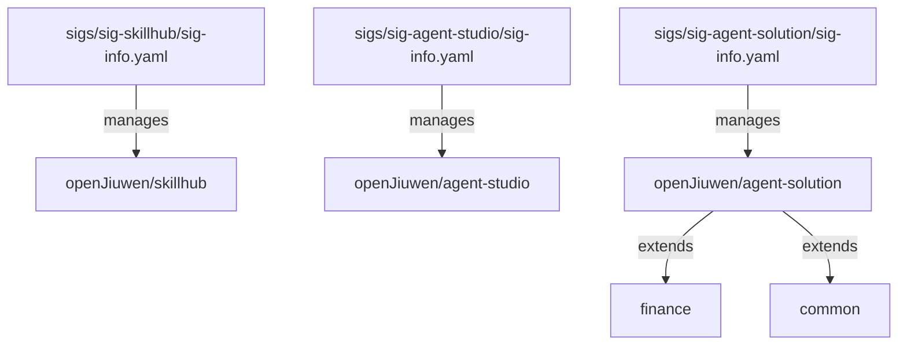
*Sources: [sigs/sig-skillhub/sig-info.yaml:1-17](), [sigs/sig-agent-studio/sig-info.yaml:1-17](), [sigs/sig-agent-solution/sig-info.yaml:1-17](), [sigs/sig-skillhub/openJiuwen/a/skillhub.yaml:1-3](), [sigs/sig-agent-solution/openJiuwen/a/agent-solution.yaml:1-9]()*

---

## 3. Repository Manifests and Branch Protection Rules

Application and platform repositories maintain explicit configuration manifests under `sigs/<sig-name>/openJiuwen/a/<repo>.yaml`. These define repository visibility, description, and protected branches.

| Repository | SIG Name | Visibility | Protected Branches | Source Manifest |
| :--- | :--- | :--- | :--- | :--- |
| `jiuwenswarm` | `sig-jiuwenswarm` | public [sigs/sig-jiuwenswarm/openJiuwen/a/jiuwenswarm.yaml:8-8]() | `develop`, `main` [sigs/sig-jiuwenswarm/openJiuwen/a/jiuwenswarm.yaml:3-7]() | `sigs/sig-jiuwenswarm/openJiuwen/a/jiuwenswarm.yaml` |
| `jiuwensymbiosis` | `sig-jiuwensymbiosis` | public [sigs/sig-jiuwensymbiosis/openJiuwen/a/jiuwensymbiosis.yaml:8-8]() | `develop`, `main` [sigs/sig-jiuwensymbiosis/openJiuwen/a/jiuwensymbiosis.yaml:3-7]() | `sigs/sig-jiuwensymbiosis/openJiuwen/a/jiuwensymbiosis.yaml` |
| `jiuwenicode` | `sig-jiuwenicode` | public [sigs/sig-jiuwenicode/openJiuwen/a/jiuwenicode.yaml:8-8]() | `develop`, `main` [sigs/sig-jiuwenicode/openJiuwen/a/jiuwenicode.yaml:3-7]() | `sigs/sig-jiuwenicode/openJiuwen/a/jiuwenicode.yaml` |
| `skillhub` | `sig-skillhub` | public [sigs/sig-skillhub/openJiuwen/a/skillhub.yaml:6-6]() | `main` [sigs/sig-skillhub/openJiuwen/a/skillhub.yaml:3-5]() | `sigs/sig-skillhub/openJiuwen/a/skillhub.yaml` |
| `agent-solution` | `sig-agent-solution` | public [sigs/sig-agent-solution/openJiuwen/a/agent-solution.yaml:10-10]() | `main`, `common`, `finance` [sigs/sig-agent-solution/openJiuwen/a/agent-solution.yaml:3-9]() | `sigs/sig-agent-solution/openJiuwen/a/agent-solution.yaml` |

*Sources: [sigs/sig-jiuwenswarm/openJiuwen/a/jiuwenswarm.yaml:1-8](), [sigs/sig-jiuwensymbiosis/openJiuwen/a/jiuwensymbiosis.yaml:1-8](), [sigs/sig-jiuwenicode/openJiuwen/a/jiuwenicode.yaml:1-8](), [sigs/sig-skillhub/openJiuwen/a/skillhub.yaml:1-6](), [sigs/sig-agent-solution/openJiuwen/a/agent-solution.yaml:1-10]()*

---

## 4. Organizational Structure and Roles

Every Application & Platform SIG follows the community governance model defined in `sig-info.yaml`. Each group maintains a startup mature level [sigs/sig-jiuwenswarm/sig-info.yaml:5-5](), with designated maintainers holding review and merge privileges, and committers contributing code to the repositories.

```yaml
# Example Structure from sigs/sig-agent-studio/sig-info.yaml
name: sig-agent-studio
description: The sig-agent-studio team is responsible for manage agent-studio
mature_level: startup
maintainers:
  - atomgit_id: seanzhang_cn
    name: zhangxiang
    orgnization: Huawei
    email: zhangxiang144@huawei.com
repositories:
  - repo:
    - openJiuwen/agent-studio
```
*Sources: [sigs/sig-agent-studio/sig-info.yaml:1-18](), [sigs/sig-skillhub/sig-info.yaml:1-18](), [sigs/sig-deepsearch/sig-info.yaml:1-13]()*

---

# Page: Cross-Cutting SIGs (docs, sec, rm)

# Cross-Cutting SIGs (docs, sec, rm)

<details>
<summary>Relevant source files</summary>

The following files were used as context for generating this wiki page:

- [sigs/sig-docs/sig-info.yaml](sigs/sig-docs/sig-info.yaml)
- [sigs/sig-rm/sig-info.yaml](sigs/sig-rm/sig-info.yaml)
- [sigs/sig-sec/sig-info.yaml](sigs/sig-sec/sig-info.yaml)

</details>


## Purpose and Scope

This page details the cross-cutting Special Interest Groups (SIGs) within the openJiuwen community: `sig-docs` (documentation), `sig-sec` (security), and `sig-rm` (release management). Unlike component-specific SIGs that govern isolated runtime layers or frameworks, cross-cutting SIGs span the entire ecosystem repository infrastructure, enforcing community-wide standards for documentation quality, user security management, version control, and release lifecycles.

Sources: `sigs/sig-docs/sig-info.yaml:1-33` [sigs/sig-docs/sig-info.yaml:1-33](), `sigs/sig-rm/sig-info.yaml:1-25` [sigs/sig-rm/sig-info.yaml:1-24](), `sigs/sig-sec/sig-info.yaml:1-26` [sigs/sig-sec/sig-info.yaml:1-25]()

---

## 1. Documentation SIG (`sig-docs`)

The `sig-docs` group manages documentation infrastructure, guides, and content structures across the community repositories [sigs/sig-docs/sig-info.yaml:1-2](). 

### Configuration & Membership Metadata
Defined in `sigs/sig-docs/sig-info.yaml` [sigs/sig-docs/sig-info.yaml:1-33](), the SIG operates under the following parameters:
- **Name:** `sig-docs` [sigs/sig-docs/sig-info.yaml:1-1]()
- **Description:** Responsible for managing community documentation and core repositories [sigs/sig-docs/sig-info.yaml:2-2]()
- **Mature Level:** `startup` [sigs/sig-docs/sig-info.yaml:5-5]()
- **Managed Repositories:** `openJiuwen/community` [sigs/sig-docs/sig-info.yaml:6-8]()
- **Committers:** 
  - `yuzengjie01` (Huawei) [sigs/sig-docs/sig-info.yaml:10-13]()
  - `zhangmingyang_zz` (Huawei) [sigs/sig-docs/sig-info.yaml:14-17]()
  - `huguangzheng` (Huawei) [sigs/sig-docs/sig-info.yaml:18-21]()
  - `renquanjia` (Huawei) [sigs/sig-docs/sig-info.yaml:22-25]()
  - `lixiaofeng6` (Huawei) [sigs/sig-docs/sig-info.yaml:26-29]()
  - `zhangfuzhi` (Huawei) [sigs/sig-docs/sig-info.yaml:30-33]()

Sources: `sigs/sig-docs/sig-info.yaml:1-33` [sigs/sig-docs/sig-info.yaml:1-33]()

---

## 2. Release Management SIG (`sig-rm`)

The `sig-rm` group handles release coordination, version governance, and requirement tracking across openJiuwen components [sigs/sig-rm/sig-info.yaml:1-2]().

### Configuration & Membership Metadata
Defined in `sigs/sig-rm/sig-info.yaml` [sigs/sig-rm/sig-info.yaml:1-24](), the structure includes:
- **Name:** `sig-rm` [sigs/sig-rm/sig-info.yaml:1-1]()
- **Description:** Dedicated to version management and requirement management [sigs/sig-rm/sig-info.yaml:2-2]()
- **Mature Level:** `startup` [sigs/sig-rm/sig-info.yaml:5-5]()
- **Maintainers:**
  - `ryanw22` / `wanghongbo` (Huawei) [sigs/sig-rm/sig-info.yaml:6-10]()
  - `z00430070` / `zhuxushen` (Huawei) [sigs/sig-rm/sig-info.yaml:11-14]()
- **Committers:**
  - `shiruifeng1116` / `shiruifeng` (Huawei) [sigs/sig-rm/sig-info.yaml:16-19]()
  - `huguangzheng` / `huguangzheng` (Huawei) [sigs/sig-rm/sig-info.yaml:20-23]()

Sources: `sigs/sig-rm/sig-info.yaml:1-25` [sigs/sig-rm/sig-info.yaml:1-24]()

---

## 3. Security SIG (`sig-sec`)

The `sig-sec` group governs user security management, vulnerability response policies, and compliance standards across the ecosystem [sigs/sig-sec/sig-info.yaml:1-2]().

### Configuration & Membership Metadata
Defined in `sigs/sig-sec/sig-info.yaml` [sigs/sig-sec/sig-info.yaml:1-25](), the structure includes:
- **Name:** `sig-sec` [sigs/sig-sec/sig-info.yaml:1-1]()
- **Description:** Dedicated to user security management [sigs/sig-sec/sig-info.yaml:2-2]()
- **Mature Level:** `startup` [sigs/sig-sec/sig-info.yaml:5-5]()
- **Maintainers:**
  - `yyuse` / `杨渊` (Huawei) [sigs/sig-sec/sig-info.yaml:6-10]()
  - `seanzhang_cn` / `zhangxiang` (Huawei) [sigs/sig-sec/sig-info.yaml:11-14]()
- **Committers:**
  - `maxmadmax` / `chengkun12` (Huawei) [sigs/sig-sec/sig-info.yaml:16-19]()
  - `zhaozixuan` / `zhaozixuan2` (Huawei) [sigs/sig-sec/sig-info.yaml:20-23]()

Sources: `sigs/sig-sec/sig-info.yaml:1-26` [sigs/sig-sec/sig-info.yaml:1-25]()

---

## 4. Cross-Cutting SIG Architecture & Code Entity Mapping

To bridge natural language community requirements (documentation updates, security patches, release milestones) with actual code structures, cross-cutting SIGs manage specific YAML manifests stored under the `sigs/` directory [sigs/sig-docs/sig-info.yaml:1-33]().

### Diagram: Natural Language Space to Code Entity Space (SIG Metadata Mapping)

```mermaid
graph TD
    NaturalLanguageDocs[""Natural Language: Documentation Governance & Guides""] --> SigDocsYAML[""sigs/sig-docs/sig-info.yaml"#sig-docs""]
    NaturalLanguageSec[""Natural Language: Vulnerability & Security Management""] --> SigSecYAML[""sigs/sig-sec/sig-info.yaml"#sig-sec""]
    NaturalLanguageRM[""Natural Language: Version & Release Planning""] --> SigRmYAML[""sigs/sig-rm/sig-info.yaml"#sig-rm""]

    SigDocsYAML --> CommitterListDocs[""Committers: yuzengjie01, zhangmingyang_zz, huguangzheng, renquanjia, lixiaofeng6, zhangfuzhi""]
    SigSecYAML --> MaintainerListSec[""Maintainers: yyuse, seanzhang_cn & Committers: maxmadmax, zhaozixuan""]
    SigRmYAML --> MaintainerListRm[""Maintainers: ryanw22, z00430070 & Committers: shiruifeng1116, huguangzheng""]
```
Sources: `sigs/sig-docs/sig-info.yaml:1-33` [sigs/sig-docs/sig-info.yaml:1-33](), `sigs/sig-rm/sig-info.yaml:1-25` [sigs/sig-rm/sig-info.yaml:1-24](), `sigs/sig-sec/sig-info.yaml:1-26` [sigs/sig-sec/sig-info.yaml:1-25]()

### Diagram: Cross-Cutting Responsibilities & Dataflow

```mermaid
graph TD
    CommunityRepo[""openJiuwen/community""] --> DocsSig[""sig-docs: sigs/sig-docs/sig-info.yaml""]
    CommunityRepo --> SecSig[""sig-sec: sigs/sig-sec/sig-info.yaml""]
    CommunityRepo --> RmSig[""sig-rm: sigs/sig-rm/sig-info.yaml""]

    DocsSig --> DocsValidation[""Validate Markdown/Diátaxis Formats""]
    SecSig --> SecValidation[""Scan & Audit Security Policies""]
    RmSig --> RmValidation[""Coordinate Version Tags & Requirements""]

    DocsValidation --> MergePR[""Merge PR to Repository""]
    SecValidation --> MergePR
    RmValidation --> MergePR
```
Sources: `sigs/sig-docs/sig-info.yaml:1-33` [sigs/sig-docs/sig-info.yaml:1-33](), `sigs/sig-rm/sig-info.yaml:1-25` [sigs/sig-rm/sig-info.yaml:1-24](), `sigs/sig-sec/sig-info.yaml:1-26` [sigs/sig-sec/sig-info.yaml:1-25]()

---

# Page: Contributing

# Contributing

<details>
<summary>Relevant source files</summary>

The following files were used as context for generating this wiki page:

- [CONTRIBUTING_zh.md](CONTRIBUTING_zh.md)
- [COPYRIGHT](COPYRIGHT)
- [COPYRIGHT_zh](COPYRIGHT_zh)
- [LICENSE](LICENSE)
- [README.md](README.md)
- [README_CN.md](README_CN.md)
- [contribute/README.md](contribute/README.md)
- [contribute/style-guide/openJiuwen-JavaScript-coding-style-guide.md](contribute/style-guide/openJiuwen-JavaScript-coding-style-guide.md)

</details>


## Purpose and Scope

This page provides a high-level overview of the contribution process for the openJiuwen AI Agent platform ecosystem. Participating in the openJiuwen community requires adhering to specific legal, procedural, and technical standards to ensure high code quality, compliance, and stable multi-agent operations. Developers can contribute code, documentation, and issues by following established workflows.

For detailed instructions, refer to the child pages:
- Contribution Workflow & Commit Conventions: [Contribution Workflow & Commit Conventions](#4.1)
- CLA Signing Requirements: [CLA Signing](#4.2)
- Licensing & Copyright Policy: [Licensing & Copyright Policy](#4.3)

Sources: [README.md:1-14](), [README_CN.md:1-14]()

---

## 4.1 Contribution Workflow & Commit Conventions

The openJiuwen code contribution workflow is built on GitCode (or compatible Git platforms) and requires a structured path from forking repositories to passing Continuous Integration (CI) gates. Developers must work within dedicated feature branches, format commit messages according to the [Conventional Commits](https://www.conventionalcommits.org) specification, and ensure cryptographic sign-off (`-sm`) [CONTRIBUTING_zh.md:100-106]. Pull Requests (PRs) must be linked to a community issue using the `#+Issue ID` syntax and pass all static analysis, compilation, and functional test pipelines before merge consideration [CONTRIBUTING_zh.md:137-156].

For detailed information on the fork/clone/rebase cycle, commit message requirements, sign-off procedures, issue linking syntax, community bot commands, and merge rules, see [Contribution Workflow & Commit Conventions](#4.1).

### Git & Pull Request Lifecycle

```mermaid
graph TD
    A["RemoteMainRepo"] -->| "git clone" | B["LocalWorkingDirectory"]
    B -->| "git branch myfeature" | C["LocalFeatureBranch"]
    C -->| "git commit -sm" | D["ConventionalCommit"]
    D -->| "git push -f origin" | E["ForkRepository"]
    E -->| "Create PR & Link #Issue" | F["PullRequestValidation"]
    F -->| "CI Gates Pass" | G["MergeToMain"]
```
Sources: [CONTRIBUTING_zh.md:38-156]()

---

## 4.2 CLA Signing

Before contributing code, documentation, or other assets to any openJiuwen repository, contributors must execute the community Contributor License Agreement (CLA). The CLA establishes the legal framework for intellectual property contributions, protecting both individual developers and enterprise stakeholders. The openJiuwen community provides separate tracks and documentation for individual and corporate contributors across multiple language versions within the `cla/` directory [README_CN.md:112-118].

For step-by-step signing instructions, guidance on handling corporate vs. individual agreements, and troubleshooting common CLA check failures, see [CLA Signing](#4.2).

### Contribution Compliance & Validation Pipeline

```mermaid
graph LR
    A["Contributor"] -->| "Sign CLA" | B["OSInfraCLASign"]
    B -->| "Commit Code" | C["ConventionalCommits"]
    C -->| "Open PR" | D["CIStaticCheck"]
    D -->| "Review Gate" | E["MaintainerApproval"]
    E -->| "Merge" | F["AgentPlatformBuild"]
```
Sources: [README_CN.md:112-118](), [CONTRIBUTING_zh.md:100-156]()

---

## 4.3 Licensing & Copyright Policy

All contributions made to openJiuwen are governed by the Apache License 2.0 (`Apache-2.0`) and accompanying copyright notices [CONTRIBUTING_zh.md:7-15]. Contributors must ensure all submitted content is original and non-infringing [CONTRIBUTING_zh.md:11-13]. When introducing third-party open-source libraries, code snippets, or dependencies, developers must follow strict review workflows and third-party notice requirements outlined in the governance guidelines [CONTRIBUTING_zh.md:13-15].

For complete details on license selection, copyright header requirements, third-party code review workflows, and compliance file structures (`LICENSE`, `COPYRIGHT`), see [Licensing & Copyright Policy](#4.3).

Sources: [CONTRIBUTING_zh.md:7-15](), [LICENSE:1-10](), [COPYRIGHT:1-1]()

---

# Page: Contribution Workflow & Commit Conventions

# Contribution Workflow & Commit Conventions

<details>
<summary>Relevant source files</summary>

The following files were used as context for generating this wiki page:

- [CONTRIBUTING_zh.md](CONTRIBUTING_zh.md)
- [Contribution_guidance_zh.md](Contribution_guidance_zh.md)
- [README.md](README.md)
- [README_CN.md](README_CN.md)
- [sigs/sig-agent-protocol/openJiuwen/a/agent-protocol.yaml](sigs/sig-agent-protocol/openJiuwen/a/agent-protocol.yaml)
- [sigs/sig-agent-protocol/sig-info.yaml](sigs/sig-agent-protocol/sig-info.yaml)

</details>


## Purpose and Scope
This page defines the formal contribution workflow, branching model, commit message specifications, sign-off requirements, issue-to-PR linkage policies, and automated CI quality gates for the openJiuwen community repositories. It applies to all contributors submitting patches to core frameworks, runtimes, agents, and platform modules.

Sources: `[CONTRIBUTING_zh.md:1-16]()`, `[README_CN.md:1-115]()`

---

## 1. Fork, Clone, and Branching Workflow

Contributing code to openJiuwen requires a standard Fork-and-Pull-Request workflow hosted on the community platform. Developers must fork the target repository to their personal namespace before cloning it to a local working environment.

### Local Environment Setup and Branching
1. **Create a local working directory** and clone the forked remote repository using its remote link (`$remote_link`) `[CONTRIBUTING_zh.md:49-76]()`:
   ```bash
   mkdir -p ${your_working_dir}
   cd ${your_working_dir}
   git clone $remote_link
   ```
2. **Synchronize local `main` branch** against the remote repository to ensure a clean base `[CONTRIBUTING_zh.md:84-89]()`:
   ```bash
   git remote add origin $remote_link
   git fetch origin
   git checkout main
   git pull --rebase
   ```
3. **Create a dedicated feature or fix branch** (`myfeature`) derived from `origin/main` `[CONTRIBUTING_zh.md:94-96]()`:
   ```bash
   git branch myfeature origin/main
   git checkout myfeature
   ```
4. **Push the feature branch** to your personal fork when ready for review `[CONTRIBUTING_zh.md:124-126]()`:
   ```bash
   git push -f origin myfeature
   ```

### Diagram: Git Fork, Clone, and Feature Branch Workflow
```mermaid
graph TD
    subgraph "Natural Language Space"
      A["Upstream Repository openJiuwen/*"] -->|"Cloud Fork Operation"| B["Personal Fork Repository"]
      B -->|"git_clone_dir workspace"| C["Local Working Directory"]
    end
    subgraph "Code Entity Space"
      C -->|"git pull --rebase origin main"| D["LocalBranch main"]
      D -->|"git branch myfeature origin/main"| E["LocalFeatureBranch myfeature"]
      E -->|"git commit -sm"| F["LocalCommitEntity"]
      F -->|"git push -f origin myfeature"| G["RemoteForkFeatureBranch"]
    end
```

Sources: `[CONTRIBUTING_zh.md:38-127]()`

---

## 2. Commit Conventions and Sign-Off

To maintain a clean, parsable commit history and comply with legal governance policies, openJiuwen enforces structured commit messages and developer sign-offs.

### Conventional Commits Format
All commit messages must adhere to the [Conventional Commits](https://www.conventionalcommits.org) specification (`feat`, `fix`, `docs`, `style`, `refactor`, `test`, `chore`) `[CONTRIBUTING_zh.md:107-118]()`. 

A standard commit structure includes a typed header, an optional detailed body, and issue references (`Refs: #ID`):
```text
feat: add memory subsystem persistence layer

Implement vector index caching and hybrid retrieval for agent-memory.
Supports multi-tenant isolation and compression hooks.

Refs: #12
```

### Developer Sign-Off (`-sm`)
Every commit must include a cryptographic sign-off to certify the Developer Certificate of Origin (DCO). Developers must pass the `-s` and `-m` flags during commit creation to attach their sign-off email `[CONTRIBUTING_zh.md:104]`:
```bash
git add .
git commit -sm "feat: implement agent-core execution loop"
```

Sources: `[CONTRIBUTING_zh.md:100-118]()`

---

## 3. Issue Tracking and PR-Issue Linkage

Code contributions must be traceable to tracked requirements or bug reports. 

1. **Create an Issue**: Navigate to the target repository's Issues tab on the code hosting platform and create a dedicated task description before submitting code `[CONTRIBUTING_zh.md:137-142]()`.
2. **Link PR to Issue**: When creating or editing a Pull Request, include the hash symbol followed by the 5-digit Issue ID (e.g., `#12345` or `Refs: #12345`) in the PR description box to automatically bind the PR to the tracking lifecycle `[CONTRIBUTING_zh.md:115,144]()`.

Sources: `[CONTRIBUTING_zh.md:115,137-145]()`

---

## 4. CI Gates and Merge Rules

Automated Continuous Integration (CI) pipelines and strict peer-review governance protect protected branches (`main`, `develop`) against regression and unstable code integration `[sigs/sig-agent-protocol/openJiuwen/a/agent-protocol.yaml:3-7]()`.

### CI Gate Execution
When a PR is opened or updated, the `ci_gate_pipeline` triggers automated code checks `[CONTRIBUTING_zh.md:158-164]`:
- **Static Analysis**: Linter checks, style validation, and security scans.
- **Compilation & Build**: Multi-language builds across Python SDK (`agent-core`) and Java SDK (`agent-core-java`).
- **Functional Testing**: Automated unit and integration test suites.

### Merge Constraints and Governance Rules
Merging a Pull Request into a protected branch requires satisfying strict platform constraints `[CONTRIBUTING_zh.md:146-151]`:
- **Minimum Reviewers**: Must meet the threshold of required peer approvals defined in repository governance manifests.
- **Comment Resolution**: All code review comments and blocking discussions must be fully resolved.
- **Self-Merge Prohibition**: Contributors are strictly prohibited from merging Pull Requests they authored themselves.
- **Pipeline Success**: The `ci_gate_pipeline` must report a successful execution status prior to merge authorization.

### Diagram: CI Gate and Merge Verification Pipeline
```mermaid
graph TD
    subgraph "Natural Language Space"
      H["Pull Request Submission"] --> I["CI Portal Event Trigger"]
    end
    subgraph "Code Entity Space"
      I --> J["ci_gate_pipeline"]
      J --> K["static_check_runner"]
      J --> L["compilation_and_test_runner"]
      K --> M{"Gate Passed?"}
      L --> M
      M -->|"Yes"| N["Peer Review Validation Engine"]
      N --> O["min_reviewers_check"]
      N --> P["review_comments_resolved_check"]
      N --> Q["self_merge_blocker"]
      O --> R["Merge Authorization Evaluator"]
      P --> R
      Q --> R
      R -->|"All Criteria Met"| S["Protected Branch Merge execution"]
    end
```

Sources: `[CONTRIBUTING_zh.md:146-164]()`, `[sigs/sig-agent-protocol/openJiuwen/a/agent-protocol.yaml:3-7]()`

---

# Page: CLA Signing

# CLA Signing

<details>
<summary>Relevant source files</summary>

The following files were used as context for generating this wiki page:

- [cla/openJiuwen_corporate_cla_en_v1.0.pdf](cla/openJiuwen_corporate_cla_en_v1.0.pdf)
- [cla/openJiuwen_corporate_cla_zh_v1.1.pdf](cla/openJiuwen_corporate_cla_zh_v1.1.pdf)
- [cla/openJiuwen_individual_cla_en_v1.0.pdf](cla/openJiuwen_individual_cla_en_v1.0.pdf)
- [cla/openJiuwen_individual_cla_zh_v1.0.pdf](cla/openJiuwen_individual_cla_zh_v1.0.pdf)
- [cla/openJiuwen_individual_cla_zh_v1.1.pdf](cla/openJiuwen_individual_cla_zh_v1.1.pdf)
- [contribute/style-guide/figures/heading-edit-style.png](contribute/style-guide/figures/heading-edit-style.png)
- [contribute/style-guide/figures/heading-preview-style.png](contribute/style-guide/figures/heading-preview-style.png)
- [zh/content/image/cla_fail.png](zh/content/image/cla_fail.png)
- [zh/content/image/cla_success.png](zh/content/image/cla_success.png)
- [zh/content/image/commit_author_email.png](zh/content/image/commit_author_email.png)
- [zh/content/image/fork_pr.png](zh/content/image/fork_pr.png)

</details>


## Purpose and Scope
This page details the Contributor License Agreement (Sm) governance framework within the openJiuwen community repository (`https://github.com/openJiuwen-ai/community`). It covers the taxonomy of Individual and Corporate CLA documents located in the `cla/` directory across English (`en`) and Chinese (`zh`) languages in versions `v1.0` and `v1.1`, outlines the operational workflow for signing and validation, and provides diagnostic procedures for troubleshooting automated CLA check failures utilizing community UI artifacts (`zh/content/image/cla_fail.png`, `zh/content/image/cla_success.png`).

---

## 1. CLA Document Taxonomy & Structure

The openJiuwen community enforces legal intellectual property protections through distinct CLA documents stored in the repository's root `cla/` directory. Contributors must execute either an Individual CLA or a Corporate CLA depending on their contribution capacity.

### Individual vs. Corporate CLA Variants
* **Individual CLA (v1.0 & v1.1)**: Designed for natural persons contributing on their own behalf. 
  * `[cla/openJiuwen_individual_cla_en_v1.0.pdf:1-15]()`
  * `[cla/openJiuwen_individual_cla_zh_v1.0.pdf:1-10]()`
  * `[cla/openJiuwen_individual_cla_zh_v1.1.pdf:1-10]()`
* **Corporate CLA (v1.0 & v1.1)**: Designed for entities whose employees contribute code on behalf of the organization, binding corporate intellectual property rights.
  * `[cla/openJiuwen_corporate_cla_en_v1.0.pdf:1-5]()`
  * `[cla/openJiuwen_corporate_cla_zh_v1.1.pdf:1-10]()`

```mermaid
graph TD
    Root[""community/cla/""] --> Individual[""Individual CLAs""]
    Root --> Corporate[""Corporate CLAs""]
    
    Individual --> IndEn1[""openJiuwen_individual_cla_en_v1.0.pdf""]
    Individual --> IndZh1[""openJiuwen_individual_cla_zh_v1.0.pdf""]
    Individual --> IndZh2[""openJiuwen_individual_cla_zh_v1.1.pdf""]
    
    Corporate --> CorpEn1[""openJiuwen_corporate_cla_en_v1.0.pdf""]
    Corporate --> CorpZh2[""openJiuwen_corporate_cla_zh_v1.1.pdf""]

    style Root fill:none,stroke:#000,stroke-width:2px
    style Individual fill:none,stroke:#000,stroke-width:1px
    style Corporate fill:none,stroke:#000,stroke-width:1px
```
*Figure 1: Directory mapping of legal CLA assets from Natural Language Space to repository code structures.*

Sources: `[cla/openJiuwen_individual_cla_zh_v1.1.pdf:1-10]`, `[cla/openJiuwen_corporate_cla_en_v1.0.pdf:1-5]()`

---

## 2. CLA Usage & Verification Workflow

When a pull request is submitted via `[zh/content/image/fork_pr.png:1-10]`, the automated continuous integration (CI) gate triggers a CLA verification service. This service inspects the commit author metadata (`[zh/content/image/commit_author_email.png:1-10]()`) against the registered database of signed CLA records.

```mermaid
sequenceDiagram
    participant Dev as "Developer"
    participant Git as "GitRepository"
    participant CI as "CIValidationService"
    participant DB as "CLARecordDatabase"

    Dev->>Git: "git push origin feature-branch"
    Git->>CI: "Trigger PR Webhook"
    CI->>DB: "Query Committer Email & ID"
    alt CLA Signed
        DB-->>CI: "Record Match Found"
        CI-->>Git: "Set status: success"
    else CLA Missing
        DB-->>CI: "No Record Match"
        CI-->>Git: "Set status: failure"
    end
```
*Figure 2: Data flow and execution path for automated CLA validation checks.*

Sources: `[zh/content/image/fork_pr.png:1-10]`, `[zh/content/image/commit_author_email.png:1-10]()`

---

## 3. Troubleshooting CLA Check Failures

If a contributor fails the automated CLA verification, the PR status check displays a failure indicator as captured in `[zh/content/image/cla_fail.png:1-10]()`. Successful validation yields the status shown in `[zh/content/image/cla_success.png:1-10]()`.

### Common Failure Modes and Remediation

1. **Unsigned Status**: The submitter has not executed the required CLA document (`[cla/openJiuwen_individual_cla_zh_v1.1.pdf:1-10]()`).
   * *Fix*: Complete the online portal registration matching either individual or corporate terms.
2. **Commit Email Mismatch**: The email address configured in local git settings (`user.email`) does not match the email registered during CLA signing (`[zh/content/image/commit_author_email.png:1-10]()`).
   * *Fix*: Update local git config and amend previous commits:
     ```bash
     git config user.name "Your Name"
     git config user.email "registered@example.com"
     git commit --amend --reset-author
     git push --force-with-lease
     ```
3. **Corporate Authorization Pending**: The contributor's corporate domain has not been added to the approved whitelist under the corporate CLA (`[cla/openJiuwen_corporate_cla_zh_v1.1.pdf:1-10]()`).
   * *Fix*: Contact the corporate CLA administrator to append the employee email domain to the entity manifest.

Sources: `[zh/content/image/cla_fail.png:1-10]`, `[zh/content/image/cla_success.png:1-10]`, `[zh/content/image/commit_author_email.png:1-10]()`

---

# Page: Licensing & Copyright Policy

# Licensing & Copyright Policy

<details>
<summary>Relevant source files</summary>

The following files were used as context for generating this wiki page:

- [COPYRIGHT](COPYRIGHT)
- [COPYRIGHT_zh](COPYRIGHT_zh)
- [LICENSE](LICENSE)
- [Open Source Software Notice.txt](Open Source Software Notice.txt)
- [contribute/License-and-Copyright-Guidelines.md](contribute/License-and-Copyright-Guidelines.md)
- [contribute/License-and-Special-License-Review-Guidelines.md](contribute/License-and-Special-License-Review-Guidelines.md)
- [contribute/README.md](contribute/README.md)
- [contribute/style-guide/openJiuwen-JavaScript-coding-style-guide.md](contribute/style-guide/openJiuwen-JavaScript-coding-style-guide.md)
- [contribute/the_open_source_definition_zh.md](contribute/the_open_source_definition_zh.md)
- [openJiuwen-Community-Code-of-Conduct.md](openJiuwen-Community-Code-of-Conduct.md)

</details>


## Purpose & Scope

The openJiuwen community enforces strict licensing and copyright governance to ensure that all core repositories, contributed code, and third-party dependencies comply with open-source definitions and legal standards. These guidelines govern repository root files, source code headers, third-party dependency whitelists, and special license review procedures.

The scope of this policy covers all code repositories hosted within the openJiuwen community hosting address (`https://gitcode.com/openJiuwen`) [contribute/License-and-Special-License-Review-Guidelines.md:13-16] and distributed project code or third-party dependencies [contribute/License-and-Copyright-Guidelines.md:9-10], [contribute/License-and-Special-License-Review-Guidelines.md:8-10]. It does not apply to external end-product development or standalone third-party software distribution [contribute/License-and-Copyright-Guidelines.md:9-10].

Sources:
- `contribute/License-and-Copyright-Guidelines.md:1-11`
- `contribute/License-and-Special-License-Review-Guidelines.md:3-16`

---

## 1. Repository Structure & Core Compliance Files

Every open-source repository in the openJiuwen community must contain standardized compliance files in its root directory [contribute/License-and-Copyright-Guidelines.md:17-27]. 

* **`LICENSE` File**: Must be in plain-text format, placed in the repository root directory without any suffix (such as `.md` or `.txt`) [contribute/License-and-Copyright-Guidelines.md:17-19]. Repositories typically adopt the Apache License 2.0 (e.g., `agent-core`) [contribute/License-and-Copyright-Guidelines.md:18]. If multiple licenses apply to internal components, the primary license resides in `LICENSE`, while additional licenses are named `LICENSE-LicenseType-Remark` [contribute/License-and-Copyright-Guidelines.md:20].
* **`NOTICE` File**: Required when distributed binary files contain third-party open-source software [contribute/License-and-Copyright-Guidelines.md:24-25]. It must list the software names, versions, rights-holder statements, and license information [contribute/License-and-Copyright-Guidelines.md:25]. In Java archives (`.jar`), this is typically placed in the `META-INF` directory [contribute/License-and-Copyright-Guidelines.md:22,26].
* **`COPYRIGHT` / `COPYRIGHT_zh` Files**: Establish the legal copyright ownership for the repository assets (e.g., `Copyright (c) Huawei Technologies Co., Ltd. 2025. All rights reserved.` / `版权所有 (c) 华为技术有限公司 2025。保留一切权利。`) [COPYRIGHT:1-1], [COPYRIGHT_zh:1-1].

```mermaid
graph TD
    RepoRoot["Repository Root Directory"] --> LicenseFile["LICENSE (Plain Text, No Suffix)"]
    RepoRoot --> NoticeFile["NOTICE (Third-Party Software Inventory)"]
    RepoRoot --> CopyrightFile["COPYRIGHT / COPYRIGHT_zh (Legal Ownership)"]
    LicenseFile --> PrimaryLicense["Apache License 2.0 or Primary Term"]
    LicenseFile --> SecondaryLicenses["LICENSE-LicenseType-Remark (If Applicable)"]
    NoticeFile --> Binaries["Binary Distributions & META-INF"]
```
*Sources: `contribute/License-and-Copyright-Guidelines.md:17-27`, `LICENSE:1-10`, `COPYRIGHT:1-1`, `COPYRIGHT_zh:1-1`*

---

## 2. Copyright and License Headers

Source code files across openJiuwen repositories must include explicit copyright and license headers, with specific exceptions [contribute/License-and-Copyright-Guidelines.md:29-34]:
1. **Exemptions**: Files where headers disrupt syntax (e.g., JSON files), auto-generated files containing tool metadata, and short user documentation files (e.g., `README.md`) [contribute/License-and-Copyright-Guidelines.md:30-33].
2. **Copyright Statement Format**: 
   ```text
   Copyright (C) [Year of first release]-[Year of current version release] [Copyright owner]
   ```
   *Note: For first-time releases, only the release year is required; subsequent versions use the range format [contribute/License-and-Copyright-Guidelines.md:37-41,88]. The copyright owner must be a legal entity or company representing the contributor [contribute/License-and-Copyright-Guidelines.md:90].*
3. **License Header Format**: Apache License 2.0 or BSD-3-Clause headers must be explicitly embedded at the top of source files following the templates defined in guidelines [contribute/License-and-Copyright-Guidelines.md:42-84].

Sources:
- `contribute/License-and-Copyright-Guidelines.md:29-93`

---

## 3. Contributed Code & Third-Party License Whitelists

The openJiuwen community adheres strictly to the Open Source Definition (OSD) [contribute/License-and-Special-License-Review-Guidelines.md:3-5], encompassing principles such as free redistribution, source code accessibility, derived works integrity, and technological neutrality [contribute/the_open_source_definition_zh.md:8-48].

### Contributed Code Whitelist
All contributed code must be provided in source-code form and licensed under OSI-approved licenses, prioritizing [contribute/License-and-Special-License-Review-Guidelines.md:21-29]:
* **Apache License 2.0 (Apache-2.0)** [contribute/License-and-Special-License-Review-Guidelines.md:29]

### Third-Party Dependency Whitelist & Restricted Licenses
Third-party dependencies must have a clear upstream community and avoid license incompatibility issues [contribute/License-and-Special-License-Review-Guidelines.md:33].
* **Accepted Whitelist Examples**: Apache-2.0, MIT, BSD (2-clause/3-clause), BSL-1.0, Python Software Foundation License V2, Zlib/libpng, ISC, UPL-1.0, etc. [contribute/License-and-Special-License-Review-Guidelines.md:35-110].
* **Non-Recommended / Prohibited Licenses**: Licenses restricting commercial use or introducing unreasonable obligations are rejected, including GNU GPL 3, GNU AGPL 3, Commons Clause v1.0, Server Side Public License variants, and non-commercial Creative Commons licenses [contribute/License-and-Special-License-Review-Guidelines.md:111-134].

```mermaid
graph TD
    CodeContribution["Code Contribution / Dependency Input"] --> CheckType{"Origin Type?"}
    CheckType -->|Contributed Code| ContribCheck["Must be Apache-2.0 or OSI-Approved Whitelist"]
    CheckType -->|Third-Party Dependency| DepCheck{"Is License in Whitelist?"}
    DepCheck -->|Yes: Apache-2.0, MIT, BSD, PSF, etc.| AcceptDep["Approve Dependency Integration"]
    DepCheck -->|No: GPL-3, AGPL-3, Non-Commercial| RejectOrReview{"Special License Required?"}
    RejectOrReview -->|Initiate Review| ComplianceSIG["Compliance SIG Review Process"]
```
*Sources: `contribute/License-and-Special-License-Review-Guidelines.md:21-134`, `contribute/the_open_source_definition_zh.md:1-54`*

---

## 4. Special License Review Process

When a software module or dependency requires a license outside the established whitelists (a "special license"), it must undergo a formalized review workflow organized by community governance bodies [contribute/License-and-Special-License-Review-Guidelines.md:135-151].

### Review Organization & Participants
* **Organizer**: `Compliance_SIG` (openJiuwen Compliance Special Interest Group) [contribute/License-and-Special-License-Review-Guidelines.md:145-146].
* **Mandatory Representatives**: 
  - `PMC_Representative` (Project Management Committee) [contribute/License-and-Special-License-Review-Guidelines.md:145-146]
  - `Legal_Representative` (Legal Counsel) [contribute/License-and-Special-License-Review-Guidelines.md:145-146]
  - `Compliance_SIG_Representative` [contribute/License-and-Special-License-Review-Guidelines.md:145-146]

```mermaid
graph TD
    ModuleSub["Module Proposes Special License"] --> SubmitApp["Submit Application Materials to Compliance SIG"]
    SubmitApp --> ReviewOrg["Compliance SIG Convenes Review"]
    ReviewOrg --> Participant1["PMC Representative"]
    ReviewOrg --> Participant2["Legal Representative"]
    ReviewOrg --> Participant3["Compliance SIG Representative"]
    Participant1 & Participant2 & Participant3 --> Decision{"Legal & Compliance Audit"}
    Decision -->|Approved| GrantException["Grant Special License Exception"]
    Decision -->|Denied| RejectCode["Block Integration / Refactor Dependency"]
```
*Sources: `contribute/License-and-Special-License-Review-Guidelines.md:135-152`*

---

## 5. Third-Party Notices & Binary Distribution

Binary distributions generated within openJiuwen must bundle comprehensive third-party open-source notices (`Open Source Software Notice.txt`) [Open Source Software Notice.txt:1-4]. These notices override internal end-user agreements and detail individual component licenses, copyright holders, and software versions (e.g., `aiohappyeyeballs`, `aiohttp`) [Open Source Software Notice.txt:3,9-28].

```mermaid
graph TD
    BinaryBuild["Binary Build Pipeline"] --> BundleNotice["Generate Open Source Software Notice.txt"]
    BundleNotice --> Component1["aiohappyeyeballs (Python Software Foundation License V2)"]
    BundleNotice --> Component2["aiohttp (Apache License V2.0)"]
    BundleNotice --> RootDistribution["Package into Release Archive / META-INF"]
```
*Sources: `Open Source Software Notice.txt:1-44`, `contribute/License-and-Copyright-Guidelines.md:21-27`*

---

# Page: Documentation Standards

# Documentation Standards

<details>
<summary>Relevant source files</summary>

The following files were used as context for generating this wiki page:

- [contribute/style-guide/openJiuwen-style-guide-overview.md](contribute/style-guide/openJiuwen-style-guide-overview.md)
- [contribute/template/README-template.md](contribute/template/README-template.md)
- [contribute/template/docs-directory-structure.md](contribute/template/docs-directory-structure.md)
- [contribute/template/docs-governance-checklist.md](contribute/template/docs-governance-checklist.md)

</details>


The documentation standards framework for the openJiuwen community governs repository documentation quality, structure, and style across all project repositories. By establishing uniform requirements—such as the mandatory seven-section `README.md` structure [contribute/template/README-template.md:1-74](), the Diátaxis-based `docs/` layout [contribute/template/docs-directory-structure.md:1-58](), and comprehensive style guides [contribute/style-guide/openJiuwen-style-guide-overview.md:1-23]()—the community ensures that users and contributors can easily navigate, understand, and extend the openJiuwen AI Agent platform.

For detailed instructions, rules, and self-inspection tools, refer to the child pages:
- [Docs Structure & Governance Checklist](#5.1) — Covers the seven-section README template, `docs/zh` & `docs/en` Diátaxis directory rules, SDK versus service reference layouts, and the governance self-inspection checklist.
- [Style Guides](#5.2) — Covers openJiuwen style guides, language styles, content elements, document structure, and governance rules.

---

## 5.1 Docs Structure & Governance Checklist

Documentation governance in openJiuwen relies on rigorous structural consistency. Every repository must maintain a standardized root `README.md` containing seven essential sections: project identity/positioning, core features, related links, environment requirements, installation guide, quick start, and license declarations [contribute/template/README-template.md:1-74](). 

For user-facing documentation, repositories adopt the Diátaxis framework under `docs/zh/` (as the authoritative Chinese source) and `docs/en/` (as the symmetric English translation) [contribute/template/docs-directory-structure.md:24-54](). The directory structure splits content into four distinct categories:
- `tutorial/`: Learning-oriented guides with numeric prefixes (e.g., `01-quick-start.md`) [contribute/template/docs-directory-structure.md:28-31]().
- `how-to/`: Task-oriented guides with semantic naming (e.g., `configure-mcp.md`) [contribute/template/docs-directory-structure.md:33-38]().
- `reference/`: Information-oriented technical specs and API references [contribute/template/docs-directory-structure.md:39-43]().
- `explanation/`: Understanding-oriented architectural overviews and design decisions [contribute/template/docs-directory-structure.md:44-47]().

Furthermore, reference layouts differ between SDK repositories (which emphasize class-level API breakdowns under `docs/zh/reference/{package-name}/`) and service repositories (which emphasize REST endpoints and OpenAPI specs) [contribute/template/docs-directory-structure.md:66-87](). SIGs use the governance self-inspection checklist to audit compliance across minimum closure, README sections, Diátaxis categories, and navigation rules [contribute/template/docs-governance-checklist.md:1-102]().

For detailed templates and audit rules, see [Docs Structure & Governance Checklist](#5.1).

Title: Documentation Structure and Diátaxis Mapping
```mermaid
graph TD
    RepoRoot["RepositoryRoot"] --> Readme["README.md"]
    RepoRoot --> Docs["docs/"]
    Docs --> LangZh["zh/"]
    Docs --> LangEn["en/"]
    LangZh --> Tut["tutorial/"]
    LangZh --> HowTo["how-to/"]
    LangZh --> Ref["reference/"]
    LangZh --> Exp["explanation/"]
    Ref --> SdkRef["class-level-api.md"]
    Ref --> SvcRef["rest-api.md"]
```
Sources: [contribute/template/README-template.md:1-74](), [contribute/template/docs-directory-structure.md:1-87]()

---

## 5.2 Style Guides

The openJiuwen style guides govern language style, terminology, document structure, and content elements to maintain a professional, consistent documentation ecosystem [contribute/style-guide/openJiuwen-style-guide-overview.md:1-5](). The guide distinguishes between mandatory **Rules** (must be followed) and optional **Suggestions** (recommended practices) [contribute/style-guide/openJiuwen-style-guide-overview.md:16-22](). 

Contributors are encouraged to select the most appropriate writing templates from the openJiuwen documentation repository and adhere to continuous revision guidelines that update terminology, clarity standards, and formatting constraints [contribute/style-guide/openJiuwen-style-guide-overview.md:10-28]().

For detailed language rules and formatting specifications, see [Style Guides](#5.2).

Title: Documentation Governance and Style Framework
```mermaid
graph TD
    GuideOverview["openJiuwen-style-guide-overview.md"] --> Rules["MandatoryRules"]
    GuideOverview --> Suggestions["OptionalSuggestions"]
    TemplateRoot["README-template.md"] --> SevenSections["SevenMandatorySections"]
    Checklist["docs-governance-checklist.md"] --> SelfInspection["GovernanceAudit"]
    SevenSections --> UnifiedDocs["ConsistentDocumentation"]
    Rules --> UnifiedDocs
    SelfInspection --> UnifiedDocs
```
Sources: [contribute/style-guide/openJiuwen-style-guide-overview.md:1-28](), [contribute/template/docs-governance-checklist.md:1-102]()

---

# Page: Docs Structure & Governance Checklist

# Docs Structure & Governance Checklist

<details>
<summary>Relevant source files</summary>

The following files were used as context for generating this wiki page:

- [contribute/template/README-template.md](contribute/template/README-template.md)
- [contribute/template/docs-directory-structure.md](contribute/template/docs-directory-structure.md)
- [contribute/template/docs-governance-checklist.md](contribute/template/docs-governance-checklist.md)

</details>


This page defines the documentation governance standards, directory layouts, and inspection checklists for all repositories within the openJiuwen AI Agent platform community. It covers the mandatory seven-section `README.md` template, the Diátaxis-based `docs/` directory rules for Chinese (`docs/zh`) and English (`docs/en`) parity, structural differences between SDK and service reference layouts, and the community's governance self-inspection checklist.

Sources: [contribute/template/README-template.md:1-93](), [contribute/template/docs-directory-structure.md:1-109](), [contribute/template/docs-governance-checklist.md:1-102]()

---

## 1. README Seven-Section Template

Every repository in the openJiuwen ecosystem must maintain a standardized `README.md` at the root directory. Chinese (`README.md` or `README_zh.md`) serves as the authoritative source, with English following symmetrically. Both must maintain exact version and parameter alignment [contribute/template/README-template.md:3-8].

The template mandates seven core sections alongside optional expansion modules:

1. **Project Title & One-Line Positioning**: Clear statement of what the repository is in under one line [contribute/template/README-template.md:1-10].
2. **Core Characteristics (`## 核心特性`)**: 3 to 5 bullet points highlighting primary capabilities [contribute/template/README-template.md:12-18].
3. **Related Documentation (`## 相关文档`)**: Minimal link section pointing strictly to internal repository paths (`docs/`, `examples/`, `CHANGELOG.md`) rather than external websites [contribute/template/README-template.md:20-28].
4. **Environment Requirements (`## 环境要求`)**: Dependency matrix specifying operating system, language runtime versions (matching build files like `pom.xml`, `pyproject.toml`, or `package.json`), and external library constraints [contribute/template/README-template.md:29-39].
5. **Installation Guide (`## 安装指南`)**: Minimal install commands (`pip install`, `mvn install`, `docker pull`) and source clone/build workflows [contribute/template/README-template.md:40-53].
6. **Quick Start (`## Quick Start`)**: Copy-pasteable runnable example code with configuration blocks commented for parameter substitution (e.g., API keys) and expected outputs [contribute/template/README-template.md:54-68].
7. **License (`## License`)**: Explicit open-source licensing declaration referencing [Apache License 2.0](LICENSE) [contribute/template/README-template.md:69-72].

Optional expansion modules include Badges, Architecture Design summaries, Configuration details, and Contribution entry points [contribute/template/README-template.md:75-94].

Sources: [contribute/template/README-template.md:1-93]()

---

## 2. Diátaxis Documentation Directory Layout

To prevent unstructured documentation sprawling, openJiuwen mandates the **Diátaxis** framework across all repository `docs/` directories. Documentation is strictly categorized into four quadrants: **Tutorials**, **How-to Guides**, **Reference**, and **Explanation** [contribute/template/docs-directory-structure.md:1-48].

```
RepositoryRoot/
├── README.md
├── LICENSE
├── CHANGELOG.md
├── CONTRIBUTING.md
├── examples/                  # Runnable sample projects
│   └── {example-name}/
├── docs/                      # User documentation (Diátaxis 4 quadrants)
│   ├── README.md              # Documentation entry portal & navigation
│   ├── zh/                    # Authoritative Chinese source
│   │   ├── tutorial/          # "I want to learn" (Numeric prefixed: 01-, 02-)
│   │   ├── how-to/            # "I want to do" (Semantic names, unnumbered)
│   │   ├── reference/         # "I want to look up" (Semantic names, unnumbered)
│   │   └── explanation/       # "I want to understand" (Semantic names, unnumbered)
│   └── en/                    # English translation (Symmetric structure)
└── design/                    # Optional internal development design drafts
```

* **Tutorials (`tutorial/`)**: Learning-oriented step-by-step lessons for beginners, strictly using numeric prefixes (e.g., `01-quick-start.md`, `02-first-agent.md`) to establish reading order [contribute/template/docs-directory-structure.md:28-31].
* **How-to Guides (`how-to/`)**: Problem-oriented practical recipes (e.g., `configure-llm.md`, `configure-mcp.md`, `deploy-service.md`) using semantic, unnumbered names [contribute/template/docs-directory-structure.md:33-38].
* **Reference (`reference/`)**: Information-oriented technical descriptions (API specs, configuration tables, error codes) using unnumbered semantic names [contribute/template/docs-directory-structure.md:39-43].
* **Explanation (`explanation/`)**: Understanding-oriented theoretical analysis (architecture overviews, design decisions, key concepts) [contribute/template/docs-directory-structure.md:44-47].

Sources: [contribute/template/docs-directory-structure.md:1-65]()

### Diagram: Repository Documentation Structure Mapping
This diagram maps the natural language documentation intent to the concrete file entity space in an openJiuwen repository.

```mermaid
graph TD
    Root["Repository Root"] --> Docs["docs/"]
    Docs --> ZH["zh/"]
    Docs --> EN["en/"]

    ZH --> Tut["tutorial/"]
    ZH --> HowTo["how-to/"]
    ZH --> Ref["reference/"]
    ZH --> Exp["explanation/"]

    Tut --> TutFile["01-quick-start.md"]
    HowTo --> HowToFile["configure-mcp.md"]
    Ref --> RefFile["api.md"]
    Exp --> ExpFile["architecture-overview.md"]

    style TutFile fill:#fff,stroke:#333,stroke-width:1px
    style HowToFile fill:#fff,stroke:#333,stroke-width:1px
    style RefFile fill:#fff,stroke:#333,stroke-width:1px
    style ExpFile fill:#fff,stroke:#333,stroke-width:1px
```
Sources: [contribute/template/docs-directory-structure.md:24-54]()

---

## 3. SDK Reference vs. Service Reference Layouts

The `reference/` directory layout bifurcates depending on whether the repository is a client-side SDK library or a backend service runtime [contribute/template/docs-directory-structure.md:66-91].

### SDK Repositories (`agent-core`, `agent-core-java`, `agent-memory`)
SDK reference directories organize technical specifications by package and class hierarchies, documenting method signatures, parameters, and return types [contribute/template/docs-directory-structure.md:70-78]:
```
docs/zh/reference/
├── {package-name}/
│   ├── README.md
│   └── {class-name}.md       # Class-level API spec (signatures, params, returns)
└── config-params.md          # Configuration parameter table
```

### Service Repositories (`agent-runtime`, `agent-runtime-java`, `agent-studio`)
Service reference directories utilize dual-track reporting: a concise Markdown REST API summary stored in documentation, complemented by automated OpenAPI specifications generated by the runtime service endpoints [contribute/template/docs-directory-structure.md:80-91]:
```
docs/zh/reference/
├── rest-api.md               # Concise REST API reference with typical request/response
├── openapi.json              # OpenAPI machine-readable specification export
└── error-codes.md            # System error code dictionary
```

Sources: [contribute/template/docs-directory-structure.md:66-91]()

### Diagram: SDK vs Service Reference Code Entity Mapping
This diagram bridges the conceptual API reference models to their respective code entity generation paths in SDK and service codebases.

```mermaid
graph TD
    RefDir["docs/zh/reference/"] --> SDKRef["SDK Reference Layout"]
    RefDir --> SrvRef["Service Reference Layout"]

    SDKRef --> AgentCore["agent-core package"]
    AgentCore --> ClassDoc["{class-name}.md"]
    ClassDoc --> CodeClass["Target Class Entity"]

    SrvRef --> SrvRuntime["agent-runtime service"]
    SrvRuntime --> RestAPI["rest-api.md"]
    SrvRuntime --> OpenJSON["openapi.json"]
    OpenJSON --> RuntimeEndpoint["HTTP /docs Endpoint"]

    style CodeClass fill:#fff,stroke:#333,stroke-width:1px
    style RuntimeEndpoint fill:#fff,stroke:#333,stroke-width:1px
```
Sources: [contribute/template/docs-directory-structure.md:66-91]()

---

## 4. Governance Self-Inspection Checklist

SIG maintainers use a structured self-inspection checklist (`docs-governance-checklist.md`) divided into seven validation dimensions. Items are flagged as either mandatory rules (`【规则】`) or optional recommendations (`【建议】`) [contribute/template/docs-governance-checklist.md:1-8]:

| Dimension | Scope & Key Rules |
| :--- | :--- |
| **1. Minimum Closure** | Installation guide exists (`1.1`), Quick Start runnable code exists (`1.2`), `examples/` project exists (`1.3`), new user 30-minute benchmark test (`1.4`) [contribute/template/docs-governance-checklist.md:8-16]. |
| **2. README Seven Sections** | All 7 structural blocks present (`2.1`–`2.7`), version synchronization across build manifests (`2.8`), bilingual parameter alignment (`2.9`), internal documentation links (`2.10`), valid Quick Start scripts (`2.11`) [contribute/template/docs-governance-checklist.md:17-33]. |
| **3. Diátaxis Four Quadrants** | `tutorial`, `how-to`, `reference`, and `explanation` directories present (`3.1`–`3.4`), single category allocation (`3.5`), strict numeric prefixing for tutorials (`3.6`) [contribute/template/docs-governance-checklist.md:34-47]. |
| **4. Directory Rules** | kebab-case naming conventions (`4.3`), one file per topic (`4.4`), symmetric bilingual directory trees (`4.5`), root `LICENSE` placement (`4.6`) [contribute/template/docs-governance-checklist.md:48-60]. |
| **5. Documentation Navigation**| `docs/README.md` portal present and route-verified (`5.1`–`5.2`), zero temporary build artifacts (`5.3`) [contribute/template/docs-governance-checklist.md:61-68]. |
| **6. Quality Enhancements** | Reasonable byte sizing (`6.1`), API documentation coverage $\ge 80\%$ (`6.2`), update latency under 30 days (`6.3`) [contribute/template/docs-governance-checklist.md:69-77]. |
| **7. Governance Infrastructure** | `CHANGELOG.md` or Release management (`7.1`), `CONTRIBUTING.md` present (`7.2`), example README files (`7.3`), CI code-PR documentation enforcement (`7.5`) [contribute/template/docs-governance-checklist.md:78-88]. |

Sources: [contribute/template/docs-governance-checklist.md:1-102]()

---

# Page: Style Guides

# Style Guides

<details>
<summary>Relevant source files</summary>

The following files were used as context for generating this wiki page:

- [contribute/style-guide/Readme-CN.md](contribute/style-guide/Readme-CN.md)
- [contribute/style-guide/figures/recommended-colors.png](contribute/style-guide/figures/recommended-colors.png)
- [contribute/style-guide/figures/screenshot-example.png](contribute/style-guide/figures/screenshot-example.png)
- [contribute/style-guide/openJiuwen-security-design-guide.md](contribute/style-guide/openJiuwen-security-design-guide.md)
- [contribute/style-guide/openJiuwen-style-guide-content-elements.md](contribute/style-guide/openJiuwen-style-guide-content-elements.md)
- [contribute/style-guide/openJiuwen-style-guide-document-structure.md](contribute/style-guide/openJiuwen-style-guide-document-structure.md)
- [contribute/style-guide/openJiuwen-style-guide-language-style.md](contribute/style-guide/openJiuwen-style-guide-language-style.md)
- [contribute/style-guide/openJiuwen-style-guide-overview.md](contribute/style-guide/openJiuwen-style-guide-overview.md)

</details>


## Purpose and Scope
The openJiuwen Style Guides establish the mandatory rules (`【规则】`) and reference suggestions (`【建议】`) for documentation governance, language style, content elements, document structure, and security design within the openJiuwen AI Agent platform ecosystem `[contribute/style-guide/openJiuwen-style-guide-overview.md:1-22]`. These guidelines ensure uniform presentation, cross-language consistency, robust technical accuracy, and adherence to security best practices across all repositories `[contribute/style-guide/openJiuwen-style-guide-overview.md:1-5]`.

---

## 1. Overview and Governance
Documentation in openJiuwen is governed by strict compliance tiers. Contributors must consult the centralized templates available in the documentation repository `[contribute/style-guide/openJiuwen-style-guide-overview.md:10-11]`. 

The style guidelines categorize instructions into two distinct enforcement levels:
- **Rules (`【规则】`)**: Mandatory specifications that must be strictly followed for PR merging `[contribute/style-guide/openJiuwen-style-guide-overview.md:16-20]`.
- **Suggestions (`【建议】`)**: Recommended practices and stylistic conventions that are optional but encouraged `[contribute/style-guide/openJiuwen-style-guide-overview.md:16-22]`.

Sources: `[contribute/style-guide/openJiuwen-style-guide-overview.md:1-22]`

---

## 2. Language Style
The language style guide governs tone, grammar, voice, and clarity to maintain an objective, professional, and accessible developer experience `[contribute/style-guide/openJiuwen-style-guide-language-style.md:1-5]`.

### Voice, Person, and Tone
- **Second-Person Perspective**: Use the second person by default, omitting pronouns where possible. When pronouns must appear, use `"开发者"` (developer) instead of personal pronouns like `"你"` (you) `[contribute/style-guide/openJiuwen-style-guide-language-style.md:6-7]`.
- **Active Voice**: Prefer active voice where the grammatical subject performs the action rather than receiving it `[contribute/style-guide/openJiuwen-style-guide-language-style.md:12-16]`.
- **Tone**: Maintain an objective, friendly, and non-punitive tone. Avoid slang, colloquialisms, idioms, and emotionally charged vocabulary (`[contribute/style-guide/openJiuwen-style-guide-language-style.md:19-48]`).

### Specificity and Conciseness
- **Concrete Values**: Replace vague quantifiers (`"多"`, `"少"`, `"大"`) with explicit measurements, metrics, or error identifiers (e.g., specifying `LABEL_VALUE_ERROR` or file size thresholds) `[contribute/style-guide/openJiuwen-style-guide-language-style.md:82-97]`.
- **Syntactic Simplicity**: Enforce simple subject-verb-object structures. Restrict sentences to a maximum of 5 commas to prevent run-on structures `[contribute/style-guide/openJiuwen-style-guide-language-style.md:101-104]`.
- **Terminology Consistency**: Enforce strict terminology matching across all documentation files (e.g., using `登录` instead of `登陆`, `单击` instead of `点击`, and `阈值` instead of `阀值`) `[contribute/style-guide/openJiuwen-style-guide-language-style.md:160-176]`.

```mermaid
graph TD
    TextSource[""NaturalLanguageDocs:openJiuwen-style-guide-language-style.md""] --> Parser[""MarkdownParser:parseDocAST()""]
    Parser --> RuleEngine[""StyleLinter:validateLanguageRules()""]
    RuleEngine --> CheckVoice[""CheckActiveVoice:validateSubject()""]
    RuleEngine --> CheckTerms[""CheckTerminology:matchGlossary()""]
    CheckVoice --> CICheigh[""GitHubActions:runLintChecks""]
    CheckTerms --> CICheigh
```
*Figure 1: Natural Language Processing pipeline mapping language style rules in `openJiuwen-style-guide-language-style.md` to linter and CI validation routines.*

Sources: `[contribute/style-guide/openJiuwen-style-guide-language-style.md:1-190]`

---

## 3. Content Elements
Content elements control lists, tables, images, tips, and cross-references.

### Lists and Tables
- **Lists**: Unordered lists must use dashes (`-`) followed by a single space. Ordered lists must use digits followed by an English period and a space (`1.`) `[contribute/style-guide/openJiuwen-style-guide-content-elements.md:4-7]`. List items must maintain parallel grammatical structures `[contribute/style-guide/openJiuwen-style-guide-content-elements.md:16-17]`.
- **Tables**: Tables must contain at least two rows and two columns. Columns should be restricted to $\le 4$ (recommended 2–3), and rows should not exceed 9 without splitting `[contribute/style-guide/openJiuwen-style-guide-content-elements.md:35-40]`. Cells must not be left blank; use `“无”` (none) or `“－”` (not applicable) `[contribute/style-guide/openJiuwen-style-guide-content-elements.md:51-52]`.

### Images and Media
- **Storage and Naming**: Images must be stored locally (never referenced solely by external URLs) and named using lowercase letters, numbers, and hyphens (e.g., `typical-service-view.png`) `[contribute/style-guide/openJiuwen-style-guide-content-elements.md:73-81]`.
- **Visual Callouts**: Screenshots must feature clean edges, with essential key information highlighted using a 1px blue border (`RGB: 37/79/247`) `[contribute/style-guide/openJiuwen-style-guide-content-elements.md:101-112]`, stored under `contribute/style-guide/figures/`.

### Admonitions and Links
- **Admonitions**: Use standard blockquote identifiers (`>`) for `说明` (Note), `注意` (Caution), and `警告` (Warning) `[contribute/style-guide/openJiuwen-style-guide-content-elements.md:116-124]`. Critical warnings (`注意` and above) must precede steps or code blocks `[contribute/style-guide/openJiuwen-style-guide-content-elements.md:136-137]`.
- **Links**: Use pure Markdown link formatting (`[AnchorText](relative/path.md)`). Avoid raw URLs and HTML tags in link syntax `[contribute/style-guide/openJiuwen-style-guide-content-elements.md:165-184]`.

Sources: `[contribute/style-guide/openJiuwen-style-guide-content-elements.md:1-192]`, `[contribute/style-guide/figures/recommended-colors.png:1-34]`, `[contribute/style-guide/figures/screenshot-example.png:1-21]`

---

## 4. Document Structure
Document structure establishes layout consistency across files, headings, and directory hierarchies.

### Headings and Paragraphs
- **Heading Rules**: Headings must contain core keywords (avoiding generic terms like `"Introduction"` alone) and exclude punctuation marks at the terminal end `[contribute/style-guide/openJiuwen-style-guide-document-structure.md:7-32]`. Maximum depth is restricted to Level 3 (`###`) `[contribute/style-guide/openJiuwen-style-guide-document-structure.md:55-56]`.
- **Paragraph Length**: Paragraphs should ideally be $\le 4$ lines and must not exceed 7 lines `[contribute/style-guide/openJiuwen-style-guide-document-structure.md:75-76]`.

### Naming Conventions
- **Directories**: Folder names must use lowercase English terms describing the thematic subject (e.g., `ability`, `ui`) `[contribute/style-guide/openJiuwen-style-guide-document-structure.md:126-128]`.
- **Files**: Markdown files must use lowercase names separated by hyphens with a `.md` extension, matching the document's semantic title `[contribute/style-guide/openJiuwen-style-guide-document-structure.md:130-140]`.

Sources: `[contribute/style-guide/openJiuwen-style-guide-document-structure.md:1-141]`

---

## 5. Security Design Guide
The security design guide mandates architectural and implementation standards for all openJiuwen modules, services, and agent runtimes to mitigate design risks `[contribute/style-guide/openJiuwen-security-design-guide.md:1-4]`.

### Authentication, Authorization, and Transmission
- **Access Control**: Management interfaces must enforce access authentication mechanisms by default `[contribute/style-guide/openJiuwen-security-design-guide.md:5-10]`. Session tokens and authorization states must be verified on the server side `[contribute/style-guide/openJiuwen-security-design-guide.md:11-16]`.
- **Secure Transport**: Cross-network transmission of sensitive data (credentials, model parameters, gradients) must employ secure protocols. Obsolete protocols (`SSL 2.0/3.0`, `TLS 1.0/1.1`) are prohibited; systems must use **TLS 1.2** or **TLS 1.3** `[contribute/style-guide/openJiuwen-security-design-guide.md:21-28]`.

### Cryptography and Key Management
- **Approved Algorithms**: Public, verified cryptographic algorithms must be used (e.g., AES $\ge 128$-bit, RSA $\ge 3072$-bit, SHA-256+) `[contribute/style-guide/openJiuwen-security-design-guide.md:29-50]`. Weak algorithms (`MD5`, `DES`, `RC4`, `SHA1`) are strictly forbidden `[contribute/style-guide/openJiuwen-security-design-guide.md:51-54]`.
- **Random Number Generation**: Cryptographic keys, Initialization Vectors (IVs), and salts must be generated using cryptographically secure pseudorandom number generators (CSPRNG) `[contribute/style-guide/openJiuwen-security-design-guide.md:58-65]`.
- **Memory Handling**: Cryptographic keys in memory must be securely scrubbed (e.g., overwritten with zeros) prior to memory deallocation `[contribute/style-guide/openJiuwen-security-design-guide.md:84-85]`.

```mermaid
graph TD
    SecuritySpec[""SecurityGuide:openJiuwen-security-design-guide.md""] --> RuleCrypto[""CryptoStandard:useSecureRandom()""]
    RuleCrypto --> OpenSSLAPI[""OpenSSL:RAND_bytes()""]
    RuleCrypto --> JavaAPI[""JavaSec:SecureRandom""]
    SecuritySpec --> RuleTrans[""TransportStandard:enforceTLS()""]
    RuleTrans --> TLSEngine[""OpenSSL:SSL_CTX_set_min_proto_version()""]
    SecuritySpec --> RuleHash[""CredentialStore:PBKDF2WithHmacSHA256""]
    RuleHash --> JavaPBKDF[""JavaCrypto:SecretKeyFactory""]
```
*Figure 2: Mapping natural language security specifications in `openJiuwen-security-design-guide.md` to specific cryptographic code entities and system APIs.*

### Privacy and Compliance
- **Data Minimization**: Personal data collection must adhere to GDPR and local regulatory standards, requiring explicit user consent and supporting anonymization or pseudonymization `[contribute/style-guide/openJiuwen-security-design-guide.md:128-143]`.
- **Credential Masking**: Authentication credentials must be filtered or masked in application logs, debugging dumps, and error outputs `[contribute/style-guide/openJiuwen-security-design-guide.md:104-105]`.

Sources: `[contribute/style-guide/openJiuwen-security-design-guide.md:1-178]`

---

# Page: Security & Compliance

# Security & Compliance

<details>
<summary>Relevant source files</summary>

The following files were used as context for generating this wiki page:

- [security/blacklist.md](security/blacklist.md)

</details>


The Security & Compliance framework of the openJiuwen community establishes the security policies, vulnerability management protocols, secure development lifecycles, and compliance governance required across all repositories and agent platforms. This page serves as a high-level overview of community security processes, linking to detailed child pages for incident response and compliance workflows.

---

## 6.1 Vulnerability Handling & Disclosure

The openJiuwen community enforces a structured vulnerability handling and disclosure policy to ensure that security issues are reported, triaged, patched, and publicly disclosed safely. The process covers incident management, embargo periods, security advisory generation, and standardized reporting templates. 

For full details on the reporting workflow, severity classification, and disclosure templates, see the child page: [Vulnerability Handling & Disclosure](#6.1).

Sources: `[security/blacklist.md:1-47]()`

---

## 6.2 Blacklist & Compliance Management

The openJiuwen community maintains strict automated and manual controls to prevent the introduction of prohibited content, credentials, or licensing non-compliance issues into any repository or branch `[security/blacklist.md:9-20]()`. The community enforces a **blacklist scan** within CI/CD pipelines to catch policy violations, restricted terms, and confidential data `[security/blacklist.md:21-24]`.

### Pipeline Blacklist Verification Flow

```mermaid
graph TD
    A["DeveloperCommit"] --> B["CI/CD Pipeline Engine"]
    B --> C["BlacklistScannerTask"]
    C --> D{"ProhibitedContentFound?"}
    D -- "Yes" --> E["PipelineFailure & ErrorLogGen"]
    E --> F["NotifyCIELinkOrMaintainer"]
    D -- "No" --> G["PipelineSuccess"]

    style A fill:none,stroke:#000,stroke-width:2px
    style C fill:none,stroke:#000,stroke-width:2px
    style E fill:none,stroke:#000,stroke-width:2px
```
*Figure 1: Pipeline integration of the blacklist scanning workflow.*

Sources: `[security/blacklist.md:21-46]()`

### Compliance & Prohibited Content Rules

1. **No Plaintext Prohibited Content**: Any repository or branch `[security/blacklist.md:10-14]` is strictly prohibited from containing plaintext political, pornographic, or violent content `[security/blacklist.md:11-13]`, LLM safety prompt lists, or compliance blacklist dictionaries `[security/blacklist.md:13]`.
2. **Confidential Information Protection**: Uploading internal corporate secrets, private keys, third-party NDAs, or proprietary domain names is forbidden `[security/blacklist.md:17-20]`.
3. **Failure Resolution**: If the automated pipeline scan fails, contributors must inspect the error log and coordinate with the repository CIE (Community Integration Engineer) or designated point of contact `[security/blacklist.md:23-24]`.

For complete details on compliance review, third-party software usage, and blacklist remediation, see the child page: [Blacklist & Compliance Management](#6.2).

Sources: `[security/blacklist.md:1-47]()`

---

## Security Governance Architecture

```mermaid
graph TD
    subgraph "Community Security Scope"
        A["SecurityGovernanceRoot"] --> B["VulnerabilityHandlingModule"]
        A --> C["ComplianceManagementModule"]
        B --> D["SecurityReportTemplate"]
        C --> E["BlacklistScanEngine"]
    end

    subgraph "Code Entity Space"
        E --> F["security/blacklist.md"]
    end

    style A fill:none,stroke:#000,stroke-width:2px
    style E fill:none,stroke:#000,stroke-width:2px
    style F fill:none,stroke:#000,stroke-width:2px
```
*Figure 2: Mapping community security governance elements to codebase entities.*

Sources: `[security/blacklist.md:1-47]()`

---

# Page: Vulnerability Handling & Disclosure

# Vulnerability Handling & Disclosure

<details>
<summary>Relevant source files</summary>

The following files were used as context for generating this wiki page:

- [contribute/template/sec-report-template_zh_cn.md](contribute/template/sec-report-template_zh_cn.md)
- [maillist.md](maillist.md)
- [security/disclosure.md](security/disclosure.md)
- [security/disclosure_Template.md](security/disclosure_Template.md)

</details>


The purpose of this section is to define the security vulnerability governance, reporting workflow, incident management, and disclosure policies for the openJiuwen AI Agent platform community. This document outlines how security researchers, maintainers, and users report, triage, patch, and publicly disclose vulnerabilities affecting community repositories and runtime components.

---

## 1. Vulnerability Reporting & Intake Workflow

The openJiuwen community maintains a standardized reporting mechanism for suspected security vulnerabilities. Reporters are requested to provide comprehensive context utilizing the official security report template to accelerate triage by the security response team (`sig-sec`).

The intake process ingests structured fields covering the reporter identity, environment, affected modules (such as core runtime or agent services), severity level, and technical reproduction steps.

### Security Reporting Template Structure

The security report template (`contribute/template/sec-report-template_zh_cn.md`) defines the following mandatory and optional data points required during initial intake:

| Field Name | Description & Expected Information |
| :--- | :--- |
| Reporter (`上报人`) | Name or handle of the individual reporting the issue. |
| Contact (`联系方式`) | Email or communication handle for secure correspondence. |
| Organization (`组织信息`) | Affiliation (Personal / Team / Company). |
| Version (`版本信息`) | Specific openJiuwen version or commit hash where the vulnerability was observed. |
| Severity (`问题级别`) | Categorized as Fatal (`致命问题`), Severe (`严重问题`), or General (`一般问题`). |
| Description (`问题描述`) | Concise summary of the vulnerability behavior. |
| Environment (`发生场景`) | Operating system, deployment mode, or runtime business context. |
| Affected Scope (`影响范围`) | Precise module identification (e.g., `agent-core`, `agent-gateway`, `agent-studio`). |
| Technical Details (`详细信息`) | CVE identifier if known; otherwise, attack methodology, proof-of-concept code, logs, and stack traces. |
| Remediation (`修复建议`) | Optional mitigation or patch recommendations proposed by the reporter. |

Sources: `contribute/template/sec-report-template_zh_cn.md:1-15`

### Vulnerability Intake to Module Mapping

```mermaid
graph TD
    A["UserReport"] -->|Submits| B["SecReportTemplate"]
    B -->|RoutesTo| C["SigSecTriageTeam"]
    C -->|AnalyzesImpact| D["ModuleIdentifier"]
    D -->|Targets| E["agent-core"]
    D -->|Targets| F["agent-gateway"]
    D -->|Targets| G["agent-studio"]
    D -->|Targets| H["agent-runtime"]

    subgraph "Natural Language Space"
        A
        B
    end

    subgraph "Code Entity Space"
        C
        D
        E
        F
        G
        H
    end
```

Sources: `contribute/template/sec-report-template_zh_cn.md:1-15`, `security/disclosure.md:1-3`

---

## 2. Incident Management & Triage

Once a vulnerability report is received via private community channels, the security response team executes a structured incident management lifecycle:

1. **Receipt & Acknowledgement**: The security team acknowledges the report within a defined SLA window and verifies the authenticity of the claims.
2. **Severity Assessment**: Vulnerabilities are graded based on potential impact to confidentiality, integrity, and availability within distributed agent systems:
   * **Fatal (`致命问题`)**: Remote code execution (RCE) in `agent-runtime` or unauthorized administrative escalation across `agent-gateway`.
   * **Severe (`严重问题`)**: Denial of service (DoS) affecting multi-agent consensus or memory leakage in `agent-memory`.
   * **General (`一般问题`)**: Information disclosure with limited operational exposure.
3. **Internal Patch Development**: Maintainers develop and test fixes in a private fork before merging into protected branches.
4. **Coordinated Disclosure**: A security advisory and patched versions are simultaneously published.

Sources: `contribute/template/sec-report-template_zh_cn.md:1-15`, `security/disclosure.md:1-3`

---

## 3. Security Disclosure Policy & Templates

The openJiuwen community practices coordinated vulnerability disclosure. Security advisories are published under the `security/` directory using a standardized template structure to maintain clarity for downstream consumers.

### Advisory Template Architecture

The advisory template (`security/disclosure_Template.md`) establishes the required metadata format for all published security bulletins (`openJiuwenSA-20xx:xxxx`):

```mermaid
graph TD
    A["SecurityAdvisoryTemplate"] -->|Defines| B["MetadataFields"]
    A -->|Defines| C["ImpactAnalysis"]
    A -->|Defines| D["RemediationSection"]
    
    B -->|Contains| B1["ReleaseDate"]
    B -->|Contains| B2["UpdateDate"]
    B -->|Contains| B3["AdvisoryID"]
    
    C -->|Contains| C1["VulnerabilityTitle"]
    C -->|Contains| C2["AffectedProducts"]
    C -->|Contains| C3["CVEIdentifier"]
    
    D -->|Contains| D1["PatchLinks"]
    D -->|Contains| D2["IssueReferences"]

    subgraph "Natural Language Space"
        A
        B
        C
        D
    end

    subgraph "Code Entity Space"
        B1
        B2
        B3
        C1
        C2
        C3
        D1
        D2
    end
```

Sources: `security/disclosure_Template.md:1-25`, `security/disclosure.md:1-3`

### Security Advisory Schema (`security/disclosure_Template.md`)

When a vulnerability is resolved, an advisory document is structured as follows:

* **Header**: Advisory identifier (e.g., `openJiuwenSA-20xx:xxxx`), Release Date, and Update Date.
* **Title**: Concise summary of component and vulnerability type.
* **Description**: Technical explanation of the flaw and conditions required for exploitation.
* **Affected Products**: Enumeration of impacted packages and modules (e.g., `agent-core`, `agent-studio`, `agent-runtime-java`).
* **Patch Information**: Direct links to commits or pull requests resolving the issue.
* **CVE Reference**: Linked Common Vulnerabilities and Exposures record.
* **References**: Issue tracker links and auxiliary discussion threads.

Sources: `security/disclosure_Template.md:1-25`

---

## 4. Communication Channels & Contact Points

Secure and efficient communication is critical for vulnerability handling. The community designates specific mailboxes for security, legal, and operational coordination, as outlined in the community maillist configuration (`maillist.md`).

| Channel / Email | Role / Purpose | Operational Scope |
| :--- | :--- | :--- |
| `contact@openjiuwen.com` | Public Email | General community inquiries and daily communication. |
| `cla@openjiuwen.com` | CLA Related | Inquiries regarding Individual and Corporate Contributor License Agreements. |
| `legal@openjiuwen.com` | Legal Affairs WG | Compliance issues, licensing questions, and legal reporting. |

Sources: `maillist.md:1-18`

---

# Page: Blacklist & Compliance Management

# Blacklist & Compliance Management

<details>
<summary>Relevant source files</summary>

The following files were used as context for generating this wiki page:

- [security/blacklist.md](security/blacklist.md)

</details>


## Purpose & Scope

This page outlines the security blacklist mechanism, prohibited content policies, and open-source compliance issue management workflows enforced across all repositories and branches within the openJiuwen community. The core policy is defined and maintained in `security/blacklist.md`, serving as a mandatory standard for all contributors, maintainers, and automated CI pipelines.

---

## 1. Prohibited Content & Plaintext Policy

The openJiuwen community maintains a strict zero-tolerance policy regarding illegal or non-compliant content in any repository or branch. Plaintext upload of sensitive policy descriptions, security guardrails, or prohibited terms is strictly forbidden to prevent unintended leakage or regulatory non-compliance.

Key restrictions include:
- Complete prohibition of political, pornographic, violent, or otherwise illegal content in any repository or branch [security/blacklist.md:9-14]().
- Prohibition of plaintext security policy descriptions, large language model (LLM) safety prompts, and internal blacklist word lists [security/blacklist.md:13-14]().

English policy equivalents are enforced identically across global contributions [security/blacklist.md:31-36]().

```mermaid
graph TD
    A["DeveloperCommit"] --> B["GitPushAction"]
    B --> C["CIBasedBlacklistScan"]
    C --> D{"ContainsProhibitedPlaintext?"}
    D -- Yes --> E["PipelineFailure"]
    D -- No --> F["PipelineSuccess"]

    sub:Sources: security/blacklist.md:9-14
```
*Title: Prohibited Content Scan Architecture*

Sources: `[security/blacklist.md:9-14]()`, `[security/blacklist.md:31-36]()`

---

## 2. Confidential Information & Secret Management

Protecting internal proprietary information, API keys, credentials, and non-public data is critical for community health and legal compliance.

Contributors must ensure that:
- No internal company information, proprietary keys, secrets, or credentials are committed to any repository or branch [security/blacklist.md:15-20]().
- No internal domain names, non-public collaboration data, or information subject to Non-Disclosure Agreements (NDAs) with third parties are published [security/blacklist.md:17-19](), [security/blacklist.md:37-42]().

```mermaid
graph TD
    A["LocalWorkspace"] --> B["SecretScanScanner"]
    B --> C["SecretPatternMatcher"]
    C --> D{"MatchesSecretPattern?"}
    D -- Yes --> E["BlockCommitAndAlert"]
    D -- No --> F["AllowStaging"]

    sub:Sources: security/blacklist.md:15-20
```
*Title: Secret and Confidential Information Validation*

Sources: `[security/blacklist.md:15-20]()`, `[security/blacklist.md:37-42]()`

---

## 3. Blacklist Scan Pipeline & Troubleshooting Workflow

When automated CI workflows detect a violation during the "blacklist scan" stage, contributions are automatically blocked. Contributors must follow a structured troubleshooting and remediation path.

### Remediation Steps
1. Identify the pipeline failure notification triggered by the blacklist scan stage [security/blacklist.md:21-23]().
2. Locate the specific "blacklist scan" task inside the CI pipeline execution logs [security/blacklist.md:23-24]().
3. Contact the designated **CIE (Community Integration Engineer) or repository point of contact (PoC)** to review error logs and identify the offending file and line [security/blacklist.md:23-23](), [security/blacklist.md:43-45]().
4. Purge the offending content, rewrite git history if necessary, and re-trigger the verification pipeline [security/blacklist.md:21-25]().

```mermaid
graph TD
    A["CIBasePipelineExecution"] --> B["BlacklistScanStage"]
    B --> C["ScanExecutionLog"]
    C --> D{"ScanFailed?"}
    D -- Yes --> E["ContactCIEOrPoCx"]
    E --> F["InspectErrorLog"]
    F --> G["PurgeOffendingContent"]
    G --> H["ReTriggerPipeline"]
    D -- No --> I["MergeReady"]

    sub:Sources: security/blacklist.md:21-25
```
*Title: Blacklist Scan Failure Resolution Workflow*

Sources: `[security/blacklist.md:21-25]()`, `[security/blacklist.md:43-47]()`

---

# Page: Glossary

# Glossary

<details>
<summary>Relevant source files</summary>

The following files were used as context for generating this wiki page:

- [README.md](README.md)
- [README_CN.md](README_CN.md)
- [contribute/template/README-template.md](contribute/template/README-template.md)
- [contribute/template/docs-directory-structure.md](contribute/template/docs-directory-structure.md)
- [contribute/template/docs-governance-checklist.md](contribute/template/docs-governance-checklist.md)
- [sigs/sig-agent-core/sig-info.yaml](sigs/sig-agent-core/sig-info.yaml)
- [sigs/sig-agent-protocol/openJiuwen/a/agent-protocol.yaml](sigs/sig-agent-protocol/openJiuwen/a/agent-protocol.yaml)
- [sigs/sig-agent-protocol/sig-info.yaml](sigs/sig-agent-protocol/sig-info.yaml)

</details>


## Purpose and Scope
This page defines core codebase-specific terminology, architectural components, governance structures, and operational standards used across the openJiuwen AI Agent platform ecosystem. It serves as a technical reference linking high-level conceptual terms to concrete code entities, metadata schemas, repository structures, and configuration manifests.

---

## 1. Community Governance & SIG Terminology

This section covers terms related to community organization, repository governance, metadata definitions, and contributor permissions.

* **SIG (Special Interest Group)**: A self-organized working group focused on a specific sub-project, architectural tier, or cross-cutting concern within the openJiuwen community. SIGs own specific repositories and manage their lifecycles.
* **sig-info.yaml**: A structured YAML metadata manifest located in each SIG directory (`sigs/`) that declares the group's scope, maturity level, maintainers, owned repositories, and committers [sigs/sig-agent-core/sig-info.yaml:1-55].
* **mature_level**: An indicator of a SIG's or module's production readiness and stability within the community lifecycle (e.g., `startup`) [sigs/sig-agent-core/sig-info.yaml:5].
* **atomgit_id**: The unique user handle assigned to community members on the AtomGit platform, utilized for access control and role assignments in `sig-info.yaml` [sigs/sig-agent-core/sig-info.yaml:7].
* **maintainer**: A community leader with administrative and merging privileges over a SIG's repositories, responsible for architectural oversight and roadmap direction [sigs/sig-agent-core/sig-info.yaml:6-14].
* **committer**: A trusted contributor authorized to review code and merge pull requests within specific repositories owned by a SIG [sigs/sig-agent-core/sig-info.yaml:18-22].
* **protected branch**: A Git branch configuration (such as `main` or `develop`) enforced via repository manifests (`openJiuwen/a/<repo>.yaml`) that requires status checks, signed commits, and pull request reviews before merging [sigs/sig-agent-protocol/openJiuwen/a/agent-protocol.yaml:3-7].
* **CLA (Contributor License Agreement)**: A legal agreement that contributors must execute via the `osinfra.cn` portal (`https://clasign.osinfra.cn/sign/68ee0908765718ad08bab9ee`) prior to contributing code to openJiuwen repositories [README_CN.md:112-118].

### Diagram: SIG Metadata to Repository Enforcement Flow

```mermaid
graph TD
    A["sig-info.yaml"] -->|Defines Maintainers & Committers| B["sigs/sig-agent-core/sig-info.yaml"]
    C["Repository Manifest"] -->|Defines Protected Branches| D["openJiuwen/a/agent-protocol.yaml"]
    B -->|Grants Permissions| E["Pull Request Review & Merge"]
    D -->|Enforces CI Gates| E
```
Sources: [sigs/sig-agent-core/sig-info.yaml:1-55](), [sigs/sig-agent-protocol/openJiuwen/a/agent-protocol.yaml:1-8]()

---

## 2. Platform Architecture & Modules

This section defines the architectural layers, repositories, and interoperability protocols that compose the openJiuwen AI Agent platform.

* **DeepAgents**: The top-level platform tier providing ready-to-use, complex multi-agent applications designed for specific scenarios such as swarm intelligence and deep research [README.md:20].
* **jiuwenswarm**: The flagship multi-agent collaboration framework and application repository supporting complex task collaboration and skill self-evolution [README.md:53-55].
* **jiuwensymbiosis**: An agent framework dedicated to embodied intelligence, supporting configuration-agnostic capability reuse and safety controls [README.md:57-59].
* **deepsearch**: A knowledge-augmented deep retrieval and research agent specialized in search, reasoning, and automated report generation [README.md:61-63].
* **skillhub**: A centralized skill hosting and distribution platform supporting skill publishing, version management, search, shared reuse, and private deployments [README.md:66-68].
* **agent-core**: The core Python Agent SDK providing multi-scenario interfaces for agent orchestration, task planning, loop execution, tool invocation, and context management [README.md:22, README_CN.md:81].
* **agent-memory**: The long-term memory subsystem supporting memory extraction, compression, hybrid retrieval, and autonomous evolution [README.md:88-90].
* **agent-runtime**: The Python-based distributed Agent runtime handling service-like execution, session tracking, and full lifecycle management [README.md:93-95].
* **agent-protocol**: An interoperability protocol SDK providing Model Context Protocol (MCP) bindings, Agent-to-Agent (A2A) communication primitives, and the A2X Registry [README_CN.md:101-103].
* **MCP (Model Context Protocol)**: Standardized protocol integration for external tool and context providers configured via documentation guidelines [contribute/template/docs-directory-structure.md:35].
* **A2A (Agent-to-Agent)**: Communication protocol enabling direct, structured message exchanges between autonomous agents across clusters [contribute/template/docs-directory-structure.md:37].
* **A2X Registry**: A unified registration and discovery component for cross-agent and service connections [README_CN.md:102].
* **AgentOS**: The underlying system service layer providing system-level security isolation sandboxes, global memory persistence, CLI system tools, and cross-agent communication buses [README.md:24].

### Diagram: Natural Language Architecture to Code Entity Space

```mermaid
graph TD
    subgraph "Natural Language Space"
        NL1["DeepAgents Tier"]
        NL2["Agent Framework Tier"]
        NL3["Distributed Runtime Tier"]
    end

    subgraph "Code Entity Space"
        CE1["jiuwenswarm / jiuwensymbiosis / deepsearch"]
        CE2["agent-core / agent-core-java / agent-memory"]
        CE3["agent-runtime / agent-runtime-java / agent-protocol"]
    end

    NL1 --> CE1
    NL2 --> CE2
    NL3 --> CE3
```
Sources: [README.md:20-24](), [README_CN.md:52-103]()

### Diagram: Component Dependency & Interoperability Flow

```mermaid
graph LR
    A["agent-studio"] --> B["agent-core"]
    B --> C["agent-memory"]
    B --> D["agent-protocol"]
    D --> E["agent-runtime"]
    F["skillhub"] --> B
```
Sources: [README.md:53-103]()

---

## 3. Documentation, Governance & Workflow

This section covers standards for documentation layout, verification checklists, commit conventions, and repository governance.

* **Diátaxis**: A systematic documentation framework dividing docs into four distinct modes: tutorials, how-to guides, reference documents, and explanations [contribute/template/docs-directory-structure.md:6].
* **minimum closure**: The foundational requirement that a repository must contain a complete, functional minimal set of files (e.g., a standard README, installation guide, Quick Start, and LICENSE) to be considered compliant [contribute/template/docs-governance-checklist.md:8].
* **Conventional Commits**: A standardized convention for commit message formatting (using prefixes like `feat:`, `fix:`, `docs:`) to automate release notes and versioning.
* **community bot commands**: Automated chatOps commands parsed in pull requests and issues (such as `/retest`, `/lgtm`, `/approve`) to drive CI gates and review workflows.

### Sources
Sources: [contribute/template/docs-directory-structure.md:1-60](), [contribute/template/docs-governance-checklist.md:1-102]()