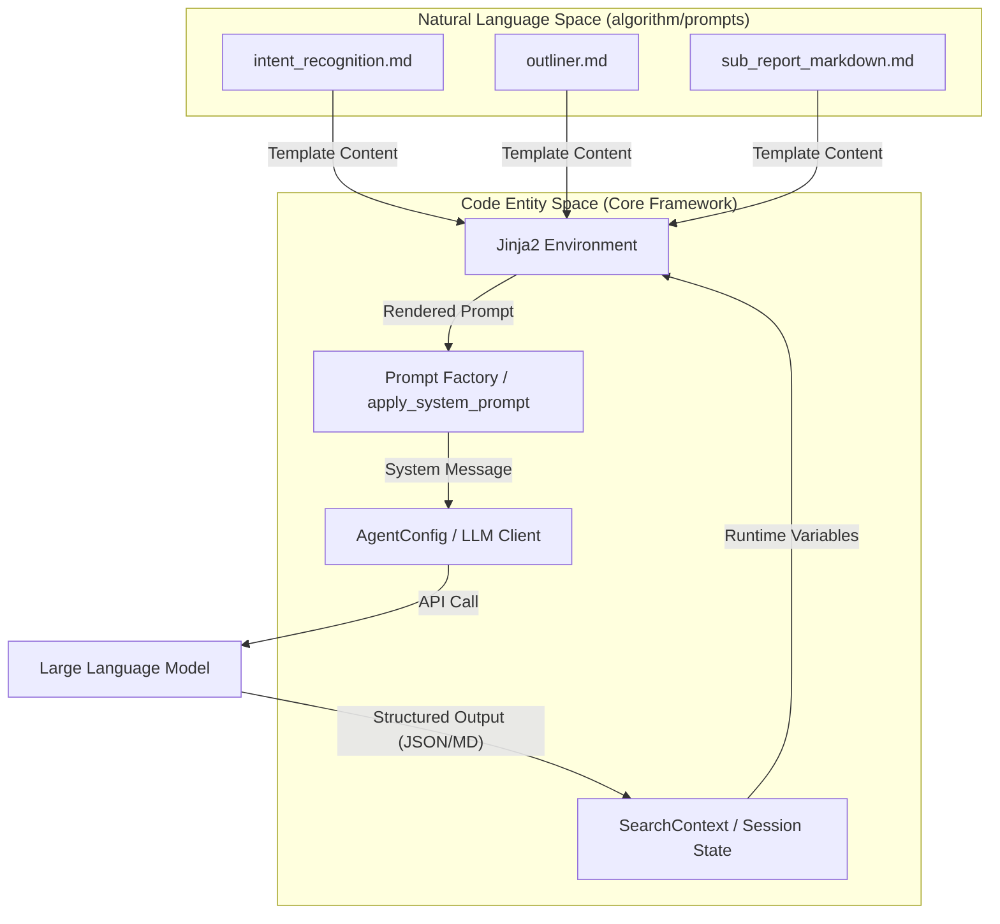
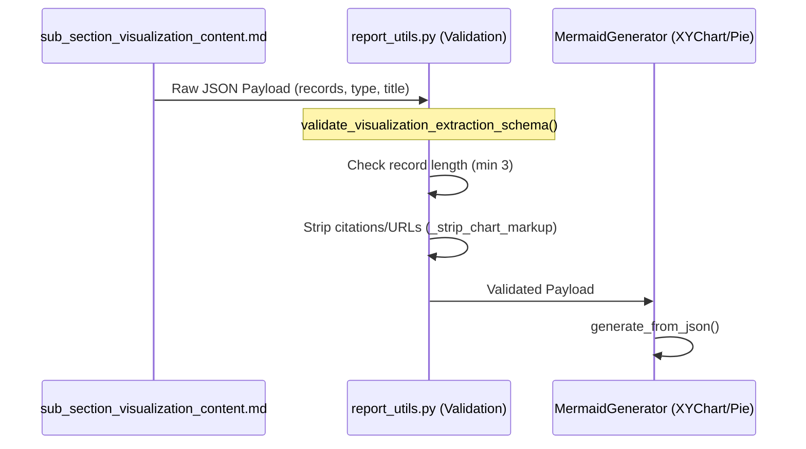

<!-- source: DeepWiki mcp.deepwiki.com · repo openJiuwen-ai/deepsearch · page 11 Prompt Template System · fetched 2026-11-02 -->

# Prompt Template System

Relevant source files

The following files were used as context for generating this wiki page:

- [deepsearch/openjiuwen_deepsearch/algorithm/prompts/chart_compliance_validate.md](deepsearch/openjiuwen_deepsearch/algorithm/prompts/chart_compliance_validate.md)
- [deepsearch/openjiuwen_deepsearch/algorithm/prompts/intent_recognition.md](deepsearch/openjiuwen_deepsearch/algorithm/prompts/intent_recognition.md)
- [deepsearch/openjiuwen_deepsearch/algorithm/prompts/outliner.md](deepsearch/openjiuwen_deepsearch/algorithm/prompts/outliner.md)
- [deepsearch/openjiuwen_deepsearch/algorithm/prompts/report_abstract_markdown.md](deepsearch/openjiuwen_deepsearch/algorithm/prompts/report_abstract_markdown.md)
- [deepsearch/openjiuwen_deepsearch/algorithm/prompts/sub_report_markdown.md](deepsearch/openjiuwen_deepsearch/algorithm/prompts/sub_report_markdown.md)
- [deepsearch/openjiuwen_deepsearch/algorithm/prompts/sub_section_visualization_content.md](deepsearch/openjiuwen_deepsearch/algorithm/prompts/sub_section_visualization_content.md)
- [deepsearch/openjiuwen_deepsearch/algorithm/report/report_utils.py](deepsearch/openjiuwen_deepsearch/algorithm/report/report_utils.py)
- [deepsearch/tests/algorithm/report_export/test_mermaid_renderer.py](deepsearch/tests/algorithm/report_export/test_mermaid_renderer.py)

The Prompt Template System is the engineering foundation for managing the high-density, multi-agent interactions within DeepSearch. It leverages **Jinja2** for dynamic template rendering and a structured mapping system to associate specific agent roles with their corresponding prompt logic.

## 1. Architecture Overview

The system is designed to decouple natural language instructions from the execution logic of the agents. Prompts are stored as Markdown files containing Jinja2 placeholders, allowing the system to inject state variables (e.g., search results, user feedback, or session context) at runtime.

### Key Components

*   **Template Storage**: Located in `algorithm/prompts/`, containing specialized instructions for every phase of the research lifecycle.
*   **Jinja2 Engine**: Used to render variables like `{{ original_query }}`, `{{ entry_search_results }}`, and conditional blocks ``.
*   **Agent Mapping**: The `AgentLlmName` enum (and associated utilities) maps specific agent types to their prompt files.
*   **Prompt Selection Logic**: Dynamic selection based on the current `ResearchIntent`, `report_type` (professional vs. brief), and workflow state.

### Implementation Details
The system uses a standardized approach to apply system prompts. For example, the `IntentRecognitionNode` utilizes the `intent_recognition.md` template to transform raw user queries into structured `ResearchIntent` objects [deepsearch/openjiuwen_deepsearch/algorithm/prompts/intent_recognition.md:5-63]().

## 2. Data Flow: From Template to LLM

The following diagram illustrates how a prompt is assembled from the template library and injected with runtime data before being sent to the LLM.

**Diagram: Prompt Assembly and Execution Flow**

**Sources:** [deepsearch/openjiuwen_deepsearch/algorithm/prompts/intent_recognition.md:1-78](), [deepsearch/openjiuwen_deepsearch/algorithm/prompts/outliner.md:1-115]()

## 3. Subsystem Prompt Catalog

Prompts are organized by their functional role within the multi-agent graph.

### 3.1 Query Understanding & Planning
These templates focus on parsing user intent and creating a research roadmap.

| Template | Purpose | Key Features |
| :--- | :--- | :--- |
| `intent_recognition.md` | Parses `original_query` into structured fields. | Detects `task_type` (comparison, trend), `temporal_scope`, and `report_type` [deepsearch/openjiuwen_deepsearch/algorithm/prompts/intent_recognition.md:9-46](). |
| `outliner.md` | Generates a hierarchical report structure. | Preserves user-specified structures and applies an "8-dimension thinking checklist" [deepsearch/openjiuwen_deepsearch/algorithm/prompts/outliner.md:37-110](). |

### 3.2 Information Collection
Used by the `ResearchCollector` to filter and evaluate evidence.

*   **`collector.md`**: Instructions for the information gathering agents.
*   **`collector_gen_query.md`**: Generates optimized search queries based on the section description.

### 3.3 Report Synthesis & Writing
These templates enforce strict grounding and professional formatting.

*   **`sub_report_markdown.md`**: The primary template for chapter writing. It enforces **Strict Grounding** (no hallucinations) and the `[citation:X]` format [deepsearch/openjiuwen_deepsearch/algorithm/prompts/sub_report_markdown.md:91-118]().
*   **`report_abstract_markdown.md`**: Generates a single-paragraph summary using inline LaTeX for formulas [deepsearch/openjiuwen_deepsearch/algorithm/prompts/report_abstract_markdown.md:7-25]().

### 3.4 Visualization (Mermaid & VLM)
Handles the extraction and validation of data for charts.

| Template | Purpose | Constraints |
| :--- | :--- | :--- |
| `sub_section_visualization_content.md` | Extracts JSON data from prose for charts. | Requires at least 3 records; prohibits citation markers in labels [deepsearch/openjiuwen_deepsearch/algorithm/prompts/sub_section_visualization_content.md:11-30](). |
| `chart_compliance_validate.md` | Validates data against the chapter outline. | Checks for unit consistency and Mermaid readability [deepsearch/openjiuwen_deepsearch/algorithm/prompts/chart_compliance_validate.md:25-60](). |

**Sources:** [deepsearch/openjiuwen_deepsearch/algorithm/prompts/sub_report_markdown.md:1-125](), [deepsearch/openjiuwen_deepsearch/algorithm/prompts/sub_section_visualization_content.md:1-88](), [deepsearch/openjiuwen_deepsearch/algorithm/prompts/chart_compliance_validate.md:1-72]()

## 4. Prompt Logic Implementation

### Visualization Extraction Logic
The visualization pipeline uses a two-stage prompt process. First, `sub_section_visualization_content.md` extracts a raw JSON payload. This payload is then validated by `validate_visualization_extraction_schema` in the code [deepsearch/openjiuwen_deepsearch/algorithm/report/report_utils.py:30-69]().

**Diagram: Visualization Data Extraction and Validation**

**Sources:** [deepsearch/openjiuwen_deepsearch/algorithm/report/report_utils.py:12-69](), [deepsearch/openjiuwen_deepsearch/algorithm/prompts/sub_section_visualization_content.md:17-30]()

### Markdown Renumbering Logic
After the LLM generates sub-reports using the `sub_report_markdown.md` template, the `MarkdownOutlineRenumber` class processes the text to ensure consistent header levels (H1, H2, H3) and numbering, while skipping code and math blocks [deepsearch/openjiuwen_deepsearch/algorithm/report/report_utils.py:156-202]().

**Sources:** [deepsearch/openjiuwen_deepsearch/algorithm/report/report_utils.py:156-202]()

---

