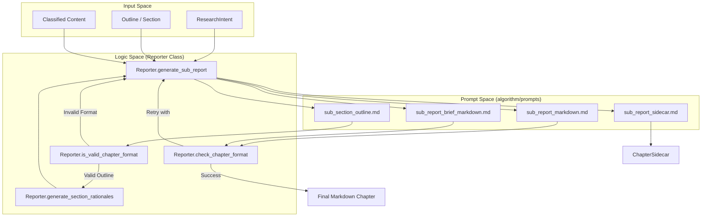
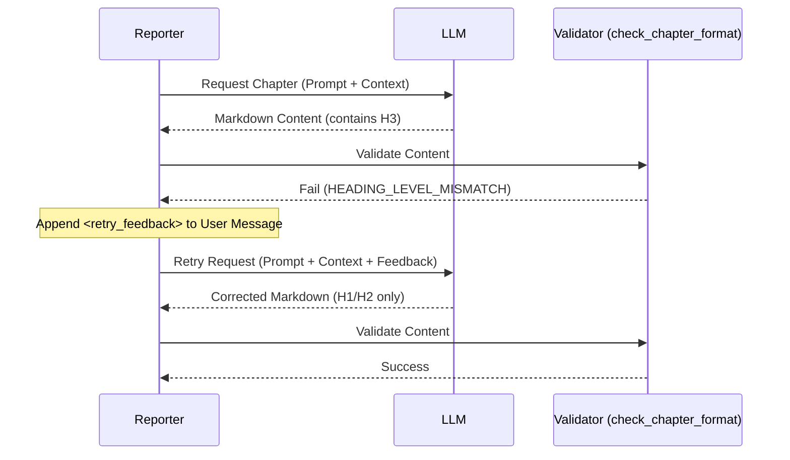

<!-- source: DeepWiki mcp.deepwiki.com · repo openJiuwen-ai/deepsearch · page 5.2 Sub-Report Generation and Chapter Writing · fetched 2026-11-02 -->

# Sub-Report Generation and Chapter Writing

Relevant source files

The following files were used as context for generating this wiki page:

- [deepsearch/docs/feature/algorithm/report-generation/sub-report-generation.md](deepsearch/docs/feature/algorithm/report-generation/sub-report-generation.md)
- [deepsearch/openjiuwen_deepsearch/algorithm/prompts/sub_report_brief_markdown.md](deepsearch/openjiuwen_deepsearch/algorithm/prompts/sub_report_brief_markdown.md)
- [deepsearch/openjiuwen_deepsearch/algorithm/prompts/sub_report_markdown.md](deepsearch/openjiuwen_deepsearch/algorithm/prompts/sub_report_markdown.md)
- [deepsearch/tests/report/test_sub_report.py](deepsearch/tests/report/test_sub_report.py)
- [deepsearch/tests/report/test_tools_in_report.py](deepsearch/tests/report/test_tools_in_report.py)

The sub-report generation phase is responsible for transforming collected evidence, research plans, and intent into a structured Markdown chapter. This process ensures that each section of the final report adheres to a strict structural contract, maintains high information density, and remains grounded in the provided source material.

## 1. Overview and Core Logic

Sub-report generation is orchestrated by the `Reporter.generate_sub_report` method. It operates on a per-chapter basis, taking a specific section of the outline and its associated research data to produce a self-contained Markdown document and a corresponding `ChapterSidecar` for metadata persistence.

### Key Functional Goals
*   **Structural Integrity**: Enforces a flat heading hierarchy (H1/H2 only).
*   **Information Density**: Prioritizes factual, evidence-based writing over narrative filler.
*   **Source Grounding**: Mandates inline citations for every factual claim using the `[citation:X]` format.
*   **Visual Control**: Explicitly prohibits the LLM from generating Mermaid or chart code directly in the text, deferring visualization to a specialized pipeline.

Sources: [deepsearch/docs/feature/algorithm/report-generation/sub-report-generation.md:9-37](), [deepsearch/openjiuwen_deepsearch/algorithm/prompts/sub_report_markdown.md:1-15]()

---

## 2. The Sub-Report Pipeline

The generation process follows a multi-stage pipeline involving sub-outline generation, document selection, and iterative writing with a feedback loop.

### Process Flow: Natural Language to Code Entities

The following diagram maps the conceptual stages of sub-report generation to the specific code entities and prompt templates involved.

**Sub-Report Generation Architecture**

Sources: [deepsearch/docs/feature/algorithm/report-generation/sub-report-generation.md:59-71](), [deepsearch/openjiuwen_deepsearch/algorithm/report/report.py:15-18]()

---

## 3. The Structural Contract

DeepSearch enforces a strict "Flat Heading Contract" to ensure report consistency and readability.

### Heading Level Constraints
*   **H1 (Level 1)**: Reserved for the main chapter title. Every sub-report must contain exactly one H1 as the first line.
*   **H2 (Level 2)**: Used for subsections. These must be sequentially numbered (e.g., `2.1`, `2.2`).
*   **Prohibited H3+**: Headings at Level 3 (`###`) or deeper are forbidden. Deep structures must be represented using bolded unordered lists or paragraphs.
*   **Mermaid Prohibition**: The LLM is strictly forbidden from outputting `mermaid` code fences. If detected, the `MERMAID_OUTPUT_FORBIDDEN` error code is triggered.

### Validation Logic
The `Reporter.check_chapter_format` function performs line-by-line verification:
1.  **H1 Presence**: Checks if the first non-empty line is an H1.
2.  **Sequence Check**: Ensures H2 numbers are continuous and start from `.1`.
3.  **Third-Level Detection**: Detects patterns like `X.Y.Z` at the start of lines to prevent accidental H3 structures.
4.  **Content Sanitization**: The `Reporter.clean_markdown_headers` utility strips leading numbers and converts illegal H4+ headers into bolded list items.

Sources: [deepsearch/docs/feature/algorithm/report-generation/sub-report-generation.md:20-28](), [deepsearch/tests/report/test_tools_in_report.py:41-107](), [deepsearch/tests/report/test_tools_in_report.py:139-161]()

---

## 4. Professional vs. Brief Modes

The system supports two distinct writing styles, controlled via different prompt templates.

| Feature | Professional Mode (`sub_report_markdown.md`) | Brief Mode (`sub_report_brief_markdown.md`) |
| :--- | :--- | :--- |
| **Primary Goal** | Comprehensive, information-dense analysis. | Conclusion-first, high-signal for decision-makers. |
| **Word Count** | Flexible, typically longer. | 300-550 English words (hard ceiling at 700). |
| **Structure** | Full subsection detail. | Max 1-2 short paragraphs per `##` subsection. |
| **Tables** | Used whenever evidence supports it. | Prefer max 1 table per chapter unless required. |

Sources: [deepsearch/openjiuwen_deepsearch/algorithm/prompts/sub_report_markdown.md:1-6](), [deepsearch/openjiuwen_deepsearch/algorithm/prompts/sub_report_brief_markdown.md:1-4](), [deepsearch/openjiuwen_deepsearch/algorithm/prompts/sub_report_brief_markdown.md:97-101]()

---

## 5. Retry-with-Feedback Loop

When an LLM fails to meet the structural or content constraints, the system initiates a retry loop using the `max_generate_retry_num` configuration.

### Error Codes and Feedback
Instead of passing the entire raw error or previous failed text, the system passes a structured `<retry_feedback>` message containing specific error codes:
*   `HEADING_COUNT_MISMATCH`: The number of headings does not match the approved sub-outline.
*   `HEADING_LEVEL_MISMATCH`: The LLM used forbidden levels (e.g., H3).
*   `MERMAID_OUTPUT_FORBIDDEN`: Mermaid code was detected in the output.
*   `SUB_REPORT_GENERATION_EXCEPTION`: General LLM or processing failure.

**Retry Sequence Diagram**

Sources: [deepsearch/docs/feature/algorithm/report-generation/sub-report-generation.md:34-37](), [deepsearch/docs/feature/algorithm/report-generation/sub-report-generation.md:96-97]()

---

## 6. ChapterSidecar Production

For every successful sub-report, a `ChapterSidecar` is generated. This object serves as the "memory" for the chapter, enabling downstream assembly and future iterative edits.

### Sidecar Components
*   **Summary**: A condensed version of the chapter's findings.
*   **Source Mapping**: A record of which `source_id`s were used to support specific claims.
*   **Local Contract**: The specific constraints (e.g., `focus_dimensions`) that were applied during writing.

Sources: [deepsearch/docs/feature/algorithm/report-generation/sub-report-generation.md:33-33](), [deepsearch/docs/feature/algorithm/report-generation/sub-report-generation.md:83-87]()

---

