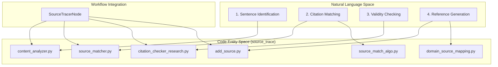
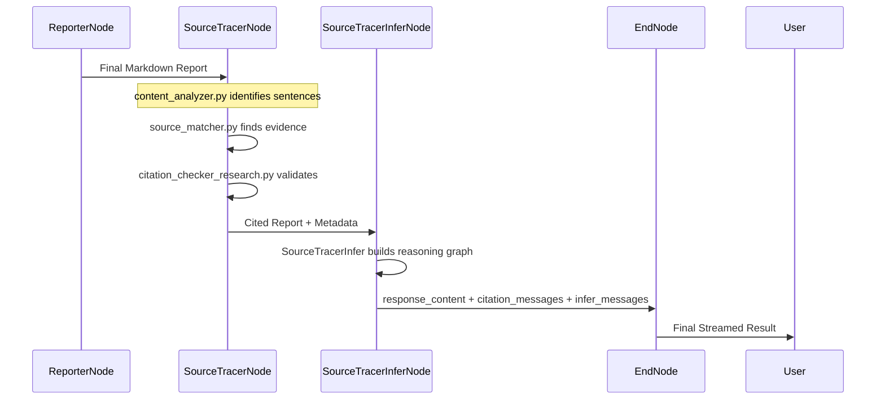

<!-- source: DeepWiki mcp.deepwiki.com · repo openJiuwen-ai/deepsearch · page 6.1 Global Source Tracer · fetched 2026-11-02 -->

# Global Source Tracer

Relevant source files

The following files were used as context for generating this wiki page:

- [deepsearch/docs/en/4.Developer Guide/API Reference/main_nodes.md](deepsearch/docs/en/4.Developer Guide/API Reference/main_nodes.md)
- [deepsearch/docs/feature/framework/research-workflow.md](deepsearch/docs/feature/framework/research-workflow.md)
- [deepsearch/openjiuwen_deepsearch/framework/openjiuwen/agent/main_graph_nodes.py](deepsearch/openjiuwen_deepsearch/framework/openjiuwen/agent/main_graph_nodes.py)
- [deepsearch/tests/node/test_agent_node.py](deepsearch/tests/node/test_agent_node.py)

The **Global Source Tracer** is a post-processing subsystem within the DeepSearch research workflow responsible for ensuring the factual provenance of generated reports. It identifies sentences requiring evidence, matches them against collected source documents, verifies the validity of these matches, and generates a standardized reference list. The system uses a specific `[checked_citation:id]` marker format to maintain stable references between the report body and the metadata returned to the frontend.

## Overview and Data Flow

The source tracing pipeline is orchestrated primarily by the `SourceTracerNode` and, for reasoning chains, the `SourceTracerInferNode`. The process transforms a raw Markdown report and a collection of evidence into a cited document with verified metadata.

### System Components to Code Entities
The following diagram bridges the natural language functional steps to the specific code entities implementing them.

**Source Tracing Pipeline Architecture**

**Sources:** [deepsearch/openjiuwen_deepsearch/framework/openjiuwen/agent/main_graph_nodes.py:95-128](), [deepsearch/docs/en/4.Developer Guide/API Reference/main_nodes.md:95-107]()

## SourceTracerNode Implementation

The `SourceTracerNode` is a `BaseNode` that executes after the `ReporterNode` has synthesized the full report. Its primary role is to enrich `final_result.response_content` with citation markers and populate `citation_messages` with metadata.

### Execution Lifecycle
1.  **Switch Check**: The node checks `source_tracer_research_trace_source_switch`. If disabled, it skips processing [deepsearch/docs/en/4.Developer Guide/API Reference/main_nodes.md:102]().
2.  **Preprocessing**: Calls `preprocess_info` to prepare the report content and evidence pool [deepsearch/openjiuwen_deepsearch/framework/openjiuwen/agent/main_graph_nodes.py:62-63]().
3.  **Verification**: Invokes `postprocess_by_citation_checker` to perform the actual matching and validity logic [deepsearch/openjiuwen_deepsearch/framework/openjiuwen/agent/main_graph_nodes.py:60-61]().
4.  **Result Injection**:
    *   Inserts `[checked_citation:id]` markers into the Markdown body [deepsearch/docs/en/4.Developer Guide/API Reference/main_nodes.md:105]().
    *   Updates `final_result.response_content` with the cited text.
    *   Populates `citation_messages` with source details (URL, title, snippet).

**Sources:** [deepsearch/openjiuwen_deepsearch/framework/openjiuwen/agent/main_graph_nodes.py:95-107](), [deepsearch/docs/en/4.Developer Guide/API Reference/main_nodes.md:95-107]()

## Core Pipeline Modules

The tracing logic is modularized within the `source_trace/` directory.

### 1. Content Analysis (`content_analyzer.py`)
This module identifies individual claims or sentences within the generated report that require grounding. It segments the Markdown text while preserving structure (headings, tables).

### 2. Source Matching (`source_matcher.py` & `source_match_algo.py`)
These modules handle the retrieval and ranking of relevant evidence for a given sentence.
*   **Matching**: Compares sentence semantics against the `SearchContext` evidence pool.
*   **Algorithms**: Uses `source_match_algo.py` to calculate similarity scores and filter out low-confidence matches.

### 3. Validity Checking (`citation_checker_research.py`)
A critical step that uses an LLM-based checker to verify if the matched source actually supports the claim made in the report. This prevents "hallucinated citations" where a source is linked but contains no relevant information.

### 4. Reference Generation (`add_source.py` & `domain_source_mapping.py`)
*   **add_source.py**: Appends a formatted "References" section to the end of the report.
*   **domain_source_mapping.py**: Manages the mapping of source IDs to specific domains and handles icon/favicon resolution for the UI.

**Sources:** [deepsearch/openjiuwen_deepsearch/framework/openjiuwen/agent/main_graph_nodes.py:60-64](), [deepsearch/docs/en/4.Developer Guide/API Reference/main_nodes.md:123]()

## SourceTracerInferNode

While the `SourceTracerNode` focuses on the final report, the `SourceTracerInferNode` handles **Inference-Chain Tracing**.

*   **Purpose**: It generates a reasoning graph that shows how specific pieces of evidence led to specific conclusions [deepsearch/docs/en/4.Developer Guide/API Reference/main_nodes.md:131-133]().
*   **Output**: Produces `infer_messages` which are returned to the frontend, often rendered as an interactive HTML graph.
*   **Logic**: Uses the `SourceTracerInfer` class to build provenance artifacts [deepsearch/openjiuwen_deepsearch/framework/openjiuwen/agent/main_graph_nodes.py:64]().

**Sources:** [deepsearch/openjiuwen_deepsearch/framework/openjiuwen/agent/main_graph_nodes.py:130-134](), [deepsearch/docs/en/4.Developer Guide/API Reference/main_nodes.md:129-133]()

## Citation Marker Format

The system uses a stable internal marker format: `[checked_citation:id]`.

| Feature | Description |
| :--- | :--- |
| **Marker Syntax** | `[checked_citation:1]`, `[checked_citation:2]`, etc. |
| **Stability** | These markers are inserted into the `response_content` and remain consistent even if the report is partially edited [deepsearch/docs/en/4.Developer Guide/API Reference/main_nodes.md:105](). |
| **Frontend Mapping** | The `id` corresponds to a key in the `citation_messages` dictionary, which contains the full metadata (URL, Title, Author) [deepsearch/docs/en/4.Developer Guide/API Reference/main_nodes.md:105](). |
| **Diff-Awareness** | During local rewrites in `UserFeedbackProcessorNode`, the system performs diff-aware tracing, keeping markers for unchanged text and generating new ones for modified spans [deepsearch/docs/en/4.Developer Guide/API Reference/main_nodes.md:123](). |

**Sources:** [deepsearch/docs/en/4.Developer Guide/API Reference/main_nodes.md:105-123]()

## Integration in Workflow

The tracer is integrated into the `DeepresearchAgent` main graph, typically positioned after report synthesis and before final output.

**Global Tracer Workflow Integration**

**Sources:** [deepsearch/openjiuwen_deepsearch/framework/openjiuwen/agent/main_graph_nodes.py:95-139](), [deepsearch/docs/feature/framework/research-workflow.md:52-54]()

---

