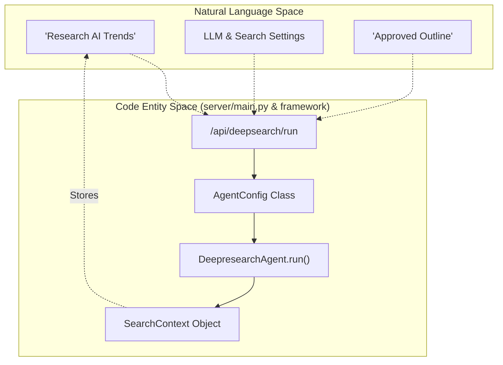

<!-- source: DeepWiki mcp.deepwiki.com · repo openJiuwen-ai/deepsearch · page 9.2 DeepSearch Run API and Streaming · fetched 2026-11-02 -->

# DeepSearch Run API and Streaming

<details>
<summary>Relevant source files</summary>

The following files were used as context for generating this wiki page:

- [deepsearch/docs/en/4.Developer Guide/API Reference/main_nodes.md](deepsearch/docs/en/4.Developer Guide/API Reference/main_nodes.md)
- [deepsearch/docs/feature/framework/research-workflow.md](deepsearch/docs/feature/framework/research-workflow.md)
- [deepsearch/tests/node/test_agent_node.py](deepsearch/tests/node/test_agent_node.py)
- [deepsearch/tests/server/report_manager/test_report_processor.py](deepsearch/tests/server/report_manager/test_report_processor.py)

</details>


The `DeepSearch Run API` is the primary interface for executing research workflows within the OpenJiuwen-DeepSearch system. It provides a streaming SSE (Server-Sent Events) interface that allows clients to receive real-time updates from the multi-agent orchestration layer, including intermediate thoughts, search queries, and the final structured report.

## 1. The /api/deepsearch/run Endpoint

The API is defined within the FastAPI application runtime and serves as the bridge between the frontend/SDK and the `DeepresearchAgent` workflow.

### Request Schema: AgentConfig
Requests to this endpoint must provide an `AgentConfig` object, which encapsulates the behavior of the research process. Key parameters include:
*   **`message`**: The user's research query.
*   **`conversation_id`**: A unique identifier for the session. The system enforces a uniqueness constraint to prevent overlapping executions for the same session.
*   **`agent_config`**: Configuration for LLMs, search engines, and knowledge bases.
*   **`interrupt_feedback`**: Used for resuming a workflow that has paused for Human-in-the-Loop (HITL) input (e.g., clarifying questions or outline approval).

### Streaming Event Format
The API returns a stream of JSON-encoded events. Each event follows the `StreamEvent` type structure:
*   **`PROGRESS`**: Updates on the current node execution (e.g., "Recognizing Intent", "Generating Outline").
*   **`THOUGHT`**: The LLM's internal reasoning or planned actions.
*   **`SEARCH_QUERY`**: The specific queries being sent to web or local search engines.
*   **`INTERRUPT`**: A signal that the workflow is waiting for user feedback.
*   **`ERROR`**: Details of any exceptions encountered during execution.
*   **`FINAL_RESULT`**: The complete research package, including the report, citations, and charts.
*   **`ALL END`**: The terminal signal for the stream.

**Sources:** [deepsearch/docs/feature/framework/research-workflow.md:18-27](), [deepsearch/docs/en/4.Developer Guide/API Reference/main_nodes.md:136-139]()

---

## 2. DeepSearch Run Manager Logic

The execution is managed by `DeepresearchAgent` (and its variants like `DeepresearchIntentHybridAgent`). This manager orchestrates the lifecycle of the `SearchContext` and the underlying `Workflow`.

### Execution Flow
The manager follows a strictly defined sequence to ensure data consistency and proper resource cleanup:
1.  **Initialization**: `DeepresearchAgent.run` validates the `AgentConfig` and initializes LLM and search tool contexts [deepsearch/docs/feature/framework/research-workflow.md:44-45]().
2.  **Context Setup**: `StartNode` initializes the `search_context` and merges service-level configurations [deepsearch/docs/en/4.Developer Guide/API Reference/main_nodes.md:7-11]().
3.  **HITL Resumption**: If `interrupt_feedback` is provided, the workflow resumes from the point of interruption (e.g., `OutlineInteractionNode`) [deepsearch/docs/feature/framework/research-workflow.md:19-22]().
4.  **Result Extraction**: Upon reaching the `EndNode`, the system invokes `parse_endnode_content` to extract the final report, citations, and VLM-generated charts into the `final_result` object [deepsearch/docs/en/4.Developer Guide/API Reference/main_nodes.md:135-139]().

### Diagram: API to Code Entity Mapping
This diagram bridges the Natural Language concepts of the API request to the specific code entities that handle them.


**Sources:** [deepsearch/docs/feature/framework/research-workflow.md:44-54](), [deepsearch/docs/en/4.Developer Guide/API Reference/main_nodes.md:7-11]()

---

## 3. Interrupt and Feedback Workflow

DeepSearch supports asynchronous interruption via `interrupt_feedback`. This is critical for nodes that require human validation before proceeding to expensive operations like full-report writing.

### HITL Interaction Points
1.  **Clarifying Questions**: `GenerateQuestionsNode` produces questions if the intent is ambiguous. The workflow pauses at `FeedbackHandlerNode` [deepsearch/docs/en/4.Developer Guide/API Reference/main_nodes.md:19-29]().
2.  **Outline Approval**: `OutlineInteractionNode` pauses the workflow to allow the user to `accept`, `revise_comment`, or `revise_outline` [deepsearch/docs/en/4.Developer Guide/API Reference/main_nodes.md:43-56]().

### Resumption Mechanism
When the client calls `/api/deepsearch/run` with an existing `conversation_id` and an `interrupt_feedback` string, the `StartNode` sets the `interrupt_feedback` in the session, allowing the `WorkflowController` to route the state back into the graph logic [deepsearch/docs/en/4.Developer Guide/API Reference/main_nodes.md:11-12]().

**Sources:** [deepsearch/docs/feature/framework/research-workflow.md:58-63](), [deepsearch/tests/node/test_agent_node.py:111-120]()

---

## 4. Data Flow and Event Generation

The following diagram illustrates the data flow from the initial request through the internal nodes to the final streaming output.

```mermaid
sequenceDiagram
    participant Client
    participant API as /api/deepsearch/run
    participant Agent as DeepresearchAgent
    participant Node as WorkflowNodes
    participant End as EndNode

    Client->>API: POST (AgentConfig + query)
    API->>Agent: Initialize Workflow
    Agent->>Node: StartNode (Init SearchContext)
    Node-->>Agent: PROGRESS: "Starting..."
    Agent-->>Client: SSE {event: PROGRESS, data: ...}
    
    Note over Node: Intent Recognition & Search
    Node-->>Agent: SEARCH_QUERY: "AI trends 2024"
    Agent-->>Client: SSE {event: SEARCH_QUERY, data: ...}
    
    Note over Node: Outline Generation
    Node-->>Agent: THOUGHT: "Structuring report..."
    Agent-->>Client: SSE {event: THOUGHT, data: ...}
    
    Agent->>End: Finalize Report
    End->>End: parse_endnode_content()
    End-->>Agent: FINAL_RESULT: {markdown, citations, charts}
    Agent-->>Client: SSE {event: FINAL_RESULT, data: ...}
    Agent-->>Client: SSE {event: ALL END}
```
**Sources:** [deepsearch/docs/feature/framework/research-workflow.md:42-54](), [deepsearch/docs/en/4.Developer Guide/API Reference/main_nodes.md:135-139]()

---

## 5. Result Extraction and Finalization

The `EndNode` is responsible for the final transformation of the `SearchContext` into a consumable format.

### parse_endnode_content Workflow
1.  **AI Attribution**: Appends a localized AI-generation notice (based on `search_context.language`) to the `response_content` [deepsearch/docs/en/4.Developer Guide/API Reference/main_nodes.md:138-139]().
2.  **Citation Assembly**: Collects `citation_messages` generated by the `SourceTracerNode` and appends them as a reference list if configured [deepsearch/docs/en/4.Developer Guide/API Reference/main_nodes.md:103-105]().
3.  **Chart Integration**: Aggregates `chart_messages` from the `VLMChartGeneratorNode` [deepsearch/docs/en/4.Developer Guide/API Reference/main_nodes.md:92-93]().
4.  **Error Handling**: If the workflow encountered partial failures, the `exception_info` is bundled into the `final_result` so the client can display warnings alongside the generated content [deepsearch/docs/feature/framework/research-workflow.md:26-27]().

### Implementation Details
| Feature | Implementation | Source |
| :--- | :--- | :--- |
| **Streaming Logic** | Async generator in `DeepresearchAgent.run` | [workflow.py:62]() |
| **Feedback Resumption** | `session.interact` via `interrupt_feedback` | [research-workflow.md:63]() |
| **Token Tracking** | `stats_info_llm` flag in `EndNode` | [research-workflow.md:64]() |
| **Cleanup** | `bytearray` secret clearing for API keys | [research-workflow.md:72]() |

**Sources:** [deepsearch/docs/feature/framework/research-workflow.md:64-76](), [deepsearch/docs/en/4.Developer Guide/API Reference/main_nodes.md:135-140]()

---

