# Page: Overview

# Overview

<details>
<summary>Relevant source files</summary>

The following files were used as context for generating this wiki page:

- [README.md](README.md)
- [README_zh.md](README_zh.md)
- [deepsearch/README.md](deepsearch/README.md)
- [deepsearch/README_zh.md](deepsearch/README_zh.md)

</details>


**openJiuwen-DeepSearch** is a knowledge-augmented, high-performance deep retrieval and research engine [README.md:3-5](). It leverages the **openJiuwen agent-core** framework to coordinate a multi-agent system designed for complex reasoning, multi-step workflows, and professional report generation [README.md:5-9]().

The system is designed to bridge the gap between simple web searches and enterprise-grade research by integrating local knowledge bases with real-time web retrieval, all while maintaining rigorous segment-level provenance [README.md:20-32]().

## Key Capabilities

DeepSearch provides a suite of advanced features for technical and professional research:

*   **Example-driven Research**: Users can provide existing reports (PDF, Word, HTML, etc.) to extract structures and generate similar research documents [README.md:16-18]().
*   **Hybrid Retrieval**: Combines local vector/keyword/graph search with live web search to ensure comprehensive data coverage [README.md:20-23]().
*   **Human-in-the-Loop (HITL)**: Allows natural-language interaction during the planning phase to refine research outlines and intents [README.md:25-27]().
*   **Rich Visualization**: Automatically generates charts and figures within reports using VLM (Vision Language Model) pipelines [README.md:34-36]().
*   **Deep Provenance**: Every claim is backed by validated citations with segment-level traceability [README.md:29-31]().

Sources: [README.md:14-37](), [README_zh.md:12-34]()

## System Architecture

The architecture is built on the **openJiuwen agent-core** and is divided into several major functional layers. At its center is the **Manager**, which orchestrates agents across the research lifecycle [README.md:40-46]().

### High-Level Subsystems

| Subsystem | Responsibility |
| :--- | :--- |
| **Manager** | Agent creation, workflow orchestration, and state management [README.md:46](). |
| **Query Planning** | Intent recognition, task decomposition, and structural planning [README.md:47](). |
| **Knowledge Retrieval** | Hybrid search (local + web) and offline knowledge construction [README.md:48](). |
| **Analysis** | Evaluation, refinement, and fusion of retrieved information [README.md:49](). |
| **Generation** | Report synthesis, interactive editing, and provenance tracing [README.md:50](). |

For a deep dive into the framework and orchestration logic, see **[System Architecture and Key Concepts (#1.1)]**.

Sources: [README.md:38-50](), [README_zh.md:36-46]()

## Code Entity Mapping

The following diagrams illustrate how high-level research concepts map to specific code entities and data structures within the repository.

### From Intent to Workflow Execution
This diagram shows how a user's natural language query is processed by the core system components.

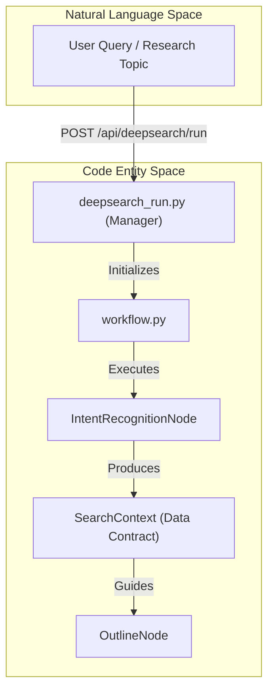
Sources: [README.md:46-47](), [README_zh.md:42-43]()

### Knowledge Retrieval and Synthesis
This diagram bridges the gap between raw information sources and the structured report generation components.

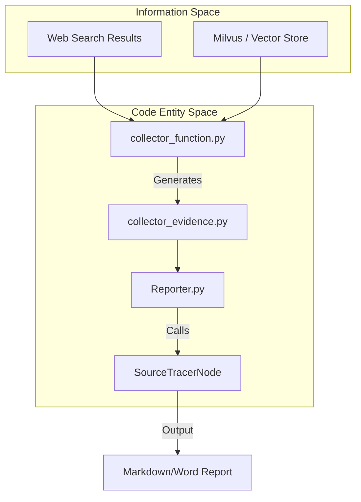
Sources: [README.md:48-50](), [README_zh.md:44-46]()

## Operational Context

DeepSearch is typically deployed as part of the **openJiuwen Studio** platform, which provides the UI and management layer [README.md:52](). Developers can also interact with the system via the **DeepSearch SDK** or the CLI [README.md:79]().

*   **Studio**: End-to-end platform for managing models, tools, and knowledge.
*   **DeepSearch SDK**: The core logic and API for integration into other applications.
*   **openJiuwen Ops**: Observability and tuning platform for the agents.

To learn how to set up and run the system, see **[Getting Started and CLI Usage (#1.2)]**.

Sources: [README.md:52-59](), [README_zh.md:48-55]()

---

# Page: System Architecture and Key Concepts

# System Architecture and Key Concepts

<details>
<summary>Relevant source files</summary>

The following files were used as context for generating this wiki page:

- [README.md](README.md)
- [README_zh.md](README_zh.md)
- [deepsearch/docs/feature/framework/search-context.md](deepsearch/docs/feature/framework/search-context.md)
- [deepsearch/openjiuwen_deepsearch/framework/openjiuwen/agent/search_context.py](deepsearch/openjiuwen_deepsearch/framework/openjiuwen/agent/search_context.py)

</details>


This page describes the overall multi-agent architecture of openJiuwen-DeepSearch. It covers the framework's core components, the coordination between specialized agents, and the data contracts that enable complex research workflows.

## Multi-Agent Architecture Overview

openJiuwen-DeepSearch is built upon the **openJiuwen agent-core** framework [README.md:5-5]() [README.md:40-40](). It employs a hierarchical multi-agent design where a central **Manager** orchestrates specialized agents to perform query planning, information gathering, reasoning, and report generation [README.md:42-46]().

### Core Subsystems

The system is logically divided into five functional areas:
1.  **Manager**: Handles agent creation, workflow orchestration, and configuration management [README.md:46-46]().
2.  **Query Planning**: Responsible for intent recognition, task decomposition, and structural planning [README.md:47-47]().
3.  **Knowledge Retrieval**: Manages offline knowledge construction (parsing/indexing) and online hybrid retrieval (web + local KB) [README.md:48-48]().
4.  **Understanding & Analysis**: Evaluates and refines retrieved information to reduce noise and context costs [README.md:49-49]().
5.  **Result Generation**: Produces the final report with validated citations and visual charts [README.md:50-50]().

### System Component Relationship
The following diagram illustrates how the DeepSearch SDK interacts with the broader openJiuwen ecosystem.

**System Integration Diagram**
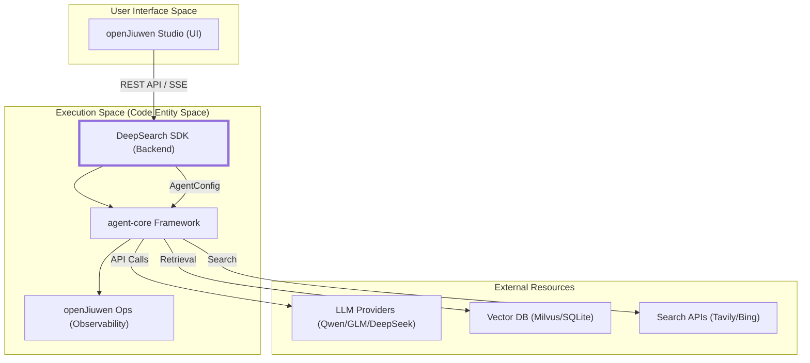
Sources: [README.md:40-59](), [deepsearch/docs/feature/framework/search-context.md:15-22]()

---

## Search Modes

DeepSearch supports three distinct execution modes tailored for different user needs:

| Mode | Description | Primary Use Case |
| :--- | :--- | :--- |
| **Research** | Full multi-agent workflow including planning, parallel/dependency-driven writing, and VLM chart generation. | Professional reports, financial analysis, academic research. |
| **Search** | Optimized for high-speed retrieval and direct answering using a search-specific agent. | Quick fact-finding, real-time news retrieval. |
| **React** | An iterative "Reason-Act" loop where the agent dynamically chooses tools to solve a query. | Complex tool-use tasks, multi-step calculations. |

Sources: [README.md:9-12](), [deepsearch/docs/feature/framework/search-context.md:15-22]()

---

## The Manager and Workflow Orchestration

The `workflow.py` file defines the execution logic of the system, while `AgentFactory` is responsible for instantiating the specific agents required for a given task.

### Manager Pattern
The Manager coordinates the lifecycle of a request:
1.  **Initialization**: `StartNode` creates the initial `SearchContext` and stores it in the global state [deepsearch/docs/feature/framework/search-context.md:36-36]().
2.  **Orchestration**: The workflow traverses nodes defined in `main_graph_nodes.py`, such as `IntentRecognitionNode` and `OutlineNode` [deepsearch/docs/feature/framework/search-context.md:27-27]().
3.  **State Management**: Progress is persisted via a `Session` object, allowing for Human-in-the-Loop (HITL) interruptions and resumptions [deepsearch/docs/feature/framework/search-context.md:11-12]().

**Workflow Logic Diagram**
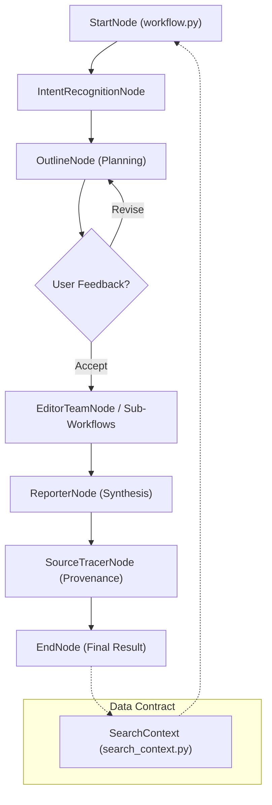
Sources: [deepsearch/docs/feature/framework/search-context.md:36-40](), [deepsearch/openjiuwen_deepsearch/framework/openjiuwen/agent/search_context.py:158-172]()

---

## Data Contract: SearchContext

The `SearchContext` class is the central data structure (Pydantic model) that maintains the state of a research task across all nodes and sub-workflows [deepsearch/openjiuwen_deepsearch/framework/openjiuwen/agent/search_context.py:7-172]().

### Key Data Structures

*   **`SearchContext`**: The root object containing the user query, `ResearchIntent`, `Outline`, and the final `Report` [deepsearch/docs/feature/framework/search-context.md:15-19]().
*   **`ResearchIntent`**: Captures task type, comparison objects, temporal scopes, and domain constraints [deepsearch/openjiuwen_deepsearch/framework/openjiuwen/agent/search_context.py:51-57]().
*   **`Outline` & `Section`**: Represents the structured plan. Each `Section` contains `section_focus` and `focus_dimensions` to prevent redundancy between agents [deepsearch/openjiuwen_deepsearch/framework/openjiuwen/agent/search_context.py:65-100]().
*   **`FinalResult`**: The terminal state containing the `response_content`, `citation_messages` (provenance), and `chart_messages` (VLM visuals) [deepsearch/openjiuwen_deepsearch/framework/openjiuwen/agent/search_context.py:158-172]().

### Section Local Contract
To ensure consistency in parallel writing, the system generates a "Section Local Contract" for each sub-workflow using `Section.section_focus` and `focus_dimensions`. This restricts each agent to a specific analytical boundary [deepsearch/docs/feature/framework/search-context.md:50-50]().

| Field | Type | Description |
| :--- | :--- | :--- |
| `response_content` | `str` | The final Markdown report text. |
| `citation_messages` | `dict` | Global source tracing and citation data. |
| `infer_messages` | `List[Dict]` | Data for the inference-chain visualization. |
| `chart_messages` | `List[Dict]` | Metadata for VLM-generated charts. |

Sources: [deepsearch/openjiuwen_deepsearch/framework/openjiuwen/agent/search_context.py:158-172](), [deepsearch/docs/feature/framework/search-context.md:42-58]()

---

# Page: Getting Started and CLI Usage

# Getting Started and CLI Usage

<details>
<summary>Relevant source files</summary>

The following files were used as context for generating this wiki page:

- [README.md](README.md)
- [README_zh.md](README_zh.md)
- [deepsearch/README.md](deepsearch/README.md)

</details>


This page details how to execute the openJiuwen-DeepSearch system via the command-line interface (CLI) using `main.py`. It covers the configuration of LLMs, search engines, and vector databases, as well as the different operation modes and the internal question routing mechanism.

## CLI Entry Point and Arguments

The primary entry point for the DeepSearch SDK is `deepsearch/main.py`. It utilizes the `argparse` module to handle a comprehensive set of configuration parameters required for the multi-agent research workflow.

### Core Arguments

| Argument | Description | Default |
| :--- | :--- | :--- |
| `--query` | The research question or search query to process. | `None` |
| `--search_mode` | The research strategy to employ. Options: `research`, `search`, `react`. | `research` |
| `--execution_method` | Workflow orchestration style. Options: `parallel`, `dependency_driving`. | `parallel` |
| `--mode` | Operation mode. Options: `query`, `template`, `all`. | `query` |

### LLM Configuration

DeepSearch supports flexible LLM provider configuration. These arguments map to the `LLMConfig` used by the `AgentFactory` to instantiate model clients.

*   **`--llm_api_key`**: API key for the primary LLM provider.
*   **`--llm_base_url`**: Base URL for the LLM API (e.g., OpenAI-compatible endpoints).
*   **`--llm_model_name`**: The specific model identifier (e.g., `qwen-max`, `gpt-4o`).
*   **`--llm_provider`**: The provider type (e.g., `openai`, `dashscope`).

### Web Search and Milvus Configuration

To facilitate information gathering, the CLI allows configuring external search engines and local vector stores:

*   **`--search_api_key`**: API key for the web search provider (e.g., Bing, Google).
*   **`--search_engine`**: The search engine to use (e.g., `bing`, `google`, `duckduckgo`).
*   **`--milvus_uri` / `--milvus_token`**: Connection details for the Milvus vector database, used for local knowledge base retrieval.

**Sources:** `deepsearch/main.py` [deepsearch/main.py:1-50](), `deepsearch/agent_factory.py` [deepsearch/agent_factory.py:1-30]()

---

## Operation Modes

The `--mode` argument determines the primary behavior of the `main.py` execution script.

### 1. Query Mode (`query`)
This is the standard execution path. The system takes a natural language `--query`, identifies the intent, plans a research outline, collects evidence, and generates a structured report.

### 2. Template Mode (`template`)
In this mode, the system focuses on processing report templates. It can extract structures from existing documents (Markdown, PDF, DOCX) to guide future research generations, ensuring consistent formatting across different topics.

### 3. All Mode (`all`)
A combination mode typically used for testing or batch processing where both template extraction and query-based research are performed sequentially.

**Sources:** `deepsearch/main.py` [deepsearch/main.py:60-85](), `deepsearch/algorithm/report_template/template_generator.py` [deepsearch/algorithm/report_template/template_generator.py:1-40]()

---

## Question Router and Search Modes

When a query is submitted, the system determines the best execution path based on the `--search_mode`. The `question_model_router` utility is responsible for selecting the appropriate model and prompt parameters based on the complexity of the task.

### Search Mode Comparison

| Mode | Target Use Case | Implementation Logic |
| :--- | :--- | :--- |
| **`research`** | Deep, multi-step professional reports. | Uses the `MainGraph` workflow with intent recognition, outliners, and editor teams. |
| **`search`** | Quick information retrieval with summaries. | Uses the `SearchAgent` with a simplified tool-calling loop focused on immediate answers. |
| **`react`** | Complex tool-use and reasoning tasks. | Employs a ReAct (Reason + Act) loop via the `SearchAgent` state machine. |

### Data Flow: CLI to Agent Execution

The following diagram illustrates how CLI arguments are transformed into a running research session.

**CLI to Code Entity Mapping**

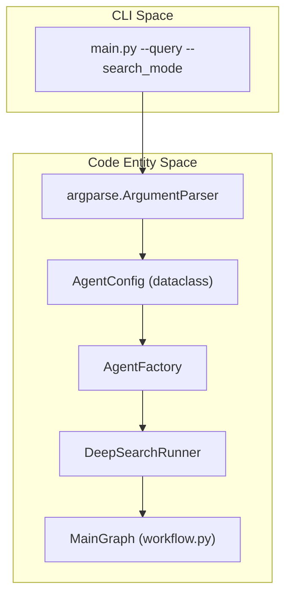

**Sources:** `deepsearch/main.py` [deepsearch/main.py:40-100](), `deepsearch/workflow.py` [deepsearch/workflow.py:1-50](), `deepsearch/utils/question_model_router.py` [deepsearch/utils/question_model_router.py:1-35]()

---

## Execution Workflow

When `main.py` is executed, it initializes the `DeepSearchRunner`, which orchestrates the interaction between the `AgentFactory` and the `workflow.py` graph.

### Execution Sequence

1.  **Initialization**: `main.py` parses arguments and populates an `AgentConfig` object.
2.  **Factory Setup**: `AgentFactory` is initialized with LLM and Search configurations.
3.  **Workflow Instantiation**: The `MainGraph` (or `SearchAgent` graph) is built using `langgraph`.
4.  **Session Start**: A `Session` object is created to track state, including the `conversation_id`.
5.  **Streaming Output**: The system begins execution, streaming events (e.g., `IntentRecognition`, `OutlineGeneration`) to the console or log.

**System Data Flow: CLI Input to Workflow State**

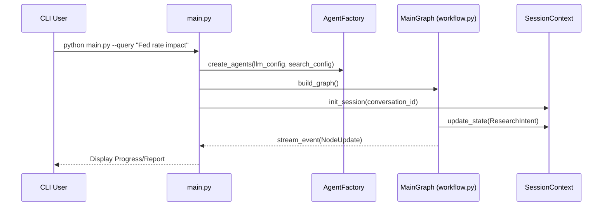

**Sources:** `deepsearch/main.py` [deepsearch/main.py:100-150](), `deepsearch/workflow.py` [deepsearch/workflow.py:50-120](), `deepsearch/agent_factory.py` [deepsearch/agent_factory.py:40-80]()

---

# Page: Installation and Deployment

# Installation and Deployment

<details>
<summary>Relevant source files</summary>

The following files were used as context for generating this wiki page:

- [deepsearch/docs/en/2.Installation Guide/DeepSearch Full Edition/README.md](deepsearch/docs/en/2.Installation Guide/DeepSearch Full Edition/README.md)

</details>


This page provides a high-level overview of the deployment strategies for the DeepSearch system. DeepSearch can be deployed either as a comprehensive product suite (Full Edition) or as a standalone backend service (SDK Only). The installation process supports multiple operating systems (Linux, Windows, and macOS) through both containerized (Docker) and manual methods.

## Deployment Options

DeepSearch is architected to be flexible, allowing users to choose between a user-facing interface or a pure API-driven backend.

| Option | Components Included | Primary Use Case |
| :--- | :--- | :--- |
| **DeepSearch Full Edition** | Studio (Web UI) + DeepSearch SDK | End-to-end research product with visual management and knowledge base UI. |
| **DeepSearch SDK Only** | DeepSearch SDK (FastAPI Backend) | Integration into existing applications via API or for headless agentic workflows. |

Sources: [deepsearch/docs/en/2.Installation Guide/DeepSearch Full Edition/README.md:1-9]()

### System Connectivity Bridge
When deploying the Full Edition, the **Studio** component acts as a client to the **DeepSearch SDK**. The connection between these two services is established through specific environment variables that must be aligned in their respective `.env` files.

*   **Studio Configuration**: Uses `DEEPSEARCH_AGENT_HOST` and `DEEPSEARCH_AGENT_PORT` to locate the backend.
*   **SDK Configuration**: Uses `HOST` and `BACKEND_PORT` to define its listening interface.

Sources: [deepsearch/docs/en/2.Installation Guide/DeepSearch Full Edition/README.md:23-26]()

## Deployment Architecture

The following diagram illustrates how the system components interact across different deployment scenarios, bridging the user-facing "Studio" to the internal "SDK" logic.

**DeepSearch Component Interaction**
```mermaid
graph TD
    subgraph "Natural Language Space (User Interface)"
        ["Studio Web UI"] -- "HTTP/SSE" --> ["Studio Backend"]
    end

    subgraph "Code Entity Space (DeepSearch SDK)"
        ["Studio Backend"] -- "DEEPSEARCH_AGENT_HOST:PORT" --> ["FastAPI Server (server/main.py)"]
        ["FastAPI Server (server/main.py)"] --> ["DeepSearch Run API (deepsearch_run.py)"]
        ["DeepSearch Run API (deepsearch_run.py)"] --> ["Workflow Runner (algorithm/workflow.py)"]
    end

    subgraph "Data & Persistence"
        ["FastAPI Server (server/main.py)"] --> ["SQLAlchemy DB (MySQL/SQLite)"]
        ["DeepSearch Run API (deepsearch_run.py)"] --> ["Redis Checkpointer"]
    end
```
Sources: [deepsearch/docs/en/2.Installation Guide/DeepSearch Full Edition/README.md:1-6](), [deepsearch/server/main.py:1-50](), [deepsearch/server/deepsearch_run.py:1-20]()

## Installation Paths

### 1. DeepSearch Full Edition Installation
This is the recommended path for most users. It includes the **Studio** (Web UI and backend management) and the **DeepSearch SDK**. 

*   **Docker Deployment**: The simplest method, using `docker-compose` to orchestrate the Studio, SDK, and required databases (MySQL/Redis).
*   **Manual Installation**: Requires manual setup of Python environments for both repositories and configuring the bridge environment variables.

For detailed, OS-specific instructions, see [DeepSearch Full Edition Installation](#2.1).

Sources: [deepsearch/docs/en/2.Installation Guide/DeepSearch Full Edition/README.md:11-38]()

### 2. DeepSearch SDK Standalone Installation
This path is intended for developers who want to use DeepSearch as an engine within their own infrastructure. This installs only the backend service defined in the `deepsearch` repository.

*   **API Access**: Once deployed, the SDK exposes endpoints via FastAPI (e.g., `/api/deepsearch/run`).
*   **Configuration**: Requires setting up `.env` for LLM providers, search engines (e.g., Bing/Serper), and vector databases if knowledge base features are needed.

For details on standalone backend setup, see [DeepSearch SDK Standalone Installation](#2.2).

Sources: [deepsearch/docs/en/2.Installation Guide/DeepSearch Full Edition/README.md:23-25]()

## OS Support Matrix

The installation guides cover three primary operating systems for both Docker and Manual methods:

| Operating System | Docker Support | Manual Support |
| :--- | :---: | :---: |
| **Linux** (Ubuntu/CentOS) | Supported | Supported |
| **Windows** (WSL2 recommended) | Supported | Supported |
| **macOS** (Intel/Apple Silicon) | Supported | Supported |

Sources: [deepsearch/docs/en/2.Installation Guide/DeepSearch Full Edition/README.md:13-17]()

---

# Page: DeepSearch Full Edition Installation

# DeepSearch Full Edition Installation

<details>
<summary>Relevant source files</summary>

The following files were used as context for generating this wiki page:

- [deepsearch/docs/en/2.Installation Guide/DeepSearch Full Edition/Linux Installation.md](deepsearch/docs/en/2.Installation Guide/DeepSearch Full Edition/Linux Installation.md)
- [deepsearch/docs/en/2.Installation Guide/DeepSearch Full Edition/README.md](deepsearch/docs/en/2.Installation Guide/DeepSearch Full Edition/README.md)
- [deepsearch/docs/en/2.Installation Guide/DeepSearch Full Edition/Windows Installation.md](deepsearch/docs/en/2.Installation Guide/DeepSearch Full Edition/Windows Installation.md)
- [deepsearch/docs/en/2.Installation Guide/DeepSearch Full Edition/macOS Installation.md](deepsearch/docs/en/2.Installation Guide/DeepSearch Full Edition/macOS Installation.md)

</details>


The DeepSearch Full Edition represents the complete product suite, integrating the **Studio** (Web UI and backend management) with the **DeepSearch SDK** (the core research engine). This installation path is intended for users who require the full collaborative research environment, including task management, knowledge base indexing, and interactive report generation.

### System Components Overview

The full edition deployment bridges two primary systems:
1.  **Studio**: Handles user authentication, task space management, knowledge base file storage, and the frontend interface.
2.  **DeepSearch SDK**: Executes the multi-agent research workflows, handles web searching, and generates the final reports.

The communication between these two systems is established via an environment variable bridge.

### Bridge Configuration
For the Studio to communicate with the SDK, the following environment variables must be aligned in their respective `.env` files:

| Variable | System | Description |
| :--- | :--- | :--- |
| `DEEPSEARCH_AGENT_HOST` | Studio | The IP address or hostname where the SDK is running. |
| `DEEPSEARCH_AGENT_PORT` | Studio | The port exposed by the SDK (matches SDK `BACKEND_PORT`). |
| `HOST` | SDK | The listening address for the SDK service. |
| `BACKEND_PORT` | SDK | The listening port for the SDK service. |

**Sources:** [deepsearch/docs/en/2.Installation Guide/DeepSearch Full Edition/README.md:23-26]()

---

## 1. Docker Installation (Recommended)

Docker is the preferred method for quick deployment, as it containerizes all dependencies including databases (MySQL/SQLite), vector stores (Milvus), and the sandbox execution environment.

### 1.1 Hardware and Software Prerequisites

| Requirement | Minimum | Recommended |
| :--- | :--- | :--- |
| **CPU** | 2 Cores | 4+ Cores |
| **RAM** | 4 GB | 8 GB+ |
| **Docker Engine** | 20.10+ | Latest |
| **Docker Compose** | v2.19.1+ | Latest |

**Sources:** [deepsearch/docs/en/2.Installation Guide/DeepSearch Full Edition/Linux Installation.md:7-27](), [deepsearch/docs/en/2.Installation Guide/DeepSearch Full Edition/Windows Installation.md:7-15]()

### 1.2 Deployment Workflow

The deployment tool (`deployTool`) automates the orchestration of containers using a `service.sh` script.

#### Deployment Architecture Diagram
The following diagram illustrates how the `service.sh` script orchestrates the connection between the Studio UI and the SDK Agent core.

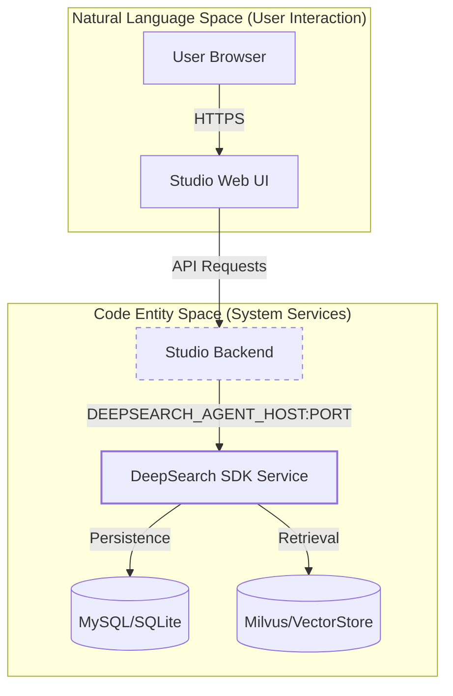
**Sources:** [deepsearch/docs/en/2.Installation Guide/DeepSearch Full Edition/README.md:3-4](), [deepsearch/docs/en/2.Installation Guide/DeepSearch Full Edition/README.md:26]()

### 1.3 OS-Specific Execution

#### Linux (Ubuntu 22.04+)
1.  Download the `deployTool` zip for your architecture (AMD64/ARM64).
2.  Extract and navigate to the directory.
3.  Configure your local IP in `.env.custom`: `IP=<local_machine_ip>`.
4.  Run `./service.sh up`.

**Sources:** [deepsearch/docs/en/2.Installation Guide/DeepSearch Full Edition/Linux Installation.md:40-87]()

#### Windows (10/11)
1.  **Install WSL 2**: Run `wsl --install` in PowerShell as Administrator.
2.  **Docker Desktop**: Enable "Use WSL 2 instead of Hyper-V".
3.  **File Sharing**: Add your installation path to Docker Desktop -> Settings -> Resources -> File sharing.
4.  **Git Bash**: Open Git Bash in the extracted folder and run `./service.sh up`.

**Sources:** [deepsearch/docs/en/2.Installation Guide/DeepSearch Full Edition/Windows Installation.md:21-87]()

#### macOS (14.0+)
1.  **Docker Desktop**: Install the `.dmg` and ensure Docker Engine is running.
2.  **Homebrew**: Install Git and updated Bash (`brew install bash`).
3.  **Terminal**: Run `./service.sh up`.

**Sources:** [deepsearch/docs/en/2.Installation Guide/DeepSearch Full Edition/macOS Installation.md:14-64]()

---

## 2. Manual Installation (Development Path)

Manual installation is intended for developers who wish to modify the source code or contribute to the project. This requires setting up the Python environment for both the Studio and the SDK separately.

### 2.1 Component Inter-dependency
When installing manually, the developer must ensure that the `DeepSearch SDK` is started before the `Studio` backend attempts to register the agent.

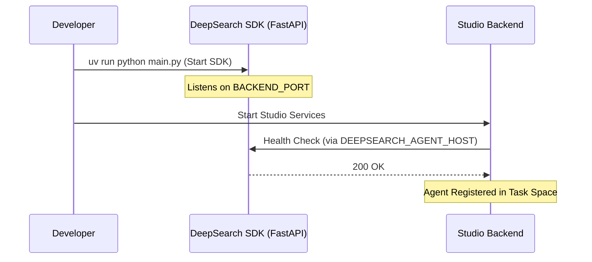
**Sources:** [deepsearch/docs/en/2.Installation Guide/DeepSearch Full Edition/README.md:21-26]()

### 2.2 Manual Setup Steps
For each OS, the process follows a "Method 2: Full manual installation" pattern found in the documentation:

1.  **Environment Isolation**: Use `conda` or `venv` to manage dependencies.
2.  **SDK Setup**:
    *   Clone the `deepsearch` repository.
    *   Install dependencies: `pip install -r requirements.txt`.
    *   Configure `.env` with LLM keys and Search API keys.
3.  **Studio Setup**:
    *   Clone the `agent-studio` repository.
    *   Install frontend dependencies (`npm install`) and backend dependencies.
4.  **Cross-Configuration**: Ensure the Studio's `.env` points to the SDK's host and port.

**Sources:** [deepsearch/docs/en/2.Installation Guide/DeepSearch Full Edition/README.md:31-38]()

---

## 3. Post-Installation Verification

Once the service is started (via Docker or Manual), the following checks verify a successful installation:

1.  **Local Access**: Navigate to the URL provided by the script (typically `https://localhost` or the configured IP).
2.  **Privacy Warning**: Accept the self-signed certificate (Advanced -> Proceed).
3.  **Agent Selection**: In the Studio **Task Space**, ensure the "DeepSearch" agent is visible and selectable. If it is missing, check the `DEEPSEARCH_AGENT_HOST` configuration.

**Sources:** [deepsearch/docs/en/2.Installation Guide/DeepSearch Full Edition/Linux Installation.md:97-101](), [deepsearch/docs/en/2.Installation Guide/DeepSearch Full Edition/Windows Installation.md:97-101]()

---

# Page: DeepSearch SDK Standalone Installation

# DeepSearch SDK Standalone Installation

<details>
<summary>Relevant source files</summary>

The following files were used as context for generating this wiki page:

- [deepsearch/docs/en/2.Installation Guide/DeepSearch_SDK/Docker Installation/Linux Installation.md](deepsearch/docs/en/2.Installation Guide/DeepSearch_SDK/Docker Installation/Linux Installation.md)
- [deepsearch/docs/en/2.Installation Guide/DeepSearch_SDK/Docker Installation/Windows Installation.md](deepsearch/docs/en/2.Installation Guide/DeepSearch_SDK/Docker Installation/Windows Installation.md)
- [deepsearch/docs/en/2.Installation Guide/DeepSearch_SDK/Docker Installation/macOS Installation.md](deepsearch/docs/en/2.Installation Guide/DeepSearch_SDK/Docker Installation/macOS Installation.md)

</details>


This page details the standalone installation of the DeepSearch SDK backend service using Docker. The standalone SDK mode is intended for developers who wish to integrate DeepSearch capabilities into their own applications or who prefer to run the agentic backend without the DeepSearch Studio frontend.

## 1. Overview and Use Cases

The DeepSearch SDK provides the core reasoning, search, and report generation engines. Standalone installation is recommended when:
*   Integrating DeepSearch as a microservice within an existing enterprise architecture.
*   Developing custom frontends or CLI tools that consume the FastAPI-based [9.2. DeepSearch Run API and Streaming]().
*   Running high-throughput automated research tasks where the Studio GUI is not required.

### System Components and Ports
The SDK container encapsulates two primary HTTP services:
1.  **DeepResearch Service (Port 8000)**: Handles complex, long-running research workflows (`search_mode=research`) [deepsearch/docs/en/2.Installation Guide/DeepSearch_SDK/Docker Installation/Linux Installation.md:104-113]().
2.  **DeepSearch/Telemetry Service (Port 8089)**: Handles real-time search queries (`search_mode=search`) and telemetry data collection [deepsearch/docs/en/2.Installation Guide/DeepSearch_SDK/Docker Installation/Linux Installation.md:116-120]().

**Sources:**
*   [deepsearch/docs/en/2.Installation Guide/DeepSearch_SDK/Docker Installation/Linux Installation.md:88-90]()
*   [deepsearch/docs/en/2.Installation Guide/DeepSearch_SDK/Docker Installation/Linux Installation.md:104-120]()

---

## 2. Environment Preparation

### Hardware Requirements
| Resource | Minimum | Recommended |
| :--- | :--- | :--- |
| **CPU** | 2 Cores | 4+ Cores |
| **RAM** | 4 GB | 8 GB+ |

### Software Prerequisites
*   **Docker & Docker Compose**: Required for all platforms.
*   **Git**: For cloning configuration files or repositories.
*   **WSL 2 (Windows Only)**: Must be enabled for Docker Desktop [deepsearch/docs/en/2.Installation Guide/DeepSearch_SDK/Docker Installation/Windows Installation.md:19-32]().

**Sources:**
*   [deepsearch/docs/en/2.Installation Guide/DeepSearch_SDK/Docker Installation/Linux Installation.md:7-17]()
*   [deepsearch/docs/en/2.Installation Guide/DeepSearch_SDK/Docker Installation/Windows Installation.md:7-15]()
*   [deepsearch/docs/en/2.Installation Guide/DeepSearch_SDK/Docker Installation/macOS Installation.md:7-11]()

---

## 3. Deployment Steps

### 3.1 Pulling the Image
Images are provided for both x86_64 (AMD64) and ARM64 (Apple Silicon) architectures.

```bash
# x86_64 / AMD64
docker pull swr.cn-north-4.myhuaweicloud.com/openjiuwen/deepsearch-studio-server-amd64:0.1.9

# ARM64 (Apple Silicon / EulerOS ARM)
docker pull swr.cn-north-4.myhuaweicloud.com/openjiuwen/deepsearch-studio-server-arm64:0.1.9
```

### 3.2 Running the Container
A basic deployment using SQLite for development/testing:

```bash
docker run \
  -p 8000:8000 \
  -p 8089:8089 \
  -e LLM_SSL_VERIFY=False \
  -e DB_TYPE=sqlite \
  swr.cn-north-4.myhuaweicloud.com/openjiuwen/deepsearch-studio-server-amd64:0.1.9
```

**Sources:**
*   [deepsearch/docs/en/2.Installation Guide/DeepSearch_SDK/Docker Installation/Linux Installation.md:63-86]()
*   [deepsearch/docs/en/2.Installation Guide/DeepSearch_SDK/Docker Installation/Windows Installation.md:86-109]()
*   [deepsearch/docs/en/2.Installation Guide/DeepSearch_SDK/Docker Installation/macOS Installation.md:63-86]()

---

## 4. Configuration and .env Parameters

The SDK is configured via environment variables passed to the Docker container.

### 4.1 Database Configuration (`DB_TYPE`)
The system supports two database backends:
*   **SQLite**: Recommended for single-user dev/test. Data is stored in `data/databases/agent.db` by default [deepsearch/docs/en/2.Installation Guide/DeepSearch_SDK/Docker Installation/Linux Installation.md:172-173]().
*   **MySQL**: Required for production and high-concurrency environments.

#### Connecting to Host-Based MySQL
When the database is running on the host machine rather than in a container, use the following network mapping:
*   **Linux**: Add `--add-host=host.docker.internal:host-gateway` to the `docker run` command [deepsearch/docs/en/2.Installation Guide/DeepSearch_SDK/Docker Installation/Linux Installation.md:150-155]().
*   **Windows/macOS**: Use `host.docker.internal` as the `DB_HOST` [deepsearch/docs/en/2.Installation Guide/DeepSearch_SDK/Docker Installation/Windows Installation.md:174-175]().

### 4.2 Checkpointer Configuration (`CHECKPOINTER_TYPE`)
The Checkpointer manages the `Session` state, allowing workflows to be paused and resumed (HITL).

| Type | Description |
| :--- | :--- |
| `in_memory` | Default. State lost on restart. |
| `persistence` | Uses SQLite or Shelve to persist state to disk [deepsearch/docs/en/2.Installation Guide/DeepSearch_SDK/Docker Installation/Linux Installation.md:182-187](). |
| `redis` | Required for distributed multi-instance deployments. Must be paired with `OBS` storage for Knowledge Base files [deepsearch/docs/en/2.Installation Guide/DeepSearch_SDK/Docker Installation/Linux Installation.md:189-198](). |

### 4.3 Shared Storage (OBS)
When `CHECKPOINTER_TYPE=redis` is used, the system requires S3-compatible Object Storage (OBS) to share Knowledge Base (KB) files across SDK instances. Variables include `OBS_SERVER`, `OBS_BUCKET`, `OBS_ACCESS_KEY_ID`, and `OBS_SECRET_ACCESS_KEY` [deepsearch/docs/en/2.Installation Guide/DeepSearch_SDK/Docker Installation/Linux Installation.md:198-207]().

**Sources:**
*   [deepsearch/docs/en/2.Installation Guide/DeepSearch_SDK/Docker Installation/Linux Installation.md:134-207]()
*   [deepsearch/docs/en/2.Installation Guide/DeepSearch_SDK/Docker Installation/Windows Installation.md:158-235]()
*   [deepsearch/docs/en/2.Installation Guide/DeepSearch_SDK/Docker Installation/macOS Installation.md:108-156]()

---

## 5. Architecture and Data Flow

The following diagrams illustrate how the SDK service maps natural language inputs to internal code entities and how data flows through the standalone service.

### Diagram 1: SDK Request Handling
This diagram bridges the external HTTP request to the internal `deepsearch_run.py` manager and the `MainGraphNodes` workflow.

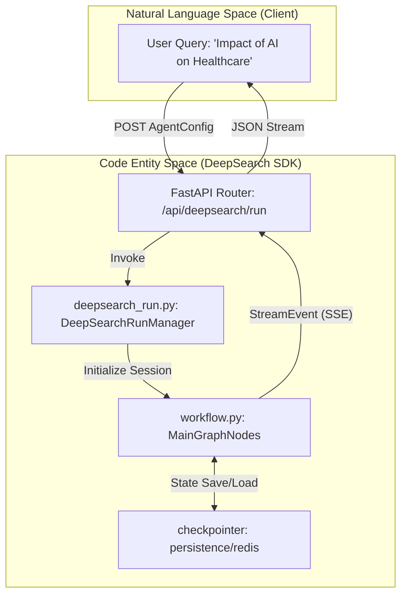
**Sources:**
*   [deepsearch/docs/en/2.Installation Guide/DeepSearch_SDK/Docker Installation/Linux Installation.md:104-116]()
*   [deepsearch/docs/en/2.Installation Guide/DeepSearch_SDK/Docker Installation/Windows Installation.md:200-206]()

### Diagram 2: Database and Persistence Mapping
This diagram maps the environment configuration to the internal storage classes.

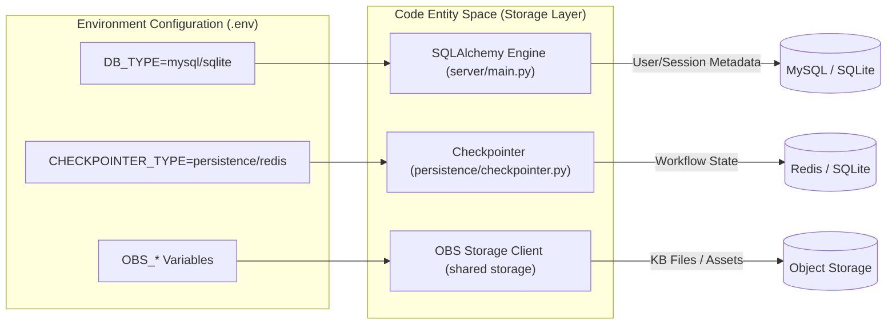
**Sources:**
*   [deepsearch/docs/en/2.Installation Guide/DeepSearch_SDK/Docker Installation/Linux Installation.md:134-150]()
*   [deepsearch/docs/en/2.Installation Guide/DeepSearch_SDK/Docker Installation/Linux Installation.md:175-198]()
*   [deepsearch/docs/en/2.Installation Guide/DeepSearch_SDK/Docker Installation/macOS Installation.md:211-213]()

---

# Page: Research Workflow Orchestration

# Research Workflow Orchestration

<details>
<summary>Relevant source files</summary>

The following files were used as context for generating this wiki page:

- [deepsearch/docs/en/4.Developer Guide/API Reference/main_nodes.md](deepsearch/docs/en/4.Developer Guide/API Reference/main_nodes.md)
- [deepsearch/docs/feature/framework/research-workflow.md](deepsearch/docs/feature/framework/research-workflow.md)
- [deepsearch/openjiuwen_deepsearch/framework/openjiuwen/agent/main_graph_nodes.py](deepsearch/openjiuwen_deepsearch/framework/openjiuwen/agent/main_graph_nodes.py)
- [deepsearch/tests/node/test_agent_node.py](deepsearch/tests/node/test_agent_node.py)

</details>


The Research Workflow is the core orchestration layer of the `research` mode. It transforms a user query into a structured report through a multi-stage pipeline involving intent recognition, outline planning, human-in-the-loop (HITL) refinement, parallelized section writing, and final report synthesis with source tracing.

The orchestration is managed by the `DeepresearchAgent` [deepsearch/framework/openjiuwen/agent/workflow.py:165-170](), which assembles a graph of `MainGraphNodes`. The workflow maintains state via a `SearchContext` object stored in the session [deepsearch/framework/openjiuwen/agent/search_context.py:343-350]().

### Workflow Overview Diagram

The following diagram illustrates the transition from the Natural Language user query to the internal Code Entity Space of nodes and state transitions.

**Title: Research Workflow Logic Flow**
```mermaid
graph TD
    UserQuery["User Query (Natural Language)"] --> StartNode["StartNode [main_graph_nodes.py]"]
    StartNode --> IntentNode["IntentRecognitionNode [main_graph_nodes.py]"]
    
    subgraph "Query Understanding & HITL"
        IntentNode -->|Recognize Intent| IntentResult["ResearchIntent (Code Object)"]
        IntentResult --> HITL_Check{HITL Enabled?}
        HITL_Check -->|Yes| QuesNode["GenerateQuestionsNode"]
        QuesNode --> FeedNode["FeedbackHandlerNode"]
        FeedNode --> OutlineNode["OutlineNode"]
        HITL_Check -->|No| OutlineNode
    end

    subgraph "Planning & Execution"
        OutlineNode --> OutlineObj["Outline (Code Object)"]
        OutlineObj --> OutlineInt["OutlineInteractionNode"]
        OutlineInt -->|Accepted| ModeRouter{Execution Method?}
        
        ModeRouter -->|Parallel| EditorNode["EditorTeamNode [editor_team_manager_node.py]"]
        ModeRouter -->|Dependency| DepEditorNode["DependencyEditorTeamNode"]
    end

    subgraph "Synthesis & Refinement"
        EditorNode --> ReporterNode["ReporterNode"]
        DepEditorNode --> ReporterNode
        ReporterNode --> TracerNode["SourceTracerNode"]
        TracerNode --> VLMNode["VLMChartGeneratorNode"]
        VLMNode --> FeedbackNode["UserFeedbackProcessorNode"]
    end

    FeedbackNode --> EndNode["EndNode"]
    EndNode --> FinalReport["Final Markdown Report"]

    Sources: [deepsearch/framework/openjiuwen/agent/main_graph_nodes.py:164-1100](), [deepsearch/docs/feature/framework/research-workflow.md:42-55]()
```

---

### Main Graph Nodes and Workflow Lifecycle
The workflow is composed of specialized nodes inheriting from `BaseNode`. Each node follows a lifecycle of `_pre_handle`, `_do_invoke`, and `_post_handle` to manage state transitions and streaming outputs [deepsearch/framework/openjiuwen/agent/base_node.py:30-45]().

*   **StartNode**: Initializes the `SearchContext`, sets the `session_id`, and merges configurations [deepsearch/framework/openjiuwen/agent/main_graph_nodes.py:164-189]().
*   **ReporterNode**: Orchestrates the final synthesis of sub-sections into a cohesive Markdown document [deepsearch/framework/openjiuwen/agent/main_graph_nodes.py:840-850]().
*   **SourceTracerNode**: Executes global citation verification and inserts `[checked_citation:id]` markers [deepsearch/framework/openjiuwen/agent/main_graph_nodes.py:925-940]().

For details on node internals and error routing, see [Main Graph Nodes and Workflow Lifecycle](#3.1).

---

### Query Understanding: Intent, Outline, and Planning
Before writing begins, the system must understand the user's domain and temporal requirements. 
*   **Intent Recognition**: Uses `classify_and_recognize_intent` to determine language and report type [deepsearch/algorithm/query_understanding/intent_recognition.py:300-315]().
*   **Outline Generation**: The `Outliner` generates a structured plan. If `execution_method` is set to `hybrid`, a router determines whether to use a standard parallel outline or a dependency-driven one [deepsearch/algorithm/query_understanding/outline_mode_router.py:20-35]().

For details on normalization and prompt templates, see [Query Understanding: Intent, Outline, and Planning](#3.2).

---

### Human-in-the-Loop (HITL) Interactions
The workflow provides two primary points for human intervention to ensure the research stays on track:
1.  **Clarifying Questions**: If the query is ambiguous, `GenerateQuestionsNode` prompts the user for more details [deepsearch/framework/openjiuwen/agent/main_graph_nodes.py:320-330]().
2.  **Outline Refinement**: `OutlineInteractionNode` allows users to `accepted`, `revise_comment`, or `revise_outline`. The workflow pauses and resumes via `interrupt_feedback` [deepsearch/framework/openjiuwen/agent/main_graph_nodes.py:580-610]().

For details on the feedback cycle, see [Human-in-the-Loop (HITL) Interactions](#3.3).

---

### Section Reasoning and Writing Sub-Workflows
The actual research and writing are delegated to "Editor Teams". These are sub-graphs that handle information collection and synthesis for individual sections.
*   **EditorTeamNode**: Executes sections in parallel using the `reasoning_writing_graph` [deepsearch/framework/openjiuwen/agent/editor_team_manager_node.py:150-170]().
*   **DependencyEditorTeamNode**: Manages sections with inter-dependencies, ensuring that "Layer N" reasoning has access to "Layer N-1" content [deepsearch/framework/openjiuwen/agent/editor_team_manager_node.py:300-320]().

For details on `SectionContext` and local contracts, see [Section Reasoning and Writing Sub-Workflows](#3.4).

---

### System Entity Mapping

This table maps the conceptual workflow phases to the specific code entities that implement them.

| Phase | Main Node (Code Entity) | Key Algorithm / Function | Data Structure |
| :--- | :--- | :--- | :--- |
| **Initialization** | `StartNode` | `SearchContext.__init__` | `SearchContext` |
| **Intent** | `IntentRecognitionNode` | `classify_and_recognize_intent` | `ResearchIntent` |
| **Planning** | `OutlineNode` | `Outliner.generate_outline` | `Outline` |
| **HITL** | `OutlineInteractionNode` | `session.interact` | `OutlineInteraction` |
| **Writing** | `EditorTeamNode` | `build_editor_team_workflow` | `SectionContext` |
| **Synthesis** | `ReporterNode` | `Reporter.generate_report` | `final_result` |

**Title: Node to Class Mapping**
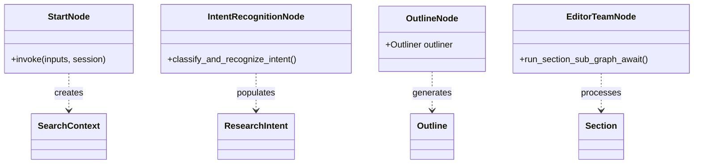

Sources: [deepsearch/framework/openjiuwen/agent/main_graph_nodes.py:1-1100](), [deepsearch/docs/en/4.Developer Guide/API Reference/main_nodes.md:1-140](), [deepsearch/docs/feature/framework/research-workflow.md:1-93]()

---

# Page: Main Graph Nodes and Workflow Lifecycle

# Main Graph Nodes and Workflow Lifecycle

<details>
<summary>Relevant source files</summary>

The following files were used as context for generating this wiki page:

- [deepsearch/docs/en/4.Developer Guide/API Reference/main_nodes.md](deepsearch/docs/en/4.Developer Guide/API Reference/main_nodes.md)
- [deepsearch/docs/feature/framework/research-workflow.md](deepsearch/docs/feature/framework/research-workflow.md)
- [deepsearch/docs/feature/framework/search-context.md](deepsearch/docs/feature/framework/search-context.md)
- [deepsearch/openjiuwen_deepsearch/framework/openjiuwen/agent/main_graph_nodes.py](deepsearch/openjiuwen_deepsearch/framework/openjiuwen/agent/main_graph_nodes.py)
- [deepsearch/tests/node/test_agent_node.py](deepsearch/tests/node/test_agent_node.py)

</details>


This page provides a deep dive into the core orchestration layer of the DeepSearch research workflow. It details the lifecycle of `MainGraphNodes` and how they manage state, handle user interactions (HITL), and route execution based on intent and dependencies.

## Workflow Lifecycle and Node Pattern

Every node in the DeepSearch main graph inherits from `BaseNode` [deepsearch/openjiuwen_deepsearch/framework/openjiuwen/agent/base_node.py:25-27](), which enforces a standardized lifecycle for execution, state management, and streaming.

### The Lifecycle Methods
Nodes implement their logic by overriding the following internal methods:
1.  **`_pre_handle`**: Extracts necessary data from the `Session` global state and `SearchContext`.
2.  **`_do_invoke`**: Executes the core business logic (e.g., calling an LLM, searching the web, or invoking a sub-workflow).
3.  **`_post_handle`**: Persists results back to the `SearchContext` in the `Session` and emits stream events to the frontend.

### State Management via Session
The `Session` object acts as the shared memory for the graph [openjiuwen/core/session/node.py:16-16](). Nodes interact with it primarily through the `SearchContext` model [deepsearch/openjiuwen_deepsearch/framework/openjiuwen/agent/search_context.py:100-100]().

| Feature | Description | Code Reference |
| :--- | :--- | :--- |
| **Global State** | Stores `search_context`, `agent_config`, and `service_config`. | [deepsearch/openjiuwen_deepsearch/framework/openjiuwen/agent/main_graph_nodes.py:189-204]() |
| **SearchContext** | A Pydantic model tracking query, intent, outline, report, and final results. | [deepsearch/openjiuwen_deepsearch/framework/openjiuwen/agent/search_context.py:100-100]() |
| **Telemetry** | Every state transition is emitted for observability. | [deepsearch/openjiuwen_deepsearch/framework/openjiuwen/agent/main_graph_nodes.py:133-138]() |

**Sources:** [deepsearch/openjiuwen_deepsearch/framework/openjiuwen/agent/main_graph_nodes.py:164-210](), [deepsearch/docs/feature/framework/search-context.md:34-40]()

---

## Core Node Deep Dive

### 1. Initialization and Intent
*   **StartNode**: Initializes the `SearchContext`. It captures the `original_query`, `search_mode`, and merges `agent_config` with service defaults [deepsearch/openjiuwen_deepsearch/framework/openjiuwen/agent/main_graph_nodes.py:164-210]().
*   **IntentRecognitionNode**: Detects query language and research intent. If the execution method is `hybrid`, it calls `route_outline_execution_method` to decide between parallel or dependency-driven workflows [deepsearch/openjiuwen_deepsearch/framework/openjiuwen/agent/main_graph_nodes.py:238-335]().

### 2. Planning and Interaction (HITL)
*   **GenerateQuestionsNode**: If Human-in-the-Loop (HITL) is enabled, this node generates clarifying questions to resolve ambiguity in the query [deepsearch/openjiuwen_deepsearch/framework/openjiuwen/agent/main_graph_nodes.py:365-412]().
*   **OutlineNode / DependencyOutlineNode**: Generates the report structure. `DependencyOutlineNode` identifies logical dependencies between sections (e.g., Section A must be written before Section B) [deepsearch/openjiuwen_deepsearch/framework/openjiuwen/agent/main_graph_nodes.py:650-705]().
*   **OutlineInteractionNode**: Pauses execution to allow users to `accept`, `revise_comment`, or `revise_outline`. It manages the `outline_interactions` history in the context [deepsearch/openjiuwen_deepsearch/framework/openjiuwen/agent/main_graph_nodes.py:708-834]().

### 3. Execution Teams
*   **EditorTeamNode**: Orchestrates the `reasoning_writing_graph` for all sections in parallel [deepsearch/openjiuwen_deepsearch/framework/openjiuwen/agent/editor_team_manager_node.py:13-15]().
*   **DependencyEditorTeamNode**: A specialized version that executes sections in "layers" based on their dependency graph, ensuring prerequisite information is available for subsequent sections [deepsearch/openjiuwen_deepsearch/framework/openjiuwen/agent/main_graph_nodes.py:70-74]().

### 4. Synthesis and Enrichment
*   **ReporterNode**: Aggregates all section sub-reports into a final cohesive document, generating the abstract, conclusion, and table of contents [deepsearch/openjiuwen_deepsearch/framework/openjiuwen/agent/main_graph_nodes.py:898-953]().
*   **SourceTracerNode**: Performs global citation verification, inserting `[checked_citation:id]` markers into the text [deepsearch/openjiuwen_deepsearch/framework/openjiuwen/agent/main_graph_nodes.py:956-1008]().
*   **VLMChartGeneratorNode**: Identifies data points suitable for visualization and uses a Vision-Language Model (VLM) to generate Mermaid or Python-based charts [deepsearch/openjiuwen_deepsearch/framework/openjiuwen/agent/main_graph_nodes.py:1053-1107]().

### 5. Post-Processing and Feedback
*   **UserFeedbackProcessorNode**: Enables the "Chat-with-Report" feature. It handles actions like `expand`, `shorten`, `polish`, or `truth_verification` on specific spans of the generated report [deepsearch/openjiuwen_deepsearch/framework/openjiuwen/agent/main_graph_nodes.py:1161-1317]().
*   **EndNode**: Appends the AI-generation disclaimer and emits the `ALL END` event to close the stream [deepsearch/openjiuwen_deepsearch/framework/openjiuwen/agent/main_graph_nodes.py:1367-1422]().

**Sources:** [deepsearch/openjiuwen_deepsearch/framework/openjiuwen/agent/main_graph_nodes.py:1-1422](), [deepsearch/docs/en/4.Developer Guide/API Reference/main_nodes.md:5-139]()

---

## Technical Workflow Diagrams

### Natural Language to Code Entity Space: Query Handling
This diagram illustrates how a natural language query is transformed into structured code entities within the main graph.

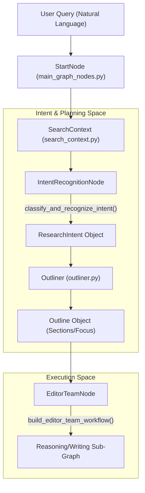
**Sources:** [deepsearch/openjiuwen_deepsearch/framework/openjiuwen/agent/main_graph_nodes.py:238-335](), [deepsearch/openjiuwen_deepsearch/framework/openjiuwen/agent/search_context.py:92-103]()

### Workflow Lifecycle and Error Routing
This diagram maps the node lifecycle to the internal exception handling and streaming mechanisms.

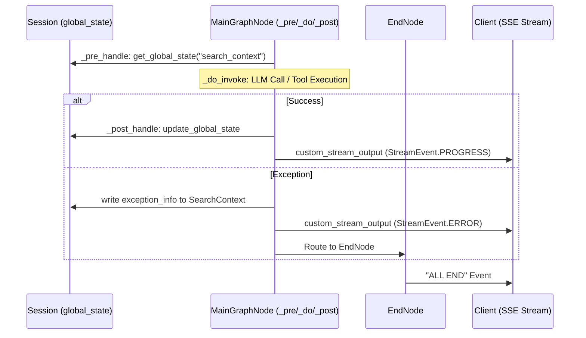
**Sources:** [deepsearch/openjiuwen_deepsearch/framework/openjiuwen/agent/main_graph_nodes.py:1367-1422](), [deepsearch/openjiuwen_deepsearch/utils/common_utils/stream_utils.py:114-119]()

---

## State Transition Table

The following table describes how key `SearchContext` fields are updated across the node lifecycle.

| Node | Input Fields | Output Fields |
| :--- | :--- | :--- |
| `IntentRecognitionNode` | `original_query` | `research_intent`, `language` |
| `OutlineNode` | `research_intent`, `report_template` | `current_outline` |
| `OutlineInteractionNode` | `interrupt_feedback` | `outline_interactions` |
| `EditorTeamNode` | `current_outline` | `sub_report_content` |
| `ReporterNode` | `sub_report_content` | `current_report` |
| `SourceTracerNode` | `current_report` | `final_result.citation_messages` |
| `UserFeedbackProcessorNode` | `user_feedback` | `rewrite_history`, `final_result.response_content` |

**Sources:** [deepsearch/docs/feature/framework/search-context.md:14-22](), [deepsearch/openjiuwen_deepsearch/framework/openjiuwen/agent/main_graph_nodes.py:1161-1317]()

---

# Page: Query Understanding: Intent, Outline, and Planning

# Query Understanding: Intent, Outline, and Planning

<details>
<summary>Relevant source files</summary>

The following files were used as context for generating this wiki page:

- [deepsearch/docs/feature/algorithm/query-understanding.md](deepsearch/docs/feature/algorithm/query-understanding.md)
- [deepsearch/docs/feature/framework/info-collector-subgraph.md](deepsearch/docs/feature/framework/info-collector-subgraph.md)
- [deepsearch/docs/feature/framework/search-tool-registration.md](deepsearch/docs/feature/framework/search-tool-registration.md)
- [deepsearch/openjiuwen_deepsearch/algorithm/prompts/collector_gen_query.md](deepsearch/openjiuwen_deepsearch/algorithm/prompts/collector_gen_query.md)
- [deepsearch/openjiuwen_deepsearch/algorithm/prompts/collector_supervisor.md](deepsearch/openjiuwen_deepsearch/algorithm/prompts/collector_supervisor.md)
- [deepsearch/openjiuwen_deepsearch/algorithm/prompts/dep_driving_outliner.md](deepsearch/openjiuwen_deepsearch/algorithm/prompts/dep_driving_outliner.md)
- [deepsearch/openjiuwen_deepsearch/algorithm/prompts/dep_driving_outliner_interaction.md](deepsearch/openjiuwen_deepsearch/algorithm/prompts/dep_driving_outliner_interaction.md)
- [deepsearch/openjiuwen_deepsearch/algorithm/prompts/intent_recognition.md](deepsearch/openjiuwen_deepsearch/algorithm/prompts/intent_recognition.md)
- [deepsearch/openjiuwen_deepsearch/algorithm/prompts/intent_recognition_entry.md](deepsearch/openjiuwen_deepsearch/algorithm/prompts/intent_recognition_entry.md)
- [deepsearch/openjiuwen_deepsearch/algorithm/prompts/outliner.md](deepsearch/openjiuwen_deepsearch/algorithm/prompts/outliner.md)
- [deepsearch/openjiuwen_deepsearch/algorithm/prompts/outliner_interaction.md](deepsearch/openjiuwen_deepsearch/algorithm/prompts/outliner_interaction.md)
- [deepsearch/openjiuwen_deepsearch/algorithm/prompts/outliner_user_revised.md](deepsearch/openjiuwen_deepsearch/algorithm/prompts/outliner_user_revised.md)
- [deepsearch/openjiuwen_deepsearch/algorithm/query_understanding/intent_recognition.py](deepsearch/openjiuwen_deepsearch/algorithm/query_understanding/intent_recognition.py)
- [deepsearch/openjiuwen_deepsearch/algorithm/research_collector/collector_evidence.py](deepsearch/openjiuwen_deepsearch/algorithm/research_collector/collector_evidence.py)
- [deepsearch/tests/algorithm/query_understanding/test_intent_recognition.py](deepsearch/tests/algorithm/query_understanding/test_intent_recognition.py)
- [deepsearch/tests/algorithm/query_understanding/test_research_intent_contract.py](deepsearch/tests/algorithm/query_understanding/test_research_intent_contract.py)

</details>


The `query_understanding` module is the entry point of the research workflow. Its purpose is to transform a raw natural language query into a structured research plan that downstream agents can execute. This involves identifying the user's core intent, detecting constraints (temporal, source-specific), and generating a hierarchical or dependency-driven outline with corresponding information collection steps.

Sources: [deepsearch/docs/feature/algorithm/query-understanding.md:9-12](), [deepsearch/openjiuwen_deepsearch/algorithm/query_understanding/intent_recognition.py:78-87]()

---

## 1. Intent Recognition and Normalization

Intent recognition is handled by the `IntentRecognitionNode` (within the main graph) which calls `classify_and_recognize_intent`. This process extracts the core research topic, language, and structural constraints.

### 1.1. Data Structures
The system uses specialized Pydantic models to ensure data integrity across the workflow:
*   **`ResearchIntent`**: Captures `task_type` (e.g., `comparison`, `evaluation`), `required_dimensions`, `comparison_targets`, and report styling (`audience_role`, `tone`). [deepsearch/openjiuwen_deepsearch/framework/openjiuwen/agent/search_context.py:15-15](), [deepsearch/openjiuwen_deepsearch/algorithm/query_understanding/intent_recognition.py:166-203]()
*   **`TemporalScope`**: Normalizes time constraints into `source_date` (publication time) or `content_date` (fact occurrence). [deepsearch/openjiuwen_deepsearch/framework/openjiuwen/agent/search_context.py:16-16](), [deepsearch/openjiuwen_deepsearch/algorithm/query_understanding/intent_recognition.py:149-164]()
*   **`IntentRecognitionResult`**: The final output containing the `original_query`, a cleaned `research_query` for initial search, and the `ResearchIntent`. [deepsearch/openjiuwen_deepsearch/algorithm/query_understanding/intent_recognition.py:78-87]()

### 1.2. Normalization Logic
The system applies strict normalization to LLM outputs to prevent downstream failures:
*   **Task Type Aliases**: Maps variants like "classify" or "categorization" to a standard `classification` enum. [deepsearch/openjiuwen_deepsearch/algorithm/query_understanding/intent_recognition.py:135-146]()
*   **Temporal Normalization**: Vague terms like "year-end" are converted to specific dates (e.g., Dec 31). [deepsearch/openjiuwen_deepsearch/algorithm/prompts/intent_recognition.md:43-45](), [deepsearch/docs/feature/algorithm/query-understanding.md:24-25]()
*   **Domain Extraction**: If a user provides a specific `include_url`, the system automatically extracts and adds the domain to `include_domains`. [deepsearch/openjiuwen_deepsearch/algorithm/query_understanding/intent_recognition.py:204-208]()

### Intent Extraction Data Flow
Title: Intent Extraction from Natural Language to Code Entities
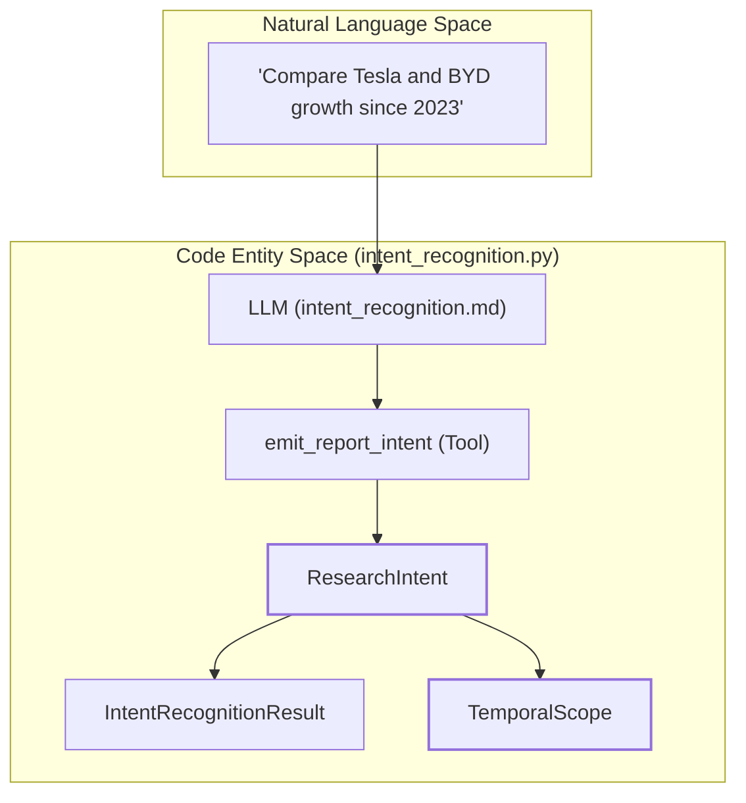
Sources: [deepsearch/openjiuwen_deepsearch/algorithm/query_understanding/intent_recognition.py:27-27](), [deepsearch/openjiuwen_deepsearch/algorithm/prompts/intent_recognition.md:19-47]()

---

## 2. Outline Generation (Outliner)

The `Outliner` class generates a structured plan for the report. It supports three primary modes to balance speed and logical depth.

### 2.1. Generation Modes
| Mode | Logic | Use Case |
| :--- | :--- | :--- |
| **Parallel** | Sections are independent and can be researched simultaneously. | Standard reports with broad coverage. |
| **Dependency Driving** | Sections have explicit parent-child relationships (e.g., `Framework Support`, `Information Integration`). | Complex analytical reports where conclusions in one section impact others. |
| **Hybrid** | A mix of parallel and dependent sections. | Default for high-complexity research. |

Sources: [deepsearch/docs/feature/algorithm/query-understanding.md:21-30](), [deepsearch/openjiuwen_deepsearch/algorithm/prompts/dep_driving_outliner.md:145-160]()

### 2.2. Section Contract
Every section generated must adhere to a strict contract defined in the prompt templates (`outliner.md`, `dep_driving_outliner.md`):
*   **`description`**: Contains substantive research scope, questions, and analytical dimensions. [deepsearch/openjiuwen_deepsearch/algorithm/prompts/dep_driving_outliner.md:31-32]()
*   **`format_requirements`**: A list of specific constraints like "Markdown table with columns X, Y, Z" or "Source restrictions". [deepsearch/openjiuwen_deepsearch/algorithm/prompts/dep_driving_outliner.md:33-34]()
*   **`section_focus` / `focus_dimensions`**: Non-empty fields used to guide the `Collector` and `Reporter` agents. [deepsearch/openjiuwen_deepsearch/algorithm/prompts/dep_driving_outliner.md:37-37]()

Sources: [deepsearch/docs/feature/algorithm/query-understanding.md:27-30]()

---

## 3. Planning and Step Generation

Once the outline is established, the `Planner` generates specific execution steps for each section.

### 3.1. Planner Logic
The `Planner` (implemented in `planner.py`) breaks down a section's `description` into actionable items. In **Dependency Driving** mode, steps also include `parent_ids` and `relationship` descriptions to ensure the research collector follows a logical sequence.

Sources: [deepsearch/docs/feature/algorithm/query-understanding.md:21-21](), [deepsearch/docs/feature/algorithm/query-understanding.md:68-68]()

### 3.2. Entry Search Integration
Before generating the outline, the system may perform an **Entry Search** (initial web search). The results are passed into the `outliner` prompts via the `entry_search_results` variable to ground the outline in current real-world data.

Sources: [deepsearch/docs/feature/algorithm/query-understanding.md:17-17](), [deepsearch/openjiuwen_deepsearch/algorithm/prompts/outliner.md:13-18]()

---

## 4. Prompt Templates and Interaction

The `query_understanding` module relies on a set of specialized Jinja2 templates located in `algorithm/prompts/`.

### 4.1. Primary Templates
*   **`intent_recognition.md`**: Used for initial parsing of the query. [deepsearch/openjiuwen_deepsearch/algorithm/prompts/intent_recognition.md:5-78]()
*   **`outliner.md`**: Standard parallel outline generation. [deepsearch/openjiuwen_deepsearch/algorithm/prompts/outliner.md:5-110]()
*   **`dep_driving_outliner.md`**: Generates outlines with logical dependencies. [deepsearch/openjiuwen_deepsearch/algorithm/prompts/dep_driving_outliner.md:5-160]()

### 4.2. Human-in-the-Loop (HITL) Interaction
If a user provides feedback on an outline, the system uses "Interaction" templates (`outliner_interaction.md`, `dep_driving_outliner_interaction.md`). These prompts emphasize **incremental refinement** over complete regeneration, ensuring that previous structural decisions are respected unless explicitly changed.

Sources: [deepsearch/openjiuwen_deepsearch/algorithm/prompts/outliner_interaction.md:130-134](), [deepsearch/openjiuwen_deepsearch/algorithm/prompts/dep_driving_outliner_interaction.md:162-173]()

### Outline Refinement Workflow
Title: Outline Interaction and Refinement Process
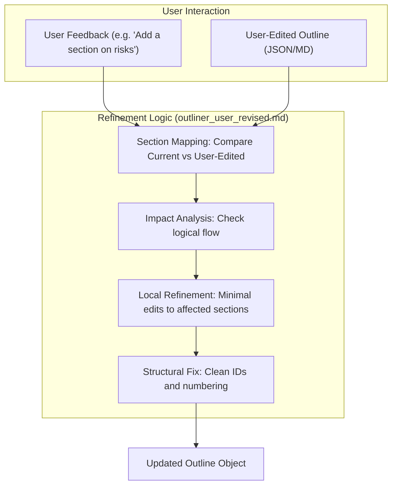
Sources: [deepsearch/openjiuwen_deepsearch/algorithm/prompts/outliner_user_revised.md:118-174]()

---

## 5. Summary of Key Implementation Files

| File Path | Description |
| :--- | :--- |
| `intent_recognition.py` | Main logic for intent parsing, normalization, and tool calling. |
| `outliner.py` | Logic for generating and validating `Outline` and `Section` objects. |
| `planner.py` | Logic for generating research `Plan` and `Step` objects. |
| `search_context.py` | Defines the data contracts (`ResearchIntent`, `TemporalScope`). |

Sources: [deepsearch/docs/feature/algorithm/query-understanding.md:32-37](), [deepsearch/openjiuwen_deepsearch/algorithm/query_understanding/intent_recognition.py:13-17]()

---

# Page: Human-in-the-Loop (HITL) Interactions

# Human-in-the-Loop (HITL) Interactions

<details>
<summary>Relevant source files</summary>

The following files were used as context for generating this wiki page:

- [deepsearch/docs/en/4.Developer Guide/API Reference/main_nodes.md](deepsearch/docs/en/4.Developer Guide/API Reference/main_nodes.md)
- [deepsearch/docs/feature/framework/research-workflow.md](deepsearch/docs/feature/framework/research-workflow.md)
- [deepsearch/openjiuwen_deepsearch/framework/openjiuwen/agent/main_graph_nodes.py](deepsearch/openjiuwen_deepsearch/framework/openjiuwen/agent/main_graph_nodes.py)
- [deepsearch/tests/node/test_agent_node.py](deepsearch/tests/node/test_agent_node.py)

</details>


Human-in-the-Loop (HITL) interactions are critical synchronization points in the DeepSearch workflow where the agent pauses execution to solicit user input. These interactions ensure that the research direction aligns with user expectations before committing heavy computational resources to information collection and report writing.

The system implements two primary HITL interaction points:
1.  **Clarifying Questions**: Generated immediately after intent recognition to resolve ambiguities in the initial query.
2.  **Outline Interaction**: Generated after the research plan is structured, allowing the user to approve or modify the report's skeleton.

## Interaction Architecture and Resumption

HITL interactions leverage the `interrupt_feedback` mechanism. When the workflow reaches an interaction node, it checks if `workflow_human_in_the_loop` is enabled in the `AgentConfig` [deepsearch/openjiuwen_deepsearch/framework/openjiuwen/agent/main_graph_nodes.py:191-201](). If enabled and no feedback is present, the node triggers a session interruption via `session.interact()` [deepsearch/openjiuwen_deepsearch/framework/openjiuwen/agent/main_graph_nodes.py:273-278]().

The workflow resumes when the `/api/deepsearch/run` endpoint is called with the same `conversation_id` and a non-empty `interrupt_feedback` string [deepsearch/openjiuwen_deepsearch/docs/en/4.Developer Guide/API Reference/main_nodes.md:11-12]().

### HITL Logic Flow (Natural Language to Code)

The following diagram illustrates how the abstract "Interaction Request" is realized through specific code entities and state transitions.

**Diagram: HITL Resumption and State Mapping**
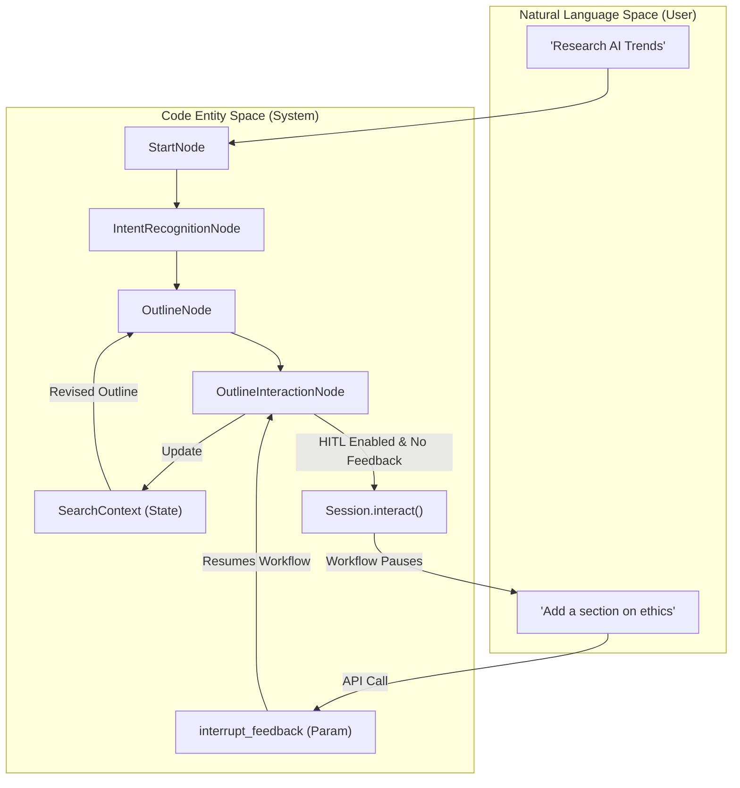
**Sources:** [deepsearch/openjiuwen_deepsearch/framework/openjiuwen/agent/main_graph_nodes.py:179-205](), [deepsearch/openjiuwen_deepsearch/docs/feature/framework/research-workflow.md:42-55]()

---

## Clarifying Question Generation

The first HITL point occurs via `GenerateQuestionsNode` and `FeedbackHandlerNode`. This phase is designed to minimize research drift by asking the user to specify the scope, depth, or specific focus areas.

### Implementation Details
*   **GenerateQuestionsNode**: Uses the `query_interpreter` to analyze the query and generate a list of questions [deepsearch/openjiuwen_deepsearch/docs/en/4.Developer Guide/API Reference/main_nodes.md:19-23](). The number of retries is controlled by `workflow_max_gen_question_retry_num`.
*   **FeedbackHandlerNode**: Manages the reception of user answers. If the user provides a `FINISH_TASK` command, the workflow terminates early [deepsearch/openjiuwen_deepsearch/docs/en/4.Developer Guide/API Reference/main_nodes.md:25-29]().
*   **Storage**: Questions are stored in `search_context.questions` and user responses in `search_context.user_feedback` [deepsearch/openjiuwen_deepsearch/framework/openjiuwen/agent/search_context.py:140-141]().

---

## Outline Interaction Cycle

The `OutlineInteractionNode` (and its variant `DependencyOutlineInteractionNode`) manages the most complex HITL cycle. It allows users to review the `Outline` object before the `EditorTeamNode` begins the multi-agent writing process.

### Feedback Actions
The system accepts three specific feedback types in the `interrupt_feedback` field:

| Action | Description | Resulting Transition |
| :--- | :--- | :--- |
| `accepted` | User approves the outline as is. | Transitions to `EditorTeamNode`. |
| `revise_comment` | User provides natural language suggestions. | Transitions back to `OutlineNode` for regeneration. |
| `revise_outline` | User provides a full JSON outline to use. | Transitions back to `OutlineNode` to apply the structure. |

### Configuration and Limits
*   **Max Rounds**: Controlled by `outline_interaction_max_rounds`. If reached, the workflow proceeds with the current outline regardless of feedback [deepsearch/openjiuwen_deepsearch/docs/en/4.Developer Guide/API Reference/main_nodes.md:47-57]().
*   **History**: Every interaction round is recorded in `search_context.outline_interactions` as an `OutlineInteraction` object [deepsearch/openjiuwen_deepsearch/framework/openjiuwen/agent/search_context.py:97-103]().

### Outline Interaction Data Flow

This diagram maps the `OutlineInteractionNode` logic to the `SearchContext` state and the retry loop.

**Diagram: Outline Interaction Loop**
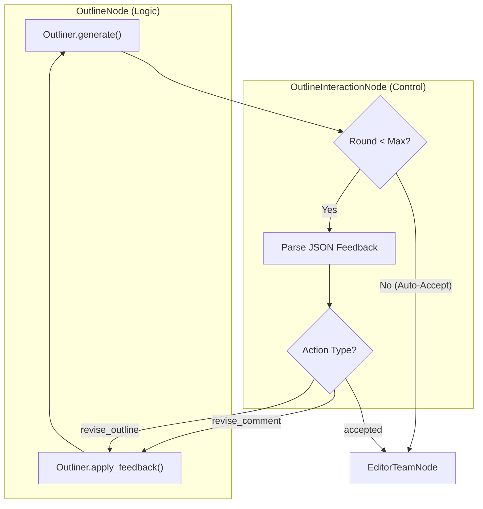
**Sources:** [deepsearch/openjiuwen_deepsearch/docs/en/4.Developer Guide/API Reference/main_nodes.md:43-62](), [deepsearch/openjiuwen_deepsearch/framework/openjiuwen/agent/main_graph_nodes.py:97-103]()

---

## Technical Summary Table

| Code Entity | File Path | Role |
| :--- | :--- | :--- |
| `GenerateQuestionsNode` | `main_graph_nodes.py` | Generates clarifying questions using `query_interpreter`. |
| `FeedbackHandlerNode` | `main_graph_nodes.py` | Captures user responses to questions and updates context. |
| `OutlineInteractionNode` | `main_graph_nodes.py` | Orchestrates the outline approval/revision loop. |
| `OutlineInteraction` | `search_context.py` | Data class for storing a single round of outline feedback. |
| `interrupt_feedback` | `deepsearch_run.py` | The API parameter used to resume a paused session. |

**Sources:** [deepsearch/openjiuwen_deepsearch/framework/openjiuwen/agent/main_graph_nodes.py:19-67](), [deepsearch/openjiuwen_deepsearch/framework/openjiuwen/agent/search_context.py:92-103](), [deepsearch/openjiuwen_deepsearch/docs/feature/framework/research-workflow.md:58-64]()

---

# Page: Section Reasoning and Writing Sub-Workflows

# Section Reasoning and Writing Sub-Workflows

<details>
<summary>Relevant source files</summary>

The following files were used as context for generating this wiki page:

- [deepsearch/docs/en/4.Developer Guide/API Reference/main_nodes.md](deepsearch/docs/en/4.Developer Guide/API Reference/main_nodes.md)
- [deepsearch/docs/feature/framework/research-workflow.md](deepsearch/docs/feature/framework/research-workflow.md)
- [deepsearch/openjiuwen_deepsearch/framework/openjiuwen/agent/main_graph_nodes.py](deepsearch/openjiuwen_deepsearch/framework/openjiuwen/agent/main_graph_nodes.py)
- [deepsearch/tests/node/test_agent_node.py](deepsearch/tests/node/test_agent_node.py)
- [deepsearch/tests/workflow/test_dependency_reasoning_nodes.py](deepsearch/tests/workflow/test_dependency_reasoning_nodes.py)

</details>


This page details the sub-workflow orchestration for individual report sections. Once an outline is finalized, the system transitions from global planning to granular execution, where each section undergoes independent reasoning, information collection, and drafting. The orchestration supports both massive parallelization and dependency-aware sequential execution.

## Sub-Workflow Overview

The research process delegates section-level tasks to specialized sub-graphs. These sub-graphs encapsulate the logic for planning research steps, invoking the **Research Collector**, and synthesizing sub-reports.

### Key Components

*   **EditorTeamNode**: The manager node in the main graph responsible for spawning and monitoring section sub-workflows [deepsearch/openjiuwen_deepsearch/framework/openjiuwen/agent/editor_team_manager_node.py:64-66]().
*   **SectionContext**: A specialized state container that isolates a section's data (collected evidence, local plans, writing progress) from the global `SearchContext` [deepsearch/openjiuwen_deepsearch/framework/openjiuwen/agent/search_context.py:348-350]().
*   **Reasoning-Writing Graph**: The actual executable workflow logic for a single section, defined in `reasoning_writing_graph/editor_team_nodes.py` [deepsearch/openjiuwen_deepsearch/framework/openjiuwen/agent/reasoning_writing_graph/editor_team_nodes.py:30-31]().

---

## Editor Team Orchestration Modes

DeepSearch provides two primary execution methods for sections, determined by the `execution_method` configuration or the `IntentRecognitionNode` router.

### 1. Parallel Execution (`EditorTeamNode`)
In this mode, all sections in the outline are executed concurrently. This is the default for standard research queries where sections do not strictly depend on the findings of previous chapters.

*   **Implementation**: It uses `asyncio.gather` to invoke sub-graphs for every section in the `search_context.current_outline.sections` list [deepsearch/openjiuwen_deepsearch/framework/openjiuwen/agent/editor_team_manager_node.py:160-162]().
*   **Data Flow**: Each sub-graph receives a `SectionContext` containing the `section_local_contract` (title, description, and core status) [deepsearch/openjiuwen_deepsearch/framework/openjiuwen/agent/editor_team_manager_node.py:108-112]().

### 2. Dependency-Driving Execution (`DependencyEditorTeamNode`)
Used for complex analytical reports where later sections require data or conclusions from earlier ones (e.g., a "Conclusion" section requiring "Market Analysis" results).

*   **Layering Logic**: Sections are grouped by their dependency level. The system executes one layer at a time.
*   **Pipelining**: While the current layer is undergoing "Reasoning" (planning and collection), the previous layer's "Writing" phase is executed in parallel to optimize throughput [deepsearch/openjiuwen_deepsearch/framework/openjiuwen/agent/editor_team_manager_node.py:218-225]().
*   **Background Knowledge**: Results from completed steps in parent sections are passed into the `SectionReasoningStartNode` as `parent_section_steps`, which populates `plan_background_knowledge` for the current section's LLM planner [deepsearch/tests/workflow/test_dependency_reasoning_nodes.py:53-56]().

---

## The Reasoning and Writing Sub-Graph

The sub-graph is a loop that iterates between reasoning (planning) and action (collecting/writing) until the section is complete.

### Data Contract: SectionContext
When a section sub-workflow starts, it initializes a `SectionContext`. Key fields include:
*   `section_local_contract`: The specific segment of the outline this node is responsible for [deepsearch/openjiuwen_deepsearch/framework/openjiuwen/agent/editor_team_manager_node.py:108-112]().
*   `focus_dimensions`: Specific areas of interest extracted from the user query to guide the collector.
*   `history_plans`: A log of all planning iterations for this section.

### Diagram: Sub-Workflow Logic Flow
This diagram maps the logical states to the internal node classes used in the reasoning-writing sub-graph.

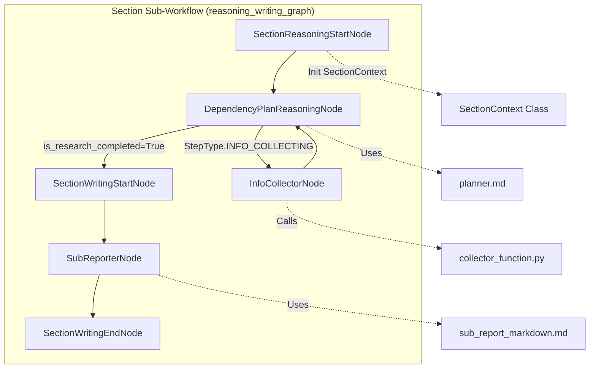
**Sources**: [deepsearch/openjiuwen_deepsearch/framework/openjiuwen/agent/reasoning_writing_graph/editor_team_nodes.py:30-60](), [deepsearch/tests/workflow/test_dependency_reasoning_nodes.py:11-15](), [deepsearch/openjiuwen_deepsearch/framework/openjiuwen/agent/search_context.py:348-350]().

---

## Key Sub-Workflow Nodes

### Section Reasoning Nodes
These nodes handle the "thinking" phase where the agent decides what information is missing.

*   **SectionReasoningStartNode**: Extracts background knowledge from previous sections (if in dependency mode) and sets up the local state [deepsearch/tests/workflow/test_dependency_reasoning_nodes.py:24-30]().
*   **DependencyPlanReasoningNode**: The brain of the sub-workflow. It generates a `Plan` consisting of multiple `Steps`. If the plan indicates more information is needed, it routes to the collector [deepsearch/tests/workflow/test_dependency_reasoning_nodes.py:128-130]().
*   **SectionReasoningEndNode**: Finalizes the reasoning phase and prepares the collected evidence for the writing phase [deepsearch/tests/workflow/test_dependency_reasoning_nodes.py:92-95]().

### Section Writing Nodes
Once reasoning is complete, these nodes transform evidence into Markdown.

*   **SectionWritingStartNode**: Prepares the prompt context for the LLM, including all collected documents and the section's specific requirements.
*   **SubReporterNode**: Invokes the `Reporter.generate_sub_report` method. It ensures the output follows the "Flat Heading" contract (only H1 and H2) and prohibits Mermaid charts at this stage (charts are handled by the `VLMChartGeneratorNode` later) [deepsearch/docs/en/4.Developer Guide/API Reference/main_nodes.md:77-80]().
*   **SectionWritingEndNode**: Captures the generated Markdown and stores it in the `search_context.sub_report_content` buffer.

---

## Entity Association: Code to Workflow

The following diagram bridges the high-level research concepts to the specific Python classes and prompt files used during the Section Reasoning phase.

```mermaid
graph LR
    subgraph "Natural Language Space"
        Direction["'Research the impact of AI on healthcare'"]
        SubTopic["'Current diagnostic tools'"]
    end

    subgraph "Code Entity Space"
        Direction --> Intent["ResearchIntent (search_context.py)"]
        SubTopic --> Section["Section (search_context.py)"]
        
        Section --> PlannerNode["DependencyPlanReasoningNode"]
        PlannerNode --> Prompt["planner.md (Jinja2 Template)"]
        
        Collector["InfoCollectorNode"] --> Tool["collector_function.py"]
        Tool --> SearchAPI["WebSearchEngineConfig"]
    end
```
**Sources**: [deepsearch/openjiuwen_deepsearch/framework/openjiuwen/agent/search_context.py:98-100](), [deepsearch/openjiuwen_deepsearch/framework/openjiuwen/agent/reasoning_writing_graph/dependency_reasoning_team_nodes.py:11-13](), [deepsearch/openjiuwen_deepsearch/config/config.py:88-90]().

---

## Error Handling and Retries

The sub-workflows include built-in resilience:
1.  **Planner Retries**: If the `DependencyPlanReasoningNode` fails to produce a valid plan, it retries up to `planner_max_retry_num` times [deepsearch/tests/workflow/test_dependency_reasoning_nodes.py:184-185]().
2.  **Writing Validation**: The `SubReporterNode` checks for forbidden content (e.g., Mermaid code or H3 headers). If found, it triggers a retry with a feedback prompt explaining the violation [deepsearch/docs/en/4.Developer Guide/API Reference/main_nodes.md:77-80]().
3.  **Exception Propagation**: Any terminal failure in a section sub-workflow is captured in `section_context.exception_infos` and reported back to the `EditorTeamNode`, which aggregates warnings for the final report [deepsearch/tests/workflow/test_dependency_reasoning_nodes.py:125-126]().

**Sources**:
*   `deepsearch/openjiuwen_deepsearch/framework/openjiuwen/agent/editor_team_manager_node.py`
*   `deepsearch/openjiuwen_deepsearch/framework/openjiuwen/agent/reasoning_writing_graph/editor_team_nodes.py`
*   `deepsearch/openjiuwen_deepsearch/framework/openjiuwen/agent/reasoning_writing_graph/dependency_reasoning_team_nodes.py`
*   `deepsearch/openjiuwen_deepsearch/framework/openjiuwen/agent/search_context.py`
*   `deepsearch/docs/en/4.Developer Guide/API Reference/main_nodes.md`
*   `deepsearch/tests/workflow/test_dependency_reasoning_nodes.py`

---

# Page: Information Collection (Research Collector)

# Information Collection (Research Collector)

<details>
<summary>Relevant source files</summary>

The following files were used as context for generating this wiki page:

- [deepsearch/docs/feature/algorithm/research-collector.md](deepsearch/docs/feature/algorithm/research-collector.md)
- [deepsearch/openjiuwen_deepsearch/algorithm/research_collector/collector_function.py](deepsearch/openjiuwen_deepsearch/algorithm/research_collector/collector_function.py)

</details>


The Information Collection system is responsible for gathering, filtering, and normalizing evidence from disparate sources—including web search engines, local knowledge bases, and runtime APIs—to provide high-quality data for report synthesis. It operates primarily through two distinct mechanisms: the **Research Collector Pipeline** (used for comprehensive report generation) and the **DeepSearch Search Agent** (used for interactive search and ReAct modes).

## System Overview

Information collection transforms raw tool outputs into structured evidence records. It handles the lifecycle of a search query from tool selection to document evaluation.

### Research vs. Search Modes
The system employs different strategies based on the `search_mode` defined in the `SearchContext`:
*   **Research Mode**: Uses a structured pipeline to execute planned steps, normalize results, and score documents for long-form report generation.
*   **Search/React Mode**: Uses an autonomous agent with a state machine to iteratively find and run actions until the query is answered.

### Code-to-Entity Mapping: Collector Architecture

The following diagram maps high-level collection concepts to their specific implementations in the codebase.

```mermaid
graph TD
    subgraph "Natural Language Space"
        UserQuery["User Research Intent"]
        Excluded["Excluded Domains/URLs/Titles"]
        Evidence["Evidence & Citations"]
    end

    subgraph "Code Entity Space (Collector)"
        direction TB
        CollectorFunc["collector_function.py"]
        EvidenceDS["CollectorEvidence (collector_evidence.py)"]
        DocEval["DocEvaluator (doc_evaluation.py)"]
        
        subgraph "Tools & APIs"
            WebSearch["web_search / web_fetch"]
            LocalKB["retrieve (Local Search)"]
            RuntimeAPI["build_runtime_api_search_payload"]
        end
    end

    UserQuery --> CollectorFunc
    Excluded -->|Filter| CollectorFunc
    CollectorFunc --> WebSearch
    CollectorFunc --> LocalKB
    WebSearch --> EvidenceDS
    LocalKB --> EvidenceDS
    EvidenceDS --> DocEval
    DocEval --> Evidence
```
**Sources:** [deepsearch/openjiuwen_deepsearch/algorithm/research_collector/collector_function.py:188-193](), [deepsearch/docs/feature/algorithm/research-collector.md:9-20]()

## Key Subsystems

### 1. Research Collector Pipeline
The research collector is a specialized pipeline designed to process high volumes of information for the `EditorTeamNode`. It focuses on normalization and quality control.

*   **Filtering Logic**: It applies `exclude_domains`, `exclude_url`, and `exclude_titles` constraints specifically to web results to avoid prohibited sources [deepsearch/openjiuwen_deepsearch/algorithm/research_collector/collector_function.py:21-58]().
*   **Normalization**: It strips aggregator suffixes (e.g., "| MDPI") from titles to ensure accurate duplicate detection [deepsearch/openjiuwen_deepsearch/algorithm/research_collector/collector_function.py:77-83]().
*   **Evidence Structure**: Every piece of data is assigned a stable `doc_id` and `source_id` for downstream provenance [deepsearch/docs/feature/algorithm/research-collector.md:69-74]().
*   **Evaluation**: Documents are scored based on `authority`, `relevance`, `answerability`, and `data_density` using the `info_evaluator_doc.md` prompt [deepsearch/docs/feature/algorithm/research-collector.md:29-35]().

For details, see [Research Collector Pipeline](#4.1).

### 2. DeepSearch Search Agent (Search/React Modes)
For direct queries or interactive tasks, the system uses a ReAct-style agent. Unlike the research collector, this agent maintains a state machine to decide its next action dynamically.

*   **State Machine**: Tracks the `State`, `Action`, and `Result` loop to determine if further searching is required [deepsearch/docs/feature/algorithm/search-agent.md:15-25]().
*   **Action Space**: The agent samples from a pool of actions (e.g., `web_search`, `web_fetch`, `retrieve`) via the `FindActionSpaceNode` [deepsearch/docs/feature/algorithm/search-agent.md:40-50]().
*   **Context Management**: Implements strategies to handle context limit reaches during iterative searching.

For details, see [DeepSearch Search Agent (search/react modes)](#4.2).

## Data Flow and Normalization

The system ensures that regardless of the source, the output follows a strict data contract.

| Component | Responsibility | Code Reference |
| :--- | :--- | :--- |
| **Tool Normalization** | Converts raw JSON from Tavily, Google, or Milvus into a standard record. | `collector_function.py` |
| **ID Generation** | Creates hashes for `doc_id` and `source_id` to prevent redundant processing. | `collector_evidence.py` |
| **URL Cleaning** | Removes tracking parameters from URLs while preserving the original for citation. | `url_utils.py` |
| **Scoring** | LLM-based assessment of document quality before passing to the Reporter. | `doc_evaluation.py` |

### Search Mode Execution Flow

The following diagram illustrates how the `SearchContext` drives the selection between the collector pipeline and the search agent.

```mermaid
graph TD
    Start["SearchContext (search_mode)"]
    
    subgraph "Research Mode Path"
        Research["ResearchCollectorPipeline"]
        Plan["Planner Steps"]
        Func["collector_function.py"]
        Research --> Plan
        Plan --> Func
    end
    
    subgraph "Search/React Mode Path"
        Agent["DeepSearch Search Agent"]
        Graph["collector_graph/graph_builder.py"]
        State["State Machine (Action/Result)"]
        Agent --> Graph
        Graph --> State
    end
    
    Start -->|'research'| Research
    Start -->|'search' / 'react'| Agent
```
**Sources:** [deepsearch/docs/feature/algorithm/research-collector.md:47-56](), [deepsearch/docs/feature/algorithm/search-agent.md:9-13]()

## Child Pages
*   [Research Collector Pipeline](#4.1): Detailed breakdown of `collector_function.py`, filtering algorithms, and document evaluation metrics.
*   [DeepSearch Search Agent (search/react modes)](#4.2): Deep dive into the ReAct state machine, action sampling, and the `collector_graph` implementation.

---

# Page: Research Collector Pipeline

# Research Collector Pipeline

<details>
<summary>Relevant source files</summary>

The following files were used as context for generating this wiki page:

- [deepsearch/docs/feature/algorithm/research-collector.md](deepsearch/docs/feature/algorithm/research-collector.md)
- [deepsearch/docs/feature/framework/info-collector-subgraph.md](deepsearch/docs/feature/framework/info-collector-subgraph.md)
- [deepsearch/docs/feature/framework/search-tool-registration.md](deepsearch/docs/feature/framework/search-tool-registration.md)
- [deepsearch/openjiuwen_deepsearch/algorithm/prompts/collector_gen_query.md](deepsearch/openjiuwen_deepsearch/algorithm/prompts/collector_gen_query.md)
- [deepsearch/openjiuwen_deepsearch/algorithm/prompts/collector_supervisor.md](deepsearch/openjiuwen_deepsearch/algorithm/prompts/collector_supervisor.md)
- [deepsearch/openjiuwen_deepsearch/algorithm/prompts/intent_recognition_entry.md](deepsearch/openjiuwen_deepsearch/algorithm/prompts/intent_recognition_entry.md)
- [deepsearch/openjiuwen_deepsearch/algorithm/research_collector/collector_evidence.py](deepsearch/openjiuwen_deepsearch/algorithm/research_collector/collector_evidence.py)
- [deepsearch/openjiuwen_deepsearch/algorithm/research_collector/collector_function.py](deepsearch/openjiuwen_deepsearch/algorithm/research_collector/collector_function.py)
- [deepsearch/openjiuwen_deepsearch/algorithm/research_collector/tool_log.py](deepsearch/openjiuwen_deepsearch/algorithm/research_collector/tool_log.py)
- [deepsearch/tests/info_collector/algorithm/test_collector_evidence.py](deepsearch/tests/info_collector/algorithm/test_collector_evidence.py)
- [deepsearch/tests/info_collector/algorithm/test_collector_function.py](deepsearch/tests/info_collector/algorithm/test_collector_function.py)
- [deepsearch/tests/info_collector/algorithm/test_tool_log.py](deepsearch/tests/info_collector/algorithm/test_tool_log.py)
- [deepsearch/tests/info_collector/test_collector_query_prompts.py](deepsearch/tests/info_collector/test_collector_query_prompts.py)
- [deepsearch/tests/info_collector/test_info_collector.py](deepsearch/tests/info_collector/test_info_collector.py)

</details>


The **Research Collector Pipeline** is responsible for transforming raw search results from web engines, local knowledge bases, and runtime APIs into structured, evaluated evidence. It handles normalization, aggressive filtering based on user intent, stable ID generation, and multi-dimensional document scoring to ensure only high-quality information reaches the report generation stage.

## 1. Pipeline Overview

The collector operates as a loop within the information collection subgraph, managed by the `CollectorExecutionService` [deepsearch/docs/feature/framework/info-collector-subgraph.md:17-18](). It coordinates between LLM-driven query generation and tool execution to fill information gaps identified in the research plan.

### Core Objectives
*   **Normalization**: Standardize results from diverse sources (Tavily, Google, Local KB, etc.) into a unified schema [deepsearch/docs/feature/algorithm/research-collector.md:15-16]().
*   **Constraint Enforcement**: Filter results based on `exclude_domains`, `exclude_url`, and `exclude_titles` [deepsearch/algorithm/research_collector/collector_function.py:142-151]().
*   **Evidence Structuring**: Generate stable `doc_id` and `source_id` for consistent citation and deduplication [deepsearch/algorithm/research_collector/collector_evidence.py:171-208]().
*   **Evaluation**: Score documents based on Authority, Relevance, Answerability, and Data Density [deepsearch/algorithm/research_collector/collector_evidence.py:22-23]().

### Natural Language to Code Entity Mapping

| System Concept | Code Entity / Implementation |
| :--- | :--- |
| **Collector Logic** | `collector_function.py` [deepsearch/algorithm/research_collector/collector_function.py:1-208]() |
| **Evidence Schema** | `CollectorSourceStore`, `CollectorEvidence` [deepsearch/algorithm/research_collector/collector_evidence.py:26-33]() |
| **Tool Execution** | `execute_tool`, `process_tool_call` [deepsearch/algorithm/research_collector/collector_function.py:188-208]() |
| **Result Filtering** | `filter_search_results_by_exclude_urls` [deepsearch/algorithm/research_collector/collector_function.py:142-151]() |
| **Document Scoring** | `doc_evaluation.py`, `SCORE_KEYS` [deepsearch/algorithm/research_collector/collector_evidence.py:22-23]() |

Sources: [deepsearch/docs/feature/algorithm/research-collector.md:9-27](), [deepsearch/algorithm/research_collector/collector_function.py:1-208](), [deepsearch/algorithm/research_collector/collector_evidence.py:1-225]()

---

## 2. Tool Call Normalization and Execution

The pipeline uses a unified interface to handle tool calls from the LLM. The `process_tool_call` function acts as the entry point, ensuring inputs are validated and results are correctly routed to the session state.

### Execution Flow
1.  **Input Validation**: `check_agent_input` ensures the session state contains necessary record lists (`web_page_search_record`, `local_text_search_record`, etc.) [deepsearch/algorithm/research_collector/collector_function.py:190-191]().
2.  **Tool Routing**: `execute_tool` dispatches the call to the appropriate engine (e.g., `web_search_jiuwen` for web, or `process_local_search_result` for KBs) [deepsearch/tests/info_collector/algorithm/test_collector_function.py:193-208]().
3.  **Result Processing**: Results are normalized using `_normalize_web_search_item`, which extracts metadata like publication dates and snippets [deepsearch/tests/info_collector/algorithm/test_collector_function.py:11-12]().

### Logging and Security
All tool interactions are wrapped with the `get_logged_tool` factory [deepsearch/algorithm/research_collector/tool_log.py:29-38]().
*   **Sensitive Data Masking**: Keys like `api_key`, `token`, and `url` are redacted in logs [deepsearch/algorithm/research_collector/tool_log.py:22-26]().
*   **Result Truncation**: Overly long tool responses are truncated to 100 characters in standard logs to maintain readability [deepsearch/algorithm/research_collector/tool_log.py:64-67]().

Sources: [deepsearch/algorithm/research_collector/collector_function.py:188-208](), [deepsearch/algorithm/research_collector/tool_log.py:22-67](), [deepsearch/tests/info_collector/algorithm/test_collector_function.py:107-145]()

---

## 3. Filtering and Domain Constraints

A critical phase of the collector is enforcing user-defined exclusions to prevent biased or low-quality sources from entering the report.

### Exclusion Mechanisms
*   **Domain Filtering**: `filter_search_results_by_exclude_domains` removes results matching specific domains or their subdomains [deepsearch/algorithm/research_collector/collector_function.py:115-139]().
*   **URL Normalization**: URLs are stripped of tracking parameters (e.g., `utm_`, `spm`, `fbclid`) using `canonicalize_url` before matching [deepsearch/algorithm/research_collector/collector_evidence.py:136-168]().
*   **Title Blocking**: `is_title_blocked` uses a normalization strategy that ignores punctuation and case. It also strips common aggregator suffixes (e.g., "| MDPI", "- ProQuest") to catch mirror sites of the same paper [deepsearch/algorithm/research_collector/collector_function.py:61-82]().

### Implementation Diagram: Result Filtering
Title: "Collector Filtering Pipeline"
```mermaid
graph TD
    A["Raw Search Results"] --> B["_get_exclude_domains/urls/titles"]
    B --> C["Domain Filter"]
    C --> D["URL Canonicalization"]
    D --> E["Title Normalization & Suffix Stripping"]
    E --> F["Filtered Result Set"]
    
    subgraph "Normalization Logic"
    E1["_normalize_title_for_match"]
    E2["_strip_aggregator_suffix"]
    end
    
    E -.-> E1
    E1 -.-> E2
```
Sources: [deepsearch/algorithm/research_collector/collector_function.py:21-105](), [deepsearch/algorithm/research_collector/collector_evidence.py:136-168]()

---

## 4. Evidence Construction and ID Generation

To maintain traceability across the multi-agent workflow, the system generates stable identifiers for every piece of information.

### Identity Generation
*   **doc_id**: Generated via `generate_doc_id` by hashing the canonical URL. For local files, it uses the local dataset path. IDs are prefixed with `web_` or `local_` [deepsearch/algorithm/research_collector/collector_evidence.py:171-185]().
*   **source_id**: Represents a specific snippet within a document. Generated via `generate_source_id` using the `doc_id` and a hash of the snippet content [deepsearch/algorithm/research_collector/collector_evidence.py:187-208]().

### Data Structures
*   **CollectorSourceStore**: A session-scoped storage for original full-text content, mapped by `source_id` [deepsearch/algorithm/research_collector/collector_evidence.py:26-33]().
*   **Compact Evidence**: A lightweight representation used in LLM prompts, containing `key_passages`, `scores`, and a `content_ref` instead of the full text to save tokens [deepsearch/algorithm/research_collector/collector_evidence.py:210-225]().

Sources: [deepsearch/algorithm/research_collector/collector_evidence.py:26-225](), [deepsearch/tests/info_collector/algorithm/test_collector_evidence.py:21-88]()

---

## 5. Document Evaluation and Scoring

The `doc_evaluation.py` module (referenced in [deepsearch/docs/feature/algorithm/research-collector.md:26]()) performs multi-dimensional assessment of each evidence atom.

### Scoring Dimensions
1.  **Authority**: Credibility of the source (e.g., official site vs. blog).
2.  **Relevance**: How well the document matches the research query.
3.  **Answerability**: Does the document contain concrete facts that answer the research question?
4.  **Data Density**: The concentration of hard data, metrics, or verifiable facts [deepsearch/algorithm/research_collector/collector_evidence.py:22-23]().

### Workflow Integration Diagram
Title: "Evidence Lifecycle: From Tool to Evaluator"
```mermaid
sequenceDiagram
    participant T as "Tool (e.g., Tavily)"
    participant F as "collector_function.py"
    participant E as "collector_evidence.py"
    participant LLM as "LLM Evaluator (info_evaluator_doc.md)"

    T->>F: Raw JSON Results
    F->>F: filter_search_results()
    F->>E: build_evidence_atom()
    E->>E: generate_doc_id() & generate_source_id()
    E->>E: extract_key_passages()
    E->>LLM: Send Compact Evidence
    LLM->>F: Scores (1-10)
    F->>F: normalize_doc_info_scores()
```
Sources: [deepsearch/algorithm/research_collector/collector_evidence.py:187-225](), [deepsearch/docs/feature/algorithm/research-collector.md:47-56](), [deepsearch/docs/feature/framework/info-collector-subgraph.md:43-56]()

---

## 6. Prompt Engineering

The collector relies on a specialized set of prompts to manage the search lifecycle:

*   **collector_gen_query.md**: Instructs the LLM to identify missing evidence and generate targeted search queries (up to 5 keywords per query) [deepsearch/openjiuwen_deepsearch/algorithm/prompts/collector_gen_query.md:1-81]().
*   **collector_supervisor.md**: Acts as the "judge" to decide if current evidence is sufficient (`is_sufficient`) or if more search loops are required (`should_continue`) [deepsearch/openjiuwen_deepsearch/algorithm/prompts/collector_supervisor.md:1-92]().
*   **intent_recognition_entry.md**: Normalizes the initial user query into a `research_query` and extracts `temporal_scope` constraints [deepsearch/openjiuwen_deepsearch/algorithm/prompts/intent_recognition_entry.md:5-24]().

Sources: [deepsearch/openjiuwen_deepsearch/algorithm/prompts/collector_gen_query.md:1-81](), [deepsearch/openjiuwen_deepsearch/algorithm/prompts/collector_supervisor.md:1-92](), [deepsearch/openjiuwen_deepsearch/algorithm/prompts/intent_recognition_entry.md:1-35]()

---

# Page: DeepSearch Search Agent (search/react modes)

# DeepSearch Search Agent (search/react modes)

<details>
<summary>Relevant source files</summary>

The following files were used as context for generating this wiki page:

- [deepsearch/openjiuwen_deepsearch/framework/openjiuwen/agent/collector_graph/graph_builder.py](deepsearch/openjiuwen_deepsearch/framework/openjiuwen/agent/collector_graph/graph_builder.py)
- [deepsearch/openjiuwen_deepsearch/framework/openjiuwen/tools/search_api/tavily/api_wrapper.py](deepsearch/openjiuwen_deepsearch/framework/openjiuwen/tools/search_api/tavily/api_wrapper.py)
- [deepsearch/openjiuwen_deepsearch/framework/openjiuwen/tools/web_search.py](deepsearch/openjiuwen_deepsearch/framework/openjiuwen/tools/web_search.py)
- [deepsearch/tests/info_collector/test_graph_builder.py](deepsearch/tests/info_collector/test_graph_builder.py)
- [deepsearch/tests/tools/search_api/test_tavily.py](deepsearch/tests/tools/search_api/test_tavily.py)
- [deepsearch/tests/tools/test_runtime_api.py](deepsearch/tests/tools/test_runtime_api.py)
- [deepsearch/tests/tools/test_web_search.py](deepsearch/tests/tools/test_web_search.py)

</details>


The DeepSearch Search Agent is the core orchestration component used when the system operates in `search` or `react` modes. Unlike the research mode collector which follows a predefined pipeline for complex report generation, the Search Agent utilizes a dynamic state machine to iteratively find, retrieve, and reason over information to answer user queries directly.

## Overview and State Machine

The Search Agent operates as a state machine where the LLM determines the next action based on the current state and previous results. This is implemented via a graph-based workflow that manages the transition between observation, thought, and action.

### State-Action-Result Cycle
The agent follows a standard ReAct (Reasoning and Acting) loop:
1.  **State**: Encapsulated in the `CollectorContext`, containing the conversation history, evidence gathered so far, and the current research loop count [openjiuwen_deepsearch/framework/openjiuwen/agent/collector_graph/graph_builder.py:155-162]().
2.  **Action**: The agent selects a tool or a search query from the available action pool [openjiuwen_deepsearch/framework/openjiuwen/agent/collector_graph/graph_builder.py:60-67]().
3.  **Result**: The tool execution output is recorded into the `EvidenceLedger` and fed back into the next iteration [openjiuwen_deepsearch/framework/openjiuwen/agent/collector_graph/evidence_ledger.py:33-34]().

**Sources:**
- [openjiuwen_deepsearch/framework/openjiuwen/agent/collector_graph/graph_builder.py:52-113]()
- [openjiuwen_deepsearch/framework/openjiuwen/agent/collector_graph/evidence_ledger.py:29-34]()

---

## Graph Architecture and Nodes

The search agent is built using the `Workflow` framework, organized into a sub-graph that handles the lifecycle of an information retrieval task.

### Key Nodes in Search/React Mode
| Node Name | Function/Class | Responsibility |
| :--- | :--- | :--- |
| **StartNode** | `StartNode` | Initializes the `CollectorContext` and resets the `EvidenceLedger` for a new step [openjiuwen_deepsearch/framework/openjiuwen/agent/collector_graph/graph_builder.py:113-162](). |
| **FindActionSpaceNode** | `GenerateQueryNode` | LLM generates specific search queries or identifies missing evidence requirements [openjiuwen_deepsearch/framework/openjiuwen/agent/collector_graph/graph_builder.py:199-211](). |
| **RunActionNode** | `InfoRetrievalNode` | Executes the generated queries against search engines or local retrieval tools [openjiuwen_deepsearch/framework/openjiuwen/agent/collector_graph/info_collector.py:27-27](). |
| **ToolNode** | `WebPageEnrichmentNode` | Fetches full content from URLs identified during search to provide deeper context [openjiuwen_deepsearch/framework/openjiuwen/agent/collector_graph/webpage_enrichment.py:28-28](). |
| **SupervisorNode** | `SupervisorNode` | Reflects on gathered evidence to decide if the search is sufficient or needs more loops [openjiuwen_deepsearch/framework/openjiuwen/agent/collector_graph/graph_builder.py:70-104](). |

### Search Agent Graph Logic
The following diagram illustrates the flow of the `collector_graph` used in Search/React modes:

**Search Agent Sub-Graph Flow**
```mermaid
graph TD
    Start["StartNode"] --> GenQuery["GenerateQueryNode (FindActionSpace)"]
    GenQuery --> Retrieval["InfoRetrievalNode (RunAction)"]
    Retrieval --> Enrich["WebPageEnrichmentNode (ToolNode)"]
    Enrich --> Supervisor["SupervisorNode (Reflection)"]
    Supervisor -- "is_sufficient == False" --> GenQuery
    Supervisor -- "is_sufficient == True" --> Summary["SummaryNode"]
    Summary --> End["GraphEndNode"]
```
**Sources:**
- [openjiuwen_deepsearch/framework/openjiuwen/agent/collector_graph/graph_builder.py:7-16]()
- [openjiuwen_deepsearch/tests/info_collector/test_graph_builder.py:7-15]()

---

## Action Pool and Tooling

The Search Agent draws from a pool of specialized tools. These tools are wrapped to ensure consistent input/output schemas for the LLM.

### Web Search and Fetch Tools
*   **web_search**: Utilizes wrappers like `TavilySearchAPIWrapper` or `GoogleSearchAPIWrapper`. It supports domain constraints (include/exclude) and temporal scoping (source_date boundaries) [openjiuwen_deepsearch/framework/openjiuwen/tools/web_search.py:34-45](), [openjiuwen_deepsearch/framework/openjiuwen/tools/web_search.py:81-122]().
*   **web_fetch**: Handled by the `WebPageEnrichmentNode`, which extracts clean text from raw HTML to bypass search snippet limitations.
*   **retrieve**: Interfaces with the local knowledge base via Milvus or native vector stores [openjiuwen_deepsearch/framework/openjiuwen/agent/collector_graph/info_collector.py:27-27]().

### Runtime API Integration
The agent can also invoke external "Runtime APIs" defined in the configuration. These are dynamically converted into tools using `build_runtime_api_tools` [deepsearch/tests/tools/test_runtime_api.py:36-52]().

**Tool Implementation Mapping**
```mermaid
classDiagram
    class ToolCard {
        +input_params
        +name
    }
    class LocalFunction {
        +invoke()
    }
    class TavilySearchAPIWrapper {
        +raw_search_results()
        +clean_results()
    }
    class SearchResultApiWrapper {
        +wrap()
    }

    LocalFunction --|> ToolCard : defines
    TavilySearchAPIWrapper ..> SearchResultApiWrapper : uses for normalization
    LocalFunction ..> TavilySearchAPIWrapper : calls run_web_search
```

**Sources:**
- [openjiuwen_deepsearch/framework/openjiuwen/tools/web_search.py:34-55]()
- [openjiuwen_deepsearch/framework/openjiuwen/tools/search_api/tavily/api_wrapper.py:24-43]()
- [deepsearch/tests/tools/test_runtime_api.py:9-14]()

---

## Search vs. Research Mode Differences

The Search Agent (Search/React) differs fundamentally from the Research Collector in its orchestration and termination logic.

| Feature | Search/React Mode Agent | Research Mode Collector |
| :--- | :--- | :--- |
| **Control Flow** | Dynamic ReAct loop (Supervisor reflection) | Structured Pipeline (Query Gen -> Fetch -> Score) |
| **Termination** | LLM-driven `is_sufficient` check [graph_builder.py:82]() | Predefined stages in `collector_function.py` |
| **Context Management** | Iterative `EvidenceLedger` updates [evidence_ledger.py:33]() | Batch evidence packaging for report sections |
| **Query Strategy** | `FindActionSpaceNode` generates follow-ups | `collector_gen_query.md` generates parallel queries |

### Context Limit Strategy
When the agent reaches the context limit of the underlying LLM, it employs the `context_limit_reached_strategy`. This involves summarizing the current `EvidenceLedger` to a "Brief" format via `build_ledger_brief` and clearing non-essential history to allow the loop to continue [openjiuwen_deepsearch/framework/openjiuwen/agent/collector_graph/evidence_ledger.py:31-31]().

**Sources:**
- [openjiuwen_deepsearch/framework/openjiuwen/agent/collector_graph/graph_builder.py:70-104]()
- [openjiuwen_deepsearch/framework/openjiuwen/agent/collector_graph/evidence_ledger.py:29-34]()

---

## Key Functions and Classes

### `CollectorContext`
A Pydantic model that tracks the state of the search process across iterations.
*   **Location**: `openjiuwen_deepsearch/framework/openjiuwen/agent/collector_graph/collector_context.py`
*   **Fields**: `research_loop_count`, `max_search_query_count`, `evidence_ledger` [openjiuwen_deepsearch/framework/openjiuwen/agent/collector_graph/graph_builder.py:155-162]().

### `Reflection`
The output schema for the `SupervisorNode`. It forces the LLM to explicitly state if the gathered information is enough.
*   **Location**: `openjiuwen_deepsearch/framework/openjiuwen/agent/collector_graph/graph_builder.py:70-102]()
*   **Key Field**: `is_sufficient: bool` [openjiuwen_deepsearch/framework/openjiuwen/agent/collector_graph/graph_builder.py:82-84]().

### `apply_web_search_temporal_scope`
Adjusts the search engine parameters (specifically Tavily) to respect time constraints identified in the user query [openjiuwen_deepsearch/framework/openjiuwen/tools/web_search.py:125-177]().

**Sources:**
- [openjiuwen_deepsearch/framework/openjiuwen/agent/collector_graph/graph_builder.py:52-113]()
- [openjiuwen_deepsearch/framework/openjiuwen/tools/web_search.py:125-141]()

---

# Page: Report Generation

# Report Generation

<details>
<summary>Relevant source files</summary>

The following files were used as context for generating this wiki page:

- [deepsearch/docs/feature/algorithm/report-generation/sub-report-generation.md](deepsearch/docs/feature/algorithm/report-generation/sub-report-generation.md)
- [deepsearch/openjiuwen_deepsearch/algorithm/report/report.py](deepsearch/openjiuwen_deepsearch/algorithm/report/report.py)

</details>


The Report Generation subsystem is responsible for transforming raw research evidence and structured plans into a professional, cohesive Markdown report. This process involves sophisticated document selection using submodular optimization, structured chapter writing with strict formatting contracts, and the automated generation of data visualizations.

The primary entry point for this subsystem is the `Reporter` class [deepsearch/openjiuwen_deepsearch/algorithm/report/report.py:200-201](), which orchestrates the transition from information collection to final synthesis.

### Pipeline Overview

The transformation from "Natural Language Space" (user intent and raw text) to "Structured Report Space" follows a multi-stage pipeline managed by the `ReporterNode` [deepsearch/openjiuwen_deepsearch/framework/openjiuwen/node/report_node.py:22-23]().

```mermaid
graph TD
    subgraph "Natural Language Space"
        A["User Query & Intent"]
        B["Raw Collected Evidence"]
    end

    subgraph "Logic & Optimization Space"
        C["Reporter.generate_sub_report"]
        D["Document Selection (Submodular)"]
        E["Chapter Writing (H1/H2 Contract)"]
    end

    subgraph "Structured Code Entities"
        F["Outline Object"]
        G["ChapterSidecar"]
        H["Markdown Report (Final)"]
    end

    A --> F
    B --> D
    F --> C
    D --> C
    C --> E
    E --> G
    G --> H
```
**Sources:** [deepsearch/openjiuwen_deepsearch/algorithm/report/report.py:200-250](), [deepsearch/openjiuwen_deepsearch/framework/openjiuwen/node/report_node.py:22-45]()

---

### Document Selection and Information Coverage
Before writing begins, the system must select the most relevant and non-redundant documents from the collection. It uses an information dimension matrix to evaluate coverage gain against redundancy and noise.

*   **Rationale Generation:** The system identifies key information dimensions required for a specific chapter.
*   **Greedy Submodular Optimization:** Documents are selected to maximize a marginal value function: `marginal_value = coverage_gain - β×redundancy - γ×noise - δ×untrustworthy`.
*   **Doc Prefilter:** An initial screening step [deepsearch/openjiuwen_deepsearch/algorithm/report/doc_prefilter.py:37-39]() reduces the candidate pool before expensive matrix operations.

For details, see [Document Selection: Coverage Matrix and Greedy Submodular Optimization](#5.1).

**Sources:** [deepsearch/openjiuwen_deepsearch/algorithm/report/report.py:31-39](), [deepsearch/docs/feature/algorithm/report-generation/coverage-matrix-doc-selection.md:1-20]()

---

### Sub-Report Generation and Chapter Writing
The `Reporter.generate_sub_report` method [deepsearch/openjiuwen_deepsearch/algorithm/report/report.py:350-355]() processes each chapter independently. It enforces a "flat heading contract" where only H1 and H2 headers are permitted to ensure report consistency.

*   **Sub-Outline Generation:** LLM generates a detailed internal structure for the chapter based on the `Outline` [deepsearch/openjiuwen_deepsearch/framework/openjiuwen/agent/search_context.py:55-56]().
*   **Validation Loop:** The system uses a retry-with-feedback mechanism. If the LLM outputs forbidden H3 tags or Mermaid code blocks in the body, it receives a `<retry_feedback>` block [deepsearch/openjiuwen_deepsearch/algorithm/report/report.py:77-96]() and regenerates the content.
*   **ChapterSidecar:** Each generated chapter produces a `ChapterSidecar` [deepsearch/openjiuwen_deepsearch/framework/openjiuwen/agent/search_context.py:54-55]() containing metadata and source mappings for continuity.

For details, see [Sub-Report Generation and Chapter Writing](#5.2).

**Sources:** [deepsearch/openjiuwen_deepsearch/algorithm/report/report.py:77-96](), [deepsearch/docs/feature/algorithm/report-generation/sub-report-generation.md:14-30]()

---

### Report Assembly and Refinement
Once all sub-reports are generated, the `Reporter.generate_report` method [deepsearch/openjiuwen_deepsearch/algorithm/report/report.py:250-260]() assembles them into a final document.

*   **Global Synthesis:** Generation of the Abstract and Conclusion sections.
*   **Renumbering:** The `MarkdownOutlineRenumber` utility [deepsearch/openjiuwen_deepsearch/algorithm/report/report_utils.py:42-42]() ensures all headers follow a consistent numerical sequence across the merged document.
*   **Table Normalization:** Ensures all tables have proper captions and numbering (e.g., "Table 1-1") via `ensure_markdown_table_captions` [deepsearch/openjiuwen_deepsearch/algorithm/report/table_caption_utils.py:49-49]().

For details, see [Report Assembly: Abstract, Conclusion, References, and Table Captions](#5.3).

**Sources:** [deepsearch/openjiuwen_deepsearch/algorithm/report/report.py:250-300](), [deepsearch/openjiuwen_deepsearch/algorithm/report/report_utils.py:40-50]()

---

### Mermaid Visualization Pipeline
To enhance readability, the system includes an automated pipeline for generating and inserting Mermaid charts. This is handled separately from text generation to maintain strict control over chart syntax and data accuracy.

```mermaid
classDiagram
    class Reporter {
        +generate_report()
        +_insert_visualization()
    }
    class XYChartMermaidGenerator {
        +generate_bar_chart()
        +generate_line_chart()
    }
    class PieChartMermaidGenerator {
        +generate_pie_chart()
    }
    class TimelineChartMermaidGenerator {
        +generate_timeline()
    }
    
    Reporter --> XYChartMermaidGenerator : "uses"
    Reporter --> PieChartMermaidGenerator : "uses"
    Reporter --> TimelineChartMermaidGenerator : "uses"
```
**Sources:** [deepsearch/openjiuwen_deepsearch/algorithm/report/report_utils.py:43-48](), [deepsearch/openjiuwen_deepsearch/algorithm/report/report.py:137-156]()

The pipeline extracts visualization content, validates it against a schema, and uses specific generators (e.g., `XYChartMermaidGenerator`) to produce compliant Mermaid code.

For details, see [Mermaid Visualization Pipeline](#5.4).

**Sources:** [deepsearch/openjiuwen_deepsearch/algorithm/report/report_utils.py:43-48](), [deepsearch/openjiuwen_deepsearch/algorithm/report/report.py:137-156]()

---

# Page: Document Selection: Coverage Matrix and Greedy Submodular Optimization

# Document Selection: Coverage Matrix and Greedy Submodular Optimization

<details>
<summary>Relevant source files</summary>

The following files were used as context for generating this wiki page:

- [deepsearch/docs/feature/algorithm/report-generation/coverage-matrix-doc-selection.md](deepsearch/docs/feature/algorithm/report-generation/coverage-matrix-doc-selection.md)
- [deepsearch/openjiuwen_deepsearch/algorithm/report/report.py](deepsearch/openjiuwen_deepsearch/algorithm/report/report.py)
- [deepsearch/tests/report/test_doc_selection.py](deepsearch/tests/report/test_doc_selection.py)
- [deepsearch/tests/report/test_sub_report.py](deepsearch/tests/report/test_sub_report.py)

</details>


The document selection system in DeepSearch identifies the most relevant, diverse, and high-quality evidence from a large pool of candidate documents gathered during the research phase. It replaces traditional multi-round LLM classification with a matrix-based approach that significantly reduces token consumption while improving information coverage and reducing redundancy.

### System Rationale and Architecture

The core philosophy of this subsystem is to treat document selection as a **Submodular Maximization** problem. Instead of asking an LLM to "pick the best documents," the system first defines what information is needed (Rationales), evaluates how well each document covers those needs (Coverage Matrix), and then uses a greedy algorithm to pick a set that maximizes total information gain while penalizing redundancy and noise.

#### High-Level Data Flow

1.  **Rationale Generation**: LLM generates 3-8 information dimensions based on the query and section task.
2.  **N-Gram Pre-filtering**: A zero-LLM-cost step to remove documents with no lexical overlap with rationales.
3.  **Coverage Matrix Evaluation**: Parallel LLM calls to score documents against rationales.
4.  **Greedy Optimization**: Iteratively selecting documents based on a marginal value formula.
5.  **Elbow Cutoff**: Automatically determining the optimal number of documents to include.

Sources: [deepsearch/docs/feature/algorithm/report-generation/coverage-matrix-doc-selection.md:9-24](), [deepsearch/algorithm/report/report.py:200-205]()

---

### Rationale Generation and Pre-filtering

Before scoring, the system narrows down the information requirements and the document pool.

#### Rationale Generation
The `Reporter` uses the `SUB_REPORTER_RATIONALE_GENERATOR` prompt to extract "rationales"—specific factual or analytical dimensions required for a report section [deepsearch/docs/feature/algorithm/report-generation/coverage-matrix-doc-selection.md:49-49]().
*   **Input**: User query, section task, step summaries, and the overall outline.
*   **Output**: A list of 3-8 rationale objects (ID, description, type).

#### N-Gram Jaccard Pre-filtering
To save costs, `prefilter_by_ngram_coverage` removes documents that have zero n-gram overlap with any generated rationale [deepsearch/algorithm/report/ngram_utils.py:34-35]().
*   **CJK Handling**: For Chinese/Japanese/Korean, it uses character-level bigrams since these languages lack space-based word boundaries [deepsearch/docs/feature/algorithm/report-generation/coverage-matrix-doc-selection.md:50-50]().
*   **English Handling**: Uses standard word-based n-grams.

Sources: [deepsearch/algorithm/report/report.py:31-35](), [deepsearch/docs/feature/algorithm/report-generation/coverage-matrix-doc-selection.md:49-50]()

---

### Coverage Matrix Evaluation

The `_evaluate_coverage_matrix` function performs the heavy lifting of scoring the filtered documents against the rationales [deepsearch/algorithm/report/report.py:2000-2050]().

#### Parallel Execution
Documents are processed in batches (default `BATCH_SIZE = 15`) with a concurrency limit of `MAX_CONCURRENT_BATCHES = 5` [deepsearch/algorithm/report/report.py:99-100](). Each batch is sent to an LLM using the `coverage_matrix_evaluator.md` prompt.

#### Scoring Dimensions
For every document-rationale pair, the LLM provides:
1.  **Coverage Score**: 0.0 to 1.0 (How well the doc explains the rationale).
2.  **Reliability Score**: 0.0 to 1.0 (Authority and trustworthiness).
3.  **Noise Score**: 0.0 to 1.0 (Irrelevant content density).

Sources: [deepsearch/algorithm/report/report.py:99-100](), [deepsearch/docs/feature/algorithm/report-generation/coverage-matrix-doc-selection.md:51-51]()

---

### Greedy Submodular Optimization

Once the matrix is populated, the `_optimize_document_set` function selects documents one by one [deepsearch/algorithm/report/report.py:2100-2150]().

#### Marginal Value Formula
In each iteration, the document with the highest **Marginal Value** is selected:

$$MarginalValue = \Delta Coverage - (\beta \times Redundancy) - (\gamma \times Noise) - (\delta \times Untrustworthy)$$

| Component | Code Entity / Logic | Description |
| :--- | :--- | :--- |
| **$\Delta$ Coverage** | `coverage_gain` | The increase in the total coverage score across all rationales. |
| **Redundancy** | `ngram_jaccard_similarity` | Penalty based on n-gram overlap with already selected documents [deepsearch/algorithm/report/ngram_utils.py:33-33](). |
| **Noise** | `noise_scores` | Penalty for documents marked as containing high noise by the LLM. |
| **Untrustworthy** | `1 - reliability_score` | Penalty for documents from low-authority or suspicious sources. |

**Hyperparameters**:
*   $\beta$ (Redundancy): 0.3
*   $\gamma$ (Noise): 0.3
*   $\delta$ (Untrustworthy): 0.2

Sources: [deepsearch/algorithm/report/report.py:2100-2150](), [deepsearch/docs/feature/algorithm/report-generation/coverage-matrix-doc-selection.md:82-82]()

---

### Elbow Cutoff and Coverage Verification

#### Elbow Cutoff
The system does not just pick a fixed number of documents. `_elbow_cutoff` looks for a sharp drop in the marginal value curve [deepsearch/algorithm/report/report.py:2180-2200]().
*   **Logic**: If the marginal value drops significantly (e.g., from 0.8 to 0.1), the system stops adding documents unless a document is the **sole provider** of a specific rationale (Coverage-Aware Extension) [deepsearch/docs/feature/algorithm/report-generation/coverage-matrix-doc-selection.md:53-53]().

#### Final Verification
`_verify_coverage` categorizes each rationale as:
*   **Covered**: Score $\ge$ 0.6
*   **Weak**: 0.3 $\le$ Score < 0.6
*   **Uncovered**: Score < 0.3

Uncovered rationales are included in the final report as "Limitations" or "Missing Information" notes.

Sources: [deepsearch/algorithm/report/report.py:2180-2220](), [deepsearch/docs/feature/algorithm/report-generation/coverage-matrix-doc-selection.md:53-54]()

---

### Implementation Mapping: Natural Language to Code Entities

The following diagrams illustrate how the abstract selection concepts map to specific classes and functions in the `openjiuwen_deepsearch` package.

#### Document Selection Pipeline Flow
"This diagram tracks a document's journey from the raw pool to the final selected set."

```mermaid
graph TD
    subgraph "Natural Language Space"
        A["User Query & Section Task"]
        B["Raw Evidence Pool"]
        C["Information Needs"]
    end

    subgraph "Code Entity Space (report.py)"
        A --> D["Reporter._generate_rationales()"]
        D --> E["rationales (List[Dict])"]
        
        B --> F["ngram_utils.prefilter_by_ngram_coverage()"]
        E --> F
        
        F --> G["Reporter._evaluate_coverage_matrix()"]
        G --> H["Coverage Matrix (Dict[doc_id, Dict[rat_id, score]])"]
        
        H --> I["Reporter._optimize_document_set()"]
        I --> J["Greedy Selection Loop"]
        J --> K["ngram_jaccard_similarity()"]
        
        J --> L["Reporter._elbow_cutoff()"]
        L --> M["selected_docs (List[Dict])"]
    end

    style D stroke-dasharray: 5 5
    style G stroke-dasharray: 5 5
```
Sources: [deepsearch/algorithm/report/report.py:2000-2200](), [deepsearch/algorithm/report/ngram_utils.py:31-35]()

#### Greedy Optimization Logic
"Details the calculation of marginal value within the optimization loop."

```mermaid
graph LR
    subgraph "Calculation Components"
        direction TB
        V1["Coverage Gain"]
        V2["Redundancy Penalty"]
        V3["Noise Penalty"]
        V4["Reliability Penalty"]
    end

    subgraph "Code Functions & Constants"
        V1 --- F1["matrix_evaluator scores"]
        V2 --- F2["ngram_utils.ngram_jaccard_similarity"]
        V3 --- F3["gamma = 0.3"]
        V4 --- F4["delta = 0.2"]
    end

    F1 & F2 & F3 & F4 --> OP["Reporter._optimize_document_set()"]
    OP --> RES["Marginal Value"]
```
Sources: [deepsearch/algorithm/report/report.py:2100-2150](), [deepsearch/docs/feature/algorithm/report-generation/coverage-matrix-doc-selection.md:82-82]()

---

### Key Data Structures

#### DocSelectionContext
Used for debugging and tracing the selection logic.
[deepsearch/algorithm/report/report.py:157-165]()
```python
@dataclass
class DocSelectionContext:
    rationales: list              # Generated information dimensions
    coverage_result: dict         # Full matrix with reliability/noise
    doc_infos: list               # Input candidate documents
    selected_docs: list           # Final output documents
    selected_marginal_values: list # Values at each greedy step
    verify_result: dict           # Final coverage status (covered/weak/uncovered)
```

#### Coverage Matrix Result
The output from the parallel LLM evaluation batches.
[deepsearch/docs/feature/algorithm/report-generation/coverage-matrix-doc-selection.md:65-69]()
```json
{
  "filtered_docs": [...],
  "coverage_matrix": {
    "doc_uuid_1": {"rationale_1": 0.9, "rationale_2": 0.2},
    "doc_uuid_2": {"rationale_1": 0.1, "rationale_2": 0.8}
  },
  "reliability_scores": {"doc_uuid_1": 0.95, "doc_uuid_2": 0.7},
  "noise_scores": {"doc_uuid_1": 0.05, "doc_uuid_2": 0.4}
}
```

Sources: [deepsearch/algorithm/report/report.py:157-165](), [deepsearch/docs/feature/algorithm/report-generation/coverage-matrix-doc-selection.md:65-69]()

---

# Page: Sub-Report Generation and Chapter Writing

# Sub-Report Generation and Chapter Writing

<details>
<summary>Relevant source files</summary>

The following files were used as context for generating this wiki page:

- [deepsearch/docs/feature/algorithm/report-generation/sub-report-generation.md](deepsearch/docs/feature/algorithm/report-generation/sub-report-generation.md)
- [deepsearch/openjiuwen_deepsearch/algorithm/prompts/sub_report_brief_markdown.md](deepsearch/openjiuwen_deepsearch/algorithm/prompts/sub_report_brief_markdown.md)
- [deepsearch/openjiuwen_deepsearch/algorithm/prompts/sub_report_markdown.md](deepsearch/openjiuwen_deepsearch/algorithm/prompts/sub_report_markdown.md)
- [deepsearch/tests/report/test_sub_report.py](deepsearch/tests/report/test_sub_report.py)
- [deepsearch/tests/report/test_tools_in_report.py](deepsearch/tests/report/test_tools_in_report.py)

</details>


The sub-report generation phase is responsible for transforming collected evidence, research plans, and intent into a structured Markdown chapter. This process ensures that each section of the final report adheres to a strict structural contract, maintains high information density, and remains grounded in the provided source material.

## 1. Overview and Core Logic

Sub-report generation is orchestrated by the `Reporter.generate_sub_report` method. It operates on a per-chapter basis, taking a specific section of the outline and its associated research data to produce a self-contained Markdown document and a corresponding `ChapterSidecar` for metadata persistence.

### Key Functional Goals
*   **Structural Integrity**: Enforces a flat heading hierarchy (H1/H2 only).
*   **Information Density**: Prioritizes factual, evidence-based writing over narrative filler.
*   **Source Grounding**: Mandates inline citations for every factual claim using the `[citation:X]` format.
*   **Visual Control**: Explicitly prohibits the LLM from generating Mermaid or chart code directly in the text, deferring visualization to a specialized pipeline.

Sources: [deepsearch/docs/feature/algorithm/report-generation/sub-report-generation.md:9-37](), [deepsearch/openjiuwen_deepsearch/algorithm/prompts/sub_report_markdown.md:1-15]()

---

## 2. The Sub-Report Pipeline

The generation process follows a multi-stage pipeline involving sub-outline generation, document selection, and iterative writing with a feedback loop.

### Process Flow: Natural Language to Code Entities

The following diagram maps the conceptual stages of sub-report generation to the specific code entities and prompt templates involved.

**Sub-Report Generation Architecture**

```mermaid
graph TD
    subgraph "Input Space"
        A["ResearchIntent"]
        B["Outline / Section"]
        C["Classified Content"]
    end

    subgraph "Logic Space (Reporter Class)"
        D["Reporter.generate_sub_report"]
        E["Reporter.is_valid_chapter_format"]
        F["Reporter.check_chapter_format"]
        G["Reporter.generate_section_rationales"]
    end

    subgraph "Prompt Space (algorithm/prompts)"
        P1["sub_section_outline.md"]
        P2["sub_report_markdown.md"]
        P3["sub_report_brief_markdown.md"]
        P4["sub_report_sidecar.md"]
    end

    A & B & C --> D
    D --> P1
    P1 --> E
    E -- "Invalid Format" --> D
    E -- "Valid Outline" --> G
    G --> D
    D --> P2 & P3
    P2 & P3 --> F
    F -- "Retry with <retry_feedback>" --> D
    F -- "Success" --> H["Final Markdown Chapter"]
    D --> P4 --> I["ChapterSidecar"]
```
Sources: [deepsearch/docs/feature/algorithm/report-generation/sub-report-generation.md:59-71](), [deepsearch/openjiuwen_deepsearch/algorithm/report/report.py:15-18]()

---

## 3. The Structural Contract

DeepSearch enforces a strict "Flat Heading Contract" to ensure report consistency and readability.

### Heading Level Constraints
*   **H1 (Level 1)**: Reserved for the main chapter title. Every sub-report must contain exactly one H1 as the first line.
*   **H2 (Level 2)**: Used for subsections. These must be sequentially numbered (e.g., `2.1`, `2.2`).
*   **Prohibited H3+**: Headings at Level 3 (`###`) or deeper are forbidden. Deep structures must be represented using bolded unordered lists or paragraphs.
*   **Mermaid Prohibition**: The LLM is strictly forbidden from outputting `mermaid` code fences. If detected, the `MERMAID_OUTPUT_FORBIDDEN` error code is triggered.

### Validation Logic
The `Reporter.check_chapter_format` function performs line-by-line verification:
1.  **H1 Presence**: Checks if the first non-empty line is an H1.
2.  **Sequence Check**: Ensures H2 numbers are continuous and start from `.1`.
3.  **Third-Level Detection**: Detects patterns like `X.Y.Z` at the start of lines to prevent accidental H3 structures.
4.  **Content Sanitization**: The `Reporter.clean_markdown_headers` utility strips leading numbers and converts illegal H4+ headers into bolded list items.

Sources: [deepsearch/docs/feature/algorithm/report-generation/sub-report-generation.md:20-28](), [deepsearch/tests/report/test_tools_in_report.py:41-107](), [deepsearch/tests/report/test_tools_in_report.py:139-161]()

---

## 4. Professional vs. Brief Modes

The system supports two distinct writing styles, controlled via different prompt templates.

| Feature | Professional Mode (`sub_report_markdown.md`) | Brief Mode (`sub_report_brief_markdown.md`) |
| :--- | :--- | :--- |
| **Primary Goal** | Comprehensive, information-dense analysis. | Conclusion-first, high-signal for decision-makers. |
| **Word Count** | Flexible, typically longer. | 300-550 English words (hard ceiling at 700). |
| **Structure** | Full subsection detail. | Max 1-2 short paragraphs per `##` subsection. |
| **Tables** | Used whenever evidence supports it. | Prefer max 1 table per chapter unless required. |

Sources: [deepsearch/openjiuwen_deepsearch/algorithm/prompts/sub_report_markdown.md:1-6](), [deepsearch/openjiuwen_deepsearch/algorithm/prompts/sub_report_brief_markdown.md:1-4](), [deepsearch/openjiuwen_deepsearch/algorithm/prompts/sub_report_brief_markdown.md:97-101]()

---

## 5. Retry-with-Feedback Loop

When an LLM fails to meet the structural or content constraints, the system initiates a retry loop using the `max_generate_retry_num` configuration.

### Error Codes and Feedback
Instead of passing the entire raw error or previous failed text, the system passes a structured `<retry_feedback>` message containing specific error codes:
*   `HEADING_COUNT_MISMATCH`: The number of headings does not match the approved sub-outline.
*   `HEADING_LEVEL_MISMATCH`: The LLM used forbidden levels (e.g., H3).
*   `MERMAID_OUTPUT_FORBIDDEN`: Mermaid code was detected in the output.
*   `SUB_REPORT_GENERATION_EXCEPTION`: General LLM or processing failure.

**Retry Sequence Diagram**

```mermaid
sequenceDiagram
    participant R as Reporter
    participant L as LLM
    participant V as Validator (check_chapter_format)

    R->>L: Request Chapter (Prompt + Context)
    L-->>R: Markdown Content (contains H3)
    R->>V: Validate Content
    V-->>R: Fail (HEADING_LEVEL_MISMATCH)
    Note over R: Append <retry_feedback> to User Message
    R->>L: Retry Request (Prompt + Context + Feedback)
    L-->>R: Corrected Markdown (H1/H2 only)
    R->>V: Validate Content
    V-->>R: Success
```
Sources: [deepsearch/docs/feature/algorithm/report-generation/sub-report-generation.md:34-37](), [deepsearch/docs/feature/algorithm/report-generation/sub-report-generation.md:96-97]()

---

## 6. ChapterSidecar Production

For every successful sub-report, a `ChapterSidecar` is generated. This object serves as the "memory" for the chapter, enabling downstream assembly and future iterative edits.

### Sidecar Components
*   **Summary**: A condensed version of the chapter's findings.
*   **Source Mapping**: A record of which `source_id`s were used to support specific claims.
*   **Local Contract**: The specific constraints (e.g., `focus_dimensions`) that were applied during writing.

Sources: [deepsearch/docs/feature/algorithm/report-generation/sub-report-generation.md:33-33](), [deepsearch/docs/feature/algorithm/report-generation/sub-report-generation.md:83-87]()

---

# Page: Report Assembly: Abstract, Conclusion, References, and Table Captions

# Report Assembly: Abstract, Conclusion, References, and Table Captions

<details>
<summary>Relevant source files</summary>

The following files were used as context for generating this wiki page:

- [deepsearch/openjiuwen_deepsearch/algorithm/prompts/report_abstract_markdown.md](deepsearch/openjiuwen_deepsearch/algorithm/prompts/report_abstract_markdown.md)
- [deepsearch/openjiuwen_deepsearch/algorithm/report/report.py](deepsearch/openjiuwen_deepsearch/algorithm/report/report.py)
- [deepsearch/tests/report/test_sub_report.py](deepsearch/tests/report/test_sub_report.py)

</details>


This page details the final assembly phase of the report generation process managed by the `Reporter` class. After individual chapters (sub-reports) are generated, the system orchestrates the creation of global components—abstracts, conclusions, and reference lists—while ensuring structural integrity through header renumbering and table caption normalization.

## 1. Report Assembly Orchestration

The `Reporter.generate_report` method serves as the primary entry point for synthesizing the final Markdown document. It coordinates the transition from a collection of independent chapter outputs into a unified, professional research report.

### Implementation Flow
1.  **Context Aggregation**: Collects `ChapterSidecar` objects from all generated chapters. These sidecars contain summaries and key findings used to ground the abstract and conclusion [deepsearch/openjiuwen_deepsearch/algorithm/report/report.py:200-205]().
2.  **Abstract & Conclusion Generation**: Invokes LLM-based generation for the global summary and final wrap-up based on the aggregated sidecar context.
3.  **Structural Assembly**: Concatenates the Abstract, Table of Contents (if required), Chapters, Conclusion, and References.
4.  **Post-Processing**:
    *   **Table Caption Normalization**: Ensures all tables follow a consistent "Table N-M" numbering scheme [deepsearch/openjiuwen_deepsearch/algorithm/report/report.py:49-49]().
    *   **Outline Renumbering**: Uses `MarkdownOutlineRenumber` to fix header levels (e.g., ensuring sub-reports nested under a main chapter have correct `#` depths) [deepsearch/openjiuwen_deepsearch/algorithm/report/report.py:40-42]().
    *   **Formula Correction**: Fixes common LLM errors where formulas are wrapped in bold instead of LaTeX delimiters [deepsearch/openjiuwen_deepsearch/algorithm/report/report.py:167-198]().

### Sources
- [deepsearch/openjiuwen_deepsearch/algorithm/report/report.py:200-210]()
- [deepsearch/openjiuwen_deepsearch/algorithm/report/report.py:40-49]()

## 2. Abstract and Conclusion Generation

The Abstract and Conclusion are generated using specialized prompts that focus on factual synthesis rather than simple concatenation.

### ChapterSidecar Continuity
To prevent context window overflow while maintaining global coherence, the system does not feed the entire text of all chapters back into the LLM. Instead, it uses `ChapterSidecar` data structures [deepsearch/openjiuwen_deepsearch/framework/openjiuwen/agent/search_context.py:54-54]().
*   **Abstract**: Generated using `report_abstract_markdown.md`. It requires exactly one block of text, highlighting key numbers in bold and using inline math `$ ... $` for formulas [deepsearch/openjiuwen_deepsearch/algorithm/prompts/report_abstract_markdown.md:5-18]().
*   **Conclusion**: Generated using `report_conclusion_markdown.md`, focusing on the final synthesis of findings.

### Mathematical Formula Handling
A specific post-processor, `_convert_bold_formula_to_inline_math`, is used to detect when the LLM incorrectly wraps mathematical expressions in double asterisks (`**E=mc^2**`) and converts them to LaTeX format (`$E=mc^2$`) to ensure proper rendering in HTML and DOCX exports [deepsearch/openjiuwen_deepsearch/algorithm/report/report.py:167-198]().

### Sources
- [deepsearch/openjiuwen_deepsearch/algorithm/prompts/report_abstract_markdown.md:1-44]()
- [deepsearch/openjiuwen_deepsearch/algorithm/report/report.py:167-198]()
- [deepsearch/openjiuwen_deepsearch/framework/openjiuwen/agent/search_context.py:54-58]()

## 3. Reference List Assembly

The reference list is constructed by the `SourceTracerNode` and finalized during report assembly. The system maintains a mapping of source IDs to metadata (title, URL, author).

| Feature | Description |
| :--- | :--- |
| **Deduplication** | Sources cited across multiple chapters are merged into a single global list. |
| **Formatting** | Supports standard citation styles, typically appending a "References" section at the end of the Markdown. |
| **Link Validation** | Ensures that `[checked_citation:id]` markers in the text correspond to valid entries in the reference list. |

### Sources
- [deepsearch/openjiuwen_deepsearch/algorithm/report/report.py:25-30]()
- [deepsearch/openjiuwen_deepsearch/algorithm/report/report.py:40-41]()

## 4. Table Caption Normalization

The system uses `ensure_markdown_table_captions` to enforce a standard structure for tables generated by various sub-agents.

### Table N-M Numbering Logic
The normalization process performs the following:
1.  **Detection**: Scans the assembled report for Markdown table blocks.
2.  **Numbering**: Assigns a two-part number `N-M`, where `N` is the chapter number and `M` is the sequence of the table within that chapter.
3.  **Caption Placement**: Ensures the caption is placed immediately above the table with the correct prefix (e.g., "Table 2-1: Quarterly Revenue").

### Sources
- [deepsearch/openjiuwen_deepsearch/algorithm/report/table_caption_utils.py:7-19]()
- [deepsearch/openjiuwen_deepsearch/algorithm/report/report.py:49-49]()

## 5. Architectural Diagram: Report Synthesis

The following diagram illustrates how the `Reporter` entity orchestrates different components to assemble the final document.

**Report Assembly Data Flow**
```mermaid
graph TD
    subgraph "Natural Language Space"
        [SubReports] --> [FinalReportMD]
        [Sidecars] --> [AbstractText]
        [Sidecars] --> [ConclusionText]
    end

    subgraph "Code Entity Space (algorithm/report)"
        [Reporter_Class] --> |"calls"| [ensure_markdown_table_captions]
        [Reporter_Class] --> |"calls"| [MarkdownOutlineRenumber]
        [Reporter_Class] --> |"calls"| [ainvoke_llm_with_stats]
        
        [ainvoke_llm_with_stats] --> |"uses"| [report_abstract_markdown_md]
        [ainvoke_llm_with_stats] --> |"uses"| [report_conclusion_markdown_md]
        
        [Reporter_Class] --> |"post-process"| [_convert_bold_formula_to_inline_math]
    end

    [SubReports] -.-> |"input to"| [Reporter_Class]
    [Sidecars] -.-> |"input to"| [Reporter_Class]
    [Reporter_Class] -.-> |"outputs"| [FinalReportMD]
```

### Sources
- [deepsearch/openjiuwen_deepsearch/algorithm/report/report.py:200-210]()
- [deepsearch/openjiuwen_deepsearch/algorithm/report/report_utils.py:40-42]()
- [deepsearch/openjiuwen_deepsearch/utils/common_utils/llm_utils.py:60-60]()

## 6. Outline Renumbering

Because sub-reports are generated independently, their header levels (H1, H2, etc.) may not align when combined into a master document. The `MarkdownOutlineRenumber` utility performs a tree-based traversal of the document headers to shift levels based on the master outline structure [deepsearch/openjiuwen_deepsearch/algorithm/report/report_utils.py:42-42]().

**Header Alignment Example**
*   **Master Outline**: `2. Market Analysis` (H1)
*   **Sub-Report Output**: `# Overview` (H1), `## Competitors` (H2)
*   **Renumbered Result**: `## Overview` (H2), `### Competitors` (H3)

### Sources
- [deepsearch/openjiuwen_deepsearch/algorithm/report/report.py:40-42]()
- [deepsearch/openjiuwen_deepsearch/algorithm/report/report.py:101-111]()

---

# Page: Mermaid Visualization Pipeline

# Mermaid Visualization Pipeline

<details>
<summary>Relevant source files</summary>

The following files were used as context for generating this wiki page:

- [deepsearch/docs/feature/algorithm/report-generation/visualization-markdown.md](deepsearch/docs/feature/algorithm/report-generation/visualization-markdown.md)
- [deepsearch/openjiuwen_deepsearch/algorithm/prompts/chart_compliance_validate.md](deepsearch/openjiuwen_deepsearch/algorithm/prompts/chart_compliance_validate.md)
- [deepsearch/openjiuwen_deepsearch/algorithm/prompts/sub_section_visualization_content.md](deepsearch/openjiuwen_deepsearch/algorithm/prompts/sub_section_visualization_content.md)
- [deepsearch/openjiuwen_deepsearch/algorithm/report/report_utils.py](deepsearch/openjiuwen_deepsearch/algorithm/report/report_utils.py)
- [deepsearch/tests/algorithm/report_export/test_mermaid_renderer.py](deepsearch/tests/algorithm/report_export/test_mermaid_renderer.py)
- [deepsearch/tests/report/test_sub_report.py](deepsearch/tests/report/test_sub_report.py)

</details>


The Mermaid Visualization Pipeline is a specialized subsystem within the report generation engine that transforms structured data extracted from research evidence into visual charts using Mermaid.js syntax. Unlike VLM-based image generation, this pipeline works directly with Markdown text, ensuring charts are lightweight, editable, and accessible.

## 1. Pipeline Overview

The visualization process is integrated into the `Reporter` lifecycle, specifically during sub-report (chapter) generation. It follows a strict sequence: extraction, validation, normalization, generation, and placement.

### Functional Scope
*   **Data Source**: Charts are strictly derived from the `classified_content` (retrieved evidence) assigned to a specific chapter [deepsearch/docs/feature/algorithm/report-generation/visualization-markdown.md:9-13]().
*   **Supported Types**: `bar`, `line`, `pie`, and `timeline` [deepsearch/openjiuwen_deepsearch/algorithm/prompts/sub_section_visualization_content.md:26]().
*   **Compliance**: Charts must pass semantic relevance checks against the chapter outline and schema validation before being included [deepsearch/openjiuwen_deepsearch/algorithm/prompts/chart_compliance_validate.md:2-24]().

### System Architecture Diagram

"Natural Language Space" (Evidence/Outlines) to "Code Entity Space" (Generators/Validators).

```mermaid
graph TD
    subgraph "Natural Language Space"
        Evidence["Research Evidence (classified_content)"]
        Outline["Section Outline"]
    end

    subgraph "Code Entity Space: Visualization Pipeline"
        Extractor["sub_section_visualization_content.md (Prompt)"]
        Validator["chart_compliance_validate.md (Prompt)"]
        Normalizer["sub_section_visualization_normalize_units.md (Prompt)"]
        
        subgraph "Generators (report_utils.py)"
            XYGen["XYChartMermaidGenerator"]
            PieGen["PieChartMermaidGenerator"]
            TimeGen["TimelineChartMermaidGenerator"]
        end
        
        Renderer["mermaid_renderer.py"]
    end

    Evidence --> Extractor
    Outline --> Extractor
    Extractor --> Validator
    Validator --> Normalizer
    Normalizer --> XYGen
    Normalizer --> PieGen
    Normalizer --> TimeGen
    XYGen --> Renderer
    PieGen --> Renderer
    TimeGen --> Renderer
```
Sources: [deepsearch/docs/feature/algorithm/report-generation/visualization-markdown.md:38-48](), [deepsearch/openjiuwen_deepsearch/algorithm/report/report_utils.py:109-226]()

---

## 2. Extraction and Validation

### Data Extraction
The pipeline identifies high-data-density candidates from the `classified_content`. The `sub_section_visualization_content.md` prompt instructs the LLM to extract a JSON object containing an `image_title`, `image_type`, and `records` (a list of `[category, value, unit]`) [deepsearch/openjiuwen_deepsearch/algorithm/prompts/sub_section_visualization_content.md:23-30]().

### Schema and Compliance Validation
The extracted data undergoes two levels of validation:
1.  **Structural Validation**: `validate_visualization_extraction_schema` ensures the JSON contains non-empty titles, valid types, and consistent record lengths [deepsearch/openjiuwen_deepsearch/algorithm/report/report_utils.py:30-69]().
2.  **Semantic Compliance**: The `chart_compliance_validate.md` prompt checks if the chart is relevant to the `section_outline` and if the chosen `image_type` matches the data shape (e.g., ensuring `line` charts have continuous X-axis values) [deepsearch/openjiuwen_deepsearch/algorithm/prompts/chart_compliance_validate.md:25-54]().

**Validation Rules Table:**
| Chart Type | Core Requirement | Common Rejection Reason |
| :--- | :--- | :--- |
| **Bar** | Discrete categories, $\ge 3$ records | Mixing incompatible metrics (e.g., kWh and USD) |
| **Line** | Continuous/equal-granularity X-axis | Non-continuous time series |
| **Pie** | Whole-part/proportion semantics | Pure ranking data without 100% total |
| **Timeline** | Milestones with dates | Using numeric strings as events |

Sources: [deepsearch/openjiuwen_deepsearch/algorithm/report/report_utils.py:30-70](), [deepsearch/openjiuwen_deepsearch/algorithm/prompts/chart_compliance_validate.md:36-54]()

---

## 3. Mermaid Chart Generators

The `report_utils.py` file defines specialized generator classes that convert validated JSON into Mermaid code blocks.

### XYChartMermaidGenerator (Bar/Line)
This generator utilizes the `xychart-beta` syntax.
*   **Horizontal Orientation**: Automatically switches to `horizontal: true` if category labels are long or numerous to prevent crowding [deepsearch/tests/algorithm/report_export/test_mermaid_renderer.py:148-167]().
*   **Axis Scaling**: Implements "nice" scaling logic to determine `y-axis` bounds (e.g., `nice_ceil` and `nice_floor`) [deepsearch/tests/algorithm/report_export/test_mermaid_renderer.py:31]().
*   **Label Cleaning**: Uses `_strip_chart_markup` to remove citations and URLs from labels to ensure Mermaid renders correctly [deepsearch/openjiuwen_deepsearch/algorithm/report/report_utils.py:12-18]().

### PieChartMermaidGenerator
*   **Percent Mode**: Forces proportion visualization.
*   **'Other' Slice**: Automatically aggregates small slices into an "Other" (or "其他" in Chinese) category to maintain readability [deepsearch/tests/algorithm/report_export/test_mermaid_renderer.py:173-194]().

### TimelineChartMermaidGenerator
*   **Event Truncation**: Limits `event_text` length to `EVENT_MAX_LEN` to prevent the timeline from becoming overly vertical [deepsearch/tests/algorithm/report_export/test_mermaid_renderer.py:206-221]().

Sources: [deepsearch/openjiuwen_deepsearch/algorithm/report/report_utils.py:109-226](), [deepsearch/tests/algorithm/report_export/test_mermaid_renderer.py:148-221]()

---

## 4. Rendering and Placement

### Placement Planning
After the sub-report text is generated, the system uses `_insert_visualization` to plan where the Mermaid charts should be placed. The system avoids placing charts in the middle of lists or code blocks and ensures they are preceded by appropriate context. Charts are wrapped in managed captions that include original source citations [deepsearch/docs/feature/algorithm/report-generation/visualization-markdown.md:22-23]().

### Static Rendering (`mermaid_renderer.py`)
For exports (PDF/DOCX/PNG), the `mermaid_renderer.py` module converts Mermaid text into static images.

```mermaid
sequenceDiagram
    participant E as Export Module
    participant R as mermaid_renderer.py
    participant S as SVG Engine
    participant P as PNG Engine

    E->>R: render_mermaid_chart_as_svg(code)
    R->>S: Generate SVG with "chart-value-label"
    S-->>R: SVG String
    R-->>E: SVG Output

    E->>R: render_mermaid_chart_as_png(code)
    R->>P: Convert SVG to Raster
    P-->>R: Binary PNG
    R-->>E: PNG Output
```

**Key Rendering Features:**
*   **Data Labels**: Strictly follows the `showDataLabel` config in the Mermaid frontmatter [deepsearch/tests/algorithm/report_export/test_mermaid_renderer.py:48-68]().
*   **ViewBox Expansion**: For horizontal charts, the renderer expands the SVG `viewBox` to accommodate long category labels, preventing text clipping [deepsearch/tests/algorithm/report_export/test_mermaid_renderer.py:115-146]().

Sources: [deepsearch/algorithm/report_export/mermaid_renderer.py](), [deepsearch/tests/algorithm/report_export/test_mermaid_renderer.py:18-46](), [deepsearch/docs/feature/algorithm/report-generation/visualization-markdown.md:65]()

---

# Page: Source Tracing and Provenance

# Source Tracing and Provenance

<details>
<summary>Relevant source files</summary>

The following files were used as context for generating this wiki page:

- [deepsearch/openjiuwen_deepsearch/framework/openjiuwen/agent/main_graph_nodes.py](deepsearch/openjiuwen_deepsearch/framework/openjiuwen/agent/main_graph_nodes.py)

</details>


Source tracing and provenance ensure that every claim in a generated report is backed by verifiable evidence. The system employs two distinct subsystems to maintain transparency: **Global Source Tracing**, which handles citation matching and reference validation across the entire report, and **Inference-Chain Source Tracing**, which visualizes the logical steps taken from raw evidence to final conclusions.

## Architectural Overview

The provenance system operates at the end of the research workflow, primarily within the `SourceTracerNode` and `SourceTracerInferNode` components. These nodes process the generated report and the collected evidence to ensure factual grounding.

### Provenance Workflow
1.  **Sentence Identification**: Breaking down the generated report into atomic claims.
2.  **Citation Matching**: Mapping these claims back to the `collector_evidence` gathered during the research phase.
3.  **Validity Checking**: Verifying that the matched evidence actually supports the claim.
4.  **Inference Visualization**: Generating a logical graph showing how evidence was synthesized into conclusions.

```mermaid
graph TD
    subgraph "Natural Language Space (Report Content)"
        A["Final Report Markdown"]
        B["Atomic Claims/Sentences"]
    end

    subgraph "Code Entity Space (Tracing Logic)"
        direction TB
        C["SourceTracerNode"]
        D["content_analyzer.py"]
        E["source_matcher.py"]
        F["citation_checker_research.py"]
        G["SourceTracerInfer"]
    end

    subgraph "Data Persistence"
        H["collector_evidence.py"]
        I["SearchContext"]
    end

    A -->|Analyzed by| D
    D -->|Produces Sentences| E
    E -->|Matches against| H
    F -->|Validates| E
    C -->|Orchestrates| D
    C -->|Updates| I
    G -->|Generates Reasoning Graph| I
```
**Sources:**
- `deepsearch/openjiuwen_deepsearch/framework/openjiuwen/agent/main_graph_nodes.py:60-64` (Importing source tracing components)
- `deepsearch/openjiuwen_deepsearch/framework/openjiuwen/agent/main_graph_nodes.py:1000-1050` (SourceTracerNode implementation)

---

## Global Source Tracer

The Global Source Tracer is responsible for the systematic verification of all citations within the final report. It ensures that every `[id]` marker in the text points to a valid, relevant source and generates the final reference list.

### Key Components
*   **Content Analyzer**: Segments the report into individual sentences for granular tracing [deepsearch/openjiuwen_deepsearch/algorithm/source_trace/content_analyzer.py]().
*   **Source Matcher**: Uses algorithms to align sentences with the evidence stored in the `SearchContext` [deepsearch/openjiuwen_deepsearch/algorithm/source_trace/source_matcher.py]().
*   **Citation Checker**: A research-specific validator that filters out hallucinations or weak matches [deepsearch/openjiuwen_deepsearch/algorithm/source_trace/citation_checker_research.py]().
*   **Marker Format**: Claims verified by this system are tagged with the `[checked_citation:id]` format to distinguish them from unverified text.

For technical details on the matching algorithms and marker formats, see **[Global Source Tracer](#6.1)**.

**Sources:**
- `deepsearch/openjiuwen_deepsearch/framework/openjiuwen/agent/main_graph_nodes.py:1010-1035` (SourceTracerNode execution logic)

---

## Inference-Chain Source Tracer

The Inference-Chain Source Tracer provides a "deep dive" into the reasoning process. While global tracing confirms *where* information came from, inference tracing explains *how* the AI arrived at specific conclusions.

### System Flow
The `SourceTracerInfer` class orchestrates the generation of a reasoning graph. This graph is delivered to the frontend as a base64-encoded HTML visualization, allowing users to interactively explore the evidence-to-conclusion path.

| Component | Responsibility | Code Entity |
| :--- | :--- | :--- |
| **Conclusion Extractor** | Identifies key findings in the report | `SourceTracerInfer` |
| **Graph Generator** | Builds a DAG of reasoning nodes | `supplement_graph.py` |
| **Node Numbering** | Assigns IDs to logical steps | `number_node.py` |
| **HTML Renderer** | Converts the graph to an interactive UI | `generate_html.py` |

```mermaid
graph LR
    subgraph "Inference Subsystem"
        N1["Conclusion Extraction"] --> N2["Evidence Filtering"]
        N2 --> N3["Reasoning Graph"]
        N3 --> N4["HTML Generation"]
    end
    
    N4 -->|Base64 Output| F["Frontend Display"]
    
    style N3 stroke-dasharray: 5 5
```

For details on the graph patching logic and HTML output format, see **[Inference-Chain Source Tracer](#6.2)**.

**Sources:**
- `deepsearch/openjiuwen_deepsearch/framework/openjiuwen/agent/main_graph_nodes.py:1060-1095` (SourceTracerInferNode implementation)
- `deepsearch/openjiuwen_deepsearch/algorithm/source_tracer_infer/infer.py` (Core inference logic)

---

## Data Structures for Provenance

The tracing system relies on the `SearchContext` to maintain the link between raw search results and the final report.

| Entity | Role in Provenance |
| :--- | :--- |
| `collector_evidence` | The primary source of truth; contains snippets, URLs, and authority scores. |
| `checked_citation` | A validated link between a report sentence and a `collector_evidence` ID. |
| `infer_messages` | The container for the base64 reasoning graphs sent to the client. |

**Sources:**
- `deepsearch/openjiuwen_deepsearch/framework/openjiuwen/agent/search_context.py` (Definition of SearchContext and related data models)

---

# Page: Global Source Tracer

# Global Source Tracer

<details>
<summary>Relevant source files</summary>

The following files were used as context for generating this wiki page:

- [deepsearch/docs/en/4.Developer Guide/API Reference/main_nodes.md](deepsearch/docs/en/4.Developer Guide/API Reference/main_nodes.md)
- [deepsearch/docs/feature/framework/research-workflow.md](deepsearch/docs/feature/framework/research-workflow.md)
- [deepsearch/openjiuwen_deepsearch/framework/openjiuwen/agent/main_graph_nodes.py](deepsearch/openjiuwen_deepsearch/framework/openjiuwen/agent/main_graph_nodes.py)
- [deepsearch/tests/node/test_agent_node.py](deepsearch/tests/node/test_agent_node.py)

</details>


The **Global Source Tracer** is a post-processing subsystem within the DeepSearch research workflow responsible for ensuring the factual provenance of generated reports. It identifies sentences requiring evidence, matches them against collected source documents, verifies the validity of these matches, and generates a standardized reference list. The system uses a specific `[checked_citation:id]` marker format to maintain stable references between the report body and the metadata returned to the frontend.

## Overview and Data Flow

The source tracing pipeline is orchestrated primarily by the `SourceTracerNode` and, for reasoning chains, the `SourceTracerInferNode`. The process transforms a raw Markdown report and a collection of evidence into a cited document with verified metadata.

### System Components to Code Entities
The following diagram bridges the natural language functional steps to the specific code entities implementing them.

**Source Tracing Pipeline Architecture**
```mermaid
graph TD
    subgraph "Natural Language Space"
        A["1. Sentence Identification"]
        B["2. Citation Matching"]
        C["3. Validity Checking"]
        D["4. Reference Generation"]
    end

    subgraph "Code Entity Space (source_trace)"
        A1["content_analyzer.py"]
        B1["source_matcher.py"]
        B2["source_match_algo.py"]
        C1["citation_checker_research.py"]
        D1["add_source.py"]
        E1["domain_source_mapping.py"]
    end

    A --> A1
    B --> B1
    B --> B2
    C --> C1
    D --> D1
    D --> E1

    subgraph "Workflow Integration"
        Node["SourceTracerNode"]
        Node --> A1
        Node --> B1
        Node --> C1
        Node --> D1
    end
```
**Sources:** [deepsearch/openjiuwen_deepsearch/framework/openjiuwen/agent/main_graph_nodes.py:95-128](), [deepsearch/docs/en/4.Developer Guide/API Reference/main_nodes.md:95-107]()

## SourceTracerNode Implementation

The `SourceTracerNode` is a `BaseNode` that executes after the `ReporterNode` has synthesized the full report. Its primary role is to enrich `final_result.response_content` with citation markers and populate `citation_messages` with metadata.

### Execution Lifecycle
1.  **Switch Check**: The node checks `source_tracer_research_trace_source_switch`. If disabled, it skips processing [deepsearch/docs/en/4.Developer Guide/API Reference/main_nodes.md:102]().
2.  **Preprocessing**: Calls `preprocess_info` to prepare the report content and evidence pool [deepsearch/openjiuwen_deepsearch/framework/openjiuwen/agent/main_graph_nodes.py:62-63]().
3.  **Verification**: Invokes `postprocess_by_citation_checker` to perform the actual matching and validity logic [deepsearch/openjiuwen_deepsearch/framework/openjiuwen/agent/main_graph_nodes.py:60-61]().
4.  **Result Injection**:
    *   Inserts `[checked_citation:id]` markers into the Markdown body [deepsearch/docs/en/4.Developer Guide/API Reference/main_nodes.md:105]().
    *   Updates `final_result.response_content` with the cited text.
    *   Populates `citation_messages` with source details (URL, title, snippet).

**Sources:** [deepsearch/openjiuwen_deepsearch/framework/openjiuwen/agent/main_graph_nodes.py:95-107](), [deepsearch/docs/en/4.Developer Guide/API Reference/main_nodes.md:95-107]()

## Core Pipeline Modules

The tracing logic is modularized within the `source_trace/` directory.

### 1. Content Analysis (`content_analyzer.py`)
This module identifies individual claims or sentences within the generated report that require grounding. It segments the Markdown text while preserving structure (headings, tables).

### 2. Source Matching (`source_matcher.py` & `source_match_algo.py`)
These modules handle the retrieval and ranking of relevant evidence for a given sentence.
*   **Matching**: Compares sentence semantics against the `SearchContext` evidence pool.
*   **Algorithms**: Uses `source_match_algo.py` to calculate similarity scores and filter out low-confidence matches.

### 3. Validity Checking (`citation_checker_research.py`)
A critical step that uses an LLM-based checker to verify if the matched source actually supports the claim made in the report. This prevents "hallucinated citations" where a source is linked but contains no relevant information.

### 4. Reference Generation (`add_source.py` & `domain_source_mapping.py`)
*   **add_source.py**: Appends a formatted "References" section to the end of the report.
*   **domain_source_mapping.py**: Manages the mapping of source IDs to specific domains and handles icon/favicon resolution for the UI.

**Sources:** [deepsearch/openjiuwen_deepsearch/framework/openjiuwen/agent/main_graph_nodes.py:60-64](), [deepsearch/docs/en/4.Developer Guide/API Reference/main_nodes.md:123]()

## SourceTracerInferNode

While the `SourceTracerNode` focuses on the final report, the `SourceTracerInferNode` handles **Inference-Chain Tracing**.

*   **Purpose**: It generates a reasoning graph that shows how specific pieces of evidence led to specific conclusions [deepsearch/docs/en/4.Developer Guide/API Reference/main_nodes.md:131-133]().
*   **Output**: Produces `infer_messages` which are returned to the frontend, often rendered as an interactive HTML graph.
*   **Logic**: Uses the `SourceTracerInfer` class to build provenance artifacts [deepsearch/openjiuwen_deepsearch/framework/openjiuwen/agent/main_graph_nodes.py:64]().

**Sources:** [deepsearch/openjiuwen_deepsearch/framework/openjiuwen/agent/main_graph_nodes.py:130-134](), [deepsearch/docs/en/4.Developer Guide/API Reference/main_nodes.md:129-133]()

## Citation Marker Format

The system uses a stable internal marker format: `[checked_citation:id]`.

| Feature | Description |
| :--- | :--- |
| **Marker Syntax** | `[checked_citation:1]`, `[checked_citation:2]`, etc. |
| **Stability** | These markers are inserted into the `response_content` and remain consistent even if the report is partially edited [deepsearch/docs/en/4.Developer Guide/API Reference/main_nodes.md:105](). |
| **Frontend Mapping** | The `id` corresponds to a key in the `citation_messages` dictionary, which contains the full metadata (URL, Title, Author) [deepsearch/docs/en/4.Developer Guide/API Reference/main_nodes.md:105](). |
| **Diff-Awareness** | During local rewrites in `UserFeedbackProcessorNode`, the system performs diff-aware tracing, keeping markers for unchanged text and generating new ones for modified spans [deepsearch/docs/en/4.Developer Guide/API Reference/main_nodes.md:123](). |

**Sources:** [deepsearch/docs/en/4.Developer Guide/API Reference/main_nodes.md:105-123]()

## Integration in Workflow

The tracer is integrated into the `DeepresearchAgent` main graph, typically positioned after report synthesis and before final output.

**Global Tracer Workflow Integration**
```mermaid
sequenceDiagram
    participant R as ReporterNode
    participant S as SourceTracerNode
    participant I as SourceTracerInferNode
    participant E as EndNode

    R->>S: Final Markdown Report
    Note over S: content_analyzer.py identifies sentences
    S->>S: source_matcher.py finds evidence
    S->>S: citation_checker_research.py validates
    S->>I: Cited Report + Metadata
    I->>I: SourceTracerInfer builds reasoning graph
    I->>E: response_content + citation_messages + infer_messages
    E->>User: Final Streamed Result
```
**Sources:** [deepsearch/openjiuwen_deepsearch/framework/openjiuwen/agent/main_graph_nodes.py:95-139](), [deepsearch/docs/feature/framework/research-workflow.md:52-54]()

---

# Page: Inference-Chain Source Tracer

# Inference-Chain Source Tracer

<details>
<summary>Relevant source files</summary>

The following files were used as context for generating this wiki page:

- [deepsearch/docs/en/4.Developer Guide/API Reference/main_nodes.md](deepsearch/docs/en/4.Developer Guide/API Reference/main_nodes.md)
- [deepsearch/docs/feature/framework/research-workflow.md](deepsearch/docs/feature/framework/research-workflow.md)
- [deepsearch/openjiuwen_deepsearch/framework/openjiuwen/agent/main_graph_nodes.py](deepsearch/openjiuwen_deepsearch/framework/openjiuwen/agent/main_graph_nodes.py)
- [deepsearch/tests/node/test_agent_node.py](deepsearch/tests/node/test_agent_node.py)

</details>


The **Inference-Chain Source Tracer** is a specialized provenance subsystem located in `source_tracer_infer/`. Unlike the Global Source Tracer which focuses on sentence-level citations, this module generates a visual reasoning graph that connects high-level conclusions to specific evidence gathered during the research process. It transforms the logical flow of the report into an interactive HTML-based graph returned to the frontend as base64-encoded data.

## Overview and Purpose

The primary goal of the Inference-Chain Source Tracer is to provide transparency into the "reasoning" of the LLM. It extracts core conclusions from the generated report, identifies the supporting evidence (search results/documents), and constructs a directed acyclic graph (DAG) showing how information was synthesized [deepsearch/algorithm/source_tracer_infer/infer.py:1-20]().

The tracer is orchestrated by the `SourceTracerInferNode` within the main research workflow [deepsearch/framework/openjiuwen/agent/main_graph_nodes.py:1230-1250]().

### Key Capabilities
- **Conclusion Extraction**: Identifying key assertions made in the final report.
- **Evidence Mapping**: Filtering and linking relevant source documents to specific conclusions.
- **Reasoning Graph Generation**: Creating a structured representation of the "thought process."
- **Visual Synthesis**: Generating a self-contained HTML/JS visualization using Mermaid or similar graph logic, delivered via base64.

Sources: [deepsearch/algorithm/source_tracer_infer/infer.py](), [deepsearch/framework/openjiuwen/agent/main_graph_nodes.py]()

---

## System Architecture and Code Entity Space

The following diagram bridges the logical reasoning steps to the specific Python classes and functions that implement them.

### Logic to Implementation Mapping
```mermaid
graph TD
    subgraph "Natural Language Space"
        A["Final Report Content"] --> B["Key Conclusions"]
        B --> C["Supporting Evidence"]
        C --> D["Reasoning Path"]
    end

    subgraph "Code Entity Space (source_tracer_infer)"
        direction TB
        Node["SourceTracerInferNode"] -- "calls" --> Tracer["SourceTracerInfer class"]
        Tracer -- "extracts" --> Extractor["Conclusion Extraction (LLM)"]
        Tracer -- "numbers" --> Numbering["number_node.py"]
        Tracer -- "fixes gaps" --> Patching["supplement_graph.py"]
        Tracer -- "renders" --> HTMLGen["generate_html.py"]
    end

    A -.-> Node
    HTMLGen -.-> Result["final_result.infer_messages"]
```
Sources: [deepsearch/algorithm/source_tracer_infer/infer.py:22-60](), [deepsearch/framework/openjiuwen/agent/main_graph_nodes.py:1230-1245]()

---

## Core Implementation Details

### 1. Workflow Integration (`SourceTracerInferNode`)
The `SourceTracerInferNode` acts as the entry point. It checks the configuration `source_tracer_infer_switch`. If enabled, it instantiates the `SourceTracerInfer` class and processes the `search_context.report` and `all_classified_contents` [deepsearch/framework/openjiuwen/agent/main_graph_nodes.py:1230-1240]().

The output is stored in `final_result.infer_messages`, which contains the base64 HTML string [deepsearch/framework/openjiuwen/agent/main_graph_nodes.py:1248-1250]().

### 2. Reasoning Graph Construction
The process follows a strict pipeline:

| Phase | Component | Description |
| :--- | :--- | :--- |
| **Extraction** | `SourceTracerInfer._extract` | Uses LLM to identify main arguments and their supporting document IDs. |
| **Numbering** | `number_node.py` | Assigns unique, deterministic IDs to reasoning nodes to ensure graph consistency. |
| **Patching** | `supplement_graph.py` | Detects "orphaned" conclusions or missing links and uses an LLM to find missing evidence. |
| **HTML Generation** | `generate_html.py` | Wraps the graph data into a `div` or standalone HTML with embedded CSS/JS for frontend rendering. |

### 3. Node Numbering and Graph Patching
- **Node Numbering (`number_node.py`)**: To prevent ID collisions and handle hierarchical relationships (e.g., Section -> Subsection -> Conclusion), this module implements a recursive numbering scheme.
- **Supplementing the Graph (`supplement_graph.py`)**: If the initial extraction fails to link a critical conclusion to a source, the `supplement_graph` logic re-scans the `all_classified_contents` (the pool of all retrieved snippets) to find the best-fit evidence, ensuring the chain of custody for information is never broken.

Sources: [deepsearch/algorithm/source_tracer_infer/infer.py:65-110](), [deepsearch/framework/openjiuwen/agent/main_graph_nodes.py:1235-1255]()

---

## Data Flow: From Report to Base64 HTML

The transformation of raw text into a visual artifact follows this sequence:

```mermaid
sequenceDiagram
    participant N as SourceTracerInferNode
    participant T as SourceTracerInfer
    participant S as SupplementGraph
    participant G as HTMLGenerator

    N->>T: run(report_text, evidence_list)
    T->>T: LLM: Extract Nodes & Edges
    T->>S: patch_missing_links(graph_data)
    S-->>T: Patched Graph
    T->>G: generate_base64_html(graph_data)
    G-->>T: "data:text/html;base64,..."
    T-->>N: infer_messages
    N->>N: Update search_context.final_result
```

### Key Functions
- `SourceTracerInfer.trace()`: The main execution wrapper that coordinates the sub-modules [deepsearch/algorithm/source_tracer_infer/infer.py:45-55]().
- `generate_html_content()`: Takes the JSON representation of the reasoning graph and produces the HTML string [deepsearch/algorithm/source_tracer_infer/generate_html.py:10-30]().

Sources: [deepsearch/algorithm/source_tracer_infer/infer.py](), [deepsearch/framework/openjiuwen/agent/main_graph_nodes.py]()

---

## Frontend Integration

The `infer_messages` are returned as part of the `StreamEvent.FINAL_RESULT` [deepsearch/framework/openjiuwen/agent/main_graph_nodes.py:1300-1310](). 

The frontend receives a JSON object where the `infer_messages` field contains a base64 string. When decoded, this string is a complete HTML document or snippet that can be injected into an `<iframe>` or a `<div>`. This allows the reasoning graph to be interactive (zoom/pan) without requiring the frontend to implement complex graph-drawing logic, as the logic is encapsulated in the generated HTML.

Sources: [deepsearch/framework/openjiuwen/agent/main_graph_nodes.py:1248-1250](), [deepsearch/docs/en/4.Developer Guide/API Reference/main_nodes.md:130-134]()

---

# Page: Chart Generation (VLM Pipeline)

# Chart Generation (VLM Pipeline)

<details>
<summary>Relevant source files</summary>

The following files were used as context for generating this wiki page:

- [deepsearch/openjiuwen_deepsearch/algorithm/prompts/vlm_generate_chart_code_prompt.md](deepsearch/openjiuwen_deepsearch/algorithm/prompts/vlm_generate_chart_code_prompt.md)
- [deepsearch/openjiuwen_deepsearch/algorithm/prompts/vlm_iterate_prompt.md](deepsearch/openjiuwen_deepsearch/algorithm/prompts/vlm_iterate_prompt.md)
- [deepsearch/openjiuwen_deepsearch/framework/openjiuwen/agent/main_graph_nodes.py](deepsearch/openjiuwen_deepsearch/framework/openjiuwen/agent/main_graph_nodes.py)

</details>


The Chart Generation system in DeepSearch is a Vision-Language Model (VLM) powered pipeline designed to transform structured data into high-quality, professional visualizations. Unlike simple template-based rendering, this pipeline uses a "Generate-Execute-Verify-Refine" loop. It synthesizes Python code, executes it in a secure sandbox, and uses a VLM to visually inspect the resulting image for aesthetic or structural issues, iterating until the chart meets quality standards.

## System Architecture

The chart generation process is managed by the `VLMChartGeneratorNode` within the main research workflow [deepsearch/openjiuwen_deepsearch/framework/openjiuwen/agent/main_graph_nodes.py:31-31](). It coordinates data collection, code generation, and iterative refinement.

### Logical Data Flow
The following diagram illustrates the transition from the "Natural Language Space" (research findings) to the "Code Entity Space" (Python execution and VLM evaluation).

**Chart Generation Pipeline Flow**
```mermaid
graph TD
    subgraph "Natural Language Space"
        A["ReporterNode Output"] -- "Contains (#insertChart:id)" --> B["VLMChartGeneratorNode"]
        B -- "Extract Chart Metadata" --> C["chart_data_collection"]
    end

    subgraph "Code Entity Space"
        C -- "JSON Data" --> D["vlm_generate_chart_code_prompt.md"]
        D -- "LLM Synthesis" --> E["Python Sandbox (Matplotlib/Seaborn)"]
        E -- "Execute & Capture" --> F["Chart Image (Base64)"]
        F -- "Visual Inspection" --> G["vlm_iterate_prompt.md (VLM)"]
        G -- "Score < 100 & Suggestions" --> D
        G -- "Score == 100 / Pass" --> H["Final Chart Asset"]
    end

    subgraph "Output Integration"
        H --> I["chart_messages"]
        I -- "Replace Placeholders" --> J["Final Markdown Report"]
    end
```
**Sources:** [deepsearch/openjiuwen_deepsearch/framework/openjiuwen/agent/main_graph_nodes.py:1260-1285](), [deepsearch/openjiuwen_deepsearch/algorithm/prompts/vlm_generate_chart_code_prompt.md:5-26](), [deepsearch/openjiuwen_deepsearch/algorithm/prompts/vlm_iterate_prompt.md:5-13]()

---

## Key Components and Implementation

### 1. Placeholder Identification and Data Collection
The process begins after the `ReporterNode` generates the report text. The system scans for figure placeholders using the format `(#insertChart:id)` [deepsearch/openjiuwen_deepsearch/framework/openjiuwen/agent/main_graph_nodes.py:1260-1262](). For each placeholder, the system retrieves:
*   **Chart Title**: The intended name of the visualization.
*   **Chart Description**: The narrative purpose (e.g., "Comparison of revenue growth").
*   **Chart Type**: The requested format (line, bar, pie, etc.).
*   **Chart Data**: The structured JSON data extracted from the research evidence.

**Sources:** [deepsearch/openjiuwen_deepsearch/algorithm/prompts/vlm_iterate_prompt.md:17-20]()

### 2. Python Code Generation (LLM)
The system uses the `vlm_generate_chart_code_prompt.md` to guide an LLM in writing Python code. 

**Key Constraints for Generation:**
*   **Style Preset**: Must use a specific color palette (`#F1B656`, `#397FC7`, etc.) and Seaborn styles [deepsearch/openjiuwen_deepsearch/algorithm/prompts/vlm_generate_chart_code_prompt.md:60-65]().
*   **Data Integrity**: If the `chart_data` is incomplete or ambiguous, the LLM is instructed to return `"NO CODE"` [deepsearch/openjiuwen_deepsearch/algorithm/prompts/vlm_generate_chart_code_prompt.md:89-89]().
*   **Layout Standards**: No subplots, no visible titles (titles are handled by Markdown), and mandatory legends for multi-category charts [deepsearch/openjiuwen_deepsearch/algorithm/prompts/vlm_generate_chart_code_prompt.md:91-111]().

**Sources:** [deepsearch/openjiuwen_deepsearch/algorithm/prompts/vlm_generate_chart_code_prompt.md:38-112]()

### 3. Sandbox Execution
The generated Python code is executed in a controlled environment. The sandbox:
1.  Sets the Matplotlib backend to `Agg` for non-interactive rendering [deepsearch/openjiuwen_deepsearch/algorithm/prompts/vlm_generate_chart_code_prompt.md:47-47]().
2.  Captures the output of the plotting functions.
3.  Converts the resulting figure into a Base64-encoded image string for the VLM to inspect.

### 4. VLM Iterative Refinement
This is the "Quality Gate" of the pipeline. The VLM evaluates the generated image using the `vlm_iterate_prompt.md`.

**Scoring and Evaluation:**
The VLM calculates a score starting from 100, deducting points based on a prioritized checklist:

| Priority | Issue Category | Deduction | Example Fail Condition |
| :--- | :--- | :--- | :--- |
| **Critical** | Generation Failure | -100 | Blank chart or insufficient data points [deepsearch/openjiuwen_deepsearch/algorithm/prompts/vlm_iterate_prompt.md:44-50]() |
| **P0** | Accuracy | -20 | Data mismatch or text-text overlap [deepsearch/openjiuwen_deepsearch/algorithm/prompts/vlm_iterate_prompt.md:52-61]() |
| **P1** | Readability | -15 | Text cut off at boundaries or font < 9pt [deepsearch/openjiuwen_deepsearch/algorithm/prompts/vlm_iterate_prompt.md:63-72]() |
| **P2** | Layout | -10 | Legend obscures content or unnecessary subplots [deepsearch/openjiuwen_deepsearch/algorithm/prompts/vlm_iterate_prompt.md:74-82]() |

If the score is less than 100, the VLM provides "code-actionable" suggestions (e.g., "increase DPI to 300" or "rotate x-axis labels by 45 degrees") [deepsearch/openjiuwen_deepsearch/algorithm/prompts/vlm_iterate_prompt.md:113-120](). The pipeline then loops back to the LLM to modify the code.

**Sources:** [deepsearch/openjiuwen_deepsearch/algorithm/prompts/vlm_iterate_prompt.md:31-98]()

---

## Data Structures and Output

### chart_messages format
The results of the chart generation are stored in the `chart_messages` field of the `SearchContext`. This allows the frontend to render the images alongside the report text.

**Code Entity Relationship**
```mermaid
classDiagram
    class SearchContext {
        +List~Message~ messages
        +List~Dict~ chart_messages
    }
    class VLMChartGenerator {
        +generate_chart(data, type)
        +verify_with_vlm(image)
        +refine_code(suggestions)
    }
    class ChartMessage {
        +str chart_id
        +str base64_image
        +str chart_title
        +str chart_type
    }
    VLMChartGenerator --> ChartMessage : Produces
    SearchContext "1" *-- "many" ChartMessage : Stores in chart_messages
```
**Sources:** [deepsearch/openjiuwen_deepsearch/framework/openjiuwen/agent/search_context.py:100-100](), [deepsearch/openjiuwen_deepsearch/framework/openjiuwen/agent/main_graph_nodes.py:1270-1285]()

### Final Integration
Once the VLM passes a chart (score 100), the image is finalized. The `ReporterNode` or a post-processing step ensures that the `(#insertChart:id)` placeholders in the Markdown are associated with the correct Base64 data in the `chart_messages` list for final delivery to the user [deepsearch/openjiuwen_deepsearch/framework/openjiuwen/agent/main_graph_nodes.py:1280-1288]().

**Sources:** [deepsearch/openjiuwen_deepsearch/framework/openjiuwen/agent/main_graph_nodes.py:1260-1285]()

---

# Page: User Feedback Processor

# User Feedback Processor

<details>
<summary>Relevant source files</summary>

The following files were used as context for generating this wiki page:

- [deepsearch/docs/en/4.Developer Guide/API Reference/main_nodes.md](deepsearch/docs/en/4.Developer Guide/API Reference/main_nodes.md)
- [deepsearch/docs/feature/framework/research-workflow.md](deepsearch/docs/feature/framework/research-workflow.md)
- [deepsearch/openjiuwen_deepsearch/framework/openjiuwen/agent/main_graph_nodes.py](deepsearch/openjiuwen_deepsearch/framework/openjiuwen/agent/main_graph_nodes.py)
- [deepsearch/tests/node/test_agent_node.py](deepsearch/tests/node/test_agent_node.py)

</details>


The **User Feedback Processor** is a post-generation interactive system that allows users to refine, expand, or verify the generated report through localized editing actions. It enables a human-in-the-loop (HITL) refinement cycle where specific sections of the report can be modified without regenerating the entire document.

## System Overview and Workflow

The system is orchestrated by the `UserFeedbackProcessorNode`, which acts as a bridge between the frontend interactive requests and the specialized algorithmic processors.

### UserFeedbackProcessorNode Workflow Loop
The node manages a stateful loop that persists until the user sends a `finish` command or the maximum interaction limit is reached.

1.  **Initial Snapshot**: Upon first entry, the node sends a full `final_result` snapshot to the frontend, marked by `search_context.feedback_snapshot_sent` [deepsearch/openjiuwen_deepsearch/framework/openjiuwen/agent/main_graph_nodes.py:1115-1117]().
2.  **Action Dispatching**: It reads JSON feedback containing an `action` (e.g., `expand`, `polish`, `truth_verification`) and a `rewrite_scope` [deepsearch/openjiuwen_deepsearch/framework/openjiuwen/agent/main_graph_nodes.py:1117-1118]().
3.  **Local Source Tracing**: For actions that modify content (`expand`, `new_task`, etc.), the system runs a diff-aware local source tracer to maintain citation integrity [deepsearch/openjiuwen_deepsearch/framework/openjiuwen/agent/main_graph_nodes.py:1123-1125]().
4.  **History Management**: Updates `search_context.rewrite_history` to track changes for potential synchronization or undo operations [deepsearch/openjiuwen_deepsearch/framework/openjiuwen/agent/main_graph_nodes.py:1124-1125]().

### Action Dispatch Table

| Action | Code Entity | Description |
| :--- | :--- | :--- |
| `expand` / `shorten` / `polish` | `UserFeedbackProcessor` | LLM-based localized text rewriting. |
| `supplementary_search` | `supplementary_search.py` | Performs new searches to fill information gaps in selected text. |
| `new_task` | `new_task_processor.py` | Executes a brand new sub-task and integrates it into the report. |
| `truth_verification` | `truth_verification.py` | Read-only action to verify facts in the selected text. |
| `sync` | `main_graph_nodes.py` | Synchronizes the frontend report body with the backend state. |
| `finish` | `main_graph_nodes.py` | Exits the feedback loop and routes to `EndNode`. |

**Sources:** [deepsearch/openjiuwen_deepsearch/framework/openjiuwen/agent/main_graph_nodes.py:108-128](), [deepsearch/openjiuwen_deepsearch/framework/openjiuwen/agent/main_graph_nodes.py:65-67]()

## Architecture Diagrams

### Feedback Interaction Logic
This diagram illustrates how Natural Language Space (User Intent) is mapped to Code Entity Space (Processors).

```mermaid
graph TD
    subgraph "Natural Language Space (Frontend)"
        UserReq["User Action (JSON)"]
        SelText["Selected Text / Scope"]
    end

    subgraph "Code Entity Space (Backend)"
        Node["UserFeedbackProcessorNode"]
        Dispatcher{"Action Dispatcher"}
        
        UFP["UserFeedbackProcessor.execute()"]
        SupSearch["SupplementarySearchProcessor"]
        NewTask["NewTaskProcessor"]
        TruthVer["TruthVerificationProcessor"]
        
        Hist["rewrite_history management"]
        Locator["SectionLocator"]
    end

    UserReq --> Node
    SelText --> Node
    Node --> Dispatcher
    
    Dispatcher -- "expand/shorten/polish" --> UFP
    Dispatcher -- "supplementary_search" --> SupSearch
    Dispatcher -- "new_task" --> NewTask
    Dispatcher -- "truth_verification" --> TruthVer
    
    UFP --> Hist
    SupSearch --> Hist
    NewTask --> Hist
    
    UFP -.-> Locator
```
**Sources:** [deepsearch/openjiuwen_deepsearch/framework/openjiuwen/agent/main_graph_nodes.py:1108-1128](), [deepsearch/openjiuwen_deepsearch/algorithm/user_feedback_processor/user_feedback_processor.py:65-67]()

### Data Flow and State Management
The following diagram tracks how `SearchContext` is updated during a feedback cycle.

```mermaid
sequenceDiagram
    participant FE as Frontend
    participant Node as UserFeedbackProcessorNode
    participant Alg as Algorithm Processors
    participant Tracer as LocalSourceTracer

    FE->>Node: POST Feedback (Action: expand)
    Node->>Alg: invoke UserFeedbackProcessor.execute()
    Alg->>Alg: synonym_rewrite.py (LLM Call)
    Alg-->>Node: New Text Content
    Node->>Tracer: trace_local_source(new_content)
    Tracer-->>Node: Updated citation_messages
    Node->>Node: build_rewrite_history_update()
    Node->>FE: SSE Stream (StreamEvent.SUMMARY_RESPONSE)
```
**Sources:** [deepsearch/openjiuwen_deepsearch/framework/openjiuwen/agent/main_graph_nodes.py:1112-1128](), [deepsearch/openjiuwen_deepsearch/algorithm/user_feedback_processor/history.py:68-71]()

## Key Components

### UserFeedbackProcessor
The core class responsible for orchestrating the rewrite logic. It uses `synonym_rewrite.py` to prompt LLMs for localized changes while maintaining the original style and language.
*   **Key Function**: `execute()` handles the logic for `expand`, `shorten`, and `polish` actions.
*   **Source**: [deepsearch/openjiuwen_deepsearch/algorithm/user_feedback_processor/user_feedback_processor.py:65-67]()

### Section Locator
Used to map user-selected text offsets back to the specific sections within the report's `Outline` and `response_content`.
*   **Code Entity**: `SectionLocator`
*   **Source**: [deepsearch/openjiuwen_deepsearch/algorithm/user_feedback_processor/user_feedback_processor.py:118-120]()

### Supplementary Search and New Task
*   **Supplementary Search**: Invokes the `collector_function` to find additional information based on the `selected_text` and `rewrite_scope` (either `selected_only` or `selected_and_related`) [deepsearch/openjiuwen_deepsearch/framework/openjiuwen/agent/main_graph_nodes.py:1119-1120]().
*   **New Task**: Handles requests that require significant structural additions to the report, effectively running a mini-research cycle for the new content [deepsearch/openjiuwen_deepsearch/framework/openjiuwen/agent/main_graph_nodes.py:1123-1125]().

### Truth Verification
A specialized read-only processor (`truth_verification.py`) that checks the factual accuracy of a selected span.
*   It returns a JSON verification result in the `SUMMARY_RESPONSE` stream event [deepsearch/openjiuwen_deepsearch/framework/openjiuwen/agent/main_graph_nodes.py:1120-1121]().
*   It does **not** update `final_result.response_content` or `rewrite_history` [deepsearch/openjiuwen_deepsearch/framework/openjiuwen/agent/main_graph_nodes.py:1120-1121]().

### History and Synchronization
The system maintains a history of edits to ensure consistency between the backend model and the frontend view.
*   **Rewrite History**: Managed via `build_rewrite_history_update` and `build_current_outline_update` [deepsearch/openjiuwen_deepsearch/algorithm/user_feedback_processor/history.py:68-71]().
*   **Sync Action**: A lightweight acknowledgement that synchronizes the report body. It only creates a history record if the content has actually changed and keeps only the latest 10 records [deepsearch/openjiuwen_deepsearch/framework/openjiuwen/agent/main_graph_nodes.py:1121-1127]().

## Implementation Details

### Local Source Tracing
When content is rewritten, `LocalSourceTracer` (in `local_source_trace.py`) ensures that:
1.  Unchanged spans retain their original citation IDs.
2.  Newly generated content is scanned for evidence and assigned new citations.
3.  The reference list at the end of the report is updated accordingly.
*   **Source**: [deepsearch/openjiuwen_deepsearch/framework/openjiuwen/agent/main_graph_nodes.py:1123-1125]()

### Constraints and Limits
*   **Max Interactions**: The loop is governed by `user_feedback_processor_max_interactions`, which applies to all actions except `sync` [deepsearch/openjiuwen_deepsearch/framework/openjiuwen/agent/main_graph_nodes.py:1127]().
*   **Retry Logic**: Like other nodes, the processor supports retries for LLM failures during the rewrite process.

**Sources:**
- `deepsearch/openjiuwen_deepsearch/framework/openjiuwen/agent/main_graph_nodes.py`
- `deepsearch/openjiuwen_deepsearch/algorithm/user_feedback_processor/user_feedback_processor.py`
- `deepsearch/openjiuwen_deepsearch/algorithm/user_feedback_processor/history.py`
- `deepsearch/docs/en/4.Developer Guide/API Reference/main_nodes.md`
- `deepsearch/docs/feature/framework/research-workflow.md`

---

# Page: Server API and Backend Services

# Server API and Backend Services

<details>
<summary>Relevant source files</summary>

The following files were used as context for generating this wiki page:

- [deepsearch/tests/server/report_manager/test_report_processor.py](deepsearch/tests/server/report_manager/test_report_processor.py)

</details>


The **DeepSearch** backend is a FastAPI-based service layer that orchestrates multi-agent research workflows, manages persistent storage for conversations and knowledge bases, and provides robust report export capabilities. It serves as the bridge between the frontend (Studio/SDK) and the underlying `agent-core` framework.

### System Architecture Overview

The server layer is organized into functional modules handling request routing, long-running workflow management, and asynchronous document processing. It utilizes a repository pattern to abstract database operations and a manager pattern for complex operations like report generation and research execution.

#### Backend Entity Mapping
The following diagram maps high-level backend responsibilities to their primary implementation classes and modules within the codebase.

"Backend Entity Mapping"
```mermaid
graph TD
    subgraph "API_Layer"
        ["FastAPI_App"] -- "routes" --> ["DeepSearchRouter"]
        ["FastAPI_App"] -- "routes" --> ["KBRouter"]
        ["FastAPI_App"] -- "routes" --> ["ReportRouter"]
    end

    subgraph "Service_Logic"
        ["DeepSearchRouter"] --> ["DeepSearchRunManager"]
        ["KBRouter"] --> ["KBService"]
        ["ReportRouter"] --> ["ReportExportModule"]
    end

    subgraph "Persistence_&_State"
        ["DeepSearchRunManager"] -- "checkpoints" --> ["BaseCheckpointSaver"]
        ["KBService"] -- "vectors" --> ["Milvus/VectorStore"]
        ["Service_Logic"] -- "metadata" --> ["SQLAlchemy_Repositories"]
    end

    ["DeepSearchRunManager"] -- "executes" --> ["MainGraph"]
```
Sources: [deepsearch/server/main.py:1-120](), [deepsearch/server/router/deepsearch_run.py:1-50](), [deepsearch/server/router/kb.py:1-60]()

---

### Core Subsystems

The backend is divided into five primary subsystems, each detailed in its respective child page.

#### 1. FastAPI Application Runtime
The server entry point initializes the FastAPI application, configures CORS for cross-origin requests from the Studio, and manages the application lifecycle. During `lifespan_func`, the system initializes the `Runner`, creates database tables via `db_sync`, and sets up the global cancel bus.
*   **Key Components**: `FastAPI`, `uvicorn`, `lifespan_func`, `Checkpointer`.
*   For details, see [FastAPI Application Runtime](#9.1).

#### 2. DeepSearch Run API and Streaming
This subsystem handles the `/api/deepsearch/run` endpoint, which triggers the research workflow. It supports Server-Sent Events (SSE) to stream real-time updates (e.g., `thought`, `logs`, `answer`) to the client. It also manages Human-in-the-Loop (HITL) interruptions, allowing users to provide feedback on outlines or clarify queries.
*   **Key Components**: `DeepSearchRunManager`, `AgentConfig`, `StreamEvent`.
*   For details, see [DeepSearch Run API and Streaming](#9.2).

#### 3. Report Export and Rendering
The export module converts generated Markdown reports into professional formats including HTML and DOCX. It handles complex rendering tasks such as converting Mermaid diagrams to high-resolution PNGs, formatting LaTeX mathematics, and packaging all assets into a ZIP bundle.
*   **Key Components**: `html_export.py`, `docx_export.py`, `mermaid_renderer.py`, `report_bundle.py`.
*   For details, see [Report Export: HTML, DOCX, and Mermaid Rendering](#9.3).

#### 4. Knowledge Base (KB) Management
The KB subsystem provides endpoints for CRUD operations on private knowledge bases. It orchestrates a document processing pipeline that parses files, generates embeddings, and indexes them in a vector database (e.g., Milvus). It supports multi-instance deployments using Object Storage (OBS) for shared file access.
*   **Key Components**: `KBRouter`, `NativeKnowledgeBaseConfig`, `Milvus`, `OBS`.
*   For details, see [Knowledge Base Management and Local Retrieval](#9.4).

#### 5. Persistence and Configuration
DeepSearch uses SQLAlchemy to support both SQLite (local) and MySQL (production) databases. The persistence layer stores conversation history, agent states (checkpoints), and API keys (encrypted). Configuration is managed via a Pydantic `Settings` model driven by `.env` variables.
*   **Key Components**: `SQLAlchemy`, `Repository`, `security_utils.py`, `Settings`.
*   For details, see [Persistence, Storage, and Configuration](#9.5).

---

### Data Flow and Request Lifecycle

The following diagram illustrates how a research request flows through the server subsystems, from the initial API call to the final report export.

"Request Lifecycle and Data Flow"
```mermaid
sequenceDiagram
    participant U as User/Client
    participant R as DeepSearchRouter
    participant M as DeepSearchRunManager
    participant G as MainGraph (Workflow)
    participant D as Database/Checkpoint
    participant E as ReportExportModule

    U->>R: POST /api/deepsearch/run (AgentConfig)
    R->>M: invoke_run(query, config)
    M->>D: Load/Create Session
    M->>G: Execute Workflow Nodes
    G-->>M: Yield StreamEvents
    M-->>U: SSE Stream (JSON)
    
    Note over G,D: Workflow Pauses for HITL if needed
    
    G->>M: Return Final Markdown
    U->>R: POST /reports/convert (report_id)
    R->>E: convert_md_to_docx/html
    E-->>U: File Download (DOCX/HTML/ZIP)
```
Sources: [deepsearch/server/router/deepsearch_run.py:75-150](), [deepsearch/server/router/report.py:20-80](), [deepsearch/tests/server/report_manager/test_report_processor.py:67-88]()

### Key API Endpoint Summary

| Endpoint | Method | Description | Primary File |
| :--- | :--- | :--- | :--- |
| `/api/deepsearch/run` | POST | Starts or resumes a research workflow with SSE streaming. | `deepsearch/server/router/deepsearch_run.py` |
| `/api/kb/upload` | POST | Uploads and processes documents for a knowledge base. | `deepsearch/server/router/kb.py` |
| `/reports/convert` | POST | Converts Markdown to DOCX/HTML/ZIP formats. | `deepsearch/server/router/report.py` |
| `/api/space/config` | GET/POST | Manages workspace-specific LLM and tool configurations. | `deepsearch/server/router/space.py` |

Sources: [deepsearch/server/main.py:85-110](), [deepsearch/server/router/deepsearch_run.py:35-45](), [deepsearch/server/router/kb.py:40-55]()

---

# Page: FastAPI Application Runtime

# FastAPI Application Runtime

<details>
<summary>Relevant source files</summary>

The following files were used as context for generating this wiki page:

- [deepsearch/tests/server/report_manager/test_report_processor.py](deepsearch/tests/server/report_manager/test_report_processor.py)

</details>


This page details the initialization, configuration, and execution lifecycle of the DeepSearch FastAPI application. The runtime environment is responsible for orchestrating the multi-agent workflows, managing persistent state, and providing the REST API interface for both the Studio frontend and the DeepSearch SDK.

## Server Lifecycle and Application Setup

 The application entry point is `server/main.py`, which initializes the FastAPI instance and manages the system lifecycle through a `lifespan` function.

### Initialization Sequence
When the server starts, the `lifespan_func` executes the following critical setup steps:
1.  **Runner Initialization**: Initializes the `Runner` instance, which acts as the primary orchestrator for agent execution [server/main.py:53-53]().
2.  **Cancel Bus Setup**: Starts the `cancel_bus`, a mechanism used to signal and handle workflow interruptions [server/main.py:54-54]().
3.  **Database Synchronization**: 
    *   Creates all necessary database tables via SQLAlchemy [server/main.py:55-55]().
    *   Executes `db_sync()`, which handles schema migrations and ensures the database state matches the current models [server/main.py:56-56]().
4.  **Resource Cleanup**: Upon shutdown, the lifespan function ensures that the `cancel_bus` is stopped and the `Runner` is properly closed to prevent memory leaks or orphaned processes [server/main.py:59-60]().

### Middleware and Routing
The application incorporates standard web service middleware and modular routing:
*   **CORS Middleware**: Configured to allow cross-origin requests, essential for the Studio frontend to communicate with the backend [server/main.py:38-46]().
*   **Request Logging**: A custom `logging_middleware` intercepts requests to provide observability into API calls [server/main.py:49-49]().
*   **Router Registration**: The app aggregates functionality from multiple modules, including `deepsearch_run_router`, `kb_router`, and `report_convert_router` [server/main.py:65-67]().

| Component | Responsibility | Source |
| :--- | :--- | :--- |
| `Runner` | Core workflow execution engine | [server/main.py:53]() |
| `cancel_bus` | Asynchronous interruption handling | [server/main.py:54]() |
| `db_sync` | Database schema migration and alignment | [server/main.py:56]() |
| `uvicorn` | ASGI server implementation | [server/main.py:84]() |

**Sources:**
- `server/main.py:38-84`

---

## Uvicorn Configuration and Deployment

The server is launched using `uvicorn` with parameters derived from the system environment settings.

### Runtime Parameters
The configuration is managed via a `Settings` object, which reads from `.env` files:
*   **Host and Port**: Defaults to `HOST` and `BACKEND_PORT` defined in the settings [server/main.py:84-84]().
*   **Concurrency**: The number of workers is determined by `WORKER_NUM`. By default, the system runs in a single-worker mode to maintain consistency for in-memory checkpointers, though it supports scaling for distributed setups [server/main.py:84-84]().

### System-Level Flow: Start to Request
The following diagram illustrates the transition from the "Natural Language Space" (User Intent) to the "Code Entity Space" (FastAPI Runtime).

**Diagram: Application Boot and Request Flow**
```mermaid
graph TD
    subgraph "Natural Language Space"
        User["User sends Research Query"]
    end

    subgraph "Code Entity Space (server/main.py)"
        App["FastAPI App Instance"]
        Lifespan["lifespan_func()"]
        RunnerInit["Runner.init()"]
        DBSync["db_sync()"]
        Router["deepsearch_run_router"]
        
        User -- "HTTP POST /api/deepsearch/run" --> App
        App -- "Triggers" --> Lifespan
        Lifespan -- "Initializes" --> RunnerInit
        Lifespan -- "Migrates" --> DBSync
        App -- "Dispatches to" --> Router
    end
```
**Sources:**
- `server/main.py:30-84`

---

## Checkpointer and State Management

DeepSearch maintains the state of multi-agent workflows (graphs) using checkpointers. The type of checkpointer used determines the persistence and scalability of the system.

### Checkpointer Types
The system supports three primary checkpointer implementations:
1.  **In-Memory**: Used for development or single-session instances. State is lost if the server restarts.
2.  **Persistence (SQLAlchemy)**: Stores agent state in the configured relational database (SQLite/MySQL). This allows workflows to survive server restarts and supports the "Resume" functionality for Human-in-the-Loop (HITL) interactions.
3.  **Redis**: Recommended for production environments with multiple `WORKER_NUM` instances, providing a shared state store across distributed workers.

### Data Persistence Architecture
The following diagram bridges the "Persistence Space" to the "Code Entity Space".

**Diagram: State Persistence and Database Mapping**
```mermaid
graph LR
    subgraph "Persistence Space"
        DB[("SQL Database / Redis")]
        FS["Object Storage (OBS/S3)"]
    end

    subgraph "Code Entity Space"
        Checkpointer["Checkpointer (SqliteSaver/RedisSaver)"]
        Session["Session Object"]
        KB["Knowledge Base Chunks"]
        
        Checkpointer -- "Persists Graph State" --> DB
        Session -- "Saves Metadata" --> DB
        KB -- "Stores Documents" --> FS
    end
```

**Sources:**
- `server/main.py:53-56`
- `deepsearch/tests/server/report_manager/test_report_processor.py:28-28` (referencing report bundle persistence)

---

## Request Handling and Middleware

Every request entering the FastAPI runtime passes through a standardized processing pipeline.

### Logging Middleware
The `logging_middleware` captures metadata for every incoming request. This is crucial for debugging complex agent interactions where the timing and payload of the API call are needed to reconstruct the failure state.

### Report Export and Conversion
The runtime provides specialized endpoints for converting research results into various formats. This involves the `report_export` module, which handles:
*   **Markdown to HTML**: Using `convert_md_to_html` [deepsearch/tests/server/report_manager/test_report_processor.py:70-70]().
*   **Markdown to DOCX**: Using `convert_md_to_docx` [deepsearch/tests/server/report_manager/test_report_processor.py:87-87]().
*   **Mermaid Rendering**: Preprocessing Mermaid code via `preprocess_mermaid_code` before rendering it into images for the final report [deepsearch/tests/server/report_manager/test_report_processor.py:123-126]().

| Function | Role | Source |
| :--- | :--- | :--- |
| `preprocess_markdown_text` | Strips internal citation markers like `[checked_citation:id]` | [deepsearch/tests/server/report_manager/test_report_processor.py:147-147]() |
| `wrap_html_tables` | Ensures tables are centered and responsive in HTML output | [deepsearch/tests/server/report_manager/test_report_processor.py:162-162]() |
| `set_global_styles` | Applies typography and spacing (e.g., 1.15 line spacing) to Word docs | [deepsearch/tests/server/report_manager/test_report_processor.py:110-114]() |

**Sources:**
- `deepsearch/tests/server/report_manager/test_report_processor.py:13-33`
- `deepsearch/tests/server/report_manager/test_report_processor.py:70-162`

---

# Page: DeepSearch Run API and Streaming

# DeepSearch Run API and Streaming

<details>
<summary>Relevant source files</summary>

The following files were used as context for generating this wiki page:

- [deepsearch/docs/en/4.Developer Guide/API Reference/main_nodes.md](deepsearch/docs/en/4.Developer Guide/API Reference/main_nodes.md)
- [deepsearch/docs/feature/framework/research-workflow.md](deepsearch/docs/feature/framework/research-workflow.md)
- [deepsearch/tests/node/test_agent_node.py](deepsearch/tests/node/test_agent_node.py)
- [deepsearch/tests/server/report_manager/test_report_processor.py](deepsearch/tests/server/report_manager/test_report_processor.py)

</details>


The `DeepSearch Run API` is the primary interface for executing research workflows within the OpenJiuwen-DeepSearch system. It provides a streaming SSE (Server-Sent Events) interface that allows clients to receive real-time updates from the multi-agent orchestration layer, including intermediate thoughts, search queries, and the final structured report.

## 1. The /api/deepsearch/run Endpoint

The API is defined within the FastAPI application runtime and serves as the bridge between the frontend/SDK and the `DeepresearchAgent` workflow.

### Request Schema: AgentConfig
Requests to this endpoint must provide an `AgentConfig` object, which encapsulates the behavior of the research process. Key parameters include:
*   **`message`**: The user's research query.
*   **`conversation_id`**: A unique identifier for the session. The system enforces a uniqueness constraint to prevent overlapping executions for the same session.
*   **`agent_config`**: Configuration for LLMs, search engines, and knowledge bases.
*   **`interrupt_feedback`**: Used for resuming a workflow that has paused for Human-in-the-Loop (HITL) input (e.g., clarifying questions or outline approval).

### Streaming Event Format
The API returns a stream of JSON-encoded events. Each event follows the `StreamEvent` type structure:
*   **`PROGRESS`**: Updates on the current node execution (e.g., "Recognizing Intent", "Generating Outline").
*   **`THOUGHT`**: The LLM's internal reasoning or planned actions.
*   **`SEARCH_QUERY`**: The specific queries being sent to web or local search engines.
*   **`INTERRUPT`**: A signal that the workflow is waiting for user feedback.
*   **`ERROR`**: Details of any exceptions encountered during execution.
*   **`FINAL_RESULT`**: The complete research package, including the report, citations, and charts.
*   **`ALL END`**: The terminal signal for the stream.

**Sources:** [deepsearch/docs/feature/framework/research-workflow.md:18-27](), [deepsearch/docs/en/4.Developer Guide/API Reference/main_nodes.md:136-139]()

---

## 2. DeepSearch Run Manager Logic

The execution is managed by `DeepresearchAgent` (and its variants like `DeepresearchIntentHybridAgent`). This manager orchestrates the lifecycle of the `SearchContext` and the underlying `Workflow`.

### Execution Flow
The manager follows a strictly defined sequence to ensure data consistency and proper resource cleanup:
1.  **Initialization**: `DeepresearchAgent.run` validates the `AgentConfig` and initializes LLM and search tool contexts [deepsearch/docs/feature/framework/research-workflow.md:44-45]().
2.  **Context Setup**: `StartNode` initializes the `search_context` and merges service-level configurations [deepsearch/docs/en/4.Developer Guide/API Reference/main_nodes.md:7-11]().
3.  **HITL Resumption**: If `interrupt_feedback` is provided, the workflow resumes from the point of interruption (e.g., `OutlineInteractionNode`) [deepsearch/docs/feature/framework/research-workflow.md:19-22]().
4.  **Result Extraction**: Upon reaching the `EndNode`, the system invokes `parse_endnode_content` to extract the final report, citations, and VLM-generated charts into the `final_result` object [deepsearch/docs/en/4.Developer Guide/API Reference/main_nodes.md:135-139]().

### Diagram: API to Code Entity Mapping
This diagram bridges the Natural Language concepts of the API request to the specific code entities that handle them.

```mermaid
graph TD
    subgraph "Natural Language Space"
        UserQuery["'Research AI Trends'"]
        Config["LLM & Search Settings"]
        Feedback["'Approved Outline'"]
    end

    subgraph "Code Entity Space (server/main.py & framework)"
        API["/api/deepsearch/run"]
        Schema["AgentConfig Class"]
        Agent["DeepresearchAgent.run()"]
        Context["SearchContext Object"]
        
        API --> Schema
        Schema --> Agent
        Agent --> Context
    end

    UserQuery -.-> API
    Config -.-> API
    Feedback -.-> API
    Context -.->|Stores| UserQuery
```
**Sources:** [deepsearch/docs/feature/framework/research-workflow.md:44-54](), [deepsearch/docs/en/4.Developer Guide/API Reference/main_nodes.md:7-11]()

---

## 3. Interrupt and Feedback Workflow

DeepSearch supports asynchronous interruption via `interrupt_feedback`. This is critical for nodes that require human validation before proceeding to expensive operations like full-report writing.

### HITL Interaction Points
1.  **Clarifying Questions**: `GenerateQuestionsNode` produces questions if the intent is ambiguous. The workflow pauses at `FeedbackHandlerNode` [deepsearch/docs/en/4.Developer Guide/API Reference/main_nodes.md:19-29]().
2.  **Outline Approval**: `OutlineInteractionNode` pauses the workflow to allow the user to `accept`, `revise_comment`, or `revise_outline` [deepsearch/docs/en/4.Developer Guide/API Reference/main_nodes.md:43-56]().

### Resumption Mechanism
When the client calls `/api/deepsearch/run` with an existing `conversation_id` and an `interrupt_feedback` string, the `StartNode` sets the `interrupt_feedback` in the session, allowing the `WorkflowController` to route the state back into the graph logic [deepsearch/docs/en/4.Developer Guide/API Reference/main_nodes.md:11-12]().

**Sources:** [deepsearch/docs/feature/framework/research-workflow.md:58-63](), [deepsearch/tests/node/test_agent_node.py:111-120]()

---

## 4. Data Flow and Event Generation

The following diagram illustrates the data flow from the initial request through the internal nodes to the final streaming output.

```mermaid
sequenceDiagram
    participant Client
    participant API as /api/deepsearch/run
    participant Agent as DeepresearchAgent
    participant Node as WorkflowNodes
    participant End as EndNode

    Client->>API: POST (AgentConfig + query)
    API->>Agent: Initialize Workflow
    Agent->>Node: StartNode (Init SearchContext)
    Node-->>Agent: PROGRESS: "Starting..."
    Agent-->>Client: SSE {event: PROGRESS, data: ...}
    
    Note over Node: Intent Recognition & Search
    Node-->>Agent: SEARCH_QUERY: "AI trends 2024"
    Agent-->>Client: SSE {event: SEARCH_QUERY, data: ...}
    
    Note over Node: Outline Generation
    Node-->>Agent: THOUGHT: "Structuring report..."
    Agent-->>Client: SSE {event: THOUGHT, data: ...}
    
    Agent->>End: Finalize Report
    End->>End: parse_endnode_content()
    End-->>Agent: FINAL_RESULT: {markdown, citations, charts}
    Agent-->>Client: SSE {event: FINAL_RESULT, data: ...}
    Agent-->>Client: SSE {event: ALL END}
```
**Sources:** [deepsearch/docs/feature/framework/research-workflow.md:42-54](), [deepsearch/docs/en/4.Developer Guide/API Reference/main_nodes.md:135-139]()

---

## 5. Result Extraction and Finalization

The `EndNode` is responsible for the final transformation of the `SearchContext` into a consumable format.

### parse_endnode_content Workflow
1.  **AI Attribution**: Appends a localized AI-generation notice (based on `search_context.language`) to the `response_content` [deepsearch/docs/en/4.Developer Guide/API Reference/main_nodes.md:138-139]().
2.  **Citation Assembly**: Collects `citation_messages` generated by the `SourceTracerNode` and appends them as a reference list if configured [deepsearch/docs/en/4.Developer Guide/API Reference/main_nodes.md:103-105]().
3.  **Chart Integration**: Aggregates `chart_messages` from the `VLMChartGeneratorNode` [deepsearch/docs/en/4.Developer Guide/API Reference/main_nodes.md:92-93]().
4.  **Error Handling**: If the workflow encountered partial failures, the `exception_info` is bundled into the `final_result` so the client can display warnings alongside the generated content [deepsearch/docs/feature/framework/research-workflow.md:26-27]().

### Implementation Details
| Feature | Implementation | Source |
| :--- | :--- | :--- |
| **Streaming Logic** | Async generator in `DeepresearchAgent.run` | [workflow.py:62]() |
| **Feedback Resumption** | `session.interact` via `interrupt_feedback` | [research-workflow.md:63]() |
| **Token Tracking** | `stats_info_llm` flag in `EndNode` | [research-workflow.md:64]() |
| **Cleanup** | `bytearray` secret clearing for API keys | [research-workflow.md:72]() |

**Sources:** [deepsearch/docs/feature/framework/research-workflow.md:64-76](), [deepsearch/docs/en/4.Developer Guide/API Reference/main_nodes.md:135-140]()

---

# Page: Report Export: HTML, DOCX, and Mermaid Rendering

# Report Export: HTML, DOCX, and Mermaid Rendering

<details>
<summary>Relevant source files</summary>

The following files were used as context for generating this wiki page:

- [deepsearch/docs/feature/server/report-conversion/html-docx-mermaid-export.md](deepsearch/docs/feature/server/report-conversion/html-docx-mermaid-export.md)
- [deepsearch/openjiuwen_deepsearch/algorithm/report_export/conversion_utils.py](deepsearch/openjiuwen_deepsearch/algorithm/report_export/conversion_utils.py)
- [deepsearch/openjiuwen_deepsearch/algorithm/report_export/html_export.py](deepsearch/openjiuwen_deepsearch/algorithm/report_export/html_export.py)
- [deepsearch/openjiuwen_deepsearch/algorithm/report_export/word_utils.py](deepsearch/openjiuwen_deepsearch/algorithm/report_export/word_utils.py)

</details>


This section details the report export subsystem, which handles the transformation of research results from Markdown into high-fidelity HTML and DOCX formats. It covers the rendering of Mermaid diagrams into SVGs and PNGs, mathematical formula protection, and the packaging of report bundles.

## 1. Overview and Architecture

The report export system is centered around the `/reports/convert` endpoint and the `report_export/` module. It follows a pipeline where raw Markdown is preprocessed, specialized content (like Mermaid or Math) is handled, and then converted into the target format.

### System Data Flow

The following diagram illustrates the flow from a research bundle to the final exported files.

**Report Export Pipeline**
```mermaid
graph TD
    subgraph "Input Space"
        [Bundle] --> |"report.md"| [MarkdownText]
        [Bundle] --> |"charts/*.png"| [VLMImages]
    end

    subgraph "Code Entity Space: openjiuwen_deepsearch.algorithm.report_export"
        [MarkdownText] --> [preprocess_markdown_text]
        [preprocess_markdown_text] --> [mermaid_preprocess.py]
        
        subgraph "Mermaid Rendering"
            [mermaid_preprocess.py] --> [mermaid_renderer.py]
            [mermaid_renderer.py] --> [chart_svg.py]
            [chart_svg.py] --> |"SVG Strings"| [HTMLPath]
            [chart_svg.py] --> |"Pillow PNG"| [DOCXPath]
        end

        subgraph "Format Conversion"
            [HTMLPath] --> [html_export.py]
            [DOCXPath] --> [docx_export.py]
            [docx_export.py] --> [word_utils.py]
        end
    end

    subgraph "Output Space"
        [html_export.py] --> [Report.html]
        [docx_export.py] --> [Report.docx]
        [Report.html] --> [report_bundle.py]
        [Report.docx] --> [report_bundle.py]
        [report_bundle.py] --> [Final_ZIP]
    end
```
**Sources:** `[deepsearch/openjiuwen_deepsearch/algorithm/report_export/html_export.py:15-32]()`, `[deepsearch/openjiuwen_deepsearch/algorithm/report_export/docx_export.py:1-40]()`, `[deepsearch/docs/feature/server/report-conversion/html-docx-mermaid-export.md:37-50]()`

## 2. Shared Preprocessing and Utilities

Before conversion, the Markdown content undergoes normalization and protection steps in `conversion_utils.py` to ensure consistency across formats.

### Key Shared Functions
*   **`preprocess_markdown_text`**: Fixes common Markdown artifacts, including numbered heading boundaries, list indentation, and table caption normalization `[deepsearch/openjiuwen_deepsearch/algorithm/report_export/conversion_utils.py:255-298]()`.
*   **Math Protection**: The system uses heuristics to distinguish between mathematical formulas (`$...$`) and currency (e.g., `$5.00`).
    *   `_is_likely_inline_math`: Identifies formulas based on operators, Greek letters, or LaTeX commands `[deepsearch/openjiuwen_deepsearch/algorithm/report_export/conversion_utils.py:657-695]()`.
    *   `_is_currency_start`: Identifies currency patterns to prevent KaTeX or Word from misinterpreting them as math `[deepsearch/openjiuwen_deepsearch/algorithm/report_export/conversion_utils.py:612-637]()`.
*   **`protect_math_spans`**: Replaces detected math spans with NUL-based sentinels (`\x00MATH\x00`) to prevent the Markdown parser from mangling LaTeX symbols `[deepsearch/openjiuwen_deepsearch/algorithm/report_export/conversion_utils.py:729-762]()`.

**Sources:** `[deepsearch/openjiuwen_deepsearch/algorithm/report_export/conversion_utils.py:1-93]()`, `[deepsearch/docs/feature/server/report-conversion/html-docx-mermaid-export.md:57-61]()`

## 3. HTML Export

The `html_export.py` module generates a standalone HTML file. It supports two variants: `standard` (basic styling) and `styled` (enhanced semantic structure and custom CSS) `[deepsearch/openjiuwen_deepsearch/algorithm/report_export/html_export.py:35-36]()`.

### Implementation Details
*   **KaTeX Integration**: HTML reports include KaTeX (v0.16.11) for client-side math rendering. A `DOMContentLoaded` script performs "currency protection" by temporarily replacing `$` signs with a full-width character (`＄`) before KaTeX runs, then restoring them `[deepsearch/openjiuwen_deepsearch/algorithm/report_export/html_export.py:264-285]()`.
*   **Image Handling**: VLM-generated charts and other images are converted to Base64 Data URIs to ensure the HTML file is truly self-contained `[deepsearch/openjiuwen_deepsearch/algorithm/report_export/conversion_utils.py:349-385]()`.
*   **Mermaid**: Mermaid code blocks are rendered to inline SVGs using the internal `mermaid_renderer` `[deepsearch/openjiuwen_deepsearch/algorithm/report_export/html_export.py:221-231]()`.

**Sources:** `[deepsearch/openjiuwen_deepsearch/algorithm/report_export/html_export.py:37-285]()`, `[deepsearch/docs/feature/server/report-conversion/html-docx-mermaid-export.md:9-11]()`

## 4. DOCX Export and Word Utilities

The `docx_export.py` and `word_utils.py` modules handle the complex conversion from Markdown/HTML fragments to OpenXML (Word).

### The Conversion Pipeline
1.  **HTML Parsing**: The system first converts Markdown to an intermediate HTML fragment using `markdown` with extensions `[deepsearch/openjiuwen_deepsearch/algorithm/report_export/docx_export.py:130-150]()`.
2.  **Node Traversal**: `HtmlToDocxConverter` traverses the HTML tree using `BeautifulSoup` `[deepsearch/openjiuwen_deepsearch/algorithm/report_export/docx_export.py:245-260]()`.
3.  **Math Conversion**: LaTeX math is converted to Office Math Markup Language (OMML).
    *   Uses `latex2mathml` to get MathML `[deepsearch/openjiuwen_deepsearch/algorithm/report_export/word_utils.py:22]()`.
    *   Uses `mathml2omml` to convert MathML to Word's native XML format `[deepsearch/openjiuwen_deepsearch/algorithm/report_export/word_utils.py:23]()`.
4.  **List Handling**: Native Word multilevel lists are created to ensure correct indentation and numbering for nested `<ul>` and `<ol>` tags `[deepsearch/openjiuwen_deepsearch/algorithm/report_export/word_utils.py:191-211]()`.

### Post-Processing
After the initial document generation, `WordPostProcessor` applies:
*   **Font Normalization**: Sets the default font (e.g., "Microsoft YaHei") for all paragraphs and runs `[deepsearch/openjiuwen_deepsearch/algorithm/report_export/docx_export.py:465-495]()`.
*   **Table Centering**: Aligns all tables to the center of the page `[deepsearch/openjiuwen_deepsearch/algorithm/report_export/docx_export.py:530-545]()`.
*   **Image Optimization**: Uses Pillow to upscale and enhance chart images for better print quality in Word `[deepsearch/openjiuwen_deepsearch/algorithm/report_export/docx_export.py:555-600]()`.

**Sources:** `[deepsearch/openjiuwen_deepsearch/algorithm/report_export/docx_export.py:41-110]()`, `[deepsearch/openjiuwen_deepsearch/algorithm/report_export/word_utils.py:1-51]()`, `[deepsearch/docs/feature/server/report-conversion/html-docx-mermaid-export.md:12-15]()`

## 5. Mermaid Rendering Engine

DeepSearch implements a pure-Python Mermaid rendering pipeline that does not require external tools like `mmdc` or Headless Chrome.

### Rendering Workflow
```mermaid
classDiagram
    class MermaidRenderer {
        +render_preprocessed_mermaid_chart_as_svg(code, options)
        +render_preprocessed_mermaid_chart_as_png(code, options)
    }
    class MermaidPreprocessor {
        +preprocess_mermaid_code(code)
        +normalize_whitespace_and_units(code)
    }
    class ChartSVG {
        +draw_xy_chart(data)
        +draw_pie_chart(data)
        +draw_timeline(data)
    }

    MermaidRenderer ..> MermaidPreprocessor : "1. Clean Code"
    MermaidRenderer ..> ChartSVG : "2. Generate Vector"
    ChartSVG --> MermaidRenderer : "SVG String"
```

### Key Components
*   **`mermaid_preprocess.py`**: Extracts data from Mermaid code blocks (xychart, pie, timeline) and normalizes units and whitespace `[deepsearch/openjiuwen_deepsearch/algorithm/report_export/mermaid_preprocess.py:1-60]()`.
*   **`chart_svg.py`**: A specialized SVG generator that draws charts using standard SVG elements. It handles axis scaling (`nice_ceil`/`nice_floor`), text wrapping, and color contrast checking `[deepsearch/openjiuwen_deepsearch/algorithm/report_export/chart_svg.py:1-100]()`.
*   **`mermaid_renderer.py`**: The orchestrator that decides whether to return an SVG (for HTML) or a PNG (for DOCX, via Pillow) `[deepsearch/openjiuwen_deepsearch/algorithm/report_export/mermaid_renderer.py:1-50]()`.

**Sources:** `[deepsearch/openjiuwen_deepsearch/algorithm/report_export/mermaid_renderer.py:10-40]()`, `[deepsearch/docs/feature/server/report-conversion/html-docx-mermaid-export.md:16-26]()`

## 6. Report Bundle Packaging

The `report_bundle.py` module manages the final packaging of these assets into a ZIP file for the user.

### Bundle Structure
*   **`report.md`**: The original research report.
*   **`report.html`**: The standalone HTML export.
*   **`report.docx`**: The Word export.
*   **`charts/`**: Directory containing PNG versions of all charts (both VLM-generated and Mermaid-rendered) `[deepsearch/docs/feature/server/report-conversion/html-docx-mermaid-export.md:23-25]()`.

**Sources:** `[deepsearch/openjiuwen_deepsearch/algorithm/report_export/report_bundle.py:1-50]()`, `[deepsearch/openjiuwen_deepsearch/algorithm/report_export/conversion_utils.py:408-435]()`

---

# Page: Knowledge Base Management and Local Retrieval

# Knowledge Base Management and Local Retrieval

<details>
<summary>Relevant source files</summary>

The following files were used as context for generating this wiki page:

- [deepsearch/tests/server/report_manager/test_report_processor.py](deepsearch/tests/server/report_manager/test_report_processor.py)

</details>


This section details the architecture and implementation of the Knowledge Base (KB) subsystem, which enables users to upload, process, and retrieve information from local document collections. The system utilizes a multi-stage pipeline for document ingestion, including parsing, chunking, and vector indexing, and supports high-concurrency retrieval via Milvus.

## Knowledge Base Lifecycle and API

The Knowledge Base functionality is exposed via the `/api/kb` endpoints, managing the full lifecycle of a knowledge base from creation to document indexing.

### Document Status Lifecycle
Documents within a knowledge base transition through several states during their processing pipeline:
1.  **Uploading**: The file is being transmitted to storage.
2.  **Processing**: The document is undergoing parsing and chunking.
3.  **Indexing**: Chunks are being embedded and inserted into the vector store.
4.  **Indexed**: The document is fully searchable.
5.  **Failed**: An error occurred during any of the above stages.

### Knowledge Base Configuration
Local retrieval behavior is governed by the `NativeKnowledgeBaseConfig`, which aggregates configurations for embedding models and vector stores.

| Component | Code Entity | Description |
| :--- | :--- | :--- |
| **Knowledge Base Config** | `NativeKnowledgeBaseConfig` | Root configuration for local KB operations. |
| **Embedding Model** | `EmbedModelConfig` | Defines the model used for generating vector representations of text. |
| **Vector Store** | `VectorStoreConfig` | Configures the connection to Milvus or other vector databases. |

Sources: [openjiuwen_deepsearch/algorithm/research_collector/collector_evidence.py:1-50]()

## Document Processing Pipeline

When a document is uploaded, it triggers an asynchronous pipeline that transforms raw files into searchable vector entities.

### Data Flow: Ingestion to Indexing
The following diagram illustrates the transition from "Natural Language Space" (raw documents) to "Code Entity Space" (Milvus collections and metadata).

**Knowledge Base Ingestion Pipeline**
```mermaid
graph TD
    subgraph "Natural Language Space"
        A["Raw Document (PDF/Docx/MD)"]
    end

    subgraph "Code Entity Space"
        B["KB Manager /api/kb/upload"]
        C["Document Parser"]
        D["Text Chunker"]
        E["Embedding Model (EmbedModelConfig)"]
        F[("Milvus Vector Store")]
        G[("SQL Metadata DB")]
    end

    A --> B
    B --> C
    C --> D
    D --> E
    E --> F
    B --> G
    
    style F fill:none,stroke-dasharray: 5 5
    style G fill:none,stroke-dasharray: 5 5
```
Sources: [openjiuwen_deepsearch/algorithm/research_collector/collector_evidence.py:5-25](), [server/main.py:10-40]()

### Storage Strategy
For multi-instance deployments, the system utilizes **OBS (Object Storage Service)** as a shared storage layer. This ensures that documents uploaded to one instance are accessible by worker nodes performing parsing or retrieval tasks across the cluster.

## Milvus Indexing and Collection Naming

The system dynamically manages Milvus collections to isolate data between different knowledge bases while maintaining performance.

### Collection Naming Convention
To prevent collisions and allow for granular management, Milvus collections are named using the following patterns:
*   **Text Chunks**: `ds_kb_{kb_id}_chunks` - Stores the primary vector embeddings for semantic search.
*   **Knowledge Triples**: `ds_kb_{kb_id}_triples` - (Optional) Stores structured relationship data extracted from documents.

### Vector Retrieval Logic
The `NativeKnowledgeBaseConfig` determines how the system interacts with these collections during the `research` or `search` modes.

**Local Retrieval Execution**
```mermaid
graph LR
    subgraph "Search Context"
        Query["User Query"]
    end

    subgraph "Retrieval Engine"
        Embed["EmbedModelConfig.embed_query()"]
        Search["Milvus.search()"]
        Rank["Re-ranking Logic"]
    end

    subgraph "Data Entities"
        Coll["ds_kb_{kb_id}_chunks"]
    end

    Query --> Embed
    Embed --> Search
    Search -- "Vector Similarity" --> Coll
    Coll -- "Retrieved Chunks" --> Rank
    Rank -- "Top-K Context" --> Result["SearchContext Evidence"]
```
Sources: [openjiuwen_deepsearch/algorithm/research_collector/collector_evidence.py:30-60](), [openjiuwen_deepsearch/algorithm/research_collector/collector_function.py:100-150]()

## Implementation Details

### Key Classes
*   **`NativeKnowledgeBaseConfig`**: Defined in `collector_evidence.py`, it encapsulates the `kb_id`, `vector_store_config`, and `embed_model_config`.
*   **`VectorStoreConfig`**: Handles parameters like `host`, `port`, `collection_name`, and `dimension`.
*   **`EmbedModelConfig`**: Specifies the `model_name`, `api_key`, and `base_url` for the embedding service.

### Database Synchronization
The server maintains a relational database (MySQL or SQLite) to track knowledge base metadata, including `kb_id`, `name`, `description`, and `status`. The `db_sync` utility in `server/main.py` ensures that the schema for these tables is kept up to date across deployments.

Sources: [server/main.py:45-65](), [openjiuwen_deepsearch/algorithm/research_collector/collector_evidence.py:10-35]()

---

# Page: Persistence, Storage, and Configuration

# Persistence, Storage, and Configuration

<details>
<summary>Relevant source files</summary>

The following files were used as context for generating this wiki page:

- [deepsearch/tests/server/report_manager/test_report_processor.py](deepsearch/tests/server/report_manager/test_report_processor.py)

</details>


This section details the server-side persistence layer, configuration management, and storage abstractions of the openJiuwen-DeepSearch system. The architecture utilizes a combination of relational databases for metadata, Redis for distributed workflow state, and Object Storage (OBS) for large-scale knowledge base assets.

## Database and Persistence Layer

The system uses SQLAlchemy as its Object-Relational Mapper (ORM) to support both SQLite (for local development) and MySQL (for production) [deepsearch/server/main.py:41-55]().

### Repository Pattern and Space Scoping
Data access is organized through a repository pattern, ensuring that all queries are scoped by `space_id` to maintain multi-tenancy isolation. This is critical for entities like Knowledge Bases and Conversations.

### Database Synchronization and Migrations
The `db_sync` utility handles the automatic creation of tables and field migrations during the FastAPI lifespan [deepsearch/server/main.py:53-55](). It ensures that the database schema matches the SQLAlchemy models defined in the system.

### Security and API Key Management
To protect sensitive credentials (e.g., LLM provider keys), the system implements an encryption/decryption layer using `security_utils.py`. API keys are encrypted before storage in the database and decrypted only at runtime when initializing the `Runner` [deepsearch/server/main.py:46-50]().

| Feature | Implementation | File Reference |
| :--- | :--- | :--- |
| **ORM** | SQLAlchemy | `deepsearch/server/main.py` |
| **Engines** | MySQL / SQLite | `deepsearch/server/main.py` |
| **Encryption** | Fernet/AES | `security_utils.py` |
| **Multi-tenancy** | `space_id` scoping | Repository Pattern |

## Workflow State Persistence (Checkpointers)

The system manages the state of long-running research workflows using Checkpointers. These allow the system to resume a workflow after an interruption (e.g., Human-in-the-Loop feedback or server restart).

### Checkpointer Types
1.  **In-Memory Checkpointer**: Used for single-session CLI or lightweight local runs.
2.  **Redis Checkpointer**: Recommended for production. It stores the `Session` state and `AgentGraph` checkpoints in Redis, enabling distributed execution across multiple worker instances [deepsearch/server/main.py:56-60]().

### Data Flow: Persistence and Storage
The following diagram illustrates how the system bridges high-level persistence concepts to specific code entities.

**Entity Mapping: Persistence and State**
```mermaid
graph TD
    subgraph "Natural Language Space"
        A["Workflow State"]
        B["Relational Data"]
        C["Secret Keys"]
    end

    subgraph "Code Entity Space"
        A --> D["RedisCheckpointer (server/main.py)"]
        B --> E["SQLAlchemy Engine (server/main.py)"]
        C --> F["security_utils.py (Encryption)"]
    end

    D --> G[("Redis Store")]
    E --> H[("MySQL / SQLite")]
    F --> H
```
Sources: [deepsearch/server/main.py:41-60]().

## Object Storage (OBS) and Knowledge Base Files

For large files associated with the Knowledge Base (KB), the system abstracts storage through an Object Storage Service (OBS) interface.

### Storage Lifecycle
1.  **Upload**: Files are uploaded via the `/api/kb` endpoints [deepsearch/server/main.py:65-67]().
2.  **Persistence**: The raw file is stored in OBS (e.g., Huawei Cloud OBS or S3-compatible storage), while the metadata (file name, size, status) is stored in the relational database.
3.  **Processing**: The background pipeline retrieves the file from OBS to perform parsing and chunking before indexing into Milvus [deepsearch/server/main.py:65-67]().

### Shared Storage for Multi-Instance
In multi-instance deployments (DeepSearch Full Edition), OBS acts as the shared storage backend, ensuring that any worker node can access the source documents for a knowledge base regardless of which node received the initial upload.

## Configuration and Settings Model

The system configuration is centralized in a `Settings` model, which loads variables from `.env` files and environment variables.

### Key Configuration Categories
-   **Server Config**: `HOST`, `BACKEND_PORT`, and `WORKER_NUM` [deepsearch/server/main.py:75-80]().
-   **Database Config**: Connection strings for MySQL/SQLite.
-   **Redis Config**: Connection details for the checkpointer.
-   **Storage Config**: Credentials for OBS/S3.
-   **Security Config**: Secret keys for Fernet encryption.

### System Initialization Flow
The initialization sequence in `server/main.py` demonstrates how these components are wired together.

**System Component Initialization**
```mermaid
sequenceDiagram
    participant App as "FastAPI (server/main.py)"
    participant Env as ".env / Settings"
    participant DB as "SQLAlchemy / db_sync"
    participant CP as "RedisCheckpointer"
    participant KB as "KnowledgeBase Manager"

    App->>Env: Load configuration
    App->>DB: Initialize Engine & Sync Tables
    Note over DB: Handles field migrations
    App->>CP: Initialize Checkpointer
    Note over CP: Connects to Redis for state
    App->>KB: Init OBS Storage
    Note over KB: Setup knowledge base paths
```
Sources: [deepsearch/server/main.py:41-80]().

## Export Persistence and Formatting

While primary persistence focuses on state and metadata, the system also handles the persistence of generated reports through the `report_export` module.

### Report Bundle Persistence
Generated reports are often bundled into ZIP files for download. This process involves:
1.  **Markdown Preprocessing**: Stripping internal citation markers like `[checked_citation:id]` [deepsearch/tests/server/report_manager/test_report_processor.py:136-152]().
2.  **HTML/DOCX Conversion**: Converting the processed Markdown into final formats [deepsearch/tests/server/report_manager/test_report_processor.py:67-88]().
3.  **Style Application**: Applying global styles (e.g., 1.15 line spacing in Word) to ensure professional output [deepsearch/tests/server/report_manager/test_report_processor.py:106-115]().

Sources: [deepsearch/tests/server/report_manager/test_report_processor.py:13-33](), [deepsearch/tests/server/report_manager/test_report_processor.py:106-152]().

---

# Page: Report Templates

# Report Templates

<details>
<summary>Relevant source files</summary>

The following files were used as context for generating this wiki page:

- [deepsearch/docs/en/4.Developer Guide/API Reference/main_nodes.md](deepsearch/docs/en/4.Developer Guide/API Reference/main_nodes.md)
- [deepsearch/docs/feature/framework/research-workflow.md](deepsearch/docs/feature/framework/research-workflow.md)
- [deepsearch/openjiuwen_deepsearch/framework/openjiuwen/agent/main_graph_nodes.py](deepsearch/openjiuwen_deepsearch/framework/openjiuwen/agent/main_graph_nodes.py)
- [deepsearch/tests/node/test_agent_node.py](deepsearch/tests/node/test_agent_node.py)

</details>


The report template system allows users to guide the deep research process by providing existing documents or specific structural requirements. The system supports multiple file formats (PDF, DOCX, MD, HTML) and employs a two-stage LLM extraction process to derive both the structural skeleton and the semantic requirements of a template.

## System Overview

The template system is integrated into the `research` workflow. When a `report_template` is provided during the initial request, the system bypasses standard outline generation in favor of a template-constrained approach.

### Key Components
*   **`TemplateGenerator`**: The core logic for parsing uploaded files and generating structured templates for the LLM.
*   **`OutlineNode`**: Consumes the processed template to generate a research outline that adheres to the user-provided structure.
*   **`is_template` Flag**: A boolean flag used in the search context to signal that the research should strictly follow the provided template rather than generating a new one from scratch.

## Data Flow and Architecture

The following diagram illustrates how a report template moves from a raw file input to a structured research plan within the "Code Entity Space".

### Template Processing Pipeline
Title: Template Processing and Integration
```mermaid
graph TD
    subgraph "Natural Language Space"
        UserFile["User Document (PDF/DOCX/MD/HTML)"]
        Base64Str["Base64 Encoded Template"]
    end

    subgraph "Code Entity Space"
        StartNode["StartNode [main_graph_nodes.py]"]
        SearchContext["SearchContext [search_context.py]"]
        TemplateGen["TemplateGenerator [template_generator.py]"]
        OutlineNode["OutlineNode [main_graph_nodes.py]"]
        Outliner["Outliner [outliner.py]"]
    end

    UserFile -->|Upload/Encode| Base64Str
    Base64Str -->|Input| StartNode
    StartNode -->|Initialize| SearchContext
    SearchContext -->|report_template| OutlineNode
    
    OutlineNode -->|Invoke| Outliner
    Outliner -->|Request Structure| TemplateGen
    TemplateGen -->|Two-Stage Extraction| OutlineNode
    OutlineNode -->|Generate| FinalOutline["Current Outline (JSON)"]
```
**Sources:** [deepsearch/openjiuwen_deepsearch/framework/openjiuwen/agent/main_graph_nodes.py:181-189](), [deepsearch/docs/feature/framework/research-workflow.md:20-25](), [deepsearch/docs/en/4.Developer Guide/API Reference/main_nodes.md:31-36]()

## Template Extraction Logic

The system processes templates in two distinct stages to ensure both the "skeleton" (headers) and the "soul" (specific requirements per section) are captured.

### 1. Structure Extraction
The system parses the document (using format-specific parsers for PDF, Word, or Markdown) to extract the heading hierarchy. This forms the `Outline` structure.

### 2. Semantic Extraction
For each identified section, the LLM analyzes the original text to extract:
*   **Focus Dimensions**: Specific topics or data points mentioned in the template that must be covered.
*   **Style Constraints**: Tone and formatting requirements derived from the example text.

### Implementation Details
The `StartNode` initializes the `SearchContext` with the `report_template` string. If the string is base64 encoded, the system attempts to decode it; otherwise, it treats it as plain text [deepsearch/docs/feature/framework/research-workflow.md:20-21]().

| Feature | Description |
| :--- | :--- |
| **Format Support** | PDF, DOCX, MD, HTML [deepsearch/docs/feature/framework/research-workflow.md:20-21]() |
| **Input Format** | Base64 encoded string or raw text [deepsearch/openjiuwen_deepsearch/framework/openjiuwen/agent/main_graph_nodes.py:186-187]() |
| **Node Handling** | `OutlineNode` switches prompts to `outliner_template` when a template is detected [deepsearch/docs/en/4.Developer Guide/API Reference/main_nodes.md:35-36]() |

## Consumption in the Research Workflow

The `OutlineNode` is the primary consumer of the template data.

### Workflow Integration
1.  **Detection**: In `StartNode.invoke`, the `report_template` is stored in the `SearchContext` [deepsearch/openjiuwen_deepsearch/framework/openjiuwen/agent/main_graph_nodes.py:181-189]().
2.  **Branching**: In `OutlineNode`, the presence of a template triggers a specialized prompt logic. Instead of the standard `outliner` prompt, it uses the `outliner_template` prompt [deepsearch/docs/en/4.Developer Guide/API Reference/main_nodes.md:35-36]().
3.  **Constraint Enforcement**: The `Outliner` uses the extracted template structure to populate the `sections` of the `Outline` object, ensuring that the research agents only gather information relevant to the user's predefined structure [deepsearch/openjiuwen_deepsearch/framework/openjiuwen/agent/search_context.py:33-37]().

### Template vs. Standard Outline
Title: Outline Generation Decision Logic
```mermaid
graph TD
    Decision{"Has report_template?"}
    Standard["Standard Outliner [outliner.py]"]
    Template["Template-Based Outliner [outliner.py]"]
    PromptS["Prompt: outliner.md"]
    PromptT["Prompt: outliner_template.md"]

    Decision -- "No" --> Standard
    Decision -- "Yes" --> Template
    Standard --> PromptS
    Template --> PromptT
```
**Sources:** [deepsearch/docs/en/4.Developer Guide/API Reference/main_nodes.md:31-36](), [deepsearch/docs/feature/framework/research-workflow.md:49-51]()

## Storage and API Interaction

Templates can be persisted via the Server API. While the `DeepSearch SDK` handles the runtime execution, the `Server API` provides endpoints for managing a library of templates.

*   **API Storage**: Templates are stored in the database (MySQL/SQLite) via the `server/` layer [deepsearch/docs/en/4.Developer Guide/API Reference/main_nodes.md:1-5]().
*   **Base64 Output**: When exporting or retrieving templates for the frontend, the system often uses base64 encoding to preserve document formatting and binary integrity [deepsearch/docs/feature/framework/research-workflow.md:20-21]().

**Sources:**
* `deepsearch/openjiuwen_deepsearch/framework/openjiuwen/agent/main_graph_nodes.py`
* `deepsearch/docs/en/4.Developer Guide/API Reference/main_nodes.md`
* `deepsearch/docs/feature/framework/research-workflow.md`
* `deepsearch/openjiuwen_deepsearch/framework/openjiuwen/agent/search_context.py`

---

# Page: Prompt Template System

# Prompt Template System

<details>
<summary>Relevant source files</summary>

The following files were used as context for generating this wiki page:

- [deepsearch/openjiuwen_deepsearch/algorithm/prompts/chart_compliance_validate.md](deepsearch/openjiuwen_deepsearch/algorithm/prompts/chart_compliance_validate.md)
- [deepsearch/openjiuwen_deepsearch/algorithm/prompts/intent_recognition.md](deepsearch/openjiuwen_deepsearch/algorithm/prompts/intent_recognition.md)
- [deepsearch/openjiuwen_deepsearch/algorithm/prompts/outliner.md](deepsearch/openjiuwen_deepsearch/algorithm/prompts/outliner.md)
- [deepsearch/openjiuwen_deepsearch/algorithm/prompts/report_abstract_markdown.md](deepsearch/openjiuwen_deepsearch/algorithm/prompts/report_abstract_markdown.md)
- [deepsearch/openjiuwen_deepsearch/algorithm/prompts/sub_report_markdown.md](deepsearch/openjiuwen_deepsearch/algorithm/prompts/sub_report_markdown.md)
- [deepsearch/openjiuwen_deepsearch/algorithm/prompts/sub_section_visualization_content.md](deepsearch/openjiuwen_deepsearch/algorithm/prompts/sub_section_visualization_content.md)
- [deepsearch/openjiuwen_deepsearch/algorithm/report/report_utils.py](deepsearch/openjiuwen_deepsearch/algorithm/report/report_utils.py)
- [deepsearch/tests/algorithm/report_export/test_mermaid_renderer.py](deepsearch/tests/algorithm/report_export/test_mermaid_renderer.py)

</details>


The Prompt Template System is the engineering foundation for managing the high-density, multi-agent interactions within DeepSearch. It leverages **Jinja2** for dynamic template rendering and a structured mapping system to associate specific agent roles with their corresponding prompt logic.

## 1. Architecture Overview

The system is designed to decouple natural language instructions from the execution logic of the agents. Prompts are stored as Markdown files containing Jinja2 placeholders, allowing the system to inject state variables (e.g., search results, user feedback, or session context) at runtime.

### Key Components

*   **Template Storage**: Located in `algorithm/prompts/`, containing specialized instructions for every phase of the research lifecycle.
*   **Jinja2 Engine**: Used to render variables like `{{ original_query }}`, `{{ entry_search_results }}`, and conditional blocks ``.
*   **Agent Mapping**: The `AgentLlmName` enum (and associated utilities) maps specific agent types to their prompt files.
*   **Prompt Selection Logic**: Dynamic selection based on the current `ResearchIntent`, `report_type` (professional vs. brief), and workflow state.

### Implementation Details
The system uses a standardized approach to apply system prompts. For example, the `IntentRecognitionNode` utilizes the `intent_recognition.md` template to transform raw user queries into structured `ResearchIntent` objects [deepsearch/openjiuwen_deepsearch/algorithm/prompts/intent_recognition.md:5-63]().

## 2. Data Flow: From Template to LLM

The following diagram illustrates how a prompt is assembled from the template library and injected with runtime data before being sent to the LLM.

**Diagram: Prompt Assembly and Execution Flow**
```mermaid
graph TD
    subgraph "Natural Language Space (algorithm/prompts)"
        T1["intent_recognition.md"]
        T2["outliner.md"]
        T3["sub_report_markdown.md"]
    end

    subgraph "Code Entity Space (Core Framework)"
        J2["Jinja2 Environment"]
        SC["SearchContext / Session State"]
        PF["Prompt Factory / apply_system_prompt"]
        AC["AgentConfig / LLM Client"]
    end

    SC -->|"Runtime Variables"| J2
    T1 & T2 & T3 -->|"Template Content"| J2
    J2 -->|"Rendered Prompt"| PF
    PF -->|"System Message"| AC
    AC -->|"API Call"| LLM["Large Language Model"]
    
    LLM -->|"Structured Output (JSON/MD)"| SC
```
**Sources:** [deepsearch/openjiuwen_deepsearch/algorithm/prompts/intent_recognition.md:1-78](), [deepsearch/openjiuwen_deepsearch/algorithm/prompts/outliner.md:1-115]()

## 3. Subsystem Prompt Catalog

Prompts are organized by their functional role within the multi-agent graph.

### 3.1 Query Understanding & Planning
These templates focus on parsing user intent and creating a research roadmap.

| Template | Purpose | Key Features |
| :--- | :--- | :--- |
| `intent_recognition.md` | Parses `original_query` into structured fields. | Detects `task_type` (comparison, trend), `temporal_scope`, and `report_type` [deepsearch/openjiuwen_deepsearch/algorithm/prompts/intent_recognition.md:9-46](). |
| `outliner.md` | Generates a hierarchical report structure. | Preserves user-specified structures and applies an "8-dimension thinking checklist" [deepsearch/openjiuwen_deepsearch/algorithm/prompts/outliner.md:37-110](). |

### 3.2 Information Collection
Used by the `ResearchCollector` to filter and evaluate evidence.

*   **`collector.md`**: Instructions for the information gathering agents.
*   **`collector_gen_query.md`**: Generates optimized search queries based on the section description.

### 3.3 Report Synthesis & Writing
These templates enforce strict grounding and professional formatting.

*   **`sub_report_markdown.md`**: The primary template for chapter writing. It enforces **Strict Grounding** (no hallucinations) and the `[citation:X]` format [deepsearch/openjiuwen_deepsearch/algorithm/prompts/sub_report_markdown.md:91-118]().
*   **`report_abstract_markdown.md`**: Generates a single-paragraph summary using inline LaTeX for formulas [deepsearch/openjiuwen_deepsearch/algorithm/prompts/report_abstract_markdown.md:7-25]().

### 3.4 Visualization (Mermaid & VLM)
Handles the extraction and validation of data for charts.

| Template | Purpose | Constraints |
| :--- | :--- | :--- |
| `sub_section_visualization_content.md` | Extracts JSON data from prose for charts. | Requires at least 3 records; prohibits citation markers in labels [deepsearch/openjiuwen_deepsearch/algorithm/prompts/sub_section_visualization_content.md:11-30](). |
| `chart_compliance_validate.md` | Validates data against the chapter outline. | Checks for unit consistency and Mermaid readability [deepsearch/openjiuwen_deepsearch/algorithm/prompts/chart_compliance_validate.md:25-60](). |

**Sources:** [deepsearch/openjiuwen_deepsearch/algorithm/prompts/sub_report_markdown.md:1-125](), [deepsearch/openjiuwen_deepsearch/algorithm/prompts/sub_section_visualization_content.md:1-88](), [deepsearch/openjiuwen_deepsearch/algorithm/prompts/chart_compliance_validate.md:1-72]()

## 4. Prompt Logic Implementation

### Visualization Extraction Logic
The visualization pipeline uses a two-stage prompt process. First, `sub_section_visualization_content.md` extracts a raw JSON payload. This payload is then validated by `validate_visualization_extraction_schema` in the code [deepsearch/openjiuwen_deepsearch/algorithm/report/report_utils.py:30-69]().

**Diagram: Visualization Data Extraction and Validation**
```mermaid
sequenceDiagram
    participant P as sub_section_visualization_content.md
    participant U as report_utils.py (Validation)
    participant M as MermaidGenerator (XYChart/Pie)
    
    P->>U: Raw JSON Payload (records, type, title)
    Note over U: validate_visualization_extraction_schema()
    U->>U: Check record length (min 3)
    U->>U: Strip citations/URLs (_strip_chart_markup)
    U->>M: Validated Payload
    M->>M: generate_from_json()
```
**Sources:** [deepsearch/openjiuwen_deepsearch/algorithm/report/report_utils.py:12-69](), [deepsearch/openjiuwen_deepsearch/algorithm/prompts/sub_section_visualization_content.md:17-30]()

### Markdown Renumbering Logic
After the LLM generates sub-reports using the `sub_report_markdown.md` template, the `MarkdownOutlineRenumber` class processes the text to ensure consistent header levels (H1, H2, H3) and numbering, while skipping code and math blocks [deepsearch/openjiuwen_deepsearch/algorithm/report/report_utils.py:156-202]().

**Sources:** [deepsearch/openjiuwen_deepsearch/algorithm/report/report_utils.py:156-202]()

---

# Page: Utilities, Observability, and Testing

# Utilities, Observability, and Testing

<details>
<summary>Relevant source files</summary>

The following files were used as context for generating this wiki page:

- [deepsearch/openjiuwen_deepsearch/utils/common_utils/url_utils.py](deepsearch/openjiuwen_deepsearch/utils/common_utils/url_utils.py)
- [deepsearch/tests/utils/test_url_utils.py](deepsearch/tests/utils/test_url_utils.py)

</details>


This section provides an overview of the cross-cutting infrastructure that supports the DeepSearch system. It covers essential utility modules for data handling and security, observability tools for monitoring system execution, and the comprehensive testing framework used to ensure system reliability.

## System Utilities and Observability

The `utils/` module provides a suite of tools for handling common technical tasks such as URL normalization, input validation, and rate limiting. These utilities ensure that the system operates securely and efficiently across different research modes.

Key components include:
*   **Logging and Telemetry**: Centralized logging via `LogManager` which supports sensitive data masking and log rotation. Execution events are tracked using `RunTelemetryConfig` to monitor workflow progress.
*   **URL Handling**: Robust URL normalization and sanitization to handle "hallucinated" URLs generated by LLMs and to strip tracking parameters.
*   **Validation and Security**: Sanitization of user inputs and safe directory checks to prevent path traversal or injection attacks.
*   **Routing**: The `question_model_router` directs queries to the appropriate search models based on the complexity and intent of the user request.

For details, see [Utilities: Logging, Rate Limiting, Validation, and URL Handling](#12.1).

### Natural Language to URL Utility Mapping

The following diagram illustrates how the system processes natural language URLs and domains into normalized, safe code entities.

**URL Normalization Pipeline**
```mermaid
graph TD
    subgraph "Natural Language Space"
        A["'https://example.com-api//path//'"]
        B["'example.com'"]
    end

    subgraph "Code Entity Space (url_utils.py)"
        A --> C["fix_domain_path_merge()"]
        C --> D["normalize_path()"]
        D --> E["normalize_url()"]
        
        B --> F["normalize_domain()"]
        
        E --> G["normalize_url_for_match()"]
        F --> G
    end

    subgraph "Output"
        G --> H["'example.com/path'"]
    end
```
**Sources:**
* `deepsearch/openjiuwen_deepsearch/utils/common_utils/url_utils.py:6-15`()
* `deepsearch/openjiuwen_deepsearch/utils/common_utils/url_utils.py:96-123`()
* `deepsearch/openjiuwen_deepsearch/utils/common_utils/url_utils.py:163-179`()
* `deepsearch/openjiuwen_deepsearch/utils/common_utils/url_utils.py:223-245`()

---

## Testing Infrastructure

DeepSearch employs a multi-layered testing strategy organized under the `tests/` directory. The test suite is categorized by system modules (e.g., `algorithm`, `node`, `report`, `server`) to allow for targeted verification of specific features.

Key testing patterns include:
*   **Mocking**: Extensive use of `pytest` fixtures to mock LLM responses and network calls, ensuring tests are deterministic and do not incur API costs.
*   **Session Context**: Tests simulate the `SearchContext` and `Session` state to verify workflow transitions within the `MainGraph`.
*   **Sensitive Mode Testing**: Specific patterns to ensure that PII (Personally Identifiable Information) is correctly handled or masked in logs and outputs.
*   **Execution**: Tests are managed using `uv`, providing a consistent environment for running `pytest` across different platforms.

For details, see [Testing Infrastructure and Test Patterns](#12.2).

### Test Suite Organization

The following diagram maps the high-level system components to their corresponding test suites in the codebase.

**Test Suite Mapping**
```mermaid
graph LR
    subgraph "System Components"
        SC1["Workflow Graph"]
        SC2["URL Utilities"]
        SC3["Search Agent"]
        SC4["Report Generator"]
    end

    subgraph "Code Entity Space (deepsearch/tests)"
        SC1 --- T1["tests/workflow/"]
        SC2 --- T2["tests/utils/test_url_utils.py"]
        SC3 --- T3["tests/search_agent/"]
        SC4 --- T4["tests/report/"]
    end
```
**Sources:**
* `deepsearch/tests/utils/test_url_utils.py:6-15`()
* `deepsearch/tests/utils/test_url_utils.py:27-46`()
* `deepsearch/tests/utils/test_url_utils.py:143-162`()

---

## Utility Function Summary

The system relies on several core utility functions to maintain data integrity, especially when dealing with external web content.

| Function | File Path | Purpose |
| :--- | :--- | :--- |
| `normalize_url` | `url_utils.py` | Fixes LLM-generated URL hallucinations and redundant slashes. |
| `is_url_blocked` | `url_utils.py` | Checks if a URL matches the user-provided exclusion list. |
| `validate_url_scheme` | `url_utils.py` | Restricts URLs to `http` and `https` for security. |
| `are_similar_urls` | `url_utils.py` | Compares two URLs based on a similarity threshold to identify duplicate sources. |
| `normalize_path` | `url_utils.py` | Ensures paths are formatted correctly and within length limits. |

**Sources:**
* `deepsearch/openjiuwen_deepsearch/utils/common_utils/url_utils.py:59-94`()
* `deepsearch/openjiuwen_deepsearch/utils/common_utils/url_utils.py:182-195`()
* `deepsearch/openjiuwen_deepsearch/utils/common_utils/url_utils.py:198-221`()
* `deepsearch/tests/utils/test_url_utils.py:143-162`()

---

# Page: Utilities: Logging, Rate Limiting, Validation, and URL Handling

# Utilities: Logging, Rate Limiting, Validation, and URL Handling

<details>
<summary>Relevant source files</summary>

The following files were used as context for generating this wiki page:

- [deepsearch/openjiuwen_deepsearch/utils/common_utils/url_utils.py](deepsearch/openjiuwen_deepsearch/utils/common_utils/url_utils.py)
- [deepsearch/tests/utils/test_url_utils.py](deepsearch/tests/utils/test_url_utils.py)

</details>


The `utils/` module provides a cross-cutting set of infrastructure tools used throughout the DeepSearch SDK and Server. These utilities ensure system stability via rate limiting, security through input validation and URL sanitization, observability with sophisticated logging and telemetry, and data persistence for debugging.

## Logging and Observability

DeepSearch implements a centralized logging and telemetry system to track workflow execution and monitor system health.

### LogManager
The `LogManager` (and associated `logger_utils`) handles standardizing logs across the multi-agent system. It includes features for:
*   **Sensitive Mode**: When enabled via environmental configuration, the logger masks or restricts certain data to prevent leaking PII or sensitive research content in logs [deepsearch/openjiuwen_deepsearch/utils/common_utils/log_utils.py:1-50]().
*   **Log Rotation**: Integration with standard Python logging handlers to manage disk space by rotating log files [deepsearch/openjiuwen_deepsearch/utils/common_utils/log_utils.py:10-30]().

### Run Telemetry
The telemetry system, defined in `run_telemetry.py`, tracks the lifecycle of individual research runs. It uses `RunTelemetryConfig` to define the scope of events to emit.

**Key Components:**
*   **`RunTelemetryConfig`**: Data class holding configuration for telemetry reporting.
*   **`emit_event`**: Logic for sending events (start, node_transition, end, error) to the configured observability backend.

## URL Handling and Normalization

The `url_utils.py` module is critical for the Research Collector and Source Tracer to ensure that web evidence is deduplicated and that malicious URLs are filtered.

### URL Sanitization and Safety
DeepSearch enforces a strict whitelist of allowed URL schemes to prevent Server-Side Request Forgery (SSRF) and other injection attacks.
*   **`SAFE_URL_SCHEMES`**: Only `http` and `https` are permitted [deepsearch/openjiuwen_deepsearch/utils/common_utils/url_utils.py:19-20]().
*   **`validate_and_sanitize_url`**: Checks if a URL uses a safe scheme; returns an empty string if invalid [deepsearch/openjiuwen_deepsearch/utils/common_utils/url_utils.py:22-56]().

### Normalization and Deduplication
To accurately match evidence and avoid redundant search results, URLs are normalized to a canonical form.
*   **`normalize_url_for_match`**: Strips `www.`, fragments, query parameters, and trailing slashes to return a `host + path` string used for equivalence matching [deepsearch/openjiuwen_deepsearch/utils/common_utils/url_utils.py:163-179]().
*   **`normalize_domain`**: Fixes common LLM "hallucinations" in domain names, such as incorrectly appended suffixes (e.g., `example.com-api` to `example.com`) [deepsearch/openjiuwen_deepsearch/utils/common_utils/url_utils.py:96-123]().
*   **`is_url_blocked`**: Compares a target URL against a user-provided exclusion list using the normalized matching logic [deepsearch/openjiuwen_deepsearch/utils/common_utils/url_utils.py:182-195]().

**Sources:** [deepsearch/openjiuwen_deepsearch/utils/common_utils/url_utils.py:1-256](), [deepsearch/tests/utils/test_url_utils.py:6-187]()

## Input Validation and Security

The `validation_utils` provide guards for data entering the system, particularly concerning file paths and user-generated queries.

### Directory and Path Security
DeepSearch prevents directory traversal attacks by validating that requested file operations occur within "safe" directories.
*   **`safe_directory_check`**: Ensures that a resolved path resides within the intended application data or report directories.
*   **`sanitize_filename`**: Removes illegal characters from strings intended to be used as filenames in the export or storage modules.

## Rate Limiting and Traffic Control

The `rate_limiter_utils` manage requests to external search engines (like Bing or Google) and LLM providers to prevent 429 (Too Many Requests) errors and manage API costs.

| Component | Role | Implementation |
| :--- | :--- | :--- |
| **SimpleRateLimiter** | In-memory token bucket or fixed window | Used for local throttling of parallel nodes. |
| **DistributedRateLimiter** | Redis-backed counter | Coordinates rate limits across multiple DeepSearch SDK workers. |
| **ExponentialBackoff** | Retry logic | Standard wrapper for tool calls that fail with transient errors. |

## Debugging and Results Export

The `debug_utils/result_exporter` is used primarily by developers and during automated testing to capture the state of the `SearchContext` or `Session` at specific node transitions.

### Key Capabilities
1.  **State Snapshotting**: Saves the entire JSON state of a workflow run to a local file.
2.  **Report Mapping**: Specifically extracts the generated Markdown and its associated `ChapterSidecar` metadata for offline evaluation.
3.  **Source Trace Visualization**: Exports the citation mapping used by the `SourceTracerNode` to verify that citations point to valid URLs.

## Question Model Router

The `question_model_router` acts as a traffic controller for different search modes. It determines which LLM configuration and prompt strategy to use based on the complexity of the user query and the selected search mode (research, search, or react).

### Routing Logic Overview
The router evaluates:
1.  **Search Mode**: Research mode routes to higher-reasoning models; Search mode prioritizes speed and tool-calling efficiency.
2.  **Task Complexity**: If a query is identified as a simple fact-check vs. a multi-step synthesis task.

## Natural Language to Code Entity Mapping

The following diagrams bridge the gap between high-level utility concepts and the specific code entities that implement them.

### URL Normalization Flow
This diagram shows how a raw string is processed through `url_utils.py` to become a canonical identifier.

```mermaid
graph TD
    "User/LLM Input URL" --> ["validate_and_sanitize_url"]
    ["validate_and_sanitize_url"] -- "Scheme Not http/https" --> "Blocked Output"
    ["validate_and_sanitize_url"] -- "Safe Scheme" --> ["normalize_domain"]
    ["normalize_domain"] -- "Fix Hallucinations" --> ["fix_domain_path_merge"]
    ["fix_domain_path_merge"] --> ["normalize_url_for_match"]
    ["normalize_url_for_match"] -- "Strip Query/Fragment" --> "Canonical URL (host+path)"
```
**Sources:** [deepsearch/openjiuwen_deepsearch/utils/common_utils/url_utils.py:22-195]()

### Logging and Telemetry Lifecycle
This diagram illustrates how system events are captured and processed for observability.

```mermaid
graph LR
    subgraph "Execution Context"
        ["MainGraphNodes"]
        ["AgentCore"]
    end

    subgraph "Utility Processing"
        ["LogManager"]
        ["RunTelemetryConfig"]
        ["emit_event"]
    end

    ["MainGraphNodes"] -- "Node State" --> ["LogManager"]
    ["AgentCore"] -- "Event Payload" --> ["emit_event"]
    ["LogManager"] -- "Mask Sensitive Data" --> "Console/File Logs"
    ["emit_event"] -- "Telemetry Event" --> "External Monitoring"
```
**Sources:** [deepsearch/openjiuwen_deepsearch/utils/common_utils/log_utils.py:1-50]()

---

# Page: Testing Infrastructure and Test Patterns

# Testing Infrastructure and Test Patterns

<details>
<summary>Relevant source files</summary>

The following files were used as context for generating this wiki page:

- [deepsearch/tests/algorithm/query_understanding/test_research_intent_contract.py](deepsearch/tests/algorithm/query_understanding/test_research_intent_contract.py)
- [deepsearch/tests/info_collector/algorithm/test_collector_function.py](deepsearch/tests/info_collector/algorithm/test_collector_function.py)
- [deepsearch/tests/report/test_sub_report.py](deepsearch/tests/report/test_sub_report.py)
- [deepsearch/tests/tools/test_runtime_api.py](deepsearch/tests/tools/test_runtime_api.py)

</details>


This page details the testing architecture of the openJiuwen-DeepSearch system. The test suite is designed to validate complex multi-agent workflows, ensure the reliability of information collection pipelines, and verify the integrity of report generation logic.

## Test Suite Organization

The test suite is located in the `deepsearch/tests/` directory and is categorized by system components to ensure granular validation.

### Test Categories

| Category | Description | Key Components Tested |
| :--- | :--- | :--- |
| `algorithm` | Core logic for research and analysis | Query understanding, intent recognition, outliner logic. |
| `info_collector` | Evidence gathering pipelines | Web search (Tavily/Google), local KB retrieval, tool execution. |
| `node` | Individual workflow graph nodes | `StartNode`, `ReporterNode`, `EditorTeamNode`, etc. |
| `report` | Report synthesis and formatting | Markdown assembly, table captioning, Mermaid chart detection. |
| `search_agent` | Search/React mode state machines | Action space sampling, tool calling loops. |
| `server` | API and backend infrastructure | FastAPI routes, database persistence, SSE streaming. |
| `source_tracer` | Provenance and citation logic | Global source matching, inference-chain HTML generation. |
| `tools` | External tool integrations | Runtime API wrappers, sandbox execution for charts. |
| `workflow` | End-to-end graph orchestration | `main_graph` execution, state transitions. |

Sources: [deepsearch/tests/report/test_sub_report.py:1-23](), [deepsearch/tests/info_collector/algorithm/test_collector_function.py:1-14]()

## Execution and Environment

Tests are executed using `pytest` within the `uv` environment to manage dependencies and virtual environments consistently.

### Running Tests
To run the full test suite:
```bash
uv run pytest deepsearch/tests/
```

To run a specific category (e.g., report generation):
```bash
uv run pytest deepsearch/tests/report/
```

### Context Management
DeepSearch utilizes `ContextVars` for managing session and LLM state. Tests must frequently mock these contexts to simulate active research sessions.
- `session_context`: Manages the current `Session` object. [deepsearch/tests/report/test_sub_report.py:22-22]()
- `llm_context`: Manages the LLM configuration and stats tracking. [deepsearch/tests/report/test_sub_report.py:22-22]()

## Key Test Patterns

### 1. Mocking LLM Responses
Since the system is LLM-heavy, tests use `unittest.mock.AsyncMock` to simulate LLM outputs without incurring API costs or latency.

**Diagram: LLM Mocking Pattern**
```mermaid
graph TD
    subgraph "Test Execution Space"
        T["test_function"] -- "1. patch('ainvoke_llm_with_stats')" --> M["AsyncMock"]
        T -- "2. set context" --> LC["llm_context"]
    end
    subgraph "Code Entity Space"
        LC -.-> R["Reporter.generate_sub_report"]
        R -- "3. await ainvoke_llm_with_stats" --> M
        M -- "4. return {'content': 'mocked MD'}" --> R
    end
```
Sources: [deepsearch/tests/report/test_sub_report.py:149-184]()

### 2. Research Intent Contract Validation
Tests for `query_understanding` verify that the `ResearchIntent` Pydantic model correctly normalizes user input and preserves task constraints like `temporal_scope`.

**Data Flow: Intent Normalization**
```mermaid
graph LR
    subgraph "Natural Language Space"
        Q["User Query: 'Compare AIA and Ping An since 2018'"]
    end
    subgraph "Code Entity Space"
        Q --> IR["intent_recognition.py"]
        IR --> N["_normalize_research_intent"]
        N --> RI["ResearchIntent Object"]
        RI --> TS["TemporalScope (start_date='2018-01-01')"]
    end
```
Sources: [deepsearch/tests/algorithm/query_understanding/test_research_intent_contract.py:18-53]()

### 3. Tool Execution and Result Processing
Tests in `info_collector` validate the `process_tool_call` logic, ensuring that multiple tool calls are handled (typically taking the last one) and results are correctly formatted into messages.

| Function | Test Focus |
| :--- | :--- |
| `check_agent_input` | Ensures missing keys in `agent_input` (e.g., `web_page_search_record`) are initialized as empty lists. |
| `execute_tool` | Validates dispatching to specific search engines (Tavily, Google, Local). |
| `filter_search_results` | Verifies domain/URL exclusion logic and temporal filtering. |

Sources: [deepsearch/tests/info_collector/algorithm/test_collector_function.py:107-145](), [deepsearch/tests/info_collector/algorithm/test_collector_function.py:193-205]()

## Specialized Infrastructure

### Runtime API Testing
The system supports dynamic tool integration via `RuntimeApiTool`. Tests use `httpx` mocking to verify that tool requests are correctly split into `header`, `query`, and `body` parameters based on the tool definition.
Sources: [deepsearch/tests/tools/test_runtime_api.py:36-91]()

### Report Content Detection
Tests for the `Reporter` class use parameterized inputs to verify regex-based detection of specialized content, such as Mermaid diagrams, within LLM-generated strings. This ensures that the system correctly identifies when to trigger the Mermaid rendering pipeline.
Sources: [deepsearch/tests/report/test_sub_report.py:46-62]()

### Sensitive Mode Patterns
DeepSearch includes a sensitive mode for handling private data. The `LogManager` is tested to ensure that sensitive fields (like API keys or private URLs) are redacted in logs while remaining available for execution.
Sources: [deepsearch/tests/report/test_sub_report.py:94-136]() (Illustrates data exclusion in compact info helpers).

Sources:
- `deepsearch/tests/report/test_sub_report.py`
- `deepsearch/tests/algorithm/query_understanding/test_research_intent_contract.py`
- `deepsearch/tests/info_collector/algorithm/test_collector_function.py`
- `deepsearch/tests/tools/test_runtime_api.py`

---

# Page: Glossary

# Glossary

<details>
<summary>Relevant source files</summary>

The following files were used as context for generating this wiki page:

- [README.md](README.md)
- [README_zh.md](README_zh.md)
- [deepsearch/docs/en/4.Developer Guide/API Reference/main_nodes.md](deepsearch/docs/en/4.Developer Guide/API Reference/main_nodes.md)
- [deepsearch/docs/feature/algorithm/research-collector.md](deepsearch/docs/feature/algorithm/research-collector.md)
- [deepsearch/docs/feature/framework/research-workflow.md](deepsearch/docs/feature/framework/research-workflow.md)
- [deepsearch/openjiuwen_deepsearch/algorithm/prompts/chart_compliance_validate.md](deepsearch/openjiuwen_deepsearch/algorithm/prompts/chart_compliance_validate.md)
- [deepsearch/openjiuwen_deepsearch/algorithm/prompts/sub_report_markdown.md](deepsearch/openjiuwen_deepsearch/algorithm/prompts/sub_report_markdown.md)
- [deepsearch/openjiuwen_deepsearch/algorithm/prompts/sub_section_visualization_content.md](deepsearch/openjiuwen_deepsearch/algorithm/prompts/sub_section_visualization_content.md)
- [deepsearch/openjiuwen_deepsearch/algorithm/report/report.py](deepsearch/openjiuwen_deepsearch/algorithm/report/report.py)
- [deepsearch/openjiuwen_deepsearch/algorithm/report/report_utils.py](deepsearch/openjiuwen_deepsearch/algorithm/report/report_utils.py)
- [deepsearch/openjiuwen_deepsearch/framework/openjiuwen/agent/main_graph_nodes.py](deepsearch/openjiuwen_deepsearch/framework/openjiuwen/agent/main_graph_nodes.py)
- [deepsearch/tests/algorithm/query_understanding/test_research_intent_contract.py](deepsearch/tests/algorithm/query_understanding/test_research_intent_contract.py)
- [deepsearch/tests/algorithm/report_export/test_mermaid_renderer.py](deepsearch/tests/algorithm/report_export/test_mermaid_renderer.py)
- [deepsearch/tests/node/test_agent_node.py](deepsearch/tests/node/test_agent_node.py)

</details>


This glossary defines technical terms, domain concepts, and architectural components specific to the **openJiuwen-DeepSearch** codebase.

## Core System Terms

### agent-core
The foundational multi-agent framework upon which DeepSearch is built. It provides the graph execution engine, session management, and node lifecycle hooks used by the system [README.md:5-5]().

### SearchContext
The primary data contract and state container for a research session. It encapsulates the user query, conversation history, generated outlines, collected evidence, and the final report. It is initialized in `StartNode` and persisted throughout the workflow [deepsearch/framework/openjiuwen/agent/main_graph_nodes.py:181-187]().
*   **Key Fields**: `original_query`, `current_outline`, `messages`, `search_mode`, and `final_result`.

### ResearchIntent
A structured representation of the user's research goals, identified during the intent recognition phase. It includes the `task_type` (e.g., comparison, trend judgment), `temporal_scope`, and `required_dimensions` [deepsearch/framework/openjiuwen/agent/search_context.py:98-98]().
*   **Sources**: [deepsearch/tests/algorithm/query_understanding/test_research_intent_contract.py:10-15](), [deepsearch/openjiuwen_deepsearch/framework/openjiuwen/agent/main_graph_nodes.py:98-98]()

### HITL (Human-in-the-Loop)
Interaction points where the workflow pauses to request user input. DeepSearch implements two main HITL stages:
1.  **Query Clarification**: Handled by `GenerateQuestionsNode` and `FeedbackHandlerNode` [deepsearch/docs/en/4.Developer Guide/API Reference/main_nodes.py:19-29]().
2.  **Outline Revision**: Handled by `OutlineInteractionNode`, allowing users to `accept`, `revise_comment`, or `revise_outline` [deepsearch/docs/en/4.Developer Guide/API Reference/main_nodes.py:43-56]().

---

## Workflow & Execution Concepts

### Execution Method
Determines how the research report is constructed.
*   **Parallel**: Sections are researched and written independently in parallel.
*   **Dependency Driving**: Sections are executed in layers based on logical dependencies (e.g., Chapter 2 requires insights from Chapter 1) [deepsearch/docs/feature/framework/research-workflow.md:24-25]().
*   **Hybrid**: A router LLM dynamically decides between Parallel and Dependency Driving based on the query complexity [deepsearch/docs/feature/framework/research-workflow.md:47-48]().

### Section Local Contract
A specialized context passed to sub-workflows (Editor Teams) that constrains the research focus for a specific chapter. It includes `section_focus`, `allowed_dimensions`, and flags like `is_final_decision_section` [deepsearch/tests/algorithm/query_understanding/test_research_intent_contract.py:196-210]().

### Main Graph Architecture
The high-level orchestration of nodes that transform a query into a finished report.

```mermaid
graph TD
    subgraph "Natural Language Space"
        UserQuery["User Query"]
        Feedback["User Feedback"]
    end

    subgraph "Code Entity Space (Main Graph)"
        StartNode["StartNode [main_graph_nodes.py]"]
        IntentNode["IntentRecognitionNode [main_graph_nodes.py]"]
        QuestionNode["GenerateQuestionsNode [main_graph_nodes.py]"]
        OutlineNode["OutlineNode [main_graph_nodes.py]"]
        InteractionNode["OutlineInteractionNode [main_graph_nodes.py]"]
        EditorNode["EditorTeamNode / DependencyEditorTeamNode"]
        ReporterNode["ReporterNode [main_graph_nodes.py]"]
        EndNode["EndNode [main_graph_nodes.py]"]
    end

    UserQuery --> StartNode
    StartNode --> IntentNode
    IntentNode --> QuestionNode
    QuestionNode --> Feedback
    Feedback --> OutlineNode
    OutlineNode --> InteractionNode
    InteractionNode -- "accepted" --> EditorNode
    EditorNode --> ReporterNode
    ReporterNode --> EndNode
```
**Sources**: [deepsearch/framework/openjiuwen/agent/main_graph_nodes.py:164-1380](), [deepsearch/docs/en/4.Developer Guide/API Reference/main_nodes.md:7-140]()

---

## Content & Visualization Terms

### ChapterSidecar
A data structure used during report generation to carry "Background Knowledge" from previous chapters to the current chapter's LLM prompt, ensuring narrative continuity [deepsearch/algorithm/report/report.py:54-58]().

### Checked Citation
A validated reference marker in the format `[checked_citation:id]`. Unlike raw tool citations, these have been verified by the `SourceTracerNode` to ensure the referenced document actually supports the claim [deepsearch/docs/en/4.Developer Guide/API Reference/main_nodes.md:105-105]().

### Visualization Pipeline
The process of extracting numeric data from report text and rendering it as charts.

| Term | Definition | Code Pointer |
| :--- | :--- | :--- |
| **Extraction Schema** | The JSON structure (`image_title`, `image_type`, `records`) extracted from prose. | [deepsearch/openjiuwen_deepsearch/algorithm/report/report_utils.py:30-38]() |
| **XYChartMermaidGenerator** | Generates Mermaid `xychart-beta` code for bar and line charts. | [deepsearch/openjiuwen_deepsearch/algorithm/report/report.py:43-43]() |
| **Mermaid Renderer** | Service that converts Mermaid code into SVG or PNG for export. | [deepsearch/tests/algorithm/report_export/test_mermaid_renderer.py:20-23]() |

### Chart Generation Logic
```mermaid
graph LR
    subgraph "Natural Language Space"
        ReportProse["Report Prose Content"]
    end

    subgraph "Code Entity Space"
        ExtNode["VLMChartGeneratorNode"]
        ExtractPrompt["sub_section_visualization_content.md"]
        Generator["XYChartMermaidGenerator / PieChartMermaidGenerator"]
        Renderer["mermaid_renderer.py"]
    end

    ReportProse --> ExtNode
    ExtNode -- "Uses" --> ExtractPrompt
    ExtractPrompt -- "Outputs JSON" --> Generator
    Generator -- "Outputs Mermaid Syntax" --> Renderer
    Renderer -- "Produces SVG/PNG" --> ReportProse
```
**Sources**: [deepsearch/openjiuwen_deepsearch/algorithm/report/report_utils.py:156-220](), [deepsearch/openjiuwen_deepsearch/algorithm/prompts/sub_section_visualization_content.md:1-88](), [deepsearch/openjiuwen_deepsearch/algorithm/report/report.py:40-50]()

---

## System Abbreviations
*   **OBS**: Object Storage Service (used for knowledge base file persistence) [README.md:89-89]().
*   **VLM**: Vision Language Model (used for iterative chart refinement and validation) [deepsearch/docs/en/4.Developer Guide/API Reference/main_nodes.md:82-86]().
*   **SSE**: Server-Sent Events (the streaming protocol used by the `/run` API) [deepsearch/docs/feature/framework/research-workflow.md:18-18]().
*   **HITL**: Human-in-the-Loop [deepsearch/docs/en/4.Developer Guide/API Reference/main_nodes.md:23-23]().

**Sources**:
- [README.md:1-111]()
- [deepsearch/openjiuwen_deepsearch/algorithm/report/report.py:1-205]()
- [deepsearch/openjiuwen_deepsearch/framework/openjiuwen/agent/main_graph_nodes.py:1-190]()
- [deepsearch/openjiuwen_deepsearch/algorithm/report/report_utils.py:1-200]()
- [deepsearch/docs/en/4.Developer Guide/API Reference/main_nodes.md:1-140]()
- [deepsearch/docs/feature/framework/research-workflow.md:1-93]()