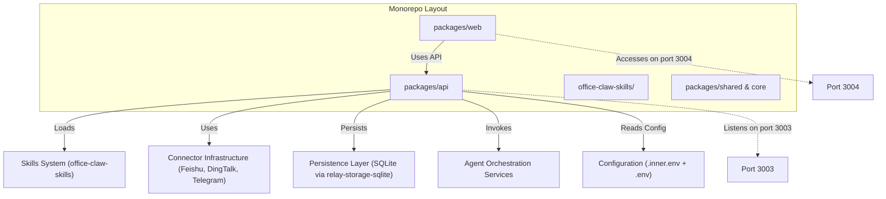
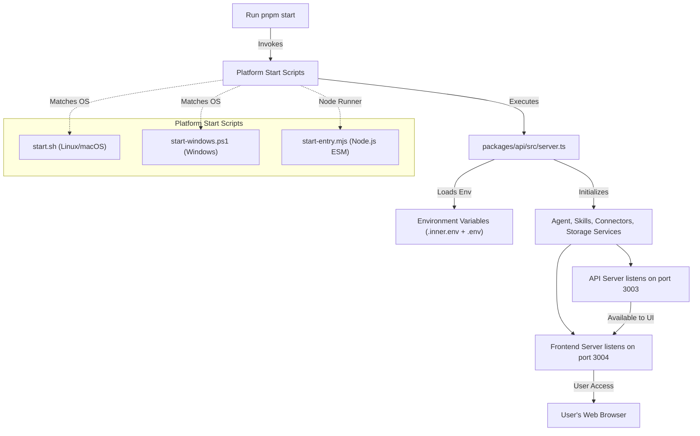

<!-- source: DeepWiki mcp.deepwiki.com · repo openJiuwen-ai/relay · page 1.1 Getting Started · fetched 2026-11-02 -->

# Getting Started

<details>
<summary>Relevant source files</summary>

The following files were used as context for generating this wiki page:

- [.env.example](.env.example)
- [.npmrc](.npmrc)
- [README.md](README.md)

</details>


This page provides detailed instructions on how to install and run the Relay platform, a multi-agent AI collaboration system. It covers the required runtime environment, dependency installation, build process, configuration setup, port usage, and platform-specific start scripts. The documentation also explains key entry points and data flow during the platform initialization and running phases to help developers and operators get up and running quickly and understand core bootstrap mechanisms.

---

## 1. Prerequisites

Before running Relay, ensure your development environment meets these minimum requirements:

- **Node.js version 20 or later**  
  Relay uses modern JavaScript features and build tools requiring Node.js 20+.

- **pnpm version 9 or later**  
  pnpm is the preferred package manager for dependency installation and monorepo management.

- **Git**  
  To clone the repository.

These runtime and tool requirements ensure a consistent and compatible environment for building and running the platform.

---

## 2. Cloning the Repository

First, clone the official code repository from GitHub:

```bash
git clone https://github.com/openJiuwen-ai/relay.git
cd relay
```

This fetches the entire monorepo containing the backend API server, web frontend, shared libraries, skills, and tooling.

---

## 3. Installing Dependencies

Relay uses pnpm workspaces across multiple packages. Install dependencies with:

```bash
pnpm install
```

This resolves and links all package dependencies in the monorepo, using the configuration set in `.npmrc` which enables a flat `node_modules` layout for better Windows compatibility.

---

## 4. Building the Platform

Run the build step to compile TypeScript sources and prepare production assets:

```bash
pnpm build
```

This triggers the build scripts defined in the root `package.json`, encompassing both backend (`packages/api`) and frontend (`packages/web`) compilation. The build outputs are stored in each package’s `dist/` directory ready for execution.

---

## 5. Configuration Setup (.env)

Relay relies on environment variables to configure API keys, service endpoints, and runtime parameters.

- Copy the example template to `.env`:

```bash
cp .env.example .env
```

- Edit the `.env` file to specify variables like Huawei Cloud MaaS API keys and any platform-specific overrides.

Relay’s environment handling adopts a two-tier loading:

- `.inner.env`: Internal defaults shipped with the platform (URLs, CDN links, signal sources).  
- `.env`: User overrides with secret credentials and custom values take precedence.

This setup isolates default configurations from user secrets and runtime parameters.

---

## 6. Running the Platform

Start Relay using the npm script that initializes both backend and frontend servers:

```bash
pnpm start
```

This script boots the entire platform in development or production mode, exposing the backend API on **port 3003** and the frontend web UI on **port 3004**, enabling you to access the system via `http://localhost:3003`.

---

## 7. Platform Start Scripts

Relay provides cross-platform start scripts to simplify launching the platform:

| Script Name           | Platform     | Description                                   |
|----------------------|--------------|----------------------------------------------|
| `start.sh`            | Linux/macOS  | Shell script that runs `pnpm start` and related initialization. |
| `start-windows.ps1`   | Windows      | PowerShell script for Windows to launch the platform. |
| `start-entry.mjs`     | Node.js      | JavaScript entry point supporting direct node execution with ESM syntax. |

These scripts abstract environment preparations and ensure consistent startup sequences across systems.

---

## 8. Ports and Services Overview

Relay exposes its components on these key ports:

| Port  | Service                                        |
|--------|------------------------------------------------|
| 3003   | Backend API server (Fastify-based)               |
| 3004   | Web frontend (React/Next.js app)                  |

The API server handles business logic, agent domains, skills loading, persistence, and connectors, while the frontend provides the user interface accessible via browser.

---

## 9. Key Implementation and Data Flow

### 9.1 Bootstrap Sequence

- `pnpm start` executes scripts that ultimately invoke the Fastify API server bootstrap located in `packages/api/src/server.ts`.
- The server initializes core services such as agents orchestration, skill loading, connectors, and persistence layers.
- Concurrency and event processing are managed within these domain services, exposing HTTP APIs for frontend communication.

### 9.2 Environment Loading

- Env variables are loaded following a priority order starting with `.inner.env` defaults, overridden by `.env`.
- The configuration system merges these sources to provide final runtime values accessed by all packages.

### 9.3 Skill Packs and Connectors Initialization

- On startup, skill packs (found under `office-claw-skills/`) are dynamically discovered and loaded into the platform.
- Connectors for platforms like Feishu, DingTalk, and Telegram are instantiated via infrastructure layers, enabling multi-channel access.

---

## 10. Natural Language to Code Entity Mapping

### Diagram 1: System Components and Their Core Code Artifacts



---

### Diagram 2: Startup Flow and Script Mapping



---

## Summary Table: Essential Commands

| Task             | Command                      | Notes                              |
|------------------|------------------------------|---------------------------------- |
| Clone repo       | `git clone https://github.com/openJiuwen-ai/relay.git` | Fetch latest codebase             |
| Install deps     | `pnpm install`                | Resolves all monorepo dependencies |
| Build            | `pnpm build`                  | Produces compiled output          |
| Setup config     | `cp .env.example .env`        | Prepare environment variables     |
| Edit `.env`      | (manual)                     | Provide secrets, MaaS API keys     |
| Start platform   | `pnpm start`                  | Launch backend + frontend servers  |
| Platform scripts | `./start.sh` / `start-windows.ps1` / `node start-entry.mjs` | Platform-specific launch methods  |

---

# References and Sources

- Installation and start commands from `README.md:25-44`  
- `.env` setup overview from `.env.example` (note: file content is restricted)  
- Platform start scripts names from project structure references  
- Npm configuration `.npmrc:1-12` for flat `node_modules` layout and peer dependencies  
- Server bootstrap and environment loading: implied from project scripts and `packages/api/src/server.ts`  
- Ports usage (3003 for backend; 3004 for frontend) as documented in README and start conventions  

---

This guide equips developers and maintainers with a grounded starting point for setting up and running the Relay platform, while technical links clarify key code components and their interactions during startup and operation.

---

