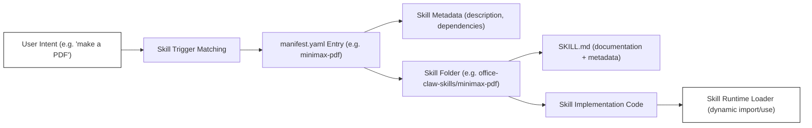
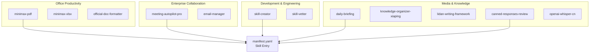

<!-- source: DeepWiki mcp.deepwiki.com · repo openJiuwen-ai/relay · page 4 Skills System · fetched 2026-11-02 -->

# Skills System

<details>
<summary>Relevant source files</summary>

The following files were used as context for generating this wiki page:

- [office-claw-skills/BOOTSTRAP.md](office-claw-skills/BOOTSTRAP.md)
- [office-claw-skills/canned-responses-review/SKILL.md](office-claw-skills/canned-responses-review/SKILL.md)
- [office-claw-skills/manifest.yaml](office-claw-skills/manifest.yaml)

</details>


This section outlines the design and operation of the **Skills System** in Relay/OfficeClaw, which is central to how the platform extends its AI capabilities via modular skill packs. These skill packs encapsulate domain-specific intelligence, workflows, and integrations and are **discovered, described, and loaded dynamically on demand**. This page provides a high-level overview of the skills system components, how they interconnect, and points to more detailed child pages focused on specific skill categories and authoring workflows.

---

## Purpose and Scope

The Skills System enables Relay to flexibly incorporate a wide variety of capability modules, known as **skills**, without hardcoding their logic into the core platform. Skills are grouped into logical families, each providing specialized functions such as document generation, knowledge management, collaboration tools, or communication handling.

Key operational principles include:

- **Skill packs are discoverable automatically** from the `office-claw-skills/` monorepo directory.
- Each skill is described declaratively using `SKILL.md` in its folder, containing metadata, usage instructions, and human-readable documentation.
- A global `manifest.yaml` serves as the **single source of truth for skill routing, triggers, dependencies, and categorization**.
- An additional `BOOTSTRAP.md` provides a curated high-level skill catalog grouping skills into the four major categories for quick reference.
- Skills are loaded on demand during runtime based on triggers matched against user intents or contextual clues.
- The system enforces **strict consistency rules**: all skill definitions must be coordinated among the skill directory, manifest, and bootstrap catalog for uniformity and correctness.

This page introduces these elements and how they fit together but delegates the in-depth explanations of skill authoring, specific skill families, and vetting pipelines to child pages.

---

## Skill Discovery and Description

### Skills Directory Structure

- Official skill packs reside under the top-level directory `office-claw-skills/`.
- Each skill has its own folder with:
  - A `SKILL.md` file containing the skill metadata in frontmatter format (e.g., `name`, `description`, `license`) followed by human-friendly documentation and instructions.
  - Supplementary files implementing the skill logic (not detailed here).

### Manifest: `manifest.yaml`

- The central registry file `office-claw-skills/manifest.yaml` declares all officially supported skills.
- It organizes skills into **four main categories**:
  1. Office Productivity (e.g., PDF generation, Excel handling)
  2. Enterprise Collaboration (e.g., meeting automation, email management)
  3. Media & Knowledge (e.g., knowledge organizer, writing frameworks)
  4. Development & Engineering (e.g., skill creator, skill vetting)
- For each skill, metadata fields include:
  - `description`: a short summary of the skill’s core capabilities.
  - `triggers`: natural language phrases that activate the skill.
  - `not_for`: contexts or inputs the skill explicitly excludes.
  - `output`: expected typical output format or artifact.
  - `dependencies`: required python/node libraries or external system services.
  - `next`: potential subsequent skill steps (workflow).
  - Additional operational fields like `sop_step` and `merged_from`.

Example skill entry snippet from `manifest.yaml`:
```yaml
minimax-pdf:
  description: High visual quality PDF skill. Supports generating design PDFs, filling existing PDF forms, and redesigning documents to printable PDFs.
  triggers:
    - "make a PDF"
    - "generate a report"
  not_for:
    - "Word raw editing"
    - "Pure data tables"
  output: "Print-ready PDF"
  dependencies:
    python:
      - reportlab
      - pypdf
    node:
      - playwright
    system:
      - Python 3
      - Node.js
      - Chromium
  next: []
```

### Skill Bootstrap Catalog: `BOOTSTRAP.md`

- A curated markdown file used for **quick human reference and classification**.
- Does **not** contain routing or runtime metadata.
- Lists skills under the same four broad families.
- Provides guidance on conventions such as:
  - Synchronizing changes to skill directory, manifest, and bootstrap for consistency.
  - The principle that "If a skill is applicable to your task, you must use it."
- Defines skills by their high-level "trigger scenarios."

---

## Skill Loading and Routing

The `manifest.yaml` is the **single source of truth for routing and trigger matching** at runtime:

- User inputs (natural language commands) are matched against the `triggers` listed in the manifest.
- Skills marked as `not_for` certain contexts will be excluded.
- Once matched, the platform dynamically loads the corresponding skill pack and executes the logic.
- Dependencies declared in the manifest are installed and activated as needed.
- The system supports chaining skills via `next` steps, enabling complex workflows.

---

## Natural Language to Code Entity Bridge

Below is a diagram illustrating how user intents in the **Natural Language Space** map to code entities and routing in the **Skills System**, centered around the `manifest.yaml` manifest and skill implementations:



---

## Classification of Skills

The skills are systematically grouped into these four families, each linking to their dedicated child pages for detailed technical coverage and authoring guidance:

| Skill Family            | Description                                              | Child Page Reference                 |
|------------------------|----------------------------------------------------------|------------------------------------|
| 1. Office Productivity  | Document and spreadsheet generation/editing/formats      | [Document Generation Skills](#4.2) |
| 2. Enterprise Collaboration | Meeting automation, email management, task follow-up   | [Communication and Voice Skills](#4.4), [Knowledge and Research Skills](#4.3) |
| 3. Media & Knowledge    | Knowledge base organization, writing frameworks, legal template responses | [Knowledge and Research Skills](#4.3) |
| 4. Development & Engineering | Skill creation, skill vetting, workflow evaluation         | [Skill Authoring and Vetting](#4.1) |

---

## Child Pages Overview

For in-depth information about each major skill family and the complete skill authoring lifecycle, please refer to the listed subpages:

- **4.1 Skill Authoring and Vetting**  
  Covers the development workflow, creation, evaluations, security review via `skill-creator` and `skill-vetter` skills, conventions in `BOOTSTRAP.md`, metadata frontmatter checks, and referencing knowledge capsules.

- **4.2 Document Generation Skills**  
  Details about high-quality visual PDF generation (`minimax-pdf`), advanced spreadsheet handling (`minimax-xlsx`), and official document formatting (`official-doc-formatter`).

- **4.3 Knowledge and Research Skills**  
  Explores pipelines for knowledge sync (`knowledge-organizer-xiaping`), fact-checking methodologies, writing frameworks (`lidan-writing-framework`), briefings, and legal template management (`canned-responses-review`).

- **4.4 Communication and Voice Skills**  
  Describes email management implementation supporting multiple protocols and providers (`email-manager`), and speech transcription (`openai-whisper-cn`).

---

## Summary

The Skills System is a powerful abstraction layer in Relay that organizes and delivers AI functionality through separated, discoverable skill packs. The combination of:

- Declarative metadata and documentation (`SKILL.md`)
- Central, synchronized routing and dependency manifest (`manifest.yaml`)
- Categorization overview (`BOOTSTRAP.md`)
- Dynamic loading based on natural language triggers

forms a robust framework enabling scalable AI capabilities. Strict conventions guarantee that skill definitions, routing, documentation, and developer workflows remain consistent and easy to manage as the platform evolves.

---

## Additional Diagram: Skill Categorization and Manifest Linkage



---

## Sources

- `office-claw-skills/BOOTSTRAP.md:1-69`  
- `office-claw-skills/manifest.yaml:1-269`  
- `office-claw-skills/canned-responses-review/SKILL.md:1-203`  

---

This concludes the overview of the Skills System. For technical details on authoring, specific skill implementation, or workflow integration, please consult the corresponding child pages.

---

