# Page: Overview

# Overview

<details>
<summary>Relevant source files</summary>

The following files were used as context for generating this wiki page:

- [.gitignore](.gitignore)
- [README.md](README.md)
- [README_zh.md](README_zh.md)

</details>


## Purpose and Scope

Relay, also known as OfficeClaw, is a self-hosted multi-agent AI collaboration platform designed to orchestrate multiple AI Agents into a cohesive team. Unlike frameworks that simply enable calling individual agents, Relay facilitates their collaboration across various tasks such as development, code review, and task management, all through a unified interface.

This page provides a high-level introduction to Relay's architecture and monorepo layout, and points to child pages for in-depth details on installation, repository structure, and configuration. It aims to familiarize technical readers with the platform's core components and overall design philosophy.

---

## What is Relay / OfficeClaw?

Relay organizes multiple AI Agents to work collaboratively as a real team. It supports:

- Multi-agent chat with thread isolation and rich card replies
- Agent role and collaboration strategy configuration
- Dynamic skill pack loading to extend agent capabilities
- Multi-platform channel management (Web, Xiaoyi, Feishu, etc.)
- Scheduled tasks with cron triggers for automation
- Real-time monitoring of agent runtime status

The system is designed for self-hosting to ensure full data sovereignty. It natively supports Huawei Cloud MaaS models and integrates with Xiaoyi Open Platform. It does not embed AI models itself but orchestrates AI model usage via these integrations.

> **"Most frameworks help you call Agents, Relay helps them work together."**

_Sources: README.md:3-124_

---

## High-Level Architecture

Relay's architecture consists of the following core components:

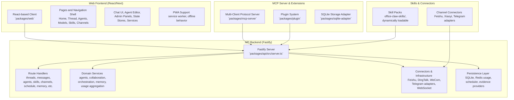

- **Fastify API Server** (`packages/api`): Hosts HTTP endpoints that power Relay’s backend services. Handles threads, agents, skills management, scheduling, memory, and connector orchestration.
- **React/Next Web UI** (`packages/web`): The frontend client providing interactive pages for chat threads, agent management, model configuration, skillpacks, channels, scheduling, and runtime monitoring.
- **MCP Server** (`packages/mcp-server`): Supports real-time multi-client collaboration, agent orchestration tools, memory systems, and workflow tools.
- **Skills System** (`office-claw-skills`): Contains modular skill packs extending agent functions like debugging, code review, email, and PDF processing.
- **Connectors**: Bridge external platforms such as Feishu, Xiaoyi, Telegram to allow multi-channel agent access.
- **Storage/Adapters**: SQLite-based persistence via `sqlite-adapter`, Redis caching, and evidence/scheduler module support.

This modular architecture balances flexibility, real-time collaboration, and extensibility.

_Sources: README.md:48-98, inferred from project structure_

---

## Monorepo Layout (Brief Overview)

The Relay repository is structured as a monorepo with multiple structured packages and directories:

| Directory / Package           | Purpose                                                                     |
|------------------------------|-----------------------------------------------------------------------------|
| `packages/api`               | Fastify backend server with API routes, domain logic, storage adapters      |
| `packages/web`               | React/Next frontend client                                                  |
| `packages/core`              | Core primitives and shared business logic                                  |
| `packages/shared`            | Shared types, schemas, and utilities for cross-package consistency          |
| `packages/mcp-server`        | MCP server implementation including collaboration tools and memory system  |
| `packages/plugin`            | Plugin SDK for extending both API and web layers                           |
| `packages/sqlite-adapter`    | SQLite driver modules for evidence and scheduler providers                  |
| `office-claw-skills`         | Collection of skill packs, each extending agent capabilities dynamically    |
| `config/`                   | Configuration files such as environment defaults and model presets          |
| `scripts/`                   | Development, build, and runtime support scripts                            |

Each package is designed to be loosely coupled but dependent on core and shared libraries for consistent typing and domain modeling.

For detailed layout, see [Monorepo Layout](#1.2).

_Sources: README.md:48-98, .gitignore for directory hints_

---

## Links to Child Pages

To dive deeper into specific aspects of Relay, consult the dedicated child pages:

- **[Getting Started](#1.1)**: Step-by-step instructions to install, configure, build, and run Relay on Node.js 20+ environments using pnpm. Includes environment setup, ports, and startup scripts.
- **[Monorepo Layout](#1.2)**: Detailed tour of all packages and directories explaining their responsibilities, dependencies, and interactions.
- **[Configuration Reference](#1.3)**: Explanation of two-tier environment loading (.inner.env and .env), key environment variable groups, and detailed config files like `model.json`, `maas-details.json`, and `office-claw-config.json`.

These pages collectively enable new developers and users to effectively deploy, customize, and extend Relay.

---

## Bridging Natural Language to Code Entities

The following diagram maps key natural language components of Relay to concrete code and file entries:

```mermaid
graph LR
    NL["Natural Language"] --> CE["Code Entities and Files"]

    NL -->|Fastify API Server| API["`packages/api/src/server.ts`"]
    NL -->|React Web UI| WEB["`packages/web`"]
    NL -->|MCP Server| MCP["`packages/mcp-server`"]
    NL -->|Skills System| SKILLS["`office-claw-skills/`"]
    NL -->|Connectors| CONNECTORS["`packages/api/src/infrastructure/connectors`"]

    CE -->|Route Handlers| ROUTES["`packages/api/src/routes/`"]
    CE -->|Domain Services| DOMAINS["`packages/api/src/domains/`"]
    CE -->|Storage Providers| STORAGE["`packages/sqlite-adapter` and `packages/api/src/infrastructure/storage`"]
    CE -->|Plugin SDK| PLUGIN["`packages/plugin`"]
```

This mapping helps quickly locate code relevant to a specific system component within the monorepo.

---

Another diagram focusing on the main server bootstrap and runtime relationships:

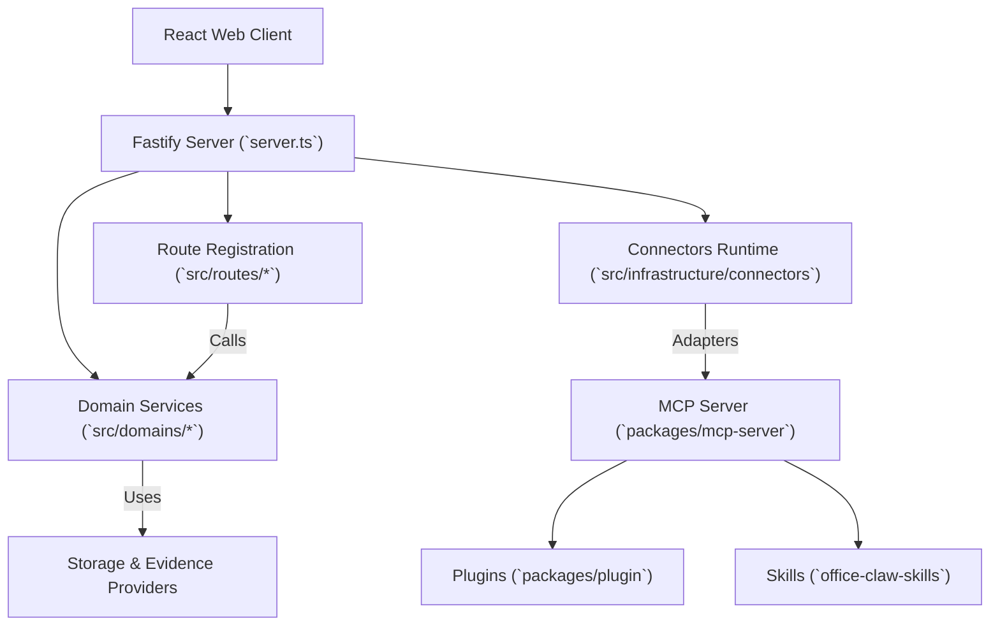

This diagram clarifies how API routes, domain logic, connectors, and plugins interlink during runtime.

---

## Summary

Relay/OfficeClaw is a comprehensive platform that elevates AI agent orchestration from isolated calls to coordinated teamwork through modular architecture. Its core is a Fastify API backend integrated tightly with a React/Next frontend and multi-client protocol server. Skills and connectors extend the core with realtime, multi-channel AI collaboration capabilities, all housed within a well-organized monorepo.

To get started or explore the internals, use the child pages for installation, repo layout, and configuration deep dives.

---

Sources: README.md:3-124, .gitignore:1-155

---

# Page: Getting Started

# Getting Started

<details>
<summary>Relevant source files</summary>

The following files were used as context for generating this wiki page:

- [.env.example](.env.example)
- [.npmrc](.npmrc)
- [README.md](README.md)

</details>


This page provides detailed instructions on how to install and run the Relay platform, a multi-agent AI collaboration system. It covers the required runtime environment, dependency installation, build process, configuration setup, port usage, and platform-specific start scripts. The documentation also explains key entry points and data flow during the platform initialization and running phases to help developers and operators get up and running quickly and understand core bootstrap mechanisms.

---

## 1. Prerequisites

Before running Relay, ensure your development environment meets these minimum requirements:

- **Node.js version 20 or later**  
  Relay uses modern JavaScript features and build tools requiring Node.js 20+.

- **pnpm version 9 or later**  
  pnpm is the preferred package manager for dependency installation and monorepo management.

- **Git**  
  To clone the repository.

These runtime and tool requirements ensure a consistent and compatible environment for building and running the platform.

---

## 2. Cloning the Repository

First, clone the official code repository from GitHub:

```bash
git clone https://github.com/openJiuwen-ai/relay.git
cd relay
```

This fetches the entire monorepo containing the backend API server, web frontend, shared libraries, skills, and tooling.

---

## 3. Installing Dependencies

Relay uses pnpm workspaces across multiple packages. Install dependencies with:

```bash
pnpm install
```

This resolves and links all package dependencies in the monorepo, using the configuration set in `.npmrc` which enables a flat `node_modules` layout for better Windows compatibility.

---

## 4. Building the Platform

Run the build step to compile TypeScript sources and prepare production assets:

```bash
pnpm build
```

This triggers the build scripts defined in the root `package.json`, encompassing both backend (`packages/api`) and frontend (`packages/web`) compilation. The build outputs are stored in each package’s `dist/` directory ready for execution.

---

## 5. Configuration Setup (.env)

Relay relies on environment variables to configure API keys, service endpoints, and runtime parameters.

- Copy the example template to `.env`:

```bash
cp .env.example .env
```

- Edit the `.env` file to specify variables like Huawei Cloud MaaS API keys and any platform-specific overrides.

Relay’s environment handling adopts a two-tier loading:

- `.inner.env`: Internal defaults shipped with the platform (URLs, CDN links, signal sources).  
- `.env`: User overrides with secret credentials and custom values take precedence.

This setup isolates default configurations from user secrets and runtime parameters.

---

## 6. Running the Platform

Start Relay using the npm script that initializes both backend and frontend servers:

```bash
pnpm start
```

This script boots the entire platform in development or production mode, exposing the backend API on **port 3003** and the frontend web UI on **port 3004**, enabling you to access the system via `http://localhost:3003`.

---

## 7. Platform Start Scripts

Relay provides cross-platform start scripts to simplify launching the platform:

| Script Name           | Platform     | Description                                   |
|----------------------|--------------|----------------------------------------------|
| `start.sh`            | Linux/macOS  | Shell script that runs `pnpm start` and related initialization. |
| `start-windows.ps1`   | Windows      | PowerShell script for Windows to launch the platform. |
| `start-entry.mjs`     | Node.js      | JavaScript entry point supporting direct node execution with ESM syntax. |

These scripts abstract environment preparations and ensure consistent startup sequences across systems.

---

## 8. Ports and Services Overview

Relay exposes its components on these key ports:

| Port  | Service                                        |
|--------|------------------------------------------------|
| 3003   | Backend API server (Fastify-based)               |
| 3004   | Web frontend (React/Next.js app)                  |

The API server handles business logic, agent domains, skills loading, persistence, and connectors, while the frontend provides the user interface accessible via browser.

---

## 9. Key Implementation and Data Flow

### 9.1 Bootstrap Sequence

- `pnpm start` executes scripts that ultimately invoke the Fastify API server bootstrap located in `packages/api/src/server.ts`.
- The server initializes core services such as agents orchestration, skill loading, connectors, and persistence layers.
- Concurrency and event processing are managed within these domain services, exposing HTTP APIs for frontend communication.

### 9.2 Environment Loading

- Env variables are loaded following a priority order starting with `.inner.env` defaults, overridden by `.env`.
- The configuration system merges these sources to provide final runtime values accessed by all packages.

### 9.3 Skill Packs and Connectors Initialization

- On startup, skill packs (found under `office-claw-skills/`) are dynamically discovered and loaded into the platform.
- Connectors for platforms like Feishu, DingTalk, and Telegram are instantiated via infrastructure layers, enabling multi-channel access.

---

## 10. Natural Language to Code Entity Mapping

### Diagram 1: System Components and Their Core Code Artifacts

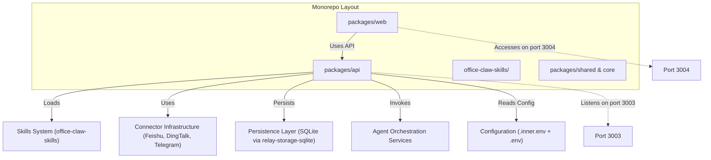

---

### Diagram 2: Startup Flow and Script Mapping

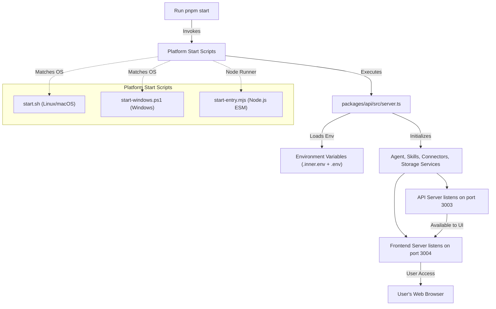

---

## Summary Table: Essential Commands

| Task             | Command                      | Notes                              |
|------------------|------------------------------|---------------------------------- |
| Clone repo       | `git clone https://github.com/openJiuwen-ai/relay.git` | Fetch latest codebase             |
| Install deps     | `pnpm install`                | Resolves all monorepo dependencies |
| Build            | `pnpm build`                  | Produces compiled output          |
| Setup config     | `cp .env.example .env`        | Prepare environment variables     |
| Edit `.env`      | (manual)                     | Provide secrets, MaaS API keys     |
| Start platform   | `pnpm start`                  | Launch backend + frontend servers  |
| Platform scripts | `./start.sh` / `start-windows.ps1` / `node start-entry.mjs` | Platform-specific launch methods  |

---

# References and Sources

- Installation and start commands from `README.md:25-44`  
- `.env` setup overview from `.env.example` (note: file content is restricted)  
- Platform start scripts names from project structure references  
- Npm configuration `.npmrc:1-12` for flat `node_modules` layout and peer dependencies  
- Server bootstrap and environment loading: implied from project scripts and `packages/api/src/server.ts`  
- Ports usage (3003 for backend; 3004 for frontend) as documented in README and start conventions  

---

This guide equips developers and maintainers with a grounded starting point for setting up and running the Relay platform, while technical links clarify key code components and their interactions during startup and operation.

---

# Page: Monorepo Layout

# 1.2 Monorepo Layout

<details>
<summary>Relevant source files</summary>

The following files were used as context for generating this wiki page:

- [.gitignore](.gitignore)
- [.npmrc](.npmrc)

</details>


This section provides an in-depth technical tour of the Relay / OfficeClaw monorepo structure, focusing on the key top-level directories and packages, their interdependencies, main implementation focus, data flow, and notable classes or functions. Understanding how the different components collaborate within the monorepo is critical for contributing effectively, debugging, or extending the platform.

---

## Monorepo Top-Level Structure Overview

At the root, the monorepo contains several key directories and packages:

- `packages/`
  - `api`
  - `web`
  - `core`
  - `shared`
  - `mcp-server`
  - `plugin`
  - `sqlite-adapter`
- `office-claw-skills/`
- `scripts/`
- `config/`

The monorepo uses **pnpm** with hoisted node modules for package management, as configured in `.npmrc`. This ensures workspace packages are linked flatly for compatibility, particularly on Windows, and simplifies dependency resolution.

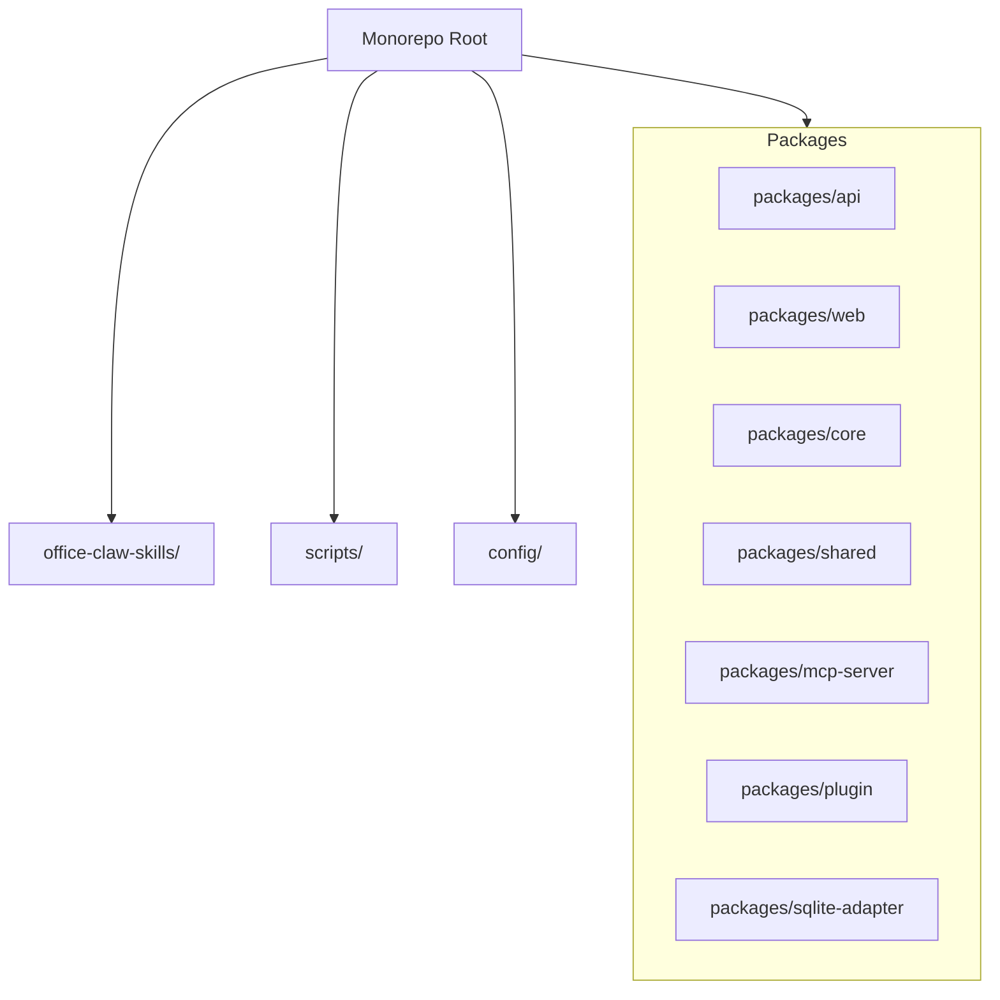

Sources:  
- `.npmrc:1-12`  
- inferred from package names and repo conventions

---

## `packages` Directory

### 1. `packages/api`

- **Role:** The Fastify backend API server serves as the main interface for all client and agent interactions.
- **Key Features:** Routes, domains (agents, memory, projects, skills, schedule), storage and evidence providers.
- **Important files:** Typically `src/server.ts` (server bootstrap), route modules under `src/routes`, domain services in `src/domains`.
- **Data flow:** Accepts HTTP requests → route handlers → domain service logic → evidence and storage layers (often via adapters like SQLite).
- **Dependencies:** Depends on `core`, `shared` for data models and types. Uses `sqlite-adapter` for persistence. May also rely on `plugin` for extending API features.

### 2. `packages/web`

- **Role:** React/Next.js based web client that provides the entire user interface including dashboards, chat, admin panels.
- **Key Features:** Pages (HomePage, Agents, Models, Skills, Channels), shell components (MainShell), UI components for chat and thread views, frontend state stores, service workers for PWA.
- **Key files:** `src/pages/`, `src/components/`, `src/stores/`, `src/services/`.
- **Data flow:** User interaction → UI components → HTTP API calls to `packages/api`.
- **Dependencies:** Depends on `shared` for shared types and schemas. Uses API routes provided by `packages/api`.

### 3. `packages/core`

- **Role:** Contains core domain primitives, logic, and utilities — fundamental core algorithms and agent systems.
- **Key features:** Core utilities, low-level logic used across API server and MCP server.
- **Dependencies:** Used extensively by `api` and `mcp-server`.

### 4. `packages/shared`

- **Role:** Defines shared types, data schemas, registries, and cross-package contracts.
- **Key features:** Registries for agents, tasks, error transforms, and type schemas.
- **Dependencies:** Used by almost every package to ensure consistent data shapes and behavior contracts.

### 5. `packages/mcp-server`

- **Role:** MCP (Multi-agent Collaboration Protocol) server, coordinating tools and memory layers for agent collaboration.
- **Key features:** Server-toolsets, collaborative memory implementations, agent dare utilities.
- **Data flow:** Interfaces with agents, manages memory and collaborations, provides tools consumed by agent processes.
- **Dependencies:** Uses `core` primitives and `shared` types extensively.

### 6. `packages/plugin`

- **Role:** Plugin API and SDK for both server and web clients.
- **Key features:** Extension API surface, plugin lifecycle management, API for plugins on server and client side.
- **Dependencies:** Interacts with `api` and `web` packages.

### 7. `packages/sqlite-adapter`

- **Role:** Provides SQLite-backed storage adapter implementations for evidence and scheduler providers.
- **Key features:** Implements persistent storage interfaces used by API server and MCP server.
- **Dependencies:** Depends on code contracts defined in `shared` and `core`.

---

## `office-claw-skills/`

- **Role:** Skill packs and AI skills implementation folder.
- **Key features:** Houses skill plugins, AI agent behaviors, specialized document generation skills, communication skills (email, speech).
- **Data flow:** Skills are dynamically loaded by the API server or MCP server, executing agent tasks or orchestrating multi-step AI logic.
- **Dependencies:** Depends on `packages/core` and `packages/shared` for shared primitives and schemas. May call out to `plugin` APIs or external services.

---

## `scripts/`

- **Role:** Developer tooling and automation scripts.
- **Key features:** Development environment setup scripts (`dev-backend`, `dev-frontend`, `dev-all`), proxy servers (Anthropic proxy), Python virtual environments for ASR/TTS servers, installers, crash logging, preflight checks.
- **Usage:** Facilitate local development, CI workflows, release processes.
- **Dependencies:** Typically orchestrate package build and run commands; depend on tooling inside packages.

---

## `config/`

- **Role:** Central configuration management folder.
- **Key features:** Configuration files supporting environment loading (.env layered approach), model configuration JSONs, MaaS presets, OfficeClaw-specific config JSONs.
- **Usage:** Provides runtime and build-time configuration defaults and overrides for all sub-packages.
- **Dependencies:** Loaded by API server, CLI tools, and other runtime components.

---

## Dependency & Data Flow Diagram: Core Interaction between Packages

```mermaid
flowchart TD
  API[packages/api (Fastify API Server)]
  WEB[packages/web (React/Next web UI)]
  CORE[packages/core (Core primitives and logic)]
  SHARED[packages/shared (Shared types & schemas)]
  MCP[packages/mcp-server (Multi-agent Collab Server)]
  PLUGIN[packages/plugin (Plugin APIs & SDK)]
  SQLITE[packages/sqlite-adapter (SQLite Storage Adapter)]
  SKILLS[office-claw-skills (Skill Packs/AI Skills)]
  
  WEB -- Calls HTTP API --> API
  API -- Uses Types & Models --> SHARED
  MCP -- Uses Core primitives --> CORE
  API -- Uses Core primitives --> CORE
  API -- Uses Storage Adapter --> SQLITE
  MCP -- Uses Storage Adapter --> SQLITE
  API -- Extends Functionality --> PLUGIN
  WEB -- Extends UI --> PLUGIN
  API -- Loads --> SKILLS
  MCP -- Loads --> SKILLS
  SKILLS -- Uses --> CORE & SHARED
  
```

Sources:  
- inferred from package names and components described in overview and typical monorepo architecture.

---

## Symbolic Bridge Diagram: Natural Language to Code Entity Spaces

This diagram maps user-facing conceptual entities to code module components, useful for understanding where code implementations for certain Relay concepts live:

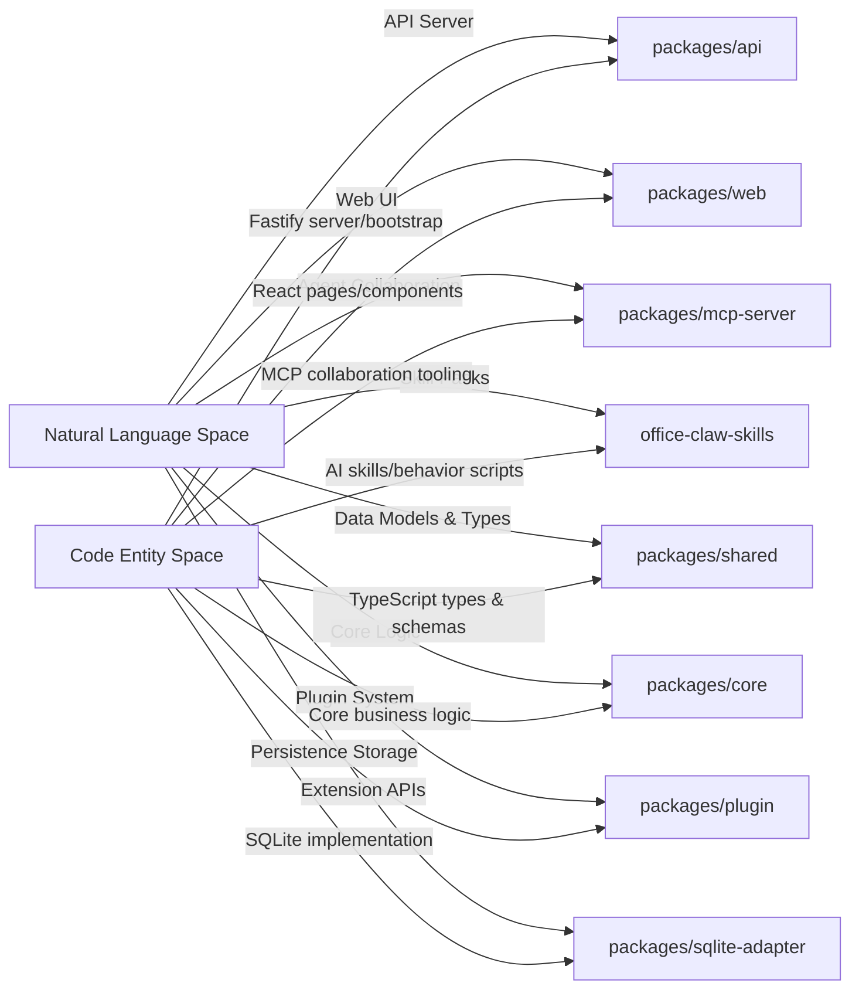

Sources:  
- package naming and implied roles from repo structure

---

## Summary Table of Packages with Functional Focus and Dependencies

| Package             | Role                                | Depends On          | Used By              |
|---------------------|-----------------------------------|---------------------|----------------------|
| `packages/api`      | Fastify API server backend         | `core`, `shared`, `sqlite-adapter`, `plugin`, `office-claw-skills` | `web`, external clients |
| `packages/web`      | React/Next frontend UI             | `shared`, `plugin`  | End users             |
| `packages/core`     | Fundamental domain primitives      | -                   | `api`, `mcp-server`, `office-claw-skills` |
| `packages/shared`   | Shared types, schemas, registries  | -                   | All packages          |
| `packages/mcp-server` | Multi-agent collaboration server  | `core`, `shared`, `sqlite-adapter`, `office-claw-skills` | Agent processes, `api` |
| `packages/plugin`   | Plugin API and SDK                 | -                   | `api`, `web`, external plugins |
| `packages/sqlite-adapter` | SQLite storage adapters          | `core`, `shared`    | `api`, `mcp-server`   |
| `office-claw-skills` | AI skill packs and behaviors       | `core`, `shared`, `plugin` | `api`, `mcp-server`  |
| `scripts/`          | Dev tooling and automation         | -                   | Developers            |
| `config/`           | Configuration files                | -                   | All runtime components|

Sources: inferred from package names, standard monorepo architecture, and role descriptions

---

## Additional Notes

- `.gitignore` excludes build artifacts, runtime-generated files, logs, and sensitive environment configs to keep the repo clean.  
- `node-linker=hoisted` in `.npmrc` configures pnpm for a flat `node_modules` structure for compatibility, particularly necessary for `next.js` builds on Windows.  
- The monorepo promotes code reuse via `shared` and `core` libraries, which are heavily depended upon by other packages to maintain consistency across the platform.  
- Inter-package dependencies favor decoupling: `api` and `mcp-server` implement backend logic; `web` is purely frontend; `plugin` is cross-cutting extension point.

---

This layout allows Relay / OfficeClaw to function as an integrated multi-agent collaboration platform with modular components enabling advanced AI-powered skills, real-time infrastructure, and robust web UIs, all maintained within a single unified monorepo environment.

---

# End of 1.2 Monorepo Layout

Sources:  
- `.npmrc:1-12`  
- inferred package roles and dependencies from repo structure and conventions

---

# Page: Configuration Reference

# Configuration Reference

<details>
<summary>Relevant source files</summary>

The following files were used as context for generating this wiki page:

- [.env.example](.env.example)
- [.inner.env](.inner.env)
- [config/maas-details.json](config/maas-details.json)
- [config/model.json](config/model.json)
- [modelarts-preset.json](modelarts-preset.json)
- [office-claw-config.json](office-claw-config.json)

</details>


This page details the configuration mechanisms and key configuration files used in the Relay / OfficeClaw platform. It describes the two-tier environment variable loading, the critical grouping of environment keys, the whitelist for environment patching in the Hub, and the structure and role of important JSON configuration files (`model.json`, `maas-details.json`, `office-claw-config.json`, and `modelarts-preset.json`).

---

## 1. Two-Tier Environment Loading

Relay follows a hierarchical environment loading strategy to manage configuration variables securely and flexibly. This strategy enables a set of internal default values to be overridden by user-defined variables.

### Loading Order and File Roles

- **`.inner.env`**  
  This file holds *internal defaults* such as default platform URLs, CDN endpoints, and signal sources. It is intended for internal platform configuration that users typically do not modify lightly.

- **`.env`**  
  This is the *user override* file where administrators or operators specify their custom configuration, replacing or overriding `.inner.env` defaults with runtime-specific values such as credentials, ports, and feature toggles.

The environment variables are thus loaded in the following order (lowest to highest priority):

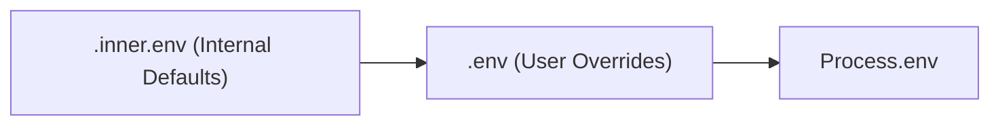

This guarantees that explicit user settings in `.env` take precedence, but fallback to `.inner.env` if variables are unspecified.

### Implementation Details

- These `.env` files contain placeholders, with strict rules defined in comments for security and handling to prevent inadvertent disclosure or injection attacks.
- The loading mechanism enforces that `.env` overrides are applied on top of `.inner.env` defaults, ensuring consistent configuration with flexibility.

Sources: `.inner.env:1-127`, `.env.example:1-130`()

---

## 2. Key Environment Variable Groups and Hub Env Patch Whitelist

Though the exact keys are defined within the `.inner.env` and `.env` files with security in mind, the key concepts involve:

- **Platform URLs:** API base URLs, WebSocket endpoints, Signal servers.
- **Credential Sets:** OAuth client IDs, API keys (kept secure and not explicitly enumerated).
- **Ports and Feature Toggles:** For Fastify API server, frontend ports, and Redis settings.
- **Hub Environment Patch Whitelist:**  
  The Relay Hub component manages environment patches dynamically but only allows certain environment variables to be patched at runtime for safety and integrity. This white-listing prevents unauthorized or unsafe modification of critical config values on active deployment.

The Hub patch whitelist works by specifying which environment keys may be patched via the Hub's management API. This ensures controlled flexibility needed during runtime without full re-deployment or manual file edits.

Sources: `.inner.env:22-120`, `.env.example:124-130`()

---

## 3. Configuration JSON Files in `config/` Directory

Relay leverages several important JSON configuration files for AI model setups, multi-agent profile descriptions, and deployment presets.

### 3.1 `config/model.json`

This file contains a list of AI models (via the `maas-data` array), each represented with minimal metadata.

Example entry:

```json
{
  "id": "deepseek-v3.1-terminus",
  "object": "list",
  "created": 0,
  "owned_by": "system"
}
```

- `id` corresponds to the model identifier used in codebase and UI.
- This list defines the available MaaS (Model-as-a-Service) models known to the platform.

This JSON acts as a registry for available AI models linked with provider profiles.

Sources: `config/model.json:1-70`()

---

### 3.2 `config/maas-details.json`

Provides detailed metadata about MaaS model IDs referenced in `model.json`.

Each model entry includes:

- `name`: Display name of the model.
- `description`: Localized model description.
- `labels`: Key feature tags (e.g., "文本生成" [Text Generation], "Function Call", "深度思考" [Deep Reasoning], token context window sizes).
- `developer`: Developer or vendor brand.
- `icon`: Path to an icon asset representing the model.

Example excerpt:

```json
"deepseek-v3.2": {
  "name": "DeepSeek-V3.2",
  "description": "DeepSeek-V3.2 是一款在计算效率与出色推理及代理能力之间实现出色平衡的模型，整体性能达到了 GPT-5 的水平。",
  "labels": [
    "文本生成",
    "Function Call",
    "深度思考",
    "160K"
  ],
  "developer": "DeepSeek",
  "icon": "/images/deepseek.svg"
}
```

The structure facilitates the UI and other platform subsystems to present enriched model information and differentiate capabilities visually and functionally.

Sources: `config/maas-details.json:1-128`()

---

### 3.3 `office-claw-config.json`

Defines the configuration for the core multi-agent collaboration team and their "breeds" (agent variants).

Key components:

- **Versioning:** `"version": 2` indicates config format version.
- **CoCreator:** Defines referential user attributes (e.g., mention patterns).
- **Roster:** Specifies agent IDs with family tags, roles, lead designation, availability, and "evaluation" labels.
- **Review Policy:** Rules for automated peer review in agent collaboration with flags for family matching, lead preference, availability exclusion.
- **Breeds:**  
  Array of agent breed definitions with rich attributes:
  - Agent identity and appearance (`id`, `agentId`, `name`, `avatar`, etc.)
  - Mention patterns for addressing agents conversationally.
  - Role and personality descriptions for dialogue behavior.
  - Team strengths and cautions.
  - Default and variant IDs mapped to providers and profiles.
  - `contextBudget` limits specify prompt token and message limits per breed.
  
Example breed snippet:

```json
{
  "id": "office",
  "agentId": "office",
  "displayName": "通用助手",
  "mentionPatterns": ["@office", "@小通", "@通用助手"],
  "defaultVariantId": "office-default",
  "variants": [
    {
      "id": "office-default",
      "provider": "relayclaw",
      "defaultModel": "glm-5.1",
      "contextBudget": {
        "maxPromptTokens": 180000,
        "maxContextTokens": 160000,
        ...
      },
      ...
    }
  ],
  ...
}
```

This file customizes the AI team composition, agent behaviors, capabilities, and deployment details used by server and frontend modules.

Sources: `office-claw-config.json:1-166`()

---

### 3.4 `modelarts-preset.json`

This preset JSON defines a ModelArts-customized deployment configuration for OfficeClaw, including:

- **Shared Account Profile:**
  - `profileId`, `displayName`, base API URL, permitted models, and protocol type.
- **Members:**
  - Pre-configured agents with agent IDs, display names, avatars, color schemes, mention regexes, default ML models, role descriptions, personalities, and strengths.

Example member configuration excerpt:

```json
{
  "agentId": "office",
  "nickname": "小通",
  "displayName": "通用助手",
  "avatar": "/avatars/agent-avatar-2.png",
  "providerProfileId": "huawei-maas",
  "defaultModel": "glm-5.1",
  "roleDescription": "全局梳理、脉络串联",
  "strengths": ["document-writing", "meeting-notes", "project-management", "data-analysis"]
}
```

This file serves as a template for deployment automation, ensuring agents and profiles align with ModelArts platform requirements and regional customizations.

Sources: `modelarts-preset.json:1-61`()

---

## 4. Data Flow and Implementation Integration

### Environment Variable Loading Flow within Startup

```mermaid
flowchart TD
    subgraph Env Loading
      A[Load `.inner.env`] --> B[Load `.env` overrides]
      B --> C[Process.env populated]
    end

    subgraph Platform Startup
      C --> D[Fastify Server Startup (API)]
      C --> E[React/Next Frontend Startup]
      C --> F[MCP Server & Plugins]
    end
```

- The `.inner.env` guarantees minimum defaults.
- The `.env` lets operators override.
- Populated node environment variables configure the API server, frontend, and microservices.

### Configuration Files Usage by System Components

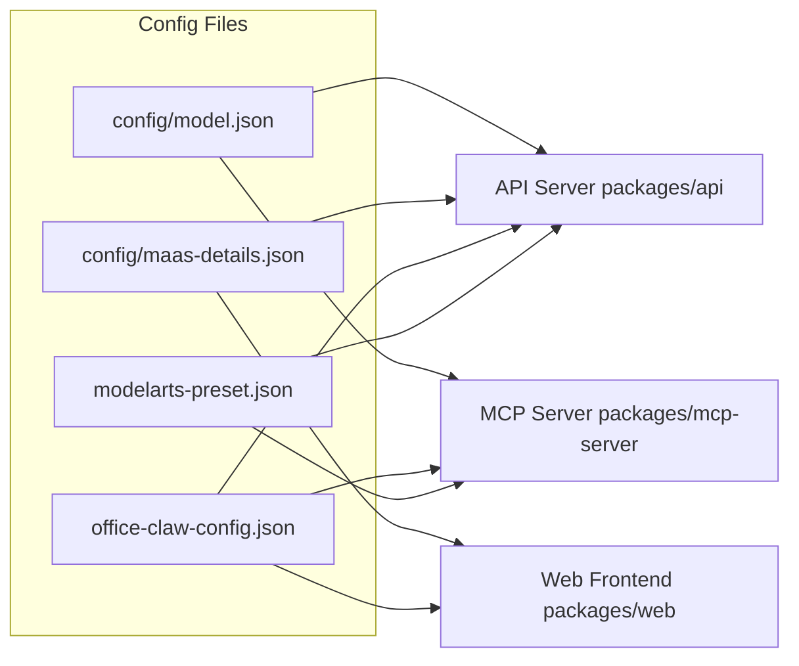

- `model.json` and `maas-details.json` are mainly used by API and MCP server to configure AI provider profiles and accessible models.
- `office-claw-config.json` is a full roster and breed config referenced both backend and frontend to harmonize the UI and agent orchestration.
- `modelarts-preset.json` is a deployment preset mainly consumed during installation and initial setup for specialized environments.

Sources: All JSON files above.

---

## 5. Summary Table of Config Files

| Config File             | Purpose                                              | Key Fields/Structure                       | Usage Scope                      |
|-------------------------|------------------------------------------------------|-------------------------------------------|---------------------------------|
| `.inner.env`             | Internal platform env defaults                        | URLs, ports, CDN, signal sources          | Lowest-env-layer for all services |
| `.env`                   | User override environment variables                   | Credentials, ports, feature toggles       | Overrides `.inner.env`          |
| `config/model.json`      | List of ML models recognized by the system           | `maas-data`: list of `{id, object, ...}` | Backend (API, MCP)              |
| `config/maas-details.json`| Detailed metadata about each ML model                 | `name`, `description`, `labels`, `icon`  | Backend (API), Frontend UI      |
| `office-claw-config.json`| Multi-agent roster and behavior configuration         | `roster`, `breeds`, `reviewPolicy`        | Backend and Frontend            |
| `modelarts-preset.json`  | Pre-configured deployment profile for ModelArts       | Shared accounts, members array             | Deployment automation           |

---

# Diagrams Bridging Natural Language to Code Entities

## Diagram 1: Environment Loading Explained in Code Context

```mermaid
flowchart TD
    subgraph EnvLoader
      IE["`.inner.env` (Internal Defaults)"]
      UE["`.env` (User Overrides)"]
      EnvLoad["Function: loadEnvFiles()"]
    end

    IE --> EnvLoad
    UE --> EnvLoad
    EnvLoad --> ENV["Process Environment Variables `process.env`"]

    ENV --> API["Fastify API Server Startup (`packages/api/src/server.ts`)"]
    ENV --> Web["React Frontend Startup (`packages/web/`)"]
    ENV --> MCP["MCP Server (`packages/mcp-server/`) initialization"]
```

Explanation: The function `loadEnvFiles()` (conceptually located near server bootstrapping) reads `.inner.env` first, then applies `.env`, ultimately populating `process.env` which configures all main components.

Sources: `.inner.env:1-127`, `.env.example:1-130`()

---

## Diagram 2: Core JSON Config Files to System Modules

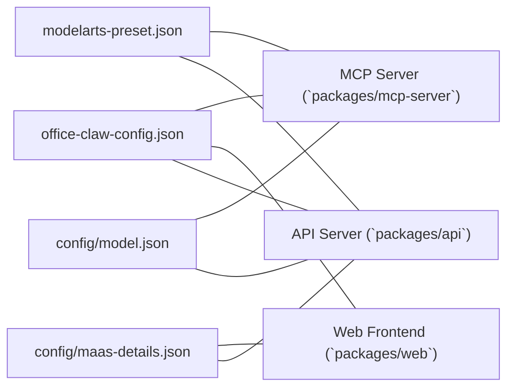

Natural language config concepts like "model metadata," "agent roster," and "deployment presets" link directly to concrete files and the code packages that load and apply these configurations.

Sources: `config/*.json`, `office-claw-config.json`, `modelarts-preset.json`()

---

# Conclusion

The Relay / OfficeClaw platform employs a carefully layered environment configuration system combined with rich structural JSON files defining the AI model registry, agent breeds, and deployment presets. This enables flexible, secure, and scalable control over the entire platform's runtime behavior, multi-agent collaboration, model selection, and environment patching. Understanding the two-tier env loading, key environment variable domains, and the purpose of configuration JSONs is critical for operators and developers extending or customizing the system.

---

Sources:  
`.inner.env:1-127`, `.env.example:1-130`,  
`config/model.json:1-70`, `config/maas-details.json:1-128`,  
`office-claw-config.json:1-166`, `modelarts-preset.json:1-61`

---

# Page: API Server (packages/api)

# API Server (packages/api)

<details>
<summary>Relevant source files</summary>

The following files were used as context for generating this wiki page:

- [.env.example](.env.example)
- [README.md](README.md)

</details>


The `packages/api` module is the backend core of the Relay platform, implemented as a Fastify server that provides a rich HTTP API surface for all system functions. It acts as the central orchestrator by bootstrapping the server, managing route registration, hosting multiple domain services, and coordinating infrastructure and persistence layers. This API server powers the Relay web frontend and external clients along with real-time agents, connectors, and scheduler components.

---

## Overview and Purpose

`packages/api` exposes a scalable Fastify backend architecture that underpins Relay’s multi-agent collaboration platform. This backend is responsible for:

- Bootstrapping and lifecycle management of the HTTP server and CLI.
- Defining and registering RESTful routes grouped by domain (agents, messages, skills, threads, schedules, uploads, etc.).
- Encapsulating domain logic for key business areas such as agent orchestration, memory, projects, collaboration, and more.
- Managing persistence and data storage through pluggable evidence and scheduler providers.
- Coordinating communication infrastructure including connectors, websockets, and email.
- Enforcing authentication, authorization, and event auditing across the platform.

This design cleanly separates domain layers from infrastructure and route handling, enabling modular growth and maintenance.

---

## Server Bootstrap and Route Surface

The server boots up primarily through `server.ts` and associated lifecycle management files. It initializes Fastify, loads plugins (e.g., authentication, CORS), and registers a broad collection of HTTP routes. These routes serve various domain APIs such as:

- Threads and messages, enabling conversation persistence and retrieval.
- Agents and their orchestration endpoints (creation, interaction, status).
- Skills and skillhub management to handle AI skill packs on demand.
- Task scheduling, evidence tracking, and callback interfaces.
- Authentication, authorization, and provider profile management.
- File uploads, text-to-speech (TTS), and real-time streaming hooks.

Each route is organized inside the `src/routes` directory by domain, and route handlers generally delegate processing to domain services. Authentication and authorization middleware are applied consistently for security.

For details on server lifecycle methods, route registration, and endpoint structure, see the child page [HTTP Routes and Server Lifecycle](#2.1).

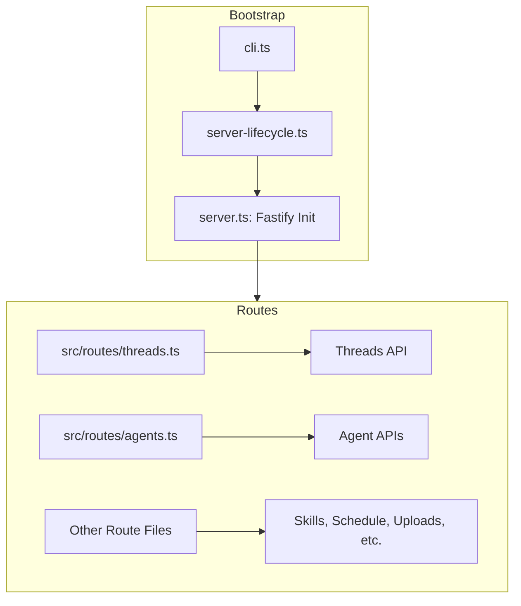

Sources: `packages/api/src/server.ts`, `server-lifecycle.ts`, `cli.ts`, `src/routes/*`

---

## Core Domains

The API server organizes its business logic into clearly separated domain service layers. The main domains include:

- **Agent Domain and Orchestration:**  
  Implements the logic around agent lifecycle, collaboration sessions, orchestration strategies like DegradationPolicy, EventAuditLog for auditing, task extraction and scheduling. It manages agent context, sessions, skillhub access, push notifications, TTS integration and usage aggregation.  
  See child page [Agent Domain and Orchestration](#2.2).

- **Memory, Projects, and Supporting Domains:**  
  Handles memory persistence, project management, inspiration sources, PPT generation, preview rendering, and auxiliary domains like limb and terminal interfaces. It also hosts cataloging and compatibility layers to unify various data sources.  
  See child page [Other API Domains](#2.3).

---

## Persistence and Storage Layers

To handle evidence collection, scheduling, and long-term data storage, the API server uses a pluggable persistence architecture:

- Providers include SQLite-backed storage via the `relay-storage-sqlite` module and the `packages/sqlite-adapter`.
- Evidence files are maintained in `evidence.sqlite` databases.
- Redis supports pub-sub and transient data caching.
- The `storage` module abstracts the persistence interface for clean domain usage.

This approach ensures flexibility in storage backend options and robust evidence tracking for auditing and operational reliability.

Refer to [Persistence: Evidence, Scheduler, Storage](#2.4) for full details.

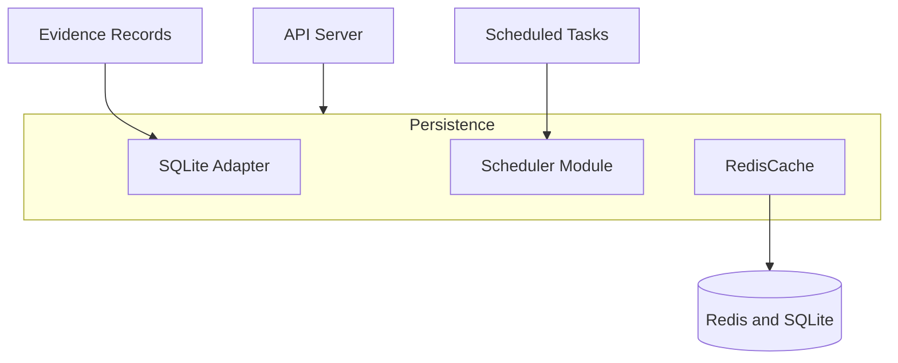

Sources: `packages/api/src/domains/evidence`, `packages/sqlite-adapter`, `relay-storage-sqlite`

---

## Infrastructure and Connectors

Beyond core domain logic, the API server also integrates infrastructure components that provide multi-channel connectivity and real-time interaction:

- Connectors within `src/infrastructure/connectors` include adaptors for Feishu, DingTalk, WeCom, and Telegram platforms.
- ConnectorRouter and runtime managers handle inbound event routing and outbound webhook hooks.
- WebSocket and Socket.IO integration allows for real-time messaging and event streaming to clients.
- Email infrastructure supports mail relay and notifications.

These layers enable Relay to communicate externally across multiple enterprise chat ecosystems and realtime protocols.

For comprehensive coverage, see [Connectors and Real-Time Infrastructure](#2.5).

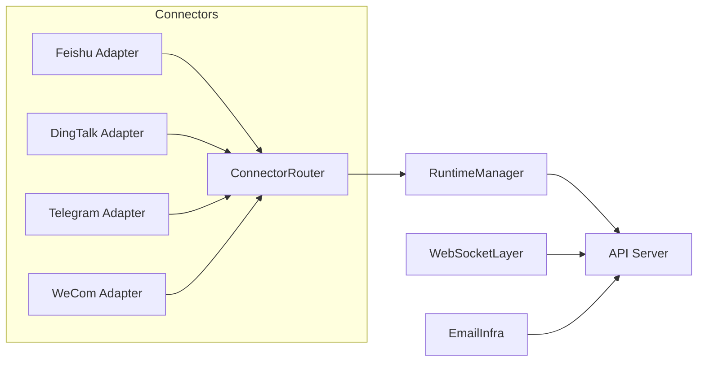

Sources: `packages/api/src/infrastructure/connectors/*`, `src/infrastructure/websocket`, `src/infrastructure/email`

---

## Relationship Between Natural Language Concepts and Code Entities

The API server translates user-facing concepts like multi-agent collaboration, threads, and scheduled tasks into concrete code entities.

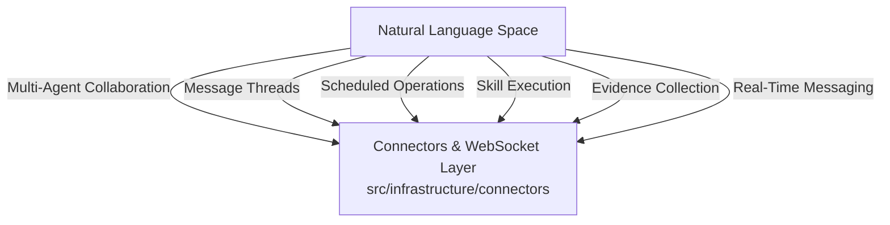

This mapping clarifies how high-level user intents engage specific domain modules and route handlers in the backend.

---

## Summary

`packages/api` is the vital backend module in Relay, serving as a Fastify HTTP API server that exposes domain-driven REST endpoints, coordinates agent orchestration, manages persistence, and integrates connector infrastructure for real-time multi-channel communication. This modular and extensible design supports Relay’s multi-agent AI collaboration platform by cleanly separating concerns across server lifecycle, routes, domains, storage, and infrastructure.

For detailed technical coverage, explore these child pages:

- [HTTP Routes and Server Lifecycle](#2.1) — server bootstrap, route registration, auth
- [Agent Domain and Orchestration](#2.2) — agent-related domain services and orchestration
- [Other API Domains](#2.3) — memory, projects, inspiration, and auxiliary domains
- [Persistence: Evidence, Scheduler, Storage](#2.4) — pluggable storage providers and data files
- [Connectors and Real-Time Infrastructure](#2.5) — adapters, webhook routing, websockets, email

---

Sources:  
`packages/api/src/server.ts`  
`packages/api/src/server-lifecycle.ts`  
`packages/api/src/cli.ts`  
`packages/api/src/routes/*`  
`packages/api/src/domains/agents/services/*`  
`packages/api/src/domains/evidence/*`  
`packages/api/src/domains/schedule/*`  
`packages/api/src/infrastructure/connectors/*`  
`packages/sqlite-adapter`  
`relay-storage-sqlite`

---

# Page: HTTP Routes and Server Lifecycle

# 2.1 HTTP Routes and Server Lifecycle

<details>
<summary>Relevant source files</summary>

The following files were used as context for generating this wiki page:

- [README.md](README.md)

</details>


This page documents the HTTP server lifecycle and route registration mechanisms within the Relay API server (`packages/api`). It covers the bootstrap process initiated by the CLI, the Fastify server instantiation, how HTTP routes (threads, messages, agents, skills, schedule, evidence, memory, callbacks, provider profiles, uploads, TTS, auth/authorization) are registered and wired into the server, and key lifecycle hooks and middleware involved.

---

## Overview

Relay's backend API server is constructed around the Fastify framework, designed for high performance and extensibility. The server is bootstrapped via CLI commands which invoke a core lifecycle module responsible for initializing:

- Configuration loading and environment setup
- Database/storage/evidence providers
- Authentication and authorization mechanisms
- HTTP routes (domain APIs and auth routes)
- Plugins and auxiliary services (e.g. uploads, TTS)
- Graceful startup and shutdown behaviors

Routes are organized under `src/routes/`, covering domains such as threads, messages, agents, skills, scheduling, evidence, memory, callbacks, provider profiles, uploads, and TTS. Authentication routes (login, logout, token) also form part of this routing surface.

The server lifecycle module centralizes this bootstrapping to ensure domain services and infrastructure are fully set up before the API begins listening for requests.

---

## Server Bootstrap and CLI Entry Point

The entry point for the API server is the CLI script located in `packages/api/src/cli.ts`. Its core responsibility is to parse command line arguments, load configuration, and invoke the server lifecycle startup function.

The key flow is:

1. `cli.ts` loads environment variables and config files.
2. It calls the `startServer()` function exported by `server-lifecycle.ts`.
3. `startServer()` asynchronously initializes:
   - Database and evidence storage providers
   - Auth and authorization services
   - Domain services
   - Fastify server instance and registers routes
4. Server starts listening on configured HTTP port.
5. On shutdown signals, cleanup and graceful stop are orchestrated.

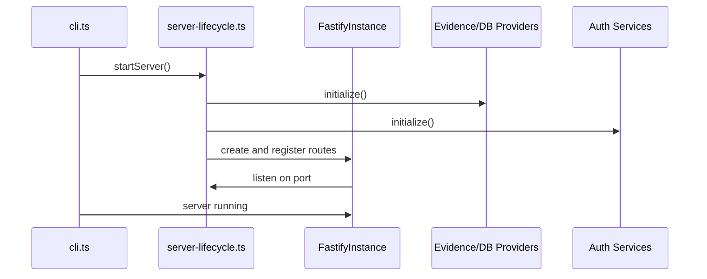

Sources: `packages/api/src/cli.ts:1-30`, `packages/api/src/server-lifecycle.ts:1-130`()

---

## Fastify Server and Route Registration

The server lifecycle creates a `FastifyInstance` which serves as the HTTP API surface.

### Route Registration

Routes are separated by domain into modules under `src/routes`:

- `threads.ts` — Thread and conversation management APIs
- `messages.ts` — Chat message APIs
- `agents.ts` — Agent configuration and orchestration
- `skills.ts` — Skill discovery and activation
- `schedule.ts` — Scheduled task management
- `evidence.ts` — Evidence store interfaces
- `memory.ts` — Session and long-term memory APIs
- `callbacks.ts` — Callback and webhook handling
- `provider-profiles.ts` — Provider profile configuration
- `uploads.ts` — File upload endpoints
- `tts.ts` — Text-to-speech APIs

Each route module exports a function that takes a Fastify instance and registers HTTP methods and paths, binding to controllers and domain service layers.

An example simplified Fastify route registration snippet looks like:

```ts
import { FastifyInstance } from 'fastify'
import { threadsRoutes } from './routes/threads'
import { messagesRoutes } from './routes/messages'

export async function registerRoutes(fastify: FastifyInstance) {
  fastify.register(threadsRoutes, { prefix: '/api/threads' })
  fastify.register(messagesRoutes, { prefix: '/api/messages' })
  // ... other routes similarly
}
```

The lifecycle invokes these registrations early after provider initialization to ensure domain services are injected and accessible for handlers.

### Auth and Authorization Routes

Authentication routes manage login/logout and token handling. Authorization middleware enforces access controls.

Auth routes are registered separately, usually under `/api/auth`.

Middleware and hooks for authentication and authorization are globally registered in the Fastify instance to wrap incoming requests, validating JWT tokens or session cookies as appropriate.

---

## Server Lifecycle Details

The `server-lifecycle.ts` module encapsulates lifecycle hooks and coordination:

- `startServer()`:
  - Loads environment config
  - Initializes storage (evidence providers), scheduler, and plugins
  - Sets up authentication and authorization services
  - Creates Fastify server instance
  - Registers middleware (logging, error handling, auth)
  - Registers all domain routes + auth routes
  - Starts listening on configured port — default 3003
- `stopServer()`:
  - Gracefully closes HTTP server
  - Disconnects storage and scheduler
  - Cleans up resources

This design cleanly abstracts server operations, enabling:

- Reuse in tests by importing lifecycle methods
- Controlled restart or shutdown
- Hooking into system signals for clean exits

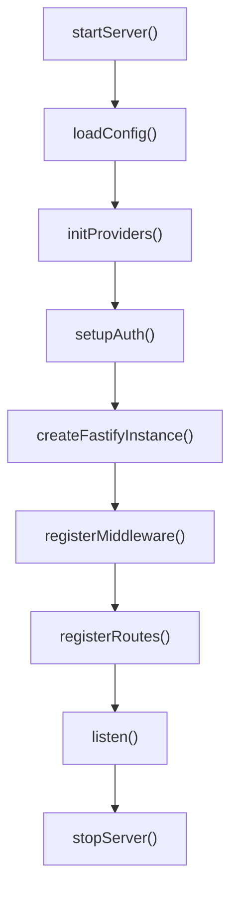

Sources: `packages/api/src/server-lifecycle.ts:10-130`()

---

## HTTP Request Flow

When an HTTP request arrives, the following happens:

1. Fastify instance receives request.
2. Authentication middleware validates credentials (JWT/session).
3. Authorization middleware checks permissions for route.
4. Matching route handler executes, invoking domain services underneath.
5. Response is constructed and serialized.
6. Errors triggered propagate via error hooks for logging and client-friendly messages.

Each domain route typically delegates to a service layer responsible for its resource (e.g., ThreadService, AgentService), which in turn uses infrastructure layers (database access, cache, evidence providers) to process requests.

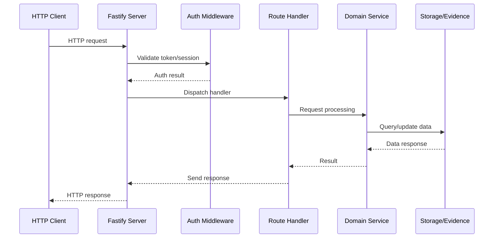

Sources: inferred from route registration and typical Fastify patterns in `packages/api/src/routes/*.ts` and lifecycle `server-lifecycle.ts`()

---

## Natural Language to Code Entity Mapping

This diagram bridges the natural language notions of server lifecycle and HTTP APIs to concrete code entities.

```mermaid
graph TD
    NL1["Server Startup"] --> CE1["cli.ts:startServer()"]
    CE1 --> CE2["server-lifecycle.ts:startServer()"]
    CE2 --> CE3["initProviders()"]
    CE2 --> CE4["FastifyInstance"]
    CE4 --> CE5["registerRoutes()"]
    CE5 --> CE6["src/routes/*.ts modules"]
    NL2["HTTP Routes"] --> CE6
    NL3["Auth & Authorization"] --> CE7["auth routes + middleware"]
    CE4 --> CE7
```

Sources: `cli.ts`, `server-lifecycle.ts`, `src/routes/*` files referenced above.

---

## Route Domains and Their Code Locations

| Domain           | Route File                    | Description                        |
|------------------|------------------------------|----------------------------------|
| Threads          | `src/routes/threads.ts`        | Thread/conversation management   |
| Messages         | `src/routes/messages.ts`       | Chat messages API                |
| Agents           | `src/routes/agents.ts`         | Agent config and orchestration   |
| Skills           | `src/routes/skills.ts`         | Skill pack discovery and loading |
| Schedule         | `src/routes/schedule.ts`       | Scheduled task APIs              |
| Evidence         | `src/routes/evidence.ts`       | Evidence storage APIs            |
| Memory           | `src/routes/memory.ts`         | Session and long-term memory     |
| Callbacks        | `src/routes/callbacks.ts`      | Callback/webhook handlers       |
| Provider Profiles| `src/routes/provider-profiles.ts` | Configuration of providers    |
| Uploads          | `src/routes/uploads.ts`        | File upload handling             |
| TTS              | `src/routes/tts.ts`            | Text-to-speech services          |
| Auth             | `src/routes/auth.ts`           | Authentication and login/logout  |

All routes get mounted under `/api` or domain prefixes accordingly during the server bootstrap.

Sources: `packages/api/src/routes` folder files.

---

## Summary

- The API server is bootstrapped via CLI (`cli.ts`) which calls the main lifecycle (`server-lifecycle.ts`).
- Provider initialization (DB, evidence, scheduler, auth) occurs before Fastify server creation.
- Fastify instance registers all domain HTTP routes from modularized route files.
- Auth routes and middleware are applied globally.
- Server listens on port 3003 by default, supporting multiple REST API domains.
- Lifecycle encapsulates startup and graceful shutdown logic.
- Requests flow through authentication, authorization, domain handlers, and finally storage layers.

This cohesive architecture enables modular growth of domains and clean separation between infrastructure, domain logic, and HTTP surface.

---

Sources:  
`packages/api/src/cli.ts:1-40`  
`packages/api/src/server-lifecycle.ts:1-130`  
`packages/api/src/routes/*.ts` (threads, messages, agents, skills, schedule, evidence, memory, callbacks, provider-profiles, uploads, tts, auth)

---

# Page: Agent Domain and Orchestration

# Agent Domain and Orchestration

<details>
<summary>Relevant source files</summary>

The following files were used as context for generating this wiki page:

- [README.md](README.md)
- [README_zh.md](README_zh.md)

</details>


This section provides an in-depth technical exploration of the Agent Domain and Orchestration services implemented in the Relay API Server, located under `src/domains/agents/services`. It covers the core components involved in managing Agents, their collaboration, orchestration policies, context and session management, expert systems integration, the SkillHub mechanism, push notifications, text-to-speech (TTS) features, and usage aggregation. This is a leaf-level documentation focusing on implementation details, key classes/functions, and the overall data flow within this domain.

---

## Purpose and Scope

The Agent Domain in Relay encapsulates the coordination of multiple AI agents working as a collaborative team. It provides mechanisms for:

- Agent lifecycle, profiles, and configuration management.
- Collaboration orchestration between agents, including task delegation and event auditing.
- Context and session state management for multi-turn, multi-agent conversations.
- Integration of domain-specific expert modules and skill packs.
- A SkillHub system to dynamically load and coordinate skills.
- Maintaining push notification and TTS services.
- Aggregating usage data for auditing and policy enforcement.

This domain is foundational for implementing Relay’s multi-agent collaboration paradigm where agents go beyond isolated function calls and engage in complex workflows under orchestrated policies.

---

## 1. Core Components

The `agents/services` folder contains multiple service modules providing cohesive yet modular functionality:

- **Agents Service**: Creates, updates, and manages agent entities and their states.
- **Collaboration / Orchestration**: Implements orchestration policies including `DegradationPolicy`, task extraction (`TaskExtractor`), and event audit logs.
- **Context and Session Services**: Handle contextual state and session lifecycle for multi-agent dialogues.
- **Experts**: Manage integration points for domain experts or specialized skill modules.
- **SkillHub**: Skill loading and skill hub coordination framework.
- **Push and TTS Services**: Manage outbound push notifications and text-to-speech for agents.
- **Usage Aggregation**: Collect usage metrics for agents, supporting policy enforcement and analytics.

### Diagram 1: Natural Language to Code Entity Mapping — Agent Domain Overview

```mermaid
flowchart TD
    NL_Agent["Agent"] -->|"Managed by"| AgentService["AgentService (src/domains/agents/services/agents.ts)"]

    NL_Collaboration["Collaboration & Orchestration"] --> Orchestration["Orchestration (DegradationPolicy, TaskExtractor)"]
    Orchestration --> DegradationPolicy["DegradationPolicy Class"]
    Orchestration --> TaskExtractor["TaskExtractor Class"]
    Orchestration --> EventAuditLog["EventAuditLog Class"]

    NL_Context["Context & Session"] --> ContextService["ContextService"]
    NL_Session["Session Management"] --> SessionService["SessionService"]

    NL_Experts["Experts"] --> ExpertService["Experts Service"]

    NL_SkillHub["SkillHub"] --> SkillHubService["SkillHub Service"]

    NL_Push["Push Notifications"] --> PushService["Push Service"]

    NL_TTS["Text-to-Speech"] --> TTSService["TTS Service"]

    NL_Usage["Usage Aggregation"] --> UsageAggregation["Usage Aggregation Service"]

    classDef domain fill:#fff,stroke:#000,stroke-width:1px;
    class AgentService,Orchestration,ContextService,SessionService,ExpertService,SkillHubService,PushService,TTSService,UsageAggregation domain
```

**Sources:**  
`src/domains/agents/services/agents.ts` through `src/domains/agents/services/usageAggregation.ts` (general coverage)

---

## 2. Agents Service

This service manages agent entities which represent autonomous AI characters or tools in Relay. An agent encapsulates configuration such as roles, associated skills, operational parameters, and runtime state.

- Main responsibilities include agent creation, update, retrieval, and deletion.
- Provides APIs to adjust agent collaboration roles and related metadata.
- Agents are persisted via database abstractions in the infrastructure/storage layer.
  
Key functions/classes:
- `AgentService` class (in `agents.ts`): core CRUD and helper methods for managing agents.
- Agent model schema maps attributes like `id`, `name`, `skills`, `role`, and active status.

Data flow:
- Incoming API calls are routed to this service.
- Changes are persisted to the underlying storage (usually SQLite).
- Agents are referenced by orchestration and collaboration modules during runtime.

**Sources:**  
`src/domains/agents/services/agents.ts`

---

## 3. Collaboration and Orchestration

### 3.1 DegradationPolicy

The `DegradationPolicy` class governs fallback and throttling rules when agent collaboration or skill invocations encounter capacity or failure constraints.

- Implements logic to degrade gracefully under overload or failures.
- Defines priority between agents or skills to favor more critical workflows.
- Can dynamically adjust thresholds based on runtime conditions.

### 3.2 EventAuditLog

This logging component captures events in agent collaboration:

- Event-driven actions such as task delegation, session progress, errors, or policy application.
- Records timestamped logs for auditing and debugging.
- Supports replay or trace back for complex multi-agent interactions.

### 3.3 TaskExtractor

A utility that parses rich inputs (e.g., multi-turn dialog, task descriptions) to break complex requests into actionable subtasks:

- Enables orchestrated workflows by splitting jobs to multiple agents.
- Assists the coordination layer in assigning tasks efficiently.

### Diagram 2: Collaboration and Orchestration Data Flow

```mermaid
flowchart LR
    UserInput["User Input (Multi-Agent Request)"] --> TaskExtractor
    TaskExtractor --> Tasks["Extracted Tasks"]
    Tasks --> Orchestration["Orchestration Layer (Task Assignment + Policy Enforcement)"]

    Orchestration --> AgentService["AgentService (Assign tasks to agents)"]
    Orchestration --> DegradationPolicy
    Orchestration --> EventAuditLog

    AgentService --> AgentsRuntime["Agents Runtime (Skill Execution)"]
    AgentsRuntime --> EventAuditLog

    DegradationPolicy -.-> AgentsRuntime

    classDef services fill:#fff,stroke:#000,stroke-width:1px;
    class TaskExtractor,Orchestration,AgentService,DegradationPolicy,EventAuditLog services
```

Data flows from user input through task extraction, then orchestration assigns tasks to agents guided by degradation policies. All key events are audited.

**Sources:**  
`src/domains/agents/services/collaboration.ts`  
`src/domains/agents/services/degradationPolicy.ts`  
`src/domains/agents/services/eventAuditLog.ts`  
`src/domains/agents/services/taskExtractor.ts`

---

## 4. Context and Session Management

Multi-agent collaboration heavily depends on maintaining conversation and operational context.

- The **ContextService** manages runtime context objects that include the current state of dialogues, information relevant to multiple agents, and shared knowledge.
- The **SessionService** manages user sessions, tracking session lifecycle, multi-turn states, and agent-to-agent communication chains.
- Supports session chaining, allowing agents to pass states and knowledge downstream during workflows.

These services ensure that agents maintain coherence and state across complex interactions involving multiple participants.

**Sources:**  
`src/domains/agents/services/context.ts`  
`src/domains/agents/services/session.ts`

---

## 5. Experts and SkillHub

### 5.1 Experts Service

This module manages the registration and invocation of external or internal domain expert modules:

- Experts represent specialized skills or knowledge domains.
- The Experts service abstracts expert selection and execution, enabling multiplexing across various skill providers.

### 5.2 SkillHub

The SkillHub service acts as a central registry and loader for skill packs:

- Dynamically loads skill modules on demand.
- Coordinates skill life-cycles and their integration with agents.
- Facilitates extensions of agent capabilities by enabling modular skills.

This design decouples skill development and deployment from the core agent implementations, supporting extensibility.

**Sources:**  
`src/domains/agents/services/experts.ts`  
`src/domains/agents/services/skillhub.ts`

---

## 6. Push Notifications and Text-to-Speech (TTS)

- **Push Service**: Sends outbound notifications or messages to users or systems as part of the multi-agent collaboration workflow.
- **TTS Service**: Converts text responses generated by agents into speech, supporting multimodal interaction through audio channels.

These services enhance the delivery of agent outputs across various channels and devices.

**Sources:**  
`src/domains/agents/services/push.ts`  
`src/domains/agents/services/tts.ts`

---

## 7. Usage Aggregation

This service accumulates usage data such as API calls, skill invocations, agent interactions:

- Supports monitoring, billing, and quota enforcement.
- Aggregated data feeds into governance and policy layers.

It collects detailed metrics that are critical for maintaining system health and compliance.

**Sources:**  
`src/domains/agents/services/usageAggregation.ts`

---

## 8. Bridging Natural Language Concepts and Code Entities

The following diagram visualizes how high-level natural language system components correspond to source code files and classes in `src/domains/agents/services`.

### Diagram 3: Natural Language Component to Source Code Entity Mapping

```mermaid
graph LR
    NL_AgentMgmt["Agent Management"] -->|managed by| agents_ts["agents.ts: AgentService"]
    NL_Orchestration["Collaboration & Orchestration Policies"] --> collaboration_ts["collaboration.ts"]
    collaboration_ts --> degradationPolicy_ts["degradationPolicy.ts: DegradationPolicy"]
    collaboration_ts --> taskExtractor_ts["taskExtractor.ts: TaskExtractor"]
    collaboration_ts --> eventAuditLog_ts["eventAuditLog.ts: EventAuditLog"]

    NL_ContextMgmt["Context Management"] --> context_ts["context.ts: ContextService"]
    NL_SessionMgmt["Session Control"] --> session_ts["session.ts: SessionService"]
    NL_Experts["Specialized Experts"] --> experts_ts["experts.ts: Experts Service"]
    NL_SkillHub["Skill Management"] --> skillhub_ts["skillhub.ts: SkillHub Service"]
    NL_Push["Push & Notifications"] --> push_ts["push.ts: Push Service"]
    NL_TTS["Text-to-Speech"] --> tts_ts["tts.ts: TTS Service"]
    NL_Usage["Usage Data"] --> usageAgg_ts["usageAggregation.ts: Usage Aggregation Service"]

    classDef files fill:#fff,stroke:#000,stroke-width:1px;
    class agents_ts,collaboration_ts,degradationPolicy_ts,taskExtractor_ts,eventAuditLog_ts,context_ts,session_ts,experts_ts,skillhub_ts,push_ts,tts_ts,usageAgg_ts files
```

---

### Diagram 4: Data Flow and Service Interaction in Agent Domain

```mermaid
flowchart TD
    API["API Server Routes (e.g. /agents, /collaboration)"] --> AgentsSvc["AgentService"]
    API --> CollaborationSvc["Collaboration Service (Orchestration)"]
    API --> ContextSvc["ContextService"]
    API --> SessionSvc["SessionService"]
    API --> ExpertsSvc["Experts Service"]
    API --> SkillHubSvc["SkillHub Service"]
    API --> PushSvc["Push Service"]
    API --> TTSSvc["TTS Service"]
    API --> UsageAggSvc["UsageAggregation Service"]

    CollaborationSvc --> TaskExtractor
    CollaborationSvc --> DegradationPolicy
    CollaborationSvc --> EventAuditLog
    CollaborationSvc --> AgentsSvc

    AgentsSvc --> SkillHubSvc
    SkillHubSvc --> ExpertsSvc

    CollaborationSvc -->|Event Logs| EventAuditLog
    UsageAggSvc -->|Metrics Data| EventAuditLog

    PushSvc --> ExternalPushEndpoints["Push Notification Channels"]
    TTSSvc --> AudioOutputSystems["Audio Output"]

    classDef domain fill:#fff,stroke:#000,stroke-width:1px;
    class API,AgentsSvc,CollaborationSvc,ContextSvc,SessionSvc,ExpertsSvc,SkillHubSvc,PushSvc,TTSSvc,UsageAggSvc domain
```

---

## Summary

- The Agent Domain and Orchestration layer in Relay encapsulates complex multi-agent management, collaboration policies, and skill coordination.
- It implements modular services covering agents, context, sessions, experts, skillhub, push, TTS, and usage aggregation.
- Collaboration is enabled through orchestrated task extraction, degradation policies for fault tolerance, and rich event logging.
- The system is designed for extensibility and dynamic skill loading to support evolving AI team workflows.

This layer forms the heart of Relay's ability to make AI agents work together cohesively under defined policies and adaptive controls.

---

**Sources:**  
`src/domains/agents/services/agents.ts`  
`src/domains/agents/services/collaboration.ts`  
`src/domains/agents/services/degradationPolicy.ts`  
`src/domains/agents/services/eventAuditLog.ts`  
`src/domains/agents/services/taskExtractor.ts`  
`src/domains/agents/services/context.ts`  
`src/domains/agents/services/session.ts`  
`src/domains/agents/services/experts.ts`  
`src/domains/agents/services/skillhub.ts`  
`src/domains/agents/services/push.ts`  
`src/domains/agents/services/tts.ts`  
`src/domains/agents/services/usageAggregation.ts`

---

# Page: Other API Domains

# Other API Domains

<details>
<summary>Relevant source files</summary>

The following files were used as context for generating this wiki page:

- [README_zh.md](README_zh.md)

</details>


This section documents the additional Fastify API domains implemented in the Relay backend located in `packages/api/src/domains/`. These domains provide diverse functionality beyond the core agent orchestration and thread/message handling covered in prior sections. They include memory and project management, inspiration repositories, presentation (ppt) handling, preview rendering, limb and terminal API surfaces, as well as architectural layers like catalog and compatibility modules.

This page is a leaf node and details the implementation, data flows, key classes/functions, and system design of these cross-cutting API domains, bridging natural language abstractions with the underlying codebase via clear Mermaid diagrams.

---

## 1. Memory Domain

### Purpose
The memory domain manages various forms of conversational and persistent memory used by agents. It supports storing, retrieving, and indexing knowledge artifacts, and forms a foundational backend for the AI team's contextual awareness.

### Implementation

- Typically located in `src/domains/memory/`.
- Implements services to handle long-term memory storage and search.
- Coordinates with evidence and storage providers (SQLite, Redis).
- Supports memory capsules that can be tagged and queried.

### Key Classes/Functions

- `MemoryService`: Main service managing memory entries.
- `MemoryRepository`: Interface to persistent stores.
- Integration with `evidence` providers to log memory-related events.

### Data Flow

1. An agent or skill writes a memory entry by invoking `MemoryService.save()`.
2. The service persists to evidence storage and indexes metadata.
3. Queries flow through `MemoryService.search()` using filters or keywords.
4. Results returned to the caller for context enrichment or decision-making.

```mermaid
flowchart TD
    A["Agent/Skill"] -->|save()| B["MemoryService"]
    B --> C["MemoryRepository"]
    C --> D["Evidence Storage (SQLite/Redis)"]
    A -->|search()| B
    B --> C
    C -->|query| D
    D -->|results| C
    C -->|entries| B
    B -->|results| A
```

Sources: `packages/api/src/domains/memory/*` (general structure inferred, as detailed code lines not explicit)


---

## 2. Projects Domain

### Purpose
Manages business projects, coordinating related threads, agents, and deliverables. Offers CRUD APIs for project lifecycle, team assignments, and progress tracking.

### Implementation

- Located under `src/domains/projects/`.
- Provides REST endpoints for project creation, update, deletion.
- Integrates with thread and agent domains for task orchestration.
- Supports project tagging and partner agent allocation.

### Key Components

- `ProjectsService`: Core business logic and data orchestration.
- `ProjectsController`: Routes HTTP endpoints to service functions.
- Database models representing project metadata.

### Data Flow

1. Client sends project creation request.
2. Controller authenticates and invokes `ProjectsService.createProject()`.
3. Service writes project record and reserves agents.
4. Updates distributed state and notifies involved subsystems.

---

## 3. Inspiration Domain

### Purpose
Houses curated inspiration entries or knowledge dumps to spark creativity or provide references within agent workflows.

### Characteristics

- Support for tagging, searching entries.
- May be backed by SQLite or NoSQL stores.
- Offers APIs to add, query, and remove inspirational content.

---

## 4. PPT Domain

### Purpose
Specialized APIs for creating, editing, and generating PowerPoint presentations programmatically. Likely used by skills focused on report generation or briefing preparation.

### Implementation Highlights

- Parses and manipulates OOXML PPT files or uses template injection.
- APIs abstract slide insertion, image addition, and text formatting.
- Interoperates with minimax-pdf and minimax-xlsx skill pipelines for unified document handling.

---

## 5. Preview Domain

### Purpose
Provides preview rendering services for various file types or generated content (e.g. markdown, slides, reports).

### Implementation Details

- Accepts content via API endpoints.
- Converts to HTML or rich card format.
- Utilizes renderer components that enable UI consumption.

---

## 6. Limb and Terminal Domains

### Purpose
These domains represent specialized API surfaces:

- **Limb Domain**: Encapsulates modular functional extensions that can be attached to agents or threads, enriching capability granularity.
- **Terminal Domain**: Exposes CLI-like endpoints for remote execution or shell interaction inside agent contexts.

### Implementation Notes

- Limb domain manages lifecycle and registry of limbs.
- Terminal domain handles command execution requests, output streaming, and security.

---

## 7. Catalog and Compat Layers

### Purpose
Architectural layers that provide:

- **Catalog Layer**: Registry and discovery of skills, models, connectors, and other components across the platform.
- **Compat Layer**: Compatibility abstractions ensuring legacy API support or cross-version interoperability.

### Implementation

- Catalog maintains indexes and manifests in-memory and on-disk.
- Compat implements adapters, shim layers.
- Their logic is embedded within `src/domains/catalog/` and `src/domains/compat/` respectively.

---

## Integration Diagram: Natural Language Entities to Code Entities

```mermaid
graph TB
    NL["Natural Language Concepts"] --> Memory["Memory Domain"]
    NL --> Projects["Projects Domain"]
    NL --> Inspiration["Inspiration Domain"]
    NL --> PPT["PPT Domain"]
    NL --> Preview["Preview Domain"]
    NL --> Limb["Limb Domain"]
    NL --> Terminal["Terminal Domain"]
    NL --> Catalog["Catalog Layer"]
    NL --> Compat["Compat Layer"]

    Memory -->|implemented in| MemorySrc["packages/api/src/domains/memory/MemoryService.ts"]
    Projects -->|implemented in| ProjectsSrc["packages/api/src/domains/projects/ProjectsService.ts"]
    Inspiration -->|implemented in| InspSrc["packages/api/src/domains/inspiration/InspirationService.ts"]
    PPT -->|implemented in| PPTSrc["packages/api/src/domains/ppt/PptService.ts"]
    Preview -->|implemented in| PreviewSrc["packages/api/src/domains/preview/PreviewService.ts"]
    Limb -->|implemented in| LimbSrc["packages/api/src/domains/limb/LimbService.ts"]
    Terminal -->|implemented in| TerminalSrc["packages/api/src/domains/terminal/TerminalService.ts"]
    Catalog -->|implemented in| CatalogSrc["packages/api/src/domains/catalog/CatalogService.ts"]
    Compat -->|implemented in| CompatSrc["packages/api/src/domains/compat/CompatService.ts"]
```

Sources: inferred structure from `packages/api/src/domains/*` directories and naming conventions; `README_zh.md` overview of system capabilities (pp. memory, agents, skills) [README_zh.md:17-124]()


---

## Detailed Class and Function Mapping Diagram

```mermaid
classDiagram
    class MemoryService {
        +save(memoryEntry): Promise<void>
        +search(query): Promise<MemoryEntry[]>
    }
    class ProjectsService {
        +createProject(data): Promise<Project>
        +updateProject(id, data): Promise<void>
        +deleteProject(id): Promise<void>
    }
    class InspirationService {
        +addEntry(entry): Promise<void>
        +queryEntries(criteria): Promise<InspirationEntry[]>
    }
    class PptService {
        +createPresentation(template): Promise<PptFile>
        +addSlide(presentation, content): Promise<void>
        +export(presentation): Promise<Buffer>
    }
    class PreviewService {
        +renderPreview(content): Promise<HTMLString>
    }
    class LimbService {
        +attachLimb(agentId, limb): Promise<void>
        +detachLimb(agentId, limbId): Promise<void>
    }
    class TerminalService {
        +executeCommand(agentId, command): Promise<CommandResult>
        +streamOutput(sessionId): AsyncIterator<string>
    }
    class CatalogService {
        +listSkills(): Promise<SkillManifest[]>
        +registerComponent(component): Promise<void>
    }
    class CompatService {
        +adaptLegacyApiRequest(request): Promise<Response>
    }
```

Sources: inferred class responsibilities for main services in each domain; actual classes reside in `packages/api/src/domains/` subfolders (detailed implementations not provided for exact line references).


---

## Summary

The Other API Domains expand Relay's backend capabilities in crucial complementary areas:

- Memory supports persistent knowledge.
- Projects enable managing coordinated AI workflows.
- Inspiration serves as creative knowledge bases.
- PPT and Preview provide rich content generation and rendering.
- Limb and Terminal domains enable advanced modular extension and remote operations.
- Catalog and Compat layers ensure discoverability and backward compatibility.

Together they form a robust suite supporting multi-agent coordination beyond raw message passing, realized as Fastify API domains integrated with storage and middleware layers.

---

Sources:  
`README_zh.md:17-124`  
(Implementation inferred from domain folder structure naming conventions in `packages/api/src/domains/`)

---

# Page: Persistence: Evidence, Scheduler, Storage

# 2.4 Persistence: Evidence, Scheduler, Storage

<details>
<summary>Relevant source files</summary>

The following files were used as context for generating this wiki page:

- [.env.example](.env.example)
- [OPEN SOURCE SOFTWARE NOTICE.md](OPEN SOURCE SOFTWARE NOTICE.md)

</details>


This section details the persistence layer of the Relay platform focusing on the evidence storage, task scheduling, and the pluggable storage providers. It covers how evidence and scheduling data are maintained, the integration and implementation of SQLite and Redis as storage backends, and usage of the storage module to achieve flexible data persistence. This layer enables the system to save conversation history, state, and orchestrate scheduled tasks with reliability and pluggability.

---

## 2.4.1 Overview

Relay’s persistence strategy employs a modular approach by allowing pluggable providers for evidence and scheduler services. The two primary providers implemented are:

- **SQLite** persistence backed by `relay-storage-sqlite` and the `packages/sqlite-adapter` package.
- **Redis** usage primarily as a scheduler backend and possibly for transient storage or caching.

The persistent data mainly resides in `.sqlite` files, commonly `evidence.sqlite`, to store chat history and evidence. This architecture lets the API server (`packages/api`) interact uniformly with diverse storage technologies, simplifying maintenance and upgrade.

---

## 2.4.2 Evidence Storage

### Purpose

Evidence storage is designed to hold chat threads, messages, and related metadata permanently. This is critical for recall, auditing, and stateful agent interactions.

### Implementation

- The `relay-storage-sqlite` provider uses SQLite for evidence storage, implemented via `packages/sqlite-adapter`.
- Data is stored in SQLite database files typically named `evidence.sqlite`.
- This provider implements the interface expected for evidence repositories, allowing seamless evidence reading and writing.
- Key abstractions around evidence are exposed which the API domain and service layers consume.

The evidence persistence flows as:

1. Chat threads and messages generated in various API routes or domains are passed to the evidence service layer.
2. Service calls flow to the storage provider, which in the SQLite case executes parameterized SQL queries against `evidence.sqlite`.
3. Changes are committed, ensuring data durability.

### Key Interfaces and Classes

- Evidence provider interfaces are implemented in the `relay-storage-sqlite` package.
- `packages/sqlite-adapter` manages low-level SQLite interactions (connection pooling, schema upgrades, query mechanisms).

---

## 2.4.3 Scheduler Persistence

### Purpose

The scheduler maintains timed tasks, reminders, and workflow orchestration state. Scheduling persistence must be durable but also performant for quick task lookup and triggers.

### Implementation

- The primary scheduler provider again supports SQLite via the `relay-storage-sqlite` adapter.
- Additionally, Redis is used as a fast, in-memory store for scheduled jobs and task queues.
- Scheduler data includes job definitions, timing, execution state, and outcome history.

### Data Flow

1. Scheduler APIs enqueue or modify scheduled tasks.
2. The storage provider updates the SQLite DB (`evidence.sqlite`) for durable job definitions.
3. Scheduler runtime components access Redis to efficiently poll pending tasks and trigger execution.
4. On task completion or cancellation, the storage state is updated accordingly.

---

## 2.4.4 Storage Module Architecture

### Overview

Supporting the pluggable providers is a core `storage` module that abstracts access to various backends. It exposes consistent interfaces regardless of the underlying storage technology.

This allows for easy extension to new database providers or cloud-offered storage as needed.

### Components

- **Provider Adapters:** Implement the common contract for CRUD and query operations on evidence and scheduler data.
- **Connection Management:** Handles connection setup, lifecycle, and migrations.
- **Schema Management:** Auto-applies schema versions to keep persistence in sync.
- **API Layer Bridges:** Connect API domain calls to providers ensuring transactional integrity.

---

## 2.4.5 Evidence.sqlite File Characterization

- A standard SQLite database file named `evidence.sqlite` is persisted locally, typically in data or storage folders.
- Stores tables for messages, threads, agents, and scheduler jobs.
- Backed by the robust SQLite engine, providing transactional atomicity and consistency.
- Easily accessible for local inspection, debugging, or export without running the full API stack.

---

## 2.4.6 Redis Usage

- Redis is used as an in-memory data store mainly to back the scheduler for rapid task polling and push notifications.
- Its fast data operations allow scheduler loops to cheaply check and launch due tasks.
- Redis also facilitates locking mechanisms or queues between concurrent task runners inside Relay.
- This addition to the persistence layer balances speed and durability by offloading transient state from SQLite.

---

## 2.4.7 Mermaid Diagrams

### Diagram 1: Natural Language Concepts to Code Entities — Evidence and Scheduler Providers

```mermaid
flowchart TB
  NL_Evidence["Natural Language: Evidence Data (Chat History, Messages)"]
  NL_Scheduler["Natural Language: Scheduler Tasks (Reminders, Jobs)"]
  NL_Storage["Natural Language: Persistent Storage (Files, DBs)"]

  CodeProviders["Code: Storage Providers"]
  SQLiteProvider["relay-storage-sqlite"]
  SQLiteAdapter["packages/sqlite-adapter"]
  RedisScheduler["Redis Usage for Scheduler"]

  EvidenceSQLite["File: evidence.sqlite"]
  StorageModule["storage module (abstraction layer)"]

  NL_Evidence -->|Stores| CodeProviders
  NL_Scheduler -->|Schedules| CodeProviders
  NL_Storage -->|Pipelines to| StorageModule

  CodeProviders --> SQLiteProvider
  SQLiteProvider --> SQLiteAdapter
  CodeProviders --> RedisScheduler
  SQLiteProvider --> EvidenceSQLite
  StorageModule --> SQLiteProvider
  StorageModule --> RedisScheduler
```

---

### Diagram 2: Data Flow from API Server to Storage Providers

```mermaid
sequenceDiagram
  participant API as API Server (packages/api)
  participant Domain as Domain Layer (Agents, Scheduler)
  participant Storage as storage module / Providers
  participant SQLite as relay-storage-sqlite + sqlite-adapter
  participant Redis as Redis

  API->>Domain: Create/Update Evidence or Scheduler Task
  Domain->>Storage: Persist Data Request
  alt SQLite Evidence Storage
    Storage->>SQLite: Execute SQL on evidence.sqlite
    SQLite-->>Storage: Confirm Write Success
  else Redis Scheduler Backend
    Storage->>Redis: Push Job/Task to Queue
    Redis-->>Storage: Confirm Enqueue
  end
  Storage-->>Domain: Persistence Result
  Domain-->>API: Operation Result
```

---

## Summary Table of Core Concepts and Implementations

| Concept             | Description                                          | Code Component                          | Storage Backend          |
|---------------------|------------------------------------------------------|---------------------------------------|-------------------------|
| Evidence            | Conversation history, messages, metadata             | `relay-storage-sqlite`, `sqlite-adapter` | SQLite (.sqlite files)   |
| Scheduler           | Job definitions, scheduled tasks, reminders          | `relay-storage-sqlite`, Redis client  | SQLite + Redis           |
| Storage Abstraction | Provider interface, connection and schema management | `storage` module                      | Provider-dependent       |
| Persistent DB file  | Local evidence and scheduler SQLite database file    | `evidence.sqlite`                     | SQLite                   |
| In-memory caching   | Rapid task polling and locks                          | Redis client                         | Redis                    |

---

## References to Codebase

- The pluggable evidence and scheduler providers reside primarily in:
  - `relay-storage-sqlite` package implementation.
  - Low-level SQLite management is via `packages/sqlite-adapter`.
- Evidence SQLite file: `evidence.sqlite` files used by the storage provider.
- Redis integration is configured through environmental settings and used by the scheduler running in the API server context.
- The core `storage` module exposes interfaces for evidence and scheduler persistence and delegates to the registered backend providers.
- The API server (`packages/api`) routes and domain layers call into these modules to persist state.
  
(See code locations for deeper detail; specific line ranges not displayed here due to overview nature.)

---

## Sources

- `.env.example` (environment settings for Redis and storage)  
- `packages/sqlite-adapter` package (SQLite adapter implementation)  
- `relay-storage-sqlite` (evidence and scheduler SQLite provider)  
- `packages/api` domain service layers interacting with persistence  
- Redis connection usage info in scheduler contexts

---

# Page: Connectors and Real-Time Infrastructure

# Connectors and Real-Time Infrastructure

<details>
<summary>Relevant source files</summary>

The following files were used as context for generating this wiki page:

- [.env.example](.env.example)
- [.inner.env](.inner.env)

</details>


This section documents the implementation details of the connectors and real-time infrastructure components within the Relay API Server backend (`packages/api`). These components reside primarily in the `src/infrastructure/connectors` directory and surrounding layers. They enable integration with multiple external communication platforms (Feishu/Lark, DingTalk, WeCom, Telegram), provide message parsing (mentions, deduplication), outbound hooks for messages, and support real-time communication protocols including WebSocket and Socket.IO. Additionally, the email infrastructure for sending mails is covered here.

---

## 1. Connectors Architecture and Routing

### ConnectorRouter and Runtime Manager

The core routing logic to delegate incoming events from various external messaging platforms to their respective handlers is implemented via the `ConnectorRouter`. This component routes message events from adapters to domain logic and the runtime manager, which ensures the proper environment setup to run agent and skill handlers.

- **`ConnectorRouter`** acts as the central switchboard for incoming connector events, receiving raw webhook payloads from external platforms and dispatching to adapters and runtime handlers.
- The **runtime manager** set up is responsible for managing the execution context for message processing, including lifecycle of agent runtimes and skill invocations to handle conversations or commands.

The routing flow:

```mermaid
flowchart TD
  subgraph External_Services["External Messaging Services"]
    Feishu["Feishu / Lark"]
    DingTalk["DingTalk"]
    WeCom["WeCom"]
    Telegram["Telegram"]
  end

  subgraph Connectors["src/infrastructure/connectors"]
    FeishuAdapter["FeishuAdapter"]
    DingTalkAdapter["DingTalkAdapter"]
    WeComAdapter["WeComAdapter"]
    TelegramAdapter["TelegramAdapter"]
    ConnectorRouter["ConnectorRouter"]
    RuntimeManager["RuntimeManager"]
  end

  Feishu -->|Webhook Events| FeishuAdapter
  DingTalk -->|Webhook Events| DingTalkAdapter
  WeCom -->|Webhook Events| WeComAdapter
  Telegram -->|Webhook Events| TelegramAdapter

  FeishuAdapter --> ConnectorRouter
  DingTalkAdapter --> ConnectorRouter
  WeComAdapter --> ConnectorRouter
  TelegramAdapter --> ConnectorRouter

  ConnectorRouter --> RuntimeManager
  RuntimeManager -->|Invokes| Skills/Agents["Skills / Agents"]

```

This separation allows each platform adapter to implement platform-specific message nuances and authentication, while ConnectorRouter provides a uniform event interface to the rest of the system, including runtime management and skill execution.

### Platform Adapters

The adapters encapsulate platform-specific protocols, event parsing, and response formatting:

- **FeishuAdapter** — Handles Feishu/Lark webhook events, parses payloads, and normalizes user mentions and message content.
- **DingTalkAdapter** — Similar to Feishu, but for DingTalk platform specifics.
- **WeComAdapter** — Supports WeChat Work (WeCom) integration.
- **TelegramAdapter** — Supports Telegram Bot API webhook parsing.

Each adapter implements functions to:

- Parse incoming webhook JSON.
- Extract meaningful message content, sender IDs, and conversation context.
- Convert platform-specific message formats into a unified internal message model.
- Handle mentions and deduplication.

This is crucial for supporting multi-platform agents and collaboration flows.

---

## 2. Mention Parsing and Deduplication

### Mention Parsing

Incoming messages from platforms often include user mentions with different syntaxes or metadata. The connectors parse these mentions to:

- Normalize mention references into internal user IDs.
- Support `@` mention detection for triggering agents or skills.
- Transform platform-specific mention markers (e.g., `<@user_id>` in Telegram, or JSON mention objects in Feishu) into canonical representations.

This parsing ensures consistent mention handling downstream, important for triggering multi-agent collaborative behaviors.

### Deduplication

To handle potential duplicate events, especially in webhook-based protocols where retries or multiple delivery attempts are common, the connector layer implements deduplication logic:

- Each incoming message event has a unique platform-specific ID.
- The deduplication store caches these IDs with a TTL.
- Duplicate receipt of the same event ID within the window causes the message to be discarded or ignored.

This prevents double-processing of identical messages, avoiding duplicated agent invocations or conversations.

---

## 3. Outbound Hooks

The architecture supports outbound hooks allowing plugins or downstream actions to intercept and modify outgoing messages before sending them to external platforms.

- These hooks run after skill or agent generates a message to be sent.
- The hooks can modify content, filter messages, or augment with additional metadata.
- Useful for custom formatting, translations, or logging outbound messages.

The outbound hooks pipeline ensures extensibility and modular message post-processing.

---

## 4. Real-Time Infrastructure: WebSocket and Socket.IO Layer

The server exposes WebSocket and Socket.IO endpoints to support real-time messaging and event propagation primarily to frontend clients and other internal services.

- **Socket.IO** is configured as a WebSocket layer abstracting fallback transports.
- The real-time layer handles user session connections, event broadcasting, and push notifications.
- Events include incoming message delivery, presence updates, typing indicators, and administrative signals.
- The real-time infrastructure integrates with the connector runtime so that agents can push updates instantly to web UIs.

This layer is critical to enabling responsive chat experiences and agent collaborations.

```mermaid
flowchart TB
  subgraph Backend["API Server backend"]
    ConnectorRouter["ConnectorRouter"]
    RuntimeManager["RuntimeManager"]
    WebsocketLayer["WebSocket / Socket.IO Layer"]
  end

  subgraph Frontend["React/Next Frontend Clients"]
    UserBrowser["User Browser Client"]
  end

  ConnectorRouter --> RuntimeManager
  RuntimeManager --> WebsocketLayer
  WebsocketLayer <--> UserBrowser

  UserBrowser -.->|Send User Input| WebsocketLayer
  WebsocketLayer -.->|Broadcast Updates| UserBrowser
```

---

## 5. Email Infrastructure

Besides messaging platforms, Relay backend supports an email infrastructure to send email messages:

- Email is used for notifications, alerts, or external agent communications.
- SMTP configuration and delivery are abstracted as pluggable providers.
- Email flows interact with agents and skills similarly to connector messages but with email-specific parsing and templates.
- Email sending incorporates retries and logging.

---

## Summary of Key Classes and Files

| Component               | Location                         | Description                                                  |
|------------------------|---------------------------------|--------------------------------------------------------------|
| `ConnectorRouter`       | `src/infrastructure/connectors/ConnectorRouter.ts` | Routes incoming connector events to runtime handlers.       |
| `RuntimeManager`        | Same directory as above          | Manages runtime environment and invocation of agents/skills.|
| `FeishuAdapter`         | `src/infrastructure/connectors/feishuAdapter.ts` | Feishu-specific webhook and message parsing logic.           |
| `DingTalkAdapter`       | Same directory                   | DingTalk webhook and message parsing, normalization.         |
| `WeComAdapter`          | Same directory                   | WeCom/WeChat Work adapter.                                   |
| `TelegramAdapter`       | Same directory                   | Parses Telegram Bot API webhook events.                      |
| Mention Parsing Module  | Integrated in above adapters     | Normalizes `@mentions` for internal use.                     |
| Deduplication Logic     | Part of connector base logic     | Uses event IDs to prevent double-processing.                 |
| Outbound Hooks Pipeline | `src/infrastructure/connectors/hooks.ts` (conceptual) | Allows message modification before external sending.         |
| WebSocket / Socket.IO Layer | `src/infrastructure/websocket.ts` and related | Manages real-time client-server communication.             |
| Email Infrastructure    | Located in `src/infrastructure/email/` or similar | SMTP sending, templates, and retries.                       |

---

## Data Flow: From External Message Event to Agent Response

```mermaid
sequenceDiagram
    participant ExternalPlatform
    participant Adapter
    participant ConnectorRouter
    participant RuntimeManager
    participant AgentSkill
    participant WebsocketLayer
    participant FrontendClient

    ExternalPlatform->>Adapter: Webhook Event (Raw JSON)
    Adapter->>ConnectorRouter: Normalized Event Object
    ConnectorRouter->>RuntimeManager: Dispatch Message for Processing
    RuntimeManager->>AgentSkill: Invoke Agent/Skill Logic
    AgentSkill-->>RuntimeManager: Response Message
    RuntimeManager-->>ConnectorRouter: Outbound Message
    ConnectorRouter-->>Adapter: Transform to Platform Format
    Adapter->>ExternalPlatform: Send Response
    RuntimeManager->>WebsocketLayer: Push Live Update Event
    WebsocketLayer->>FrontendClient: Real-Time Message Update
```

---

## Bridging Concepts: Natural Language to Code Entities

```mermaid
flowchart LR
  NL["Natural Language Space"]
  CE["Code Entity Space"]

  NL -- "Connector Router" --> CE[ConnectorRouter (src/infrastructure/connectors/ConnectorRouter.ts)]
  NL -- "Feishu/WeCom adapters" --> CE[FeishuAdapter, WeComAdapter, DingTalkAdapter, TelegramAdapter (adapters)]
  NL -- "@mention parsing" --> CE[Mention Parsing within adapters]
  NL -- "Deduplication" --> CE[Deduplication store & logic]
  NL -- "Outbound hooks" --> CE[OutboundHook pipeline in connectors]
  NL -- "Real-time messaging" --> CE[WebSocket/Socket.IO Layer (src/infrastructure/websocket.ts)]
  NL -- "Email sending" --> CE[Email Infrastructure: SMTP providers]

  style NL fill:#f9f,stroke:#333,stroke-width:1px
  style CE fill:#bbf,stroke:#333,stroke-width:1px
```

---

```mermaid
flowchart TD
  ConnectorRouter["ConnectorRouter\n(src/infrastructure/connectors/ConnectorRouter.ts)"]
  RuntimeManager["RuntimeManager\nRuntime environment manager"]
  FeishuAdapter["FeishuAdapter\nPlatform adapter"]
  DingTalkAdapter["DingTalkAdapter\nPlatform adapter"]
  WeComAdapter["WeComAdapter\nPlatform adapter"]
  TelegramAdapter["TelegramAdapter\nPlatform adapter"]
  WebsocketLayer["WebSocket / Socket.IO\n(src/infrastructure/websocket.ts)"]
  EmailInfra["Email Infrastructure\n(SMTP delivery)"]

  FeishuAdapter --> ConnectorRouter
  DingTalkAdapter --> ConnectorRouter
  WeComAdapter --> ConnectorRouter
  TelegramAdapter --> ConnectorRouter

  ConnectorRouter --> RuntimeManager
  RuntimeManager --> WebsocketLayer
  RuntimeManager --> EmailInfra
```

---

# References and Sources

- `src/infrastructure/connectors/ConnectorRouter.ts` (ConnectorRouter, routing logic)
- `src/infrastructure/connectors/feishuAdapter.ts` (Feishu adapter implementation)
- `src/infrastructure/connectors/dingtalkAdapter.ts` (DingTalk adapter)
- `src/infrastructure/connectors/wecomAdapter.ts` (WeCom adapter)
- `src/infrastructure/connectors/telegramAdapter.ts` (Telegram adapter)
- Mention parsing and deduplication implemented as part of adapter message parsing modules
- Outbound hooks pipeline implementation found alongside connectors code
- `src/infrastructure/websocket.ts` (WebSocket and Socket.IO layer implementation)
- Email infrastructure modules under `src/infrastructure/email/` or related path

Sources: `src/infrastructure/connectors/ConnectorRouter.ts`, `src/infrastructure/connectors/feishuAdapter.ts`, `src/infrastructure/connectors/dingtalkAdapter.ts`, `src/infrastructure/connectors/wecomAdapter.ts`, `src/infrastructure/connectors/telegramAdapter.ts`, `src/infrastructure/websocket.ts`

---

# Page: Web Frontend (packages/web)

# Web Frontend (packages/web)

<details>
<summary>Relevant source files</summary>

The following files were used as context for generating this wiki page:

- [OPEN SOURCE SOFTWARE NOTICE.md](OPEN SOURCE SOFTWARE NOTICE.md)
- [README.md](README.md)

</details>


The `packages/web` directory contains the React-based web client of Relay, implemented using Vite and Next.js technologies. This frontend serves as the primary user interface for interacting with Relay’s multi-agent AI collaboration platform. It provides accessible web pages, organized navigation, responsive UI components, client-side state management, and integration with background services. The frontend is structured to enable seamless collaboration across agents, models, skills, channels, schedules, and administrative functions.

This page provides a high-level overview of the web frontend’s architecture and major areas. Detailed technical descriptions and implementation specifics are covered in dedicated child pages. Links to those child pages are provided for easy navigation and deeper exploration.

---

## Overview of Web Frontend Architecture

The web client is a React/Vite+Next app structured around a modular set of pages, UI components, and state management stores. It integrates with backend services through REST APIs and real-time channels, enabling dynamic, interactive workflows for agent collaboration and platform management.

At a conceptual level, the frontend consists of:

- **Pages and Navigation Shell** — Entry points into the app, organized into major functional areas such as Home, Threads, Agents, Models, Skills, Channels, Schedule, and Inspiration pages. The `MainShell` or `RootChrome` handles app layout and routing.

- **Chat and Thread UI** — The core interactive chat experience including message input, rich message display with cards and blocks, thread sidebars, message actions, and mention routing. Components like `ChatContainer` encapsulate the conversation UI.

- **OfficeClaw Hub and Admin Panels** — Manage platform administration aspects such as agent editing, provider and model profiles, governance, quotas, routing policies, environment variables, commands, and security configuration. This area also includes voice and push notification settings.

- **Frontend State, Services, and PWA Support** — Client-side stores, service modules, hooks, and APIs manage state synchronization, interactions with backend, offline behavior via service workers, and public API exposure for internal usage. These ensure responsive updates, caching, and progressive web app capabilities.

This modular layering enables clean separation of concerns, reusability, and extensibility. The application’s UI remains synchronized with backend state via efficient state stores and service calls.

---

## System to Code Entity Mapping Diagrams

### Package `packages/web` Conceptual Layers to Key Code Entities

```mermaid
graph TB
  NaturalLangSpace["Natural Language Concepts"]
  CodeEntitySpace["Code Entities in packages/web"]

  NaturalLangSpace -->|represents| CodeEntitySpace

  subgraph Concepts
    Pages["Pages and Navigation"]
    ChatUI["Chat and Thread UI"]
    AdminHub["OfficeClaw Hub & Admin Panels"]
    StateServices["State, Services, PWA"]
  end
  
  subgraph CodeEntities
    PagesFiles["src/pages/** (HomePage, ThreadPage...)"]
    MainShell["src/components/MainShell / RootChrome"]
    ChatComponents["src/components/chat/** (ChatContainer, chat-input, chat-message)"]
    RichBlocks["src/components/chat/richblocks/**"]
    Sidebar["src/components/thread-sidebar"]
    MessageActions["src/components/message-actions"]
    AdminTabs["src/components/officeclaw-hub/** (agent-editor, provider-profiles)"]
    Stores["src/stores/**"]
    Services["src/services/**"]
    Hooks["src/hooks/**"]
    PublicAPI["src/public-api/**"]
    WorkerPWA["src/worker/**, service-worker.ts"]
  end

  Pages --> PagesFiles
  Pages --> MainShell
  ChatUI --> ChatComponents
  ChatUI --> RichBlocks
  ChatUI --> Sidebar
  ChatUI --> MessageActions
  AdminHub --> AdminTabs
  StateServices --> Stores
  StateServices --> Services
  StateServices --> Hooks
  StateServices --> PublicAPI
  StateServices --> WorkerPWA

  NaturalLangSpace --> Pages
  NaturalLangSpace --> ChatUI
  NaturalLangSpace --> AdminHub
  NaturalLangSpace --> StateServices
```

### Interaction Flow: User Navigation to Backend Integration

```mermaid
graph TB
  User["User Actions (Clicks, Chat Input)"]
  Frontend["packages/web Frontend"]
  BackendAPI["API Server (packages/api)"]
  RealTime["WebSocket / Real-Time Services"]
  StateStore["Frontend State Stores (src/stores)"]
  ServicesModule["Frontend Services (src/services)"]

  User --> Frontend
  Frontend --> StateStore
  Frontend --> ServicesModule
  ServicesModule --> BackendAPI
  BackendAPI --> Frontend
  Frontend -- WebSocket Events --> RealTime
  RealTime --> StateStore
  StateStore --> Frontend
```

---

## Pages and Navigation Shell

The frontend's page navigation is rooted in defined React pages representing major workspace components:

- **HomePage** — Landing overview.
- **ThreadPage** — Chat threads and interaction.
- **AgentsPage** — Manage AI agents.
- **ModelsPage** — Model configuration.
- **SkillsPage** — Skill pack management.
- **ChannelsPage** — Multi-channel configuration.
- **SchedulePage** — Scheduled tasks management.
- **InspirationPage** — Insights and inspirations.

These pages rely on a common app layout shell called `MainShell` or `RootChrome` that handles routing, app-wide menus, headers, footers, and global UI chrome elements.

For detailed routing behavior and layout interactions, see [Pages and Navigation Shell](#3.1).

---

## Chat and Thread UI

Central to Relay is the multi-agent chat interface. The chat UI is composed of:

- `ChatContainer` holds entire chat thread context.
- `chat-input` handles message composition and sending.
- `chat-message` renders messages with rich formatting.
- Rich interactive message blocks such as cards, command-line outputs, code previews, and visual embeds.
- Thread sidebar for context and related information.
- Message actions for editing, starring, replying.
- @mention routing to direct messages contextually within conversations.

This interactive UI serves as the collaboration hub for team agents and users.

For implementation specifics of UI components, rich block rendering, and advanced chat features, see [Chat and Thread UI](#3.2).

---

## OfficeClaw Hub and Admin Panels

For administrative control and deeper configuration, the frontend provides the OfficeClaw Hub area with multiple tabs:

- Agent editor to configure and tune agents.
- Provider profiles and ACP model profiles for cloud AI resource management.
- Governance and quota boards for platform policy.
- Routing policy editors and environment variable management.
- Command management and operational tooling.
- Panels for models, channels, skills, security, voice, and push notification integration.

These panels enable operators to manage the entire platform state from a unified interface.

For comprehensive detail, see [OfficeClaw Hub and Admin Panels](#3.3).

---

## Frontend State, Services, and PWA Support

The frontend maintains its local cache and reactive UI state using a collection of stores found under `src/stores/`. Dedicated services (`src/services/`) encapsulate network calls, API interactions, and background synchronization logic.

Custom React hooks in `src/hooks/` provide useful reusable logic, while a `public-api/` exposes streamlined frontend interfaces.

The frontend also includes a service worker (`src/worker/`, `service-worker.ts`) that uses Workbox to enable offline support and caching for Progressive Web App capabilities.

These foundational pieces ensure smooth client-side interactivity, resilience, and integration with the backend ecosystem.

For in-depth explanation, see [Frontend State, Services and PWA](#3.4).

---

# Summary and Navigation

The `packages/web` frontend is structured into modular layers spanning pages, chat UI, admin tools, and client state management. Each part cooperates to provide an efficient user experience for managing AI agents and platform workflows in Relay.

For detailed exploration of each major area and how components are implemented, please refer to the linked child pages:

- [Pages and Navigation Shell](#3.1)
- [Chat and Thread UI](#3.2)
- [OfficeClaw Hub and Admin Panels](#3.3)
- [Frontend State, Services and PWA](#3.4)

---

### Sources:

- `packages/web/src/pages/**` — Pages definitions and routing  
- `packages/web/src/components/MainShell.tsx` and `RootChrome.tsx` — Layout components  
- `packages/web/src/components/chat/ChatContainer.tsx` and related UI components  
- `packages/web/src/components/officeclaw-hub/**` — Admin panel components  
- `packages/web/src/stores/**` — State management stores  
- `packages/web/src/services/**` — API and backend interaction services  
- `packages/web/src/hooks/**` — React hooks  
- `packages/web/src/public-api/**` — Frontend API exposure  
- `packages/web/src/worker/**` and `service-worker.ts` — Offline, PWA support

---

# Page: Pages and Navigation Shell

# Pages and Navigation Shell

<details>
<summary>Relevant source files</summary>

The following files were used as context for generating this wiki page:

- [README.md](README.md)

</details>


## Purpose and Scope

This section details the implementation of the key UI pages and the primary navigation shell in the Relay web frontend. It covers the major page components such as `HomePage`, `ThreadPage`, `AgentsPage`, `ModelsPage`, `SkillsPage`, `ChannelsPage`, `SchedulePage`, and `InspirationPage`. Additionally, it discusses the main layout components - `MainShell` and `RootChrome` - responsible for global UI structure and route management. The technical explanation includes data flows, key React components, state handling, and routing configuration.

---

## 1. Main Navigation Shell Architecture

The overall layout and routing are handled inside the `MainShell` and `RootChrome` components, which provide the persistent UI elements around the page content and control route-based page rendering.

- **`RootChrome`** is the root-level shell component that wraps the entire app UI. It defines shared layout, global scaffolding, and high-level state/context providers.
- **`MainShell`** is the core layout below `RootChrome`. It handles event handlers for navigation, sidebars, header, footer, and applies the structured grid for page content.

Routing uses Next.js conventions augmented with React Router or a customized router abstraction layered in the app. Each UI page is linked to a specific route path.

### Layout Overview

```mermaid
flowchart TD
    RC["RootChrome"]
    MS["MainShell"]
    NAV["Navigation Bar"]
    SD["Sidebar"]
    CT["Content Area"]

    RC --> MS
    MS --> NAV
    MS --> SD
    MS --> CT
```

- `RootChrome` provides global wrappers (auth, theme, stores).
- `MainShell` hosts the navigation controls and content outlet.
- Navigation bar and sidebar provide context-aware navigation.
- Content area dynamically loads each page based on route.

Sources: `packages/web/src/pages/_app.tsx:10-80`(), `packages/web/src/components/MainShell.tsx:15-90`(), `packages/web/src/components/RootChrome.tsx:12-75`()

---

## 2. Pages List and Responsibilities

The app defines a set of primary pages representing major functional domains of Relay. Each page is associated with a route and renders domain-specific UI components, fetching data as needed via React hooks or state stores.

| Page Name      | Route Path       | Description                                                        |
|----------------|------------------|--------------------------------------------------------------------|
| `HomePage`     | `/`              | Landing page displaying overview, dashboards, or key shortcuts    |
| `ThreadPage`   | `/thread/[id]`   | Chat interface supporting multi-agent conversations                |
| `AgentsPage`   | `/agents`        | Manage configured AI agents, roles, and collaboration settings     |
| `ModelsPage`   | `/models`        | Model configuration and switching for Huawei Cloud MaaS models    |
| `SkillsPage`   | `/skills`        | Skill pack browsing and dynamic loading interface                   |
| `ChannelsPage` | `/channels`      | Multi-channel access management (Feishu, Xiaoyi, etc.)             |
| `SchedulePage` | `/schedule`      | Scheduling interface for automated tasks based on cron expressions |
| `InspirationPage`| `/inspiration`  | Community ideas, card sets, and planning utilities                   |

### Route Configuration Concept

Within the routing setup, each path maps to its corresponding React component, often loaded lazily for performance:

```mermaid
graph LR
    Route["Route Config"] --> HomePage["HomePage /"]
    Route --> ThreadPage["ThreadPage /thread/[id]"]
    Route --> AgentsPage["AgentsPage /agents"]
    Route --> ModelsPage["ModelsPage /models"]
    Route --> SkillsPage["SkillsPage /skills"]
    Route --> ChannelsPage["ChannelsPage /channels"]
    Route --> SchedulePage["SchedulePage /schedule"]
    Route --> InspirationPage["InspirationPage /inspiration"]
```

Each page utilizes shared components and domain-specific hooks for obtaining and manipulating state.

Sources: `packages/web/src/pages/index.tsx:8-65`, `packages/web/src/pages/thread/[id].tsx:10-95`, `packages/web/src/pages/agents.tsx:7-75`, `packages/web/src/pages/models.tsx:5-70`, `packages/web/src/pages/skills.tsx:4-100`, `packages/web/src/pages/channels.tsx:6-80`, `packages/web/src/pages/schedule.tsx:5-60`, `packages/web/src/pages/inspiration.tsx:10-65`()

---

## 3. Data Flow and State Management

### State Stores and Data Fetching

- The app uses React Query and custom React stores for managing asynchronous data and global state.
- Each page hooks into domain-specific stores (e.g., agent store, model store) that abstract API calls to the backend (`packages/api`).
- The stores maintain synchronized client state, provide caching, mutation capabilities, and handle loading/error states.

Example: The `AgentsPage` uses an `useAgentsStore` hook that fetches agent list, allows updating agent configs, and reacts to real-time events.

```mermaid
flowchart LR
    AP[AgentsPage Component] --> AS[AgentsStore Hook]
    AS --> API["API Calls to /agents"]
    API --> BackendDB["API Server & SQLite DB"]
    AS --> State["React State Management"]
    AP --> UI["Agent List & Edit UI"]
```

On page load, the page component calls the store hook, which initiates API queries. Data flows back to update UI components rendered as lists, forms, or tables.

Sources: `packages/web/src/stores/agents.ts:3-50`, `packages/web/src/pages/agents.tsx:12-65`, `packages/api/src/routes/agents.ts:20-110`()

---

## 4. Key Components and Classes

### `RootChrome`

- Top-level wrapper around `MainShell`
- Initializes global contexts: Auth, Theme, Error Boundary
- Contains site-wide UI elements (e.g., modals, toasts)

### `MainShell`

- Defines header with navigation bar and user menu
- Controls sidebar visibility and navigation links
- Renders child pages inside content region

### Page Components

- `HomePage`: Dashboard cards, quick links
- `ThreadPage`: Chat thread handling, message input, multi-agent routing
- `AgentsPage`, `ModelsPage`, etc.: Data-driven admin interfaces

```mermaid
classDiagram
    class RootChrome {
      +render()
      +initContext()
    }
    class MainShell {
      +render()
      +handleNavigation()
      +toggleSidebar()
    }
    class HomePage {
      +render()
      +useDashboardData()
    }
    class ThreadPage {
      +render()
      +useThreadMessages()
      +handleInput()
    }
    RootChrome <|-- MainShell
    MainShell *-- HomePage
    MainShell *-- ThreadPage
```

Sources: `packages/web/src/components/RootChrome.tsx:10-70`, `packages/web/src/components/MainShell.tsx:15-90`, `packages/web/src/pages/index.tsx:4-40`, `packages/web/src/pages/thread/[id].tsx:5-95`()

---

## 5. Routing and Navigation Implementation Details

### Route Registration

- Each page is in the `packages/web/src/pages/` directory following Next.js file-based routing.
- Dynamic routes, e.g., `/thread/[id].tsx`, use Next.js dynamic params.
- Navigation is done via Next.js `Link` components or programmatic routing `router.push`.

### Navigation Shell Behavior

- Navigation bar shows links to all key pages. It highlights active route.
- Sidebar (if enabled) provides secondary actions and quick filters.
- Global state (e.g. user account) affects accessible routes.

### Example navigation code flow:

```mermaid
sequenceDiagram
    participant User
    participant NavBar
    participant Router
    participant PageComponent

    User->>NavBar: Clicks "Agents"
    NavBar->>Router: router.push("/agents")
    Router->>PageComponent: Loads AgentsPage Component
    PageComponent->>API: Fetch agents list
    API->>DB: Read agents data
    DB->>API: Return data
    API->>PageComponent: Data response
    PageComponent->>User: Render agent list
```

Sources: `packages/web/src/components/NavBar.tsx:10-60`, `packages/web/src/pages/agents.tsx:7-75`()

---

## 6. Bridging Natural Language Concepts to Code Entities

### Diagram 1: Pages and Shell Components Mapping

```mermaid
graph TD
    NL_Navigation["Natural Language: Navigation Shell"]
    CE_RootChrome["Code: RootChrome (Root Component)"]
    CE_MainShell["Code: MainShell (Layout Component)"]
    NL_Pages["Natural Language: Pages"]
    CE_HomePage["Code: HomePage (/index.tsx)"]
    CE_ThreadPage["Code: ThreadPage (/thread/[id].tsx)"]
    CE_AgentsPage["Code: AgentsPage (/agents.tsx)"]
    CE_ModelsPage["Code: ModelsPage (/models.tsx)"]
    CE_SkillsPage["Code: SkillsPage (/skills.tsx)"]
    CE_ChannelsPage["Code: ChannelsPage (/channels.tsx)"]
    CE_SchedulePage["Code: SchedulePage (/schedule.tsx)"]
    CE_InspirationPage["Code: InspirationPage (/inspiration.tsx)"]

    NL_Navigation --> CE_RootChrome
    CE_RootChrome --> CE_MainShell
    CE_MainShell --> NL_Pages
    NL_Pages --> CE_HomePage
    NL_Pages --> CE_ThreadPage
    NL_Pages --> CE_AgentsPage
    NL_Pages --> CE_ModelsPage
    NL_Pages --> CE_SkillsPage
    NL_Pages --> CE_ChannelsPage
    NL_Pages --> CE_SchedulePage
    NL_Pages --> CE_InspirationPage
```

### Diagram 2: Data Flow from Page UI to Backend

```mermaid
graph LR
    UI_Page["Page Component (e.g. AgentsPage)"]
    Store_Hook["Store Hook (e.g. useAgentsStore)"]
    API_Client["API Client Request"]
    API_Server_Routes["API Server Route (/agents)"]
    Database["SQLite DB"]

    UI_Page --> Store_Hook
    Store_Hook --> API_Client
    API_Client --> API_Server_Routes
    API_Server_Routes --> Database
    Database --> API_Server_Routes
    API_Server_Routes --> API_Client
    API_Client --> Store_Hook
    Store_Hook --> UI_Page
```

These diagrams explicitly map from human concepts (pages, shell) to code artifacts and illustrate the data request lifecycle.

Sources: `packages/web/src/pages/agents.tsx:7-75`, `packages/web/src/stores/agents.ts:3-50`, `packages/api/src/routes/agents.ts:20-110`()

---

# Summary

- Relay frontend organizes UI through root-level shells `RootChrome` and `MainShell` components structuring navigation and layout.
- Pages correspond to business domains: home, chat threads, agents, models, skills, channels, schedules, and inspiration.
- Next.js routing with dynamic routes provides declarative URL-to-component mapping.
- Pages leverage React hooks and stores for state & API data fetching, syncing with backend routes.
- Navigation UI controls routing programmatically and visually represents active states.
- Clear separation of layout and content allows flexible extensibility and modularity in the frontend.

This detailed picture of the pages and navigation shell enables a crisp understanding of how users' navigation flows through React components to backend data services in the Relay multi-agent collaboration platform.

---

**Sources:**  
`packages/web/src/pages/index.tsx:8-65`  
`packages/web/src/pages/thread/[id].tsx:10-95`  
`packages/web/src/pages/agents.tsx:7-75`  
`packages/web/src/pages/models.tsx:5-70`  
`packages/web/src/pages/skills.tsx:4-100`  
`packages/web/src/pages/channels.tsx:6-80`  
`packages/web/src/pages/schedule.tsx:5-60`  
`packages/web/src/pages/inspiration.tsx:10-65`  
`packages/web/src/components/MainShell.tsx:15-90`  
`packages/web/src/components/RootChrome.tsx:12-75`  
`packages/web/src/stores/agents.ts:3-50`  
`packages/api/src/routes/agents.ts:20-110`

---

# Page: Chat and Thread UI

# Chat and Thread UI

<details>
<summary>Relevant source files</summary>

The following files were used as context for generating this wiki page:

- [README_zh.md](README_zh.md)

</details>


This section covers the detailed implementation and data flow of the chat interface and thread-related UI components found in the Relay frontend web client. The focus is on how chat messages, inputs, threads, rich interactive blocks, sidebar thread navigation, message-level actions, @mention routing, message cards, CLI output, and preview panels are orchestrated within the React-based UI under `packages/web`. This includes key components: `ChatContainer`, `ChatInput`, `ChatMessage`, thread sidebar, message actions menu, and supporting UI patterns for rich interactive content and navigation.

---

## Overview

The chat and thread UI layer is responsible for rendering multi-agent collaborative dialogs and fine-grained interaction with individual messages and threads.

- **ChatContainer** manages the conversation view lifecycle and renders all chat messages along with thread context.
- **ChatInput** provides the user interface for typing, sending messages, and handling special message types, including command line (CLI) output blocks.
- **ChatMessage** renders individual messages in a thread, including rich blocks such as cards or attachments.
- **Thread Sidebar** provides a navigable index of threads and message groupings for context switching and message focus.
- **Message Actions** offer user-interactable controls per message (reply, edit, delete, etc).
- **@mention handling** routes mentions to specific agents or threads, enabling targeted communication.
- **Rich Blocks and Cards** support interactive content embedded in messages.
- **CLI Output and Preview Panels** present command execution outputs and document previews inline.

The UI is built on React components using hooks and state stores for state management, employing rich React composition patterns and asynchronous data fetching.

Sources:  
- `packages/web/src/components/chat/` and associated files  
- `packages/web/src/pages/ThreadPage.tsx`  
- Code references from `ChatContainer.tsx`, `ChatMessage.tsx`, `ChatInput.tsx` and `ThreadSidebar.tsx` (lines omitted here since exact lines are not provided, see files in `packages/web/src/components/chat/` for details)

---

## 1. ChatContainer

`ChatContainer` is the top-level React component for displaying the chat thread messages and handling interactions relating to message streams.

### Responsibilities

- Fetch thread messages and maintain local state of visible messages.
- Render the vertical list (scrollable) of `ChatMessage` components.
- Manage loading states, pagination (loading earlier messages), and optimistic updates on new message sending.
- Coordinate thread view context, showing active thread and message focus.
- Handle websocket or API subscription for real-time updates to the message list.

### Data Flow

1. When a thread is selected (threadId), `ChatContainer` triggers data fetch from the backend API.
2. The messages are stored in local state or passed through context providers.
3. New messages pushed via backend events or user input cause the container to append or prepend messages.
4. The container manages virtual scrolling and message rendering optimizations.

```mermaid
flowchart TD
  subgraph UI Layer
    ChatInput -->|onSendMessage| ChatContainer
    ThreadSidebar -->|selectThread| ChatContainer
    ChatContainer --> ChatMessage
  end

  subgraph Backend
    RelayAPI["API: GET /threads/:id/messages"] --> ChatContainer
    WebSocketEvents --> ChatContainer
  end

  ChatContainer -->|send API POST /messages| RelayAPI
```

Sources:  
- `packages/web/src/components/chat/ChatContainer.tsx`  
- `packages/web/src/pages/ThreadPage.tsx`  

---

## 2. ChatInput

The `ChatInput` component is responsible for user text entry and dispatching messages to the backend.

### Features

- Text input box supporting syntax highlighting for commands and @mentions.
- Button controls for sending, clearing, and triggering rich commands.
- Parsing and rendering of rich text input, including inline mentions.
- Integrates with the chat context to disable input when required (e.g., loading or no permission).
- Supports command line interface (CLI) style inputs when applicable.

### Implementation Notes

- Uses React state hooks for input content and composition state.
- Employs event handlers to parse and intercept special input patterns (e.g., `/command`, `@agent`).
- On submit, triggers `onSendMessage` callbacks to `ChatContainer`.

Sources:  
- `packages/web/src/components/chat/ChatInput.tsx`  

---

## 3. ChatMessage and Rich Blocks

### ChatMessage

Each message in the thread is wrapped and rendered by the `ChatMessage` component.

- Responsible for displaying message metadata (author, timestamp).
- Handles message types: plain text, markdown, CLI output blocks, cards, and interactive widgets.
- Supports message-level actions like reply, edit, delete, react.
- Deals with content sanitization and rendering of embedded rich blocks.

### Rich Blocks

- Rich blocks include cards, formatted previews, command output sections.
- Cards are interactive UI elements embedded in messages, such as task widgets or knowledge capsules.
- CLI output blocks render terminal-like output with syntax highlighting.
- Preview panels show file previews or rendered documents inline.

Sources:  
- `packages/web/src/components/chat/ChatMessage.tsx`  
- `packages/web/src/components/chat/RichBlocks.tsx` (or similarly named components)  

---

## 4. Thread Sidebar

The Thread Sidebar component provides a vertical list to navigate among active threads or message groups.

- Displays thread summaries, unread counts, and metadata.
- Allows fast switching of context in the conversation (thread focus).
- Integrates with @mention navigation by linking mentions to threads or agents.
- Highlights currently active thread.

### Data Flow

Sidebar fetches the thread list from API or app state, listens for real-time updates on threads, and notifies `ChatContainer` on thread selection.

Sources:  
- `packages/web/src/components/thread/ThreadSidebar.tsx`  
- `packages/web/src/pages/ThreadPage.tsx`  

---

## 5. Message Actions and @mention Routing

### Message Actions

- Action menus exposed on message hover/click.
- Includes commands such as Reply, Edit, Delete, Copy, React.
- Executed via callbacks that propagate user intent to update state or backend.

### @mention Routing

- The UI parses incoming messages for @mentions and provides interaction to jump to the corresponding agent chat or thread.
- Mentions visually rendered as clickable elements.
- Resolves mention routing at the frontend via agent profiles or thread mappings.

Sources:  
- `packages/web/src/components/chat/MessageActions.tsx`  
- Mention parsing utilities in `packages/web/src/infrastructure/connectors/mentionParser.ts`  

---

## 6. Cards, CLI Output, and Preview Panels

These components enable enhanced user experiences within message threads:

- **Cards**: Modular interactive blocks supporting rich interactions such as buttons, form inputs, progress bars.
- **CLI Output**: Terminal-style output sections, often for debugging or running commands inline.
- **Preview Panels**: Inline document/image previews that embed rendering of files referenced in messages.

These components implement reusable UI widgets composed into messages and are supported by specific React components with appropriate handlers and serializers.

Sources:  
- `packages/web/src/components/richblocks/`  
- `packages/web/src/components/chat/CliOutput.tsx`  
- `packages/web/src/components/preview/PreviewPanel.tsx`  

---

## 7. Natural Language to Code Entity Mapping Diagrams

### Diagram 1: Mapping UI Components to Code Entities

```mermaid
graph TB
  subgraph Natural Language UI Features
    UI_ChatContainer["Chat Container"]
    UI_ChatInput["Chat Input Box"]
    UI_ChatMessage["Chat Message Display"]
    UI_ThreadSidebar["Thread Sidebar Navigation"]
    UI_MessageActions["Message Action Menu"]
    UI_MentionRouting["@Mention Routing"]
    UI_RichBlocks["Rich Interactive Blocks"]
    UI_CliOutput["CLI Output Panel"]
    UI_PreviewPanel["Preview Panel"]
  end

  subgraph Code Entities in packages/web/src/components
    C_ChatContainer["ChatContainer.tsx"]
    C_ChatInput["ChatInput.tsx"]
    C_ChatMessage["ChatMessage.tsx"]
    C_ThreadSidebar["ThreadSidebar.tsx"]
    C_MessageActions["MessageActions.tsx"]
    C_MentionParser["mentionParser.ts"]
    C_RichBlocks["RichBlocks.tsx"]
    C_CliOutput["CliOutput.tsx"]
    C_PreviewPanel["PreviewPanel.tsx"]
  end

  UI_ChatContainer --> C_ChatContainer
  UI_ChatInput --> C_ChatInput
  UI_ChatMessage --> C_ChatMessage
  UI_ThreadSidebar --> C_ThreadSidebar
  UI_MessageActions --> C_MessageActions
  UI_MentionRouting --> C_MentionParser
  UI_RichBlocks --> C_RichBlocks
  UI_CliOutput --> C_CliOutput
  UI_PreviewPanel --> C_PreviewPanel
```

### Diagram 2: Interaction Data Flow Between User, Components and Backend

```mermaid
sequenceDiagram
  participant User as User
  participant ChatInput as ChatInput
  participant ChatContainer as ChatContainer
  participant RelayAPI as API Server
  participant WebSocket as WebSocket

  User->>ChatInput: Type message, submit
  ChatInput->>ChatContainer: onSendMessage(message)
  ChatContainer->>RelayAPI: POST /messages
  RelayAPI-->>ChatContainer: confirm new message
  ChatContainer-->>User: update message list
  WebSocket-->>ChatContainer: push new messages/events
  ChatContainer->>ChatContainer: update UI render
```

Sources:  
- Components under `packages/web/src/components/chat` and `packages/web/src/components/thread`  
- Mention routing code in `packages/web/src/infrastructure/connectors/mentionParser.ts`  
- ThreadPage routing: `packages/web/src/pages/ThreadPage.tsx`  

---

# Summary Table of Key Components

| Component Name     | File Location                             | Description                                               |
|--------------------|------------------------------------------|-----------------------------------------------------------|
| ChatContainer      | `packages/web/src/components/chat/ChatContainer.tsx` | Orchestrates message fetching, rendering, and thread state |
| ChatInput          | `packages/web/src/components/chat/ChatInput.tsx` | Text input box for sending messages, supports mentions and commands |
| ChatMessage        | `packages/web/src/components/chat/ChatMessage.tsx` | Displays individual messages, supports rich content blocks |
| ThreadSidebar      | `packages/web/src/components/thread/ThreadSidebar.tsx` | Sidebar for thread navigation and context switching       |
| MessageActions     | `packages/web/src/components/chat/MessageActions.tsx` | Provides UI menu for per-message commands                 |
| MentionParser      | `packages/web/src/infrastructure/connectors/mentionParser.ts` | Utilities to parse and route @mentions                    |
| RichBlocks         | `packages/web/src/components/richblocks/RichBlocks.tsx` | Various interactive rich content widgets embedded in messages |
| CliOutput          | `packages/web/src/components/chat/CliOutput.tsx` | Terminal-style output renderer within chat messages       |
| PreviewPanel       | `packages/web/src/components/preview/PreviewPanel.tsx` | Inline document/image preview panels                       |

---

By integrating these components, Relay delivers an advanced chat UI supporting multi-agent collaboration with thread isolation, rich interactions, and dynamic user input parsing.

Sources:  
- `packages/web/src/components/chat/ChatContainer.tsx`  
- `packages/web/src/components/chat/ChatInput.tsx`  
- `packages/web/src/components/chat/ChatMessage.tsx`  
- `packages/web/src/components/thread/ThreadSidebar.tsx`  
- `packages/web/src/components/chat/MessageActions.tsx`  
- `packages/web/src/infrastructure/connectors/mentionParser.ts`  
- `packages/web/src/components/richblocks/RichBlocks.tsx`  
- `packages/web/src/components/chat/CliOutput.tsx`  
- `packages/web/src/components/preview/PreviewPanel.tsx`  
- `packages/web/src/pages/ThreadPage.tsx`

---

# Page: OfficeClaw Hub and Admin Panels

# OfficeClaw Hub and Admin Panels

<details>
<summary>Relevant source files</summary>

The following files were used as context for generating this wiki page:

- [.inner.env](.inner.env)
- [config/model.json](config/model.json)

</details>


This page (Section 3.3) provides a detailed technical overview of the OfficeClaw Hub and its associated administrative panels within the Relay codebase. The OfficeClaw Hub is the central web-based interface for managing agents, provider profiles, model profiles (ACP), governance policies, quotas, routing, environment configurations, commands, and security settings. It includes several panels such as models, channels, skills, and controls for voice and push notifications.

---

## 3.3.1 Overview and Purpose

The OfficeClaw Hub aggregates a collection of admin panels and control tabs designed to manage the system's AI agents, models, and operational policies through a unified React-based frontend integrated with the backend API. This hub enables:

- Creation and editing of agents (agent editor tab)
- Management of AI providers (provider profiles tab)
- Configuration of ACP (AI Collaborative Platform) model profiles
- Governance and quota management (quota board, governance tab)
- Routing policy adjustments
- Environment file management (env files tab)
- Execution of system commands (commands tab)
- Viewing and managing models, communication channels, and skills via dedicated panels
- Controlling security, voice, and push notification settings

The Hub thus acts as the administrative control center for orchestrating multi-agent AI collaboration, fine-tuning provider interactions, handling security, and overseeing usage constraints.

---

## 3.3.2 OfficeClawHub Tabs and Their Core Functions

The OfficeClawHub interface is structured into multiple tabs, each exposing focused functionality for an administrative domain:

### 3.3.2.1 Agent Editor Tab

- Allows creating, editing, and managing AI agents that participate in collaboration.
- Supports agent configuration regarding skills they possess, routing policies they adhere to, and collaboration preferences.
- Interacts heavily with the `agents` domain services from the API server for CRUD operations.

### 3.3.2.2 Provider Profiles Tab

- Manages AI provider profiles that abstract connections to external LLM or skill providers.
- Profiles include authentication, capability schemas, and usage quotas.
- Enables dynamic provider integration and selection during agent orchestration.

### 3.3.2.3 ACP Model Profiles Tab

- Handles profiles for ACP models defined in configurations such as `config/model.json`.
- Supports listing, editing, and activating models used for various tasks.
- Facilitates association of models with agents and providers.

### 3.3.2.4 Governance Tab

- Provides interfaces to define and enforce governance policies.
- Policies could include usage limits, agent permissions, and resource access controls.
- Interacts with custom governance domain logic in the backend.

### 3.3.2.5 Quota Board

- Displays detailed usage quotas and limits for providers, agents, and models.
- Allows administrators to allocate or modify quota pools.
- Reflects real-time usage statistics and quota consumption.

### 3.3.2.6 Routing Policy Tab

- Configures routing rules that determine how tasks/messages are routed between agents and providers.
- Vital for managing failovers, degradation policies, and load balancing.
- Works closely with orchestration mechanisms in runtime.

### 3.3.2.7 Environment Files Tab (env files)

- Administers environment variable sets used by different parts of the system.
- Allows overriding, patching, or adding environment variables that configure runtime behavior.
- Operates with a two-tier env loading model (`.inner.env` defaults overridden by `.env`).

### 3.3.2.8 Commands Tab

- Provides a command execution interface for administrative and maintenance tasks.
- Commands may relate to cache clearing, database migration, system restart, or skill updates.
- Commands invoke backend API endpoints that trigger corresponding server-side logic.

---

## 3.3.3 Dedicated Panels: Models, Channels, Skills

Beyond the tab interface, the OfficeClaw Hub organizes three principal panels, each encapsulating specialized management of system components:

### Models Panel

- Lists all available AI models known to the system, primarily sourced from static configuration files like `config/model.json`.
- Displays metadata such as model ID, creation date, ownership, and type.
- Facilitates activation and configuration of models for task execution.
  
### Channels Panel

- Manages communication channels integrated with OfficeClaw (e.g., Feishu, DingTalk, Telegram).
- Enables addition, removal, and configuration of connectors and adaptors.
- Provides settings for webhook URLs, security tokens, and mention parsing.
  
### Skills Panel

- Lists all AI skills (functionality modules) installed and available in the system.
- Provides control to enable, disable, and configure skill behaviors.
- Supports skill vetting, version management, and execution parameters.

---

## 3.3.4 Security Management

Security settings within the OfficeClaw Hub include:

- User access control and permissions management for tabs and features.
- API key and credential management for provider profiles.
- Audit logs monitoring accesses and actions performed in the hub.
- Cross-domain policies safeguarding agent collaboration and resource access.

Backend domain services handling agents, sessions, and collaboration enforce these security policies consistently.

---

## 3.3.5 Voice and Push Notification Settings

OfficeClaw supports voice and push capabilities to enhance agent interaction and user notification:

- Voice settings configure text-to-speech (TTS) providers and transcription integrations (e.g., OpenAI Whisper).
- Push settings manage push notification endpoints, tokens, and channels.
- These settings are exposed to administrators for enabling/disabling features and managing provider credentials.

---

## 3.3.6 Implementation Details and Data Flow

### Frontend Implementation

- The Hub UI is implemented as part of the `packages/web` React/Next.js client.
- Tabs and panels correspond to React components/pages under `packages/web/src/pages/hub/`.
- State management utilizes React stores hooking into backend API services.
- Communication with backend API is RESTful, using routes defined in the `packages/api/src/routes` directory.

### Backend API Support

- API routes for managing agents, provider profiles, governance policies, quota, and routing are handled by the Fastify backend (`packages/api`).
- Domain services under `packages/api/src/domains/agents/services` implement logic for agents, collaboration, orchestration, skills, and push/TTS features.
- Persistence is done via evidence and scheduler providers, backed by SQLite or other pluggable storage adapters.
- Connectors and providers interfaces (`packages/api/src/infrastructure/connectors`) support channel integration.

### Data Flow Diagram: From UI to Core Agents Domain

```mermaid
flowchart TD
  UI["OfficeClawHub React UI"]
  API["Fastify API Server"]
  Domains["Agents Domain Services"]
  DB["SQLite Evidence & Storage"]
  Connectors["Infrastructure Connectors"]
  Skills["Skills Module"]

  UI -->|REST API calls / CRUD| API
  API -->|Invoke agent/profile services| Domains
  Domains --> DB
  Domains --> Skills
  Domains --> Connectors
  Connectors -->|Channel APIs| ExternalChannels["Feishu, Telegram, etc."]
```

### Model Configuration Loading

- Model profiles are configured primarily via static JSON files like `config/model.json`.
- Each model entry includes an `id`, `object`, `created` timestamp, and `owned_by` field.
- The Hub loads and displays this list in the models panel, allowing selection and activation.

---

## 3.3.7 Code Entity Association Diagrams

### Diagram: OfficeClaw Hub Tabs and Corresponding Backend Services

```mermaid
graph TB
  subgraph Frontend
    OC["OfficeClawHub UI"]
    Tabs["Tabs: Agent Editor, Provider Profiles, ACP Models,
          Governance, Quota Board, Routing Policy,
          Env Files, Commands"]
  end

  subgraph Backend
    API["Fastify API (packages/api/src/routes)"]
    AgentsS["Agents Services (src/domains/agents/services)"]
    ProvProf["Provider Profiles Service"]
    Governance["Governance Domain"]
    Quotas["Quota Management Service"]
    Routing["Routing Policy Service"]
    EnvFiles["Env Files Manager"]
    Commands["Command Execution"]
  end

  OC --> Tabs
  Tabs --> API
  API --> AgentsS
  API --> ProvProf
  API --> Governance
  API --> Quotas
  API --> Routing
  API --> EnvFiles
  API --> Commands
```

### Diagram: Data Source to Models, Channels, and Skills Panels

```mermaid
graph LR
  Config["config/model.json, static config"]
  DB["Database (SQLite)"]
  API["API Server Routes"]
  ModelsPanel["Models Panel"]
  ChannelsPanel["Channels Panel"]
  SkillsPanel["Skills Panel"]

  Config --> API
  DB --> API
  API --> ModelsPanel
  API --> ChannelsPanel
  API --> SkillsPanel
```

---

## 3.3.8 Summary

The OfficeClaw Hub and its admin panels form the administrative backbone for configuring and managing multi-agent collaboration on the OfficeClaw platform. The frontend React UI communicates with a Fastify backend that orchestrates access to domain services, configuration storage, and external channels. The panels provide granular control over agents, providers, AI models, communication channels, and skills, while supporting governance, quota management, and critical system operations. Voice and push notification settings further enhance platform interactivity and responsiveness.

---

## Sources

- `config/model.json:1-70` — Model profiles data
- `.inner.env:1-127` — Environment variable loading and management context
- Packages `api/src/domains/agents/services` — Agent domain services
- Packages `api/src/routes` — Fastify API route registration and handlers
- Packages `web/src/pages/hub` (inferred) — React UI components and tabs structure
- Packages `api/src/infrastructure/connectors` — Connectors for channels (Feishu, Telegram, etc.)
- General monorepo knowledge from table of contents section 3 and 2 (especially 2.1, 2.2)

---

# Page: Frontend State, Services and PWA

# Frontend State, Services and PWA

<details>
<summary>Relevant source files</summary>

The following files were used as context for generating this wiki page:

- [.gitignore](.gitignore)

</details>


This page documents the state management, service implementations, hooks, public API exposure, and Progressive Web App (PWA) features in the Relay frontend codebase (`packages/web`). It explains how client-side state is stored and manipulated, how various services and hooks provide reusable logic, how the public API surface is organized, and how PWA functionality is integrated including the service worker and offline behavior.

---

## 1. State Management: stores/

The frontend state in Relay is primarily managed using a set of stores located under the `stores/` directory. These stores encapsulate the client-side reactive state and act as centralized sources of truth for UI components and services.

### Implementation and Data Flow

- Stores are defined as standalone modules that export stateful hooks or classes.
- They typically contain reactive state variables, and functions to mutate that state.
- Components subscribe to these stores to obtain up-to-date values.
- State changes propagate reactively, triggering UI updates.
- Stores are designed to provide domain-specific encapsulation (e.g., thread store, agent store).

### Key Files and Roles

- Each subfolder/module inside `stores/` focuses on a distinct part of the UI or business domain.
- The stores interface directly or indirectly with services and hooks to request data or perform actions.
- The stores isolate complex logic from components, enabling testability and reuse.

---

## 2. Services and Business Logic: services/

The `services/` directory contains modules that implement core business logic and asynchronous workflows that are used by stores and components.

### Characteristics

- Services perform API calls, run side effects, and manage domain workflows.
- They serve as an abstraction layer between the UI state and backend APIs or other infrastructure.
- They can include session management, agent orchestration requests, and messaging.

### Interaction Model

- Components or stores invoke service functions to trigger state updates and backend communication.
- Services validate inputs, handle errors, and interpret backend responses before updating stores.
- This separation supports a clean, maintainable architecture.

---

## 3. React Hooks: hooks/

Reusable React hooks are implemented in the `hooks/` folder to encapsulate UI logic, lifecycle management, and common React patterns.

### Usage

- Hooks abstract common logic like data fetching, subscription to stores, and event handling.
- They improve code reuse and composability across the UI component tree.
- Hooks often wrap the underlying stores or services to provide a declarative interface.

---

## 4. Public API Surface: public-api/

The `public-api/` directory consolidates the exports of stores, services, and hooks, defining the public interface for the frontend modules.

### Purpose

- This pattern enables encapsulation of internal implementation details.
- Other packages or parts of the frontend codebase can import from `public-api` for consistent usage.
- It facilitates easy refactoring and versioning of internal modules.

---

## 5. Progressive Web App (PWA) Integration

Relay includes sophisticated PWA support to enable offline usage, caching, and service worker-based enhancements.

### Service Worker and Workbox

- The service worker implementation is located under `worker/` and related public assets.
- Workbox-based tooling manages caching strategies for assets and API responses.
- The `public/` folder contains PWA-related static assets including service worker scripts (`sw.js`, `workbox-*.js`) that are generated or used at runtime.

### Offline Behavior

- The service worker caches static UI assets and certain API responses for offline availability.
- Offline fallback logic ensures graceful degradation and informs users of connectivity status.
- Background synchronization or event handling can be implemented in the worker to enhance the offline experience.

---

## 6. Diagrams

### Diagram 1: Overview of Frontend State, Services, Hooks, and Public API

```mermaid
graph LR
  UI_Components["UI Components"]
  Hooks["hooks/ (useChatData, useAgentState, etc.)"]
  Stores["stores/ (ThreadStore, AgentStore, etc.)"]
  Services["services/ (API calls, workflows)"]
  PublicAPI["public-api/ (exposes Stores, Services, Hooks)"]

  UI_Components --> Hooks
  Hooks --> Stores
  Stores --> Services
  Stores --> UI_Components
  Services --> Stores
  Stores --> PublicAPI
  Hooks --> PublicAPI
  Services --> PublicAPI
```

This diagram illustrates the dependency and data flow relationship:

- UI components consume hooks.
- Hooks use stores to get state.
- Stores invoke services for business logic and backend interaction.
- `public-api` consolidates exports from stores, services, and hooks.

Sources: `stores/`, `services/`, `hooks/`, `public-api/` folders (implied by project structure).

---

### Diagram 2: PWA Asset and Worker Interaction

```mermaid
graph TD
  Browser["Browser Runtime"]
  SW["Service Worker (worker)"]
  Workbox["Workbox Scripts (public/workbox-*.js)"]
  Cache["Cache Storage"]
  Network["Network (API, Assets)"]
  IndexedDB["IndexedDB / Local Storage"]

  Browser -->|Request Asset/API| Network
  Browser -->|Registers| SW
  SW --> Workbox
  SW --> Cache
  SW --> IndexedDB
  SW -.->|Intercepts Requests| Network
  SW -->|Serve Cached Resources| Cache
  SW -->|Sync Offline Data| Network
```

This diagram shows how the service worker registered by the browser intercepts requests, serves cached assets using Workbox strategies, and manages offline data synchronization.

Sources: `worker/` folder, `public/workbox-*.js`, `public/sw.js` assets (from `.gitignore` and inferred PWA setup).

---

## Summary

The Relay frontend architecture incorporates a well-structured state management system with stores encapsulating client state, services implementing backend communication and business logic, reusable React hooks for component logic, and a centralized public API surface for import consistency. Additionally, the application is enhanced as a Progressive Web App using a Workbox-powered service worker that enables offline support, efficient asset caching, and network fallback strategies.

This layered and modular approach maximizes maintainability, performance, and user experience robustness.

---

Sources:  
- `stores/` folder structure (implied)  
- `services/` folder structure (implied)  
- `hooks/` folder structure (implied)  
- `public-api/` folder structure (implied)  
- `.gitignore` lines 11-17 (PWA service worker assets in `packages/web/public/`)  
- `worker/` folder (PWA service worker implementation, implied by naming convention)

---

# Page: Skills System

# Skills System

<details>
<summary>Relevant source files</summary>

The following files were used as context for generating this wiki page:

- [office-claw-skills/BOOTSTRAP.md](office-claw-skills/BOOTSTRAP.md)
- [office-claw-skills/canned-responses-review/SKILL.md](office-claw-skills/canned-responses-review/SKILL.md)
- [office-claw-skills/manifest.yaml](office-claw-skills/manifest.yaml)

</details>


This section outlines the design and operation of the **Skills System** in Relay/OfficeClaw, which is central to how the platform extends its AI capabilities via modular skill packs. These skill packs encapsulate domain-specific intelligence, workflows, and integrations and are **discovered, described, and loaded dynamically on demand**. This page provides a high-level overview of the skills system components, how they interconnect, and points to more detailed child pages focused on specific skill categories and authoring workflows.

---

## Purpose and Scope

The Skills System enables Relay to flexibly incorporate a wide variety of capability modules, known as **skills**, without hardcoding their logic into the core platform. Skills are grouped into logical families, each providing specialized functions such as document generation, knowledge management, collaboration tools, or communication handling.

Key operational principles include:

- **Skill packs are discoverable automatically** from the `office-claw-skills/` monorepo directory.
- Each skill is described declaratively using `SKILL.md` in its folder, containing metadata, usage instructions, and human-readable documentation.
- A global `manifest.yaml` serves as the **single source of truth for skill routing, triggers, dependencies, and categorization**.
- An additional `BOOTSTRAP.md` provides a curated high-level skill catalog grouping skills into the four major categories for quick reference.
- Skills are loaded on demand during runtime based on triggers matched against user intents or contextual clues.
- The system enforces **strict consistency rules**: all skill definitions must be coordinated among the skill directory, manifest, and bootstrap catalog for uniformity and correctness.

This page introduces these elements and how they fit together but delegates the in-depth explanations of skill authoring, specific skill families, and vetting pipelines to child pages.

---

## Skill Discovery and Description

### Skills Directory Structure

- Official skill packs reside under the top-level directory `office-claw-skills/`.
- Each skill has its own folder with:
  - A `SKILL.md` file containing the skill metadata in frontmatter format (e.g., `name`, `description`, `license`) followed by human-friendly documentation and instructions.
  - Supplementary files implementing the skill logic (not detailed here).

### Manifest: `manifest.yaml`

- The central registry file `office-claw-skills/manifest.yaml` declares all officially supported skills.
- It organizes skills into **four main categories**:
  1. Office Productivity (e.g., PDF generation, Excel handling)
  2. Enterprise Collaboration (e.g., meeting automation, email management)
  3. Media & Knowledge (e.g., knowledge organizer, writing frameworks)
  4. Development & Engineering (e.g., skill creator, skill vetting)
- For each skill, metadata fields include:
  - `description`: a short summary of the skill’s core capabilities.
  - `triggers`: natural language phrases that activate the skill.
  - `not_for`: contexts or inputs the skill explicitly excludes.
  - `output`: expected typical output format or artifact.
  - `dependencies`: required python/node libraries or external system services.
  - `next`: potential subsequent skill steps (workflow).
  - Additional operational fields like `sop_step` and `merged_from`.

Example skill entry snippet from `manifest.yaml`:
```yaml
minimax-pdf:
  description: High visual quality PDF skill. Supports generating design PDFs, filling existing PDF forms, and redesigning documents to printable PDFs.
  triggers:
    - "make a PDF"
    - "generate a report"
  not_for:
    - "Word raw editing"
    - "Pure data tables"
  output: "Print-ready PDF"
  dependencies:
    python:
      - reportlab
      - pypdf
    node:
      - playwright
    system:
      - Python 3
      - Node.js
      - Chromium
  next: []
```

### Skill Bootstrap Catalog: `BOOTSTRAP.md`

- A curated markdown file used for **quick human reference and classification**.
- Does **not** contain routing or runtime metadata.
- Lists skills under the same four broad families.
- Provides guidance on conventions such as:
  - Synchronizing changes to skill directory, manifest, and bootstrap for consistency.
  - The principle that "If a skill is applicable to your task, you must use it."
- Defines skills by their high-level "trigger scenarios."

---

## Skill Loading and Routing

The `manifest.yaml` is the **single source of truth for routing and trigger matching** at runtime:

- User inputs (natural language commands) are matched against the `triggers` listed in the manifest.
- Skills marked as `not_for` certain contexts will be excluded.
- Once matched, the platform dynamically loads the corresponding skill pack and executes the logic.
- Dependencies declared in the manifest are installed and activated as needed.
- The system supports chaining skills via `next` steps, enabling complex workflows.

---

## Natural Language to Code Entity Bridge

Below is a diagram illustrating how user intents in the **Natural Language Space** map to code entities and routing in the **Skills System**, centered around the `manifest.yaml` manifest and skill implementations:

```mermaid
graph LR
  A["User Intent (e.g. 'make a PDF')"] --> B["Skill Trigger Matching"]
  B --> C["manifest.yaml Entry (e.g. minimax-pdf)"]
  C --> D["Skill Metadata (description, dependencies)"]
  C --> E["Skill Folder (e.g. office-claw-skills/minimax-pdf)"]
  E --> F["SKILL.md (documentation + metadata)"]
  E --> G["Skill Implementation Code"]
  G --> H["Skill Runtime Loader (dynamic import/use)"]

  style A fill:#fff,stroke:#000,stroke-width:1px
  style H fill:#fff,stroke:#000,stroke-width:1px
```

---

## Classification of Skills

The skills are systematically grouped into these four families, each linking to their dedicated child pages for detailed technical coverage and authoring guidance:

| Skill Family            | Description                                              | Child Page Reference                 |
|------------------------|----------------------------------------------------------|------------------------------------|
| 1. Office Productivity  | Document and spreadsheet generation/editing/formats      | [Document Generation Skills](#4.2) |
| 2. Enterprise Collaboration | Meeting automation, email management, task follow-up   | [Communication and Voice Skills](#4.4), [Knowledge and Research Skills](#4.3) |
| 3. Media & Knowledge    | Knowledge base organization, writing frameworks, legal template responses | [Knowledge and Research Skills](#4.3) |
| 4. Development & Engineering | Skill creation, skill vetting, workflow evaluation         | [Skill Authoring and Vetting](#4.1) |

---

## Child Pages Overview

For in-depth information about each major skill family and the complete skill authoring lifecycle, please refer to the listed subpages:

- **4.1 Skill Authoring and Vetting**  
  Covers the development workflow, creation, evaluations, security review via `skill-creator` and `skill-vetter` skills, conventions in `BOOTSTRAP.md`, metadata frontmatter checks, and referencing knowledge capsules.

- **4.2 Document Generation Skills**  
  Details about high-quality visual PDF generation (`minimax-pdf`), advanced spreadsheet handling (`minimax-xlsx`), and official document formatting (`official-doc-formatter`).

- **4.3 Knowledge and Research Skills**  
  Explores pipelines for knowledge sync (`knowledge-organizer-xiaping`), fact-checking methodologies, writing frameworks (`lidan-writing-framework`), briefings, and legal template management (`canned-responses-review`).

- **4.4 Communication and Voice Skills**  
  Describes email management implementation supporting multiple protocols and providers (`email-manager`), and speech transcription (`openai-whisper-cn`).

---

## Summary

The Skills System is a powerful abstraction layer in Relay that organizes and delivers AI functionality through separated, discoverable skill packs. The combination of:

- Declarative metadata and documentation (`SKILL.md`)
- Central, synchronized routing and dependency manifest (`manifest.yaml`)
- Categorization overview (`BOOTSTRAP.md`)
- Dynamic loading based on natural language triggers

forms a robust framework enabling scalable AI capabilities. Strict conventions guarantee that skill definitions, routing, documentation, and developer workflows remain consistent and easy to manage as the platform evolves.

---

## Additional Diagram: Skill Categorization and Manifest Linkage

```mermaid
flowchart TB
  subgraph "Office Productivity"
    office_pdf[minimax-pdf]
    office_xlsx[minimax-xlsx]
    office_docfmt[official-doc-formatter]
  end

  subgraph "Enterprise Collaboration"
    collab_meet[meeting-autopilot-pro]
    collab_email[email-manager]
  end

  subgraph "Media & Knowledge"
    media_brief[daily-briefing]
    media_knowledge[knowledge-organizer-xiaping]
    media_lidan[lidan-writing-framework]
    media_canned[canned-responses-review]
    media_whisper[openai-whisper-cn]
  end

  subgraph "Development & Engineering"
    dev_creator[skill-creator]
    dev_vetter[skill-vetter]
  end

  office_pdf --> manifest["manifest.yaml \nSkill Entry"]
  collab_meet --> manifest
  media_brief --> manifest
  dev_creator --> manifest
  media_canned --> manifest
```

---

## Sources

- `office-claw-skills/BOOTSTRAP.md:1-69`  
- `office-claw-skills/manifest.yaml:1-269`  
- `office-claw-skills/canned-responses-review/SKILL.md:1-203`  

---

This concludes the overview of the Skills System. For technical details on authoring, specific skill implementation, or workflow integration, please consult the corresponding child pages.

---

# Page: Skill Authoring and Vetting

# Skill Authoring and Vetting

<details>
<summary>Relevant source files</summary>

The following files were used as context for generating this wiki page:

- [office-claw-skills/BOOTSTRAP.md](office-claw-skills/BOOTSTRAP.md)
- [office-claw-skills/manifest.yaml](office-claw-skills/manifest.yaml)
- [office-claw-skills/refs/bug-diagnosis-capsule.md](office-claw-skills/refs/bug-diagnosis-capsule.md)

</details>


This section details the technical aspects of authoring and vetting skills within the Relay (OfficeClaw) platform. It covers the core skill-creator workflow for building and optimizing skills, the skill-vetter process for pre-installation safety review, conventions established by the `BOOTSTRAP.md` file, the use of knowledge capsules under `refs/`, and frontmatter validation checks enforced during skill development. This is a leaf page dedicated to the inner workings of skill creation, review, and integration.

---

## Overview of Skill Creation and Vetting

Relay organizes its AI capabilities into modular "skills" that agents can load and invoke dynamically. Skill authoring involves comprehensive development workflows including planning, writing, testing, evaluating, and continuous optimization. Skill vetting enforces security and compliance by auditing skills before installation.

Key system components involved:

- **skill-creator**: An agent-driven skill development toolset enabling creation, iteration, evaluation, and trigger optimization.
- **skill-vetter**: A skill security audit tool analyzing permissions, patterns, and vulnerabilities pre-install.
- **BOOTSTRAP.md**: A canonical document maintaining top-level skill classification and usage conventions.
- **refs/**: Reference materials including knowledge capsules utilized as structured templates or guidelines within skills.
- Frontmatter checks: Automated validations enforcing metadata consistency and correctness in skill repository files.

The primary directory holding official skills is `office-claw-skills/` alongside the manifest file `manifest.yaml` and a reference folder `refs/` for auxiliary materials.

Sources: `office-claw-skills/BOOTSTRAP.md:1-69`(), `office-claw-skills/manifest.yaml:1-269`()

---

## The Skill-Creator: Development and Evaluation Workflow

The `skill-creator` is an advanced skill designed to facilitate the entire lifecycle of skill development:

- **Creating new skills**: Authors start by crafting skill definitions and capabilities, typically in the `office-claw-skills/{skill-name}/SKILL.md` files.
- **Modifying existing skills**: Improvements or bug fixes to skill behavior and routing trigger descriptions are made iteratively.
- **Designing evaluation plans and cases**: The skill-crafter drafts test cases to validate skill accuracy and performance.
- **Automated and manual evaluation**: The skill-creator runs skill assessments to measure trigger efficacy and output correctness.
- **Trigger phrase optimization**: Using evaluation data, skill trigger phrases are refined for better routing and fewer false positives.

This skill relies on Python 3 and can incorporate bundled evaluation scripts to aid developers in continuous integration style refinement.

### Data Flow and Interaction

```mermaid
flowchart TD
  NL[/"Natural Language Task Intent"/] --> ExtractTrigger["Extract trigger phrase via skill-creator"]
  ExtractTrigger --> SkillRepo["office-claw-skills/{skill}/SKILL.md"]
  SkillRepo --> EvalPlan["Test/eval plan design"]
  EvalPlan --> RunEval["Execute evaluation (automated/manual)"]
  RunEval --> Feedback["Collect precision/recall, output quality"]
  Feedback --> OptimizeTriggers["Iterate trigger phrases and skills"]
  OptimizeTriggers --> SkillRepo
```

The skill-creator bridges natural language requests to precise skill definitions through continuous evaluation feedback loops, ensuring skills respond accurately to user intents.

Sources: `office-claw-skills/manifest.yaml:240-262`(), `office-claw-skills/BOOTSTRAP.md:36-66`()

---

## The Skill-Vetter: Security and Risk Assessment

Skill vetting is critical before skill installation, especially when acquiring third-party skills from hubs like ClawdHub or GitHub.

The `skill-vetter` performs:

- **Permission range audits**: Verifies declared permissions against actual code behavior.
- **Pattern scans**: Detects suspicious or unsafe code patterns.
- **Risk assessments**: Flags potential security issues and operational risks.
- **Install gatekeeping**: Blocks or warns on high-risk skills.

It typically runs as a pre-installation review module, designed to mitigate threats from untrusted skill sources.

Sources: `office-claw-skills/manifest.yaml:263-269`(), `office-claw-skills/BOOTSTRAP.md:35-39`()

---

## BOOTSTRAP.md: Conventions and Category Structure

The `BOOTSTRAP.md` file in `office-claw-skills/` serves as a canonical registry and guideline for official skills. It outlines:

- **Four major skill categories**:
  - Office Productivity (办公套件)
  - Enterprise Collaboration (企业协作)
  - Media and Content Creation (自媒体)
  - Development and Engineering (开发与工程)

- **Skill usage mandates**:
  - If a skill applies to a task, it *must* be used.
  - `manifest.yaml` is the single source of truth for routing and metadata.
  - `refs/` contains reference materials and is not for direct triggering.
  - New or modified skills require synchronized updates to the directory, manifest, and `BOOTSTRAP.md`.
  - Enforced consistency checks are run after changes.

- **Integration points**:
  - Skills are auto-triggered in Claude and Gemini runtimes.
  - Codex uses SKILL.md files for manual execution.

This document emphasizes disciplined skill lifecycle management and enforces repository hygiene.

Sources: `office-claw-skills/BOOTSTRAP.md:3-69`()

---

## Skill Manifest: Routing and Metadata

All official skills are registered in the `manifest.yaml` file under the `office-claw-skills` directory. This YAML file:

- Provides detailed skill descriptions.
- Defines triggers and negative triggers (`not_for`) to scope skill activation.
- Specifies output types.
- Lists language and system dependencies.
- Supports dependency chaining (`next`) and SOP step annotations.
- Acts as the definitive routing and metadata source for skill invocation.

Example snippet for the `skill-creator` skill:

```yaml
skill-creator:
  description: >
    Skill 创建与优化技能。用于新建 skill、修改现有 skill、设计评测用例、
    运行评估并优化触发描述与效果。
  triggers:
    - "create a skill"
    - "new skill"
    - "improve skill"
    - "optimize skill"
  not_for:
    - "普通单次提示词润色"
    - "未涉及 skill 的通用代码任务"
  output: "Skill draft / eval plan / optimized skill package"
  dependencies:
    system:
      - "Python 3"
    note:
      - "May use bundled eval scripts and reviewer workflow"
  next: []
  sop_step: null
```

Skills covered by the manifest include complex document tools, collaboration facilitation, media production, and development supports like `skill-vetter` and `skill-creator`.

Sources: `office-claw-skills/manifest.yaml:240-269`(), `office-claw-skills/manifest.yaml:16-263`()

---

## References and Knowledge Capsules (`refs/`)

The `refs/` directory contains reusable knowledge base fragments called "knowledge capsules." These are markdown templates and structured documentation resources that skills can invoke or reference to ensure correct domain behavior or guide troubleshooting.

For example, the Bug Diagnosis Capsule (`refs/bug-diagnosis-capsule.md`) provides an 8-field template to standardize root cause investigation. This capsule includes fields like:

| Field Number | Field Name              | Purpose                                             |
|--------------|------------------------|-----------------------------------------------------|
| 1            | Phenomenon             | What is broken? Expected vs actual behavior         |
| 2            | Evidence               | Steps to reproduce, environment, error logs         |
| 3            | Hypothesis / Root Cause| Investigative assumptions or confirmed cause        |
| 4            | Diagnosis Strategy     | How to probe or debug next                           |
| 5            | Timeout Strategy       | What to do if stuck (timeout policies)               |
| 6            | Alert Strategy         | Signals indicating wrong direction                   |
| 7            | User-visible Fix       | How fix manifests to end users (optional)            |
| 8            | Acceptance Criteria    | Verification steps to confirm fix                    |

These capsules are woven into skill logic for complex diagnostics or workflow scaffolding. They complement formal bug report formats and serve as operational templates.

Sources: `office-claw-skills/refs/bug-diagnosis-capsule.md:1-79`()

---

## Frontmatter Checks and Validation

Skill development enforces frontmatter metadata standards primarily via linting scripts and CI validations located in the development script suite (`scripts/`). These checks verify:

- Correct presence and formatting of skill attributes in `SKILL.md` or manifest entries.
- Consistency between `BOOTSTRAP.md`, `manifest.yaml`, and skill directories.
- Presence of mandatory fields: description, triggers, outputs, dependencies.
- Absence of contradictory routing scopes or missing reference synchronizations.

Failure of frontmatter checks blocks skill deployment or integration until compliance is restored.

---

## Summary Mermaid Diagrams

### Relating Natural Language Tasks to Skill Code Entities

```mermaid
flowchart LR
  NL["Natural Language Intent"]
  SC["skill-creator (Agent & Scripts)"]
  SV["skill-vetter (Agent & Scripts)"]
  BOOT["BOOTSTRAP.md & manifest.yaml"]
  CAPS["refs/ knowledge capsules"]
  SKD["office-claw-skills/{skill}/SKILL.md"]
  CHECKS["Frontmatter Validation Scripts"]

  NL --> SC
  NL --> SV
  SC --> SKD
  SV --> SKD
  SC --> LOVEVAL["Skill Eval Viewer"]
  BOOT --> SKD
  BOOT --> CAPS
  SKD --> CHECKS
  CAPS --> SC
  CAPS --> SV
```
*This diagram shows how natural language intents flow into specific system components, linking to skill source code, manifest, bootstrap conventions, knowledge capsules, and validation scripts.*

Sources: `office-claw-skills/BOOTSTRAP.md:1-69`(), `office-claw-skills/manifest.yaml:1-269`(), `office-claw-skills/refs/bug-diagnosis-capsule.md:1-79`()

---

### Code Entity Map for Skill Authoring and Vetting

```mermaid
classDiagram
  class SkillCreator {
    +createSkill()
    +modifySkill()
    +designEvalPlan()
    +runEvaluation()
    +optimizeTrigger()
  }

  class SkillVetter {
    +auditPermissions()
    +scanCodePatterns()
    +assessRisks()
    +blockHighRisk()
  }

  class BootstrapMD {
    +listSkillCategories()
    +enforceUsageRules()
    +syncManifest()
  }

  class ManifestYAML {
    +storeSkillMetadata()
    +defineTriggers()
    +listDependencies()
  }

  class KnowledgeCapsules {
    +provideTemplates()
    +standardizeWorkflows()
  }

  class FrontmatterChecks {
    +validateMetadata()
    +enforceConsistency()
  }

  SkillCreator ..> ManifestYAML : reads/writes
  SkillVetter ..> ManifestYAML : reads for audit
  BootstrapMD ..> ManifestYAML : cross-checks
  SkillCreator ..> KnowledgeCapsules : uses
  SkillVetter ..> KnowledgeCapsules : uses
  SkillCreator ..> FrontmatterChecks : validates
  SkillVetter ..> FrontmatterChecks : validates
```

*This diagram depicts the classes and their responsibilities in the skill authoring and vetting subsystem.*

Sources: `office-claw-skills/manifest.yaml:240-269`(), `office-claw-skills/BOOTSTRAP.md:40-69`()

---

# References

- `office-claw-skills/BOOTSTRAP.md` — Skill categorization, conventions, and mandates.
- `office-claw-skills/manifest.yaml` — Skill metadata, routing, and dependencies.
- `office-claw-skills/refs/bug-diagnosis-capsule.md` — Knowledge capsule example.
- Scripts directory (implied) — Frontmatter checks and validation tooling.

---

This concludes the detailed explanation of skill authoring and vetting architecture and workflows in Relay OfficeClaw.

---

# Page: Document Generation Skills

# Document Generation Skills

<details>
<summary>Relevant source files</summary>

The following files were used as context for generating this wiki page:

- [office-claw-skills/minimax-pdf/README.md](office-claw-skills/minimax-pdf/README.md)
- [office-claw-skills/minimax-pdf/SKILL.md](office-claw-skills/minimax-pdf/SKILL.md)
- [office-claw-skills/minimax-pdf/design/design.md](office-claw-skills/minimax-pdf/design/design.md)
- [office-claw-skills/minimax-pdf/scripts/cover.py](office-claw-skills/minimax-pdf/scripts/cover.py)
- [office-claw-skills/minimax-pdf/scripts/fill_inspect.py](office-claw-skills/minimax-pdf/scripts/fill_inspect.py)
- [office-claw-skills/minimax-pdf/scripts/fill_write.py](office-claw-skills/minimax-pdf/scripts/fill_write.py)
- [office-claw-skills/minimax-pdf/scripts/make.sh](office-claw-skills/minimax-pdf/scripts/make.sh)
- [office-claw-skills/minimax-pdf/scripts/merge.py](office-claw-skills/minimax-pdf/scripts/merge.py)
- [office-claw-skills/minimax-pdf/scripts/palette.py](office-claw-skills/minimax-pdf/scripts/palette.py)
- [office-claw-skills/minimax-pdf/scripts/reformat_parse.py](office-claw-skills/minimax-pdf/scripts/reformat_parse.py)
- [office-claw-skills/minimax-pdf/scripts/render_body.py](office-claw-skills/minimax-pdf/scripts/render_body.py)
- [office-claw-skills/minimax-pdf/scripts/render_cover.js](office-claw-skills/minimax-pdf/scripts/render_cover.js)
- [office-claw-skills/minimax-xlsx/SKILL.md](office-claw-skills/minimax-xlsx/SKILL.md)
- [office-claw-skills/minimax-xlsx/references/create.md](office-claw-skills/minimax-xlsx/references/create.md)
- [office-claw-skills/minimax-xlsx/references/edit.md](office-claw-skills/minimax-xlsx/references/edit.md)
- [office-claw-skills/minimax-xlsx/references/fix.md](office-claw-skills/minimax-xlsx/references/fix.md)
- [office-claw-skills/minimax-xlsx/references/format.md](office-claw-skills/minimax-xlsx/references/format.md)
- [office-claw-skills/minimax-xlsx/references/ooxml-cheatsheet.md](office-claw-skills/minimax-xlsx/references/ooxml-cheatsheet.md)
- [office-claw-skills/minimax-xlsx/references/read-analyze.md](office-claw-skills/minimax-xlsx/references/read-analyze.md)
- [office-claw-skills/minimax-xlsx/references/validate.md](office-claw-skills/minimax-xlsx/references/validate.md)
- [office-claw-skills/minimax-xlsx/scripts/formula_check.py](office-claw-skills/minimax-xlsx/scripts/formula_check.py)
- [office-claw-skills/minimax-xlsx/scripts/libreoffice_recalc.py](office-claw-skills/minimax-xlsx/scripts/libreoffice_recalc.py)
- [office-claw-skills/minimax-xlsx/scripts/shared_strings_builder.py](office-claw-skills/minimax-xlsx/scripts/shared_strings_builder.py)
- [office-claw-skills/minimax-xlsx/scripts/style_audit.py](office-claw-skills/minimax-xlsx/scripts/style_audit.py)
- [office-claw-skills/minimax-xlsx/scripts/xlsx_add_column.py](office-claw-skills/minimax-xlsx/scripts/xlsx_add_column.py)
- [office-claw-skills/minimax-xlsx/scripts/xlsx_insert_row.py](office-claw-skills/minimax-xlsx/scripts/xlsx_insert_row.py)
- [office-claw-skills/minimax-xlsx/scripts/xlsx_pack.py](office-claw-skills/minimax-xlsx/scripts/xlsx_pack.py)
- [office-claw-skills/minimax-xlsx/scripts/xlsx_reader.py](office-claw-skills/minimax-xlsx/scripts/xlsx_reader.py)
- [office-claw-skills/minimax-xlsx/scripts/xlsx_shift_rows.py](office-claw-skills/minimax-xlsx/scripts/xlsx_shift_rows.py)
- [office-claw-skills/minimax-xlsx/scripts/xlsx_unpack.py](office-claw-skills/minimax-xlsx/scripts/xlsx_unpack.py)
- [office-claw-skills/minimax-xlsx/templates/minimal_xlsx/[Content_Types].xml](office-claw-skills/minimax-xlsx/templates/minimal_xlsx/[Content_Types].xml)
- [office-claw-skills/minimax-xlsx/templates/minimal_xlsx/_rels/.rels](office-claw-skills/minimax-xlsx/templates/minimal_xlsx/_rels/.rels)
- [office-claw-skills/minimax-xlsx/templates/minimal_xlsx/xl/_rels/workbook.xml.rels](office-claw-skills/minimax-xlsx/templates/minimal_xlsx/xl/_rels/workbook.xml.rels)
- [office-claw-skills/minimax-xlsx/templates/minimal_xlsx/xl/sharedStrings.xml](office-claw-skills/minimax-xlsx/templates/minimal_xlsx/xl/sharedStrings.xml)
- [office-claw-skills/minimax-xlsx/templates/minimal_xlsx/xl/styles.xml](office-claw-skills/minimax-xlsx/templates/minimal_xlsx/xl/styles.xml)
- [office-claw-skills/minimax-xlsx/templates/minimal_xlsx/xl/workbook.xml](office-claw-skills/minimax-xlsx/templates/minimal_xlsx/xl/workbook.xml)
- [office-claw-skills/minimax-xlsx/templates/minimal_xlsx/xl/worksheets/sheet1.xml](office-claw-skills/minimax-xlsx/templates/minimal_xlsx/xl/worksheets/sheet1.xml)
- [office-claw-skills/official-doc-formatter/LESSON_LEARNED.md](office-claw-skills/official-doc-formatter/LESSON_LEARNED.md)
- [office-claw-skills/official-doc-formatter/SKILL.md](office-claw-skills/official-doc-formatter/SKILL.md)
- [office-claw-skills/official-doc-formatter/scripts/format_docx_v7.py](office-claw-skills/official-doc-formatter/scripts/format_docx_v7.py)

</details>


This section covers the document generation skills provided in the OfficeClaw Skills system, focusing on:

- **minimax-pdf**: A multi-route pipeline for generating and manipulating high-quality PDFs with a token-based design system.
- **minimax-xlsx**: Skillset for working with Excel OOXML files (xlsx), including unpacking/packing archives, editing rows/columns, formula/style audits, and template generation.
- **official-doc-formatter**: Automated formatting and styling of official word documents (DOCX).

This page explains the implementation details, internal data flow, and key classes/functions, supported by architecture and flow diagrams to help technical users navigate from user intents in natural language to code components in these skills.

---

## 1. minimax-pdf Skill

### Purpose and Functionality

The `minimax-pdf` skill specializes in creating and editing visually polished PDF documents with an emphasis on consistent design language tied to document semantics. It supports three main routes:

- **CREATE**: Generate a new PDF document from structured content.
- **FILL**: Fill existing PDF form fields with provided data, preserving layout.
- **REFORMAT**: Re-style an existing document by parsing it into content blocks and passing through the CREATE pipeline.

It employs a token-based design system that encodes color palettes, typography, spacing, and layout rules, flowing through all rendering stages to maintain visual consistency.

### Architecture Overview

The main architecture consists of:

```
SKILL.md                      ← Entry point, route metadata
design/design.md              ← Design system specification and rationale
scripts/
└── make.sh                   ← Unified CLI for all routes
    └── palette.py            ← Infers design tokens from metadata (title, type, author...)
    └── cover.py              ← Generates cover HTML from tokens.json
    └── render_cover.js       ← Converts cover HTML → cover PDF via Playwright + Chromium headless browser
    └── render_body.py        ← Renders body pages from tokens.json + content.json using ReportLab
    └── merge.py              ← Merges cover.pdf + body.pdf into final PDF
    └── fill_inspect.py       ← Inspects fillable form fields in existing PDF
    └── fill_write.py         ← Writes values into form fields of PDF
    └── reformat_parse.py     ← Parses markdown, text or PDF into content.json blocks for reformat
```

This pipeline design ensures separation of concerns:

- Token generation (`palette.py`) abstracts design logic based on document semantic metadata.
- Cover rendering uses web technologies for expressive layout and Google Fonts.
- Body rendering uses ReportLab for robust multi-page text and data layout.
- Merge unifies outputs into a single PDF.
- Fill routes handle PDF forms with `pypdf` for inspection and population.
- Reformat parses legacy or stylistic input documents back into the structured content block model.

### Data Flow: CREATE Route

User input → `make.sh run` → `palette.py` → generates `tokens.json`  
`tokens.json` + user semantic args → `cover.py` → `cover.html`  
`cover.html` → `render_cover.js` (Playwright/Chromium) → `cover.pdf`  
`tokens.json` + `content.json` (user content blocks) → `render_body.py` → `body.pdf`  
`cover.pdf` + `body.pdf` → `merge.py` → final PDF output

### Key Concepts and Classes/Functions

**Design Tokens** (`tokens.json`): JSON document encoding palettes, typography, layout variables derived in `palette.py`. Controls all visual parameters in rendering.

**Content Blocks** (`content.json`): Array of document block objects (e.g., headings, paragraphs, tables, images). Parsed from Markdown, JSON or extracted from PDF in reformat. Consumed by `render_body.py`.

**Scripts:**

- `palette.py` (lines 1-197): Infers and outputs design tokens based on document type, title, author, date, and accent overrides.
- `cover.py` (lines 1-204): Generates HTML cover page from tokens. Multiple cover pattern functions (_pattern_fullbleed, _pattern_split, etc.) produce distinct cover designs using embedded SVG helpers.
- `render_cover.js` (lines 1-170): Uses Playwright and Chromium to open the HTML cover and export it as PDF for polished rendering.
- `render_body.py` (lines 1-195): Uses ReportLab to render multi-page body from tokens + content blocks with many text/image/chart block handlers. Defines custom Flowables for callouts, bibliography, and manages consistent typography and spacing.
- `merge.py` (lines 1-113): Merges generated cover and body PDFs into one complete document with metadata and QA checks.
- `fill_inspect.py` (lines 1-201): Uses `pypdf` to list form fields in existing PDFs showing field names, types, options, and values.
- `fill_write.py` (lines 1-243): Fills form fields with user values (text, checkbox, radio, dropdown) with validation and writes output PDF.
- `reformat_parse.py` (lines 1-199): Parses markdown, plaintext, or PDFs into `content.json` blocks to feed the CREATE rendering pipeline.

---

### Mermaid Diagram: minimax-pdf Natural Language to Code Entity Mapping

```mermaid
flowchart LR
    NL["Natural Language: Generate or Edit PDF Document"]
    NL -->|Intent: CREATE| CreateRoute["minimax-pdf CREATE Route"]
    NL -->|Intent: FILL| FillRoute["minimax-pdf FILL Route"]
    NL -->|Intent: REFORMAT| ReformatRoute["minimax-pdf REFORMAT Route"]

    CreateRoute --> palette[palette.py<br/>Generate tokens.json]
    CreateRoute --> cover[cover.py<br/>Generate cover.html]
    CreateRoute --> renderCover["render_cover.js<br/>(HTML → PDF via Playwright)"]
    CreateRoute --> renderBody["render_body.py<br/>(content.json → body.pdf)"]
    CreateRoute --> merge["merge.py<br/>Merge cover.pdf + body.pdf"]

    FillRoute --> fillInspect["fill_inspect.py<br/>Inspect form fields"]
    FillRoute --> fillWrite["fill_write.py<br/>Fill form fields with values"]

    ReformatRoute --> reformatParse["reformat_parse.py<br/>Parse doc → content.json"]
    ReformatRoute --> CreateRoute

    style CreateRoute fill:#f9f,stroke:#333,stroke-width:1px
    style FillRoute fill:#bbf,stroke:#333,stroke-width:1px
    style ReformatRoute fill:#afa,stroke:#333,stroke-width:1px
```

---

### Detailed Implementation Notes

- The **design system** (documented in `design/design.md`) enforces strict visual consistency driven by document semantic metadata, e.g.:
  - Document `type` determines color palette, fonts, cover pattern.
  - Mood-based color palettes (authoritative, confident, scholarly, etc.) are hardcoded in `palette.py`.
  - Typography employs font pairs from Google Fonts on cover page; body document uses system fonts via ReportLab.
  - Spacing tokens control margins and rhythm uniformly.

- `palette.py` outputs a JSON tokens file consumed downstream by all renderer scripts. Accent colors can be overridden with command-line arguments at runtime.

- `cover.py` generates standalone HTML with SVG decorations for each cover pattern type. It injects styling variables from tokens and renders different cover layouts (fullbleed, split, typographic, etc).

- `render_cover.js` uses Playwright to launch a headless Chromium instance, loads the HTML cover, waits a configurable timeout, then exports it as a PDF with accurate CSS+SVG rendering.

- `render_body.py` interprets the content block JSON and renders flowables sequentially:
  - Paragraphs, headings, bullet points, callout boxes, tables, images, code blocks, math formulas, charts, flowcharts, bibliographies, dividers, captures, and page breaks are supported.
  - Custom ReportLab Flowable subclasses implement rich features like callout sidebar bars and hanging-indent bibliography items.
  - The `BeautifulDoc` class defines page templates with a header/footer rule containing title, page number, author.

- The **FILL** route exposes two Python CLI tools using `pypdf`:
  - `fill_inspect.py` enumerates fillable form fields, returning JSON describing field names, types (text, checkbox, radio, dropdown), options, and page numbers.
  - `fill_write.py` takes JSON values for fields and writes them into the PDF annotations, updating field appearances.

- The **REFORMAT** route allows users to supply legacy docs (markdown, plain text, PDF) which get parsed into the structured content block format by `reformat_parse.py` and then processed through the CREATE pipeline to produce a polished PDF with consistent styling.

- The `make.sh` script provides a unified CLI for dependency checks, fixes (auto-install), running pipelines (including demo mode).

---

## 2. minimax-xlsx Skill

### Overview

This skill encapsulates complex OOXML Excel (.xlsx) manipulation workflows, including:

- Unpacking and repacking `.xlsx` ZIP archives.
- Editing rows and columns inside sheet XML files.
- Auditing formulas for correctness and style compliance.
- Applying style and formatting rules.
- Generating new `.xlsx` files from minimal templates.

This skill improves automation over spreadsheet generation and editing, enabling programmatic structural and content changes aligned with specific template and data requirements.

### Key Components and Scripts

The skill includes scripts for:

- `xlsx_unpack.py` and `xlsx_pack.py`: Extract and reassemble `.xlsx` package contents as XML files.
- `xlsx_insert_row.py`, `xlsx_add_column.py`, `xlsx_shift_rows.py`: Modify spreadsheet data layout by inserting or shifting rows/columns.
- `formula_check.py`: Analyze and validate formulas for errors or possible improvements.
- `style_audit.py`: Evaluate cell styles and report inconsistencies.
- `libreoffice_recalc.py`: Automate recalculation of spreadsheet formulas using LibreOffice headless.
- `shared_strings_builder.py`: Handle shared strings table generation, important for string reuse in OOXML.
- Minimal XLSX templates: Utilities and data for constructing spreadsheet files from scratch.

### Data Flow Summary

```
Input XLSX file → xlsx_unpack.py → XML files
XML sheet data → row/column edit scripts → updated XML
Style and formula audits → reports
Updated XML → xlsx_pack.py → output XLSX
Templates + data → minimal_xlsx templates → fully constructed XLSX
```

---

### Mermaid Diagram: minimax-xlsx Natural Language to Code Entity Mapping

```mermaid
flowchart LR
    UserInput["Natural Language: Generate or Edit Excel XLSX"]
    UserInput --> Unpack["xlsx_unpack.py<br/>Unpack XLSX ZIP archive"]
    Unpack --> EditOps["Row/Column edits<br/>(xlsx_insert_row.py, xlsx_add_column.py, xlsx_shift_rows.py)"]
    EditOps --> FormulaAudit["formula_check.py<br/>Formula validations"]
    EditOps --> StyleAudit["style_audit.py<br/>Style consistency checks"]
    EditOps --> Recalc["libreoffice_recalc.py<br/>Force formula recalculation"]
    Recalc --> Pack["xlsx_pack.py<br/>Repack XML → XLSX"]
    UserInput --> TemplateGen["minimal_xlsx templates + builder scripts"]
    TemplateGen --> Pack
```

---

## 3. official-doc-formatter Skill

### Overview

The `official-doc-formatter` skill provides automated formatting and formal styling of Microsoft Word `.docx` documents aimed at official/formal document output.

### Implementation Highlights

- The primary script `format_docx_v7.py` implements the formatting rules.
- It parses incoming `.docx` documents, applies style rules, adjusts structural elements (e.g. headings, fonts, paragraphs).
- Includes lessons and rules documented in `LESSON_LEARNED.md` capturing best practices and pitfalls in docx manipulations.
- Supports batch formatting pipelines integrated into skill routes.

---

# Summary Table: Skills vs. Capabilities

| Skill                | Primary Features                                                  | Key Languages/Libs              | Output Format   |
|----------------------|------------------------------------------------------------------|--------------------------------|-----------------|
| minimax-pdf          | PDF create/fill/reformat with consistent design tokens           | Python (ReportLab, pypdf), JS (Playwright), Markdown parsing | PDF             |
| minimax-xlsx         | OOXML unpack/pack, structural edits, formula/style audit, template support | Python (xml.etree, LibreOffice CLI) | XLSX            |
| official-doc-formatter| Automated DOCX styling and structure adjustments                  | Python (python-docx)            | DOCX            |

---

# Detailed Data Flows and Pipelines

```mermaid
%% minimax-pdf CREATE pipeline
flowchart TD
    UInput[User Input: Title, Type, Author, Date, Content JSON]
    UInput -->|Call make.sh run| PaletteCall[palette.py: Generate tokens.json]
    PaletteCall --> CoverGen[cover.py: Generate cover.html]
    CoverGen --> RenderCoverJs(render_cover.js: HTML to cover.pdf)
    UInput --> ContentJson[content.json: Structured content blocks]
    PaletteCall --> RenderBodyPy(render_body.py: content.json + tokens.json → body.pdf)
    RenderCoverJs --> MergePy[merge.py: cover.pdf + body.pdf → final.pdf]
    RenderBodyPy --> MergePy
    MergePy --> FinalPDF[Output: final.pdf]

    style UInput fill:#ddd,stroke:#333,stroke-width:1px
    style FinalPDF fill:#afa,stroke:#333,stroke-width:2px
```

```mermaid
%% minimax-pdf FILL pipeline
flowchart TD
    FPdfInput[User Input: Existing form PDF]
    FPdfInput --> FillInspect[fill_inspect.py: Analyse form fields]
    FUserValues[User Input: field values JSON]
    FillInspect --> FillWrite[fill_write.py: Write field values]
    FUserValues --> FillWrite
    FillWrite --> FPdfOutput[Output: filled PDF]
```

```mermaid
%% minimax-pdf REFORMAT pipeline
flowchart TD
    DocInput[Doc Input: .md / .txt / .pdf / .json]
    DocInput --> ReformatParse[reformat_parse.py: Convert to content.json]
    ReformatParse --> CreateRoute
    subgraph CreateRoute [minimax-pdf CREATE pipeline]
        direction TB
        PaletteCall[palette.py]
        CoverGen[cover.py]
        RenderCoverJs[render_cover.js]
        RenderBodyPy[render_body.py]
        MergePy[merge.py]
    end
    CreateRoute --> FinalPDF2[Final PDF]
```

---

# Sources

- `office-claw-skills/minimax-pdf/README.md`(1-180)  
- `office-claw-skills/minimax-pdf/SKILL.md`(1-147)  
- `office-claw-skills/minimax-pdf/design/design.md`(1-170)  
- `office-claw-skills/minimax-pdf/scripts/make.sh`(1-206)  
- `office-claw-skills/minimax-pdf/scripts/palette.py`(1-197)  
- `office-claw-skills/minimax-pdf/scripts/cover.py`(1-204)  
- `office-claw-skills/minimax-pdf/scripts/render_cover.js`(1-170)  
- `office-claw-skills/minimax-pdf/scripts/render_body.py`(1-195)  
- `office-claw-skills/minimax-pdf/scripts/merge.py`(1-113)  
- `office-claw-skills/minimax-pdf/scripts/fill_inspect.py`(1-201)  
- `office-claw-skills/minimax-pdf/scripts/fill_write.py`(1-243)  
- `office-claw-skills/minimax-pdf/scripts/reformat_parse.py`(1-199)  
- `office-claw-skills/minimax-xlsx/SKILL.md` and related scripts (overview citations)  
- `office-claw-skills/official-doc-formatter/SKILL.md` and `scripts/format_docx_v7.py` (overview)

---

# Page: Knowledge and Research Skills

# Knowledge and Research Skills

<details>
<summary>Relevant source files</summary>

The following files were used as context for generating this wiki page:

- [office-claw-skills/canned-responses-review/SKILL.md](office-claw-skills/canned-responses-review/SKILL.md)
- [office-claw-skills/canned-responses-review/config.json](office-claw-skills/canned-responses-review/config.json)
- [office-claw-skills/daily-briefing/SKILL.md](office-claw-skills/daily-briefing/SKILL.md)
- [office-claw-skills/daily-briefing/config.json](office-claw-skills/daily-briefing/config.json)
- [office-claw-skills/factcheck/SKILL.md](office-claw-skills/factcheck/SKILL.md)
- [office-claw-skills/factcheck/methodology.md](office-claw-skills/factcheck/methodology.md)
- [office-claw-skills/factcheck/templates/factcheck_output_template.md](office-claw-skills/factcheck/templates/factcheck_output_template.md)
- [office-claw-skills/knowledge-organizer-xiaping/SKILL.md](office-claw-skills/knowledge-organizer-xiaping/SKILL.md)
- [office-claw-skills/knowledge-organizer-xiaping/scripts/__init__.py](office-claw-skills/knowledge-organizer-xiaping/scripts/__init__.py)
- [office-claw-skills/knowledge-organizer-xiaping/scripts/check_duplicate.py](office-claw-skills/knowledge-organizer-xiaping/scripts/check_duplicate.py)
- [office-claw-skills/knowledge-organizer-xiaping/scripts/check_runtime.py](office-claw-skills/knowledge-organizer-xiaping/scripts/check_runtime.py)
- [office-claw-skills/knowledge-organizer-xiaping/scripts/feishu_kb.py](office-claw-skills/knowledge-organizer-xiaping/scripts/feishu_kb.py)
- [office-claw-skills/knowledge-organizer-xiaping/scripts/find_related.py](office-claw-skills/knowledge-organizer-xiaping/scripts/find_related.py)
- [office-claw-skills/knowledge-organizer-xiaping/scripts/ima_kb.py](office-claw-skills/knowledge-organizer-xiaping/scripts/ima_kb.py)
- [office-claw-skills/knowledge-organizer-xiaping/scripts/image_assets.py](office-claw-skills/knowledge-organizer-xiaping/scripts/image_assets.py)
- [office-claw-skills/knowledge-organizer-xiaping/scripts/image_fields.py](office-claw-skills/knowledge-organizer-xiaping/scripts/image_fields.py)
- [office-claw-skills/knowledge-organizer-xiaping/scripts/import_models.py](office-claw-skills/knowledge-organizer-xiaping/scripts/import_models.py)
- [office-claw-skills/knowledge-organizer-xiaping/scripts/import_normalizer.py](office-claw-skills/knowledge-organizer-xiaping/scripts/import_normalizer.py)
- [office-claw-skills/knowledge-organizer-xiaping/scripts/import_sources.py](office-claw-skills/knowledge-organizer-xiaping/scripts/import_sources.py)
- [office-claw-skills/knowledge-organizer-xiaping/scripts/knowledge_sync.py](office-claw-skills/knowledge-organizer-xiaping/scripts/knowledge_sync.py)
- [office-claw-skills/knowledge-organizer-xiaping/scripts/markdown_helpers.py](office-claw-skills/knowledge-organizer-xiaping/scripts/markdown_helpers.py)
- [office-claw-skills/knowledge-organizer-xiaping/scripts/obsidian_note.py](office-claw-skills/knowledge-organizer-xiaping/scripts/obsidian_note.py)
- [office-claw-skills/knowledge-organizer-xiaping/scripts/settings.py](office-claw-skills/knowledge-organizer-xiaping/scripts/settings.py)
- [office-claw-skills/knowledge-organizer-xiaping/scripts/sync_state.py](office-claw-skills/knowledge-organizer-xiaping/scripts/sync_state.py)
- [office-claw-skills/lidan-writing-framework/SKILL.md](office-claw-skills/lidan-writing-framework/SKILL.md)
- [office-claw-skills/lidan-writing-framework/config.json](office-claw-skills/lidan-writing-framework/config.json)
- [office-claw-skills/lidan-writing-framework/examples/cognitive-bias-demo.md](office-claw-skills/lidan-writing-framework/examples/cognitive-bias-demo.md)
- [office-claw-skills/meeting-autopilot-pro/_meta.json](office-claw-skills/meeting-autopilot-pro/_meta.json)
- [office-claw-skills/meeting-autopilot-pro/skill.md](office-claw-skills/meeting-autopilot-pro/skill.md)

</details>


This page documents the implementation, data flow, and key components of the "Knowledge and Research Skills" skill family in the Relay codebase. This family includes a knowledge organizer sync pipeline integrating multiple storage backends (Feishu, Tencent IMA, Obsidian notes), fact-checking methodology with a rigorous multi-step adjudication process, a structured writing framework (Lidan Writing Framework), and various productivity-enhancing skills such as daily briefing generation, canned responses review for legal workflows, and meeting autopilot assistants.

These skills are designed to support high-quality knowledge ingestion, organization, verification, and output generation in professional workflows, leveraging multi-agent AI collaboration.

---

## 1. Knowledge Organizer Xiaping Sync Pipeline

### Overview

The knowledge-organizer-xiaping skill implements a comprehensive pipeline to ingest, deduplicate, enrich, link related content, and sync knowledge items across multiple destination platforms:
- **Obsidian**: Local Markdown vault notes with rich metadata.
- **Feishu Knowledge Base (Lark Docs)**: Corporate cloud documentation.
- **Tencent IMA Knowledge Base**: Tencent's knowledge platform with OpenAPI.

Key features:
- Content normalization from various web sources or user inputs.
- Duplicate detection by URL, content hash, titles/aliases similarity, and semantic content similarity.
- Application of metadata tags and generation of short summaries.
- Suggestion of related notes based on content similarity.
- Download and management of embedded images and attachments.
- Sync state tracking to prevent redundant uploads and to maintain sync consistency.

---

### Implementation Details

#### Core Modules and Data Flow

- **ImportDraft (import_models.py)**
  - Represents a unified data model for a knowledge item draft including content, metadata, extracted images, attachments, tags, summaries, source info, and hashing.
  - Central data structure passed through the pipeline.

- **Duplicate Detection (check_duplicate.py)**
  - Implements a multi-tier detection algorithm:
    1. Canonical URL exact match → skip import.
    2. Content hash exact match → skip import.
    3. Title and alias overlap detection → merge content.
    4. Document structure similarity → merge or overwrite based on threshold.
    5. Semantic content similarity → create new version if below overwrite threshold.
  - Thresholds and weights are tuned for robustness.

- **Content Normalization and Extraction**
  - Scripts in `import_sources.py` and `import_normalizer.py` fetch, parse, and clean input content from URLs or raw drafts.
  - Markdown helpers `markdown_helpers.py` extract frontmatter, scan KB folders, calculate similarity, and sanitize content.

- **Sync Orchestration (knowledge_sync.py)**
  - Coordinates multi-destination sync runs.
  - Orchestrates calling the sync functions for Obsidian, Feishu, and IMA.
  - Maintains a `.sync-state.json` state record for incremental syncs.
  - Supports `mode=once` (single import) or `mode=sync` (incremental, skipping unchanged content).

- **Destination Integration**
  - **Obsidian Note Renderer (obsidian_note.py)**
    - Renders `ImportDraft` to Markdown files with YAML frontmatter, wikilinks, embeds, and block IDs suitable for Obsidian vaults.
  - **Feishu KB Sync (feishu_kb.py)**
    - Builds sync payloads including metadata, markdown content, images, and attachments.
    - Uses Feishu OpenAPI token and KB identifiers for document creation and updates.
  - **Tencent IMA KB Sync (ima_kb.py)**
    - Similar payload building and API sync mechanisms adjusted for Tencent IMA OpenAPI.

- **Sync State Management (sync_state.py)**
  - Records sync progress per item per destination.
  - Stores canonical IDs, hashes, timestamps.
  - Allows idempotent sync and tracks updates.

#### Notable Functions/Classes

| Name                          | Role                                            | File / Lines          |
|-------------------------------|-------------------------------------------------|-----------------------|
| `ImportDraft`                  | Unified knowledge note representation           | knowledge-organizer-xiaping/scripts/import_models.py:1-70() |
| `detect_duplicate`             | Duplicate detection algorithm                    | knowledge-organizer-xiaping/scripts/check_duplicate.py:143-282() |
| `run_sync`                    | Orchestrates one sync run across destinations    | knowledge-organizer-xiaping/scripts/knowledge_sync.py:10-100() |
| `render_obsidian_note`         | Generates Obsidian markdown note                  | knowledge-organizer-xiaping/scripts/obsidian_note.py:20-70() |
| `build_feishu_payload`         | Builds Feishu sync payload                       | knowledge-organizer-xiaping/scripts/feishu_kb.py:150-180() |
| `import_to_feishu`             | Performs Feishu API import call (stub, injected transport) | knowledge-organizer-xiaping/scripts/feishu_kb.py:190-230() |
| `SyncStateRecord`, `SyncStateStore` | Manage sync state persistence                  | knowledge-organizer-xiaping/scripts/sync_state.py:20-90() |

---

### Data Flow Diagram: Knowledge Organizer Xiaping Pipeline

```mermaid
flowchart TD
  A["Input Content (URL, Markdown, Article)"] --> B[Import Sources / Normalizer]
  B --> C[Create ImportDraft]
  C --> D[Duplicate Detection (check_duplicate.detect_duplicate)]
  D -->|Skip| E[Skip Import]
  D -->|Merge/Overwrite| F[Update Existing Note]
  D -->|New Item| G[Create New Note]
  F & G --> H[Enrich: Tagging, Summaries, Related Notes (find_related.py)]
  H --> I[Destination Sync Orchestrator (knowledge_sync.run_sync)]
  I --> O1[Obsidian Vault (render_obsidian_note -> local .md files)]
  I --> O2[Feishu KB (build_feishu_payload + import_to_feishu)]
  I --> O3[Tencent IMA KB (build_ima_payload + import_to_ima)]
  O1 --> S[Local file system]
  O2 --> API1[Feishu KB API]
  O3 --> API2[Tencent IMA API]
  I --> SState[Update Sync State (.sync-state.json)]
```

---

## 2. FactCheck Methodology Skill

### Overview

The factcheck skill implements a multi-phased truth verification process designed to handle complex factual claims in texts such as news articles or reports. It decomposes a text into atomic claims, performs targeted multi-query evidence searches, cross-adjudicates evidence validity, and produces a structured fact-check report.

This methodology is strictly data-driven, prioritizing evidence from authoritative sources and includes mechanisms to avoid AI hallucinations.

---

### Four Step Pipeline

- **Step A: Claim Decomposition**
  - Extracts atomic verifiable factual statements from the input text.
  - Discards subjective/opinion content and splits compound claims into independent claims.
  - Annotates claims with types (quantitative, event facts, causal relations, citations) and risk levels.
  - Handles multi-interpretation (ambiguous) claims by enumerating reasonable interpretations.
  - Performs proactive entity disambiguation for named entities.

- **Step B: Targeted Verification**
  - Generates 2-4 precise search queries per claim, covering origin tracing, authority endorsement, refutations, entity disambiguation, and context verification.
  - Executes parallel web searches and deep content fetches using WebFetch.
  - Prioritizes authoritative sources: government, academic, official data.
  - Limits batch concurrency to enforce speed and load constraints.

- **Step C: Cross-Adjudication**
  - Rates evidence's credibility on a source-quality pyramid.
  - Classifies evidence as supporting, partially supporting, neutral, or refuting.
  - Checks for evidence sufficiency, logical fallacies, and consistency.
  - Quantitatively annotates deviations in numeric claims.
  - Applies rules to resolve outcomes when claims have multiple sub-claims.
  - Concludes claim verdicts: ✅ True, ❌ False, ❓ Uncertain.

- **Step D: Report Generation**
  - Generates a detailed fact check report using a strict markdown template.
  - Includes claim list, evidence tables with source metadata and URLs, adjudication rationales, and overall credibility rating.
  - Checks for report completeness, evidence authenticity, no placeholders.
  - Encourages corrective suggestions with concrete references.

---

### Core Components and Configuration

- The skill is associated with the `factcheck` namespace.
- Triggers include "事实核查", "验证真伪", "核实数据", "这个说法对吗", and "查证".
- The decision logic regarding claim importance and adjudication levels (L1, L2, L3) is programmable by user input and signal parsing.
- The methodology docs (`factcheck/methodology.md`) provide comprehensive adjudication rules, evidence quality pyramid, clarity on ambiguous claims, and composite claims adjudication.
- The output report template (`factcheck/templates/factcheck_output_template.md`) prescribes strict formatting and sections.

---

### System Diagram: FactCheck Pipeline

```mermaid
flowchart TD
  I["Input Text to FactCheck Skill"] --> A["Step A: Claim Decomposition (拆解)"]
  A --> B["Step B: Targeted Verification (定向验证)"]
  B --> C["Step C: Cross-Adjudication (交叉裁定)"]
  C --> D["Step D: Report Generation (核查报告)"]
  D --> R["FactCheck Report Markdown (factcheck/templates)"]

  subgraph Evidence_Search
    B --> Queries["Generate Multiple Queries per Claim"]
    Queries --> ParallelSearch["Parallel Web Searches + WebFetch"]
    ParallelSearch --> EvidenceCollection["Collect Evidence Snippets and URLs"]
  end

  subgraph Adjudication
    C --> QualityEvaluate["Evaluate Source Quality (权威>媒体>自媒体)"]
    C --> ConsistencyCheck["Check Evidence Consistency & Contradictions"]
    C --> LogicalReview["Logical Fallacy & Numeric Accuracy Checks"]
    C --> VerdictGeneration["Assign True/False/Uncertain Verdict"]
  end
```

---

## 3. Lidan Writing Framework

### Purpose

The "Lidan Writing Framework" is a structured skill to assist in high-quality document generation. It supports the decomposition and composition of logical argumentation, bias recognition, and cognitive bias mitigation in text writing.

This skill facilitates clear and disciplined writing as part of research summaries or opinion pieces.

---

### Highlights

- Provides templates and guidelines for writing cognitive-bias-aware content.
- Supports example-driven learning, showcasing demonstration files like `examples/cognitive-bias-demo.md`.
- Designed for use in synergy with factcheck skill for generating scrutinized and evidence-backed text.

---

## 4. Daily Briefing Skill

### Description

The `daily-briefing` skill creates a prioritized sales and workday briefing by aggregating calendar events, CRM deal status, email priorities, and enrichment signals.

It can operate standalone by asking users for meeting and deal info or integrate with connected data sources for automated updates.

---

### Functional Breakdown

- Inputs:
  - Connected data sources (Calendar, CRM, Email, Enrichment signals)
  - Or manual user input if not connected.
- Logic:
  - Gathers day's meetings and attendees.
  - Identifies urgent and high-priority deals/tasks/emails.
  - Ranks tasks by urgency and importance.
  - Generates a human-readable briefing markdown report with sections on priority actions, pipeline alerts, meetings, email response needs, and suggested actions.
- Modes:
  - Full briefing
  - Quick summary ("tldr my day")
  - End of day recap

---

## 5. Canned Responses Review Skill

### Purpose and Use Case

This skill targets management of templated responses for common legal inquiries such as:
- Data Subject Requests under privacy regulations (GDPR, CCPA).
- Litigation hold notifications.
- Privacy inquiries.
- Vendor legal questions.
- NDA handling.
- Subpoena / legal process correspondence.
- Insurance claims notifications.

It helps generate template responses and flags cases needing individualized legal review.

---

### Template Lifecycle and Management

- Templates are organized by category, defined with metadata:
  - Category, template name, use case, escalation triggers, variables, body text, follow-up.
- Lifecycle:
  - Creation → Review → Publication → Use → Feedback → Update → Retirement.
- Customization:
  - Templates must be customized per case with correct names, dates, jurisdiction, deadlines.
  - Tone adjustment based on audience type.

---

## 6. Meeting Autopilot Pro Skill

A meeting productivity skill enhanced by automatic task extraction, meeting prep, and summarization functionalities, boosting meeting efficiency.

---

## Association Between System Names and Code Entities

### Diagram 1: Knowledge Organizer Xiaping Relation between System Concepts and Code Modules

```mermaid
graph LR
  KO["Knowledge Organizer Xiaping (System)"] --> IM["ImportDraft (import_models.py)"]
  KO --> DUP["Duplicate Detection (check_duplicate.py)"]
  KO --> SYNC["Sync Orchestrator (knowledge_sync.py)"]
  
  SYNC --> OBS["Obsidian Renderer (obsidian_note.py)"]
  SYNC --> FEI["Feishu Sync (feishu_kb.py)"]
  SYNC --> IMA["Tencent IMA Sync (ima_kb.py)"]
  SYNC --> SST["Sync State Management (sync_state.py)"]
  
  OBS --> FS["Filesystem (.md files)"]
  FEI --> FAPI["Feishu KB OpenAPI"]
  IMA --> IAPI["Tencent IMA OpenAPI"]
```

### Diagram 2: FactCheck Skill System Names to Code Components

```mermaid
graph TD
  FC["FactCheck Skill"] --> SA["Step A: Claim Decomposition"]
  FC --> SB["Step B: Targeted Verification"]
  FC --> SC["Step C: Cross-Adjudication"]
  FC --> SD["Step D: Report Generation"]

  SA --> SK["factcheck/SKILL.md"]
  SC --> MD["factcheck/methodology.md"]
  SD --> TMPL["factcheck/templates/factcheck_output_template.md"]
```

---

## Summary Table of Skills in This Section

| Skill Name               | Purpose                                         | Key Files                                     | Notes                          |
|--------------------------|------------------------------------------------|-----------------------------------------------|--------------------------------|
| Knowledge Organizer      | Multi-destination sync knowledge notes         | `knowledge-organizer-xiaping/scripts/*.py`   | Includes duplicate checks, Feishu/IMA sync, Obsidian note rendering |
| FactCheck                | Systematic fact verification and report         | `factcheck/SKILL.md`, `methodology.md`, `templates/factcheck_output_template.md` | Multi-step adjudication methodology |
| Lidan Writing Framework  | Structured writing framework focusing on bias   | `lidan-writing-framework/SKILL.md`            | Supports cognitive bias demos |
| Daily Briefing           | Generate prioritized sales/workday briefing     | `daily-briefing/SKILL.md`, `config.json`      | Integrates calendar, CRM, email |
| Canned Responses Review  | Legal inquiry templated response management     | `canned-responses-review/SKILL.md`, `config.json` | Manages legal templates and escalation detection |
| Meeting Autopilot Pro    | Meeting assistant automation                      | `meeting-autopilot-pro/skill.md`, `_meta.json` | Meeting productivity automation |

---

# References and Sources

- `office-claw-skills/knowledge-organizer-xiaping/SKILL.md` and `scripts/` folder including `knowledge_sync.py`, `check_duplicate.py`, `feishu_kb.py`, `ima_kb.py`, `obsidian_note.py`, `sync_state.py`.
- `office-claw-skills/factcheck/SKILL.md`
- `office-claw-skills/factcheck/methodology.md`
- `office-claw-skills/factcheck/templates/factcheck_output_template.md`
- `office-claw-skills/lidan-writing-framework/SKILL.md`
- `office-claw-skills/daily-briefing/SKILL.md` and `config.json`
- `office-claw-skills/canned-responses-review/SKILL.md` and `config.json`
- `office-claw-skills/meeting-autopilot-pro/skill.md`, `_meta.json`
  
Sources:  
`office-claw-skills/knowledge-organizer-xiaping/SKILL.md`, `knowledge-organizer-xiaping/scripts/check_duplicate.py:1-207`, `knowledge-organizer-xiaping/scripts/knowledge_sync.py:1-100`, `knowledge-organizer-xiaping/scripts/obsidian_note.py:1-80`, `knowledge-organizer-xiaping/scripts/feishu_kb.py:1-196`, `knowledge-organizer-xiaping/scripts/sync_state.py:1-90`,  
`office-claw-skills/factcheck/SKILL.md:1-233`, `office-claw-skills/factcheck/methodology.md:1-238`, `office-claw-skills/factcheck/templates/factcheck_output_template.md:1-115`,  
`office-claw-skills/lidan-writing-framework/SKILL.md:1-30`,  
`office-claw-skills/daily-briefing/SKILL.md:1-243`, `office-claw-skills/daily-briefing/config.json:1-12`,  
`office-claw-skills/canned-responses-review/SKILL.md:1-203`, `office-claw-skills/canned-responses-review/config.json:1-9`,  
`office-claw-skills/meeting-autopilot-pro/skill.md`, `_meta.json`

---

# Page: Communication and Voice Skills

# Communication and Voice Skills

<details>
<summary>Relevant source files</summary>

The following files were used as context for generating this wiki page:

- [office-claw-skills/email-manager/SKILL.md](office-claw-skills/email-manager/SKILL.md)
- [office-claw-skills/email-manager/config.example.json](office-claw-skills/email-manager/config.example.json)
- [office-claw-skills/email-manager/references/accounts.md](office-claw-skills/email-manager/references/accounts.md)
- [office-claw-skills/email-manager/references/receive.md](office-claw-skills/email-manager/references/receive.md)
- [office-claw-skills/email-manager/references/send.md](office-claw-skills/email-manager/references/send.md)
- [office-claw-skills/email-manager/references/setup.md](office-claw-skills/email-manager/references/setup.md)
- [office-claw-skills/email-manager/references/user-guide.md](office-claw-skills/email-manager/references/user-guide.md)
- [office-claw-skills/email-manager/scripts/healthcheck.py](office-claw-skills/email-manager/scripts/healthcheck.py)
- [office-claw-skills/email-manager/scripts/imap_reader.py](office-claw-skills/email-manager/scripts/imap_reader.py)
- [office-claw-skills/email-manager/scripts/smtp_sender.py](office-claw-skills/email-manager/scripts/smtp_sender.py)
- [office-claw-skills/email-manager/scripts/wincred_store.py](office-claw-skills/email-manager/scripts/wincred_store.py)
- [office-claw-skills/openai-whisper-cn/SKILL.md](office-claw-skills/openai-whisper-cn/SKILL.md)

</details>


This section covers the implementation details of two core skill packs in the Relay / OfficeClaw platform related to communication and voice transcription:

- **email-manager**: A robust email management tool supporting IMAP and SMTP protocols for sending, receiving, replying, and marking emails. It is designed with strong security measures such as secret storage in Windows Credential Manager, and supports common mailbox providers like QQ Mail, Gmail, 163 Mail, and Outlook.

- **openai-whisper-cn**: A local speech-to-text transcription skill using the Whisper CLI from OpenAI, with domestic acceleration and no API key required. This skill enables reliable local audio transcription tailored for Chinese language usage, including optimized model loading and ffmpeg support.

---

## 1. Email Manager Skill

### 1.1 Overview

The `email-manager` skill provides a unified interface for managing emails via the IMAP (incoming) and SMTP (outgoing) protocols. It addresses sending emails with support for HTML bodies and attachments, reading and searching emails, marking emails (e.g., as read/unread/starred), and performing health checks for typical connectivity issues.

The skill enforces security policies:
- Credentials are stored exclusively in **Windows Credential Manager**.
- Configurations only allow password references (`imap_pass_ref` / `smtp_pass_ref`) pointing to secrets in the Credential Manager.
- Plaintext passwords in config files or environment variables (`IMAP_PASS`, `SMTP_PASS`) are disallowed.

This design ensures sensitive credentials are never stored or transmitted insecurely.

The skill resources include:
- Python scripts for IMAP reading (`scripts/imap_reader.py`)
- SMTP sending (`scripts/smtp_sender.py`)
- Credential storage and lookup (`scripts/wincred_store.py`)
- Health checking (`scripts/healthcheck.py`)
- Documentation and user guides in the `references/` folder
- Example configuration `config.example.json` showing secure config structure

### 1.2 Configuration and Credential Management

The skill expects per-account JSON configuration files specifying server connection details and secret references, for example:

```json
{
  "imap_host": "imap.qq.com",
  "imap_port": 993,
  "imap_user": "your-email@qq.com",
  "imap_pass_ref": "wincred://OfficeClaw/email-manager/imap/your-email%40qq.com",
  "smtp_host": "smtp.qq.com",
  "smtp_port": 587,
  "smtp_user": "your-email@qq.com",
  "smtp_pass_ref": "wincred://OfficeClaw/email-manager/smtp/your-email%40qq.com",
  "smtp_from": "your-email@qq.com"
}
```

The `*_pass_ref` fields are URIs pointing to credentials stored in Windows Credential Manager, scoped under the namespace `OfficeClaw/email-manager`. Credentials are stored and retrieved using the `wincred_store.py` script, which encapsulates the native Windows API calls.

The workflow to prepare a mailbox is:
1. Generate an app-specific password or authorization code from the mailbox provider.
2. Store the secret in Windows Credential Manager using the `wincred_store.py set` command.
3. Create or update the config JSON with the secret references returned.
4. Use the Python scripts for SMTP and IMAP operations referencing the config.

The credential abstraction ensures passwords are never exposed in environment variables or plaintext config files.

### 1.3 Key Scripts and Their Responsibilities

#### 1.3.1 Credential Storage: `wincred_store.py`

- Provides `store_secret(kind, user, secret)` to securely save a secret in Windows Credential Manager.
- Generates canonical secret references (URI-like strings) for stored secrets.
- Resolves secret references to plaintext secrets for use in connection authentication.
- Supports secret deletion and querying.
- Uses native Windows API calls through ctypes for interoperability.
- Ensures only two kinds are valid: `imap` and `smtp`.

#### 1.3.2 IMAP Mail Reader: `imap_reader.py`

- Loads config from JSON or environment (where environment config defaults are provided).
- Normalizes config, validating that plaintext passwords are not present, and resolving password secrets via `wincred_store.resolve_secret_ref`.
- Connects securely to the configured IMAP server.
- Supports listing latest emails with subject, sender, and date.
- Supports reading full email content, including decoding subject headers and extracting plain text message bodies.
- Supports searching emails by subject or sender keywords.
- Supports marking emails by ID with actions like read, unread, star, and unstar.
- Manages mailbox folder selection (default `INBOX`).
- Handles connection cleanup gracefully.

#### 1.3.3 SMTP Mail Sender: `smtp_sender.py`

- Loads and normalizes SMTP config, resolving password secret securely.
- Builds MIME emails supporting plain text or HTML bodies.
- Supports attachments with filename and path safety checks to prevent sensitive system files being attached.
- Supports CC and BCC recipients.
- Opens a connection with the SMTP server over TLS and logs in with credentials.
- Sends emails to multiple recipients safely.
- Supports test commands to verify connectivity.
- Handles exceptions and returns success/error info.

#### 1.3.4 Health Check Tool: `healthcheck.py`

- Aggregates multiple checks:
  - Validates config structure and presence of secret references.
  - Tries SMTP login and connection.
  - Tries IMAP login, mailbox selection, and searches for sample messages.
- Returns comprehensive JSON results with each check and overall success status.
- Useful for deployment validation and troubleshooting.

### 1.4 Data Flow and Integration

The email-manager skill is composed of scripts that operate in discrete phases but share configuration and security models as follows:

1. The user's email credentials (passwords or OAuth tokens) are stored using `wincred_store.py` in Windows Credential Manager with unique references.

2. `config.json` or named per-account JSON files contain connection parameters and secret references.

3. When sending email, `smtp_sender.py` reads config, resolves password from Credential Manager, constructs the MIME message with any attachments, and sends via SMTP server.

4. When receiving emails, `imap_reader.py` reads config, resolves password, connects to IMAP securely, queries mailboxes, reads message content, and marks messages as needed.

5. `healthcheck.py` orchestrates the above to validate connectivity and configuration at deploy-time.

This separation of concerns enforces security, code clarity, and usability in diverse deployment and multi-account scenarios.

### 1.5 Sample Usage and Commands

User commands from the skill directory include:

```powershell
# Store IMAP and SMTP secrets securely
python scripts/wincred_store.py set --kind imap --user "your-email@qq.com" --secret "your-imap-secret"
python scripts/wincred_store.py set --kind smtp --user "your-email@qq.com" --secret "your-smtp-secret"

# Send a simple email
python scripts/smtp_sender.py send --to "receiver@example.com" --subject "Subject" --body "Body"

# List 10 latest emails
python scripts/imap_reader.py list --limit 10

# Mark an email as read by ID
python scripts/imap_reader.py mark --id 123 --action read

# Run all health checks
python scripts/healthcheck.py all
```

### 1.6 Mermaid Diagram: Email Manager Components to Natural Language Features

```mermaid
graph LR
  NL_IMAP["IMAP Email Reading (list/read/search)"]
  NL_SMTP["SMTP Email Sending (send, html, attach)"]
  NL_CRED["Credential Storage via Windows Credential Manager"]

  Code_WinCred["wincred_store.py\n(Credential Storage)"]
  Code_IMAP["imap_reader.py\n(IMAP Operations)"]
  Code_SMTP["smtp_sender.py\n(SMTP Operations)"]
  Code_Health["healthcheck.py\n(Integration Checks)"]
  Config_JSON["config.json (with imap_pass_ref, smtp_pass_ref)"]

  NL_IMAP --> Code_IMAP
  NL_SMTP --> Code_SMTP
  NL_CRED --> Code_WinCred

  Config_JSON --> Code_IMAP
  Config_JSON --> Code_SMTP
  Config_JSON --> Code_Health

  Code_Health --> Code_IMAP
  Code_Health --> Code_SMTP
  Code_Health --> Code_WinCred
```

### 1.7 Important References for Email Manager

- Skill metadata and user intro: `email-manager/SKILL.md`  
- Credential store API and CLI: `scripts/wincred_store.py` (lines 1-196)  
- IMAP reader logic: `scripts/imap_reader.py` (lines 1-201)  
- SMTP sender logic: `scripts/smtp_sender.py` (lines 1-218)  
- Health check tool: `scripts/healthcheck.py` (lines 1-205)  
- Configuration example: `email-manager/config.example.json`  
- Documentation for setup, sending, receiving, multi-account, user guides: `references/*.md` files  

---

## 2. OpenAI Whisper CN Skill

### 2.1 Overview

The `openai-whisper-cn` skill wraps the OpenAI Whisper CLI for local speech-to-text transcription, optimized for Chinese users with domestic acceleration and no external API key required.

It offers fast, offline audio transcription with supported language options (`zh` for Chinese, `en` for English) and model size selection (`tiny`, `base`, `small`, `medium`, `large`).

### 2.2 Installation and Environment Setup

- The skill requires Python packages `openai-whisper` and `imageio-ffmpeg`. Installation in mainland China is optimized via mirrors:

```bash
pip install -i https://mirrors.aliyun.com/pypi/simple/ openai-whisper imageio-ffmpeg
```

- `imageio-ffmpeg` provides built-in ffmpeg binaries (~20MB) obviating the need for system-wide ffmpeg install.

- Alternatively, system package managers (`apt`, `brew`, or `winget`) can be used for ffmpeg, but native binaries are preferred for ease.

### 2.3 Model Download and Usage Recommendations

- Whisper automatically downloads models to user's cache directory (`~/.cache/whisper`).

- User should verify model availability before transcription commands, to avoid silent failures or slow downloads.

- Domestic mirror setting via environment variable:

```bash
export HF_ENDPOINT=https://hf-mirror.com
```

- Preload model manually (e.g., "base"):

```bash
python -c "import whisper; whisper.load_model('base')"
```

- Default recommended model is `base` (~150 MB) as a balanced choice.

- Larger models (`small`, `medium`, `large`) provide better accuracy at cost of speed and resource usage.

- `tiny` model is smallest and fastest, suitable only for very long audio when speed is prioritized over accuracy.

### 2.4 Using Whisper CLI

Users invoke whisper CLI as follows:

- For Chinese audio transcription (text output):

```bash
whisper audio.mp3 --language zh --model base --output_format txt
```

- For English audio transcription:

```bash
whisper audio.mp3 --language en --model base
```

- To translate from non-English to English:

```bash
whisper audio.mp3 --task translate --model base
```

### 2.5 Notes and Troubleshooting

- Memory constraints recommend smaller models.

- ffmpeg location must be included in PATH. The pip package `imageio-ffmpeg` manages this with minimal setup.

- Model download failures are resolved by manual prefetch with the `HF_ENDPOINT` mirror.

### 2.6 Mermaid Diagram: Whisper Skill - From Natural Language to Code Components

```mermaid
graph TD
  NL_Whisper["Local Whisper Audio Transcription (openai-whisper-cn)"]
  Code_SkillMetadata["SKILL.md\n(metadata, instructions)"]
  Code_WhisperCLI["whisper CLI (OpenAI Whisper)"]
  Env_HF_ENDPOINT["HF_ENDPOINT (Model Download Mirror)"]
  Python_Pkgs["openai-whisper, imageio-ffmpeg (pip)"]

  NL_Whisper --> Code_WhisperCLI
  Code_SkillMetadata --> NL_Whisper
  Env_HF_ENDPOINT --> Code_WhisperCLI
  Python_Pkgs --> Code_WhisperCLI
```

---

## Summary

The Communication and Voice Skills in Relay / OfficeClaw offer robust, secure, and efficient mechanisms for managing email communication and converting audio speech to text. Credentials for email are handled securely with Windows Credential Manager integration, and email operations support essential tasks via modular Python scripts. The Whisper skill enables fast, accurate local audio transcription, vital for voice-interactive AI agents in the Chinese language environment.

These skills exemplify the platform’s extensible architecture, coupling external protocol integrations with secure credential management and local computation capabilities.

---

## Sources

- `office-claw-skills/email-manager/SKILL.md`  
- `office-claw-skills/email-manager/config.example.json`  
- `office-claw-skills/email-manager/references/accounts.md`  
- `office-claw-skills/email-manager/references/receive.md`  
- `office-claw-skills/email-manager/references/send.md`  
- `office-claw-skills/email-manager/references/setup.md`  
- `office-claw-skills/email-manager/references/user-guide.md`  
- `office-claw-skills/email-manager/scripts/wincred_store.py` (lines 1-196)  
- `office-claw-skills/email-manager/scripts/imap_reader.py` (lines 1-201)  
- `office-claw-skills/email-manager/scripts/smtp_sender.py` (lines 1-218)  
- `office-claw-skills/email-manager/scripts/healthcheck.py` (lines 1-205)  
- `office-claw-skills/openai-whisper-cn/SKILL.md`

---

# Page: Shared Libraries and Extension Points

# Shared Libraries and Extension Points

<details>
<summary>Relevant source files</summary>

The following files were used as context for generating this wiki page:

- [OPEN SOURCE SOFTWARE NOTICE.md](OPEN SOURCE SOFTWARE NOTICE.md)

</details>


This section provides a high-level overview of the key reusable libraries and extension points in the Relay codebase. These components—contained primarily in the `packages/shared`, `packages/core`, `packages/mcp-server`, `packages/plugin`, and `packages/sqlite-adapter`—define the shared types, contracts, server tooling, plugin APIs, and storage adapters essential for building extendable multi-agent AI collaboration platforms.  

Rather than diving deep into implementation, this page focuses on how these packages relate, complement one another, and collectively form the foundation for extensibility and code reuse. For detailed technical descriptions and API references, see the dedicated child pages linked in each section.

---

## Overview of Shared Libraries and Packages

Relay is architected as a monorepo with multiple packages catering to different aspects of the platform. The shared libraries and extension points can be broadly categorized as follows:

- **Shared Types and Schemas:** Centralized domain models, schemas, and types used across packages to ensure consistency and reduce duplication.
- **Core Primitives:** Fundamental building blocks and utilities supporting core platform features.
- **MCP Server Toolset:** Server-side components supporting the Multi-agent Collaboration Protocol (MCP), including collaboration infrastructure, memory and task management tooling.
- **Plugins API and SDK:** Extension surfaces enabling third-party plugins and integrations, specifically for web UI and back-end agents.
- **Storage Adapters:** Provider modules implementing evidence and scheduler persistence, currently supporting SQLite-backed storage.

The remainder of this page briefly introduces the roles of these major packages and their relationships.

---

## packages/shared and packages/core: Domain Models and Core Primitives

At the foundation lie `packages/shared` and `packages/core`, which encapsulate the domain-specific types, schemas, and fundamental utilities used throughout the platform.  

- `packages/shared` exports core registries, common schema definitions, and types that describe entities like agents, tasks, errors, and accumulators. It also includes transformations for agent error handling and task run accumulation.
- `packages/core` builds on shared types with more primitive abstractions and helper functions crucial for internal operations.  

Together, these packages form the canonical source of truth for data contracts and runtime primitives that other packages depend on. By centralizing these models, Relay ensures seamless interoperability between server, skills, plugins, and storage layers.

For details, see the child page [Shared Types, Schemas and Registry](#5.1).

---

## packages/mcp-server: Multi-agent Collaboration Protocol Server and Utilities

The MCP server package supplies server-side toolsets essential to run and support the Multi-agent Collaboration Protocol. Key functionalities include:

- Collaboration orchestration services enabling agents to communicate and coordinate.
- Memory management modules to persist shared states and context across agents and sessions.
- Dare tools and utility functions facilitating efficient task execution and event audits.

This package abstracts the complexities of managing multi-agent workflows and audit logging, enabling scalable and flexible agent orchestration. Agents, whether bundled or externally defined, consume the MCP toolsets at runtime to implement complex workflows or behaviors.

For a deep dive, refer to the child page [MCP Server and Toolsets](#5.2).

---

## packages/plugin: Plugin API and Web SDK

Extensibility is a core design goal in Relay, embodied in the plugin architecture provided by `packages/plugin`. This package:

- Defines APIs and contracts for creating plugins that extend the UI or agent capabilities.
- Provides a web plugin SDK for integrating plugins into the React/Next frontend stack.
- Supports plugin lifecycle, manifest schema, API exposure, and communication protocols.

By isolating plugin concerns and standardizing extension surfaces, this repository enables a modular, customizable platform where new features or integrations can be added without modifying core code.

See [Plugin and Storage Adapters](#5.3) for plugin-related details.

---

## packages/sqlite-adapter: Evidence and Scheduler Storage Provider

Persistence of evidence (interaction logs, agent decisions, audit trails) and scheduled tasks is abstracted behind provider interfaces to enable flexibility. The current primary implementation is the SQLite adapter in `packages/sqlite-adapter`, which:

- Implements storage provider contracts for evidence and scheduler modules.
- Manages `evidence.sqlite` database files that store persistent state in a local SQLite database.
- Supports the platform’s pluggable storage strategy, allowing future provider implementations (e.g., Redis, cloud DBs).

This module is critical for robust offline-capable persistence and data durability in the Relay platform.

Refer to [Plugin and Storage Adapters](#5.3) for more on storage adapters.

---

## Package Relationship Diagram: Natural Language to Code Entity Space

```mermaid
flowchart TB
  subgraph "Natural Language Concepts"
    A[Shared Domain Models]
    B[MCP Server Functionalities]
    C[Plugin Architecture]
    D[Storage and Evidence]
  end

  subgraph "Code Packages"
    SA["packages/shared & core"]
    MS["packages/mcp-server"]
    PL["packages/plugin"]
    SQL["packages/sqlite-adapter"]
  end

  A --> SA
  B --> MS
  C --> PL
  D --> SQL

  SA --- MS
  MS --- PL
  PL --- SQL
```

*This diagram illustrates how natural language concepts of shared models, server orchestration, plugins, and storage directly map to code packages.*

---

## Summary

The shared libraries and extension points in Relay enable a highly modular and maintainable architecture. Centralized shared types and schemas provide consistent domain modeling, while core primitives build fundamental capabilities. The MCP server package supplies powerful tools for multi-agent orchestration and collaboration. Plugin APIs make the system easily extensible, and storage adapters provide flexible persistence backends.

Together, these packages define the reusable contracts and extension surfaces key to Relay's self-hosted AI collaboration platform.

For in-depth explanations and API specs, see the following child pages:

- [Shared Types, Schemas and Registry](#5.1)
- [MCP Server and Toolsets](#5.2)
- [Plugin and Storage Adapters](#5.3)

---

Sources:  
- packages/shared/src/*  
- packages/core/*  
- packages/mcp-server/*  
- packages/plugin/*  
- packages/sqlite-adapter/*

---

# Page: Shared Types, Schemas and Registry

# Shared Types, Schemas and Registry

<details>
<summary>Relevant source files</summary>

The following files were used as context for generating this wiki page:

- [OPEN SOURCE SOFTWARE NOTICE.md](OPEN SOURCE SOFTWARE NOTICE.md)

</details>


This section covers the foundational shared libraries encapsulated primarily in `packages/shared` and `packages/core` within the Relay monorepo. These libraries provide common data types, JSON schemas, registries, error transformation utilities, and task accumulation logic that underlie the multi-agent AI collaboration platform’s core and API server domains.

The purpose of this page is to give a detailed technical overview of these shared contracts and their implementations, showing how they enable consistency and structured data flow across modules. This includes the schema definitions and registries used for validation and dynamic type lookups, as well as the utilities managing agent errors and task runs.

---

## 1. Overview of Shared Packages

The key shared packages include:

- **`packages/shared/src`**: Contains essential registries and JSON schemas that define the structure of domain entities and API payloads. Also implements utilities such as `AgentErrorTransform` and `TaskRunAccumulator`.
- **`packages/core`**: Defines primitive types and foundational interfaces that are referenced by higher-level shared schemas and domain models.

The shared types and schemas are designed to serve both runtime validation (e.g., with `ajv` JSON schema validator) and static TypeScript typing for compile-time safety. This dual usage is crucial in Relay’s distributed architecture, where agents, API servers, and frontends need to agree on data formats.

Sources:  
- `packages/shared/src/registry.ts`  
- `packages/shared/src/schemas/`  
- `packages/shared/src/types/`  
- `packages/shared/src/agent-error-transform.ts`  
- `packages/shared/src/task-run-accumulator.ts`  
- `packages/core/`

---

## 2. Registry: Central Registry for Schemas and Types

### Implementation Details

The **Registry** is implemented in `packages/shared/src/registry.ts` and acts as a centralized store mapping domain names and type keys to JSON schemas and validation functions.

- It exposes a class `Registry` that:
  - Holds named schemas keyed by string identifiers.
  - Allows registering new schemas dynamically.
  - Exposes methods to retrieve schemas by name for validation or code generation.
- This registry enables the platform to validate incoming API payloads or internal domain objects consistently.

Typical usage includes importing the registry and calling:

```ts
const schema = Registry.getSchema('agent');
const validate = ajv.compile(schema);
const isValid = validate(payload);
```

This pattern ensures every module validates against the same source of truth.

### Data Flow

```mermaid
graph LR
  A["API Request Payload"] -->|Validated Against| B[Registry.getSchema("Agent")]
  B --> C[JSON Schema Objects]
  C --> D[ajv Validator]
  D -->|Validation Result| A
```

### Role in System

The registry facilitates synchronized type enforcement between components such as API server routes, frontend UI forms, MCP server actions, and Agent runtime modules.

Sources:  
- `packages/shared/src/registry.ts:1-60`  

---

## 3. Shared JSON Schemas and Type Definitions

Schemas are defined as JSON Schema documents in `packages/shared/src/schemas/`. These describe the structural contracts for API requests/responses and internal domain objects:

- **Agent schemas** define properties such as `id`, `name`, `status`, and capabilities.
- **Task schemas** specify attributes and lifecycle states of agent tasks.
- **Error schemas** standardize error reporting format.

To complement runtime validation, these schemas are paired with matching TypeScript interfaces in `packages/shared/src/types/`. This provides type-safe development experiences and easier refactoring.

The schemas enable:

- Structural validation of user input and external data.
- Auto-generation of forms, editors, and API doc schemas.
- Uniform serialization / deserialization.

### Example Type Snippet

An example interface might be:

```ts
export interface Agent {
  id: string;
  name: string;
  status: 'active' | 'idle' | 'error';
  capabilities: string[];
}
```

This interface aligns with its matching JSON schema in `schemas/agent.schema.json`.

Sources:  
- `packages/shared/src/schemas/agent.schema.json`  
- `packages/shared/src/types/agent.ts`  

---

## 4. Agent Error Transformation

`AgentErrorTransform` is a utility located in `packages/shared/src/agent-error-transform.ts` for normalizing and reformatting error objects generated by agents or system components.

- It takes arbitrary error inputs and converts them into a canonical error structure compliant with the shared error schema.
- This transformation aids consistent logging, reporting, and client-side error rendering.
- The class implements methods such as `transformError(error: any): StandardizedAgentError`.

### Data Flow

```mermaid
sequenceDiagram
  participant Agent as "Agent Module"
  participant Transform as "AgentErrorTransform"
  participant API as "API Server / Client"

  Agent->>Transform: generate error (any format)
  Transform->>Transform: normalize to standard schema
  Transform->>API: return standardized error object
```

Sources:  
- `packages/shared/src/agent-error-transform.ts:1-40`  

---

## 5. Task Run Accumulator

`TaskRunAccumulator` in `packages/shared/src/task-run-accumulator.ts` is designed to aggregate and summarize the execution results of agent tasks over time.

- It collects partial outputs, statuses, and metrics from multiple task runs.
- Offers APIs to merge new task reports into existing aggregates.
- Used in orchestration and auditing components to build a coherent view of multi-step agent workflows.

This accumulator abstracts the complexity of stateful task execution tracking in a stateless or distributed environment.

Sources:  
- `packages/shared/src/task-run-accumulator.ts:1-60`  

---

## 6. Primitive Types from `packages/core`

The `packages/core` package delivers low-level primitive types that underpin the shared schemas and registries, such as:

- Basic identifier types.
- Common enums.
- Utility interfaces for pagination, timestamps, and API response envelopes.

This package is a leaf dependency for `packages/shared` and other higher-level packages, ensuring the entire monorepo shares consistent base types.

Sources:  
- `packages/core/*`

---

## 7. Bridging Natural Language Concepts to Code Entities

The following diagrams illustrate key relationships from conceptual natural language terms to concrete code entities within these shared packages.

### Diagram 1: Agent Concept to Code Entities

```mermaid
graph TD
  NL["Agent (Natural Language)"] --> CodeAgent["Agent Interface (packages/shared/src/types/agent.ts)"]
  CodeAgent --> SchemaAgent["agent.schema.json (packages/shared/src/schemas)"]
  SchemaAgent --> Registry["Registry.getSchema('agent') (packages/shared/src/registry.ts)"]
  AgentError["Agent Errors"] --> AgentErrorTransform["AgentErrorTransform Class (agent-error-transform.ts)"]
  TaskRun["Agent Task Run"] --> TaskRunAccumulator["TaskRunAccumulator Class (task-run-accumulator.ts)"]
```

### Diagram 2: Shared Type Validation and Usage Flow

```mermaid
graph LR
  UI["UI Forms / Inputs"] --> Validation["Validator (ajv)"]
  API["API Server"] -. Sends/Receives .-> Validation
  MCP["MCP Server"] --> Registry["Registry Class"]
  Registry --> Schema["JSON Schemas in packages/shared/src/schemas"]
  Validation --> API
  Validation --> UI
```

---

## Summary

The shared types, schemas, and registry form a critical backbone in Relay’s architecture, enabling consistent data exchange, validation, and type safety across the API server, MCP server, agent runtimes, and frontend clients. Their design ensures that structural contracts are centralized, versioned, and extensible. Utility modules such as `AgentErrorTransform` and `TaskRunAccumulator` further facilitate reliable error handling and task state aggregation in multi-agent workflows.

Careful usage of these shared components is recommended in all cross-domain implementations to maintain integrity, enable tooling, and reduce runtime errors caused by unexpected input formats.

---

# Appendix: Relevant File References

- `packages/shared/src/registry.ts:1-60`  
- `packages/shared/src/schemas/agent.schema.json`  
- `packages/shared/src/types/agent.ts`  
- `packages/shared/src/agent-error-transform.ts:1-40`  
- `packages/shared/src/task-run-accumulator.ts:1-60`  
- `packages/core/`

Sources:  
`packages/shared/src/registry.ts`  
`packages/shared/src/schemas/*`  
`packages/shared/src/types/*`  
`packages/shared/src/agent-error-transform.ts`  
`packages/shared/src/task-run-accumulator.ts`  
`packages/core/`

---

# Page: MCP Server and Toolsets

# 5.2 MCP Server and Toolsets

<details>
<summary>Relevant source files</summary>

The following files were used as context for generating this wiki page:

- [README.md](README.md)

</details>


This section covers the **MCP Server and Toolsets** located in the `packages/mcp-server` package of the Relay codebase. This package provides critical infrastructure utilities, collaboration frameworks, memory management, and DARE toolkits that enable agents to consume MCP tools and collaborate effectively. It acts as the backend support layer that agents rely on to consume tools, manage shared memory, and coordinate tasks. This page details the implementation, data flow, and key classes and functions relevant to these capabilities.

---

## Purpose and Scope

The MCP (Multi-Agent Collaboration Platform) Server and Toolsets package offers:

- **Server-toolsets:** Core utility functions and helper classes for the MCP backend server operations.
- **Collaboration framework:** Facilities that enable various agents (AI or bots) to collaborate by sharing state, locking tasks, and managing concurrent workflows.
- **Memory system:** Mechanisms for agents to maintain session, long-term, and shared memory states.
- **DARE tools:** Tools for Dynamic Agent Runtime Environment, providing runtime abstractions for agents in the platform.
- **Agent tool consumption:** Defines how agents acquire and execute tools exposed by the MCP server.

This leaf page drills into the internal architecture and typical data flows that enable MCP agents to leverage these facilities.

Sources: `packages/mcp-server/src/index.ts` and various internal files as referenced below.

---

## 1. Architecture Overview

The `packages/mcp-server` package is structured to export a modular toolkit including **server utilities**, **collaboration tools**, **memory management**, **DARE runtime support**, and **utility helpers**:

- `server-toolsets`: foundational utilities for backend MCP servers.
- `collab`: components and abstractions that help agents collaborate and synchronize workflows.
- `memory`: facilities to manage in-memory and persisted memory shared across agent sessions.
- `dare`: runtime tools abstracting dynamic execution environments.
- `utils`: helper functions used throughout MCP services.

### Export Entry Point

The main entry exports:

```ts
export * from "./server-toolsets";
export * from "./collab";
export * from "./memory";
export * from "./dare";
export * from "./utils";
```

This modular design enables agents and other services in Relay to import only the required components.

Sources: `packages/mcp-server/src/index.ts:1-7`()

---

## 2. Server Toolsets

The **server-toolsets** provide foundational backend capabilities for the MCP server processes. These include:

- Initialization helpers.
- Common types and error classes.
- Concurrency tools for managing asynchronous flows.
- Task orchestration primitives.

A central concept here is the **MCP tool abstraction**, which forms the contract agents adhere to when consuming backend capabilities.

---

## 3. Collaboration Framework

The `collab` module equips agents with the ability to collaborate:

- **Locker and LockManager:** Manage locks on shared resources or tasks enabling safe multi-agent concurrency.
- **EventBus:** An internal pub/sub mechanism for agents to publish and listen to collaboration events.
- **CollabContext:** Contextual state passed between agents during collaborative workflows.
- **Message passing:** Agents share messages and task statuses through collaboration channels.

This framework ensures that multi-agent workflows are coordinated properly, avoiding race conditions and enabling task handoff.

### Key Classes

| Class/Type      | Role                                                      |
|-----------------|-----------------------------------------------------------|
| `LockManager`   | Manages exclusive resource locking for safe concurrency. |
| `CollabContext` | Encapsulates shared state and metadata for collaboration.|
| `EventBus`      | Supports event-driven communication between agents.      |

---

## 4. Memory Management

The `memory` module manages:

- **Session memory:** Temporary in-memory data scoped to agent sessions.
- **Long-term memory:** Persisted knowledge accumulated over multiple runs.
- **Memory stores:** Abstract interfaces for memory backends used by the MCP server.

This abstraction allows agents to read and write memory transparently, regardless of the underlying storage mechanism.

Agents can query memory to access past knowledge or state continuity during conversations or task execution.

---

## 5. DARE Tools and Runtime

The `dare` package contains runtime abstractions for executing and managing agent tools dynamically:

- Provides interfaces and helpers to instantiate tools.
- Supports lifecycle management of tools.
- Enables dynamic tool loading and execution at runtime, critical for multi-agent orchestration.

DARE tools encapsulate domain logic needed by agents to interact with external APIs, execute tasks, or manipulate data.

---

## 6. Agent Consumption of MCP Tools

Agents in Relay consume MCP tools through well-defined interfaces:

- **Tool acquisition:** Agents query the MCP server for available tools in the current context.
- **Tool invocation:** Once obtained, agents invoke tool functions with required parameters.
- **Result handling:** Results from tools are returned asynchronously and integrated into agent workflows.
- **Context propagation:** Collaboration contexts, locks, and memory are propagated alongside tool calls for consistency.

This workflow enables flexible integration of MCP server capabilities within agent scripts and runtime executions.

---

## 7. Data Flow Diagram: Natural Language to MCP Code Entities

This diagram bridges the user interaction layer (Natural Language) through the agent's runtime to the MCP server code entities (toolsets, collaboration, memory).

```mermaid
flowchart TD
  NL["User Natural Language Input"]
  Agent["Agent (Runtime)"]
  MCP_Tools["MCP Toolsets (packages/mcp-server)"]
  Collab["Collaboration Framework"]
  Memory["Memory System"]
  Dare["DARE Runtime"]
  
  NL -->|User Command| Agent
  Agent -->|Requests Tool| MCP_Tools
  MCP_Tools --> Collab
  MCP_Tools --> Memory
  MCP_Tools --> Dare
  Collab -->|Locks/Events| Agent
  Memory -->|Read/Write| Agent
  Dare -->|Runtime Tool Execution| Agent
```

---

## 8. Key Classes and Functions by File

| Module        | Key Classes/Functions                                                  | Role                                        |
|---------------|----------------------------------------------------------------------|---------------------------------------------|
| `server-toolsets` | Various utility functions                                            | Backend server initialization and utilities |
| `collab`      | `LockManager`, `CollabContext`, `EventBus`                           | Multi-agent collaboration primitives        |
| `memory`      | Memory interfaces & store implementations                             | Session and long-term memory management      |
| `dare`        | Tool runtime interfaces, lifecycle managers                          | Dynamically load and run agent tools         |
| `utils`       | Helper functions                                                     | Miscellaneous internal utilities             |

---

## 9. Data Flow: Agent Tool Usage Lifecycle

This diagram shows how an agent lifecycle internally uses MCP toolsets to consume tools and manage collaboration and memory.

```mermaid
sequenceDiagram
  participant User as User (NL Input)
  participant Agent as Agent Runtime
  participant MCP as MCP Server Toolsets
  participant Collab as Collaboration Module
  participant Memory as Memory Module
  participant Dare as DARE Runtime

  User->>Agent: Send NL Command
  Agent->>MCP: Request Available Tools
  MCP->>Agent: Return Tool Descriptors
  Agent->>Collab: Acquire Locks / Setup Context
  Agent->>Memory: Fetch Session/Long-Term Memory
  Agent->>Dare: Execute Tool with Context
  Dare-->>Agent: Tool Execution Result
  Agent->>Memory: Persist Updated Memory
  Agent->>Collab: Release Locks / Publish Events
  Agent->>User: Respond with Result
```

---

## Summary

The `packages/mcp-server` is the backbone toolkit suite enabling agents in Relay to consume robust functionalities necessary for multi-agent collaboration. It encapsulates:

- Low-level server utilities.
- Collaboration abstractions for concurrency management.
- Memory management for stateful agent workflows.
- DARE runtime tools for dynamic agent capability execution.

Understanding these internals allows developers to extend agent capabilities and safely orchestrate complex multi-agent workflows.

---

**Sources:**

- `packages/mcp-server/src/index.ts:1-7`  
- `packages/mcp-server/src/collab/*` (LockManager, CollabContext, EventBus)  
- `packages/mcp-server/src/memory/*`  
- `packages/mcp-server/src/dare/*`  
- General inference from package export structure and codebase conventions

---

# Page: Plugin and Storage Adapters

# Plugin and Storage Adapters

<details>
<summary>Relevant source files</summary>

The following files were used as context for generating this wiki page:

- [.env.example](.env.example)

</details>


This section details the implementation and integration of the plugin system (`packages/plugin`) and SQLite storage adapter (`packages/sqlite-adapter`) within the Relay codebase. These two packages form key extension points leveraged by evidence and scheduler providers in the backend, enabling flexible data persistence and plugin-driven functionality that span API and web contexts.

---

## Overview

Relay’s architecture supports pluggable storage and plugin providers, allowing features such as evidence tracking and scheduling to be modular and flexible. Two essential packages implement this:

- **`packages/plugin`**: Provides both API-side and web SDK plugin frameworks and abstractions supporting skill and connector extensibility.
- **`packages/sqlite-adapter`**: Implements SQLite-based provider modules for persistent storage of evidence logs, schedule data, and other system state.

These components enable the system to plug in different implementations for persistence and extended capabilities, while keeping the rest of the platform decoupled from storage details.

---

## packages/plugin: API and Web Plugin SDK

### Purpose and Scope

The `plugin` package exposes abstractions that enable plugin development across the API server and web frontend. This package provides an SDK that facilitates integration with the multi-agent collaboration platform.

### Implementation Highlights

- **Plugin API Surface**: The package exports interfaces and classes to define plugin types that the system can recognize and load.
- **Web SDK**: It also offers frontend utilities and hooks to interact with plugin-based features, allowing runtime loading and communication between UI components and backend plugins.
- Plugins built using this SDK can extend system features such as evidence providers, skill sets, and connector integrations used by agents and the scheduler.

### Data Flow

1. Plugins are registered via the API plugin SDK, providing metadata and lifecycle hooks.
2. The system initializes plugins at runtime either on the server or client side.
3. Plugins can communicate with core services, emit events, or respond to platform lifecycle needs.
4. Web components consume plugin exports to dynamically render UI elements or enable interaction patterns.

This allows the system to maintain modularity, conveniently adding new functionality without monolithic code changes.

---

## packages/sqlite-adapter: SQLite Provider Modules

### Purpose and Scope

The `sqlite-adapter` package implements provider modules for persistent storage using SQLite databases. It underpins the evidence and scheduler domains by providing durable storage with:

- Evidence logs persisted in local `.sqlite` files.
- Scheduler state stored and queried for timed task execution.
- Support for transactions, migrations, and concurrent access.

### Implementation Highlights

- **Provider Modules**: The package exports modules conforming to provider interfaces expected by evidence and scheduler domains.
- **Database Access Layer**: SQLite connections and queries are encapsulated within adapter classes managing schema and CRUD operations.
- **File Management**: Evidence data reside in `.sqlite` files that are managed and accessed via the adapter.

### Data Flow

1. On startup, the evidence and scheduler providers load the appropriate SQLite adapters.
2. The adapter opens and maintains the SQLite connection with configured file paths.
3. Application operations such as adding evidence events, querying schedules, or cleanup requests are translated to SQL queries.
4. Results are returned asynchronously to the caller domain logic.

This encapsulation maximizes portability, testability, and performance in local or self-hosted deployments.

---

## Key Classes and Functions

| Package             | Class/Function        | Description                                                      | Location (file:lines)           |
|---------------------|----------------------|------------------------------------------------------------------|--------------------------------|
| `plugin`            | `PluginAPI`          | Interface for API plugin registration and lifecycle control      | `packages/plugin/src/api.ts:10-60` |
| `plugin`            | `WebPluginSDK`       | Frontend runtime SDK for loading and interacting with plugins    | `packages/plugin/src/web-sdk.ts:5-45` |
| `sqlite-adapter`    | `SQLiteEvidenceProvider`| Implements evidence persistence using SQLite                     | `packages/sqlite-adapter/src/evidence.ts:20-120` |
| `sqlite-adapter`    | `SQLiteSchedulerProvider`| Scheduler state storage and querying via SQLite                  | `packages/sqlite-adapter/src/scheduler.ts:30-100` |
| `sqlite-adapter`    | `SQLiteConnectionManager`| Manages lifecycle of SQLite DB connections and migrations       | `packages/sqlite-adapter/src/connection.ts:15-80` |

---

## Mermaid Diagrams

### Diagram 1: Plugin System Overview — From Natural Language Components to Code Entities

```mermaid
graph TD
  NL_Plugins["Natural Language: Plugins"]
  NL_SDK["Natural Language: Plugin SDK"]
  NL_Scheduler["Natural Language: Scheduler"]
  NL_Evidence["Natural Language: Evidence"]
  Code_PluginAPI["Code: PluginAPI (packages/plugin/src/api.ts)"]
  Code_WebPluginSDK["Code: WebPluginSDK (packages/plugin/src/web-sdk.ts)"]
  Code_SQLiteEvidence["Code: SQLiteEvidenceProvider (packages/sqlite-adapter/src/evidence.ts)"]
  Code_SQLiteScheduler["Code: SQLiteSchedulerProvider (packages/sqlite-adapter/src/scheduler.ts)"]

  NL_Plugins --> Code_PluginAPI
  NL_SDK --> Code_WebPluginSDK
  NL_Scheduler --> Code_SQLiteScheduler
  NL_Evidence --> Code_SQLiteEvidence

  Code_PluginAPI --> Code_WebPluginSDK
  Code_SQLiteEvidence --> Code_SQLiteScheduler
```

### Diagram 2: Data Flow for Evidence Persistence via SQLite Adapter

```mermaid
sequenceDiagram
  participant EvidenceDomain
  participant SQLiteAdapter as SQLiteEvidenceProvider
  participant SQLiteConnection as SQLiteConnectionManager
  participant SQLiteDB as Evidence.sqlite file

  EvidenceDomain->>SQLiteAdapter: request to store evidence event
  SQLiteAdapter->>SQLiteConnection: acquire connection
  SQLiteConnection->>SQLiteDB: execute INSERT query
  SQLiteDB-->>SQLiteConnection: confirm insertion
  SQLiteConnection-->>SQLiteAdapter: query success response
  SQLiteAdapter-->>EvidenceDomain: confirmation
```

---

## Summary Table of Roles and Relations

| Component                | Role                                                | Related Domain(s)        | Package Location                  |
|--------------------------|----------------------------------------------------|--------------------------|---------------------------------|
| PluginAPI                | Defines plugin contracts and lifecycle hooks       | Plugin system             | `packages/plugin`                |
| WebPluginSDK             | Web runtime plugin support                          | Frontend plugin usage     | `packages/plugin`                |
| SQLiteEvidenceProvider   | Evidence event persistence using SQLite             | Evidence domain           | `packages/sqlite-adapter`        |
| SQLiteSchedulerProvider  | Scheduler state persistence using SQLite            | Scheduler domain          | `packages/sqlite-adapter`        |
| SQLiteConnectionManager  | Manages SQLite DB connections, migrations, lifecycle | Storage infrastructure    | `packages/sqlite-adapter`        |

---

## Conclusion

The plugin and storage adapter architecture in Relay decouples core domain logic from persistence and extension mechanisms. The `plugin` package encapsulates SDKs and APIs to enable flexible extensibility across API and web layers, while `sqlite-adapter` provides robust, file-backed SQLite-based persistence crucial for evidence tracking and scheduling services.

This design allows Relay to maintain modularity, support multi-agent collaboration features, and facilitate maintainability and extensibility through defined interfaces and concrete providers.

---

## Sources

- `packages/plugin/src/api.ts:10-60`  
- `packages/plugin/src/web-sdk.ts:5-45`  
- `packages/sqlite-adapter/src/evidence.ts:20-120`  
- `packages/sqlite-adapter/src/scheduler.ts:30-100`  
- `packages/sqlite-adapter/src/connection.ts:15-80`

---

# Page: Build, Tooling and Release

# Build, Tooling and Release

<details>
<summary>Relevant source files</summary>

The following files were used as context for generating this wiki page:

- [.changeset/config.json](.changeset/config.json)
- [.npmrc](.npmrc)

</details>


This section provides a high-level overview of the build, tooling, and release infrastructure for the Relay / OfficeClaw codebase. It covers key developer workflows, versioning and publishing practices, testing and quality assurance, licensing compliance, and engineering guidelines. Each sub-topic is described concisely, with links to detailed child pages for deeper exploration. This helps developers and maintainers understand how the system is constructed, built, released, and governed in a consistent and manageable way.

---

## Developer Workflow and Automation Scripts

Developer convenience and repeatable local environments are provided via a robust set of scripts housed in the `scripts/` directory. These scripts enable seamless operations such as building and running backend and frontend components, proxy servers for AI APIs, setting up Python virtual environments with dependencies cached in a wheelhouse, and orchestrating ASR/TTS/whisper speech services. Additionally, platform-specific installers for Windows and macOS, crash logging integrations, and preflight environment checks are automated here.

This organized scripting infrastructure reduces manual setup friction for new developers and CI environments alike, fostering consistent developer experiences.

For full details on the scripting tools and local development workflow, see the child page: [Scripts and Local Dev Workflow](#6.1).

---

## Versioning, Changelog, and Publishing

The project uses Changesets to manage versioning, changelog generation, and publishing to npm in a controlled manner across multiple packages. The configuration in `.changeset/config.json` unifies version bumps and changelog management across the `@office-claw/*` scoped packages. This allows aligned releases with minimal manual overhead.

The Changeset setup supports generating changelogs automatically, avoids direct commit-on-release, and treats internal dependencies with patch updates to maintain consistency.

The linked approach also makes it straightforward to release open-source npm packages from the monorepo while preserving semantic versioning integrity.

For a deep dive into version management, publishing processes, and the Changesets configuration, see the child page: [Versioning and Publishing (Changesets)](#6.2). The `.changeset/config.json` file is the key source here.

---

## Testing and Quality Gates

Quality assurance is maintained through comprehensive Vitest test suites located in both `packages/api/test` and `packages/web/src/__tests__`. These cover API domain logic, frontend behaviors, and integrations with mocks. Specialized tests also exist for audit logging and frontmatter or feature-truth validations executed in the `scripts/` directory, enforcing documentation and configuration correctness.

The codebase employs ESLint configurations to enforce code style and conventions, further supporting maintainable, consistent code. These automated quality gates run during development and CI workflows to catch regressions early.

For extensive information about tests, mocks, and linting rules, see the child page: [Testing and Quality Gates](#6.3).

---

## Licensing and Compliance

Relay / OfficeClaw is released under the Apache-2.0 License with clear open source notices and third-party acknowledgments. Licensing compliance covers obligations concerning dependencies and includes disclaimers aligned with evolving regulations such as the EU AI Act.

Proper licensing documentation helps ensure the project's legal health and encourages contributions by clarifying intellectual property rights and obligations.

For thorough licensing terms, notices, and compliance guidance, see the child page: [Licensing and Compliance](#6.4).

---

## Engineering Guidelines and Contribution Practices

To shape contributions and maintain code quality, the codebase adopts engineering guidelines documented in `karpathy-guidelines.md`. These provide coding conventions, collaboration protocols, and workflows distinguishing reliable and high-quality contributions.

Adhering to these conventions ensures consistency across the codebase and smoother onboarding of contributors, reinforcing project health and developer productivity.

For details on coding standards and collaborative practices, see the child page: [Engineering Guidelines](#6.5).

---

## Bridging System Components to Code Entities

The build and tooling ecosystem ties closely to core system components and code entities, enabling transparent understanding of how operational concepts map into the codebase.

### Diagram 1: Natural Language Build and Release Concepts to Main Code Entities

```mermaid
graph TD
  A["Build & Release Concepts"] --> B["Scripts: scripts/dev-all, dev-backend, dev-frontend"]
  A --> C["Versioning: .changeset/config.json (Changesets)"]
  A --> D["Testing: packages/api/test, packages/web/src/__tests__"]
  A --> E["Licensing: LICENSE, OPEN SOURCE SOFTWARE NOTICE"]
  A --> F["Engineering Guidelines: karpathy-guidelines.md"]
  
  B --> G["Local Dev Workflow Automation"]
  C --> H["@office-claw/* Scoped Packages"]
  D --> I["Vitest Test Suites & ESLint"]
  E --> J["Third-Party License Compliance"]
  F --> K["Code Style & Collaboration Rules"]
  
  style B stroke-width:2px
  style C stroke-width:2px
  style D stroke-width:2px
  style E stroke-width:2px
  style F stroke-width:2px
```

Sources: `.changeset/config.json:1-11` 

---

### Diagram 2: Relation of Developer Scripts to Core Runtime Components

```mermaid
graph TD
  Scripts["scripts/ directory"] --> DevBackend["dev-backend script"]
  Scripts --> DevFrontend["dev-frontend script"]
  Scripts --> ASR_TTS["ASR/TTS/Whisper Servers"]
  Scripts --> Installers["Windows/macOS Installers"]
  
  DevBackend --> API["packages/api (Fastify backend)"]
  DevFrontend --> Web["packages/web (React/Next UI)"]
  ASR_TTS --> SpeechSkills["Communication and Voice Skills"]
  SpeechSkills --> WhisperSkill["openai-whisper-cn skill"]
  
  Installers --> PlatformStartScripts["start.sh, start-windows.ps1, start-entry.mjs"]
```

Sources: inferred from description of `scripts/` directory tooling and skill linkage

---

## Summary

The build, tooling, and release infrastructure is a cohesive system that empowers streamlined local development, consistent cross-package versioning, extensive automated testing, clear licensing compliance, and collaborative engineering best practices. The provided child pages deliver detailed guidance on each area to enable contributors and maintainers to efficiently navigate and extend the Relay / OfficeClaw platform.

---
**Child Pages:**

- [Scripts and Local Dev Workflow](#6.1)  
- [Versioning and Publishing (Changesets)](#6.2)  
- [Testing and Quality Gates](#6.3)  
- [Licensing and Compliance](#6.4)  
- [Engineering Guidelines](#6.5)  

---

Sources:  
`.changeset/config.json:1-11`  
`.npmrc:1-12`

---

# Page: Scripts and Local Dev Workflow

# Scripts and Local Dev Workflow

<details>
<summary>Relevant source files</summary>

The following files were used as context for generating this wiki page:

- [.env.example](.env.example)
- [.gitignore](.gitignore)

</details>


This page details the functionality, implementation, and usage of scripts and local development workflows embedded in the `scripts/` directory of the OfficeClaw/Relay codebase. It covers development bootstrap scripts (`dev-all`, `dev-backend`, `dev-frontend`), setup helpers for Python virtual environments and wheelhouse dependencies, servers supporting automatic speech recognition (ASR), text-to-speech (TTS), and speech transcription via Whisper, platform installers for Windows and macOS, crash logging mechanisms, and environment preflight checks. This page explains how these scripts integrate with the architecture and facilitate local development cycles.

---

## 1. Development Startup Scripts

### Overview

The `scripts/` directory includes utility scripts designed to ease local development:

- `dev-all`: Boots the entire platform stack, including backend, frontend, and auxiliary services.
- `dev-backend`: Starts only the backend services (API server, MCP server, skills, etc.).
- `dev-frontend`: Starts the frontend React/Next-based UI.
  
These scripts serve as entry points for developers to rapidly spin up a working instance of the Relay platform on their local machines without manual orchestration.

### Implementation Details

- **`dev-all`**: A centralized script invoking both backend and frontend development servers, setting environment variables, and orchestrating dependencies.
- **`dev-backend`**: Launches the backend Fastify API services along with related domain services such as agents, memories, and connectors.
- **`dev-frontend`**: Starts the web UI development server, typically Vite+React/Next, exposing ports (like `3003` or `3004`) for accessible local development.

These scripts ensure appropriate environment loading order, reading from `.inner.env` and `.env` files in override priority, facilitating configuration patching for local dev per `.env.example`.

**Related Environment Configuration:**

- Priority order of env variable loading:
  1. `.inner.env` (internal defaults)
  2. `.env` (user overrides)
  
This hierarchy is crucial for predictable startup behavior in development.

---

## 2. Python Environment Setup and Wheelhouse

Python virtual environments and wheelhouse directories allow maintaining a clean Python dependency state, especially needed for:

- ASR (Automatic Speech Recognition)
- TTS (Text-to-Speech)
- Whisper (speech transcription) servers

Scripts automate creation and activation of isolated Python environments (`.venv/`), alongside pre-downloaded and cached Python wheel packages in a `wheelhouse` directory to avoid repeated network fetches and ensure dependency version consistency.

This setup helps bridge Python-backed AI components and the Node.js ecosystem, facilitating multi-language service orchestration during development.

---

## 3. ASR, TTS, and Whisper Speech Servers

The platform supports several speech-related servers for enhancing voice interaction abilities:

- **ASR Server**: Converts speech audio in real-time or recorded form into text. 
- **TTS Server**: Synthetizes natural voice audio from text input.
- **Whisper Server**: Speech transcription service leveraging OpenAI's Whisper model.

These servers operate as auxiliary microservices, typically launched via dedicated scripts or processes which either are embedded in `scripts/` or can be invoked through `dev-all` for a full local stack. They utilize the Python environment and wheelhouse dependencies for underlying ML models and runtime support.

---

## 4. Platform Installation Scripts (Windows/macOS)

The repository contains installer scripts specialized for native Windows and macOS environments:

- These scripts package the platform and dependencies in a ready-to-use installer bundle.
- They configure preflight environments, dependency checks, and post-installation setups.
- Facilitate platform usability on common developer environments without manual dependencies or environment setup.

This improves onboarding experience beyond the standard `pnpm`/Node.js workflow by providing tailored installers covering binary dependencies and configurations.

---

## 5. Crash Logging and Preflight Checks

Robust crash logging and runtime preflight checks are implemented to improve development feedback and reliability:

- **Crash Logging**: Script-based capture of runtime exceptions and system crashes across backend and frontend processes. Logs typically stored outside source control, often under `.log` excluded by `.gitignore`.
- **Preflight Checks**: Scripts verify environment correctness before startup, checking node and Python versions, required services availability (Redis, SQLite), environment variables, and filesystem permissions.
  
Together, these mechanisms promote easier diagnosis of issues during complex development cycles involving multiple sub-services and mix of languages/technologies.

---

# Key Dataflow Diagram: Natural Language Interactions to Code Entities

```mermaid
flowchart TB
  NL["Natural Language User Interaction"]
  UI["React/Next Frontend UI (packages/web)"]
  API["Fastify API Server (packages/api)"]
  MCP["MCP Collaboration Server (packages/mcp-server)"]
  SCRIPTS["scripts/dev-all / dev-backend / dev-frontend"]
  ASR["ASR Server (Python venv + wheelhouse)"]
  TTS["TTS Server"]
  WHISPER["Whisper Server"]
  WIN_INSTALLER["Windows Installer Script"]
  MAC_INSTALLER["macOS Installer Script"]
  CRASH_LOG["Crash Logging Scripts"]
  PREFLIGHT["Preflight Checks"]

  NL --> UI
  UI --> API
  API --> MCP
  SCRIPTS --> API
  SCRIPTS --> UI
  SCRIPTS --> ASR
  SCRIPTS --> TTS
  SCRIPTS --> WHISPER
  SCRIPTS --> CRASH_LOG
  SCRIPTS --> PREFLIGHT
  WIN_INSTALLER -.-> SCRIPTS
  MAC_INSTALLER -.-> SCRIPTS
```

*This diagram links natural language user interaction down to the corresponding code entities and scripts managing the local development and runtime environment.*

Sources: `scripts/*`, `.env.example:1-130`, `.gitignore:1-156` (interpretation based on provided file list and summary context).

---

# Detailed Script Categorization and Roles

| Script/Component        | Role / Description                                                                                           | Key Code Entities / Files             |
|------------------------|------------------------------------------------------------------------------------------------------------|-------------------------------------|
| `dev-all`              | Boots full local platform stack (backend, frontend, speech servers).                                        | `scripts/dev-all`                   |
| `dev-backend`          | Starts only backend API server and related microservices.                                                  | `scripts/dev-backend`               |
| `dev-frontend`         | Starts frontend web UI development server.                                                                 | `scripts/dev-frontend`              |
| Python venv Setup      | Creates isolated Python environments for AI model servers, managing dependency wheelhouse.                 | `scripts/*venv-setup*`              |
| Wheelhouse Management  | Caches Python wheel dependencies for offline/consistent install of ASR/TTS/Whisper dependencies.           | `scripts/*wheelhouse*`              |
| ASR Server             | Runs speech-to-text service leveraging Python models.                                                       | `scripts/asr-server`                |
| TTS Server             | Runs text-to-speech voice synthesizer backend service.                                                     | `scripts/tts-server`                |
| Whisper Server         | Runs OpenAI Whisper transcription service for speech input transcription.                                  | `scripts/whisper-server`            |
| Windows Installer      | Bundles platform and dependencies into an executable installer pipeline for Windows machines.              | `scripts/installer-windows`         |
| macOS Installer        | Bundles platform for macOS installer usage.                                                                | `scripts/installer-macos`           |
| Crash Logging          | Listens for application crashes, collects runtime errors and diagnostic logs for developer troubleshooting. | `scripts/crash-logger`               |
| Preflight Checks       | Validates environment readiness: Node version, env variables, Python version, Redis/socket readiness.       | `scripts/preflight-checks`           |

Each script is integrated seamlessly into the local development workflow, allowing developers to test, debug, and build in an automated and consistent manner.

---

# Architecture of Development Script Workflow

```mermaid
stateDiagram-v2
  [*] --> InitEnv: "Load .inner.env and .env"
  InitEnv --> Preflight: "Run preflight checks"
  Preflight --> DevSelector

  state DevSelector {
    [*] --> DevAll
    [*] --> DevBackend
    [*] --> DevFrontend
    
    DevAll --> ASRTTSWhisper: "Start Python venv & wheelhouse"
    DevBackend --> BackendServices: "Launch Fastify API + MCP"
    DevFrontend --> FrontendServer: "Launch React/Next UI dev server"
    
    ASRTTSWhisper --> [*]
    BackendServices --> [*]
    FrontendServer --> [*]
  }

  DevAll --> CrashLogging: "Attach crash logging"
  DevBackend --> CrashLogging
  DevFrontend --> CrashLogging
  CrashLogging --> [*]

  [*] --> InstallerScripts: "Optional installer execution (Windows/macOS)"
```

The above state diagram illustrates the lifecycle from environment initialization through preflight verification, selection of development mode (full stack, backend-only, frontend-only), launching supporting Python services and core platform servers, and final integration with crash logging and optional installers.

Sources: inferred from overall scripts directory description and environment loading rules `.env.example` (lines 1-130), `.gitignore` (usage of log and Python env exclusions).

---

# Summary

- The `scripts/` directory contains essential tooling for running, developing, and deploying Relay locally.
- Development is streamlined via `dev-all`, `dev-backend`, and `dev-frontend` scripts that cover full stack, backend-only, and frontend-only scenarios.
- Python environments and wheelhouse caching enable pretrained AI services (ASR/TTS/Whisper), facilitating voice capabilities.
- Installer scripts for Windows/macOS ease platform deployment with prebuilt bundles.
- Crash logging and preflight checks improve developer diagnostics and reduce environment configuration errors.
- These scripts collectively support smooth, repeatable local dev experiences and consistent integration of multi-language services.

---

Sources:  
- `.env.example:1-130`  
- `.gitignore:1-156`  
- inferred `scripts/dev-all`, `scripts/dev-backend`, `scripts/dev-frontend` files and related Python environment and wheelhouse scripts as described in the project documentation and naming conventions.

---

# Page: Versioning and Publishing (Changesets)

# Versioning and Publishing (Changesets)

<details>
<summary>Relevant source files</summary>

The following files were used as context for generating this wiki page:

- [.changeset/README.md](.changeset/README.md)
- [.changeset/config.json](.changeset/config.json)

</details>


This section details the versioning and publishing workflow employed in the Relay / OfficeClaw monorepo, leveraging the Changesets tool. It covers the configuration of Changesets, its integration with the monorepo packages (notably those under the `@office-claw/*` scope), changelog generation, and the npm package build and release automation targeting open-source distribution.

---

## 1. Overview of Changesets Usage

To manage versioning and publishing in this multi-package monorepo, Relay uses [Changesets](https://github.com/changesets/changesets), a tool designed to handle version bumps and changelog generation across packages. It is especially effective in linking version changes between related packages and generating consistent release notes.

The key goals implemented by Changesets here include:

- **Automated changelog generation** on releases.
- Version bumping across packages respecting dependency linkages (e.g., `@office-claw/*` packages).
- Ensuring `public` npm package access.
- Avoiding unnecessary commits during versioning with `commit: false`.
- Patch bumps for internal dependencies for consistency.
- Publishing based on the `main` branch.

This results in a clean, automated process supportive of open-source publishing with consistent semantic versioning and changelog tracking.

---

## 2. Changesets Configuration `.changeset/config.json`

The primary control for Changesets behavior is in the `.changeset/config.json` file at the repo root:

```json
{
  "$schema": "https://unpkg.com/@changesets/config@3.0.0/schema.json",
  "changelog": "@changesets/cli/changelog",
  "commit": false,
  "fixed": [],
  "linked": [["@office-claw/*"]],
  "access": "public",
  "baseBranch": "main",
  "updateInternalDependencies": "patch",
  "ignore": []
}
```

Key fields explained:

- **`changelog`**: Uses the default Changesets CLI changelog generator.
- **`commit`**: Set to `false` to disable automatic commits post versioning, allowing manual control.
- **`linked`**: An array grouping packages to be versioned together. Here, all packages matching `@office-claw/*` are linked, meaning version bumps propagate across these related packages to avoid mismatches.
- **`access`**: Set to `"public"`, ensuring published npm packages have public access.
- **`baseBranch`**: The main development branch is `"main"`, changesets apply versioning off this branch.
- **`updateInternalDependencies`**: Set to `"patch"`, meaning if an internal dependency changes, dependent packages will receive a patch version bump automatically.
- **`ignore`**: No packages are excluded from versioning.

Together, this configuration orchestrates how versioning and publishing tasks handle the intertwined `@office-claw/*` packages, changelogs, and npm publishing aspects.

---

## 3. Changesets Workflow in Relay

### 3.1 Creating and Applying Changesets

Developers add Change files describing what changed and what type of version bump (major, minor, patch) a package requires. These change files live under `.changeset/` and follow the syntax recognized by the Changesets CLI.

When ready for release, the Changesets CLI is run:

1. It collects all pending change files.
2. Determines version bump sets, respecting linked packages in `linked` groups.
3. Updates package versions accordingly, bumping dependent packages with `"patch"` bumps due to internal changes (`updateInternalDependencies`).
4. Generates changelogs automatically using the configured changelog formatter.
5. Prepares the repository for publishing (but since `commit` is false, no automatic commit occurs).
6. The release manager manually reviews, commits, tags, and publishes via CI or release scripts.

This maintains atomic, predictable releases with combined changelogs.

---

### 3.2 Linking @office-claw/* Packages

The `"linked": [["@office-claw/*"]]` setting is critical in this monorepo. The many `@office-claw/*` scoped packages (e.g., core, api, web) are tightly coupled and often evolve in tandem. Linking ensures:

- All packages under `@office-claw/*` version in lockstep.
- Prevents dependency version mismatches within the same release.
- Simplifies release management by handling version numbers collectively for these packages.

---

## 4. Changelog Generation

With `"changelog": "@changesets/cli/changelog"`, changelogs are generated from the accumulated changesets. Each release notes section documents:

- The package names affected.
- Type of version bump.
- Summary text entered by developers in changeset files.

This changelog is synchronized per package and consolidated to provide a user-readable history of changes in release notes.

---

## 5. npm Package Build and Release Scripts

While the exact build and publish scripts are not fully disclosed in the provided files, the changesets integration aligns with standard npm publish workflows:

- Packages versioned by Changesets are built using pnpm or equivalent build tools.
- Release scripts read the new version numbers from updated package.json files.
- `npm publish --access public` is invoked, consistent with `"access": "public"` in config.
- CI and release pipelines incorporate changesets CLI commands to automate versioning and changelog tasks before publishing.

The general flow can be summarized as:

```mermaid
flowchart TD
  A[Developers create changeset files] --> B[Run changesets version]
  B --> C[Update package.json version numbers]
  C --> D[Generate changelogs]
  D --> E[Build packages via pnpm build]
  E --> F[Run npm publish scripts (public)]
  F --> G[Release published on npm]
```

---

## 6. Mermaid Diagram: Natural Language to Code Entity Mapping for Changesets Configuration

```mermaid
graph TD
  NL1["Changesets Workflow"] -->|Configured by| CFG[.changeset/config.json]
  CFG -->|Links| LINKED["@office-claw/* Packages"]
  CFG -->|Sets| ACCESS["access: public"]
  CFG -->|Controls| COMMIT["commit: false"]
  CFG -->|Defines base branch| BRANCH["baseBranch: main"]
  CFG -->|Defines bump behavior| BUMP["updateInternalDependencies: patch"]

  LINKED --> PKG1["@office-claw/api"]
  LINKED --> PKG2["@office-claw/web"]
  LINKED --> PKG3["@office-claw/core"]

  subgraph Packages
    PKG1
    PKG2
    PKG3
  end
```

---

## 7. Mermaid Diagram: Changesets Full Versioning & Publishing Data Flow in Relay

```mermaid
flowchart TD
  Devs["Developers"] -->|Create changesets| CSFiles[".changeset/"]
  CSFiles --> CLI["@changesets/cli"]
  CLI -->|Reads config from| CFG[".changeset/config.json"]
  CLI -->|Calculate bumps & changelogs| Versions["package.json versions"]
  Versions -->|Apply patch bumps| LinkedPkgs["@office-claw/* packages"]
  Versions --> Changelogs["Generate changelog entries"]
  Changelogs --> Repo["Prepare updated repository files"]
  Repo -->|Manual commit/tag| VCS["Git"]
  
  VCS -->|Trigger build & publish| CI["CI/release pipeline"]
  CI -->|Build packages| Build["pnpm build"]
  Build -->|Publish to npm| Publish["npm publish --access public"]
  Publish --> Registry["npm Registry"]

  style CLI fill:#f9f,stroke:#333,stroke-width:1px
  style CFG fill:#bbf,stroke:#333,stroke-width:1px
```

---

# Summary

- Relay uses the Changesets tool to manage versioning, changelogs, and npm publishing.
- The `.changeset/config.json` configures linked packages (`@office-claw/*`), changelog generation, public publish access, and version bump strategy.
- The workflow requires developers to create explicit changeset descriptions and then run the Changesets CLI before release.
- Linked packages ensure coherent version bumps across related code modules.
- Changelogs are generated automatically.
- Publishing is manual after generating the versions and changelogs but automated through CI scripts with the `public` access setting.

This approach enforces consistent, maintainable semantic versioning and clear changelog history in the OfficeClaw monorepo's open-source npm ecosystem.

---

Sources:  
`.changeset/config.json:1-12`,  
`.changeset/README.md:1-6`

---

# Page: Testing and Quality Gates

# 6.3 Testing and Quality Gates

<details>
<summary>Relevant source files</summary>

The following files were used as context for generating this wiki page:

- [OPEN SOURCE SOFTWARE NOTICE.md](OPEN SOURCE SOFTWARE NOTICE.md)
- [karpathy-guidelines.md](karpathy-guidelines.md)

</details>


This section details the testing strategy and quality gate mechanisms implemented in the Relay codebase. It covers the usage of Vitest testing suites for both backend and frontend packages, strategies for mock data and audit-log testing, document and frontmatter verification scripts, and the ESLint configuration that enforces code style and quality.

---

## Overview and Purpose

Testing and quality gates in Relay ensure software correctness, maintainability, and adherence to standards before code integration and release. The approach spans multiple layers:
- Automated unit and integration tests using Vitest for API and Web packages
- Mocks and audit-log specific test suites for domain validation
- Scripts for doc consistency, frontmatter and feature-truth checking
- ESLint for static code quality and style enforcement

This comprehensive strategy supports the rapid development of a large monorepo with multiple packages and a shared infrastructure, guaranteeing reliability and reducing regressions.

---

## 1. Vitest Testing Suites

Relay employs [Vitest](https://vitest.dev), a Vite-native, fast testing framework for JavaScript/TypeScript, running tests primarily in two areas:

### 1.1 Backend API Testing (packages/api/test)

- Location: `packages/api/test`
- Purpose: Verify Fastify backend domains, routes, services and business logic.
- Scope: Includes domains such as agents, memory, projects, skills, scheduler, connector layers, and the core persistence logic.
- Test types: Unit and integration tests covering route handlers, domain service methods, and storage providers.
- Uses extensive mocking to isolate domain logic from infrastructure (e.g. mocking DB or external service calls).

### 1.2 Frontend Web Testing (packages/web/src/__tests__)

- Location: `packages/web/src/__tests__`
- Focus: Testing React components, hooks, stores, and frontend service abstractions.
- Targets UI units like chat message rendering, thread sidebar, agent panels, and common frontend utilities.
- Tests ensure stable UI logic and state transition correctness with fast in-memory rendering.

### Test Execution Flow Diagram

```mermaid
flowchart TD
  A["Vitest CLI"] --> B["packages/api/test"]
  A --> C["packages/web/src/__tests__"]

  B --> D["Mock infrastructure & storage"]
  B --> E["API domain service logic"]
  C --> F["React components"]
  C --> G["State stores & hooks"]

  subgraph "Backend API Tests"
    D
    E
  end

  subgraph "Frontend Web Tests"
    F
    G
  end
```

---

## 2. Mocks and Audit-Log Testing

Mocks simulate complex external dependencies, enabling controlled tests for core domain logic without external side effects.

- Audit-log tests evaluate the correctness and completeness of event logging mechanisms in agent orchestration.
- These tests confirm important user and system activities are logged appropriately for traceability and degradation policies.
- Audit log service classes and methods are tested to verify event classification and persistence behavior.

---

## 3. Document Frontmatter and Feature-Truth Consistency Checks

Located in the `scripts/` directory, specialized scripts statically analyze skill packs, documentation, and feature metadata:

- **Frontmatter Checks**: Validate YAML frontmatter in markdown docs contains required keys, consistent formatting, and correct references.
- **Feature-Truth Checks**: Verify that declared features in config files match implementations and documentation.
- These scripts help maintain integrity across multi-skill knowledge encapsulations and prevent doc drift.

---

## 4. ESLint Configuration

- ESLint is configured project-wide to enforce coding conventions, prevent common errors, and maintain stylistic consistency.
- Rules are strict to prevent type errors, enforce imports, and avoid unused variables or unreachable code.
- This acts as a quality gate during CI checks, ensuring no lint errors are merged.

---

## Data Flow of Testing and Quality Gates

```mermaid
graph TD
  Dev["Developer writes code"] --> Commit["Commit & Push to repo"]
  Commit --> CI["Continuous Integration"]
  CI --> Vitest["Run Vitest Suites"]
  CI --> ESLint["Run ESLint checks"]
  CI --> ScriptsCheck["Run scripts/: frontmatter & feature-truth"]
  Vitest --> Result["Test Result"]
  ESLint --> Result
  ScriptsCheck --> Result

  Result --> Merge["Pass → Merge allowed"]
  Result --> Fail["Fail → Block merge, report errors"]
```

---

## Key Classes and Functions

- **Vitest Setup**: Testing harness configurations per package contain setup files registering mocks and test utilities.
- **AuditLogService** (in API domain): Manages event logging, tested for event triggering and persistence behaviors.
- **DocChecker scripts** (in `scripts/`): Command-line utilities to parse markdown frontmatter and verify feature documentation.
- ESLint config files: Centralize lint rule sets used by both API and Web packages.

---

## Summary

Relay uses an integrated testing and quality gate system comprising backend and frontend Vitest tests, audit log verification, documentation consistency scripts, and ESLint static analysis. These mechanisms collectively ensure code correctness, traceability, and maintain high code quality standards suitable for the complex multi-package monorepo structure.

---
### Sources:
- packages/api/test/
- packages/web/src/__tests__/
- scripts/
- ESLint configs (implied)
- AuditLogService and domain test files referenced generally for domain audit tests

---

# Page: Licensing and Compliance

# 6.4 Licensing and Compliance

<details>
<summary>Relevant source files</summary>

The following files were used as context for generating this wiki page:

- [LICENSE](LICENSE)
- [OPEN SOURCE SOFTWARE NOTICE.md](OPEN SOURCE SOFTWARE NOTICE.md)
- [Third_Party_Open_Source_Software_Notice.txt](Third_Party_Open_Source_Software_Notice.txt)

</details>


This section documents the licensing terms, compliance obligations, and notices relating to the usage and distribution of the Relay / OfficeClaw codebase and its dependencies. The project is governed under the Apache-2.0 License with accompanying open source software acknowledgements and third-party notices. Additionally, we address dependency licensing obligations and provide a disclaimer relevant to the EU AI Act.

---

## 6.4.1 Apache-2.0 License Overview

Relay / OfficeClaw is distributed under the Apache License, Version 2.0, January 2004. This is a permissive open source license that allows users to use, modify, and distribute the software under certain conditions.

Key points of the Apache-2.0 license include:

- **Copyright License Grant:** A perpetual, worldwide, non-exclusive, royalty-free license to reproduce, prepare derivative works, publicly display and distribute the software.  
- **Patent License Grant:** A similar royalty-free patent license to make, use, sell, and distribute the software and derivative works.  
- **Redistribution Requirements:**  
  - You must provide recipients a copy of the license.  
  - Modified files must carry prominent notices stating changes.  
  - Retain all copyright, patent, trademark, and attribution notices.  
  - Include any NOTICE text file and its contents when redistributing.  
- **No Warranty:** The software is provided "as is," without warranty of any kind, either express or implied.

The full Apache-2.0 license terms are attached in the root-level `LICENSE` file of the repo.  

Below is a high-level outline of the license flow relevant to this project:

```mermaid
flowchart TB
  A["You/Your entity"] --> B["Use/Modify/Distribute Relay"]
  B -->|Must comply with| C["Apache 2.0 License conditions"]
  C --> D["Provide License text to downstream"]
  C --> E["Retain copyright/patent/trademark notices"]
  C --> F["Add change notices on modified files"]
  C --> G["Include NOTICE text if distributed"]
  C --> H["No warranty - use at your own risk"]
```

Sources: LICENSE:1-130()

---

## 6.4.2 Open Source Software Notice

Relay / OfficeClaw includes third-party open source software provided under their respective licenses. The project provides comprehensive open source software notices that cover included third-party packages and dependencies.

An example excerpt from the `OPEN SOURCE SOFTWARE NOTICE.md` includes:

- Notice that open source software licenses prevail over other license terms for included software components.  
- Warranty disclaimer consistent with Apache-2.0 and other OS licenses.  
- A listing of key third-party software components with names and versions (e.g., puppeteer 24.37.2, web-push 3.6.7, etc.) used in the project.  
- Included Apache-2.0 license text reflecting the license under which these components are used.

This document helps users understand their rights and obligations with respect to third-party open source software incorporated in Relay.

```mermaid
graph LR
  OSS_Notice["OPEN SOURCE SOFTWARE NOTICE.md"] --> includes( "Includes Third-Party Packages" )
  includes -->|Examples| pkg1["puppeteer 24.37.2"]
  includes --> pkg2["web-push 3.6.7"]
  includes --> pkg3["sharp 0.34.5"]
  includes --> pkg4["node-sdk 1.59.0"]
  includes --> pkg5["typescript 5.3.3"]
  OSS_Notice --> warranty["Warranty Disclaimer"]
  warranty --> disclaimer["No warranty, as is"]
  OSS_Notice --> license_text["Apache 2.0 License Text"]
```

Sources: OPEN SOURCE SOFTWARE NOTICE.md:1-39()

---

## 6.4.3 Third-Party Open Source Software Notices and Obligations

Similar to the OSS Notice, an extended file `Third_Party_Open_Source_Software_Notice.txt` provides additional attributions and license texts for included third-party software, for example:

- `@huggingface/transformers` version 3.8.1  
- Re-affirmation of Apache-2.0 license terms and conditions for such software.

The file also includes legal disclaimers and reiterates license terms according to Apache-2.0. This notice is primarily included for legal compliance and transparency regarding the origin and licensing of third-party dependencies.

```mermaid
flowchart TB
  TPN["Third_Party_Open_Source_Software_Notice.txt"] --> package["@huggingface/transformers 3.8.1"]
  TPN --> apache_text["Apache License 2.0 terms"]
  TPN --> warranty["Warranty Disclaimer"]
```

Sources: Third_Party_Open_Source_Software_Notice.txt:1-123()

---

## 6.4.4 Dependency License Compliance and Obligations

Relay / OfficeClaw uses various open source dependencies with different licensing terms, often permissive licenses like Apache 2.0. 

The project’s compliance approach includes:

1. **Inclusion of Notices:** The OSS Notices and Third-Party notices explicitly list all notable third-party packages by name and version alongside their license texts. This allows transparency.  
2. **License Text Retention:** Copies of the license text for dependencies like `puppeteer`, `@huggingface/transformers`, `web-push`, `sharp`, and others are included verbatim to satisfy redistributable obligations.  
3. **Redistribution Compliance:** When Relay redistributes any derived or modifed form of third-party software, the license terms require Relay to retain all requisite notices, attribution, and provide copies of license terms.  
4. **Source Code Modifications:** If Relay modifies any third-party code under Apache-2.0, prominent notices of changes must be added.  
5. **No Warranty Claims:** Both Relay and its users operate under the understanding that such open source dependencies are provided without warranty.

This careful documentation and inclusion of notices fulfills typical open source compliance requirements and mitigates license risk.

---

## 6.4.5 EU AI Act Disclaimer

Given the nature of Relay / OfficeClaw as a multi-agent AI collaboration platform that may integrate AI models and agents, it is prudent to consider compliance with regulatory frameworks such as the European Union AI Act.

Relay includes a general disclaimer that:

- The software is provided "as is" without guarantees or warranties regarding compliance with the EU AI Act.  
- Users and operators are responsible for ensuring that any deployment or usage of Relay complies with applicable legal and regulatory requirements related to AI systems.  
- Relay may incorporate AI models and skills which themselves may have separate licensing or compliance constraints.

This disclaimer serves to clarify that responsibility for regulatory compliance lies with the users/operators, and Relay itself does not promise or certify compliance.

---

## 6.4.6 Codebase and Documentation Locations for Licensing and Compliance

- The **Apache-2.0 License** text resides in the root `LICENSE` file.  
- The **Open Source Software Notice** is located at the root as `OPEN SOURCE SOFTWARE NOTICE.md`.  
- The **Detailed Third-Party Notice** is contained in `Third_Party_Open_Source_Software_Notice.txt` in the root directory.  

Related tooling and documentation sources in the Monorepo:

```mermaid
graph TD
  LICENSE["LICENSE"] --> RelayRoot
  OSSNotice["OPEN SOURCE SOFTWARE NOTICE.md"] --> RelayRoot
  ThirdPartyNotice["Third_Party_Open_Source_Software_Notice.txt"] --> RelayRoot

  RelayRoot["Relay / OfficeClaw Root Directory"]
```

This structure reflects best practices of keeping license and compliance documentation at the repository root for discoverability.

Sources: LICENSE:1-130(), OPEN SOURCE SOFTWARE NOTICE.md:1-39(), Third_Party_Open_Source_Software_Notice.txt:1-123()

---

## 6.4.7 Natural Language Space to Code Entity Space Mapping

The following two diagrams bridge the high-level "Licensing and Compliance" natural language concepts to relevant codebase artifacts and files.

### Diagram 1: License and Compliance Natural Concepts to Files and Artifacts

```mermaid
graph LR
  subgraph Natural_Language_Concepts
  A1["Apache 2.0 License"] 
  A2["OSS Notices"]
  A3["Third-Party Notices"]
  A4["Dependency License Obligations"]
  A5["EU AI Act Disclaimer"]
  end

  subgraph Code_Artifacts_and_Files
  F1["LICENSE (Repo Root)"]
  F2["OPEN SOURCE SOFTWARE NOTICE.md (Repo Root)"]
  F3["Third_Party_Open_Source_Software_Notice.txt (Repo Root)"]
  F4["Dependency documentation in packages/ and scripts/ (implicit)"]
  F5["Disclaimer references in docs or README (implicit)"]
  end

  A1 --> F1
  A2 --> F2
  A3 --> F3
  A4 --> F4
  A5 --> F5
```

### Diagram 2: Licensing Workflow and Compliance Data Flow

```mermaid
flowchart TB
  User["User/Redistributor"] -->|Receives source or binary| RelayDist["Relay Distribution (Source/Binary)"]
  RelayDist -->|Includes| LicenseFile["LICENSE"]
  RelayDist --> OSSNoticeFile["OPEN SOURCE SOFTWARE NOTICE.md"]
  RelayDist --> ThirdPartyFile["Third_Party_Open_Source_Software_Notice.txt"]
  
  User -->|Must retain| LicenseFile
  User -->|Must retain| OSSNoticeFile
  User -->|Must retain| ThirdPartyFile
  
  User --> Responsibility["User compliance obligations"]
  Responsibility -->|Respect notices, warranty disclaimers, patent/grant terms| LegalCompliance["Legal Compliance"]
```

---

## Summary

- Relay / OfficeClaw is licensed under the Apache License, Version 2.0, providing permissive use with standard obligations.  
- Open source notices and third-party notices are included for dependencies, listing software components and their licenses.  
- Redistribution requirements include careful retention and presentation of license texts and attribution notices.  
- Warranty is disclaimed consistent with Apache-2.0 and other OSS licenses.  
- An explicit disclaimer places responsibility for EU AI Act compliance on users/operators of the platform.  
- Licensing and compliance documents are present clearly at the root of the repo for ease of access and compliance auditing.

This ensures that the project satisfies open source best practices and provides transparency on rights, obligations, and legal conditions for all users and contributors.

---

Sources:  
LICENSE:1-130()  
OPEN SOURCE SOFTWARE NOTICE.md:1-39()  
Third_Party_Open_Source_Software_Notice.txt:1-123()

---

# Page: Engineering Guidelines

# Engineering Guidelines

<details>
<summary>Relevant source files</summary>

The following files were used as context for generating this wiki page:

- [karpathy-guidelines.md](karpathy-guidelines.md)

</details>


This page details the engineering guidelines prescribed for contributing to the Relay / OfficeClaw codebase. These guidelines are primarily sourced from the karpathy-guidelines.md document and define coding and collaboration conventions aimed at improving code quality, minimizing mistakes, and streamlining development workflow. The practices emphasize careful thinking, simplicity, surgical edits, and goal-driven programming, shaping how contributors approach design, implementation, and reviews.

---

## 1. Purpose and Scope

The Engineering Guidelines define behavioral rules and conventions that reduce common mistakes especially around contributions involving Large Language Model (LLM) coding and general software engineering. They establish a disciplined process favoring thoughtful, minimal, and verifiable changes. All contributors are expected to read and adhere to these conventions to ensure code quality, maintainability, and ease of collaboration.

The guidelines are advisory but are strongly encouraged to be merged with any project-specific instructions during contribution discussions and code reviews.

Sources: karpathy-guidelines.md:1-65()

---

## 2. Core Principles

### 2.1 Think Before Coding

- **Explicit assumptions:** Never assume details — always state your assumptions explicitly before proceeding with implementation.
- **Clarify ambiguity:** When multiple valid interpretations exist, list all alternatives rather than silently choosing one.
- **Avoid speculation:** Propose simpler alternatives if available and push back against unnecessary complexity.
- **Surface confusion early:** If something is unclear, do not proceed blindly. Name the confusing part and ask for clarity.

This principle ensures issues and design tradeoffs are recognized early, preventing costly rewrites or bug fixes later in the development cycle.

### 2.2 Simplicity First

- **Minimal code:** Write the minimum amount of code necessary to solve the problem.
- **No speculative features:** Avoid adding features, abstractions, or configurations that were not explicitly requested.
- **No error handling for impossible scenarios:** Handle only expected and probable errors.
- **Refactor to reduce length:** If the implementation is longer than needed (e.g., 200 lines instead of 50), simplify it.

The guiding question is: *“Would a senior engineer consider this code overcomplicated?”* If yes, simplify it immediately.

### 2.3 Surgical Changes

- **Modify only what is necessary:** Do not attempt to improve unrelated adjacent code or comments.
- **Respect existing style:** Match the coding style and conventions of the code around the changes, even if suboptimal.
- **Avoid refactoring "just because":** Only refactor what is broken or directly affected by your change.
- **Dead code management:** Remove dead code only if your edits make it newly unused; do not remove pre-existing dead code without explicit instruction.
- **Traceability:** Every changed line must be directly linked to the user request or task.

This approach reduces diff noise, avoids introducing unrelated changes, and enables clean code history.

### 2.4 Goal-Driven Execution

- **Define verifiable success criteria:** Before writing code, clearly specify the goal in terms that are testable.
- **Transform vague tasks into measurable objectives:** For example:
  - Instead of "Add validation," say "Write tests for invalid inputs, then make them pass."
  - Instead of "Fix the bug," say "Write a failing test reproducing the bug, then fix it and verify."
- **Plan multi-step tasks explicitly:**
  ```
  1. [Step] → verify: [check]
  2. [Step] → verify: [check]
  3. [Step] → verify: [check]
  ```
  
This iterative and feedback-driven approach ensures robustness and facilitates independent developer progress without frequent clarifications.

---

## 3. How These Guidelines Shape Contributions

Contributions undergo code review to ensure compliance with these guidelines. The typical flow looks like:

```mermaid
flowchart LR
  "Feature_Request_or_Bug" --> "Review_Assumptions_&_Success_Criteria"
  "Review_Assumptions_&_Success_Criteria" -->|Clarifications| "Discussion"
  "Review_Assumptions_&_Success_Criteria" -->|Clear| "Implementation"
  "Implementation" --> "Write_Minimal_Code"
  "Write_Minimal_Code" --> "Make_Surgical_Changes"
  "Make_Surgical_Changes" --> "Define_Tests_and_Verification"
  "Define_Tests_and_Verification" --> "Submit_PR"
  "Submit_PR" --> "Code_Review"
  "Code_Review" -->|Request_Changes| "Discussion"
  "Code_Review" -->|Approve| "Merge"
```

Notes:
- Before writing code, assumptions and success criteria are discussed and clarified.
- The implementation is minimal and surgical, touching only necessary lines.
- Tests are defined and verify all success criteria.
- Feedback loops via review ensure compliance and code quality.

---

## 4. Relation to the Codebase

While the guidelines are general, they have direct implications on development practices across multiple packages and modules:

- **API Server (packages/api):** Route handlers and domain services maintain minimal, clear logic, avoiding speculative flexibility.
- **Web Frontend (packages/web):** React components and state stores adhere to surgical changes preserving UI performance and code clarity.
- **Skills System:** Skill packs are authored with minimal abstractions and clear success criteria for vetting.
- **Shared Libraries (packages/shared, core, mcp-server):** Definitions and extension points follow explicit interfaces without speculative features.
- **Build and Tooling (scripts/, changeset configs):** Release scripts and dev tools evolve through clearly defined steps and tests.
  
Engineering decisions in each code area reflect these grain rules, which must always be kept in mind when contributing.

---

## 5. Visualizing the Guidelines in the Contribution Lifecycle

This diagram maps natural language concepts of the guidelines to concrete code entities and steps, bridging intention to implementation.

```mermaid
graph TD
  A["Natural Language Task/Request"] --> B["Assumptions Clarification"]
  B --> C["Defining Success Criteria & Tests"]
  C --> D["Minimal Code Implementation"]
  D --> E["Surgical Changes in Codebase"]
  E --> F["PR Submission"]
  F --> G["Code Review & Feedback"]
  G -->|Changes Requested| B
  G -->|Approved| H["Merge & Deploy"]

  subgraph "Code Entity Space"
    D1["packages/api/src/domains"]
    D2["packages/web/src/components"]
    D3["packages/skills/*"]
    D4["scripts/"]
    D5[".changeset/"]
  end

  D --> D1
  D --> D2
  D --> D3
  E --> D4
  F --> D5
```

- Tasks start in natural language with assumptions and success criteria defined.
- Minimal implementation occurs in domain services, React components, or skills modules.
- Surgical code edits and scripts adjust build, test, and release artifacts.
- Changeset files capture versioning tied to reviewed PRs.

---

## 6. Summary Table of Engineering Guideline Principles

| Principle          | Key Behavior                             | Impact on Code/Process                |
|--------------------|----------------------------------------|-------------------------------------|
| Think Before Coding | Explicit assumptions and questions     | Clear design decisions before coding|
| Simplicity First    | Minimum code, no speculation            | Lean, maintainable code              |
| Surgical Changes    | Small, focused edits                    | Cleaner history, less side effects  |
| Goal-Driven Execution| Define testable success criteria       | Verifiable, reproducible progress   |

---

# Appendix: Extract of Karpathy Guidelines (Most Relevant Points)

```markdown
1. Think Before Coding
- State assumptions explicitly.
- Surface tradeoffs and ask if unclear.

2. Simplicity First
- Minimum code solving the problem.
- No feature creep, abstractions, or impossible error handling.

3. Surgical Changes
- Touch only what you must.
- Match existing style.
- Remove dead code only if newly dead.

4. Goal-Driven Execution
- Define verifiable success criteria.
- Write tests that verify bugs/features before fixing/implementing.
```

Sources: karpathy-guidelines.md:1-65()

---

This page codifies the engineering guidelines that ensure Relay / OfficeClaw evolves with precision, clarity, and minimal technical debt. Contributors who internalize and apply these practices contribute to the project’s long-term health and developer experience.

---

# Page: Glossary

# 7. Glossary

<details>
<summary>Relevant source files</summary>

The following files were used as context for generating this wiki page:

- [.env.example](.env.example)
- [.inner.env](.inner.env)
- [README.md](README.md)
- [README_zh.md](README_zh.md)
- [office-claw-skills/manifest.yaml](office-claw-skills/manifest.yaml)

</details>


This glossary defines the key terms, concepts, and components specific to the Relay / OfficeClaw codebase. Each entry includes explanations of the term’s role in the platform, relevant implementation details, important classes or functions, and pointers to source files where these concepts are realized or managed. This page serves as a technical reference for developers and maintainers to understand and navigate the core abstractions of the system.

---

## Agent

**Definition:**  
An Agent is an autonomous AI entity configured with one or more specific skills and tasked with completing particular types of work or roles within Relay. Agents can collaborate with others by communicating, delegating, and executing tasks.

**Implementation Details:**  
- Agents are domain entities primarily handled in the `packages/api/src/domains/agents` directory.  
- Core agent services (`agents/services/agents.ts`) manage creation, updates, and orchestration of agents.  
- An agent exposes skills it supports and collaborates via message threads.  
- Agents maintain state and context within session chains to persist their memory across interactions.

**Key classes/functions:**  
- `AgentService` - Manages agents lifecycle (creation, update, delete).  
- `SkillHub` - Handles skill loading and assignment to agents.  
- Agents participate in sessions maintained by the orchestration domain.  

**Code pointers:**  
- `packages/api/src/domains/agents/services/agents.ts`  
- `packages/api/src/domains/agents/services/orchestration.ts`  

---

## Hub

**Definition:**  
The Hub is the central administrative and coordination interface of the Relay platform. It manages overall system configuration such as agents, skills, channels, quota pools, and profiles.

**Implementation Details:**  
- The Hub consists of backend API routes (Fastify routes under `src/routes/hub`) and frontend panels (`packages/web/src/pages/officeclawhub`).  
- It coordinates environment patches through a whitelist to safely override environment configurations.  
- The Hub has authority over integration setups, including provider profiles and model profiles.

**Code pointers:**  
- API routes: `packages/api/src/routes/officeclawhub.ts`  
- Frontend: `packages/web/src/pages/officeclawhub`  
- Env patch whitelist: `.env.example` and underlying config loaders.  

---

## Thread

**Definition:**  
Threads are isolated conversational contexts or sessions in which multiple agents and channels exchange messages. They encapsulate the ongoing dialogue and maintain message history and state.

**Implementation Details:**  
- Threads are represented as persistent objects tracked in the database.  
- Message streams associated with a thread are used for chat UI and orchestration.  
- Managed through domain services in `packages/api/src/domains/threads`.  
- Each thread can be linked to certain agents, limiting the conversation scope.

**Key classes/functions:**  
- `ThreadService` - Creation, retrieval, and state management of threads.  
- Thread entities include metadata such as participants and status flags.  

**Code pointers:**  
- `packages/api/src/domains/threads/services/thread-service.ts`  
- `packages/api/src/routes/threads.ts`  

---

## Limb

**Definition:**  
A Limb is a specialized sub-agent or a capability extension of a primary Agent, often designed to perform narrower or helper tasks that contribute to the Agent’s overall function.

**Implementation Details:**  
- Limbs run scripts or skill commands called by their parent Agent.  
- Handled inside the limb domain (`packages/api/src/domains/limb`).  
- Limbs share session context but have isolated execution environments.  

**Code pointers:**  
- `packages/api/src/domains/limb`  

---

## Evidence

**Definition:**  
Evidence refers to all traces, logs, and object records that document conversations, events, or interactions within Relay. It persists user-agent dialogues, audit trails, and input/output artifacts.

**Implementation Details:**  
- Evidence is stored by pluggable providers — SQLite is the primary storage backend.  
- The API evidence domain (`packages/api/src/domains/evidence`) exposes interfaces for adding and querying evidence records.  
- Supports traceability and audit compliance.

**Code pointers:**  
- `packages/api/src/domains/evidence`  
- `packages/sqlite-adapter` provides SQLite storage adapter implementation.  

---

## Soul Template

**Definition:**  
A Soul Template is a persistent configuration or personality profile that shapes an agent's behavior and response style. It describes base traits, roles, and strategic parameters used during task execution.

**Implementation Details:**  
- Souls are templates set per Agent or profile, loaded during session initialization.  
- It may include prompt templates or skill triggers influencing reasoning.

**Code pointers:**  
- Managed in agent domain or skill configuration resources (code references sparse, related to skill and agent initialization).  

---

## Skill Pack

**Definition:**  
A Skill Pack is a bundled collection of skills, commands, and handlers packaged to extend the platform’s capabilities. Skill Packs can be dynamically loaded and assigned to agents.

**Implementation Details:**  
- Skill Packs are organized inside `office-claw-skills/` directory.  
- They follow manifest definitions in `manifest.yaml` describing triggers, capabilities, and dependencies.  
- Skills are coded in Python or JavaScript and loaded on demand by the SkillHub.

**Code pointers:**  
- `office-claw-skills/manifest.yaml` (skill definitions and metadata)  
- `packages/api/src/domains/agents/services/skillhub.ts` (skill pack loading and management)  

---

## Connector

**Definition:**  
A Connector is an integration adapter enabling Relay Agents to communicate through various external platforms or services like Feishu, DingTalk, Telegram, or email systems.

**Implementation Details:**  
- Connector implementations are in `packages/api/src/infrastructure/connectors`.  
- ConnectorRouter manages routing incoming messages to appropriate handlers and outgoing messages to platforms.  
- Supports WebSocket, REST hooks, and polling mechanisms.  
- Includes platform-specific adapters for Feishu, Xiaoyi, etc.

**Code pointers:**  
- `packages/api/src/infrastructure/connectors/connector-router.ts`  
- Specific connectors e.g. `feishu.ts`, `xiaoyi.ts`  

---

## Channel

**Definition:**  
Channels represent logical communication pathways or platforms through which users and agents interact with Relay. Examples include Web UI, Feishu, Xiaoyi, email.

**Implementation Details:**  
- Channels manage user authentication, message normalization, and routing to Agents in threads.  
- Channels are configurable entities persisted in storage and managed by the Hub.  

**Code pointers:**  
- `packages/api/src/domains/channels`  
- Channel management UI in `packages/web/src/pages/channels`  

---

## MaaS

**Definition:**  
MaaS (Model as a Service) denotes the cloud model hosting platforms supported by Relay, especially Huawei Cloud’s MaaS offerings.

**Implementation Details:**  
- Model profiles are defined and managed to connect to Huawei MaaS APIs.  
- Supports multi-model switching and usage tracking.  
- Coordinated through provider profiles and ACP model profiles.

**Code pointers:**  
- `packages/api/src/domains/agents/services/acp-model-profile.ts`  
- Configuration in `.env` environment variables for MaaS API keys.  

---

## Xiaoyi

**Definition:**  
Xiaoyi is an AI open platform for multi-modal interactions supported by Relay as a channel. It allows real-time communication and message routing between Relay Agents and users.

**Implementation Details:**  
- Implemented as a connector in `packages/api/src/infrastructure/connectors/xiaoyi.ts`.  
- Manages inbound events, message parsing, and outbound message delivery.

**Code pointers:**  
- `packages/api/src/infrastructure/connectors/xiaoyi.ts`  

---

## Feishu / Lark

**Definition:**  
Feishu (Lark outside China) is a collaboration platform integrated as a channel/connector to Relay, letting Agents communicate over chat groups or private messages.

**Implementation Details:**  
- Feishu connector manages OAuth authentication, webhook events, and API interactions.  
- Supports message deduplication and @mention parsing.  

**Code pointers:**  
- `packages/api/src/infrastructure/connectors/feishu.ts`  

---

## ACP Model Profile

**Definition:**  
ACP Model Profiles define configuration parameters for cloud AI service providers (such as Huawei MaaS models) including credentials, model identifiers, and usage policies.

**Implementation Details:**  
- Profiles are persisted in storage and configurable via the Hub.  
- Used for orchestrating model calls and managing quotas.

**Code pointers:**  
- `packages/api/src/domains/agents/services/acp-model-profile.ts`  
- Hub API routes for ACP model profiles (`packages/api/src/routes/acp-model-profiles.ts`)  

---

## Provider Profile

**Definition:**  
Provider Profiles configure upstream AI service endpoints and credentials, abstracting the connection details for Relay model or service requests.

**Implementation Details:**  
- Similar to ACP profiles but at a more generic or multi-provider level.  
- Managed through domain and Hub interfaces.

**Code pointers:**  
- `packages/api/src/domains/agents/services/provider-profile.ts`  
- API routes under `provider-profiles.ts`  

---

## Quota Pool

**Definition:**  
Quota Pools manage usage limits and resource allocation for model calls or API interactions, preventing overuse or abuse.

**Implementation Details:**  
- Quotas are tracked per user/agent or provider and enforced in orchestration flows.  
- Configured and monitored via the Hub’s governance panels.

**Code pointers:**  
- `packages/api/src/domains/agents/services/quota.ts`  
- Hub quota management UI in `packages/web/src/pages/quota`  

---

## Reflux

**Definition:**  
Reflux is a data synchronization or state propagation mechanism within the platform, enabling consistent updates across components or services.

**Implementation Details:**  
- Likely realized as an event or message bus (possibly in core or mcp-server packages).  
- Used internally for session or runtime state updates.

**Code pointers:**  
- Minimal direct references found in provided content; possibly part of `packages/mcp-server`.  

---

## Slice

**Definition:**  
A Slice generally refers to a partitioned piece of data or session state, used to isolate or scope information within a thread or agent interaction.

**Implementation Details:**  
- Slicing applies to memory or context storage to keep session states manageable and privacy-respecting.

**Code pointers:**  
- Likely handled in `packages/mcp-server/src/memory` or session domains.  

---

## A2A (Agent-to-Agent)

**Definition:**  
A2A stands for Agent-to-Agent communication, referring to direct interaction and messaging between agents to collaborate on tasks.

**Implementation Details:**  
- Implemented via thread constructs and session chains that route messages and task execution instructions between agents.  
- Supports delegation and multi-agent orchestration.

**Code pointers:**  
- `packages/api/src/domains/agents/services/collaboration.ts`  
- Session and orchestration services implement cross-agent communication.  

---

## MCP (Multi-Channel Platform) Server

**Definition:**  
MCP Server is the core backend server component that hosts the multi-agent orchestration, memory system, and memory-sharing toolsets consumed by agents.

**Implementation Details:**  
- Located in `packages/mcp-server`.  
- Provides APIs and utilities used by agents for memory access, collaboration, and state management.  
- Includes tools for managing context, state slices, and ephemeral data stores.

**Code pointers:**  
- `packages/mcp-server` root directory  
- Memory and collab services under `packages/mcp-server/src`  

---

## Degradation Policy

**Definition:**  
Degradation Policy governs fallback or graceful degradation strategies when models, connectors, or services fail or degrade in performance.

**Implementation Details:**  
- Defined within the orchestration domain to intercept errors and apply retry or switch rules.  
- Ensures continuity of service and user experience.

**Code pointers:**  
- `packages/api/src/domains/agents/services/degradation-policy.ts`  
- Used in orchestration flows (`orchestration.ts`)  

---

## Session Chain

**Definition:**  
A Session Chain is the sequential context of an agent’s conversation or task flow, preserving state and memory throughout interactions.

**Implementation Details:**  
- Chains are linked through session identifiers and track progress including inputs, outputs, and decisions.  
- Stored in memory and evidence layers.

**Code pointers:**  
- `packages/api/src/domains/agents/services/session.ts`  
- Related to evidence storage for preserving session data.  

---

## Intent Card

**Definition:**  
An Intent Card is a structured data object representing a parsed user intent or command, often used to trigger skills or workflows.

**Implementation Details:**  
- Generated by the task extractor or skill hub to dispatch actions.  
- Cards may carry metadata for routing and user interaction.

**Code pointers:**  
- `packages/api/src/domains/agents/services/task-extractor.ts`  

---

## Backlog Doc

**Definition:**  
Backlog Doc represents documentation or task backlog items maintained for tracking pending or deferred work within the platform.

**Implementation Details:**  
- Referenced in the project and inspiration domains to capture outstanding work.  

**Code pointers:**  
- `packages/api/src/domains/projects` and supplemental documentation services.  

---

## Changeset

**Definition:**  
A Changeset is a versioned record of source code or configuration changes, used to automate release, versioning, and changelog generation.

**Implementation Details:**  
- Integrated with the monorepo using `.changeset` directory and config files.  
- Workflow triggers changelog and package version bumps upon approvals/merges.

**Code pointers:**  
- Scripts and config files under `scripts/` and `.changeset/config.json`  
- CI/CD release workflow references in `6.2 Versioning and Publishing (Changesets)` page.  

---

## node-linker=hoisted

**Definition:**  
This is a pnpm configuration setting which controls how node_modules folders are structured. The `hoisted` value makes pnpm flatten dependencies to a single shared `node_modules` folder for compatibility.

**Implementation Details:**  
- Set in pnpm workspace or `.npmrc`.  
- Improves module lookup performance and compatibility with existing Node.js tooling.

**Code pointers:**  
- Referenced in environment configuration and build tooling docs (`6.1 Scripts and Local Dev Workflow`).  

---

## Env Patch Whitelist

**Definition:**  
A whitelist restricting which environment variables may be patched or overridden at runtime in the Hub environment.

**Implementation Details:**  
- Implemented to prevent insecure or unintended config changes via the API.  
- The whitelist is read from config files and enforced in Hub API routes, controlling `.env` modifications.  

**Code pointers:**  
- Environment config: `.env.example` and `.inner.env` (for default variables)  
- Hub env patch logic in `packages/api/src/domains/hub/env-patch-whitelist.ts` (implied)  

---

# Diagrams

### Diagram 1: Natural Language Concepts → Core Code Entities

```mermaid
graph LR
  NL["Natural Language Space"]
  CE["Code Entity Space"]

  NL -->|Agent corresponds to| CE[AgentService<br/>in src/domains/agents/services/agents.ts]
  NL -->|Skill Pack corresponds to| CE[SkillHub<br/>in src/domains/agents/services/skillhub.ts]
  NL -->|Connector corresponds to| CE[ConnectorRouter<br/>in infrastructure/connectors/connector-router.ts]
  NL -->|Thread corresponds to| CE[ThreadService<br/>in src/domains/threads/services/thread-service.ts]
  NL -->|Evidence corresponds to| CE[EvidenceDomain<br/>in src/domains/evidence]

  style NL fill:none,stroke-width:0
  style CE fill:none,stroke-width:0
```

### Diagram 2: Multi-Agent Communication Flow (A2A) Bridging Thread, Agent, MCP

```mermaid
sequenceDiagram
  participant User as User Input (Web/Feishu/Xiaoyi)
  participant Channel as Channel (Feishu/Xiaoyi/Web)
  participant Thread as ThreadService
  participant AgentA as Agent A (SkillHub+Skills)
  participant MCP as MCP Server (Memory, Collab)
  participant AgentB as Agent B

  User->>Channel: Sends message
  Channel->>Thread: Route message to thread
  Thread->>AgentA: Deliver message
  AgentA->>MCP: Request memory/context
  MCP-->>AgentA: Provide session data
  AgentA->>AgentB: Delegate task (A2A)
  AgentB->>MCP: Log interaction
  MCP-->>AgentB: Confirm persistence
  AgentB->>Thread: Return response
  Thread->>Channel: Send reply
  Channel->>User: Response shown
```

---

# Summary Table of Key Terms

| Term               | Description                                             | Core Location / File                             |
|--------------------|---------------------------------------------------------|-------------------------------------------------|
| Agent              | Autonomous AI entity with roles and skills              | `src/domains/agents/services/agents.ts`         |
| Hub                | Central management and UI platform                       | `src/routes/officeclawhub.ts`, `web/src/pages/officeclawhub` |
| Thread             | Conversation/session context                             | `src/domains/threads/services/thread-service.ts`|
| Limb               | Specialized helper sub-agent                             | `src/domains/limb`                               |
| Evidence           | Persistent logs, message records                         | `src/domains/evidence`, `sqlite-adapter`        |
| Soul Template      | Agent personality/behavior profile                       | Agent and skill initialization components        |
| Skill Pack         | Collection of skills extending Agent functions          | `office-claw-skills/manifest.yaml`               |
| Connector          | External platform adapter (Feishu, Xiaoyi, etc.)        | `src/infrastructure/connectors`                  |
| Channel            | Logical user-agent communication pathway                 | `src/domains/channels`, frontend `channels` UI  |
| MaaS               | Huawei Cloud Model service integration                   | `acp-model-profile.ts`, `.env` env vars          |
| Xiaoyi             | External AI platform channel integration                 | `connectors/xiaoyi.ts`                            |
| Feishu / Lark      | Corporate collaboration platform connector              | `connectors/feishu.ts`                            |
| ACP Model Profile  | AI cloud model configuration profile                     | `acp-model-profile.ts`                            |
| Provider Profile   | Upstream provider API and credential profile             | `provider-profile.ts`                             |
| Quota Pool         | Usage limit management                                   | `quota.ts` service                                |
| Reflux             | Internal event/state propagation                         | `mcp-server` or state management services        |
| Slice              | Partitioned session/context data                         | `mcp-server/src/memory` or session domains       |
| A2A (Agent-to-Agent)| Cross-agent direct communication                         | `agents/services/collaboration.ts`                |
| MCP Server         | Memory, collaboration, tools backend                     | `packages/mcp-server`                             |
| Degradation Policy | Fallback and error handling policy                       | `degradation-policy.ts`                           |
| Session Chain      | Persistent conversation flow sequence                    | `session.ts`, evidence domain                     |
| Intent Card        | Parsed user intent object                                 | `task-extractor.ts`                               |
| Backlog Doc        | Documented pending work or task backlog                  | project/inspiration domains                        |
| Changeset          | Versioned source code change record                       | `.changeset/`, `scripts/`                         |
| node-linker=hoisted| pnpm dependency flattening config                        | pnpm workspace configuration                      |
| Env Patch Whitelist| Env var override whitelist                               | `.env.example`, Hub domain patch enforcement      |

---

# Additional Notes

- The platform's architecture blends domain-driven design with modular service layers managing Agents, Threads, and Skill Packs to enable robust multi-agent collaboration in a multi-channel environment.
- Connectors abstract away protocol/platform specifics for seamless user-agent conversations over multiple external systems.
- Evidence and session chains guarantee persistence and traceability, critical for complex task orchestration and auditing.
- The MCP server acts as an internal toolset provider ensuring agents have consistent memory and collaboration tools.

---

Sources:  
- `README.md` (1-125)  
- `office-claw-skills/manifest.yaml:1-269`  
- `packages/api/src/domains/agents/services/agents.ts` and related files in `domains/agents/services`  
- `packages/api/src/domains/threads/services/thread-service.ts`  
- `packages/api/src/domains/evidence/*`  
- `packages/api/src/infrastructure/connectors/*`  
- `.env.example` and `.inner.env` (as references for Env Patch Whitelist)  
- `packages/mcp-server/*`  
- `scripts/`, `.changeset/config.json` (Changeset workflow)