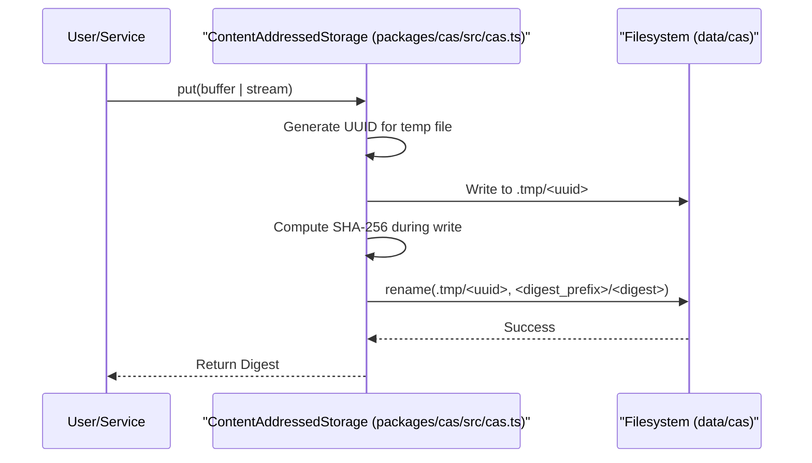

<!-- source: DeepWiki mcp.deepwiki.com · repo openJiuwen-ai/sciencediscovery · page 3.4 Content-Addressed Storage (CAS) and Provenance · fetched 2026-11-02 -->

# Content-Addressed Storage (CAS) and Provenance

<details>
<summary>Relevant source files</summary>

The following files were used as context for generating this wiki page:

- [apps/web/src/artifact-dashboard.ts](apps/web/src/artifact-dashboard.ts)
- [apps/web/src/artifact-download.ts](apps/web/src/artifact-download.ts)
- [apps/web/src/artifactTree.ts](apps/web/src/artifactTree.ts)

</details>


The Content-Addressed Storage (CAS) system in ScienceDiscovery provides a robust, immutable foundation for data integrity and scientific reproducibility. By identifying data by its cryptographic hash rather than its location, the system ensures that artifacts, execution records, and prompt manifests remain tamper-proof and fully traceable across the entire research lifecycle.

## CAS Implementation and Data Integrity

The core logic resides in `packages/cas`, which implements a filesystem-backed content-addressed store using SHA-256 digests. This package is used by the API service to store artifact versions and by the provenance system to record the exact state of the system during any given execution.

### Key Mechanisms

*   **SHA-256 Addressing**: Files are stored in a hierarchical structure based on their SHA-256 hash. The first two characters of the hex digest form a sub-directory to prevent filesystem performance degradation in directories with millions of files [packages/cas/src/cas.ts:50-54]().
*   **Atomic Write and Rename**: To prevent data corruption or partial reads, files are first written to a `.tmp` directory on the same partition and then moved to their final destination using an atomic `rename` operation [packages/cas/src/cas.ts:110-120]().
*   **Deduplication**: If multiple artifacts or versions share the same content, they point to the same CAS address, significantly reducing storage overhead for large scientific datasets that undergo incremental changes.
*   **Verification**: The `verify(digest)` API re-computes the hash of a stored blob to ensure it has not been corrupted on disk [packages/cas/src/cas.ts:140-155]().

### CAS Storage Flow

The following diagram illustrates how raw data is ingested into the CAS and how the `ContentAddressedStorage` class manages the transition from a temporary buffer to a permanent, addressed file.

**Diagram: Data Ingestion into CAS**

Sources: [packages/cas/src/cas.ts:85-130](), [packages/cas/src/cas.ts:45-60]()

## Provenance and Traceability

Provenance in ScienceDiscovery is the "paper trail" that links every result back to the specific code, prompts, and inputs that generated it. This is managed through three primary entities: `ExecutionRecord`, `ArtifactDerivation`, and the `PromptManifest`.

### 1. Execution Records
Every tool call (e.g., `run_python`, `run_shell`) generates an execution record. This record includes the exact command executed, the environment variables, and the CAS addresses of the `stdout`, `stderr`, and any files produced.

### 2. Artifact Derivation
When an artifact is declared via `declare_artifact`, the system records its derivation. This includes the `runId` that produced it and the parent artifact versions used as inputs. This creates a Directed Acyclic Graph (DAG) of scientific data.

### 3. Prompt Manifest
To ensure reproducibility of LLM reasoning, the system captures a "Prompt Manifest" for every agent turn. This includes the system prompt, the tool definitions (including skill code snapshots), and the specific model version used.

**Diagram: Provenance Entity Relationships**
```mermaid
classDiagram
    class "ScientificArtifactVersion (@science-agent/schema)" as SAV {
        +string id
        +string artifactId
        +string digest
        +ArtifactDerivation derivation
    }
    class "ArtifactDerivation (@science-agent/schema)" as AD {
        +string runId
        +string[] parentVersionIds
    }
    class "ExecutionRecord (@science-agent/schema)" as ER {
        +string toolName
        +string inputDigest
        +string outputDigest
        +string exitCode
    }
    class "ContentAddressedStorage (packages/cas/src/cas.ts)" as CAS {
        +put(data)
        +get(digest)
    }

    SAV "1" --o "1" AD : has
    AD "1" --> "1" ER : references
    SAV "1" ..> "1" CAS : content at
    ER "1" ..> "1" CAS : logs at
```
Sources: [packages/schema/src/index.ts:40](), [packages/cas/src/cas.ts:20-40]()

## MCP Audit and Governance

The Model Context Protocol (MCP) sources utilize CAS to provide a full audit log of external data retrieval. When a researcher uses a connector (e.g., PubMed or UniProt) via `packages/mcp-sources`, the system does not just return the data; it archives the raw response in CAS.

*   **Trust Boundary**: The `McpGovernanceBroker` ensures that all data entering the system from an external MCP server is hashed and recorded before it reaches the Agent [packages/mcp-sources/src/governance.ts:45-80]().
*   **Auditability**: If a scientific result is questioned, the administrator can look up the CAS digest in the `McpAuditLog` to see the exact bytes returned by the external API at that specific point in time.

## Artifact Management and Dashboard

The frontend interacts with CAS-backed data through the `ArtifactDashboard` and `ArtifactTree` components. While the CAS handles the raw bytes, the `ArtifactDashboardEntry` provides the metadata necessary for rendering.

| Component | Responsibility | Source |
| :--- | :--- | :--- |
| `ArtifactDashboardEntry` | Maps artifact metadata and versions for UI display. | [apps/web/src/artifact-dashboard.ts:35-41]() |
| `ArtifactArchiveEntry` | Represents a file to be zipped for download. | [apps/web/src/artifact-download.ts:20-23]() |
| `buildArtifactTree` | Converts a flat list of artifacts into a folder hierarchy. | [apps/web/src/artifactTree.ts:100-107]() |
| `normalizeArtifactArchivePath` | Ensures artifact paths are safe relative paths for the filesystem. | [apps/web/src/artifact-download.ts:25-35]() |

### Artifact Preview Modes
The system supports multiple preview modes based on the content stored in CAS. The `ArtifactPreviewPayload` union type defines how different scientific data types (figures, datasets, molecular structures) are handled by the web client [apps/web/src/artifact-dashboard.ts:63-163]().

Sources: [apps/web/src/artifact-dashboard.ts:1-176](), [apps/web/src/artifact-download.ts:1-79](), [apps/web/src/artifactTree.ts:1-132]()

---

