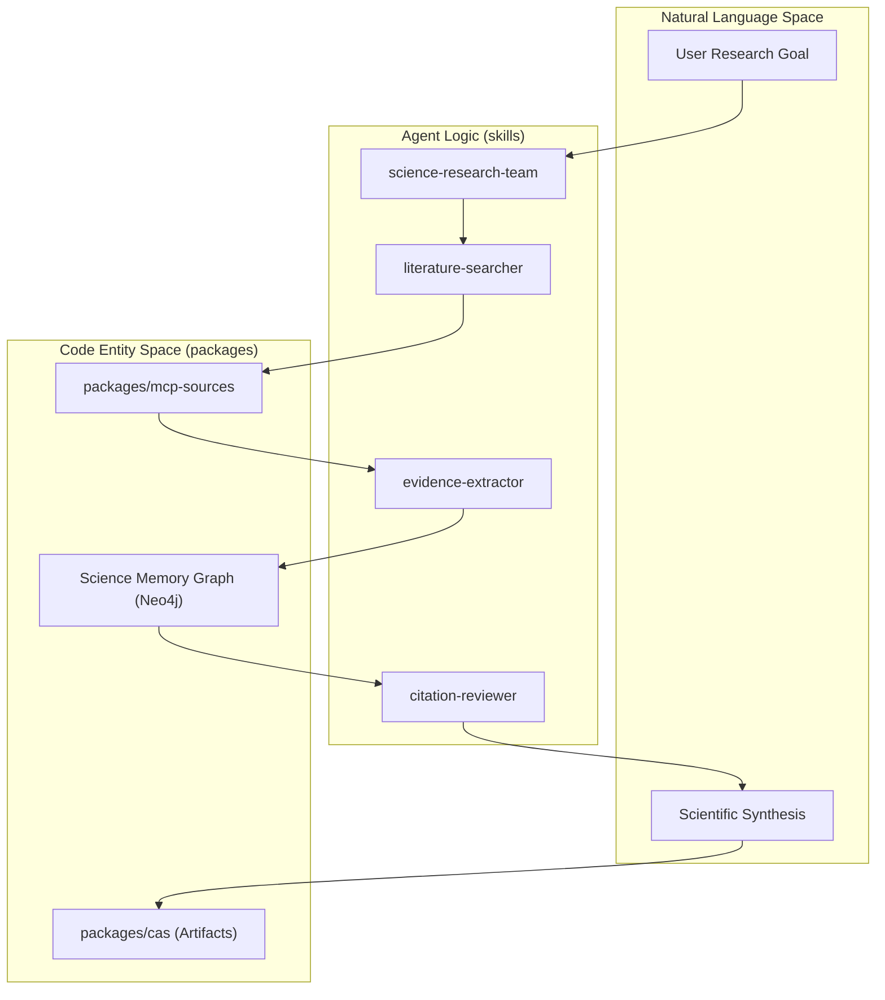
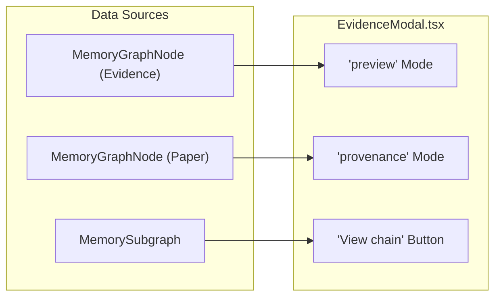

<!-- source: DeepWiki mcp.deepwiki.com · repo openJiuwen-ai/sciencediscovery · page 5.1 Built-in Research Skills · fetched 2026-11-02 -->

# Built-in Research Skills

Relevant source files

The following files were used as context for generating this wiki page:

- [apps/web/src/EvidenceModal.tsx](apps/web/src/EvidenceModal.tsx)
- [apps/web/src/ReviewerControlCard.tsx](apps/web/src/ReviewerControlCard.tsx)

This page documents the core scientific research capabilities bundled with ScienceDiscovery. These skills are implemented as specialized agent prompts and toolsets located within the `skills/` directory. They provide the foundational intelligence for literature synthesis, evidence extraction, and rigorous verification of scientific results.

## Orchestration and Core Skills

The research workflow is managed by a central orchestrator that delegates specific scientific tasks to specialized skills. These skills bridge the gap between natural language reasoning and technical execution (e.g., querying PubMed or running Python analysis).

### Research Team Orchestrator
The `science-research-team` skill acts as the primary coordinator. It defines the multi-agent collaboration patterns, ensuring that tasks like "literature search" and "code engineering" are performed by the appropriate sub-agents with the correct scientific context.

### Literature and Evidence Skills
These skills handle the discovery and processing of scientific knowledge:
*   **literature-searcher**: Interacts with MCP sources (PubMed, arXiv, etc.) to identify relevant papers based on a research query.
*   **evidence-extractor**: Analyzes scientific text to identify specific claims, data points, and methodologies. It formats these into `Evidence` nodes for the Science Memory Graph.
*   **life-science-evidence-brief**: A specialized version of the extractor tailored for biological data, focusing on entities like proteins, genes, and chemical compounds.

### Verification and Review Skills
ScienceDiscovery emphasizes reproducibility through specialized reviewer agents:
*   **citation-reviewer**: Validates that claims made in a report are accurately supported by the cited literature.
*   **computation-reviewer**: Inspects code execution logs and data artifacts to ensure that numerical results are derived correctly from the input data.
*   **result-evaluator**: Performs a high-level critique of the research findings, checking for logical consistency and statistical significance.

### Execution Skills
*   **report-writer**: Synthesizes findings from evidence and artifacts into a structured scientific report (Markdown/PDF).
*   **code-engineer**: A general-purpose technical agent capable of writing Python, R, or Shell scripts to perform data analysis or simulations within the isolated runner.

**Sources:**
*   [apps/web/src/ReviewerControlCard.tsx:45-46]() (Definition of Built-in Specialist)
*   [apps/web/src/EvidenceModal.tsx:15-21]() (Evidence extraction and UI representation)

---

## Research Workflow Data Flow

The following diagram illustrates how natural language research goals are transformed into structured scientific artifacts through the interaction of built-in skills and system components.

### From Natural Language to Code Entities
"This diagram maps the conceptual research steps to the specific code entities and skills responsible for execution."

**Sources:**
*   [apps/web/src/EvidenceModal.tsx:25-28]() (Memory Graph and Evidence types)
*   [apps/web/src/EvidenceModal.tsx:74-83]() (Flow from Memory Node to UI)

---

## The Reviewer Specialist

The `Reviewer Specialist` is a unique built-in skill that provides a secondary layer of validation. Unlike the lead agent, the Reviewer focuses exclusively on the integrity of the research artifacts.

### Reviewer Implementation
The Reviewer is controlled via the `ReviewerControlCard` in the frontend and operates at different "levels" (e.g., "quick" vs "thorough").

| Component | Code Entity | Role |
| :--- | :--- | :--- |
| **Settings** | `ReviewerSpecialistSettings` | Defines if the skill is enabled and its intensity level. |
| **UI Card** | `ReviewerControlCard` | The interface for triggering manual reviews. |
| **Avatar** | `ReviewerSpecialistAvatar` | Visual identifier for reviewer-specific messages in the timeline. |

**Sources:**
*   [apps/web/src/ReviewerControlCard.tsx:20-33]() (ReviewerControlCard and Settings implementation)
*   [apps/web/src/ReviewerControlCard.tsx:54-59]() (Run review trigger)

---

## Evidence and Provenance Handling

When the `evidence-extractor` skill identifies a claim, it creates a `MemoryGraphNode` of type `Evidence`. This node is linked to a `Paper` node, creating a provenance chain that can be inspected by the user.

### Evidence Data Structure
Evidence is managed through the following UI and data structures:

### Key Functions for Evidence Processing
*   `partitionEvidenceExtra`: Separates raw metadata from the primary scientific content for display in the `EvidenceModal` [apps/web/src/EvidenceModal.tsx:118-118]().
*   `getMemoryChain`: Fetches the upstream `Paper` nodes associated with a specific piece of `Evidence` [apps/web/src/EvidenceModal.tsx:76-76]().
*   `viewChain`: Anchors the `MemoryGraphExplorer` on a specific evidence node to visualize its relationship to the broader research context [apps/web/src/EvidenceModal.tsx:92-109]().

**Sources:**
*   [apps/web/src/EvidenceModal.tsx:42-48]() (Mode and paperExtra implementation)
*   [apps/web/src/EvidenceModal.tsx:129-133]() (Evidence viewer tabs)
*   [apps/web/src/EvidenceModal.tsx:136-143]() (Evidence detail rendering)

---

