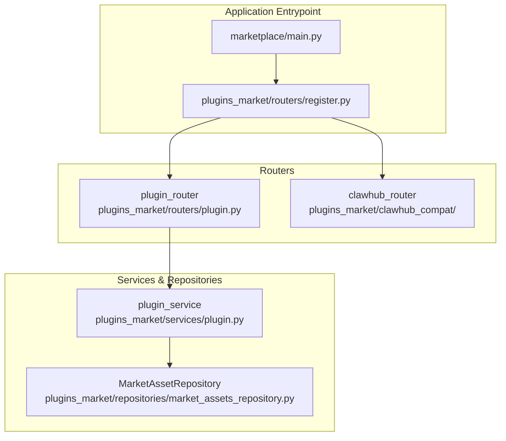
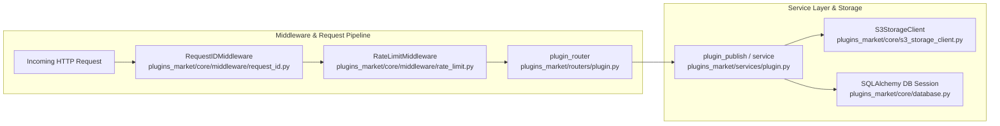

<!-- source: DeepWiki mcp.deepwiki.com · repo openJiuwen-ai/skillhub · page 2 Marketplace Backend (plugins_market) · fetched 2026-11-02 -->

# Marketplace Backend (plugins_market)

Relevant source files

The following files were used as context for generating this wiki page:

- [marketplace/main.py](marketplace/main.py)
- [marketplace/plugins_market/repositories/market_assets_repository.py](marketplace/plugins_market/repositories/market_assets_repository.py)
- [marketplace/plugins_market/retrieval/daily_rebuild.py](marketplace/plugins_market/retrieval/daily_rebuild.py)
- [marketplace/plugins_market/retrieval/index_manager.py](marketplace/plugins_market/retrieval/index_manager.py)
- [marketplace/plugins_market/retrieval/search.py](marketplace/plugins_market/retrieval/search.py)
- [marketplace/plugins_market/routers/plugin.py](marketplace/plugins_market/routers/plugin.py)
- [marketplace/plugins_market/routers/register.py](marketplace/plugins_market/routers/register.py)
- [marketplace/plugins_market/schemas/plugin.py](marketplace/plugins_market/schemas/plugin.py)
- [marketplace/plugins_market/services/plugin.py](marketplace/plugins_market/services/plugin.py)
- [marketplace/plugins_market/tests/test_agent_asset_retrieval.py](marketplace/plugins_market/tests/test_agent_asset_retrieval.py)
- [marketplace/retrieval/indexing/scanners/__init__.py](marketplace/retrieval/indexing/scanners/__init__.py)
- [marketplace/retrieval/indexing/scanners/base.py](marketplace/retrieval/indexing/scanners/base.py)
- [marketplace/retrieval/indexing/workflows/artifacts.py](marketplace/retrieval/indexing/workflows/artifacts.py)
- [marketplace/retrieval/indexing/workflows/index_builder.py](marketplace/retrieval/indexing/workflows/index_builder.py)

## Purpose and Scope

The `plugins_market` package is the core FastAPI-based backend service for openJiuwen Agentic Hub (SkillHub). It manages the end-to-end lifecycle of marketplace assets—including skills, swarm skills, agent plugins, templates, MCP connectors, and RESTful APIs. It provides robust capabilities for asset publishing, package validation, access control, repository synchronization, and search integration.

As a parent page, this section offers a high-level overview of the marketplace backend architecture, modules, and workflows. For detailed technical specifications, data models, validation pipelines, infrastructure components, and test suites, refer to the respective child pages linked below.

Sources: [marketplace/main.py:35-55](), [marketplace/plugins_market/routers/register.py:17-48](), [marketplace/plugins_market/routers/plugin.py:135-136](), [marketplace/plugins_market/services/plugin.py:3-122](), [marketplace/plugins_market/repositories/market_assets_repository.py:13-31]()

---

## 2.1 Plugin APIs and Services

The marketplace backend exposes comprehensive REST APIs for publishing, listing, downloading, deleting, and moderating assets. These endpoints are anchored in `plugins_market/routers/plugin.py` [marketplace/plugins_market/routers/plugin.py:135-136]() and supported by business logic residing in `plugins_market/services/plugin.py` [marketplace/plugins_market/services/plugin.py:3-122]() along with database repositories (`MarketAssetRepository`, `MarketAssetVersionRepository`) [marketplace/plugins_market/repositories/market_assets_repository.py:13-31]().

For deep technical details on data models, incremental DDL versioning, package validation pipelines, import bundling, and moderation review engines, see [Plugin APIs and Services](#2.1).

Sources: [marketplace/plugins_market/routers/plugin.py:135-136](), [marketplace/plugins_market/services/plugin.py:3-122](), [marketplace/plugins_market/repositories/market_assets_repository.py:13-31]()

---

## 2.2 Auth, Access Control and Groups

Security, identity verification, and permissions are managed across multiple layers. Authentication supports multiple OAuth providers (GitCode, GitHub, AgentOS) with session handling and token parsing. Fine-grained authorization relies on `ViewerContext` (`plugins_market/core/viewer_context.py`), group Access Control Lists (ACLs), membership grants, and administrative roles.

For details on OAuth integration flows, session states, `ViewerContext` evaluation, and group permissions, see [Auth, Access Control and Groups](#2.2).

Sources: [marketplace/plugins_market/routers/plugin.py:36-42](), [marketplace/plugins_market/services/plugin.py:57-57]()

---

## 2.3 Platform Infrastructure (core)

The `plugins_market/core/` package forms the shared utility foundation for the marketplace backend. It encapsulates configuration management via `settings` (`plugins_market/core/config.py`), structured logging (`plugins_market/core/logging.py`), request ID tracing (`RequestIDMiddleware`), rate limiting (`RateLimitMiddleware`), object storage integration (`S3StorageClient`), caching with Redis, KMS security, and error taxonomies (`BusinessError`, `PublishError`).

For details on configuration parameters, error definitions, storage backends, and middleware pipelines, see [Platform Infrastructure (core)](#2.3).

Sources: [marketplace/main.py:39-48](), [marketplace/plugins_market/core/config.py:1-9](), [marketplace/plugins_market/core/s3_storage_client.py:1-60]()

---

## 2.4 Git Sync, GitHub Integration and ClawHub Compatibility

To support decentralized asset ingestion and developer toolchains, the marketplace includes robust background synchronization routines. These handle Git source repositories (`git_sources`), skill extraction with path safety validation, GitHub watch/star proxying, and complete ClawHub CLI compatibility routing and fingerprinting.

For details on background git sync workers, path safety checks, and CLI compatibility endpoints, see [Git Sync, GitHub Integration and ClawHub Compatibility](#2.4).

Sources: [marketplace/plugins_market/routers/register.py:6-34](), [marketplace/plugins_market/services/git_skill_sync.py:1-127]()

---

## 2.5 Backend Testing

Comprehensive automated test suites for the marketplace backend reside in `plugins_market/tests/`. These tests cover database fixtures, moderation workflows, version download permissions, rate limit middleware behavior, and retrieval diagnostics using `pytest`.

For details on test fixtures, test case organization, and execution commands, see [Backend Testing](#2.5).

Sources: [marketplace/plugins_market/tests/test_agent_asset_retrieval.py:1-43]()

---

Sources: [marketplace/main.py:47-48](), [marketplace/plugins_market/routers/plugin.py:135-136](), [marketplace/plugins_market/services/plugin.py:3-122](), [marketplace/plugins_market/core/s3_storage_client.py:1-60]()

---

