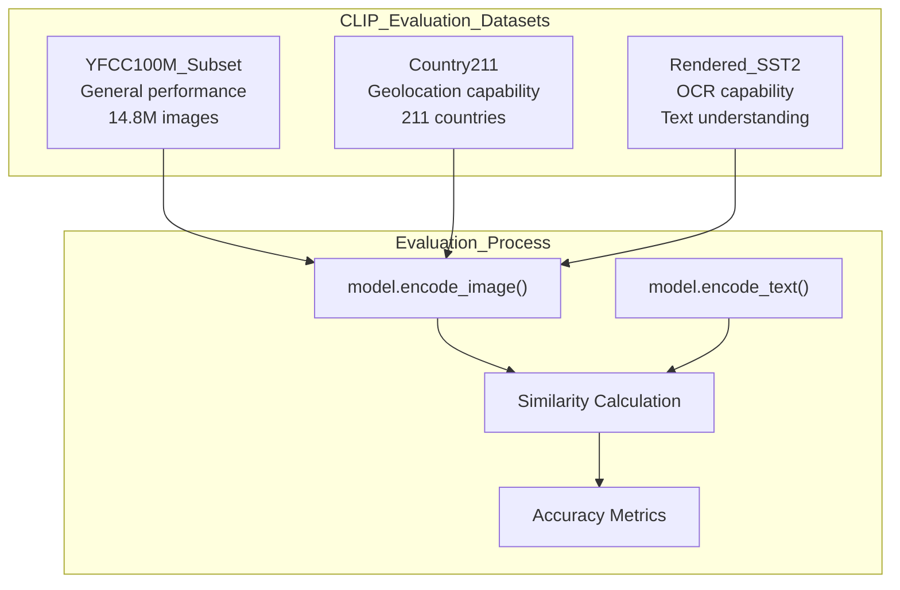
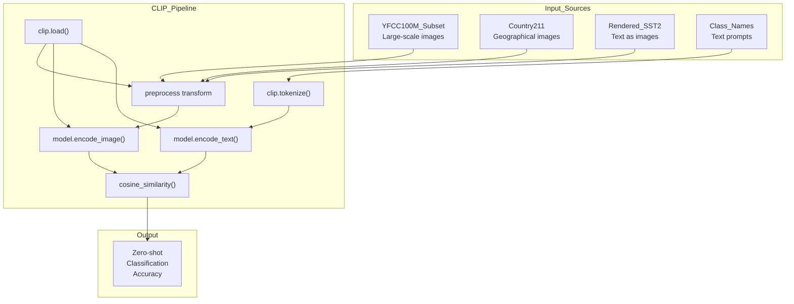
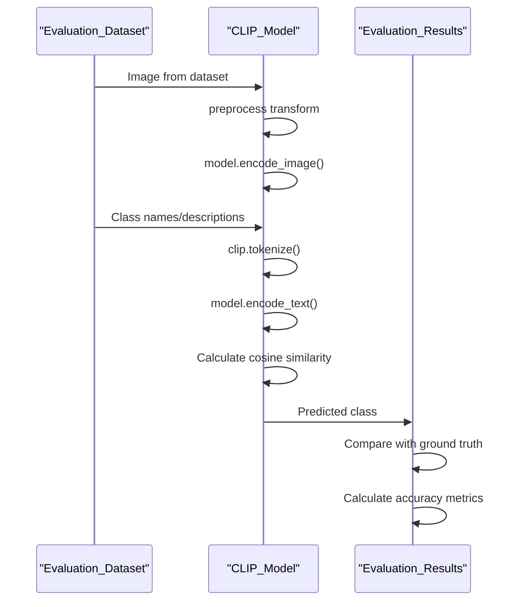

<!-- source: DeepWiki mcp.deepwiki.com · repo openai/CLIP · page 6.1 Evaluation Datasets · fetched 2026-10-26 -->

# Evaluation Datasets

<details>
<summary>Relevant source files</summary>

The following files were used as context for generating this wiki page:

- [data/country211.md](data/country211.md)
- [data/rendered-sst2.md](data/rendered-sst2.md)
- [data/yfcc100m.md](data/yfcc100m.md)

</details>


This document provides detailed specifications and usage information about the specialized datasets used to evaluate CLIP's performance across different domains. For information about how models are tested using these datasets, see [Model Testing](#6.2).

## Overview

CLIP's evaluation framework utilizes three custom datasets, each designed to test specific model capabilities:



Sources: [data/yfcc100m.md](data/yfcc100m.md), [data/country211.md](data/country211.md), [data/rendered-sst2.md](data/rendered-sst2.md)

## Dataset Integration with CLIP

The following diagram illustrates how these evaluation datasets integrate with CLIP's architecture for zero-shot classification:



Sources: [data/yfcc100m.md](data/yfcc100m.md), [data/country211.md](data/country211.md), [data/rendered-sst2.md](data/rendered-sst2.md)

## YFCC100M Subset

The YFCC100M Subset is a filtered collection from the Yahoo Flickr Creative Commons 100M dataset, used for ablation studies in the CLIP paper.

### Dataset Specifications

| Property | Value |
|----------|-------|
| Size | 14,829,396 images (15% of full dataset) |
| Selection Criteria | Images with English natural language titles/descriptions |
| Format | TSV file with (line number, photo identifier, photo hash) |
| Purpose | Demonstrate model robustness to training data variations |

### Access Instructions

```bash
wget https://openaipublic.azureedge.net/clip/data/yfcc100m_subset_data.tsv.bz2
bunzip2 yfcc100m_subset_data.tsv.bz2
```

Sources: [data/yfcc100m.md](data/yfcc100m.md)

## Country211 Dataset

Country211 evaluates CLIP's geolocation capabilities through a balanced dataset of images from 211 different countries.

### Dataset Specifications

| Property | Value |
|----------|-------|
| Coverage | 211 countries (ISO-3166 country codes) |
| Split per Country | 150 training / 50 validation / 100 test images |
| Total Size | 63,300 images (300 images × 211 countries) |
| Source | Filtered from YFCC100M using GPS coordinates |
| Purpose | Test recognition of geographical and cultural visual elements |

### Access Instructions

```bash
wget https://openaipublic.azureedge.net/clip/data/country211.tgz
tar zxvf country211.tgz
```

Sources: [data/country211.md](data/country211.md)

## Rendered SST2 Dataset

Rendered SST2 tests CLIP's optical character recognition (OCR) capabilities by using rendered text as images.

### Dataset Specifications

| Property | Value |
|----------|-------|
| Original Source | Stanford Sentiment Treebank v2 (SST2) |
| Composition | Sentences from SST2 rendered as images |
| Purpose | Evaluate OCR capabilities and text understanding |
| Size | 131MB compressed |

### Access Instructions

```bash
wget https://openaipublic.azureedge.net/clip/data/rendered-sst2.tgz
tar zxvf rendered-sst2.tgz
```

Sources: [data/rendered-sst2.md](data/rendered-sst2.md)

## Evaluation Process

The following sequence diagram illustrates the zero-shot classification process using these evaluation datasets:



Sources: [data/yfcc100m.md](data/yfcc100m.md), [data/country211.md](data/country211.md), [data/rendered-sst2.md](data/rendered-sst2.md)

## Licensing and Attribution

The YFCC100M Subset and Country211 datasets are subject to the Creative Commons licenses chosen by their creators/uploaders, as they are derived from the YFCC100M dataset. Users should refer to the [YFCC100M official website](https://multimediacommons.wordpress.com/yfcc100m-core-dataset) for more information about licensing and usage restrictions.

Sources: [data/yfcc100m.md](data/yfcc100m.md), [data/country211.md](data/country211.md)

---

