# Page: Overview

# Overview

<details>
<summary>Relevant source files</summary>

The following files were used as context for generating this wiki page:

- [README.md](README.md)
- [clip/clip.py](clip/clip.py)

</details>


This document provides a comprehensive technical overview of OpenAI's CLIP (Contrastive Language-Image Pre-Training) repository. CLIP is a neural network trained on a variety of (image, text) pairs, enabling zero-shot visual recognition through natural language supervision. This page introduces the CLIP system architecture, core components, and primary capabilities. For detailed information about the model architecture, see [CLIP Model Architecture](#2), and for usage examples, see [Examples and Usage](#4).

## What is CLIP?

CLIP is a multi-modal model that connects images and text through a jointly trained image encoder and text encoder. These encoders project images and text into a shared embedding space where related concepts are positioned close together, enabling direct comparison between visual and textual content. Unlike traditional computer vision models that are trained on fixed label sets, CLIP can perform "zero-shot" classification by comparing images against arbitrary text descriptions.

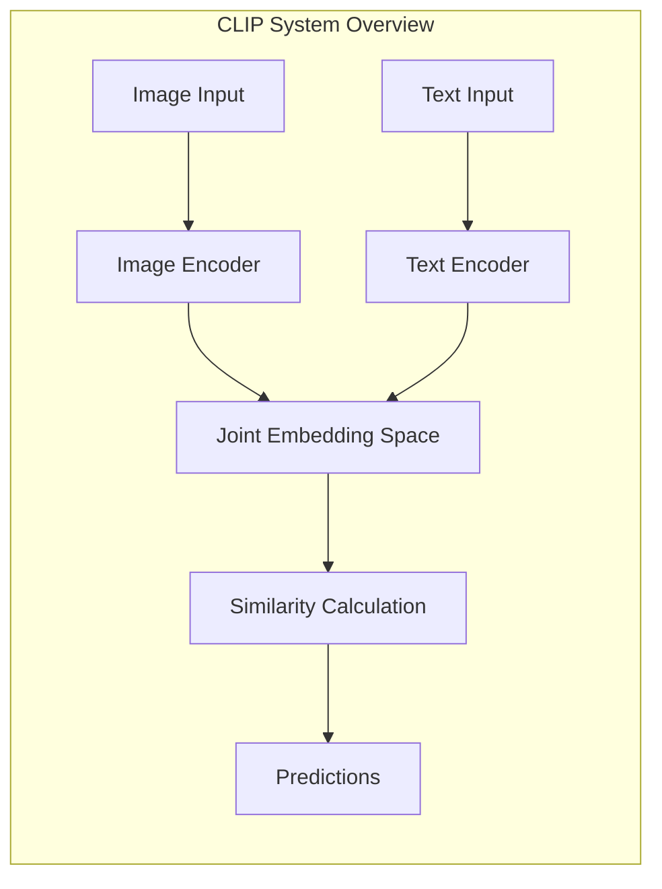

Sources: [README.md:1-7](), [clip/clip.py:93-202]()

## System Architecture

CLIP consists of three primary architectural components that work together to enable image-text matching:

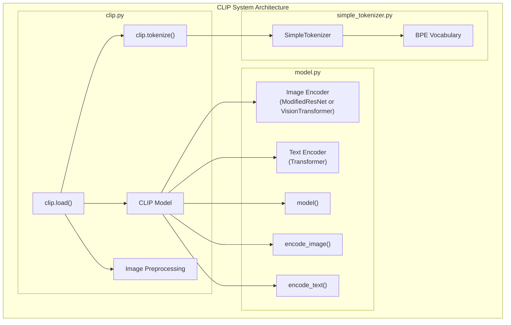

Sources: [clip/clip.py:13-14](), [clip/clip.py:27-28](), [clip/clip.py:94-202]()

### Core Components and Data Flow

The CLIP system handles image and text processing through separate pipelines that converge for similarity calculation:

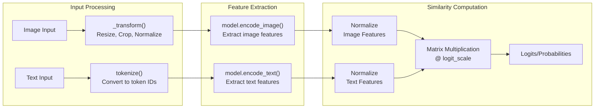

Sources: [clip/clip.py:79-86](), [clip/clip.py:205-245](), [README.md:42-45]()

## Model Loading and Initialization

The `clip.load()` function is the primary entry point for using CLIP. It handles model downloading, loading, and device placement:

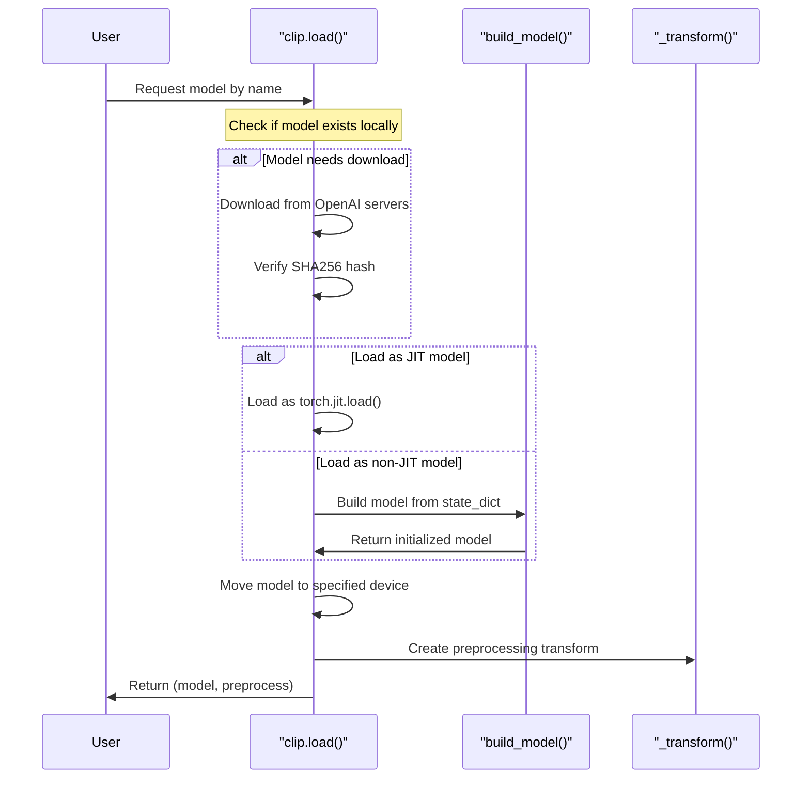

Sources: [clip/clip.py:94-202](), [clip/clip.py:43-72]()

## Available Model Variants

CLIP provides multiple pre-trained model variants with different architectures and parameter counts:

| Model Name | Architecture | Image Size | Parameters | URL |
|------------|--------------|------------|------------|-----|
| RN50 | ResNet-50 | 224 | ~50M | OpenAI Azure endpoint |
| RN101 | ResNet-101 | 224 | ~80M | OpenAI Azure endpoint |
| RN50x4 | ResNet-50 (4× width) | 288 | ~100M | OpenAI Azure endpoint |
| RN50x16 | ResNet-50 (16× width) | 384 | ~200M | OpenAI Azure endpoint |
| RN50x64 | ResNet-50 (64× width) | 448 | ~400M | OpenAI Azure endpoint |
| ViT-B/32 | Vision Transformer (Base) | 224 | ~150M | OpenAI Azure endpoint |
| ViT-B/16 | Vision Transformer (Base) | 224 | ~150M | OpenAI Azure endpoint |
| ViT-L/14 | Vision Transformer (Large) | 224 | ~300M | OpenAI Azure endpoint |
| ViT-L/14@336px | Vision Transformer (Large) | 336 | ~300M | OpenAI Azure endpoint |

Sources: [clip/clip.py:30-40]()

## API Overview

The CLIP module provides a simple API for interacting with the model:

### Main Functions

- `clip.available_models()`: Returns a list of available model names
- `clip.load(name, device, jit)`: Loads a specified model and returns the model plus preprocessing transform
- `clip.tokenize(text, context_length)`: Tokenizes text inputs for processing by the model

### Model Methods

- `model.encode_image(image)`: Encodes images into feature vectors
- `model.encode_text(text)`: Encodes tokenized text into feature vectors
- `model(image, text)`: Calculates similarity between images and text

Sources: [clip/clip.py:89-202](), [clip/clip.py:205-245](), [README.md:49-81]()

## Usage Patterns

CLIP supports multiple usage patterns:

1. **Zero-shot Classification**: Compare images against textual descriptions to predict classes without training
2. **Image-Text Similarity**: Calculate the similarity between arbitrary images and text
3. **Feature Extraction**: Extract features from images or text for downstream tasks
4. **Linear-probe Evaluation**: Train a linear classifier on top of CLIP's image features

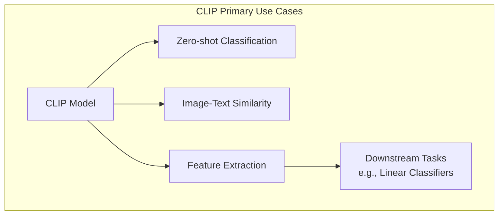

Sources: [README.md:85-193]()

## System Requirements

CLIP requires:
- PyTorch 1.7.1 or later
- torchvision
- CUDA-capable GPU (recommended but not required)
- Additional dependencies: ftfy, regex, tqdm

Sources: [README.md:17-25]()

---

# Page: CLIP Model Architecture

# CLIP Model Architecture

<details>
<summary>Relevant source files</summary>

The following files were used as context for generating this wiki page:

- [clip/model.py](clip/model.py)

</details>


## Purpose and Scope

This document provides a detailed technical overview of the Contrastive Language-Image Pre-training (CLIP) model architecture as implemented in the OpenAI CLIP repository. It covers the dual-encoder design, image and text processing pathways, and how these modalities are aligned in a shared embedding space. For information about how to use the CLIP API, see [Loading and Using CLIP](#3.1).

## Architecture Overview

CLIP implements a dual-encoder architecture that processes images and text separately before projecting them into a shared embedding space. This design enables direct comparison between visual and textual content, allowing for zero-shot visual recognition based on natural language descriptions.

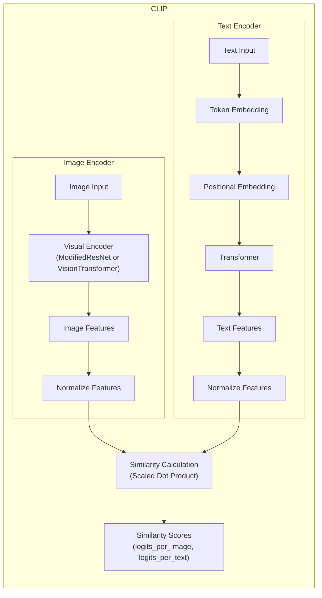

Sources: [clip/model.py:243-372]()

## Main CLIP Class

The `CLIP` class is the central component that integrates all parts of the architecture. It contains:

1. An image encoder (either ModifiedResNet or VisionTransformer)
2. A text encoder (Transformer with causal attention mask)
3. A joint embedding space where features from both modalities are compared

The model provides methods to:
- Encode images using `encode_image`
- Encode text using `encode_text`
- Calculate similarity between image and text pairs through the `forward` method

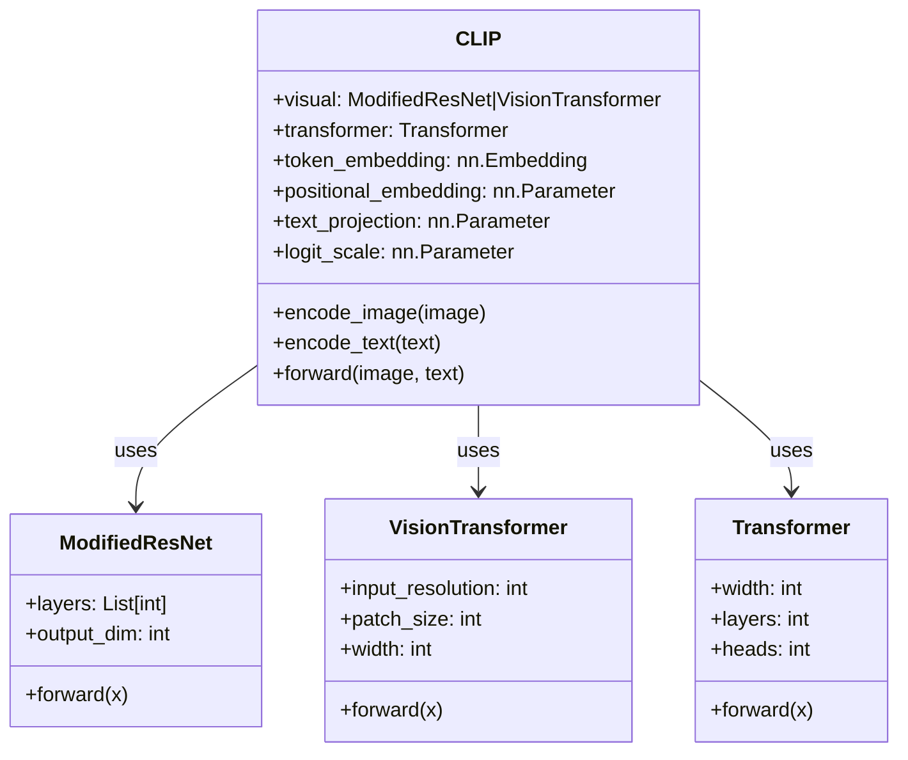

Sources: [clip/model.py:243-372]()

## Visual Encoders

CLIP offers two different architectures for image encoding:

### 1. ModifiedResNet

A modified ResNet architecture that differs from standard implementations in three key ways:

1. Uses a 3-layer stem with average pooling instead of a single convolutional layer with max pooling
2. Implements anti-aliasing in strided convolutions by prepending avgpool operations
3. Replaces the final pooling layer with an attention-based pooling mechanism (AttentionPool2d)

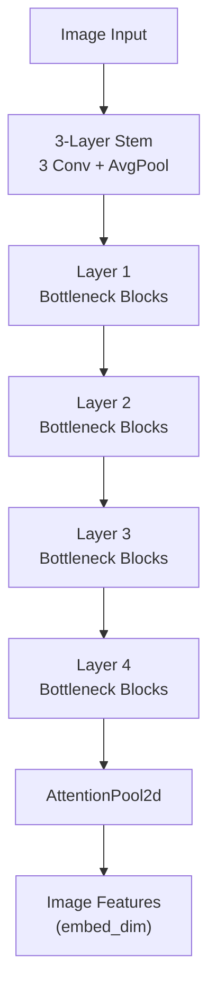

Sources: [clip/model.py:94-154](), [clip/model.py:10-55](), [clip/model.py:58-91]()

### 2. VisionTransformer

A Vision Transformer (ViT) implementation that:

1. Divides the input image into fixed-size patches
2. Linearly projects patches to form token embeddings
3. Adds a class token and positional embeddings
4. Processes tokens through transformer layers
5. Uses the output from the class token for the final representation

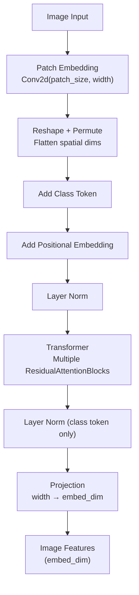

Sources: [clip/model.py:206-240]()

## Text Encoder

The text encoder is based on a standard Transformer architecture:

1. Token embeddings convert text tokens to vectors
2. Positional embeddings encode sequence position information
3. A transformer with causal attention mask processes the token sequence
4. The final-layer embedding corresponding to the end-of-text token becomes the text representation
5. A projection matrix maps the transformer output to the joint embedding space

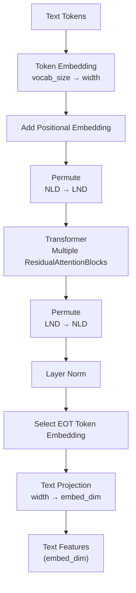

Sources: [clip/model.py:171-204](), [clip/model.py:343-356]()

### Transformer Details

The transformer consists of multiple ResidualAttentionBlocks that contain:

1. Multi-head self-attention with residual connections
2. Layer normalization
3. MLP block (fully connected, GELU, fully connected)

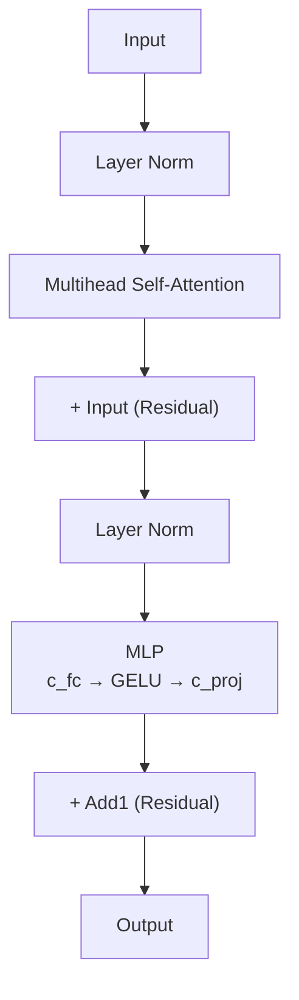

Sources: [clip/model.py:171-192]()

## Joint Embedding Space

The core of CLIP's functionality is the joint embedding space where image and text features are compared:

1. Both image and text feature vectors are L2-normalized
2. The cosine similarity between these normalized vectors is computed
3. A learnable temperature parameter (`logit_scale`) adjusts the similarity scores
4. The resulting logits are used to predict the correct image-text pairs

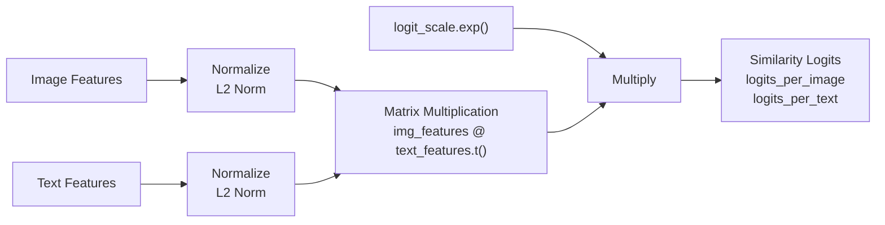

Sources: [clip/model.py:357-372]()

## Model Initialization and Building

The CLIP model can be initialized in two ways:

1. From scratch with specific parameters for image and text encoders
2. From a pre-trained state dictionary using the `build_model` function

The `build_model` function:
1. Infers model parameters from the state dictionary
2. Determines whether to use ModifiedResNet or VisionTransformer
3. Initializes the CLIP model with appropriate parameters
4. Converts applicable weights to FP16 (optional)
5. Loads the state dictionary into the model

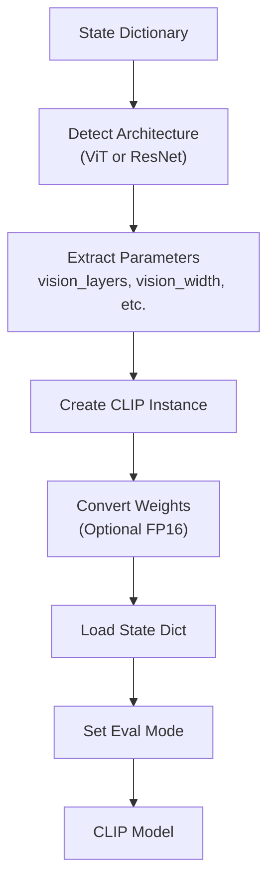

Sources: [clip/model.py:399-436](), [clip/model.py:375-397](), [clip/model.py:299-327]()

## Model Variants and Parameters

CLIP supports multiple model variants depending on the image encoder architecture and size:

| Model Name | Vision Encoder | Vision Layers | Vision Width | Patch Size | Output Dimension |
|------------|----------------|---------------|--------------|------------|------------------|
| RN50       | ModifiedResNet | (3, 4, 6, 3)  | 64           | N/A        | 1024             |
| RN101      | ModifiedResNet | (3, 4, 23, 3) | 64           | N/A        | 512              |
| RN50x4     | ModifiedResNet | (4, 6, 10, 6) | 80           | N/A        | 640              |
| RN50x16    | ModifiedResNet | (6, 8, 18, 8) | 96           | N/A        | 768              |
| ViT-B/32   | VisionTransformer | 12         | 768          | 32         | 512              |
| ViT-B/16   | VisionTransformer | 12         | 768          | 16         | 512              |
| ViT-L/14   | VisionTransformer | 24         | 1024         | 14         | 768              |

Each model has a corresponding text encoder with parameters matched to the vision encoder's output dimension.

Sources: [clip/model.py:399-436]()

## Data Flow During Inference

During inference, data flows through the CLIP model as follows:

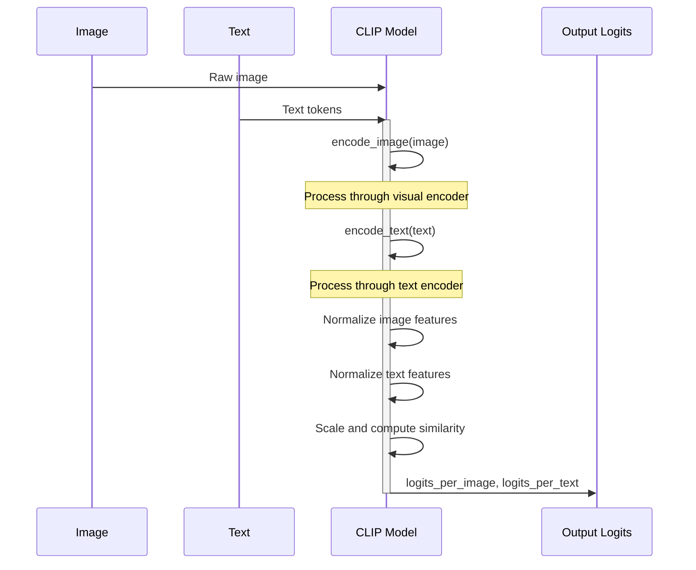

Sources: [clip/model.py:340-372]()

## Summary

The CLIP architecture integrates vision and language understanding through a dual-encoder approach. It processes images and text separately using specialized encoders, then projects both modalities into a shared embedding space where they can be directly compared. This design enables powerful zero-shot capabilities by measuring similarity between visual content and textual descriptions.

The architecture's flexibility in supporting different visual backbones (ModifiedResNet or VisionTransformer) with varying capacities allows for trade-offs between performance and computational efficiency.

---

# Page: API Reference

# API Reference

<details>
<summary>Relevant source files</summary>

The following files were used as context for generating this wiki page:

- [README.md](README.md)
- [clip/clip.py](clip/clip.py)

</details>


This document provides a comprehensive overview of the CLIP API structure and its main components. It serves as a technical reference for developers who want to understand and use the CLIP system programmatically. For details about the CLIP model architecture itself, see [CLIP Model Architecture](#2).

## API Overview

The CLIP API is designed to be simple and intuitive, providing straightforward access to CLIP's powerful multimodal capabilities. It exposes a small set of core functions for loading models, transforming inputs, and generating embeddings.

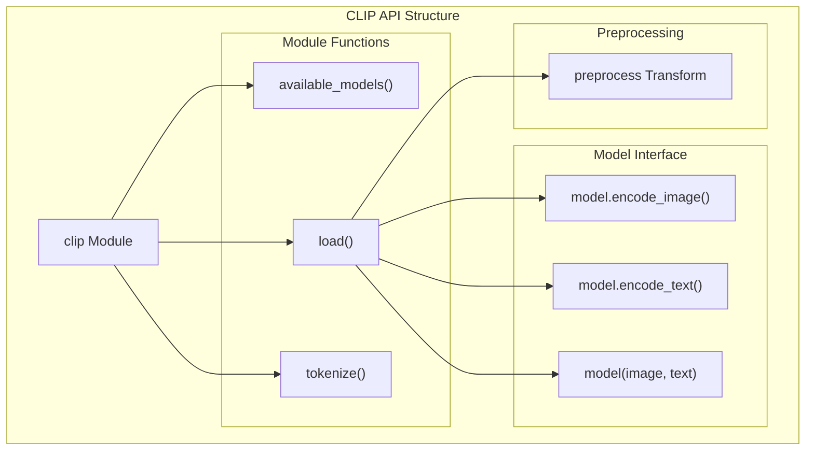

Sources: [clip/clip.py:27-245](), [README.md:49-82]()

## Core API Functions

The CLIP module exposes three main functions that form the foundation of the API:

### `available_models()`

Returns a list of strings containing the names of all available pre-trained CLIP models.

```python
import clip
models = clip.available_models()
# Returns: ['RN50', 'RN101', 'RN50x4', 'RN50x16', 'RN50x64', 'ViT-B/32', 'ViT-B/16', 'ViT-L/14', 'ViT-L/14@336px']
```

Implementation in [clip/clip.py:89-91]()

### `load(name, device=..., jit=False, download_root=None)`

Loads a CLIP model and returns both the model and the preprocessing transform needed for input images.

Parameters:
- `name`: A model name listed by `available_models()` or a path to a model checkpoint
- `device`: The device to put the model on (default: first CUDA device or CPU)
- `jit`: Whether to load the JIT-compiled version of the model (default: False)
- `download_root`: Path to download model files (default: "~/.cache/clip")

Returns:
- `model`: The CLIP model (torch.nn.Module)
- `preprocess`: A torchvision transform pipeline for preprocessing images

Implementation in [clip/clip.py:94-202]()

### `tokenize(texts, context_length=77, truncate=False)`

Converts text inputs into token sequences that can be processed by the CLIP model.

Parameters:
- `texts`: A string or list of strings to tokenize
- `context_length`: Maximum number of tokens (default: 77 for all CLIP models)
- `truncate`: Whether to truncate texts that exceed the context length (default: False)

Returns:
- A tensor of token IDs with shape [number of texts, context_length]

Implementation in [clip/clip.py:205-245]()

Sources: [clip/clip.py:89-245](), [README.md:53-66]()

## Model Interface

The model object returned by `load()` provides three main methods for working with images and text:

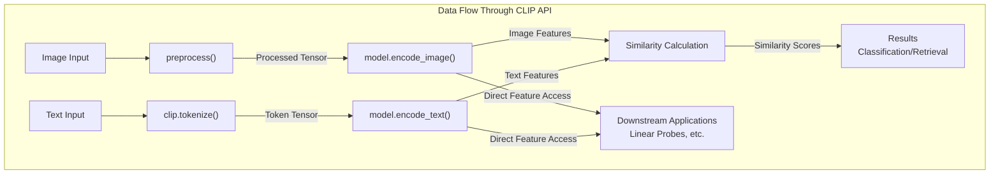

Sources: [clip/clip.py:94-202](), [README.md:71-82]()

### `model.encode_image(image)`

Given a batch of preprocessed images, returns normalized image feature vectors encoded by the vision encoder.

Parameters:
- `image`: A tensor of preprocessed images of shape [batch_size, 3, resolution, resolution]

Returns:
- Image features with shape [batch_size, embedding_dimension]

### `model.encode_text(text)`

Given a batch of tokenized text, returns normalized text feature vectors encoded by the text encoder.

Parameters:
- `text`: A tensor of tokenized text (from `clip.tokenize()`) of shape [batch_size, context_length]

Returns:
- Text features with shape [batch_size, embedding_dimension]

### `model(image, text)`

Given batches of images and text tokens, calculates the cosine similarity between their features.

Parameters:
- `image`: A tensor of preprocessed images
- `text`: A tensor of tokenized text

Returns:
- Two tensors containing the logit scores:
  - `logits_per_image`: Similarity of each image with each text [batch_size_image, batch_size_text]
  - `logits_per_text`: Similarity of each text with each image [batch_size_text, batch_size_image]

Sources: [README.md:71-82]()

## Model Variants

CLIP is available in several model variants, each with different architecture and performance characteristics:

| Model Name | Architecture | Parameters | Image Resolution | Notes |
|------------|--------------|------------|------------------|-------|
| RN50 | ResNet-50 | 102M | 224x224 | Base ResNet variant |
| RN101 | ResNet-101 | 163M | 224x224 | Deeper ResNet variant |
| RN50x4 | ResNet-50x4 | 383M | 288x288 | 4x wider ResNet-50 |
| RN50x16 | ResNet-50x16 | 829M | 384x384 | 16x wider ResNet-50 |
| RN50x64 | ResNet-50x64 | 1.95B | 448x448 | 64x wider ResNet-50 |
| ViT-B/32 | Vision Transformer | 151M | 224x224 | ViT with 32x32 patch size |
| ViT-B/16 | Vision Transformer | 151M | 224x224 | ViT with 16x16 patch size |
| ViT-L/14 | Vision Transformer | 428M | 224x224 | Large ViT with 14x14 patch size |
| ViT-L/14@336px | Vision Transformer | 428M | 336x336 | Large ViT with higher resolution |

Sources: [clip/clip.py:30-40]()

## API Implementation Details

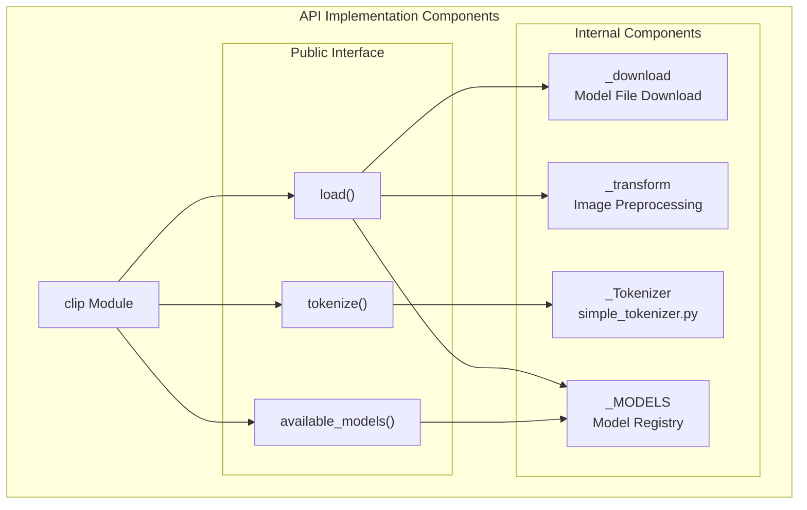

Sources: [clip/clip.py:27-245]()

### Image Preprocessing

The preprocessing transform returned by `load()` applies the following operations to input images:

1. Resize to the model's required resolution using bicubic interpolation
2. Center crop to create a square image
3. Convert to RGB color space (if not already)
4. Convert to a PyTorch tensor
5. Normalize with mean (0.48145466, 0.4578275, 0.40821073) and std (0.26862954, 0.26130258, 0.27577711)

Implementation in [clip/clip.py:79-86]()

### Text Tokenization

The tokenization process:

1. Adds start-of-text (`<|startoftext|>`) and end-of-text (`<|endoftext|>`) tokens
2. Uses a byte-pair encoding (BPE) tokenizer implemented in `simple_tokenizer.py`
3. Pads or truncates sequences to a fixed context length (77 tokens by default)

Implementation in [clip/clip.py:205-245]()

## Usage Example

Below is a typical usage pattern showing how the API components work together:

```python
import clip
import torch
from PIL import Image

# Load the model and preprocessing transform
device = "cuda" if torch.cuda.is_available() else "cpu"
model, preprocess = clip.load("ViT-B/32", device=device)

# Prepare inputs
image = preprocess(Image.open("image.jpg")).unsqueeze(0).to(device)
text = clip.tokenize(["a photo of a cat", "a photo of a dog"]).to(device)

# Encode inputs to get embeddings
with torch.no_grad():
    image_features = model.encode_image(image)
    text_features = model.encode_text(text)
    
    # Normalize features
    image_features /= image_features.norm(dim=-1, keepdim=True)
    text_features /= text_features.norm(dim=-1, keepdim=True)
    
    # Calculate similarity
    similarity = (100.0 * image_features @ text_features.T).softmax(dim=-1)
    
    # Alternatively, use the model directly
    logits_per_image, logits_per_text = model(image, text)
    probs = logits_per_image.softmax(dim=-1)
```

Sources: [README.md:27-46](), [README.md:91-139]()

## Batch Processing

The API is designed to efficiently handle batches of inputs:

1. For multiple images, stack preprocessed image tensors into a batch
2. For multiple text inputs, pass a list to `clip.tokenize()`
3. All encoding methods accept and return batched inputs/outputs

This is particularly useful for efficient processing in applications like:
- Zero-shot classification of multiple images
- Retrieval across large datasets
- Linear probe training

Sources: [README.md:143-193]()

---

# Page: Loading and Using CLIP

# Loading and Using CLIP

<details>
<summary>Relevant source files</summary>

The following files were used as context for generating this wiki page:

- [README.md](README.md)
- [clip/__init__.py](clip/__init__.py)
- [clip/clip.py](clip/clip.py)

</details>


This document provides detailed instructions for loading CLIP models and using them for tasks such as image-text similarity calculation and zero-shot classification. For information about CLIP's model architecture and how it works internally, see [CLIP Model Architecture](#2).

## Overview

The CLIP (Contrastive Language-Image Pre-Training) API provides a straightforward interface for accessing and utilizing pretrained models. This page covers how to:

1. Load a CLIP model with the appropriate configuration
2. Preprocess images for model input
3. Tokenize text for model input
4. Use the model for encoding images and text
5. Calculate similarities between encoded features

## Loading a CLIP Model

The primary entry point for using CLIP is the `clip.load()` function, which returns both the model and the appropriate preprocessing transform.

```python
import clip
import torch

# Load the model
device = "cuda" if torch.cuda.is_available() else "cpu"
model, preprocess = clip.load("ViT-B/32", device=device)
```

### Function Signature and Parameters

```python
def load(name: str, device: Union[str, torch.device] = "cuda" if torch.cuda.is_available() else "cpu", 
         jit: bool = False, download_root: str = None) -> Tuple[torch.nn.Module, Callable]:
```

| Parameter | Type | Description |
|-----------|------|-------------|
| `name` | str | Model name from `available_models()` or path to a checkpoint file |
| `device` | Union[str, torch.device] | Device to place the model on (default: CUDA if available, else CPU) |
| `jit` | bool | Whether to load the optimized JIT model version (default: False) |
| `download_root` | str | Path to download model files (default: "~/.cache/clip") |

### Return Values

The function returns a tuple containing:
1. The loaded CLIP model (`torch.nn.Module`)
2. A preprocessing transform function for images (`Callable[[PIL.Image], torch.Tensor]`)

Sources: [clip/clip.py:94-202]()

### Model Loading Process

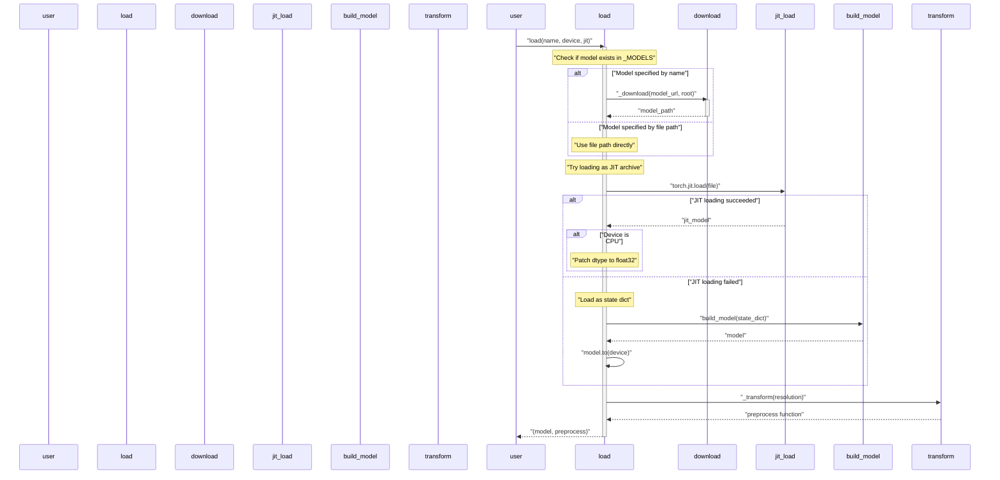

Sources: [clip/clip.py:94-202]()

### Available Models

CLIP provides several pre-trained model variants with different architectures and sizes. You can list available models using:

```python
import clip
print(clip.available_models())
```

The model variants include:

| Model Name | Architecture | Image Resolution | Parameters | Notes |
|------------|-------------|------------------|------------|-------|
| `"RN50"` | ResNet-50 | 224×224 | 102M | Base ResNet model |
| `"RN101"` | ResNet-101 | 224×224 | 182M | Deeper ResNet |
| `"RN50x4"` | ResNet-50×4 | 288×288 | 383M | Wider ResNet |
| `"RN50x16"` | ResNet-50×16 | 384×384 | 1.06B | Much wider ResNet |
| `"RN50x64"` | ResNet-50×64 | 448×448 | 3.96B | Extremely wide ResNet |
| `"ViT-B/32"` | ViT-B/32 | 224×224 | 151M | Vision Transformer with 32×32 patches |
| `"ViT-B/16"` | ViT-B/16 | 224×224 | 149M | Vision Transformer with 16×16 patches |
| `"ViT-L/14"` | ViT-L/14 | 224×224 | 428M | Larger Vision Transformer |
| `"ViT-L/14@336px"` | ViT-L/14 | 336×336 | 428M | Larger Vision Transformer with higher resolution |

Sources: [clip/clip.py:30-40]()

## Preparing Inputs for CLIP

### Image Preprocessing

When loading a CLIP model, the `clip.load()` function returns a preprocessing transform that correctly formats images for the model:

```python
from PIL import Image

# Load an image and preprocess it
image = Image.open("example.jpg")
processed_image = preprocess(image).unsqueeze(0).to(device)  # Add batch dimension
```

The preprocessing transform applies the following operations:
1. Resize to the model's required resolution using bicubic interpolation
2. Center crop to create a square image
3. Convert to RGB format (if not already)
4. Convert to a tensor with values in [0,1]
5. Normalize with CLIP-specific mean and standard deviation values

Sources: [clip/clip.py:75-86]()

### Text Tokenization

To tokenize text inputs for CLIP, use the `clip.tokenize()` function:

```python
# Tokenize text for model input
text = ["a photo of a dog", "a photo of a cat"]
text_tokens = clip.tokenize(text).to(device)
```

The function has the following signature:

```python
def tokenize(texts: Union[str, List[str]], context_length: int = 77, truncate: bool = False) -> torch.IntTensor:
```

| Parameter | Type | Description |
|-----------|------|-------------|
| `texts` | Union[str, List[str]] | Input string(s) to tokenize |
| `context_length` | int | Context length (default: 77) |
| `truncate` | bool | Whether to truncate long text (default: False) |

The tokenization process:
1. Adds start-of-text and end-of-text tokens
2. Converts text to token IDs using Byte-Pair Encoding
3. Pads with zeros to ensure a fixed-length tensor

Sources: [clip/clip.py:205-245]()

## Using CLIP Models

Once you have loaded a model and prepared your inputs, you can use CLIP in several ways:

### Encoding Images and Text

```python
with torch.no_grad():
    # Encode images to get image features
    image_features = model.encode_image(processed_image)
    
    # Encode text to get text features
    text_features = model.encode_text(text_tokens)
```

### Calculating Similarity

You can calculate similarity between image and text features in two ways:

#### 1. Using the model directly:

```python
# Get similarity scores directly from the model
with torch.no_grad():
    logits_per_image, logits_per_text = model(processed_image, text_tokens)
    
    # Convert to probabilities
    probs = logits_per_image.softmax(dim=-1)
```

#### 2. Using normalized features:

```python
# Normalize features for cosine similarity
image_features /= image_features.norm(dim=-1, keepdim=True)
text_features /= text_features.norm(dim=-1, keepdim=True)

# Calculate similarity
similarity = (100.0 * image_features @ text_features.T).softmax(dim=-1)
```

### CLIP Usage Flow

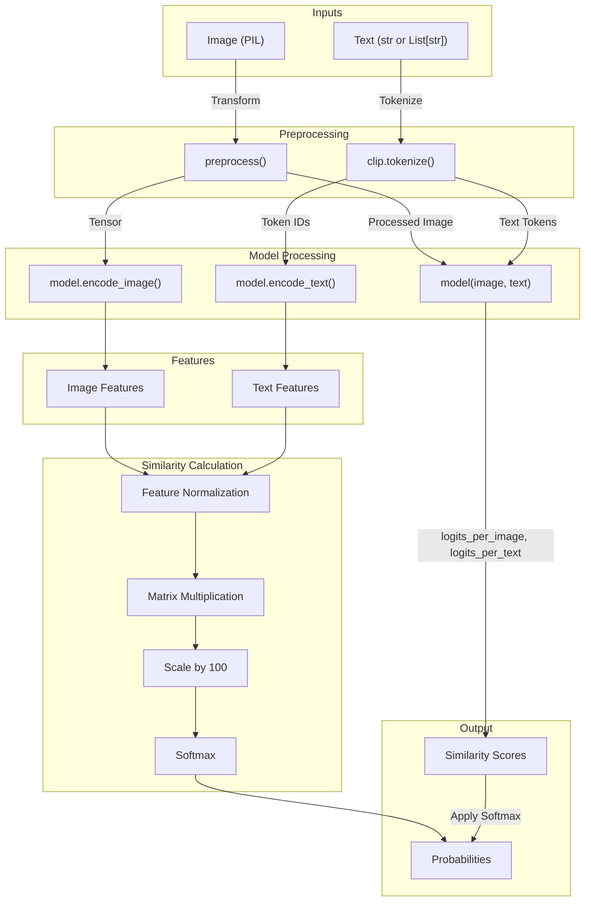

Sources: [clip/clip.py:205-245](), [README.md:27-46]()

## Zero-Shot Classification Example

One of the most powerful applications of CLIP is zero-shot classification. Here's how to implement it:

```python
import torch
import clip
from PIL import Image

# Load model and image
device = "cuda" if torch.cuda.is_available() else "cpu"
model, preprocess = clip.load("ViT-B/32", device=device)
image = preprocess(Image.open("example.jpg")).unsqueeze(0).to(device)

# Define class labels
classes = ["a dog", "a cat", "a horse", "a mountain", "a building"]
text_inputs = torch.cat([clip.tokenize(f"a photo of {c}") for c in classes]).to(device)

# Calculate features
with torch.no_grad():
    image_features = model.encode_image(image)
    text_features = model.encode_text(text_inputs)

    # Normalize features
    image_features /= image_features.norm(dim=-1, keepdim=True)
    text_features /= text_features.norm(dim=-1, keepdim=True)

    # Calculate similarity
    similarity = (100.0 * image_features @ text_features.T).softmax(dim=-1)
    
    # Get top predictions
    values, indices = similarity[0].topk(5)

# Print results
for value, index in zip(values, indices):
    print(f"{classes[index]:>16s}: {100 * value.item():.2f}%")
```

### Zero-Shot Classification Flow

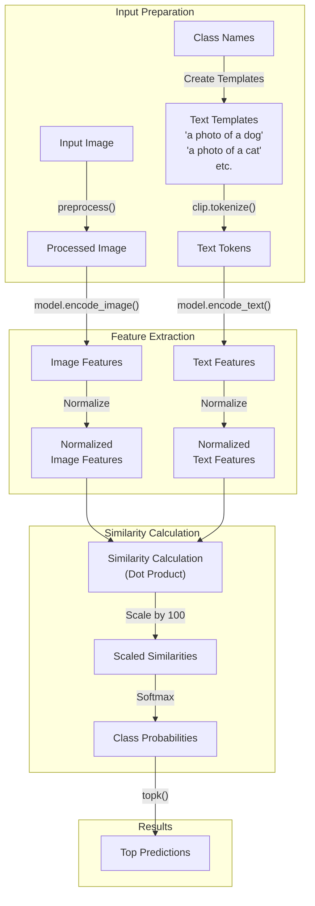

Sources: [README.md:87-139]()

## Best Practices

When using CLIP, consider the following guidelines for optimal results:

### Model Selection

- **For fastest inference**: Use `"RN50"` or `"ViT-B/32"`
- **For best accuracy**: Use `"ViT-L/14@336px"` (requires more memory)
- **Balanced performance**: `"ViT-B/16"` offers a good trade-off

### Performance Optimization

- Use `torch.no_grad()` during inference to reduce memory usage
- Process images in batches when possible
- When using GPU, keep inputs and model on the same device
- Consider using the JIT model (`jit=True`) for potentially faster performance

### Text Prompting

- Use descriptive prompts like "a photo of a [class]" instead of just class names
- Experiment with different prompt templates for better results
- For fine-grained classification, use more specific descriptors
- Multiple text templates can be averaged for more robust results

### Common Issues

- If experiencing out-of-memory errors, try a smaller model or reduce batch size
- For very large images, using non-JIT models can be more memory-efficient
- If text or image is too long, use truncation options or resize appropriately
- Check that image preprocessing is applied correctly (always use the returned `preprocess` function)

Sources: [clip/clip.py:94-202](), [README.md:27-46](), [README.md:87-139]()

---

# Page: Text Tokenization

# Text Tokenization

<details>
<summary>Relevant source files</summary>

The following files were used as context for generating this wiki page:

- [clip/bpe_simple_vocab_16e6.txt.gz](clip/bpe_simple_vocab_16e6.txt.gz)
- [clip/clip.py](clip/clip.py)
- [clip/simple_tokenizer.py](clip/simple_tokenizer.py)

</details>


This document explains the text tokenization system used in CLIP, which is responsible for converting natural language text inputs into numerical token sequences that the model can process. The tokenization system is a crucial component of CLIP's text processing pipeline, serving as the bridge between human-readable text and the tensor representations required by the text encoder.

For information about using the complete CLIP model after tokenization, see [Loading and Using CLIP](#3.1).

## Overview of Text Tokenization in CLIP

CLIP uses a byte-level Byte Pair Encoding (BPE) tokenizer implemented in the `SimpleTokenizer` class. This tokenization approach breaks text into subword units, enabling the model to handle out-of-vocabulary words effectively by decomposing them into known subword pieces.

The tokenization process involves:
1. Text cleaning and normalization
2. Breaking text into tokens using regex pattern matching
3. Encoding each token using byte-level BPE
4. Converting subword tokens to token IDs using a pre-trained vocabulary
5. Adding special tokens and padding to create fixed-length sequences

Sources: [clip/simple_tokenizer.py:62-132](), [clip/clip.py:205-245]()

```mermaid
flowchart LR
    subgraph "Text Tokenization Process"
        A["Raw Text Input"] --> B["Text Cleaning"]
        B --> C["Token Splitting"]
        C --> D["BPE Encoding"]
        D --> E["Convert to Token IDs"]
        E --> F["Add Special Tokens"]
        F --> G["Padding/Truncation"]
        G --> H["Token Tensor"]
    end
```

## Tokenization Entry Point

The primary entry point for tokenization is the `tokenize` function in `clip.py`. This function handles the conversion of text strings into token tensors that can be directly fed into the CLIP text encoder.

```mermaid
classDiagram
    class clip {
        +tokenize(texts, context_length, truncate)
        +_tokenizer: SimpleTokenizer
    }
    
    class SimpleTokenizer {
        +encode(text)
        +bpe(token)
        +decode(tokens)
        -byte_encoder
        -byte_decoder
        -encoder
        -decoder
        -bpe_ranks
        -cache
        -pat
    }
    
    clip --> SimpleTokenizer : uses
```

### Key Parameters

The `tokenize` function accepts the following parameters:

| Parameter | Type | Default | Description |
|-----------|------|---------|-------------|
| `texts` | `Union[str, List[str]]` | Required | Input text or list of texts to tokenize |
| `context_length` | `int` | 77 | Maximum number of tokens (all CLIP models use 77) |
| `truncate` | `bool` | `False` | Whether to truncate texts that exceed context length |

The function returns a 2D tensor of shape `[number of input strings, context_length]` containing the token IDs.

Sources: [clip/clip.py:205-245]()

## SimpleTokenizer Implementation

The `SimpleTokenizer` class implements the byte-level BPE tokenization process used by CLIP. The tokenizer is initialized once when the CLIP module is imported and stored in the `_tokenizer` variable.

### Initialization

During initialization, the tokenizer:
1. Loads the byte-to-unicode mapping
2. Reads the BPE vocabulary from a gzipped file
3. Builds encoder and decoder dictionaries for token↔ID conversion
4. Compiles regex patterns for token splitting
5. Initializes a cache for faster tokenization

```mermaid
sequenceDiagram
    participant Client
    participant Tokenizer as SimpleTokenizer
    participant BPEFile as "bpe_simple_vocab_16e6.txt.gz"
    
    Client->>Tokenizer: initialize()
    Tokenizer->>Tokenizer: create byte_encoder/decoder
    Tokenizer->>BPEFile: read()
    BPEFile-->>Tokenizer: BPE merges
    Tokenizer->>Tokenizer: Build vocabulary
    Tokenizer->>Tokenizer: Create encoder/decoder dictionaries
    Tokenizer->>Tokenizer: Compile regex pattern
    Tokenizer-->>Client: tokenizer instance
```

Sources: [clip/simple_tokenizer.py:62-78]()

### Text Processing and Encoding

The text encoding process follows these steps:

1. **Text Cleaning**:
   - Fix text using `ftfy` library
   - Remove HTML escape sequences
   - Clean whitespace and convert to lowercase

2. **Token Splitting**:
   - Split text into tokens using a regex pattern that matches words, numbers, and special tokens
   - The pattern recognizes common contractions ('s, 't, 're, etc.)

3. **BPE Encoding**:
   - Convert each token to bytes and then to unicode
   - Apply BPE algorithm to convert tokens into subword units
   - Convert subwords to token IDs using the encoder dictionary

```mermaid
flowchart TD
    A["Input: 'Hello world!'"] --> B["Clean text: 'hello world!'"]
    B --> C["Split into tokens: ['hello', 'world', '!']"]
    C --> D["Convert to byte representation"]
    D --> E["Apply BPE to each token"]
    E --> F["Convert to token IDs: [3232, 995, 269, ...]"]
    F --> G["Add special tokens: [49406, 3232, 995, 269, ..., 49407]"]
    G --> H["Create padded tensor: [49406, 3232, 995, 269, ..., 49407, 0, 0, ...]"]
```

Sources: [clip/simple_tokenizer.py:121-127](), [clip/clip.py:227-245]()

### BPE Algorithm Implementation

The Byte Pair Encoding algorithm identifies and merges the most frequent pairs of consecutive bytes or characters in the text:

1. Start with each token broken into individual characters plus a suffix `</w>`
2. Identify the most frequent pair of adjacent symbols according to the BPE ranks
3. Merge the pair into a new symbol
4. Repeat until no more merges are possible or the token is a single symbol

The implementation uses a greedy approach and maintains a cache to avoid recalculating common tokens.

Sources: [clip/simple_tokenizer.py:80-119]()

## Special Tokens and Context Length

CLIP uses two special tokens:
- `<|startoftext|>` (ID: 49406) - Marks the beginning of a text
- `<|endoftext|>` (ID: 49407) - Marks the end of a text

All CLIP models use a context length of 77 tokens, which means:
- The maximum sequence length is 77 tokens including special tokens
- Sequences shorter than 77 tokens are padded with zeros
- Sequences longer than 77 tokens will cause an error unless `truncate=True` is specified

```mermaid
graph TD
    subgraph "Token Sequence Structure"
        sot["<|startoftext|> (ID: 49406)"]
        content["Content Tokens (up to 75 tokens)"]
        eot["<|endoftext|> (ID: 49407)"]
        padding["Padding (zeros)"]
        
        sot --> content
        content --> eot
        eot --> padding
    end
```

Sources: [clip/clip.py:228-245]()

## Usage Example

The tokenization function is typically used as follows:

```python
import clip

# Single text
text = "A photo of a cat"
tokens = clip.tokenize(text)  # Shape: [1, 77]

# Multiple texts
texts = ["A photo of a cat", "A drawing of a dog"]
batch_tokens = clip.tokenize(texts)  # Shape: [2, 77]

# With truncation enabled
long_text = "A very long description that exceeds the context length..."
truncated_tokens = clip.tokenize(long_text, truncate=True)
```

When used within the CLIP model, the tokenized text is passed to the text encoder:

```mermaid
sequenceDiagram
    participant User
    participant clip as "clip module"
    participant model as "CLIP model"
    participant tokenizer as "SimpleTokenizer"
    
    User->>clip: tokenize("A photo of a cat")
    clip->>tokenizer: encode text
    tokenizer-->>clip: token IDs
    clip-->>User: token tensor
    
    User->>model: encode_text(token_tensor)
    model-->>User: text features
```

Sources: [clip/clip.py:205-245]()

## Vocabulary and Token Coverage

The CLIP tokenizer uses a large vocabulary of approximately 49,152 tokens (including special tokens). This vocabulary is derived from a corpus of 16 million samples, as indicated by the vocabulary file name `bpe_simple_vocab_16e6.txt.gz`.

The byte-level encoding ensures that any Unicode text can be tokenized without producing unknown tokens, though rare words or characters will be split into multiple subword tokens.

Sources: [clip/simple_tokenizer.py:66-77]()

## Text Decoding

While not commonly used in the forward pass of CLIP, the tokenizer also supports decoding token IDs back to text through the `decode` method. This can be useful for debugging or visualization purposes.

The decoding process:
1. Converts token IDs to token strings using the decoder dictionary
2. Converts unicode characters back to bytes using the byte_decoder
3. Decodes the bytes to UTF-8 text
4. Replaces the `</w>` marker with spaces

Sources: [clip/simple_tokenizer.py:129-132]()

---

# Page: Model Variants and Parameters

# Model Variants and Parameters

<details>
<summary>Relevant source files</summary>

The following files were used as context for generating this wiki page:

- [clip/model.py](clip/model.py)

</details>


## Purpose

This document provides detailed information about the different CLIP model variants available in the repository, their architectures, parameters, and performance characteristics. It covers both ResNet and Vision Transformer (ViT) based models, their configuration details, and how to identify and use specific variants.

For information about loading and using CLIP models, see [Loading and Using CLIP](#3.1).

## CLIP Model Architecture Overview

CLIP (Contrastive Language-Image Pre-training) uses a dual-encoder architecture consisting of:
1. An image encoder (either ModifiedResNet or Vision Transformer)
2. A text encoder (Transformer)
3. A joint multimodal embedding space

The model maps both images and text to a shared embedding space where semantically similar content is positioned closer together.

```mermaid
flowchart TD
    subgraph "CLIP Model"
        subgraph "Image Encoder Options"
            modres["ModifiedResNet"]
            vit["VisionTransformer"]
        end
        
        txt["Text Transformer Encoder"]
        embed["Joint Embedding Space"]
        logit["Logit Scale"]
        
        image --> modres & vit
        modres & vit --> img_feat["Image Features"]
        text --> txt
        txt --> txt_feat["Text Features"]
        
        img_feat --> embed
        txt_feat --> embed
        embed --> logit
        logit --> similarity["Similarity Scores"]
    end
```

Sources: [clip/model.py:243-372]()

## Available Model Variants

CLIP is available in several variants, differing primarily in their image encoder architecture. The model name format follows: `{architecture}-{configuration}`.

### Model Variants Overview

| Model Name | Image Encoder Type | Parameters | Image Resolution | Patch Size | Vision Width | Vision Layers |
|------------|-------------------|------------|------------------|------------|--------------|---------------|
| RN50       | ModifiedResNet    | 102M       | 224              | N/A        | 64           | [3, 4, 6, 3]  |
| RN101      | ModifiedResNet    | 167M       | 224              | N/A        | 64           | [3, 4, 23, 3] |
| RN50x4     | ModifiedResNet    | 212M       | 288              | N/A        | 80           | [4, 6, 10, 6] |
| RN50x16    | ModifiedResNet    | 772M       | 384              | N/A        | 96           | [6, 8, 18, 8] |
| RN50x64    | ModifiedResNet    | 3.0B       | 448              | N/A        | 128          | [3, 15, 36, 10] |
| ViT-B/32   | VisionTransformer | 151M       | 224              | 32         | 768          | 12            |
| ViT-B/16   | VisionTransformer | 149M       | 224              | 16         | 768          | 12            |
| ViT-L/14   | VisionTransformer | 428M       | 224              | 14         | 1024         | 24            |
| ViT-L/14@336px | VisionTransformer | 428M   | 336              | 14         | 1024         | 24            |

Sources: [clip/model.py:399-436]()

## Model Architectures Details

### ModifiedResNet Architecture

The ModifiedResNet architecture used in CLIP differs from standard ResNet implementations in several ways:

1. Uses 3 "stem" convolutions instead of 1
2. Uses average pooling instead of max pooling
3. Implements anti-aliasing strided convolutions
4. Uses QKV attention for the final pooling layer instead of average pooling

```mermaid
flowchart TD
    input["Input Image"]
    stem["3-Layer Stem"]
    layer1["Layer 1"]
    layer2["Layer 2"]
    layer3["Layer 3"]
    layer4["Layer 4"]
    attnpool["AttentionPool2d"]
    output["Output Embedding"]
    
    input --> stem
    stem --> layer1
    layer1 --> layer2
    layer2 --> layer3
    layer3 --> layer4
    layer4 --> attnpool
    attnpool --> output
```

Sources: [clip/model.py:94-154]()

### VisionTransformer Architecture

The VisionTransformer (ViT) divides an image into fixed-size patches, linearly embeds each patch, adds position embeddings, and feeds the resulting sequence of vectors to a standard Transformer encoder.

```mermaid
flowchart TD
    input["Input Image"]
    patchconv["Patch Convolution"]
    class_token["Add Class Token"]
    pos_embed["Add Positional Embeddings"]
    ln_pre["Layer Normalization"]
    transformer["Transformer"]
    ln_post["Layer Normalization"]
    proj["Projection Layer"]
    output["Output Embedding"]
    
    input --> patchconv
    patchconv --> class_token
    class_token --> pos_embed
    pos_embed --> ln_pre
    ln_pre --> transformer
    transformer --> ln_post
    ln_post --> proj
    proj --> output
```

Sources: [clip/model.py:206-240]()

## Parameter Details

### Model Creation Parameters

The CLIP model is initialized with the following parameters:

```mermaid
classDiagram
    class CLIP {
        +embed_dim: int
        +image_resolution: int
        +vision_layers: Union[Tuple[int, int, int, int], int]
        +vision_width: int
        +vision_patch_size: int
        +context_length: int
        +vocab_size: int
        +transformer_width: int
        +transformer_heads: int
        +transformer_layers: int
    }
```

Source: [clip/model.py:243-298]()

### ModifiedResNet Parameters

The ModifiedResNet encoder takes these parameters:

| Parameter | Description |
|-----------|-------------|
| layers | Tuple of 4 integers defining the number of Bottleneck blocks in each layer |
| output_dim | Dimension of the output embedding |
| heads | Number of attention heads in the AttentionPool2d |
| input_resolution | Input image resolution (default: 224) |
| width | Base width parameter, controlling network size |

Sources: [clip/model.py:102-127]()

### VisionTransformer Parameters

The VisionTransformer encoder takes:

| Parameter | Description |
|-----------|-------------|
| input_resolution | Input image resolution |
| patch_size | Size of image patches |
| width | Width of the transformer |
| layers | Number of transformer layers |
| heads | Number of attention heads |
| output_dim | Dimension of the output embedding |

Sources: [clip/model.py:207-221]()

### Text Transformer Parameters

The text encoder parameters include:

| Parameter | Description |
|-----------|-------------|
| width | Width of the transformer |
| layers | Number of transformer layers |
| heads | Number of attention heads |
| attn_mask | Attention mask for causal attention |

Sources: [clip/model.py:196-203]()

## Model Detection and Building

The `build_model` function in `model.py` automatically determines the model architecture and parameters from the state dictionary:

1. Detects if the model is ViT-based by checking for "visual.proj" in the state dictionary
2. For ViT models, determines layers, width, patch size, and resolution from weights
3. For ResNet models, extracts layer counts, width, and resolution
4. Extracts text encoder parameters from the state dictionary
5. Constructs the appropriate CLIP model with the determined parameters

Sources: [clip/model.py:399-436]()

## Model Variant Performance Comparison

Different model variants offer trade-offs between accuracy, computational requirements, and memory usage:

| Model | Zero-Shot ImageNet Accuracy | Computational Requirements | Model Size |
|-------|------------------------------|---------------------------|-----------| 
| RN50 | 59.6% | Low | 102M |
| RN101 | 62.2% | Medium | 167M |
| RN50x4 | 65.4% | Medium | 212M |
| RN50x16 | 70.3% | High | 772M |
| RN50x64 | 75.5% | Very High | 3.0B |
| ViT-B/32 | 63.2% | Medium | 151M |
| ViT-B/16 | 68.3% | Medium-High | 149M |
| ViT-L/14 | 75.5% | High | 428M |
| ViT-L/14@336px | 76.2% | Very High | 428M |

## Implementation Details

### Precision Conversion

CLIP models support conversion to FP16 precision using the `convert_weights` function:

```mermaid
flowchart LR
    model["CLIP Model"] --> convert["convert_weights()"]
    convert --> fp16["FP16 Model"]
```

The conversion applies to:
- Convolutional layers
- Linear layers
- MultiheadAttention layers
- Projection layers

Sources: [clip/model.py:375-396]()

### Parameter Initialization

CLIP initializes parameters differently based on component type:
- Token and positional embeddings use normal initialization
- Attention pool weights in ResNet use layer-specific initialization 
- Transformer weights use layer-specific scaling for stability

Sources: [clip/model.py:299-326]()

---

# Page: Examples and Usage

# Examples and Usage

<details>
<summary>Relevant source files</summary>

The following files were used as context for generating this wiki page:

- [README.md](README.md)
- [clip/clip.py](clip/clip.py)
- [notebooks/Interacting_with_CLIP.ipynb](notebooks/Interacting_with_CLIP.ipynb)
- [notebooks/Prompt_Engineering_for_ImageNet.ipynb](notebooks/Prompt_Engineering_for_ImageNet.ipynb)

</details>


This page provides practical examples and usage patterns for CLIP (Contrastive Language-Image Pre-Training). It demonstrates how to use CLIP for various tasks such as image-text similarity, zero-shot classification, and more advanced applications. For information about the CLIP model architecture and theory, see [CLIP Model Architecture](#2).

## Basic Usage

CLIP (Contrastive Language-Image Pre-Training) allows you to calculate the similarity between images and text. The basic workflow involves loading a model, preparing inputs, and using the model to encode images and text or calculate similarities.

### Loading a CLIP Model

First, you need to import CLIP and load a pre-trained model:

```python
import torch
import clip
from PIL import Image

# Check available models
print(clip.available_models())

# Load the model
device = "cuda" if torch.cuda.is_available() else "cpu"
model, preprocess = clip.load("ViT-B/32", device=device)
```

The `clip.load()` function returns both the model and a preprocessing function for images. The preprocessing function handles resizing, cropping, and normalizing images for the model.

Sources: [clip/clip.py:89-202](), [README.md:15-46]()

### Image and Text Encoding

CLIP can encode both images and text into a joint embedding space:

```python
# Load and preprocess an image
image = preprocess(Image.open("CLIP.png")).unsqueeze(0).to(device)

# Prepare text
text = clip.tokenize(["a diagram", "a dog", "a cat"]).to(device)

# Encode image and text
with torch.no_grad():
    image_features = model.encode_image(image)
    text_features = model.encode_text(text)
    
    # Normalize features
    image_features /= image_features.norm(dim=-1, keepdim=True)
    text_features /= text_features.norm(dim=-1, keepdim=True)
```

Sources: [README.md:27-44](), [notebooks/Interacting_with_CLIP.ipynb:500-546]()

### Calculating Similarities

Once you have encoded the images and text, you can calculate the similarities between them:

```python
# Calculate similarity scores
with torch.no_grad():
    # Method 1: Using the model directly
    logits_per_image, logits_per_text = model(image, text)
    probs = logits_per_image.softmax(dim=-1).cpu().numpy()
    
    # Method 2: Using the cosine similarity of features
    similarity = (100.0 * image_features @ text_features.T).softmax(dim=-1)
    values, indices = similarity[0].topk(5)
```

Sources: [README.md:36-45](), [notebooks/Interacting_with_CLIP.ipynb:547-567]()

## Zero-Shot Image Classification

One of the most powerful features of CLIP is its ability to perform zero-shot classification without additional training.

### Zero-Shot Classification with CIFAR-100

```python
import os
import clip
import torch
from torchvision.datasets import CIFAR100

# Load the model
device = "cuda" if torch.cuda.is_available() else "cpu"
model, preprocess = clip.load('ViT-B/32', device)

# Download the dataset
cifar100 = CIFAR100(root=os.path.expanduser("~/.cache"), download=True, train=False)

# Prepare the inputs
image, class_id = cifar100[3637]
image_input = preprocess(image).unsqueeze(0).to(device)
text_inputs = torch.cat([clip.tokenize(f"a photo of a {c}") for c in cifar100.classes]).to(device)

# Calculate features
with torch.no_grad():
    image_features = model.encode_image(image_input)
    text_features = model.encode_text(text_inputs)

# Pick the top 5 most similar labels for the image
image_features /= image_features.norm(dim=-1, keepdim=True)
text_features /= text_features.norm(dim=-1, keepdim=True)
similarity = (100.0 * image_features @ text_features.T).softmax(dim=-1)
values, indices = similarity[0].topk(5)

# Print the result
print("\nTop predictions:\n")
for value, index in zip(values, indices):
    print(f"{cifar100.classes[index]:>16s}: {100 * value.item():.2f}%")
```

This will output the top 5 predicted classes for the given image, with their confidence scores.

Sources: [README.md:87-136]()

## CLIP Workflow Diagram

### CLIP Basic Workflow

```mermaid
flowchart LR
    subgraph "Inputs"
        img["Image Input"]
        txt["Text Input"]
    end

    subgraph "Processing"
        preprocess["Image Preprocessing\nResize, crop, normalize"]
        tokenize["clip.tokenize()\nConvert text to tokens"]
        img_encode["model.encode_image()\nExtract image features"]
        txt_encode["model.encode_text()\nExtract text features"]
    end

    subgraph "Output"
        similarity["Calculate Similarity\nLogits/Probabilities"]
        classify["Zero-shot Classification"]
    end

    img --> preprocess
    txt --> tokenize
    
    preprocess --> img_encode
    tokenize --> txt_encode
    
    img_encode --> similarity
    txt_encode --> similarity
    similarity --> classify
```

Sources: [clip/clip.py:89-202](), [README.md:15-46](), [README.md:87-136]()

## Advanced Usage

### Prompt Engineering for Better Zero-Shot Classification

CLIP's zero-shot classification performance can be significantly improved by using better prompts. Instead of simple prompts like "a photo of a {class}", more descriptive prompts can help CLIP understand the task better.

#### Zero-Shot ImageNet Classification with Prompt Ensembling

The "Prompt_Engineering_for_ImageNet.ipynb" notebook demonstrates how to improve CLIP's performance on ImageNet through prompt engineering:

```python
# Define a set of better prompts
imagenet_templates = [
    "a bad photo of a {}.",
    "a photo of many {}.",
    "a sculpture of a {}.",
    "a photo of the hard to see {}.",
    "a low resolution photo of the {}.",
    "a rendering of a {}.",
    "graffiti of a {}.",
    "a bad photo of the {}.",
    "a cropped photo of the {}.",
    "a tattoo of a {}.",
    "the embroidered {}.",
    "a photo of a hard to see {}.",
    "a bright photo of a {}.",
    "a photo of a clean {}.",
    "a photo of a dirty {}.",
    "a dark photo of the {}.",
    "a drawing of a {}.",
    "a photo of my {}.",
    "the plastic {}.",
    "a photo of the cool {}.",
    "a close-up photo of a {}.",
    "a black and white photo of the {}.",
    "a painting of the {}.",
    "a painting of a {}.",
    "a pixelated photo of the {}.",
    "a sculpture of the {}.",
    "a bright photo of the {}.",
    "a cropped photo of a {}.",
    "a plastic {}.",
    "a photo of the dirty {}.",
    "a jpeg corrupted photo of a {}.",
    "a blurry photo of the {}.",
    "a photo of the {}.",
    "a good photo of the {}.",
    "a rendering of the {}.",
    "a {} in a video game.",
    "a photo of one {}.",
    "a doodle of a {}.",
    "a close-up photo of the {}.",
    "a photo of a {}.",
    "the origami {}.",
    "the {} in a video game.",
    "a sketch of a {}.",
    "a doodle of the {}.",
    "a origami {}.",
    "a low resolution photo of a {}.",
    "the toy {}.",
    "a rendition of the {}.",
    "a photo of the clean {}.",
    "a photo of a large {}.",
    "a rendition of a {}.",
    "a photo of a nice {}.",
    "a photo of a weird {}.",
    "a blurry photo of a {}.",
    "a cartoon {}.",
    "art of a {}.",
    "a sketch of the {}.",
    "a embroidered {}.",
    "a pixelated photo of a {}.",
    "itap of the {}.",
    "a jpeg corrupted photo of the {}.",
    "a good photo of a {}.",
    "a plushie {}.",
    "a photo of the nice {}.",
    "a photo of the small {}.",
    "a photo of the weird {}.",
    "the cartoon {}.",
    "art of the {}.",
    "a drawing of the {}.",
    "a photo of the large {}.",
    "a black and white photo of a {}.",
    "the plushie {}.",
    "a dark photo of a {}.",
    "itap of a {}.",
    "graffiti of the {}.",
    "a toy {}.",
    "itap of my {}.",
    "a photo of a cool {}.",
    "a photo of a small {}.",
    "a tattoo of the {}.",
]

# Use prompt ensembling (average the results of multiple prompts)
with torch.no_grad():
    all_text_features = []
    for template in imagenet_templates:
        texts = [template.format(c) for c in imagenet_classes]
        text_inputs = clip.tokenize(texts).to(device)
        text_features = model.encode_text(text_inputs).float()
        text_features /= text_features.norm(dim=-1, keepdim=True)
        all_text_features.append(text_features)
    
    # Average text features from different prompts
    text_features = torch.stack(all_text_features).mean(dim=0)
    text_features /= text_features.norm(dim=-1, keepdim=True)
```

By averaging the results from multiple prompts, CLIP can achieve higher accuracy on classification tasks without any fine-tuning.

Sources: [notebooks/Prompt_Engineering_for_ImageNet.ipynb]()

### Linear Probe Evaluation

CLIP's image features can also be used for training a linear classifier:

```python
import os
import clip
import torch

import numpy as np
from sklearn.linear_model import LogisticRegression
from torch.utils.data import DataLoader
from torchvision.datasets import CIFAR100
from tqdm import tqdm

# Load the model
device = "cuda" if torch.cuda.is_available() else "cpu"
model, preprocess = clip.load('ViT-B/32', device)

# Load the dataset
root = os.path.expanduser("~/.cache")
train = CIFAR100(root, download=True, train=True, transform=preprocess)
test = CIFAR100(root, download=True, train=False, transform=preprocess)


def get_features(dataset):
    all_features = []
    all_labels = []
    
    with torch.no_grad():
        for images, labels in tqdm(DataLoader(dataset, batch_size=100)):
            features = model.encode_image(images.to(device))

            all_features.append(features)
            all_labels.append(labels)

    return torch.cat(all_features).cpu().numpy(), torch.cat(all_labels).cpu().numpy()

# Calculate the image features
train_features, train_labels = get_features(train)
test_features, test_labels = get_features(test)

# Perform logistic regression
classifier = LogisticRegression(random_state=0, C=0.316, max_iter=1000, verbose=1)
classifier.fit(train_features, train_labels)

# Evaluate using the logistic regression classifier
predictions = classifier.predict(test_features)
accuracy = np.mean((test_labels == predictions).astype(float)) * 100.
print(f"Accuracy = {accuracy:.3f}")
```

This approach extracts features from a dataset using CLIP, then trains a simple linear classifier on those features. It typically achieves high accuracy with much less training data than traditional methods.

Sources: [README.md:142-190]()

## Prompt Engineering Workflow Diagram

```mermaid
flowchart TD
    subgraph "Prompt Creation"
        p1["Create Multiple\nPrompt Templates"]
        p2["Format Templates\nwith Class Names"]
    end

    subgraph "Feature Extraction"
        e1["Encode All Prompts\nwith CLIP"]
        e2["Average Features\nAcross Prompts"]
        e3["Normalize Features"]
    end

    subgraph "Classification"
        c1["Encode Test Image"]
        c2["Calculate Similarities\nwith Text Features"]
        c3["Get Top Predictions"]
    end

    p1 --> p2
    p2 --> e1
    e1 --> e2
    e2 --> e3
    e3 --> c2
    c1 --> c2
    c2 --> c3
```

Sources: [notebooks/Prompt_Engineering_for_ImageNet.ipynb]()

## CLIP API Reference

### Main Functions

| Function | Description | Parameters |
|----------|-------------|------------|
| `clip.available_models()` | Returns the names of available CLIP models | None |
| `clip.load(name, device, jit)` | Loads a CLIP model | `name`: Model name<br>`device`: Device to put the model on<br>`jit`: Whether to load the optimized JIT model |
| `clip.tokenize(text, context_length)` | Tokenizes text for CLIP | `text`: Input text (string or list)<br>`context_length`: Max token length (default 77) |

### Model Methods

| Method | Description | Parameters |
|--------|-------------|------------|
| `model.encode_image(image)` | Encodes images into feature vectors | `image`: Batch of preprocessed images |
| `model.encode_text(text)` | Encodes tokenized text into feature vectors | `text`: Batch of tokenized text |
| `model(image, text)` | Calculates similarity between images and text | `image`: Batch of preprocessed images<br>`text`: Batch of tokenized text |

Sources: [clip/clip.py:89-245](), [README.md:50-81]()

## Available Models

CLIP comes with several pre-trained models of different sizes and architectures:

| Model Name | Architecture | Parameters | Notes |
|------------|--------------|------------|-------|
| "RN50" | ResNet-50 | 102M | Good balance of speed and accuracy |
| "RN101" | ResNet-101 | 182M | Higher accuracy than RN50 |
| "RN50x4" | ResNet-50 (4× width) | 336M | Higher accuracy, larger model |
| "RN50x16" | ResNet-50 (16× width) | 1.2B | Very large model, high accuracy |
| "RN50x64" | ResNet-50 (64× width) | 4.8B | Extremely large model |
| "ViT-B/32" | Vision Transformer | 151M | Good for general use |
| "ViT-B/16" | Vision Transformer | 151M | Higher accuracy than ViT-B/32 |
| "ViT-L/14" | ViT (Large) | 428M | Very high accuracy |
| "ViT-L/14@336px" | ViT (Large, 336×336) | 428M | Highest accuracy, larger input size |

Sources: [clip/clip.py:30-40](), [notebooks/Interacting_with_CLIP.ipynb:380-408]()

## Zero-Shot Classification Diagram

```mermaid
flowchart LR
    subgraph "Input Preparation"
        img_input["Input Image"]
        class_names["Class Names"]
        prompt_templates["Prompt Templates"]
    end

    subgraph "CLIP Processing"
        preprocess["Preprocess Image"]
        tokenize["Tokenize Text"]
        img_encode["Encode Image"]
        txt_encode["Encode Text"]
    end

    subgraph "Classification"
        similarity["Calculate Similarity Scores"]
        topk["Get Top-k Predictions"]
    end

    img_input --> preprocess
    class_names --> prompt
    prompt_templates --> prompt
    prompt["Format Prompts\n'a photo of a {class}'"] --> tokenize
    
    preprocess --> img_encode
    tokenize --> txt_encode
    
    img_encode --> similarity
    txt_encode --> similarity
    
    similarity --> topk
```

Sources: [README.md:87-136](), [notebooks/Interacting_with_CLIP.ipynb:500-567]()

## Best Practices

### Optimizing Performance

1. **Model Selection**: Choose the appropriate model size based on your computational resources and accuracy requirements. ViT-B/32 offers a good balance of speed and accuracy for most applications.

2. **Batch Processing**: When processing multiple images or texts, use batches to maximize throughput.

3. **GPU Acceleration**: CLIP models benefit significantly from GPU acceleration. If available, use CUDA devices.

4. **Prompt Engineering**: For zero-shot classification, using well-crafted prompts can significantly improve accuracy. Consider using prompt ensembling (combining results from multiple prompts).

### Common Pitfalls

1. **Input Preprocessing**: Always use the `preprocess` function returned by `clip.load()` for images to ensure proper formatting.

2. **Context Length**: CLIP models have a maximum context length (usually 77 tokens). Longer texts will be truncated.

3. **Normalization**: For comparing features, remember to normalize both image and text features before calculating similarities.

4. **Batch Size Limitations**: Very large batch sizes may cause out-of-memory errors, especially with larger models.

Sources: [clip/clip.py:89-245](), [README.md:15-136](), [notebooks/Interacting_with_CLIP.ipynb:380-567]()

## Further Resources

For more advanced applications and research using CLIP, users might want to explore:

- OpenAI's CLIP paper: "Learning Transferable Visual Models From Natural Language Supervision"
- OpenCLIP: An open-source implementation with additional models
- Hugging Face's CLIP implementation for easier integration with their ecosystem

For details about CLIP's architecture and theoretical foundations, see [CLIP Model Architecture](#2).

---

# Page: Installation and Requirements

# Installation and Requirements

<details>
<summary>Relevant source files</summary>

The following files were used as context for generating this wiki page:

- [MANIFEST.in](MANIFEST.in)
- [requirements.txt](requirements.txt)
- [setup.py](setup.py)

</details>


This document provides detailed instructions for installing the CLIP (Contrastive Language-Image Pre-training) library and outlines its system requirements. For information about using CLIP after installation, see [Loading and Using CLIP](#3.1). For details about the model architecture, see [CLIP Model Architecture](#2).

## System Requirements

### Hardware Requirements

CLIP models vary in their resource requirements depending on the model variant:

| Model Variant | Minimum VRAM | Recommended RAM | Approximate Disk Space |
|---------------|--------------|-----------------|------------------------|
| ViT-B/32      | 2GB          | 8GB             | ~340MB                 |
| ViT-B/16      | 4GB          | 8GB             | ~380MB                 |
| ViT-L/14      | 8GB+         | 16GB+           | ~890MB                 |
| RN50          | 2GB          | 8GB             | ~170MB                 |
| RN101         | 3GB          | 8GB             | ~340MB                 |
| RN50x4        | 6GB          | 16GB            | ~480MB                 |
| RN50x16       | 12GB+        | 16GB+           | ~1.2GB                 |

Note: These specifications assume inference with small batch sizes. Requirements increase with larger batches.

### Software Requirements

CLIP has the following software dependencies:

- **Python**: 3.7 or higher
- **PyTorch**: 1.7.1 or higher
- **TorchVision**: Compatible with installed PyTorch version
- **CUDA**: Compatible with PyTorch (for GPU acceleration)
- **Additional libraries**: ftfy, regex, tqdm, packaging

Sources: [requirements.txt:1-6]()

## Installation Methods

### Installation via pip

The recommended way to install CLIP is directly from the GitHub repository:

```bash
pip install git+https://github.com/openai/CLIP.git
```

This command fetches the source code and installs CLIP along with all its dependencies.

### Installation from Source

For development purposes or to modify the code:

```bash
git clone https://github.com/openai/CLIP.git
cd CLIP
pip install -e .
```

The `-e` flag installs in "editable" mode, allowing code modifications without reinstallation.

For development with testing capabilities:

```bash
pip install -e .[dev]
```

This installs additional development dependencies like pytest.

Sources: [setup.py:6-21]()

## CLIP Dependency Structure

The following diagram shows CLIP's primary dependencies and how they relate to components in the codebase:

### CLIP Dependencies and Module Relationships

```mermaid
graph TD
    clip_py["clip.py<br>(Main Interface)"]
    model_py["model.py<br>(Model Definitions)"]
    tokenizer_py["simple_tokenizer.py<br>(Text Processing)"]
    
    torch["torch<br>(Neural Network Framework)"]
    vision["torchvision<br>(Image Transformations)"]
    ftfy["ftfy<br>(Text Normalization)"]
    regex["regex<br>(Text Processing)"]
    tqdm["tqdm<br>(Progress Indicators)"]
    
    clip_py --> torch
    clip_py --> vision
    clip_py --> model_py
    clip_py --> tokenizer_py
    model_py --> torch
    tokenizer_py --> ftfy
    tokenizer_py --> regex
    clip_py --> tqdm
```

Sources: [requirements.txt:1-6](), [setup.py:13-18]()

## Package Installation Structure

When installed, the CLIP package includes these key components:

### CLIP Package Organization

```mermaid
flowchart TD
    setup_py["setup.py<br>(Installation Configuration)"]
    requirements_txt["requirements.txt<br>(Dependencies List)"]
    manifest_in["MANIFEST.in<br>(Package Data)"]
    
    clip_py["clip.py<br>(Main Interface)"]
    model_py["model.py<br>(Model Architecture)"]
    tokenizer_py["simple_tokenizer.py<br>(Tokenization)"]
    vocab["bpe_simple_vocab_16e6.txt.gz<br>(BPE Vocabulary)"]
    
    setup_py --> |"reads"| requirements_txt
    setup_py --> |"configures"| clip_package["CLIP Package"]
    manifest_in --> |"includes"| vocab
    
    clip_package --> clip_py
    clip_package --> model_py
    clip_package --> tokenizer_py
    clip_package --> vocab
```

The BPE vocabulary file is essential for text tokenization and is included as package data via the MANIFEST.in file.

Sources: [MANIFEST.in:1](), [setup.py:6-21]()

## Installation Process

The installation workflow follows this sequence:

### CLIP Installation Workflow

```mermaid
flowchart LR
    pip_install["pip install git+https://github.com/openai/CLIP.git"]
    setup_process["setup.py Processing"]
    dependencies["Install Dependencies:<br>torch, torchvision,<br>ftfy, regex, tqdm, packaging"]
    package_files["Copy Package Files:<br>Python modules,<br>BPE vocabulary"]
    completion["Installation Complete"]
    
    pip_install --> setup_process
    setup_process --> dependencies
    setup_process --> package_files
    dependencies --> completion
    package_files --> completion
```

Note: CLIP model weights are not downloaded during installation. They are downloaded automatically when first loaded using the `clip.load()` function.

Sources: [setup.py:6-21](), [requirements.txt:1-6]()

## Verifying Installation

To verify your installation was successful, run this simple test:

```python
import clip
import torch

# Load the model (this will download weights if needed)
model, preprocess = clip.load("ViT-B/32", device="cpu")

# If no errors occur, installation is successful
print("CLIP installed successfully!")
```

If you encounter no errors, your installation is working correctly.

## Troubleshooting

### PyTorch GPU Support

For optimal performance, CLIP should be used with GPU acceleration. If PyTorch is not detecting your GPU:

1. Verify your GPU is CUDA-compatible
2. Ensure you have installed PyTorch with CUDA support
3. Check that the CUDA toolkit version matches your PyTorch installation

### ImportError for Dependencies

If you encounter import errors for dependencies:

```bash
# Reinstall specific dependencies
pip install ftfy --upgrade
pip install regex --upgrade

# Or reinstall all requirements
pip install -r requirements.txt
```

### Model Loading Errors

If you encounter errors when loading models, check:

1. Network connectivity (required for initial model download)
2. Sufficient disk space for model weights
3. Permissions for the cache directory

CLIP models are cached in the directory specified by the environment variable `TORCH_HOME` (defaults to `~/.cache/torch`).

## Next Steps

After successful installation:
- For information on loading and using CLIP models, see [Loading and Using CLIP](#3.1)
- For understanding available model variants, see [Model Variants and Parameters](#3.3)
- For practical usage examples, see [Examples and Usage](#4)

---

# Page: Evaluation and Datasets

# Evaluation and Datasets

<details>
<summary>Relevant source files</summary>

The following files were used as context for generating this wiki page:

- [data/country211.md](data/country211.md)
- [data/rendered-sst2.md](data/rendered-sst2.md)
- [data/yfcc100m.md](data/yfcc100m.md)

</details>


This document provides a comprehensive overview of how CLIP models are evaluated and the specific datasets used for evaluation. It covers the evaluation methodology, key evaluation datasets, and how to access these datasets. For information about testing CLIP models for consistency, see [Model Testing](#6.2).

## 1. Evaluation Methodology

CLIP (Contrastive Language-Image Pre-training) models are evaluated primarily through zero-shot prediction tasks. Unlike traditional computer vision models that require task-specific training, CLIP can perform various image classification tasks without additional training by leveraging its joint image-text embedding space.

```mermaid
flowchart LR
    subgraph "CLIP Evaluation Framework"
        image["Image Input"]
        classes["Text Class Descriptions"]
        model["CLIP Model"]
        embedding["Joint Embedding Space"]
        similarity["Similarity Calculation"]
        prediction["Zero-shot Prediction"]
    end
    
    image --> model
    classes --> model
    model --> embedding
    embedding --> similarity
    similarity --> prediction
    
    classDef default fill:none,stroke:#333,stroke-width:1px
```

Sources: data/yfcc100m.md, data/country211.md, data/rendered-sst2.md

### 1.1 Zero-Shot Prediction Process

The zero-shot prediction process generally follows these steps:

1. **Text Prompting**: Convert class names into natural language prompts (e.g., "a photo of a {class}")
2. **Feature Extraction**: Extract features from both the test image and the class prompts
3. **Similarity Calculation**: Calculate cosine similarity between the image features and text features
4. **Prediction**: Select the class with the highest similarity score as the prediction

This methodology allows CLIP to be evaluated on diverse tasks without task-specific fine-tuning.

## 2. Key Evaluation Datasets

CLIP is evaluated on various datasets to assess its performance across different dimensions. Three specialized datasets mentioned in the repository are particularly important for evaluating specific capabilities.

```mermaid
flowchart TD
    subgraph "CLIP Evaluation Datasets"
        direction TB
        clip["CLIP Model"] --> eval["Evaluation Dimensions"]
        
        eval --> general["General Vision Tasks"]
        eval --> geo["Geolocation Capability"]
        eval --> ocr["OCR Capability"]
        
        general --> standard["Standard Benchmarks\n(ImageNet, etc.)"]
        general --> yfcc["YFCC100M Subset"]
        geo --> country["Country211"]
        ocr --> sst["Rendered-SST2"]
    end
    
    classDef default fill:none,stroke:#333,stroke-width:1px
```

Sources: data/yfcc100m.md, data/country211.md, data/rendered-sst2.md

### 2.1 YFCC100M Subset

The YFCC100M Subset is used for dataset ablation studies to demonstrate that CLIP's performance remains robust even when trained on a smaller dataset.

**Key characteristics:**
- Contains 14,829,396 images (approximately 15% of the full YFCC100M dataset)
- Filtered to include only images with natural language titles and/or descriptions in English
- Used to evaluate how dataset size affects model performance

**Acquisition:**
```bash
wget https://openaipublic.azureedge.net/clip/data/yfcc100m_subset_data.tsv.bz2
bunzip2 yfcc100m_subset_data.tsv.bz2
```

The downloaded file contains a list of (line number, photo identifier, photo hash) for each image in the subset, corresponding to the first three columns in the dataset's metadata TSV file.

Sources: data/yfcc100m.md

### 2.2 Country211

The Country211 dataset evaluates CLIP's capability for geolocation prediction, testing whether the model can identify the country where a photo was taken.

**Key characteristics:**
- Created by filtering YFCC100M for images with GPS coordinates corresponding to ISO-3166 country codes
- Balanced dataset with 150 training images, 50 validation images, and 100 test images for each of 211 countries
- Total size: approximately 11GB

**Acquisition:**
```bash
wget https://openaipublic.azureedge.net/clip/data/country211.tgz
tar zxvf country211.tgz
```

Sources: data/country211.md

### 2.3 Rendered SST2

The Rendered SST2 dataset evaluates CLIP's optical character recognition (OCR) capabilities by testing whether it can understand text rendered as images.

**Key characteristics:**
- Created by rendering sentences from the Stanford Sentiment Treebank v2 (SST2) dataset as images
- Used to evaluate CLIP's ability to process and understand text within images
- Total size: approximately 131MB

**Acquisition:**
```bash
wget https://openaipublic.azureedge.net/clip/data/rendered-sst2.tgz
tar zxvf rendered-sst2.tgz
```

Sources: data/rendered-sst2.md

## 3. Evaluation Process

The evaluation process follows a systematic approach to assess CLIP's performance across different capabilities and tasks.

```mermaid
sequenceDiagram
    participant Dataset as "Evaluation Dataset"
    participant CLIP as "CLIP Model"
    participant Metrics as "Performance Metrics"
    
    Dataset->>CLIP: Image Input
    Note over Dataset,CLIP: For each test image
    
    CLIP->>CLIP: Process class descriptions with template
    Note over CLIP: e.g., "a photo of a {class}"
    
    CLIP->>CLIP: Encode image and text prompts
    CLIP->>CLIP: Calculate similarity scores
    
    CLIP->>Metrics: Prediction for image
    
    Metrics->>Metrics: Calculate accuracy, top-k accuracy, etc.
    
    Note over Dataset,Metrics: Repeat for all dataset types
```

Sources: data/yfcc100m.md, data/country211.md, data/rendered-sst2.md

### 3.1 Dataset-Specific Evaluation

Each dataset evaluates different aspects of CLIP's capabilities:

| Dataset | Evaluation Aspect | Methodology | Metrics |
|---------|-------------------|-------------|---------|
| YFCC100M Subset | Model robustness to dataset size | Dataset ablation study | Performance comparison with full dataset training |
| Country211 | Geolocation capability | Zero-shot country prediction | Classification accuracy across 211 countries |
| Rendered SST2 | Optical character recognition | Image classification of rendered text | Sentiment classification accuracy |

## 4. Evaluation Results Summary

The CLIP repository doesn't directly include the evaluation results in code form, but the paper demonstrates that:

1. **CLIP achieves competitive zero-shot performance** compared to fully supervised models on many standard vision datasets
2. **Dataset size matters**: The ablation study with YFCC100M shows that performance remains relatively robust even with the subset, though the full dataset provides better results
3. **Specialized capabilities**: CLIP demonstrates capabilities in geolocation (Country211) and text recognition (Rendered-SST2) that weren't explicitly built into the training objective

## 5. Using the Evaluation Datasets

When working with these datasets, it's important to respect their licensing terms:

- **YFCC100M** and **Country211**: Both are subsets of the YFCC100M dataset. Use is subject to Creative Commons licenses chosen by the original creators/uploaders.
- **Rendered SST2**: Based on the Stanford Sentiment Treebank v2, which is an academic dataset typically used with proper attribution.

For more information about the YFCC100M dataset, visit the official website at: https://multimediacommons.wordpress.com/yfcc100m-core-dataset/

When using these datasets for your own evaluation, you may want to set up a similar pipeline to the one used by the CLIP researchers to ensure comparable results.

Sources: data/yfcc100m.md, data/country211.md, data/rendered-sst2.md

---

# Page: Evaluation Datasets

# Evaluation Datasets

<details>
<summary>Relevant source files</summary>

The following files were used as context for generating this wiki page:

- [data/country211.md](data/country211.md)
- [data/rendered-sst2.md](data/rendered-sst2.md)
- [data/yfcc100m.md](data/yfcc100m.md)

</details>


This document provides detailed specifications and usage information about the specialized datasets used to evaluate CLIP's performance across different domains. For information about how models are tested using these datasets, see [Model Testing](#6.2).

## Overview

CLIP's evaluation framework utilizes three custom datasets, each designed to test specific model capabilities:

```mermaid
graph TD
    subgraph "CLIP_Evaluation_Datasets"
        yfcc["YFCC100M_Subset<br>General performance<br>14.8M images"]
        country["Country211<br>Geolocation capability<br>211 countries"]
        sst["Rendered_SST2<br>OCR capability<br>Text understanding"]
    end
    
    subgraph "Evaluation_Process"
        img_enc["model.encode_image()"]
        txt_enc["model.encode_text()"]
        sim["Similarity Calculation"]
        metrics["Accuracy Metrics"]
    end
    
    yfcc --> img_enc
    country --> img_enc
    sst --> img_enc
    
    img_enc --> sim
    txt_enc --> sim
    sim --> metrics
```

Sources: [data/yfcc100m.md](data/yfcc100m.md), [data/country211.md](data/country211.md), [data/rendered-sst2.md](data/rendered-sst2.md)

## Dataset Integration with CLIP

The following diagram illustrates how these evaluation datasets integrate with CLIP's architecture for zero-shot classification:

```mermaid
flowchart TD
    subgraph "Input_Sources"
        yfcc_data["YFCC100M_Subset<br>Large-scale images"]
        country_data["Country211<br>Geographical images"]
        sst_data["Rendered_SST2<br>Text as images"]
        classes["Class_Names<br>Text prompts"]
    end
    
    subgraph "CLIP_Pipeline"
        load["clip.load()"]
        preprocess["preprocess transform"]
        encode_img["model.encode_image()"]
        encode_txt["model.encode_text()"]
        tokenize["clip.tokenize()"]
        similarity["cosine_similarity()"]
    end
    
    subgraph "Output"
        metrics["Zero-shot<br>Classification<br>Accuracy"]
    end
    
    yfcc_data --> preprocess
    country_data --> preprocess
    sst_data --> preprocess
    
    load --> preprocess
    load --> encode_img
    load --> encode_txt
    
    preprocess --> encode_img
    
    classes --> tokenize
    tokenize --> encode_txt
    
    encode_img --> similarity
    encode_txt --> similarity
    
    similarity --> metrics
```

Sources: [data/yfcc100m.md](data/yfcc100m.md), [data/country211.md](data/country211.md), [data/rendered-sst2.md](data/rendered-sst2.md)

## YFCC100M Subset

The YFCC100M Subset is a filtered collection from the Yahoo Flickr Creative Commons 100M dataset, used for ablation studies in the CLIP paper.

### Dataset Specifications

| Property | Value |
|----------|-------|
| Size | 14,829,396 images (15% of full dataset) |
| Selection Criteria | Images with English natural language titles/descriptions |
| Format | TSV file with (line number, photo identifier, photo hash) |
| Purpose | Demonstrate model robustness to training data variations |

### Access Instructions

```bash
wget https://openaipublic.azureedge.net/clip/data/yfcc100m_subset_data.tsv.bz2
bunzip2 yfcc100m_subset_data.tsv.bz2
```

Sources: [data/yfcc100m.md](data/yfcc100m.md)

## Country211 Dataset

Country211 evaluates CLIP's geolocation capabilities through a balanced dataset of images from 211 different countries.

### Dataset Specifications

| Property | Value |
|----------|-------|
| Coverage | 211 countries (ISO-3166 country codes) |
| Split per Country | 150 training / 50 validation / 100 test images |
| Total Size | 63,300 images (300 images × 211 countries) |
| Source | Filtered from YFCC100M using GPS coordinates |
| Purpose | Test recognition of geographical and cultural visual elements |

### Access Instructions

```bash
wget https://openaipublic.azureedge.net/clip/data/country211.tgz
tar zxvf country211.tgz
```

Sources: [data/country211.md](data/country211.md)

## Rendered SST2 Dataset

Rendered SST2 tests CLIP's optical character recognition (OCR) capabilities by using rendered text as images.

### Dataset Specifications

| Property | Value |
|----------|-------|
| Original Source | Stanford Sentiment Treebank v2 (SST2) |
| Composition | Sentences from SST2 rendered as images |
| Purpose | Evaluate OCR capabilities and text understanding |
| Size | 131MB compressed |

### Access Instructions

```bash
wget https://openaipublic.azureedge.net/clip/data/rendered-sst2.tgz
tar zxvf rendered-sst2.tgz
```

Sources: [data/rendered-sst2.md](data/rendered-sst2.md)

## Evaluation Process

The following sequence diagram illustrates the zero-shot classification process using these evaluation datasets:

```mermaid
sequenceDiagram
    participant Dataset as "Evaluation_Dataset"
    participant CLIP as "CLIP_Model"
    participant Results as "Evaluation_Results"
    
    Dataset->>CLIP: Image from dataset
    CLIP->>CLIP: preprocess transform
    CLIP->>CLIP: model.encode_image()
    
    Dataset->>CLIP: Class names/descriptions
    CLIP->>CLIP: clip.tokenize()
    CLIP->>CLIP: model.encode_text()
    
    CLIP->>CLIP: Calculate cosine similarity
    CLIP->>Results: Predicted class
    Results->>Results: Compare with ground truth
    Results->>Results: Calculate accuracy metrics
```

Sources: [data/yfcc100m.md](data/yfcc100m.md), [data/country211.md](data/country211.md), [data/rendered-sst2.md](data/rendered-sst2.md)

## Licensing and Attribution

The YFCC100M Subset and Country211 datasets are subject to the Creative Commons licenses chosen by their creators/uploaders, as they are derived from the YFCC100M dataset. Users should refer to the [YFCC100M official website](https://multimediacommons.wordpress.com/yfcc100m-core-dataset) for more information about licensing and usage restrictions.

Sources: [data/yfcc100m.md](data/yfcc100m.md), [data/country211.md](data/country211.md)

---

# Page: Model Testing

# Model Testing

<details>
<summary>Relevant source files</summary>

The following files were used as context for generating this wiki page:

- [clip/clip.py](clip/clip.py)
- [tests/test_consistency.py](tests/test_consistency.py)

</details>


This page documents the testing framework used to ensure consistency between different implementations of CLIP models, specifically focusing on validating that Just-In-Time (JIT) compiled models and Python-based models produce equivalent results. For information about the evaluation datasets used with CLIP, see [Evaluation Datasets](#6.1).

## JIT vs Non-JIT Models

CLIP provides two methods for loading models:

1. **JIT Models**: Optimized using PyTorch's JIT compiler for improved performance
2. **Non-JIT Models**: Standard Python implementation that is more hackable and easier to modify

The `load()` function in the CLIP API allows users to choose between these implementations through the `jit` parameter:

```python
model, preprocess = clip.load(name, device, jit=True|False)
```

Both implementations should produce functionally equivalent results, despite differences in their internal structure.

Sources: [clip/clip.py:94-143]()

## Testing Approach

CLIP implements consistency testing to ensure that JIT and non-JIT model versions produce equivalent results. This testing is crucial for several reasons:

- Validates that optimizations in the JIT version don't alter model behavior
- Ensures backward compatibility when changes are made to either implementation
- Provides confidence for users switching between implementations

```mermaid
flowchart TD
    A["CLIP Model"] --> B["JIT Version"]
    A --> C["Python Version"]
    B --> D["Test Consistency"]
    C --> D
    D --> E{Results Match?}
    E -->|Yes| F["Pass"]
    E -->|No| G["Fail"]
```

Sources: [tests/test_consistency.py:9-25]()

## Consistency Test Implementation

The consistency test performs the following operations:

1. Load both JIT and non-JIT versions of the same model
2. Process identical inputs through both models
3. Compare outputs for numerical consistency

```mermaid
sequenceDiagram
    participant Test as test_consistency.py
    participant CLIP as clip.load()
    participant JIT as JIT Model
    participant PY as Python Model
    participant Input as Test Inputs
    
    Test->>CLIP: load(model_name, jit=True)
    CLIP-->>Test: return jit_model
    Test->>CLIP: load(model_name, jit=False)
    CLIP-->>Test: return py_model
    Test->>Input: Prepare image & text
    Input-->>Test: test inputs
    Test->>JIT: Forward pass(image, text)
    JIT-->>Test: jit_probs
    Test->>PY: Forward pass(image, text)
    PY-->>Test: py_probs
    Test->>Test: np.allclose(jit_probs, py_probs)
```

Sources: [tests/test_consistency.py:10-25]()

## Testing Inputs and Outputs

The consistency test uses specific inputs to validate model behavior:

| Input Type | Description | Implementation |
|------------|-------------|----------------|
| Image      | Sample image "CLIP.png" | Preprocessed using model-specific transform |
| Text       | ["a diagram", "a dog", "a cat"] | Tokenized using clip.tokenize() |

The test compares the probability distributions (softmax outputs) from both models using NumPy's `allclose` function with the following tolerance parameters:

- Absolute tolerance (atol): 0.01
- Relative tolerance (rtol): 0.1

These tolerances allow for minor numerical differences that naturally occur between implementations while ensuring functional equivalence.

Sources: [tests/test_consistency.py:15-25]()

## Automated Testing for All Models

The consistency test is automatically run against all available CLIP models using pytest's parametrize feature. This ensures that every model variant is validated:

```python
@pytest.mark.parametrize('model_name', clip.available_models())
def test_consistency(model_name):
    # Test implementation
```

This includes testing of all model architectures:
- Various ResNet variants (RN50, RN101, RN50x4, etc.)
- Vision Transformer variants (ViT-B/32, ViT-B/16, etc.)

Sources: [tests/test_consistency.py:9-10](), [clip/clip.py:30-40]()

## Common Differences Between Implementations

When comparing JIT and non-JIT models, some differences are expected and acceptable:

1. **Numerical precision**: Small floating-point differences due to optimization
2. **Memory usage**: JIT models typically use less memory but are less flexible
3. **Execution speed**: JIT models are generally faster but have longer load times

The consistency test is designed to focus on functional equivalence rather than exact numerical equality, which explains the use of tolerance parameters in the comparison.

Sources: [tests/test_consistency.py:25]()

## Running the Consistency Tests

To run the consistency tests, use pytest:

```bash
pytest tests/test_consistency.py
```

To test a specific model:

```bash
pytest tests/test_consistency.py::test_consistency[model_name]
```

Where `model_name` is one of the models returned by `clip.available_models()`.

Sources: [tests/test_consistency.py:9-25]()

## Technical Details of Model Loading

The actual process of loading models is handled by the `clip.load()` function, which has different code paths for JIT and non-JIT models:

```mermaid
flowchart TD
    A["clip.load(name, device, jit)"] --> B{"Is jit=True?"}
    B -->|Yes| C["Try loading as JIT archive"] 
    C -->|Success| F["Patch device and dtype"]
    C -->|Failure| D["Load as state dict"]
    B -->|No| D
    D --> E["Build model from state dict"]
    E --> G["Return model and transform"]
    F --> G
```

The function tries to load the model as a JIT archive first, falling back to loading as a state dictionary if that fails. This ensures robustness when handling different model file formats.

Sources: [clip/clip.py:94-202](), [clip/clip.py:126-142]()