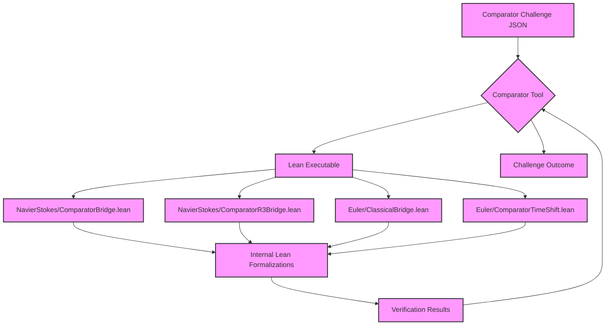

<!-- source: DeepWiki mcp.deepwiki.com · repo openai/NavierStokesAndEuler · page 1.1 Repository Layout and Build · fetched 2026-10-26 -->

# Repository Layout and Build

<details>
<summary>Relevant source files</summary>

The following files were used as context for generating this wiki page:

- [Euler/ClassicalBridge.lean](Euler/ClassicalBridge.lean)
- [Euler/ComparatorTimeShift.lean](Euler/ComparatorTimeShift.lean)
- [Euler/EulerProof.lean](Euler/EulerProof.lean)
- [Euler/EulerSpatialRescaling.lean](Euler/EulerSpatialRescaling.lean)
- [Euler/EulerTimeRescaling.lean](Euler/EulerTimeRescaling.lean)
- [Euler/EvolutionTimeShift.lean](Euler/EvolutionTimeShift.lean)
- [Euler/OrdinaryEulerRescaling.lean](Euler/OrdinaryEulerRescaling.lean)
- [Euler/OrdinaryEulerRestriction.lean](Euler/OrdinaryEulerRestriction.lean)
- [Euler/OrdinaryEulerUniqueness.lean](Euler/OrdinaryEulerUniqueness.lean)
- [NavierStokes/CompactForceDecay.lean](NavierStokes/CompactForceDecay.lean)
- [NavierStokes/CompactSpatialForceDecay.lean](NavierStokes/CompactSpatialForceDecay.lean)
- [NavierStokes/ComparatorBridge.lean](NavierStokes/ComparatorBridge.lean)
- [NavierStokes/ComparatorR3Bridge.lean](NavierStokes/ComparatorR3Bridge.lean)

</details>


This page details the directory structure of the repository, the build process using `lake`, and how the `ComparatorChallenges` are executed. The repository is organized into two main Lean 4 libraries: `Euler/` and `NavierStokes/`, each containing formalizations related to their respective equations.

## Repository Structure

The repository is structured into several key directories:

*   `Euler/`: Contains the formalization of the 3D Euler equations. This includes analytical foundations, PDE solvers, packet construction, and the finite lifespan proof.
*   `NavierStokes/`: Contains the formalization of the 3D Navier-Stokes equations. This includes problem statements, candidate construction, and R3 whole-space analysis.
*   `NavierStokes/R3/`: A sub-directory within `NavierStokes/` specifically for the R3 whole-space analysis of Navier-Stokes equations.
*   `ComparatorChallenges/`: This directory holds JSON files that define challenges for the formalizations, used by an external comparator tool.

The Lean files within these directories are organized to reflect the mathematical structure of the proofs. For instance, `Euler/EulerProof.lean` [Euler/EulerProof.lean:1-162]() imports various Mathlib tactics and analysis components, indicating its role as a high-level entry point or a file aggregating many lemmas.

### Directory Breakdown

```mermaid
graph TD
    A[Repository Root] --> B(Euler)
    A --> C(NavierStokes)
    A --> D(ComparatorChallenges)

    B --> B1(Euler/EulerProof.lean)
    B --> B2(Euler/EulerSpatialRescaling.lean)
    B --> B3(Euler/EulerTimeRescaling.lean)
    B --> B4(Euler/EvolutionTimeShift.lean)
    B --> B5(Euler/OrdinaryEulerRescaling.lean)
    B --> B6(Euler/ClassicalBridge.lean)
    B --> B7(Euler/OrdinaryEulerUniqueness.lean)
    B --> B8(Euler/ComparatorTimeShift.lean)
    B --> B9(...)

    C --> C1(NavierStokes/ComparatorBridge.lean)
    C --> C2(NavierStokes/CompactForceDecay.lean)
    C --> C3(NavierStokes/CompactSpatialForceDecay.lean)
    C --> C4(NavierStokes/ComparatorR3Bridge.lean)
    C --> C5(...)

    style A fill:#ececff,stroke:#333,stroke-width:2px
    style B fill:#f9f,stroke:#333,stroke-width:2px
    style C fill:#f9f,stroke:#333,stroke-width:2px
    style D fill:#f9f,stroke:#333,stroke-width:2px
```


Sources:
[Euler/EulerProof.lean:1-162]()
[Euler/EulerSpatialRescaling.lean:1-83]()
[Euler/EulerTimeRescaling.lean:1-88]()
[Euler/EvolutionTimeShift.lean:1-72]()
[Euler/OrdinaryEulerRescaling.lean:1-91]()
[Euler/ClassicalBridge.lean:1-49]()
[Euler/OrdinaryEulerUniqueness.lean:1-47]()
[Euler/ComparatorTimeShift.lean:1-55]()
[NavierStokes/ComparatorBridge.lean:1-152]()
[NavierStokes/CompactForceDecay.lean:1-164]()
[NavierStokes/CompactSpatialForceDecay.lean:1-97]()
[NavierStokes/ComparatorR3Bridge.lean:1-89]()

### Euler Library (`Euler/`)

The `Euler/` directory contains the formalization of the 3D Euler equations. Key files include:

*   `Euler/EulerProof.lean`: This file imports a wide range of Mathlib components, suggesting it's a central file for the Euler proof, likely orchestrating various lemmas and theorems [Euler/EulerProof.lean:1-162]().
*   `Euler/EulerSpatialRescaling.lean`: Defines `coordinates`, `velocity`, and `pressure` transformations for spatial rescaling of Euler equations. It includes theorems like `momentumResidual_eq` [Euler/EulerSpatialRescaling.lean:10-61]() which shows how the momentum residual transforms under spatial rescaling.
*   `Euler/EulerTimeRescaling.lean`: Similar to spatial rescaling, this file defines `coordinates`, `velocity`, and `pressure` for time rescaling, and shows how the momentum residual transforms [Euler/EulerTimeRescaling.lean:14-58]().
*   `Euler/EvolutionTimeShift.lean`: Defines `shiftTimeMap` and `Evolution.shiftTime` [Euler/EvolutionTimeShift.lean:15-49]() to translate an Euler evolution in time, preserving its properties.
*   `Euler/OrdinaryEulerRescaling.lean`: Defines `scaleTimeMap` and `Evolution.rescale` [Euler/OrdinaryEulerRescaling.lean:16-37]() for combined time and amplitude scaling of Euler solutions.
*   `Euler/ClassicalBridge.lean`: Provides theorems to bridge the project's internal Euler solution definitions to an independent comparator's definition, ensuring properties like `velocity_contDiff` and `pointwise_euler` [Euler/ClassicalBridge.lean:21-47]().
*   `Euler/OrdinaryEulerUniqueness.lean`: Contains theorems proving the uniqueness of smooth ordinary Euler evolutions, such as `velocity_eq_of_initial` and `pressure_eq_of_initial` [Euler/OrdinaryEulerUniqueness.lean:24-44]().
*   `Euler/ComparatorTimeShift.lean`: Demonstrates that time translation preserves the `EulerExistenceAndSmoothnessR3` structure, including the Euler equation and energy bounds [Euler/ComparatorTimeShift.lean:19-54]().

### NavierStokes Library (`NavierStokes/`)

The `NavierStokes/` directory focuses on the Navier-Stokes equations.

*   `NavierStokes/ComparatorBridge.lean`: This module translates the project's physical differential operators to the comparator's operators and normalizes viscosity. It defines `toComparator`, `fromComparator`, and `rescale` functions [NavierStokes/ComparatorBridge.lean:21-62]() to handle coordinate and viscosity transformations. It also includes theorems like `divergence_eq` and `laplacian_eq` [NavierStokes/ComparatorBridge.lean:28-54]() to show equivalence of operators.
*   `NavierStokes/CompactForceDecay.lean`: Provides theorems for the decay of derivatives of a smooth periodic force with bounded time support. It defines `unitCube`, `integerShift`, and `fractionalPoint` [NavierStokes/CompactForceDecay.lean:27-46]() for spatial periodicity analysis and proves `iteratedFDeriv_decay` [NavierStokes/CompactForceDecay.lean:138-164]() for arbitrary polynomial decay.
*   `NavierStokes/CompactSpatialForceDecay.lean`: Focuses on space-time decay from compact spatial and future time support. It defines `SupportedIn` [NavierStokes/CompactSpatialForceDecay.lean:19-20]() and proves `jet_decay` [NavierStokes/CompactSpatialForceDecay.lean:43-79]() for weighted jet decay.
*   `NavierStokes/ComparatorR3Bridge.lean`: Handles viscosity normalization for the whole-space comparator, ensuring properties like `zero_initial_condition_decay` and `normalized_solution_Rn` [NavierStokes/ComparatorR3Bridge.lean:18-88]() for global solutions.

## Build Process with `lake`

The project uses `lake` as its build system. To build the entire project, navigate to the repository root and execute the `lake build` command. This command will compile all Lean files and their dependencies.

```bash
lake build
```

The `lake-manifest.json` file manages external dependencies, ensuring a consistent build environment.

## Running Comparator Challenges

The `ComparatorChallenges/` directory contains JSON files that define specific challenges for the formalizations. These challenges are designed to be run by an external comparator tool, which interacts with the Lean code through a defined interface.

Each JSON file in `ComparatorChallenges/` specifies:
*   The problem statement (e.g., Euler or Navier-Stokes).
*   Initial conditions.
*   Parameters (e.g., viscosity, time horizon).
*   Expected properties of the solution (e.g., smoothness, energy bounds, breakdown criteria).

The comparator tool reads these JSON files, invokes the Lean formalizations (likely through a Lean executable that exposes the necessary functions), and verifies if the formal proofs satisfy the conditions specified in the challenge.

For example, `NavierStokes/ComparatorBridge.lean` [NavierStokes/ComparatorBridge.lean:1-152]() and `NavierStokes/ComparatorR3Bridge.lean` [NavierStokes/ComparatorR3Bridge.lean:1-89]() contain the necessary bridging logic to translate the internal Lean formalizations into the format expected by the comparator. This includes functions like `toComparator` and `fromComparator` [NavierStokes/ComparatorBridge.lean:21-24]() for argument order changes, and `rescale` [NavierStokes/ComparatorBridge.lean:61-62]() for amplitude and time changes.

The `Comparator.ForceConditionPeriodic` [NavierStokes/ComparatorBridge.lean:127-135]() and `Comparator.ForceConditionDecay` [NavierStokes/CompactSpatialForceDecay.lean:88-96]() types are examples of the interfaces that the Lean code provides for the comparator to verify properties of the formalized solutions.


Sources:
[NavierStokes/ComparatorBridge.lean:21-24]()
[NavierStokes/ComparatorBridge.lean:61-62]()
[NavierStokes/ComparatorBridge.lean:127-135]()
[NavierStokes/CompactSpatialForceDecay.lean:88-96]()
[NavierStokes/ComparatorR3Bridge.lean:1-89]()
[Euler/ClassicalBridge.lean:21-47]()
[Euler/ComparatorTimeShift.lean:19-54]()

---

