# Page: Overview

# Overview

<details>
<summary>Relevant source files</summary>

The following files were used as context for generating this wiki page:

- [README.md](README.md)
- [chatkit/__init__.py](chatkit/__init__.py)
- [docs/index.md](docs/index.md)
- [docs/quickstart.md](docs/quickstart.md)
- [docs/release.md](docs/release.md)
- [mkdocs.yml](mkdocs.yml)
- [pyproject.toml](pyproject.toml)
- [uv.lock](uv.lock)

</details>


The `chatkit-python` package (published as `openai-chatkit` on PyPI) is a backend framework for building conversational AI applications that integrate OpenAI's Agents SDK with chat interfaces. It provides server abstractions, type-safe request/response handling, agent integration helpers, and persistence interfaces that enable developers to build production-ready chat applications with streaming responses, rich UI components, and multi-turn conversations.

## What is ChatKit?

ChatKit consists of two complementary packages:

- **ChatKit.js** (`@openai/chatkit` and `@openai/chatkit-react`): Frontend library providing a React chat UI with support for streaming messages, widgets, entities, and custom actions.
- **chatkit-python** (this package): Backend SDK that processes client requests, integrates with OpenAI agents, manages conversation persistence, and streams real-time events to the client.

This SDK acts as middleware between chat clients and AI services, handling the complexity of request routing, agent orchestration, streaming event generation, and data persistence.

## Key Responsibilities

The SDK provides five core capabilities:

| Capability | Implementation | Description |
|-----------|---------------|-------------|
| **Request Processing** | `ChatKitServer.process()` [chatkit/server.py:423-435]() | Parses incoming requests, validates types, routes to streaming or non-streaming handlers. |
| **Agent Integration** | `stream_agent_response()` [chatkit/agents.py:1-400]() | Converts between ChatKit thread items and Agents SDK input/output formats, streams agent responses as events. |
| **Data Persistence** | `Store[TContext]` [chatkit/store.py:28-154]() | Abstract interface for thread and item CRUD operations, implemented by integrators with their database of choice. |
| **Widget Rendering** | `WidgetTemplate` [chatkit/widgets.py:382-446]() | Loads `.widget` files, hydrates with data, and validates against JSON schemas. |
| **Event Streaming** | `_process_streaming()` [chatkit/server.py:527-539]() | Wraps events in Server-Sent Events (SSE) format for real-time client updates. |

The SDK does **not** provide:
- Concrete production storage implementations (integrators implement `Store` with their database).
- Web server integration (integrators mount `process()` in FastAPI, Flask, etc.).
- Authentication/authorization logic (passed via generic `TContext` parameter).

**Sources**: [chatkit/server.py:423-435](), [chatkit/store.py:28-154](), [chatkit/widgets.py:382-446](), [pyproject.toml:1-8]()

## System Architecture

### High-Level Component Diagram

**Component map: chatkit-python modules and their roles**

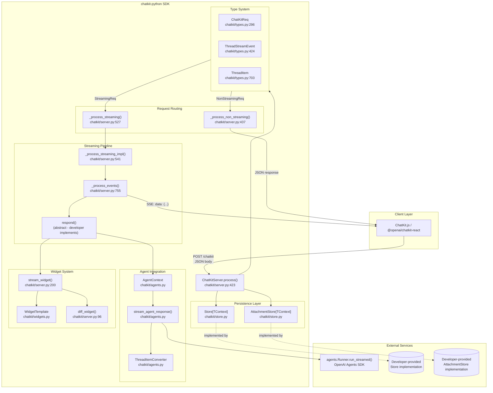

**Sources**: [chatkit/server.py:96-250](), [chatkit/server.py:423-755](), [chatkit/types.py:271-438](), [chatkit/types.py:703-716]()

### Architectural Layers

The SDK is organized into cooperating layers:

| Layer | Key Components | Purpose |
|-------|---------------|---------|
| **Entry Point** | `ChatKitServer.process()` [chatkit/server.py:423]() | Single HTTP handler that parses, validates, and routes all client requests. |
| **Type System** | `ChatKitReq`, `ThreadStreamEvent`, `ThreadItem` [chatkit/types.py]() | Pydantic models with discriminated unions for type-safe request/response handling. |
| **Request Routing** | `_process_streaming()`, `_process_non_streaming()` [chatkit/server.py:527](), [chatkit/server.py:437]() | Splits execution path based on request type (streaming vs synchronous). |
| **Streaming Pipeline** | `_process_events()`, abstract `respond()` [chatkit/server.py:755]() | Orchestrates event generation, persistence, and client delivery. |
| **Agent Integration** | `AgentContext`, `stream_agent_response()` [chatkit/agents.py]() | Converts between ChatKit thread format and Agents SDK input/output. |
| **Persistence** | `Store[TContext]`, `AttachmentStore[TContext]` [chatkit/store.py]() | Abstract interfaces for thread/item storage and file handling. |
| **Widget System** | `WidgetTemplate`, `diff_widget()` [chatkit/widgets.py](), [chatkit/server.py:96]() | Loads widget templates, hydrates with data, and computes streaming deltas. |

The generic `TContext` type parameter threads through all layers, enabling developers to pass request-scoped data (authentication, tenant ID, database connections) without modifying the framework.

**Sources**: [chatkit/server.py:423-755](), [chatkit/types.py:1-999](), [chatkit/agents.py:1-400](), [chatkit/store.py:28-154](), [chatkit/widgets.py:382-446]()

## Type System Foundation

### Core Type Hierarchy

**Discriminated union types in `chatkit/types.py` and their relationships**

```mermaid
graph TB
    subgraph Requests["Request Types (chatkit/types.py:271-313)"]
        ChatKitReq["ChatKitReq\ntypes.py:296\ndiscriminator='type'"]

        StreamingReq["StreamingReq\ntypes.py:271\n(5 variants)"]
        NonStreamingReq["NonStreamingReq\ntypes.py:281\n(10 variants)"]

        ThreadsCreateReq["ThreadsCreateReq\ntype='threads.create'"]
        ThreadsAddUserMessageReq["ThreadsAddUserMessageReq\ntype='threads.add_user_message'"]
        ThreadsCustomActionReq["ThreadsCustomActionReq\ntype='threads.custom_action'"]

        ThreadsGetByIdReq["ThreadsGetByIdReq\ntype='threads.get_by_id'"]
        ThreadsListReq["ThreadsListReq\ntype='threads.list'"]
        ItemsListReq["ItemsListReq\ntype='items.list'"]
    end

    subgraph Events["Event Types (chatkit/types.py:319-438)"]
        ThreadStreamEvent["ThreadStreamEvent\ntypes.py:424\ndiscriminator='type'"]

        ItemEvents["Item Lifecycle"]
        MetaEvents["Thread Metadata"]
        UpdateEvents["Streaming Updates"]

        ThreadItemDoneEvent["ThreadItemDoneEvent\ntype='thread.item.done'"]
        ThreadItemAddedEvent["ThreadItemAddedEvent\ntype='thread.item.added'"]
        ThreadItemUpdatedEvent["ThreadItemUpdatedEvent\ntype='thread.item.updated'"]

        ThreadCreatedEvent["ThreadCreatedEvent\ntype='thread.created'"]
        ThreadUpdatedEvent["ThreadUpdatedEvent\ntype='thread.updated'"]

        ThreadItemUpdate["ThreadItemUpdate\ntypes.py:535\n(10 variants)"]
    end

    subgraph Data["Data Models (chatkit/types.py:558-716)"]
        Thread["Thread\ntypes.py:596"]
        ThreadMetadata["ThreadMetadata\ntypes.py:558"]

        ThreadItem["ThreadItem\ntypes.py:703\ndiscriminator='type'\n(9 variants)"]

        UserMessageItem["UserMessageItem\ntype='user_message'"]
        AssistantMessageItem["AssistantMessageItem\ntype='assistant_message'"]
        WidgetItem["WidgetItem\ntype='widget'"]
        WorkflowItem["WorkflowItem\ntype='workflow'"]
        ClientToolCallItem["ClientToolCallItem\ntype='client_tool_call'"]
        GeneratedImageItem["GeneratedImageItem\ntype='generated_image'"]
        HiddenContextItem["HiddenContextItem\ntype='hidden_context_item'"]
    end

    ChatKitReq --> StreamingReq
    ChatKitReq --> NonStreamingReq

    StreamingReq --> ThreadsCreateReq
    StreamingReq --> ThreadsAddUserMessageReq
    StreamingReq --> ThreadsCustomActionReq

    NonStreamingReq --> ThreadsGetByIdReq
    NonStreamingReq --> ThreadsListReq
    NonStreamingReq --> ItemsListReq

    ThreadStreamEvent --> ItemEvents
    ThreadStreamEvent --> MetaEvents
    ThreadStreamEvent --> UpdateEvents

    ItemEvents --> ThreadItemDoneEvent
    ItemEvents --> ThreadItemAddedEvent
    ItemEvents --> ThreadItemUpdatedEvent

    MetaEvents --> ThreadCreatedEvent
    MetaEvents --> ThreadUpdatedEvent

    ThreadItemUpdatedEvent --> ThreadItemUpdate

    Thread --> ThreadMetadata
    Thread --> ThreadItem

    ThreadItem --> UserMessageItem
    ThreadItem --> AssistantMessageItem
    ThreadItem --> WidgetItem
    ThreadItem --> WorkflowItem
    ThreadItem --> ClientToolCallItem
    ThreadItem --> GeneratedImageItem
    ThreadItem --> HiddenContextItem
```

### Type Categories

All SDK types are Pydantic models with discriminated unions for type-safe parsing:

| Type Category | Union Type | Variants | Discriminator Field |
|--------------|-----------|----------|-------------------|
| **Requests** | `ChatKitReq` [chatkit/types.py:296]() | 15 total (5 streaming, 10 non-streaming) | `type` |
| **Streaming Events** | `ThreadStreamEvent` [chatkit/types.py:424]() | 11 variants (item lifecycle, metadata, status) | `type` |
| **Item Updates** | `ThreadItemUpdate` [chatkit/types.py:535]() | 10 variants (text deltas, annotations, widgets) | `type` |
| **Thread Items** | `ThreadItem` [chatkit/types.py:703]() | 9 variants (messages, widgets, workflows, tools) | `type` |

**Sources**: [chatkit/types.py:271-716]()

## Request Processing Flow

**How `ChatKitServer.process()` routes requests to handlers**

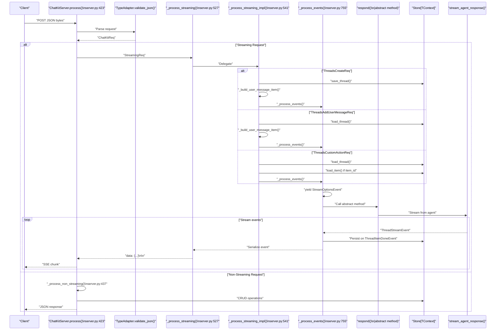

The `ChatKitServer.process()` method [chatkit/server.py:423-435]() is the entry point for all requests:

1. **Validation**: `TypeAdapter[ChatKitReq].validate_json()` parses and validates the request [chatkit/server.py:427]().
2. **Routing**: `is_streaming_req()` determines streaming vs non-streaming path [chatkit/server.py:430-435]().
3. **Streaming Pipeline**:
   - `_process_streaming()` wraps events in SSE format [chatkit/server.py:527-539]().
   - `_process_streaming_impl()` routes to specific handlers [chatkit/server.py:541-689]().
   - `_process_events()` orchestrates event generation and persistence [chatkit/server.py:755-852]().
   - Abstract `respond()` method generates AI responses [chatkit/server.py:299-316]().
4. **Non-Streaming Pipeline**:
   - `_process_non_streaming()` handles CRUD operations directly [chatkit/server.py:437-525]().
   - Returns immediate JSON response serialized via `_serialize()` [chatkit/server.py:960-965]().

**Sources**: [chatkit/server.py:423-852]()

## Storage Abstraction

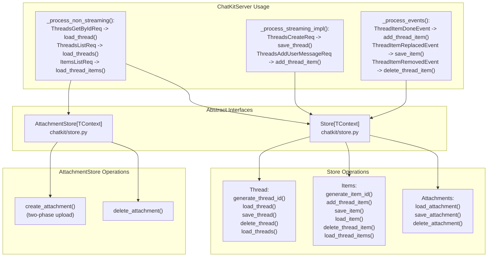

The SDK defines abstract storage interfaces that integrators must implement:

| Interface | Type Parameter | Purpose |
|-----------|---------------|---------|
| `Store[TContext]` [chatkit/store.py:28]() | Arbitrary context (auth, tenant, DB connection) | Thread and item persistence. |
| `AttachmentStore[TContext]` [chatkit/store.py:157]() | Same context type | File upload/download handling. |

**Sources**: [chatkit/store.py:28-154](), [chatkit/server.py:437-525](), [chatkit/server.py:755-852]()

## Major Component Systems

### Agent Integration Layer
The `chatkit/agents.py` module bridges ChatKit's thread-based conversation model with OpenAI's Agents SDK. It includes the `AgentContext` [chatkit/agents.py:53]() and `stream_agent_response()` [chatkit/agents.py:321]() helper.

### Widget System
The widget system (`chatkit/widgets.py`) enables declarative UI components built from templates using `WidgetTemplate` [chatkit/widgets.py:382]().

### Streaming Architecture
The streaming pipeline operates in three phases:
1. **Event Generation**: Abstract `respond()` [chatkit/server.py:299]() method yields `ThreadStreamEvent` instances.
2. **Event Processing**: `_process_events()` [chatkit/server.py:755]() intercepts events for persistence.
3. **Serialization**: `_process_streaming()` [chatkit/server.py:527]() wraps events in SSE format.

**Sources**: [chatkit/agents.py](), [chatkit/widgets.py](), [chatkit/server.py:527-852]()

## Package Information

### Core Dependencies
- `pydantic`: Type validation and serialization [pyproject.toml:7]().
- `openai-agents`: Agents SDK integration [pyproject.toml:7]().
- `jinja2`: Template rendering for widgets [pyproject.toml:7]().

### Development Tools
- `pytest`: Async test runner [pyproject.toml:82]().
- `pyright`: Static type checking [pyproject.toml:85]().
- `ruff`: Linting and formatting [pyproject.toml:19]().

**Sources**: [pyproject.toml:1-98]()

---

# Page: Core Concepts

# Core Concepts

<details>
<summary>Relevant source files</summary>

The following files were used as context for generating this wiki page:

- [chatkit/types.py](chatkit/types.py)
- [docs/concepts/thread-stream-events.md](docs/concepts/thread-stream-events.md)
- [docs/concepts/threads.md](docs/concepts/threads.md)

</details>


This page introduces the fundamental abstractions and mental models required to understand and use the ChatKit Python SDK. It provides a high-level overview of the thread-based conversation model, the type system, request/response patterns, and the streaming event architecture.

---

## Thread-Based Conversation Model

ChatKit organizes all interactions into **threads**, where each thread contains an ordered sequence of **thread items**. This model provides a structured way to manage multi-turn conversations between users and AI assistants.

### Thread Structure

A thread consists of metadata (ID, title, status) and a collection of items representing the history.

**Thread Definition:**

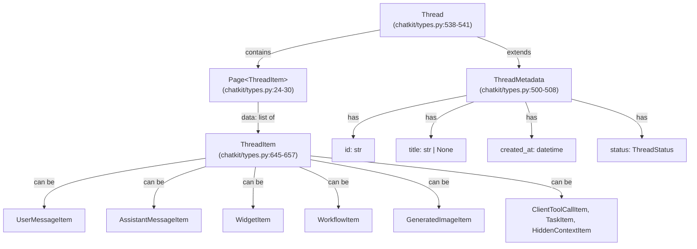

**Sources:** [chatkit/types.py:500-541](), [chatkit/types.py:645-657](), [chatkit/types.py:24-30]()

### Thread Items

Thread items are the individual records making up a thread. Each item represents one unit of history, such as a message, a UI widget, or a background signal.

| Item Type | Purpose | Defined At |
|-----------|---------|------------|
| `UserMessageItem` | User input (text, attachments, @-mentions) | [chatkit/types.py:555-563]() |
| `AssistantMessageItem` | Assistant output (Markdown, annotations) | [chatkit/types.py:566-570]() |
| `WidgetItem` | Interactive UI components (cards, charts, forms) | [chatkit/types.py:584-589]() |
| `WorkflowItem` | Multi-step reasoning or task progress visualization | [chatkit/types.py:613-617]() |
| `HiddenContextItem` | Internal signals not rendered in the UI | [chatkit/types.py:626-633]() |

For a deep dive into all item types and how they influence model input vs. UI rendering, see [Threads and Thread Items](#2.4).

**Sources:** [chatkit/types.py:547-657]()

---

## Type System and Data Models

ChatKit's architecture is built on a strongly-typed foundation using Pydantic models and discriminated unions. This ensures that every request and event has a validated schema.

### Discriminated Union Pattern

ChatKit uses the `type` field as a discriminator for polymorphic types, allowing for exhaustive pattern matching in server logic.

**Core Type Hierarchies:**

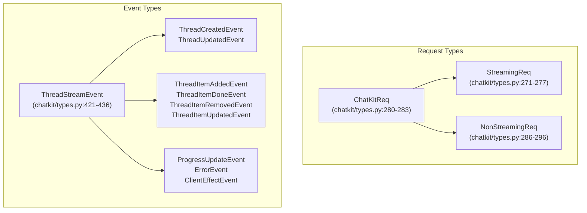

For details on all models, including actions and icons, see [Type System and Data Models](#2.1).

**Sources:** [chatkit/types.py:271-296](), [chatkit/types.py:421-436]()

---

## Request and Response Flow

ChatKit handles two main types of communication: **streaming** and **non-streaming**.

- **Streaming Requests**: (e.g., `threads.create`, `threads.add_user_message`) trigger AI logic and return a stream of Server-Sent Events (SSE).
- **Non-Streaming Requests**: (e.g., `threads.get_by_id`, `items.list`) return immediate JSON payloads for CRUD operations.

The `ChatKitServer.process()` method routes these requests to the appropriate handlers based on the `ChatKitReq` type. For details on the routing logic and SSE implementation, see [Request and Response Flow](#2.2).

**Sources:** [chatkit/types.py:271-296](), [chatkit/server.py:312-323]()

---

## Streaming Events

During a response, `ChatKitServer` emits `ThreadStreamEvent`s. These events serve two purposes:
1. **UI Synchronization**: Updating the client-side chat interface in real-time (e.g., streaming text deltas).
2. **Persistence**: Driving store operations. For example, a `ThreadItemDoneEvent` signals the server to call `store.add_thread_item()`.

| Event Category | Purpose |
|----------------|---------|
| **Lifecycle** | `ThreadCreatedEvent`, `ThreadUpdatedEvent` |
| **Item State** | `ThreadItemAddedEvent`, `ThreadItemDoneEvent`, `ThreadItemUpdatedEvent` |
| **Feedback** | `ProgressUpdateEvent`, `ErrorEvent`, `ClientEffectEvent` |

For documentation on when each event is emitted and how persistence is handled, see [Streaming Events](#2.3).

**Sources:** [docs/concepts/thread-stream-events.md:1-43](), [chatkit/types.py:371-386]()

---

## Entities and Annotations

To support advanced features like inline citations and rich user input, ChatKit uses entities and annotations:

- **Annotations**: Created via `ResponseStreamConverter` to turn model-emitted citations into interactive UI elements.
- **Entities**: Used in `UserMessageItem` to handle @-mentions and other tagged content.

For details on how these are processed and converted, see [Entities and Annotations](#2.5).

**Sources:** [docs/concepts/threads.md:66-73](), [chatkit/types.py:756-784]()

---

# Page: Type System and Data Models

# Type System and Data Models

<details>
<summary>Relevant source files</summary>

The following files were used as context for generating this wiki page:

- [chatkit/actions.py](chatkit/actions.py)
- [chatkit/icons.py](chatkit/icons.py)
- [chatkit/types.py](chatkit/types.py)
- [docs/concepts/actions.md](docs/concepts/actions.md)
- [tests/test_icons.py](tests/test_icons.py)

</details>


## Purpose and Scope

This document describes the core type system and data models defined in `chatkit/types.py`, `chatkit/actions.py`, and `chatkit/icons.py` that form the foundation of the ChatKit framework. These Pydantic models provide type-safe request/response contracts, thread structures, action definitions, and event streaming primitives.

For information about the widget-specific type system, see [Widgets and UI Components](#4.3). For details on how these types are used during request processing, see [Request and Response Flow](#2.2). For implementation guidance on working with these types in server code, see [ChatKitServer Class](#3.1).

**Sources:** [chatkit/types.py:1-913](), [chatkit/actions.py:1-57](), [chatkit/icons.py:1-79]()

---

## Type System Architecture

The ChatKit type system is built on Pydantic models and uses discriminated unions extensively for type-safe polymorphism. All models include a `type` field that enables runtime type discrimination and automatic routing.

### Core Design Patterns

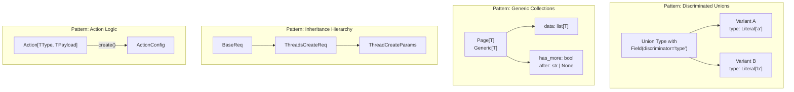

**Sources:** [chatkit/types.py:24-30](), [chatkit/types.py:35-40](), [chatkit/actions.py:14-57]()

---

## Request Types

All client requests are represented by the `ChatKitReq` discriminated union, which splits into streaming and non-streaming categories based on whether they yield events over time or return immediate responses.

### Request Type Hierarchy

```mermaid
graph TB
    ChatKitReq["ChatKitReq<br/>Annotated Union"]
    
    StreamingReq["StreamingReq<br/>Union Type"]
    NonStreamingReq["NonStreamingReq<br/>Union Type"]
    
    ThreadsCreateReq["ThreadsCreateReq<br/>type: 'threads.create'"]
    ThreadsAddUserMessageReq["ThreadsAddUserMessageReq<br/>type: 'threads.add_user_message'"]
    ThreadsAddClientToolOutputReq["ThreadsAddClientToolOutputReq<br/>type: 'threads.add_client_tool_output'"]
    ThreadsRetryAfterItemReq["ThreadsRetryAfterItemReq<br/>type: 'threads.retry_after_item'"]
    ThreadsCustomActionReq["ThreadsCustomActionReq<br/>type: 'threads.custom_action'"]
    
    ThreadsGetByIdReq["ThreadsGetByIdReq<br/>type: 'threads.get_by_id'"]
    ThreadsListReq["ThreadsListReq<br/>type: 'threads.list'"]
    ItemsListReq["ItemsListReq<br/>type: 'items.list'"]
    ItemsFeedbackReq["ItemsFeedbackReq<br/>type: 'items.feedback'"]
    AttachmentsCreateReq["AttachmentsCreateReq<br/>type: 'attachments.create'"]
    AttachmentsDeleteReq["AttachmentsDeleteReq<br/>type: 'attachments.delete'"]
    ThreadsUpdateReq["ThreadsUpdateReq<br/>type: 'threads.update'"]
    ThreadsDeleteReq["ThreadsDeleteReq<br/>type: 'threads.delete'"]
    ThreadsSyncCustomActionReq["ThreadsSyncCustomActionReq<br/>type: 'threads.sync_custom_action'"]
    
    ChatKitReq --> StreamingReq
    ChatKitReq --> NonStreamingReq
    
    StreamingReq --> ThreadsCreateReq
    StreamingReq --> ThreadsAddUserMessageReq
    StreamingReq --> ThreadsAddClientToolOutputReq
    StreamingReq --> ThreadsRetryAfterItemReq
    StreamingReq --> ThreadsCustomActionReq
    
    NonStreamingReq --> ThreadsGetByIdReq
    NonStreamingReq --> ThreadsListReq
    NonStreamingReq --> ItemsListReq
    NonStreamingReq --> ItemsFeedbackReq
    NonStreamingReq --> AttachmentsCreateReq
    NonStreamingReq --> AttachmentsDeleteReq
    NonStreamingReq --> ThreadsUpdateReq
    NonStreamingReq --> ThreadsDeleteReq
    NonStreamingReq --> ThreadsSyncCustomActionReq
```

### Request Type Categories

| Category | Type Alias | Purpose | Line Reference |
|----------|-----------|---------|----------------|
| **All Requests** | `ChatKitReq` | Top-level discriminated union of all request types | [chatkit/types.py:313-316]() |
| **Streaming** | `StreamingReq` | Requests that yield `ThreadStreamEvent` streams | [chatkit/types.py:271-278]() |
| **Non-Streaming** | `NonStreamingReq` | Requests that return immediate JSON responses | [chatkit/types.py:281-310]() |

**Sources:** [chatkit/types.py:35-316]()

---

## Response Event Types

Streaming requests yield a stream of `ThreadStreamEvent` instances, which represent state changes, content updates, and status notifications.

### Event Type Hierarchy

```mermaid
graph TB
    ThreadStreamEvent["ThreadStreamEvent<br/>Annotated Union"]
    
    subgraph "Item Lifecycle Events"
        ThreadItemAddedEvent["ThreadItemAddedEvent<br/>type: 'thread.item.added'"]
        ThreadItemUpdatedEvent["ThreadItemUpdatedEvent<br/>type: 'thread.item.updated'"]
        ThreadItemDoneEvent["ThreadItemDoneEvent<br/>type: 'thread.item.done'"]
        ThreadItemRemovedEvent["ThreadItemRemovedEvent<br/>type: 'thread.item.removed'"]
        ThreadItemReplacedEvent["ThreadItemReplacedEvent<br/>type: 'thread.item.replaced'"]
    end
    
    subgraph "Thread Metadata Events"
        ThreadCreatedEvent["ThreadCreatedEvent<br/>type: 'thread.created'"]
        ThreadUpdatedEvent["ThreadUpdatedEvent<br/>type: 'thread.updated'"]
    end
    
    subgraph "Status Events"
        StreamOptionsEvent["StreamOptionsEvent<br/>type: 'stream_options'"]
        ProgressUpdateEvent["ProgressUpdateEvent<br/>type: 'progress_update'"]
        ClientEffectEvent["ClientEffectEvent<br/>type: 'client_effect'"]
        ErrorEvent["ErrorEvent<br/>type: 'error'"]
        NoticeEvent["NoticeEvent<br/>type: 'notice'"]
    end
    
    ThreadStreamEvent --> ThreadItemAddedEvent
    ThreadStreamEvent --> ThreadItemUpdatedEvent
    ThreadStreamEvent --> ThreadItemDoneEvent
    ThreadStreamEvent --> ThreadItemRemovedEvent
    ThreadStreamEvent --> ThreadItemReplacedEvent
    ThreadStreamEvent --> ThreadCreatedEvent
    ThreadStreamEvent --> ThreadUpdatedEvent
    ThreadStreamEvent --> StreamOptionsEvent
    ThreadStreamEvent --> ProgressUpdateEvent
    ThreadStreamEvent --> ClientEffectEvent
    ThreadStreamEvent --> ErrorEvent
    ThreadStreamEvent --> NoticeEvent
```

### Event Categories

| Event Type | Purpose | Key Fields |
|------------|---------|------------|
| **ThreadItemAddedEvent** | Item added to thread (not persisted yet) | `item: ThreadItem` |
| **ThreadItemUpdatedEvent** | Incremental update to existing item | `item_id: str`, `update: ThreadItemUpdate` |
| **ThreadItemDoneEvent** | Item finalized and persisted | `item: ThreadItem` |
| **ThreadItemRemovedEvent** | Item removed from thread | `item_id: str` |
| **ThreadItemReplacedEvent** | Item replaced with new version | `item: ThreadItem` |
| **ThreadCreatedEvent** | New thread initialized | `thread: Thread` |
| **ThreadUpdatedEvent** | Thread metadata changed | `thread: Thread` |
| **StreamOptionsEvent** | Configure stream behavior | `stream_options: StreamOptions` |
| **ProgressUpdateEvent** | Display progress message | `icon: IconName`, `text: str` |
| **ClientEffectEvent** | Trigger client-side effect | `name: str`, `data: dict` |
| **ErrorEvent** | Error occurred during processing | `code: ErrorCode`, `message: str`, `allow_retry: bool` |
| **NoticeEvent** | Display user-facing notice | `level: Literal['info', 'warning', 'danger']`, `message: str` |

**Sources:** [chatkit/types.py:321-460]()

---

## Actions and Handlers

Actions represent interaction events triggered by widgets or client code. They are defined in `chatkit.actions`.

### Action Data Model

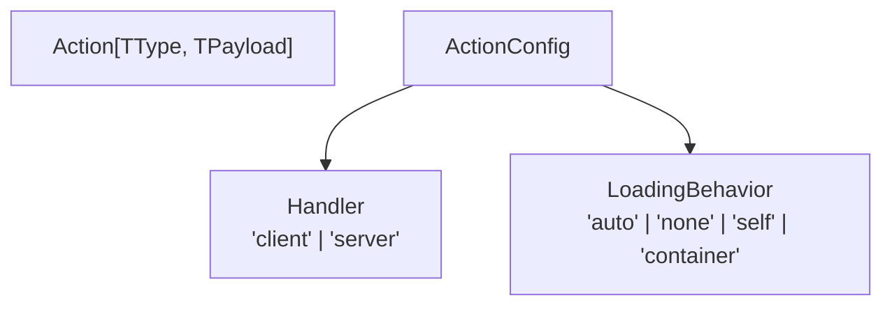

| Class/Type | Purpose | Key Fields |
|------------|---------|------------|
| **Action** | Generic base for defining typed actions | `type: TType`, `payload: TPayload` |
| **ActionConfig** | Concrete configuration for an action instance | `type: str`, `payload: Any`, `handler: Handler`, `loadingBehavior: LoadingBehavior`, `streaming: bool` |
| **Handler** | Specifies where the action logic executes | `Literal["client", "server"]` |
| **LoadingBehavior** | Controls UI loading state during action | `Literal["auto", "none", "self", "container"]` |

### Action Creation

The `Action.create()` class method [chatkit/actions.py:31-56]() is used to generate an `ActionConfig` from a typed `Action` subclass. It performs type inference to extract the `type` literal from the class definition.

**Sources:** [chatkit/actions.py:1-57](), [docs/concepts/actions.md:1-28]()

---

## Thread Item Hierarchy

`ThreadItem` is a discriminated union representing all possible elements in a conversation thread.

### ThreadItem Variant Reference

| Type | Purpose | Key Fields | Line Reference |
|------|---------|------------|----------------|
| **UserMessageItem** | User's input message | `content: list[UserMessageContent]`, `attachments: list[Attachment]` | [chatkit/types.py:623-631]() |
| **AssistantMessageItem** | Assistant's response | `content: list[AssistantMessageContent]` | [chatkit/types.py:633-638]() |
| **WidgetItem** | Rich UI component | `widget: WidgetRoot`, `copy_text: str` | [chatkit/types.py:651-657]() |
| **WorkflowItem** | Multi-step workflow container | `workflow: Workflow` | [chatkit/types.py:680-685]() |
| **ClientToolCallItem** | Tool requiring client execution | `call_id: str`, `name: str`, `arguments: dict`, `status: str` | [chatkit/types.py:640-649]() |
| **GeneratedImageItem** | AI-generated image | `image: GeneratedImage` | [chatkit/types.py:666-671]() |
| **HiddenContextItem** | Integration-specific context | `content: Any` | [chatkit/types.py:693-701]() |
| **SDKHiddenContextItem** | SDK internal context | `content: str` | [chatkit/types.py:703-711]() |

**Sources:** [chatkit/types.py:612-726]()

---

## Icon System

The `IconName` type [chatkit/icons.py:8-77]() defines allowed icon identifiers used for visual elements in widgets and progress updates.

### Icon Type Definition

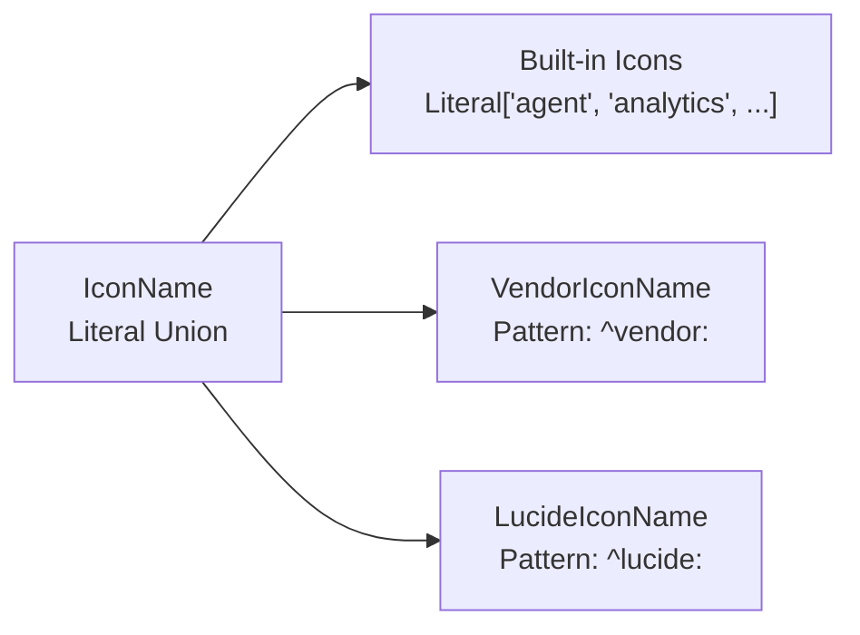

- **VendorIconName**: Annotated string requiring a `vendor:` prefix [chatkit/icons.py:5]().
- **LucideIconName**: Annotated string requiring a `lucide:` prefix [chatkit/icons.py:6]().
- **Literal Icons**: A set of approximately 70 predefined strings representing core ChatKit icons [chatkit/icons.py:9-74]().

**Sources:** [chatkit/icons.py:1-79](), [tests/test_icons.py:1-23]()

---

## Thread and Page Models

### Thread Structure
A `Thread` [chatkit/types.py:606-610]() represents a conversation container. It inherits from `ThreadMetadata` [chatkit/types.py:568-577]() and includes a `Page` of `ThreadItem` objects.

### Page Model
The `Page[T]` [chatkit/types.py:24-30]() model provides cursor-based pagination:
- **`data`**: `list[T]` - The records for the current page.
- **`has_more`**: `bool` - Indicates if more records are available.
- **`after`**: `str | None` - The cursor to use for the next page request.

**Sources:** [chatkit/types.py:24-30](), [chatkit/types.py:568-610]()

---

# Page: Request and Response Flow

# Request and Response Flow

<details>
<summary>Relevant source files</summary>

The following files were used as context for generating this wiki page:

- [chatkit/server.py](chatkit/server.py)
- [chatkit/types.py](chatkit/types.py)
- [docs/quickstart.md](docs/quickstart.md)
- [mkdocs.yml](mkdocs.yml)

</details>


## Purpose and Scope

This document explains the request/response model in the ChatKit Python SDK, covering how client requests are received, routed, processed, and responded to. It details the distinction between streaming and non-streaming requests, the processing pipeline, and how each request type maps to server operations.

For details on the type system and data models used in requests and responses, see section 2.1. For information on the streaming event types emitted during streaming responses, see section 2.3.

## Request Model

All ChatKit requests are sent as JSON payloads conforming to the `ChatKitReq` type, which is a discriminated union that routes to either streaming or non-streaming processing paths.

### ChatKitReq Discriminated Union

All request bodies are JSON-serialized Pydantic models. The `type` field acts as a discriminator to route each payload to the correct model class. The `is_streaming_req()` function determines which processing path to take.

**ChatKitReq discriminated union and its two processing paths**

```mermaid
graph TB
    CKR["ChatKitReq\n(discriminator: 'type')"]

    SR["StreamingReq\n→ StreamingResult (SSE)"]
    NSR["NonStreamingReq\n→ NonStreamingResult (JSON)"]

    CKR --> SR
    CKR --> NSR

    SR --> TCR["ThreadsCreateReq\n'threads.create'"]
    SR --> TAUMR["ThreadsAddUserMessageReq\n'threads.add_user_message'"]
    SR --> TACTOR["ThreadsAddClientToolOutputReq\n'threads.add_client_tool_output'"]
    SR --> TRAIR["ThreadsRetryAfterItemReq\n'threads.retry_after_item'"]
    SR --> TCAR["ThreadsCustomActionReq\n'threads.custom_action'"]

    NSR --> TGBIR["ThreadsGetByIdReq\n'threads.get_by_id'"]
    NSR --> TLR["ThreadsListReq\n'threads.list'"]
    NSR --> ILR["ItemsListReq\n'items.list'"]
    NSR --> IFR["ItemsFeedbackReq\n'items.feedback'"]
    NSR --> ACR["AttachmentsCreateReq\n'attachments.create'"]
    NSR --> ADR["AttachmentsDeleteReq\n'attachments.delete'"]
    NSR --> TUR["ThreadsUpdateReq\n'threads.update'"]
    NSR --> TDR["ThreadsDeleteReq\n'threads.delete'"]
    NSR --> ITR["InputTranscribeReq\n'input.transcribe'"]
    NSR --> TSCAR["ThreadsSyncCustomActionReq\n'threads.sync_custom_action'"]
```

Sources: [chatkit/types.py:271-313]()

The discriminator field is `type`, which determines which request class to deserialize into. The `is_streaming_req()` function at [chatkit/types.py:302-313]() determines the processing path.

### Request Type Reference

| Request Type | `type` field value | Category | Purpose | Returns |
|-------------|--------------------|----------|---------|---------|
| `ThreadsCreateReq` | `threads.create` | Streaming | Create new thread with user message | SSE stream |
| `ThreadsAddUserMessageReq` | `threads.add_user_message` | Streaming | Add user message to existing thread | SSE stream |
| `ThreadsAddClientToolOutputReq` | `threads.add_client_tool_output` | Streaming | Submit client-side tool execution result | SSE stream |
| `ThreadsRetryAfterItemReq` | `threads.retry_after_item` | Streaming | Retry generation after specific item | SSE stream |
| `ThreadsCustomActionReq` | `threads.custom_action` | Streaming | Execute custom action from widget | SSE stream |
| `ThreadsGetByIdReq` | `threads.get_by_id` | Non-streaming | Retrieve single thread by ID | `Thread` JSON |
| `ThreadsListReq` | `threads.list` | Non-streaming | List threads with pagination | `Page[Thread]` JSON |
| `ItemsListReq` | `items.list` | Non-streaming | List items in a thread | `Page[ThreadItem]` JSON |
| `ItemsFeedbackReq` | `items.feedback` | Non-streaming | Submit feedback on items | `{}` |
| `AttachmentsCreateReq` | `attachments.create` | Non-streaming | Create attachment metadata | `Attachment` JSON |
| `AttachmentsDeleteReq` | `attachments.delete` | Non-streaming | Delete an attachment | `{}` |
| `ThreadsUpdateReq` | `threads.update` | Non-streaming | Update thread metadata (title) | `Thread` JSON |
| `ThreadsDeleteReq` | `threads.delete` | Non-streaming | Delete a thread | `{}` |
| `InputTranscribeReq` | `input.transcribe` | Non-streaming | Transcribe base64-encoded audio to text | `TranscriptionResult` JSON |
| `ThreadsSyncCustomActionReq` | `threads.sync_custom_action` | Non-streaming | Execute synchronous custom action | `SyncCustomActionResponse` JSON |

Sources: [chatkit/types.py:42-293]()

## Response Model

ChatKit returns two distinct response types depending on whether the request is streaming or non-streaming.

### StreamingResult

`StreamingResult` wraps an `AsyncGenerator[bytes, None]` that yields SSE-formatted chunks. Each chunk is a JSON-encoded `ThreadStreamEvent` framed as:

```
data: {json}\n\n
```

**StreamingResult SSE encoding pipeline**

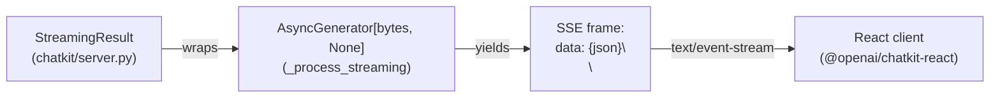

Sources: [chatkit/server.py:264-270](), [chatkit/server.py:527-539]()

### NonStreamingResult

`NonStreamingResult` wraps a single `bytes` payload containing a JSON-serialized Pydantic model. The caller is responsible for returning this with `Content-Type: application/json`.

Sources: [chatkit/server.py:273-275]()

## Request Processing Pipeline

The `ChatKitServer.process()` method is the entry point for all requests. It deserializes the incoming JSON, routes based on request type, and returns the appropriate result wrapper.

**`ChatKitServer.process()` dispatch logic**

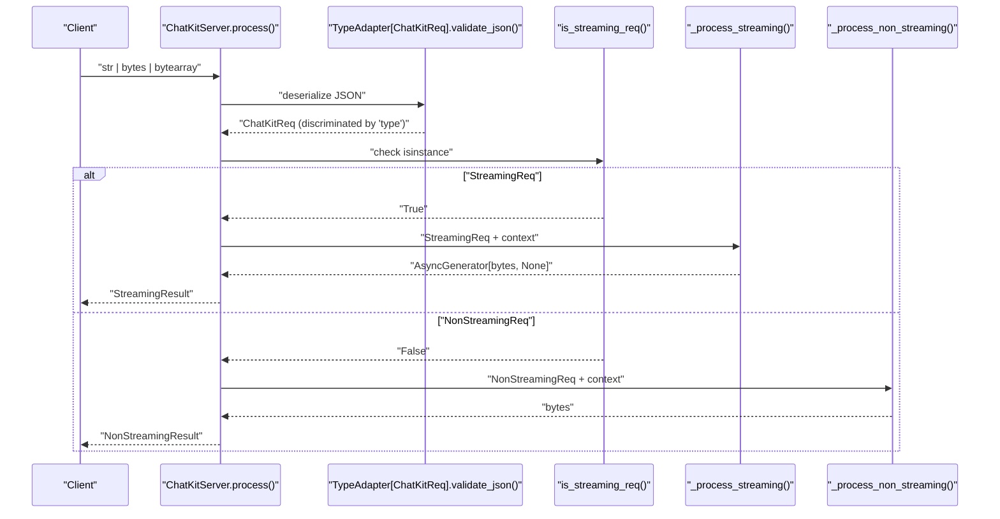

Sources: [chatkit/server.py:423-435](), [chatkit/types.py:302-313]()

### Core Processing Methods

The processing pipeline consists of three key methods:

- **`process(request, context)`** [chatkit/server.py:423-435]() — Entry point: deserializes `ChatKitReq` from raw bytes and routes to the streaming or non-streaming path.
- **`_process_streaming(request, context)`** [chatkit/server.py:527-539]() — Iterates `_process_streaming_impl()`, serializes each `ThreadStreamEvent` into an SSE frame (`data: {json}\n\n`), and yields bytes.
- **`_process_non_streaming(request, context)`** [chatkit/server.py:437-525]() — Dispatches to the appropriate store operation and returns serialized JSON bytes.

## Streaming Request Flow

Streaming requests produce an async stream of `ThreadStreamEvent` instances. The server processes the request, generates events, persists state changes, and streams events to the client in real-time.

**Streaming request dispatch inside `_process_streaming_impl()`**

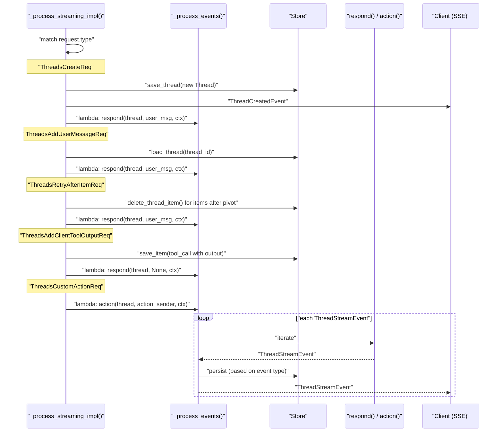

Sources: [chatkit/server.py:527-539](), [chatkit/server.py:541-689](), [chatkit/server.py:755-852]()

### Event Processing and Persistence

`_process_events()` at [chatkit/server.py:755-852]() is the inner loop that drives all streaming responses. It:

1. **Emits `StreamOptionsEvent`** — sends cancellation policy from `get_stream_options()` before any response events.
2. **Iterates the event stream** — calls the user-supplied `respond()` or `action()` async generator.
3. **Persists items automatically** based on event type:

   | Event | Store operation |
   |-------|----------------|
   | `ThreadItemDoneEvent` | `store.add_thread_item()` |
   | `ThreadItemRemovedEvent` | `store.delete_thread_item()` |
   | `ThreadItemReplacedEvent` | `store.save_item()` |
   | `ThreadItemUpdatedEvent` | updates in-memory pending copy only |

4. **Suppresses hidden items** — `HiddenContextItem` and `SDKHiddenContextItem` done events are persisted but not forwarded to the client.
5. **Detects thread metadata changes** — emits `ThreadUpdatedEvent` if the `ThreadMetadata` object was mutated during the stream.
6. **Error handling** — catches `CustomStreamError`, `StreamError`, and generic exceptions and emits `ErrorEvent` rather than crashing the stream.
7. **Cancellation** — on `asyncio.CancelledError`, calls `handle_stream_cancelled()` to persist any non-empty partial assistant messages and adds an `SDKHiddenContextItem` noting the cancellation.

Sources: [chatkit/server.py:755-852]()

## Non-Streaming Request Flow

Non-streaming requests perform CRUD operations on threads, items, and attachments, returning a single JSON response.

**`_process_non_streaming()` dispatch**

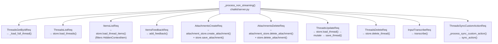

Sources: [chatkit/server.py:437-525]()

### Non-Streaming Request Handlers

Each non-streaming request type is handled by a dedicated `match` case inside `_process_non_streaming()`:

| Request Type | Operations | Line Reference |
|-------------|-----------|----------------|
| `ThreadsGetByIdReq` | Load thread metadata + first page of items, filter hidden items | [chatkit/server.py:441-445]() |
| `ThreadsListReq` | Load paginated thread list via `store.load_threads()` | [chatkit/server.py:446-462]() |
| `ItemsFeedbackReq` | Call `add_feedback()` hook, return `{}` | [chatkit/server.py:463-470]() |
| `AttachmentsCreateReq` | Create via `AttachmentStore`, persist with `store.save_attachment()` | [chatkit/server.py:471-477]() |
| `AttachmentsDeleteReq` | Delete from `AttachmentStore` and `Store` | [chatkit/server.py:478-486]() |
| `InputTranscribeReq` | Decode base64 audio, call `transcribe()`, return `TranscriptionResult` | [chatkit/server.py:487-493]() |
| `ItemsListReq` | Load paginated items, filter `HiddenContextItem`/`SDKHiddenContextItem` | [chatkit/server.py:494-509]() |
| `ThreadsUpdateReq` | Load thread, update `title`, call `store.save_thread()` | [chatkit/server.py:510-516]() |
| `ThreadsDeleteReq` | Call `store.delete_thread()`, return `{}` | [chatkit/server.py:517-521]() |
| `ThreadsSyncCustomActionReq` | Delegate to `_process_sync_custom_action()` → `sync_action()` | [chatkit/server.py:522-523]() |

## Request-to-Operation Mapping

### Streaming Operations

**ThreadsCreateReq** → Creates new thread, saves user message, invokes `respond()`
- Generates thread ID via `store.generate_thread_id()`
- Creates `Thread` with empty items page and calls `store.save_thread()`
- Builds `UserMessageItem` from `UserMessageInput` via `_build_user_message_item()`
- Yields `ThreadCreatedEvent`, then delegates to `_process_new_thread_item_respond()`

Sources: [chatkit/server.py:545-564]()

**ThreadsAddUserMessageReq** → Appends user message to existing thread, invokes `respond()`
- Loads existing thread via `store.load_thread()`
- Builds `UserMessageItem`, then delegates to `_process_new_thread_item_respond()`

Sources: [chatkit/server.py:566-578]()

**ThreadsAddClientToolOutputReq** → Records tool output, invokes `respond()` to continue
- Loads most recent pending `ClientToolCallItem` from the thread
- Updates its `output` and sets `status = "completed"`, then calls `store.save_item()`
- Cleans up any other dangling pending tool calls via `_cleanup_pending_client_tool_call()`
- Calls `respond(thread, None, context)` to continue the response stream

Sources: [chatkit/server.py:580-617]()

**ThreadsRetryAfterItemReq** → Removes items after specified item, re-invokes `respond()`
- Paginates backwards through the thread via `_paginate_thread_items_reverse()` to find the target `UserMessageItem`
- Calls `store.delete_thread_item()` for all items after the target
- Calls `respond()` with the original user message

Sources: [chatkit/server.py:619-654]()

**ThreadsCustomActionReq** → Executes custom action, invokes `action()` hook
- Loads thread and optionally loads the sender `WidgetItem` (if `item_id` is present)
- Calls user-implemented `action()` abstract method
- Streams resulting events via `_process_events()`

Sources: [chatkit/server.py:655-686]()

### Non-Streaming Operations

**ThreadsGetByIdReq** → Returns full thread with first page of items
- Calls `_load_full_thread()` helper at [chatkit/server.py:933-942]()
- Combines `ThreadMetadata` with one page of `ThreadItem`s
- `_to_thread_response()` filters out `HiddenContextItem` and `SDKHiddenContextItem` from the returned items

Sources: [chatkit/server.py:441-445](), [chatkit/server.py:933-942]()

**ThreadsListReq** → Returns paginated list of threads
- Forwards pagination params to `store.load_threads()`
- Default page size is 20 (`DEFAULT_PAGE_SIZE` at [chatkit/server.py:92]())
- Supports `after` cursor and `asc`/`desc` ordering

Sources: [chatkit/server.py:446-462]()

**ItemsListReq** → Returns paginated items in a thread
- Loads items via `store.load_thread_items()`
- Filters out `HiddenContextItem` and `SDKHiddenContextItem` instances before returning to the client

Sources: [chatkit/server.py:494-509]()

**InputTranscribeReq** → Transcribes audio to text
- Decodes the `audio_base64` field from the request params
- Calls the user-implemented `transcribe()` method with an `AudioInput` object
- Returns a `TranscriptionResult` with the transcribed text

Sources: [chatkit/server.py:487-493]()

**ThreadsSyncCustomActionReq** → Executes a synchronous custom action
- Loads thread and optional sender `WidgetItem`
- Calls user-implemented `sync_action()` method
- Returns a `SyncCustomActionResponse` (which may contain an `updated_item`)

Sources: [chatkit/server.py:691-716]()

## Serialization

All responses are serialized using Pydantic's `model_dump_json()` with specific options:

```python
def _serialize(self, obj: BaseModel) -> bytes:
    return obj.model_dump_json(by_alias=True, exclude_none=True).encode("utf-8")
```

- `by_alias=True` - Uses field aliases defined in models
- `exclude_none=True` - Omits fields with `None` values
- Returns UTF-8 encoded bytes

Sources: [chatkit/server.py:710-711]()

For streaming responses, each serialized event is wrapped in SSE format at [chatkit/server.py:410-411]():

```
data: {json}\n\n
```

---

# Page: Streaming Events

# Streaming Events

<details>
<summary>Relevant source files</summary>

The following files were used as context for generating this wiki page:

- [chatkit/server.py](chatkit/server.py)
- [chatkit/types.py](chatkit/types.py)
- [docs/concepts/thread-stream-events.md](docs/concepts/thread-stream-events.md)

</details>


This page documents all `ThreadStreamEvent` subtypes defined in `chatkit/types.py`, when each is emitted during a streaming response, and how `ChatKitServer._process_events()` in `chatkit/server.py` handles persistence in response to them.

For the request types that trigger streaming and how routing works, see [Request and Response Flow](#2.2). For thread item data models that appear inside these events, see [Threads and Thread Items](#2.4). For how agent responses produce these events, see [Agent Integration](#4.1).

---

## Overview

When `ChatKitServer.process()` receives a streaming request, it returns a `StreamingResult` — an async iterable of `bytes` formatted as Server-Sent Events (SSE) [chatkit/server.py:465-470](). Each SSE chunk contains a single JSON-serialized `ThreadStreamEvent`.

`ThreadStreamEvent` is a Pydantic discriminated union keyed on the `type` field [chatkit/types.py:424-438](). The events flow from `ChatKitServer.respond()` (or `action()`) through `_process_events()`, which intercepts each event to handle persistence before forwarding it to the client [chatkit/server.py:755-853]().

**Diagram: Streaming Event Flow**

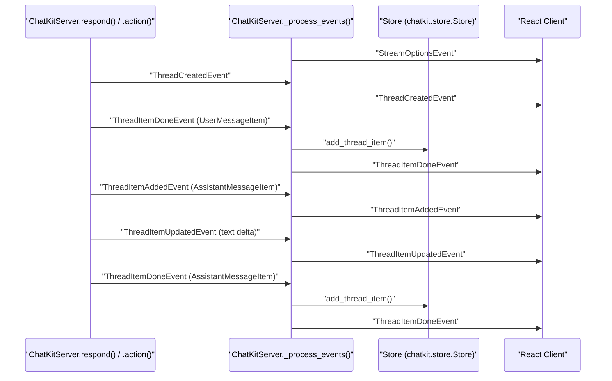

Sources: [chatkit/server.py:527-540](), [chatkit/server.py:755-853](), [chatkit/types.py:424-438]()

---

## The `ThreadStreamEvent` Union

`ThreadStreamEvent` is defined as an `Annotated` union with `Field(discriminator="type")` [chatkit/types.py:424-438]().

| Event Class | `type` Literal | Persisted by Server |
|---|---|---|
| `ThreadCreatedEvent` | `thread.created` | No (thread already saved before event) |
| `ThreadUpdatedEvent` | `thread.updated` | Yes — `store.save_thread()` |
| `ThreadItemAddedEvent` | `thread.item.added` | No (pending until Done/Replaced) |
| `ThreadItemUpdatedEvent` | `thread.item.updated` | No (tracked in `pending_items`) |
| `ThreadItemDoneEvent` | `thread.item.done` | Yes — `store.add_thread_item()` |
| `ThreadItemRemovedEvent` | `thread.item.removed` | Yes — `store.delete_thread_item()` |
| `ThreadItemReplacedEvent` | `thread.item.replaced` | Yes — `store.save_item()` |
| `StreamOptionsEvent` | `stream_options` | No |
| `ProgressUpdateEvent` | `progress_update` | No |
| `ClientEffectEvent` | `client_effect` | No |
| `ErrorEvent` | `error` | No |
| `NoticeEvent` | `notice` | No |

Sources: [chatkit/types.py:319-438](), [chatkit/server.py:782-812]()

---

## Thread Metadata Events

### `ThreadCreatedEvent`

Defined at [chatkit/types.py:319-323]().

```python
type: Literal["thread.created"]
thread: Thread
```

Emitted by `_process_streaming_impl()` immediately after a new `Thread` is saved to the store during a `ThreadsCreateReq` [chatkit/server.py:545-555](). The `Thread` object embedded in the event has its hidden context items stripped via `_to_thread_response()` [chatkit/server.py:553-554]().

### `ThreadUpdatedEvent`

Defined at [chatkit/types.py:326-330]().

```python
type: Literal["thread.updated"]
thread: Thread
```

Emitted by `_process_events()` when the `ThreadMetadata` object is mutated in-flight (e.g., title changed by the agent during streaming) [chatkit/server.py:814-825](). The server detects this by comparing the live `thread` reference against a deep copy `last_thread`. It calls `store.save_thread()` before emitting the event [chatkit/server.py:821-823]().

---

## Thread Item Lifecycle Events

These five events define the complete lifecycle of a thread item during a stream. The server's `_process_events()` method intercepts each one to manage store writes and a `pending_items` dictionary [chatkit/server.py:755-853]().

**Diagram: Thread Item Lifecycle State Machine**

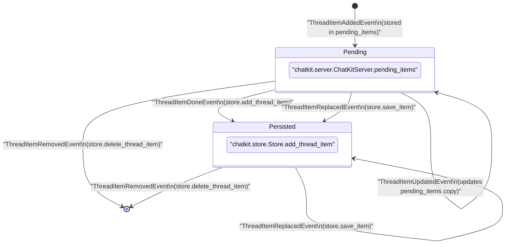

Sources: [chatkit/server.py:776-812]()

### `ThreadItemAddedEvent`

Defined at [chatkit/types.py:333-337]().

```python
type: Literal["thread.item.added"]
item: ThreadItem
```

Signals that a new item has started streaming. The server does **not** persist the item at this point. Instead, it stores a deep copy in `pending_items[event.item.id]` for use during stream cancellation [chatkit/server.py:777-780]().

### `ThreadItemUpdatedEvent`

Defined at [chatkit/types.py:340-345]().

```python
type: Literal["thread.item.updated"]
item_id: str
update: ThreadItemUpdate
```

Carries an incremental mutation for an in-progress item. The server applies these updates to the `pending_items` copy (specifically for `AssistantMessageItem` and `WorkflowItem`) but does not write to the store [chatkit/server.py:798-803]().

The `update` field is itself a discriminated union `ThreadItemUpdate` [chatkit/types.py:535-547]():

| Update Class | `type` Literal | Applies To |
|---|---|---|
| `AssistantMessageContentPartAdded` | `assistant_message.content_part.added` | `AssistantMessageItem` |
| `AssistantMessageContentPartTextDelta` | `assistant_message.content_part.text_delta` | `AssistantMessageItem` |
| `AssistantMessageContentPartAnnotationAdded` | `assistant_message.content_part.annotation_added` | `AssistantMessageItem` |
| `AssistantMessageContentPartDone` | `assistant_message.content_part.done` | `AssistantMessageItem` |
| `WidgetStreamingTextValueDelta` | `widget.streaming_text.value_delta` | `WidgetItem` |
| `WidgetRootUpdated` | `widget.root.updated` | `WidgetItem` |
| `WidgetComponentUpdated` | `widget.component.updated` | `WidgetItem` |
| `WorkflowTaskAdded` | `workflow.task.added` | `WorkflowItem` |
| `WorkflowTaskUpdated` | `workflow.task.updated` | `WorkflowItem` |
| `GeneratedImageUpdated` | `generated_image.updated` | `GeneratedImageItem` |

Sources: [chatkit/types.py:535-547]()

### `ThreadItemDoneEvent`

Defined at [chatkit/types.py:352-356]().

```python
type: Literal["thread.item.done"]
item: ThreadItem
```

Marks a thread item as complete. The server calls `store.add_thread_item()` synchronously before forwarding the event to the client [chatkit/server.py:783-787](). The `item` field contains the final, fully-populated state of the item.

> **Note:** `HiddenContextItem` and `SDKHiddenContextItem` wrapped in `ThreadItemDoneEvent` are persisted to the store but **not** forwarded to the client [chatkit/server.py:804-812]().

### `ThreadItemRemovedEvent`

Defined at [chatkit/types.py:359-363]().

```python
type: Literal["thread.item.removed"]
item_id: str
```

Instructs the server to delete an item from the store by ID. The server calls `store.delete_thread_item()` and removes the item from `pending_items` [chatkit/server.py:788-792]().

### `ThreadItemReplacedEvent`

Defined at [chatkit/types.py:366-370]().

```python
type: Literal["thread.item.replaced"]
item: ThreadItem
```

Replaces an existing persisted item in-place. The server calls `store.save_item()` and clears the item from `pending_items` [chatkit/server.py:793-797](). Unlike `ThreadItemDoneEvent` which uses `add_thread_item`, `ThreadItemReplacedEvent` uses `save_item`, which overwrites an existing record.

---

## Stream Control Events

### `StreamOptionsEvent`

Defined at [chatkit/types.py:380-384]().

```python
type: Literal["stream_options"]
stream_options: StreamOptions
```

Emitted automatically by `_process_events()` at the start of every stream [chatkit/server.py:763-766]() — before any items from `respond()` are forwarded. The embedded `StreamOptions` model has one field:

```python
allow_cancel: bool   # whether the client may cancel mid-stream
```

The options are produced by `ChatKitServer.get_stream_options()`, which defaults to `StreamOptions(allow_cancel=True)` [chatkit/server.py:377-380](). Override `get_stream_options()` to change this behavior.

### `ProgressUpdateEvent`

Defined at [chatkit/types.py:387-391]().

```python
type: Literal["progress_update"]
icon: IconName | None
text: str
```

Displays a transient status message in the chat UI while the agent is working. This event is not persisted. It is useful for communicating intermediate steps such as "Searching the web…" or "Running analysis…".

### `ClientEffectEvent`

Defined at [chatkit/types.py:395-399]().

```python
type: Literal["client_effect"]
name: str
data: dict[str, Any]
```

Triggers a named side-effect on the React client. The `name` identifies which client handler to invoke; `data` carries an arbitrary payload. The client is expected to register handlers for the named effects. Nothing is persisted server-side.

---

## Error and Notice Events

### `ErrorEvent`

Defined at [chatkit/types.py:403-410]().

```python
type: Literal["error"]
code: ErrorCode | Literal["custom"]
message: str | None
allow_retry: bool
```

Signals that an unrecoverable error occurred during stream processing. `ChatKitServer._process_events()` catches exceptions and emits this event automatically [chatkit/server.py:831-847]():

| Exception Type | `code` | `allow_retry` |
|---|---|---|
| `CustomStreamError` | `"custom"` | from exception |
| `StreamError` | from exception | from exception |
| Any other `Exception` | `ErrorCode.STREAM_ERROR` | `True` |

You can also yield `ErrorEvent` directly from `respond()` or `action()` if you need to signal a known error condition without raising an exception.

### `NoticeEvent`

Defined at [chatkit/types.py:412-422]().

```python
type: Literal["notice"]
level: Literal["info", "warning", "danger"]
title: str | None
message: str   # supports Markdown
```

Displays a persistent user-facing notice in the chat UI. Unlike `ProgressUpdateEvent`, notices remain visible until dismissed. Useful for quota warnings or policy messages.

---

## Persistence Behavior Summary

The diagram below maps each event type to the exact store method called by `_process_events()`.

**Diagram: Event to Store Method Mapping**

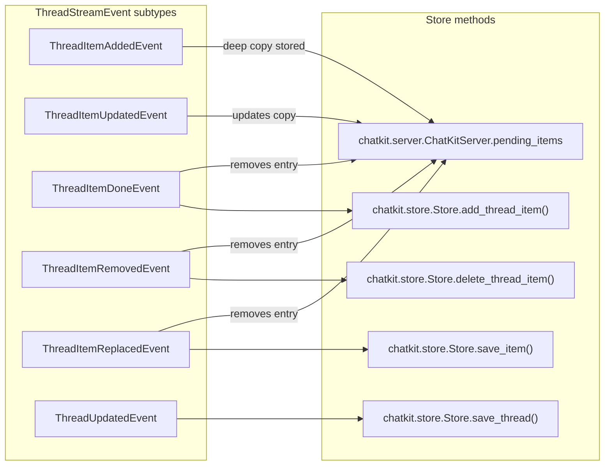

Sources: [chatkit/server.py:776-825](), [chatkit/server.py:755-775]()

---

## Cancellation and Pending Items

When a client disconnects mid-stream, `asyncio.CancelledError` is raised inside `_process_events()` [chatkit/server.py:826-830](). The server calls `handle_stream_cancelled()` with the list of items in `pending_items` — i.e., items that received `ThreadItemAddedEvent` but not yet `ThreadItemDoneEvent`.

The default implementation of `handle_stream_cancelled()` [chatkit/server.py:382-421]():

1. Persists any non-empty `AssistantMessageItem` found in `pending_items` [chatkit/server.py:403-408]().
2. Adds an `SDKHiddenContextItem` to the thread with the message `"The user cancelled the stream."` — this prevents the next `respond()` call from attempting to continue the cancelled response [chatkit/server.py:413-421]().

Widget items and workflow items in `pending_items` are **not** auto-saved by the default implementation. Override `handle_stream_cancelled()` to customize this behavior.

Sources: [chatkit/server.py:382-421](), [chatkit/server.py:826-830]()

---

# Page: Threads and Thread Items

# Threads and Thread Items

<details>
<summary>Relevant source files</summary>

The following files were used as context for generating this wiki page:

- [chatkit/server.py](chatkit/server.py)
- [chatkit/types.py](chatkit/types.py)
- [docs/concepts/threads.md](docs/concepts/threads.md)

</details>


This page covers the `Thread` and `ThreadItem` data models: their fields, subtypes, lifecycle, and how hidden items are handled. For the request types that create and mutate threads, see [Request and Response Flow](). For the streaming events emitted as items are built, see [Streaming Events](). For the storage interface that persists these objects, see [Storage Interfaces]().

---

## What Is a Thread?

A **thread** is the top-level container for a single conversation. It holds ordered metadata and a paginated list of **thread items**. Two Pydantic classes in [chatkit/types.py]() represent it:

| Class | Purpose |
|---|---|
| `ThreadMetadata` | Scalar fields only — id, title, timestamps, status |
| `Thread` | Extends `ThreadMetadata` with `items: Page[ThreadItem]` |

`Thread` is what is returned to the client. `ThreadMetadata` is what the `Store` works with internally when listing threads or updating metadata without loading items.

**`ThreadMetadata` fields** ([chatkit/types.py:558-566]()):

| Field | Type | Description |
|---|---|---|
| `id` | `str` | Unique identifier |
| `title` | `str \| None` | Human-readable title, often set during `respond` |
| `created_at` | `datetime` | Creation timestamp |
| `status` | `ThreadStatus` | Lifecycle state (see below) |
| `metadata` | `dict[str, Any]` | Arbitrary integration metadata |

Sources: [chatkit/types.py:558-600](), [chatkit/store.py:81-99]()

---

## Thread Lifecycle and Status

`ThreadStatus` is a discriminated union on the `type` field:

**Thread status model:**

```mermaid
stateDiagram-v2
    [*] --> "ActiveStatus[type=active]"
    "ActiveStatus[type=active]" --> "LockedStatus[type=locked]"
    "ActiveStatus[type=active]" --> "ClosedStatus[type=closed]"
    "LockedStatus[type=locked]" --> "ActiveStatus[type=active]"
```

| Status Class | `type` Literal | Fields | Meaning |
|---|---|---|---|
| `ActiveStatus` | `"active"` | — | Thread accepts new messages |
| `LockedStatus` | `"locked"` | `reason: str \| None` | Thread is read-only temporarily |
| `ClosedStatus` | `"closed"` | `reason: str \| None` | Thread is permanently closed |

The default status at creation is `ActiveStatus` (see [chatkit/types.py:564]()).

Sources: [chatkit/types.py:569-593]()

---

## Thread Lifecycle

```mermaid
sequenceDiagram
    participant "Client" as C
    participant "ChatKitServer" as S
    participant "Store" as DB

    C->>S: "ThreadsCreateReq"
    S->>DB: "save_thread(ThreadMetadata)"
    S->>DB: "add_thread_item(UserMessageItem)"
    S-->>C: "ThreadCreatedEvent"
    S-->>C: "ThreadItemAddedEvent(UserMessageItem)"
    S-->>C: "ThreadItemAddedEvent(AssistantMessageItem)"
    S-->>C: "ThreadItemUpdatedEvent(deltas)"
    S->>DB: "save_item(AssistantMessageItem)"
    S-->>C: "ThreadItemDoneEvent"
    S->>DB: "save_thread(updated metadata/title)"
```

Key points:
- Items are persisted by `ChatKitServer` automatically in response to streaming events (`ThreadItemDoneEvent`, `ThreadItemAddedEvent`, etc.).
- Thread metadata (title, status) is written by calling `Store.save_thread`.
- Deleted items (e.g. on retry) are removed via `Store.delete_thread_item`.

Sources: [chatkit/store.py:82-162](), [docs/concepts/threads.md:29-35]()

---

## ThreadItem: The Discriminated Union

`ThreadItem` is a `typing_extensions.Annotated` discriminated union keyed on the `type` field:

[chatkit/types.py:703-716]()

**Diagram: ThreadItem subtypes and their `type` discriminators**

```mermaid
graph TD
    TI["ThreadItem\n(discriminated union,\ndiscriminator=type)"]
    TI --> UMI["UserMessageItem\ntype=user_message"]
    TI --> AMI["AssistantMessageItem\ntype=assistant_message"]
    TI --> CTCI["ClientToolCallItem\ntype=client_tool_call"]
    TI --> WI["WidgetItem\ntype=widget"]
    TI --> GII["GeneratedImageItem\ntype=generated_image"]
    TI --> WFI["WorkflowItem\ntype=workflow"]
    TI --> TKI["TaskItem\ntype=task"]
    TI --> HCI["HiddenContextItem\ntype=hidden_context_item"]
    TI --> SHCI["SDKHiddenContextItem\ntype=sdk_hidden_context"]
    TI --> EOT["EndOfTurnItem\ntype=end_of_turn"]
```

All subtypes inherit from `ThreadItemBase` ([chatkit/types.py:605-611]()), which provides:

| Field | Type |
|---|---|
| `id` | `str` |
| `thread_id` | `str` |
| `created_at` | `datetime` |

Sources: [chatkit/types.py:602-716]()

---

## ThreadItem Subtypes

### UserMessageItem

Represents a single user turn. Created by `ChatKitServer` when handling `ThreadsCreateReq` or `ThreadsAddUserMessageReq`.

[chatkit/types.py:613-620]()

| Field | Type | Notes |
|---|---|---|
| `content` | `list[UserMessageContent]` | Text and/or tag segments |
| `attachments` | `list[Attachment]` | File or image attachments |
| `quoted_text` | `str \| None` | Optional reply context |
| `inference_options` | `InferenceOptions` | Model and tool choice overrides |

`UserMessageContent` is itself a union of `UserMessageTextContent` (plain text) and `UserMessageTagContent` (@-mention tags). See [Entities and Annotations]() for tag details.

`InferenceOptions` allows per-message model selection and tool-choice overrides via `model: str | None` and `tool_choice: ToolChoice | None`.

---

### AssistantMessageItem

Represents assistant output. Content arrives incrementally during streaming and is finalized at `ThreadItemDoneEvent`.

[chatkit/types.py:623-628]()

| Field | Type | Notes |
|---|---|---|
| `content` | `list[AssistantMessageContent]` | One or more text parts with annotations |

Each `AssistantMessageContent` element ([chatkit/types.py:722-727]()) holds:

| Field | Type |
|---|---|
| `text` | `str` (Markdown) |
| `annotations` | `list[Annotation]` |
| `type` | `"output_text"` |

`Annotation` objects carry an `index` (character position) and a `source` which is one of `URLSource`, `FileSource`, or `EntitySource`. See [Entities and Annotations]() for the full annotation model.

---

### ClientToolCallItem

Represents an in-progress or completed call to a client-side tool (a tool whose implementation runs in the browser).

[chatkit/types.py:630-638]()

| Field | Type | Notes |
|---|---|---|
| `status` | `"pending" \| "completed"` | Updated when client submits output |
| `call_id` | `str` | Matches the model's tool call id |
| `name` | `str` | Tool name |
| `arguments` | `dict[str, Any]` | Parsed arguments |
| `output` | `Any \| None` | Populated after client responds |

The client submits output via `ThreadsAddClientToolOutputReq`, which updates the item's status and `output` field.

---

### WidgetItem

Holds structured UI widget content produced by the server via `stream_widget` or `diff_widget`.

[chatkit/types.py:641-647]()

| Field | Type | Notes |
|---|---|---|
| `widget` | `WidgetRoot` | The root widget component tree |
| `copy_text` | `str \| None` | Optional plain-text copy for clipboard |

For widget authoring details, see [Widgets and UI Components]().

---

### GeneratedImageItem

Created when the Agents SDK produces an `image_generation_call` event. The `image` field starts as `None` and is populated via `GeneratedImageUpdated` stream events.

[chatkit/types.py:656-661]()

| Field | Type |
|---|---|
| `image` | `GeneratedImage \| None` |

`GeneratedImage` contains an `id` and a `url` ([chatkit/types.py:649-653]()). See [Image Generation]() for the full conversion pipeline.

---

### WorkflowItem

Groups one or more `Task` objects into a collapsible workflow step display. Created and updated via the `AgentContext` workflow API.

[chatkit/types.py:670-675]()

| Field | Type |
|---|---|
| `workflow` | `Workflow` |

`Workflow` ([chatkit/types.py:852-858]()) contains:

| Field | Type |
|---|---|
| `type` | `"custom" \| "reasoning"` |
| `tasks` | `list[Task]` |
| `summary` | `WorkflowSummary \| None` |
| `expanded` | `bool` |

For the full workflow API, see [Workflows and Tasks]().

---

### TaskItem

A standalone wrapper around a single `Task`. Less common than `WorkflowItem`; the `workflow` container is typically preferred.

[chatkit/types.py:663-668]()

---

### Hidden Context Items

These items are **never sent to the React client**. They exist only in the server-side store and in model input construction.

**Diagram: Visibility of item types**

```mermaid
graph LR
    subgraph "Persisted in Store"
        UMI2["UserMessageItem"]
        AMI2["AssistantMessageItem"]
        CTCI2["ClientToolCallItem"]
        WI2["WidgetItem"]
        GII2["GeneratedImageItem"]
        WFI2["WorkflowItem"]
        HCI2["HiddenContextItem"]
        SHCI2["SDKHiddenContextItem"]
    end
    subgraph "Sent to Client (ChatKit.js)"
        UMI2
        AMI2
        CTCI2
        WI2
        GII2
        WFI2
    end
    subgraph "Used as Model Input Only"
        HCI2
        SHCI2
    end
```

| Class | `type` | Owner | `content` type |
|---|---|---|---|
| `HiddenContextItem` | `"hidden_context_item"` | Your integration | `Any` |
| `SDKHiddenContextItem` | `"sdk_hidden_context"` | ChatKit SDK internals | `str` |

[chatkit/types.py:683-701]()

**`HiddenContextItem`** is for application-level hidden state: widget action results, selection state, system signals — anything the model needs to see but the user should not. Its `content` is arbitrary and your `ThreadItemConverter` is responsible for serializing it to model input.

**`SDKHiddenContextItem`** stores serialized state that the ChatKit Python SDK needs for its own operations (e.g. tracking tool call mappings). Its `content` is a JSON string managed internally by the SDK. Most integrations do not need to interact with it directly unless overriding `ThreadItemConverter`.

The `StoreItemType` literal in [chatkit/store.py:17-25]() includes `"sdk_hidden_context"` for ID generation, and the `_ID_PREFIXES` map assigns it the prefix `"shcx"`.

Sources: [chatkit/types.py:683-701](), [chatkit/store.py:17-25](), [docs/concepts/threads.md:89-98]()

---

### EndOfTurnItem

A lightweight marker item (`type = "end_of_turn"`) that signals the assistant has finished its turn. It has no payload fields beyond the base fields.

[chatkit/types.py:677-681]()

---

## Summary: ThreadItem Type Reference

```mermaid
graph TD
    subgraph "chatkit/types.py"
        TIB["ThreadItemBase\n(id, thread_id, created_at)"]
        UMI3["UserMessageItem\ncontent, attachments,\nquoted_text, inference_options"]
        AMI3["AssistantMessageItem\ncontent: list[AssistantMessageContent]"]
        CTCI3["ClientToolCallItem\nstatus, call_id, name,\narguments, output"]
        WI3["WidgetItem\nwidget: WidgetRoot\ncopy_text"]
        GII3["GeneratedImageItem\nimage: GeneratedImage | None"]
        WFI3["WorkflowItem\nworkflow: Workflow"]
        TKI3["TaskItem\ntask: Task"]
        HCI3["HiddenContextItem\ncontent: Any\n(not sent to client)"]
        SHCI3["SDKHiddenContextItem\ncontent: str\n(not sent to client)"]
        EOT3["EndOfTurnItem"]

        TIB --> UMI3
        TIB --> AMI3
        TIB --> CTCI3
        TIB --> WI3
        TIB --> GII3
        TIB --> WFI3
        TIB --> TKI3
        TIB --> HCI3
        TIB --> SHCI3
        TIB --> EOT3
    end
```

| Type | `type` literal | Rendered in UI | Used in model input |
|---|---|---|---|
| `UserMessageItem` | `user_message` | ✓ | ✓ |
| `AssistantMessageItem` | `assistant_message` | ✓ | ✓ |
| `ClientToolCallItem` | `client_tool_call` | ✓ | ✓ |
| `WidgetItem` | `widget` | ✓ | ✓ (summarized) |
| `GeneratedImageItem` | `generated_image` | ✓ | ✓ |
| `WorkflowItem` | `workflow` | ✓ | ✓ (summarized) |
| `TaskItem` | `task` | ✓ | ✓ |
| `HiddenContextItem` | `hidden_context_item` | ✗ | ✓ |
| `SDKHiddenContextItem` | `sdk_hidden_context` | ✗ | ✓ |
| `EndOfTurnItem` | `end_of_turn` | ✗ | ✓ |

Sources: [chatkit/types.py:603-716](), [chatkit/store.py:17-36](), [docs/concepts/threads.md:52-115]()

---

## Pagination: `Page[T]`

Both `Thread.items` and `Store.load_thread_items` use the `Page` generic ([chatkit/types.py:24-29]()):

| Field | Type | Meaning |
|---|---|---|
| `data` | `list[T]` | Current page of records |
| `has_more` | `bool` | Whether another page exists |
| `after` | `str \| None` | Cursor id for the next page |

`Store.load_thread_items` accepts `after`, `limit`, and `order` parameters. The default sort order for `ItemsListReq` is `"desc"` (newest first).

Sources: [chatkit/types.py:24-29](), [chatkit/store.py:95-101]()

---

## Converting Thread Items to Model Input

The `ThreadItemConverter` class in `chatkit.agents` translates stored `ThreadItem` objects into the input format expected by the Agents SDK. The default implementation handles all built-in item types. Custom behavior can be added by subclassing it.

For the full conversion pipeline including attachment and tag handling, see [Agent Integration]().

Sources: [docs/concepts/threads.md:106-115]()

---

# Page: Entities and Annotations

# Entities and Annotations

<details>
<summary>Relevant source files</summary>

The following files were used as context for generating this wiki page:

- [chatkit/agents.py](chatkit/agents.py)
- [chatkit/types.py](chatkit/types.py)
- [docs/concepts/entities.md](docs/concepts/entities.md)
- [docs/guides/accept-rich-user-input.md](docs/guides/accept-rich-user-input.md)
- [docs/guides/add-annotations.md](docs/guides/add-annotations.md)
- [tests/test_agents.py](tests/test_agents.py)

</details>


This page covers the two ways structured entity information flows through the ChatKit type system:

1. **Annotations** — inline citation markers attached to `AssistantMessageItem` content, referencing files, URLs, or custom application entities.
2. **UserMessageTagContent** — structured @-mention tags embedded in user messages, resolved server-side into model input.

For the broader `AssistantMessageItem` and `UserMessageItem` data models, see [page 2.4](chatkit/types.py:1000-1100). For the streaming events that carry annotation updates to the client, see [page 2.3](chatkit/types.py:500-600). For the `ThreadItemConverter` and `ResponseStreamConverter` APIs in full, see [page 4.1](chatkit/agents.py:313-410).

---

## The Annotation Model

An `Annotation` attaches a citation to a character position within an `AssistantMessageContent` text block [chatkit/types.py:1260-1275](). Every `AssistantMessageContent` carries a list of annotations [chatkit/types.py:1240-1255]().

| Field    | Type                                          | Description |
|----------|-----------------------------------------------|-------------|
| `source` | `FileSource | URLSource | EntitySource`     | The citation target (discriminated union) [chatkit/types.py:1270-1272]() |
| `index`  | `int`                                         | Character offset in the text where the footnote marker is placed [chatkit/types.py:1274-1275]() |

Multiple annotations sharing the same `index` are grouped as a single numbered footnote in the UI [docs/guides/add-annotations.md:104-105]().

### Source Types

**Source type comparison:**

The following diagram maps conceptual citation kinds to their Python code types.

#### Annotation Source Union

```mermaid
graph TD
    A["Annotation [chatkit/types.py:1265]"]
    S["source: FileSource | URLSource | EntitySource [chatkit/types.py:1270]"]
    FS["FileSource\n(type='file') [chatkit/types.py:1165]"]
    US["URLSource\n(type='url') [chatkit/types.py:1185]"]
    ES["EntitySource\n(type='entity') [chatkit/types.py:1200]"]
    
    A --> S
    S --> FS
    S --> US
    S --> ES

    FSf["filename: str\ntitle: str | None\ndescription: str | None"]
    USf["url: str\ntitle: str | None"]
    ESf["id: str\ntitle: str\ndescription: str | None\nicon: IconName | None\nlabel: str | None\ninline_label: str | None\ninteractive: bool\ndata: dict | None"]

    FS --> FSf
    US --> USf
    ES --> ESf
```

Sources: [chatkit/types.py:1165-1235](), [chatkit/agents.py:51-88](), [docs/guides/add-annotations.md:1-162]()

| Source type   | Rendered as                                                              | When to use |
|---------------|--------------------------------------------------------------------------|-------------|
| `FileSource`  | File name with icon; optional title and description in popover           | Uploaded documents, file search results [chatkit/types.py:1165-1180]() |
| `URLSource`   | Link with title in popover                                               | Web search results, external URLs [chatkit/types.py:1185-1195]() |
| `EntitySource`| Custom icon or inline label; click/preview callbacks when `interactive=True` | Application domain objects (documents, tickets, customers, etc.) [chatkit/types.py:1200-1235]() |

---

## Annotations in Assistant Messages

### Attaching Annotations Statically

When building an `AssistantMessageItem` directly in `respond`, populate `annotations` on each `AssistantMessageContent` [docs/guides/add-annotations.md:66-102]():

```python
AssistantMessageContent(
    text="...",
    annotations=[
        Annotation(source=FileSource(filename="q1_report.pdf", title="Q1 Report"), index=42),
        Annotation(source=URLSource(url="https://example.com", title="Press release"), index=42),
    ]
)
```

The `index` is a character offset. Reuse the same `index` across multiple annotations to group them under one footnote number [docs/guides/add-annotations.md:104-105]().

Sources: [docs/guides/add-annotations.md:64-102]()

### Model-Emitted Citations via `ResponseStreamConverter`

When `stream_agent_response` processes a streaming Agents SDK run, it intercepts `response.output_text.annotation.added` events from the OpenAI Responses API and converts them into ChatKit `Annotation` objects [chatkit/agents.py:601-619]().

The conversion is handled by `ResponseStreamConverter` in [chatkit/agents.py:313-410]().

#### Citation Conversion Pipeline

```mermaid
flowchart TD
    OAPI["OpenAI Responses API\nannotation event"]
    CA["_convert_annotation()\nchatkit/agents.py:601"]

    FC["AnnotationFileCitation\n(type='file_citation')"]
    CFC["AnnotationContainerFileCitation\n(type='container_file_citation')"]
    UC["AnnotationURLCitation\n(type='url_citation')"]

    M1["ResponseStreamConverter\n.file_citation_to_annotation() [chatkit/agents.py:377]"]
    M2["ResponseStreamConverter\n.container_file_citation_to_annotation() [chatkit/agents.py:388]"]
    M3["ResponseStreamConverter\n.url_citation_to_annotation() [chatkit/agents.py:399]"]

    R1["Annotation(source=FileSource(...),\nindex=file_citation.index)"]
    R2["Annotation(source=FileSource(...),\nindex=container_file_citation.end_index)"]
    R3["Annotation(source=URLSource(...),\nindex=url_citation.end_index)"]

    DROP["None\n(annotation dropped)"]

    OAPI --> CA
    CA --> FC
    CA --> CFC
    CA --> UC

    FC --> M1
    CFC --> M2
    UC --> M3

    M1 -->|"filename present"| R1
    M1 -->|"filename missing"| DROP
    M2 -->|"filename present"| R2
    M2 -->|"filename missing"| DROP
    M3 --> R3

    R1 --> EVT["AssistantMessageContentPartAnnotationAdded\n→ ThreadItemUpdatedEvent [chatkit/agents.py:612]"]
    R2 --> EVT
    R3 --> EVT
```

Sources: [chatkit/agents.py:436-454](), [chatkit/agents.py:601-619](), [docs/guides/add-annotations.md:7-14]()

#### `ResponseStreamConverter` Overridable Methods

| Method | Input type | Default behavior |
|---|---|---|
| `file_citation_to_annotation` | `AnnotationFileCitation` | Returns `Annotation(source=FileSource(filename=..., title=filename))`, or `None` if `filename` is empty [chatkit/agents.py:377-386]() |
| `container_file_citation_to_annotation` | `AnnotationContainerFileCitation` | Same as above using `end_index` [chatkit/agents.py:388-397]() |
| `url_citation_to_annotation` | `AnnotationURLCitation` | Returns `Annotation(source=URLSource(url=..., title=...))` [chatkit/agents.py:399-410]() |

Override these methods on a `ResponseStreamConverter` subclass to enrich metadata (e.g., add descriptions from an internal file registry) or replace the source type (e.g., return an `EntitySource` with `interactive=True` to wire click callbacks) [docs/guides/add-annotations.md:16-59]().

### Annotation Index Tracking During Streaming

`stream_agent_response` maintains an internal `item_annotation_count` counter per `(item_id, content_index)` pair [chatkit/agents.py:485-487](). This ensures annotation indices remain correct even when some annotations are dropped (e.g., file citations with no filename). The count only increments when an `Annotation` object is successfully produced [chatkit/agents.py:604-618]().

---

## EntitySource: Custom Entity Annotations

`EntitySource` extends the annotation concept to first-class application domain objects [chatkit/types.py:1200-1235](). It is the server-side counterpart to the `Entity` type in the client SDK.

**Key UI fields on `EntitySource`:**

| Field          | Type           | Effect |
|----------------|----------------|--------|
| `icon`         | `IconName | None` | Icon shown in the inline citation and popover [chatkit/types.py:1216]() |
| `label`        | `str | None`  | Override the popover header label [chatkit/types.py:1218]() |
| `inline_label` | `str | None`  | Show a text label inline instead of an icon [chatkit/types.py:1220]() |
| `interactive`  | `bool`         | When `True`, wires `entities.onClick` and `entities.onRequestPreview` client callbacks [chatkit/types.py:1222]() |
| `data`         | `dict | None` | Free-form payload forwarded to client-side entity callbacks [chatkit/types.py:1224]() |

When `interactive=True`, the `data` field is passed verbatim to the `entities.onClick` and `entities.onRequestPreview` callbacks configured in `ChatKitOptions` on the React side [docs/guides/add-annotations.md:161-162]().

Sources: [chatkit/types.py:1200-1235](), [docs/guides/add-annotations.md:106-161](), [docs/concepts/entities.md:1-31]()

---

## UserMessageTagContent: @-Mention Tags in User Messages

`UserMessageTagContent` represents an @-mention the user selected from the composer's entity search dropdown [chatkit/types.py:960-975]().

### Tag Data Model

| Field  | Type     | Description |
|--------|----------|-------------|
| `type` | `str`    | Always `"input_tag"` [chatkit/types.py:961]() |
| `text` | `str`    | The display text of the entity as shown in the composer [chatkit/types.py:963]() |
| `id`   | `str`    | The entity identifier returned by `onTagSearch` [chatkit/types.py:965]() |
| `data` | `dict`   | Arbitrary entity metadata [chatkit/types.py:967]() |

### @-Mention Flow: Client to Model Input

```mermaid
flowchart TD
    UI["User types @-mention\nin ChatKit React composer"]
    SEARCH["entities.onTagSearch(query)\n→ Entity[] returned to client"]
    SELECT["User selects entity\n→ Entity appended to message"]

    subgraph "UserMessageItem.content [chatkit/types.py:1018]"
        UTC["UserMessageTextContent\n(surrounding text) [chatkit/types.py:945]"]
        TAG["UserMessageTagContent\n(text, id, data) [chatkit/types.py:960]"]
    end

    TIC["ThreadItemConverter\n.to_agent_input() [chatkit/agents.py:834]"]
    M1["Message 1 (role=user)\ntext prefixed with '@' inline"]
    M2["Message 2 (role=user)\npreamble + tag_to_message_content() output"]

    OVERRIDE["ThreadItemConverter\n.tag_to_message_content(tag)\n→ ResponseInputContentParam [chatkit/agents.py:853]"]

    MODEL["Model input items\npassed to Runner.run_streamed()"]

    UI --> SEARCH
    SEARCH --> SELECT
    SELECT --> TAG
    TAG --> TIC
    TIC --> M1
    TIC --> OVERRIDE
    OVERRIDE --> M2
    M1 --> MODEL
    M2 --> MODEL
```

Sources: [chatkit/agents.py:853-862](), [tests/test_agents.py:480-528](), [docs/guides/accept-rich-user-input.md:231-345]()

### How Tags Become Model Input

When `to_agent_input` (or `simple_to_agent_input`) processes a `UserMessageItem` containing `UserMessageTagContent` items:

1. **First message** (role `user`): The tag's `text` is rendered inline as `@{text}` within the user message content [chatkit/agents.py:843]().

2. **Second message** (role `user`): A separate message is emitted containing a system preamble and the output of `ThreadItemConverter.tag_to_message_content(tag)` for each tag [chatkit/agents.py:853-862]().

The default `ThreadItemConverter.tag_to_message_content` raises `NotImplementedError` [chatkit/agents.py:853](). Subclass `ThreadItemConverter` and override this method to resolve the tag to entity content.

### Typical `tag_to_message_content` Implementation Pattern

The method receives the full `UserMessageTagContent` and must return a `ResponseInputContentParam` [chatkit/agents.py:853](). A typical implementation looks up the entity in application storage and returns a `ResponseInputTextParam` wrapping the entity details in structured markup [docs/guides/accept-rich-user-input.md:149-166]().

---

## End-to-End Summary

```mermaid
flowchart LR
    subgraph "User Message Side"
        TAG2["UserMessageTagContent [chatkit/types.py:960]\n(id, text, data)"]
        TIC2["ThreadItemConverter [chatkit/agents.py:814]\n.tag_to_message_content()"]
        MI["ResponseInputContentParam\n→ model input"]
        TAG2 --> TIC2 --> MI
    end

    subgraph "Assistant Message Side"
        RAPI["OpenAI Responses API\nfile_citation / url_citation /\ncontainer_file_citation"]
        RSC["ResponseStreamConverter [chatkit/agents.py:313]\n.file_citation_to_annotation()\n.url_citation_to_annotation()\n.container_file_citation_to_annotation()"]
        ANN["Annotation [chatkit/types.py:1265]\n(source: FileSource | URLSource | EntitySource,\n index: int)"]
        AMC["AssistantMessageContent [chatkit/types.py:1240]\n.annotations: list[Annotation]"]
        RAPI --> RSC --> ANN --> AMC
    end
```

Sources: [chatkit/agents.py:313-454](), [chatkit/agents.py:601-619](), [chatkit/agents.py:834-862](), [docs/guides/add-annotations.md:1-162](), [docs/guides/accept-rich-user-input.md:231-345](), [docs/concepts/entities.md:1-31]()

---

# Page: Server Integration

# Server Integration

<details>
<summary>Relevant source files</summary>

The following files were used as context for generating this wiki page:

- [chatkit/server.py](chatkit/server.py)
- [chatkit/store.py](chatkit/store.py)
- [docs/quickstart.md](docs/quickstart.md)
- [mkdocs.yml](mkdocs.yml)
- [tests/helpers/mock_store.py](tests/helpers/mock_store.py)

</details>


This page guides developers through implementing a ChatKit backend server by documenting the core abstractions and extension points required to handle conversational AI requests.

Server integration involves implementing two primary abstractions: `ChatKitServer` for request processing and response generation, and `Store` for thread and item persistence. These abstractions are generic over a custom context type, enabling request-scoped data flow, authorization, and multi-tenancy. 

For details on specific components, see:
- [ChatKitServer Class](#3.1) — Full reference for the `ChatKitServer` abstract base class: constructor parameters, all abstract methods (`respond`, `action`, `sync_action`, `add_feedback`, `transcribe`), concrete methods (`process`, `get_stream_options`, `handle_stream_cancelled`), and patterns for subclassing.
- [Storage Interfaces](#3.2) — Document the `Store` and `AttachmentStore` abstract base classes, all method signatures, `StoreItemType`, `NotFoundError`, ID generation utilities (`default_generate_id`, `_ID_PREFIXES`), and the `SQLiteStore` reference implementation used in tests.
- [Request Processing Pipeline](#3.3) — Detailed walkthrough of how `ChatKitServer.process()` deserializes raw bytes into `ChatKitReq`, dispatches to streaming or non-streaming handlers, and what each handler does for every supported request type.
- [Context Management](#3.4) — Explain the `TContext` generic pattern: how to define a custom per-request context dataclass, how it flows through `ChatKitServer`, `Store`, and `AgentContext` method signatures, and how to scope data access (e.g. by `user_id`) using it.

## Overview

A ChatKit server implementation consists of three components:

1.  **Server Class**: Extends `ChatKitServer[TContext]` [chatkit/server.py:275-275]() to define response generation logic.
2.  **Store Implementation**: Implements `Store[TContext]` [chatkit/store.py:68-68]() for thread and item persistence.
3.  **Context Type**: Custom type threaded through all operations for request-scoped data [chatkit/store.py:15-15]().

The server receives HTTP requests via the `process()` method [chatkit/server.py:385-385](), routes them to streaming or non-streaming handlers, delegates persistence to the store, and returns either `StreamingResult` or `NonStreamingResult` to the web framework.

**Server Integration Architecture**

```mermaid
graph TB
    subgraph "Developer Implementation"
        MyServer["MyChatKitServer<br/>extends ChatKitServer[TContext]"]
        MyStore["MyStore<br/>implements Store[TContext]"]
        MyContext["MyRequestContext<br/>user_id, auth_token, etc."]
    end
    
    subgraph "Web Framework Layer"
        FastAPI["FastAPI / Flask / Django"]
        Route["/chatkit endpoint"]
        ReqContext["Create RequestContext"]
    end
    
    subgraph "ChatKit Framework"
        ServerBase["ChatKitServer[TContext]"]
        StoreIface["Store[TContext]"]
        ProcessMethod["process(request, context)"]
        RespondMethod["respond(thread, input, context)"]
        ActionMethod["action(thread, action, sender, context)"]
    end
    
    subgraph "Return Types"
        StreamResult["StreamingResult<br/>AsyncIterable[bytes]"]
        NonStreamResult["NonStreamingResult<br/>bytes"]
    end
    
    FastAPI --> Route
    Route --> ReqContext
    ReqContext --> ProcessMethod
    
    MyServer -.extends.-> ServerBase
    MyStore -.implements.-> StoreIface
    MyContext -.generic param.-> ServerBase
    MyContext -.generic param.-> StoreIface
    
    ServerBase --> ProcessMethod
    ProcessMethod --> RespondMethod
    ProcessMethod --> ActionMethod
    
    ProcessMethod --> StreamResult
    ProcessMethod --> NonStreamResult
    
    StreamResult --> FastAPI
    NonStreamResult --> FastAPI
    
    ServerBase -.uses.-> StoreIface
    MyServer -.injects.-> MyStore
```

**Sources**: [chatkit/server.py:275-291](), [chatkit/store.py:68-162]()

## Core Abstractions

### ChatKitServer Base Class

`ChatKitServer[TContext]` is an abstract base class that defines the server interface. It is generic over `TContext`, allowing custom request context to flow through all operations.

| Constructor Parameter | Type | Required | Description |
|----------------------|------|----------|-------------|
| `store` | `Store[TContext]` | Yes | Persistence layer for threads and items |
| `attachment_store` | `AttachmentStore[TContext]` | No | File storage layer for attachments |

**Key Methods**

| Method | Type | Required | Description |
|--------|------|----------|-------------|
| `respond()` | Abstract | Yes | Generate response events for user messages |
| `action()` | Virtual | No | Handle widget or client-dispatched actions |
| `sync_action()` | Virtual | No | Handle synchronous actions returning JSON |
| `add_feedback()` | Virtual | No | Process user feedback (thumbs up/down) |
| `transcribe()` | Virtual | No | Handle audio transcription requests |
| `process()` | Final | - | Entrypoint that routes requests to handlers |

**Sources**: [chatkit/server.py:275-384]()

### Store Interface

`Store[TContext]` [chatkit/store.py:68-68]() defines the persistence layer contract. Implementations must handle thread metadata, thread items, and attachments with pagination support via the `Page[T]` model.

**Thread Operations**

| Method | Returns | Description |
|--------|---------|-------------|
| `generate_thread_id(context)` | `str` | Generate new thread identifier |
| `load_thread(thread_id, context)` | `ThreadMetadata` | Load thread metadata by ID |
| `save_thread(thread, context)` | `None` | Persist thread metadata |
| `load_threads(limit, after, order, context)` | `Page[ThreadMetadata]` | Load paginated thread list |
| `delete_thread(thread_id, context)` | `None` | Delete thread and all items |

**Item Operations**

| Method | Returns | Description |
|--------|---------|-------------|
| `generate_item_id(type, thread, context)` | `str` | Generate new item identifier |
| `add_thread_item(thread_id, item, context)` | `None` | Persist new thread item |
| `save_item(thread_id, item, context)` | `None` | Upsert existing thread item |
| `load_item(thread_id, item_id, context)` | `ThreadItem` | Load item by ID |
| `load_thread_items(thread_id, after, limit, order, context)` | `Page[ThreadItem]` | Load paginated items |
| `delete_thread_item(thread_id, item_id, context)` | `None` | Delete item by ID |

**Sources**: [chatkit/store.py:68-163]()

### AttachmentStore Interface

`AttachmentStore[TContext]` [chatkit/store.py:48-48]() is an optional interface for managing file uploads. When configured, it handles physical file storage separate from metadata.

| Method | Returns | Description |
|--------|---------|-------------|
| `generate_attachment_id(mime_type, context)` | `str` | Generate new attachment identifier |
| `create_attachment(params, context)` | `Attachment` | Process file upload and return metadata |
| `delete_attachment(attachment_id, context)` | `None` | Delete physical file |

**Sources**: [chatkit/store.py:48-66](), [chatkit/server.py:285-291]()

## Implementation Pattern

**Implementation Steps**

1.  **Define Context Type**: Create a class or dataclass containing request-scoped data (user ID, authentication, database session, etc.).
2.  **Implement Store**: Subclass `Store[TContext]` [chatkit/store.py:68-68]() and implement all abstract methods. Use the context parameter to filter data by tenant or perform authorization.
3.  **Implement Server**: Subclass `ChatKitServer[TContext]` [chatkit/server.py:275-275]() and implement the required `respond()` method.
4.  **Wire to Web Framework**: Create an HTTP endpoint that calls `server.process(request_body, context)` [chatkit/server.py:385-385]() and returns the result as either SSE or JSON.

For a detailed walkthrough, see [Context Management](#3.4).

**Sources**: [docs/quickstart.md:71-106](), [chatkit/server.py:385-397]()

## Request Processing Flow

The `process()` method [chatkit/server.py:385-385]() is the entrypoint for all ChatKit requests. It parses the request body, determines if it is streaming or non-streaming via `is_streaming_req()` [chatkit/types.py:1022-1022](), and routes to the appropriate handler.

**Request Routing Flow**

```mermaid
sequenceDiagram
    participant WebFW as "Web Framework"
    participant Process as "ChatKitServer.process()"
    participant Parser as "TypeAdapter[ChatKitReq]"
    participant IsStreaming as "is_streaming_req()"
    participant StreamImpl as "_process_streaming_impl()"
    participant NonStreamImpl as "_process_non_streaming()"
    participant Respond as "respond()"
    
    WebFW->>Process: POST /chatkit
    Process->>Parser: validate_json(request)
    Parser-->>Process: ChatKitReq
    
    Process->>IsStreaming: is_streaming_req(parsed)
    
    alt Streaming Request
        IsStreaming-->>Process: True
        Process->>StreamImpl: _process_streaming_impl()
        StreamImpl->>Respond: respond(thread, input, context)
        Respond-->>StreamImpl: Yield ThreadStreamEvent
        StreamImpl-->>Process: AsyncGenerator[ThreadStreamEvent]
        Process-->>WebFW: StreamingResult
    else Non-Streaming Request
        IsStreaming-->>Process: False
        Process->>NonStreamImpl: _process_non_streaming()
        NonStreamImpl-->>Process: bytes (JSON)
        Process-->>WebFW: NonStreamingResult
    end
```

**Sources**: [chatkit/server.py:385-477](), [chatkit/server.py:479-773]()

### Streaming vs Non-Streaming

Streaming requests yield `ThreadStreamEvent` [chatkit/types.py:848-848]() instances over time and are returned as Server-Sent Events. These include message creation and tool outputs. Non-streaming requests execute synchronous CRUD operations (like listing threads or adding feedback) and return JSON.

For a deep dive into the routing logic, see [Request Processing Pipeline](#3.3).

## Extension Points

`ChatKitServer` provides several extension points for custom behavior. Only `respond()` is required; all other methods are optional.

| Method | Purpose |
|--------|---------|
| `respond()` | Generates the server's response to a user message [chatkit/server.py:293-293](). |
| `action()` | Handles widget or custom client actions [chatkit/server.py:322-322](). |
| `sync_action()` | Handles synchronous actions returning a JSON payload [chatkit/server.py:344-344](). |
| `add_feedback()` | Processes user feedback (thumbs up/down) on items [chatkit/server.py:312-312](). |
| `transcribe()` | Handles audio transcription [chatkit/server.py:356-356](). |

For details on method signatures and patterns, see [ChatKitServer Class](#3.1).

## Helper Functions

### stream_widget()

Converts a `WidgetRoot` [chatkit/widgets.py:410-410]() or async generator of `WidgetRoot` into `ThreadStreamEvent` instances [chatkit/server.py:200-200](). It uses `diff_widget()` [chatkit/server.py:96-96]() to produce incremental updates.

**Sources**: [chatkit/server.py:194-243]()

### diff_widget()

Compares two `WidgetRoot` instances and returns a list of delta events [chatkit/server.py:96-96](). It generates `WidgetStreamingTextValueDelta` [chatkit/types.py:756-756]() for incremental text updates.

**Sources**: [chatkit/server.py:90-191]()

---

# Page: ChatKitServer Class

# ChatKitServer Class

<details>
<summary>Relevant source files</summary>

The following files were used as context for generating this wiki page:

- [chatkit/server.py](chatkit/server.py)
- [docs/guides/respond-to-user-message.md](docs/guides/respond-to-user-message.md)
- [docs/guides/stream-generated-images.md](docs/guides/stream-generated-images.md)
- [tests/test_chatkit_server.py](tests/test_chatkit_server.py)

</details>


This page is a full reference for the `ChatKitServer` abstract base class defined in [chatkit/server.py:281-289](). It covers the constructor, all overridable methods, the `process()` entry point, and patterns for subclassing. It does not cover the `Store` or `AttachmentStore` interfaces (see [3.2]()), the `TContext` generic pattern in depth (see [3.4]()), or the full request routing pipeline (see [3.3]()).

---

## Overview

`ChatKitServer` is the central class in `chatkit.server`. It is an abstract base class that:

- Receives raw HTTP request bodies from the client [chatkit/server.py:423-426]()
- Deserializes them into typed `ChatKitReq` instances [chatkit/server.py:427-428]()
- Dispatches to streaming or non-streaming internal handlers [chatkit/server.py:430-435]()
- Manages persistence of thread items via `Store` [chatkit/server.py:771-791]()
- Calls user-defined methods (`respond`, `action`, etc.) to generate responses [chatkit/server.py:299-316]()

You subclass `ChatKitServer`, implement at minimum `respond`, and expose a single HTTP endpoint that calls `process()`.

`ChatKitServer` is generic over `TContext` — a per-request context object you define. This context is threaded through every method call including `Store` operations [chatkit/server.py:281]().

---

## Class Hierarchy and Type Parameters

**Class declaration:** [chatkit/server.py:281-289]()

```python
ChatKitServer(ABC, Generic[TContext])
```

| Symbol | Description |
|---|---|
| `TContext` | TypeVar (default `Any`). Represents the per-request context type. |
| `Store[TContext]` | Required. Persists threads and items. |
| `AttachmentStore[TContext]` | Optional. Manages file uploads/deletions. |

**Class definition diagram:**

```mermaid
classDiagram
    class ChatKitServer {
        +store: Store[TContext]
        +attachment_store: AttachmentStore[TContext] | None
        +process(request, context) StreamingResult|NonStreamingResult
        +respond(thread, input_user_message, context) AsyncIterator[ThreadStreamEvent]*
        +add_feedback(thread_id, item_ids, feedback, context) None
        +transcribe(audio_input, context) TranscriptionResult
        +action(thread, action, sender, context) AsyncIterator[ThreadStreamEvent]
        +sync_action(thread, action, sender, context) SyncCustomActionResponse
        +get_stream_options(thread, context) StreamOptions
        +handle_stream_cancelled(thread, pending_items, context) None
    }
    class Store {
        <<abstract>>
    }
    class AttachmentStore {
        <<abstract>>
    }
    class StreamingResult {
        +json_events: AsyncGenerator[bytes, None]
    }
    class NonStreamingResult {
        +json: bytes
    }
    ChatKitServer --> Store : "self.store"
    ChatKitServer --> AttachmentStore : "self.attachment_store (optional)"
    ChatKitServer --> StreamingResult : "returns from process()"
    ChatKitServer --> NonStreamingResult : "returns from process()"
```

Sources: [chatkit/server.py:264-290]()

---

## Constructor

[chatkit/server.py:282-289]()

```python
ChatKitServer.__init__(
    store: Store[TContext],
    attachment_store: AttachmentStore[TContext] | None = None
)
```

| Parameter | Type | Required | Description |
|---|---|---|---|
| `store` | `Store[TContext]` | Yes | Persists threads, items, and attachments. |
| `attachment_store` | `AttachmentStore[TContext] \| None` | No | Handles file upload/delete operations. Required if clients send file attachments. |

`attachment_store` is only needed if you handle `AttachmentsCreateReq` or `AttachmentsDeleteReq` requests. Calling `process()` with those request types without a configured `attachment_store` raises a `RuntimeError` [chatkit/server.py:511-512]().

Sources: [chatkit/server.py:282-297]()

---

## Abstract Method: `respond`

[chatkit/server.py:299-316]()

This is the only method you **must** implement. It is called on every new user turn and must yield `ThreadStreamEvent` instances.

```python
respond(
    thread: ThreadMetadata,
    input_user_message: UserMessageItem | None,
    context: TContext,
) -> AsyncIterator[ThreadStreamEvent]
```

| Parameter | Type | Description |
|---|---|---|
| `thread` | `ThreadMetadata` | Metadata for the current thread. Mutating `thread.title` or `thread.metadata` during this call causes `ChatKitServer` to persist and emit a `ThreadUpdatedEvent` [chatkit/server.py:814-825](). |
| `input_user_message` | `UserMessageItem \| None` | The triggering user message. `None` when responding to a client tool output (`ThreadsAddClientToolOutputReq`) or a retry. |
| `context` | `TContext` | The per-request context passed to `process()`. |

**When `respond` is called:**

| Request Type | `input_user_message` value |
|---|---|
| `ThreadsCreateReq` | The new `UserMessageItem` [chatkit/server.py:441]() |
| `ThreadsAddUserMessageReq` | The new `UserMessageItem` [chatkit/server.py:447]() |
| `ThreadsAddClientToolOutputReq` | `None` [chatkit/server.py:453]() |
| `ThreadsRetryAfterItemReq` | The original `UserMessageItem` being retried [chatkit/server.py:461-464]() |

**Key behavior inside `_process_events`:**

The server iterates the `AsyncIterator[ThreadStreamEvent]` returned by `respond` and automatically:
- Persists `ThreadItemDoneEvent` items via `store.add_thread_item()` [chatkit/server.py:778-782]()
- Removes items on `ThreadItemRemovedEvent` via `store.delete_thread_item()` [chatkit/server.py:787-789]()
- Updates items on `ThreadItemReplacedEvent` via `store.save_item()` [chatkit/server.py:783-786]()
- Suppresses `HiddenContextItem` and `SDKHiddenContextItem` done events from reaching the client [chatkit/server.py:772-777]()
- Detects mutations to `thread` and emits a `ThreadUpdatedEvent` after the next event [chatkit/server.py:814-825]()

Sources: [chatkit/server.py:299-316](), [chatkit/server.py:755-852]()

---

## Overridable Methods

These methods have default implementations but are designed to be overridden.

### `add_feedback`

[chatkit/server.py:318-325]()

```python
async add_feedback(
    thread_id: str,
    item_ids: list[str],
    feedback: FeedbackKind,
    context: TContext,
) -> None
```

Called when the client submits feedback (thumbs up/down) on one or more items [chatkit/server.py:614-620](). The default implementation is a no-op. Override to persist feedback in your datastore.

`FeedbackKind` is a literal type: `"positive"` or `"negative"`.

Sources: [chatkit/server.py:318-325]()

---

### `transcribe`

[chatkit/server.py:328-345]()

```python
async transcribe(
    audio_input: AudioInput,
    context: TContext,
) -> TranscriptionResult
```

Called when the client sends an `InputTranscribeReq` [chatkit/server.py:644-645](). The default implementation raises `NotImplementedError`. Override to integrate with a speech-to-text service.

| Field on `AudioInput` | Description |
|---|---|
| `data` | Raw audio bytes |
| `mime_type` | Full MIME type (e.g. `audio/webm; codecs=opus`) |
| `media_type` | Base media type only (one of `audio/webm`, `audio/ogg`, `audio/mp4`) |

Return a `TranscriptionResult` whose `text` field is what appears in the composer.

Sources: [chatkit/server.py:328-345]()

---

### `action`

[chatkit/server.py:347-358]()

```python
action(
    thread: ThreadMetadata,
    action: Action[str, Any],
    sender: WidgetItem | None,
    context: TContext,
) -> AsyncIterator[ThreadStreamEvent]
```

Called when the client dispatches an async custom action (`ThreadsCustomActionReq`) [chatkit/server.py:469-472](). The default raises `NotImplementedError`. Override to handle widget button clicks and other client-side action triggers.

`sender` is the `WidgetItem` the action was dispatched from, or `None` if no sender item was identified.

The return value is streamed exactly like `respond` — events are persisted and forwarded to the client.

Sources: [chatkit/server.py:347-358]()

---

### `sync_action`

[chatkit/server.py:360-371]()

```python
async sync_action(
    thread: ThreadMetadata,
    action: Action[str, Any],
    sender: WidgetItem | None,
    context: TContext,
) -> SyncCustomActionResponse
```

Called when the client dispatches a synchronous custom action (`ThreadsSyncCustomActionReq`) [chatkit/server.py:633-636](). Unlike `action`, this is a regular `async` method that returns a `SyncCustomActionResponse` JSON blob instead of a stream. Used for low-latency query/response interactions with widget components.

Sources: [chatkit/server.py:360-371]()

---

### `get_stream_options`

[chatkit/server.py:373-380]()

```python
def get_stream_options(
    thread: ThreadMetadata,
    context: TContext,
) -> StreamOptions
```

Returns `StreamOptions` emitted to the client at the start of each streaming response [chatkit/server.py:756](). The default returns `StreamOptions(allow_cancel=True)`. Override to control whether the client is allowed to cancel the stream for a given thread.

Sources: [chatkit/server.py:373-380]()

---

### `handle_stream_cancelled`

[chatkit/server.py:382-421]()

```python
async handle_stream_cancelled(
    thread: ThreadMetadata,
    pending_items: list[ThreadItem],
    context: TContext,
) -> None
```

Called when the stream is cancelled (i.e., `asyncio.CancelledError` is raised inside `_process_events`) [chatkit/server.py:827-828](). `pending_items` contains all items that were yielded via `ThreadItemAddedEvent` but have not yet been finalized by a `ThreadItemDoneEvent`.

**Default behavior:**
1. For each `AssistantMessageItem` in `pending_items` that contains non-empty text, persist it via `store.add_thread_item()` [chatkit/server.py:393-408]().
2. Append an `SDKHiddenContextItem` to the thread with the text: `"The user cancelled the stream. Stop responding to the prior request."` — this prevents the model from continuing the cancelled response on the next turn [chatkit/server.py:410-421]().

Override to add custom cleanup logic (e.g., stopping a running inference process).

> **Note:** Any store writes made in `handle_stream_cancelled` will not be reflected in the UI until the user reloads, because the HTTP response has already been terminated.

Sources: [chatkit/server.py:382-421]()

---

## Entry Point: `process`

[chatkit/server.py:423-435]()

```python
async process(
    request: str | bytes | bytearray,
    context: TContext,
) -> StreamingResult | NonStreamingResult
```

The single public method called by your HTTP endpoint handler. It:

1. Deserializes `request` into a `ChatKitReq` using the discriminated union defined in `chatkit.types` [chatkit/server.py:427-428]().
2. Logs the request `type` [chatkit/server.py:429]().
3. Dispatches to `_process_streaming` or `_process_non_streaming` based on the request type [chatkit/server.py:430-435]().
4. Returns either a `StreamingResult` (for SSE) or a `NonStreamingResult` (for JSON).

**Dispatch diagram:**

```mermaid
flowchart TD
    A["process(request, context)"]
    A --> B["TypeAdapter[ChatKitReq].validate_json(request)"]
    B --> C{"is_streaming_req()"}
    C -- "True" --> D["StreamingResult\n(_process_streaming)"]
    C -- "False" --> E["NonStreamingResult\n(_process_non_streaming)"]
    D --> F["_process_streaming_impl()\nyields ThreadStreamEvent\nformatted as SSE bytes"]
    E --> G["_process_non_streaming()\nreturns bytes (JSON)"]
```

Sources: [chatkit/server.py:423-435](), [chatkit/server.py:527-540]()

---

## Return Types

### `StreamingResult`

[chatkit/server.py:264-270]()

An `AsyncIterable[bytes]` wrapping an `AsyncGenerator[bytes, None]`. Each yielded item is a complete SSE frame: `b"data: " + json_bytes + b"\n\n"` [chatkit/server.py:539]().

Wire it into your web framework as a streaming response with `Content-Type: text/event-stream`.

### `NonStreamingResult`

[chatkit/server.py:273-275]()

A wrapper around a `bytes` field (`.json`). Return it as a normal `application/json` response.

**FastAPI example pattern** (from [docs/guides/respond-to-user-message.md:86-96]()):

```python
result = await server.process(await request.body(), context)
if isinstance(result, StreamingResult):
    return StreamingResponse(result, media_type="text/event-stream")
return Response(content=result.json, media_type="application/json")
```

Sources: [chatkit/server.py:264-275]()

---

## Request Type to Handler Mapping

The following table maps each `ChatKitReq` subtype to the internal handler and the user-overridable method it calls.

**Streaming requests** (return `StreamingResult`):

| `ChatKitReq` type | Internal dispatch | Calls user method |
|---|---|---|
| `ThreadsCreateReq` | `_process_streaming_impl` | `respond()` [chatkit/server.py:441]() |
| `ThreadsAddUserMessageReq` | `_process_streaming_impl` | `respond()` [chatkit/server.py:447]() |
| `ThreadsAddClientToolOutputReq` | `_process_streaming_impl` | `respond()` with `None` [chatkit/server.py:453]() |
| `ThreadsRetryAfterItemReq` | `_process_streaming_impl` | `respond()` [chatkit/server.py:461-464]() |
| `ThreadsCustomActionReq` | `_process_streaming_impl` | `action()` [chatkit/server.py:469-472]() |

**Non-streaming requests** (return `NonStreamingResult`):

| `ChatKitReq` type | Internal dispatch | Calls user method / store method |
|---|---|---|
| `ThreadsGetByIdReq` | `_process_non_streaming` | `store.load_thread()` [chatkit/server.py:545-546]() |
| `ThreadsListReq` | `_process_non_streaming` | `store.load_threads()` [chatkit/server.py:553-554]() |
| `ThreadsUpdateReq` | `_process_non_streaming` | `store.save_thread()` [chatkit/server.py:566-568]() |
| `ThreadsDeleteReq` | `_process_non_streaming` | `store.delete_thread()` [chatkit/server.py:575-576]() |
| `ItemsListReq` | `_process_non_streaming` | `store.load_thread_items()` [chatkit/server.py:586-593]() |
| `ItemsFeedbackReq` | `_process_non_streaming` | `add_feedback()` [chatkit/server.py:614-620]() |
| `AttachmentsCreateReq` | `_process_non_streaming` | `attachment_store.create_attachment()` [chatkit/server.py:656-658]() |
| `AttachmentsDeleteReq` | `_process_non_streaming` | `attachment_store.delete_attachment()` [chatkit/server.py:665-667]() |
| `InputTranscribeReq` | `_process_non_streaming` | `transcribe()` [chatkit/server.py:644-645]() |
| `ThreadsSyncCustomActionReq` | `_process_sync_custom_action` | `sync_action()` [chatkit/server.py:633-636]() |

Sources: [chatkit/server.py:437-716]()

---

## Streaming Event Lifecycle Inside `_process_events`

When `respond()` or `action()` is called, `ChatKitServer` wraps the generator in `_process_events`, which manages persistence and cancellation. The diagram below shows what happens for each event type yielded by your method.

**Event handling flowchart:**

```mermaid
flowchart TD
    START["_process_events()\nyields StreamOptionsEvent first"]
    START --> LOOP["async for event in stream()"]
    LOOP --> ADDED["ThreadItemAddedEvent\n→ stash deep copy in pending_items"]
    LOOP --> DONE["ThreadItemDoneEvent\n→ store.add_thread_item()\n→ remove from pending_items\n→ suppress if HiddenContextItem"]
    LOOP --> REMOVED["ThreadItemRemovedEvent\n→ store.delete_thread_item()\n→ remove from pending_items"]
    LOOP --> REPLACED["ThreadItemReplacedEvent\n→ store.save_item()\n→ remove from pending_items"]
    LOOP --> UPDATED["ThreadItemUpdatedEvent\n→ update pending_items in-memory"]
    LOOP --> OTHER["Other events\n→ forward to client unchanged"]
    LOOP --> THREAD_CHANGED{"thread mutated?"}
    THREAD_CHANGED -- "Yes" --> SAVE_THREAD["store.save_thread()\nyield ThreadUpdatedEvent"]
    LOOP --> CANCEL["asyncio.CancelledError\n→ handle_stream_cancelled()\n→ re-raise"]
    LOOP --> CUSTOM_ERR["CustomStreamError\n→ yield ErrorEvent(code='custom')"]
    LOOP --> STREAM_ERR["StreamError\n→ yield ErrorEvent(code=e.code)"]
    LOOP --> GENERIC_ERR["Exception\n→ yield ErrorEvent(code=STREAM_ERROR)"]
```

Sources: [chatkit/server.py:755-852]()

---

## Thread Mutation During Streaming

The `thread: ThreadMetadata` parameter passed to `respond()` is a mutable object. If you mutate it during the stream (e.g., set `thread.title = "..."` or update `thread.metadata`), `ChatKitServer` detects the change after each event and automatically:

1. Calls `store.save_thread(thread, context)` [chatkit/server.py:821]()
2. Yields a `ThreadUpdatedEvent` to the client [chatkit/server.py:822-824]()

This is the standard mechanism for updating thread titles and metadata mid-stream, as demonstrated in [tests/test_chatkit_server.py:550-579]().

Sources: [chatkit/server.py:814-825](), [tests/test_chatkit_server.py:550-579]()

---

## Module-Level Helpers

Two module-level functions in `chatkit/server.py` are part of the public API of this module:

### `stream_widget`

[chatkit/server.py:200-249]()

```python
async stream_widget(
    thread: ThreadMetadata,
    widget: WidgetRoot | AsyncGenerator[WidgetRoot, None],
    copy_text: str | None = None,
    generate_id: Callable[[StoreItemType], str] = default_generate_id,
) -> AsyncIterator[ThreadStreamEvent]
```

A helper that wraps a `WidgetRoot` (static) or `AsyncGenerator[WidgetRoot, None]` (streaming) as a sequence of `ThreadStreamEvent` instances suitable for yielding inside `respond()` or `action()`. For streaming generators, it emits `ThreadItemAddedEvent` → one or more `ThreadItemUpdatedEvent` → `ThreadItemDoneEvent`.

### `diff_widget`

[chatkit/server.py:96-197]()

```python
diff_widget(
    before: WidgetRoot,
    after: WidgetRoot,
) -> list[WidgetStreamingTextValueDelta | WidgetRootUpdated | WidgetComponentUpdated]
```

Computes the minimal set of updates between two `WidgetRoot` snapshots [chatkit/server.py:96-101](). Used internally by `stream_widget`. Raises `ValueError` if a node with an ID that existed in `before` is missing from `after` [chatkit/server.py:175-178](), or if a streaming text value in `after` is not a prefix of the value in `before` [chatkit/server.py:185-187]().

Sources: [chatkit/server.py:96-249]()

---

## Subclassing Pattern

The minimal subclass only overrides `respond`. Additional methods are opt-in.

**Structure of a full subclass:**

```mermaid
classDiagram
    class ChatKitServer {
        <<abstract>>
        +respond()*
        +add_feedback()
        +transcribe()
        +action()
        +sync_action()
        +get_stream_options()
        +handle_stream_cancelled()
        +process()
    }
    class MyChatKitServer {
        +respond() "required"
        +add_feedback() "optional: persist thumbs-up/down"
        +transcribe() "optional: speech-to-text"
        +action() "optional: widget button clicks"
        +sync_action() "optional: sync widget queries"
        +get_stream_options() "optional: disable cancellation"
        +handle_stream_cancelled() "optional: stop inference"
    }
    ChatKitServer <|-- MyChatKitServer
```

**Example from the test suite** (`TestChatKitServer` pattern in [tests/test_chatkit_server.py:182-258]()):

```python
class TestChatKitServer(ChatKitServer):
    def __init__(self):
        super().__init__(SQLiteStore(db_path), file_store)

    def respond(self, thread, input_user_message, context):
        return responder(thread, input_user_message, context)

    def action(self, thread, action, sender, context):
        return action_callback(thread, action, sender, context)

    async def sync_action(self, thread, action, sender, context):
        return sync_action_callback(thread, action, sender, context)

    async def add_feedback(self, thread_id, item_ids, feedback, context):
        handle_feedback(thread_id, item_ids, feedback, context)

    async def transcribe(self, audio_input, context):
        return transcribe_callback(audio_input, context)
```

Sources: [tests/test_chatkit_server.py:182-258](), [docs/guides/respond-to-user-message.md:38-68]()

---

## Error Handling

Errors raised inside `respond()` or `action()` are caught by `_process_events` and translated into `ErrorEvent` instances emitted to the client [chatkit/server.py:831-847](). The server does **not** re-raise these exceptions (except `asyncio.CancelledError`).

| Exception type | `ErrorEvent.code` | `allow_retry` |
|---|---|---|
| `CustomStreamError` | `"custom"` | `e.allow_retry` [chatkit/server.py:832-835]() |
| `StreamError` | `e.code` | `e.allow_retry` [chatkit/server.py:836-839]() |
| Any other `Exception` | `ErrorCode.STREAM_ERROR` | `True` [chatkit/server.py:841-846]() |
| `asyncio.CancelledError` | (not emitted) | — |

`CustomStreamError` and `StreamError` are defined in `chatkit.errors`. Use `CustomStreamError` to surface a human-readable message to the client UI.

Sources: [chatkit/server.py:831-847]()

---

# Page: Storage Interfaces

# Storage Interfaces

<details>
<summary>Relevant source files</summary>

The following files were used as context for generating this wiki page:

- [chatkit/server.py](chatkit/server.py)
- [chatkit/store.py](chatkit/store.py)
- [tests/helpers/mock_store.py](tests/helpers/mock_store.py)
- [tests/test_store.py](tests/test_store.py)

</details>


This page documents the `chatkit.store` module: the `Store` and `AttachmentStore` abstract base classes, the `NotFoundError` exception, the `StoreItemType` literal, the `_ID_PREFIXES` map, and the `default_generate_id` utility. It also covers the `SQLiteStore` reference implementation used in tests.

For how the server is wired to a store instance, see the `ChatKitServer` class page ([3.1]()). For the context type (`TContext`) that flows into every store method, see [3.4]().

---

## Overview

`ChatKitServer` delegates all persistence to a `Store` instance passed at construction time. The store is responsible for threads, thread items, and attachment metadata. File content itself is handled by the separate `AttachmentStore` interface.

Both classes are generic over a `TContext` type parameter, which is the per-request context your application defines (see [3.4]()). Every method receives the context so you can enforce data isolation (e.g., by `user_id`).

**Module:** [chatkit/store.py]()

---

## `StoreItemType` and ID Prefixes

`StoreItemType` is a `Literal` type that enumerates every kind of object that can be assigned an ID by the store.

[chatkit/store.py:17-36]()

| `StoreItemType` value | Default prefix | Example ID |
|---|---|---|
| `"thread"` | `thr` | `thr_a1b2c3d4` |
| `"message"` | `msg` | `msg_a1b2c3d4` |
| `"tool_call"` | `tc` | `tc_a1b2c3d4` |
| `"workflow"` | `wf` | `wf_a1b2c3d4` |
| `"task"` | `tsk` | `tsk_a1b2c3d4` |
| `"attachment"` | `atc` | `atc_a1b2c3d4` |
| `"sdk_hidden_context"` | `shcx` | `shcx_a1b2c3d4` |

The `_ID_PREFIXES` dict at [chatkit/store.py:28-36]() maps each `StoreItemType` to its prefix string.

### `default_generate_id`

[chatkit/store.py:39-41]()

```python
def default_generate_id(item_type: StoreItemType) -> str:
    prefix = _ID_PREFIXES[item_type]
    return f"{prefix}_{uuid.uuid4().hex[:8]}"
```

Generates an ID using the format `{prefix}_{uuid4().hex[:8]}`. This function is also importable directly and used in tests to generate IDs outside a store instance (e.g., when overriding `generate_item_id` selectively).

Sources: [chatkit/store.py:17-41](), [chatkit/server.py:204-207]()

---

## `NotFoundError`

[chatkit/store.py:44-45]()

A plain exception subclass. Store implementations must raise `NotFoundError` when a requested entity does not exist or is not visible to the provided context. `ChatKitServer` catches it in certain paths to return appropriate error responses to the client.

Sources: [chatkit/store.py:44-45](), [tests/helpers/mock_store.py:92-93](), [tests/test_store.py:109-113]()

---

## `Store` Abstract Base Class

[chatkit/store.py:68-163]()

`Store[TContext]` is the main persistence interface. Subclass it and implement all abstract methods to connect ChatKit to your database.

### Class Diagram

**`Store` class interface**

```mermaid
classDiagram
    class Store {
        <<abstract, Generic[TContext]>>
        +generate_thread_id(context) str
        +generate_item_id(item_type, thread, context) str
        +load_thread(thread_id, context)* ThreadMetadata
        +save_thread(thread, context)* None
        +load_threads(limit, after, order, context)* Page[ThreadMetadata]
        +delete_thread(thread_id, context)* None
        +add_thread_item(thread_id, item, context)* None
        +save_item(thread_id, item, context)* None
        +load_item(thread_id, item_id, context)* ThreadItem
        +load_thread_items(thread_id, after, limit, order, context)* Page[ThreadItem]
        +delete_thread_item(thread_id, item_id, context)* None
        +save_attachment(attachment, context)* None
        +load_attachment(attachment_id, context)* Attachment
        +delete_attachment(attachment_id, context)* None
    }
```

Methods marked with `*` are abstract and must be implemented. Methods without `*` have default implementations that call `default_generate_id`.

Sources: [chatkit/store.py:68-163]()

### Method Reference

#### ID Generation (concrete, overridable)

| Method | Signature | Description |
|---|---|---|
| `generate_thread_id` | `(context) -> str` | Returns a new thread ID. Default uses `default_generate_id("thread")`. |
| `generate_item_id` | `(item_type, thread, context) -> str` | Returns a new item ID for the given type. Default uses `default_generate_id(item_type)`. |

Override these when you need external IDs, deterministic IDs, or IDs that encode context (e.g., sharding keys).

#### Thread Operations (abstract)

| Method | Signature | Description |
|---|---|---|
| `load_thread` | `(thread_id, context) -> ThreadMetadata` | Load thread metadata. Raise `NotFoundError` if not found. |
| `save_thread` | `(thread, context) -> None` | Upsert thread metadata. Called on create and any time `ThreadMetadata` fields change. |
| `load_threads` | `(limit, after, order, context) -> Page[ThreadMetadata]` | Paginated list of threads. `after` is the ID of the last item on the previous page; `order` is `"asc"` or `"desc"`. |
| `delete_thread` | `(thread_id, context) -> None` | Delete the thread and all its items. |

#### Item Operations (abstract)

| Method | Signature | Description |
|---|---|---|
| `add_thread_item` | `(thread_id, item, context) -> None` | Insert a new item. Called when a `ThreadItemAddedEvent` or `ThreadItemDoneEvent` is first processed. |
| `save_item` | `(thread_id, item, context) -> None` | Upsert an existing item by ID. Called when a `ThreadItemDoneEvent` finalizes a previously added item. |
| `load_item` | `(thread_id, item_id, context) -> ThreadItem` | Load a single item. Raise `NotFoundError` if not found. |
| `load_thread_items` | `(thread_id, after, limit, order, context) -> Page[ThreadItem]` | Paginated list of items within a thread. Cursor (`after`) is an item ID. |
| `delete_thread_item` | `(thread_id, item_id, context) -> None` | Delete a single item. |

#### Attachment Metadata Operations (abstract)

| Method | Signature | Description |
|---|---|---|
| `save_attachment` | `(attachment, context) -> None` | Upsert attachment metadata (type, MIME type, name, URL). Does not store file bytes. |
| `load_attachment` | `(attachment_id, context) -> Attachment` | Load attachment metadata by ID. |
| `delete_attachment` | `(attachment_id, context) -> None` | Delete attachment metadata. |

Sources: [chatkit/store.py:68-163]()

### Pagination Contract

`load_threads` and `load_thread_items` return `Page[T]`, which carries:

- `data: list[T]` — the items for this page
- `has_more: bool` — whether more pages exist
- `after: str | None` — the cursor for fetching the next page (typically the ID of the last item in `data`)

The `after` parameter passed in is an item or thread ID. Your implementation must resolve it to a position (e.g., `created_at` timestamp) and return items after that position in the specified order.

Sources: [chatkit/store.py:9-12](), [tests/helpers/mock_store.py:117-159](), [tests/test_store.py:187-213]()

---

## `AttachmentStore` Abstract Base Class

[chatkit/store.py:48-65]()

`AttachmentStore[TContext]` handles file upload orchestration. It is separate from `Store` because attachment upload flows (e.g., two-phase upload to S3) are distinct from thread/item persistence.

```mermaid
classDiagram
    class AttachmentStore {
        <<abstract, Generic[TContext]>>
        +delete_attachment(attachment_id, context)* None
        +create_attachment(input, context) Attachment
        +generate_attachment_id(mime_type, context) str
    }
```

| Method | Abstract? | Description |
|---|---|---|
| `delete_attachment` | Yes | Delete an attachment by ID. |
| `create_attachment` | No (raises `NotImplementedError`) | Create an `Attachment` record from upload metadata. Override to support two-phase upload. |
| `generate_attachment_id` | No | Returns a new attachment ID. Default uses `default_generate_id("attachment")`. |

Sources: [chatkit/store.py:48-65]()

---

## Request Flow Through the Store

**How `ChatKitServer` interacts with `Store` and `AttachmentStore`**

```mermaid
flowchart TD
    subgraph "ChatKitServer.process()"
        ROUTE["route by ChatKitReq type"]
    end

    subgraph "Store Method Calls"
        ST1["ThreadsCreateReq\n→ generate_thread_id\n→ save_thread"]
        ST2["ThreadsGetByIdReq\n→ load_thread"]
        ST3["ThreadsListReq\n→ load_threads"]
        ST4["ItemsListReq\n→ load_thread_items"]
        ST5["ThreadsAddUserMessageReq\n→ load_thread\n→ add_thread_item"]
        ST7["ThreadsUpdateReq\n→ save_thread"]
        ST8["ThreadsDeleteReq\n→ delete_thread"]
        AT1["AttachmentsCreateReq\n→ AttachmentStore.create_attachment\n→ Store.save_attachment"]
        AT2["AttachmentsDeleteReq\n→ AttachmentStore.delete_attachment\n→ Store.delete_attachment"]
    end

    ROUTE --> ST1
    ROUTE --> ST2
    ROUTE --> ST3
    ROUTE --> ST4
    ROUTE --> ST5
    ROUTE --> ST7
    ROUTE --> ST8
    ROUTE --> AT1
    ROUTE --> AT2
```

Sources: [chatkit/server.py:29-88](), [chatkit/store.py:68-163]()

---

## `SQLiteStore` Reference Implementation

The test suite includes a complete `Store` implementation backed by SQLite: `SQLiteStore` in [tests/helpers/mock_store.py]().

It is not part of the production package — it exists to run the test suite and to serve as a concrete reference when building your own store.

### Schema

Four tables are created by `_create_tables` [tests/helpers/mock_store.py:47-82]():

| Table | Columns | Purpose |
|---|---|---|
| `threads` | `id, user_id, created_at, data` | Thread metadata, serialized as JSON |
| `items` | `id, thread_id, user_id, created_at, data` | Thread items, serialized as JSON |
| `files` | `id, user_id, data` | Attachment metadata, serialized as JSON |
| `sample_widgets` | `id, user_id, data` | Example for widget persistence |

### Serialization Strategy

`SQLiteStore` wraps each object in a thin Pydantic envelope model before serializing to JSON:

- `ThreadData(thread: ThreadMetadata)` [tests/helpers/mock_store.py:21-22]()
- `ItemData(item: ThreadItem)` [tests/helpers/mock_store.py:25-26]()
- `AttachmentData(attachment: Attachment)` [tests/helpers/mock_store.py:29-30]()

This approach (serialize the full Pydantic model as JSON) handles schema evolution gracefully.

Sources: [tests/helpers/mock_store.py:18-35](), [tests/helpers/mock_store.py:84-160]()

### User Isolation

Every query filters on `user_id`, which comes from the `RequestContext` passed as `context`. A thread or item owned by one user is invisible to another — `load_thread`, `load_item`, etc. raise `NotFoundError` if the row exists but the `user_id` does not match.

Sources: [tests/helpers/mock_store.py:89-91](), [tests/helpers/mock_store.py:138-140]()

### `SQLiteStore` Class Diagram

**`SQLiteStore` concrete implementation mapping to `Store` abstract methods**

```mermaid
classDiagram
    class Store {
        <<abstract>>
    }
    class SQLiteStore {
        -db_path str
        -_create_connection()
        -_create_tables()
        +load_thread(thread_id, context) ThreadMetadata
        +save_thread(thread, context) None
        +load_threads(limit, after, order, context) Page
        +delete_thread(thread_id, context) None
        +add_thread_item(thread_id, item, context) None
        +save_item(thread_id, item, context) None
        +load_item(thread_id, item_id, context) ThreadItem
        +load_thread_items(thread_id, after, limit, order, context) Page
        +delete_thread_item(thread_id, item_id, context) None
        +save_attachment(attachment, context) None
        +load_attachment(attachment_id, context) Attachment
    }
    Store <|-- SQLiteStore
```

Sources: [tests/helpers/mock_store.py:37-160]()

---

# Page: Request Processing Pipeline

# Request Processing Pipeline

<details>
<summary>Relevant source files</summary>

The following files were used as context for generating this wiki page:

- [chatkit/server.py](chatkit/server.py)
- [chatkit/types.py](chatkit/types.py)
- [tests/test_chatkit_server.py](tests/test_chatkit_server.py)

</details>


This document explains the internal request processing pipeline within `ChatKitServer`, focusing on how the `process()` method routes incoming requests, the distinction between streaming and non-streaming execution paths, event persistence with `pending_items` tracking, and error/cancellation handling.

---

## Process Entry Point

The `ChatKitServer.process()` method serves as the main entry point for all ChatKit requests. It accepts a serialized JSON request body and a generic context object, returning either a `StreamingResult` or `NonStreamingResult`.

```python
ChatKitServer.process(request: str | bytes | bytearray, context: TContext)
    -> StreamingResult | NonStreamingResult
```

The method performs the following steps:

1.  **Parse Request**: Deserializes the request body into a `ChatKitReq` discriminated union using Pydantic's `TypeAdapter` [[chatkit/server.py:389-391]]().
2.  **Route Request**: Calls `is_streaming_req()` to determine the execution path [[chatkit/server.py:392-393]]().
3.  **Execute**: Delegates to either `_process_streaming()` [[chatkit/server.py:394-395]]() or `_process_non_streaming()` [[chatkit/server.py:396-397]]().

**Sources**: [chatkit/server.py:385-397]()

---

## Request Parsing and Routing

The routing decision is based on request type. The `is_streaming_req()` function checks if the request is an instance of `StreamingReq`, which includes:

| Streaming Request Type | Purpose |
| :--- | :--- |
| `ThreadsCreateReq` | Create new thread and generate response [[chatkit/types.py:55-58]]() |
| `ThreadsAddUserMessageReq` | Add user message to existing thread [[chatkit/types.py:83-86]]() |
| `ThreadsAddClientToolOutputReq` | Provide tool call output and continue [[chatkit/types.py:97-100]]() |
| `ThreadsRetryAfterItemReq` | Retry generation from a specific message [[chatkit/types.py:133-136]]() |
| `ThreadsCustomActionReq` | Handle custom action from widget [[chatkit/types.py:111-114]]() |

Non-streaming requests handle CRUD and utility operations:

| Non-Streaming Request Type | Purpose |
| :--- | :--- |
| `ThreadsGetByIdReq` | Load full thread with items [[chatkit/types.py:42-45]]() |
| `ThreadsListReq` | List threads with pagination [[chatkit/types.py:76-79]]() |
| `ThreadsUpdateReq` | Update thread metadata [[chatkit/types.py:244-247]]() |
| `ThreadsDeleteReq` | Delete thread [[chatkit/types.py:258-261]]() |
| `ItemsListReq` | List thread items with pagination [[chatkit/types.py:228-231]]() |
| `ItemsFeedbackReq` | Record user feedback [[chatkit/types.py:147-150]]() |
| `AttachmentsCreateReq` | Create attachment metadata [[chatkit/types.py:175-178]]() |
| `AttachmentsDeleteReq` | Delete attachment [[chatkit/types.py:162-165]]() |
| `InputTranscribeReq` | Transcribe audio payload [[chatkit/types.py:190-193]]() |

**Sources**: [chatkit/server.py:389-397](), [chatkit/types.py:271-285]()

---

## Streaming Request Pipeline

### Pipeline Overview

The following diagram shows the complete streaming request lifecycle, bridging the "Natural Language Space" (e.g., Client Request) to the "Code Entity Space" (e.g., `_process_events`).

**Title: Streaming Request Data Flow**
```mermaid
sequenceDiagram
    participant Client
    participant process as "ChatKitServer.process()"
    participant impl as "ChatKitServer._process_streaming_impl()"
    participant events as "ChatKitServer._process_events()"
    participant Store as "Store (ABC)"
    participant respond as "ChatKitServer.respond()"

    Client->>process: JSON bytes + TContext
    process->>process: Parse ChatKitReq
    process->>impl: Call with StreamingReq
    
    alt ThreadsCreateReq
        impl->>Store: generate_thread_id()
        impl->>Store: save_thread()
        impl-->>Client: ThreadCreatedEvent (SSE)
        impl->>Store: add_thread_item(UserMessageItem)
    else ThreadsAddUserMessageReq
        impl->>Store: load_thread()
        impl->>Store: add_thread_item(UserMessageItem)
    end
    
    impl->>events: Call _process_events()
    events-->>Client: StreamOptionsEvent (SSE)
    events->>respond: Call user respond()
    
    loop Generator Yields
        respond-->>events: Yield ThreadStreamEvent
        
        alt ThreadItemDoneEvent
            events->>Store: add_thread_item()
            events->>events: Remove from pending_items
        else ThreadItemAddedEvent
            events->>events: Add to pending_items
        end
        
        events-->>Client: Event (SSE via _process_streaming)
    end
```
**Sources**: [chatkit/server.py:479-641](), [chatkit/server.py:677-773]()

### Request Type Handling

The `_process_streaming_impl()` method handles specific streaming logic [[chatkit/server.py:493]]():

*   **ThreadsCreateReq**: Generates a new thread ID, saves the thread, creates a `UserMessageItem`, persists it to the `Store`, and then yields to `_process_events()` [[chatkit/server.py:497-516]]().
*   **ThreadsAddUserMessageReq**: Loads the thread, validates its status, creates and persists a `UserMessageItem`, then proceeds to `_process_events()` [[chatkit/server.py:518-530]]().
*   **ThreadsAddClientToolOutputReq**: Locates the `ClientToolCallItem` in the thread, updates it with the tool result, saves it, and invokes `respond()` [[chatkit/server.py:532-569]]().
*   **ThreadsRetryAfterItemReq**: Performs a "rewind" by finding the target item, deleting all subsequent items in the `Store`, and re-triggering `respond()` [[chatkit/server.py:571-606]]().
*   **ThreadsCustomActionReq**: Routes to the `action()` method instead of `respond()` to handle widget-triggered logic [[chatkit/server.py:607-638]]().

**Sources**: [chatkit/server.py:493-641]()

### Pending Items Tracking

The `pending_items` dictionary tracks items that have been emitted via `ThreadItemAddedEvent` but not yet finalized. This state is critical for handling incremental updates and stream cancellations [[chatkit/server.py:690]]().

| Event Type | Logic in `_process_events` |
| :--- | :--- |
| `ThreadItemAddedEvent` | Adds item to `pending_items` [[chatkit/server.py:699-700]]() |
| `ThreadItemUpdatedEvent` | Updates the item in `pending_items` via `_update_pending_items` [[chatkit/server.py:718-723]]() |
| `ThreadItemDoneEvent` | Removes from `pending_items` and persists to `Store.add_thread_item` [[chatkit/server.py:703-707]]() |
| `ThreadItemRemovedEvent` | Removes from `pending_items` and calls `Store.delete_thread_item` [[chatkit/server.py:708-712]]() |
| `ThreadItemReplacedEvent` | Replaces in `pending_items` and calls `Store.save_item` [[chatkit/server.py:713-717]]() |

**Sources**: [chatkit/server.py:690-723](), [chatkit/server.py:775-836]()

### Cancellation Handling

If the client disconnects, `asyncio.CancelledError` is caught in `_process_events()` [[chatkit/server.py:746]](). This triggers `handle_stream_cancelled()`, which:

1.  Iterates through `pending_items`.
2.  Persists any non-empty `AssistantMessageItem` to the `Store` so the partial response isn't lost [[chatkit/server.py:355-368]]().
3.  Appends an `SDKHiddenContextItem` to the thread to inform future model calls that the previous stream was interrupted [[chatkit/server.py:370-380]]().

**Sources**: [chatkit/server.py:344-383](), [chatkit/server.py:746-750]()

---

## Non-Streaming Request Pipeline

Non-streaming requests are handled by `_process_non_streaming()` and typically return a single JSON object wrapped in a `NonStreamingResult` [[chatkit/server.py:399]]().

**Title: Non-Streaming Logic Routing**
```mermaid
graph TD
    subgraph "ChatKitServer._process_non_streaming()"
        ReqType{"ChatKitReq Type"}
        
        ReqType -->|"threads.get_by_id"| Get["_load_full_thread()"]
        ReqType -->|"threads.list"| ListT["Store.load_threads()"]
        ReqType -->|"items.list"| ListI["Store.load_thread_items()"]
        ReqType -->|"items.feedback"| FB["ChatKitServer.add_feedback()"]
        ReqType -->|"attachments.create"| AttC["AttachmentStore.create_attachment()"]
        ReqType -->|"input.transcribe"| Trans["ChatKitServer.transcribe()"]
    end

    Get --> Res["_serialize() response"]
    ListT --> Res
    ListI --> Filter["Filter HiddenContextItems"]
    Filter --> Res
```
**Sources**: [chatkit/server.py:399-477]()

### Audio Transcription
The `InputTranscribeReq` is a unique non-streaming request that processes base64 audio. It decodes the payload into an `AudioInput` object and calls the abstract `transcribe()` method, which typically integrates with a model like Whisper [[chatkit/server.py:412-424]]().

**Sources**: [chatkit/server.py:412-424](), [chatkit/types.py:190-206]()

### Hidden Context Filtering
To ensure internal system prompts and agent metadata do not leak to the UI, the `ItemsListReq` handler explicitly filters out `HiddenContextItem` and `SDKHiddenContextItem` before returning the `Page[ThreadItem]` to the client [[chatkit/server.py:459-462]]().

**Sources**: [chatkit/server.py:448-463]()

---

# Page: Context Management

# Context Management

<details>
<summary>Relevant source files</summary>

The following files were used as context for generating this wiki page:

- [chatkit/server.py](chatkit/server.py)
- [chatkit/store.py](chatkit/store.py)
- [docs/guides/pass-extra-app-context-to-your-model.md](docs/guides/pass-extra-app-context-to-your-model.md)
- [tests/helpers/mock_store.py](tests/helpers/mock_store.py)

</details>


## Purpose and Scope

This document explains the generic context pattern in ChatKit that enables request-scoped data to flow through all system operations. The `TContext` type parameter allows developers to define custom context types that carry per-request information (user identity, authorization scopes, feature flags, tracing metadata) through the server, storage layer, and agent execution pipeline.

For information about implementing the storage layer that receives this context, see [Storage Interfaces](3.2). For information about how context is used within agent execution, see [Agent Integration](4.1).

---

## The Generic Type Parameter Pattern

ChatKit uses a generic type parameter `TContext` throughout its core abstractions to enable type-safe threading of request-scoped context.

### Type Variable Definition

`TContext` is defined independently in the server and store modules:

[chatkit/server.py:278-278]()
```python
TContext = TypeVar("TContext", default=Any)
```

[chatkit/store.py:15-15]()
```python
TContext = TypeVar("TContext", default=Any)
```

The agents module also defines its own `TContext` variable, which is unified with the server's via the class hierarchy.

### Generic Base Classes

All core abstractions are generic over `TContext`:

| Class | Module | Purpose |
|-------|--------|---------|
| `ChatKitServer[TContext]` | [chatkit/server.py:281]() | Main server orchestration |
| `Store[TContext]` | [chatkit/store.py:68]() | Thread and item persistence |
| `AttachmentStore[TContext]` | [chatkit/store.py:48]() | File attachment management |
| `AgentContext[TContext]` | `chatkit.agents` | Wraps context for agent tool execution |

This pattern ensures that the same context type flows consistently through all layers without loss of type information.

**Sources:** [chatkit/server.py:278-281](), [chatkit/store.py:15-68]()

---

## Defining a Custom Context Type

Developers define a context type specific to their application needs. The context should be lightweight and contain only per-request data, not shared application state.

### Example Context Definition

[docs/guides/pass-extra-app-context-to-your-model.md:41-46]()
```python
from dataclasses import dataclass

@dataclass
class RequestContext:
    user_id: str
    org_id: str
    plan: str
```

Common fields include:
- **Identity**: `user_id`, `org_id`, `session_id`
- **Authorization**: `auth_scopes`, `permissions`, `roles`
- **Feature Control**: `feature_flags`, `experiment_assignments`
- **Observability**: `trace_id`, `request_id`, `client_version`

**Sources:** [docs/guides/pass-extra-app-context-to-your-model.md:37-48]()

---

## Context Flow Through the System

The context originates at the HTTP request boundary and flows through all ChatKit operations.

### Request Lifecycle Flow

```mermaid
sequenceDiagram
    participant WebFramework as "Web Framework<br/>(FastAPI/Flask)"
    participant ContextFactory as "Context Factory"
    participant Server as "ChatKitServer[TContext]"
    participant Store as "Store[TContext]"
    participant AgentContext as "AgentContext"
    participant Tools as "Server Tools"

    WebFramework->>ContextFactory: "Extract request metadata"
    Note over ContextFactory: "user_id from JWT<br/>org_id from headers<br/>plan from X-Plan"
    ContextFactory->>WebFramework: "RequestContext"
    
    WebFramework->>Server: "process(request_body, context)"
    Note over Server: "context: TContext"
    
    Server->>Server: "respond(thread, input, context)"
    Note over Server: "context available in<br/>custom respond() impl"
    
    Server->>Store: "load_thread(thread_id, context)"
    Note over Store: "Filter by context.user_id"
    Store-->>Server: "ThreadMetadata"
    
    Server->>Store: "load_thread_items(thread_id, ..., context)"
    Store-->>Server: "Page[ThreadItem]"
    
    Server->>AgentContext: "AgentContext(request_context=context)"
    Note over AgentContext: "Wraps context for<br/>agent execution"
    
    AgentContext->>Tools: "Tool execution with ctx.context"
    Note over Tools: "Tools access ctx.context.request_context<br/>to get org_id/plan"
```

**Sources:** [chatkit/server.py:423-435](), [docs/guides/pass-extra-app-context-to-your-model.md:35-66]()

### Context Creation at Request Boundary

The web framework handler creates the context before calling `ChatKitServer.process()`. Often, this involves piping headers from the client.

[docs/guides/pass-extra-app-context-to-your-model.md:15-33]()
```tsx
// Client-side header attachment
const chatkit = useChatKit({
  api: {
    fetch: (input, init) =>
      fetch(input, {
        ...init,
        headers: {
          ...(init?.headers || {}),
          "X-Org-Id": currentOrgId,
          "X-Plan": currentPlan,
        },
      }),
  },
});
```

**Sources:** [docs/guides/pass-extra-app-context-to-your-model.md:13-33]()

---

## Context Propagation Through Server Methods

All `ChatKitServer` methods that process requests receive the context parameter.

### Server Method Signatures

**`ChatKitServer[TContext]` — methods that receive `context: TContext`**

```mermaid
classDiagram
    class ChatKitServerTContext {
        <<abstract, Generic[TContext]>>
        +process(request, context TContext) StreamingResult|NonStreamingResult
        +respond(thread, input_user_message, context TContext)$ AsyncIterator
        +action(thread, action, sender, context TContext) AsyncIterator
        +sync_action(thread, action, sender, context TContext) SyncCustomActionResponse
        +add_feedback(thread_id, item_ids, feedback, context TContext) None
        +transcribe(audio_input, context TContext) TranscriptionResult
        +get_stream_options(thread, context TContext) StreamOptions
        +handle_stream_cancelled(thread, pending_items, context TContext) None
    }
```

| Method | Location | Context Usage |
|--------|----------|---------------|
| `process` | [chatkit/server.py:423-435]() | Entry point; routes to streaming or non-streaming handlers |
| `respond` | [chatkit/server.py:299-316]() | Abstract; user-implemented response generator |
| `action` | [chatkit/server.py:347-358]() | Handle widget or client-dispatched actions |
| `sync_action` | [chatkit/server.py:360-371]() | Handle synchronous widget actions |
| `add_feedback` | [chatkit/server.py:318-325]() | Persist user feedback |
| `transcribe` | [chatkit/server.py:328-345]() | Transcribe audio input |
| `get_stream_options` | [chatkit/server.py:373-380]() | Configure streaming options per-request |
| `handle_stream_cancelled` | [chatkit/server.py:382-421]() | Cleanup when a stream is cancelled |

**Sources:** [chatkit/server.py:299-435]()

---

## Context Propagation Through Store Methods

All `Store` and `AttachmentStore` methods receive the context parameter, enabling data isolation and authorization checks.

### Store Method Context Flow

```mermaid
graph TB
    Server["ChatKitServer[TContext]"]
    Store["Store[TContext]"]
    AttachStore["AttachmentStore[TContext]"]
    
    subgraph "Thread Operations"
        GenThreadID["generate_thread_id(context)"]
        LoadThread["load_thread(thread_id, context)"]
        SaveThread["save_thread(thread, context)"]
        LoadThreads["load_threads(limit, after, order, context)"]
        DeleteThread["delete_thread(thread_id, context)"]
    end
    
    subgraph "Item Operations"
        GenItemID["generate_item_id(item_type, thread, context)"]
        AddItem["add_thread_item(thread_id, item, context)"]
        SaveItem["save_item(thread_id, item, context)"]
        LoadItem["load_item(thread_id, item_id, context)"]
        LoadItems["load_thread_items(thread_id, after, limit, order, context)"]
        DeleteItem["delete_thread_item(thread_id, item_id, context)"]
    end
    
    subgraph "Attachment Operations"
        GenAttachID["generate_attachment_id(mime_type, context)"]
        CreateAttach["create_attachment(input, context)"]
        SaveAttach["save_attachment(attachment, context)"]
        LoadAttach["load_attachment(attachment_id, context)"]
        DeleteAttach["delete_attachment(attachment_id, context)"]
    end
    
    Server --> GenThreadID
    Server --> LoadThread
    Server --> SaveThread
    Server --> LoadThreads
    Server --> DeleteThread
    
    Server --> GenItemID
    Server --> AddItem
    Server --> SaveItem
    Server --> LoadItem
    Server --> LoadItems
    Server --> DeleteItem
    
    Server --> GenAttachID
    Server --> CreateAttach
    Server --> SaveAttach
    Server --> LoadAttach
    Server --> DeleteAttach
    
    GenThreadID --> Store
    LoadThread --> Store
    SaveThread --> Store
    LoadThreads --> Store
    DeleteThread --> Store
    
    GenItemID --> Store
    AddItem --> Store
    SaveItem --> Store
    LoadItem --> Store
    LoadItems --> Store
    DeleteItem --> Store
    
    GenAttachID --> AttachStore
    CreateAttach --> AttachStore
    SaveAttach --> Store
    LoadAttach --> Store
    DeleteAttach --> Store
    DeleteAttach --> AttachStore
```

**Sources:** [chatkit/store.py:48-162]()

### Example Store Implementation with Context

A typical store implementation uses the context for data isolation. The `SQLiteStore` reference implementation demonstrates this by filtering queries using `context.user_id`.

[tests/helpers/mock_store.py:84-96]()
```python
async def load_thread(
    self, thread_id: str, context: RequestContext
) -> ThreadMetadata:
    with self._create_connection() as conn:
        thread_cursor = conn.execute(
            "SELECT data, created_at FROM threads WHERE id = ? AND user_id = ?",
            (thread_id, context.user_id),
        ).fetchone()
        if thread_cursor is None:
            raise NotFoundError(f"Thread {thread_id} not found")

        return ThreadData.model_validate_json(thread_cursor[0]).thread
```

The `WHERE user_id = ?` clause ensures that users can only access their own threads, implementing multi-tenancy at the database level.

**Sources:** [tests/helpers/mock_store.py:84-115]()

---

## Context in Agent Execution

The context flows into agent execution through `AgentContext`, making it available to server tools.

### AgentContext Structure

`AgentContext` holds the custom context alongside other agent-execution state. Tools access this via the `RunContextWrapper`.

**Context access path in tools**

```mermaid
graph LR
    RequestContext["RequestContext\n(user_id, org_id, plan)"]
    AgentContext["AgentContext[TContext]\n(chatkit.agents)"]
    RunContextWrapper["RunContextWrapper[AgentContext]\n(openai-agents SDK)"]
    Tool["@function_tool\ndecorated function"]

    RequestContext -->|"request_context field"| AgentContext
    AgentContext -->|"passed as context=\nto Runner.run_streamed()"| RunContextWrapper
    RunContextWrapper -->|"ctx.context"| Tool
```

### Accessing Context in Server Tools

Server tools access the context via `ctx.context.request_context`:

[docs/guides/pass-extra-app-context-to-your-model.md:59-66]()
```python
@function_tool(description_override="Fetch the user's workspace context.")
async def get_workspace_context(ctx: RunContextWrapper[AgentContext]):
    # Access custom context field 'org_id'
    workspace = await load_workspace(ctx.context.request_context.org_id)
    return {
        "workspace_id": workspace.id,
        "features": workspace.feature_flags,
    }
```

**Sources:** [docs/guides/pass-extra-app-context-to-your-model.md:54-68]()

---

## Summary

The `TContext` generic pattern is the mechanism for threading request-scoped data through ChatKit operations. Key points:

1. **Type Safety**: Generic type parameter `TContext` preserves type information across all layers [chatkit/server.py:278-281]().
2. **Consistency**: Same context flows through `ChatKitServer`, `Store`, and `AgentContext` [chatkit/store.py:68-162]().
3. **Multi-Tenancy**: Include user/org identifiers and filter all queries (e.g., `WHERE user_id = ?`) [tests/helpers/mock_store.py:84-96]().
4. **Observability**: Carry trace IDs and metadata for logging/debugging.
5. **Per-Request**: Create fresh context for each request at the web boundary and discard when complete [docs/guides/pass-extra-app-context-to-your-model.md:35-48]().

**Sources:** [chatkit/server.py:278-435](), [chatkit/store.py:15-162](), [tests/helpers/mock_store.py:84-115](), [docs/guides/pass-extra-app-context-to-your-model.md:13-68]()

---

# Page: Advanced Features

# Advanced Features

<details>
<summary>Relevant source files</summary>

The following files were used as context for generating this wiki page:

- [chatkit/actions.py](chatkit/actions.py)
- [chatkit/agents.py](chatkit/agents.py)
- [chatkit/widgets.py](chatkit/widgets.py)
- [tests/test_agents.py](tests/test_agents.py)

</details>


This page documents specialized features in chatkit-python for building rich conversational experiences beyond basic message exchange. These features enable integration with OpenAI's Agents SDK, rich UI components, workflow tracking, and multimedia content generation.

For basic server setup and request processing, see [Server Integration](#3). For the core data model, see [Threads and Thread Items](#2.4).

---

## Agent Integration

The agent integration layer bridges ChatKit's type system with OpenAI's Agents SDK, converting between `ThreadItem` representations and the Agents SDK's input/output formats. This conversion happens bidirectionally through dedicated converter classes.

### Core Components

| Component | Purpose | Key Methods |
|-----------|---------|-------------|
| `AgentContext` | Execution context for agent operations | `generate_id()`, `stream_widget()`, `start_workflow()`, `end_workflow()` |
| `ThreadItemConverter` | Converts ChatKit items to agent inputs | `to_agent_input()`, `user_message_to_input()`, `tag_to_message_content()` |
| `ResponseStreamConverter` | Adapts agent outputs to ChatKit format | `base64_image_to_url()`, `partial_image_index_to_progress()` |
| `stream_agent_response()` | Main conversion pipeline | Consumes `RunResultStreaming`, yields `ThreadStreamEvent` |

### AgentContext

The `AgentContext` class ([chatkit/agents.py:108-221]()) provides the execution environment for agent operations within a thread. It maintains state across the streaming response lifecycle and offers helper methods for emitting events.

**Key Properties:**

```python
thread: ThreadMetadata              # Current conversation metadata
store: Store[TContext]              # Persistence interface
request_context: TContext           # Per-request context (auth, user_id, etc.)
previous_response_id: str | None    # For continuations
workflow_item: WorkflowItem | None  # Active workflow tracking
generated_image_item: GeneratedImageItem | None # Active image generation
```

**Event Emission:**

The `stream()` method ([chatkit/agents.py:215-217]()) enqueues events into an internal queue that merges with the agent's output stream.

**ID Generation:**

Use `generate_id()` ([chatkit/agents.py:120-128]()) to create store-backed IDs for new items:

```python
widget_id = context.generate_id("widget")
```

**Sources:** [chatkit/agents.py:108-221]()

### Input Conversion Flow

```mermaid
graph TB
    ThreadItems["Thread Items<br/>(UserMessage, Widget, etc.)"]
    Converter["ThreadItemConverter"]
    
    UserMsg["UserMessageItem"]
    Widget["WidgetItem"]
    Workflow["WorkflowItem"]
    Hidden["HiddenContextItem"]
    
    UserToInput["user_message_to_input()"]
    WidgetToInput["widget_to_input()"]
    WorkflowToInput["workflow_to_input()"]
    HiddenToInput["hidden_context_to_input()"]
    
    AgentInput["Agent Input<br/>(Message, FunctionCall, etc.)"]
    
    RunnerInput["Runner.run_streamed()"]
    
    ThreadItems --> Converter
    
    Converter --> UserMsg
    Converter --> Widget
    Converter --> Workflow
    Converter --> Hidden
    
    UserMsg --> UserToInput
    Widget --> WidgetToInput
    Workflow --> WorkflowToInput
    Hidden --> HiddenToInput
    
    UserToInput --> AgentInput
    WidgetToInput --> AgentInput
    WorkflowToInput --> AgentInput
    HiddenToInput --> AgentInput
    
    AgentInput --> RunnerInput
```

**Sources:** [chatkit/agents.py:803-1182]()

### ThreadItemConverter

The `ThreadItemConverter` class ([chatkit/agents.py:803-1182]()) defines conversion logic from `ThreadItem` types to Agents SDK input items. Override methods to customize how different item types are represented to the model.

**Required Overrides (when features are used):**

| Method | Required When | Purpose |
|--------|---------------|---------|
| `attachment_to_message_content()` | User messages include attachments | Convert file attachments to model input |
| `tag_to_message_content()` | User messages include @-mentions | Resolve entity references to context |

**Optional Overrides:**

| Method | Default Behavior |
|--------|------------------|
| `widget_to_input()` | JSON representation with description |
| `workflow_to_input()` | Custom tasks as text descriptions |
| `hidden_context_to_input()` | Wrapped in XML tags for string content |
| `generated_image_to_input()` | Image URL with description |

**Tag Resolution:** The `user_message_to_input()` method ([chatkit/agents.py:987-1068]()) automatically handles @-mention tags by preserving `@key` syntax and calling `tag_to_message_content()` for each unique tag.

**Sources:** [chatkit/agents.py:803-1182]()

### Output Conversion Flow

```mermaid
graph TB
    RunResult["RunResultStreaming"]
    StreamEvents["result.stream_events()"]
    
    RawEvent["Raw Response Events"]
    
    ContentAdded["response.content_part.added"]
    TextDelta["response.output_text.delta"]
    AnnotationAdded["response.output_text.annotation.added"]
    ItemDone["response.output_item.done"]
    ImagePartial["response.image_generation_call.partial_image"]
    ReasoningSummary["response.reasoning_summary_text.delta"]
    
    Convert["stream_agent_response()"]
    
    ThreadEvents["Thread Stream Events"]
    
    ItemAddedEvt["ThreadItemAddedEvent"]
    ItemUpdatedEvt["ThreadItemUpdatedEvent"]
    ItemDoneEvt["ThreadItemDoneEvent"]
    
    RunResult --> StreamEvents
    StreamEvents --> RawEvent
    
    RawEvent --> ContentAdded
    RawEvent --> TextDelta
    RawEvent --> AnnotationAdded
    RawEvent --> ItemDone
    RawEvent --> ImagePartial
    RawEvent --> ReasoningSummary
    
    ContentAdded --> Convert
    TextDelta --> Convert
    AnnotationAdded --> Convert
    ItemDone --> Convert
    ImagePartial --> Convert
    ReasoningSummary --> Convert
    
    Convert --> ThreadEvents
    
    ThreadEvents --> ItemAddedEvt
    ThreadEvents --> ItemUpdatedEvt
    ThreadEvents --> ItemDoneEvt
```

**Sources:** [chatkit/agents.py:432-784]()

### stream_agent_response()

The `stream_agent_response()` function ([chatkit/agents.py:432-784]()) is the core conversion pipeline that consumes a streaming agent run and yields `ThreadStreamEvent` objects. It handles message streaming, image generation updates, and workflow tracking.

**Workflow Continuation:** The function checks the last items in the store ([chatkit/agents.py:468-482]()) to detect incomplete workflows from previous turns:

```python
items = await context.store.load_thread_items(
    thread.id, None, 2, "desc", context.request_context
)
# Detect if last_item is a workflow to continue it
```

**Sources:** [chatkit/agents.py:432-784]()

### ResponseStreamConverter

The `ResponseStreamConverter` class ([chatkit/agents.py:364-427]()) provides hooks for customizing how streaming agent outputs are converted to ChatKit formats.

**Method: `base64_image_to_url()`**

Converts base64-encoded images to URLs ([chatkit/agents.py:390-410]()). Override to upload images to persistent storage.

**Method: `partial_image_index_to_progress()`**

Normalizes partial image indices to progress values ([chatkit/agents.py:412-426]()) based on the `partial_images` constructor parameter.

**Sources:** [chatkit/agents.py:364-427]()

---

## Actions System

The actions system enables user interactions with widgets and custom client-initiated requests.

### Action Configuration

Actions are defined using `ActionConfig` objects ([chatkit/actions.py:14-20]()):

| Property | Type | Purpose |
|----------|------|---------|
| `type` | `str` | Action identifier |
| `payload` | `Any` | Data sent with action |
| `handler` | `"server" \| "client"` | Routing destination ([chatkit/actions.py:7]()) |
| `loadingBehavior`| `"auto" \| "none" \| ...` | UI loading state ([chatkit/actions.py:8]()) |

**Action.create():** The `Action.create()` class method ([chatkit/actions.py:31-56]()) uses type inference from `Literal` annotations to automatically populate the `type` field in `ActionConfig`.

**Sources:** [chatkit/actions.py:1-57]()

### Server-Side Actions

Override `ChatKitServer.action()` or `ChatKitServer.sync_action()` ([chatkit/server.py:200-220]()) to handle server-routed actions.

---

## Widgets and UI Components

Widgets provide rich, interactive UI components. The system supports a wide range of components including `Card`, `ListView`, `Button`, `Text`, `Form`, and `Chart`.

### Streaming Widgets

Use `AgentContext.stream_widget()` ([chatkit/agents.py:130-144]()) which calls `chatkit.server.stream_widget` ([chatkit/server.py:150-200]()) to stream updates. It uses `diff_widget` to produce incremental `WidgetStreamingTextValueDelta` or full `WidgetRootUpdated` events.

**Sources:** [chatkit/widgets.py:1-800](), [chatkit/server.py:150-200]()

---

## Widget Templates

Widget templates enable declarative widget definitions using Jinja2 templating with JSON schemas.

### Loading and Building Templates

**Loading Templates:**

```python
from chatkit.widgets import WidgetTemplate
template = WidgetTemplate.from_file("path/to/file.widget")
```

**Building Widgets:**

The `build()` method ([chatkit/widgets.py:1000-1050]()) renders the Jinja2 template with data and validates the result against the template's JSON schema to return a `DynamicWidgetRoot`.

**Sources:** [chatkit/widgets.py:900-1100]()

---

## Workflows and Tasks

Workflows track multi-step operations. They consist of `WorkflowItem` containing a list of `Task` subtypes like `CustomTask`, `SearchTask`, `ThoughtTask`, `FileTask`, or `ImageTask`.

### Workflow Management

Use `AgentContext` methods to manage state:
- `start_workflow(workflow)` ([chatkit/agents.py:165-179]())
- `add_workflow_task(task)` ([chatkit/agents.py:196-213]())
- `update_workflow_task(task, index)` ([chatkit/agents.py:180-194]())
- `end_workflow(summary)` ([chatkit/agents.py:146-163]())

**Sources:** [chatkit/agents.py:141-213]()

---

## Image Generation

Image generation from the Agents SDK is converted into `GeneratedImageItem` thread items.

### Generation Lifecycle

1. **Item Added:** `response.output_item.added` creates a `GeneratedImageItem` ([chatkit/agents.py:620-628]()).
2. **Partial Progress:** `response.image_generation_call.partial_image` updates the item with progress and partial URLs ([chatkit/agents.py:629-651]()).
3. **Completion:** `response.output_item.done` finalizes the image ([chatkit/agents.py:729-742]()).

**Sources:** [chatkit/agents.py:620-742]()

---

## Rich User Input

ChatKit supports complex user inputs including file attachments and entity tags.

### Attachments and Transcription

- **Attachments:** Handled via `AttachmentStore`. The `ThreadItemConverter.attachment_to_message_content` method must be implemented to provide these to the agent.
- **Transcription:** `ChatKitServer.transcribe()` ([chatkit/server.py:228-232]()) allows processing audio input into text.

### Entity Tags

User messages can contain @-mentions. The `ThreadItemConverter.tag_to_message_content` ([chatkit/agents.py:1044-1048]()) method resolves these tags into context that the model can understand.

**Sources:** [chatkit/agents.py:803-1182](), [chatkit/server.py:228-232]()

---

# Page: Agent Integration

# Agent Integration

<details>
<summary>Relevant source files</summary>

The following files were used as context for generating this wiki page:

- [chatkit/agents.py](chatkit/agents.py)
- [docs/guides/let-users-pick-tools-and-models.md](docs/guides/let-users-pick-tools-and-models.md)
- [docs/guides/respond-to-user-message.md](docs/guides/respond-to-user-message.md)
- [docs/guides/stream-generated-images.md](docs/guides/stream-generated-images.md)
- [tests/test_agents.py](tests/test_agents.py)

</details>


This page documents the `chatkit.agents` module, which bridges the [openai-agents](https://github.com/openai/openai-agents-python) SDK with ChatKit's thread and streaming model. It covers how to convert thread history into model input, run a streaming agent, and surface the results as `ThreadStreamEvent` objects that `ChatKitServer` persists and streams to the client.

For the abstract `ChatKitServer` interface that calls into this module (specifically the `respond` method), see [3.1](). For the storage layer that `AgentContext` calls during a run, see [3.2](). For workflow and task management, see [4.4](). For image generation, see [4.5](). For rich user input (attachments and tags), see [4.6]().

---

## Overview

The agent integration layer sits between the `ChatKitServer.respond` method and the openai-agents `Runner`. It consists of four main pieces:

| Class / Function | Role |
|---|---|
| `AgentContext` | Per-run state container passed as the agent's run context; exposes helpers to emit events |
| `stream_agent_response` | Consumes a `RunResultStreaming` and yields `ThreadStreamEvent` objects |
| `ResponseStreamConverter` | Translates Responses API annotations and image outputs into ChatKit types |
| `ThreadItemConverter` | Translates stored `ThreadItem` objects into Agents SDK input items |
| `simple_to_agent_input` | Convenience wrapper over `ThreadItemConverter().to_agent_input(items)` |

**Module:** `chatkit/agents.py`

---

## End-to-End Data Flow

**Diagram: Agent Integration Data Flow**

```mermaid
flowchart TD
    respond["ChatKitServer.respond()"]
    load["store.load_thread_items()"]
    converter["ThreadItemConverter.to_agent_input()"]
    simple["simple_to_agent_input()"]
    ctx["AgentContext"]
    runner["Runner.run_streamed()"]
    sar["stream_agent_response()"]
    rsc["ResponseStreamConverter"]
    events["ThreadStreamEvent iterator"]
    server["ChatKitServer\n(persists + streams events)"]

    respond --> load
    load --> converter
    converter --> simple
    simple --> runner
    respond --> ctx
    runner --> sar
    ctx --> sar
    rsc --> sar
    sar --> events
    events --> server
```

Sources: [chatkit/agents.py:457-815]()

---

## `AgentContext`

`AgentContext` is a Pydantic `BaseModel` parameterized over `TContext` (your application's per-request context type). It is passed as the `context` argument to `Runner.run_streamed(...)` and is accessible inside agent tools via `RunContextWrapper[AgentContext].context`.

**Definition:** [chatkit/agents.py:108-226]()

### Fields

| Field | Type | Description |
|---|---|---|
| `thread` | `ThreadMetadata` | Metadata for the current thread |
| `store` | `Store[TContext]` | The store instance for ID generation and persistence |
| `request_context` | `TContext` | Application-level per-request context (e.g. user ID) |
| `previous_response_id` | `str \| None` | Responses API chaining ID from the previous turn |
| `client_tool_call` | `ClientToolCall \| None` | Set when the current turn is resuming a client-side tool call |
| `workflow_item` | `WorkflowItem \| None` | Tracks the currently active workflow item |
| `generated_image_item` | `GeneratedImageItem \| None` | Tracks the current image generation item |

### Methods

**Diagram: AgentContext method responsibilities**

```mermaid
graph TD
    AC["AgentContext"]
    GI["generate_id(type, thread)\n→ str"]
    SW["stream_widget(widget)\n→ enqueues widget events"]
    ST["stream(event)\n→ enqueues ThreadStreamEvent"]
    EW["end_workflow(summary, expanded)\n→ finalizes WorkflowItem"]
    SWF["start_workflow(workflow)\n→ creates WorkflowItem"]
    UWT["update_workflow_task(task, task_index)\n→ emits WorkflowTaskUpdated"]
    AWT["add_workflow_task(task)\n→ emits WorkflowTaskAdded"]

    AC --> GI
    AC --> SW
    AC --> ST
    AC --> EW
    AC --> SWF
    AC --> UWT
    AC --> AWT
```

Sources: [chatkit/agents.py:120-226]()

#### `generate_id`

[chatkit/agents.py:120-128]()

Calls `store.generate_thread_id` or `store.generate_item_id` depending on the `StoreItemType` passed. Used internally when creating new `WorkflowItem` or `GeneratedImageItem` IDs.

#### `stream_widget`

[chatkit/agents.py:130-144]()

Accepts a fully-built `WidgetRoot` or an `AsyncGenerator[WidgetRoot, None]`. Delegates to the module-level `stream_widget` function from `chatkit.server`, collecting the resulting events into `_events`. Call this from inside an agent tool to emit a widget during the run.

#### `stream`

[chatkit/agents.py:220-222]()

Enqueues any `ThreadStreamEvent` directly. Useful for emitting `ProgressUpdateEvent` or `ClientEffectEvent` from inside tools.

#### Workflow helpers

- `start_workflow(workflow)` — [chatkit/agents.py:165-178](): Creates a `WorkflowItem` and emits `ThreadItemAddedEvent`. For `reasoning` workflows or workflows with tasks, the item is sent immediately; others wait until the first task arrives.
- `add_workflow_task(task)` — [chatkit/agents.py:196-218](): Appends a `Task` to the current (or newly created) workflow and emits `WorkflowTaskAdded`.
- `update_workflow_task(task, task_index)` — [chatkit/agents.py:180-194](): Updates a task in-place and emits `WorkflowTaskUpdated`.
- `end_workflow(summary, expanded)` — [chatkit/agents.py:146-163](): Finalizes the workflow by setting a `WorkflowSummary` (or generating a `DurationSummary` from elapsed time) and emitting `ThreadItemDoneEvent`.

---

## `stream_agent_response`

[chatkit/agents.py:457-815]()

```python
async def stream_agent_response(
    context: AgentContext,
    result: RunResultStreaming,
    *,
    converter: ResponseStreamConverter = _DEFAULT_RESPONSE_STREAM_CONVERTER,
) -> AsyncIterator[ThreadStreamEvent]:
```

This is the core translation function. It merges two concurrent async streams:

1. `result.stream_events()` — raw events from the Agents SDK runner
2. `context._events` — events enqueued via `AgentContext.stream(...)` / `AgentContext.stream_widget(...)`

It processes Responses API events and converts them to `ThreadStreamEvent` objects.

**Diagram: stream_agent_response event translation**

```mermaid
flowchart TD
    A["RunResultStreaming.stream_events()"]
    B["AgentContext._events queue"]
    M["_merge_generators(a, b)"]
    A --> M
    B --> M

    M --> E1["_EventWrapper\n(from context queue)\n→ yield as-is"]
    M --> E2["run_item_stream_event\n→ track tool call IDs\n→ skip"]
    M --> E3["raw_response_event\n→ dispatch by subtype"]

    E3 --> R1["response.content_part.added\n→ ThreadItemUpdatedEvent\n(AssistantMessageContentPartAdded)"]
    E3 --> R2["response.output_text.delta\n→ ThreadItemUpdatedEvent\n(AssistantMessageContentPartTextDelta)"]
    E3 --> R3["response.output_text.done\n→ ThreadItemUpdatedEvent\n(AssistantMessageContentPartDone)"]
    E3 --> R4["response.output_text.annotation.added\n→ ThreadItemUpdatedEvent\n(AssistantMessageContentPartAnnotationAdded)"]
    E3 --> R5["response.output_item.added\n→ ThreadItemAddedEvent\n(AssistantMessageItem or GeneratedImageItem or WorkflowItem)"]
    E3 --> R6["response.output_item.done\n→ ThreadItemDoneEvent\n(AssistantMessageItem or GeneratedImageItem)"]
    E3 --> R7["response.image_generation_call.partial_image\n→ ThreadItemUpdatedEvent\n(GeneratedImageUpdated)"]
    E3 --> R8["response.reasoning_summary_text.delta/done\n→ ThreadItemUpdatedEvent\n(WorkflowTaskAdded or WorkflowTaskUpdated)"]
```

Sources: [chatkit/agents.py:522-797]()

### Workflow continuation

At the start of each run, `stream_agent_response` loads the two most recent thread items to determine whether a workflow was already in progress:

[chatkit/agents.py:493-507]()

- If the last item is a `WorkflowItem`, it sets `ctx.workflow_item` to resume it.
- If the last item is a `ClientToolCallItem` and the item before it is a `WorkflowItem`, the workflow is also resumed.

### Guardrail handling

[chatkit/agents.py:775-783]()

If `InputGuardrailTripwireTriggered` or `OutputGuardrailTripwireTriggered` is raised during the run, `stream_agent_response` emits `ThreadItemRemovedEvent` for every item produced during the run, drains the context queue without processing, and re-raises the exception for the caller to catch.

### Client tool call finalization

[chatkit/agents.py:798-814]()

If `context.client_tool_call` is set (the turn was a tool output resumption), a `ClientToolCallItem` `ThreadItemDoneEvent` is emitted at the end of the run to record the tool call in the thread.

---

## `ResponseStreamConverter`

[chatkit/agents.py:313-411]()

`ResponseStreamConverter` translates Responses API-specific output types into ChatKit types. Pass a subclass instance to `stream_agent_response` via the `converter` argument to customize behavior.

### Overridable methods

| Method | Default behavior | Override when |
|---|---|---|
| `base64_image_to_url(image_id, base64_image, partial_image_index)` | Returns a `data:image/png;base64,...` URL | Storing images in object storage; see [4.5]() |
| `partial_image_index_to_progress(partial_image_index)` | Divides index by `self.partial_images`; returns 0.0 if unset | Adjusting progress normalization |
| `file_citation_to_annotation(file_citation)` | Creates `Annotation(source=FileSource(filename=...))` | Enriching file citations with metadata |
| `container_file_citation_to_annotation(container_file_citation)` | Creates `Annotation(source=FileSource(filename=...))` | Same as above |
| `url_citation_to_annotation(url_citation)` | Creates `Annotation(source=URLSource(url=..., title=...))` | Custom URL annotation logic |

### `partial_images` constructor parameter

[chatkit/agents.py:320-337]()

Pass `partial_images=N` to `ResponseStreamConverter(partial_images=N)` where `N` matches the `partial_images` value in your `ImageGenerationTool` config. This is used by `partial_image_index_to_progress` to normalize partial image indices into the `[0, 1]` range.

### Annotation conversion internals

[chatkit/agents.py:436-454]()

The internal `_convert_annotation` function re-validates raw annotation objects via `TypeAdapter[ResponsesAnnotation]` before dispatching to the appropriate converter method. This handles a known bug in the OpenAI client where annotation delta events can arrive as untyped dicts.

Sources: [chatkit/agents.py:313-454]()

---

## `ThreadItemConverter`

[chatkit/agents.py:834-920]()

`ThreadItemConverter` converts stored `ThreadItem` objects into Agents SDK input items (`TResponseInputItem`). Its main entry point is `to_agent_input(items)`, which iterates the list of thread items and applies the appropriate conversion for each type.

### Conversion table

| `ThreadItem` subtype | Default conversion | Requires override? |
|---|---|---|
| `UserMessageItem` (text) | `EasyInputMessageParam` with `role="user"` | No |
| `UserMessageItem` (with `Attachment`) | Calls `attachment_to_message_content` | **Yes** |
| `UserMessageItem` (with `UserMessageTagContent`) | Calls `tag_to_message_content` | **Yes** |
| `UserMessageItem` (with `quoted_text`) | Appends a second message with `"The user is referring to this in particular: \n{text}"` | No |
| `AssistantMessageItem` | `EasyInputMessageParam` with `role="assistant"` | No |
| `ClientToolCallItem` (pending) | `ResponseFunctionToolCallParam` | No |
| `ClientToolCallItem` (completed) | `FunctionCallOutput` | No |
| `GeneratedImageItem` | Calls `generated_image_to_input` | Sometimes (see [4.5]()) |
| `HiddenContextItem` (str content) | Wraps in `<HiddenContext>` system message | No |
| `HiddenContextItem` (non-str content) | Raises `NotImplementedError` | **Yes** |
| `SDKHiddenContextItem` | Wraps in `<HiddenContext>` system message | Rarely |
| `TaskItem` | Text message describing the task | No |
| `WorkflowItem` | Text messages for each custom task | No |
| `WidgetItem` | JSON-serialized widget description as user message | No |

Sources: [chatkit/agents.py:834-920]()

### Methods requiring implementation

#### `attachment_to_message_content`

[chatkit/agents.py:843-851]()

```python
async def attachment_to_message_content(
    self, attachment: Attachment
) -> ResponseInputContentParam:
```

Called for each `Attachment` in a `UserMessageItem`. Must return a `ResponseInputContentParam` (e.g. `ResponseInputImageParam`, `ResponseInputFileParam`). Raises `NotImplementedError` by default.

#### `tag_to_message_content`

[chatkit/agents.py:853-862]()

```python
async def tag_to_message_content(
    self, tag: UserMessageTagContent
) -> ResponseInputContentParam:
```

Called for each `UserMessageTagContent` (i.e. an @-mention) in a `UserMessageItem`. Must return a `ResponseInputContentParam` describing the tagged entity to the model. Raises `NotImplementedError` by default.

Tags also generate a shared context header message:

```
# User-provided context for @-mentions
- When referencing resolved entities, use their canonical names **without** '@'.
- The '@' form appears only in user text and should not be echoed.
```

This header is prepended once to all resolved tag content parts. [tests/test_agents.py:515-528]()

#### `generated_image_to_input`

[chatkit/agents.py:864-889]()

```python
async def generated_image_to_input(
    self, item: GeneratedImageItem
) -> TResponseInputItem | list[TResponseInputItem] | None:
```

Default implementation sends the image as an `input_image` content part using `item.image.url`. Override if the stored URL is not publicly reachable by the model runtime.

#### `hidden_context_to_input`

[chatkit/agents.py:891-916]()

Default handles `str` content by wrapping it in `<HiddenContext>` tags. Raises `NotImplementedError` for non-string content. Override to handle arbitrary content types.

---

## `simple_to_agent_input`

[chatkit/agents.py:923-928]()

```python
async def simple_to_agent_input(
    items: Sequence[ThreadItem],
) -> list[TResponseInputItem]:
```

A convenience wrapper that calls `ThreadItemConverter().to_agent_input(items)` with the default converter. Use this when your thread does not contain attachments, tags, or non-string hidden context. If those item types are present, instantiate and subclass `ThreadItemConverter` directly.

Sources: [chatkit/agents.py:923-928](), [docs/guides/respond-to-user-message.md:206-219]()

---

## Typical Usage Pattern

The following describes the typical call sequence inside `ChatKitServer.respond`, referencing the code entities involved:

**Diagram: respond() to agent call sequence**

```mermaid
sequenceDiagram
    participant S as "ChatKitServer.respond()"
    participant Store as "Store.load_thread_items()"
    participant TIC as "ThreadItemConverter.to_agent_input()"
    participant AC as "AgentContext"
    participant Runner as "Runner.run_streamed()"
    participant SAR as "stream_agent_response()"

    S->>Store: "load recent items (limit=N, order=desc)"
    Store-->>S: "Page[ThreadItem]"
    S->>TIC: "to_agent_input(items)"
    TIC-->>S: "list[TResponseInputItem]"
    S->>AC: "AgentContext(thread, store, request_context)"
    S->>Runner: "run_streamed(agent, input_items, context=agent_context)"
    Runner-->>S: "RunResultStreaming"
    S->>SAR: "stream_agent_response(agent_context, result, converter=...)"
    SAR-->>S: "AsyncIterator[ThreadStreamEvent]"
    S-->>S: "yield events to ChatKitServer"
```

Sources: [docs/guides/respond-to-user-message.md:186-298](), [chatkit/agents.py:457-478]()

### `previous_response_id` chaining

For OpenAI Responses API users, you can pass `previous_response_id` into `AgentContext` and pass it on to `Runner.run_streamed`. When the provider can retrieve prior context server-side, this avoids rebuilding the full conversation from thread items.

Store the value under `thread.metadata["last_response_id"]` and persist via `store.save_thread` after each run. Restrictions:

- **Responses API only.** Other model providers require full input reconstruction.
- **Only includes model-visible history.** Widget and workflow items emitted directly from tools won't appear in provider-side context.
- **Depends on response retrievability.** The referenced response must be stored (`store=True` / `ModelSettings(store=True)`).

Sources: [docs/guides/respond-to-user-message.md:231-266]()

---

## Guardrail Integration

`stream_agent_response` catches both `InputGuardrailTripwireTriggered` and `OutputGuardrailTripwireTriggered`. When either fires:

1. `ThreadItemRemovedEvent` is emitted for every item produced so far in the run (tracked via `produced_items`).
2. The context queue and iterator are drained synchronously without further processing.
3. The exception is re-raised for the caller.

The caller (typically `ChatKitServer.respond`) is responsible for yielding a `ErrorEvent` in its `except` block.

Sources: [chatkit/agents.py:775-783](), [docs/guides/respond-to-user-message.md:285-298]()

---

## `accumulate_text`

[chatkit/agents.py:820-831]()

```python
async def accumulate_text(
    events: AsyncIterator[StreamEvent],
    base_widget: TWidget,
) -> AsyncIterator[TWidget]:
```

A helper for building streaming text widgets from Agents SDK event streams. Yields successive copies of `base_widget` (a `Markdown` or `Text` component) with accumulated text, followed by a final copy with `streaming=False`. Useful when you want to stream agent text directly into a widget component rather than a standard `AssistantMessageItem`.

Sources: [chatkit/agents.py:820-831](), [tests/test_agents.py:291-326]()

---

# Page: Actions System

# Actions System

<details>
<summary>Relevant source files</summary>

The following files were used as context for generating this wiki page:

- [chatkit/actions.py](chatkit/actions.py)
- [chatkit/server.py](chatkit/server.py)
- [docs/concepts/actions.md](docs/concepts/actions.md)

</details>


This page documents the actions system in `chatkit-python`: the data models that define actions, how the server routes them, and how widgets and client code dispatch them. For the widget components that attach actions to UI elements (e.g., `Button.onClickAction`), see [Widgets and UI Components](#4.3). For the full server-side integration overview, see [ChatKitServer Class](#3.1).

---

## Overview

An **action** is an interaction event that is triggered either by a widget element in the UI or by client code calling `chatkit.sendCustomAction()`. Actions carry a typed string discriminator (`type`) and an optional `payload`. On receipt, `ChatKitServer` routes them to one of three handlers depending on how the action was configured:

| Handler | Config value | Server method invoked |
|---|---|---|
| Streaming server | `handler="server"`, `streaming=True` | `ChatKitServer.action()` |
| Synchronous server | `handler="server"`, `streaming=False` | `ChatKitServer.sync_action()` |
| Client only | `handler="client"` | `widgets.onAction` callback in the browser |

---

## Core Data Models

All action-related types are defined in [chatkit/actions.py]().

### `Handler` and `LoadingBehavior`

```python
Handler = Literal["client", "server"]
LoadingBehavior = Literal["auto", "none", "self", "container"]
```

[chatkit/actions.py:7-8]()

`Handler` determines where the action is processed. `LoadingBehavior` controls what the React client shows as a loading indicator while the action is in flight:

| Value | Behavior |
|---|---|
| `"auto"` | Default; the framework decides what to show |
| `"none"` | No loading indicator |
| `"self"` | The widget item that fired the action shows a loader |
| `"container"` | The containing widget card shows a loader |

### `ActionConfig`

`ActionConfig` is the serialized form that gets embedded in a widget definition or sent by the client.

[chatkit/actions.py:14-19]()

| Field | Type | Default | Purpose |
|---|---|---|---|
| `type` | `str` | — | String discriminator for the action |
| `payload` | `Any` | `None` | Arbitrary data sent with the action |
| `handler` | `Handler` | `"server"` | Where the action is handled |
| `loadingBehavior` | `LoadingBehavior` | `"auto"` | Loading indicator behavior |
| `streaming` | `bool` | `True` | If `False`, uses `sync_action` instead of `action` |

### `Action`

`Action` is a generic Pydantic model parameterized on the action type string (`TType`) and payload type (`TPayload`). It is the deserialized form received by the server.

[chatkit/actions.py:26-28]()

```python
class Action(BaseModel, Generic[TType, TPayload]):
    type: TType = Field(default=TType, frozen=True)
    payload: TPayload = None
```

Subclass `Action` with a `Literal` type string to define a specific action type:

```python
class ConfirmAction(Action[Literal["confirm"], ConfirmPayload]):
    pass
```

This pattern is used by the server to distinguish between action types in a `match` statement inside `ChatKitServer.action()` or `ChatKitServer.sync_action()`.

### `Action.create()`

The `create()` classmethod is a convenience factory that produces an `ActionConfig` from a typed `Action` subclass, inferring the `type` string from the class's `Literal` annotation.

[chatkit/actions.py:31-56]()

It inspects `cls.model_fields["type"].annotation` at call time. If the annotation is a single-value `Literal[str]`, it extracts that string as the `type` field of the returned `ActionConfig`. If the type cannot be inferred (e.g., you call `.create()` on the raw generic `Action` rather than a concrete subclass), it raises `TypeError`.

**Type inference flow:**

```mermaid
flowchart TD
    A["MyAction.create(payload, ...)"]
    B["inspect model_fields['type'].annotation"]
    C{"is Literal[str]\nwith one value?"}
    D["extract string literal"]
    E["set ActionConfig.type = literal"]
    F["raise TypeError"]
    G["return ActionConfig"]

    A --> B --> C
    C -->|"yes"| D --> E --> G
    C -->|"no"| F
```

Sources: [chatkit/actions.py:31-56]()

---

## Action Routing

**Diagram: Action dispatch from client to server handler**

```mermaid
flowchart TD
    W["Widget element\n(e.g. Button.onClickAction)"]
    CS["chatkit.sendCustomAction()"]
    AC["ActionConfig\n{type, payload, handler, streaming}"]

    subgraph "Client (React)"
        W -->|"generates"| AC
        CS -->|"generates"| AC
        AC --> HC{"handler?"}
        HC -->|"'client'"| CB["widgets.onAction callback"]
        HC -->|"'server'"| SQ{"streaming?"}
    end

    SQ -->|"True"| R1["ThreadsCustomActionReq\n→ POST /chatkit"]
    SQ -->|"False"| R2["ThreadsSyncCustomActionReq\n→ POST /chatkit"]

    subgraph "ChatKitServer"
        R1 --> P1["_process_streaming_impl\n→ ThreadsCustomActionReq case"]
        R2 --> P2["_process_sync_custom_action"]
        P1 --> AM["ChatKitServer.action()\nreturns AsyncIterator[ThreadStreamEvent]"]
        P2 --> SM["ChatKitServer.sync_action()\nreturns SyncCustomActionResponse"]
    end
```

Sources: [chatkit/server.py:655-686](), [chatkit/server.py:691-716](), [docs/concepts/actions.md:1-26]()

---

## Server-Side Handling

### Streaming Actions — `ChatKitServer.action()`

When `handler="server"` and `streaming=True` (the defaults), the client sends a `ThreadsCustomActionReq`. The server routes it through `_process_streaming_impl` into `_process_events`, which invokes `self.action()`.

[chatkit/server.py:655-686]()

The `action()` signature is:

```python
def action(
    self,
    thread: ThreadMetadata,
    action: Action[str, Any],
    sender: WidgetItem | None,
    context: TContext,
) -> AsyncIterator[ThreadStreamEvent]:
```

[chatkit/server.py:347-358]()

- `thread` — metadata for the thread the action originated from.
- `action` — the deserialized `Action` carrying `type` and `payload`.
- `sender` — the `WidgetItem` that fired the action, if the request included an `item_id`; `None` for actions dispatched via `chatkit.sendCustomAction()` without an item reference.
- `context` — the generic per-request context (see [Context Management](#3.4)).

The method must be overridden; the default raises `NotImplementedError`. The events yielded by `action()` are persisted and forwarded to the client using the same `_process_events` pipeline used by `respond()`. This means you can yield `ThreadItemDoneEvent`, `ThreadItemUpdatedEvent`, `ThreadItemRemovedEvent`, etc., just as in a normal response.

### Synchronous Actions — `ChatKitServer.sync_action()`

When `streaming=False`, the client sends a `ThreadsSyncCustomActionReq` (a non-streaming request). The server calls `_process_sync_custom_action`, which invokes `self.sync_action()`.

[chatkit/server.py:691-716]()

The `sync_action()` signature is:

```python
async def sync_action(
    self,
    thread: ThreadMetadata,
    action: Action[str, Any],
    sender: WidgetItem | None,
    context: TContext,
) -> SyncCustomActionResponse:
```

[chatkit/server.py:360-371]()

This is appropriate when:
- A thread may be actively streaming and you do not want to block on it.
- The action only needs to return data or trigger a side effect, not stream new thread items.

`SyncCustomActionResponse` is a plain JSON result returned directly to the client.

### Client-Handled Actions

When `handler="client"`, the action **never reaches the server**. The React client intercepts it in the `widgets.onAction` callback. After local handling, client code can optionally forward a follow-up action to the server using `chatkit.sendCustomAction(action, itemId?)`, which produces a `ThreadsCustomActionReq` or `ThreadsSyncCustomActionReq` as normal.

Sources: [docs/concepts/actions.md:13-15](), [chatkit/server.py:347-371]()

---

## Request Type Mapping

The table below maps action configurations to the concrete request types and server methods involved.

| `handler` | `streaming` | Client sends | Server method |
|---|---|---|---|
| `"server"` | `True` | `ThreadsCustomActionReq` | `ChatKitServer.action()` |
| `"server"` | `False` | `ThreadsSyncCustomActionReq` | `ChatKitServer.sync_action()` |
| `"client"` | any | nothing sent to server | `widgets.onAction` callback |

The `ThreadsCustomActionReq` and `ThreadsSyncCustomActionReq` are part of the `ChatKitReq` discriminated union and are parsed in `ChatKitServer.process()`. See [Request and Response Flow](#2.2) for the full parsing pipeline.

Sources: [chatkit/server.py:422-435](), [chatkit/server.py:655-716]()

---

## Defining a Typed Action

**Diagram: Relationship between user-defined Action subclass and runtime routing**

```mermaid
flowchart LR
    subgraph "chatkit/actions.py"
        ActionClass["Action[TType, TPayload]\n(Generic BaseModel)"]
        ActionConfigClass["ActionConfig\n{type, handler, streaming, payload}"]
    end

    subgraph "Your code"
        MyAction["class MyAction\nAction[Literal['my_action'], MyPayload]"]
        CreateCall["MyAction.create(payload=...)"]
        WidgetDef["Button(onClickAction=...)"]
        ServerHandler["ChatKitServer.action()\n→ match action.type"]
    end

    MyAction -->|"inherits"| ActionClass
    CreateCall -->|"infers type literal\nreturns"| ActionConfigClass
    ActionConfigClass --> WidgetDef
    WidgetDef -->|"user clicks"| ServerHandler
    ServerHandler -->|"isinstance(action, MyAction)\nor match action.type"| MyAction
```

Sources: [chatkit/actions.py](), [chatkit/server.py:347-358]()

A concrete example of the pattern:

1. **Define an action subclass** with a fixed `Literal` type and a typed payload model.
2. **Attach the action** to a widget component using `MyAction.create(payload=...)` which returns an `ActionConfig`.
3. **Handle the action** in `ChatKitServer.action()` by checking `action.type` or using `isinstance`.

> **Security note:** `action.payload` is client-supplied data. Always validate and authorize the payload before using it to mutate state or invoke external services.

Sources: [docs/concepts/actions.md:11](), [chatkit/actions.py:31-56]()

---

## `chatkit.sendCustomAction()`

The React client exposes `chatkit.sendCustomAction(action, itemId?)` to allow client code to initiate an action outside of a widget element interaction. The optional `itemId` associates the action with a specific `WidgetItem`, which is then passed to the server as `sender`. Without `itemId`, `sender` will be `None` in the server handler.

This is useful for flows that begin client-side (e.g., after a `handler="client"` action finishes) but need the server to persist results or involve the model.

Sources: [docs/concepts/actions.md:21-23]()

---

# Page: Widgets and UI Components

# Widgets and UI Components

<details>
<summary>Relevant source files</summary>

The following files were used as context for generating this wiki page:

- [chatkit/widgets.py](chatkit/widgets.py)
- [docs/concepts/tools.md](docs/concepts/tools.md)
- [docs/concepts/widgets.md](docs/concepts/widgets.md)
- [docs/guides/build-interactive-responses-with-widgets.md](docs/guides/build-interactive-responses-with-widgets.md)
- [docs/guides/keep-your-app-in-sync-with-chatkit.md](docs/guides/keep-your-app-in-sync-with-chatkit.md)
- [tests/assets/widgets/basic_root.json](tests/assets/widgets/basic_root.json)
- [tests/assets/widgets/basic_root.widget](tests/assets/widgets/basic_root.widget)
- [tests/test_widgets.py](tests/test_widgets.py)

</details>


This page provides a comprehensive guide to ChatKit's widget system, which enables rich, interactive UI components in chat threads. Widgets are Pydantic-based component definitions that render as structured UI elements within chat messages. They support streaming updates, form inputs, actions, and complex layouts.

For information about how widgets integrate with the agent system, see [Agent Integration](#4.1). For details on the Actions system that widgets use to trigger server-side operations, see [Actions System](#4.2). For the broader ThreadItem type hierarchy, see [Threads and Thread Items](#2.4).

---

## Widget Architecture

All widgets are defined as Pydantic models in [chatkit/widgets.py](). The architecture consists of three primary layers:

**Base Layer**: `WidgetComponentBase` [chatkit/widgets.py:173-195]() provides common functionality for all widgets, including:
- `type` field for discriminated union dispatch [chatkit/widgets.py:180]()
- `key` and `id` fields for component identity [chatkit/widgets.py:178-179]()
- Custom serialization that drops `None` values via `_drop_none` [chatkit/widgets.py:162-170]()
- Pydantic model configuration with alias serialization [chatkit/widgets.py:176]()

**Root Layer**: `WidgetRoot` [chatkit/widgets.py:1260-1263]() defines top-level containers that can be rendered as thread items:
- `Card` - versatile container with form support [chatkit/widgets.py:348-384]()
- `ListView` - collection renderer with pagination [chatkit/widgets.py:321-335]()
- `Basic` - minimal container for entity previews [chatkit/widgets.py:313-319]()

**Component Layer**: `WidgetComponent` [chatkit/widgets.py:1265-1298]() is a union of all renderable widgets, including layout containers, text elements, form controls, and display components.

```mermaid
graph TB
    subgraph "Base Class"
        Base["WidgetComponentBase<br/>(type, key, id)"]
    end
    
    subgraph "Root Containers"
        Card["Card<br/>(children, confirm, cancel)"]
        ListView["ListView<br/>(children: ListViewItem[])"]
        Basic["Basic<br/>(minimal container)"]
    end
    
    subgraph "Layout Components"
        Box["Box (direction)"]
        Row["Row"]
        Col["Col"]
        Form["Form (onSubmitAction)"]
        Divider["Divider"]
        Spacer["Spacer"]
    end
    
    subgraph "Text Components"
        Text["Text (value, streaming)"]
        Markdown["Markdown (value, streaming)"]
        Title["Title (value)"]
        Caption["Caption (value)"]
    end
    
    subgraph "Form Controls"
        Input["Input (name)"]
        Textarea["Textarea (name)"]
        Select["Select (name, options)"]
        DatePicker["DatePicker (name)"]
        Checkbox["Checkbox (name)"]
        RadioGroup["RadioGroup (name, options)"]
        Button["Button (onClickAction)"]
    end
    
    subgraph "Display Components"
        Image["Image (src)"]
        Icon["Icon (name)"]
        Badge["Badge (label)"]
        Chart["Chart (data, series)"]
    end
    
    Base --> Card
    Base --> ListView
    Base --> Basic
    Base --> Box
    Base --> Row
    Base --> Col
    Base --> Form
    Base --> Text
    Base --> Markdown
    Base --> Input
    Base --> Button
    Base --> Image
    Base --> Chart
    
    Card -->|contains| WidgetComponent["WidgetComponent Union"]
    ListView -->|contains| ListViewItem["ListViewItem"]
    Box -->|contains| WidgetComponent
    Row -->|contains| WidgetComponent
    Col -->|contains| WidgetComponent
    Form -->|contains| WidgetComponent
    ListViewItem -->|contains| WidgetComponent
```

**Sources**: [chatkit/widgets.py:173-195](), [chatkit/widgets.py:1260-1298](), [docs/concepts/widgets.md:24-30]()

---

## Widget Templates

The modern way to author widgets is using the [ChatKit Studio](https://widgets.chatkit.studio). These are exported as `.widget` files which can be loaded and hydrated dynamically.

**WidgetTemplate**: The `WidgetTemplate` class [chatkit/widgets.py:1174-1249]() handles loading these files and rendering them with Jinja2.
- `from_file(path)`: Loads a `.widget` JSON blob from disk [chatkit/widgets.py:1181-1188]().
- `build(data)`: Hydrates the template with real data and returns a `DynamicWidgetRoot` [chatkit/widgets.py:1200-1234]().

For details, see [Widget Templates](#4.3.1).

**Sources**: [chatkit/widgets.py:1174-1249](), [docs/concepts/widgets.md:32-35](), [docs/guides/build-interactive-responses-with-widgets.md:18-39]()

---

## Widget Type System

### Layout Components

**Box, Row, Col**: Flex containers for layout control. All three inherit from `BoxBase` [chatkit/widgets.py:530-580]() which provides comprehensive layout properties:
- Flexbox alignment: `align`, `justify`, `wrap`, `flex`
- Sizing: `height`, `width`, `size`, `minHeight`, `maxHeight`, `minWidth`, `maxWidth`
- Spacing: `gap`, `padding`, `margin`
- Visual: `border`, `radius`, `background`, `aspectRatio`

`Box` [chatkit/widgets.py:582-588]() accepts a `direction` prop (`row` or `col`). `Row` [chatkit/widgets.py:590-594]() and `Col` [chatkit/widgets.py:596-599]() are specialized variants.

**Form**: A layout container that captures form data [chatkit/widgets.py:602-610](). Includes `onSubmitAction` which receives form field values as payload.

**Divider**: Visual separator [chatkit/widgets.py:612-629]().

**Spacer**: Flexible space pusher [chatkit/widgets.py:759-765]().

### Text Components

**Text**: Plain text with typography controls [chatkit/widgets.py:422-458]().
- Content: `value` (string content)
- Streaming: `streaming=True` enables incremental text updates [chatkit/widgets.py:446]()
- Interaction: `editable` supports inline editing [chatkit/widgets.py:447]()

**Markdown**: Markdown rendering [chatkit/widgets.py:412-420]() with `value` and `streaming` properties.

**Title**: Prominent headline text [chatkit/widgets.py:460-484]() with large size tokens.

**Caption**: Supporting text [chatkit/widgets.py:486-510]() with smaller size tokens.

**Sources**: [chatkit/widgets.py:412-629](), [chatkit/widgets.py:759-765]()

### Form Controls

Form controls share common patterns: a `name` field for form submission and optional `onChangeAction`.

**Input**: Single-line text input [chatkit/widgets.py:860-894]().
**Textarea**: Multi-line text with `autoResize` [chatkit/widgets.py:953-987]().
**Select**: Dropdown selector [chatkit/widgets.py:780-806]().
**DatePicker**: Date selection with `min`/`max` bounds [chatkit/widgets.py:808-840]().
**Checkbox**: Boolean input [chatkit/widgets.py:842-858]().
**RadioGroup**: Exclusive selection [chatkit/widgets.py:931-951]().
**Button**: Action trigger with `onClickAction` [chatkit/widgets.py:713-757]().

**Sources**: [chatkit/widgets.py:713-987]()

### Display Components

**Image**: Image rendering with `src`, `fit`, and `aspectRatio` [chatkit/widgets.py:649-711]().
**Icon**: Built-in icon from the `IconName` library [chatkit/widgets.py:631-647]().
**Badge**: Status indicator with semantic colors [chatkit/widgets.py:512-528]().
**Chart**: Data visualization using `BarSeries`, `AreaSeries`, or `LineSeries` [chatkit/widgets.py:997-1039]().

**Sources**: [chatkit/widgets.py:512-528](), [chatkit/widgets.py:631-711](), [chatkit/widgets.py:997-1039]()

---

## Widget Streaming

Widgets support incremental updates through `stream_widget()` [chatkit/server.py:175-224](). This enables real-time UI updates as content is generated.

```mermaid
sequenceDiagram
    participant Server as ChatKitServer
    participant StreamWidget as stream_widget()
    participant DiffWidget as diff_widget()
    participant Client as Client
    
    Server->>StreamWidget: WidgetRoot | AsyncGenerator
    
    alt Static Widget
        StreamWidget->>Client: ThreadItemDoneEvent(WidgetItem)
    else Streaming Widget
        StreamWidget->>StreamWidget: Get initial_state
        StreamWidget->>Client: ThreadItemAddedEvent(item)
        
        loop Widget Updates
            StreamWidget->>StreamWidget: Get new_state
            StreamWidget->>DiffWidget: diff_widget(last_state, new_state)
            
            alt Streaming Text Delta
                DiffWidget-->>StreamWidget: WidgetStreamingTextValueDelta
            else Component Update
                DiffWidget-->>StreamWidget: WidgetComponentUpdated
            else Full Replace
                DiffWidget-->>StreamWidget: WidgetRootUpdated
            end
            
            StreamWidget->>Client: ThreadItemUpdated(deltas)
        end
        
        StreamWidget->>Client: ThreadItemDoneEvent(final_item)
    end
```

**Sources**: [chatkit/server.py:175-224](), [chatkit/server.py:79-172]()

### Diffing Mechanism

The `diff_widget()` function [chatkit/server.py:79-172]() compares two widget states. For `Text` and `Markdown` components with `id` fields, it calculates `WidgetStreamingTextValueDelta` [chatkit/server.py:133-146](). If the structural changes are too significant, it falls back to a full `WidgetRootUpdated` [chatkit/server.py:168-172]().

**Sources**: [chatkit/server.py:79-172](), [tests/test_widgets.py:20-132]()

---

## Form Handling

Forms in ChatKit capture and submit user input without requiring free-text prompts.

```mermaid
graph LR
    subgraph "Form Definition"
        Card["Card(asForm=True)"]
        FormInputs["Form Controls<br/>(Input, Select, etc.)"]
        ConfirmBtn["confirm: CardAction"]
        
        Card -->|contains| FormInputs
        Card -->|defines| ConfirmBtn
    end
    
    subgraph "Form Submission"
        UserSubmit["User clicks confirm"]
        ActionPayload["Action Payload<br/>{name: value, ...}"]
        ServerAction["ChatKitServer.action()"]
        
        UserSubmit --> ActionPayload
        ActionPayload --> ServerAction
    end
    
    FormInputs -->|name attribute| ActionPayload
    ConfirmBtn -->|triggers| UserSubmit
```

**Sources**: [chatkit/widgets.py:348-384](), [docs/guides/build-interactive-responses-with-widgets.md:126-160]()

### Form Submission
When `Card.asForm` is `True` [chatkit/widgets.py:352](), clicking the `confirm` button [chatkit/widgets.py:365]() gathers all values from child components with a `name` attribute and sends them as the `payload` to the `ChatKitServer.action` handler [chatkit/server.py:300-310]().

**Sources**: [chatkit/widgets.py:348-384](), [chatkit/server.py:300-310]()

---

## Styling and Tokens

ChatKit uses a token-based styling system for consistency.

| Category | Token Types | Examples |
|----------|-------------|----------|
| **Color** | `ThemeColor` [chatkit/widgets.py:31-38]() | `{ "light": "blue-600", "dark": "blue-300" }` |
| **Radius** | `RadiusValue` [chatkit/widgets.py:129-132]() | `xs`, `md`, `lg`, `full`, `none` |
| **Size** | `TextSize`, `TitleSize`, `IconSize` [chatkit/widgets.py:137-147]() | `sm`, `md`, `xl`, `5xl` |
| **Flex** | `Alignment`, `Justification` [chatkit/widgets.py:149-154]() | `center`, `between`, `stretch` |
| **Variant** | `ControlVariant` [chatkit/widgets.py:156-157]() | `solid`, `soft`, `outline`, `ghost` |

**Sources**: [chatkit/widgets.py:31-160]()

---

# Page: Widget Templates

# Widget Templates

<details>
<summary>Relevant source files</summary>

The following files were used as context for generating this wiki page:

- [chatkit/widgets.py](chatkit/widgets.py)
- [tests/assets/widgets/basic_root.json](tests/assets/widgets/basic_root.json)
- [tests/assets/widgets/basic_root.widget](tests/assets/widgets/basic_root.widget)
- [tests/assets/widgets/card_no_data.widget](tests/assets/widgets/card_no_data.widget)
- [tests/assets/widgets/card_with_data.widget](tests/assets/widgets/card_with_data.widget)
- [tests/assets/widgets/list_view_with_data.widget](tests/assets/widgets/list_view_with_data.widget)
- [tests/test_widgets.py](tests/test_widgets.py)

</details>


This page documents the `WidgetTemplate` class in `chatkit/widgets.py`, the `.widget` file format it consumes, and the `DynamicWidgetRoot` / `DynamicWidgetComponent` output types it produces. For general information about the widget component library (individual component classes, streaming, and diffing), see [Widgets and UI Components](#4.3). For how widgets are streamed to the client via `stream_widget` and `diff_widget`, see [ChatKitServer Class](#3.1).

---

## Overview

`WidgetTemplate` is the primary way to produce widget trees in ChatKit. Rather than constructing component class instances directly in Python, you author a `.widget` file using the ChatKit widget editor, then call `WidgetTemplate.from_file()` at startup and `template.build(data)` at runtime. The template is rendered using Jinja2 and the input data is validated against a JSON Schema embedded in the `.widget` file. The output is always a `DynamicWidgetRoot`, which is what `stream_widget` and `WidgetItem` accept.

> **Note:** The named widget component classes (`Card`, `Text`, `ListView`, etc.) are now marked deprecated for direct instantiation. The `WidgetTemplate` pattern is the recommended approach. See the deprecation warning in [chatkit/widgets.py:23-27]().

---

## The `.widget` File Format

A `.widget` file is a JSON document with six top-level fields:

| Field | Type | Purpose |
|---|---|---|
| `version` | `string` | Format version identifier (currently `"1.0"`) |
| `name` | `string` | Human-readable name for the template |
| `template` | `string` | Jinja2 template that renders to a JSON widget tree |
| `jsonSchema` | `object` | JSON Schema (draft 2020-12) for validating the input `data` dict |
| `outputJsonPreview` | `object` | Static example of rendered output (for tooling/editor use) |
| `encodedWidget` | `string` | Base64-encoded editor state (used by the visual editor only) |

The `template` field is the core of the file. It is a Jinja2 template string whose output, after rendering, is parsed as JSON and then validated against `jsonSchema`.

**Example: `basic_root.widget`**

```json
{
  "version": "1.0",
  "name": "Author preview",
  "template": "{\"type\":\"Basic\",\"children\":[{\"type\":\"Col\",\"gap\":1,\"children\":[{\"type\":\"Title\",\"value\":{{ (name) | tojson }},\"size\":\"sm\"},{\"type\":\"Text\",\"value\":{{ (bio) | tojson }},\"size\":\"sm\"}]}]}",
  "jsonSchema": {
    "$schema": "https://json-schema.org/draft/2020-12/schema",
    "type": "object",
    "properties": {
      "name": { "type": "string", "minLength": 1 },
      "bio":  { "type": "string", "minLength": 1 }
    },
    "required": ["name", "bio"],
    "additionalProperties": false
  },
  "outputJsonPreview": { ... },
  "encodedWidget": "..."
}
```

Sources: [tests/assets/widgets/basic_root.widget:1-46]()

The Jinja2 `tojson` filter safely escapes values for embedding in a JSON string. The `_jinja_env` used for rendering is configured with `StrictUndefined`, meaning any template variable that is not present in the supplied `data` dict causes an immediate error at render time.

Sources: [chatkit/widgets.py:9](), [chatkit/widgets.py:21]()

---

## `WidgetTemplate` Class

`WidgetTemplate` is defined in `chatkit/widgets.py`. Its public API consists of two class/instance methods:

### `from_file(path)`

A class method that reads a `.widget` file from disk and returns a `WidgetTemplate` instance. The path is resolved relative to the caller's file location (using `inspect` to walk the call stack). This means you can pass a relative path like `"assets/widgets/my_widget.widget"` and it will be resolved relative to the file that calls `from_file()`.

Internally, `from_file` reads and parses the JSON file, extracting `template`, `jsonSchema`, `name`, and `version` from it.

Sources: [chatkit/widgets.py:1-27](), [tests/test_widgets.py:232-244]()

### `build(data)`

Renders the widget and returns a `DynamicWidgetRoot`. The `data` argument is an optional `dict` (or `None` for templates that require no input variables).

**Rendering pipeline:**

1. If `data` is not `None` and `jsonSchema` is present in the file, `data` is validated against the schema using `jsonschema`. Validation errors are raised immediately.
2. The Jinja2 template string is rendered using `_jinja_env` with `data` as the template context variables.
3. The rendered string is parsed as JSON.
4. The parsed JSON is validated by `DynamicWidgetRoot.model_validate(...)`.
5. The resulting `DynamicWidgetRoot` is returned.

```text
build(data)
  │
  ├─ validate data against jsonSchema
  ├─ jinja2 render: template + data → JSON string
  ├─ json.loads → dict
  └─ DynamicWidgetRoot.model_validate(dict) → DynamicWidgetRoot
```

Sources: [tests/test_widgets.py:232-244](), [tests/test_widgets.py:247-268]()

### `build_basic(data)` *(deprecated)*

Identical to `build()` in its rendering steps, but returns a `BasicRoot` instead of a `DynamicWidgetRoot`. This method is deprecated; callers should use `build()` instead.

The `BasicRoot` return type is a legacy alias. `build()` now correctly handles widgets whose root `type` is `"Basic"` by returning a `DynamicWidgetRoot` with `type == "Basic"`, which is accepted everywhere `DynamicWidgetRoot` is expected.

Sources: [tests/test_widgets.py:270-288]()

---

## Output Types

**Diagram: Output type relationships**

```mermaid
classDiagram
    direction TB
    class WidgetRoot {
        <<abstract>>
    }
    class DynamicWidgetRoot {
        +type: str
        +children: list[DynamicWidgetComponent]
    }
    class DynamicWidgetComponent {
        +type: str
        +id: str | None
        +key: str | None
        +children: list[DynamicWidgetComponent] | None
    }
    class BasicRoot {
        <<deprecated>>
    }
    class WidgetItem {
        +widget: WidgetRoot
    }

    WidgetRoot <|-- DynamicWidgetRoot
    WidgetRoot <|-- BasicRoot
    DynamicWidgetRoot "1" --> "*" DynamicWidgetComponent : "children"
    DynamicWidgetComponent "1" --> "*" DynamicWidgetComponent : "children (recursive)"
    WidgetItem --> WidgetRoot : "widget"
```

Sources: [chatkit/widgets.py:1-27](), [tests/test_widgets.py:1-17](), [tests/test_widgets.py:247-268]()

### `DynamicWidgetRoot`

The output of `WidgetTemplate.build()`. It is an open-schema Pydantic model: the `type` field can be any string (e.g. `"Card"`, `"Basic"`, or a custom type), and `children` is a list of `DynamicWidgetComponent` instances. This model accepts arbitrary additional fields so it can represent any widget tree structure that comes out of a template.

### `DynamicWidgetComponent`

A recursive Pydantic model that represents any node in the widget tree produced by a template. Like `DynamicWidgetRoot`, it accepts arbitrary fields and stores `children` as a nested list of `DynamicWidgetComponent`. The `diff_widget` function in `chatkit.server` can operate on `DynamicWidgetRoot` trees in the same way it operates on typed component trees.

Sources: [tests/test_widgets.py:39-115]()

---

## Rendering Pipeline (End-to-End)

**Diagram: WidgetTemplate data flow from file to WidgetItem**

```mermaid
flowchart TD
    WF[".widget file on disk\n(JSON with template + jsonSchema)"]
    FF["WidgetTemplate.from_file(path)"]
    WT["WidgetTemplate instance\n(parsed template + schema)"]
    BD["WidgetTemplate.build(data: dict | None)"]
    JS["jsonschema.validate(data, schema)"]
    J2["_jinja_env.from_string(template).render(**data)\n→ JSON string"]
    JP["json.loads → dict"]
    DWR["DynamicWidgetRoot.model_validate(dict)"]
    SW["stream_widget(ctx, widget_item_id, widget)"]
    WI["WidgetItem(widget=DynamicWidgetRoot)"]

    WF --> FF --> WT --> BD
    BD --> JS
    JS --> J2
    J2 --> JP
    JP --> DWR
    DWR --> WI
    WI --> SW
```

Sources: [chatkit/widgets.py:9](), [chatkit/widgets.py:21](), [tests/test_widgets.py:232-244](), [tests/assets/widgets/basic_root.widget:1-46]()

---

## Authoring `.widget` Files

`.widget` files are designed to be authored using the ChatKit widget visual editor at `widgets.chatkit.studio`. The editor produces the `template`, `jsonSchema`, `outputJsonPreview`, and `encodedWidget` fields from a visual composition interface.

The `template` field must produce valid JSON when rendered with any data that satisfies `jsonSchema`. Because `_jinja_env` uses `StrictUndefined`, every variable referenced in the template must be a key present in the passed `data` dict (or the `jsonSchema` must mark the field `required`).

**Key Jinja2 conventions used in templates:**

| Pattern | Purpose |
|---|---|
| `{{ value \| tojson }}` | Safely serialize a Python value into a JSON-compatible literal |
| `` | Iterate over list data to produce repeated child components |
| `StrictUndefined` environment | Raises an error on any undefined variable reference |

Sources: [chatkit/widgets.py:9](), [chatkit/widgets.py:21](), [tests/assets/widgets/basic_root.widget:4]()

---

## Relationship to Deprecated Named Widget Classes

Before `WidgetTemplate` was introduced, widget trees were built by instantiating Python classes like `Card(children=[...])`, `Text(value="...")`, etc. All of those classes are now decorated with `@_direct_usage_of_named_widget_types_deprecated` and emit deprecation warnings on use.

**Diagram: Old vs. new widget construction paths**

```mermaid
flowchart LR
    subgraph "Old path (deprecated)"
        PC["Python: Card(children=[Text(...)])"]
        WR["WidgetRoot (typed)"]
        PC --> WR
    end

    subgraph "New path (recommended)"
        WFN[".widget file"]
        FF2["WidgetTemplate.from_file()"]
        BD2["template.build(data)"]
        DWR2["DynamicWidgetRoot"]
        WFN --> FF2 --> BD2 --> DWR2
    end

    WR --> SW2["stream_widget / WidgetItem"]
    DWR2 --> SW2
```

Sources: [chatkit/widgets.py:23-27](), [chatkit/widgets.py:30-31]()

The `stream_widget` function and `WidgetItem` accept `WidgetRoot` as the type, which is satisfied by both `Card` (old path) and `DynamicWidgetRoot` (new path). Existing code using named component classes will continue to work but will emit runtime deprecation warnings.

---

## Summary of `WidgetTemplate` API

| Method | Signature | Returns | Notes |
|---|---|---|---|
| `from_file` | `cls, path: str` | `WidgetTemplate` | Resolves path relative to the caller's file |
| `build` | `self, data: dict \| None` | `DynamicWidgetRoot` | Validates, renders, parses, model-validates |
| `build_basic` | `self, data: dict \| None` | `BasicRoot` | **Deprecated.** Use `build()` instead |

Sources: [tests/test_widgets.py:232-288]()

---

# Page: Workflows and Tasks

# Workflows and Tasks

<details>
<summary>Relevant source files</summary>

The following files were used as context for generating this wiki page:

- [chatkit/agents.py](chatkit/agents.py)
- [chatkit/types.py](chatkit/types.py)
- [tests/test_agents.py](tests/test_agents.py)
- [tests/test_chatkit_server.py](tests/test_chatkit_server.py)

</details>


This document explains the workflow and task system in ChatKit, which enables displaying multi-step reasoning processes and structured operations in the chat UI. Workflows organize related tasks into expandable/collapsible groups, while tasks represent individual steps or operations. Both can be displayed as thread items and streamed incrementally during agent responses.

For information about other thread item types, see [Threads and Thread Items](#2.4). For details on streaming events and updates, see [Streaming Events](#2.3). For agent integration patterns, see [Agent Integration](#4.1).

## Core Type System

ChatKit provides two thread item types for representing structured processes: `WorkflowItem` and `TaskItem`. Workflows contain multiple tasks and display as collapsible groups, while standalone tasks display as individual items.

Title: Workflow and Task Data Model
```mermaid
graph TB
    ThreadItem["ThreadItem\n(Discriminated Union)"]
    WorkflowItem["WorkflowItem\ntype: 'workflow'"]
    TaskItem["TaskItem\ntype: 'task'"]
    
    ThreadItem --> WorkflowItem
    ThreadItem --> TaskItem
    
    WorkflowItem --> Workflow["Workflow"]
    TaskItem --> Task["Task"]
    
    Workflow --> WorkflowType["type: 'custom' | 'reasoning'"]
    Workflow --> Tasks["tasks: list[Task]"]
    Workflow --> Summary["summary: WorkflowSummary | None"]
    Workflow --> Expanded["expanded: bool"]
    
    Task --> TaskTypes["Task Types\n(Discriminated Union)"]
    
    TaskTypes --> CustomTask["CustomTask"]
    TaskTypes --> SearchTask["SearchTask"]
    TaskTypes --> ThoughtTask["ThoughtTask"]
    TaskTypes --> FileTask["FileTask"]
    TaskTypes --> ImageTask["ImageTask"]
    
    CustomTask --> StatusIndicator["status_indicator:\n'none' | 'loading' | 'complete'"]
    SearchTask --> StatusIndicator
    ThoughtTask --> StatusIndicator
    FileTask --> StatusIndicator
    ImageTask --> StatusIndicator
```

**WorkflowItem Structure**

A `WorkflowItem` wraps a `Workflow` object containing tasks and metadata:

| Field | Type | Description |
|-------|------|-------------|
| `id` | `str` | Unique identifier |
| `thread_id` | `str` | Parent thread ID |
| `created_at` | `datetime` | Creation timestamp |
| `type` | `Literal["workflow"]` | Discriminator |
| `workflow` | `Workflow` | Workflow data |

**Workflow Structure**

| Field | Type | Description |
|-------|------|-------------|
| `type` | `Literal["custom", "reasoning"]` | Workflow category |
| `tasks` | `list[Task]` | Ordered list of tasks |
| `summary` | `WorkflowSummary \| None` | Optional summary display |
| `expanded` | `bool` | Whether to show expanded by default |

**TaskItem Structure**

A `TaskItem` contains a single task outside a workflow context:

| Field | Type | Description |
|-------|------|-------------|
| `id` | `str` | Unique identifier |
| `thread_id` | `str` | Parent thread ID |
| `created_at` | `datetime` | Creation timestamp |
| `type` | `Literal["task"]` | Discriminator |
| `task` | `Task` | Task data |

Sources: [chatkit/types.py:553-564](), [chatkit/types.py:697-710](), [chatkit/types.py:713-720]()

## Task Types

ChatKit defines five task types, each optimized for different display patterns. All tasks share a `status_indicator` field for workflow progress visualization.

Title: Task Subtypes Hierarchy
```mermaid
graph LR
    Task["Task\n(Discriminated Union)"]
    
    Task --> Custom["CustomTask\ntype: 'custom'"]
    Task --> Search["SearchTask\ntype: 'web_search'"]
    Task --> Thought["ThoughtTask\ntype: 'thought'"]
    Task --> File["FileTask\ntype: 'file'"]
    Task --> Image["ImageTask\ntype: 'image'"]
    
    Custom --> CustomFields["title: str | None\nicon: str | None\ncontent: str | None"]
    Search --> SearchFields["title: str | None\ntitle_query: str | None\nqueries: list[str]\nsources: list[URLSource]"]
    Thought --> ThoughtFields["title: str | None\ncontent: str"]
    File --> FileFields["title: str | None\nsources: list[FileSource]"]
    Image --> ImageFields["title: str | None"]
    
    BaseTask["BaseTask"]
    BaseTask --> StatusIndicator["status_indicator:\n'none' | 'loading' | 'complete'"]
    
    Custom -.inherits.-> BaseTask
    Search -.inherits.-> BaseTask
    Thought -.inherits.-> BaseTask
    File -.inherits.-> BaseTask
    Image -.inherits.-> BaseTask
```

### CustomTask

Generic task type for arbitrary operations. Supports optional title, icon, and content.

| Field | Type | Description |
|-------|------|-------------|
| `type` | `Literal["custom"]` | Discriminator |
| `title` | `str \| None` | Display title |
| `icon` | `str \| None` | Icon name |
| `content` | `str \| None` | Task description or result |
| `status_indicator` | `Literal["none", "loading", "complete"]` | Progress indicator |

### SearchTask

Specialized for web search operations, displaying queries and result sources.

| Field | Type | Description |
|-------|------|-------------|
| `type` | `Literal["web_search"]` | Discriminator |
| `title` | `str \| None` | Display title |
| `title_query` | `str \| None` | Query shown in title |
| `queries` | `list[str]` | Search queries executed |
| `sources` | `list[URLSource]` | Retrieved sources |
| `status_indicator` | `Literal["none", "loading", "complete"]` | Progress indicator |

### ThoughtTask

Captures reasoning or internal thought processes. Primary task type for `reasoning` workflows.

| Field | Type | Description |
|-------|------|-------------|
| `type` | `Literal["thought"]` | Discriminator |
| `title` | `str \| None` | Optional title |
| `content` | `str` | Reasoning content (required) |
| `status_indicator` | `Literal["none", "loading", "complete"]` | Progress indicator |

### FileTask

Displays file references and sources.

| Field | Type | Description |
|-------|------|-------------|
| `type` | `Literal["file"]` | Discriminator |
| `title` | `str \| None` | Display title |
| `sources` | `list[FileSource]` | Referenced files |
| `status_indicator` | `Literal["none", "loading", "complete"]` | Progress indicator |

### ImageTask

Represents image generation or processing tasks.

| Field | Type | Description |
|-------|------|-------------|
| `type` | `Literal["image"]` | Discriminator |
| `title` | `str \| None` | Display title |
| `status_indicator` | `Literal["none", "loading", "complete"]` | Progress indicator |

Sources: [chatkit/types.py:723-789](), [chatkit/types.py:726-730]()

## Workflow Types and Behavior

ChatKit supports two workflow categories with distinct creation and lifecycle patterns.

Title: Workflow Behavior Comparison
```mermaid
graph TB
    subgraph WorkflowTypes["Workflow Types"]
        Custom["type: 'custom'"]
        Reasoning["type: 'reasoning'"]
    end
    
    subgraph CustomWorkflow["Custom Workflow"]
        ManualCreate["Manually created via\nAgentContext.start_workflow()"]
        ManualTasks["Tasks added explicitly via\nAgentContext.add_workflow_task()"]
        ExplicitEnd["Ended via\nAgentContext.end_workflow()"]
        DeferredAdd["ThreadItemAddedEvent deferred\nuntil first task added"]
    end
    
    subgraph ReasoningWorkflow["Reasoning Workflow"]
        AutoCreate["Automatically created when\nresponse.output_item.added\nwith item.type == 'reasoning'"]
        AutoTasks["Tasks auto-generated from\nresponse.reasoning_summary_text events"]
        ThoughtTaskType["All tasks are ThoughtTask"]
        AutoCollapse["Automatically collapsed on completion"]
    end
    
    Custom --> CustomWorkflow
    Reasoning --> ReasoningWorkflow
```

### Custom Workflows

Developer-controlled workflows for any multi-step process. The workflow is created by calling `AgentContext.start_workflow()` and tasks are added explicitly.

**Key Behaviors:**
- `ThreadItemAddedEvent` is deferred until the first task is added (unless workflow has initial tasks) [chatkit/agents.py:174-178]()
- Summary defaults to `DurationSummary` if not set before ending [chatkit/agents.py:156-160]()
- `expanded` defaults to `False` unless explicitly set [chatkit/agents.py:147-148]()
- Workflow can be resumed across multiple turns by storing the `WorkflowItem` [chatkit/agents.py:586-590]()

### Reasoning Workflows

Automatically generated workflows for OpenAI reasoning model responses. The SDK detects reasoning output and creates workflows transparently.

**Key Behaviors:**
- Created automatically when `response.output_item.added` event has `item.type == "reasoning"` [chatkit/agents.py:469-477]()
- All tasks are `ThoughtTask` instances generated from `response.reasoning_summary_text` events [chatkit/agents.py:491-532]()
- First task is streamed incrementally via `response.reasoning_summary_text.delta` events [chatkit/agents.py:503-528]()
- Automatically collapsed (`expanded = False`) on completion [chatkit/agents.py:381-383]()
- Summary defaults to `DurationSummary` based on workflow creation to completion time [chatkit/agents.py:158-160]()

Sources: [chatkit/types.py:700](), [chatkit/agents.py:146-180](), [chatkit/agents.py:469-532]()

## Workflow Lifecycle Management

The `AgentContext` class provides methods for creating and managing workflows during streaming responses.

Title: AgentContext Workflow Management API
```mermaid
sequenceDiagram
    participant Developer
    participant AgentContext
    participant Queue as "AgentContext._events"
    participant Stream as "stream_agent_response()"
    
    Developer->>AgentContext: start_workflow(workflow)
    AgentContext->>AgentContext: Create WorkflowItem
    AgentContext->>AgentContext: Set self.workflow_item
    
    alt Workflow has initial tasks or is reasoning type
        AgentContext->>Queue: put(ThreadItemAddedEvent)
    else Empty custom workflow
        Note over AgentContext: Defer added event
    end
    
    Developer->>AgentContext: add_workflow_task(task)
    AgentContext->>AgentContext: Append task to workflow.tasks
    
    alt First task in custom workflow
        AgentContext->>Queue: put(ThreadItemAddedEvent)
    else Subsequent tasks
        AgentContext->>Queue: put(ThreadItemUpdated with WorkflowTaskAdded)
    end
    
    Developer->>AgentContext: update_workflow_task(task, index)
    AgentContext->>AgentContext: Update workflow.tasks[index]
    AgentContext->>Queue: put(ThreadItemUpdated with WorkflowTaskUpdated)
    
    Developer->>AgentContext: end_workflow(summary, expanded)
    AgentContext->>AgentContext: Set workflow.summary if provided
    AgentContext->>AgentContext: Set workflow.expanded
    AgentContext->>Queue: put(ThreadItemDoneEvent)
    AgentContext->>AgentContext: Clear self.workflow_item
    
    Note over Stream: Workflow persistence on turn end
    Stream->>Store: add_thread_item(workflow_item)
```

### AgentContext.start_workflow()

Creates a new workflow and sets it as the active workflow in the context.

```python
async def start_workflow(self, workflow: Workflow) -> None
```

**Behavior:**
- Creates `WorkflowItem` with generated ID and current timestamp [chatkit/agents.py:167-172]()
- Sets `AgentContext.workflow_item` to track active workflow [chatkit/agents.py:167]()
- Emits `ThreadItemAddedEvent` immediately if the workflow type is `"reasoning"` or if it has initial tasks [chatkit/agents.py:174-178]()

### AgentContext.add_workflow_task()

Adds a task to the active workflow (or creates workflow if none exists).

```python
async def add_workflow_task(self, task: Task) -> None
```

**Behavior:**
- Creates new custom workflow if `workflow_item` is `None` [chatkit/agents.py:198-203]()
- Appends task to `workflow.tasks` list [chatkit/agents.py:205]()
- Emits `ThreadItemAddedEvent` if this is the first task in a custom workflow [chatkit/agents.py:207-208]()
- Otherwise emits `ThreadItemUpdated` with `WorkflowTaskAdded` update [chatkit/agents.py:210-217]()

### AgentContext.update_workflow_task()

Updates an existing task at a specific index.

```python
async def update_workflow_task(self, task: Task, task_index: int) -> None
```

**Behavior:**
- Updates `workflow.tasks[task_index]` reference [chatkit/agents.py:185]()
- Emits `ThreadItemUpdated` with `WorkflowTaskUpdated` containing updated task and index [chatkit/agents.py:186-194]()
- Raises `ValueError` if no workflow is active [chatkit/agents.py:183]()

### AgentContext.end_workflow()

Completes the active workflow and emits done event.

```python
async def end_workflow(
    self, summary: WorkflowSummary | None = None, expanded: bool = False
) -> None
```

**Behavior:**
- Returns early if no workflow is active [chatkit/agents.py:150-152]()
- Sets `workflow.summary` to provided value or generates `DurationSummary` if `None` [chatkit/agents.py:154-160]()
- Sets `workflow.expanded` to provided value [chatkit/agents.py:161]()
- Emits `ThreadItemDoneEvent` with final workflow state [chatkit/agents.py:162]()
- Clears `AgentContext.workflow_item` [chatkit/agents.py:163]()

Sources: [chatkit/agents.py:146-218](), [chatkit/agents.py:586-590]()

## Streaming Updates and Events

Workflows and tasks generate specific update events that enable incremental UI rendering.

Title: Workflow Streaming Event Types
```mermaid
graph TB
    subgraph Events["ThreadStreamEvent Types"]
        Added["ThreadItemAddedEvent"]
        Updated["ThreadItemUpdated"]
        Done["ThreadItemDoneEvent"]
    end
    
    subgraph UpdateTypes["ThreadItemUpdate Types"]
        TaskAdded["WorkflowTaskAdded\ntype: 'workflow.task.added'"]
        TaskUpdated["WorkflowTaskUpdated\ntype: 'workflow.task.updated'"]
    end
    
    Added --> AddedFields["item: WorkflowItem | TaskItem"]
    Updated --> UpdatedFields["item_id: str\nupdate: ThreadItemUpdate"]
    Done --> DoneFields["item: WorkflowItem | TaskItem"]
    
    UpdatedFields --> UpdateTypes
    
    TaskAdded --> TaskAddedFields["task_index: int\ntask: Task"]
    TaskUpdated --> TaskUpdatedFields["task_index: int\ntask: Task"]
```

### WorkflowTaskAdded

Emitted when a task is added to a workflow after the workflow's initial `ThreadItemAddedEvent`.

| Field | Type | Description |
|-------|------|-------------|
| `type` | `Literal["workflow.task.added"]` | Discriminator |
| `task_index` | `int` | Index where task was added |
| `task` | `Task` | The added task |

**When Emitted:**
- Adding tasks to non-empty custom workflows [chatkit/agents.py:210-217]()
- Adding tasks to reasoning workflows [chatkit/agents.py:530-532]()

### WorkflowTaskUpdated

Emitted when an existing task in a workflow is modified.

| Field | Type | Description |
|-------|------|-------------|
| `type` | `Literal["workflow.task.updated"]` | Discriminator |
| `task_index` | `int` | Index of updated task |
| `task` | `Task` | Updated task |

**When Emitted:**
- Calling `AgentContext.update_workflow_task()` [chatkit/agents.py:186-194]()
- Streaming updates to reasoning tasks via `response.reasoning_summary_text.delta` [chatkit/agents.py:516-523]()

Sources: [chatkit/types.py:429-442](), [chatkit/agents.py:180-218](), [chatkit/agents.py:491-532]()

## Integration with Agent Responses

The `stream_agent_response()` function automatically manages workflows during agent streaming, handling both manual and automatic reasoning workflows.

Title: stream_agent_response Workflow Logic
```mermaid
graph TB
    subgraph Input["stream_agent_response() Inputs"]
        Context["AgentContext"]
        Result["RunResultStreaming"]
    end
    
    subgraph Processing["Event Processing"]
        MergeGen["_merge_generators()\nresult.stream_events()\ncontext._events"]
        
        EventWrapper["_EventWrapper\n(from context._events)"]
        StreamEvent["StreamEvent\n(from result.stream_events())"]
        
        MergeGen --> EventWrapper
        MergeGen --> StreamEvent
    end
    
    subgraph ReasoningDetection["Automatic Reasoning Detection"]
        OutputItemAdded["response.output_item.added\nitem.type == 'reasoning'"]
        CreateReasoning["Create WorkflowItem\ntype: 'reasoning'"]
        EmitAdded["Emit ThreadItemAddedEvent"]
        
        OutputItemAdded --> CreateReasoning
        CreateReasoning --> EmitAdded
    end
    
    subgraph ThoughtStreaming["Thought Task Streaming"]
        SummaryDelta["response.reasoning_summary_text.delta"]
        FirstThought{"First task\nin workflow?"}
        CreateThought["Create ThoughtTask with delta"]
        EmitTaskAdded["Emit WorkflowTaskAdded"]
        UpdateThought["Update ThoughtTask.content"]
        EmitTaskUpdated["Emit WorkflowTaskUpdated"]
        
        SummaryDelta --> FirstThought
        FirstThought -->|Yes| CreateThought
        CreateThought --> EmitTaskAdded
        FirstThought -->|No, matches streaming| UpdateThought
        UpdateThought --> EmitTaskUpdated
    end
    
    subgraph Completion["Workflow Completion"]
        SummaryDone["response.reasoning_summary_text.done"]
        CheckStreaming{"Matches\nstreaming task?"}
        FinalizeTask["Finalize ThoughtTask content"]
        AddNewTask["Add new ThoughtTask"]
        
        SummaryDone --> CheckStreaming
        CheckStreaming -->|Yes| FinalizeTask
        CheckStreaming -->|No| AddNewTask
    end
    
    subgraph AutoEnd["Automatic Workflow Ending"]
        OutputItemDone["response.output_item.done\nitem.type == 'message'"]
        EndActive{"Active\nworkflow?"}
        SetDuration["Set DurationSummary"]
        SetCollapsed["Set expanded = False"]
        EmitDone["Emit ThreadItemDoneEvent"]
        
        OutputItemDone --> EndActive
        EndActive -->|Yes| SetDuration
        SetDuration --> SetCollapsed
        SetCollapsed --> EmitDone
    end
    
    Context --> MergeGen
    Result --> MergeGen
    
    StreamEvent --> ReasoningDetection
    StreamEvent --> ThoughtStreaming
    StreamEvent --> Completion
    StreamEvent --> AutoEnd
```

### Automatic Reasoning Workflow Creation

When the OpenAI Responses API indicates reasoning output, `stream_agent_response()` automatically creates and manages a reasoning workflow.

**Detection Logic:** [chatkit/agents.py:469-477]()
- Detected via `response.output_item.added` where `item.type == "reasoning"`.
- Creates a `WorkflowItem` with `type="reasoning"`.

### Thought Task Streaming

The first reasoning task is streamed incrementally to display thinking process in real-time. Subsequent tasks are only added after completion.

**Delta Processing:** [chatkit/agents.py:491-532]()
- First task: Create `ThoughtTask`, emit `WorkflowTaskAdded`, stream content deltas via `WorkflowTaskUpdated`.
- Subsequent deltas: Update content of the active streaming task if indices match.

### Automatic Workflow Ending

Workflows are automatically ended when a visual item (like a message) is added after them, or when the agent response completes.

**Auto-End Conditions:** [chatkit/agents.py:372-383](), [chatkit/agents.py:394-401]()
- Triggered by `response.output_item.done` for a message.
- Automatically collapses reasoning workflows (`expanded = False`).
- Generates a `DurationSummary` based on time elapsed since workflow start.

Sources: [chatkit/agents.py:342-609](), [chatkit/agents.py:469-532](), [chatkit/agents.py:372-401]()

## Conversion to Agent Input

The `ThreadItemConverter` class defines how workflows and tasks are converted to model input when building context for agent responses.

Title: Workflow to Agent Input Conversion
```mermaid
graph TB
    subgraph Converter["ThreadItemConverter"]
        ToInput["to_agent_input()\nSequence[ThreadItem] -> list[TResponseInputItem]"]
        
        TaskToInput["task_to_input(TaskItem)"]
        WorkflowToInput["workflow_to_input(WorkflowItem)"]
    end
    
    subgraph DefaultBehavior["Default Conversion"]
        TaskConv["Custom tasks with title or content\n-> Message with task description"]
        WorkflowConv["Iterate workflow.tasks\nConvert each custom task\n-> list[Message]"]
        
        FilterNonCustom["Non-custom task types filtered out"]
        FilterEmpty["Tasks without title and content filtered"]
    end
    
    ToInput --> TaskToInput
    ToInput --> WorkflowToInput
    
    TaskToInput --> TaskConv
    WorkflowToInput --> WorkflowConv
    
    TaskConv --> FilterNonCustom
    TaskConv --> FilterEmpty
    WorkflowConv --> FilterNonCustom
    WorkflowConv --> FilterEmpty
    
    subgraph OutputFormat["Output Message Format"]
        SystemMessage["Message\nrole: 'user'"]
        Content["content: [ResponseInputTextParam]"]
        TextFormat["text: 'A message was displayed to the user\nthat the following task was performed:\n<Task>\n{title}: {content}\n</Task>'"]
        
        SystemMessage --> Content
        Content --> TextFormat
    end
    
    TaskConv --> OutputFormat
    WorkflowConv --> OutputFormat
```

### TaskItem Conversion

**Method:** `ThreadItemConverter.task_to_input(item: TaskItem)` [chatkit/agents.py:669-692]()

**Default Behavior:**
- Returns `None` for non-custom task types (search, thought, file, image).
- Returns `None` if custom task has no title and no content.
- Returns `Message` with formatted text describing task performed.

### WorkflowItem Conversion

**Method:** `ThreadItemConverter.workflow_to_input(item: WorkflowItem)` [chatkit/agents.py:694-722]()

**Default Behavior:**
- Iterates through `workflow.tasks`.
- Converts each custom task with title or content using same format as `task_to_input()`.
- Filters out non-custom task types and empty tasks.

Sources: [chatkit/agents.py:669-722](), [chatkit/agents.py:875-906]()

---

# Page: Image Generation

# Image Generation

<details>
<summary>Relevant source files</summary>

The following files were used as context for generating this wiki page:

- [chatkit/agents.py](chatkit/agents.py)
- [docs/guides/respond-to-user-message.md](docs/guides/respond-to-user-message.md)
- [docs/guides/stream-generated-images.md](docs/guides/stream-generated-images.md)
- [tests/test_agents.py](tests/test_agents.py)

</details>


## Purpose and Scope

This page documents ChatKit's image generation capabilities, including the `GeneratedImageItem` thread item type, integration with the Agents SDK `ImageGenerationTool`, streaming partial image updates with progress tracking, and customization of image storage through `ResponseStreamConverter`. 

For broader agent integration concepts, see [Agent Integration](4.1). For other thread item types, see [Threads and Thread Items](2.4).

---

## Overview

ChatKit supports streaming generated images from AI models to clients as thread items. The system handles:

- **Image generation lifecycle**: From tool invocation through partial updates to final completion [chatkit/agents.py:648-679]().
- **Storage abstraction**: Converting base64-encoded images to URLs suitable for persistence [chatkit/agents.py:339-359]().
- **Progress tracking**: Normalizing partial image indices to progress percentages [chatkit/agents.py:361-375]().
- **Model context**: Converting generated images back to model input for multi-turn conversations [chatkit/agents.py:864-889]().

The core data type is `GeneratedImageItem` [chatkit/types.py:591-603](), which appears in threads alongside messages, widgets, and other items. The integration layer in `stream_agent_response` translates Agents SDK image generation events into ChatKit events, while `ResponseStreamConverter` provides customization hooks for storage.

**Sources**: [chatkit/types.py:591-603](), [chatkit/agents.py:313-411]()

---

## Data Model

### Core Types

```mermaid
graph TB
    subgraph "Thread Item Hierarchy"
        ThreadItem["ThreadItem<br/>(Union Type)"]
        GenImageItem["GeneratedImageItem<br/>type: 'generated_image'"]
    end
    
    subgraph "Image Data"
        GenImage["GeneratedImage<br/>id: str<br/>url: str"]
    end
    
    subgraph "Update Events"
        GenImageUpdated["GeneratedImageUpdated<br/>type: 'generated_image.updated'<br/>image: GeneratedImage<br/>progress: float | None"]
        ThreadItemUpdatedEvent["ThreadItemUpdatedEvent<br/>item_id: str<br/>update: ThreadItemUpdate"]
    end
    
    ThreadItem -->|includes| GenImageItem
    GenImageItem -->|"image: GeneratedImage | None"| GenImage
    ThreadItemUpdatedEvent -->|"update ="| GenImageUpdated
    GenImageUpdated -->|contains| GenImage
```

**Type Definitions**

| Type | Purpose | Key Fields |
|------|---------|------------|
| `GeneratedImage` | Represents a generated image with URL | `id`, `url` [chatkit/types.py:151-155]() |
| `GeneratedImageItem` | Thread item containing generated image | `id`, `thread_id`, `created_at`, `image` [chatkit/types.py:591-603]() |
| `GeneratedImageUpdated` | Event indicating image update | `image`, `progress` (0-1 or None) [chatkit/types.py:606-611]() |

The `GeneratedImageItem.image` field is `None` when generation starts, then populated with a `GeneratedImage` containing the URL. The `progress` field on `GeneratedImageUpdated` events ranges from 0.0 to 1.0 when partial images are enabled, or remains `None` if progress tracking is disabled [chatkit/agents.py:374-375]().

**Sources**: [chatkit/types.py:151-155](), [chatkit/types.py:591-611](), [chatkit/agents.py:374-375]()

---

## Image Generation Flow

```mermaid
sequenceDiagram
    participant Agent as Agent<br/>(with ImageGenerationTool)
    participant Runner as Runner.run_streamed
    participant StreamResp as stream_agent_response
    participant Converter as ResponseStreamConverter
    participant AgentCtx as AgentContext
    participant Store
    participant Client
    
    Agent->>Runner: Execute with ImageGenerationTool
    Runner->>StreamResp: response.output_item.added<br/>(type: image_generation_call)
    
    StreamResp->>AgentCtx: generate_id("message")
    AgentCtx->>Store: generate_item_id()
    Store-->>AgentCtx: item_id
    
    StreamResp->>StreamResp: Create GeneratedImageItem<br/>(image=None)
    StreamResp->>Client: ThreadItemAddedEvent<br/>(item=GeneratedImageItem)
    
    loop Partial Images (if enabled)
        Runner->>StreamResp: response.image_generation_call.partial_image<br/>(partial_image_b64, partial_image_index)
        StreamResp->>Converter: base64_image_to_url()<br/>(image_id, base64, index)
        Converter-->>StreamResp: url
        StreamResp->>Converter: partial_image_index_to_progress(index)
        Converter-->>StreamResp: progress
        StreamResp->>Client: ThreadItemUpdatedEvent<br/>(GeneratedImageUpdated)
    end
    
    Runner->>StreamResp: response.output_item.done<br/>(item.result: base64)
    StreamResp->>Converter: base64_image_to_url()<br/>(image_id, base64, None)
    Converter-->>StreamResp: url
    StreamResp->>StreamResp: Update GeneratedImageItem.image
    StreamResp->>Client: ThreadItemDoneEvent<br/>(item=GeneratedImageItem)
```

**Flow Description**

1. **Initialization**: When the Agents SDK emits `response.output_item.added` with `type: "image_generation_call"`, `stream_agent_response` creates a `GeneratedImageItem` with `image=None` and generates an item ID via `AgentContext.generate_id("message")` [chatkit/agents.py:648-664]().

2. **Partial Updates**: For each `response.image_generation_call.partial_image` event [chatkit/agents.py:666-679]():
   - Calls `ResponseStreamConverter.base64_image_to_url()` to convert base64 to URL.
   - Calls `partial_image_index_to_progress()` to compute progress (0-1).
   - Emits `ThreadItemUpdatedEvent` with `GeneratedImageUpdated`.

3. **Finalization**: On `response.output_item.done`, converts the final base64 result to URL and emits `ThreadItemDoneEvent` [chatkit/agents.py:760-773]().

4. **Persistence**: The server persists the `GeneratedImageItem` when it receives `ThreadItemDoneEvent`.

**Sources**: [chatkit/agents.py:648-679](), [chatkit/agents.py:760-773]()

---

## Integration with ImageGenerationTool

The Agents SDK provides `ImageGenerationTool` which must be added to the agent's tool list to enable image generation capabilities.

Add `ImageGenerationTool` from the Agents SDK to an agent's `tools` list. The `tool_config` field accepts `"type": "image_generation"`, and optionally `"partial_images": N` to enable streaming of N intermediate previews [docs/guides/stream-generated-images.md:14-26]().

When the agent invokes this tool during a run, the Agents SDK streams image generation events that `stream_agent_response` translates into ChatKit events. The `partial_images` configuration controls how many intermediate previews are streamed before the final image.

**Sources**: [docs/guides/stream-generated-images.md:12-28]()

---

## Stream Processing

The `stream_agent_response` function in [chatkit/agents.py:457-789]() processes Agents SDK events and maintains state for active image generation:

```mermaid
graph TB
    subgraph "AgentContext State"
        GenImageItem["generated_image_item:<br/>GeneratedImageItem | None"]
    end
    
    subgraph "Event Processing"
        OutputAdded["response.output_item.added<br/>(type: image_generation_call)"]
        PartialImage["response.image_generation_call.partial_image"]
        OutputDone["response.output_item.done<br/>(type: image_generation_call)"]
    end
    
    subgraph "State Mutations"
        Create["Create GeneratedImageItem<br/>with image=None"]
        Update["Update image field<br/>with partial URL"]
        Finalize["Set final image<br/>Clear state"]
    end
    
    OutputAdded -->|"ctx.generated_image_item ="| Create
    Create --> GenImageItem
    PartialImage -->|"ctx.generated_image_item.image ="| Update
    Update --> GenImageItem
    OutputDone --> Finalize
    Finalize -->|"ctx.generated_image_item = None"| GenImageItem
```

**State Management**

| Event Type | State Action | Output Event |
|------------|-------------|--------------|
| `output_item.added` (image_generation_call) | Create `GeneratedImageItem`, store in `ctx.generated_image_item` | `ThreadItemAddedEvent` [chatkit/agents.py:657-664]() |
| `image_generation_call.partial_image` | Update `ctx.generated_image_item.image` with URL | `ThreadItemUpdatedEvent` with `GeneratedImageUpdated` [chatkit/agents.py:671-679]() |
| `output_item.done` (image_generation_call) | Set final image, clear `ctx.generated_image_item` | `ThreadItemDoneEvent` [chatkit/agents.py:766-773]() |

The `AgentContext.generated_image_item` field tracks the active image being generated [chatkit/agents.py:117](). This allows the stream processor to associate partial image updates with the correct item and update the same item instance across multiple events.

**Sources**: [chatkit/agents.py:117](), [chatkit/agents.py:648-679](), [chatkit/agents.py:760-773]()

---

## Storage Customization with ResponseStreamConverter

### Default Behavior

By default, `ResponseStreamConverter.base64_image_to_url` [chatkit/agents.py:339-359]() returns a `data:image/png;base64,...` data URL directly from the base64-encoded image data. This is convenient for demos but will bloat persisted thread items in a database.

### Custom Storage Implementation

Subclass `ResponseStreamConverter` to upload images to object storage and return public URLs:

```mermaid
graph TB
    subgraph "Converter Architecture"
        Base["ResponseStreamConverter<br/>(base class)"]
        Custom["MyResponseStreamConverter<br/>(custom subclass)"]
    end
    
    subgraph "Overridable Methods"
        Base64ToUrl["base64_image_to_url()<br/>Convert base64 → URL"]
        IdxToProgress["partial_image_index_to_progress()<br/>Convert index → 0-1"]
    end
    
    subgraph "Storage Backend"
        BlobStore["Object Storage<br/>(S3, GCS, filesystem)"]
    end
    
    Base -->|"override in"| Custom
    Custom -->|implements| Base64ToUrl
    Custom -->|implements| IdxToProgress
    Base64ToUrl -->|"upload_blob()"| BlobStore
    BlobStore -->|"returns"| PublicURL["Public URL<br/>or Signed URL"]
```

**Custom Implementation**

Subclass `ResponseStreamConverter` and override `base64_image_to_url`. The `image_id` parameter is stable across partial updates for the same generation call; use `partial_image_index` to derive distinct blob IDs per partial image [docs/guides/stream-generated-images.md:51-78]().

**Passing the Converter**

Pass a custom converter instance to `stream_agent_response` via its `converter` parameter [chatkit/agents.py:457-462](). The URL returned by `base64_image_to_url` is stored in `GeneratedImage.url` and persisted when the server handles `ThreadItemDoneEvent` [docs/guides/stream-generated-images.md:79-104]().

**Sources**: [chatkit/agents.py:330-375](), [chatkit/agents.py:457-462](), [docs/guides/stream-generated-images.md:33-104]()

---

## Partial Image Streaming

### Configuration

Partial images enable progressive previews during generation. Configure both the tool and converter:

| Component | Configuration | Purpose |
|-----------|--------------|---------|
| `ImageGenerationTool` | `tool_config={"partial_images": N}` | Controls how many partial images SDK streams [docs/guides/stream-generated-images.md:182-187]() |
| `ResponseStreamConverter` | `__init__(partial_images=N)` | Used to compute progress percentage [chatkit/agents.py:334-337]() |

### Progress Calculation

`ResponseStreamConverter.partial_image_index_to_progress` [chatkit/agents.py:361-375]() normalizes partial image indices to a 0-1 progress value. Returns `0.0` when `partial_images` is `None` or `<= 0`; otherwise returns `min(1.0, index / partial_images)`.

**Progress Mapping Example**

With `partial_images=3`:

| Partial Index | Progress Value | Interpretation |
|---------------|----------------|----------------|
| 0 | 0.0 | First preview |
| 1 | 0.333 | Second preview |
| 2 | 0.667 | Third preview |
| Final | 1.0 | Complete image (in `ThreadItemDoneEvent`) |

**Sources**: [chatkit/agents.py:334-337](), [chatkit/agents.py:361-375](), [chatkit/agents.py:657-679]()

---

## Converting Images to Model Input

### Default Behavior

On subsequent turns, `ThreadItemConverter.generated_image_to_input` [chatkit/agents.py:864-889]() converts a `GeneratedImageItem` back to model input. It returns a user-role `Message` with two content parts: an `input_text` part explaining the image was generated by the agent, and an `input_image` part with `image_url=item.image.url` and `detail="auto"`.

### Handling Private URLs

If `item.image.url` points to private storage not accessible by the model API, override this method:

```mermaid
graph TB
    subgraph "Input Conversion Flow"
        GenImageItem["GeneratedImageItem<br/>image.url: stored URL"]
        Converter["ThreadItemConverter.<br/>generated_image_to_input()"]
        ModelInput["Message<br/>(role: user)<br/>with image content"]
    end
    
    subgraph "Custom Storage Access"
        DownloadBlob["download_blob()<br/>or<br/>create_signed_url()"]
        DataURL["data: URL<br/>or<br/>Temporary Public URL"]
    end
    
    GenImageItem -->|"input"| Converter
    Converter -->|"calls"| DownloadBlob
    DownloadBlob -->|"returns"| DataURL
    Converter -->|"uses URL in"| ModelInput
```

**Custom Implementation**

Override `generated_image_to_input` on a `ThreadItemConverter` subclass to convert `item.image.id` into a URL the model API can access — either by re-fetching the bytes to produce a data URL, or by generating a temporary signed URL [docs/guides/stream-generated-images.md:122-165]().

**Sources**: [chatkit/agents.py:864-889](), [docs/guides/stream-generated-images.md:106-172]()

---

## Summary

| Component | Purpose | Key Methods |
|-----------|---------|-------------|
| `GeneratedImageItem` | Thread item type for generated images | `image: GeneratedImage \| None` [chatkit/types.py:591-603]() |
| `ResponseStreamConverter` | Converts base64 images to URLs | `base64_image_to_url()`, `partial_image_index_to_progress()` [chatkit/agents.py:330-375]() |
| `ThreadItemConverter` | Converts items to model input | `generated_image_to_input()` [chatkit/agents.py:864-889]() |
| `stream_agent_response` | Processes Agents SDK events | Maintains `ctx.generated_image_item` state [chatkit/agents.py:457-789]() |

**Sources**: [chatkit/agents.py:330-889](), [chatkit/types.py:591-611](), [docs/guides/stream-generated-images.md:1-207]()

---

# Page: Rich User Input

# Rich User Input

<details>
<summary>Relevant source files</summary>

The following files were used as context for generating this wiki page:

- [chatkit/agents.py](chatkit/agents.py)
- [chatkit/server.py](chatkit/server.py)
- [docs/concepts/entities.md](docs/concepts/entities.md)
- [docs/guides/accept-rich-user-input.md](docs/guides/accept-rich-user-input.md)
- [docs/guides/add-annotations.md](docs/guides/add-annotations.md)
- [tests/test_agents.py](tests/test_agents.py)

</details>


This page covers how ChatKit accepts user input beyond plain text: **file attachments**, **audio dictation** (speech-to-text), and **@-mention entity tags**. It explains the server-side abstractions, upload strategies, and conversion hooks that make each feature work.

For the overall server request lifecycle, see **2.2 Request and Response Flow**. For how `ThreadItemConverter` feeds attachments and tags into model input, see **4.1 Agent Integration**. For the `Store` and `AttachmentStore` interface signatures, see **3.2 Storage Interfaces**.

---

## Overview

The three rich input types and where they are handled:

| Input type | Client gesture | Server hook | Conversion to model input |
|---|---|---|---|
| File attachment | File picker in composer | `AttachmentStore.create_attachment` / direct upload endpoint | `ThreadItemConverter.attachment_to_message_content` |
| Audio dictation | Record button in composer | `ChatKitServer.transcribe` | Returns `TranscriptionResult`; text appears in composer before send |
| @-mention entity tag | `@` search in composer | — (arrives inside `UserMessageItem`) | `ThreadItemConverter.tag_to_message_content` |

All three features require opt-in on the React client (`composer.attachments`, `composer.dictation`, `entities.onTagSearch`) and corresponding server-side implementation.

---

## File Attachments

### Concepts

An `Attachment` object carries file metadata (id, MIME type, name, optional `upload_url`, optional `preview_url`) [chatkit/agents.py:59](). Attachment metadata lives in the `Store` (via `Store.save_attachment` / `Store.load_attachment`) [chatkit/server.py:28](). The raw file bytes live wherever your application stores blobs; ChatKit does not manage bytes directly.

`AttachmentStore` is an abstract class in `chatkit/store.py` that bridges between ChatKit's attachment lifecycle events and your blob storage [chatkit/store.py:48-65](). It has two methods:

| Method | Required | Purpose |
|---|---|---|
| `delete_attachment(attachment_id, context)` | **Yes** (abstract) | Delete blob when the user removes an attachment [chatkit/store.py:64-65]() |
| `create_attachment(input, context)` | No (raises `NotImplementedError`) | Create attachment record and `upload_url` for two-phase upload [chatkit/store.py:54-62]() |

Sources: [chatkit/store.py:48-65](), [chatkit/agents.py:59](), [chatkit/server.py:28]()

### Upload Strategies

**Diagram: Attachment Upload Strategies**

```mermaid
sequenceDiagram
    participant C as "React Client"
    participant E as "Custom Upload Endpoint (direct)"
    participant S as "ChatKitServer.process (two-phase)"
    participant AS as "AttachmentStore"
    participant BS as "Blob Storage"

    note over C,BS "Direct Upload"
    C->>E: "multipart/form-data (file bytes)"
    E->>BS: "store bytes"
    E->>AS: "Store.save_attachment(attachment)"
    E-->>C: "Attachment JSON"

    note over C,BS "Two-Phase Upload"
    C->>S: "AttachmentsCreateReq"
    S->>AS: "AttachmentStore.create_attachment(input)"
    AS->>BS: "issue presigned upload_url"
    AS-->>S: "Attachment (with upload_url)"
    S->>AS: "Store.save_attachment(attachment)"
    S-->>C: "Attachment JSON (with upload_url)"
    C->>BS: "multipart/form-data → upload_url"
```

Sources: [docs/guides/accept-rich-user-input.md:36-127](), [chatkit/server.py:471-486]()

#### Direct Upload

The client posts file bytes directly to a custom endpoint you control (e.g. `/files`). That endpoint:
1. Writes bytes to your blob store.
2. Constructs an `Attachment` model.
3. Calls `Store.save_attachment` to persist the metadata record.
4. Returns the `Attachment` JSON to the client.

`AttachmentStore.delete_attachment` must be implemented; `ChatKitServer` calls `Store.delete_attachment` (metadata) after the attachment store deletes the blob. The corresponding `ChatKitReq` type for deletion is `AttachmentsDeleteReq`, handled in `ChatKitServer._process_non_streaming` [chatkit/server.py:478-486]().

Sources: [docs/guides/accept-rich-user-input.md:46-77](), [chatkit/server.py:478-486]()

#### Two-Phase Upload

The client sends an `AttachmentsCreateReq` to the server. `ChatKitServer._process_non_streaming` forwards it to `AttachmentStore.create_attachment` [chatkit/server.py:471-477](), which must:
1. Generate an attachment ID.
2. Create a presigned/temporary `upload_url` pointing to your blob store.
3. Build and return an `Attachment` model (with `upload_url` set).

The server then calls `Store.save_attachment` to persist the metadata, and returns the `Attachment` (including the `upload_url`) to the client. The client uploads bytes to `upload_url` in a second HTTP request.

Sources: [docs/guides/accept-rich-user-input.md:79-127](), [chatkit/store.py:54-65](), [chatkit/server.py:471-477]()

### Attachment Lifecycle in `ChatKitServer`

**Diagram: Attachment Data Flow through ChatKitServer**

```mermaid
flowchart TD
    A["Client: AttachmentsCreateReq"] -->|"two-phase only"| B["AttachmentStore.create_attachment(input, context)"]
    B --> C["Store.save_attachment(attachment, context)"]
    C --> D["Return Attachment JSON (with upload_url)"]

    E["Client sends UserMessageInput\n(list of attachment_ids)"] --> F["ChatKitServer._build_user_message_item()"]
    F --> G["Store.load_attachment(attachment_id, context)\nfor each id"]
    G --> H["UserMessageItem.attachments populated"]
    H --> I["_process_new_thread_item_respond()"]
    I --> J["Store.save_attachment(attachment, context)\n(update thread_id)"]

    K["Client: AttachmentsDeleteReq"] --> L["AttachmentStore.delete_attachment(attachment_id, context)"]
    L --> M["Store.delete_attachment(attachment_id, context)"]
```

Sources: [chatkit/server.py:471-486](), [chatkit/server.py:915-931](), [chatkit/server.py:735-753]()

When a user sends a message, attachment IDs are sent as part of `UserMessageInput`. `_build_user_message_item` resolves each ID by calling `Store.load_attachment`, populates `UserMessageItem.attachments` [chatkit/server.py:915-931](), then `_process_new_thread_item_respond` re-saves each attachment to associate it with the thread ID [chatkit/server.py:740-743]().

### Converting Attachments to Model Input

Attachments arrive in `ChatKitServer.respond` on `input_user_message.attachments`. The default `ThreadItemConverter` does not convert them; you must subclass and implement `attachment_to_message_content` [chatkit/agents.py:483-485]():

```python
# chatkit/agents.py - ThreadItemConverter
async def attachment_to_message_content(
    self, attachment: Attachment
) -> ResponseInputContentParam:
    # Override to return a ResponseInputContentParam
    ...
```

The method receives an `Attachment` subtype (e.g. `ImageAttachment`) and should return a `ResponseInputImageParam`, `ResponseInputFileParam`, or similar from `openai.types.responses`.

Sources: [docs/guides/accept-rich-user-input.md:129-165](), [chatkit/agents.py:483-485]()

---

## Audio Dictation (Transcription)

### Concept

When dictation is enabled on the client, the user records audio in the composer. The client sends an `InputTranscribeReq` to the server containing base64-encoded audio bytes and a MIME type [chatkit/server.py:46](). `ChatKitServer` decodes the bytes and calls `ChatKitServer.transcribe`, which must return a `TranscriptionResult` [chatkit/server.py:328-345](). The transcribed text is inserted into the composer; the user can edit it before sending.

### Request Dispatch

`_process_non_streaming` handles `InputTranscribeReq` [chatkit/server.py:487-493]():

```
InputTranscribeReq
  → base64.b64decode(request.params.audio_base64)
  → ChatKitServer.transcribe(AudioInput(data=..., mime_type=...), context)
  → TranscriptionResult JSON
```

### `ChatKitServer.transcribe` Signature

```python
# chatkit/server.py:328-345
async def transcribe(
    self, audio_input: AudioInput, context: TContext
) -> TranscriptionResult:
    """Transcribe audio input to text."""
    raise NotImplementedError("Audio transcription is not implemented.")
```

The default implementation raises `NotImplementedError`. Override it to add transcription support. `AudioInput` provides the raw `bytes` and `mime_type` [chatkit/server.py:39]().

Sources: [chatkit/server.py:328-345](), [chatkit/server.py:487-493](), [docs/guides/accept-rich-user-input.md:175-229]()

---

## @-Mention Entity Tags

### Concept

Users type `@` in the composer to search and select named entities. Selected entities are serialized into the `UserMessageItem` as `UserMessageTagContent` objects [chatkit/agents.py:81](). On the server, `ThreadItemConverter.tag_to_message_content` converts each tag into model-readable content before the agent is invoked.

### Data Model

A `UserMessageItem` has a `content` field that is a list of content parts [chatkit/agents.py:79-82](). Text parts and tag parts can be interleaved. A tag content part is a `UserMessageTagContent` with:

| Field | Description |
|---|---|
| `id` | The entity ID returned from the client search [chatkit/agents.py:81]() |
| `text` | The display label shown in the composer |
| `data` | Arbitrary JSON object provided when the entity was returned |

### Flow: Client to Model

**Diagram: @-Mention Tag Flow from Composer to Agent**

```mermaid
flowchart TD
    A["User types @ in composer"] --> B["entities.onTagSearch(query)\n→ returns Entity[]"]
    B --> C["User selects entity"]
    C --> D["UserMessageInput.content\nincludes UserMessageTagContent"]
    D --> E["ChatKitServer._build_user_message_item()"]
    E --> F["UserMessageItem.content\n(mixed text + tag parts)"]
    F --> G["ChatKitServer.respond(thread, input_user_message, context)"]
    G --> H["ThreadItemConverter.tag_to_message_content(tag)\nfor each tag in message"]
    H --> I["ResponseInputTextParam / other\ninjected into agent input_items"]
    I --> J["Runner.run_streamed(agent, input_items)"]
```

Sources: [docs/guides/accept-rich-user-input.md:232-345](), [chatkit/agents.py:487-489]()

### Implementing `tag_to_message_content`

Subclass `ThreadItemConverter` and override `tag_to_message_content` [chatkit/agents.py:487-489](). It receives a `UserMessageTagContent` and returns a `ResponseInputContentParam` (typically a `ResponseInputTextParam`):

```python
# chatkit/agents.py - ThreadItemConverter
async def tag_to_message_content(
    self, tag: UserMessageTagContent
) -> ResponseInputContentParam:
    # Default implementation returns text param with tag.text
    return ResponseInputTextParam(type="text", text=tag.text)
```

The returned content is inserted into the model input alongside the rest of the user message.

Sources: [docs/guides/accept-rich-user-input.md:272-300](), [chatkit/agents.py:487-489]()

---

## Summary: Key Code Entities

| Feature | Python class/method | Module |
|---|---|---|
| Attachment create (two-phase) | `AttachmentStore.create_attachment` | `chatkit/store.py` |
| Attachment delete | `AttachmentStore.delete_attachment` | `chatkit/store.py` |
| Attachment metadata persistence | `Store.save_attachment`, `Store.load_attachment` | `chatkit/store.py` |
| Attachment → model content | `ThreadItemConverter.attachment_to_message_content` | `chatkit/agents.py` |
| Audio transcription | `ChatKitServer.transcribe` | `chatkit/server.py` |
| Audio input model | `AudioInput` | `chatkit/server.py` |
| Tag → model content | `ThreadItemConverter.tag_to_message_content` | `chatkit/agents.py` |
| Tag data model | `UserMessageTagContent` | `chatkit/agents.py` |

Sources: [chatkit/server.py:471-493](), [chatkit/store.py:48-65](), [chatkit/agents.py:483-489]()

---

# Page: Development Guide

# Development Guide

<details>
<summary>Relevant source files</summary>

The following files were used as context for generating this wiki page:

- [.github/workflows/ci.yml](.github/workflows/ci.yml)
- [Makefile](Makefile)
- [docs/release.md](docs/release.md)
- [pyproject.toml](pyproject.toml)

</details>


This page provides a navigational overview of the development workflow for the `openai-chatkit` Python SDK. It covers project setup, testing strategies, documentation generation, and the release process.

For a hands-on walkthrough of building your first server, see [Quickstart and Project Setup](#5.1).

---

## Development Environment and Tooling

The project uses `uv` for dependency management and environment isolation. The development lifecycle is managed through a `Makefile` that wraps common tasks like linting, testing, and documentation builds.

### Dependency Management

The dependency structure is defined in [pyproject.toml:1-98](). It categorizes requirements into core dependencies and specialized development groups.

```mermaid
graph TB
    subgraph "Core Runtime [project.dependencies]"
        Pydantic["pydantic"]
        Uvicorn["uvicorn"]
        OpenAI["openai"]
        Agents["openai-agents>=0.3.2"]
        Jinja["jinja2>=3.1"]
    end
    
    subgraph "Development Groups [dependency-groups]"
        Dev["dev: pytest, fastapi, flask, pyright, mypy"]
        Lint["lint: ruff==0.9.2"]
        Docs["docs: mkdocs, mkdocstrings, gen-files"]
    end

    Pydantic --> Dev
    Jinja --> Docs
    
    Sources["Sources: [pyproject.toml:1-17]()"]
```

### Makefile Commands

| Command | Action | Description |
|:---|:---|:---|
| `make install` | `uv sync --all-extras` | Sets up the virtual environment and all dependencies [Makefile:3-4](). |
| `make lint` | `uv run ruff check` | Runs the Ruff linter [Makefile:13-14](). |
| `make pyright` | `uv run pyright` | Performs static type checking [Makefile:19-20](). |
| `make test` | `uv run pytest` | Executes the test suite [Makefile:22-23](). |
| `make check` | `format + lint + pyright + test` | Full quality assurance suite [Makefile:34](). |

**Sources:** [Makefile:1-34]()

---

## Documentation System

The documentation is built using **MkDocs** with the **Material** theme. It leverages `mkdocstrings` to pull documentation directly from Python source code and `mkdocs-gen-files` to automate the creation of the API reference.

### Documentation Workflow
1. **Source**: Markdown files in `docs/` and Google-style docstrings in `chatkit/`.
2. **Build**: `uv run mkdocs build` generates a static site.
3. **Preview**: `make serve-docs` starts a local development server with live-reloading [Makefile:28-29]().
4. **Deploy**: The GitHub Actions workflow automates publishing to GitHub Pages via `make deploy-docs` [Makefile:31-32]().

For details, see [Documentation System](#5.2).

**Sources:** [pyproject.toml:13-14](), [Makefile:28-32]()

---

## Testing and Quality Assurance

The project maintains high code quality through rigorous automated testing and static analysis.

### CI/CD Pipeline
The CI pipeline, defined in [.github/workflows/ci.yml:1-36](), runs on every pull request. It ensures that code is formatted, linted, type-checked, and passes all tests before merging.

```mermaid
graph LR
    subgraph "GitHub Actions [CI]"
        direction TB
        Setup["Setup uv"]
        Sync["make sync"]
        Lint["make lint (ruff)"]
        Type["make pyright"]
        Test["make test (pytest)"]
        
        Setup --> Sync --> Lint --> Type --> Test
    end
    
    subgraph "Code Entities"
        Ruff["ruff==0.9.2"]
        Pyright["pyright"]
        Pytest["pytest-asyncio"]
    end
    
    Lint -.-> Ruff
    Type -.-> Pyright
    Test -.-> Pytest

    Sources["Sources: [.github/workflows/ci.yml:20-36](), [pyproject.toml:11-12]()"]
```

### Test Suite Structure
Tests are located in the `tests/` directory and use `pytest` with `asyncio_mode = "auto"` [pyproject.toml:81-82]().
- **Server Tests**: Validate `ChatKitServer.process` and streaming logic.
- **Store Tests**: Ensure `SQLiteStore` (test helper) and `Store` interfaces function correctly.
- **Widget Tests**: Verify `WidgetTemplate` rendering and `jinja2` integration.

For details, see [Testing and Quality Assurance](#5.3).

**Sources:** [pyproject.toml:81-83](), [.github/workflows/ci.yml:1-36]()

---

## Release Process and Versioning

### Versioning Policy
The project follows semantic versioning. 
- **Minor versions** (e.g., `1.5.0` to `1.6.0`) are used for **breaking changes** to public interfaces [docs/release.md:7-11]().
- **Patch versions** (e.g., `1.6.2` to `1.6.3`) are used for bug fixes and new non-breaking features [docs/release.md:13-19]().

### Release Steps
1. **Update Version**: Increment the version in `pyproject.toml` [pyproject.toml:3]().
2. **Changelog**: Document changes in `docs/release.md` [docs/release.md:21-51]().
3. **GitHub Release**: Creating a new release on GitHub triggers an automated workflow to publish the package to PyPI.

For details, see [Release Process and Versioning](#5.4).

**Sources:** [docs/release.md:1-51](), [pyproject.toml:1-7]()

---

# Page: Quickstart and Project Setup

# Quickstart and Project Setup

<details>
<summary>Relevant source files</summary>

The following files were used as context for generating this wiki page:

- [docs/guides/prepare-your-app-for-production.md](docs/guides/prepare-your-app-for-production.md)
- [docs/guides/respond-to-user-message.md](docs/guides/respond-to-user-message.md)
- [docs/guides/stream-generated-images.md](docs/guides/stream-generated-images.md)
- [docs/quickstart.md](docs/quickstart.md)
- [docs/release.md](docs/release.md)
- [mkdocs.yml](mkdocs.yml)
- [pyproject.toml](pyproject.toml)

</details>


This page is a step-by-step guide to standing up a functional ChatKit Python server from scratch. It covers installation, implementing the required `ChatKitServer` subclass and `Store`, wiring the server to FastAPI, and making a first real agent call.

This page does not cover the React/JavaScript side of the stack (the `@openai/chatkit-react` package), advanced store backends, production deployment, or the internals of request processing. For production concerns, see the server internals in **ChatKitServer Class (3.1)** and **Storage Interfaces (3.2)**. For an explanation of how requests are routed internally, see **Request Processing Pipeline (3.3)**.

---

## Overview of What You're Building

A minimal ChatKit server has four moving parts:

**System Architecture: Minimal ChatKit Server**

```mermaid
flowchart LR
    subgraph "Browser"
        React["@openai/chatkit-react"]
    end
    subgraph "Your Python Server"
        Endpoint["POST /chatkit\n(FastAPI route)"]
        Server["MyChatKitServer\n(ChatKitServer subclass)"]
        Store["MyChatKitStore\n(Store subclass)"]
    end
    subgraph "OpenAI"
        AgentsSDK["Runner.run_streamed()"]
        API["OpenAI API"]
    end

    React -->|"raw HTTP body"| Endpoint
    Endpoint --> Server
    Server <--> Store
    Server --> AgentsSDK
    AgentsSDK --> API
    API -->|"streamed tokens"| AgentsSDK
    AgentsSDK -->|"RunResultStreaming"| Server
    Server -->|"SSE or JSON"| Endpoint
    Endpoint -->|"StreamingResult\nor NonStreamingResult"| React
```

Sources: [docs/quickstart.md:1-30](), [docs/guides/respond-to-user-message.md:1-30]()

---

## Prerequisites

| Requirement | Minimum Version | Notes |
|---|---|---|
| Python | 3.10 | Set in `requires-python` in `pyproject.toml` [pyproject.toml:6-6]() |
| `openai-chatkit` | 1.6.3 | Current version [pyproject.toml:3-3]() |
| `openai-agents` | ≥ 0.3.2 | Direct dependency [pyproject.toml:7-7]() |
| `jinja2` | ≥ 3.1 | Required for widgets [pyproject.toml:7-7]() |
| `fastapi` | any recent | Recommended for the HTTP layer [pyproject.toml:11-11]() |
| `OPENAI_API_KEY` | — | Required for model calls |

Sources: [pyproject.toml:1-14]()

---

## Step 1: Install the Package

### Using pip

```bash
pip install openai-chatkit
```

### Using uv (recommended for development)

```bash
uv add openai-chatkit
```

For development work on the SDK itself, install the dev dependency group from the repo root:

```bash
uv sync --group dev
```

The dev group adds `fastapi`, `pytest`, `pytest-asyncio`, `ruff`, `pyright`, `mypy`, and the MkDocs toolchain. See `[pyproject.toml:9-14]()` for the complete list.

Sources: [pyproject.toml:1-14](), [docs/quickstart.md:63-65]()

---

## Step 2: Define a Request Context

Every ChatKit server is generic over a context type — a per-request dataclass you define that carries request-scoped state like user identity, auth scopes, or feature flags. The context object flows through `ChatKitServer`, `Store`, and agent helpers.

```python
from dataclasses import dataclass

@dataclass
class MyRequestContext:
    user_id: str
```

This type becomes the type parameter `TContext` used throughout `ChatKitServer[TContext]` and `Store[TContext]`.

Sources: [docs/guides/respond-to-user-message.md:22-33](), [docs/quickstart.md:76-105]()

---

## Step 3: Implement `ChatKitServer`

`ChatKitServer` is an abstract base class. You must subclass it and implement the `respond` method, which is called once per user turn to yield response events.

**Class and Method Map: ChatKitServer Subclass**

```mermaid
classDiagram
    class ChatKitServer {
        <<abstract>>
        +store: Store
        +process(body, context) StreamingResult | NonStreamingResult
        +respond(thread, input, context)* AsyncIterator[ThreadStreamEvent]
        +action(thread, action_id, payload, context)
        +sync_action(thread, action_id, payload, context)
        +add_feedback(thread_id, item_id, feedback, context)
        +transcribe(audio, context)
        +get_stream_options(thread, context) StreamOptions
    }
    class MyChatKitServer {
        +respond(thread, input, context) AsyncIterator[ThreadStreamEvent]
    }
    ChatKitServer <|-- MyChatKitServer
```

A minimal implementation that returns a hard-coded reply:

```python
from collections.abc import AsyncIterator
from datetime import datetime
from chatkit.server import ChatKitServer
from chatkit.types import (
    AssistantMessageContent,
    AssistantMessageItem,
    ThreadItemDoneEvent,
    ThreadMetadata,
    ThreadStreamEvent,
    UserMessageItem,
)

class MyChatKitServer(ChatKitServer[MyRequestContext]):
    async def respond(
        self,
        thread: ThreadMetadata,
        input: UserMessageItem | None,
        context: MyRequestContext,
    ) -> AsyncIterator[ThreadStreamEvent]:
        # Minimal response yielding a single message
        yield ThreadItemDoneEvent(
            item=AssistantMessageItem(
                thread_id=thread.id,
                id=self.store.generate_item_id("message", thread, context),
                created_at=datetime.now(),
                content=[AssistantMessageContent(text="Hi there!")],
            )
        )
```

Sources: [docs/quickstart.md:71-106](), [docs/guides/respond-to-user-message.md:35-69]()

---

## Step 4: Implement the `Store`

`Store` is an abstract base class in `chatkit.store`. It controls persistence of threads and items. You must subclass it and implement all abstract methods.

**Store Method Signatures**

```mermaid
classDiagram
    class Store {
        <<abstract>>
        +load_thread(thread_id, context) ThreadMetadata
        +save_thread(thread, context) None
        +load_threads(limit, after, order, context) Page[ThreadMetadata]
        +load_thread_items(thread_id, after, limit, order, context) Page[ThreadItem]
        +add_thread_item(thread_id, item, context) None
        +save_item(thread_id, item, context) None
        +load_item(thread_id, item_id, context) ThreadItem
        +delete_thread(thread_id, context) None
        +delete_thread_item(thread_id, item_id, context) None
        +save_attachment(attachment, context) None
        +load_attachment(attachment_id, context) Attachment
        +delete_attachment(attachment_id, context) None
        +generate_thread_id(context) str
        +generate_item_id(type, thread, context) str
    }
    class MyChatKitStore {
        -threads: dict[str, ThreadMetadata]
        -items: dict[str, list[ThreadItem]]
        +load_thread(thread_id, context) ThreadMetadata
        +save_thread(thread, context) None
    }
    Store <|-- MyChatKitStore
```

For local development, an in-memory store is sufficient as shown in `[docs/quickstart.md:118-215]()`. For production, implement a database-backed store (e.g., Postgres) as described in `[docs/guides/respond-to-user-message.md:112-176]()`.

**Critical:** `load_thread` must raise `NotFoundError` (from `chatkit.store`) when the thread does not exist, allowing `ChatKitServer` to initialize a new thread on the first request.

Sources: [docs/quickstart.md:112-218](), [docs/guides/respond-to-user-message.md:109-176]()

---

## Step 5: Wire to FastAPI

Expose a single `POST /chatkit` endpoint. `ChatKitServer.process()` deserializes the request body and routes it to the appropriate handler.

```python
from fastapi import FastAPI, Request, Response
from fastapi.responses import StreamingResponse
from chatkit.server import StreamingResult

app = FastAPI()
store = MyChatKitStore()
server = MyChatKitServer(store)

@app.post("/chatkit")
async def chatkit_endpoint(request: Request):
    context = MyRequestContext(user_id="abc123")
    result = await server.process(await request.body(), context)
    
    if isinstance(result, StreamingResult):
        return StreamingResponse(result, media_type="text/event-stream")
    return Response(content=result.json, media_type="application/json")
```

**Request Routing: What `process()` Does**

```mermaid
flowchart TD
    A["POST /chatkit\n(raw body: bytes)"] --> B["server.process(body, context)"]
    B --> C{"Deserialize to ChatKitReq\n(discriminated by 'type' field)"}
    C -->|"StreamingReq\n(e.g. ThreadsCreateReq)"| D["Returns StreamingResult\n(media_type: text/event-stream)"]
    C -->|"NonStreamingReq\n(e.g. ThreadsGetByIdReq)"| E["Returns NonStreamingResult\n(media_type: application/json)"]
    D --> F["FastAPI: StreamingResponse(result)"]
    E --> G["FastAPI: Response(content=result.json)"]
```

Sources: [docs/quickstart.md:100-108](), [docs/guides/respond-to-user-message.md:74-96]()

---

## Step 6: Agent Integration

Once the server is running, replace the stub `respond` with a call to the OpenAI Agents SDK using `stream_agent_response`.

**Agent Integration Data Flow**

```mermaid
flowchart LR
    A["Store.load_thread_items()\nreturns Page[ThreadItem]"] --> B["simple_to_agent_input(items)\nor ThreadItemConverter().to_agent_input(items)"]
    B --> C["input_items: list[TResponseInputItem]"]
    C --> D["Runner.run_streamed(agent, input_items, context=agent_context)"]
    D --> E["RunResultStreaming"]
    E --> F["stream_agent_response(agent_context, result)\nyields ThreadStreamEvent"]
    F --> G["yield event\n(in respond() body)"]
```

```python
from agents import Agent, Runner
from chatkit.agents import AgentContext, simple_to_agent_input, stream_agent_response

agent = Agent(name="assistant", instructions="You are helpful.", model="gpt-4o")

class MyChatKitServer(ChatKitServer[MyRequestContext]):
    async def respond(self, thread, input, context):
        # 1. Load history
        items_page = await self.store.load_thread_items(thread.id, limit=20, context=context)
        items = list(reversed(items_page.data))
        
        # 2. Prepare input
        input_items = await simple_to_agent_input(items)
        agent_context = AgentContext(thread=thread, store=self.store, request_context=context)
        
        # 3. Run and stream
        result = Runner.run_streamed(agent, input_items, context=agent_context)
        async for event in stream_agent_response(agent_context, result):
            yield event
```

Sources: [docs/quickstart.md:222-261](), [docs/guides/respond-to-user-message.md:181-297]()

---

# Page: Documentation System

# Documentation System

<details>
<summary>Relevant source files</summary>

The following files were used as context for generating this wiki page:

- [.github/workflows/docs.yml](.github/workflows/docs.yml)
- [docs/api/chatkit/index.md](docs/api/chatkit/index.md)
- [docs/gen_ref_pages.py](docs/gen_ref_pages.py)
- [docs/quickstart.md](docs/quickstart.md)
- [mkdocs.yml](mkdocs.yml)

</details>


## Overview

The ChatKit Python SDK documentation system uses MkDocs with the Material theme to generate static HTML documentation. The system combines manually written guides with automatically generated API reference documentation extracted from Python docstrings.

Configuration is located in [mkdocs.yml:1-87]() and uses three primary plugins:
- `search`: Provides documentation search functionality.
- `mkdocstrings`: Extracts API documentation from Python source files.
- `gen-files`: Executes [docs/gen_ref_pages.py:1-59]() to generate API reference pages.

## Documentation Architecture

The documentation build process involves source collection, page generation via scripts, and HTML rendering using the Material theme.

### Documentation Build Flow

```mermaid
graph TB
    PythonCode["chatkit/types.py<br/>chatkit/server.py<br/>chatkit/agents.py<br/>chatkit/store.py<br/>chatkit/actions.py<br/>chatkit/widgets.py<br/>chatkit/errors.py"]
    ManualDocs["docs/index.md<br/>docs/quickstart.md<br/>docs/concepts/*.md<br/>docs/guides/*.md"]
    MkDocsYML["mkdocs.yml"]
    GenRefScript["docs/gen_ref_pages.py"]
    
    GenFilesPlugin["gen-files plugin"]
    MkDocStringsPlugin["mkdocstrings plugin"]
    SearchPlugin["search plugin"]
    
    GenAPIPages["api/chatkit/types.md<br/>api/chatkit/server.md<br/>api/chatkit/agents.md<br/>api/chatkit/store.md<br/>api/chatkit/widgets.md<br/>api/chatkit/errors.md"]
    
    SiteOutput["site/ directory<br/>Static HTML output"]
    
    MkDocsYML --> GenFilesPlugin
    MkDocsYML --> MkDocStringsPlugin
    MkDocsYML --> SearchPlugin
    
    GenRefScript --> GenFilesPlugin
    PythonCode --> GenFilesPlugin
    GenFilesPlugin --> GenAPIPages
    
    GenAPIPages --> MkDocStringsPlugin
    PythonCode --> MkDocStringsPlugin
    
    MkDocStringsPlugin --> SiteOutput
    ManualDocs --> SiteOutput
    SearchPlugin --> SiteOutput
```

**Sources:** [mkdocs.yml:1-38](), [docs/gen_ref_pages.py:1-59]()

## Configuration File Structure

### mkdocs.yml Settings

The [mkdocs.yml:1-87]() file defines the documentation build configuration:

| Configuration Key | Value | Effect |
|------------------|-------|--------|
| `site_name` | "Chatkit Python SDK" | HTML `<title>` element content [mkdocs.yml:1]() |
| `repo_name` | "chatkit-python" | Repository link text [mkdocs.yml:15]() |
| `repo_url` | `https://github.com/openai/chatkit-python` | Repository URL for edit links [mkdocs.yml:16]() |
| `theme.name` | `material` | Applies mkdocs-material theme [mkdocs.yml:3]() |
| `theme.palette.primary` | `black` | Navigation bar background color [mkdocs.yml:11]() |
| `theme.logo` | `assets/logo.svg` | Logo file path [mkdocs.yml:12]() |
| `theme.favicon` | `images/favicon-platform.svg` | Favicon file path [mkdocs.yml:13]() |

**Sources:** [mkdocs.yml:1-16]()

### Theme Features

Material theme features enabled in [mkdocs.yml:4-9]():

| Feature Flag | Functionality |
|-------------|---------------|
| `content.code.copy` | Adds copy button to code blocks |
| `content.code.select` | Enables text selection in code blocks |
| `navigation.sections` | Groups navigation items into collapsible sections |
| `navigation.path` | Displays breadcrumb trail above page content |
| `content.code.annotate` | Enables numbered inline code annotations |

**Sources:** [mkdocs.yml:4-9]()

## Plugin Configuration

### mkdocstrings Configuration

The `mkdocstrings` plugin configuration in [mkdocs.yml:20-34]():

| Configuration Path | Value | Effect |
|-------------------|-------|--------|
| `handlers.python.paths` | `["."]` | Module search path for import resolution |
| `selection.docstring_style` | `google` | Docstring parser format |
| `options.signature_crossrefs` | `true` | Generate hyperlinks for type annotations |
| `options.members_order` | `source` | Order by appearance in source file |
| `options.separate_signature` | `true` | Render function signatures separately |
| `options.show_signature_annotations` | `true` | Display type hints in signatures |
| `options.heading_level` | `3` | HTML heading level for members (h3) |
| `options.inherited_members` | `false` | Exclude inherited class members |
| `options.filters` | `["!^_"]` | Regex filter for private members |

**Sources:** [mkdocs.yml:20-34]()

### gen-files Configuration

The `gen-files` plugin executes [docs/gen_ref_pages.py:1-59]() to dynamically create API reference markdown files before the main build. This script:

1. Scans the `chatkit` directory for `.py` files [docs/gen_ref_pages.py:26]().
2. Excludes private files (starting with `_`) and specific modules like `version.py`, `logger.py`, and `actions.py` [docs/gen_ref_pages.py:27-30]().
3. Checks for manual overrides in `docs/api/chatkit/` [docs/gen_ref_pages.py:10-15]().
4. Generates a markdown file for each module containing a `::: <identifier>` directive for `mkdocstrings` [docs/gen_ref_pages.py:41-58]().
5. For `chatkit.widgets`, it applies custom options to include specific symbols like `WidgetTemplate` and `DynamicWidgetRoot` [docs/gen_ref_pages.py:46-56]().

**Sources:** [mkdocs.yml:35-38](), [docs/gen_ref_pages.py:1-59]()

## API Reference Generation

### API Reference File Mapping

The script [docs/gen_ref_pages.py:1-59]() maps source files to documentation paths:

| Source File | Module Identifier | Generated Doc Path |
|------------|-------------------|-------------------|
| `chatkit/server.py` | `chatkit.server` | `api/chatkit/server.md` |
| `chatkit/types.py` | `chatkit.types` | `api/chatkit/types.md` |
| `chatkit/agents.py` | `chatkit.agents` | `api/chatkit/agents.md` |
| `chatkit/store.py` | `chatkit.store` | `api/chatkit/store.md` |
| `chatkit/widgets.py` | `chatkit.widgets` | `api/chatkit/widgets.md` |

**Sources:** [docs/gen_ref_pages.py:5-34](), [mkdocs.yml:63-72]()

### API Generation Logic

```mermaid
graph TD
    Start["docs/gen_ref_pages.py execution"]
    Scan["Scan chatkit/*.py"]
    Filter["Filter version.py, logger.py, actions.py"]
    Manual["Check for docs/api/chatkit/*.md manual docs"]
    
    GenMd["Generate .md with ::: identifier"]
    WidgetSpecial["Special case: chatkit.widgets"]
    
    Start --> Scan
    Scan --> Filter
    Filter --> Manual
    Manual -->|"No manual exists"| GenMd
    GenMd --> WidgetSpecial
    WidgetSpecial -->|"Is chatkit.widgets"| ListSymbols["Include WidgetTemplate, DynamicWidgetRoot, etc."]
```

**Sources:** [docs/gen_ref_pages.py:10-56]()

## Local Development and Build

### Build and Preview

Users can preview the documentation locally using the standard MkDocs workflow. The `mkdocs.yml` is configured to watch the `chatkit` directory for changes [mkdocs.yml:85-87]().

1. **Install dependencies**: `make sync` (installs `uv` managed dependencies).
2. **Local Preview**: `mkdocs serve`.
3. **Static Build**: `mkdocs build`.

### GitHub Actions Deployment

The documentation is published to GitHub Pages via a GitHub Actions workflow in [.github/workflows/docs.yml:1-30]().

- **Trigger**: Runs on every push to the `main` branch [ .github/workflows/docs.yml:3-6]().
- **Environment**: Uses `ubuntu-latest` and `astral-sh/setup-uv` for dependency management [.github/workflows/docs.yml:15-21]().
- **Deployment**: Executes `make deploy-docs` to publish the site [.github/workflows/docs.yml:29]().

**Sources:** [.github/workflows/docs.yml:1-30](), [mkdocs.yml:85-87]()

## Navigation Structure

The navigation is explicitly defined in [mkdocs.yml:39-74](), organizing the site into:
- **Overview & Quick Start**: Entry points [mkdocs.yml:40-41]().
- **Concepts**: Fundamental models like Threads, Events, and Widgets [mkdocs.yml:42-48]().
- **Guides**: Task-oriented instructions (e.g., "Respond to a user message") [mkdocs.yml:49-62]().
- **API Reference**: Automated module documentation [mkdocs.yml:63-72]().
- **Release process**: The `release.md` file [mkdocs.yml:73]().

**Sources:** [mkdocs.yml:39-74]()

---

# Page: Testing and Quality Assurance

# Testing and Quality Assurance

<details>
<summary>Relevant source files</summary>

The following files were used as context for generating this wiki page:

- [.github/workflows/ci.yml](.github/workflows/ci.yml)
- [Makefile](Makefile)
- [chatkit/store.py](chatkit/store.py)
- [tests/_types.py](tests/_types.py)
- [tests/helpers/mock_store.py](tests/helpers/mock_store.py)
- [tests/test_chatkit_server.py](tests/test_chatkit_server.py)
- [tests/test_store.py](tests/test_store.py)

</details>


## Purpose and Scope

This document covers the testing strategy, code quality tools, and continuous integration practices used in the ChatKit Python SDK. It explains how to run tests, perform linting and type checking, and how quality gates are enforced in the CI pipeline.

For information about project dependencies and development environment setup, see [Quickstart and Project Setup](). For release processes and versioning, see [Release Process and Versioning]().

---

## Testing Framework

The ChatKit Python SDK uses `pytest` as its primary testing framework, with `pytest-asyncio` for async test support. The test configuration enables automatic asyncio mode for seamless testing of asynchronous code.

### Pytest Configuration

The pytest configuration is defined in the project configuration:

| Configuration Key | Value | Purpose |
|------------------|-------|---------|
| `asyncio_mode` | `"auto"` | Automatically detects and runs async tests |
| `asyncio_default_fixture_loop_scope` | `"function"` | Creates a new event loop for each test function |

### Test Suite Structure

Tests are organized in the `tests/` directory with modules covering different system components.

```mermaid
graph TB
    subgraph "Test Modules"
        ServerTests["test_chatkit_server.py<br/>ChatKitServer request processing<br/>StreamingResult, NonStreamingResult<br/>Store integration"]
        StoreTests["test_store.py<br/>Store interface<br/>CRUD operations"]
    end
    
    subgraph "Test Utilities"
        SQLiteStore["SQLiteStore<br/>In-memory DB testing"]
        InMemoryFileStore["InMemoryFileStore<br/>AttachmentStore testing"]
        MakeServer["make_server()<br/>Context manager factory"]
        DecodeEvent["decode_event()<br/>Parse SSE events"]
        RequestContext["RequestContext<br/>user_id simulation"]
    end
    
    ServerTests -->|Uses| MakeServer
    ServerTests -->|Uses| DecodeEvent
    ServerTests -->|Uses| InMemoryFileStore
    StoreTests -->|Uses| SQLiteStore
    
    MakeServer -->|Creates| SQLiteStore
    MakeServer -->|Uses| RequestContext
    
    style ServerTests stroke-width:2px
    style StoreTests stroke-width:2px
```

#### Test Helpers and Fixtures

**RequestContext Model** [tests/_types.py:4-6]():
The `RequestContext` model simulates authentication context in tests, providing a `user_id` to scope data access.

**make_server() Context Manager** [tests/test_chatkit_server.py:157-236]():
Creates a `TestChatKitServer` instance (a concrete subclass of `ChatKitServer`) with isolated SQLite in-memory storage for each test. It allows wiring up custom callbacks for `respond`, `action`, and `sync_action` methods to verify server logic.

**SQLiteStore** [tests/helpers/mock_store.py:37-42]():
A reference implementation of the `Store` interface used for testing. It uses `sqlite3` to persist `ThreadMetadata`, `ThreadItem`, and `Attachment` objects [tests/helpers/mock_store.py:47-82]().

**InMemoryFileStore** [tests/test_chatkit_server.py:105-145]():
Mock implementation of `AttachmentStore` for testing file operations without external storage dependencies.

**decode_event() Helper** [tests/test_chatkit_server.py:147-148]():
Parses Server-Sent Events from streaming results:
```python
def decode_event(event: bytes) -> ThreadStreamEvent:
    return TypeAdapter(ThreadStreamEvent).validate_json(event.split(b"data: ")[1])
```

### Running Tests

Tests are executed using the `make test` command, which sets the `PYTHONPATH` and runs pytest via `uv` [Makefile:22-23]().

**Sources:** [tests/test_chatkit_server.py:105-236](), [tests/helpers/mock_store.py:37-82](), [tests/_types.py:4-6](), [Makefile:22-23]()

---

## Storage Integration Testing

The `test_store.py` module defines an abstract `TestStore` class that ensures any `Store` implementation adheres to the required persistence contracts.

### CRUD Verification

Tests verify that metadata and items are correctly serialized and retrieved:

| Test Case | Method Verified | Logic |
|-----------|-----------------|-------|
| `test_save_and_load_thread_metadata` | `save_thread`, `load_thread` | Ensures thread title and metadata are preserved [tests/test_store.py:106-113]() |
| `test_save_and_load_thread_items` | `add_thread_item`, `load_thread_items` | Verifies chronological ordering and data integrity [tests/test_store.py:138-150]() |
| `test_load_threads` | `load_threads` | Verifies pagination with `limit` and `after` cursors [tests/test_store.py:187-213]() |
| `test_save_and_load_file` | `save_attachment`, `load_attachment` | Verifies metadata persistence for file attachments [tests/test_store.py:161-171]() |

### SQLiteStore Implementation

The `SQLiteStore` used in tests handles JSON serialization of complex Pydantic models (like `ThreadItem` subtypes) into a `data` column [tests/helpers/mock_store.py:100-116](). It also implements user-based multi-tenancy by including `user_id` from the `RequestContext` in all queries [tests/helpers/mock_store.py:89-91]().

**Sources:** [tests/test_store.py:106-213](), [tests/helpers/mock_store.py:37-160]()

---

## Code Quality Tools

The project enforces code quality through linting and type checking tools, centralized via `Makefile` targets.

### Linting and Formatting

The project uses **Ruff** for both linting and formatting. Ruff is configured to replace multiple tools (isort, flake8, etc.) with high performance.

| Command | Action | Underlying Tool |
|---------|--------|-----------------|
| `make format` | Reformat code and apply safe fixes | `ruff format`, `ruff check --fix` [Makefile:6-8]() |
| `make format-check` | Verify code is formatted | `ruff format --check` [Makefile:10-11]() |
| `make lint` | Run static analysis checks | `ruff check` [Makefile:13-14]() |

### Type Checking

Static type safety is enforced using **Pyright** (primary) and **Mypy**.

*   **Pyright**: Used in the CI pipeline for fast, standard-compliant type checking [Makefile:19-20]().
*   **Mypy**: Available as an alternative checker to ensure broad compatibility [Makefile:16-17]().

**Sources:** [Makefile:6-20]()

---

## CI/CD Pipeline

The continuous integration pipeline, defined in GitHub Actions, ensures every change meets quality standards before merging.

### GitHub Actions Workflow

The CI workflow [.github/workflows/ci.yml:1-36]() triggers on pull requests and manual dispatches.

```mermaid
graph LR
    subgraph "CI Environment (ubuntu-latest)"
        Checkout["Checkout Code"]
        SetupUV["Setup uv<br/>(astral-sh/setup-uv)"]
        Install["Install Deps<br/>(make sync)"]
        
        subgraph "Quality Gates"
            Lint["Lint<br/>(make lint)"]
            TypeCheck["Type Check<br/>(make pyright)"]
            Test["Test<br/>(make test)"]
        end
    end
    
    Checkout --> SetupUV
    SetupUV --> Install
    Install --> Lint
    Install --> TypeCheck
    Install --> Test
```

### Quality Gates

The pipeline executes the following sequence:
1.  **Dependency Sync**: Uses `uv sync` to ensure a deterministic environment [Makefile:3-4]().
2.  **Linting**: Runs `ruff` to catch style issues and common bugs [.github/workflows/ci.yml:28-29]().
3.  **Type Checking**: Runs `pyright` to verify type safety [.github/workflows/ci.yml:31-32]().
4.  **Testing**: Runs the `pytest` suite [.github/workflows/ci.yml:34-35]().

**Sources:** [.github/workflows/ci.yml:1-36](), [Makefile:1-36]()

---

# Page: Release Process and Versioning

# Release Process and Versioning

<details>
<summary>Relevant source files</summary>

The following files were used as context for generating this wiki page:

- [.github/workflows/release.yml](.github/workflows/release.yml)
- [chatkit/version.py](chatkit/version.py)
- [docs/release.md](docs/release.md)
- [pyproject.toml](pyproject.toml)

</details>


This page covers the versioning scheme, the automated publish pipeline, and the breaking-change history for the `openai-chatkit` Python package. For information about the development workflow (testing, linting, CI), see page [5.3](). For documentation deployment, see page [5.2]().

---

## Package Identity

The package is published to PyPI under the name **`openai-chatkit`**. The canonical version string is declared in `pyproject.toml`:

| Field | Value |
|---|---|
| PyPI package name | `openai-chatkit` |
| Version source | [pyproject.toml:3]() |
| Python requirement | `>=3.10` |
| Runtime version attribute | `chatkit.version.__version__` |

Sources: [pyproject.toml:1-6]()

---

## Version Resolution at Runtime

The `__version__` string is resolved at import time using `importlib.metadata`, which reads the installed package metadata. This means the version reflects what was actually installed from PyPI (or a local build), not a hard-coded string in source.

**`chatkit/version.py`** — implementation:

```python
import importlib.metadata

try:
    __version__ = importlib.metadata.version("openai-chatkit")
except importlib.metadata.PackageNotFoundError:
    # Fallback if running from source without being installed
    __version__ = "0.0.0"
```

**Behavior summary:**

| Scenario | `__version__` value |
|---|---|
| Installed from PyPI or local build | Version string from package metadata (e.g. `"1.6.3"`) |
| Running from source without install | `"0.0.0"` |

Sources: [chatkit/version.py:1-8]()

---

## Versioning Policy

The project follows a **modified semantic versioning** scheme defined in `docs/release.md`. The key deviation from standard semver is that **minor version bumps may include breaking changes** while the SDK is still evolving.

**Version component semantics:**

| Component | Triggers | May include breaking changes? |
|---|---|---|
| Major (`X.*.*`) | Significant API overhaul | Yes |
| Minor (`*.Y.*`) | Breaking changes to public interfaces | **Yes** |
| Patch (`*.*.Z`) | Bug fixes, new features, private interface changes | No |

**Recommendation:** Pin to `X.Y.*` (e.g. `openai-chatkit~=1.6.0`) in production to avoid unexpected breaking changes on minor version upgrades.

Sources: [docs/release.md:1-20]()

---

## Release Pipeline

Releases are published to PyPI automatically via a GitHub Actions workflow triggered by a published GitHub Release event.

**Workflow trigger diagram:**

```mermaid
flowchart TD
    GHRelease["GitHub Release\n(type: published)"]
    ManualDispatch["workflow_dispatch\n(manual trigger)"]
    Workflow[".github/workflows/release.yml\njob: Release PyPI"]
    Checkout["actions/checkout@v6"]
    SetupUV["astral-sh/setup-uv@v5\n(with cache)"]
    Install["make install"]
    Build["make build"]
    Publish["pypa/gh-action-pypi-publish@release/v1\nenvironment: pypi"]
    PyPI["PyPI\nopenai-chatkit"]

    GHRelease --> Workflow
    ManualDispatch --> Workflow
    Workflow --> Checkout
    Checkout --> SetupUV
    SetupUV --> Install
    Install --> Build
    Build --> Publish
    Publish --> PyPI
```

Sources: [.github/workflows/release.yml:1-37]()

**Required permissions:**

| Permission | Scope | Purpose |
|---|---|---|
| `contents` | `read` | Checkout repository |
| `id-token` | `write` | OIDC token for trusted PyPI publishing |

**Steps in order:**

1. `actions/checkout@de0fac2e4500dabe0009e67214ff5f5447ce83dd` — checks out the repository.
2. `astral-sh/setup-uv@e58605a9b6da7c637471fab8847a5e5a6b8df081` — installs `uv` with caching.
3. `make install` — installs all project dependencies including dev groups.
4. `make build` — builds the distribution artifacts (wheels/sdist).
5. `pypa/gh-action-pypi-publish@ed0c53931b1dc9bd32cbe73a98c7f6766f8a527e` — uploads artifacts to PyPI using OIDC.

Sources: [.github/workflows/release.yml:9-37](), [pyproject.toml:9-17]()

---

## Release Steps (Manual Process)

The automated workflow handles PyPI publishing, but a release must first be created on GitHub. The expected sequence is:

```mermaid
sequenceDiagram
    participant Dev as "Developer"
    participant Repo as "pyproject.toml"
    participant GH as "GitHub Releases"
    participant CI as "release.yml workflow"
    participant PyPI as "PyPI (openai-chatkit)"

    Dev->>Repo: "Bump version in pyproject.toml"
    Dev->>GH: "Create and publish GitHub Release\n(with release notes)"
    GH->>CI: "Triggers on: release / published"
    CI->>CI: "make install && make build"
    CI->>PyPI: "pypa/gh-action-pypi-publish"
```

Sources: [pyproject.toml:3](), [.github/workflows/release.yml:3-7]()

---

## Breaking Change Changelog

The following table summarizes all **breaking changes** by minor version, as documented in `docs/release.md`. Each entry describes what public interface changed and what action integrators must take.

| Version | Changed Interface | Description |
|---|---|---|
| **1.6.0** | `Store.save_attachment` | Now called with updates to existing attachments (upsert semantics), not only on insert. |
| **1.5.0** | `FileAttachment`, `ImageAttachment` | `upload_url` field removed; replaced by `upload_descriptor`. |
| **1.5.0** | `AttachmentStore.create_attachment` | `ChatKitServer` now saves attachment metadata to the store during `attachments.create` handling; remove the explicit store-write step from `create_attachment`. |
| **1.4.0** | Widget/action classes | Marked deprecated in favor of `WidgetTemplate` and `.widget` files. `jinja2>=3.1,<4` added as a required dependency. |
| **1.4.0** | `ChatKitServer.get_stream_options` | A stop button is now shown by default during streaming; override `get_stream_options` to change. |
| **1.3.0** | `Checkbox.defaultChecked` | Type changed from `string` to `bool`. |
| **1.2.0** | `agents.stream_agent_response` | Annotation parts are now added incrementally as received, not all at once after the response completes. `container_file_citation` rendering added. |
| **1.1.0** | `CustomSummary`, `CustomTask`, `EntitySource` | The `icon` field is now restricted to `IconName` (was previously an unrestricted string). |
| **1.1.0** | `ThreadItemConverter` methods | All methods are now `async`. |

Sources: [docs/release.md:22-53]()

---

## Affected Modules by Version

The diagram below maps each breaking-change version to the specific modules and classes it affects, using the actual module paths in the codebase.

```mermaid
graph TD
    v16["1.6.0"]
    v15["1.5.0"]
    v14["1.4.0"]
    v13["1.3.0"]
    v12["1.2.0"]
    v11["1.1.0"]

    v16 --> SaveAttachment["chatkit.store\nStore.save_attachment"]
    v15 --> UploadDescriptor["chatkit.types\nFileAttachment.upload_descriptor\nImageAttachment.upload_descriptor"]
    v15 --> CreateAttachment["chatkit.store\nAttachmentStore.create_attachment"]
    v14 --> WidgetTemplate["chatkit.widgets\nWidgetTemplate (new preferred API)"]
    v14 --> GetStreamOptions["chatkit.server\nChatKitServer.get_stream_options"]
    v13 --> Checkbox["chatkit.widgets\nCheckbox.defaultChecked"]
    v12 --> StreamAgentResponse["chatkit.agents\nstream_agent_response"]
    v11 --> IconName["chatkit.icons\nIconName (restricted type)"]
    v11 --> ThreadItemConverter["chatkit.agents\nThreadItemConverter (all methods async)"]
```

Sources: [docs/release.md:22-53]()

---

## Dependency Version Constraints

The `pyproject.toml` records the minimum version bounds for runtime dependencies, which is relevant when assessing compatibility with new releases:

| Dependency | Constraint |
|---|---|
| `pydantic` | (any) |
| `uvicorn` | (any) |
| `openai` | (any) |
| `openai-agents` | `>=0.3.2` |
| `jinja2` | `>=3.1,<4` |

Sources: [pyproject.toml:7]()

---

# Page: API Reference

# API Reference

<details>
<summary>Relevant source files</summary>

The following files were used as context for generating this wiki page:

- [chatkit/__init__.py](chatkit/__init__.py)
- [docs/api/chatkit/index.md](docs/api/chatkit/index.md)
- [docs/gen_ref_pages.py](docs/gen_ref_pages.py)

</details>


This section provides comprehensive API documentation for all public modules, classes, and functions in the ChatKit Python SDK. The API is organized into focused modules that handle type definitions, server processing, storage interfaces, agent integration, widgets, actions, and error handling.

For conceptual explanations of how these components work together, see [Core Concepts](#2). For implementation guidance, see [Server Integration](#3) and [Advanced Features](#4).

## API Organization

The ChatKit Python SDK exposes its functionality through eight primary modules:

| Module | Purpose | Subsection |
|--------|---------|------------|
| `chatkit.types` | Core type system defining requests, responses, events, and data models | [chatkit.types](#6.1) |
| `chatkit.server` | `ChatKitServer` base class and request processing pipeline | [chatkit.server](#6.2) |
| `chatkit.agents` | Integration utilities for openai-agents SDK | [chatkit.agents](#6.3) |
| `chatkit.store` | Abstract storage interfaces for persistence | [chatkit.store](#6.4) |
| `chatkit.actions` | Action system for UI-triggered operations | [chatkit.actions](#6.5) |
| `chatkit.widgets` | Widget components for rich UI rendering | [chatkit.widgets](#6.6) |
| `chatkit.errors` | Error types and exception classes | [chatkit.errors](#6.7) |
| `chatkit.icons` | Standardized icon naming system | [chatkit.icons](#6.8) |

**Sources:** [docs/api/chatkit/index.md:5-10](), [docs/gen_ref_pages.py:26-58]()

## Module Dependency Structure

```mermaid
graph TB
    types["chatkit.types"]
    server["chatkit.server"]
    store["chatkit.store"]
    agents["chatkit.agents"]
    widgets["chatkit.widgets"]
    actions["chatkit.actions"]
    errors["chatkit.errors"]
    icons["chatkit.icons"]
    
    server --> types
    server --> store
    server --> agents
    server --> widgets
    server --> actions
    server --> errors
    
    types --> widgets
    types --> actions
    types --> errors
    types --> icons
    
    agents --> types
    
    store --> types
    
    widgets --> icons
```

The type system serves as the foundation, with all other modules depending on its definitions. The server module orchestrates request processing and depends on almost all other modules to handle storage, UI, and logic.

**Sources:** [docs/gen_ref_pages.py:32-34](), [docs/api/chatkit/index.md:5-10]()

## Core Design Patterns

### Natural Language to Code Entity Mapping

The following diagrams bridge the gap between high-level system concepts and the specific code entities that implement them.

#### Request Handling Pipeline
This diagram maps the lifecycle of a user interaction from a network request to the specific Python classes and methods in the `chatkit` package.

```mermaid
graph LR
    subgraph "Natural Language Space"
        UserReq["User sends a message"]
        StreamRes["Server streams a response"]
    end

    subgraph "Code Entity Space"
        ChatKitReq["chatkit.types.ChatKitReq"]
        ChatKitServer["chatkit.server.ChatKitServer.process()"]
        Respond["chatkit.server.ChatKitServer.respond()"]
        ThreadStreamEvent["chatkit.types.ThreadStreamEvent"]
        
        UserReq -.-> ChatKitReq
        ChatKitReq --> ChatKitServer
        ChatKitServer --> Respond
        Respond --> ThreadStreamEvent
        ThreadStreamEvent -.-> StreamRes
    end
```

**Sources:** [docs/api/chatkit/index.md:5-8]()

#### UI and Logic Bridge
This diagram maps how visual UI elements (Widgets) and logical triggers (Actions) are represented in the codebase.

```mermaid
graph TD
    subgraph "Natural Language Space"
        UIComponent["Visual UI Component"]
        UserAction["User clicks a button"]
    end

    subgraph "Code Entity Space"
        WidgetRoot["chatkit.widgets.WidgetRoot"]
        WidgetTemplate["chatkit.widgets.WidgetTemplate"]
        Action["chatkit.actions.Action"]
        ActionHandler["chatkit.server.ChatKitServer.action()"]

        UIComponent -.-> WidgetRoot
        WidgetRoot --> WidgetTemplate
        UserAction -.-> Action
        Action --> ActionHandler
    end
```

**Sources:** [docs/api/chatkit/index.md:5-10](), [docs/gen_ref_pages.py:46-56]()

### Type-Driven Architecture

The API is built on Pydantic models with extensive use of discriminated unions for polymorphic types. All request types are validated using Pydantic's discriminated union with the `type` field as the discriminator.

### Generic Context Propagation

The API uses generic typing to allow arbitrary context objects (often denoted as `TContext`) to flow through the entire request pipeline. This allows implementations to pass request-scoped data like user authentication or database connections through all API layers.

### Abstract Base Classes for Extensibility

The SDK provides abstract base classes that users must implement to define their application's behavior. This includes `ChatKitServer` for response logic and `Store` for persistence.

## Module Reference

### [chatkit.types](#6.1)
API reference for all Pydantic models and type aliases. This includes the core `ChatKitReq` and `ThreadStreamEvent` discriminated unions, as well as `Thread`, `ThreadItem`, and `Page` models. For details, see [chatkit.types](#6.1).

### [chatkit.server](#6.2)
API reference for the `ChatKitServer` class. This module contains the logic for processing requests, streaming widgets via `stream_widget`, and calculating UI updates with `diff_widget`. For details, see [chatkit.server](#6.2).

### [chatkit.agents](#6.3)
API reference for integrating with the `openai-agents` SDK. It includes the `AgentContext` class, `stream_agent_response` function, and converters for translating between agent outputs and ChatKit thread items. For details, see [chatkit.agents](#6.3).

### [chatkit.store](#6.4)
API reference for the persistence layer. This includes the `Store` and `AttachmentStore` abstract classes, as well as utility functions for ID generation like `default_generate_id`. For details, see [chatkit.store](#6.4).

### [chatkit.actions](#6.5)
API reference for the actions system. It covers the `Action` class, `ActionConfig`, and how to define client-side or server-side handlers for UI interactions. For details, see [chatkit.actions](#6.5).

### [chatkit.widgets](#6.6)
API reference for the rich UI component library. It documents `WidgetTemplate`, `WidgetRoot`, and all available components like `Card`, `Button`, `ListView`, and `Chart`. For details, see [chatkit.widgets](#6.6).

### [chatkit.errors](#6.7)
API reference for the exception hierarchy. It covers `NotFoundError` and other structured error types that ensure the server emits consistent `ErrorEvent`s to the client. For details, see [chatkit.errors](#6.7).

### [chatkit.icons](#6.8)
API reference for the icon system. It defines the `IconName` union and provides the full list of supported Lucide and vendor-specific icons. For details, see [chatkit.icons](#6.8).

**Sources:** [docs/api/chatkit/index.md:1-11](), [docs/gen_ref_pages.py:46-56]()

---

# Page: chatkit.types

# chatkit.types

<details>
<summary>Relevant source files</summary>

The following files were used as context for generating this wiki page:

- [chatkit/types.py](chatkit/types.py)

</details>


This page is the API reference for [chatkit/types.py](). It documents every Pydantic model, discriminated union, and type alias defined in the module. These types form the foundational schema layer that all other modules depend on: request parsing, response serialization, streaming events, store persistence, and widget integration all operate on the models defined here.

For higher-level explanations of how these types are *used at runtime*, see:
- **Type System and Data Models** — conceptual overview
- **Request and Response Flow** — how `ChatKitReq` is parsed and dispatched
- **Streaming Events** — when each `ThreadStreamEvent` is emitted
- **Threads and Thread Items** — thread lifecycle and item semantics

---

## Module-Level Type Graph

**Diagram: Top-level type dependencies in `chatkit/types.py`**

```mermaid
graph TD
    ChatKitReq["ChatKitReq\n(discriminated union)"]
    ThreadStreamEvent["ThreadStreamEvent\n(discriminated union)"]
    ThreadItemUpdate["ThreadItemUpdate\n(union)"]
    ThreadItem["ThreadItem\n(discriminated union)"]
    ThreadStatus["ThreadStatus\n(discriminated union)"]
    Thread["Thread"]
    ThreadMetadata["ThreadMetadata"]
    UserMessageContent["UserMessageContent\n(discriminated union)"]
    Attachment["Attachment\n(discriminated union)"]
    Task["Task\n(discriminated union)"]
    Source["Source\n(discriminated union)"]
    Page["Page[T]"]
    Action["Action\n(chatkit.actions)"]
    WidgetRoot["WidgetRoot\n(chatkit.widgets)"]
    IconName["IconName\n(chatkit.icons)"]
    ErrorCode["ErrorCode\n(chatkit.errors)"]

    ChatKitReq --> Action
    Thread --> Page
    Thread --> ThreadItem
    Thread --> ThreadMetadata
    ThreadMetadata --> ThreadStatus
    ThreadItem --> UserMessageContent
    ThreadItem --> Attachment
    ThreadItem --> WidgetRoot
    ThreadStreamEvent --> Thread
    ThreadStreamEvent --> ThreadItem
    ThreadStreamEvent --> ThreadItemUpdate
    ThreadItemUpdate --> Annotation
    Annotation --> Source
    Source --> IconName
    ThreadItem --> Task
    Task --> Source
    ErrorEvent --> ErrorCode
    ProgressUpdateEvent --> IconName
    EntitySource --> IconName
    CustomTask --> IconName
    CustomSummary --> IconName
```

Sources: [chatkit/types.py:1-20]()

---

## Page

[chatkit/types.py:24-30]()

```python
class Page(BaseModel, Generic[T]):
    data: list[T] = []
    has_more: bool = False
    after: str | None = None
```

A generic paginated wrapper returned from list endpoints.

| Field | Type | Default | Description |
|---|---|---|---|
| `data` | `list[T]` | `[]` | Records in the current page |
| `has_more` | `bool` | `False` | Whether additional records exist |
| `after` | `str | None` | `None` | Cursor for the next page |

`Thread.items` is typed as `Page[ThreadItem]`.

Sources: [chatkit/types.py:24-30]()

---

## Request Types

### ChatKitReq

[chatkit/types.py:296-299]()

`ChatKitReq` is the top-level discriminated union covering every request the client can send. It is discriminated on the `"type"` field.

```python
ChatKitReq = Annotated[StreamingReq | NonStreamingReq, Field(discriminator="type")]
```

All request models inherit from `BaseReq` [chatkit/types.py:35-40](), which provides a `metadata: dict[str, Any]` field for integration-specific pass-through data.

### StreamingReq vs. NonStreamingReq

[chatkit/types.py:271-293]()

| Union | Members | Response format |
|---|---|---|
| `StreamingReq` | `ThreadsCreateReq`, `ThreadsAddUserMessageReq`, `ThreadsAddClientToolOutputReq`, `ThreadsRetryAfterItemReq`, `ThreadsCustomActionReq` | `text/event-stream` |
| `NonStreamingReq` | `ThreadsGetByIdReq`, `ThreadsListReq`, `ItemsListReq`, `ItemsFeedbackReq`, `AttachmentsCreateReq`, `AttachmentsDeleteReq`, `ThreadsUpdateReq`, `ThreadsDeleteReq`, `InputTranscribeReq`, `ThreadsSyncCustomActionReq` | JSON |

The helper function `is_streaming_req(request: ChatKitReq) -> TypeIs[StreamingReq]` at [chatkit/types.py:302-313]() performs the runtime check used by `ChatKitServer.process()`.

### Request Type Reference

**Diagram: Request types and their `type` discriminator values**

```mermaid
graph LR
    subgraph "StreamingReq"
        TC["ThreadsCreateReq\ntype=threads.create"]
        TAUM["ThreadsAddUserMessageReq\ntype=threads.add_user_message"]
        TACTO["ThreadsAddClientToolOutputReq\ntype=threads.add_client_tool_output"]
        TRAI["ThreadsRetryAfterItemReq\ntype=threads.retry_after_item"]
        TCA["ThreadsCustomActionReq\ntype=threads.custom_action"]
    end
    subgraph "NonStreamingReq"
        TG["ThreadsGetByIdReq\ntype=threads.get_by_id"]
        TL["ThreadsListReq\ntype=threads.list"]
        IL["ItemsListReq\ntype=items.list"]
        IF["ItemsFeedbackReq\ntype=items.feedback"]
        AC["AttachmentsCreateReq\ntype=attachments.create"]
        AD["AttachmentsDeleteReq\ntype=attachments.delete"]
        TU["ThreadsUpdateReq\ntype=threads.update"]
        TD["ThreadsDeleteReq\ntype=threads.delete"]
        IT["InputTranscribeReq\ntype=input.transcribe"]
        TSCA["ThreadsSyncCustomActionReq\ntype=threads.sync_custom_action"]
    end
```

Sources: [chatkit/types.py:271-299]()

#### Per-request params models

Each request type carries a `params` field typed to a dedicated params model:

| Request type | Params model | Key fields |
|---|---|---|
| `ThreadsCreateReq` | `ThreadCreateParams` | `input: UserMessageInput` |
| `ThreadsAddUserMessageReq` | `ThreadAddUserMessageParams` | `thread_id`, `input: UserMessageInput` |
| `ThreadsAddClientToolOutputReq` | `ThreadAddClientToolOutputParams` | `thread_id`, `result: Any` |
| `ThreadsRetryAfterItemReq` | `ThreadRetryAfterItemParams` | `thread_id`, `item_id` |
| `ThreadsCustomActionReq` | `ThreadCustomActionParams` | `thread_id`, `item_id?`, `action: Action[str, Any]` |
| `ThreadsSyncCustomActionReq` | `ThreadCustomActionParams` | same as above |
| `ThreadsGetByIdReq` | `ThreadGetByIdParams` | `thread_id` |
| `ThreadsListReq` | `ThreadListParams` | `limit?`, `order`, `after?` |
| `ItemsListReq` | `ItemsListParams` | `thread_id`, `limit?`, `order`, `after?` |
| `ItemsFeedbackReq` | `ItemFeedbackParams` | `thread_id`, `item_ids`, `kind: FeedbackKind` |
| `AttachmentsCreateReq` | `AttachmentCreateParams` | `name`, `size`, `mime_type` |
| `AttachmentsDeleteReq` | `AttachmentDeleteParams` | `attachment_id` |
| `ThreadsUpdateReq` | `ThreadUpdateParams` | `thread_id`, `title` |
| `ThreadsDeleteReq` | `ThreadDeleteParams` | `thread_id` |
| `InputTranscribeReq` | `InputTranscribeParams` | `audio_base64`, `mime_type` |

Sources: [chatkit/types.py:42-270]()

#### Audio models

Two supplemental types support transcription beyond the request/response boundary:

- **`AudioInput`** [chatkit/types.py:207-219]() — holds decoded `bytes` and `mime_type`; the `.media_type` property strips codec suffixes (e.g. `"audio/webm;codecs=opus"` → `"audio/webm"`).
- **`TranscriptionResult`** [chatkit/types.py:222-225]() — single-field model with `text: str`.

---

## ThreadStreamEvent

[chatkit/types.py:424-439]()

`ThreadStreamEvent` is the discriminated union of all events emitted over a streaming response. It is discriminated on the `"type"` field.

**Diagram: `ThreadStreamEvent` subtypes and their discriminator values**

```mermaid
graph TD
    TSE["ThreadStreamEvent\n(discriminated union)"]
    TSE --> TCE["ThreadCreatedEvent\ntype=thread.created\ncarries: thread: Thread"]
    TSE --> TUE["ThreadUpdatedEvent\ntype=thread.updated\ncarries: thread: Thread"]
    TSE --> TIAD["ThreadItemAddedEvent\ntype=thread.item.added\ncarries: item: ThreadItem"]
    TSE --> TIUD["ThreadItemUpdatedEvent\ntype=thread.item.updated\ncarries: item_id, update: ThreadItemUpdate"]
    TSE --> TIDD["ThreadItemDoneEvent\ntype=thread.item.done\ncarries: item: ThreadItem"]
    TSE --> TIRED["ThreadItemRemovedEvent\ntype=thread.item.removed\ncarries: item_id"]
    TSE --> TIRED2["ThreadItemReplacedEvent\ntype=thread.item.replaced\ncarries: item: ThreadItem"]
    TSE --> SOE["StreamOptionsEvent\ntype=stream_options\ncarries: stream_options: StreamOptions"]
    TSE --> PUE["ProgressUpdateEvent\ntype=progress_update\ncarries: text, icon?"]
    TSE --> CEE["ClientEffectEvent\ntype=client_effect\ncarries: name, data"]
    TSE --> EE["ErrorEvent\ntype=error\ncarries: code, message?, allow_retry"]
    TSE --> NE["NoticeEvent\ntype=notice\ncarries: level, message, title?"]
```

Sources: [chatkit/types.py:319-439]()

| Event type | `type` discriminator | Key fields |
|---|---|---|
| `ThreadCreatedEvent` | `thread.created` | `thread: Thread` |
| `ThreadUpdatedEvent` | `thread.updated` | `thread: Thread` |
| `ThreadItemAddedEvent` | `thread.item.added` | `item: ThreadItem` |
| `ThreadItemUpdatedEvent` | `thread.item.updated` | `item_id: str`, `update: ThreadItemUpdate` |
| `ThreadItemDoneEvent` | `thread.item.done` | `item: ThreadItem` |
| `ThreadItemRemovedEvent` | `thread.item.removed` | `item_id: str` |
| `ThreadItemReplacedEvent` | `thread.item.replaced` | `item: ThreadItem` |
| `StreamOptionsEvent` | `stream_options` | `stream_options: StreamOptions` |
| `ProgressUpdateEvent` | `progress_update` | `text: str`, `icon: IconName | None` |
| `ClientEffectEvent` | `client_effect` | `name: str`, `data: dict` |
| `ErrorEvent` | `error` | `code: ErrorCode | "custom"`, `message?`, `allow_retry` |
| `NoticeEvent` | `notice` | `level`, `message`, `title?` |

`ThreadItemUpdated` is a backwards-compatible alias for `ThreadItemUpdatedEvent` [chatkit/types.py:349]().

#### StreamOptions

[chatkit/types.py:373-384]()

`StreamOptions` has a single boolean field: `allow_cancel`. When `True`, the client may cancel an in-progress stream. Sent to the client via `StreamOptionsEvent`.

---

## ThreadItemUpdate

[chatkit/types.py:535-547]()

`ThreadItemUpdate` is a plain union (not annotated with a discriminator at the type alias level) used as the payload of `ThreadItemUpdatedEvent`. It covers fine-grained in-flight mutations to items during streaming.

| Update type | `type` value | Key fields |
|---|---|---|
| `AssistantMessageContentPartAdded` | `assistant_message.content_part.added` | `content_index`, `content: AssistantMessageContent` |
| `AssistantMessageContentPartTextDelta` | `assistant_message.content_part.text_delta` | `content_index`, `delta: str` |
| `AssistantMessageContentPartAnnotationAdded` | `assistant_message.content_part.annotation_added` | `content_index`, `annotation_index`, `annotation: Annotation` |
| `AssistantMessageContentPartDone` | `assistant_message.content_part.done` | `content_index`, `content: AssistantMessageContent` |
| `WidgetStreamingTextValueDelta` | `widget.streaming_text.value_delta` | `component_id`, `delta: str`, `done: bool` |
| `WidgetComponentUpdated` | `widget.component.updated` | `component_id`, `component: WidgetComponent` |
| `WidgetRootUpdated` | `widget.root.updated` | `widget: WidgetRoot` |
| `WorkflowTaskAdded` | `workflow.task.added` | `task_index`, `task: Task` |
| `WorkflowTaskUpdated` | `workflow.task.updated` | `task_index`, `task: Task` |
| `GeneratedImageUpdated` | `generated_image.updated` | `image: GeneratedImage`, `progress: float | None` |

Sources: [chatkit/types.py:444-547]()

#### SyncCustomActionResponse

[chatkit/types.py:550-552]()

Returned from `threads.sync_custom_action` requests. Contains a single field `updated_item: ThreadItem | None`.

---

## Thread

### ThreadMetadata and Thread

[chatkit/types.py:558-600]()

`Thread` extends `ThreadMetadata` by adding a paginated items field.

| Model | Fields |
|---|---|
| `ThreadMetadata` | `id: str`, `title: str | None`, `created_at: datetime`, `status: ThreadStatus`, `metadata: dict` |
| `Thread` | all of `ThreadMetadata` + `items: Page[ThreadItem]` |

### ThreadStatus

[chatkit/types.py:569-593]()

`ThreadStatus` is a discriminated union on `"type"`:

| Subtype | `type` | Extra fields |
|---|---|---|
| `ActiveStatus` | `"active"` | — |
| `LockedStatus` | `"locked"` | `reason: str | None` |
| `ClosedStatus` | `"closed"` | `reason: str | None` |

Both `type` fields on `LockedStatus` and `ClosedStatus` are declared `frozen=True`, preventing mutation after construction.

Sources: [chatkit/types.py:558-600]()

---

## ThreadItem

[chatkit/types.py:703-716]()

`ThreadItem` is a discriminated union on `"type"`. All members extend `ThreadItemBase`, which provides `id: str`, `thread_id: str`, and `created_at: datetime`.

**Diagram: `ThreadItem` subtypes and their `type` discriminator values**

```mermaid
graph TD
    TI["ThreadItem\n(discriminated union)"]
    TI --> UMI["UserMessageItem\ntype=user_message"]
    TI --> AMI["AssistantMessageItem\ntype=assistant_message"]
    TI --> CTCI["ClientToolCallItem\ntype=client_tool_call"]
    TI --> WI["WidgetItem\ntype=widget"]
    TI --> GII["GeneratedImageItem\ntype=generated_image"]
    TI --> WFI["WorkflowItem\ntype=workflow"]
    TI --> TKI["TaskItem\ntype=task"]
    TI --> HCI["HiddenContextItem\ntype=hidden_context_item"]
    TI --> SDKHI["SDKHiddenContextItem\ntype=sdk_hidden_context"]
    TI --> EOT["EndOfTurnItem\ntype=end_of_turn"]
```

Sources: [chatkit/types.py:703-716]()

### ThreadItem subtype reference

| Type | Key fields | Notes |
|---|---|---|
| `UserMessageItem` | `content: list[UserMessageContent]`, `attachments: list[Attachment]`, `quoted_text?`, `inference_options` | User-submitted input |
| `AssistantMessageItem` | `content: list[AssistantMessageContent]` | Markdown with annotations |
| `ClientToolCallItem` | `call_id`, `name`, `arguments`, `output?`, `status` | `status` is `"pending"` or `"completed"` |
| `WidgetItem` | `widget: WidgetRoot`, `copy_text?` | Rendered UI widget |
| `GeneratedImageItem` | `image: GeneratedImage | None` | Image may arrive via incremental updates |
| `WorkflowItem` | `workflow: Workflow` | Multi-task workflow display |
| `TaskItem` | `task: Task` | Single task display |
| `HiddenContextItem` | `content: Any` | Never sent to client; used for custom server-side context |
| `SDKHiddenContextItem` | `content: str` | Internal SDK state; never sent to client |
| `EndOfTurnItem` | — | Marker indicating assistant turn end |

Sources: [chatkit/types.py:605-716]()

---

## Assistant Message Types

[chatkit/types.py:722-735]()

`AssistantMessageItem.content` is `list[AssistantMessageContent]`. Each `AssistantMessageContent` has:

| Field | Type | Description |
|---|---|---|
| `type` | `Literal["output_text"]` | Fixed discriminator |
| `text` | `str` | Markdown body |
| `annotations` | `list[Annotation]` | Inline citations |

`Annotation` [chatkit/types.py:730-735]() wraps a `source: URLSource | FileSource | EntitySource` and an optional `index: int`.

---

## User Message Types

[chatkit/types.py:741-785]()

`UserMessageInput` is the payload structure sent from the client for new messages:

| Field | Type | Description |
|---|---|---|
| `content` | `list[UserMessageContent]` | Ordered content parts |
| `attachments` | `list[str]` | Attachment IDs |
| `quoted_text` | `str | None` | Quoted reply text |
| `inference_options` | `InferenceOptions` | Model/tool config |

`UserMessageContent` is a discriminated union on `"type"`:

| Subtype | `type` | Extra fields |
|---|---|---|
| `UserMessageTextContent` | `"input_text"` | `text: str` |
| `UserMessageTagContent` | `"input_tag"` | `id`, `text`, `data`, `group?`, `interactive` |

`InferenceOptions` [chatkit/types.py:778-782]() carries optional `tool_choice: ToolChoice | None` and `model: str | None`. `ToolChoice` [chatkit/types.py:773-775]() contains a single `id: str`.

Sources: [chatkit/types.py:741-785]()

---

## Attachment Types

[chatkit/types.py:787-846]()

`Attachment` is a discriminated union on `"type"`:

| Subtype | `type` | Extra fields |
|---|---|---|
| `FileAttachment` | `"file"` | — |
| `ImageAttachment` | `"image"` | `preview_url: AnyUrl` |

Both extend `AttachmentBase`, which provides:

| Field | Type | Notes |
|---|---|---|
| `id` | `str` | |
| `name` | `str` | |
| `mime_type` | `str` | |
| `upload_descriptor` | `AttachmentUploadDescriptor | None` | Two-phase upload; set to `None` after upload or for direct upload |
| `thread_id` | `str | None` | Populated when the containing user message is saved |
| `metadata` | `dict | None` | Integration-only; omitted from responses when `context={"exclude_metadata": True}` is passed to the serializer |

`AttachmentUploadDescriptor` [chatkit/types.py:787-794]() describes the target for two-phase uploads: `url: AnyUrl`, `method: Literal["POST", "PUT"]`, and optional `headers: dict[str, str]`.

The `AttachmentBase._serialize` method [chatkit/types.py:821-826]() is a Pydantic `model_serializer` that strips `metadata` when `SerializationInfo.context` contains `{"exclude_metadata": True}`.

Sources: [chatkit/types.py:787-846]()

---

## Workflow and Task Types

[chatkit/types.py:852-934]()

`WorkflowItem.workflow` is typed as `Workflow`:

| Field | Type | Description |
|---|---|---|
| `type` | `Literal["custom", "reasoning"]` | Workflow category |
| `tasks` | `list[Task]` | Ordered task list |
| `summary` | `WorkflowSummary | None` | Post-completion summary |
| `expanded` | `bool` | Initial expansion state |

`WorkflowSummary = CustomSummary | DurationSummary`:

| Subtype | Fields |
|---|---|
| `CustomSummary` | `title: str`, `icon: IconName | None` |
| `DurationSummary` | `duration: int` (seconds) |

`Task` is a discriminated union on `"type"`. All task subtypes extend `BaseTask`, which provides `status_indicator: Literal["none", "loading", "complete"]`.

| Subtype | `type` | Key fields |
|---|---|---|
| `CustomTask` | `"custom"` | `title?`, `icon?`, `content?` |
| `SearchTask` | `"web_search"` | `title?`, `title_query?`, `queries`, `sources: list[URLSource]` |
| `ThoughtTask` | `"thought"` | `title?`, `content: str` |
| `FileTask` | `"file"` | `title?`, `sources: list[FileSource]` |
| `ImageTask` | `"image"` | `title?` |

Sources: [chatkit/types.py:852-934]()

---

## Source Types

[chatkit/types.py:940-992]()

Sources appear in `Annotation`, `SearchTask.sources`, `FileTask.sources`, and `EntitySource` in inline citations. All extend `SourceBase`:

| Field | Type |
|---|---|
| `title` | `str` |
| `description` | `str | None` |
| `timestamp` | `str | None` |
| `group` | `str | None` |

`Source = Annotated[URLSource | FileSource | EntitySource, Field(discriminator="type")]`:

| Subtype | `type` | Extra fields |
|---|---|---|
| `URLSource` | `"url"` | `url: str`, `attribution: str | None` |
| `FileSource` | `"file"` | `filename: str` |
| `EntitySource` | `"entity"` | `id`, `icon?`, `label?`, `inline_label?`, `interactive`, `data` |

`EntitySource.preview` is deprecated [chatkit/types.py:981-985]() and has no effect; use the `entities.onRequestPreview` option in ChatKit.js instead.

Sources: [chatkit/types.py:940-992]()

---

## Miscellaneous Types

[chatkit/types.py:997-999]()

| Name | Definition | Description |
|---|---|---|
| `FeedbackKind` | `Literal["positive", "negative"]` | Sentiment for `ItemsFeedbackReq` |
| `GeneratedImage` | `BaseModel` with `id: str`, `url: str` | Image payload in `GeneratedImageItem` |

Sources: [chatkit/types.py:649-654](), [chatkit/types.py:997-999]()

---

## Full Type Map

**Diagram: All named types in `chatkit/types.py` grouped by category**

```mermaid
graph LR
    subgraph "Request layer"
        BaseReq["BaseReq"]
        ChatKitReq["ChatKitReq"]
        StreamingReq["StreamingReq"]
        NonStreamingReq["NonStreamingReq"]
        is_streaming_req["is_streaming_req"]
    end
    subgraph "Event layer"
        ThreadStreamEvent["ThreadStreamEvent"]
        ThreadItemUpdate["ThreadItemUpdate"]
        SyncCustomActionResponse["SyncCustomActionResponse"]
        StreamOptions["StreamOptions"]
    end
    subgraph "Thread layer"
        Thread["Thread"]
        ThreadMetadata["ThreadMetadata"]
        ThreadStatus["ThreadStatus"]
        ActiveStatus["ActiveStatus"]
        LockedStatus["LockedStatus"]
        ClosedStatus["ClosedStatus"]
        Page["Page"]
    end
    subgraph "ThreadItem layer"
        ThreadItem["ThreadItem"]
        ThreadItemBase["ThreadItemBase"]
        UserMessageItem["UserMessageItem"]
        AssistantMessageItem["AssistantMessageItem"]
        ClientToolCallItem["ClientToolCallItem"]
        WidgetItem["WidgetItem"]
        GeneratedImageItem["GeneratedImageItem"]
        WorkflowItem["WorkflowItem"]
        TaskItem["TaskItem"]
        HiddenContextItem["HiddenContextItem"]
        SDKHiddenContextItem["SDKHiddenContextItem"]
        EndOfTurnItem["EndOfTurnItem"]
    end
    subgraph "Content layer"
        AssistantMessageContent["AssistantMessageContent"]
        Annotation["Annotation"]
        UserMessageContent["UserMessageContent"]
        UserMessageInput["UserMessageInput"]
        UserMessageTextContent["UserMessageTextContent"]
        UserMessageTagContent["UserMessageTagContent"]
        InferenceOptions["InferenceOptions"]
        ToolChoice["ToolChoice"]
    end
    subgraph "Attachment layer"
        Attachment["Attachment"]
        AttachmentBase["AttachmentBase"]
        FileAttachment["FileAttachment"]
        ImageAttachment["ImageAttachment"]
        AttachmentUploadDescriptor["AttachmentUploadDescriptor"]
    end
    subgraph "Workflow layer"
        Workflow["Workflow"]
        WorkflowSummary["WorkflowSummary"]
        CustomSummary["CustomSummary"]
        DurationSummary["DurationSummary"]
        Task["Task"]
        BaseTask["BaseTask"]
        CustomTask["CustomTask"]
        SearchTask["SearchTask"]
        ThoughtTask["ThoughtTask"]
        FileTask["FileTask"]
        ImageTask["ImageTask"]
    end
    subgraph "Source layer"
        Source["Source"]
        SourceBase["SourceBase"]
        URLSource["URLSource"]
        FileSource["FileSource"]
        EntitySource["EntitySource"]
    end
    subgraph "Audio layer"
        AudioInput["AudioInput"]
        TranscriptionResult["TranscriptionResult"]
    end
    subgraph "Misc"
        FeedbackKind["FeedbackKind"]
        GeneratedImage["GeneratedImage"]
    end
```

Sources: [chatkit/types.py:1-999]()

---

# Page: chatkit.server

# chatkit.server

<details>
<summary>Relevant source files</summary>

The following files were used as context for generating this wiki page:

- [chatkit/server.py](chatkit/server.py)

</details>


This page provides API reference documentation for the `chatkit.server` module, which contains the core request processing infrastructure for ChatKit servers.

**Scope**: This page documents the classes, functions, and utilities in [chatkit/server.py](). For conceptual explanations of how to implement a ChatKit server, see [ChatKitServer Class](#chatkitserver). For understanding the request processing pipeline, see [Request Processing Pipeline](#request-processing-pipeline).

**Purpose**: The `server` module provides:
- `ChatKitServer` - abstract base class for implementing custom ChatKit servers.
- Result wrapper classes for streaming and non-streaming responses.
- Widget streaming and diffing utilities.
- Internal request routing and event processing logic.

---

## Module Overview

```mermaid
graph TB
    subgraph "Public API"
        ChatKitServer["ChatKitServer&lt;TContext&gt;<br/>(Abstract Base Class)"]
        StreamingResult["StreamingResult"]
        NonStreamingResult["NonStreamingResult"]
        StreamWidget["stream_widget()"]
        DiffWidget["diff_widget()"]
    end
    
    subgraph "Abstract Methods<br/>(User Must Implement)"
        Respond["respond()"]
        Action["action()"]
        SyncAction["sync_action()"]
        AddFeedback["add_feedback()"]
        Transcribe["transcribe()"]
    end
    
    subgraph "Internal Processing"
        Process["process()"]
        ProcessStreaming["_process_streaming()"]
        ProcessNonStreaming["_process_non_streaming()"]
        ProcessEvents["_process_events()"]
    end
    
    subgraph "Dependencies"
        Store["Store&lt;TContext&gt;"]
        AttachmentStore["AttachmentStore&lt;TContext&gt;"]
        Types["chatkit.types"]
    end
    
    ChatKitServer --> Respond
    ChatKitServer --> Action
    ChatKitServer --> AddFeedback
    ChatKitServer --> Process
    
    Process --> ProcessStreaming
    Process --> ProcessNonStreaming
    
    ProcessStreaming --> ProcessEvents
    ProcessEvents --> Store
    ProcessEvents --> AttachmentStore
    
    ChatKitServer --> Store
    ChatKitServer --> AttachmentStore
    
    StreamingResult -.returned by.-> ProcessStreaming
    NonStreamingResult -.returned by.-> ProcessNonStreaming
    
    StreamWidget -.uses.-> DiffWidget
```

**Sources**: [chatkit/server.py:1-733]()

---

## Classes

### ChatKitServer

**Location**: [chatkit/server.py:255-733]()

Abstract base class that defines the server-side request processing logic. Users must subclass this and implement the abstract methods.

#### Type Parameters

| Parameter | Default | Description |
|-----------|---------|-------------|
| `TContext` | `Any` | Arbitrary context type passed through request processing chain |

#### Constructor

```python
def __init__(
    self,
    store: Store[TContext],
    attachment_store: AttachmentStore[TContext] | None = None,
)
```

**Parameters**:
- `store` - Required storage backend implementing `Store` interface [chatkit/server.py:258-258]().
- `attachment_store` - Optional attachment storage backend implementing `AttachmentStore` interface [chatkit/server.py:259-259]().

**Sources**: [chatkit/server.py:256-262]()

---

#### Abstract Methods

##### respond()

```python
@abstractmethod
def respond(
    self,
    thread: ThreadMetadata,
    input_user_message: UserMessageItem | None,
    context: TContext,
) -> AsyncIterator[ThreadStreamEvent]
```

Stream response events for a new user message. This is the primary method users implement to generate AI responses [chatkit/server.py:272-289]().

**Parameters**:
- `thread` - Metadata for the thread being processed.
- `input_user_message` - The incoming message to respond to, or `None` for retry/tool output scenarios.
- `context` - Per-request context provided by caller.

**Returns**: Async iterator yielding `ThreadStreamEvent` instances.

**Sources**: [chatkit/server.py:272-289]()

---

##### action()

```python
def action(
    self,
    thread: ThreadMetadata,
    action: Action[str, Any],
    sender: WidgetItem | None,
    context: TContext,
) -> AsyncIterator[ThreadStreamEvent]
```

Handle custom actions triggered from widgets. Raises `NotImplementedError` by default [chatkit/server.py:300-310]().

**Parameters**:
- `thread` - Metadata for the thread where action was triggered.
- `action` - The action that was triggered, with name and payload.
- `sender` - The widget item that sent the action, if any.
- `context` - Per-request context.

**Returns**: Async iterator yielding `ThreadStreamEvent` instances.

**Sources**: [chatkit/server.py:300-310]()

---

##### sync_action()

```python
async def sync_action(
    self,
    thread: ThreadMetadata,
    action: Action[str, Any],
    sender: WidgetItem | None,
    context: TContext,
) -> SyncCustomActionResponse
```

Handle synchronous custom actions. These return a direct response rather than a stream of events [chatkit/server.py:312-322]().

**Sources**: [chatkit/server.py:312-322]()

---

##### add_feedback()

```python
async def add_feedback(
    self,
    thread_id: str,
    item_ids: list[str],
    feedback: FeedbackKind,
    context: TContext,
) -> None
```

Handle feedback submission for thread items. Default implementation does nothing [chatkit/server.py:291-298]().

**Sources**: [chatkit/server.py:291-298]()

---

##### transcribe()

```python
async def transcribe(
    self,
    audio: AudioInput,
    context: TContext,
) -> TranscriptionResult
```

Handle audio transcription requests. Default implementation raises `NotImplementedError` [chatkit/server.py:324-331]().

**Sources**: [chatkit/server.py:324-331]()

---

#### Public Methods

##### process()

```python
async def process(
    self, 
    request: str | bytes | bytearray, 
    context: TContext
) -> StreamingResult | NonStreamingResult
```

Entry point for processing ChatKit requests. Parses the incoming JSON request and routes to streaming or non-streaming handlers [chatkit/server.py:333-344]().

**Parameters**:
- `request` - JSON-encoded `ChatKitReq` as string or bytes.
- `context` - Per-request context to pass through processing chain.

**Returns**: 
- `StreamingResult` for streaming requests (creates, messages, actions, etc.).
- `NonStreamingResult` for non-streaming requests (get, list, update, delete).

**Processing Flow**:

```mermaid
sequenceDiagram
    participant Client
    participant Process["process()"]
    participant TypeAdapter["TypeAdapter[ChatKitReq]"]
    participant Streaming["_process_streaming()"]
    participant NonStreaming["_process_non_streaming()"]
    
    Client->>Process: "JSON request + context"
    Process->>TypeAdapter: "validate_json(request)"
    TypeAdapter-->>Process: "ChatKitReq instance"
    
    alt is_streaming_req()
        Process->>Streaming: "StreamingReq + context"
        Streaming-->>Process: "AsyncGenerator[bytes]"
        Process-->>Client: "StreamingResult"
    else
        Process->>NonStreaming: "NonStreamingReq + context"
        NonStreaming-->>Process: "bytes"
        Process-->>Client: "NonStreamingResult"
    end
```

**Sources**: [chatkit/server.py:333-344]()

---

#### Internal Methods

| Method | Purpose | Location |
|--------|---------|----------|
| `_get_attachment_store()` | Returns configured attachment store or raises error | [chatkit/server.py:264-270]() |
| `_process_non_streaming()` | Handles non-streaming requests (get, list, update, delete, sync_action, transcribe) | [chatkit/server.py:346-430]() |
| `_process_streaming()` | Wraps streaming events in SSE format | [chatkit/server.py:432-441]() |
| `_process_streaming_impl()` | Routes streaming requests to appropriate handlers | [chatkit/server.py:443-588]() |
| `_process_events()` | Processes event stream, handles persistence and errors | [chatkit/server.py:624-692]() |
| `_process_new_thread_item_respond()` | Saves user message and initiates response | [chatkit/server.py:607-622]() |
| `_cleanup_pending_client_tool_call()` | Removes dangling pending tool calls | [chatkit/server.py:590-605]() |
| `_build_user_message_item()` | Constructs `UserMessageItem` from input | [chatkit/server.py:694-708]() |
| `_load_full_thread()` | Loads thread with first page of items | [chatkit/server.py:710-719]() |
| `_paginate_thread_items_reverse()` | Iterates thread items in reverse order | [chatkit/server.py:721-735]() |
| `_serialize()` | Serializes Pydantic models to JSON bytes | [chatkit/server.py:737-738]() |
| `_to_thread_response()` | Filters hidden items from thread | [chatkit/server.py:740-753]() |

**Sources**: [chatkit/server.py:264-753]()

---

### Request Processing Pipeline

The following diagram shows how different request types are routed through the `ChatKitServer`:

```mermaid
graph TB
    Request["ChatKitReq<br/>(JSON)"]
    
    subgraph "Streaming Requests"
        ThreadsCreateReq["ThreadsCreateReq"]
        ThreadsAddUserMessageReq["ThreadsAddUserMessageReq"]
        ThreadsAddClientToolOutputReq["ThreadsAddClientToolOutputReq"]
        ThreadsRetryAfterItemReq["ThreadsRetryAfterItemReq"]
        ThreadsCustomActionReq["ThreadsCustomActionReq"]
    end
    
    subgraph "Non-Streaming Requests"
        ThreadsGetByIdReq["ThreadsGetByIdReq"]
        ThreadsListReq["ThreadsListReq"]
        ItemsListReq["ItemsListReq"]
        ItemsFeedbackReq["ItemsFeedbackReq"]
        ThreadsUpdateReq["ThreadsUpdateReq"]
        ThreadsDeleteReq["ThreadsDeleteReq"]
        AttachmentsCreateReq["AttachmentsCreateReq"]
        AttachmentsDeleteReq["AttachmentsDeleteReq"]
        ThreadsSyncCustomActionReq["ThreadsSyncCustomActionReq"]
        InputTranscribeReq["InputTranscribeReq"]
    end
    
    Request --> ThreadsCreateReq
    Request --> ThreadsAddUserMessageReq
    Request --> ThreadsAddClientToolOutputReq
    Request --> ThreadsRetryAfterItemReq
    Request --> ThreadsCustomActionReq
    Request --> ThreadsGetByIdReq
    Request --> ThreadsListReq
    Request --> ItemsListReq
    Request --> ItemsFeedbackReq
    Request --> ThreadsUpdateReq
    Request --> ThreadsDeleteReq
    Request --> AttachmentsCreateReq
    Request --> AttachmentsDeleteReq
    Request --> ThreadsSyncCustomActionReq
    Request --> InputTranscribeReq
    
    ThreadsCreateReq --> ProcessEventsCreate["_process_events()<br/>with respond()"]
    ThreadsAddUserMessageReq --> ProcessEventsMsg["_process_events()<br/>with respond()"]
    ThreadsAddClientToolOutputReq --> ProcessEventsTool["_process_events()<br/>with respond()"]
    ThreadsRetryAfterItemReq --> ProcessEventsRetry["_process_events()<br/>with respond()"]
    ThreadsCustomActionReq --> ProcessEventsAction["_process_events()<br/>with action()"]
    
    ThreadsGetByIdReq --> LoadThread["load_thread()<br/>load_thread_items()"]
    ThreadsListReq --> LoadThreads["load_threads()"]
    ItemsListReq --> LoadItems["load_thread_items()"]
    ItemsFeedbackReq --> AddFeedback["add_feedback()"]
    ThreadsUpdateReq --> UpdateThread["load_thread()<br/>save_thread()"]
    ThreadsDeleteReq --> DeleteThread["delete_thread()"]
    AttachmentsCreateReq --> CreateAttachment["create_attachment()"]
    AttachmentsDeleteReq --> DeleteAttachment["delete_attachment()"]
    ThreadsSyncCustomActionReq --> SyncAction["sync_action()"]
    InputTranscribeReq --> Transcribe["transcribe()"]
```

**Sources**: [chatkit/server.py:443-588](), [chatkit/server.py:346-430]()

---

### StreamingResult

**Location**: [chatkit/server.py:238-244]()

Wrapper class for streaming responses. Implements `AsyncIterable[bytes]` to support async iteration.

```python
class StreamingResult(AsyncIterable[bytes]):
    def __init__(self, stream: AsyncGenerator[bytes, None]):
        self.json_events = stream
    
    async def __aiter__(self):
        async for event in self.json_events:
            yield event
```

**Attributes**:
- `json_events` - The underlying async generator of SSE-formatted event bytes [chatkit/server.py:240-240]().

**Usage**: Returned by `process()` for streaming requests. Each yielded byte string is formatted as:
```
data: {JSON_EVENT}\n\n
```

**Sources**: [chatkit/server.py:238-244]()

---

### NonStreamingResult

**Location**: [chatkit/server.py:247-249]()

Wrapper class for non-streaming responses.

```python
class NonStreamingResult:
    def __init__(self, result: bytes):
        self.json = result
```

**Attributes**:
- `json` - The complete JSON response as UTF-8 encoded bytes [chatkit/server.py:249-249]().

**Usage**: Returned by `process()` for non-streaming requests like get, list, update, delete.

**Sources**: [chatkit/server.py:247-249]()

---

## Utility Functions

### stream_widget()

**Location**: [chatkit/server.py:200-252]()

```python
async def stream_widget(
    thread: ThreadMetadata,
    widget: WidgetRoot | AsyncGenerator[WidgetRoot, None],
    copy_text: str | None = None,
    generate_id: Callable[[StoreItemType], str] = default_generate_id,
) -> AsyncIterator[ThreadStreamEvent]
```

Utility function to stream widget updates as `ThreadStreamEvent` instances. Handles both static and streaming widgets [chatkit/server.py:200-252]().

**Parameters**:
- `thread` - Thread metadata for the widget.
- `widget` - Either a static `WidgetRoot` or async generator of `WidgetRoot` updates.
- `copy_text` - Optional text to display in copy-to-clipboard UI.
- `generate_id` - Function to generate item ID (defaults to `default_generate_id`).

**Returns**: Async iterator of events:
- For static widgets: Single `ThreadItemDoneEvent` with complete widget.
- For streaming widgets: `ThreadItemAddedEvent`, multiple `ThreadItemUpdated` events, then `ThreadItemDoneEvent`.

**Streaming Widget Flow**:

```mermaid
sequenceDiagram
    participant Caller
    participant stream_widget["stream_widget()"]
    participant diff_widget["diff_widget()"]
    participant Generator["AsyncGenerator[WidgetRoot]"]
    
    Caller->>stream_widget: "widget generator"
    stream_widget->>Generator: "__anext__() (initial)"
    Generator-->>stream_widget: "WidgetRoot (state 1)"
    stream_widget->>Caller: "ThreadItemAddedEvent"
    
    loop Each update
        stream_widget->>Generator: "__anext__()"
        Generator-->>stream_widget: "WidgetRoot (state N)"
        stream_widget->>diff_widget: "diff(state N-1, state N)"
        diff_widget-->>stream_widget: "List[Update]"
        
        loop Each update
            stream_widget->>Caller: "ThreadItemUpdated"
        end
    end
    
    Generator-->>stream_widget: "StopAsyncIteration"
    stream_widget->>Caller: "ThreadItemDoneEvent"
```

**Sources**: [chatkit/server.py:200-252]()

---

### diff_widget()

**Location**: [chatkit/server.py:96-197]()

```python
def diff_widget(
    before: WidgetRoot, 
    after: WidgetRoot
) -> list[WidgetStreamingTextValueDelta | WidgetRootUpdated | WidgetComponentUpdated]
```

Computes incremental updates between two widget states. Used internally by `stream_widget()` [chatkit/server.py:96-197]().

**Parameters**:
- `before` - Previous widget state.
- `after` - New widget state.

**Returns**: List of update events:
- `WidgetRootUpdated` - If root-level properties changed [chatkit/server.py:147-147]().
- `WidgetStreamingTextValueDelta` - For incremental text updates in `Markdown` or `Text` components with IDs [chatkit/server.py:190-195]().
- `WidgetComponentUpdated` - For other component updates.

**Behavior**:

| Condition | Result |
|-----------|--------|
| Root type/id/key changed | `[WidgetRootUpdated]` [chatkit/server.py:146-147]() |
| Any field changed (except streaming text) | `[WidgetRootUpdated]` [chatkit/server.py:146-147]() |
| Text component value appended | `[WidgetStreamingTextValueDelta]` [chatkit/server.py:190-195]() |
| Text value not a prefix | Raises `ValueError` [chatkit/server.py:185-187]() |
| Component ID not persistent | Raises `ValueError` [chatkit/server.py:176-178]() |

**Text Streaming Rules**:
- Only `Markdown` and `Text` components with `id` set support streaming [chatkit/server.py:103-105]().
- New value must start with old value (append-only) [chatkit/server.py:184-187]().
- All components with IDs must persist across updates [chatkit/server.py:176-178]().
- Set `streaming=False` on final update to mark completion [chatkit/server.py:188-188]().

**Sources**: [chatkit/server.py:96-197]()

---

## Event Processing Architecture

The `_process_events()` method is the core event processing engine. It handles:

```mermaid
graph LR
    subgraph "Input"
        EventStream["AsyncIterator[ThreadStreamEvent]<br/>from respond() or action()"]
    end
    
    subgraph "_process_events() Logic"
        ReceiveEvent["Receive Event"]
        MatchType{"Event Type?"}
        
        ThreadItemDoneEvent["ThreadItemDoneEvent"]
        ThreadItemRemovedEvent["ThreadItemRemovedEvent"]
        ThreadItemReplacedEvent["ThreadItemReplacedEvent"]
        OtherEvent["Other Events"]
        
        AddItem["store.add_thread_item()"]
        DeleteItem["store.delete_thread_item()"]
        SaveItem["store.save_item()"]
        
        FilterHidden{"HiddenContextItem?"}
        YieldEvent["Yield Event<br/>to Client"]
        SwallowEvent["Swallow Event"]
        
        CheckThread{"Thread<br/>Modified?"}
        SaveThread["store.save_thread()"]
        ThreadUpdated["ThreadUpdatedEvent"]
    end
    
    subgraph "Error Handling"
        CatchCustom["catch CustomStreamError"]
        CatchStream["catch StreamError"]
        CatchGeneric["catch Exception"]
        ErrorEvent["ErrorEvent"]
    end
    
    EventStream --> ReceiveEvent
    ReceiveEvent --> MatchType
    
    MatchType -->|"done"| ThreadItemDoneEvent
    MatchType -->|"removed"| ThreadItemRemovedEvent
    MatchType -->|"replaced"| ThreadItemReplacedEvent
    MatchType -->|"other"| OtherEvent
    
    ThreadItemDoneEvent --> AddItem
    ThreadItemRemovedEvent --> DeleteItem
    ThreadItemReplacedEvent --> SaveItem
    
    AddItem --> FilterHidden
    DeleteItem --> YieldEvent
    SaveItem --> YieldEvent
    OtherEvent --> YieldEvent
    
    FilterHidden -->|"yes"| SwallowEvent
    FilterHidden -->|"no"| YieldEvent
    
    YieldEvent --> CheckThread
    SwallowEvent --> CheckThread
    CheckThread -->|"yes"| SaveThread
    CheckThread -->|"no"| ReceiveEvent
    SaveThread --> ThreadUpdated
    ThreadUpdated --> ReceiveEvent
    
    ReceiveEvent -.error.-> CatchCustom
    ReceiveEvent -.error.-> CatchStream
    ReceiveEvent -.error.-> CatchGeneric
    
    CatchCustom --> ErrorEvent
    CatchStream --> ErrorEvent
    CatchGeneric --> ErrorEvent
```

**Key Behaviors**:
1. **Persistence**: `ThreadItemDoneEvent`, `ThreadItemRemovedEvent`, and `ThreadItemReplacedEvent` trigger immediate storage operations [chatkit/server.py:646-663]().
2. **Filtering**: `HiddenContextItem` and `SDKHiddenContextItem` instances are persisted but not sent to clients [chatkit/server.py:651-653]().
3. **Thread Updates**: If `thread` metadata is modified during streaming, `ThreadUpdatedEvent` is emitted [chatkit/server.py:673-682]().
4. **Error Handling**: All exceptions are caught and converted to `ErrorEvent` with appropriate error codes [chatkit/server.py:684-692]().
5. **User-Agent**: Wrapped in `agents_sdk_user_agent_override()` context [chatkit/server.py:633-633]().

**Sources**: [chatkit/server.py:624-692]()

---

## Integration with Storage

The `ChatKitServer` delegates all persistence to the `Store` and `AttachmentStore` interfaces:

```mermaid
graph TB
    subgraph "ChatKitServer Methods"
        ProcessEvents["_process_events()"]
        ProcessNonStreaming["_process_non_streaming()"]
        BuildUserMessage["_build_user_message_item()"]
    end
    
    subgraph "Store[TContext] Interface"
        GenerateThreadId["generate_thread_id()"]
        GenerateItemId["generate_item_id()"]
        SaveThread["save_thread()"]
        LoadThread["load_thread()"]
        LoadThreads["load_threads()"]
        DeleteThread["delete_thread()"]
        AddThreadItem["add_thread_item()"]
        SaveItem["save_item()"]
        LoadItem["load_item()"]
        LoadThreadItems["load_thread_items()"]
        DeleteThreadItem["delete_thread_item()"]
        LoadAttachment["load_attachment()"]
        DeleteAttachment["delete_attachment()"]
    end
    
    subgraph "AttachmentStore[TContext] Interface"
        CreateAttachment["create_attachment()"]
        DeleteAttachmentBlob["delete_attachment()"]
    end
    
    ProcessEvents --> AddThreadItem
    ProcessEvents --> SaveItem
    ProcessEvents --> DeleteThreadItem
    ProcessEvents --> SaveThread
    
    ProcessNonStreaming --> LoadThread
    ProcessNonStreaming --> LoadThreads
    ProcessNonStreaming --> LoadThreadItems
    ProcessNonStreaming --> SaveThread
    ProcessNonStreaming --> DeleteThread
    ProcessNonStreaming --> DeleteAttachment
    ProcessNonStreaming --> CreateAttachment
    ProcessNonStreaming --> DeleteAttachmentBlob
    
    BuildUserMessage --> GenerateItemId
    BuildUserMessage --> LoadAttachment
    
    style Store fill:#f9f9f9
    style AttachmentStore fill:#f9f9f9
```

**Sources**: [chatkit/server.py:255-753](), [chatkit/store.py:1-125]()

---

## Usage Example

Here's how the pieces fit together in a typical web framework integration:

```mermaid
sequenceDiagram
    participant WebFramework["ASGI Framework<br/>(FastAPI/Flask)"]
    participant CustomServer["CustomChatKitServer"]
    participant Process["process()"]
    participant Store["PostgresStore"]
    participant OpenAI["OpenAI API"]
    
    WebFramework->>CustomServer: "POST /chatkit"
    CustomServer->>Process: "request JSON + context"
    Process->>Store: "load_thread()"
    Store-->>Process: "ThreadMetadata"
    
    Process->>CustomServer: "respond(thread, message, ctx)"
    Note over CustomServer: "User implements respond()<br/>to call OpenAI/Agents SDK"
    CustomServer->>OpenAI: "Create completion"
    
    loop Stream events
        OpenAI-->>CustomServer: "Chunk"
        CustomServer->>Process: "ThreadStreamEvent"
        Process->>Store: "add_thread_item() / save_item()"
        Process-->>WebFramework: "SSE: data: {event}\n\n"
    end
    
    WebFramework-->>WebFramework: "Stream to client"
```

**Sources**: [chatkit/server.py:333-344](), [chatkit/server.py:624-692]()

---

# Page: chatkit.agents

# chatkit.agents

<details>
<summary>Relevant source files</summary>

The following files were used as context for generating this wiki page:

- [chatkit/agents.py](chatkit/agents.py)
- [tests/test_agents.py](tests/test_agents.py)

</details>


API reference for the `chatkit.agents` module, which provides integration utilities between ChatKit and the OpenAI Agents SDK. This module handles conversion between ChatKit thread items and Agent SDK formats, streams agent responses, and manages workflow lifecycles.

**Related Documentation:**
- Conceptual overview: [Agent Integration (4.1)]()
- Type system: [chatkit.types (6.1)]()
- Server integration: [chatkit.server (6.2)]()

---

## Overview

The `chatkit.agents` module integrates ChatKit with the `openai-agents` SDK (version ≥0.3.2), providing:

- **Type Conversion**: `ThreadItemConverter` converts `ThreadItem` to Agent SDK `TResponseInputItem` format.
- **Response Streaming**: `stream_agent_response()` converts Agent SDK streaming output to `ThreadStreamEvent` objects.
- **Workflow Management**: Automatic lifecycle tracking for reasoning workflows and custom task workflows.
- **Context Management**: `AgentContext` maintains state during agent execution (widgets, workflows, tool calls).
- **Client Tool Integration**: `ClientToolCall` enables server-initiated client-side tool execution.

Designed for use within `ChatKitServer.respond()` implementations that delegate to AI agents.

**Sources:** [chatkit/agents.py:1-89]()

---

## Module Components

| Component | Type | Purpose |
|-----------|------|---------|
| `ClientToolCall` | Model | Represents a client-side tool call request |
| `AgentContext[TContext]` | Generic Model | Manages agent execution state and provides streaming helpers |
| `stream_agent_response()` | Async Function | Converts Agent SDK `RunResultStreaming` to `ThreadStreamEvent` objects |
| `ResponseStreamConverter` | Base Class | Adapts streamed Agent SDK output (citations, images) into ChatKit types |
| `ThreadItemConverter` | Base Class | Converts `ThreadItem` objects into Agent SDK `TResponseInputItem` format |
| `accumulate_text()` | Async Function | Accumulates text deltas into `Markdown`/`Text` widget updates |
| `simple_to_agent_input()` | Function | Convenience wrapper using the default `ThreadItemConverter` instance |

**Sources:** [chatkit/agents.py:93-1212]()

---

## Module Architecture

**Module component relationships and data flow**

```mermaid
graph TB
    subgraph ChatKitTypes["chatkit.types"]
        ThreadItems["ThreadItem subtypes"]
        StreamEvents["ThreadStreamEvent subtypes"]
        ThreadMeta["ThreadMetadata"]
    end

    subgraph ChatKitAgents["chatkit/agents.py"]
        AgentCtx["AgentContext\n[agents.py:108-226]"]
        StreamFunc["stream_agent_response()\n[agents.py:457-814]"]
        RSC["ResponseStreamConverter\n[agents.py:313-411]"]
        TIC["ThreadItemConverter\n[agents.py:834-1212]"]
        ClientTC["ClientToolCall\n[agents.py:93-99]"]
    end

    subgraph AgentsSDK["openai-agents SDK"]
        RunResult["RunResultStreaming"]
        SDKInputItems["TResponseInputItem"]
    end

    subgraph ServerLayer["ChatKitServer (chatkit/server.py)"]
        RespondMethod["respond()"]
        StoreIface["Store"]
    end

    RespondMethod -->|"creates"| AgentCtx
    AgentCtx -->|"passed to"| StreamFunc
    RSC -->|"passed to"| StreamFunc
    StreamFunc -->|"consumes"| RunResult
    StreamFunc -->|"yields"| StreamEvents
    StreamEvents -->|"returned to"| RespondMethod

    TIC -->|"converts"| ThreadItems
    TIC -->|"produces"| SDKInputItems
    SDKInputItems -->|"sent to Agent SDK"| RunResult

    AgentCtx --> ThreadMeta
    AgentCtx --> StoreIface
    AgentCtx -->|"holds"| ClientTC
```

**Sources:** [chatkit/agents.py:93-1212]()

---

## Core Classes and Functions

### ClientToolCall

A simple model representing a client-side tool call that needs to be executed by the client application.

```mermaid
classDiagram
    class ClientToolCall {
        +str name
        +dict~str,str~ arguments
    }
```

**Definition:** [chatkit/agents.py:93-99]()

| Field | Type | Description |
|-------|------|-------------|
| `name` | `str` | The name of the tool to call on the client |
| `arguments` | `dict[str, Any]` | Arguments to pass to the client tool |

Returned from server-side tool methods to signal that a client-side operation must be performed. Stored in `AgentContext.client_tool_call` during execution and converted to a `ClientToolCallItem` at stream completion by `stream_agent_response()`.

**Sources:** [chatkit/agents.py:93-99](), [chatkit/agents.py:115-115]()

---

### AgentContext

A context object that tracks state during agent execution and provides helper methods for streaming content back to the client.

**`AgentContext` class structure**

```mermaid
classDiagram
    class AgentContext~TContext~ {
        +ThreadMetadata thread
        +Store~TContext~ store
        +TContext request_context
        +str|None previous_response_id
        +ClientToolCall|None client_tool_call
        +WorkflowItem|None workflow_item
        +GeneratedImageItem|None generated_image_item
        -Queue _events

        +generate_id(type, thread) str
        +stream_widget(widget, copy_text) None
        +end_workflow(summary, expanded) None
        +start_workflow(workflow) None
        +update_workflow_task(task, task_index) None
        +add_workflow_task(task) None
        +stream(event) None
    }
```

**Definition:** [chatkit/agents.py:108-226]()

#### Fields

| Field | Type | Description |
|-------|------|-------------|
| `thread` | `ThreadMetadata` | Metadata about the current thread being processed |
| `store` | `Store[TContext]` | Storage interface for persisting thread items |
| `request_context` | `TContext` | Application-specific request context (passed to store methods) |
| `previous_response_id` | `str \| None` | ID of previous assistant response (enables Agent SDK continuations) |
| `client_tool_call` | `ClientToolCall \| None` | Pending client tool call to be returned at stream end |
| `workflow_item` | `WorkflowItem \| None` | Currently active workflow being tracked |
| `generated_image_item` | `GeneratedImageItem \| None` | Currently active generated image item being tracked |
| `_events` | `asyncio.Queue` | Internal queue for custom events merged with agent stream |

#### Methods

**`generate_id(type: StoreItemType, thread: ThreadMetadata | None = None) -> str`**

Generate a new ID for a thread or thread item using the configured store.

- **Parameters:**
  - `type`: Item type (`"thread"`, `"message"`, `"workflow"`, `"tool_call"`, `"task"`, `"attachment"`, `"widget"`, `"sdk_hidden_context"`, `"hidden_context"`)
  - `thread`: Thread metadata (defaults to `self.thread`)
- **Returns:** Newly generated ID string
- **Implementation:** [chatkit/agents.py:120-128]()

**`async stream_widget(widget: WidgetRoot | AsyncGenerator[WidgetRoot, None], copy_text: str | None = None) -> None`**

Stream a widget to the client. Supports both static widgets and incremental streaming updates.

- **Parameters:**
  - `widget`: A `WidgetRoot` instance or async generator yielding updates
  - `copy_text`: Optional text for clipboard when user copies the widget
- **Implementation:** [chatkit/agents.py:130-144]()

See [chatkit.server.stream_widget()](6.2) for the underlying streaming logic.

**`async end_workflow(summary: WorkflowSummary | None = None, expanded: bool = False) -> None`**

End the currently active workflow and emit a `ThreadItemDoneEvent`.

- **Parameters:**
  - `summary`: Workflow summary (defaults to `DurationSummary` based on elapsed time)
  - `expanded`: Whether to keep workflow expanded in UI (defaults to `False`)
- **Implementation:** [chatkit/agents.py:146-163]()

If no workflow is active (`workflow_item` is `None`), this method does nothing.

**`async start_workflow(workflow: Workflow) -> None`**

Start a new workflow and emit a `ThreadItemAddedEvent`.

- **Parameters:**
  - `workflow`: The workflow definition to start
- **Implementation:** [chatkit/agents.py:165-178]()

Creates a `WorkflowItem` with generated ID. For non-reasoning workflows with no tasks, defers emitting the added event until tasks are present.

**`async update_workflow_task(task: Task, task_index: int) -> None`**

Update a task within the active workflow and emit a `ThreadItemUpdatedEvent`.

- **Parameters:**
  - `task`: The updated task
  - `task_index`: Index of the task in the workflow's task list
- **Raises:** `ValueError` if no workflow is active
- **Implementation:** [chatkit/agents.py:180-194]()

**`async add_workflow_task(task: Task) -> None`**

Add a new task to the active workflow. Creates a workflow if one doesn't exist.

- **Parameters:**
  - `task`: The task to add
- **Implementation:** [chatkit/agents.py:196-218]()

Emits `ThreadItemAddedEvent` if this is the first task in a new custom workflow, otherwise emits `ThreadItemUpdatedEvent` with `WorkflowTaskAdded`.

**`async stream(event: ThreadStreamEvent) -> None`**

Queue a custom event to be merged into the agent response stream.

- **Parameters:**
  - `event`: The event to stream to the client
- **Implementation:** [chatkit/agents.py:220-222]()

Events are merged with Agent SDK events by `stream_agent_response()` using the internal `_merge_generators()` utility.

**Sources:** [chatkit/agents.py:108-226]()

---

### stream_agent_response

The primary function for converting a streaming agent run result into ChatKit `ThreadStreamEvent` objects.

```python
async def stream_agent_response(
    context: AgentContext,
    result: RunResultStreaming,
    *,
    converter: ResponseStreamConverter = ResponseStreamConverter(),
) -> AsyncIterator[ThreadStreamEvent]
```

**Definition:** [chatkit/agents.py:457-814]()

This function:
1. Merges agent SDK stream events with custom events from `AgentContext`.
2. Converts agent output items to ChatKit thread items.
3. Manages workflow lifecycle (continuation, creation, completion).
4. Handles reasoning workflows with streaming thoughts.
5. Processes guardrail tripwires by removing produced items.
6. Converts client tool calls to `ClientToolCallItem`.

#### Workflow Management Logic

```mermaid
stateDiagram-v2
    [*] --> CheckLastItems
    CheckLastItems --> ContinueWorkflow: Last item is WorkflowItem
    CheckLastItems --> ContinueWorkflow: Last item is ClientToolCall<br/>& second-last is WorkflowItem
    CheckLastItems --> NoActiveWorkflow: Otherwise
    
    ContinueWorkflow --> ProcessEvents
    NoActiveWorkflow --> ProcessEvents
    
    ProcessEvents --> CreateReasoningWorkflow: reasoning output_item added
    ProcessEvents --> EndWorkflow: message output_item added<br/>or visual item added
    ProcessEvents --> StreamThought: reasoning_summary_text delta
    
    CreateReasoningWorkflow --> ProcessEvents
    EndWorkflow --> ProcessEvents
    StreamThought --> ProcessEvents
    
    ProcessEvents --> [*]
```

#### Event Conversion Flow

| Agent SDK Event | ChatKit Event | Notes |
|-----------------|---------------|-------|
| `response.content_part.added` | `ThreadItemUpdatedEvent` (`AssistantMessageContentPartAdded`) | Ignores `reasoning_text` parts |
| `response.output_text.delta` | `ThreadItemUpdatedEvent` (`AssistantMessageContentPartTextDelta`) | Text streaming delta |
| `response.output_text.done` | `ThreadItemUpdatedEvent` (`AssistantMessageContentPartDone`) | Finalize text part |
| `response.output_text.annotation.added` | `ThreadItemUpdatedEvent` (`AssistantMessageContentPartAnnotationAdded`) | Annotations with empty filename are dropped |
| `response.output_item.added` (message) | `ThreadItemAddedEvent` (`AssistantMessageItem`) | New assistant message |
| `response.output_item.added` (reasoning) | `ThreadItemAddedEvent` (`WorkflowItem`) | Creates a reasoning-type workflow |
| `response.output_item.added` (image_generation_call) | `ThreadItemAddedEvent` (`GeneratedImageItem`) | Image generation started |
| `response.image_generation_call.partial_image` | `ThreadItemUpdatedEvent` (`GeneratedImageUpdated`) | Partial image progress update |
| `response.reasoning_summary_text.delta` | `ThreadItemUpdatedEvent` (`WorkflowTaskUpdated`) | Streams first thought incrementally |
| `response.reasoning_summary_text.done` | `ThreadItemUpdatedEvent` (`WorkflowTaskAdded` or `WorkflowTaskUpdated`) | Finalizes thought content |
| `response.output_item.done` (message) | `ThreadItemDoneEvent` (`AssistantMessageItem`) | Complete message with all content |
| `response.output_item.done` (image_generation_call) | `ThreadItemDoneEvent` (`GeneratedImageItem`) | Final image result |

**Parameters:**
- `context`: The `AgentContext` for the current execution.
- `result`: The streaming result from an agent SDK run (`RunResultStreaming`).
- `converter`: A `ResponseStreamConverter` instance for adapting citations and images.

**Returns:** An async iterator of `ThreadStreamEvent` objects.

**Raises:**
- `InputGuardrailTripwireTriggered`: If input guardrails are violated (emits `ThreadItemRemovedEvent` for all produced items, then re-raises).
- `OutputGuardrailTripwireTriggered`: If output guardrails are violated (emits `ThreadItemRemovedEvent` for all produced items, then re-raises).

**Special Handling:**
- Continues existing workflows: on startup, loads the last 2 thread items and resumes a `WorkflowItem` if one is present (or second-last if last is a `ClientToolCallItem`).
- Persists an active workflow at stream end so it can be continued in the next turn.
- Automatically ends workflow when visual items (messages, widgets) are added after it.
- Filters out `file_citation` annotations with empty filenames to prevent rendering errors.

**Sources:** [chatkit/agents.py:457-814]()

---

### ResponseStreamConverter

Controls how streamed data from the Agent SDK is adapted into ChatKit types. Passed as the `converter` parameter to `stream_agent_response()`.

**`ResponseStreamConverter` method summary**

```mermaid
classDiagram
    class ResponseStreamConverter {
        +int|None partial_images
        +__init__(partial_images) None
        +base64_image_to_url(image_id, base64_image, partial_image_index) str
        +partial_image_index_to_progress(partial_image_index) float
        +file_citation_to_annotation(file_citation) Annotation|None
        +container_file_citation_to_annotation(container_file_citation) Annotation|None
        +url_citation_to_annotation(url_citation) Annotation|None
    }
```

**Definition:** [chatkit/agents.py:313-411]()

#### Constructor

**`__init__(*, partial_images: int | None = None)`**

- `partial_images`: Expected number of partial image updates for image generation calls. Used by `partial_image_index_to_progress()` to normalize progress to `[0, 1]`.

**Implementation:** [chatkit/agents.py:330-337]()

#### Overridable Methods

| Method | Default Behavior | When to Override |
|--------|-----------------|-----------------|
| `base64_image_to_url` | Returns `data:image/png;base64,{data}` | Store image to persistent storage and return a URL |
| `partial_image_index_to_progress` | Divides index by `partial_images`; returns `0.0` if unset | Change progress normalization formula |
| `file_citation_to_annotation` | Creates `Annotation(source=FileSource(...))` from filename; returns `None` if filename is empty | Enrich file citations with metadata |
| `container_file_citation_to_annotation` | Creates `Annotation(source=FileSource(...))` from filename; returns `None` if filename is empty | Enrich container file citations |
| `url_citation_to_annotation` | Creates `Annotation(source=URLSource(...))` with URL and title | Customize URL citation format |

**Sources:** [chatkit/agents.py:313-411]()

---

### ThreadItemConverter

A converter class that transforms ChatKit `ThreadItem` objects into Agent SDK `TResponseInputItem` objects.

**`ThreadItemConverter` method summary**

```mermaid
classDiagram
    class ThreadItemConverter {
        +attachment_to_message_content(attachment) ResponseInputContentParam
        +tag_to_message_content(tag) ResponseInputContentParam
        +generated_image_to_input(item) TResponseInputItem|list|None
        +hidden_context_to_input(item) TResponseInputItem|list|None
        +sdk_hidden_context_to_input(item) TResponseInputItem|list|None
        +task_to_input(item) TResponseInputItem|list|None
        +workflow_to_input(item) TResponseInputItem|list|None
        +widget_to_input(item) TResponseInputItem|list|None
        +user_message_to_input(item, is_last) TResponseInputItem|list|None
        +assistant_message_to_input(item) TResponseInputItem|list|None
        +client_tool_call_to_input(item) TResponseInputItem|list|None
        +end_of_turn_to_input(item) TResponseInputItem|list|None
        +to_agent_input(thread_items) list~TResponseInputItem~
    }
```

**Definition:** [chatkit/agents.py:834-1212]()

#### Conversion Methods

The converter provides methods for each `ThreadItem` type. Methods that require custom implementation raise `NotImplementedError` by default:

**Required Implementations (raise NotImplementedError):**

| Method | Purpose | Signature |
|--------|---------|-----------|
| `attachment_to_message_content` | Convert attachments to message content | `(Attachment) -> Awaitable[ResponseInputContentParam]` |
| `tag_to_message_content` | Convert tags to context content | `(UserMessageTagContent) -> ResponseInputContentParam` |
| `hidden_context_to_input` | Convert hidden context items (non-string content) | `(HiddenContextItem) -> TResponseInputItem \| list \| None` |

**Default Implementations (can be overridden):**

| Method | Default Behavior |
|--------|------------------|
| `sdk_hidden_context_to_input` | Converts SDK internal context to user message with XML format |
| `task_to_input` | Converts custom tasks to user message with XML format |
| `workflow_to_input` | Converts custom workflow tasks to user messages |
| `widget_to_input` | Converts widget to JSON representation in user message |
| `user_message_to_input` | Converts user message with attachments, tags, and quoted text |
| `assistant_message_to_input` | Converts to assistant message (without annotations) |
| `client_tool_call_to_input` | Converts to function call + output pair |
| `end_of_turn_to_input` | Returns `None` (UI-only hint) |

#### Primary Conversion Method

**`async to_agent_input(thread_items: Sequence[ThreadItem] | ThreadItem) -> list[TResponseInputItem]`**

Convert one or more thread items to Agent SDK input items.

- **Parameters:**
  - `thread_items`: A single thread item or sequence of thread items to convert.
- **Returns:** List of agent input items ready to send to the model.
- **Implementation:** [chatkit/agents.py:1187-1204]()

**Sources:** [chatkit/agents.py:834-1212]()

---

### Helper Functions

#### accumulate_text

```python
async def accumulate_text(
    events: AsyncIterator[StreamEvent],
    base_widget: TWidget,
) -> AsyncIterator[TWidget]
```

**Definition:** [chatkit/agents.py:817-831]()

Accumulates text deltas from agent streaming events and yields updated widget instances. Useful for streaming text content into `Markdown` or `Text` widgets.

**Parameters:**
- `events`: Stream of agent SDK events.
- `base_widget`: Base widget instance (Markdown or Text).

**Returns:** Async iterator of updated widget instances with accumulated text.

**Sources:** [chatkit/agents.py:817-831]()

---

#### simple_to_agent_input

```python
async def simple_to_agent_input(
    thread_items: Sequence[ThreadItem] | ThreadItem
) -> list[TResponseInputItem]
```

**Definition:** [chatkit/agents.py:1210-1212]()

A convenience wrapper around the default `ThreadItemConverter` instance. Use this when you don't need custom conversion logic.

**Parameters:**
- `thread_items`: Thread items to convert.

**Returns:** List of agent input items.

**Note:** This uses the default converter instance at [chatkit/agents.py:1207](), which will raise `NotImplementedError` for attachments, tags, or non-string hidden context.

**Sources:** [chatkit/agents.py:1207-1212]()

---

# Page: chatkit.store

# chatkit.store

<details>
<summary>Relevant source files</summary>

The following files were used as context for generating this wiki page:

- [chatkit/store.py](chatkit/store.py)
- [tests/helpers/mock_store.py](tests/helpers/mock_store.py)

</details>


`chatkit.store` defines the persistence layer for ChatKit. It contains two abstract base classes — `Store` and `AttachmentStore` — that server implementations must subclass to provide thread, item, and attachment storage. It also defines `NotFoundError`, the `StoreItemType` literal, and the `default_generate_id` utility.

This page covers the public API of `chatkit/store.py`. For how `Store` integrates with `ChatKitServer` at the request-routing level, see [3.2](). For context on how `TContext` flows through the system, see [3.4](). For the `AttachmentStore` use-cases (two-phase uploads, direct uploads), see [4.6]().

---

## Module Overview

**Source:** [chatkit/store.py:1-163]()

| Symbol | Kind | Description |
|---|---|---|
| `StoreItemType` | `Literal` | Discriminator for the seven storable item kinds |
| `_ID_PREFIXES` | `dict` | Maps each `StoreItemType` to a short string prefix |
| `default_generate_id` | function | Generates a prefixed random ID for a given item type |
| `NotFoundError` | exception | Raised when a requested record does not exist |
| `AttachmentStore` | abstract class | Manages file attachment lifecycle |
| `Store` | abstract class | Manages threads, thread items, and attachment metadata |

---

## `StoreItemType`

[chatkit/store.py:17-25]()

```python
StoreItemType = Literal[
    "thread",
    "message",
    "tool_call",
    "task",
    "workflow",
    "attachment",
    "sdk_hidden_context",
]
```

A string literal union that identifies what kind of entity is being stored. Used as the argument to `default_generate_id` and `generate_item_id`.

---

## `default_generate_id`

[chatkit/store.py:39-41]()

Generates a new string ID in the form `{prefix}_{8-char hex}`. The prefix is derived from `_ID_PREFIXES`.

**Prefix table:**

| `StoreItemType` | Prefix | Example |
|---|---|---|
| `"thread"` | `thr` | `thr_a1b2c3d4` |
| `"message"` | `msg` | `msg_a1b2c3d4` |
| `"tool_call"` | `tc` | `tc_a1b2c3d4` |
| `"workflow"` | `wf` | `wf_a1b2c3d4` |
| `"task"` | `tsk` | `tsk_a1b2c3d4` |
| `"attachment"` | `atc` | `atc_a1b2c3d4` |
| `"sdk_hidden_context"` | `shcx` | `shcx_a1b2c3d4` |

Sources: [chatkit/store.py:28-41]()

---

## `NotFoundError`

[chatkit/store.py:44-45]()

A plain `Exception` subclass. `Store` implementations must raise `NotFoundError` when a thread, item, or attachment is not found. `ChatKitServer` catches this exception and translates it into an appropriate error response.

```python
class NotFoundError(Exception):
    pass
```

Sources: [chatkit/store.py:44-45](), [tests/helpers/mock_store.py:92-93]()

---

## `AttachmentStore`

[chatkit/store.py:48-66]()

An abstract generic base class `AttachmentStore[TContext]` responsible solely for creating and deleting file attachments. It is separate from `Store` so that implementations needing only basic file management do not have to implement thread storage, and vice versa.

### Class diagram

**`AttachmentStore` class structure**

```mermaid
classDiagram
    class "AttachmentStore[TContext]" {
        <<abstract>>
        +delete_attachment(attachment_id: str, context: TContext) None*
        +create_attachment(input: AttachmentCreateParams, context: TContext) Attachment
        +generate_attachment_id(mime_type: str, context: TContext) str
    }
```

### Methods

| Method | Abstract? | Description |
|---|---|---|
| `delete_attachment(attachment_id, context)` | **Yes** | Delete an attachment by ID |
| `create_attachment(input, context)` | No (raises `NotImplementedError`) | Create an attachment record from upload metadata. Must be overridden to support two-phase upload |
| `generate_attachment_id(mime_type, context)` | No | Returns a new attachment ID. Default delegates to `default_generate_id("attachment")`. Override to customize |

**`create_attachment` default behavior:** raises `NotImplementedError` with a message indicating that the subclass must override it to support two-phase file upload. If you only need direct-upload (where the file is already present on your server), you do not need to override `create_attachment`.

Sources: [chatkit/store.py:48-66]()

---

## `Store`

[chatkit/store.py:68-163]()

An abstract generic base class `Store[TContext]` that covers all persistence for threads, thread items, and attachment metadata. All methods are `async`.

### Class diagram

**`Store` class structure**

```mermaid
classDiagram
    class "Store[TContext]" {
        <<abstract>>
        +generate_thread_id(context: TContext) str
        +generate_item_id(item_type: StoreItemType, thread: ThreadMetadata, context: TContext) str
        +load_thread(thread_id: str, context: TContext) ThreadMetadata*
        +save_thread(thread: ThreadMetadata, context: TContext) None*
        +delete_thread(thread_id: str, context: TContext) None*
        +load_threads(limit: int, after: str|None, order: str, context: TContext) Page[ThreadMetadata]*
        +load_thread_items(thread_id: str, after: str|None, limit: int, order: str, context: TContext) Page[ThreadItem]*
        +add_thread_item(thread_id: str, item: ThreadItem, context: TContext) None*
        +save_item(thread_id: str, item: ThreadItem, context: TContext) None*
        +load_item(thread_id: str, item_id: str, context: TContext) ThreadItem*
        +delete_thread_item(thread_id: str, item_id: str, context: TContext) None*
        +save_attachment(attachment: Attachment, context: TContext) None*
        +load_attachment(attachment_id: str, context: TContext) Attachment*
        +delete_attachment(attachment_id: str, context: TContext) None*
    }
```

Sources: [chatkit/store.py:68-163]()

### Method Reference

#### ID generation (concrete, overridable)

| Method | Signature | Description |
|---|---|---|
| `generate_thread_id` | `(context) -> str` | Default calls `default_generate_id("thread")` |
| `generate_item_id` | `(item_type, thread, context) -> str` | Default calls `default_generate_id(item_type)` |

Override these to plug in your own ID scheme (e.g. database auto-increment, UUIDs in a specific format, ULIDs).

#### Thread methods (abstract)

| Method | Signature | Description |
|---|---|---|
| `load_thread` | `(thread_id, context) -> ThreadMetadata` | Load thread metadata by ID. Raise `NotFoundError` if absent |
| `save_thread` | `(thread, context) -> None` | Persist (upsert) thread metadata |
| `delete_thread` | `(thread_id, context) -> None` | Delete a thread and all its items |
| `load_threads` | `(limit, after, order, context) -> Page[ThreadMetadata]` | Paginated list of threads |

#### Thread item methods (abstract)

| Method | Signature | Description |
|---|---|---|
| `load_thread_items` | `(thread_id, after, limit, order, context) -> Page[ThreadItem]` | Paginated list of items within a thread |
| `add_thread_item` | `(thread_id, item, context) -> None` | Insert a new thread item (does not upsert) |
| `save_item` | `(thread_id, item, context) -> None` | Upsert a thread item by ID |
| `load_item` | `(thread_id, item_id, context) -> ThreadItem` | Load a single item. Raise `NotFoundError` if absent |
| `delete_thread_item` | `(thread_id, item_id, context) -> None` | Delete a single item by ID |

#### Attachment metadata methods (abstract)

| Method | Signature | Description |
|---|---|---|
| `save_attachment` | `(attachment, context) -> None` | Upsert attachment metadata |
| `load_attachment` | `(attachment_id, context) -> Attachment` | Load attachment metadata. Raise `NotFoundError` if absent |
| `delete_attachment` | `(attachment_id, context) -> None` | Delete attachment metadata |

Sources: [chatkit/store.py:68-163]()

---

## Pagination: `Page[T]`

Both `load_threads` and `load_thread_items` return `Page[T]`, a generic Pydantic model defined in `chatkit.types`. Its fields are:

| Field | Type | Description |
|---|---|---|
| `data` | `list[T]` | The items in this page |
| `has_more` | `bool` | Whether more pages exist |
| `after` | `str \| None` | Cursor pointing to the last item, used as `after` in the next request |

Pagination is cursor-based. Pass `after=None` for the first page; pass the returned `after` value to fetch the next page.

Sources: [chatkit/store.py:92-129](), [tests/helpers/mock_store.py:117-159]()

---

## Data flow: `Store` in the request pipeline

The following diagram shows which `ChatKitServer` request types trigger specific `Store` methods.

**`ChatKitServer` → `Store` method dispatch**

```mermaid
flowchart TD
    subgraph "Request Types"
        R1["ThreadsGetByIdReq"]
        R2["ThreadsListReq"]
        R3["ItemsListReq"]
        R4["ThreadsUpdateReq"]
        R5["ThreadsDeleteReq"]
        R6["AttachmentsCreateReq"]
        R7["AttachmentsDeleteReq"]
        R8["ThreadsCreateReq"]
        R9["ThreadsAddUserMessageReq"]
        R10["ThreadsAddClientToolOutputReq"]
        R11["ThreadsRetryAfterItemReq"]
    end

    subgraph "Store Method Space"
        M1["load_thread()"]
        M2["load_threads()"]
        M3["load_thread_items()"]
        M4["save_thread()"]
        M5["delete_thread()"]
        M6["save_attachment()"]
        M7["delete_attachment()"]
        M8["add_thread_item()"]
        M9["save_item()"]
        M10["load_item()"]
        M11["delete_thread_item()"]
    end

    R1 --> M1
    R2 --> M2
    R3 --> M3
    R4 --> M4
    R5 --> M5
    R6 --> M6
    R7 --> M7
    R8 --> M4
    R8 --> M8
    R9 --> M8
    R10 --> M9
    R10 --> M10
    R11 --> M11
    R11 --> M8
```

Sources: [chatkit/store.py:68-163]()

---

## `SQLiteStore` reference implementation

The test suite ships `SQLiteStore` in [tests/helpers/mock_store.py:37-334](), which is a complete `Store[RequestContext]` implementation backed by an SQLite database. It demonstrates the required behavior for all abstract methods and is useful as a reference when writing your own `Store`.

**Schema used by `SQLiteStore`:**

| Table | Columns | Stores |
|---|---|---|
| `threads` | `id, user_id, created_at, data` | `ThreadMetadata` as JSON |
| `items` | `id, thread_id, user_id, created_at, data` | `ThreadItem` as JSON |
| `files` | `id, user_id, data` | `Attachment` as JSON |

The `user_id` column in every table illustrates the standard pattern for context-based access scoping (see [3.4]()): every query is filtered by `context.user_id`, so one user cannot access another user's data.

Sources: [tests/helpers/mock_store.py:37-115](), [tests/helpers/mock_store.py:161-185]()

---

## Implementation checklist

When subclassing `Store`, you must implement all abstract methods. The concrete methods (`generate_thread_id`, `generate_item_id`) have working defaults but can be overridden.

```
Required (abstract):
  ✓ load_thread
  ✓ save_thread
  ✓ delete_thread
  ✓ load_threads
  ✓ load_thread_items
  ✓ add_thread_item
  ✓ save_item
  ✓ load_item
  ✓ delete_thread_item
  ✓ save_attachment
  ✓ load_attachment
  ✓ delete_attachment

Optional (concrete, with defaults):
  ○ generate_thread_id
  ○ generate_item_id
```

When subclassing `AttachmentStore`:

```
Required (abstract):
  ✓ delete_attachment

Optional (concrete):
  ○ create_attachment   (raises NotImplementedError by default)
  ○ generate_attachment_id
```

Sources: [chatkit/store.py:48-163]()

---

# Page: chatkit.actions

# chatkit.actions

<details>
<summary>Relevant source files</summary>

The following files were used as context for generating this wiki page:

- [chatkit/actions.py](chatkit/actions.py)

</details>


This page is the API reference for the `chatkit.actions` module ([chatkit/actions.py:1-57]()). It documents the `Action` generic class, the `ActionConfig` model, and the `Handler` and `LoadingBehavior` literal types used to configure how widget actions are dispatched and rendered.

For a conceptual explanation of how actions fit into the widget system and how they route to `ChatKitServer.action`, `sync_action`, or the client-side `onAction` callback, see the Actions System page ([4.2]()). For how widget components reference `ActionConfig` in their properties, see the Widgets reference ([6.6]()).

---

## Module Overview

**Diagram: Module contents and relationships**

```mermaid
graph TD
    subgraph "chatkit/actions.py"
        Handler["Handler\n(Literal type)"]
        LoadingBehavior["LoadingBehavior\n(Literal type)"]
        ActionConfig["ActionConfig\n(BaseModel)"]
        Action["Action[TType, TPayload]\n(BaseModel, Generic)"]
        create["Action.create()\n(classmethod)"]
    end

    Action -->|"produces"| ActionConfig
    create -->|"returns"| ActionConfig
    ActionConfig -->|"has field"| Handler
    ActionConfig -->|"has field"| LoadingBehavior
    Action -->|"reads type annotation via"| create
```

Sources: [chatkit/actions.py:1-57]()

---

## Types

### `Handler`

[chatkit/actions.py:7]()

```python
Handler = Literal["client", "server"]
```

Controls where the action is processed when a user triggers it.

| Value | Behavior |
|---|---|
| `"server"` | Action is sent to `ChatKitServer.action()` or `ChatKitServer.sync_action()` on the Python server. Default. |
| `"client"` | Action is handled client-side via the React widget's `onAction` callback. Never reaches the server. |

The module default is exposed as `DEFAULT_HANDLER = "server"` ([chatkit/actions.py:10]()).

---

### `LoadingBehavior`

[chatkit/actions.py:8]()

```python
LoadingBehavior = Literal["auto", "none", "self", "container"]
```

Controls which UI element displays a loading indicator while the action is being processed.

| Value | Behavior |
|---|---|
| `"auto"` | The framework decides which element to show as loading. Default. |
| `"none"` | No loading indicator is shown. |
| `"self"` | The element that triggered the action shows a loading state. |
| `"container"` | The nearest container widget shows a loading state. |

The module default is exposed as `DEFAULT_LOADING_BEHAVIOR = "auto"` ([chatkit/actions.py:11]()).

---

## `ActionConfig`

[chatkit/actions.py:14-19]()

A plain Pydantic `BaseModel` that represents a fully resolved, serializable action descriptor. This is what gets embedded in widget component props and sent over the wire to the client.

| Field | Type | Default | Description |
|---|---|---|---|
| `type` | `str` | — | Discriminator string identifying the action type. Must match a registered action type. |
| `payload` | `Any` | `None` | Arbitrary data passed to the handler when the action fires. |
| `handler` | `Handler` | `"server"` | Where the action is handled (`"client"` or `"server"`). |
| `loadingBehavior` | `LoadingBehavior` | `"auto"` | Which UI element enters a loading state. |
| `streaming` | `bool` | `True` | If `True` and handler is `"server"`, the response is streamed (SSE). If `False`, the response is a synchronous JSON result. |

`ActionConfig` is the concrete output type: you place instances of it in widget component props. You rarely construct it directly — instead, use `Action.create()`.

Sources: [chatkit/actions.py:14-19]()

---

## `Action`

[chatkit/actions.py:22-56]()

`Action` is a generic Pydantic model parameterised by a type literal (`TType`) and a payload type (`TPayload`). Its primary purpose is to act as a typed factory for `ActionConfig` instances via the `create()` classmethod. Concrete subclasses bind `TType` to a specific string literal, which becomes the action's discriminator.

**Type parameters:**

| Parameter | Bound | Purpose |
|---|---|---|
| `TType` | `str` | The action type literal. Must be a `Literal[str]` at the concrete subclass level. |
| `TPayload` | — | The payload data type. |

### Fields

| Field | Type | Default | Notes |
|---|---|---|---|
| `type` | `TType` | `TType` (frozen) | The type string, frozen after construction ([chatkit/actions.py:27]()). |
| `payload` | `TPayload` | `None` | The action payload. Defaults to `None` to support no-payload actions ([chatkit/actions.py:28]()). |

### `Action.create()` classmethod

[chatkit/actions.py:30-56]()

```python
@classmethod
def create(
    cls,
    payload: TPayload,
    handler: Handler = DEFAULT_HANDLER,
    loading_behavior: LoadingBehavior = DEFAULT_LOADING_BEHAVIOR,
    streaming: bool = True,
) -> ActionConfig
```

Introspects the class's `type` field annotation to extract the string literal value, then constructs and returns an `ActionConfig`.

**Type inference behavior:**

The method inspects the annotation of the `"type"` field at runtime using `get_origin` and `get_args` from the `typing` module ([chatkit/actions.py:39-41]()). It requires that the annotation is a `Literal` with exactly one `str` value ([chatkit/actions.py:42-43]()). If this condition is not satisfied (e.g., when called on the base `Action` class without a concrete type parameter), a `TypeError` is raised ([chatkit/actions.py:45-48]()):

> `"Cannot infer 'type' for this Action[...]. Do not call create() on generic Action."`

**Parameters:**

| Parameter | Type | Default | Description |
|---|---|---|---|
| `payload` | `TPayload` | — | The payload to include in the resulting `ActionConfig`. |
| `handler` | `Handler` | `"server"` | Where the action is dispatched. |
| `loading_behavior` | `LoadingBehavior` | `"auto"` | UI loading indicator behaviour. |
| `streaming` | `bool` | `True` | Whether the server handler should stream its response. |

**Returns:** `ActionConfig` ([chatkit/actions.py:50-56]())

Sources: [chatkit/actions.py:30-56]()

---

## Usage Pattern

**Diagram: Defining and using a concrete `Action` subclass**

```mermaid
flowchart LR
    subgraph "User code"
        ConcreteAction["class MyAction(Action[Literal['my_action'], MyPayload])"]
        Call["MyAction.create(payload=...)"]
    end

    subgraph "chatkit/actions.py"
        create["Action.create()"]
        TypeInspect["get_args(annotation)\nextracts 'my_action'"]
        ACInst["ActionConfig(\n  type='my_action',\n  payload=...,\n  handler=...,\n  loadingBehavior=...,\n  streaming=...\n)"]
    end

    subgraph "chatkit.server"
        ActionRoute["ChatKitServer.action()\nor sync_action()"]
    end

    subgraph "Widget props"
        WidgetProp["Button(action=ActionConfig(...))"]
    end

    ConcreteAction --> Call
    Call --> create
    create --> TypeInspect
    TypeInspect --> ACInst
    ACInst --> WidgetProp
    WidgetProp -->|"user clicks"| ActionRoute
```

Sources: [chatkit/actions.py:26-56]()

---

## Constants

| Name | Type | Value |
|---|---|---|
| `DEFAULT_HANDLER` | `Handler` | `"server"` |
| `DEFAULT_LOADING_BEHAVIOR` | `LoadingBehavior` | `"auto"` |

Sources: [chatkit/actions.py:10-11]()

---

## Error Conditions

| Condition | Exception | Message |
|---|---|---|
| `Action.create()` called on the base `Action` class or a subclass without a concrete `Literal` type parameter | `TypeError` | `"Cannot infer 'type' for this Action[...]. Do not call create() on generic Action."` |

Sources: [chatkit/actions.py:45-48]()

---

# Page: chatkit.widgets

# chatkit.widgets

<details>
<summary>Relevant source files</summary>

The following files were used as context for generating this wiki page:

- [chatkit/widgets.py](chatkit/widgets.py)
- [tests/assets/widgets/basic_root.json](tests/assets/widgets/basic_root.json)
- [tests/assets/widgets/basic_root.widget](tests/assets/widgets/basic_root.widget)
- [tests/test_widgets.py](tests/test_widgets.py)

</details>


This page provides API reference documentation for the `chatkit.widgets` module, which defines all widget component types, the `WidgetTemplate` loader, and supporting types for building rich UI components in ChatKit applications.

For architectural concepts and usage patterns of the widget system, see [Widgets and UI Components](#4.3). For details on authoring .widget files and the build process, see [Widget Templates](#4.3.1).

---

## Overview

The `chatkit.widgets` module provides:

- **`WidgetTemplate`**: Class for loading .widget files and hydrating them with data [chatkit/widgets.py:1128-1130]().
- **Root widgets**: Top-level containers (`Card`, `ListView`, `BasicRoot`, `DynamicWidgetRoot`) [chatkit/widgets.py:238-293,1105-1115]().
- **Component types**: 30+ UI components organized into layout, display, interactive, and data categories [chatkit/widgets.py:295-948]().
- **Supporting types**: Configuration objects, type aliases, and utility types [chatkit/widgets.py:31-160]().
- **Type unions**: `WidgetComponent` and `WidgetRoot` discriminated unions for type-safe composition [chatkit/widgets.py:1070-1121]().

All widget types are Pydantic models with runtime validation and serialization. The module includes a deprecation notice encouraging use of `WidgetTemplate` over direct instantiation of widget classes [chatkit/widgets.py:23-27]().

**Sources**: [chatkit/widgets.py:1-30]()

---

## Widget Template System

### WidgetTemplate

```python
class WidgetTemplate:
    """Utility for loading and building widgets from a .widget file."""
```

The primary interface for loading and building widgets from `.widget` files exported from `widgets.chatkit.studio`. It uses Jinja2 for rendering templates and Pydantic for validation [chatkit/widgets.py:1128-1133]().

**Constructor**:
```python
def __init__(self, definition: dict[str, Any])
```
- `definition`: Parsed widget file containing `version`, `name`, `template` (Jinja2), and `jsonSchema` [chatkit/widgets.py:1134-1136]().
- Validates version is `"1.0"` [chatkit/widgets.py:1137-1138]().
- Stores Jinja2 template and JSON schema [chatkit/widgets.py:1141-1142]().

**Class Methods**:

| Method | Signature | Description |
|--------|-----------|-------------|
| `from_file` | `(file_path: str) -> WidgetTemplate` | Load widget from file path (relative to caller) [chatkit/widgets.py:1144-1153](). |

**Instance Methods**:

| Method | Signature | Description |
|--------|-----------|-------------|
| `build` | `(data: dict \| BaseModel \| None) -> DynamicWidgetRoot` | Render template with data, return hydrated widget [chatkit/widgets.py:1163-1180](). |
| `build_basic` | `(data: dict \| BaseModel \| None) -> BasicRoot` | Build `BasicRoot` widget (for entity previews) [chatkit/widgets.py:1182-1191](). |

**Example**:
```python
template = WidgetTemplate.from_file("my_widget.widget")
widget = template.build({"name": "Harry Potter", "score": 95})
```

**Sources**: [chatkit/widgets.py:1128-1191]()

---

## Widget Type Hierarchy

This diagram maps the code entities within `chatkit.widgets` to their logical categories and inheritance structures.

```mermaid
graph TB
    subgraph "Base Classes"
        WCB["WidgetComponentBase<br/>[chatkit/widgets.py:173]"]
        BB["BoxBase<br/>[chatkit/widgets.py:418]"]
        DWC["DynamicWidgetComponent<br/>[chatkit/widgets.py:1060]"]
    end
    
    subgraph "Root Widgets"
        Card["Card<br/>[chatkit/widgets.py:263]"]
        ListView["ListView<br/>[chatkit/widgets.py:238]"]
        DWR["DynamicWidgetRoot<br/>[chatkit/widgets.py:1105]"]
        Basic["BasicRoot<br/>[chatkit/widgets.py:1111]"]
    end
    
    subgraph "Component Categories"
        Layout["Layout Components<br/>Box, Row, Col, Form"]
        TextComp["Text Components<br/>Text, Title, Caption, Markdown"]
        Interactive["Interactive Components<br/>Button, Input, Select, etc."]
        Display["Display Components<br/>Icon, Image, Badge, etc."]
        Data["Data Components<br/>Chart"]
    end
    
    subgraph "Union Types"
        WC["WidgetComponent<br/>[chatkit/widgets.py:1117]"]
        WR["WidgetRoot<br/>[chatkit/widgets.py:1120]"]
    end
    
    WCB --> Card
    WCB --> ListView
    WCB --> Layout
    WCB --> TextComp
    WCB --> Interactive
    WCB --> Display
    WCB --> Data
    
    BB --> Layout
    
    DWC --> DWR
    DWC --> Basic
    
    Card --> WR
    ListView --> WR
    DWR --> WR
    
    Layout --> WC
    TextComp --> WC
    Interactive --> WC
    Display --> WC
    Data --> WC
    DWC --> WC
```

**Sources**: [chatkit/widgets.py:173-1122]()

---

## Root Widget Types

Root widgets are top-level containers that can be embedded in `ThreadItem` objects. Only `Card`, `ListView`, and `DynamicWidgetRoot` can be streamed in conversation threads [chatkit/widgets.py:1099-1121]().

### Card

Versatile container for structuring widget content with optional form capabilities and action buttons [chatkit/widgets.py:263-267]().

**Key Properties**:

| Property | Type | Description |
|----------|------|-------------|
| `children` | `list[WidgetComponent]` | Child components rendered inside the card [chatkit/widgets.py:270-271](). |
| `asForm` | `bool \| None` | Treat card as HTML form for data capture [chatkit/widgets.py:272-273](). |
| `confirm` | `CardAction \| None` | Confirmation button in footer [chatkit/widgets.py:274-275](). |
| `cancel` | `CardAction \| None` | Cancel button in footer [chatkit/widgets.py:276-277](). |
| `collapsed` | `bool \| None` | Collapse body after action completes [chatkit/widgets.py:278-279](). |
| `status` | `WidgetStatus \| None` | Status header above card [chatkit/widgets.py:280-281](). |
| `background` | `str \| ThemeColor \| None` | Background color token or CSS [chatkit/widgets.py:284-285](). |
| `size` | `Literal["sm", "md", "lg", "full"] \| None` | Visual size preset [chatkit/widgets.py:286-287](). |
| `padding` | `float \| str \| Spacing \| None` | Inner spacing [chatkit/widgets.py:288-289](). |
| `theme` | `Literal["light", "dark"] \| None` | Force theme for subtree [chatkit/widgets.py:290-291](). |

**Sources**: [chatkit/widgets.py:263-293]()

### ListView

Container for rendering scrollable collections of list items [chatkit/widgets.py:238-242]().

**Key Properties**:

| Property | Type | Description |
|----------|------|-------------|
| `children` | `list[ListViewItem]` | Items to render in list [chatkit/widgets.py:243-244](). |
| `limit` | `int \| Literal["auto"] \| None` | Max items before "Show more" control [chatkit/widgets.py:245-246](). |
| `status` | `WidgetStatus \| None` | Status header above list [chatkit/widgets.py:247-248](). |
| `theme` | `Literal["light", "dark"] \| None` | Force theme for subtree [chatkit/widgets.py:249-250](). |

**Sources**: [chatkit/widgets.py:238-251]()

### ListViewItem

Single row inside a `ListView` component [chatkit/widgets.py:223-227]().

**Key Properties**:

| Property | Type | Description |
|----------|------|-------------|
| `children` | `list[WidgetComponent]` | Content for list item [chatkit/widgets.py:228-229](). |
| `onClickAction` | `ActionConfig \| None` | Action triggered on click [chatkit/widgets.py:230-231](). |
| `gap` | `int \| str \| None` | Gap between children [chatkit/widgets.py:232-233](). |
| `align` | `Alignment \| None` | Y-axis content alignment [chatkit/widgets.py:234-235](). |

**Sources**: [chatkit/widgets.py:223-236]()

### DynamicWidgetRoot and BasicRoot

- **`DynamicWidgetRoot`**: Dynamic root widget with runtime-validated extra fields from widget templates. Built via `WidgetTemplate.build()`. Supports `Card` and `ListView` types [chatkit/widgets.py:1105-1109]().
- **`BasicRoot`**: Layout root for entity previews, capable of nesting components. Built via `WidgetTemplate.build_basic()` [chatkit/widgets.py:1111-1115]().

---

## Layout Components

Layout components provide flex-based containers for organizing other widgets. All layout components inherit from `BoxBase` [chatkit/widgets.py:418-469]().

### Box, Row, and Col

- **`Box`**: Generic flex container with `direction` control (`row` or `col`) [chatkit/widgets.py:471-478]().
- **`Row`**: Horizontal flex container (shorthand for `Box` with `direction="row"`) [chatkit/widgets.py:480-485]().
- **`Col`**: Vertical flex container (shorthand for `Box` with `direction="col"`) [chatkit/widgets.py:487-492]().

### Form

Form wrapper that captures data from child input components and dispatches `onSubmitAction` on submission [chatkit/widgets.py:494-503]().

---

## Text and Typography Components

### Text

Plain text with typography controls, supports streaming and inline editing [chatkit/widgets.py:306-310]().

**Key Properties**:

| Property | Type | Description |
|----------|------|-------------|
| `value` | `str` | Text content to display [chatkit/widgets.py:311-312](). |
| `streaming` | `bool \| None` | Enable streaming-friendly transitions [chatkit/widgets.py:313-314](). |
| `size` | `TextSize \| None` | Size token: `xs`, `sm`, `md`, `lg`, `xl` [chatkit/widgets.py:315-316](). |
| `color` | `str \| ThemeColor \| None` | Text color token or CSS [chatkit/widgets.py:317-318](). |
| `weight` | `Literal["normal", "medium", "semibold", "bold"] \| None` | Font weight [chatkit/widgets.py:319-320](). |
| `textAlign` | `TextAlign \| None` | Horizontal alignment [chatkit/widgets.py:321-322](). |
| `truncate` | `bool \| None` | Truncate with ellipsis [chatkit/widgets.py:323-324](). |
| `maxLines` | `int \| None` | Line clamp limit [chatkit/widgets.py:325-326](). |
| `editable` | `Literal[False] \| EditableProps \| None` | Inline editing config [chatkit/widgets.py:339-340](). |

**Sources**: [chatkit/widgets.py:306-343]()

### Title, Caption, and Markdown

- **`Title`**: Prominent headline text with larger size presets (`sm` to `5xl`) [chatkit/widgets.py:345-370]().
- **`Caption`**: Supporting caption text with smaller size presets (`sm`, `md`, `lg`) [chatkit/widgets.py:372-397]().
- **`Markdown`**: Renders Markdown content with optional streaming transitions [chatkit/widgets.py:295-304]().

---

## Interactive Components

Interactive components are used to capture user input or trigger actions.

| Component | Purpose | Key Properties |
|-----------|---------|----------------|
| **Button** | Action trigger | `label`, `onClickAction`, `submit`, `iconStart`, `iconEnd` [chatkit/widgets.py:609-654]() |
| **Input** | Single-line text | `name`, `inputType`, `defaultValue`, `placeholder`, `pattern` [chatkit/widgets.py:762-797]() |
| **Select** | Dropdown choice | `name`, `options` (SelectOption), `clearable` [chatkit/widgets.py:665-706]() |
| **Checkbox**| Boolean toggle | `name`, `label`, `defaultChecked` [chatkit/widgets.py:743-760]() |
| **RadioGroup**| Single choice | `name`, `options` (RadioOption) [chatkit/widgets.py:824-857]() |
| **Textarea** | Multi-line text | `name`, `rows`, `autoResize`, `maxRows` [chatkit/widgets.py:859-894]() |
| **DatePicker**| Date selection | `name`, `defaultValue`, `min`, `max` [chatkit/widgets.py:708-741]() |

**Sources**: [chatkit/widgets.py:609-894]()

---

## Data Visualization: Chart

The `Chart` component provides bar, line, and area charts [chatkit/widgets.py:905-909]().

**Data Flow**:
1. **`data`**: A list of dictionaries representing the dataset [chatkit/widgets.py:910-911]().
2. **`series`**: A list of `BarSeries`, `AreaSeries`, or `LineSeries` objects that map keys in `data` to visual elements [chatkit/widgets.py:912-913,962-1058]().
3. **`xAxis`**: Defines the category axis [chatkit/widgets.py:914-915]().

```mermaid
graph TD
    Chart["Chart Component<br/>[chatkit/widgets.py:905]"]
    Data["data: list[dict]<br/>(The raw values)"]
    Series["series: list[Series]<br/>(Visual mapping)"]
    
    Series --> Bar["BarSeries<br/>[chatkit/widgets.py:962]"]
    Series --> Area["AreaSeries<br/>[chatkit/widgets.py:986]"]
    Series --> Line["LineSeries<br/>[chatkit/widgets.py:1016]"]
    
    Chart --> Data
    Chart --> Series
```

**Sources**: [chatkit/widgets.py:905-1058]()

---

## Supporting Configuration Types

These `TypedDict` and `Literal` types provide the configuration schema for widget properties.

- **`ThemeColor`**: Separate values for light and dark themes [chatkit/widgets.py:31-38]().
- **`Spacing`**: Edge-specific spacing (top, right, bottom, left, x, y) [chatkit/widgets.py:41-56]().
- **`Border` / `Borders`**: Configuration for line thickness, color, and style [chatkit/widgets.py:59-95]().
- **`WidgetStatus`**: Header info with either a `favicon` or an `icon` [chatkit/widgets.py:197-221]().
- **`EditableProps`**: Validation and behavior settings for editable text [chatkit/widgets.py:108-127]().

**Sources**: [chatkit/widgets.py:31-221]()

---

## Serialization and Base Classes

### WidgetComponentBase

The foundation for all components [chatkit/widgets.py:173-174](). It implements a custom `model_serializer` that:
- Recursively removes `None` values to minimize payload size [chatkit/widgets.py:183-189]().
- Ensures the `type` field is preserved even when using default values [chatkit/widgets.py:191-192]().

### DynamicWidgetComponent

Extends `WidgetComponentBase` with `extra="allow"`, permitting the injection of arbitrary properties defined in `.widget` templates [chatkit/widgets.py:1060-1068]().

**Sources**: [chatkit/widgets.py:173-195,1060-1068]()

---

## Deprecation Notice

All named widget classes (e.g., `Card`, `Button`, `Text`) are marked with a deprecation warning [chatkit/widgets.py:23-27]().

**Recommendation**: Use `WidgetTemplate.from_file()` to load UI definitions from `.widget` files created in the ChatKit Widget Studio. This promotes separation of concerns and allows for visual design iterations without code changes [chatkit/widgets.py:23-27,1128-1133]().

**Sources**: [chatkit/widgets.py:23-30,1128-1133]()

---

# Page: chatkit.errors

# chatkit.errors

<details>
<summary>Relevant source files</summary>

The following files were used as context for generating this wiki page:

- [chatkit/errors.py](chatkit/errors.py)
- [chatkit/store.py](chatkit/store.py)
- [tests/helpers/mock_store.py](tests/helpers/mock_store.py)
- [tests/helpers/mock_widget.py](tests/helpers/mock_widget.py)

</details>


This page is a reference for the error types and error-related exceptions in the ChatKit Python SDK. It covers:

- `NotFoundError` — the exception raised by `Store` implementations when a requested resource does not exist.
- `ErrorCode` — the set of predefined machine-readable error codes used in the streaming protocol.
- `StreamError` & `CustomStreamError` — internal SDK exceptions used to trigger error events during streaming.
- `ErrorEvent` — the streaming event that carries error information to the client.

---

## `NotFoundError`

`NotFoundError` is a plain Python exception defined in `chatkit.store` and re-exported as part of the error surface.

[chatkit/store.py:44-45]()

```python
class NotFoundError(Exception):
    pass
```

`Store` implementations raise `NotFoundError` when any load or lookup operation cannot find the requested record. `ChatKitServer.process()` catches this exception at the routing layer and translates it into an appropriate response.

**Contexts where `NotFoundError` is expected:**

| Store method | Raised when |
|---|---|
| `load_thread` | Thread ID does not exist or is not visible to the current context. |
| `load_thread_items` | `after` cursor item does not exist. |
| `load_item` | Item ID does not exist in the given thread. |
| `load_attachment` | Attachment ID does not exist. |

The `SQLiteStore` test helper demonstrates the canonical pattern for raising `NotFoundError` in each of these cases:

[tests/helpers/mock_store.py:92-93]()
[tests/helpers/mock_store.py:132-133]()
[tests/helpers/mock_store.py:183-184]()

Sources: [chatkit/store.py:44-45](), [tests/helpers/mock_store.py:92-184]()

---

## `ErrorCode`

`ErrorCode` is defined in `chatkit/errors.py`. It represents predefined, machine-readable error identifiers used in the streaming protocol.

[chatkit/errors.py:6-7]()

```python
class ErrorCode(str, Enum):
    STREAM_ERROR = "stream.error"
```

The SDK maintains default mappings for these codes to HTTP status codes and retry behaviors:

| ErrorCode | Default Status | Default Allow Retry |
|---|---|---|
| `STREAM_ERROR` | 500 | `True` |

[chatkit/errors.py:10-16]()

Sources: [chatkit/errors.py:6-16]()

---

## Streaming Exceptions

The SDK provides specialized exception classes in `chatkit/errors.py` that represent errors occurring during a streaming response. These are designed to be caught and converted into `ErrorEvent` objects.

### `StreamError`
Used for errors that map to a specific `ErrorCode`. It automatically resolves the `status_code` and `allow_retry` behavior based on the provided code unless overridden.

[chatkit/errors.py:23-43]()

### `CustomStreamError`
Used for application-specific errors with a custom, localized user-facing message.

[chatkit/errors.py:45-62]()

Sources: [chatkit/errors.py:23-62]()

---

## `ErrorEvent`

`ErrorEvent` is the streaming event type emitted into a `ThreadStreamEvent` stream when an error occurs during request processing. It is defined in `chatkit/types.py` and included in the `ThreadStreamEvent` discriminated union.

[chatkit/types.py:403-410]()

| Field | Type | Default | Description |
|---|---|---|---|
| `type` | `Literal["error"]` | `"error"` | Discriminator field. |
| `code` | `ErrorCode \| Literal["custom"]` | `"custom"` | Machine-readable error code. |
| `message` | `str \| None` | `None` | Human-readable error description. |
| `allow_retry` | `bool` | `False` | Whether the client UI should offer a retry action. |

Sources: [chatkit/types.py:403-410]()

---

## Relationship Between Error Entities

The following diagram maps the relationship between the natural language concept of "Errors" and the specific code entities that implement them.

**Mapping Concepts to Code Entities**

```mermaid
graph TD
    subgraph "Natural Language Space"
        MissingResource["Resource Not Found"]
        ProtocolError["Protocol/Stream Error"]
        AppError["Custom Application Error"]
    end

    subgraph "Code Entity Space (chatkit.*)"
        NotFoundError["store.NotFoundError"]
        ErrorCode["errors.ErrorCode"]
        StreamError["errors.StreamError"]
        CustomStreamError["errors.CustomStreamError"]
        ErrorEvent["types.ErrorEvent"]
    end

    MissingResource -.-> NotFoundError
    ProtocolError -.-> ErrorCode
    ProtocolError -.-> StreamError
    AppError -.-> CustomStreamError
    
    StreamError --> ErrorEvent
    CustomStreamError --> ErrorEvent
```

Sources: [chatkit/store.py:44-45](), [chatkit/errors.py:6-62](), [chatkit/types.py:403-410]()

---

## Error Flow During Request Processing

This diagram illustrates how a `NotFoundError` raised by a `Store` implementation is handled during the lifecycle of a `ChatKitServer.process()` call.

**Error Propagation and Conversion**

```mermaid
sequenceDiagram
    participant Client as "React Client"
    participant Server as "chatkit.server.ChatKitServer"
    participant Store as "chatkit.store.Store"

    Client->>Server: "POST /chatkit (ChatKitReq)"
    Server->>Store: "load_thread(thread_id, context)"
    alt Resource Missing
        Store-->>Server: "raise NotFoundError"
        Server-->>Client: "HTTP 404 / ErrorEvent"
    else Stream Interrupted
        Server-->>Server: "raise StreamError(ErrorCode.STREAM_ERROR)"
        Server-->>Client: "SSE: data: {type: 'error', code: 'stream.error', ...}"
    end
```

Sources: [chatkit/store.py:44-45](), [chatkit/errors.py:23-43](), [chatkit/types.py:403-410]()

---

## Import Paths

| Symbol | Canonical import path |
|---|---|
| `NotFoundError` | `from chatkit.store import NotFoundError` |
| `ErrorCode` | `from chatkit.errors import ErrorCode` |
| `StreamError` | `from chatkit.errors import StreamError` |
| `CustomStreamError` | `from chatkit.errors import CustomStreamError` |
| `ErrorEvent` | `from chatkit.types import ErrorEvent` |

`NotFoundError` is co-located with `Store` in `chatkit.store` because it is fundamental to the storage interface. `ErrorCode` and streaming exceptions reside in `chatkit.errors`, while the serializable `ErrorEvent` model is part of the `chatkit.types` protocol definition.

Sources: [chatkit/store.py:44-45](), [chatkit/errors.py:1-62](), [chatkit/types.py:403-410]()

---

# Page: chatkit.icons

# chatkit.icons

<details>
<summary>Relevant source files</summary>

The following files were used as context for generating this wiki page:

- [chatkit/icons.py](chatkit/icons.py)
- [tests/test_icons.py](tests/test_icons.py)

</details>


The `chatkit.icons` module defines the `IconName` type and its constituent subtypes. These types act as a validation layer for icon identifiers used throughout the widget system and thread item models. This page covers the type definitions, their validation rules, and the complete list of supported shorthand literals.

---

## Module Overview

`chatkit.icons` [chatkit/icons.py:1-78]() exports three public names that define the icon system's taxonomy:

| Name | Kind | Description |
|---|---|---|
| `VendorIconName` | Annotated type alias | Any string matching the regex pattern `^vendor:` |
| `LucideIconName` | Annotated type alias | Any string matching the regex pattern `^lucide:` |
| `IconName` | Union type | The full set of valid icon identifiers, including literals and patterned strings |

---

## Type Definitions

### `VendorIconName`

[chatkit/icons.py:5]()

```python
VendorIconName = Annotated[str, StringConstraints(pattern=r"^vendor:")]
```

A `str` validated by Pydantic's `StringConstraints` to require the prefix `vendor:`. This allows the SDK to support custom icon sets provided by specific client-side implementations without requiring the server-side SDK to maintain an exhaustive list.

**Example valid values:** `"vendor:custom-logo"`, `"vendor:brand-icon"`

### `LucideIconName`

[chatkit/icons.py:6]()

```python
LucideIconName = Annotated[str, StringConstraints(pattern=r"^lucide:")]
```

A `str` validated to require the prefix `lucide:`. This allows referencing any icon from the [Lucide](https://lucide.dev) icon library. The client is expected to strip the prefix and render the corresponding Lucide component.

**Example valid values:** `"lucide:circle"`, `"lucide:arrow-right"`, `"lucide:user-plus"`

### `IconName`

[chatkit/icons.py:8-77]()

The primary exported type used in Pydantic models. It is a union of three branches:
1. A `Literal` set of predefined shorthand names.
2. `VendorIconName`.
3. `LucideIconName`.

Sources: [chatkit/icons.py:1-77]()

---

## Data Flow and Validation

When a string is assigned to a field typed as `IconName`, Pydantic performs validation against the union branches.

**Diagram: Natural Language Input to Code Validation**

```mermaid
graph TD
    Input["Natural Language / API Input\n(e.g., 'lucide:home')"] -- "Pydantic Validation" --> TypeAdapter["TypeAdapter(IconName)"]
    
    subgraph "Code Entity Space: chatkit.icons"
        TypeAdapter --> Union["IconName (Union)"]
        Union --> L["Literal[...] (Shorthand)"]
        Union --> V["VendorIconName (Pattern)"]
        Union --> Luc["LucideIconName (Pattern)"]
    end

    V -- "regex check" --> Success["Valid IconName"]
    Luc -- "regex check" --> Success
    L -- "exact match" --> Success
    
    Input2["'invalid-name'"] -- "fails all branches" --> Error["ValidationError"]
```

Sources: [chatkit/icons.py:1-77](), [tests/test_icons.py:1-23]()

---

## Predefined Literal Icon Names

The following names are valid `IconName` values without any prefix. These map to optimized, built-in assets in the ChatKit frontend.

[chatkit/icons.py:9-74]()

| Icon Name | Icon Name | Icon Name |
|---|---|---|
| `agent` | `analytics` | `atom` |
| `batch` | `bolt` | `book-open` |
| `book-closed` | `book-clock` | `bug` |
| `calendar` | `chart` | `check` |
| `check-circle` | `check-circle-filled` | `chevron-left` |
| `chevron-right` | `circle-question` | `clock` |
| `compass` | `confetti` | `cube` |
| `desktop` | `document` | `dot` |
| `dots-horizontal` | `dots-vertical` | `empty-circle` |
| `external-link` | `globe` | `keys` |
| `lab` | `images` | `info` |
| `lifesaver` | `lightbulb` | `mail` |
| `map-pin` | `maps` | `mobile` |
| `name` | `notebook` | `notebook-pencil` |
| `page-blank` | `phone` | `play` |
| `plus` | `profile` | `profile-card` |
| `reload` | `star` | `star-filled` |
| `search` | `sparkle` | `sparkle-double` |
| `square-code` | `square-image` | `square-text` |
| `suitcase` | `settings-slider` | `user` |
| `wreath` | `write` | `write-alt` |
| `write-alt2` | | |

Sources: [chatkit/icons.py:9-74]()

---

## System Integration

`IconName` is a foundational type used across the SDK to ensure visual consistency in streaming events and UI components.

**Diagram: IconName usage across ChatKit Entities**

```mermaid
graph LR
    subgraph "chatkit.icons"
        IN["IconName"]
    end

    subgraph "chatkit.widgets"
        W_Icon["Icon (Widget)"]
        W_Button["Button (Widget)"]
        W_Icon -- "uses" --> IN
        W_Button -- "icon field" --> IN
    end

    subgraph "chatkit.types"
        T_Task["Task (Workflow)"]
        T_Task -- "icon field" --> IN
    end
```

### Validation Behavior in Tests
The validation logic is verified using `pydantic.TypeAdapter` [tests/test_icons.py:9-22]():
*   **Prefix Matching**: `vendor:icon-name` is successfully validated as a `VendorIconName` [tests/test_icons.py:9]().
*   **Literal Matching**: `book-open` is successfully validated against the `Literal` branch [tests/test_icons.py:15]().
*   **Failure Case**: Any string that neither starts with the required prefixes nor exists in the literal list (e.g., `invalid-icon`) results in a `pydantic.ValidationError` [tests/test_icons.py:21-22]().

Sources: [tests/test_icons.py:1-23](), [chatkit/icons.py:1-78]()

---

# Page: Glossary

# Glossary

<details>
<summary>Relevant source files</summary>

The following files were used as context for generating this wiki page:

- [chatkit/actions.py](chatkit/actions.py)
- [chatkit/agents.py](chatkit/agents.py)
- [chatkit/server.py](chatkit/server.py)
- [chatkit/store.py](chatkit/store.py)
- [chatkit/types.py](chatkit/types.py)
- [chatkit/widgets.py](chatkit/widgets.py)
- [docs/release.md](docs/release.md)
- [pyproject.toml](pyproject.toml)
- [tests/helpers/mock_store.py](tests/helpers/mock_store.py)
- [tests/test_agents.py](tests/test_agents.py)

</details>


This glossary defines the technical terms, abbreviations, and concepts specific to the ChatKit Python SDK. It is intended to help onboarding engineers navigate the codebase and understand the relationships between the UI components, the server logic, and the underlying Agent SDK.

## Purpose and Scope

The ChatKit SDK provides a structured bridge between Large Language Model (LLM) agents and a rich, interactive web UI. It handles the complexities of streaming, state persistence, and widget rendering.

## Core Concepts

### Thread
The top-level container for a conversation. A `Thread` consists of metadata and a paginated list of `ThreadItem` objects.
*   **Code Pointer:** `Thread` and `ThreadMetadata` are defined in [chatkit/types.py:330-345]().

### ThreadItem
The base unit of content within a thread. All messages, widgets, and internal state items inherit from this base.
*   **Subtypes:** `UserMessageItem`, `AssistantMessageItem`, `WidgetItem`, `WorkflowItem`, `ClientToolCallItem`, `GeneratedImageItem`, `HiddenContextItem`, `SDKHiddenContextItem`.
*   **Code Pointer:** `ThreadItem` is a discriminated union defined in [chatkit/types.py:644-663]().

### Streaming Events (`ThreadStreamEvent`)
Events emitted during a request to provide real-time updates to the client.
*   **Key Events:**
    *   `ThreadItemAddedEvent`: Signals a new item has started streaming.
    *   `ThreadItemUpdatedEvent`: Provides a delta or partial update to an existing item (e.g., text deltas or workflow task updates).
    *   `ThreadItemDoneEvent`: Signals that an item is finished and its final state should be persisted.
*   **Code Pointer:** [chatkit/types.py:734-754]().

### Store
An abstraction layer for persisting conversation data. Developers must implement the `Store` interface to connect ChatKit to their database (e.g., PostgreSQL, DynamoDB).
*   **Code Pointer:** [chatkit/store.py:68-163]().

---

## Agent Integration Vocabulary

### AgentContext
A helper class that wraps the `Store` and the current `ThreadMetadata`. It provides high-level methods for agents to interact with the ChatKit UI, such as starting workflows or streaming widgets.
*   **Key Methods:** `start_workflow`, `add_workflow_task`, `stream_widget`, `generate_id`.
*   **Code Pointer:** [chatkit/agents.py:108-220]().

### ResponseStreamConverter
A utility that translates raw stream events from the `openai-agents` SDK into ChatKit-specific `ThreadStreamEvent` objects. It handles the conversion of tool calls, citations, and image generation events.
*   **Code Pointer:** [chatkit/agents.py:461-462]().

### Workflow and Tasks
A visual representation of the agent's internal reasoning or multi-step process.
*   **WorkflowItem:** A `ThreadItem` that renders a progress stepper or reasoning block in the UI.
*   **Task:** An individual step within a workflow (e.g., `SearchTask`, `ThoughtTask`).
*   **Code Pointer:** [chatkit/types.py:488-548]().

---

## Widget Terminology

### WidgetRoot
The top-level container for a custom UI component. It contains a tree of `WidgetComponent` objects.
*   **Code Pointer:** [chatkit/widgets.py:173-195]().

### WidgetTemplate
The modern way to define widgets using `.widget` files (Jinja2 templates + JSON Schema). This replaces direct instantiation of widget classes.
*   **Code Pointer:** [chatkit/widgets.py:1260-1320]().

### Diffing (`diff_widget`)
The process of comparing two `WidgetRoot` states to produce minimal deltas for streaming updates. This allows the UI to update specific fields (like a progress bar or a text block) without re-rendering the entire widget.
*   **Code Pointer:** [chatkit/server.py:96-197]().

---

## Logic Flow Diagrams

### Natural Language to Code Entity Space: Request Processing
This diagram maps the conceptual "User Message" flow to the specific classes and methods that handle it in the codebase.

Title: Request Processing Pipeline
```mermaid
graph TD
    subgraph "Natural Language Space"
        UserMsg["User types '@agent search for docs'"]
    end

    subgraph "Code Entity Space"
        Server["ChatKitServer.process()"]
        Req["ThreadsAddUserMessageReq"]
        Store["Store.add_thread_item()"]
        Converter["ThreadItemConverter.tag_to_message_content()"]
        Agent["AgentContext.stream_agent_response()"]
    end

    UserMsg -->|HTTP POST| Server
    Server -->|Deserialize| Req
    Req -->|Save to DB| Store
    Req -->|Process Tags| Converter
    Converter -->|Input to Agent| Agent
```
Sources: [chatkit/server.py:243-260](), [chatkit/types.py:83-95](), [chatkit/agents.py:236-250]()

### Natural Language to Code Entity Space: Streaming Response
This diagram maps the conceptual "Agent Reasoning" to the specific streaming events and items used to render it.

Title: Agent Response Streaming
```mermaid
graph TD
    subgraph "Natural Language Space"
        Reasoning["'I am thinking about your request...'"]
    end

    subgraph "Code Entity Space"
        AgentCtx["AgentContext.start_workflow()"]
        WFItem["WorkflowItem"]
        EventAdd["ThreadStreamEvent: 'thread.item.added'"]
        EventUpd["ThreadStreamEvent: 'thread.item.updated'"]
        Task["ThoughtTask"]
    end

    Reasoning --> AgentCtx
    AgentCtx -->|Initialize| WFItem
    WFItem -->|Emit| EventAdd
    AgentCtx -->|Update Progress| Task
    Task -->|Emit Delta| EventUpd
```
Sources: [chatkit/agents.py:165-179](), [chatkit/types.py:488-510](), [chatkit/types.py:734-754]()

---

## Glossary Table

| Term | Definition | Code Reference |
| :--- | :--- | :--- |
| **Action** | A client or server-side side effect triggered by a widget (e.g., clicking a button). | [chatkit/actions.py:26-30]() |
| **Annotation** | A citation or reference within an assistant message, often linking to a file or URL. | [chatkit/types.py:448-465]() |
| **Attachment** | A file uploaded by the user, managed via the `AttachmentStore`. | [chatkit/types.py:560-575]() |
| **Feedback** | User-provided sentiment (e.g., thumbs up/down) on specific thread items. | [chatkit/types.py:147-160]() |
| **Hidden Context** | Items injected into the model's history that are not visible to the user in the UI. | [chatkit/types.py:614-630]() |
| **TContext** | A generic type variable representing the application-specific request context (e.g., `user_id`, `auth_token`). | [chatkit/server.py:231-235]() |

Sources: [chatkit/types.py:1-800](), [chatkit/server.py:1-300](), [chatkit/agents.py:1-300](), [chatkit/store.py:1-163](), [chatkit/actions.py:1-57]()