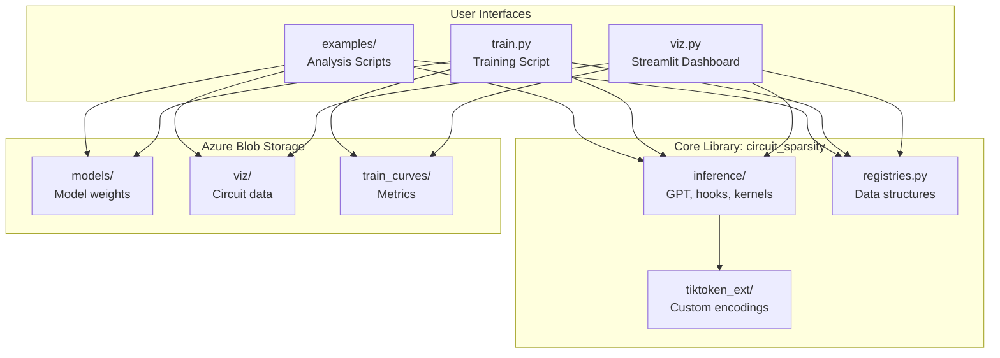
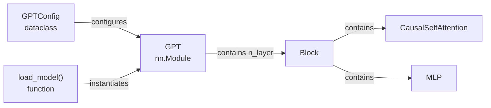
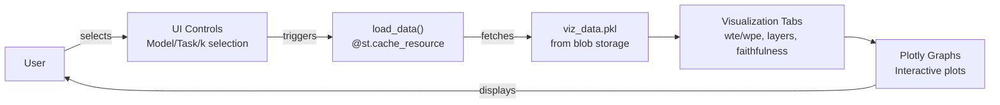
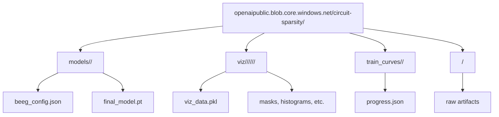
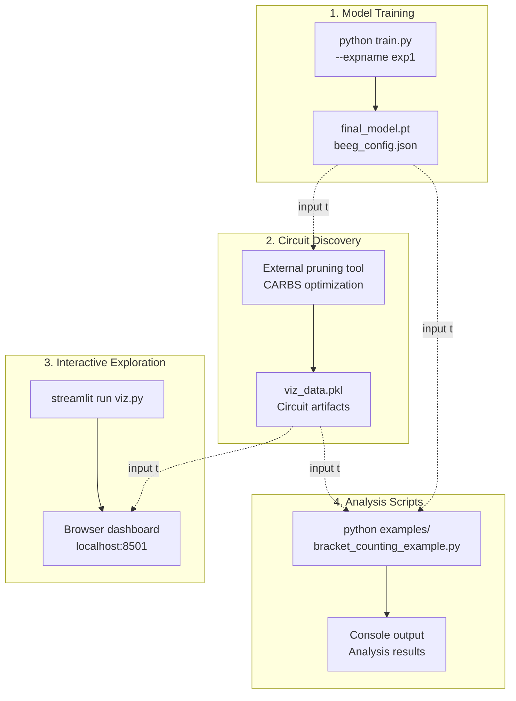

<!-- source: DeepWiki mcp.deepwiki.com · repo openai/circuit_sparsity · page 1 Overview · fetched 2026-10-26 -->

# Overview

<details>
<summary>Relevant source files</summary>

The following files were used as context for generating this wiki page:

- [README.md](README.md)
- [pyproject.toml](pyproject.toml)

</details>


This page introduces the `circuit_sparsity` repository, which provides tools for analyzing sparse neural network circuits as described in [Gao et al. 2025](https://openai.com/index/understanding-neural-networks-through-sparse-circuits). The repository contains a GPT transformer implementation with sparsity features, a Streamlit-based visualization dashboard for exploring pruned circuits, and utilities for training and analyzing sparse models.

For installation instructions and environment setup, see [Installation and Setup](#1.1). For details on the GPT model architecture, see [GPT Model Implementation](#2). For visualization features, see [Visualization System](#3).

**Sources:** [README.md:1-5]()

## Purpose and Scope

The `circuit_sparsity` repository serves three primary purposes:

1. **Inference**: Run forward passes on sparse transformer models with configurable activation and weight sparsity
2. **Visualization**: Interactively explore pruned circuits through a Streamlit dashboard that displays circuit structure, node importance, and activation patterns
3. **Analysis**: Reproduce experimental results and analyze model behaviors on specific tasks

The repository does **not** include the pruning algorithms themselves (which use external tools like CARBS optimization), but provides the infrastructure to load, visualize, and analyze the resulting pruned circuits.

**Sources:** [README.md:3-5](), [README.md:30-58]()

## System Architecture

The repository consists of three main subsystems that interact with a centralized data storage layer:



**Component Responsibilities:**

| Component | Purpose | Key Files |
|-----------|---------|-----------|
| `inference/` | GPT model implementation with sparsity support | `gpt.py`, `hook_utils.py`, `kernels.py` |
| `registries.py` | Data structures for tasks, datapoints, and model configurations | `registries.py` |
| `tiktoken_ext/` | Custom tokenization for Python code | `tinypython.py` |
| `viz.py` | Interactive circuit exploration dashboard | `viz.py` |
| `train.py` | Training script for sparse models | `train.py` |
| `examples/` | Demonstration scripts for analysis | `bracket_counting_example.py` |

**Sources:** [README.md:32-38](), [README.md:68-85]()

## Core Components

### GPT Model System

The `circuit_sparsity.inference.gpt` module provides a lightweight GPT implementation designed for sparse circuit analysis:



Key classes and functions:
- `GPTConfig`: Configuration dataclass with parameters like `d_model`, `n_layer`, `n_head`, `afrac` (activation sparsity)
- `GPT`: Main transformer model supporting CPU/GPU inference
- `load_model(model_dir, cuda=False)`: Loads model from `beeg_config.json` and `final_model.pt`

**Sources:** [README.md:32-38]()

### Hook System

The `hook_utils` module enables recording intermediate activations during forward passes:

```python
from circuit_sparsity.inference.gpt import load_model
from circuit_sparsity.inference.hook_utils import hook_recorder

model = load_model("models/csp_yolo1")

with hook_recorder() as rec:
    model(input_ids)

# rec contains {"0.attn.act_in": tensor(...), "0.attn.act_out": tensor(...), ...}
```

This is essential for the visualization system and analysis scripts. See [Hook System for Activation Recording](#2.4) for details.

**Sources:** [README.md:42-56]()

### Visualization Dashboard

The `viz.py` Streamlit app provides interactive exploration of pruned circuits:



Launch with: `streamlit run circuit_sparsity/viz.py`

The dashboard allows users to:
- Select models, datasets, pruning sweeps, and node budgets (`k`)
- View circuit topology with node importance scores
- Click nodes to see activation patterns on code samples
- Compare circuit performance across different pruning levels

**Sources:** [README.md:14-28]()

## Data Organization

All persistent data resides in Azure Blob Storage at `https://openaipublic.blob.core.windows.net/circuit-sparsity`:



| Directory | Contents | Used By |
|-----------|----------|---------|
| `models/<model_name>/` | `beeg_config.json`, `final_model.pt` | `load_model()`, training scripts |
| `viz/<path>/` | `viz_data.pkl` with circuit data | Streamlit dashboard |
| `train_curves/<model_name>/` | `progress.json` with training metrics | Dashboard summary table |

The paths are defined in `registries.py` as `MODEL_BASE_DIR`, `VIZ_BASE_DIR`, etc.

**Sources:** [README.md:68-85]()

## Model Families

The repository includes several model families for different experimental purposes:

| Model Family | Size | Purpose | Example |
|--------------|------|---------|---------|
| `csp_yolo1` | 118M params | Qualitative demonstrations | `single_double_quote` task |
| `csp_yolo2` | 475M params | Qualitative demonstrations | `bracket_counting` task |
| `csp_sweep1_*` | Variable | Figure 3 results (size/sparsity sweep) | Performance curves |
| `csp_bridge1`, `csp_bridge2` | - | Paper results | Main findings |
| `dense1_1x`, `dense1_2x`, `dense1_4x` | 1x, 2x, 4x | Baseline comparisons | Dense models |

Pruning algorithm variants:
- `prune_v2`: 256 CARBS iterations, fixed `k` target (unpublished)
- `prune_v3`: 256 CARBS iterations, fixed loss target (unpublished)
- `prune_v4`: 768 CARBS iterations, fixed loss target (published)
- `prune_v5_logitscaling`: 256 CARBS iterations with logit scaling (published)

**Sources:** [README.md:88-105]()

## User Workflows

The system supports four primary workflows:



**Typical Usage Patterns:**

1. **Load and run a pretrained model:**
   ```python
   from circuit_sparsity.inference.gpt import load_model
   model = load_model("models/csp_yolo2")
   logits, loss, _ = model(input_ids, targets=targets)
   ```

2. **Launch the visualizer:**
   ```bash
   streamlit run circuit_sparsity/viz.py
   ```
   Then select model, dataset, sweep, and k value from the UI.

3. **Run example analysis:**
   ```bash
   python examples/bracket_counting_example.py
   ```

**Sources:** [README.md:14-19](), [README.md:40-58](), [README.md:107-109]()

## Dependencies

The package requires Python 3.10+ and the following key dependencies:

| Category | Packages |
|----------|----------|
| Deep Learning | `torch` |
| Visualization | `streamlit`, `plotly`, `matplotlib`, `seaborn`, `streamlit-plotly-events` |
| Data Handling | `blobfile`, `tiktoken`, `natsort` |
| Utilities | `pytest`, `idemlib`, `xxhash`, `watchdog`, `mpi4py` |

Install with: `pip install -e .`

**Sources:** [pyproject.toml:19-34](), [README.md:9-11]()

## Quick Reference

**Key Import Paths:**
- `circuit_sparsity.inference.gpt` → `GPT`, `GPTConfig`, `load_model`
- `circuit_sparsity.inference.hook_utils` → `hook_recorder`, `HookContext`
- `circuit_sparsity.registries` → `Datapoint`, `Task`, `MODEL_BASE_DIR`
- `circuit_sparsity.tiktoken_ext.tinypython` → Custom tokenization

**Common Commands:**
```bash
# Launch visualizer
streamlit run circuit_sparsity/viz.py

# Run tests
pytest tests/test_gpt.py

# Clear local cache
python clear_cache.py
```

**Data URL Pattern:**
```
https://openaipublic.blob.core.windows.net/circuit-sparsity/
  └── models/<model_name>/final_model.pt
  └── viz/<experiment>/<model>/<task>/<sweep>/<k>/viz_data.pkl
  └── train_curves/<model_name>/progress.json
```

**Sources:** [README.md:9-11](), [README.md:14-19](), [README.md:60-64](), [README.md:107-112]()

---

