# Page: Overview

# Overview

<details>
<summary>Relevant source files</summary>

The following files were used as context for generating this wiki page:

- [CHANGELOG.md](CHANGELOG.md)
- [README.md](README.md)
- [action.yml](action.yml)

</details>


This document provides a comprehensive overview of the `codex-action` repository, which implements a GitHub Action for safely executing OpenAI's Codex CLI within GitHub Actions workflows. This page covers the system's purpose, high-level architecture, and key components.

## Purpose and Scope

The `codex-action` repository implements a GitHub Action that enables users to run `codex exec` commands directly from GitHub Actions workflows while maintaining strict control over execution privileges and security. The action handles the complex infrastructure setup required for Codex execution, including CLI installation, OpenAI API proxy management, and privilege isolation, allowing users to focus on crafting effective prompts.

**Sources:** [README.md:1-3](), [action.yml:1-3]()

## What is codex-action

The `codex-action` system is a composite GitHub Action that orchestrates the execution of OpenAI's Codex CLI in a controlled environment. At its core, it provides:

- **Automated Infrastructure Setup**: Installs `@openai/codex` CLI and `@openai/codex-responses-api-proxy` packages [action.yml:144-154]().
- **Security-First Design**: Implements multiple safety strategies (e.g., `drop-sudo`, `read-only`, `unprivileged-user`) to restrict Codex privileges [action.yml:74-106]().
- **Seamless Integration**: Exposes a simple interface through `action.yml` while handling complex orchestration internally [action.yml:4-122]().
- **Cross-Platform Support**: Works on Linux, macOS, and Windows with appropriate safety constraints [action.yml:74-77](), [action.yml:131-140]().

The action accepts either inline prompts via the `prompt` input or file-based prompts via `prompt-file`, executes them through the Codex CLI, and returns the results as the `final-message` output for downstream workflow steps [action.yml:5-12](), [action.yml:124-126]().

**Sources:** [README.md:1-6](), [action.yml:4-152]()

## High-Level System Architecture

The following diagram shows the major system components and their relationships, using the actual code entities from the repository:

**Figure 1: High-Level System Architecture**
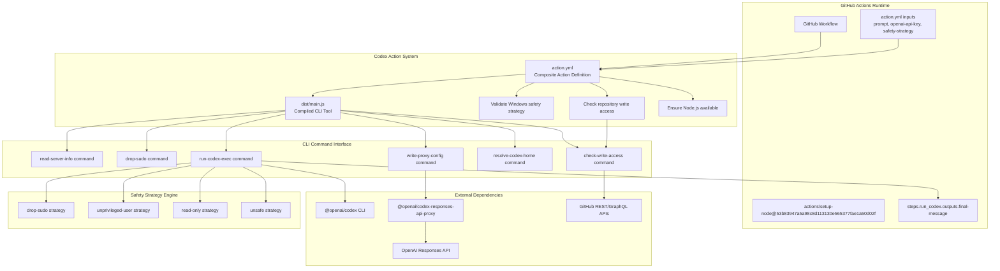

**Sources:** [action.yml:1-152](), [README.md:95-117]()

## Action Execution Flow

The following sequence diagram illustrates the step-by-step execution flow using the actual step names and commands from the action definition:

**Figure 2: Action Execution Sequence**
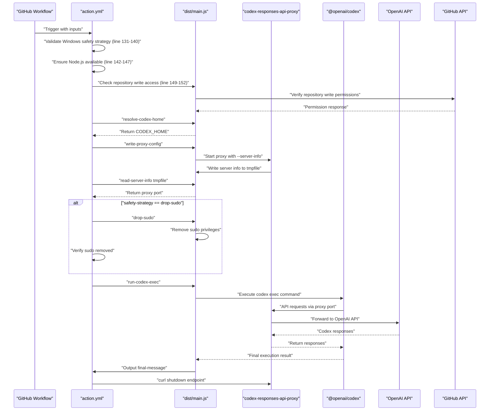

**Sources:** [action.yml:131-152]()

## Key System Components

### Action Definition Layer
- **`action.yml`**: The composite action definition that orchestrates the entire execution pipeline.
- **Input validation**: Platform-specific safety strategy validation (e.g., ensuring `unsafe` on Windows) [action.yml:131-140]().
- **Dependency management**: Node.js setup [action.yml:142-147]().

### CLI Tool Layer
- **`dist/main.js`**: Compiled TypeScript application that implements core commands used within the composite action steps.
- **Command interface**: Five main commands exposed through the CLI tool:

| Command | Purpose | Reference |
|---------|---------|----------|
| `check-write-access` | Verify repository write permissions for the actor | [action.yml:149-152]() |
| `resolve-codex-home` | Determine the directory for Codex config/cache | N/A |
| `read-server-info` | Parse proxy server information (port/PID) | N/A |
| `drop-sudo` | Remove sudo privileges from the current user | N/A |
| `run-codex-exec` | Execute Codex CLI with security constraints | N/A |
| `write-proxy-config` | Configure and start the Responses API proxy | N/A |

### Safety Strategy System
The action implements four distinct safety strategies to control Codex execution privileges:

**Figure 3: Safety Strategy Decision Tree**
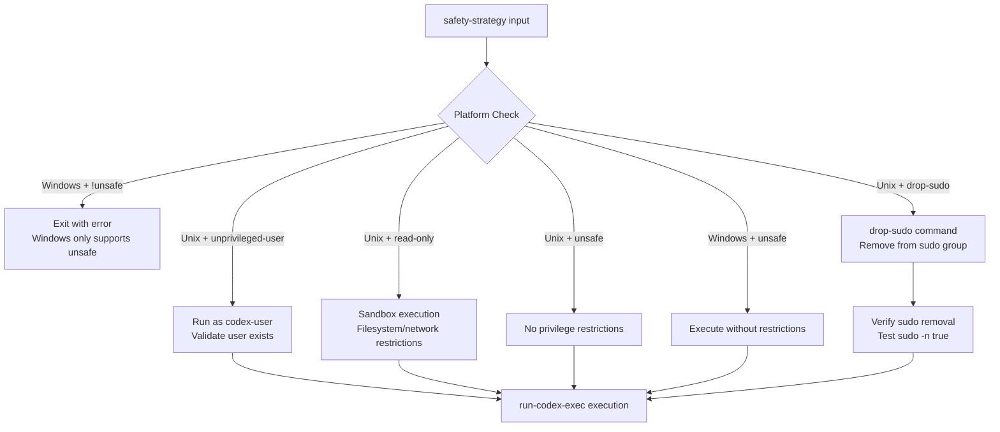

**Sources:** [action.yml:74-106](), [action.yml:131-140](), [README.md:113-114]()

### External Integration Layer
- **`@openai/codex`**: The official Codex CLI package installed at runtime.
- **`@openai/codex-responses-api-proxy`**: Proxy service for OpenAI API communication, protecting the API key.
- **GitHub APIs**: Used for permission checking via `check-write-access` [action.yml:149-152]().
- **OpenAI API**: Target API for Codex execution requests [action.yml:21-22]().

**Sources:** [action.yml:149-152](), [action.yml:21-22]()

## Data Flow Architecture

The action processes data through a structured pipeline from workflow inputs to final outputs:

**Figure 4: Data Flow Architecture**
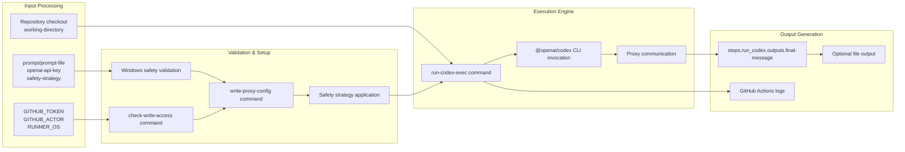

**Sources:** [action.yml:4-122](), [action.yml:124-126]()

This architecture enables the action to provide a secure, controlled environment for Codex execution while maintaining ease of use for end users through a well-defined GitHub Actions interface.

## Next Steps

- [Getting Started](2) — Practical examples and basic usage patterns.
- [Configuration Reference](3) — Detailed documentation for all action inputs and outputs.
- [Security and Safety Strategies](4) — Deep dive into privilege isolation and safety mechanisms.
- [Internal Architecture](5) — Details on the CLI tool and build system.
- [Development Guide](6) — How to contribute and understand the CI pipeline.
- [Legal and Licensing](7) — Licensing and copyright information.
- [Glossary](8) — Definitions of codebase-specific terms.

---

# Page: Getting Started

# Getting Started

<details>
<summary>Relevant source files</summary>

The following files were used as context for generating this wiki page:

- [README.md](README.md)

</details>


This document provides practical examples and basic usage patterns for integrating `codex-action` into GitHub workflows. It covers essential setup steps, common use cases, and fundamental configuration patterns to get you running Codex commands in your CI/CD pipelines quickly.

For comprehensive configuration options, see [Configuration Reference](). For detailed security considerations and advanced safety strategies, see [Security and Safety Strategies]().

## Basic Setup

The `codex-action` is a GitHub composite action that executes OpenAI's Codex CLI in a controlled environment. The minimal setup requires only an OpenAI API key and either a prompt or prompt file.

### Minimal Example

```yaml
name: Run Codex Exec
on: workflow_dispatch

jobs:
  codex:
    runs-on: ubuntu-latest
    steps:
      - uses: actions/checkout@v5
      - name: Run Codex
        uses: openai/codex-action@v1
        with:
          openai-api-key: ${{ secrets.OPENAI_API_KEY }}
          prompt: "Write a Python script that prints hello world"
```

This basic workflow uses the default safety strategy (`drop-sudo`) and streams output to the workflow logs.

**Sources:** [README.md:53-65]()

### Essential Prerequisites

| Requirement | Description |
|-------------|-------------|
| `actions/checkout@v5` | Provides repository context for Codex |
| `OPENAI_API_KEY` secret | Stored in repository or organization secrets |
| Node.js 20+ runtime | Automatically provided by `actions/setup-node@v4` |

The action automatically installs the Codex CLI and required proxy components during execution.

**Sources:** [README.md:3-5]()

## Action Execution Flow

This diagram shows how the key components interact during action execution, mapping to specific steps in the composite action:

Title: Codex Action Execution Sequence
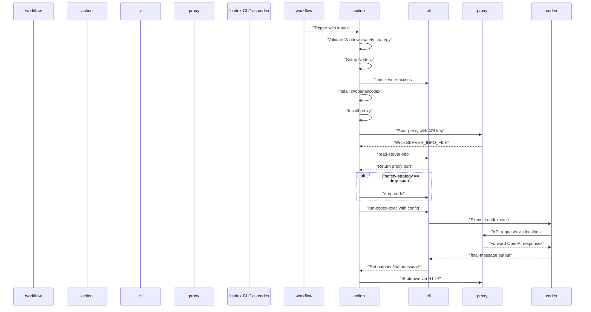

**Sources:** [README.md:1-115]()

## Common Usage Patterns

### Automated Code Review

A common use case for `codex-action` is automated code review. This involves triggering the action on pull request events, providing Codex with the PR details, and then posting its output as a comment.

Title: Automated Code Review Workflow
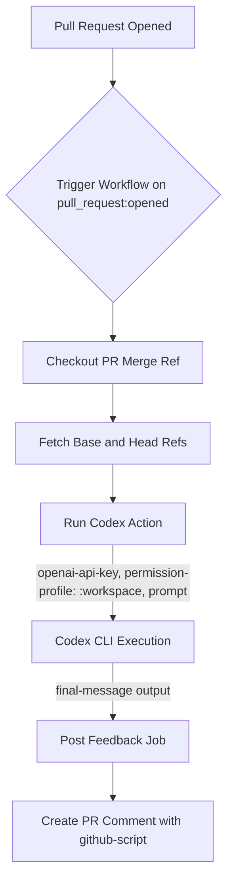

For a detailed example of setting up an automated code review bot, including `actions/checkout` requirements and how to post comments, see [Example Workflows](#2.1).

**Sources:** [README.md:7-97]()

### Prompt File Pattern

For complex or multi-line prompts, use a dedicated file:

```yaml
- name: Run Codex with file prompt
  uses: openai/codex-action@v1
  with:
    openai-api-key: ${{ secrets.OPENAI_API_KEY }}
    prompt-file: ".github/prompts/refactor.md"
    working-directory: "src"
```

The `prompt-file` path is relative to the repository root, while `working-directory` controls where `codex exec` runs.

**Sources:** [README.md:102-104](), [README.md:108]()

### Output Capture Pattern

Capture Codex output for use in subsequent workflow steps:

```yaml
- name: Run Codex
  id: run_codex
  uses: openai/codex-action@v1
  with:
    openai-api-key: ${{ secrets.OPENAI_API_KEY }}
    prompt: "Analyze this codebase and suggest improvements"
    output-file: "codex_analysis.md"

- name: Use Codex output
  run: |
    echo "Codex result: ${{ steps.run_codex.outputs.final-message }}"
    cat codex_analysis.md
```

The action exposes `final-message` as an output and optionally writes to `output-file`. For a detailed explanation of how to consume these outputs, including output schemas and validation, see [Consuming Outputs](#2.2).

**Sources:** [README.md:31-32](), [README.md:105-107]()

### Safety Strategy Selection

Choose appropriate safety levels based on your use case. On Windows, only `unsafe` is supported.

```yaml
# For untrusted prompts (default)
- uses: openai/codex-action@v1
  with:
    safety-strategy: drop-sudo
    
# For Windows runners (required)
- uses: openai/codex-action@v1
  with:
    safety-strategy: unsafe
    
# For custom user accounts
- uses: openai/codex-action@v1
  with:
    safety-strategy: unprivileged-user
    codex-user: guest
```

**Sources:** [README.md:109-110]()

## Input/Output Data Flow

This diagram illustrates how configuration inputs flow through the system to produce outputs:

Title: Natural Language to Code Entity Mapping
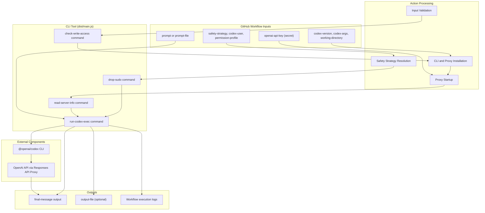

**Sources:** [README.md:99-115]()

## Platform Considerations

### Operating System Support

| Platform | Supported Safety Strategies | Notes |
|----------|----------------------------|--------|
| Ubuntu Latest | `drop-sudo`, `unprivileged-user`, `read-only`, `unsafe` | Full feature support |
| macOS Latest | `drop-sudo`, `unprivileged-user`, `read-only`, `unsafe` | Full feature support |
| Windows Latest | `unsafe` only | Action validates and fails on other strategies |

The action includes platform-specific validation logic to prevent unsupported configurations.

**Sources:** [README.md:1-115]()

### Permission Requirements

The action checks repository write access by default using the `check-write-access` command:

```yaml
# Default behavior - requires write access for triggering user
allow-users: ""

# Allow bot accounts to bypass check  
allow-bots: "false"
```

This security measure prevents unauthorized execution of potentially dangerous prompts by users without write access to the repository.

**Sources:** [README.md:1-115]()

## Next Steps

- For complete input/output reference, see [Configuration Reference]()
- For security best practices and advanced safety strategies, see [Security and Safety Strategies]()  
- For understanding the internal CLI tool commands, see [CLI Commands]()
- For contribution guidelines, see [Contributing and CLA Process]()

**Sources:** [README.md:18]()

---

# Page: Example Workflows

# Example Workflows

<details>
<summary>Relevant source files</summary>

The following files were used as context for generating this wiki page:

- [README.md](README.md)
- [examples/test-sandbox-protections.yml](examples/test-sandbox-protections.yml)
- [examples/unprivileged-user.yml](examples/unprivileged-user.yml)
- [src/checkOutput.ts](src/checkOutput.ts)
- [src/writeProxyConfig.ts](src/writeProxyConfig.ts)

</details>


This page details example workflows for `openai/codex-action`, focusing on their checkout requirements, triggers, and safety strategy choices. We will examine the examples provided in the `examples/` directory (`test-sandbox-protections.yml`, `unprivileged-user.yml`) and the `README.md` file.

## Pull Request Code Review Bot

The `README.md` provides an example of a GitHub Actions workflow that creates a pull request bot [README.md:7-97](). This bot is triggered when a pull request is opened and uses `openai/codex-action` to perform a code review, then posts the feedback as a comment on the PR.

### Workflow Trigger and Permissions

The workflow is triggered by the `pull_request` event with the `types: [opened]` filter [README.md:24-26](). This means the workflow will run whenever a new pull request is opened in the repository.

The `codex` job requires `contents: read` permission to access the repository's code [README.md:32-33](). The `post_feedback` job requires `issues: write` and `pull-requests: write` permissions to post comments on the pull request [README.md:81-82]().

### Checkout Requirements

The workflow uses `actions/checkout@v5` to clone the repository [README.md:36-41]().
Crucially, it explicitly checks out the PR's merge commit using `ref: refs/pull/${{ github.event.pull_request.number }}/merge` [README.md:39](). This ensures that Codex reviews the code as it would appear after merging. `persist-credentials: false` is also set [README.md:40]().

Additionally, a `Pre-fetch base and head refs for the PR` step is included to fetch the base and head references of the pull request [README.md:44-51](). This is necessary for Codex to accurately identify the changes introduced by the PR.

### Codex Execution and Prompt

The `Run Codex` step executes the `openai/codex-action` [README.md:56-75]().
It provides the `openai-api-key` from GitHub secrets [README.md:60]() and sets the `permission-profile` to `:workspace` [README.md:61](). The `:workspace` permission profile is recommended for new workflows as it does not grant network access, enhancing security [README.md:52-54]().

The `prompt` is constructed to include details about the pull request, such as its number, repository, title, and body [README.md:62-74](). It also instructs Codex to review only the changes introduced by the PR, suggesting a `git log` command to identify these changes [README.md:65-66]().

### Output Consumption

The `final_message` output from the `run_codex` step is captured [README.md:34](). This output contains the code review feedback generated by Codex.

The `post_feedback` job depends on the `codex` job (`needs: codex`) [README.md:78](). It checks if `final_message` is not empty before proceeding [README.md:79]().
It then uses `actions/github-script@v7` to create a comment on the pull request with the `CODEX_FINAL_MESSAGE` [README.md:85-96]().

```mermaid
graph TD
    A[Pull Request Opened] --> B{codex job};
    B -- "contents: read" --> C[actions/checkout@v5];
    C -- "ref: refs/pull/${{ github.event.pull_request.number }}/merge" --> D[Pre-fetch base and head refs];
    D --> E[Run Codex];
    E -- "openai-api-key, permission-profile: :workspace, prompt" --> F[openai/codex-action@v1];
    F -- "final-message output" --> G{post_feedback job};
    G -- "issues: write, pull-requests: write" --> H[Report Codex feedback];
    H -- "github.rest.issues.createComment" --> I[PR Comment];

    subgraph "codex job"
        B
        C
        D
        E
        F
    end

    subgraph "post_feedback job"
        G
        H
        I
    end
```
**Diagram 1: Pull Request Code Review Workflow**
Sources: [README.md:23-97]()

## Test Sandbox Protections

The `examples/test-sandbox-protections.yml` workflow demonstrates the importance of different `safety-strategy` choices in preventing sensitive data exfiltration [examples/test-sandbox-protections.yml:1-2]().

### Workflow Trigger and Strategy

This workflow is triggered manually using `workflow_dispatch` [examples/test-sandbox-protections.yml:6]().
It uses a matrix strategy to run the `assess-exfiltration-risk` job with different `safety-strategy` values: `drop-sudo`, `read-only`, and `unsafe` [examples/test-sandbox-protections.yml:11-22](). `fail-fast: false` is set to ensure all strategies are tested even if one fails [examples/test-sandbox-protections.yml:12]().

### Codex Execution with Different Safety Strategies

For each `safety-strategy` in the matrix, the workflow runs `openai/codex-action@v1` [examples/test-sandbox-protections.yml:23-29](). A dummy `openai-api-key` is provided to simulate a sensitive secret [examples/test-sandbox-protections.yml:27-28]().

### Attempted API Key Exfiltration

After running Codex, the workflow attempts to exfiltrate the `openai-api-key` by dumping the memory of the `codex-responses-api-proxy` process [examples/test-sandbox-protections.yml:31-66]().

1.  **Find PID**: It first locates the Process ID (PID) of the `codex-responses-api-proxy` process by reading the `SERVER_INFO_FILE` [examples/test-sandbox-protections.yml:35-36](). The `SERVER_INFO_FILE` is located at `$HOME/.codex/$CODEX_RUN_ID.json` [examples/test-sandbox-protections.yml:35]().
2.  **Memory Dump**: It then uses `sudo bash` to read `/proc/$pid/maps` to identify memory regions and `dd` to dump these regions to temporary files in `/tmp/` [examples/test-sandbox-protections.yml:41-51](). This simulates a privileged attacker trying to access process memory.
3.  **Search for Key**: Finally, `grep` is used to search for the API key pattern (`sk-proj-` followed by alphanumeric characters) within the dumped memory files [examples/test-sandbox-protections.yml:55-56]().

The output indicates whether potential leaks were found [examples/test-sandbox-protections.yml:57-66](). This example highlights how `drop-sudo` prevents such exfiltration, while `read-only` and `unsafe` strategies might be vulnerable.

```mermaid
graph TD
    A[workflow_dispatch] --> B{assess-exfiltration-risk job};
    B -- "matrix: safety-strategy" --> C{Run Codex (${{ matrix.safety-strategy }})};
    C -- "openai-api-key, safety-strategy" --> D[openai/codex-action@v1];
    D --> E[Try to dump the key from the codex-responses-api-proxy process];
    E -- "Read SERVER_INFO_FILE" --> F[Find PID of codex-responses-api-proxy];
    F -- "sudo bash -s -- $PID" --> G[Dump process memory from /proc/$PID/mem];
    G -- "grep -aPo 'sk-proj-...' /tmp/${PID}-*.bin" --> H[Search for API key pattern];
    H --> I{Report: "Potential leaks found" or "No leaks found"};
```
**Diagram 2: Sandbox Protection Test Workflow**
Sources: [examples/test-sandbox-protections.yml:1-66]()

## Run Codex as an Unprivileged User

The `examples/unprivileged-user.yml` workflow demonstrates how to run `openai/codex-action` with the `unprivileged-user` safety strategy and a custom `codex-user`.

### Workflow Trigger and User Setup

This workflow is also triggered manually using `workflow_dispatch` [examples/unprivileged-user.yml:3]().

The first step, `Create unprivileged user`, uses `sudo adduser` to create a system user named `guest` with a home directory at `/home/guest` and a shell of `/bin/bash` [examples/unprivileged-user.yml:9-11]().
It then adds the default `runner` account to the `guest` group and the `guest` user to the `runner` group [examples/unprivileged-user.yml:13-18](). This ensures that the `guest` user can traverse directories owned by the `runner` (e.g., `/home/runner/work` where `actions/checkout` places the code).

### Checkout and Ownership Change

The workflow uses `actions/checkout@v5` to clone the repository [examples/unprivileged-user.yml:21]().

The `Change ownership` step is crucial for the `unprivileged-user` strategy [examples/unprivileged-user.yml:23-32](). It changes the group ownership of the checked-out files in `GITHUB_WORKSPACE` to the `guest` group (`sudo chown -R runner:guest "$GITHUB_WORKSPACE"`) [examples/unprivileged-user.yml:25](). It then extends user permissions to the group (`sudo chmod -R g+rwX "$GITHUB_WORKSPACE"`) [examples/unprivileged-user.yml:28]() and sets the `setgid` bit on directories to ensure new files and directories created within `GITHUB_WORKSPACE` inherit the `guest` group [examples/unprivileged-user.yml:31]().

### Codex Execution as Unprivileged User

The `Run Codex as unprivileged user` step executes `openai/codex-action@v1` [examples/unprivileged-user.yml:33-40]().
It provides the `openai-api-key` from secrets [examples/unprivileged-user.yml:37]().
The key configuration here is `safety-strategy: unprivileged-user` and `codex-user: guest` [examples/unprivileged-user.yml:38-39](). This instructs the action to run the Codex process as the `guest` user created earlier.
The `prompt` asks Codex to report `$USER`, `$HOME`, and the output of `whoami`, which should reflect the `guest` user [examples/unprivileged-user.yml:40]().

### `writeProxyConfig` and `unprivileged-user`

When `safetyStrategy` is `unprivileged-user`, the `writeProxyConfig` function handles writing the `config.toml` file differently [src/writeProxyConfig.ts:39-54](). Since the `CODEX_HOME` directory is owned by another user (the `guest` user in this example), `writeProxyConfig` first writes the configuration to a temporary file and then uses `sudo mv` to move it to the correct `config.toml` path within `codexHome` [src/writeProxyConfig.ts:43-46](). This ensures the configuration is correctly placed despite the privilege separation. The `checkOutput` utility function is used to execute the `sudo mv` command and handle its output [src/writeProxyConfig.ts:46](), [src/checkOutput.ts:3-27]().

```mermaid
graph TD
    A[workflow_dispatch] --> B{run-codex-with-unprivileged-user job};
    B --> C[Create unprivileged user];
    C -- "sudo adduser guest, usermod" --> D[actions/checkout@v5];
    D --> E[Change ownership];
    E -- "sudo chown -R runner:guest, chmod g+rwX, find -type d -exec chmod g+s" --> F[Run Codex as unprivileged user];
    F -- "openai-api-key, safety-strategy: unprivileged-user, codex-user: guest, prompt" --> G[openai/codex-action@v1];
    G -- "Internally calls writeProxyConfig" --> H[writeProxyConfig(codexHome, port, "unprivileged-user")];
    H -- "Writes to temp file, then sudo mv" --> I[Codex process runs as 'guest' user];
```
**Diagram 3: Unprivileged User Workflow**
Sources: [examples/unprivileged-user.yml:1-40](), [src/writeProxyConfig.ts:39-54](), [src/checkOutput.ts:3-27]()

---

# Page: Consuming Outputs

# Consuming Outputs

<details>
<summary>Relevant source files</summary>

The following files were used as context for generating this wiki page:

- [README.md](README.md)
- [examples/unprivileged-user.yml](examples/unprivileged-user.yml)
- [src/checkOutput.ts](src/checkOutput.ts)
- [src/runCodexExec.ts](src/runCodexExec.ts)
- [src/writeProxyConfig.ts](src/writeProxyConfig.ts)

</details>


This page details how the `codex-action` produces and how downstream GitHub Actions workflows consume its outputs, specifically the `final-message` output and the `output-file`. It covers the output schemas and the `checkOutput` validation mechanism.

## Action Outputs

The `codex-action` provides two primary ways to access the results of a Codex execution:

1.  **`final-message` output**: This is a direct output of the GitHub Action, accessible via `steps.<step_id>.outputs.final-message`. It contains the main message generated by Codex.
2.  **`output-file`**: If specified, the Codex output is written to a file at the given path. This allows for more complex processing of the output, especially when the output is structured (e.g., JSON).

### `final-message` Output

The `final-message` output is a string containing the primary response from the Codex model. This is typically used for direct consumption in subsequent steps, such as posting comments on a Pull Request.

**Example Usage:**

The `README.md` provides an example of a PR bot that uses `final-message` to post a comment on a pull request [README.md:76-96]():

```yaml
  post_feedback:
    runs-on: ubuntu-latest
    needs: codex
    if: needs.codex.outputs.final_message != ''
    permissions:
      issues: write
      pull-requests: write
    steps:
      - name: Report Codex feedback
        uses: actions/github-script@v7
        env:
          CODEX_FINAL_MESSAGE: ${{ needs.codex.outputs.final_message }}
        with:
          github-token: ${{ github.token }}
          script: |
            await github.rest.issues.createComment({
              owner: context.repo.owner,
              repo: context.repo.repo,
              issue_number: context.payload.pull_request.number,
              body: process.env.CODEX_FINAL_MESSAGE,
            });
```
In this example, the `post_feedback` job depends on the `codex` job. It retrieves the `final_message` output from the `codex` job using `needs.codex.outputs.final_message` and then uses `actions/github-script@v7` to post this message as a comment on the pull request.

Sources:
- [README.md:76-96]()

### `output-file` Input

The `output-file` input allows users to specify a file path where the final Codex message should be written [README.md:107](). If this input is left empty, no output file is written. This is particularly useful when the Codex output is expected to be structured data that needs to be parsed by another tool or script.

The `runCodexExec` function handles the creation of this output file. If `explicitOutputFile` is provided, it uses that path; otherwise, it creates a temporary file [src/runCodexExec.ts:164-168]().

```typescript
  let outputFile: OutputFile;
  if (explicitOutputFile != null) {
    outputFile = { type: "explicit", file: explicitOutputFile };
  } else {
    outputFile = await createTempOutputFile({ runAsUser });
  }
```

Sources:
- [README.md:107]()
- [src/runCodexExec.ts:164-168]()

## Output Schemas

The `codex-action` supports defining an output schema for Codex, which can be provided either inline via `output-schema` or from a file via `output-schema-file` [README.md:113-114](). These inputs are mutually exclusive. The schema is passed to `codex exec` using the `--output-schema` flag.

The `OutputSchemaSource` type in `src/runCodexExec.ts` defines the structure for these schema inputs:

```typescript
export type OutputSchemaSource =
  | {
      type: "file";
      path: string;
    }
  | {
      type: "inline";
      content: string;
    };
```
[src/runCodexExec.ts:104-112]()

The `resolveOutputSchema` function (not fully shown in the provided code, but implied by its usage in `runCodexExec`) would handle writing the inline schema content to a temporary file if `type: "inline"` is used, or simply using the provided path if `type: "file"`.

Sources:
- [README.md:113-114]()
- [src/runCodexExec.ts:104-112]()

## `checkOutput` Validation

The `checkOutput` function [src/checkOutput.ts:3-27]() is a utility function used internally by `codex-action` to execute a command and capture its standard output, while also ensuring that the command exits successfully (with a zero exit code). If the command fails, it rejects the promise with an error.

```typescript
export function checkOutput(command: Array<string>): Promise<string> {
  const [prog, ...args] = command;
  return new Promise<string>((resolve, reject) => {
    const proc = spawn(prog, args, {
      env: process.env,
      stdio: ["ignore", "pipe", "inherit"],
    });

    proc.on("error", reject);

    let output = "";
    proc.stdout.on("data", (chunk) => {
      output += chunk.toString();
    });

    proc.on("close", (code) => {
      if (code !== 0) {
        reject(new Error(`${prog} exited with code ${code}`));
        return;
      }

      resolve(output);
    });
  });
}
```
[src/checkOutput.ts:3-27]()

This function is crucial for robust execution of external commands within the action. For example, it's used in `src/runCodexExec.ts` to verify `sudo` access before attempting a `drop-sudo` operation [src/runCodexExec.ts:194-195](), and to find the `codex` executable path [src/runCodexExec.ts:201](). It's also used in `src/writeProxyConfig.ts` when the `unprivileged-user` safety strategy is active to move the generated `config.toml` using `sudo` [src/writeProxyConfig.ts:47]().

Sources:
- [src/checkOutput.ts:3-27]()
- [src/runCodexExec.ts:194-195]()
- [src/runCodexExec.ts:201]()
- [src/writeProxyConfig.ts:47]()

## Data Flow for Output Consumption

The following diagram illustrates the data flow from Codex execution to output consumption in a GitHub Actions workflow.

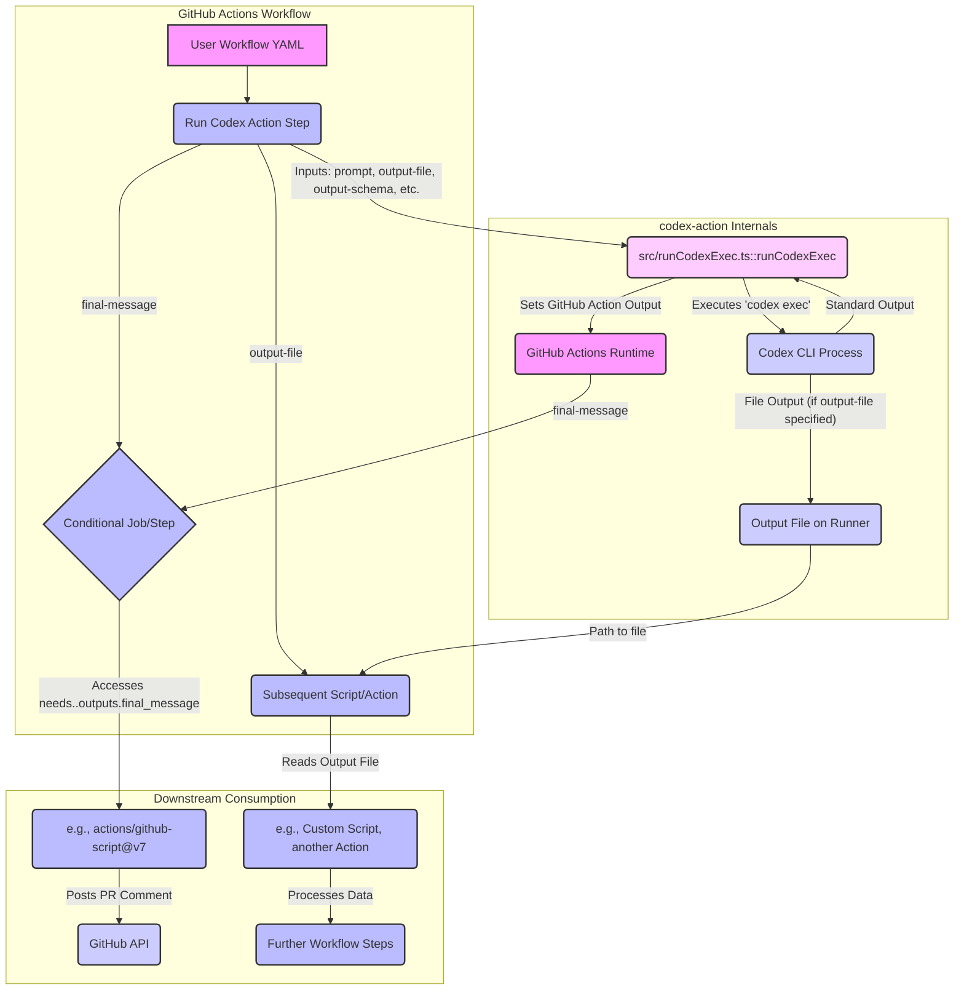
**Diagram: Codex Action Output Data Flow**

Sources:
- [README.md:76-96]()
- [src/runCodexExec.ts:123-149]()

## `checkOutput` Execution Flow

The `checkOutput` function is a critical component for executing external commands reliably. Here's a detailed look at its execution flow.

```mermaid
graph TD
    A[Call checkOutput(command: Array<string>)] --> B{Spawn Child Process};
    B -- "prog, args" --> C(child_process::spawn);
    C -- "stdout: pipe, stderr: inherit" --> D(Process Output Stream);
    C -- "on 'error' event" --> E{Reject Promise};
    D -- "on 'data' event" --> F(Accumulate Output String);
    C -- "on 'close' event" --> G{Check Exit Code};
    G -- "code !== 0" --> E;
    G -- "code === 0" --> H(Resolve Promise with Accumulated Output);
    E -- "Error" --> I(Caller handles error);
    H -- "Output String" --> J(Caller uses output);

    style A fill:#f9f,stroke:#333,stroke-width:2px
    style B fill:#bbf,stroke:#333,stroke-width:2px
    style C fill:#ccf,stroke:#333,stroke-width:2px
    style D fill:#ccf,stroke:#333,stroke-width:2px
    style E fill:#fcc,stroke:#333,stroke-width:2px
    style F fill:#fcf,stroke:#333,stroke-width:2px
    style G fill:#bbf,stroke:#333,stroke-width:2px
    style H fill:#fcf,stroke:#333,stroke-width:2px
    style I fill:#f9f,stroke:#333,stroke-width:2px
    style J fill:#f9f,stroke:#333,stroke-width:2px
```
**Diagram: `checkOutput` Execution Flow**

Sources:
- [src/checkOutput.ts:3-27]()

---

# Page: Configuration Reference

# Configuration Reference

<details>
<summary>Relevant source files</summary>

The following files were used as context for generating this wiki page:

- [README.md](README.md)
- [action.yml](action.yml)

</details>


This document provides a complete reference for all configuration inputs and outputs available in the `codex-action` GitHub Action. It covers all action parameters, their validation rules, platform-specific constraints, and data flow from inputs to the internal CLI execution.

## Action Inputs

The action accepts the following input parameters through the `with` section of a workflow step.

| Parameter | Required | Type | Default | Description |
|-----------|----------|------|---------|-------------|
| `openai-api-key` | No | String | `""` | Secret for authenticating with OpenAI API [action.yml:17-20](). |
| `responses-api-endpoint` | No | String | `""` | Optional Responses API endpoint override [action.yml:22-24](). |
| `prompt` | No* | String | `""` | Inline prompt text [action.yml:5-8](). |
| `prompt-file` | No* | String | `""` | Path to file containing the prompt [action.yml:9-12](). |
| `output-file` | No | String | `""` | File where the final Codex message is written [action.yml:13-16](). |
| `working-directory`| No | String | `""` | Directory passed to `codex exec --cd` [action.yml:25-28](). |
| `sandbox` | No | Enum | `""` | Legacy sandbox mode. Prefer `permission-profile` [action.yml:29-35](). |
| `permission-profile`| No | String | `""` | Codex permission profile (e.g., `:workspace`) [action.yml:37-42](). |
| `codex-version` | No | String | `""` | Version of `@openai/codex` to install [action.yml:43-46](). |
| `codex-args` | No | String | `""` | Additional args for `codex exec` (JSON array or shell string) [action.yml:47-53](). |
| `output-schema` | No | String | `""` | Inline JSON schema for structured output [action.yml:54-57](). |
| `output-schema-file`| No | String | `""` | File path to the output schema [action.yml:58-61](). |
| `model` | No | String | `""` | Model identifier (e.g., `gpt-4o`) [action.yml:62-65](). |
| `effort` | No | String | `""` | Reasoning effort (e.g., `low`, `medium`, `high`) [action.yml:66-69](). |
| `codex-home` | No | String | `""` | Trusted Codex home/config directory [action.yml:70-73](). |
| `safety-strategy` | No | Enum | `drop-sudo` | Privilege restriction strategy [action.yml:74-106](). |
| `codex-user` | No | String | `""` | Username for `unprivileged-user` strategy [action.yml:107-110](). |
| `allow-users` | No | String | `""` | Comma-separated list of GitHub usernames allowed to run [action.yml:111-114](). |
| `allow-bots` | No | Boolean | `false` | Allow `github-actions[bot]` to bypass write-access check [action.yml:115-118](). |
| `allow-bot-users` | No | String | `""` | Comma-separated list of trusted GitHub bot usernames [action.yml:119-122](). |

\* Either `prompt` or `prompt-file` must be provided [action.yml:6-10]().

**Sources:** [action.yml:4-122](), [README.md:99-115]()

## Data Flow: From Workflow to CLI

The following diagram bridges the GitHub Action inputs to the internal TypeScript implementation and CLI commands, showing how natural language inputs are mapped to code entities.

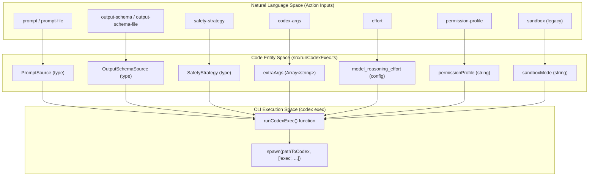

**Sources:** [src/runCodexExec.ts:8-62](), [src/runCodexExec.ts:138-142](), [src/runCodexExec.ts:167-172]()

## Input Validation and Execution Flow

The action performs validation in several steps before invoking the Codex CLI. The flow ensures that environment-specific constraints (like Windows limitations) are respected.

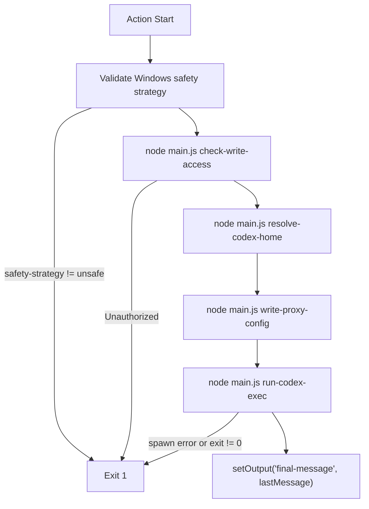

**Sources:** [action.yml:131-140](), [action.yml:149-152](), [src/runCodexExec.ts:176-180](), [src/runCodexExec.ts:212-212]()

## Detailed Input Reference

This section provides a high-level overview of the action's inputs. For detailed information on specific input categories, refer to the dedicated child pages.

### Prompt, Output, and Model Inputs

These inputs control the core interaction with the Codex model, defining what prompt is sent, how the output is structured, and which model parameters are used.

-   `prompt`: The direct text to send to Codex.
-   `prompt-file`: A path to a file containing the prompt text.
-   `output-file`: A path where the final Codex message will be written.
-   `output-schema`: Inline JSON schema for structured output.
-   `output-schema-file`: A path to a file containing the JSON schema for structured output.
-   `model`: Specifies the model to be used (e.g., `gpt-4o`).
-   `effort`: Controls the reasoning effort of the model.
-   `working-directory`: Sets the working directory for the Codex execution.
-   `codex-version`: Specifies the version of the `@openai/codex` CLI to install.
-   `codex-home`: Defines the trusted Codex home directory for configuration.

For details, see [Prompt, Output, and Model Inputs](#3.1).

**Sources:** [action.yml:5-16](), [action.yml:25-28](), [action.yml:43-46](), [action.yml:54-73]()

### Sandbox, Permission Profiles, and Access Inputs

These inputs are crucial for controlling the security and execution environment of the Codex process, including sandboxing, privilege management, and user/bot access controls.

-   `sandbox`: A legacy input for defining sandbox modes (`workspace-write`, `read-only`, `danger-full-access`). It is mutually exclusive with `permission-profile`.
-   `permission-profile`: Specifies a Codex permission profile (e.g., `:read-only`, `:workspace`) or a custom profile defined in `codex-home/config.toml`. This is the preferred method for new workflows.
-   `codex-args`: Allows passing additional, arbitrary arguments to the `codex exec` command.
-   `safety-strategy`: Determines how the action restricts environment privileges (`drop-sudo`, `unprivileged-user`, `read-only`, `unsafe`).
-   `codex-user`: Specifies the UNIX username to run Codex as when `safety-strategy` is `unprivileged-user`.
-   `allow-users`: A comma-separated list of GitHub usernames permitted to run the action.
-   `allow-bots`: A boolean flag to allow trusted GitHub bot accounts (e.g., `github-actions[bot]`) to bypass write-access checks.
-   `allow-bot-users`: A comma-separated list of specific GitHub bot usernames allowed to bypass write-access checks.

For details, see [Sandbox, Permission Profiles, and Access Inputs](#3.2).

**Sources:** [action.yml:29-42](), [action.yml:47-53](), [action.yml:74-122]()

## Action Outputs

The action produces one primary output which can be consumed by subsequent steps.

| Output | Type | Description |
|--------|------|-------------|
| `final-message` | String | The raw stdout/output emitted by the `codex exec` command [action.yml:124-126](). |

### Data Extraction Flow
The output is captured from a file (either explicit or temporary) and set using the `@actions/core` `setOutput` function.

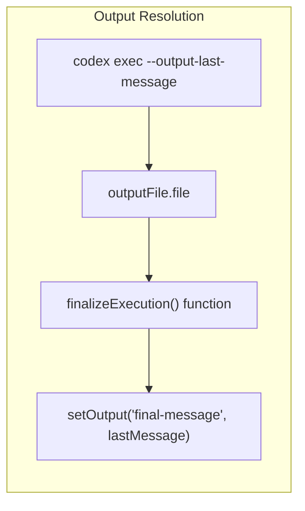

**Sources:** [src/runCodexExec.ts:126-128](), [src/runCodexExec.ts:183-183](), [src/runCodexExec.ts:195-212]()

## Implementation of Configuration Precedence

The action manages configuration files for the Codex CLI to ensure the proxy is used.

1.  **Home Directory:** Resolved via `resolve-codex-home`, prioritizing `codex-home` input [action.yml:161-170]().
2.  **Proxy Configuration:** The `writeProxyConfig` function generates a `config.toml` in the `codexHome` directory [src/writeProxyConfig.ts:9-14]().
3.  **Model Provider:** It sets `model_provider = "codex-action-responses-proxy"` and configures the `base_url` to point to the local proxy port [src/writeProxyConfig.ts:23-35]().
4.  **Privileged Write:** If using `unprivileged-user`, it uses `sudo mv` to place the config file in the home directory of the target user [src/writeProxyConfig.ts:40-50]().

**Sources:** [src/writeProxyConfig.ts:9-55](), [src/runCodexExec.ts:153-156]()

---

# Page: Prompt, Output, and Model Inputs

# Prompt, Output, and Model Inputs

<details>
<summary>Relevant source files</summary>

The following files were used as context for generating this wiki page:

- [action.yml](action.yml)
- [src/main.ts](src/main.ts)
- [src/runCodexExec.ts](src/runCodexExec.ts)

</details>


This page provides a detailed reference for the inputs related to prompts, outputs, and model configuration within the `codex-action`. It explains how these inputs are used and how they map to the underlying `codex exec` CLI flags.

## Prompt Inputs

The `codex-action` supports two ways to provide the prompt to the Codex model: directly as a string or from a file.

### `prompt`

*   **Description**: The prompt string to be passed directly to the Codex model.
*   **`action.yml` definition**: [action.yml:5-8]()
*   **Type**: `string`
*   **Required**: No (either `prompt` or `prompt-file` must be provided).
*   **Default**: `""`
*   **Usage**: When this input is provided, its value is used as the content for the `codex exec` command's standard input.
*   **Implementation**:
    *   The `runCodexExec` function in `src/runCodexExec.ts` receives a `PromptSource` object.
    *   If `prompt.type` is `"inline"`, `prompt.content` is used directly as the input string [src/runCodexExec.ts:151-153]().
    *   The `run-codex-exec` command in `src/main.ts` receives `prompt` as a string option [src/main.ts:129-130](). It then constructs a `PromptSource` object with `type: "inline"` and the provided `prompt` value [src/main.ts:206-208]().

### `prompt-file`

*   **Description**: The path to a file containing the prompt string.
*   **`action.yml` definition**: [action.yml:9-12]()
*   **Type**: `string`
*   **Required**: No (either `prompt` or `prompt-file` must be provided).
*   **Default**: `""`
*   **Usage**: If this input is provided, the content of the specified file is read and used as the prompt for the `codex exec` command.
*   **Implementation**:
    *   The `runCodexExec` function in `src/runCodexExec.ts` receives a `PromptSource` object.
    *   If `prompt.type` is `"file"`, the file specified by `prompt.path` is read asynchronously using `readFile` [src/runCodexExec.ts:154-156]().
    *   The `run-codex-exec` command in `src/main.ts` receives `promptFile` as a string option [src/main.ts:131-133](). It then constructs a `PromptSource` object with `type: "file"` and the provided `promptFile` value [src/main.ts:209-211]().

#### Prompt Input Flow

```mermaid
graph TD
    A[GitHub Action Workflow] --> B{Prompt Input};
    B -- "prompt: 'Hello'" --> C[PromptSource {type: "inline", content: "Hello"}];
    B -- "prompt-file: 'path/to/prompt.txt'" --> D[PromptSource {type: "file", path: "path/to/prompt.txt"}];
    C --> E[runCodexExec()];
    D --> E;
    E -- "Reads file content if type is 'file'" --> F[Codex CLI Process];
    F -- "Receives prompt via stdin" --> G[Codex Model];

    style A fill:#ace,stroke:#333,stroke-width:2px;
    style B fill:#f9f,stroke:#333,stroke-width:2px;
    style C fill:#afa,stroke:#333,stroke-width:2px;
    style D fill:#afa,stroke:#333,stroke-width:2px;
    style E fill:#add,stroke:#333,stroke-width:2px;
    style F fill:#fdd,stroke:#333,stroke-width:2px;
    style G fill:#ccf,stroke:#333,stroke-width:2px;
```
**Diagram 1: Prompt Input Data Flow**
Sources: [action.yml:5-12](), [src/runCodexExec.ts:79-87](), [src/runCodexExec.ts:150-158](), [src/main.ts:129-133](), [src/main.ts:206-211]()

## Output Inputs

The `codex-action` allows specifying where the final message from `codex exec` should be written and how its structure should be validated.

### `output-file`

*   **Description**: The file path where the final message from `codex exec` will be written.
*   **`action.yml` definition**: [action.yml:13-16]()
*   **Type**: `string`
*   **Required**: No
*   **Default**: `""` (If empty, a temporary file is created for the output).
*   **Usage**: The `codex exec` command's output is redirected to this file. If not specified, a temporary file is used, and its content is still made available via the `final-message` output.
*   **Implementation**:
    *   The `runCodexExec` function in `src/runCodexExec.ts` takes an `explicitOutputFile` parameter [src/runCodexExec.ts:128]().
    *   If `explicitOutputFile` is `null`, a temporary file is created using `createTempOutputFile` [src/runCodexExec.ts:164-167]().
    *   The `run-codex-exec` command in `src/main.ts` receives `outputFile` as a string option [src/main.ts:144-147](). It passes this value to `runCodexExec` [src/main.ts:212]().

### `output-schema`

*   **Description**: Inline JSON schema content to validate the `codex exec` output. This is passed to `codex exec --output-schema`.
*   **`action.yml` definition**: [action.yml:54-57]()
*   **Type**: `string`
*   **Required**: No
*   **Default**: `""`
*   **Usage**: Provides a JSON schema directly to `codex exec` for validating its output.
*   **Implementation**:
    *   The `runCodexExec` function in `src/runCodexExec.ts` takes an `outputSchema` parameter of type `OutputSchemaSource` [src/runCodexExec.ts:129]().
    *   If `outputSchema` is `null`, no schema is used. If `outputSchema.type` is `"inline"`, its content is written to a temporary file, and that file path is passed to `codex exec --output-schema` [src/runCodexExec.ts:170-173]().
    *   The `run-codex-exec` command in `src/main.ts` receives `outputSchema` as a string option [src/main.ts:153-155](). It constructs an `OutputSchemaSource` object with `type: "inline"` if the input is not empty [src/main.ts:214-216]().

### `output-schema-file`

*   **Description**: Path to a file containing the JSON schema to validate the `codex exec` output. This is passed to `codex exec --output-schema`.
*   **`action.yml` definition**: [action.yml:58-61]()
*   **Type**: `string`
*   **Required**: No
*   **Default**: `""`
*   **Usage**: Provides a JSON schema file path to `codex exec` for validating its output.
*   **Implementation**:
    *   The `runCodexExec` function in `src/runCodexExec.ts` takes an `outputSchema` parameter of type `OutputSchemaSource` [src/runCodexExec.ts:129]().
    *   If `outputSchema` is `null`, no schema is used. If `outputSchema.type` is `"file"`, its path is passed directly to `codex exec --output-schema` [src/runCodexExec.ts:170-173]().
    *   The `run-codex-exec` command in `src/main.ts` receives `outputSchemaFile` as a string option [src/main.ts:148-152](). It constructs an `OutputSchemaSource` object with `type: "file"` if the input is not empty [src/main.ts:214-216]().

#### Output Input Flow

```mermaid
graph TD
    A[GitHub Action Workflow] --> B{Output Configuration};
    B -- "output-file: 'result.txt'" --> C[Explicit Output File];
    B -- "output-schema: '{...}'" --> D[OutputSchemaSource {type: "inline", content: "{...}"}];
    B -- "output-schema-file: 'schema.json'" --> E[OutputSchemaSource {type: "file", path: "schema.json"}];

    C --> F[runCodexExec()];
    D --> F;
    E --> F;

    F -- "Passes --output-file to Codex CLI" --> G[Codex CLI Process];
    F -- "Resolves/writes schema to temp file, passes --output-schema to Codex CLI" --> G;
    G -- "Writes final message to output file" --> H[Output File (e.g., result.txt)];
    G -- "Validates output against schema" --> I[Validation Result];
    H --> J[Action Output: final-message];

    style A fill:#ace,stroke:#333,stroke-width:2px;
    style B fill:#f9f,stroke:#333,stroke-width:2px;
    style C fill:#afa,stroke:#333,stroke-width:2px;
    style D fill:#afa,stroke:#333,stroke-width:2px;
    style E fill:#afa,stroke:#333,stroke-width:2px;
    style F fill:#add,stroke:#333,stroke-width:2px;
    style G fill:#fdd,stroke:#333,stroke-width:2px;
    style H fill:#ccf,stroke:#333,stroke-width:2px;
    style I fill:#ccf,stroke:#333,stroke-width:2px;
    style J fill:#ccf,stroke:#333,stroke-width:2px;
```
**Diagram 2: Output Configuration Data Flow**
Sources: [action.yml:13-16](), [action.yml:54-61](), [src/runCodexExec.ts:128-129](), [src/runCodexExec.ts:163-173](), [src/main.ts:144-155](), [src/main.ts:212-216]()

## Model and Execution Inputs

These inputs control which model Codex uses, the effort level, and the environment for execution.

### `model`

*   **Description**: Specifies the model the agent should use (e.g., `gpt-4`, `gpt-3.5-turbo`).
*   **`action.yml` definition**: [action.yml:62-65]()
*   **Type**: `string`
*   **Required**: No
*   **Default**: `""`
*   **Usage**: This value is passed directly to the `codex exec` command using the `--model` flag.
*   **Implementation**:
    *   The `runCodexExec` function in `src/runCodexExec.ts` takes a `model` parameter [src/runCodexExec.ts:130]().
    *   If `model` is not `null`, it's added to the `codex exec` command arguments as `--model <model_name>` [src/runCodexExec.ts:400-402]().
    *   The `run-codex-exec` command in `src/main.ts` receives `model` as a string option [src/main.ts:165-166](). It passes this value to `runCodexExec` [src/main.ts:217]().

### `effort`

*   **Description**: Specifies the reasoning effort the agent should use. This can influence the cost and latency of the model's response.
*   **`action.yml` definition**: [action.yml:66-69]()
*   **Type**: `string`
*   **Required**: No
*   **Default**: `""`
*   **Usage**: This value is passed directly to the `codex exec` command using the `--effort` flag.
*   **Implementation**:
    *   The `runCodexExec` function in `src/runCodexExec.ts` takes an `effort` parameter [src/runCodexExec.ts:131]().
    *   If `effort` is not `null`, it's added to the `codex exec` command arguments as `--effort <effort_level>` [src/runCodexExec.ts:403-405]().
    *   The `run-codex-exec` command in `src/main.ts` receives `effort` as a string option [src/main.ts:167-168](). It passes this value to `runCodexExec` [src/main.ex:218]().

### `working-directory`

*   **Description**: The working directory that Codex should use for its operations.
*   **`action.yml` definition**: [action.yml:25-28]()
*   **Type**: `string`
*   **Required**: No
*   **Default**: `""` (Defaults to the repository root if empty).
*   **Usage**: The `codex exec` command is executed from this directory.
*   **Implementation**:
    *   The `runCodexExec` function in `src/runCodexExec.ts` takes a `cd` parameter [src/runCodexExec.ts:126]().
    *   This `cd` value is used as the `cwd` option when spawning the `codex` child process [src/runCodexExec.ts:420]().
    *   The `run-codex-exec` command in `src/main.ts` receives `cd` as a string option [src/main.ts:138-139](). It passes this value to `runCodexExec` [src/main.ts:213]().

### `codex-version`

*   **Description**: Specifies the version of `@openai/codex` to install.
*   **`action.yml` definition**: [action.yml:43-46]()
*   **Type**: `string`
*   **Required**: No
*   **Default**: `""`
*   **Usage**: This input is used during the setup phase of the action to ensure the correct version of the Codex CLI is available. It's typically used with `npm install -g @openai/codex@<version>`.
*   **Implementation**: This input is consumed by the action's setup logic (not shown in provided snippets) to install the specified `codex` version. It does not directly map to a `codex exec` flag but influences the environment in which `codex exec` runs.

### `codex-home`

*   **Description**: Specifies the trusted Codex home/config directory.
*   **`action.yml` definition**: [action.yml:70-73]()
*   **Type**: `string`
*   **Required**: No
*   **Default**: `""` (If empty, the default Codex home directory, typically `~/.codex`, will be used).
*   **Usage**: This directory is where Codex stores its configuration files, including the `config.toml` that the action writes for the Responses API proxy.
*   **Implementation**:
    *   The `resolveCodexHome` function (called by the `resolve-codex-home` command in `src/main.ts`) determines the effective Codex home directory based on this input, environment variables, and default paths [src/main.ts:37-74]().
    *   The `runCodexExec` function in `src/runCodexExec.ts` takes a `codexHome` parameter [src/runCodexExec.ts:125]().
    *   If `codexHome` is not `null`, it's added to the `codex exec` command arguments as `--codex-home <directory>` [src/runCodexExec.ts:397-399]().
    *   The `run-codex-exec` command in `src/main.ts` receives `codexHome` as a string option [src/main.ts:135-137](). It passes this value to `runCodexExec` [src/main.ts:212]().

#### Model and Execution Input Flow

```mermaid
graph TD
    A[GitHub Action Workflow] --> B{Model & Execution Inputs};
    B -- "model: 'gpt-4'" --> C[runCodexExec()];
    B -- "effort: 'high'" --> C;
    B -- "working-directory: './src'" --> C;
    B -- "codex-home: '/tmp/codex_config'" --> C;
    B -- "codex-version: '1.2.3'" --> D[Action Setup Phase];

    C -- "Constructs codex exec command with flags" --> E[Codex CLI Process];
    D -- "Installs specified @openai/codex version" --> E;

    E -- "--model gpt-4" --> F[Codex Model Selection];
    E -- "--effort high" --> G[Codex Reasoning Effort];
    E -- "cwd: ./src" --> H[Codex Execution Context];
    E -- "--codex-home /tmp/codex_config" --> I[Codex Configuration Directory];

    style A fill:#ace,stroke:#333,stroke-width:2px;
    style B fill:#f9f,stroke:#333,stroke-width:2px;
    style C fill:#add,stroke:#333,stroke-width:2px;
    style D fill:#afa,stroke:#333,stroke-width:2px;
    style E fill:#fdd,stroke:#333,stroke-width:2px;
    style F fill:#ccf,stroke:#333,stroke-width:2px;
    style G fill:#ccf,stroke:#333,stroke-width:2px;
    style H fill:#ccf,stroke:#333,stroke-width:2px;
    style I fill:#ccf,stroke:#333,stroke-width:2px;
```
**Diagram 3: Model and Execution Input Data Flow**
Sources: [action.yml:25-28](), [action.yml:43-46](), [action.yml:62-73](), [src/runCodexExec.ts:125-126](), [src/runCodexExec.ts:130-131](), [src/runCodexExec.ts:397-405](), [src/runCodexExec.ts:420](), [src/main.ts:37-74](), [src/main.ts:135-139](), [src/main.ts:165-168](), [src/main.ts:212-213](), [src/main.ts:217-218]()

---

# Page: Sandbox, Permission Profiles, and Access Inputs

# Sandbox, Permission Profiles, and Access Inputs

<details>
<summary>Relevant source files</summary>

The following files were used as context for generating this wiki page:

- [action.yml](action.yml)
- [src/checkActorPermissions.ts](src/checkActorPermissions.ts)
- [src/runCodexExec.ts](src/runCodexExec.ts)

</details>


This page provides a detailed reference for the `codex-action` inputs related to execution environment sandboxing, permission profiles, and access control. It covers the legacy `sandbox` input, the modern `permission-profile` input, `codex-args` for additional command-line arguments, `safety-strategy` for privilege reduction, `codex-user` for specifying an unprivileged user, and `allow-users`/`allow-bots`/`allow-bot-users` for controlling who can execute the action. Mutual exclusivity and validation rules for these inputs are also explained.

## Sandbox and Permission Profiles

The `codex-action` provides mechanisms to control the permissions and environment in which the Codex CLI executes. This is crucial for security, especially when running untrusted code. There are two primary inputs for defining Codex's permissions: `sandbox` (legacy) and `permission-profile` (preferred).

### Legacy Sandbox Input (`sandbox`)

The `sandbox` input [action.yml:29-35]() is a legacy option for specifying Codex's sandbox mode. It accepts one of three values:
*   `workspace-write`: Allows Codex to read and write within the workspace. This is the default behavior if `sandbox` is empty and `permission-profile` is not set.
*   `read-only`: Restricts Codex to read-only access to the file system.
*   `danger-full-access`: Grants Codex full access to the system. This option is highly discouraged due to security risks.

It is recommended to use `permission-profile` instead of `sandbox` for new workflows.

### Permission Profile Input (`permission-profile`)

The `permission-profile` input [action.yml:36-42]() is the preferred way to configure Codex permissions. It allows selecting a predefined permission profile, such as `:read-only` or `:workspace`, or a custom named profile defined in `codex-home/config.toml`. This input maps directly to Codex's `default_permissions` setting.

**Mutual Exclusivity:** The `sandbox` and `permission-profile` inputs are mutually exclusive [src/runCodexExec.ts:174-179](). If both are provided, the action will fail.

**Permission Selection Logic:**
The `determinePermissionSelection` function [src/runCodexExec.ts:174-179]() in `src/runCodexExec.ts` handles the logic for choosing between `sandbox` and `permission-profile`.

```mermaid
graph TD
    A[Start] --> B{Is "permission-profile" provided?};
    B -- Yes --> C{Is "sandbox" also provided?};
    C -- Yes --> D[Error: "sandbox" and "permission-profile" are mutually exclusive];
    C -- No --> E[Use "permission-profile"];
    B -- No --> F{Is "sandbox" provided?};
    F -- Yes --> G[Use "sandbox"];
    F -- No --> H[Default to "workspace-write" sandbox];
    E --> I[End];
    G --> I;
    H --> I;
```
**Diagram: Permission Selection Flow**
Sources: [action.yml:29-42](), [src/runCodexExec.ts:174-179]()

### Codex Arguments (`codex-args`)

The `codex-args` input [action.yml:47-53]() allows passing additional arguments directly to the `codex exec` command. These arguments can be provided as a JSON array of strings or a shell-like string. The action enforces safety by rejecting arguments that conflict with enforced permission, trust, provider, or command protections.

The `extraArgs` parameter in `runCodexExec` [src/runCodexExec.ts:123-149]() receives these arguments.

Sources: [action.yml:47-53](), [src/runCodexExec.ts:123-149]()

## Safety Strategies and User Privileges

The `safety-strategy` input [action.yml:74-106]() defines how the action attempts to restrict Codex's privileges. This is a critical security feature, especially when running code from untrusted sources.

### Safety Strategy Input (`safety-strategy`)

The `safety-strategy` input [action.yml:74-106]() controls the privilege level of the Codex execution. The available options are:

*   `drop-sudo` (default): On Linux and macOS, this strategy attempts to drop `sudo` privileges and run Codex as the default user with reduced capabilities. It uses `setpriv` on Linux to clear groups, remove new privileges, and empty capability sets [src/runCodexExec.ts:62-74](). This is an irreversible operation. On Windows, this strategy is not supported and will cause an error [action.yml:130-140]().
*   `unprivileged-user`: Runs Codex as a specified UNIX user (defined by `codex-user`). The caller is responsible for ensuring this user has the necessary permissions.
*   `read-only`: Runs Codex in a sandbox that can read any file but cannot write to disk or access the network. Note that Codex still runs as the default action user, which might have `sudo` privileges.
*   `unsafe` (NOT RECOMMENDED): No privilege restrictions are applied. This is highly dangerous as Codex will run with the full privileges of the action runner, potentially exposing secrets. On Windows, this is the only supported option [action.yml:130-140]().

The `runCodexExec` function [src/runCodexExec.ts:123-149]() takes `safetyStrategy` as an argument and implements the corresponding logic.

```mermaid
graph TD
    A[Start] --> B{Runner OS};
    B -- Windows --> C{safety-strategy == "unsafe"?};
    C -- Yes --> D[Proceed with "unsafe"];
    C -- No --> E[Error: Windows only supports "unsafe"];
    B -- Linux/macOS --> F{safety-strategy};
    F -- "drop-sudo" --> G[Execute `drop-sudo` script via `sudo setpriv`];
    F -- "unprivileged-user" --> H{Is "codex-user" specified?};
    H -- Yes --> I[Execute Codex as specified user];
    H -- No --> J[Error: "codex-user" required];
    F -- "read-only" --> K[Execute Codex with read-only sandbox];
    F -- "unsafe" --> L[Execute Codex with no restrictions];
    G --> M[End];
    I --> M;
    K --> M;
    L --> M;
    D --> M;
```
**Diagram: Safety Strategy Flow**
Sources: [action.yml:74-106](), [action.yml:130-140](), [src/runCodexExec.ts:62-74](), [src/runCodexExec.ts:123-149]()

### Codex User Input (`codex-user`)

The `codex-user` input [action.yml:107-110]() is used in conjunction with the `unprivileged-user` `safety-strategy`. It specifies the UNIX username under which Codex should be executed. If `safety-strategy` is `unprivileged-user` and `codex-user` is not provided, the action will throw an error [src/runCodexExec.ts:233-236]().

Sources: [action.yml:107-110](), [src/runCodexExec.ts:233-236]()

## Access Control

The `codex-action` includes mechanisms to control which GitHub users and bots are permitted to trigger the action. This is handled by the `checkActorPermissions.ts` module.

### Allow Users Input (`allow-users`)

The `allow-users` input [action.yml:111-114]() specifies a comma-separated list of GitHub usernames who are permitted to run the action. If set to `*`, all users are allowed. Users with write access to the repository are implicitly allowed and do not need to be listed. The `ensureActorHasWriteAccess` function [src/checkActorPermissions.ts:45-47]() processes this input.

The `allowUsersSpec` variable [src/checkActorPermissions.ts:100]() in `ensureActorHasWriteAccess` handles the parsing and checking of this input.

### Allow Bots Input (`allow-bots`)

The `allow-bots` input [action.yml:115-118]() is a boolean flag that, when `true`, allows runs triggered by trusted GitHub bot accounts (specifically `github-actions[bot]`) to bypass the standard write-access check. The `isTrustedGitHubBotActor` function [src/checkActorPermissions.ts:186]() determines if an actor is a trusted bot.

### Allow Bot Users Input (`allow-bot-users`)

The `allow-bot-users` input [action.yml:119-122]() provides a comma-separated list of specific GitHub bot usernames that can bypass the write-access check. Unlike `allow-users`, `*` is not supported; bots must be explicitly listed. Entries can include or omit the `[bot]` suffix. The `parseAllowedBotActors` function [src/checkActorPermissions.ts:190]() handles the parsing of this input.

### Access Control Flow

The `ensureActorHasWriteAccess` function [src/checkActorPermissions.ts:45-47]() is the central point for actor permission checking.

```mermaid
graph TD
    A[Start: ensureActorHasWriteAccess] --> B{Is GITHUB_ACTOR set?};
    B -- No --> C[Reject: GITHUB_ACTOR missing];
    B -- Yes --> D{Is GITHUB_REPOSITORY set?};
    D -- No --> E[Reject: GITHUB_REPOSITORY missing];
    D -- Yes --> F{Is actor a trusted GitHub bot AND allow-bots is true?};
    F -- Yes --> G[Approve: Trusted bot];
    F -- No --> H{Is actor in allow-bot-users list?};
    H -- Yes --> I[Approve: Explicitly allowed bot];
    H -- No --> J{Is allow-users='*'?};
    J -- Yes --> K[Approve: All users allowed];
    J -- No --> L{Is actor in allow-users list?};
    L -- Yes --> M[Approve: Explicitly allowed user];
    L -- No --> N{Is GITHUB_TOKEN set?};
    N -- No --> O[Reject: GITHUB_TOKEN missing for permission check];
    N -- Yes --> P[Check GitHub API for actor's repository permission];
    P -- Permission is "admin", "write", or "maintain" --> Q[Approve: Has write access];
    P -- Other permission or API error --> R[Reject: Insufficient permissions or API error];
    G --> S[End];
    I --> S;
    K --> S;
    M --> S;
    Q --> S;
    C --> S;
    E --> S;
    O --> S;
    R --> S;
```
**Diagram: Actor Permission Check Flow**
Sources: [action.yml:111-122](), [src/checkActorPermissions.ts:45-47](), [src/checkActorPermissions.ts:100](), [src/checkActorPermissions.ts:186](), [src/checkActorPermissions.ts:190]()

---

# Page: Security and Safety Strategies

# Security and Safety Strategies

<details>
<summary>Relevant source files</summary>

The following files were used as context for generating this wiki page:

- [README.md](README.md)
- [docs/security.md](docs/security.md)

</details>


This document provides a detailed explanation of the security mechanisms and safety strategies implemented in `codex-action`. It covers how the action protects the `OPENAI_API_KEY`, manages execution privileges, and mitigates risks such as prompt injection and unauthorized access.

## Safety Strategy Overview

The `safety-strategy` input determines the level of privilege restriction applied to the Codex execution environment. Because GitHub-hosted runners provide passwordless `sudo` by default, Codex could potentially exfiltrate sensitive data or modify the runner state if not properly restricted.

### Safety Strategy Decision Flow

```mermaid
graph TD
    Input["safety-strategy input"] --> PlatformCheck{"runner.os check"}
    
    PlatformCheck -->|"Windows"| WindowsValidation{"strategy == 'unsafe'?"}
    WindowsValidation -->|"No"| WindowsFail["❌ Exit with error<br/>action.yml:84-89"]
    WindowsValidation -->|"Yes"| UnsafeExecution["Execute without restrictions<br/>Full privileges maintained"]
    
    PlatformCheck -->|"Linux/macOS"| StrategySwitch{"Safety Strategy"}
    
    StrategySwitch -->|"drop-sudo"| DropSudoFlow["dropSudo function<br/>src/dropSudo.ts:25"]
    StrategySwitch -->|"unprivileged-user"| UnprivilegedFlow["Switch to codex-user<br/>action.yml:178-190"]
    StrategySwitch -->|"read-only"| ReadOnlyFlow["Read-only sandbox<br/>Filesystem/network restrictions"]
    StrategySwitch -->|"unsafe"| UnsafeExecution
    
    DropSudoFlow --> SudoRemoval["Remove user from sudo group<br/>dropSudoWithPrivileges:66"]
    SudoRemoval --> SudoVerify["Verify sudo removal<br/>action.yml:158-166"]
    
    ReadOnlyFlow --> SandboxSetup["Configure read-only environment<br/>Network/filesystem restrictions"]
    
    SudoVerify --> CodexExecution["run-codex-exec command<br/>action.yml:168-190"]
    UnprivilegedFlow --> CodexExecution
    SandboxSetup --> CodexExecution
    UnsafeExecution --> CodexExecution
```

**Sources:** [action.yml:36-61](), [action.yml:84-89](), [action.yml:141-156](), [action.yml:158-166](), [src/dropSudo.ts:25-64]()

For a detailed explanation of each strategy, including `drop_sudo`, `read_only`, `unprivileged_user`, and `unsafe`, and their underlying mechanisms like `bubblewrap`/user-namespaces and `setpriv` usage, see [Safety Strategies and Sandboxing](#4.1).

## Permission Checking System

The action enforces repository access controls via `ensureActorHasWriteAccess` to prevent unauthorized users from consuming your OpenAI quota or triggering malicious workflows.

### Permission Validation Architecture

```mermaid
graph TD
    TriggerActor["GITHUB_ACTOR environment variable"] --> WriteAccessCheck["ensureActorHasWriteAccess<br/>src/checkActorPermissions.ts:42"]
    
    WriteAccessCheck --> ActorValidation["Actor existence check<br/>src/checkActorPermissions.ts:49-55"]
    WriteAccessCheck --> RepoValidation["Repository format check<br/>src/checkActorPermissions.ts:57-72"]
    
    ActorValidation --> BotCheck{"isTrustedGitHubBotActor?"}
    BotCheck -->|"Yes + allow-bots"| BotApproval["Bot actor approved<br/>src/checkActorPermissions.ts:76-79"]
    BotCheck -->|"No"| ExplicitBotCheck{"isBotActor in allow-bot-users?"}
    
    ExplicitBotCheck -->|"Yes"| BotApproval
    ExplicitBotCheck -->|"No"| AllowListCheck{"actor in allow-users?"}
    
    AllowListCheck -->|"Yes / '*'"| AccessApproved["Access approved<br/>src/checkActorPermissions.ts:98-113"]
    AllowListCheck -->|"No"| TokenValidation["GitHub token validation<br/>src/checkActorPermissions.ts:115-122"]
    
    TokenValidation --> OctokitClient["new Octokit({ auth: token })<br/>src/checkActorPermissions.ts:125-130"]
    OctokitClient --> PermissionAPI["repos.getCollaboratorPermissionLevel<br/>src/checkActorPermissions.ts:136-141"]
    
    PermissionAPI --> PermissionCheck{"permission level"}
    PermissionCheck -->|"admin/write/maintain"| AccessApproved
    PermissionCheck -->|"read/none"| AccessRejected["WriteAccessCheck: rejected<br/>src/checkActorPermissions.ts:169-173"]
    
    PermissionAPI -->|"404 Error"| NotFoundRejection["Not collaborator rejection<br/>src/checkActorPermissions.ts:143-149"]
```

**Sources:** [src/checkActorPermissions.ts:42-174](), [docs/security.md:5-9]()

For a detailed explanation of how `ensureActorHasWriteAccess` gates execution, including allow-lists, trusted bot actors, Octokit collaborator permission lookups, and rejection reasons, see [Actor Permission Checking](#4.2).

## Detailed Safety Strategies

### drop-sudo Strategy (Default)
This strategy permanently removes the current user's ability to use `sudo`. This is critical because a user with `sudo` can read `procfs` (e.g., `/proc/[pid]/mem`) to exfiltrate the `OPENAI_API_KEY` from the memory of the Responses API proxy process, even if the filesystem is read-only.

| Phase | Function / Logic | File Reference |
| :--- | :--- | :--- |
| **Detection** | Validates Linux/macOS support. | [src/dropSudo.ts:26-31]() |
| **Root Phase** | Re-enters the script as root via `sudo -n node ... drop-sudo --root-phase`. | [src/dropSudo.ts:48-59]() |
| **Group Removal** | Removes user from `sudo` (Linux) or `admin` (macOS) groups. | [src/dropSudo.ts:74-118]() |
| **Sudoers Cleanup** | Strips user entries from `/etc/sudoers` and `/etc/sudoers.d/`. | [src/dropSudo.ts:126-149]() |
| **Verification** | Executes `sudo -n true` to confirm access is denied. | [action.yml:158-166]()

**Sources:** [src/dropSudo.ts:25-161](), [docs/security.md:41-43](), [examples/test-sandbox-protections.yml:31-53]()

### unprivileged-user Strategy
Executes the Codex CLI as a specific, restricted user account provided via the `codex-user` input. This is an alternative to `drop-sudo` when a dedicated low-privilege account is already available on the runner.

### read-only Strategy
Attempts to restrict the environment to read-only access. 
> [!WARNING]
> As demonstrated in [examples/test-sandbox-protections.yml](), `read-only` alone is insufficient if `sudo` is still available. A malicious prompt could use `sudo` to dump process memory and find the API key.

### unsafe Strategy
No restrictions are applied. This is the **only** strategy supported on Windows runners due to the lack of native privilege-dropping utilities in the current action implementation.

**Sources:** [action.yml:84-89](), [docs/security.md:41-43]()

## Security Considerations

### Protecting the OpenAI API Key
The `OPENAI_API_KEY` is never passed directly to the Codex CLI. Instead, the action starts a local **Responses API Proxy** process. 
1. The proxy holds the key in memory.
2. The Codex CLI communicates with the proxy over a local socket/pipe.
3. This isolation ensures that even if the Codex CLI is compromised via prompt injection, it cannot directly "see" the environment variable containing the key.

**Sources:** [docs/security.md:41-43](), [examples/test-sandbox-protections.yml:31-40]()

For a detailed explanation of the `@openai/codex-responses-api-proxy`, how it handles the `OPENAI_API_KEY`, and its configuration, see [Responses API Proxy and Key Protection](#4.3).

### Prompt Injection Risks
Untrusted input from Pull Requests (titles, bodies, commit messages) can be used for prompt injection.
- **Pull Request Bodies**: Malicious users may hide instructions in HTML comments (`<!-- -->`). [docs/security.md:15-15]()
- **Commit Messages**: Often overlooked but read by the model. [docs/security.md:16-16]()
- **Media**: Screenshots can contain text-based injections. [docs/security.md:17-17]()

**Sources:** [docs/security.md:11-18]()

### Shell Injection Prevention
To avoid shell injection in workflow steps, never splice `${{ github.event... }}` directly into a `run:` block. Use environment variables instead.

```yaml
# SAFE
env:
  PR_TITLE: ${{ github.event.pull_request.title }}
run: echo "$PR_TITLE"

# UNSAFE
run: echo "${{ github.event.pull_request.title }}"
```

**Sources:** [docs/security.md:19-31]()

### Execution Order Recommendation
It is recommended to run `openai/codex-action` as the **last step** in a job. Because Codex may spawn background processes or modify the host state (especially in `unsafe` mode), running subsequent steps in the same job may be insecure. [docs/security.md:47-54]()

**Sources:** [docs/security.md:47-55]()

---

# Page: Safety Strategies and Sandboxing

# Safety Strategies and Sandboxing

<details>
<summary>Relevant source files</summary>

The following files were used as context for generating this wiki page:

- [docs/security.md](docs/security.md)
- [src/dropSudo.ts](src/dropSudo.ts)
- [src/linuxCredentials.ts](src/linuxCredentials.ts)
- [src/runCodexExec.ts](src/runCodexExec.ts)

</details>


This page provides a detailed explanation of the safety strategies available in `codex-action`, focusing on `drop_sudo`, `read_only`, `unprivileged_user`, and `unsafe`. It covers their implementation, the underlying mechanisms like `bubblewrap` and `user-namespaces`, the use of `setpriv`, and the logic for rejecting protected arguments.

## Overview of Safety Strategies

The `codex-action` offers several `safety-strategy` options to control the privilege level and sandboxing of the Codex execution environment. These strategies are crucial for mitigating risks associated with running untrusted code, such as prompt injection and API key abuse [docs/security.md:10-19,64-74]().

The available safety strategies are:
*   `drop-sudo`
*   `read-only`
*   `unprivileged-user`
*   `unsafe` [src/runCodexExec.ts:89-93]()

### Safety Strategy Selection Flow

The `determinePermissionSelection` function [src/runCodexExec.ts:500-500]() is responsible for resolving the effective permission profile based on the chosen `safetyStrategy`, `requestedSandbox`, and `permissionProfile` inputs. It also enforces mutual exclusivity and validation rules for these inputs.

```mermaid
graph TD
    A[Start] --> B{safetyStrategy};
    B -- "drop-sudo" --> C{permissionProfile specified?};
    B -- "unprivileged-user" --> C;
    B -- "read-only" --> D{requestedSandbox specified?};
    B -- "unsafe" --> E[PermissionSelection: danger-full-access];

    C -- "Yes" --> F[PermissionSelection: profile];
    C -- "No" --> G[PermissionSelection: sandbox, workspace-write];

    D -- "Yes" --> H{requestedSandbox is read-only?};
    D -- "No" --> I[PermissionSelection: sandbox, read-only];

    H -- "Yes" --> I;
    H -- "No" --> J[Error: read-only strategy requires read-only sandbox];

    F --> K[End];
    G --> K;
    I --> K;
    J --> K;

    subgraph "Protected Argument Rejection"
        L[Check extraArgs for protected arguments] --> M{Protected argument found?};
        M -- "Yes" --> N[Error: Protected argument rejected];
        M -- "No" --> K;
    end

    style A fill:#ace,stroke:#333,stroke-width:2px;
    style K fill:#ace,stroke:#333,stroke-width:2px;
```
**Diagram: Safety Strategy and Permission Selection Flow**

Sources:
*   [src/runCodexExec.ts:89-93]()
*   [src/runCodexExec.ts:179-180]()
*   [src/runCodexExec.ts:500-500]()

## `drop-sudo` Strategy

The `drop-sudo` strategy is designed to remove `sudo` privileges from the Codex process, preventing it from executing commands as root. This is particularly important on GitHub-hosted runners, where passwordless `sudo` is often enabled by default [docs/security.md:70-74]().

### Implementation Details

The `drop-sudo` strategy is implemented in `src/dropSudo.ts` and `src/runCodexExec.ts`. It involves a two-phase process: a root phase and a user phase.

1.  **User Phase (`dropSudo` function)**:
    *   The `dropSudo` function [src/dropSudo.ts:52-103]() is initially called by the action.
    *   It first ensures that passwordless `sudo` is available [src/dropSudo.ts:71-71]().
    *   It then invalidates any cached `sudo` credentials using `sudo -K` [src/dropSudo.ts:73-74,96-99]().
    *   Crucially, it re-executes itself under `sudo` with the `--root-phase` flag [src/dropSudo.ts:78-94](). This allows the privilege-dropping logic to run with root privileges.
    *   After the root phase completes, it verifies that privileged sockets are restricted [src/dropSudo.ts:100-102]().

2.  **Root Phase (`dropSudoWithPrivileges` function)**:
    *   The `dropSudoWithPrivileges` function [src/dropSudo.ts:105-228]() is executed with root privileges.
    *   It sets a minimal `PATH` environment variable to prevent unexpected binaries from being found [src/dropSudo.ts:110-110]().
    *   **Linux Specifics**:
        *   It captures the original runner's Linux credentials (user ID, primary group ID, supplementary group IDs) [src/dropSudo.ts:118-126]().
        *   It identifies groups associated with root service sockets (e.g., `/run` directory) that the original runner user was a member of [src/dropSudo.ts:151-155]().
        *   It then attempts to remove the runner user from the `sudo` group and any other groups that could grant access to privileged sockets [src/dropSudo.ts:156-162]().
        *   It restricts permissions on root service sockets to prevent access by the `nobody` group [src/dropSudo.ts:163-165]().
    *   **macOS Specifics**:
        *   It uses `dseditgroup` to remove the user from the `sudo` group [src/dropSudo.ts:177-185]().
    *   Finally, it removes any entries for the user from `/etc/sudoers.d` and `/etc/sudoers` files [src/dropSudo.ts:203-227]().

### `setpriv` Usage

On Linux, the `drop-sudo` strategy ultimately uses the `setpriv` command to launch the Codex process with significantly reduced privileges [src/runCodexExec.ts:62-76]().

The `setpriv` command is invoked with the following arguments:
*   `--reuid="$uid"`: Sets the real and effective user ID to the specified unprivileged user ID.
*   `--regid="$nobody_gid"`: Sets the real and effective group ID to the `nobody` group ID.
*   `--clear-groups`: Clears all supplementary groups.
*   `--no-new-privs`: Prevents the process from gaining new privileges.
*   `--bounding-set=-all`: Clears all capabilities from the bounding set.
*   `--inh-caps=-all`: Clears all inheritable capabilities.
*   `--ambient-caps=-all`: Clears all ambient capabilities.

This combination ensures that the Codex process runs with minimal privileges, effectively preventing it from performing privileged operations even if it were to escape its sandbox.

```mermaid
graph TD
    A[Action starts] --> B{safetyStrategy is drop-sudo?};
    B -- Yes --> C[Check for non-root runner user];
    C --> D[Capture Linux runner credentials];
    D --> E[Check for passwordless sudo];
    E --> F[Find 'codex' executable path];
    F --> G[Construct sudo command with LINUX_DROP_SUDO_SCRIPT];
    G --> H[Execute sudo command];

    subgraph LINUX_DROP_SUDO_SCRIPT
        I[Script starts as root] --> J[Verify /usr/bin/setpriv exists];
        J --> K[Verify unprivileged nobody account exists];
        K --> L[Call drop-sudo --root-phase];
        L --> M[Verify sudo is disabled];
        M --> N[Execute setpriv command];
        N --> O[Launch Codex executable];
    end

    subgraph dropSudo --root-phase
        P[dropSudoWithPrivileges function] --> Q[Verify running as root];
        Q --> R[Set minimal PATH];
        R --> S[Parse original runner credentials];
        S --> T[Get user groups and ID];
        T --> U[Include account groups in credentials];
        U --> V[Find root service sockets];
        V --> W[Remove user from sudo group and other privileged groups];
        W --> X[Restrict root service socket permissions];
        X --> Y[Remove user entries from /etc/sudoers.d and /etc/sudoers];
    end

    H --> P;
    O --> Z[Codex process runs with reduced privileges];
```
**Diagram: `drop-sudo` Execution Flow**

Sources:
*   [src/runCodexExec.ts:9-77]()
*   [src/runCodexExec.ts:183-231]()
*   [src/dropSudo.ts:52-103]()
*   [src/dropSudo.ts:105-228]()
*   [src/linuxCredentials.ts:41-54]()

## `read-only` Strategy

The `read-only` strategy aims to restrict the Codex process's filesystem access to read-only. This is achieved by configuring the sandbox mode to `read-only` [src/runCodexExec.ts:95-95,100-100]().

When `safetyStrategy` is `read-only`, the `determinePermissionSelection` function [src/runCodexExec.ts:500-500]() ensures that the effective sandbox mode is `read-only`. If a `requestedSandbox` is provided, it must also be `read-only`; otherwise, an error is thrown [src/runCodexExec.ts:510-514]().

This strategy is less secure than `drop-sudo` or `unprivileged-user` because, in the presence of passwordless `sudo` (common on GitHub-hosted runners), a read-only filesystem combined with `sudo` can still expose sensitive information like the `OPENAI_API_KEY` via `/procfs` [docs/security.md:70-74]().

## `unprivileged-user` Strategy

The `unprivileged-user` strategy executes the Codex process as a specified unprivileged user. This strategy requires the `codexUser` input to be provided [src/runCodexExec.ts:233-237]().

The `runCodexExec` function [src/runCodexExec.ts:123-149]() checks if `safetyStrategy` is `unprivileged-user` and, if so, sets `runAsUser` to the value of `codexUser` [src/runCodexExec.ts:160-160](). The actual user switching is handled by the underlying `codex` CLI, which likely uses mechanisms like `setuid`/`setgid` or `sudo -u` to change the process's user.

This strategy, similar to `drop-sudo`, helps protect the `OPENAI_API_KEY` by running Codex with reduced privileges [docs/security.md:70-70]().

## `unsafe` Strategy

The `unsafe` strategy runs the Codex process with full access and no privilege reduction. This strategy should only be used when the input is fully trusted, as it provides no sandboxing or privilege separation [src/runCodexExec.ts:93-93]().

When `safetyStrategy` is `unsafe`, the `determinePermissionSelection` function [src/runCodexExec.ts:500-500]() sets the permission selection to `danger-full-access` [src/runCodexExec.ts:516-516](). This means no sandbox restrictions or permission profiles are applied.

## `bubblewrap` and `user-namespace` Requirements

While not explicitly implemented within the `codex-action` TypeScript code, the underlying `codex` CLI tool (which `codex-action` invokes) relies on sandboxing technologies like `bubblewrap` (bwrap) and Linux `user-namespaces` for its `permission-profile` and `sandbox` features.

`bubblewrap` is a sandboxing tool that allows unprivileged users to create sandboxed environments using Linux `user-namespaces`. `user-namespaces` isolate user and group IDs, allowing a process to have root privileges within its namespace without having root privileges on the host system.

The `codex-action` configures the `codex` CLI with the appropriate `permission-profile` or `sandbox` mode, and the CLI then uses `bubblewrap` (if available and configured) to enforce these restrictions.

## Protected Argument Rejection Logic

The `codex-action` includes logic to reject `codex-args` that would weaken protected permission, trust, provider, or command-execution settings [docs/security.md:34-37](). This is a critical security measure to prevent users from bypassing the intended safety strategies.

The `determinePermissionSelection` function [src/runCodexExec.ts:500-500]() is responsible for this validation. It checks the `extraArgs` provided to the action against a list of protected arguments. If any protected arguments are found, the action will fail, preventing the execution of Codex with potentially insecure configurations.

Examples of rejected arguments include those that:
*   Alternate configuration profiles.
*   Specify additional writable directories.
*   Conflict with hook or sandbox bypasses.
*   Enable `use_legacy_landlock` (unless explicitly allowed in specific contexts).
*   Conflict with a permission profile or an effective read-only sandbox (e.g., `--full-auto`).
*   Load local instruction, compaction, or catalog files when using custom named permission profiles, as these unsandboxed reads can bypass scoped filesystem access [docs/security.md:37-42]().

The `unsafe` strategy is an exception, as it explicitly allows argument pass-through without rejection [docs/security.md:42-42]().

Sources:
*   [docs/security.md:34-42]()
*   [src/runCodexExec.ts:179-180]()
*   [src/runCodexExec.ts:500-500]()

---

# Page: Actor Permission Checking

# Actor Permission Checking

<details>
<summary>Relevant source files</summary>

The following files were used as context for generating this wiki page:

- [src/checkActorPermissions.ts](src/checkActorPermissions.ts)
- [test/checkActorPermissions.test.mjs](test/checkActorPermissions.test.mjs)

</details>


This section explains the implementation details of the `ensureActorHasWriteAccess` function, which enforces write access control on the GitHub actor triggering the workflow in the codex-action repository. It describes the guard mechanisms including user and bot allow-lists, trusted bot actors, GitHub collaborator permission checks via Octokit, support for GitHub Enterprise (GHE) API URLs, and the reasons for rejecting unauthorized actors.

---

## Purpose and Scope

The `ensureActorHasWriteAccess` function serves as a gatekeeper to prevent unauthorized users or bots from executing commands that require write access to the target repository. It primarily ensures that any actor initiating a workflow run has sufficient repository permissions, mitigating risks of privilege escalations or unintended code changes.

This page elaborates on:

- The underlying logic of access verification.
- How trusted bot actors and allow-lists bypass permission checks.
- Octokit integration for collaborator permissions lookup.
- Support for GitHub Enterprise (GHE) via `GITHUB_API_URL`.
- Detailed rejection reasons for denied actors.
- Testing strategies validating this behavior.

---

## Implementation Overview

The core function enforcing permissions is `ensureActorHasWriteAccess`, defined in `src/checkActorPermissions.ts` [src/checkActorPermissions.ts:7-177](). It returns a `WriteAccessCheck` object indicating whether the actor is "approved" or "rejected" along with an explanatory reason.

### Key Points:

- **Inputs:**
  - `actor`: GitHub username triggering the workflow, defaulting to `GITHUB_ACTOR` environment variable.
  - `repository`: Target repository string `"owner/repo"`, defaulting to `GITHUB_REPOSITORY`.
  - `allowBotActors`: Boolean flag to permit special trusted GitHub bot actors without collaborator checks.
  - `allowUsers`: Comma-separated string of allowed GitHub usernames or `"*"` wildcard to allow all users.
  - `allowBotUsers`: Comma-separated list of allowed bot usernames (no wildcards).
  - `token`: GitHub token for Octokit API authentication, resolves from `GITHUB_TOKEN` or `GH_TOKEN` environment variables.
  - Optional `octokit` instance for API calls, normally created internally.

- **Process Flow:**
  1. Validate `actor` and `repository` environment variables. Reject with clear messages if missing or malformed.
  2. Parse `"owner"` and `"repo"` parts from repository string; reject if invalid.
  3. If `allowBotActors` is enabled and the actor is a **trusted GitHub bot actor** (e.g. `github-actions[bot]`), bypass collaborator checks and approve immediately.
  4. Parse `allowBotUsers` list to an explicit set of normalized bot usernames. Reject if wildcards (`*`) are present.
  5. If the actor is a bot and is explicitly allowed via `allowBotUsers`, approve.
  6. If the `allowUsers` list is `"*"`, allow all users without collaborator check.
  7. Otherwise, check if the actor is included in the `allowUsers` list and approve if matched.
  8. If no allow-lists apply, perform an Octokit API call to fetch the actor's collaborator permission level on the repository using `octokit.repos.getCollaboratorPermissionLevel`.
  9. Approve if the permission is one of `"admin"`, `"write"`, or `"maintain"`.
  10. Reject otherwise, providing the exact permission level found.

- **Error Handling:**
  - If the permission check returns a 404 (not collaborator), reject with an explicit reason.
  - On API errors (network or server faults), retry (enabled via Octokit Retry plugin) or fail with a descriptive message.
  - Reject immediately if no GitHub token is available for permission checks, unless the actor is covered by allow-lists or trusted bots.

---

## Data Flow and Control Flow Diagram

```mermaid
flowchart TD
  A["GitHub Workflow Trigger -> Actor & Repository"]
  B["Parse actor and repository"]
  C{"Actor or repository missing?"}
  D["Reject: missing actor/repository info"]
  E{"allowBotActors enabled & actor trusted bot?"}
  F["Approve: trusted GitHub bot actor"]
  G["Parse allowed bot user list"]
  H{"Actor is bot & allowed by allowBotUsers?"}
  I["Approve: bot explicitly allowed"]
  J["Parse allowedUsers list"]
  K{"allowUsers = '*'?"}
  L["Approve: wildcard allow all"]
  M{"actor in allowedUsers?"}
  N["Approve: actor listed"]
  O["Fetch collaborator permission via Octokit API"]
  P{"Permission in (admin, write, maintain)?"}
  Q["Approve: permission sufficient"]
  R["Reject: insufficient permission or API error"]

  A --> B --> C
  C -- Yes --> D
  C -- No --> E
  E -- Yes --> F
  E -- No --> G --> H
  H -- Yes --> I
  H -- No --> J --> K
  K -- Yes --> L
  K -- No --> M
  M -- Yes --> N
  M -- No --> O --> P
  P -- Yes --> Q
  P -- No --> R
```

**Description:** This flowchart captures the sequential checks and decision branches during permission verification within `ensureActorHasWriteAccess`.

Sources: [src/checkActorPermissions.ts:7-177]()

---

## Key Functions and Classes

| Function Name               | Purpose                                                                                                       | Location                |
|----------------------------|---------------------------------------------------------------------------------------------------------------|-------------------------|
| `ensureActorHasWriteAccess` | Main exported function to verify if actor has sufficient write access, applying allow-lists and Octokit checks | `src/checkActorPermissions.ts:45-177` |
| `isTrustedGitHubBotActor`   | Determines if actor is one of the built-in trusted GitHub bots (e.g., `github-actions[bot]`)                   | `src/checkActorPermissions.ts:186-188` |
| `parseAllowedBotActors`     | Parses the comma-separated `allowBotUsers` string to a set of normalized bot usernames                       | `src/checkActorPermissions.ts:190-203` |
| `isBotActor`                | Tests if username ends with `[bot]` suffix                                                                   | `src/checkActorPermissions.ts:205-207` |
| `normalizeBotActor`         | Normalizes a bot username to lowercase, ensuring it ends with `[bot]` suffix                                  | `src/checkActorPermissions.ts:209-212` |
| `getTokenFromEnv`           | Helper function to retrieve the GitHub token from environment variables                                       | `src/checkActorPermissions.ts:179-182` |

---

## Details on Allow-Lists and Trusted Bot Actors

### Allow-Lists

- **`allowUsers`** input:
  - Comma-separated, case-insensitive list of usernames.
  - `"*"` wildcard enables all users.
  - If specified and the actor matches, no GitHub API permission check is performed.
- **`allowBotUsers`** input:
  - Comma-separated list of bot usernames.
  - Supports normalized form, automatically appending `[bot]` suffix if missing.
  - Wildcards (`*`) are explicitly disallowed and will reject the input.
  - Matches require exact inclusion in the normalized set.

### Trusted Bot Actors

- Predefined trusted GitHub bot actors include `github-actions[bot]` only.
- When `allowBotActors` is enabled, these bots are immediately allowed to proceed without further checks.
- Other bots (like `dependabot[bot]`) are not trusted by default and must be explicitly allowed via `allowBotUsers`.
  
This design separates trusted built-in GitHub bots from third-party or unknown bots, enforcing stricter control on bot users.

---

## Octokit Integration and GHE Support

- The function uses the Octokit REST API client wrapped with the retry plugin to robustly fetch collaborator permission levels.
- It calls `octokit.repos.getCollaboratorPermissionLevel({ owner, repo, username: actor })`.
- The relevant GitHub API token is mandatory unless a allow-list bypass applies.
- To support GitHub Enterprise (GHE), the base URL for Octokit is set if the `GITHUB_API_URL` environment variable is detected, allowing the API calls against a private GitHub instance.
- Status codes 401, 403, and 404 return permission denials immediately without retries.
- Network and 500 errors trigger retry attempts through the integrated retry plugin.

---

## Permission Validation and Rejection Reasons

The function defines strict permission requirements:

- Allowed permission levels: `"admin"`, `"write"`, `"maintain"`.
- All other permissions (including `"read"`, `"none"`) lead to rejection.
- Rejection reasons explicitly mention:
  - Missing or malformed environment variables.
  - Absence of GitHub token for permission check.
  - Actor not being a collaborator.
  - Insufficient permission level.
  - Any API or unknown errors during permission fetching.

This granularity aids debugging and clear diagnostics for users and maintainers.

---

## Example Invocation and Output

```typescript
import { ensureActorHasWriteAccess } from "./checkActorPermissions";

async function main() {
  const result = await ensureActorHasWriteAccess({
    allowBotActors: true,
    allowUsers: "alice,bob",
    allowBotUsers: "renovate",
  });

  if (result.status === "approved") {
    console.log(`Actor ${result.actor} is permitted to continue.`);
  } else {
    console.error(`Access denied for actor ${result.actor}: ${result.reason}`);
    process.exit(1);
  }
}

main();
```

---

## Testing and Reliability

The permission checking logic is well-covered by tests in `test/checkActorPermissions.test.mjs` that simulate various actor scenarios and server behaviors:

- Validations for trusted GitHub bot actors with and without opt-in.
- Explicit allowlisting of custom bot users.
- Handling of missing or malformed inputs.
- Retry behavior when server connections close unexpectedly or respond with transient 500 errors.
- Immediate failure on client errors (401, 403, 404).
- Rejection of wildcard allow-bot-users input.

These tests ensure robustness and correctness of permission enforcement under diverse conditions [test/checkActorPermissions.test.mjs:1-182]().

---

## Natural Language to Code Entity Mapping Diagram

```mermaid
graph TD
  subgraph "Natural Language Concepts"
    A1["GitHub Actor"]
    A2["Repository"]
    A3["Bot Allow-lists"]
    A4["Trusted Bots"]
    A5["Collaborator Permissions"]
    A6["Rejection Reasons"]
  end

  subgraph "Code Entities (src/checkActorPermissions.ts)"
    B1["ensureActorHasWriteAccess(actor, repository, options)"]
    B2["isTrustedGitHubBotActor(actor)"]
    B3["parseAllowedBotActors(allowBotUsers)"]
    B4["isBotActor(actor)"]
    B5["normalizeBotActor(actor)"]
    B6["Octokit.repos.getCollaboratorPermissionLevel()"]
    B7["WriteAccessCheck (approved|rejected)"]
  end

  A1 --> B1
  A2 --> B1
  A3 --> B3
  A4 --> B2
  B3 --> B5
  A1 --> B4
  B4 --> B5
  A5 --> B6
  B1 --> B7
  B6 --> B7
  A6 --> B7
```
**Legend:** This diagram relates user concepts like actors, repositories, allow-lists, and bot actors to specific functions and types in the code, centralizing permission checking in `ensureActorHasWriteAccess`.

---

## Technical Summary Table

| Concept                        | Code Symbol / File                           | Description                                           |
|-------------------------------|---------------------------------------------|-------------------------------------------------------|
| Core permission check          | `ensureActorHasWriteAccess` (`src/checkActorPermissions.ts`) | Verifies actor's write permissions, allow-lists, and trusted bot bypass. |
| Trusted GitHub Bot recognition | `isTrustedGitHubBotActor`                   | Identifies built-in trusted bot actors.               |
| Bot actor normalization        | `normalizeBotActor`                          | Ensures consistent bot username format for matches.  |
| Collaborator permission lookup | `octokit.repos.getCollaboratorPermissionLevel()` | Fetch GitHub repo collaborator permission levels.     |
| GitHub token resolution        | `getTokenFromEnv()`                          | Reads token from environment variables.                |
| Write access result type       | `WriteAccessCheck`                           | Union type representing approved or rejected status.  |

---

## Summary

The `ensureActorHasWriteAccess` function is a pivotal part of codex-action's security model, preventing unauthorized repository writes by rigorous permission validation. By combining allow-lists, trusted bot knowledge, and real-time GitHub collaborator permission queries, it balances user convenience with security. Support for GitHub Enterprise APIs and robust error handling further ensure this gatekeeper is reliable in diverse environments.

---

Sources:  
[src/checkActorPermissions.ts:1-215]()  
[test/checkActorPermissions.test.mjs:1-182]()

---

# Page: Responses API Proxy and Key Protection

# Responses API Proxy and Key Protection

<details>
<summary>Relevant source files</summary>

The following files were used as context for generating this wiki page:

- [action.yml](action.yml)
- [examples/unprivileged-user.yml](examples/unprivileged-user.yml)
- [src/checkOutput.ts](src/checkOutput.ts)
- [src/readServerInfo.ts](src/readServerInfo.ts)
- [src/writeProxyConfig.ts](src/writeProxyConfig.ts)

</details>


This page details the role of the `@openai/codex-responses-api-proxy` in the `codex-action` workflow, focusing on how it facilitates communication with the OpenAI API while ensuring the security of the API key. It explains the process of reading server information, configuring the proxy within `CODEX_HOME/config.toml`, and the critical mechanism that prevents the OpenAI API key from ever being directly exposed to the Codex process.

## The `@openai/codex-responses-api-proxy`

The `@openai/codex-responses-api-proxy` is a crucial component that acts as an intermediary between the `codex-action` and the OpenAI API. Its primary function is to receive requests from the Codex CLI, inject the `openai-api-key` (which is provided as an input to the GitHub Action), and then forward these requests to the actual OpenAI API endpoint. This design ensures that the sensitive API key is handled exclusively by the proxy and never directly by the potentially less trusted Codex process.

The proxy is started as a separate process by the `codex-action`. Once started, it writes its listening port to a temporary file, which the action then reads to configure Codex.

Sources: `action.yml`(), `src/readServerInfo.ts`(), `src/writeProxyConfig.ts`()

## Server Information File Reading

After the `@openai/codex-responses-api-proxy` starts, it creates a temporary file containing information about its listening port. The `codex-action` then reads this file to obtain the port number. The `readServerInfo` function [src/readServerInfo.ts:8-26]() is responsible for this task. It polls the specified `serverInfoFile` [src/readServerInfo.ts:8]() until it successfully reads and parses the JSON content, extracting the `port` [src/readServerInfo.ts:12]() value. This port is then set as an output of the action [src/readServerInfo.ts:17]().

```mermaid
graph TD
    A[Proxy Process Starts] --> B{Writes server info to temp file};
    B --> C[codex-action calls readServerInfo];
    C -- "Polls serverInfoFile" --> D{Read and Parse JSON};
    D -- "Extracts 'port'" --> E[Set 'port' as action output];
    E --> F[Continue Action Execution];
```
**Diagram: Server Info File Reading Process**
Sources: `src/readServerInfo.ts`()

## Proxy Configuration in `CODEX_HOME/config.toml`

Once the `codex-action` obtains the proxy's port, it needs to configure the Codex CLI to use this proxy. This is achieved by writing a configuration snippet to the `config.toml` file located within the `CODEX_HOME` directory. The `writeProxyConfig` function [src/writeProxyConfig.ts:9-55]() handles this.

The configuration snippet defines a new model provider named `codex-action-responses-proxy` [src/writeProxyConfig.ts:7](). This provider is configured to use `http://127.0.0.1:<port>/v1` as its `base_url` [src/writeProxyConfig.ts:33]() and specifies `responses` as its `wire_api` [src/writeProxyConfig.ts:34](). This effectively redirects all API calls from Codex to the local proxy.

The `writeProxyConfig` function first attempts to read any existing `config.toml` [src/writeProxyConfig.ts:18-21](). It then prepends a `model_provider` declaration and appends the `[model_providers.codex-action-responses-proxy]` table to the file [src/writeProxyConfig.ts:37]().

A special consideration is made for the `unprivileged-user` safety strategy. In this scenario, the `CODEX_HOME` directory might be owned by a different user, preventing direct writes by the action runner. To overcome this, the `config.toml` is first written to a temporary directory, and then moved to its final location using `sudo mv` [src/writeProxyConfig.ts:40-47](). This ensures the configuration is correctly applied even under strict privilege separation.

```mermaid
graph TD
    A[codex-action obtains proxy port] --> B{Call writeProxyConfig(codexHome, port, safetyStrategy)};
    B --> C{Read existing config.toml};
    C --> D{Construct new config content};
    D -- "Includes model_provider = \"codex-action-responses-proxy\"" --> E{Append [model_providers.codex-action-responses-proxy] table};
    E -- "base_url = http://127.0.0.1:<port>/v1" --> F{Check safetyStrategy};
    F -- "unprivileged-user" --> G[Write to temp file];
    G --> H[sudo mv temp_file config.toml];
    F -- "Other strategies" --> I[Write directly to config.toml];
    H --> J[Codex CLI uses proxy];
    I --> J;
```
**Diagram: Proxy Configuration Flow**
Sources: `src/writeProxyConfig.ts`(), `src/checkOutput.ts`(), `examples/unprivileged-user.yml`()

## OpenAI API Key Protection

The primary security benefit of the Responses API Proxy is the protection of the OpenAI API key. The `openai-api-key` input [action.yml:17-20]() is provided directly to the `codex-action`. However, this key is *never* passed directly to the Codex CLI process.

Instead, the `codex-action` starts the `@openai/codex-responses-api-proxy` with the `openai-api-key` as an environment variable or command-line argument, making it accessible only to the proxy process. The Codex CLI, configured via `config.toml` to use the local proxy, sends its API requests to `http://127.0.0.1:<port>/v1`. The proxy then intercepts these requests, injects the `openai-api-key` it received from the `codex-action`, and forwards the complete request to the actual OpenAI API endpoint.

This architecture ensures that:
1.  The Codex process itself never has direct access to the `openai-api-key`.
2.  Even if the Codex process is compromised, the API key remains protected within the proxy's isolated environment.
3.  The `safety-strategy` [action.yml:74-106]() options, such as `drop-sudo` or `unprivileged-user`, further reduce the attack surface by limiting the privileges of the Codex process, making it harder for an attacker to even attempt to exfiltrate data from the proxy process.

```mermaid
graph TD
    A[GitHub Action Runner] --> B[codex-action];
    B -- "openai-api-key input" --> C[Start @openai/codex-responses-api-proxy];
    C -- "API Key stored securely by Proxy" --> D[Proxy listens on local port];
    B -- "Writes config.toml with proxy URL" --> E[Codex CLI Process];
    E -- "API Request (to local proxy)" --> D;
    D -- "Injects API Key" --> F[OpenAI API Endpoint];
    F -- "Response" --> D;
    D -- "Response (to Codex CLI)" --> E;
```
**Diagram: API Key Protection Data Flow**
Sources: `action.yml`(), `src/writeProxyConfig.ts`()

---

# Page: Internal Architecture

# Internal Architecture

<details>
<summary>Relevant source files</summary>

The following files were used as context for generating this wiki page:

- [action.yml](action.yml)
- [src/main.ts](src/main.ts)

</details>


This document provides a technical overview of the internal system architecture of the `codex-action` repository. It covers the core components, execution flow, and key code entities that implement the GitHub Action functionality.

For configuration reference and usage examples, see [Configuration Reference](#3). For detailed information about security mechanisms, see [Security and Safety Strategies](#4). For information about individual CLI commands, see [CLI Commands](#5.1).

## System Overview

The `codex-action` system operates as a composite GitHub Action that orchestrates the execution of OpenAI's Codex CLI through a multi-step workflow with safety mechanisms and permission controls. The architecture consists of two primary components: the action definition and an internal CLI tool that handles the core execution logic.

### Core Architecture

```mermaid
graph TB
    subgraph "GitHub Action Layer"
        ActionYml["action.yml<br/>Composite Action Definition"]
        ActionSteps["Action Steps<br/>action.yml:128-225"]
    end
    
    subgraph "CLI Tool Layer (dist/main.js)"
        MainTs["main()<br/>src/main.ts:21"]
        ReadServerInfo["readServerInfo()<br/>src/readServerInfo.ts:8"]
        RunCodexExec["runCodexExec()<br/>src/runCodexExec.ts:39"]
        DropSudo["dropSudo()<br/>src/dropSudo.ts"]
        CheckPermissions["ensureActorHasWriteAccess()<br/>src/checkActorPermissions.ts"]
        ResolveHome["resolveCodexHome()<br/>src/main.ts:38"]
        WriteProxy["writeProxyConfig()<br/>src/writeProxyConfig.ts"]
    end
    
    subgraph "External Dependencies"
        CodexCli["@openai/codex<br/>NPM Package"]
        ResponsesProxy["@openai/codex-responses-api-proxy<br/>NPM Package"]
        ActionsCore["@actions/core<br/>GitHub Actions Toolkit"]
    end
    
    subgraph "Runtime Environment"
        GHRunner["GitHub Actions Runner"]
        NodeRuntime["Node.js 24 Runtime"]
    end
    
    ActionYml --> ActionSteps
    ActionSteps --> MainTs
    MainTs --> ReadServerInfo
    MainTs --> RunCodexExec
    MainTs --> DropSudo
    MainTs --> CheckPermissions
    MainTs --> ResolveHome
    MainTs --> WriteProxy
    
    RunCodexExec --> CodexCli
    ActionSteps --> ResponsesProxy
    ActionSteps --> ActionsCore
    
    GHRunner --> ActionYml
    NodeRuntime --> MainTs
```

**Sources:** [action.yml:128-225](), [src/main.ts:21-205](), [src/runCodexExec.ts:39](), [src/main.ts:38-75](), [src/readServerInfo.ts:8-26]()

### Command Structure

The internal CLI tool implements a multi-command structure using the `Commander.js` framework:

```mermaid
graph LR
    subgraph "Commander.js Program"
        Program["program<br/>src/main.ts:22"]
        
        subgraph "Commands"
            ReadServerInfoCmd["read-server-info<br/>src/main.ts:30"]
            ResolveHomeCmd["resolve-codex-home<br/>src/main.ts:38"]
            WriteProxyCmd["write-proxy-config<br/>src/main.ts:78"]
            DropSudoCmd["drop-sudo<br/>src/main.ts:100"]
            RunCodexExecCmd["run-codex-exec<br/>src/main.ts:127"]
            CheckWriteAccessCmd["check-write-access<br/>src/main.ts:216"]
        end
    end
    
    subgraph "Implementation Functions"
        ReadServerInfoFn["readServerInfo()<br/>src/readServerInfo.ts:8"]
        ResolveHomeFn["resolveCodexHome()<br/>src/resolveCodexHome.ts"]
        WriteProxyFn["writeProxyConfig()<br/>src/writeProxyConfig.ts"]
        DropSudoFn["dropSudo()<br/>src/dropSudo.ts"]
        RunCodexExecFn["runCodexExec()<br/>src/runCodexExec.ts:39"]
        CheckPermissionsFn["ensureActorHasWriteAccess()<br/>src/checkActorPermissions.ts"]
    end
    
    Program --> ReadServerInfoCmd
    Program --> ResolveHomeCmd
    Program --> WriteProxyCmd
    Program --> DropSudoCmd
    Program --> RunCodexExecCmd
    Program --> CheckWriteAccessCmd
    
    ReadServerInfoCmd --> ReadServerInfoFn
    ResolveHomeCmd --> ResolveHomeFn
    WriteProxyCmd --> WriteProxyFn
    DropSudoCmd --> DropSudoFn
    RunCodexExecCmd --> RunCodexExecFn
    CheckWriteAccessCmd --> CheckPermissionsFn
```

**Sources:** [src/main.ts:22-225](), [src/runCodexExec.ts:39](), [src/readServerInfo.ts:8-26]()

## Action Execution Flow

The GitHub Action executes through a series of composite steps defined in `action.yml`, each calling specific CLI commands:

### Step-by-Step Execution

```mermaid
sequenceDiagram
    participant Runner as "GitHub Runner"
    participant Action as "action.yml"
    participant CLI as "dist/main.js"
    participant Proxy as "codex-responses-api-proxy"
    participant Codex as "@openai/codex"
    
    Runner->>Action: "Execute composite action"
    
    Action->>Action: "Validate Windows safety strategy<br/>action.yml:130-140"
    
    Action->>CLI: "check-write-access<br/>action.yml:150"
    CLI-->>Action: "Permission validation result"
    
    Action->>CLI: "resolve-codex-home<br/>action.yml:160"
    CLI-->>Action: "CODEX_HOME path"
    
    Action->>Proxy: "Start proxy with OPENAI_API_KEY<br/>action.yml:172-192"
    Proxy-->>Action: "Server info file path"
    
    Action->>CLI: "read-server-info <file><br/>action.yml:198"
    CLI-->>Action: "Proxy port number"
    
    Action->>CLI: "write-proxy-config<br/>action.yml:203"
    
    alt safety_strategy == "drop-sudo"
        Action->>CLI: "drop-sudo --user runner<br/>action.yml:216"
    end
    
    Action->>CLI: "run-codex-exec [options]<br/>action.yml:220"
    CLI->>Codex: "spawn('codex', ['exec', ...])<br/>src/runCodexExec.ts:167"
    Codex-->>CLI: "Execution results"
    CLI-->>Action: "final-message output<br/>src/runCodexExec.ts:212"
    
    Action->>Proxy: "Shutdown via HTTP<br/>action.yml:230-234"
```

**Sources:** [action.yml:130-234](), [src/runCodexExec.ts:167-212](), [src/runCodexExec.ts:39]()

### Safety Strategy Implementation

The safety strategy system is implemented across both the action definition and CLI tool. Key strategies include `drop-sudo`, `read-only`, `unprivileged-user`, and `unsafe`. The `runCodexExec` function uses these strategies to determine the sandbox mode and whether to execute the CLI via `sudo -u`.

For details, see [CLI Commands](#5.1).

**Sources:** [src/runCodexExec.ts:18-22](), [src/runCodexExec.ts:88-91](), [src/runCodexExec.ts:117](), [src/main.ts:168-170]()

## Build and Runtime System

The system uses a TypeScript-to-JavaScript build pipeline that produces a single bundled executable at `dist/main.js`.

### Build Pipeline

The build system utilizes `pnpm` and `esbuild` to bundle the TypeScript source and dependencies into a single CommonJS file for distribution. This ensures that the action can run in a GitHub environment without needing to install its own internal dev-dependencies at runtime.

For details, see [Build System](#5.2).

**Sources:** [dist/main.js:1-32](), [src/main.ts:1-5]()

### Runtime Architecture

The compiled CLI tool runs within the GitHub Actions Node.js environment:

| Component | Runtime Location | Purpose |
|-----------|-----------------|---------|
| `dist/main.js` | GitHub Actions Runner | Main CLI executable (bundled) |
| `@openai/codex` | Global npm install | External Codex CLI |
| `codex-responses-api-proxy` | Global npm install | API proxy server |
| `CODEX_HOME` | Filesystem (default `~/.codex`) | Configuration and state storage |

**Sources:** [action.yml:147](), [src/runCodexExec.ts:153-156](), [src/main.ts:38-41]()

## Key Integration Points

### GitHub API Integration
The system uses `@octokit/rest` to verify if the actor triggering the action has sufficient permissions (write access) before proceeding with execution, particularly when `ALLOW_BOTS` is configured.

**Sources:** [src/main.ts:16](), [src/main.ts:216-225]()

### OpenAI API Integration
Integration is handled via the `codex-responses-api-proxy`. The action starts the proxy, retrieves its connection info using `read-server-info`, and configures the Codex CLI to route requests through this proxy using `write-proxy-config`. The `runCodexExec` function also supports passing model and reasoning effort parameters to the CLI.

**Sources:** [src/main.ts:30-35](), [src/main.ts:78-97](), [src/runCodexExec.ts:134-141](), [src/readServerInfo.ts:8-26]()

---

# Page: CLI Commands

# CLI Commands

<details>
<summary>Relevant source files</summary>

The following files were used as context for generating this wiki page:

- [src/main.ts](src/main.ts)
- [src/readServerInfo.ts](src/readServerInfo.ts)
- [src/runCodexExec.ts](src/runCodexExec.ts)

</details>


This document covers the internal CLI tool that powers the `codex-action` GitHub Action. The CLI tool, defined in [src/main.ts:21-214](), provides several core commands that handle server information reading, privilege management, environment resolution, and Codex execution orchestration.

## CLI Tool Overview

The CLI tool is implemented as a Node.js application using the `commander` framework [src/main.ts:1-1](). It serves as the primary execution engine that the GitHub Action composite steps invoke to perform specific operations safely and securely.

### Command Structure and Code Mapping

The following diagram maps the high-level CLI commands to their specific implementation files and core functions.

```mermaid
graph TB
    ActionYml["action.yml composite steps"] --> MainCLI["src/main.ts: main()"]
    MainCLI --> ReadServerInfo["read-server-info"]
    MainCLI --> ResolveCodexHome["resolve-codex-home"]
    MainCLI --> WriteProxyConfig["write-proxy-config"]
    MainCLI --> DropSudo["drop-sudo"]
    MainCLI --> RunCodexExec["run-codex-exec"]
    MainCLI --> CheckWriteAccess["check-write-access"]
    
    ReadServerInfo --> ReadServerInfoImpl["src/readServerInfo.ts: readServerInfo()"]
    ResolveCodexHome --> MainCLIImpl["src/main.ts: resolveCodexHome()"]
    WriteProxyConfig --> WriteProxyConfigImpl["src/writeProxyConfig.ts: writeProxyConfig()"]
    DropSudo --> DropSudoImpl["src/dropSudo.ts: dropSudo()"]
    RunCodexExec --> RunCodexExecImpl["src/runCodexExec.ts: runCodexExec()"]
    CheckWriteAccess --> CheckWriteAccessImpl["src/checkActorPermissions.ts: ensureActorHasWriteAccess()"]
    
    MainCLI --> CommanderJS["commander framework"]
```

**CLI Tool Architecture**

Sources: [src/main.ts:1-214](), [src/readServerInfo.ts:8-8](), [src/writeProxyConfig.ts:9-9](), [src/dropSudo.ts:25-25](), [src/runCodexExec.ts:39-39](), [src/checkActorPermissions.ts:10-10]()

## Command Reference

### read-server-info

Reads server information from the Responses API Proxy to obtain the port number for Codex CLI communication.

**Syntax:**
```bash
codex-action read-server-info <serverInfoFile>
```

**Arguments:**
- `<serverInfoFile>`: Path to the server info file written by the proxy [src/main.ts:32-32]().

**Behavior:**
The command polls the specified file up to 100 times [src/readServerInfo.ts:9-9](), waiting for valid JSON containing a `port` field. Once found, it sets the GitHub Actions output `port` using `core.setOutput` [src/readServerInfo.ts:17-17]().

Sources: [src/main.ts:29-35](), [src/readServerInfo.ts:8-26]()

### resolve-codex-home

Determines the base directory for Codex configuration and data, ensuring proper path resolution based on the safety strategy.

**Syntax:**
```bash
codex-action resolve-codex-home --codex-home-override <DIR> --safety-strategy <strategy> --codex-user <user> --github-run-id <id>
```

**Behavior:**
1. If `codex-home-override` is provided, it is used.
2. If the safety strategy is `unprivileged-user`, it defaults to `/tmp/codex-<github-run-id>` to ensure the unprivileged user can access the directory [src/main.ts:64-69]().
3. Otherwise, it defaults to `~/.codex` [src/main.ts:40-40]().
4. The resolved path is set as the `codex-home` output [src/main.ts:72-72]().

Sources: [src/main.ts:37-75]()

### write-proxy-config

Writes the OpenAI Proxy model provider configuration into the `config.toml` file located in `CODEX_HOME`.

**Syntax:**
```bash
codex-action write-proxy-config --codex-home <DIR> --port <port> --safety-strategy <strategy>
```

**Implementation Details:**
- It creates a `config.toml` that sets the `model_provider` to `codex-action-responses-proxy` [src/writeProxyConfig.ts:7-24]().
- It configures the proxy URL as `http://127.0.0.1:${port}/v1` [src/writeProxyConfig.ts:33-33]().
- If `safetyStrategy` is `unprivileged-user`, it writes to a temporary file first and uses `sudo mv` via `checkOutput` to place it in the target directory, as the directory may be owned by the unprivileged user [src/writeProxyConfig.ts:40-50]().

Sources: [src/writeProxyConfig.ts:9-55](), [src/checkOutput.ts:3-27]()

### drop-sudo

Removes sudo privileges from a specified user account, supporting both Linux and macOS platforms.

**Syntax:**
```bash
codex-action drop-sudo [--user <user>] [--group <group>] [--root-phase] [--runner-credentials <json>]
```

**Parameters:**
- `--user <user>`: The user whose sudo privileges are to be dropped. Defaults to "runner" [src/main.ts:101-101]().
- `--group <group>`: The group that grants sudo privileges. Defaults to "sudo" [src/main.ts:104-106]().
- `--root-phase`: Internal flag indicating the command is being run as root [src/main.ts:108-108]().
- `--runner-credentials <json>`: Internal parameter for passing runner credentials during the root phase [src/main.ts:109-109]().

**Two-Phase Execution:**
1. **Initial Phase**: Validates passwordless sudo [src/dropSudo.ts:39-39](), invalidates cached credentials with `sudo -K` [src/dropSudo.ts:42-42](), and re-executes itself with `sudo --root-phase` to perform modifications as root [src/dropSudo.ts:48-59]().
2. **Root Phase**: Performs actual privilege removal using platform-specific commands like `deluser` or `gpasswd` (Linux) or `dseditgroup` (macOS) [src/dropSudo.ts:74-118](). It also strips entries from `/etc/sudoers` and `/etc/sudoers.d/` [src/dropSudo.ts:126-149]().

Sources: [src/main.ts:99-124](), [src/dropSudo.ts:25-161]()

### run-codex-exec

Orchestrates the execution of `codex exec` by preparing prompts, managing temporary files, and handling process spawning.

**Syntax:**
```bash
codex-action run-codex-exec --prompt <string> --prompt-file <path> --codex-home <path> --cd <path> --extra-args <json/string> --output-file <path> --output-schema-file <path> --output-schema <schema> --sandbox <mode> --permission-profile <profile> --model <model> --effort <effort> --safety-strategy <strategy> --codex-user <user>
```

**Parameters:**
- `--prompt <string>`: Inline prompt content [src/main.ts:129-129]().
- `--prompt-file <path>`: Path to a file containing the prompt [src/main.ts:131-133]().
- `--codex-home <path>`: Path to the Codex CLI home directory [src/main.ts:135-137]().
- `--cd <path>`: Working directory for Codex execution [src/main.ts:138-138]().
- `--extra-args <json/string>`: Additional arguments to pass to `codex exec` [src/main.ts:140-142]().
- `--output-file <path>`: Path where the final message from `codex exec` will be written [src/main.ts:145-147]().
- `--output-schema-file <path>`: Path to a schema file for `codex exec --output-schema` [src/main.ts:149-151]().
- `--output-schema <schema>`: Inline schema content for `codex exec --output-schema` [src/main.ts:153-155]().
- `--sandbox <mode>`: Legacy sandbox mode override [src/main.ts:157-159]().
- `--permission-profile <profile>`: Permission profile to select via `default_permissions` [src/main.ts:161-164]().
- `--model <model>`: Model the agent should use [src/main.ts:165-165]().
- `--effort <effort>`: Reasoning effort the agent should use [src/main.ts:166-166]().
- `--safety-strategy <strategy>`: Safety strategy to employ (`drop-sudo`, `read-only`, `unprivileged-user`, or `unsafe`) [src/main.ts:168-170]().
- `--codex-user <user>`: User to run `codex exec` as when using `unprivileged-user` strategy [src/main.ts:172-174]().

**Execution Flow:**
The following diagram illustrates the flow from the CLI command to the underlying `runCodexExec` implementation.

```mermaid
graph TD
    Start["MainCLI: run-codex-exec"] --> ResolvePrompt["src/main.ts: Resolve Prompt Source"]
    ResolvePrompt --> CallImpl["src/runCodexExec.ts: runCodexExec()"]
    CallImpl --> HandlePrompt["src/runCodexExec.ts: Read prompt content"]
    HandlePrompt --> DetermineUser["src/runCodexExec.ts: Determine execution user (sudo -u?)"]
    DetermineUser --> CreateOutputFile["src/runCodexExec.ts: Create temp output file"]
    CreateOutputFile --> ResolveOutputSchema["src/runCodexExec.ts: Resolve output schema"]
    ResolveOutputSchema --> DeterminePermissions["src/runCodexExec.ts: Determine permission selection"]
    DeterminePermissions --> BuildCommand["src/runCodexExec.ts: Build 'codex exec' command"]
    BuildCommand --> HandleDropSudo["src/runCodexExec.ts: Linux drop-sudo logic"]
    HandleDropSudo --> Spawn["child_process.spawn('codex exec ...')"]
    Spawn --> PipeInput["Pipe prompt content to stdin"]
    PipeInput --> Wait["Wait for exit code 0"]
    Wait --> Finalize["src/runCodexExec.ts: checkOutput() & setOutput('final-message')"]
    Finalize --> Cleanup["src/runCodexExec.ts: Cleanup temp files"]
```

**Codex Execution Flow Details:**
1. **Prompt Resolution**: The CLI wrapper resolves the prompt from either an inline string or a file path before calling the implementation [src/main.ts:203-212](). The `runCodexExec` function then reads the content if it's a file [src/runCodexExec.ts:150-157]().
2. **Output File Handling**: An output file is created, either explicitly provided or as a temporary file [src/runCodexExec.ts:163-168]().
3. **Output Schema Resolution**: The output schema is resolved from an inline string or a file, potentially creating a temporary file for inline schemas [src/runCodexExec.ts:170-173]().
4. **Permission Selection**: Determines the sandbox mode or permission profile based on the `safetyStrategy` and provided inputs [src/runCodexExec.ts:174-179]().
5. **User Switching (`drop-sudo` and `unprivileged-user`)**:
    - If `safetyStrategy` is `drop-sudo` on Linux, it performs a complex re-execution using `sudo` and `setpriv` to drop privileges and capabilities [src/runCodexExec.ts:184-231](). This involves checking for `setpriv` and `nobody` user, and ensuring passwordless `sudo` is available initially.
    - If `safetyStrategy` is `unprivileged-user`, it resolves the full path to the `codex` binary and prefixes the command with `sudo -u <codexUser> --` [src/runCodexExec.ts:233-238]().
6. **Environment Setup**: Sets `CODEX_HOME` and `CODEX_INTERNAL_ORIGINATOR_OVERRIDE` to track the execution context [src/runCodexExec.ts:300-308]().
7. **Process Spawning**: Uses `child_process.spawn` to run the command, piping the prompt into `stdin` [src/runCodexExec.ts:310-315]().
8. **Output Processing**: After execution, `checkOutput` is called to validate and set the `final-message` action output [src/runCodexExec.ts:320-321]().
9. **Cleanup**: Deletes temporary output schema files and temporary output message files after execution is finalized [src/runCodexExec.ts:323-324]().

Sources: [src/runCodexExec.ts:39-324](), [src/main.ts:120-205]()

### check-write-access

Verifies if the GitHub actor has write access to the repository based on configured allow-lists and GitHub API permissions.

**Syntax:**
```bash
codex-action check-write-access --github-token <token> --github-api-url <url> --github-repository <repo> --github-actor <actor> --allow-users <users> --allow-bots <bots> --allow-bot-users <bot-users>
```

**Parameters:**
- `--github-token <token>`: GitHub token for API calls [src/main.ts:220-220]().
- `--github-api-url <url>`: GitHub API URL (e.g., `https://api.github.com`) [src/main.ts:221-221]().
- `--github-repository <repo>`: GitHub repository in `owner/repo` format [src/main.ts:222-222]().
- `--github-actor <actor>`: The GitHub actor (username) initiating the workflow [src/main.ts:223-223]().
- `--allow-users <users>`: Comma-separated list of allowed user logins [src/main.ts:224-224]().
- `--allow-bots <bots>`: Comma-separated list of allowed bot logins [src/main.ts:225-225]().
- `--allow-bot-users <bot-users>`: Comma-separated list of allowed bot user logins [src/main.ts:226-226]().

**Behavior:**
This command calls `ensureActorHasWriteAccess` [src/main.ts:230-230]() which performs the following checks:
1. **Allow-list Check**: Compares the `github-actor` against the provided `allow-users`, `allow-bots`, and `allow-bot-users` lists.
2. **Collaborator Permission Check**: If not in an allow-list, it uses the GitHub API (via `Octokit`) to determine if the actor has `write` or `admin` permissions on the repository [src/checkActorPermissions.ts:10-10]().
3. **Output**: Sets the `has-write-access` output to `true` or `false` [src/checkActorPermissions.ts:10-10]().

Sources: [src/main.ts:217-232](), [src/checkActorPermissions.ts:10-10]()

## Internal Helpers

The CLI tool utilizes several internal utilities for robust command execution:

- **`checkOutput`**: Spawns a process and returns its `stdout` as a string, rejecting on non-zero exit codes. It is used for operations like moving config files under sudo [src/checkOutput.ts:3-27](), [src/writeProxyConfig.ts:47-47]().
- **`parseExtraArgs`**: Handles the conversion of `--extra-args` from either a JSON array or a shell-escaped string [src/main.ts:135-135]().
- **`createTempDir`**: Creates temporary directories with appropriate permissions based on whether a specific user needs access (used during `unprivileged-user` setup) [src/runCodexExec.ts:244-246]().

Sources: [src/checkOutput.ts:1-27](), [src/runCodexExec.ts:239-246](), [src/main.ts:135-135]()

---

# Page: Build System

# Build System

<details>
<summary>Relevant source files</summary>

The following files were used as context for generating this wiki page:

- [.gitignore](.gitignore)
- [dist/main.js](dist/main.js)
- [package.json](package.json)
- [pnpm-lock.yaml](pnpm-lock.yaml)
- [tsconfig.json](tsconfig.json)

</details>


This document covers the TypeScript build system used to compile and bundle the `codex-action` source code into a distributable GitHub Action. The build system transforms TypeScript source files into a single CommonJS bundle that can be executed in the GitHub Actions runtime environment.

For information about the CLI commands implemented in the compiled output, see [CLI Commands](5.1). For details about the CI/CD pipeline that verifies the build, see [Build and CI Pipeline](6.2).

## Overview

The build system is centered around **esbuild**, a fast JavaScript bundler that compiles TypeScript source code and bundles all dependencies into a single executable file. The system targets Node.js 20 and produces CommonJS output suitable for GitHub Actions runtime execution.

**Build Toolchain Flow**

```mermaid
graph LR
    TS["src/main.ts<br/>TypeScript Source"] --> TSC["tsc --noEmit<br/>Type Checking"]
    TS --> ESBuild["esbuild<br/>Compilation & Bundling"]
    ESBuild --> Bundle["dist/main.js<br/>CommonJS Bundle"]
    
    Config["tsconfig.json<br/>TypeScript Config"] --> TSC
    Config --> ESBuild
    
    Deps["node_modules/<br/>Dependencies"] --> ESBuild
    
    PackageJson["package.json<br/>Build Scripts"] --> TSC
    PackageJson --> ESBuild
```

Sources: [package.json:6-9](), [tsconfig.json:1-14](), [dist/main.js:1-10]()

## Build Configuration

### TypeScript Configuration

The TypeScript compiler is configured through `tsconfig.json` with strict settings optimized for Node.js development:

| Setting | Value | Purpose |
|---------|-------|---------|
| `target` | `ES2021` | Modern JavaScript features for Node.js 20 [tsconfig.json:3]() |
| `module` | `ESNext` | ESModule syntax for better tree-shaking [tsconfig.json:4]() |
| `moduleResolution` | `Node` | Node.js module resolution algorithm [tsconfig.json:5]() |
| `strict` | `true` | All strict type checking options enabled [tsconfig.json:8]() |
| `noEmit` | `true` | Type checking only, no JavaScript output [tsconfig.json:11]() |

The build process separates type checking (`tsc --noEmit`) from compilation (`esbuild`), allowing for faster development cycles.

Sources: [tsconfig.json:2-11]()

### esbuild Configuration

The primary build command configures esbuild with the following parameters defined in `package.json`:

`esbuild src/main.ts --sourcemap=inline --format=cjs --bundle --platform=node --target=node20 --outdir=dist` [package.json:7]()

| Parameter | Purpose |
|-----------|---------|
| `src/main.ts` | Entry point for bundling [package.json:7]() |
| `--sourcemap=inline` | Inline source maps for debugging [package.json:7]() |
| `--format=cjs` | CommonJS output format for GitHub Actions [package.json:7]() |
| `--bundle` | Bundle all dependencies into single file [package.json:7]() |
| `--platform=node` | Node.js runtime optimizations [package.json:7]() |
| `--target=node20` | Target Node.js 20 runtime [package.json:7]() |
| `--outdir=dist` | Output directory for compiled bundle [package.json:7]() |

Sources: [package.json:7]()

## Dependency Architecture

**Runtime Dependencies Structure**

```mermaid
graph TD
    Main["src/main.ts<br/>CLI Entry Point"] --> Core["@actions/core<br/>GitHub Actions Toolkit"]
    Main --> RestAPI["@octokit/rest<br/>GitHub REST API Client"]
    Main --> GraphQL["@octokit/graphql<br/>GitHub GraphQL Client"]
    Main --> Commander["commander<br/>CLI Framework"]
    Main --> StringArgv["string-argv<br/>Argument Parser"]
    
    RestAPI --> OctokitCore["@octokit/core<br/>API Core"]
    
    Core --> ActionsExec["@actions/exec<br/>Process Execution"]
    Core --> ActionsHTTP["@actions/http-client<br/>HTTP Client"]
    
    Commander --> CmdError["require_error()<br/>CommanderError"]
    Commander --> CmdArg["require_argument()<br/>Argument"]
    
    Bundle["dist/main.js<br/>Compiled Bundle"] -.-> Main
    Bundle -.-> Core
    Bundle -.-> RestAPI
    Bundle -.-> GraphQL
    Bundle -.-> Commander
    Bundle -.-> StringArgv
```

Sources: [package.json:11-17](), [pnpm-lock.yaml:9-36](), [dist/main.js:34-72]()

### Core Dependencies

| Dependency | Version | Purpose |
|------------|---------|---------|
| `@actions/core` | `^1.11.1` | GitHub Actions SDK for inputs/outputs [package.json:12]() |
| `@octokit/rest` | `^21.1.1` | GitHub REST API client [package.json:14]() |
| `@octokit/graphql` | `^8.2.2` | GitHub GraphQL API client [package.json:13]() |
| `commander` | `14.0.1` | CLI argument parsing and command structure [package.json:15]() |
| `string-argv` | `0.3.2` | Command line string to argv conversion [package.json:16]() |

### Development Dependencies

| Dependency | Version | Purpose |
|------------|---------|---------|
| `typescript` | `^5.4.5` | TypeScript compiler [package.json:21]() |
| `esbuild` | `^0.23.0` | JavaScript bundler [package.json:20]() |
| `@types/node` | `^20.12.7` | Node.js type definitions [package.json:19]() |

Sources: [package.json:11-22]()

## Build Process

**Build Pipeline**

```mermaid
sequenceDiagram
    participant Dev as Developer
    participant NPM as pnpm Scripts
    participant TSC as TypeScript Compiler
    participant ESB as esbuild
    participant FS as File System
    
    Dev->>NPM: pnpm run check
    NPM->>TSC: tsc --noEmit
    TSC-->>NPM: Type checking results
    
    Dev->>NPM: pnpm run build
    NPM->>ESB: esbuild compilation
    ESB->>FS: Read src/main.ts
    ESB->>FS: Read node_modules dependencies
    ESB->>ESB: Bundle & compile TypeScript
    ESB->>FS: Write dist/main.js
    ESB-->>NPM: Build complete
    
    Note over Dev,FS: Two-phase build: check types, then compile
```

Sources: [package.json:7-8]()

### Build Scripts

The `package.json` defines three main build and verification operations:

- **`check`**: Runs TypeScript type checking without emitting files (`tsc --noEmit`). [package.json:8]()
- **`build`**: Compiles and bundles the application using esbuild into `dist/`. [package.json:7]()
- **`test`**: Triggers a fresh build and then executes Node.js native tests on files in `test/*.test.mjs`. [package.json:9]()

### Output Artifacts and dist/ Synchronization

The build process generates a single output file:

- **`dist/main.js`**: Complete CommonJS bundle containing all source code and dependencies. [package.json:7](), [dist/main.js:1-31]()

The project enforces a **dist synchronization requirement**. Because GitHub Actions execute the code present in the repository (typically pointing to `dist/main.js`), the compiled bundle must be committed to version control. The CI pipeline includes a check to ensure the committed `dist/` matches the result of a fresh `pnpm run build`.

Sources: [package.json:7](), [dist/main.js:1-31]()

## Package Management

The project uses **pnpm** as the package manager, specifically version `10.33.0`. The lockfile (`pnpm-lock.yaml`) uses lockfile version 9.0 and includes detailed dependency resolution with integrity checksums.

**Key pnpm Configuration:**
- `autoInstallPeers: true` - Automatically install peer dependencies. [pnpm-lock.yaml:4]()
- `excludeLinksFromLockfile: false` - Include symbolic links in lockfile. [pnpm-lock.yaml:5]()
- `packageManager` - Defined as `pnpm@10.33.0`. [package.json:24]()

The dependency resolution includes platform-specific optional dependencies for esbuild (e.g., `@esbuild/linux-x64`, `@esbuild/darwin-arm64`), supporting cross-platform development and deployment.

Sources: [package.json:24](), [pnpm-lock.yaml:1-5](), [pnpm-lock.yaml:51-193]()

---

# Page: Privilege Dropping Internals

# Privilege Dropping Internals

<details>
<summary>Relevant source files</summary>

The following files were used as context for generating this wiki page:

- [src/dropSudo.ts](src/dropSudo.ts)
- [src/linuxCredentials.ts](src/linuxCredentials.ts)
- [test/dropSudo.test.mjs](test/dropSudo.test.mjs)
- [test/dropSudoRootPath.test.mjs](test/dropSudoRootPath.test.mjs)

</details>


This page details the implementation of privilege dropping within the `codex-action` codebase, specifically focusing on `src/dropSudo.ts` and `src/linuxCredentials.ts`. It covers the two-phase approach (root phase vs. user phase), the mechanisms for removing users from the `sudo` group, the structure of runner credential JSON, and the underlying Linux shell script operations.

## Overview of Privilege Dropping

The `dropSudo` function [src/dropSudo.ts:52-52]() is central to the `drop_sudo` safety strategy. Its primary goal is to reduce the privileges of the GitHub Actions runner process to prevent unauthorized access or malicious code execution. This is achieved by carefully managing `sudo` access and group memberships. The process is split into two distinct phases: a user phase and a root phase.

### User Phase

The user phase is initiated when `dropSudo` [src/dropSudo.ts:52-52]() is called with `rootPhase` set to `false` [src/dropSudo.ts:61-61](). In this phase, the action prepares for privilege dropping by:
1.  Capturing the current Linux runner credentials if the platform is Linux [src/dropSudo.ts:67-69](). These credentials include the user ID, primary group ID, and supplementary group IDs [src/linuxCredentials.ts:1-5]().
2.  Ensuring passwordless `sudo` is configured [src/dropSudo.ts:71-71]().
3.  Invalidating any cached `sudo` credentials using `sudo -K` [src/dropSudo.ts:74-74]().
4.  Re-executing the current Node.js script under `sudo` with the `--root-phase` flag [src/dropSudo.ts:78-94](). This transitions the execution to the root phase, where actual privilege modifications occur.
5.  Invalidating `sudo` credentials again after the root phase completes [src/dropSudo.ts:98-98]().
6.  On Linux, verifying that privileged sockets are restricted [src/dropSudo.ts:100-102]().

### Root Phase

The root phase is executed when `dropSudo` [src/dropSudo.ts:52-52]() is called with `rootPhase` set to `true` [src/dropSudo.ts:62-63](). This phase must run as the root user [src/dropSudo.ts:106-108]() and is responsible for performing the actual privilege reduction.

Key actions in the root phase include:
1.  Setting a controlled `PATH` environment variable to prevent malicious binaries from being executed [src/dropSudo.ts:110-110]().
2.  **Linux-specific actions**:
    *   Parsing the original runner credentials passed from the user phase [src/dropSudo.ts:123-125]().
    *   Retrieving the user's groups and user ID [src/dropSudo.ts:126-129]().
    *   Including account groups in the credentials [src/dropSudo.ts:130-134]().
    *   Identifying and restricting root service sockets [src/dropSudo.ts:151-155]().
    *   Removing the user from specified Linux groups [src/dropSudo.ts:163-167]().
3.  **macOS-specific actions**:
    *   Checking if the user is in the specified group and removing them using `dseditgroup` if so [src/dropSudo.ts:176-185]().
4.  Removing user entries from `/etc/sudoers.d/` files [src/dropSudo.ts:204-210]() and `/etc/sudoers` [src/dropSudo.ts:216-222]().

### `dropSudo` Execution Flow

The following diagram illustrates the two-phase execution flow of the `dropSudo` function.

```mermaid
graph TD
    A[Action Entrypoint] --> B{Call dropSudo(rootPhase=false)};
    B --> C[Capture Linux Runner Credentials (if Linux)];
    C --> D[Ensure Passwordless Sudo];
    D --> E[Invalidate Sudo Cache (sudo -K)];
    E --> F[Re-execute Node.js with sudo --root-phase];
    F --> G{Call dropSudo(rootPhase=true)};
    G --> H[Verify Root Execution];
    H --> I[Set Controlled PATH];
    I --> J{Platform Check};
    J -- Linux --> K[Parse Runner Credentials];
    K --> L[Get User Groups & ID];
    L --> M[Include Account Groups];
    M --> N[Find & Restrict Root Service Sockets];
    N --> O[Remove User from Linux Groups];
    J -- macOS --> P[Remove User from Group (dseditgroup)];
    O --> Q[Remove User from /etc/sudoers.d/];
    P --> Q;
    Q --> R[Remove User from /etc/sudoers];
    R --> S[Invalidate Sudo Cache (sudo -K)];
    S --> T[Verify Privileged Sockets Restricted (if Linux)];
    T --> U[Return to Action Entrypoint];
```
Sources:
* [src/dropSudo.ts:52-52]()
* [src/dropSudo.ts:61-61]()
* [src/dropSudo.ts:67-69]()
* [src/dropSudo.ts:71-71]()
* [src/dropSudo.ts:74-74]()
* [src/dropSudo.ts:78-94]()
* [src/dropSudo.ts:98-98]()
* [src/dropSudo.ts:100-102]()
* [src/dropSudo.ts:106-108]()
* [src/dropSudo.ts:110-110]()
* [src/dropSudo.ts:123-125]()
* [src/dropSudo.ts:126-129]()
* [src/dropSudo.ts:130-134]()
* [src/dropSudo.ts:151-155]()
* [src/dropSudo.ts:163-167]()
* [src/dropSudo.ts:176-185]()
* [src/dropSudo.ts:204-210]()
* [src/dropSudo.ts:216-222]()
* [src/linuxCredentials.ts:1-5]()

## Linux Runner Credentials

The `src/linuxCredentials.ts` file defines the structure and handling of Linux runner credentials.

### `LinuxRunnerCredentials` Interface

The `LinuxRunnerCredentials` interface [src/linuxCredentials.ts:1-5]() captures essential user and group identifiers:

```typescript
export interface LinuxRunnerCredentials {
  userId: number;
  primaryGroupId: number;
  supplementaryGroupIds: Array<number>;
}
```

### Capturing Credentials

The `captureLinuxRunnerCredentials()` function [src/linuxCredentials.ts:41-54]() is responsible for gathering the current process's user and group IDs. It uses `process.getuid()`, `process.getgid()`, and `process.getgroups()` to obtain this information. It throws an error if the runner is root, as the privilege dropping mechanism assumes a non-root starting user.

### Parsing Credentials

The `parseLinuxRunnerCredentials()` function [src/linuxCredentials.ts:16-39]() deserializes a JSON string into a `LinuxRunnerCredentials` object. It performs validation to ensure that `userId`, `primaryGroupId`, and `supplementaryGroupIds` are valid numbers and that the `userId` is not 0 (root).

### Including Account Groups

The `includeAccountGroups()` function [src/linuxCredentials.ts:56-74]() merges the original runner's supplementary group IDs with the group IDs associated with the account being restricted. This ensures that all relevant groups are considered during privilege reduction. It also verifies that the original runner's user ID matches the account being restricted.

### Runner Credential Data Flow

```mermaid
graph TD
    A[User Phase: dropSudo(rootPhase=false)] --> B{captureLinuxRunnerCredentials()};
    B --> C[LinuxRunnerCredentials Object];
    C --> D[JSON.stringify(LinuxRunnerCredentials)];
    D --> E[sudo command line argument: --runner-credentials];
    E --> F[Root Phase: dropSudo(rootPhase=true)];
    F --> G{parseLinuxRunnerCredentials(runnerCredentialsString)};
    G --> H[LinuxRunnerCredentials Object];
    H --> I{includeAccountGroups()};
    I --> J[Updated LinuxRunnerCredentials];
    J --> K[Privilege Dropping Logic];
```
Sources:
* [src/linuxCredentials.ts:1-5]()
* [src/linuxCredentials.ts:16-39]()
* [src/linuxCredentials.ts:41-54]()
* [src/linuxCredentials.ts:56-74]()
* [src/dropSudo.ts:67-69]()
* [src/dropSudo.ts:91-93]()
* [src/dropSudo.ts:123-125]()
* [src/dropSudo.ts:130-134]()

## Sudo Group Removal and `sudoers` File Management

A critical part of privilege dropping involves removing the user from the `sudo` group and cleaning up `sudoers` configurations.

### Removing User from Linux Group

The `removeUserFromLinuxGroup()` function (not shown in provided code, but inferred from usage in [src/dropSudo.ts:164-166]()) is responsible for removing a specified user from a given Linux group. This is typically done using commands like `gpasswd -d` or `deluser`.

### Removing User from `sudoers.d`

The `removeUserFromSudoersD()` function (not shown in provided code, but inferred from usage in [src/dropSudo.ts:204-204]()) iterates through files in `/etc/sudoers.d/` and removes any entries that grant `sudo` privileges to the specified user. This prevents the user from regaining `sudo` access through configuration files.

### Stripping User Entries from `/etc/sudoers`

The `stripUserEntriesFromFile()` function (not shown in provided code, but inferred from usage in [src/dropSudo.ts:216-216]()) directly modifies the `/etc/sudoers` file to remove any lines that grant `sudo` privileges to the specified user. This is a direct and forceful way to revoke `sudo` access.

### Linux Drop-Sudo Shell Script (Conceptual)

While the actual shell script is not directly provided, the `dropSudo` function [src/dropSudo.ts:52-52]() orchestrates calls to various system commands. The `test/dropSudo.test.mjs` [test/dropSudo.test.mjs:28-34]() and `test/dropSudoRootPath.test.mjs` [test/dropSudoRootPath.test.mjs:30-37]() test files provide insight into the commands that would be executed. For example, `id`, `gpasswd`, `deluser`, `chown`, `chmod`, `setfacl` are used. The `sudo` command itself is used to re-enter the Node.js process with root privileges [src/dropSudo.ts:78-94]().

The `test/dropSudoRootPath.test.mjs` [test/dropSudoRootPath.test.mjs:40-61]() specifically tests that the `PATH` environment variable is correctly handled during the root phase to prevent malicious command injection. It sets up fake `id`, `sh`, `deluser`, and `gpasswd` executables in a temporary directory and verifies that these are not executed when `dropSudo` runs in the root phase, ensuring that the system's legitimate binaries are used.

```mermaid
graph TD
    A[Root Phase Execution] --> B{Set PATH to trusted system binaries};
    B --> C[Execute 'id -u <user>'];
    C --> D[Execute 'id -g nobody'];
    D --> E[Execute 'gpasswd -d <user> <group>' or 'deluser <user> <group>'];
    E --> F[Find and modify root service sockets (chown, chmod, setfacl)];
    F --> G[Remove entries from /etc/sudoers.d/<user>];
    G --> H[Remove entries from /etc/sudoers];
```
Sources:
* [src/dropSudo.ts:52-52]()
* [src/dropSudo.ts:78-94]()
* [src/dropSudo.ts:164-166]()
* [src/dropSudo.ts:204-204]()
* [src/dropSudo.ts:216-216]()
* [test/dropSudo.test.mjs:28-34]()
* [test/dropSudoRootPath.test.mjs:30-37]()
* [test/dropSudoRootPath.test.mjs:40-61]()

---

# Page: Development Guide

# Development Guide

<details>
<summary>Relevant source files</summary>

The following files were used as context for generating this wiki page:

- [.github/workflows/ci.yml](.github/workflows/ci.yml)
- [package.json](package.json)

</details>


This document provides an overview of the development workflow, contribution requirements, and project governance for the `codex-action` repository. It covers the essential processes that developers need to understand when contributing to this project, including the Contributor License Agreement (CLA) requirements and the continuous integration pipeline.

For detailed information about the CLA process and contributor requirements, see [Contributing and CLA Process](#6.1). For specific details about the build system and CI pipeline implementation, see [Build and CI Pipeline](#6.2).

## Development Workflow Overview

The development process follows a standard GitHub workflow with additional governance requirements. All contributions must comply with the CLA requirements and pass automated build verification.

### Core Development Flow

```mermaid
flowchart TD
    Dev["Developer"] --> Fork["Fork Repository"]
    Fork --> Clone["Clone Forked Repo"]
    Clone --> Branch["Create Feature Branch"]
    Branch --> Code["Write TypeScript Code"]
    Code --> Build["pnpm run build<br/>Generate dist/main.js"]
    Build --> Test["pnpm test<br/>Execute test/ suites"]
    Test --> Commit["Commit Changes<br/>Include dist/ bundle"]
    Commit --> Push["Push to Fork"]
    Push --> PR["Create Pull Request"]
    PR --> CLACheck["CLA Assistant Check<br/>.github/workflows/cla.yml"]
    CLACheck --> CICheck["CI Verification<br/>.github/workflows/ci.yml"]
    CICheck --> Review["Code Review"]
    Review --> Merge["Merge to main"]
    
    CLACheck -->|"CLA Required"| CLASign["Sign CLA<br/>Comment: I have read the CLA..."]
    CLASign --> CLACheck
```

**Sources:** [.github/workflows/ci.yml:1-46]()

## Contributor License Agreement Process

All contributors must sign a Contributor License Agreement (CLA) before their contributions can be accepted. This process is automated through the CLA Assistant GitHub Action.

### CLA Enforcement Workflow

```mermaid
sequenceDiagram
    participant Dev as "Developer"
    participant PR as "Pull Request"
    participant CLA as "CLA Assistant<br/>contributor-assistant/github-action@v2.6.1"
    participant Sig as "signatures/cla.json<br/>cla-signatures branch"
    participant Doc as "CLA.md Document"
    
    Dev->>PR: "Create/Update Pull Request"
    PR->>CLA: "Trigger pull_request_target event"
    CLA->>Sig: "Check existing signatures"
    CLA->>Doc: "Reference CLA document"
    
    alt "First-time contributor"
        CLA->>PR: "❌ CLA signature required"
        Dev->>PR: "Comment: I have read the CLA Document and I hereby sign the CLA"
        PR->>CLA: "Trigger issue_comment event"
        CLA->>Sig: "Add signature to cla-signatures branch"
        CLA->>PR: "✅ CLA signed"
    else "Returning contributor"
        CLA->>PR: "✅ CLA already signed"
    else "Bot contributor (dependabot[bot])"
        CLA->>PR: "✅ Allowlisted"
    end
```

The CLA workflow automatically triggers on:
- Pull request creation, updates, or closure.
- Issue comments with specific trigger phrases like "I have read the CLA Document and I hereby sign the CLA".
- Manual recheck commands using the "recheck" keyword.

For details, see [Contributing and CLA Process](#6.1).

## Build System Overview

The project uses a TypeScript-based build system with `pnpm` for package management and a bundled output strategy for GitHub Actions compatibility.

### Build Configuration

| Component | Configuration | Purpose |
|-----------|---------------|---------|
| Package Manager | `pnpm` | Dependency management with `--frozen-lockfile` enforcement [[.github/workflows/ci.yml:28]()] |
| Runtime Target | `Node.js 22` | Development and CI execution environment [[.github/workflows/ci.yml:24]()] |
| Build Tool | `pnpm run build` | Bundles TypeScript source into the `dist/` directory [[.github/workflows/ci.yml:37]()] |
| Verification | `pnpm run check` | Performs static type analysis [[.github/workflows/ci.yml:31]()] |

**Sources:** [.github/workflows/ci.yml:21-37]()

## Continuous Integration Pipeline

The CI pipeline ensures code quality and build consistency through automated verification on every pull request and push to the main branch [[.github/workflows/ci.yml:3-7]()].

### CI Workflow Steps

```mermaid
flowchart LR
    Trigger["PR/Push to main"] --> Checkout["actions/checkout@v6"]
    Checkout --> PNPM["pnpm/action-setup@v4"]
    PNPM --> Node["actions/setup-node@v6<br/>Node.js 22"]
    Node --> Install["pnpm install --frozen-lockfile"]
    Install --> TypeCheck["pnpm run check"]
    TypeCheck --> Test["pnpm test"]
    Test --> Build["pnpm run build"]
    Build --> Verify["git status --short -- dist<br/>Ensure dist/ consistency"]
    Verify -->|"Clean"| Success["✅ CI Pass"]
    Verify -->|"Modified"| Fail["❌ Build inconsistency<br/>Rebuild required"]
```

**Sources:** [.github/workflows/ci.yml:10-46]()

### Test Infrastructure
The project utilizes Node.js's native test runner for verifying CLI behavior and security logic. The `pnpm test` command executes tests located under the `test/` directory [[package.json:9]()].

The CI pipeline enforces a "dist synchronization" check: if running `pnpm run build` results in changes to the `dist/` directory that were not committed by the developer, the build fails [[.github/workflows/ci.yml:39-46]()].

For details, see [Build and CI Pipeline](#6.2) and [Test Suite](#6.3).

## Project Governance

The project operates under a governance model that combines automated enforcement with manual review processes.

### Access Control and Permissions

The CLA workflow requires specific GitHub permissions to function, including write access to contents (for signatures) and pull-requests.

| Permission | Purpose |
|------------|---------|
| `actions: write` | Manage workflow runs |
| `contents: write` | Update `signatures/cla.json` on the `cla-signatures` branch |
| `pull-requests: write` | Comment on PRs and manage labels |
| `statuses: write` | Update the commit status check for CLA compliance |

---

# Page: Contributing and CLA Process

# Contributing and CLA Process

<details>
<summary>Relevant source files</summary>

The following files were used as context for generating this wiki page:

- [.github/workflows/cla.yml](.github/workflows/cla.yml)
- [CLA.md](CLA.md)
- [LICENSE](LICENSE)

</details>


This document covers the Contributor License Agreement (CLA) process required for contributing to the `codex-action` repository. It explains how the automated CLA Assistant workflow operates, how contributors sign the agreement, and how signatures are managed.

For information about the build system and CI pipeline, see [6.2 Build and CI Pipeline](). For the complete legal framework including licensing terms, see [7. Legal and Licensing]().

## CLA Workflow Overview

The `codex-action` repository uses an automated CLA process implemented through the GitHub Actions CLA Assistant workflow. All contributors must sign the Individual Contributor License Agreement before their contributions can be accepted.

### CLA Assistant Workflow

```mermaid
graph TD
    subgraph "GitHub Events"
        PR["pull_request_target<br/>(opened, closed, synchronize)"]
        Comment["issue_comment<br/>(created)"]
    end
    
    subgraph "CLA Workflow (.github/workflows/cla.yml)"
        CLAJob["cla job<br/>(runs-on: ubuntu-latest)"]
        AssistantAction["contributor-assistant/github-action@ca4a40a7d1004f18d9960b404b97e5f30a505a08"]
        Conditions["Trigger Conditions<br/>github.event_name == 'pull_request_target'<br/>OR<br/>github.event.comment.body == 'recheck'<br/>OR<br/>github.event.comment.body == 'I have read the CLA Document and I hereby sign the CLA'"]
    end
    
    subgraph "CLA Resources"
        CLADoc["path-to-document: https://github.com/openai/codex-action/blob/main/CLA.md"]
        Signatures["path-to-signatures: signatures/cla.json"]
        Branch["branch: cla-signatures"]
        Allowlist["allowlist: dependabot[bot]"]
    end
    
    subgraph "Permissions"
        Actions["actions: write"]
        Contents["contents: write"]
        PRs["pull-requests: write"]
        Statuses["statuses: write"]
    end
    
    PR --> CLAJob
    Comment --> CLAJob
    CLAJob --> Conditions
    Conditions --> AssistantAction
    AssistantAction --> CLADoc
    AssistantAction --> Signatures
    AssistantAction --> Branch
    AssistantAction --> Allowlist
    
    Actions --> CLAJob
    Contents --> CLAJob
    PRs --> CLAJob
    Statuses --> CLAJob
```
Sources: [.github/workflows/cla.yml:1-29]()

### CLA Document Structure

The CLA is based on the Apache Software Foundation Individual CLA v2.2 and contains five main sections:

| Section | Description | Key Terms |
|---------|-------------|-----------|
| 1. Definitions | Defines "Contribution" and "You/Your" | Original work of authorship, individual or legal entity [CLA.md:12-17]() |
| 2. Copyright License | Grants perpetual, royalty-free license | Reproduce, derivative works, distribute [CLA.md:18-22]() |
| 3. Patent License | Patent rights and termination conditions | Make, use, sell, patent litigation termination [CLA.md:24-32]() |
| 4. Representations | Contributor warranties and obligations | Legal entitlement, original creation, "AS IS" provision [CLA.md:34-40]() |
| 5. Miscellany | Governing law and enforceability | California law, severability clause [CLA.md:41-44]() |

Sources: [CLA.md:1-44]()

## How to Sign the CLA

Contributors must sign the CLA by posting a specific comment on their Pull Request. The process is automated and validates the signature against the stored CLA document.

### Signing Process Flow

```mermaid
sequenceDiagram
    participant Contributor as "Contributor"
    participant PR as "Pull Request"
    participant Workflow as "cla.yml Workflow"
    participant Assistant as "contributor-assistant/github-action"
    participant CLABranch as "cla-signatures Branch"
    participant Status as "PR Status Check"
    
    Contributor->>PR: "Create Pull Request"
    PR->>Workflow: "pull_request_target event (opened, synchronize)"
    Workflow->>Assistant: "Run CLA Assistant action"
    Assistant->>CLABranch: "Check existing signature in signatures/cla.json"
    
    alt "Signature not found"
        Assistant->>Status: "Set PR status to pending/failed"
        Status->>Contributor: "CLA signature required"
        Contributor->>PR: "Post comment: 'I have read the CLA Document and I hereby sign the CLA'"
        PR->>Workflow: "issue_comment event (created)"
        Workflow->>Assistant: "Process signature comment"
        Assistant->>CLABranch: "Store signature in signatures/cla.json"
        Assistant->>Status: "Set PR status to success"
    else "Signature exists"
        Assistant->>Status: "Set PR status to success"
    end
```

### Required Comment Text

Contributors must post this exact comment on their Pull Request to agree to the terms for the **OpenAI Codex CLI project**:

```
I have read the CLA Document and I hereby sign the CLA
```

The CLA Assistant workflow also responds to the `recheck` command to re-evaluate CLA status if the automated check fails to update.

Sources: [.github/workflows/cla.yml:19-22](), [CLA.md:5-8]()

## Bot Allowlists and Actor Verification

The repository manages permissions through an allowlist within the CLA Assistant configuration to ensure automated services are not blocked by signature requirements.

### CLA Allowlist
The CLA workflow includes an allowlist for automated accounts that do not require manual signatures:
- `dependabot[bot]`: GitHub's automated dependency update service.

Sources: [.github/workflows/cla.yml:29]()

## Technical Implementation Details

### Workflow Triggers and Conditions

The CLA workflow in [.github/workflows/cla.yml]() uses specific event triggers and conditional logic to handle different scenarios, ensuring the action only runs when relevant to CLA management.

```yaml
# Event triggers
on:
  issue_comment:
    types: [created]
  pull_request_target:
    types: [opened, closed, synchronize]

# Execution conditions
if: |
  github.event_name == 'pull_request_target' ||
  github.event.comment.body == 'recheck' ||
  github.event.comment.body == 'I have read the CLA Document and I hereby sign the CLA'
```
Sources: [.github/workflows/cla.yml:2-6](), [.github/workflows/cla.yml:19-22]()

### Required Permissions

The workflow requires elevated permissions via the `GITHUB_TOKEN` to manage the lifecycle of the CLA check:

| Permission | Access Level | Purpose |
|------------|--------------|---------|
| `actions` | write | Manage workflow runs and status [.github/workflows/cla.yml:9]() |
| `contents` | write | Access and modify repository contents (signature storage) [.github/workflows/cla.yml:10]() |
| `pull-requests` | write | Update PR status and post comments [.github/workflows/cla.yml:11]() |
| `statuses` | write | Set commit status checks for PR gating [.github/workflows/cla.yml:12]() |

Sources: [.github/workflows/cla.yml:8-12]()

## Signature Management

CLA signatures are stored and managed in a dedicated branch with JSON-based tracking to maintain a clean history on the main development branch.

### Signature Storage Architecture

```mermaid
graph TD
    subgraph "Repository Structure"
        MainBranch["main branch<br/>CLA.md document"]
        CLABranch["cla-signatures branch<br/>Signature storage"]
    end
    
    subgraph "CLA Assistant Configuration"
        DocPath["path-to-document: https://github.com/openai/codex-action/blob/main/CLA.md"]
        SigPath["path-to-signatures: signatures/cla.json"]
        BranchConfig["branch: cla-signatures"]
    end
    
    subgraph "Signature Data"
        CLAJson["signatures/cla.json<br/>Contributor signature records"]
        Metadata["Timestamp, GitHub username<br/>Commit hash references"]
    end
    
    MainBranch --> DocPath
    CLABranch --> SigPath
    SigPath --> CLAJson
    CLAJson --> Metadata
    BranchConfig --> CLABranch
```

### Configuration Parameters

The CLA Assistant uses the following configuration parameters defined in the workflow file:

- **Document URL**: `https://github.com/openai/codex-action/blob/main/CLA.md` [.github/workflows/cla.yml:26]()
- **Signatures Path**: `signatures/cla.json` [.github/workflows/cla.yml:27]()
- **Storage Branch**: `cla-signatures` [.github/workflows/cla.yml:28]()
- **Allowlist**: `dependabot[bot]` [.github/workflows/cla.yml:29]()

This setup ensures that:
1. The CLA document remains accessible on the `main` branch.
2. Signatures are stored separately in the `cla-signatures` branch to avoid cluttering the main codebase history.
3. The `signatures/cla.json` file maintains a complete audit trail of contributors.
4. Automated accounts like `dependabot[bot]` can contribute without manual intervention.

Sources: [.github/workflows/cla.yml:25-29]()

---

# Page: Build and CI Pipeline

# Build and CI Pipeline

<details>
<summary>Relevant source files</summary>

The following files were used as context for generating this wiki page:

- [.github/workflows/ci.yml](.github/workflows/ci.yml)
- [package.json](package.json)
- [pnpm-lock.yaml](pnpm-lock.yaml)

</details>


This document covers the TypeScript build system and continuous integration pipeline for the `codex-action` repository. It details the compilation process from TypeScript source to bundled JavaScript, dependency management, and automated verification workflows.

## Overview

The `codex-action` project uses a modern JavaScript build pipeline centered around TypeScript compilation and `esbuild` bundling. The system transforms TypeScript source files into a single bundled JavaScript file that serves as the entry point for the GitHub Action runtime.

## Build Architecture

```mermaid
graph TB
    subgraph "Source Files"
        srcMain["src/main.ts"]
        srcOther["src/*.ts"]
    end
    
    subgraph "Build Tools"
        typescript["typescript ^5.4.5"]
        esbuild["esbuild ^0.23.0"]
        pnpm["pnpm@10.33.0"]
    end
    
    subgraph "Build Process"
        typecheck["tsc --noEmit"]
        bundle["esbuild bundling"]
        test["node --test"]
        dist["dist/main.js"]
    end
    
    subgraph "Dependencies"
        actionsCore["@actions/core"]
        octokit["@octokit/rest, @octokit/graphql"]
        commander["commander"]
        stringArgv["string-argv"]
    end
    
    srcMain --> typecheck
    srcOther --> typecheck
    
    srcMain --> bundle
    srcOther --> bundle
    actionsCore --> bundle
    octokit --> bundle
    commander --> bundle
    stringArgv --> bundle
    
    typescript --> typecheck
    esbuild --> bundle
    bundle --> dist
    dist --> test
    
    pnpm --> typescript
    pnpm --> esbuild
```

**Build Tool Configuration**

The build process uses three primary scripts defined in [package.json:6-10]():

- `check`: Runs TypeScript type checking without emitting files via `tsc --noEmit` [package.json:8-8]().
- `build`: Bundles TypeScript source into a single JavaScript file using `esbuild` [package.json:7-7]().
- `test`: Triggers a build and then executes the test suite using the Node.js native test runner against files in the `test/` directory [package.json:9-9]().

Sources: [package.json:6-10]()

## esbuild Bundling Process

```mermaid
graph LR
    subgraph "esbuild Configuration"
        entry["src/main.ts"]
        options["Build Options"]
        output["dist/main.js"]
    end
    
    subgraph "Bundle Features"
        sourcemap["--sourcemap=inline"]
        format["--format=cjs"]
        bundle["--bundle"]
        platform["--platform=node"]
        target["--target=node20"]
        outdir["--outdir=dist"]
    end
    
    entry --> options
    sourcemap --> options
    format --> options
    bundle --> options
    platform --> options
    target --> options
    outdir --> options
    
    options --> output
```

The `esbuild` command in [package.json:7]() uses these key options to produce the final GitHub Action executable:

- `--sourcemap=inline`: Embeds source maps for debugging within the production bundle.
- `--format=cjs`: Outputs CommonJS modules for Node.js compatibility.
- `--bundle`: Combines all dependencies into a single file to avoid node_modules overhead at runtime.
- `--platform=node`: Optimizes for Node.js runtime environments.
- `--target=node20`: Targets Node.js version 20 compatibility.
- `--outdir=dist`: Outputs the bundled file to the `dist/` directory.

Sources: [package.json:7-7]()

## Dependency Management

The project uses `pnpm` as its package manager, configured in [package.json:23]() with a specific version and hash. Dependencies are categorized into runtime and development dependencies:

**Runtime Dependencies** [package.json:11-17]()
- `@actions/core`: GitHub Actions toolkit for input/output handling.
- `@octokit/graphql`: GitHub API client for GraphQL interactions.
- `@octokit/plugin-retry`: Octokit plugin for retrying failed requests.
- `@octokit/rest`: GitHub API client for REST interactions.
- `commander`: CLI framework for parsing internal commands.
- `string-argv`: Argument string parsing utilities for command execution.

**Development Dependencies** [package.json:18-22]()
- `@types/node`: Node.js type definitions for TypeScript.
- `esbuild`: The primary JavaScript bundler.
- `typescript`: The TypeScript compiler used for type checking.

Sources: [package.json:11-23]()

## CI Pipeline Workflow

```mermaid
graph TB
    subgraph "Trigger Events"
        pr["Pull Request"]
        push["Push to main"]
    end
    
    subgraph "CI Job: verify"
        checkout["Checkout repository"]
        setupPnpm["Setup pnpm"]
        setupNode["Setup Node.js 22"]
        install["Install dependencies"]
        typecheck["Run pnpm run check"]
        test["Run pnpm test"]
        build["Run pnpm run build"]
        verify["Verify dist/ consistency"]
    end
    
    subgraph "Verification Logic"
        gitStatus["git status --short -- dist"]
        fail["Exit 1 if changes detected"]
    end
    
    pr --> checkout
    push --> checkout
    
    checkout --> setupPnpm
    setupPnpm --> setupNode
    setupNode --> install
    install --> typecheck
    typecheck --> test
    test --> build
    build --> verify
    
    verify --> gitStatus
    gitStatus --> fail
```

The CI workflow defined in [.github/workflows/ci.yml:1-46]() runs on Ubuntu and performs these steps:

1.  **Repository Checkout**: Uses `actions/checkout@v6` [actions/checkout@de0fac2e4500dabe0009e67214ff5f5447ce83dd]().
2.  **pnpm Setup**: Configures `pnpm` version 4 via `pnpm/action-setup` [pnpm/action-setup@02f6c237bd2518259fed6c71566509edfb3f2b74](). The `run_install: false` option prevents automatic dependency installation at this stage [pnpm/action-setup@02f6c237bd2518259fed6c71566509edfb3f2b74]().
3.  **Node.js Setup**: Installs Node.js 22 with `pnpm` cache enabled using `actions/setup-node@v6` [actions/setup-node@53b83947a5a98c8d113130e565377fae1a50d02f]().
4.  **Dependency Installation**: Runs `pnpm install --frozen-lockfile` to ensure deterministic builds based on the lockfile [package.json:25](). This command ensures that the installed dependencies exactly match those specified in `pnpm-lock.yaml` [pnpm-lock.yaml:1-1]().
5.  **Type Checking**: Executes `pnpm run check` to verify TypeScript integrity [package.json:25]().
6.  **Test Execution**: Runs `pnpm test` to verify logic against the bundled output [package.json:25]().
7.  **Bundle Building**: Executes `pnpm run build` to generate the latest `dist/` files [package.json:25]().
8.  **Consistency Verification**: Ensures the committed `dist/` matches the newly built output [package.json:25]().

Sources: [.github/workflows/ci.yml:1-46](), [package.json:25](), [pnpm-lock.yaml:1-1]()

## Test Execution and Verification

The test suite validates the behavior of the bundled code by spawning the bundled script. For example, `test/checkActorPermissions.test.mjs` executes `dist/main.js` with specific subcommands to verify actor permission logic.

```mermaid
graph LR
    subgraph "Test Runner"
        nodeTest["node --test"]
        testFile["test/checkActorPermissions.test.mjs"]
    end

    subgraph "Code Under Test"
        distMain["dist/main.js"]
        checkWriteAccess["check-write-access"]
    end

    nodeTest --> testFile
    testFile -- "spawnSync(process.execPath, [mainPath, 'check-write-access', ...])" --> distMain
    distMain --> checkWriteAccess
```

The `runCheckWriteAccess` helper in the test suite [test/checkActorPermissions.test.mjs:8-21]() demonstrates how tests interact with the bundled `dist/main.js` by setting `GITHUB_ACTOR` environment variables and invoking subcommands.

The CI pipeline includes a critical verification step in [.github/workflows/ci.yml:39-46]() to prevent inconsistencies between committed bundled files and source code:

```bash
status_output="$(git status --short -- dist)"
if [[ -n "$status_output" ]]; then
  echo '::error::Detected modified files in dist/ after running pnpm run build. Please rebuild locally and commit the updated bundles.'
  echo "$status_output"
  exit 1
fi
```

This check ensures that:
- The `dist/main.js` file is current with source changes.
- Developers must rebuild and commit bundled output whenever source files are modified.
- The GitHub Action runtime always executes the code that corresponds to the source in the same commit.

Sources: [.github/workflows/ci.yml:39-46](), [test/checkActorPermissions.test.mjs:6-21](), [package.json:9-9]()

## Package Manager Configuration

The project enforces `pnpm` usage via [package.json:23]() with a specific version and hash constraint to ensure environment consistency:

```json
"packageManager": "pnpm@10.33.0+sha512.10568bb4a6afb58c9eb3630da90cc9516417abebd3fabbe6739f0ae795728da1491e9db5a544c76ad8eb7570f5c4bb3d6c637b2cb41bfdcdb47fa823c8649319"
```

The CI workflow uses `pnpm/action-setup@v4` with `run_install: false` to avoid automatic installation [.github/workflows/ci.yml:19-19](), followed by explicit `pnpm install --frozen-lockfile` [.github/workflows/ci.yml:28-28]() to ensure exact dependency versions match the lockfile precisely.

Sources: [package.json:23-23](), [.github/workflows/ci.yml:16-28]()

---

# Page: Test Suite

# Test Suite

<details>
<summary>Relevant source files</summary>

The following files were used as context for generating this wiki page:

- [test/actionHardening.test.mjs](test/actionHardening.test.mjs)
- [test/checkActorPermissions.test.mjs](test/checkActorPermissions.test.mjs)
- [test/linuxCredentials.test.mjs](test/linuxCredentials.test.mjs)
- [test/runCodexExec.test.mjs](test/runCodexExec.test.mjs)

</details>


This page details the testing methodologies and specific test suites employed within the `codex-action` repository. The tests, located under the `test/` directory, ensure the robustness, security, and correct behavior of the GitHub Action. They cover various aspects, including the interaction with a fake Codex executable, enforcement of arguments and sandbox policies, hardening of `action.yml` configurations, privilege dropping mechanisms, and permission checks.

## Fake Codex Executable Harness

Many tests rely on a "fake" Codex executable to simulate the behavior of the actual OpenAI Codex CLI without requiring an API key or making external API calls. This fake executable is dynamically generated and placed on the `PATH` during test execution. Its primary function is to capture the arguments it receives and write them to a designated file, along with a "fake final message" to an output file. This allows tests to verify that the `codex-action` correctly constructs and passes arguments to the underlying Codex CLI, and handles its output, without needing to interact with the real Codex service.

The `runCodexExecWithFakeCodex` function [test/runCodexExec.test.mjs:23-112]() is central to this harness. It creates a temporary directory, writes the fake `codex.mjs` script, and creates platform-specific launchers (`codex` for POSIX and `codex.cmd` for Windows) to execute the fake script. It then invokes the `run-codex-exec` command of the `codex-action`'s internal CLI, setting up environment variables like `PATH` to ensure the fake Codex is found first.

```mermaid
graph TD
    A[Test Case] --> B{runCodexExecWithFakeCodex()};
    B --> C[Create Temp Directory];
    C --> D[Write fake codex.mjs];
    D --> E[Create POSIX 'codex' launcher];
    D --> F[Create Windows 'codex.cmd' launcher];
    E --> G[Set PATH to include Temp Directory];
    F --> G;
    G --> H[Spawn 'run-codex-exec' command];
    H --> I{Fake Codex Executable};
    I --> J[Capture Arguments to args.json];
    I --> K[Write "fake final message" to output file];
    H --> L[Read captured arguments];
    L --> M[Return result and capturedArgs];
    M --> A;

    style A fill:#f9f,stroke:#333,stroke-width:2px
    style B fill:#bbf,stroke:#333,stroke-width:2px
    style H fill:#bbf,stroke:#333,stroke-width:2px
    style I fill:#f9f,stroke:#333,stroke-width:2px
```
**Figure 1: Fake Codex Executable Harness Flow**

Sources:
* [test/runCodexExec.test.mjs:23-112]()

## Argument and Sandbox Enforcement Tests

These tests, primarily found in `test/runCodexExec.test.mjs`, validate that the `codex-action` correctly enforces argument validation and sandbox policies. They ensure that mutually exclusive options are rejected and that sensitive arguments cannot be overridden.

Key scenarios tested include:
*   **Legacy Sandbox Preservation**: Verifies that `workspace-write` is the default legacy sandbox when no `sandbox` or `permission-profile` is specified [test/runCodexExec.test.mjs:114-119]().
*   **Permission Profile Selection**: Confirms that a `permission-profile` can be selected without explicitly passing `--sandbox` to the Codex CLI [test/runCodexExec.test.mjs:130-141]().
*   **Mutual Exclusivity**: Asserts that `permission-profile` and `sandbox` inputs are mutually exclusive [test/runCodexExec.test.mjs:143-152]().
*   **`read-only` Strategy Enforcement**: Checks that `permission-profile` is rejected when the `read-only` safety strategy is used, as it forces the legacy `read-only` sandbox [test/runCodexExec.test.mjs:154-163]().
*   **`codex-args` Overrides**: Tests that attempts to override sandbox settings via `codex-args` are rejected when a `permission-profile` is specified [test/runCodexExec.test.mjs:165-181]().
*   **Protected Arguments**: A comprehensive set of tests ensures that various sensitive configuration options, such as `notifications`, `mcp_servers`, `inline hooks`, `model_provider`, and API endpoints, cannot be overridden via `codex-args` [test/runCodexExec.test.mjs:184-210](). This is crucial for preventing privilege escalation and unauthorized access.

Sources:
* [test/runCodexExec.test.mjs:114-210]()

## `action.yml` Hardening Tests

The `test/actionHardening.test.mjs` suite focuses on verifying the security hardening measures implemented directly within the `action.yml` workflow definition. These tests are particularly important for ensuring that sensitive information, such as API keys, is not inadvertently exposed to child processes or the environment, and that Node.js options are correctly managed to prevent security vulnerabilities.

Key tests include:
*   **Responses Proxy Node Options and API Key Handling**: Verifies that the "Start Responses API proxy" step in `action.yml` correctly replaces inherited `NODE_OPTIONS` and explicitly unsets `PROXY_API_KEY` from the environment before executing the proxy [test/actionHardening.test.mjs:30-37](). It also confirms that the API key is passed securely via standard input, not as an environment variable [test/actionHardening.test.mjs:40-78]().
*   **No Credential-Bearing Background Processes**: On Linux, this test ensures that after the Responses API proxy starts, no background processes retain the `PROXY_API_KEY` in their environment [test/actionHardening.test.mjs:81-190](). This is achieved by inspecting `/proc/<pid>/environ` for the secret.
*   **Codex Action Node Options Inheritance**: Confirms that the "Run codex exec" step also replaces inherited `NODE_OPTIONS` to enforce `--disable-sigusr1`, preventing potential signal-based attacks or unintended behavior [test/actionHardening.test.mjs:193-199]().
*   **Nested Node Launchers SIGUSR1 Protection**: Ensures that even nested Node.js processes launched by the action inherit the `--disable-sigusr1` protection [test/actionHardening.test.mjs:202-208]().

```mermaid
graph TD
    A[action.yml] --> B{"Start Responses API proxy" Step};
    B --> C[Unset PROXY_API_KEY];
    B --> D[Replace NODE_OPTIONS with --disable-sigusr1];
    B --> E[Pass PROXY_API_KEY via stdin];
    E --> F[Responses API Proxy Process];
    F --> G[Verify PROXY_API_KEY not in environment];
    F --> H[Verify NODE_OPTIONS is --disable-sigusr1];

    A --> I{"Run codex exec" Step};
    I --> J[Replace NODE_OPTIONS with --disable-sigusr1];
    J --> K[Codex Exec Process];
    K --> L[Nested Node Launchers];
    L --> M[Verify SIGUSR1 protection inherited];

    style A fill:#f9f,stroke:#333,stroke-width:2px
    style B fill:#bbf,stroke:#333,stroke-width:2px
    style I fill:#bbf,stroke:#333,stroke-width:2px
    style F fill:#f9f,stroke:#333,stroke-width:2px
    style K fill:#f9f,stroke:#333,stroke-width:2px
    style L fill:#f9f,stroke:#333,stroke-width:2px
```
**Figure 2: `action.yml` Hardening Test Flow**

Sources:
* [test/actionHardening.test.mjs:30-37]()
* [test/actionHardening.test.mjs:40-78]()
* [test/actionHardening.test.mjs:81-190]()
* [test/actionHardening.test.mjs:193-199]()
* [test/actionHardening.test.mjs:202-208]()

## Drop-Sudo and Linux Credential Tests

The `test/linuxCredentials.test.mjs` suite specifically targets the privilege dropping mechanisms on Linux, particularly the `drop-sudo` safety strategy. These tests ensure that user credentials are correctly captured, serialized, and passed between the root and user phases of the `drop-sudo` process, and that malformed or privileged credentials are rejected.

Key functionalities tested:
*   **Credential Preservation Across Phases**: Verifies that both the `runCodexExec` and `dropSudo` launchers correctly capture and pass the original process credentials (user ID, primary group ID, supplementary group IDs) during the transition from the root phase to the unprivileged user phase [test/linuxCredentials.test.mjs:46-78]().
*   **Live Credential Capture**: Asserts that the `captureLinuxRunnerCredentials` function correctly captures the live credentials without spawning any child processes [test/linuxCredentials.test.mjs:80-88]().
*   **Group Inclusion Logic**: Tests the `includeAccountGroups` function to ensure it correctly merges live-only primary and supplementary groups with the original credentials, while also rejecting invalid user ID mismatches [test/linuxCredentials.test.mjs:90-94]().
*   **Credential Validation**: Ensures that `parseLinuxRunnerCredentials` rejects malformed or root-level runner credentials, preventing attempts to run the action with elevated privileges [test/linuxCredentials.test.mjs:97-107]().

```mermaid
graph TD
    A[Initial Process (Root)] --> B{captureLinuxRunnerCredentials()};
    B --> C[Original Credentials (userId, primaryGroupId, supplementaryGroupIds)];
    C --> D[runCodexExec() or dropSudo()];
    D --> E[Serialize Credentials to JSON];
    E --> F[Spawn Child Process (Unprivileged User)];
    F --> G[Child Process receives JSON credentials];
    G --> H{parseLinuxRunnerCredentials()};
    H --> I[Validate and use Unprivileged Credentials];
    I --> J[includeAccountGroups() for group merging];

    subgraph Credential Validation
        K[Malformed Credentials] --> L[parseLinuxRunnerCredentials() throws error];
        M[Root Credentials (userId=0)] --> L;
    end

    style A fill:#f9f,stroke:#333,stroke-width:2px
    style B fill:#bbf,stroke:#333,stroke-width:2px
    style D fill:#bbf,stroke:#333,stroke-width:2px
    style F fill:#f9f,stroke:#333,stroke-width:2px
    style H fill:#bbf,stroke:#333,stroke-width:2px
    style L fill:#f9f,stroke:#333,stroke-width:2px
```
**Figure 3: Linux Credential Handling and Drop-Sudo Flow**

Sources:
* [test/linuxCredentials.test.mjs:46-78]()
* [test/linuxCredentials.test.mjs:80-88]()
* [test/linuxCredentials.test.mjs:90-94]()
* [test/linuxCredentials.test.mjs:97-107]()

## Permission Check Tests

The `test/checkActorPermissions.test.mjs` suite validates the `check-write-access` command, which is responsible for determining if the GitHub actor has sufficient permissions to execute the action. These tests cover various scenarios involving human users, trusted bots, custom bot allowlists, and API interaction robustness.

Key aspects tested:
*   **Bot Actor Trust**: Ensures that arbitrary bot actor suffixes are not trusted by default and require a GitHub token for permission checks [test/checkActorPermissions.test.mjs:80-85]().
*   **Trusted GitHub Bot Actors**: Verifies that specific trusted GitHub bot actors (e.g., `github-actions[bot]`) are allowed when `--allow-bots` is enabled [test/checkActorPermissions.test.mjs:87-92](). It also confirms that explicit opt-in is required for these bots [test/checkActorPermissions.test.mjs:94-99]().
*   **Dependabot Handling**: Checks that `dependabot[bot]` is not trusted even when generic bot bypass is enabled, requiring specific allowlisting [test/checkActorPermissions.test.mjs:101-106]().
*   **Custom Bot Allowlists**: Tests that custom bot actors can be explicitly listed via `--allow-bot-users` [test/checkActorPermissions.test.mjs:108-113]() and that unlisted bots are rejected [test/checkActorPermissions.test.mjs:115-120](). It also ensures that custom bot allowlists do not apply to human actors [test/checkActorPermissions.test.mjs:122-127]().
*   **Wildcard Rejection**: Confirms that wildcard `*` entries in `--allow-bot-users` are rejected to prevent overly broad permissions [test/checkActorPermissions.test.mjs:129-134]().
*   **API Call Retries**: Validates the robustness of permission checks against transient network issues or server errors. It tests that the action retries permission checks when the connection closes unexpectedly [test/checkActorPermissions.test.mjs:136-150]() or after a transient HTTP 500 error from the GitHub API [test/checkActorPermissions.test.mjs:152-166]().
*   **Non-Retriable HTTP Errors**: Ensures that permission checks do not retry after non-transient HTTP errors like 401, 403, or 404, correctly failing the action [test/checkActorPermissions.test.mjs:168-181]().

Sources:
* [test/checkActorPermissions.test.mjs:80-85]()
* [test/checkActorPermissions.test.mjs:87-92]()
* [test/checkActorPermissions.test.mjs:94-99]()
* [test/checkActorPermissions.test.mjs:101-106]()
* [test/checkActorPermissions.test.mjs:108-113]()
* [test/checkActorPermissions.test.mjs:115-120]()
* [test/checkActorPermissions.test.mjs:122-127]()
* [test/checkActorPermissions.test.mjs:129-134]()
* [test/checkActorPermissions.test.mjs:136-150]()
* [test/checkActorPermissions.test.mjs:152-166]()
* [test/checkActorPermissions.test.mjs:168-181]()

---

# Page: Legal and Licensing

# Legal and Licensing

<details>
<summary>Relevant source files</summary>

The following files were used as context for generating this wiki page:

- [CLA.md](CLA.md)
- [LICENSE](LICENSE)
- [NOTICE](NOTICE)

</details>


This document provides comprehensive documentation of the legal framework governing the `codex-action` repository, including licensing terms, contributor agreements, and copyright notices. It covers the Apache License 2.0 under which the project is distributed, the Individual Contributor License Agreement (CLA) process for contributors, and compliance requirements for users and distributors of the software.

For information about the CLA workflow automation and signature management, see [6.1. Contributing and CLA Process]().

## Legal Framework Overview

The `codex-action` project operates under a comprehensive legal framework consisting of three primary components: the Apache License 2.0 for software distribution, an Individual Contributor License Agreement for code contributions, and formal copyright notices.

### Legal Framework Structure

```mermaid
graph TD
    subgraph "Primary Legal Documents"
        LICENSE["LICENSE<br/>Apache License 2.0<br/>Version 2.0, January 2004"]
        CLA["CLA.md<br/>Individual Contributor<br/>License Agreement v1.0"]
        NOTICE["NOTICE<br/>Copyright Notice<br/>Apache License Reference"]
    end
    
    subgraph "Legal Entities and Rights"
        OpenAI["OpenAI, Inc.<br/>Copyright Holder<br/>License Grantor"]
        Contributors["Contributors<br/>Individual/Legal Entity<br/>License Grantees"]
        Recipients["Software Recipients<br/>End Users<br/>License Beneficiaries"]
    end
    
    subgraph "Rights and Obligations"
        Copyright["Copyright License<br/>Reproduce, Distribute<br/>Create Derivatives"]
        Patent["Patent License<br/>Make, Use, Sell<br/>Transfer"]
        Warranties["Warranty Disclaimers<br/>AS IS Basis<br/>No Fitness Guarantee"]
    end
    
    LICENSE --> OpenAI
    CLA --> Contributors
    OpenAI --> Recipients
    Contributors --> Recipients
    
    LICENSE --> Copyright
    LICENSE --> Patent
    LICENSE --> Warranties
    
    CLA --> Copyright
    CLA --> Patent
```

Sources: [LICENSE:1-201](), [CLA.md:1-44](), [NOTICE:1-13]()

## Apache License 2.0

The project is licensed under the Apache License 2.0, a permissive open-source license that allows for commercial use, modification, distribution, and private use while requiring preservation of copyright and license notices.

### License Terms and Conditions

| License Component | Description | Apache License Section |
|------------------|-------------|------------------------|
| **Copyright License** | Perpetual, worldwide, non-exclusive, royalty-free license to reproduce, prepare derivative works, display, perform, sublicense, and distribute | Section 2 [LICENSE:66-72]() |
| **Patent License** | Patent license covering claims necessarily infringed by contributions, with termination clause for patent litigation | Section 3 [LICENSE:73-87]() |
| **Redistribution** | Requirements for distributing copies including license preservation, change notices, attribution retention | Section 4 [LICENSE:89-128]() |
| **Submission of Contributions** | Default terms for contribution submission unless explicitly stated otherwise | Section 5 [LICENSE:130-134]() |
| **Trademark Restrictions** | No permission granted to use trade names, trademarks, or service marks | Section 6 [LICENSE:136-141]() |
| **Warranty Disclaimer** | Software provided "AS IS" without warranties of any kind | Section 7 [LICENSE:143-151]() |
| **Limitation of Liability** | No liability for damages except as required by applicable law | Section 8 [LICENSE:153-163]() |

Sources: [LICENSE:66-163]()

### Key Definitions

The Apache License 2.0 establishes specific definitions for legal terms used throughout the agreement:

- **License**: Terms and conditions defined in the Apache License document [LICENSE:9-11]().
- **Licensor**: OpenAI, Inc. as the copyright owner granting the license [LICENSE:12-13]().
- **Legal Entity**: Individual or entity exercising permissions, including controlled entities [LICENSE:15-22]().
- **You**: An individual or Legal Entity exercising permissions granted by this License [LICENSE:24-25]().
- **Source form**: Preferred form for making modifications, including source code, documentation, and configuration files [LICENSE:27-29]().
- **Object form**: Any form resulting from mechanical transformation or translation of a Source form [LICENSE:31-33]().
- **Work**: The `codex-action` software as indicated by copyright notice [LICENSE:35-38]().
- **Derivative Works**: Works based on the original that represent original authorship [LICENSE:40-46]().
- **Contribution**: Work intentionally submitted for inclusion by copyright owner or authorized entity [LICENSE:48-61]().
- **Contributor**: Licensor and any entity whose contributions are incorporated [LICENSE:62-64]().

Sources: [LICENSE:7-64]()

## Individual Contributor License Agreement

All contributors must agree to the Individual Contributor License Agreement (CLA) before their contributions can be accepted. The CLA is based on Apache Software Foundation Individual CLA v2.2 and grants necessary rights to OpenAI while protecting both contributors and the project.

### CLA Agreement Process

```mermaid
sequenceDiagram
    participant Contributor as "Contributor"
    participant PR as "Pull Request"
    participant CLABot as "CLA Assistant"
    participant CLADoc as "CLA.md"
    
    Note over Contributor, PR: "Natural Language Space (NL)"
    Note over PR, CLADoc: "Code Entity Space (Source)"

    Contributor->>PR: "Submit Pull Request"
    PR->>CLABot: "Trigger CLA Check"
    CLABot->>CLADoc: "Reference Agreement Terms"
    CLABot->>Contributor: "Request CLA Acceptance"
    
    alt "New Contributor"
        Contributor->>PR: "Comment: I have read the CLA Document and I hereby sign the CLA"
        Note right of PR: "Matches [CLA.md:5-8]"
        CLABot->>PR: "Mark as CLA Signed"
    else "Existing Contributor"
        CLABot->>PR: "Mark as CLA Already Signed"
    end
```

Sources: [CLA.md:5-8](), [CLA.md:34-40]()

### CLA Terms and Grants

The Individual Contributor License Agreement establishes the following key provisions:

#### Copyright License Grant
Contributors grant OpenAI, Inc. and all software recipients a perpetual, worldwide, non-exclusive, royalty-free, irrevocable license to:
- Reproduce contributions and derivative works [CLA.md:21]()
- Prepare derivative works of contributions [CLA.md:21]()
- Publicly display and perform contributions [CLA.md:21-22]()
- Sublicense and distribute contributions and derivatives [CLA.md:22]()

#### Patent License Grant  
Contributors grant a perpetual, worldwide, non-exclusive, royalty-free, irrevocable patent license covering claims necessarily infringed by contributions [CLA.md:25-28](). This license terminates if patent litigation is initiated against the project [CLA.md:30-32]().

#### Contributor Representations
Contributors represent that they:
1. Are legally entitled to grant the above licenses [CLA.md:35]()
2. Own original contributions or have authority to submit under CLA terms [CLA.md:36-37]()
3. Provide contributions "AS IS" without warranties [CLA.md:38]()
4. Will notify if any representation becomes inaccurate [CLA.md:39]()

Sources: [CLA.md:18-33](), [CLA.md:34-40]()

### Legal Governance
The CLA is governed by the laws of the **State of California**, USA, excluding its conflict‑of‑laws rules [CLA.md:42-43](). If any provision is held unenforceable, the remaining provisions remain in force [CLA.md:43-44]().

Sources: [CLA.md:41-44]()

## Copyright and Notice Requirements

### Copyright Statement
The project copyright is held by OpenAI with the notice: "Copyright 2025 OpenAI" [NOTICE:1]().

### License Notice Requirements
All distributions must include the Apache License notice as specified in the `NOTICE` file [NOTICE:3-13]():

```
Copyright 2025 OpenAI

Licensed under the Apache License, Version 2.0 (the "License");
you may not use this file except in compliance with the License.
You may obtain a copy of the License at

http://www.apache.org/licenses/LICENSE-2.0

Unless required by applicable law or agreed to in writing, software
distributed under the License is distributed on an "AS IS" BASIS,
WITHOUT WARRANTIES OR CONDITIONS OF ANY KIND, either express or implied.
See the License for the specific language governing permissions and
limitations under the License.
```

### Distribution Requirements
When distributing the work or derivative works, recipients must:
- Include a copy of the Apache License 2.0 [LICENSE:94-95]()
- Provide prominent notices for any modified files [LICENSE:97-98]()
- Retain all copyright, patent, trademark, and attribution notices from the source [LICENSE:100-104]()
- Include attribution notices from the `NOTICE` file in derivative works [LICENSE:107-111]()

Sources: [NOTICE:1-13](), [LICENSE:94-121]()

## Compliance and Usage Rights

### Permitted Uses
Under the Apache License 2.0, users may:
- Use the software commercially
- Modify and create derivative works
- Distribute original and modified versions
- Use privately without distribution obligations

### License Compatibility
The Apache License 2.0 is compatible with many other open-source licenses and allows integration with proprietary software, making it suitable for diverse deployment scenarios.

### Termination Conditions
Patent licenses terminate automatically if any recipient initiates patent litigation alleging that the work or contributions constitute patent infringement [LICENSE:81-87](), [CLA.md:30-32]().

Sources: [LICENSE:73-87](), [CLA.md:25-33]()

## Legal Risk Management

### Warranty Disclaimers
The software is provided **"AS IS"** without warranties including [LICENSE:143-151]():
- Title and non-infringement
- Merchantability  
- Fitness for particular purpose

### Liability Limitations
Contributors have no liability for damages including direct, indirect, special, incidental, or consequential damages, except as required by applicable law for deliberate and grossly negligent acts [LICENSE:153-163]().

### User Responsibilities
Users are solely responsible for:
- Determining appropriateness of use or redistribution [LICENSE:165-167]()
- Assuming risks associated with license permissions [LICENSE:167-168]()

Sources: [LICENSE:143-174]()

---

# Page: Glossary

# Glossary

<details>
<summary>Relevant source files</summary>

The following files were used as context for generating this wiki page:

- [docs/security.md](docs/security.md)
- [src/checkActorPermissions.ts](src/checkActorPermissions.ts)
- [src/main.ts](src/main.ts)
- [src/runCodexExec.ts](src/runCodexExec.ts)

</details>


This glossary defines codebase-specific terms, jargon, and domain concepts used within the `codex-action` repository. It is intended to help onboarding engineers navigate the security mechanisms, execution flow, and configuration abstractions of the GitHub Action.

## Core Concepts & Terms

### SafetyStrategy
A configuration type that determines how the action restricts privileges before executing the Codex CLI. It is a critical security boundary.
*   **`drop-sudo`**: (Default) Permanently removes the `runner` user from the `sudo` group and cleans up `/etc/sudoers` [src/runCodexExec.ts:18-22](). On Linux, this involves a complex script that uses `setpriv` to drop privileges [src/runCodexExec.ts:9-77]().
*   **`unprivileged-user`**: Executes Codex as a specific, pre-existing UNIX user via `sudo -u [user]` [src/runCodexExec.ts:232-238]().
*   **`read-only`**: Restricts the Codex sandbox to read-only filesystem access [src/runCodexExec.ts:18-22]().
*   **`unsafe`**: Runs with full runner privileges (not recommended) [src/runCodexExec.ts:18-22]().
*   **Code Pointers**: `SafetyStrategy` type [src/runCodexExec.ts:18-22](), `dropSudo` function [src/main.ts:117-124]().

### SandboxMode
The operational mode passed directly to the Codex CLI's `--sandbox` flag. It defines the level of filesystem and network access granted to the model's execution environment.
*   **Values**: `read-only`, `workspace-write`, `danger-full-access` [src/runCodexExec.ts:95-98]().
*   **Implementation**: Determined based on the `safety-strategy` and user input [src/runCodexExec.ts:174-179]().

### codex-home
The directory where Codex stores its configuration (`config.toml`) and internal state. In the context of this action, it is often a temporary directory unique to the GitHub run to ensure isolation.
*   **Code Pointers**: `resolve-codex-home` command [src/main.ts:38-75](), `codexHome` parameter in `runCodexExec` [src/runCodexExec.ts:125-149]().

### Responses API Proxy
A local proxy server (`@openai/codex-responses-api-proxy`) installed during the action run. It intercepts Codex CLI requests to protect the `OPENAI_API_KEY` and handle communication with the OpenAI backend.
*   **Code Pointers**: `writeProxyConfig` function [src/main.ts:89-96]().

### bubblewrap
A low-level unprivileged sandboxing tool used internally by the Codex CLI on Linux to isolate processes. While not directly implemented in this repo, the `safety-strategy` configurations are designed to satisfy `bubblewrap` requirements (e.g., providing a non-root user). Support for GitHub-hosted Linux bubblewrap was explicitly added in v1.6.

### drop-sudo
The process of stripping administrative privileges from the current user. This is irreversible for the duration of the GitHub Action job.
*   **Implementation**: Involves calling `deluser`, `gpasswd`, or `dseditgroup` depending on the OS [src/main.ts:117-124](). On Linux, it uses a shell script that leverages `setpriv` [src/runCodexExec.ts:9-77]().
*   **Sources**: [src/runCodexExec.ts:9-77](), [src/main.ts:100-124]().

### unprivileged-user
A safety strategy where Codex is executed as a different, non-sudo user. This requires the user to already exist on the runner.
*   **Implementation**: The action uses `which codex` to find the absolute path and executes via `sudo -u <user> -- <path_to_codex> exec ...` [src/runCodexExec.ts:232-238]().

### CODEX_RUN_ID
The GitHub `run_id` used to create unique, isolated paths for Codex operations, ensuring that concurrent or subsequent runs do not collide.
*   **Sources**: [src/main.ts:55-55]().

### SERVER_INFO_FILE
A temporary JSON file generated by the Responses API Proxy containing the local `port` it is listening on.
*   **Code Pointers**: `readServerInfo` function [src/main.ts:34-35]().

### WriteAccessCheck
A TypeScript type representing the result of a permission validation. It ensures the `GITHUB_ACTOR` has sufficient rights to trigger the model.
*   **Definition**: [src/checkActorPermissions.ts:7-13]().
*   **Function**: `ensureActorHasWriteAccess` [src/checkActorPermissions.ts:45-177]().

### PromptSource / OutputSchemaSource
Discriminated unions used to handle inputs that can be either provided as raw strings (`inline`) or as paths to local files (`file`).
*   **PromptSource**: [src/runCodexExec.ts:79-87]().
*   **OutputSchemaSource**: [src/runCodexExec.ts:104-112]().

### dist synchronization
The requirement that the compiled `dist/main.js` must be kept in sync with the `src/` TypeScript files. Since GitHub Actions run the JavaScript in `dist/`, failure to sync results in the action running stale code.

### model_reasoning_effort
A configuration parameter passed to the Codex CLI via the `--config` flag to control the intensity of the model's reasoning process.
*   **Implementation**: The `effort` parameter is passed to `runCodexExec` [src/runCodexExec.ts:131-131]().

### TRUSTED_GITHUB_BOT_ACTORS
A hardcoded set of bot accounts (`github-actions[bot]`) that are allowed to bypass certain write-access checks if `allow-bots` is enabled [src/checkActorPermissions.ts:184-184]().

### isBotActor
A utility function that checks if a given actor username ends with the `[bot]` suffix, indicating it's a GitHub bot account [src/checkActorPermissions.ts:205-207]().

### checkOutput
A function that executes a shell command and returns its standard output as a string. It throws an error if the command exits with a non-zero status [src/main.ts:19-19]().

### finalizeExecution
This term is not explicitly defined as a function in the provided `src/runCodexExec.ts` or `src/main.ts` files. The process of reading the final output and setting action outputs is handled within `runCodexExec` after the `codex exec` command completes.

### permission profile
A configuration mechanism for the Codex CLI that defines a set of filesystem and network access policies. It is specified via the `permission-profile` input [src/main.ts:161-164]().
*   **Sources**: [docs/security.md:20-47]()

### protected extra args
Arguments passed to the `codex exec` command via the `extra-args` input that are explicitly disallowed or validated to prevent security bypasses. These include arguments that would weaken permission, trust, provider, or command-execution settings [docs/security.md:34-42]().

## System Mapping Diagrams

### Data Flow: From Workflow Input to Codex Execution
This diagram maps natural language inputs from `action.yml` to the internal TypeScript entities and CLI commands.

```mermaid
graph TD
    subgraph "NaturalLanguageSpace (Action Inputs)"
        A["prompt / prompt-file"]
        B["safety-strategy"]
        C["openai-api-key"]
        D["permission-profile"]
        E["extra-args"]
    end

    subgraph "CodeEntitySpace (src)"
        F["PromptSource (Union)"]
        G["SafetyStrategy (Type)"]
        H["runCodexExec()"]
        I["writeProxyConfig()"]
        J["determinePermissionSelection()"]
    end

    subgraph "CLIExecutionSpace"
        K["codex exec --sandbox ..."]
        L["codex-responses-api-proxy"]
    end

    A --> F
    B --> G
    G --> H
    F --> H
    C --> I
    I --> L
    D --> J
    E --> J
    J --> H
    H --> K
    L -. "Intercepts" .-> K
```
**Sources**: [src/runCodexExec.ts:123-149](), [src/main.ts:161-193](), [src/runCodexExec.ts:174-179]()

### Logic Flow: Permission and Identity Validation
This diagram shows how the system validates the "Natural Language" identity of a GitHub user against "Code Space" permission logic.

```mermaid
graph TD
    subgraph "IdentitySpace"
        A["GITHUB_ACTOR"]
        B["allow-users (Input)"]
        C["allow-bot-users (Input)"]
        D["allow-bots (Input)"]
    end

    subgraph "PermissionLogic (src/checkActorPermissions.ts)"
        E["isBotActor(actor)"]
        F["TRUSTED_GITHUB_BOT_ACTORS"]
        G["isTrustedGitHubBotActor(actor)"]
        H["parseAllowedBotActors(allowBotUsers)"]
        I["ensureActorHasWriteAccess()"]
        J["Octokit.repos.getCollaboratorPermissionLevel()"]
        K["WriteAccessCheck (Result)"]
    end

    A --> E
    A --> G
    A --> I
    B --> I
    C --> H
    H --> I
    D --> I
    F --> G
    G --> I
    I --> J
    J --> K
```
**Sources**: [src/checkActorPermissions.ts:45-177](), [src/checkActorPermissions.ts:184-184](), [src/checkActorPermissions.ts:205-207](), [src/checkActorPermissions.ts:190-203]()

## Function Glossary

| Function | Description | File Pointer |
| :--- | :--- | :--- |
| `checkOutput` | Executes a shell command and returns the captured stdout as a string. Throws an error if the command fails. | [src/main.ts:19-19]() |
| `isBotActor` | Determines if a username ends with the `[bot]` suffix. | [src/checkActorPermissions.ts:205-207]() |
| `readServerInfo` | Polls the `SERVER_INFO_FILE` to retrieve the proxy port. | [src/main.ts:34-35]() |
| `dropSudo` | Entry point for the `drop-sudo` command which orchestrates privilege removal. | [src/main.ts:117-124]() |
| `resolveCodexHome` | Logic to determine the final path for `CODEX_HOME` based on overrides and defaults. | [src/main.ts:64-69]() |
| `ensureActorHasWriteAccess` | Checks if the GitHub actor triggering the workflow has write access to the repository, considering allow-lists and bot actors. | [src/checkActorPermissions.ts:45-177]() |
| `runCodexExec` | Builds and runs the `codex exec` command, handles prompt input, output file management, and applies safety strategies. | [src/runCodexExec.ts:123-149]() |
| `writeProxyConfig` | Writes the OpenAI Proxy model provider configuration into `CODEX_HOME/config.toml`. | [src/main.ts:89-96]() |

**Sources**: [src/main.ts:19-19](), [src/checkActorPermissions.ts:205-207](), [src/main.ts:34-35](), [src/main.ts:117-124](), [src/main.ts:64-69](), [src/checkActorPermissions.ts:45-177](), [src/runCodexExec.ts:123-149](), [src/main.ts:89-96]()